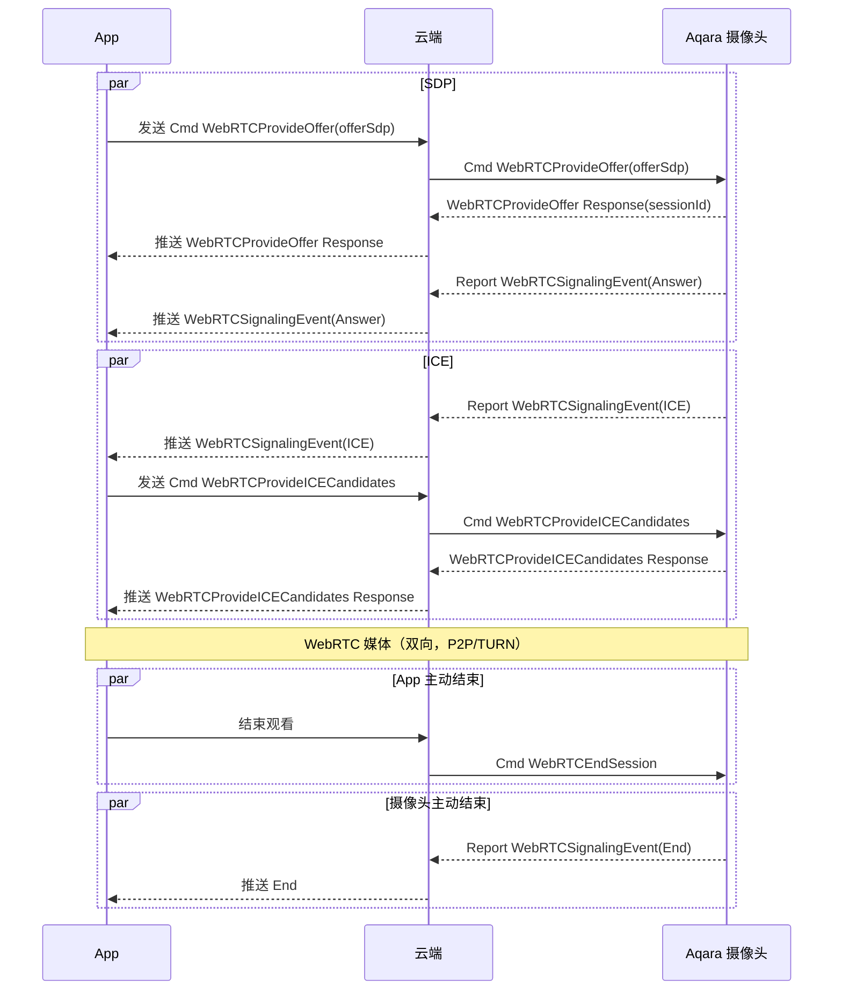
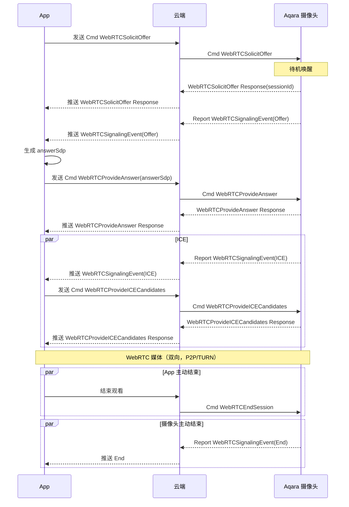
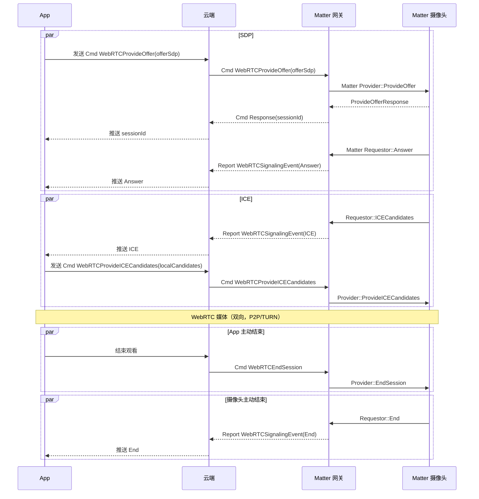
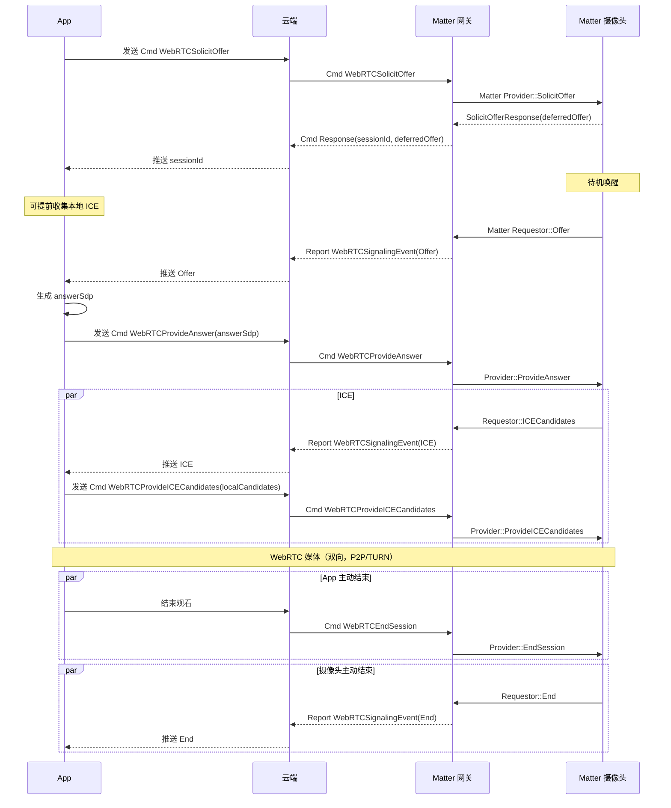
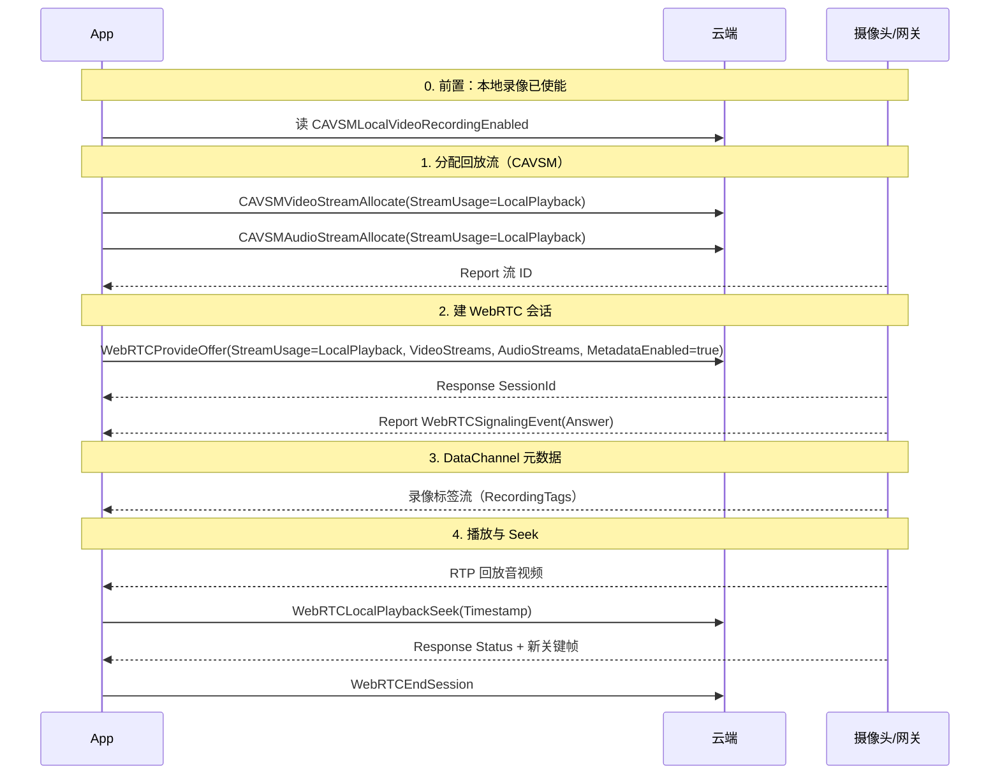

# Aqara 物模型标签

本附录定义 Aqara Spec 物模型标签体系中的 Function、Trait、Command。这些定义作为业务语义层，其中 Function 和 Trait 与 Aqara 物模型的 Object / Property 形成映射，Command 与 Aqara物模型业务交互协议的 Service 形成映射。

Aqara Spec 定义了 Aqara 智能设备的物模型标签体系，用于描述设备"能做什么"。该标签体系中的 Function 和 Trait 与 Aqara 物模型的 Object / Property 形成映射，Command 与 Aqara物模型业务交互协议的 Service 形成映射：Aqara Spec 描述业务语义，物模型与交互协议分别描述数据结构和访问方式。

## 物模型架构

Aqara Spec 物模型采用分层架构，从上到下依次为：Device -> Endpoint -> Device Type -> Function -> Trait / Command。

设备内存在两类特殊 Endpoint：*Root Endpoint*（Endpoint 0）和 *Public Endpoint*（通常为 Endpoint 1）。Root Endpoint 承载设备根信息；Public Endpoint 承载设备级通用 Function，供整个设备共享，不在各业务 Endpoint 上重复实现。

以下以一台多 Endpoint 人体存在传感器设备为例，展示 Root Endpoint、Public Endpoint 与多个业务 Endpoint 的实际结构：

```
Device: "<Device ID>"
├── Endpoint 0 (Root Endpoint)
│    └── Device Type: Root (ID: 0x0000)
│         └── Basic Information (Function ID: 0x0080)
│              ├── DebugInfo (Trait ID: 0x4E29)
│              ├── BLEVersion (Trait ID: 0x4EE9)
│              ├── MCUVersion (Trait ID: 0x4EEB)
│              ├── FirmwareRevision (Trait ID: 0x8080)
│              ├── SerialNumber (Trait ID: 0x8081)
│              ├── VendorName (Trait ID: 0x8082)
│              ├── VendorID (Trait ID: 0x8083)
│              ├── ProductName (Trait ID: 0x8084)
│              ├── Reachable (Trait ID: 0x8085)
│              ├── FirmwareRevisionString (Trait ID: 0x8117)
│              └── ProductID (Trait ID: 0x8118)
├── Endpoint 1 (Public Endpoint)
│    └── Device Type: Public (ID: 0x0001)
│         ├── Identify (Function ID: 0x0083)
│         │    ├── IdentifyTime (Trait ID: 0x8094)
│         │    ├── IdentifyType (Trait ID: 0x8095)
│         │    └── Identify (Command ID: 0x8096)
│         ├── Matter Commissioning (Function ID: 0x00AD)
│         │    ├── MatterFabricsOperationState (Trait ID: 0x4FA0)
│         │    ├── ConnectedMatterFabrics (Trait ID: 0x8123)
│         │    ├── MatterCommissioningWindowStatus (Trait ID: 0x8124)
│         │    ├── MatterNodeID (Trait ID: 0x8142)
│         │    ├── OpenMatterCommissioningWindow (Command ID: 0x88B9)
│         │    └── RemoveMatterFabric (Command ID: 0x88BC)
│         ├── General Diagnostics (Function ID: 0x00B0)
│         │    ├── UpTime (Trait ID: 0x4E23)
│         │    ├── NetworkInterfaces (Trait ID: 0x4E2A)
│         │    ├── ActiveHardwareFaults (Trait ID: 0x813D)
│         │    ├── RebootCount (Trait ID: 0x8148)
│         │    └── RebootReason (Trait ID: 0x8149)
│         ├── Matter Node Information (Function ID: 0x00B3)
│         │    └── MatterNodeFirstEndpointID (Trait ID: 0x8143)
│         └── Thread Network Diagnostics (Function ID: 0x00B5)
│              ├── OverrunCount (Trait ID: 0x4E2C)
│              ├── PartitionID (Trait ID: 0x4E2D)
│              ├── TxTotalCount (Trait ID: 0x4E2E)
│              ├── TxUnicastCount (Trait ID: 0x4E2F)
│              ├── TxBroadcastCount (Trait ID: 0x4E30)
│              ├── RxTotalCount (Trait ID: 0x4E31)
│              ├── RxUnicastCount (Trait ID: 0x4E32)
│              ├── RxBroadcastCount (Trait ID: 0x4E33)
│              ├── NetworkFaultChange (Trait ID: 0x4E34)
│              ├── Channel (Trait ID: 0x814A)
│              ├── PanID (Trait ID: 0x814B)
│              ├── ExtendedPanID (Trait ID: 0x814C)
│              ├── NetworkName (Trait ID: 0x814D)
│              ├── RouteTable (Trait ID: 0x814E)
│              ├── RoutingRole (Trait ID: 0x814F)
│              ├── NeighborTable (Trait ID: 0x8150)
│              └── MeshLocalPrefix (Trait ID: 0x8151)
├── Endpoint 2 (业务 Endpoint)
│    └── Device Type: Occupancy Sensor (ID: 0x0027)
│         ├── Occupancy Sensing (Function ID: 0x00A0)
│         │    ├── HoldTime (Trait ID: 0x4E72)
│         │    ├── Occupancy (Trait ID: 0x80E8)
│         │    └── OccupancySensorType (Trait ID: 0x80E9)
│         ├── General Configuration (Function ID: 0x00AF)
│         │    └── CurrentSensitivityLevel (Trait ID: 0x813B)
│         ├── Ambient Sensing Configuration (Function ID: 0x00E3)
│         │    ├── InstallMode (Trait ID: 0x4F13)
│         │    ├── SideInstall (Trait ID: 0x4F14)
│         │    ├── InstallHeightSetting (Trait ID: 0x4F15)
│         │    ├── InstallStatus (Trait ID: 0x4F16)
│         │    ├── InstallAngle (Trait ID: 0x4F17)
│         │    ├── MaxDetectionZones (Trait ID: 0x4F18)
│         │    ├── Zones (Trait ID: 0x4F19)
│         │    ├── EntryExitRegionBitmask (Trait ID: 0x4F1B)
│         │    ├── InterferenceRegionBitmask (Trait ID: 0x4F1C)
│         │    ├── EdgeRegionBitmask (Trait ID: 0x4F1D)
│         │    ├── EnableHumanCountDetection (Trait ID: 0x4F1F)
│         │    ├── EnableAIHighPrecisionRecognition (Trait ID: 0x4F23)
│         │    ├── EnableAIInterferenceSourceRecognition (Trait ID: 0x4F27)
│         │    ├── EnableAIAdaptiveSensitivity (Trait ID: 0x4F28)
│         │    ├── CoordinateReverseSetting (Trait ID: 0x4F29)
│         │    ├── DetectionDirectionSetting (Trait ID: 0x4F2A)
│         │    ├── AutoInterferenceSourceRecognition (Trait ID: 0x4F30)
│         │    ├── AutoEdgeRecognition (Trait ID: 0x4F31)
│         │    ├── AIEntryExitRegionRecognition (Trait ID: 0x4F32)
│         │    ├── ProximityDistanceLevel (Trait ID: 0x4F5A)
│         │    ├── InterferenceSourceRecognitionReportingTimeout (Trait ID: 0x4FA8)
│         │    ├── AISpaceBackgroundLearningReportingTimeout (Trait ID: 0x4FA9)
│         │    ├── AISpaceBackgroundLearningComplete (Trait ID: 0x4FAA)
│         │    ├── SubscribeAutoInterferenceSourceRecognitionData (Command ID: 0x9C78)
│         │    ├── SubscribeAutoEdgeRecognitionData (Command ID: 0x9C79)
│         │    ├── SubscribeAIEntryExitRegionRecognitionData (Command ID: 0x9C7A)
│         │    ├── EnableAISpaceBackgroundLearning (Command ID: 0x9C7B)
│         │    ├── CreateZone (Command ID: 0x9C7C)
│         │    ├── UpdateZone (Command ID: 0x9C7D)
│         │    ├── RemoveZone (Command ID: 0x9C7E)
│         │    └── SetZones (Command ID: 0x9D36)
│         ├── Radar Sensing Union (Function ID: 0x00E4)
│         │    ├── ChildEndpointList (Trait ID: 0x4F33)
│         │    ├── CurrentHumanCount (Trait ID: 0x4F35)
│         │    └── MotionState (Trait ID: 0x80EA)
│         └── Occupant Location (Function ID: 0x00E5)
│              ├── MaxDetectionTargets (Trait ID: 0x4F3E)
│              ├── LocationInfo (Trait ID: 0x4F46)
│              ├── SubscribeLocationData (Command ID: 0x9C7F)
│              └── SubscribeRemoveDetectionTarget (Command ID: 0x9C80)
├── Endpoint 3 (业务 Endpoint)
│    └── Device Type: Illuminance Sensor (ID: 0x001A)
│         └── Illuminance (Function ID: 0x009A)
│              └── CurrentIlluminance (Trait ID: 0x80DD)
├── Endpoint 4 (业务 Endpoint, 子区域)
│    └── Device Type: Occupancy Sensor (ID: 0x0027)
│         ├── Occupancy Sensing (Function ID: 0x00A0)
│         │    ├── HoldTime (Trait ID: 0x4E72)
│         │    ├── Occupancy (Trait ID: 0x80E8)
│         │    └── OccupancySensorType (Trait ID: 0x80E9)
│         ├── Radar Sensing Union (Function ID: 0x00E4)
│         │    ├── ZoneID (Trait ID: 0x4F34)
│         │    └── MotionState (Trait ID: 0x80EA)
│         └── Occupant Location (Function ID: 0x00E5)
│              └── LocationInfo (Trait ID: 0x4F46)
└── Endpoint 5 (业务 Endpoint, 子区域)
     └── Device Type: Occupancy Sensor (ID: 0x0027)
          ├── Occupancy Sensing (Function ID: 0x00A0)
          │    ├── HoldTime (Trait ID: 0x4E72)
          │    ├── Occupancy (Trait ID: 0x80E8)
          │    └── OccupancySensorType (Trait ID: 0x80E9)
          ├── Radar Sensing Union (Function ID: 0x00E4)
          │    ├── ZoneID (Trait ID: 0x4F34)
          │    └── MotionState (Trait ID: 0x80EA)
          └── Occupant Location (Function ID: 0x00E5)
               └── LocationInfo (Trait ID: 0x4F46)
```

## 核心概念

### Device（设备）

Device 是一个物理智能设备，如网关、灯泡、门锁、传感器等。一个 Device 由一个或多个 Endpoint 组成。

### Endpoint（端点）

Endpoint 是设备中的一个逻辑功能节点。每个 Endpoint 拥有一个 Endpoint ID（Uint16，取值 0 ~ 65535），并关联一个或多个 Device Type。

Aqara Spec 定义了三类 Endpoint：

* *Root Endpoint*（Endpoint 0）：设备根节点，关联 Root Device Type，必须实现 Basic Information 和 Descriptor 功能。
* *Public Endpoint*（通常为 Endpoint 1）：设备公共端点，关联 Public Device Type，承载 Identify、诊断、OTA 及各类生态协同等设备级通用 Function，供整个设备共享。
* *业务 Endpoint*（Endpoint 2 及以上）：承载具体业务功能，关联对应的业务 Device Type（如 Occupancy Sensor、Illuminance Sensor）。同一 Device Type 可出现在多个 Endpoint 上（如上例 Endpoint 4、5 为 Endpoint 2 的子区域）。前端可见的业务 Endpoint 必须实现 Label、Endpoint Icon 功能，否则无法前端展示。

### Device Type（设备类型）

Device Type 用于描述 Endpoint 的设备类型。每个 Device Type 由唯一的 Device Type ID（Uint16）标识。每个 Device Type 定义了该类型设备必须（M）或可选（O）实现的 Function 集合。一个 Endpoint 下不允许添加重复的 Function。

业务 Aqara 标准 Device Type ID 的新分配范围为 `1` ~ `10000`。Root Device Type ID `0` 是特殊保留值，不属于业务 Device Type 的新分配范围。

除业务 Device Type 外，Aqara Spec 定义了两个与特殊 Endpoint 对应的 Device Type：

* *Root*（ID: 0x0000）：仅用于 Root Endpoint，必须实现 Basic Information 和 Descriptor。
* *Public*（ID: 0x0001）：仅用于 Public Endpoint，必须实现 Identify，可选实现诊断、网络配网、OTA 及各类生态协同等通用 Function。

例如上例中业务 Endpoint 2 关联 Occupancy Sensor（ID: 0x0027）Device Type，实现 Occupancy Sensing、Radar Sensing Union 等 Function；设备级通用能力（如 Identify、Matter Commissioning）由 Public Endpoint（Endpoint 1）统一提供，不在各业务 Endpoint 重复实现。

完整的 Device Type ID 编码及 Function 要求见 [Device Type 定义](#ref_spec_DeviceType)。

### Function（功能）

Function 描述设备的一个完整功能单元，由若干 Traits 和 Commands 组成。每个 Function 由唯一的 Function ID（Uint16）标识。

Aqara 标准 Function ID 的新分配范围为 `0` ~ `19999`；供用户自定义的私有 Function ID 范围为 `64001` ~ `65534`。

### Trait（特征）

Trait 描述 Function 中的一个属性或状态，支持 Read、Write、Report 等操作。每个 Trait 由唯一的 Trait ID（Uint16）标识。

Aqara 标准 Trait ID 的新分配范围为 `1` ~ `30000`；供用户自定义的私有 Trait ID 范围为 `60000` ~ `64000`。

### Command（命令）

Command 描述 Function 中可执行的操作，由客户端向设备发送。每个 Command 由唯一的 Command ID（Uint16）标识。

Aqara 标准 Command ID 的新分配范围为 `40001` ~ `50000`；供用户自定义的私有 Command ID 范围为 `64001` ~ `65534`。

### Parameter（参数）

Parameter 是 Trait 内部的数据字段，由 Parameter ID（Uint16）标识。

## ID 编号体系

**ID 分配范围总览**

<table>
  <thead>
    <tr>
      <th>类别</th>
      <th>标准范围</th>
      <th>私有范围</th>
      <th>格式</th>
    </tr>
  </thead>
  <tbody>
    <tr>
      <td>Device Type ID</td>
      <td><code>1</code> ~ <code>10000</code>（业务类型；<code>0</code> 为 Root 特殊保留值）</td>
      <td><code>64001</code> ~ <code>65534</code></td>
      <td>Uint16</td>
    </tr>
    <tr>
      <td>Function ID</td>
      <td><code>0</code> ~ <code>19999</code></td>
      <td><code>64001</code> ~ <code>65534</code></td>
      <td>Uint16</td>
    </tr>
    <tr>
      <td>Trait ID</td>
      <td><code>1</code> ~ <code>30000</code></td>
      <td><code>60000</code> ~ <code>64000</code></td>
      <td>Uint16</td>
    </tr>
    <tr>
      <td>Command ID</td>
      <td><code>40001</code> ~ <code>50000</code></td>
      <td><code>64001</code> ~ <code>65534</code></td>
      <td>Uint16</td>
    </tr>
    <tr>
      <td>Parameter ID</td>
      <td><code>0x0000</code> ~ <code>0xFFFF</code></td>
      <td>-</td>
      <td>Uint16</td>
    </tr>
  </tbody>
</table>

以上标准范围和私有范围用于约束新 ID 的分配，确保用户自定义 ID 不与 Aqara 标准 ID 范围冲突。范围之外的值不属于相应类别的标准或私有新分配范围。规则更新不改变已经定义或已投入使用的 ID：现有 ID 应原值保留，即使超出当前新分配范围，也无需仅为满足新范围而重新编号或做有效范围校验。除 Device Type 的 Root 特殊保留值 `0` 外，新分配的 Device Type ID 应使用上述业务标准范围或私有范围。

## Trait 参数字段说明

Parameter ID 采用 16 位整数标识，有效范围为 `0x0001` ~ `0xFFFE`（1 ~ 65534）。`0x0000` 与 `0xFFFF` 预留不可用。

**Trait 标准 Parameter ID**

<table>
  <thead>
    <tr>
      <th>Parameter ID</th>
      <th>Name</th>
      <th>BACnet Property</th>
      <th>说明</th>
    </tr>
  </thead>
  <tbody>
    <tr>
      <td>0x0001</td>
      <td>Present Value</td>
      <td>PROP_PRESENT_VALUE</td>
      <td>当前值，表示 Trait 的实时状态</td>
    </tr>
    <tr>
      <td>0x0002</td>
      <td>Maximum Value</td>
      <td>PROP_MAX_PRES_VALUE</td>
      <td>Present Value 的最大允许/可表示值；与 Minimum Value 共同描述数值范围，不是报警阈值。</td>
    </tr>
    <tr>
      <td>0x0003</td>
      <td>Minimum Value</td>
      <td>PROP_MIN_PRES_VALUE</td>
      <td>Present Value 的最小允许/可表示值；与 Maximum Value 共同描述数值范围，不是报警阈值。</td>
    </tr>
    <tr>
      <td>0x0004</td>
      <td>Unit</td>
      <td>PROP_UNITS</td>
      <td>工程单位</td>
    </tr>
    <tr>
      <td>0x0005</td>
      <td>Step Value</td>
      <td>PROP_STEP_VALUE</td>
      <td>步进值（Uint32）；仅适用于 Multi-state Input/Output Object</td>
    </tr>
    <tr>
      <td>0x0006</td>
      <td>Supported Value</td>
      <td>PROP_SUPPORTED_VALUES</td>
      <td>支持的取值列表（Array），数组元素类型须与 Present Value 一致</td>
    </tr>
    <tr>
      <td>0x0007</td>
      <td>Default Value</td>
      <td>PROP_RELINQUISH_DEFAULT</td>
      <td>Relinquish 默认值</td>
    </tr>
    <tr>
      <td>0x0008</td>
      <td>High Limit</td>
      <td>PROP_HIGH_LIMIT</td>
      <td>高限监控阈值（Float）；可用于判断 Present Value 是否超过高侧阈值，不定义 Present Value 的量程。</td>
    </tr>
    <tr>
      <td>0x0009</td>
      <td>Low Limit</td>
      <td>PROP_LOW_LIMIT</td>
      <td>低限监控阈值（Float）；可用于判断 Present Value 是否低于低侧阈值，不定义 Present Value 的量程。</td>
    </tr>
    <tr>
      <td>0x000A</td>
      <td>COV Increment</td>
      <td>PROP_COV_INCREMENT</td>
      <td>COV 增量（Float）</td>
    </tr>
    <tr>
      <td>0x000B</td>
      <td>Maximum Actual Value</td>
      <td>PROP_MAX_ACTUAL_VALUE</td>
      <td>Present Value 对应的实际量上端标定值（Float）；与 Minimum Actual Value 的映射关系由对象定义。</td>
    </tr>
    <tr>
      <td>0x000C</td>
      <td>Minimum Actual Value</td>
      <td>PROP_MIN_ACTUAL_VALUE</td>
      <td>Present Value 对应的实际量下端标定值（Float）；与 Maximum Actual Value 的映射关系由对象定义。</td>
    </tr>
    <tr>
      <td>0x000D</td>
      <td>Is Null</td>
      <td>PROP_IS_NULL</td>
      <td>指示 Present Value 当前无有效数据或未初始化（Bool）</td>
    </tr>
    <tr>
      <td>0x000E</td>
      <td>Extended Supported Values</td>
      <td>PROP_EXTENDED_SUPPORTED_VALUES</td>
      <td>扩展支持值列表（List[Struct]）</td>
    </tr>
    <tr>
      <td>0x000F</td>
      <td>Max Item Num</td>
      <td>-</td>
      <td>Present Value 为 Array/List 时允许的最大元素个数（Uint32）</td>
    </tr>
    <tr>
      <td>0x0010</td>
      <td>Counter Generation</td>
      <td>-</td>
      <td>Trait 的可选只读 Parameter（Uint32），用于标识累计计数器代际；当实现无法保证逻辑累计值连续且要求精确计算差值时必须提供。</td>
    </tr>
  </tbody>
</table>

### 数值边界参数

#### Minimum Value 与 Maximum Value

`Minimum Value`（`PROP_MIN_PRES_VALUE`）和 `Maximum Value`（`PROP_MAX_PRES_VALUE`）描述 `Present Value` 的数值范围下界和上界。读取这两个参数，可以了解该 Trait 声明的有效数值范围；客户端在写入 `Present Value` 时，应将目标值限制在该范围内，并同时遵守 Trait 自身定义的类型、步进值、枚举取值及其他约束。设备也应依据自己的 Trait 定义处理范围外的输入，不能把这两个边界当作报警阈值使用。

例如，若温度 Trait 的 `Minimum Value` 为 `-50`、`Maximum Value` 为 `100`，且 `Unit` 为摄氏度，则它声明的数值范围为 `-50°C` 至 `100°C`。客户端可用该范围校验用户输入或展示可调范围。若数值是只读传感器值，这些边界说明该 Trait 的范围，并不意味着客户端可以写入该值。

这两个参数描述的是协议中 `Present Value` 的数值范围，不一定等同于传感器的物理测量能力、设备的报警范围或控制器的安全范围。它们是否存在、是否可读及其具体约束，以对应 Trait 参数表为准；不要假定每个 Trait 都同时定义这两个参数。

### 监控阈值参数

#### Low Limit 与 High Limit

`Low Limit`（`PROP_LOW_LIMIT`）和 `High Limit`（`PROP_HIGH_LIMIT`）分别表示低侧和高侧的监控阈值，适用于对象定义了相应监控或报警语义的场景。它们回答的是"运行值到什么程度应视为低侧或高侧异常"，而不是"该 Trait 能表示到什么数值"。阈值通常可按现场运行要求配置，但实际能否配置取决于该参数的访问权限及对应 Trait 定义。

例如，冷却水温度监控可以将 `Low Limit` 配为 `5°C`、`High Limit` 配为 `35°C`：当前值低于低限时可判定为低侧越限，高于高限时可判定为高侧越限。边界比较的具体规则（例如恰好等于阈值时是否算越限），应由对应对象或报警机制定义。

仅定义或读取 `Low Limit`、`High Limit` 并不自动意味着设备会产生报警、事件或主动上报。要实现完整的告警行为，对象还需要支持相关机制，并按其定义处理使能条件、持续时间/延时、死区、事件状态和通知方式等因素。客户端不应只根据阈值参数存在，就推断报警已启用或告警通知一定会发送。阈值也应处于与被监控 `Present Value` 相容的单位和语义下；它们可以位于正常值范围边缘之外，但不能因此用来替代 `Minimum Value` 或 `Maximum Value`。

### 实际量标定参数

#### Minimum Actual Value 与 Maximum Actual Value

`Minimum Actual Value`（`PROP_MIN_ACTUAL_VALUE`）和 `Maximum Actual Value`（`PROP_MAX_ACTUAL_VALUE`）描述 `Present Value` 范围两端所对应的实际量端点，可用于解释或换算设备数值与实际物理量之间的关系。它们与 `Unit` 一起帮助客户端理解实际量的含义；例如实际量的单位可能是流明、伏特或其他工程单位。具体表示的实际量、端点所对应的 `Present Value`、是否线性以及是否用于输出映射，必须由对应 Trait 或对象定义明确，不能只凭参数名称推断。

例如，某调光对象的 `Present Value` 表示调光控制区间 `0%` 至 `100%`，而设备实际可达到的亮度范围是额定亮度的 `20%` 至 `80%`；对象定义这两个区间端点之间为线性映射。此时 `Minimum Actual Value` 为 `20%` 亮度，`Maximum Actual Value` 为 `80%` 亮度：控制值 `0%` 对应实际亮度 `20%`，控制值 `100%` 对应实际亮度 `80%`，控制值 `50%` 对应 `20% + (80% - 20%) × 50% = 50%` 亮度。这里两个 Actual Value 的百分比是相对于额定亮度的实际输出，而控制值百分比是 Present Value 在控制区间中的位置；它们含义不同。对于一般的线性端点映射，可按对象定义的 Present Value 两端点进行比例插值；如果对象规定非线性映射，或 Present Value 并非百分比，则应遵循该对象的映射规则，不能直接套用此例。

这组参数用于说明数值端点与实际量之间的对应关系，不是 `Present Value` 的协议允许范围（由 `Minimum Value` / `Maximum Value` 描述），也不是运行报警阈值（由 `Low Limit` / `High Limit` 描述）。例如，调光灯具的 `Present Value` 控制范围可以是 `0%` 至 `100%`，而对应的实际亮度范围是额定亮度的 `20%` 至 `80%`。

### 三组参数的使用区分

* *Minimum Value / Maximum Value*：校验或理解 `Present Value` 在协议层面的数值边界--"这个值允许/可表示到哪里？"
* *Low Limit / High Limit*：判断运行值是否达到监控阈值--"运行到什么程度算低侧/高侧越限？"
* *Minimum Actual Value / Maximum Actual Value*：在对象定义支持的前提下，说明 `Present Value` 与实际物理量端点的对应关系--"这个数值端点对应多少实际量？"

三组参数不能互相替代，也不保证在同一个 Trait 中全部出现。实现和客户端应先查看具体 Trait 的参数表、类型、单位、访问权限和约束，再按该 Trait 定义解释和使用；只有对象明确约定线性映射时，才可使用线性插值换算实际量。

## 权限标记

**权限类型**

<table>
  <thead>
    <tr>
      <th>标记</th>
      <th>说明</th>
    </tr>
  </thead>
  <tbody>
    <tr>
      <td>Read</td>
      <td>客户端可读取该参数</td>
    </tr>
    <tr>
      <td>Write</td>
      <td>客户端可写入该参数</td>
    </tr>
    <tr>
      <td>Report</td>
      <td>设备变化时主动上报该参数</td>
    </tr>
    <tr>
      <td>Configured</td>
      <td>设备在配置阶段上报</td>
    </tr>
  </tbody>
</table>

## 必选标记

* *M* (Mandatory)：设备必须实现
* *O* (Optional)：设备可选实现

## Function 列表总览

以下汇总本附录涵盖的所有 Function 定义。各 Function 的 Trait、Command 及数据类型详见对应章节。

## Function 索引 {#ref_Aqara_Spec_FunctionIndex}

本节汇总 Aqara Spec 全部 Function 定义。各 Function 的 Trait、Command 及数据类型详见对应章节。

<table>
  <thead>
    <tr>
      <th>Function ID</th>
      <th>Code</th>
      <th>描述</th>
    </tr>
  </thead>
  <tbody>
    <tr>
      <td><a href="#ref_Aqara_Spec_Binding">0x0001</a></td>
      <td>Binding</td>
      <td>表示端点与一个或多个其他本地或远程 Endpoint 之间的持久绑定关系。</td>
    </tr>
    <tr>
      <td><a href="#ref_Aqara_Spec_CO">0x0009</a></td>
      <td>CO</td>
      <td>提供一氧化碳浓度监测与报警相关能力，用于检测环境中的一氧化碳泄漏并及时告警。</td>
    </tr>
    <tr>
      <td><a href="#ref_Aqara_Spec_WaterFreezeDetector">0x000A</a></td>
      <td>WaterFreezeDetector</td>
      <td>用于检测管道或环境中是否存在结冰风险，并在达到阈值时上报水冻结相关事件。</td>
    </tr>
    <tr>
      <td><a href="#ref_Aqara_Spec_RainSensor">0x000B</a></td>
      <td>RainSensor</td>
      <td>用于检测降雨状态，上报是否正在下雨及雨量相关信息。</td>
    </tr>
    <tr>
      <td><a href="#ref_Aqara_Spec_OnOffSensor">0x000C</a></td>
      <td>OnOffSensor</td>
      <td>用于检测二元开关量输入状态，上报开/关或触发/未触发等离散状态。</td>
    </tr>
    <tr>
      <td><a href="#ref_Aqara_Spec_BasicInformation">0x0080</a></td>
      <td>BasicInformation</td>
      <td>提供设备基本信息，包括厂商、产品型号、固件版本、序列号、在线状态等基础属性。</td>
    </tr>
    <tr>
      <td><a href="#ref_Aqara_Spec_Descriptor">0x0081</a></td>
      <td>Descriptor</td>
      <td>描述设备端点组成与能力结构，包括端点列表、设备类型、Server/Client 集群等信息。</td>
    </tr>
    <tr>
      <td><a href="#ref_Aqara_Spec_EndpointLabel">0x0082</a></td>
      <td>EndpointLabel</td>
      <td>管理端点的可见性与展示信息，如名称、房间、图标、标签等，用于前端展示与组织。</td>
    </tr>
    <tr>
      <td><a href="#ref_Aqara_Spec_Identify">0x0083</a></td>
      <td>Identify</td>
      <td>提供设备识别能力，可通过指示灯闪烁、声音等方式帮助用户定位物理设备。</td>
    </tr>
    <tr>
      <td><a href="#ref_Aqara_Spec_Output">0x0084</a></td>
      <td>Output</td>
      <td>提供开关输出控制能力，支持读取和控制负载的通断状态。</td>
    </tr>
    <tr>
      <td><a href="#ref_Aqara_Spec_LevelControl">0x0085</a></td>
      <td>LevelControl</td>
      <td>提供亮度或等级调节能力，支持设置、读取当前亮度/等级及渐变控制。</td>
    </tr>
    <tr>
      <td><a href="#ref_Aqara_Spec_ColorControl">0x0086</a></td>
      <td>ColorControl</td>
      <td>提供颜色控制能力，包括色温、HSV、XY 色彩空间等方式调节灯光颜色。</td>
    </tr>
    <tr>
      <td><a href="#ref_Aqara_Spec_Button">0x0087</a></td>
      <td>Button</td>
      <td>描述按钮类输入设备的事件上报，包括单击、长按、多击等动作识别。</td>
    </tr>
    <tr>
      <td><a href="#ref_Aqara_Spec_Camera">0x0088</a></td>
      <td>Camera</td>
      <td>管理摄像机基础能力，包括设备状态、模式切换、图像加密及云端相关能力。</td>
    </tr>
    <tr>
      <td><a href="#ref_Aqara_Spec_WindowCovering">0x0089</a></td>
      <td>WindowCovering</td>
      <td>提供窗帘/百叶窗等遮阳设备的升降、倾斜、位置控制及状态反馈。</td>
    </tr>
    <tr>
      <td><a href="#ref_Aqara_Spec_Lifter">0x008A</a></td>
      <td>Lifter</td>
      <td>提供升降类设备的行程控制，支持设定目标位置、停止及状态查询。</td>
    </tr>
    <tr>
      <td><a href="#ref_Aqara_Spec_IRControl">0x008B</a></td>
      <td>IRControl</td>
      <td>提供红外发射控制能力，用于控制空调、电视等传统红外家电。</td>
    </tr>
    <tr>
      <td><a href="#ref_Aqara_Spec_EnergyManagement">0x008C</a></td>
      <td>EnergyManagement</td>
      <td>管理设备电量与能耗信息，包括电量百分比、功耗统计及低电告警等。</td>
    </tr>
    <tr>
      <td><a href="#ref_Aqara_Spec_HeaterCooler">0x008D</a></td>
      <td>HeaterCooler</td>
      <td>提供制冷/制热控制能力，包括目标温度、运行模式、风速等暖通参数。</td>
    </tr>
    <tr>
      <td><a href="#ref_Aqara_Spec_FanControl">0x008E</a></td>
      <td>FanControl</td>
      <td>提供风扇转速与模式控制，支持档位调节及运行状态读取。</td>
    </tr>
    <tr>
      <td><a href="#ref_Aqara_Spec_Temperature">0x008F</a></td>
      <td>Temperature</td>
      <td>测量并上报环境温度，提供当前温度值及有效量程等属性。</td>
    </tr>
    <tr>
      <td><a href="#ref_Aqara_Spec_RelativeHumidity">0x0090</a></td>
      <td>RelativeHumidity</td>
      <td>测量并上报环境相对湿度，提供当前湿度值及有效量程等属性。</td>
    </tr>
    <tr>
      <td><a href="#ref_Aqara_Spec_MediaPlayback">0x0091</a></td>
      <td>MediaPlayback</td>
      <td>提供媒体播放控制能力，包括播放、暂停、切歌、音量及播放状态管理。</td>
    </tr>
    <tr>
      <td><a href="#ref_Aqara_Spec_Speaker">0x0092</a></td>
      <td>Speaker</td>
      <td>描述设备扬声器输出能力，包括文本转语音播报、音量控制及静音等音频输出功能。</td>
    </tr>
    <tr>
      <td><a href="#ref_Aqara_Spec_PowerSource">0x0093</a></td>
      <td>PowerSource</td>
      <td>描述设备供电来源与电池状态，包括电量、充电状态、电池类型等信息。</td>
    </tr>
    <tr>
      <td><a href="#ref_Aqara_Spec_DoorLock">0x0094</a></td>
      <td>DoorLock</td>
      <td>提供智能门锁核心能力，包括锁状态、用户/凭证管理、开锁/上锁及告警事件。</td>
    </tr>
    <tr>
      <td><a href="#ref_Aqara_Spec_Sweeper">0x0095</a></td>
      <td>Sweeper</td>
      <td>提供扫地机器人基础控制，包括启动清扫、暂停、回充等操作与状态反馈。</td>
    </tr>
    <tr>
      <td><a href="#ref_Aqara_Spec_AirQuality">0x0096</a></td>
      <td>AirQuality</td>
      <td>监测并上报空气质量指标，如 AQI 或综合空气质量等级。</td>
    </tr>
    <tr>
      <td><a href="#ref_Aqara_Spec_Pressure">0x0097</a></td>
      <td>Pressure</td>
      <td>测量并上报大气压力或系统压力值。</td>
    </tr>
    <tr>
      <td><a href="#ref_Aqara_Spec_ParticulateMatter">0x0098</a></td>
      <td>ParticulateMatter</td>
      <td>监测并上报颗粒物浓度（如 PM2.5、PM10）。</td>
    </tr>
    <tr>
      <td><a href="#ref_Aqara_Spec_CO2">0x0099</a></td>
      <td>CO2</td>
      <td>测量并上报环境中二氧化碳浓度。</td>
    </tr>
    <tr>
      <td><a href="#ref_Aqara_Spec_Illuminance">0x009A</a></td>
      <td>Illuminance</td>
      <td>测量并上报环境光照度（lux）。</td>
    </tr>
    <tr>
      <td><a href="#ref_Aqara_Spec_Contact">0x009B</a></td>
      <td>Contact</td>
      <td>检测接触/门磁类二元状态，上报打开或关闭状态及可选角度信息。</td>
    </tr>
    <tr>
      <td><a href="#ref_Aqara_Spec_Smoke">0x009C</a></td>
      <td>Smoke</td>
      <td>检测烟雾并上报报警事件，支持灵敏度、自检及静音等相关配置。</td>
    </tr>
    <tr>
      <td><a href="#ref_Aqara_Spec_Gas">0x009D</a></td>
      <td>Gas</td>
      <td>检测可燃气体或有害气体泄漏并上报告警事件。</td>
    </tr>
    <tr>
      <td><a href="#ref_Aqara_Spec_Sleep">0x009E</a></td>
      <td>Sleep</td>
      <td>监测睡眠相关状态，上报睡眠阶段、时长或质量等指标。</td>
    </tr>
    <tr>
      <td><a href="#ref_Aqara_Spec_WaterLeak">0x009F</a></td>
      <td>WaterLeak</td>
      <td>检测水浸事件，在检测到漏水时及时上报告警。</td>
    </tr>
    <tr>
      <td><a href="#ref_Aqara_Spec_OccupancySensing">0x00A0</a></td>
      <td>OccupancySensing</td>
      <td>检测空间内是否有人存在，上报占用/空闲状态及保持时间等参数。</td>
    </tr>
    <tr>
      <td><a href="#ref_Aqara_Spec_Location">0x00A1</a></td>
      <td>Location</td>
      <td>提供设备或目标的位置信息上报与查询能力。</td>
    </tr>
    <tr>
      <td><a href="#ref_Aqara_Spec_Knob">0x00A2</a></td>
      <td>Knob</td>
      <td>描述旋钮类输入设备的旋转角度、按压及组合动作事件。</td>
    </tr>
    <tr>
      <td><a href="#ref_Aqara_Spec_Cube">0x00A3</a></td>
      <td>Cube</td>
      <td>描述魔方控制器的手势识别，包括翻转、旋转、摇一摇等动作及面识别。</td>
    </tr>
    <tr>
      <td><a href="#ref_Aqara_Spec_Vibration">0x00A4</a></td>
      <td>Vibration</td>
      <td>检测振动或动静变化，上报移动、倾斜、跌落等事件。</td>
    </tr>
    <tr>
      <td><a href="#ref_Aqara_Spec_Modes">0x00A5</a></td>
      <td>Modes</td>
      <td>提供设备多模式管理能力，支持切换和读取当前运行模式。</td>
    </tr>
    <tr>
      <td><a href="#ref_Aqara_Spec_PetFeeder">0x00A6</a></td>
      <td>PetFeeder</td>
      <td>提供宠物喂食控制能力，包括出粮份数、喂食计划及余量状态。</td>
    </tr>
    <tr>
      <td><a href="#ref_Aqara_Spec_BridgeConfiguration">0x00A7</a></td>
      <td>BridgeConfiguration</td>
      <td>管理网关桥接配置，描述子设备接入、桥接能力及网络拓扑相关信息。</td>
    </tr>
    <tr>
      <td><a href="#ref_Aqara_Spec_AttitudeDetection">0x00A8</a></td>
      <td>AttitudeDetection</td>
      <td>检测设备姿态或倾斜角度变化，上报姿态异常或角度信息。</td>
    </tr>
    <tr>
      <td><a href="#ref_Aqara_Spec_Group">0x00A9</a></td>
      <td>Group</td>
      <td>管理设备分组配置，维护组内节点列表及组级控制能力。</td>
    </tr>
    <tr>
      <td><a href="#ref_Aqara_Spec_Doorbell">0x00AA</a></td>
      <td>Doorbell</td>
      <td>提供门铃相关能力，包括呼叫事件上报及与室内铃铛/中继的联动。</td>
    </tr>
    <tr>
      <td><a href="#ref_Aqara_Spec_NetworkCommissioning">0x00AB</a></td>
      <td>NetworkCommissioning</td>
      <td>提供网络配网能力，支持 Wi-Fi、Thread 等网络的扫描、连接与配置。</td>
    </tr>
    <tr>
      <td><a href="#ref_Aqara_Spec_EcosystemInformation">0x00AC</a></td>
      <td>EcosystemInformation</td>
      <td>描述设备所接入的生态平台信息，如 HomeKit、Matter Fabric 等绑定状态。</td>
    </tr>
    <tr>
      <td><a href="#ref_Aqara_Spec_MatterCommissioning">0x00AD</a></td>
      <td>MatterCommissioning</td>
      <td>提供 Matter 入网与 Fabric 管理能力，包括配网窗口、Fabric 列表及节点标识。</td>
    </tr>
    <tr>
      <td><a href="#ref_Aqara_Spec_IndicationLight">0x00AE</a></td>
      <td>IndicationLight</td>
      <td>管理设备指示灯行为，包括状态指示、亮度、颜色及闪烁模式等。</td>
    </tr>
    <tr>
      <td><a href="#ref_Aqara_Spec_GeneralConfiguration">0x00AF</a></td>
      <td>GeneralConfiguration</td>
      <td>提供通用设备配置项，如灵敏度、延时、默认参数等设备级设置。</td>
    </tr>
    <tr>
      <td><a href="#ref_Aqara_Spec_GeneralDiagnostics">0x00B0</a></td>
      <td>GeneralDiagnostics</td>
      <td>提供通用诊断信息，包括运行时间、重启次数、网络接口及硬件故障等。</td>
    </tr>
    <tr>
      <td><a href="#ref_Aqara_Spec_PanTilt">0x00B1</a></td>
      <td>PanTilt</td>
      <td>提供云台（Pan/Tilt/Zoom）控制能力，包括预置位、校准及相对/绝对移动。</td>
    </tr>
    <tr>
      <td><a href="#ref_Aqara_Spec_BridgedConfiguration">0x00B2</a></td>
      <td>BridgedConfiguration</td>
      <td>描述被桥接子设备的配置信息，用于 Matter/Zigbee 桥接场景。</td>
    </tr>
    <tr>
      <td><a href="#ref_Aqara_Spec_MatterNodeInformation">0x00B3</a></td>
      <td>MatterNodeInformation</td>
      <td>提供 Matter 节点相关信息，如首个 Endpoint ID 及节点拓扑辅助信息。</td>
    </tr>
    <tr>
      <td><a href="#ref_Aqara_Spec_ThreadNetworkDiagnostics">0x00B5</a></td>
      <td>ThreadNetworkDiagnostics</td>
      <td>提供 Thread 网络诊断指标，包括信道、PAN ID、邻居表、路由角色及收发统计。</td>
    </tr>
    <tr>
      <td><a href="#ref_Aqara_Spec_GarageDoorOpener">0x00B6</a></td>
      <td>GarageDoorOpener</td>
      <td>提供车库门控制与状态反馈，包括开/关/停止及位置状态。</td>
    </tr>
    <tr>
      <td><a href="#ref_Aqara_Spec_MatterBridgeCommissioning">0x00B7</a></td>
      <td>MatterBridgeCommissioning</td>
      <td>管理 Matter Bridge 向第三方 Matter 生态分享桥接设备的能力。</td>
    </tr>
    <tr>
      <td><a href="#ref_Aqara_Spec_MARSConfiguration">0x00B8</a></td>
      <td>MARSConfiguration</td>
      <td>提供智能负载（MARS）相关配置，用于负载识别与智能配电管理。</td>
    </tr>
    <tr>
      <td><a href="#ref_Aqara_Spec_CustomizedConfiguration">0x00B9</a></td>
      <td>CustomizedConfiguration</td>
      <td>提供厂商或用户自定义扩展配置项的读写能力。</td>
    </tr>
    <tr>
      <td><a href="#ref_Aqara_Spec_FreshAirControl">0x00BA</a></td>
      <td>FreshAirControl</td>
      <td>提供新风系统控制能力，支持引入室外空气并进行风量、模式等调节。</td>
    </tr>
    <tr>
      <td><a href="#ref_Aqara_Spec_ScreenDisplay">0x00BB</a></td>
      <td>ScreenDisplay</td>
      <td>管理屏幕显示相关硬件属性，如分辨率、亮度、背光及显示状态。</td>
    </tr>
    <tr>
      <td><a href="#ref_Aqara_Spec_ValveControl">0x00BC</a></td>
      <td>ValveControl</td>
      <td>提供阀门自动控制或手动控制能力，用于精确调节水/气流量。</td>
    </tr>
    <tr>
      <td><a href="#ref_Aqara_Spec_FilterMonitoring">0x00BD</a></td>
      <td>FilterMonitoring</td>
      <td>持续监测各类滤芯（如 HEPA、活性炭）的使用状态与剩余寿命。</td>
    </tr>
    <tr>
      <td><a href="#ref_Aqara_Spec_OperationalState">0x00BE</a></td>
      <td>OperationalState</td>
      <td>描述设备当前运行状态，如空闲、运行中、暂停、故障等。</td>
    </tr>
    <tr>
      <td><a href="#ref_Aqara_Spec_Flow">0x00BF</a></td>
      <td>Flow</td>
      <td>测量并上报液体或气体的流量速率。</td>
    </tr>
    <tr>
      <td><a href="#ref_Aqara_Spec_Mode">0x00C0</a></td>
      <td>Mode</td>
      <td>提供设备特性模式接口，支持在多种预定义模式间切换。</td>
    </tr>
    <tr>
      <td><a href="#ref_Aqara_Spec_VacuumOperationalState">0x00C1</a></td>
      <td>VacuumOperationalState</td>
      <td>描述扫地机器人当前运行状态，如清扫中、回充中、充电中等。</td>
    </tr>
    <tr>
      <td><a href="#ref_Aqara_Spec_RefrigeratorState">0x00C2</a></td>
      <td>RefrigeratorState</td>
      <td>描述冰箱运行状态，包括空闲、制冷、除霜、故障等。</td>
    </tr>
    <tr>
      <td><a href="#ref_Aqara_Spec_EVSE">0x00C3</a></td>
      <td>EVSE</td>
      <td>提供电动汽车供电设备（EVSE）控制能力，包括充电启停、电流限制及充电状态。</td>
    </tr>
    <tr>
      <td><a href="#ref_Aqara_Spec_VacuumRunMode">0x00C4</a></td>
      <td>VacuumRunMode</td>
      <td>控制扫地机器人运行模式，如自动、沿边、定点等。</td>
    </tr>
    <tr>
      <td><a href="#ref_Aqara_Spec_VacuumCleanMode">0x00C5</a></td>
      <td>VacuumCleanMode</td>
      <td>控制扫地机器人清洁模式，如标准、强力、静音等。</td>
    </tr>
    <tr>
      <td><a href="#ref_Aqara_Spec_TemperatureControl">0x00C6</a></td>
      <td>TemperatureControl</td>
      <td>提供温度设定与调节能力，用于恒温设备的目标温度控制。</td>
    </tr>
    <tr>
      <td><a href="#ref_Aqara_Spec_MediaInput">0x00C7</a></td>
      <td>MediaInput</td>
      <td>描述媒体输入源管理与切换，支持选择当前播放源及输入列表。</td>
    </tr>
    <tr>
      <td><a href="#ref_Aqara_Spec_HEPAFilterMonitoring">0x00C8</a></td>
      <td>HEPAFilterMonitoring</td>
      <td>监测 HEPA 滤芯使用情况、剩余寿命及更换提醒。</td>
    </tr>
    <tr>
      <td><a href="#ref_Aqara_Spec_ActivatedCarbonFilterMonitoring">0x00C9</a></td>
      <td>ActivatedCarbonFilterMonitoring</td>
      <td>监测活性炭滤芯使用情况、剩余寿命及更换提醒。</td>
    </tr>
    <tr>
      <td><a href="#ref_Aqara_Spec_ThreadBorderRouter">0x00CA</a></td>
      <td>ThreadBorderRouter</td>
      <td>管理 Thread 边界路由器及其所承载 Thread 网络的运行与配置。</td>
    </tr>
    <tr>
      <td><a href="#ref_Aqara_Spec_ThemePack">0x00CB</a></td>
      <td>ThemePack</td>
      <td>管理设备主题包资源，包括主题下载、切换及版本信息。</td>
    </tr>
    <tr>
      <td><a href="#ref_Aqara_Spec_WiFiNetworkDiagnostics">0x00CC</a></td>
      <td>WiFiNetworkDiagnostics</td>
      <td>提供 Wi-Fi 网络标准化诊断指标，辅助排查连接质量与链路状态。</td>
    </tr>
    <tr>
      <td><a href="#ref_Aqara_Spec_ZigbeeNetworkDiagnostics">0x00CD</a></td>
      <td>ZigbeeNetworkDiagnostics</td>
      <td>提供 Zigbee 网络诊断能力，包括信道、PAN、邻居及路由等信息。</td>
    </tr>
    <tr>
      <td><a href="#ref_Aqara_Spec_ZigbeeSubscribe">0x0125</a></td>
      <td>ZigbeeSubscribe</td>
      <td>提供 Zigbee 订阅能力，用于记录可订阅的设备资源、能力范围及订阅记录管理。</td>
    </tr>
    <tr>
      <td><a href="#ref_Aqara_Spec_AnalogInputObject">0x00CE</a></td>
      <td>AnalogInputObject</td>
      <td>以只读方式采集连续变化的模拟量输入（如电压、温度模拟信号）。</td>
    </tr>
    <tr>
      <td><a href="#ref_Aqara_Spec_AnalogOutputObject">0x00CF</a></td>
      <td>AnalogOutputObject</td>
      <td>提供可写的连续模拟量输出控制信号。</td>
    </tr>
    <tr>
      <td><a href="#ref_Aqara_Spec_BinaryInputObject">0x00D0</a></td>
      <td>BinaryInputObject</td>
      <td>采集二元状态输入，如门磁、开关等 true/false 或 active/inactive 量。</td>
    </tr>
    <tr>
      <td><a href="#ref_Aqara_Spec_BinaryOutputObject">0x00D1</a></td>
      <td>BinaryOutputObject</td>
      <td>驱动二元执行器输出，如继电器、接触器、电磁阀或警号。</td>
    </tr>
    <tr>
      <td><a href="#ref_Aqara_Spec_MultiStateInputObject">0x00D2</a></td>
      <td>MultiStateInputObject</td>
      <td>采集多状态离散输入，表示 N 种状态之一。</td>
    </tr>
    <tr>
      <td><a href="#ref_Aqara_Spec_MultiStateOutputObject">0x00D3</a></td>
      <td>MultiStateOutputObject</td>
      <td>输出多状态离散控制命令，如 HVAC 模式或灯光场景切换。</td>
    </tr>
    <tr>
      <td><a href="#ref_Aqara_Spec_CharacterStringValueObject">0x00D4</a></td>
      <td>CharacterStringValueObject</td>
      <td>定义以字符串形式表示的数据对象及其外部可见特性。</td>
    </tr>
    <tr>
      <td><a href="#ref_Aqara_Spec_ScreenUserInterface">0x00D5</a></td>
      <td>ScreenUserInterface</td>
      <td>管理屏端用户界面配置，包括页面布局、卡片、主题及展示数据。</td>
    </tr>
    <tr>
      <td><a href="#ref_Aqara_Spec_DeviceAnomalyMonitoring">0x00D6</a></td>
      <td>DeviceAnomalyMonitoring</td>
      <td>持续监测设备温度、负载、电流与电压等关键安全指标，在过温、过载、过流或欠压等异常发生时上报告警并支撑保护策略。</td>
    </tr>
    <tr>
      <td><a href="#ref_Aqara_Spec_OTA">0x00D7</a></td>
      <td>OTA</td>
      <td>管理设备固件升级流程，包括下载、安装调度及升级进度与结果上报。</td>
    </tr>
    <tr>
      <td><a href="#ref_Aqara_Spec_HumanRecognition">0x00D8</a></td>
      <td>HumanRecognition</td>
      <td>利用视觉等算法实时检测画面中的人形目标，区分人体与其他物体并上报事件。</td>
    </tr>
    <tr>
      <td><a href="#ref_Aqara_Spec_SoundDetection">0x00D9</a></td>
      <td>SoundDetection</td>
      <td>通过麦克风采集环境声音，识别特定声音类型（如玻璃破碎、婴儿哭声）并告警。</td>
    </tr>
    <tr>
      <td><a href="#ref_Aqara_Spec_PetRecognition">0x00DA</a></td>
      <td>PetRecognition</td>
      <td>识别画面中的猫、狗等宠物个体，上报宠物出现或相关识别事件。</td>
    </tr>
    <tr>
      <td><a href="#ref_Aqara_Spec_FaceRecognition">0x00DB</a></td>
      <td>FaceRecognition</td>
      <td>采集人脸特征并与本地库比对，上报人脸识别结果及匹配信息。</td>
    </tr>
    <tr>
      <td><a href="#ref_Aqara_Spec_GestureRecognition">0x00DC</a></td>
      <td>GestureRecognition</td>
      <td>实时分析手势动作，将预定义手势转换为控制指令。</td>
    </tr>
    <tr>
      <td><a href="#ref_Aqara_Spec_VehicleDetection">0x00DD</a></td>
      <td>VehicleDetection</td>
      <td>检测监控区域内的车辆出现，上报车辆存在事件供安防或自动化使用。</td>
    </tr>
    <tr>
      <td><a href="#ref_Aqara_Spec_FlameDetection">0x00DE</a></td>
      <td>FlameDetection</td>
      <td>通过图像或传感器算法检测可见火焰，即时上报火情事件以便早期预警。</td>
    </tr>
    <tr>
      <td><a href="#ref_Aqara_Spec_PackageRecognition">0x00DF</a></td>
      <td>PackageRecognition</td>
      <td>自动识别画面中的包裹，在投递或取走时可发送提醒并记录事件。</td>
    </tr>
    <tr>
      <td><a href="#ref_Aqara_Spec_HumanPresence">0x00E0</a></td>
      <td>HumanPresence</td>
      <td>检测空间内人体存在，支持人数统计、轨迹及身份关联等高级感知能力。</td>
    </tr>
    <tr>
      <td><a href="#ref_Aqara_Spec_HeartMonitoring">0x00E1</a></td>
      <td>HeartMonitoring</td>
      <td>利用传感器持续或周期性测量用户心率，记录并分析心脏健康相关数据。</td>
    </tr>
    <tr>
      <td><a href="#ref_Aqara_Spec_BreathingMonitoring">0x00E2</a></td>
      <td>BreathingMonitoring</td>
      <td>利用传感器持续或周期性测量用户呼吸频率与模式，支持健康监测。</td>
    </tr>
    <tr>
      <td><a href="#ref_Aqara_Spec_AmbientSensingConfiguration">0x00E3</a></td>
      <td>AmbientSensingConfiguration</td>
      <td>提供环境传感配置能力，包括区域管理、安装模式、检测开关及 AI 区域识别等。</td>
    </tr>
    <tr>
      <td><a href="#ref_Aqara_Spec_RadarSensingUnion">0x00E4</a></td>
      <td>RadarSensingUnion</td>
      <td>聚合雷达传感能力，包括子端点列表、人数统计及运动状态等联合数据。</td>
    </tr>
    <tr>
      <td><a href="#ref_Aqara_Spec_OccupantLocation">0x00E5</a></td>
      <td>OccupantLocation</td>
      <td>提供存在目标的位置、活动状态及姿态信息，支持位置数据订阅与目标管理。</td>
    </tr>
    <tr>
      <td><a href="#ref_Aqara_Spec_MatterCoordination">0x00E6</a></td>
      <td>MatterCoordination</td>
      <td>集中管理 Matter 协议相关协同操作，包括入网、绑定、数据同步及证书管理。</td>
    </tr>
    <tr>
      <td><a href="#ref_Aqara_Spec_OTACoordination">0x00E7</a></td>
      <td>OTACoordination</td>
      <td>管理 OTA 固件升级协同流程，包括任务下发、进度上报、结果反馈及版本查询。</td>
    </tr>
    <tr>
      <td><a href="#ref_Aqara_Spec_StudioCoordination">0x00E8</a></td>
      <td>StudioCoordination</td>
      <td>管理网关与 Aqara Studio 开发环境的集成，包括账号认证、项目备份与设备同步。</td>
    </tr>
    <tr>
      <td><a href="#ref_Aqara_Spec_CameraCoordination">0x00E9</a></td>
      <td>CameraCoordination</td>
      <td>处理摄像机复杂业务逻辑，包括 WebRTC 通话、云台控制、识别数据同步及扩展事件。</td>
    </tr>
    <tr>
      <td><a href="#ref_Aqara_Spec_SecurityGuardCoordination">0x00EA</a></td>
      <td>SecurityGuardCoordination</td>
      <td>管理家庭空间安防警戒能力，包括警戒启停、告警确认及本地/云端配置同步。</td>
    </tr>
    <tr>
      <td><a href="#ref_Aqara_Spec_SceneCoordination">0x00EB</a></td>
      <td>SceneCoordination</td>
      <td>管理智能场景（自动化规则）生命周期，包括同步、删除、触发执行及一致性校验。</td>
    </tr>
    <tr>
      <td><a href="#ref_Aqara_Spec_HubCoordination">0x00EC</a></td>
      <td>HubCoordination</td>
      <td>作为网关核心协同模块，管理子设备入网、配置、心跳、令牌及各类代理服务。</td>
    </tr>
    <tr>
      <td><a href="#ref_Aqara_Spec_LightBoxCoordination">0x00ED</a></td>
      <td>LightBoxCoordination</td>
      <td>管理智能灯箱设备的配置下发，控制展示内容与效果。</td>
    </tr>
    <tr>
      <td><a href="#ref_Aqara_Spec_IRCoordination">0x00EE</a></td>
      <td>IRCoordination</td>
      <td>管理网关红外学习与发射，包括码库同步、虚拟遥控器创建及按键控制。</td>
    </tr>
    <tr>
      <td><a href="#ref_Aqara_Spec_CommLinkCoordination">0x00EF</a></td>
      <td>CommLinkCoordination</td>
      <td>监测网关与云端通信链路质量，执行耗时探测并上报结果。</td>
    </tr>
    <tr>
      <td><a href="#ref_Aqara_Spec_RingtoneCoordination">0x00F0</a></td>
      <td>RingtoneCoordination</td>
      <td>管理网关本地铃声/音乐文件，包括下载、删除及与云端库的一致性校验。</td>
    </tr>
    <tr>
      <td><a href="#ref_Aqara_Spec_ScreenCoordination">0x00F1</a></td>
      <td>ScreenCoordination</td>
      <td>管理智能场景面板交互，包括配置下发、状态查询及云端/面板双向透传。</td>
    </tr>
    <tr>
      <td><a href="#ref_Aqara_Spec_ConfigurationCoordination">0x00F2</a></td>
      <td>ConfigurationCoordination</td>
      <td>通过组播或批量方式管理通用功能配置、资源订阅及位置信息同步。</td>
    </tr>
    <tr>
      <td><a href="#ref_Aqara_Spec_LockCoordination">0x00F3</a></td>
      <td>LockCoordination</td>
      <td>处理智能门锁扩展业务，包括专用透传通道、加解密协助及扩展事件上报。</td>
    </tr>
    <tr>
      <td><a href="#ref_Aqara_Spec_WakeupCoordination">0x00F4</a></td>
      <td>WakeupCoordination</td>
      <td>为支持远程唤醒的低功耗设备获取唤醒服务地址或令牌。</td>
    </tr>
    <tr>
      <td><a href="#ref_Aqara_Spec_CloudStorageCoordination">0x00F5</a></td>
      <td>CloudStorageCoordination</td>
      <td>管理云录像/云存业务资源配置，获取存储配额及上传凭证等信息。</td>
    </tr>
    <tr>
      <td><a href="#ref_Aqara_Spec_CentralHubCoordination">0x00F6</a></td>
      <td>CentralHubCoordination</td>
      <td>管理中枢网关高级能力，包括中枢启用、Broker 信息及数据透传通道。</td>
    </tr>
    <tr>
      <td><a href="#ref_Aqara_Spec_IftttCoordination">0x00F7</a></td>
      <td>IftttCoordination</td>
      <td>作为自动化规则协同中心，管理 IFTTT/本地自动化规则的同步、订阅与执行。</td>
    </tr>
    <tr>
      <td><a href="#ref_Aqara_Spec_NetworkManagement">0x00F8</a></td>
      <td>NetworkManagement</td>
      <td>作为设备网络连接与访问策略的核心控制模块，管理远程代理及访问地址。</td>
    </tr>
    <tr>
      <td><a href="#ref_Aqara_Spec_ToiletCore">0x00F9</a></td>
      <td>ToiletCore</td>
      <td>集成智能马桶最基础的物理状态感知与部件控制，包括着座、翻盖、冲水、座圈加热及夜灯。</td>
    </tr>
    <tr>
      <td><a href="#ref_Aqara_Spec_ToiletDiagnostic">0x00FA</a></td>
      <td>ToiletDiagnostic</td>
      <td>监测智能马桶关键硬件子系统健康状态，主动上报温度、流量、风机等故障信息。</td>
    </tr>
    <tr>
      <td><a href="#ref_Aqara_Spec_ToiletHygiene">0x00FB</a></td>
      <td>ToiletHygiene</td>
      <td>维护设备自身清洁卫生，包括喷嘴清洁、泡沫盾、等离子杀菌及管路清洗。</td>
    </tr>
    <tr>
      <td><a href="#ref_Aqara_Spec_ToiletWashDry">0x00FC</a></td>
      <td>ToiletWashDry</td>
      <td>定义智能马桶清洗与烘干全流程，涵盖水洗模式、水温/水压、烘干风速及时长设置。</td>
    </tr>
    <tr>
      <td><a href="#ref_Aqara_Spec_ToiletSettings">0x00FD</a></td>
      <td>ToiletSettings</td>
      <td>允许用户个性化默认参数与自动化场景，如自动翻盖、自动冲水、泡沫盾及久坐提醒等。</td>
    </tr>
    <tr>
      <td><a href="#ref_Aqara_Spec_Lighting">0x00FE</a></td>
      <td>Lighting</td>
      <td>提供 Aqara 调光与场景控制能力，包括内置/自定义场景、音乐律动及灯带分段控制。</td>
    </tr>
    <tr>
      <td><a href="#ref_Aqara_Spec_ScreenUIConfig">0x00FF</a></td>
      <td>ScreenUIConfig</td>
      <td>提供屏端统一 UI 配置，包括页面布局、主题、卡片数量及多页面信息管理。</td>
    </tr>
    <tr>
      <td><a href="#ref_Aqara_Spec_Ringtone">0x0100</a></td>
      <td>Ringtone</td>
      <td>提供铃声与音乐播放控制，支持选曲、音量/时长调节及播放状态监测。</td>
    </tr>
    <tr>
      <td><a href="#ref_Aqara_Spec_FenceDetection">0x0101</a></td>
      <td>FenceDetection</td>
      <td>在摄像机画面中定义虚拟围栏区域，检测人员进入或离开并支持录像、推送等联动策略。</td>
    </tr>
    <tr>
      <td><a href="#ref_Aqara_Spec_Security">0x0102</a></td>
      <td>Security</td>
      <td>管理设备安全策略与访问权限，包括用户密码、丢失模式及相关验证机制。</td>
    </tr>
    <tr>
      <td><a href="#ref_Aqara_Spec_Storage">0x0103</a></td>
      <td>Storage</td>
      <td>管理本地 SD 卡录像、格式化、录像模式及存储状态监测与维护。</td>
    </tr>
    <tr>
      <td><a href="#ref_Aqara_Spec_ImageMediaManagement">0x0104</a></td>
      <td>ImageMediaManagement</td>
      <td>管理画布布局与图像资源，支持图像下载、存储、删除、状态上报及 ID 列表维护。</td>
    </tr>
    <tr>
      <td><a href="#ref_Aqara_Spec_VoiceAssistant">0x0105</a></td>
      <td>VoiceAssistant</td>
      <td>管理设备语音交互能力，包括唤醒词、语音控制开关、语音音色、连续对话、语音控制语言、近场唤醒及空间区域配置。</td>
    </tr>
    <tr>
      <td><a href="#ref_Aqara_Spec_VoiceIntercom">TBD</a></td>
      <td>VoiceIntercom</td>
      <td>管理设备语音对讲相关能力，包括可用于对讲的在线设备列表。</td>
    </tr>
    <tr>
      <td><a href="#ref_Aqara_Spec_SpaceSecurity">0x0106</a></td>
      <td>SpaceSecurity</td>
      <td>管理设备在特定空间内的安防能力，包括报警铃声、音量、布撤防状态及告警时长。</td>
    </tr>
    <tr>
      <td><a href="#ref_Aqara_Spec_Massage">0x0107</a></td>
      <td>Massage</td>
      <td>管理电动床舒适与姿态调节，包括背/腿升降、按摩模式/强度/定时及童锁与急停。</td>
    </tr>
    <tr>
      <td><a href="#ref_Aqara_Spec_TowelRackDry">0x0108</a></td>
      <td>TowelRackDry</td>
      <td>管理毛巾架烘干流程，控制目标温度、烘干时长，并反馈剩余时间与故障状态。</td>
    </tr>
    <tr>
      <td><a href="#ref_Aqara_Spec_Live">0x0109</a></td>
      <td>Live</td>
      <td>控制实时视频流，支持延时摄影、变焦、休眠/唤醒及关联事件录像等增强能力。</td>
    </tr>
    <tr>
      <td><a href="#ref_Aqara_Spec_Playback">0x010A</a></td>
      <td>Playback</td>
      <td>管理录像回放与历史记录，包括云端小视频类型识别及本地录像下载能力。</td>
    </tr>
    <tr>
      <td><a href="#ref_Aqara_Spec_CloudRecording">0x010B</a></td>
      <td>CloudRecording</td>
      <td>控制云端录像总开关，决定是否将视频内容上传至云存储。</td>
    </tr>
    <tr>
      <td><a href="#ref_Aqara_Spec_CameraSettings">0x010C</a></td>
      <td>CameraSettings</td>
      <td>提供摄像机扩展配置，如定时上传图片、RTSP 流媒体及高级功能开关。</td>
    </tr>
    <tr>
      <td><a href="#ref_Aqara_Spec_AIDetection">0x010D</a></td>
      <td>AIDetection</td>
      <td>执行 AI 驱动的图像与音频分析，实现事件检测、内容识别及智能告警。</td>
    </tr>
    <tr>
      <td><a href="#ref_Aqara_Spec_VideoSettings">0x010E</a></td>
      <td>VideoSettings</td>
      <td>管理图像处理与画面呈现，包括画质、水印、隐私遮挡、夜视及补光灯联动。</td>
    </tr>
    <tr>
      <td><a href="#ref_Aqara_Spec_CameraWorkMode">0x010F</a></td>
      <td>CameraWorkMode</td>
      <td>定义摄像机功耗策略与工作模式，适配不同电源类型与使用场景。</td>
    </tr>
    <tr>
      <td><a href="#ref_Aqara_Spec_AudioSettings">0x0110</a></td>
      <td>AudioSettings</td>
      <td>控制音频采集与输出，调节录制静音及系统提示音量等参数。</td>
    </tr>
    <tr>
      <td><a href="#ref_Aqara_Spec_CameraPrivacySecurity">0x0111</a></td>
      <td>CameraPrivacySecurity</td>
      <td>聚焦摄像机隐私策略，包括定时休眠等低功耗安防隐私保护能力。</td>
    </tr>
    <tr>
      <td><a href="#ref_Aqara_Spec_CameraNotifications">0x0112</a></td>
      <td>CameraNotifications</td>
      <td>管理事件通知策略，支持通知类型、计划时段、过滤规则及重要等级设置。</td>
    </tr>
    <tr>
      <td><a href="#ref_Aqara_Spec_NASStorage">0x0113</a></td>
      <td>NASStorage</td>
      <td>与网络附加存储（NAS）集成，提供绑定、策略配置、传输间隔及状态管理。</td>
    </tr>
    <tr>
      <td><a href="#ref_Aqara_Spec_Repeater">0x0114</a></td>
      <td>Repeater</td>
      <td>管理 Wi-Fi 中继能力，包括保活、中继链路信息、网络诊断及与网关的连接状态。</td>
    </tr>
    <tr>
      <td><a href="#ref_Aqara_Spec_TamperProtection">0x0115</a></td>
      <td>TamperProtection</td>
      <td>提供物理安全防护，检测并响应非法拆卸、强拆等篡改行为，支持告警与录像联动。</td>
    </tr>
    <tr>
      <td><a href="#ref_Aqara_Spec_SmileDetection">0x0116</a></td>
      <td>SmileDetection</td>
      <td>识别画面中的笑脸并上报事件，支持对笑脸识别能力进行启停控制。</td>
    </tr>
    <tr>
      <td><a href="#ref_Aqara_Spec_SO2">0x0128</a></td>
      <td>SO2</td>
      <td>表示对空气中二氧化硫的监测功能域，包括但不限于 SO2 浓度测量、是否检测到 SO2、超标报警、传感器状态等能力。</td>
    </tr>
    <tr>
      <td><a href="#ref_Aqara_Spec_NO2">0x0129</a></td>
      <td>NO2</td>
      <td>表示对空气中二氧化氮的监测功能域，包括但不限于 NO2 浓度测量、是否检测到 NO2、超标报警、传感器状态等能力。</td>
    </tr>
    <tr>
      <td><a href="#ref_Aqara_Spec_O3">0x012A</a></td>
      <td>O3</td>
      <td>表示对空气中臭氧的监测功能域，包括但不限于 O3 浓度测量、是否检测到 O3、超标报警、传感器状态等能力。</td>
    </tr>
    <tr>
      <td><a href="#ref_Aqara_Spec_Formaldehyde">0x012B</a></td>
      <td>Formaldehyde</td>
      <td>表示对空气中甲醛的监测功能域，包括但不限于 HCHO 浓度测量、是否检测到甲醛、超标报警、传感器状态等能力。</td>
    </tr>
    <tr>
      <td><a href="#ref_Aqara_Spec_O2">0x012C</a></td>
      <td>O2</td>
      <td>表示对环境中氧气的监测功能域，包括但不限于 O2 浓度测量、缺氧/富氧判定、传感器状态等能力。</td>
    </tr>
    <tr>
      <td><a href="#ref_Aqara_Spec_Chlorine">0x012D</a></td>
      <td>Chlorine</td>
      <td>表示对空气中氯气的监测功能域，包括但不限于 Cl2 浓度测量、是否检测到氯气、超标报警、传感器状态等能力。</td>
    </tr>
    <tr>
      <td><a href="#ref_Aqara_Spec_HydrochloricAcid">0x012E</a></td>
      <td>HydrochloricAcid</td>
      <td>表示对空气中盐酸气体的监测功能域，包括但不限于 HCl 浓度测量、是否检测到盐酸气体、超标报警、传感器状态等能力。</td>
    </tr>
    <tr>
      <td><a href="#ref_Aqara_Spec_HydrogenSulfide">0x012F</a></td>
      <td>HydrogenSulfide</td>
      <td>表示对空气中硫化氢的监测功能域，包括但不限于 H2S 浓度测量、是否检测到硫化氢、超标报警、传感器状态等能力。</td>
    </tr>
    <tr>
      <td><a href="#ref_Aqara_Spec_Ammonia">0x0130</a></td>
      <td>Ammonia</td>
      <td>表示对空气中氨气的监测功能域，包括但不限于 NH3 浓度测量、是否检测到氨气、超标报警、传感器状态等能力。</td>
    </tr>
    <tr>
      <td><a href="#ref_Aqara_Spec_WaterQuality">0x0131</a></td>
      <td>WaterQuality</td>
      <td>表示对水质的监测功能域，涵盖但不限于水的硬度、浊度、pH、TDS、余氯、溶解氧等参数的测量与状态判定。</td>
    </tr>
    <tr>
      <td><a href="#ref_Aqara_Spec_NitrogenOxides">0x0132</a></td>
      <td>NitrogenOxides</td>
      <td>表示对空气中氮氧化物的监测功能域，包括但不限于 NOx 浓度测量、是否检测到氮氧化物、超标报警、传感器状态等能力。</td>
    </tr>
    <tr>
      <td><a href="#ref_Aqara_Spec_LiquidLevel">0x0133</a></td>
      <td>LiquidLevel</td>
      <td>表示对容器或管路内液体液位的监测功能域，包括但不限于液位高度测量、储液量判断、补排液需求分析、高低液位风险预警等能力。</td>
    </tr>
    <tr>
      <td><a href="#ref_Aqara_Spec_Noise">0x0134</a></td>
      <td>Noise</td>
      <td>表示对环境噪声的监测功能域，包括但不限于噪声级测量、噪声是否超标判定、峰值噪声、平均噪声等能力。</td>
    </tr>
    <tr>
      <td><a href="#ref_Aqara_Spec_HeatMeter">0x0135</a></td>
      <td>HeatMeter</td>
      <td>表示对供热/供冷系统中冷热量计量功能的综合管理，涵盖瞬时热流量、瞬时冷流量、热量累计值、冷量累计值及其小数部分等参数的测量与上报。</td>
    </tr>
    <tr>
      <td><a href="#ref_Aqara_Spec_Boiler">0x0136</a></td>
      <td>Boiler</td>
      <td>表示对锅炉设备运行状态的监测与控制功能域，涵盖排烟温度、火力调节、负荷输出、燃烧计时、点火次数等参数的测量、设定与上报。</td>
    </tr>
    <tr>
      <td><a href="#ref_Aqara_Spec_ControlCabinet">0x0137</a></td>
      <td>ControlCabinet</td>
      <td>表示对控制柜设备的监测与控制功能域，涵盖频率反馈、冷却水温度实际值与设定值、温差设置、手动频率给定等参数的测量、设定与上报。</td>
    </tr>
    <tr>
      <td><a href="#ref_Aqara_Spec_Compressor">0x0138</a></td>
      <td>Compressor</td>
      <td>表示对压缩机设备运行状态的监测与控制功能域，涵盖温度、压力、电流、电压、功率、湿度、转速、开度、运行时间、制冷量等参数的测量、设定与上报。</td>
    </tr>
    <tr>
      <td><a href="#ref_Aqara_Spec_CoolingPump">0x0139</a></td>
      <td>CoolingPump</td>
      <td>表示对冷却泵设备的监测与控制功能域，涵盖频率反馈、手动频率给定、频率上下限、运行时间等参数的测量、设定与上报。</td>
    </tr>
    <tr>
      <td><a href="#ref_Aqara_Spec_Buzzer">0x013A</a></td>
      <td>Buzzer</td>
      <td>表示设备蜂鸣器的控制功能域，用于播放或停止蜂鸣器声音，支持设置播放音量和播放时长，适用于门铃提示、报警提醒、操作反馈等场景。</td>
    </tr>
    <tr>
      <td><a href="#ref_Aqara_Spec_GasMetering">0x013B</a></td>
      <td>GasMetering</td>
      <td>提供燃气计量相关能力，包括燃气热值及工况体积到标准体积的换算系数，用于燃气用量的能量折算和标准化换算。</td>
    </tr>
    <tr>
      <td><a href="#ref_Aqara_Spec_EnergyStorage">0x013C</a></td>
      <td>EnergyStorage</td>
      <td>管理储能电池的 SOC、额定/可用容量、以电池侧为边界的累计充放电量和充放电功率，以及电池健康状态。</td>
    </tr>
    <tr>
      <td><a href="#ref_Aqara_Spec_ElectricityMetering">0x013D</a></td>
      <td>ElectricityMetering</td>
      <td>提供电能表和并网点计量能力，包括功率方向、需量及按费率寄存器分别累计的进口/出口电量。</td>
    </tr>
    <tr>
      <td><a href="#ref_Aqara_Spec_PowerGeneration">0x013E</a></td>
      <td>PowerGeneration</td>
      <td>描述发电设备的额定功率和运行状态，以及燃气热电联产相关的能量、功率和热回收数据。</td>
    </tr>
  </tbody>
</table>

## Device Type 定义 {#ref_spec_DeviceType}

Device Type 用于描述 Endpoint 的设备类型，一个 Device 可以由一个或多个 Endpoint 组成。每一个 Endpoint 可以由一个或者多个 Device Type 来组成。一个 Endpoint 下，不允许添加重复的 Function。

每个 Device Type 由唯一的 Device Type ID（Uint16）标识。下表按品类分组列出各 Device Type 的 ID 编码及其必须（M）或可选（O）实现的 Function 集合。

特殊类型：Root、Public。二者分别对应 Root Endpoint 和 Public Endpoint。

* *Root*（ID: 0x0000）：用于 Root Endpoint（Endpoint 0），必须实现 Basic Information 和 Descriptor 功能。
* *Public*（ID: 0x0001）：用于 Public Endpoint（通常为 Endpoint 1），承载设备级通用 Function，包含 Identify 及各类可选协同/诊断功能。

### Device Type 列表

#### 系统类型

**系统类型**

<table>
  <thead>
    <tr>
      <th>ID</th>
      <th>Device Type</th>
      <th>Required Functions</th>
      <th>必选</th>
      <th>备注</th>
    </tr>
  </thead>
  <tbody>
    <tr>
      <td>0x0000</td>
      <td>Root（根节点）</td>
      <td>BasicInformation</td>
      <td>M</td>
      <td></td>
    </tr>
    <tr>
      <td>0x0000</td>
      <td>Root（根节点）</td>
      <td>Descriptor</td>
      <td>M</td>
      <td></td>
    </tr>
    <tr>
      <td>0x0000</td>
      <td>Root（根节点）</td>
      <td>EndpointLabel</td>
      <td>O</td>
      <td></td>
    </tr>
    <tr>
      <td>0x0001</td>
      <td>Public（公共节点）</td>
      <td>Identify</td>
      <td>M</td>
      <td></td>
    </tr>
    <tr>
      <td>0x0001</td>
      <td>Public（公共节点）</td>
      <td>WindowCovering</td>
      <td>O</td>
      <td></td>
    </tr>
    <tr>
      <td>0x0001</td>
      <td>Public（公共节点）</td>
      <td>EnergyManagement</td>
      <td>O</td>
      <td></td>
    </tr>
    <tr>
      <td>0x0001</td>
      <td>Public（公共节点）</td>
      <td>PowerSource</td>
      <td>O</td>
      <td></td>
    </tr>
    <tr>
      <td>0x0001</td>
      <td>Public（公共节点）</td>
      <td>NetworkCommissioning</td>
      <td>O</td>
      <td></td>
    </tr>
    <tr>
      <td>0x0001</td>
      <td>Public（公共节点）</td>
      <td>EcosystemInformation</td>
      <td>O</td>
      <td></td>
    </tr>
    <tr>
      <td>0x0001</td>
      <td>Public（公共节点）</td>
      <td>IndicationLight</td>
      <td>O</td>
      <td></td>
    </tr>
    <tr>
      <td>0x0001</td>
      <td>Public（公共节点）</td>
      <td>GeneralConfiguration</td>
      <td>O</td>
      <td></td>
    </tr>
    <tr>
      <td>0x0001</td>
      <td>Public（公共节点）</td>
      <td>GeneralDiagnostics</td>
      <td>O</td>
      <td></td>
    </tr>
    <tr>
      <td>0x0001</td>
      <td>Public（公共节点）</td>
      <td>ThreadNetworkDiagnostics</td>
      <td>O</td>
      <td></td>
    </tr>
    <tr>
      <td>0x0001</td>
      <td>Public（公共节点）</td>
      <td>ZigbeeNetworkDiagnostics</td>
      <td>O</td>
      <td></td>
    </tr>
    <tr>
      <td>0x0001</td>
      <td>Public（公共节点）</td>
      <td>DeviceAnomalyMonitoring</td>
      <td>O</td>
      <td></td>
    </tr>
    <tr>
      <td>0x0001</td>
      <td>Public（公共节点）</td>
      <td>MatterCoordination</td>
      <td>O</td>
      <td></td>
    </tr>
    <tr>
      <td>0x0001</td>
      <td>Public（公共节点）</td>
      <td>OTACoordination</td>
      <td>O</td>
      <td></td>
    </tr>
    <tr>
      <td>0x0001</td>
      <td>Public（公共节点）</td>
      <td>StudioCoordination</td>
      <td>O</td>
      <td></td>
    </tr>
    <tr>
      <td>0x0001</td>
      <td>Public（公共节点）</td>
      <td>CameraCoordination</td>
      <td>O</td>
      <td></td>
    </tr>
    <tr>
      <td>0x0001</td>
      <td>Public（公共节点）</td>
      <td>SecurityGuardCoordination</td>
      <td>O</td>
      <td></td>
    </tr>
    <tr>
      <td>0x0001</td>
      <td>Public（公共节点）</td>
      <td>SceneCoordination</td>
      <td>O</td>
      <td></td>
    </tr>
    <tr>
      <td>0x0001</td>
      <td>Public（公共节点）</td>
      <td>HubCoordination</td>
      <td>O</td>
      <td></td>
    </tr>
    <tr>
      <td>0x0001</td>
      <td>Public（公共节点）</td>
      <td>LightBoxCoordination</td>
      <td>O</td>
      <td></td>
    </tr>
    <tr>
      <td>0x0001</td>
      <td>Public（公共节点）</td>
      <td>IRCoordination</td>
      <td>O</td>
      <td></td>
    </tr>
    <tr>
      <td>0x0001</td>
      <td>Public（公共节点）</td>
      <td>CommLinkCoordination</td>
      <td>O</td>
      <td></td>
    </tr>
    <tr>
      <td>0x0001</td>
      <td>Public（公共节点）</td>
      <td>RingtoneCoordination</td>
      <td>O</td>
      <td></td>
    </tr>
    <tr>
      <td>0x0001</td>
      <td>Public（公共节点）</td>
      <td>ScreenCoordination</td>
      <td>O</td>
      <td></td>
    </tr>
    <tr>
      <td>0x0001</td>
      <td>Public（公共节点）</td>
      <td>ConfigurationCoordination</td>
      <td>O</td>
      <td></td>
    </tr>
    <tr>
      <td>0x0001</td>
      <td>Public（公共节点）</td>
      <td>LockCoordination</td>
      <td>O</td>
      <td></td>
    </tr>
    <tr>
      <td>0x0001</td>
      <td>Public（公共节点）</td>
      <td>WakeupCoordination</td>
      <td>O</td>
      <td></td>
    </tr>
    <tr>
      <td>0x0001</td>
      <td>Public（公共节点）</td>
      <td>CloudStorageCoordination</td>
      <td>O</td>
      <td></td>
    </tr>
    <tr>
      <td>0x0001</td>
      <td>Public（公共节点）</td>
      <td>CentralHubCoordination</td>
      <td>O</td>
      <td></td>
    </tr>
    <tr>
      <td>0x0001</td>
      <td>Public（公共节点）</td>
      <td>IftttCoordination</td>
      <td>O</td>
      <td></td>
    </tr>
    <tr>
      <td>0x0001</td>
      <td>Public（公共节点）</td>
      <td>NetworkManagement</td>
      <td>O</td>
      <td></td>
    </tr>
    <tr>
      <td>0x0001</td>
      <td>Public（公共节点）</td>
      <td>Security</td>
      <td>O</td>
      <td></td>
    </tr>
    <tr>
      <td>0x0001</td>
      <td>Public（公共节点）</td>
      <td>OTA</td>
      <td>O</td>
      <td></td>
    </tr>
  </tbody>
</table>

#### 网关/桥接类型

**网关/桥接类型**

<table>
  <thead>
    <tr>
      <th>ID</th>
      <th>Device Type</th>
      <th>Required Functions</th>
      <th>必选</th>
      <th>备注</th>
    </tr>
  </thead>
  <tbody>
    <tr>
      <td>0x0003</td>
      <td>Hub（网关）</td>
      <td>BridgeConfiguration</td>
      <td>M</td>
      <td></td>
    </tr>
    <tr>
      <td>0x0003</td>
      <td>Hub（网关）</td>
      <td>Speaker</td>
      <td>O</td>
      <td></td>
    </tr>
    <tr>
      <td>0x0003</td>
      <td>Hub（网关）</td>
      <td>MatterBridgeCommissioning</td>
      <td>O</td>
      <td></td>
    </tr>
    <tr>
      <td>0x0003</td>
      <td>Hub（网关）</td>
      <td>ZigbeeNetworkDiagnostics</td>
      <td>O</td>
      <td></td>
    </tr>
    <tr>
      <td>0x0003</td>
      <td>Hub（网关）</td>
      <td>Ringtone</td>
      <td>O</td>
      <td></td>
    </tr>
    <tr>
      <td>0x0003</td>
      <td>Hub（网关）</td>
      <td>ThreadNetworkDiagnostics</td>
      <td>O</td>
      <td></td>
    </tr>
    <tr>
      <td>0x0004</td>
      <td>BridgedNode（桥接设备）</td>
      <td>BridgedConfiguration</td>
      <td>M</td>
      <td>描述桥接设备</td>
    </tr>
  </tbody>
</table>

#### 照明类型

**照明类型**

<table>
  <thead>
    <tr>
      <th>ID</th>
      <th>Device Type</th>
      <th>Required Functions</th>
      <th>必选</th>
      <th>备注</th>
    </tr>
  </thead>
  <tbody>
    <tr>
      <td>0x000A</td>
      <td>Light（灯）</td>
      <td>Output</td>
      <td>M</td>
      <td></td>
    </tr>
    <tr>
      <td>0x000A</td>
      <td>Light（灯）</td>
      <td>LevelControl</td>
      <td>O</td>
      <td></td>
    </tr>
    <tr>
      <td>0x000A</td>
      <td>Light（灯）</td>
      <td>ColorControl</td>
      <td>O</td>
      <td></td>
    </tr>
    <tr>
      <td>0x000A</td>
      <td>Light（灯）</td>
      <td>DeviceAnomalyMonitoring</td>
      <td>O</td>
      <td></td>
    </tr>
    <tr>
      <td>0x000A</td>
      <td>Light（灯）</td>
      <td>Lighting</td>
      <td>O</td>
      <td></td>
    </tr>
    <tr>
      <td>0x000A</td>
      <td>Light（灯）</td>
      <td>ImageMediaManagement</td>
      <td>O</td>
      <td></td>
    </tr>
  </tbody>
</table>

#### 电工类型

**电工类型**

<table>
  <thead>
    <tr>
      <th>ID</th>
      <th>Device Type</th>
      <th>Required Functions</th>
      <th>必选</th>
      <th>备注</th>
    </tr>
  </thead>
  <tbody>
    <tr>
      <td>0x000B</td>
      <td>Outlet（插座）</td>
      <td>Output</td>
      <td>M</td>
      <td></td>
    </tr>
    <tr>
      <td>0x000B</td>
      <td>Outlet（插座）</td>
      <td>EnergyManagement</td>
      <td>O</td>
      <td></td>
    </tr>
    <tr>
      <td>0x000B</td>
      <td>Outlet（插座）</td>
      <td>DeviceAnomalyMonitoring</td>
      <td>O</td>
      <td></td>
    </tr>
    <tr>
      <td>0x000C</td>
      <td>Switch（开关）</td>
      <td>Output</td>
      <td>M</td>
      <td></td>
    </tr>
    <tr>
      <td>0x000C</td>
      <td>Switch（开关）</td>
      <td>EnergyManagement</td>
      <td>O</td>
      <td></td>
    </tr>
    <tr>
      <td>0x000C</td>
      <td>Switch（开关）</td>
      <td>MARSConfiguration</td>
      <td>O</td>
      <td></td>
    </tr>
    <tr>
      <td>0x000C</td>
      <td>Switch（开关）</td>
      <td>CustomizedConfiguration</td>
      <td>O</td>
      <td></td>
    </tr>
    <tr>
      <td>0x000C</td>
      <td>Switch（开关）</td>
      <td>ScreenUserInterface</td>
      <td>O</td>
      <td></td>
    </tr>
    <tr>
      <td>0x000C</td>
      <td>Switch（开关）</td>
      <td>DeviceAnomalyMonitoring</td>
      <td>O</td>
      <td></td>
    </tr>
    <tr>
      <td>0x004A</td>
      <td>GeneralValve（阀门）</td>
      <td>Identify</td>
      <td>M</td>
      <td>This defines conformance to the Water Valve device type.</td>
    </tr>
    <tr>
      <td>0x004A</td>
      <td>GeneralValve（阀门）</td>
      <td>ValveControl</td>
      <td>M</td>
      <td></td>
    </tr>
    <tr>
      <td>0x003E</td>
      <td>Valve（阀门）</td>
      <td>Output</td>
      <td>M</td>
      <td></td>
    </tr>
    <tr>
      <td>0x0042</td>
      <td>ElectricalSensor（电气参数传感器）</td>
      <td>EnergyManagement</td>
      <td>O</td>
      <td>通用电气参数传感器；不表示具备并网点电表的进口/出口、需量或分时计量能力。</td>
    </tr>
    <tr>
      <td>0x0043</td>
      <td>Pump（泵）</td>
      <td>Output</td>
      <td>M</td>
      <td>A Pump device in a smart home system is designed to control and manage the flow of liquids, such as water or other fluids.</td>
    </tr>
  </tbody>
</table>

#### 暖通类型

**暖通类型**

<table>
  <thead>
    <tr>
      <th>ID</th>
      <th>Device Type</th>
      <th>Required Functions</th>
      <th>必选</th>
      <th>备注</th>
    </tr>
  </thead>
  <tbody>
    <tr>
      <td>0x000D</td>
      <td>AirConditioner（空调，双设定点）</td>
      <td>Output</td>
      <td>M</td>
      <td>支持自动制冷/制热切换，并分别维护制冷和制热目标温度。</td>
    </tr>
    <tr>
      <td>0x000D</td>
      <td>AirConditioner（空调，双设定点）</td>
      <td>HeaterCooler</td>
      <td>M</td>
      <td>必须实现 <code>CoolingTemperature</code>、<code>HeatingTemperature</code> 和 <code>MinHeatCoolDeadBand</code>；<code>HeaterCoolerMode</code> 必须支持 <code>Auto</code>，并上报 <code>Supported Value</code>。双设定点及自动模式要求见下文。</td>
    </tr>
    <tr>
      <td>0x000D</td>
      <td>AirConditioner（空调，双设定点）</td>
      <td>FanControl</td>
      <td>O</td>
      <td></td>
    </tr>
    <tr>
      <td>0x000D</td>
      <td>AirConditioner（空调，双设定点）</td>
      <td>FreshAirControl</td>
      <td>O</td>
      <td></td>
    </tr>
    <tr>
      <td>0x000D</td>
      <td>AirConditioner（空调，双设定点）</td>
      <td>Temperature</td>
      <td>O</td>
      <td>室外温度使用 <code>OutdoorTemperature</code>；室内温度复用 HeaterCooler 的 <code>CurrentTemperature</code>。</td>
    </tr>
    <tr>
      <td>0x0087</td>
      <td>SingleSetpointAC（单设定点空调）</td>
      <td>Output</td>
      <td>M</td>
      <td>用户先选择制冷或制热模式，再设置该模式下唯一的目标温度。</td>
    </tr>
    <tr>
      <td>0x0087</td>
      <td>SingleSetpointAC（单设定点空调）</td>
      <td>HeaterCooler</td>
      <td>M</td>
      <td>必须实现 <code>SetTemperature</code>；<code>HeaterCoolerMode</code> 必须上报 <code>Supported Value</code>，至少支持 <code>Cool</code> 或 <code>Heat</code> 之一。单设定点控制要求见下文。</td>
    </tr>
    <tr>
      <td>0x0087</td>
      <td>SingleSetpointAC（单设定点空调）</td>
      <td>FanControl</td>
      <td>O</td>
      <td></td>
    </tr>
    <tr>
      <td>0x0087</td>
      <td>SingleSetpointAC（单设定点空调）</td>
      <td>FreshAirControl</td>
      <td>O</td>
      <td></td>
    </tr>
    <tr>
      <td>0x0087</td>
      <td>SingleSetpointAC（单设定点空调）</td>
      <td>Temperature</td>
      <td>O</td>
      <td>室外温度使用 <code>OutdoorTemperature</code>；室内温度复用 HeaterCooler 的 <code>CurrentTemperature</code>。</td>
    </tr>
    <tr>
      <td>0x0062</td>
      <td>AirConditionerController（空调控制器）</td>
      <td>Binding</td>
      <td>M</td>
      <td>This device type represents a controller that can be bound to one or more target air conditioners.</td>
    </tr>
    <tr>
      <td>0x000E</td>
      <td>WindowCovering（窗帘）</td>
      <td>WindowCovering</td>
      <td>M</td>
      <td></td>
    </tr>
    <tr>
      <td>0x002D</td>
      <td>Thermostat（温控器）</td>
      <td>HeaterCooler</td>
      <td>M</td>
      <td></td>
    </tr>
    <tr>
      <td>0x002D</td>
      <td>Thermostat（温控器）</td>
      <td>FanControl</td>
      <td>O</td>
      <td></td>
    </tr>
    <tr>
      <td>0x0061</td>
      <td>ThermostatController（温控器控制器）</td>
      <td>Binding</td>
      <td>M</td>
      <td>This device type represents a thermostat controller that can be bound to one or more target thermostats.</td>
    </tr>
    <tr>
      <td>0x0030</td>
      <td>FloorHeating（地暖）</td>
      <td>Output</td>
      <td>M</td>
      <td></td>
    </tr>
    <tr>
      <td>0x0030</td>
      <td>FloorHeating（地暖）</td>
      <td>HeaterCooler</td>
      <td>M</td>
      <td></td>
    </tr>
    <tr>
      <td>0x0031</td>
      <td>Ventilation（新风）</td>
      <td>Output</td>
      <td>M</td>
      <td></td>
    </tr>
    <tr>
      <td>0x0031</td>
      <td>Ventilation（新风）</td>
      <td>FanControl</td>
      <td>M</td>
      <td></td>
    </tr>
    <tr>
      <td>0x0031</td>
      <td>Ventilation（新风）</td>
      <td>FreshAirControl</td>
      <td>O</td>
      <td></td>
    </tr>
    <tr>
      <td>0x0038</td>
      <td>BathroomHeater（浴霸）</td>
      <td>Output</td>
      <td>M</td>
      <td></td>
    </tr>
    <tr>
      <td>0x0038</td>
      <td>BathroomHeater（浴霸）</td>
      <td>HeaterCooler</td>
      <td>O</td>
      <td></td>
    </tr>
    <tr>
      <td>0x0038</td>
      <td>BathroomHeater（浴霸）</td>
      <td>FanControl</td>
      <td>O</td>
      <td></td>
    </tr>
    <tr>
      <td>0x005E</td>
      <td>TemperatureControlledCabinet（温控容器）</td>
      <td>TemperatureControl</td>
      <td>M</td>
      <td></td>
    </tr>
    <tr>
      <td>0x005E</td>
      <td>TemperatureControlledCabinet（温控容器）</td>
      <td>Temperature</td>
      <td>O</td>
      <td></td>
    </tr>
    <tr>
      <td>0x0048</td>
      <td>Fan（风扇）</td>
      <td>FanControl</td>
      <td>M</td>
      <td>A Fan is a smart home device designed to circulate air in order to provide cooling, ventilation, or air circulation within a roo</td>
    </tr>
    <tr>
      <td>0x0048</td>
      <td>Fan（风扇）</td>
      <td>Output</td>
      <td>O</td>
      <td></td>
    </tr>
    <tr>
      <td>0x0059</td>
      <td>HeatPump（热泵）</td>
      <td>HeaterCooler</td>
      <td>M</td>
      <td>A Heat Pump Device is an energy-efficient heating and cooling system that transfers heat between indoor and outdoor environments</td>
    </tr>
    <tr>
      <td>0x0059</td>
      <td>HeatPump（热泵）</td>
      <td>PowerSource</td>
      <td>M</td>
      <td></td>
    </tr>
    <tr>
      <td>0x0059</td>
      <td>HeatPump（热泵）</td>
      <td>EnergyManagement</td>
      <td>M</td>
      <td></td>
    </tr>
  </tbody>
</table>

AirConditioner 与 SingleSetpointAC 都实现 `Output` 和 `HeaterCooler`，区别在于目标温度和模式控制模型：

* `AirConditioner`（Device Type ID `0x000D`，十进制 13）为双设定点空调，适用于能够同时维护制冷与制热目标、并根据室温自动在制冷和制热之间切换的设备。其 `CoolingTemperature` 和 `HeatingTemperature` 是两个独立且同时有效的目标；`SetTemperature` 不得作为这两个目标的别名或替代值。两目标之间的差值必须不小于 `MinHeatCoolDeadBand` 的 Present Value。设备必须支持并上报 `HeaterCoolerMode/Supported Value` 中的 `Auto`。在 Auto 模式下，室温高于制冷目标时制冷，低于制热目标时制热；处于两目标之间的死区时，不因该自动温控逻辑同时请求制冷和制热。客户端在 Auto 模式下应显示并可分别调整两个目标；切换至 Cool 或 Heat 时，应使用对应的制冷或制热目标，另一个目标仍保持独立有效。设备应在更新任一目标或最小死区时校验关系；违反最小死区的写入必须拒绝，且不得部分更新。
* `SingleSetpointAC`（Device Type ID `0x0087`，十进制 135）为单设定点空调，适用于需要用户先选择制冷或制热模式、然后设置一个目标温度的设备，包括单冷型或单热型设备。其 `SetTemperature` 是当前模式下唯一有效的空调目标温度；设备不得以 `CoolingTemperature` 和 `HeatingTemperature` 同时表示当前空调控制目标。该 Device Type 的 `HeaterCoolerMode/Supported Value` 必须列出设备实际支持的模式，至少包含 `Cool` 或 `Heat` 之一；用户切换 Cool/Heat 模式后，`SetTemperature` 仍表示当前模式的唯一目标，不代表分别保存的制冷和制热目标。
* `HeaterCoolerMode/Supported Value` 是客户端可用模式的依据；客户端不得仅凭全局枚举定义就展示设备未声明支持的模式。`AirConditioner` 的自动模式根据两个目标和死区工作；`SingleSetpointAC` 的客户端流程应先展示设备支持的 Cool/Heat 模式（仅支持一个时只展示该模式），再编辑 `SetTemperature`。
* `MinHeatCoolDeadBand` 约束双设定点自动控制，表示制冷与制热目标之间必须保留的最小温差；它不适用于以 `SetTemperature` 控制的 SingleSetpointAC。当前温度 Trait 用于状态展示时按其自身 Conformance 实现；设备可在内部使用传感器执行 Auto 控制，无须因内部传感器而虚报外部温度测量值。

#### 影音类型

**影音类型**

<table>
  <thead>
    <tr>
      <th>ID</th>
      <th>Device Type</th>
      <th>Required Functions</th>
      <th>必选</th>
      <th>备注</th>
    </tr>
  </thead>
  <tbody>
    <tr>
      <td>0x000F</td>
      <td>Camera（摄像头）</td>
      <td>Camera</td>
      <td>M</td>
      <td></td>
    </tr>
    <tr>
      <td>0x000F</td>
      <td>Camera（摄像头）</td>
      <td>Speaker</td>
      <td>O</td>
      <td></td>
    </tr>
    <tr>
      <td>0x000F</td>
      <td>Camera（摄像头）</td>
      <td>PanTilt</td>
      <td>O</td>
      <td></td>
    </tr>
    <tr>
      <td>0x000F</td>
      <td>Camera（摄像头）</td>
      <td>Storage</td>
      <td>O</td>
      <td></td>
    </tr>
    <tr>
      <td>0x000F</td>
      <td>Camera（摄像头）</td>
      <td>NASStorage</td>
      <td>O</td>
      <td></td>
    </tr>
    <tr>
      <td>0x000F</td>
      <td>Camera（摄像头）</td>
      <td>CameraNotifications</td>
      <td>O</td>
      <td></td>
    </tr>
    <tr>
      <td>0x000F</td>
      <td>Camera（摄像头）</td>
      <td>CameraPrivacySecurity</td>
      <td>O</td>
      <td></td>
    </tr>
    <tr>
      <td>0x000F</td>
      <td>Camera（摄像头）</td>
      <td>AudioSettings</td>
      <td>O</td>
      <td></td>
    </tr>
    <tr>
      <td>0x000F</td>
      <td>Camera（摄像头）</td>
      <td>CameraWorkMode</td>
      <td>O</td>
      <td></td>
    </tr>
    <tr>
      <td>0x000F</td>
      <td>Camera（摄像头）</td>
      <td>VideoSettings</td>
      <td>O</td>
      <td></td>
    </tr>
    <tr>
      <td>0x000F</td>
      <td>Camera（摄像头）</td>
      <td>AIDetection</td>
      <td>O</td>
      <td></td>
    </tr>
    <tr>
      <td>0x000F</td>
      <td>Camera（摄像头）</td>
      <td>CameraSettings</td>
      <td>O</td>
      <td></td>
    </tr>
    <tr>
      <td>0x000F</td>
      <td>Camera（摄像头）</td>
      <td>CloudRecording</td>
      <td>O</td>
      <td></td>
    </tr>
    <tr>
      <td>0x000F</td>
      <td>Camera（摄像头）</td>
      <td>Playback</td>
      <td>O</td>
      <td></td>
    </tr>
    <tr>
      <td>0x000F</td>
      <td>Camera（摄像头）</td>
      <td>Live</td>
      <td>O</td>
      <td></td>
    </tr>
    <tr>
      <td>0x0011</td>
      <td>Speaker（音箱）</td>
      <td>Speaker</td>
      <td>M</td>
      <td></td>
    </tr>
    <tr>
      <td>0x0011</td>
      <td>Speaker（音箱）</td>
      <td>MediaPlayback</td>
      <td>O</td>
      <td></td>
    </tr>
    <tr>
      <td>0x0012</td>
      <td>TV（电视）</td>
      <td>Output</td>
      <td>M</td>
      <td></td>
    </tr>
    <tr>
      <td>0x0012</td>
      <td>TV（电视）</td>
      <td>MediaPlayback</td>
      <td>O</td>
      <td></td>
    </tr>
    <tr>
      <td>0x0012</td>
      <td>TV（电视）</td>
      <td>Speaker</td>
      <td>O</td>
      <td></td>
    </tr>
    <tr>
      <td>0x005A</td>
      <td>BasicVideoPlayer（基础视频播放器）</td>
      <td>Output</td>
      <td>M</td>
      <td></td>
    </tr>
    <tr>
      <td>0x005A</td>
      <td>BasicVideoPlayer（基础视频播放器）</td>
      <td>MediaPlayback</td>
      <td>M</td>
      <td></td>
    </tr>
    <tr>
      <td>0x005A</td>
      <td>BasicVideoPlayer（基础视频播放器）</td>
      <td>MediaInput</td>
      <td>O</td>
      <td></td>
    </tr>
    <tr>
      <td>0x005B</td>
      <td>CastingVideoPlayer（投屏视频播放器）</td>
      <td>Output</td>
      <td>M</td>
      <td></td>
    </tr>
    <tr>
      <td>0x005B</td>
      <td>CastingVideoPlayer（投屏视频播放器）</td>
      <td>MediaPlayback</td>
      <td>M</td>
      <td></td>
    </tr>
    <tr>
      <td>0x005B</td>
      <td>CastingVideoPlayer（投屏视频播放器）</td>
      <td>MediaInput</td>
      <td>O</td>
      <td></td>
    </tr>
    <tr>
      <td>0x005C</td>
      <td>VideoRemoteControl（视频远程控制）</td>
      <td>Output</td>
      <td>M</td>
      <td></td>
    </tr>
    <tr>
      <td>0x005C</td>
      <td>VideoRemoteControl（视频远程控制）</td>
      <td>MediaPlayback</td>
      <td>M</td>
      <td></td>
    </tr>
    <tr>
      <td>0x005C</td>
      <td>VideoRemoteControl（视频远程控制）</td>
      <td>MediaInput</td>
      <td>O</td>
      <td></td>
    </tr>
    <tr>
      <td>0x003F</td>
      <td>Projector（投影仪）</td>
      <td>Output</td>
      <td>O</td>
      <td></td>
    </tr>
    <tr>
      <td>0x0039</td>
      <td>Panel（面板）</td>
      <td>Speaker</td>
      <td>O</td>
      <td></td>
    </tr>
    <tr>
      <td>0x0039</td>
      <td>Panel（面板）</td>
      <td>ScreenDisplay</td>
      <td>O</td>
      <td></td>
    </tr>
    <tr>
      <td>0x003A</td>
      <td>VideoDoorbell（可视门铃）</td>
      <td>Camera</td>
      <td>M</td>
      <td></td>
    </tr>
    <tr>
      <td>0x003A</td>
      <td>VideoDoorbell（可视门铃）</td>
      <td>Speaker</td>
      <td>O</td>
      <td></td>
    </tr>
  </tbody>
</table>

#### 红外/遥控类型

**红外/遥控类型**

<table>
  <thead>
    <tr>
      <th>ID</th>
      <th>Device Type</th>
      <th>Required Functions</th>
      <th>必选</th>
      <th>备注</th>
    </tr>
  </thead>
  <tbody>
    <tr>
      <td>0x0013</td>
      <td>IRDevice（红外设备）</td>
      <td>IRControl</td>
      <td>M</td>
      <td></td>
    </tr>
    <tr>
      <td>0x0013</td>
      <td>IRDevice（红外设备）</td>
      <td>Output</td>
      <td>O</td>
      <td></td>
    </tr>
    <tr>
      <td>0x0013</td>
      <td>IRDevice（红外设备）</td>
      <td>HeaterCooler</td>
      <td>O</td>
      <td></td>
    </tr>
    <tr>
      <td>0x006C</td>
      <td>GestureSensor（手势传感器）</td>
      <td>GestureRecognition</td>
      <td>M</td>
      <td></td>
    </tr>
  </tbody>
</table>

#### 晾衣架类型

**晾衣架类型**

<table>
  <thead>
    <tr>
      <th>ID</th>
      <th>Device Type</th>
      <th>Required Functions</th>
      <th>必选</th>
      <th>备注</th>
    </tr>
  </thead>
  <tbody>
    <tr>
      <td>0x0014</td>
      <td>ClotheDryingMachine（晾衣机）</td>
      <td>Lifter</td>
      <td>M</td>
      <td></td>
    </tr>
  </tbody>
</table>

#### 传感器类型

**传感器类型**

<table>
  <thead>
    <tr>
      <th>ID</th>
      <th>Device Type</th>
      <th>Required Functions</th>
      <th>必选</th>
      <th>备注</th>
    </tr>
  </thead>
  <tbody>
    <tr>
      <td>0x0015</td>
      <td>ContactSensor（门窗传感器）</td>
      <td>Contact</td>
      <td>M</td>
      <td></td>
    </tr>
    <tr>
      <td>0x0016</td>
      <td>DoorLock（门锁）</td>
      <td>DoorLock</td>
      <td>M</td>
      <td></td>
    </tr>
    <tr>
      <td>0x0017</td>
      <td>TemperatureSensor（温度传感器）</td>
      <td>Temperature</td>
      <td>M</td>
      <td></td>
    </tr>
    <tr>
      <td>0x0018</td>
      <td>HumiditySensor（湿度传感器）</td>
      <td>RelativeHumidity</td>
      <td>M</td>
      <td></td>
    </tr>
    <tr>
      <td>0x0019</td>
      <td>AtmosphericPressureSensor（大气压）</td>
      <td>Pressure</td>
      <td>M</td>
      <td></td>
    </tr>
    <tr>
      <td>0x005D</td>
      <td>PressureSensor（压力传感器）</td>
      <td>Pressure</td>
      <td>M</td>
      <td>Pressure Sensor is a general-purpose pressure detection device capable of measuring air pressure, water pressure, and hydraulic</td>
    </tr>
    <tr>
      <td>0x001A</td>
      <td>IlluminanceSensor（光照度传感器）</td>
      <td>Illuminance</td>
      <td>M</td>
      <td></td>
    </tr>
    <tr>
      <td>0x001B</td>
      <td>CO2Sensor（CO2传感器）</td>
      <td>CO2</td>
      <td>M</td>
      <td></td>
    </tr>
    <tr>
      <td>0x001C</td>
      <td>TVOCSensor（TVOC传感器）</td>
      <td>AirQuality</td>
      <td>M</td>
      <td></td>
    </tr>
    <tr>
      <td>0x0049</td>
      <td>AirQualitySensor（空气质量传感器）</td>
      <td>AirQuality</td>
      <td>M</td>
      <td>An Air Quality Sensor is a smart device designed to monitor the quality of the air within a home or other indoor environments.</td>
    </tr>
    <tr>
      <td>0x007C</td>
      <td>WaterQualitySensor（水质传感器）</td>
      <td>WaterQuality</td>
      <td>M</td>
      <td></td>
    </tr>
    <tr>
      <td>0x001D</td>
      <td>NaturalGasAlarm（天然气报警器）</td>
      <td>Gas</td>
      <td>M</td>
      <td></td>
    </tr>
    <tr>
      <td>0x001E</td>
      <td>SmokeAlarm（烟雾报警器）</td>
      <td>Smoke</td>
      <td>M</td>
      <td></td>
    </tr>
    <tr>
      <td>0x001E</td>
      <td>SmokeAlarm（烟雾报警器）</td>
      <td>CO</td>
      <td>O</td>
      <td></td>
    </tr>
    <tr>
      <td>0x001E</td>
      <td>SmokeAlarm（烟雾报警器）</td>
      <td>PowerSource</td>
      <td>O</td>
      <td></td>
    </tr>
    <tr>
      <td>0x0047</td>
      <td>COAlarm（一氧化碳报警器）</td>
      <td>CO</td>
      <td>M</td>
      <td>A CO Alarm is a critical safety device designed to detect the presence of carbon monoxide (CO) gas in the air.</td>
    </tr>
    <tr>
      <td>0x0047</td>
      <td>COAlarm（一氧化碳报警器）</td>
      <td>PowerSource</td>
      <td>O</td>
      <td></td>
    </tr>
    <tr>
      <td>0x003D</td>
      <td>LPGAlarm（液化石油气报警器）</td>
      <td>Gas</td>
      <td>M</td>
      <td></td>
    </tr>
    <tr>
      <td>0x001F</td>
      <td>ParticulateMatterSensor（颗粒物传感器）</td>
      <td>ParticulateMatter</td>
      <td>M</td>
      <td></td>
    </tr>
    <tr>
      <td>0x0020</td>
      <td>WaterLeakSensor（水浸传感器）</td>
      <td>WaterLeak</td>
      <td>M</td>
      <td></td>
    </tr>
    <tr>
      <td>0x0021</td>
      <td>SleepMonitor（睡眠监测器）</td>
      <td>Sleep</td>
      <td>M</td>
      <td></td>
    </tr>
    <tr>
      <td>0x0022</td>
      <td>MotionSensor（人体传感器）</td>
      <td>OccupancySensing</td>
      <td>M</td>
      <td></td>
    </tr>
    <tr>
      <td>0x0027</td>
      <td>OccupancySensor（人体存在传感器）</td>
      <td>OccupancySensing</td>
      <td>M</td>
      <td></td>
    </tr>
    <tr>
      <td>0x0027</td>
      <td>OccupancySensor（人体存在传感器）</td>
      <td>OccupantLocation</td>
      <td>O</td>
      <td></td>
    </tr>
    <tr>
      <td>0x0027</td>
      <td>OccupancySensor（人体存在传感器）</td>
      <td>RadarSensingUnion</td>
      <td>O</td>
      <td></td>
    </tr>
    <tr>
      <td>0x0027</td>
      <td>OccupancySensor（人体存在传感器）</td>
      <td>AmbientSensingConfiguration</td>
      <td>O</td>
      <td></td>
    </tr>
    <tr>
      <td>0x0023</td>
      <td>Knob（旋钮开关）</td>
      <td>Knob</td>
      <td>M</td>
      <td></td>
    </tr>
    <tr>
      <td>0x0023</td>
      <td>Knob（旋钮开关）</td>
      <td>Button</td>
      <td>O</td>
      <td></td>
    </tr>
    <tr>
      <td>0x0024</td>
      <td>Button（无线开关）</td>
      <td>Button</td>
      <td>M</td>
      <td></td>
    </tr>
    <tr>
      <td>0x0025</td>
      <td>Cube（魔方）</td>
      <td>Cube</td>
      <td>M</td>
      <td></td>
    </tr>
    <tr>
      <td>0x0026</td>
      <td>VibrationSensor（动静贴）</td>
      <td>Vibration</td>
      <td>M</td>
      <td></td>
    </tr>
    <tr>
      <td>0x0029</td>
      <td>LocationSensor（位置传感器）</td>
      <td>Location</td>
      <td>M</td>
      <td></td>
    </tr>
    <tr>
      <td>0x0028</td>
      <td>WaterHeater（热水器）</td>
      <td>Output</td>
      <td>M</td>
      <td></td>
    </tr>
    <tr>
      <td>0x0044</td>
      <td>OnOffSensor（开关传感器）</td>
      <td>OnOffSensor</td>
      <td>O</td>
      <td>An On/Off Sensor is a smart home device designed to detect and report the status of electrical appliances or systems-whether the</td>
    </tr>
    <tr>
      <td>0x0046</td>
      <td>RainSensor（雨水传感器）</td>
      <td>RainSensor</td>
      <td>O</td>
      <td>A Rain Sensor is a smart device designed to detect rainfall and provide real-time information about weather conditions.</td>
    </tr>
    <tr>
      <td>0x0045</td>
      <td>WaterFreezeDetector（水冻结探测器）</td>
      <td>WaterFreezeDetector</td>
      <td>M</td>
      <td>A Water Freeze Detector is a smart device designed to monitor the temperature of water systems in the home.</td>
    </tr>
    <tr>
      <td>0x004C</td>
      <td>FlowSensor（流量传感器）</td>
      <td>Flow</td>
      <td>M</td>
      <td>A Flow Sensor device measures and reports the flow rate of a fluid.</td>
    </tr>
    <tr>
      <td>0x007D</td>
      <td>HeatMeter（热量表）</td>
      <td>HeatMeter</td>
      <td>M</td>
      <td>用于供热/供冷系统中的冷热量计量与统计。</td>
    </tr>
    <tr>
      <td>0x007E</td>
      <td>Compressor（压缩机）</td>
      <td>Compressor</td>
      <td>M</td>
      <td>用于制冷系统中的压缩环节运行监测与控制。</td>
    </tr>
    <tr>
      <td>0x007F</td>
      <td>ControlCabinet（控制柜）</td>
      <td>ControlCabinet</td>
      <td>M</td>
      <td>用于冷却水系统等场景下的集中监测与频率调节控制。</td>
    </tr>
    <tr>
      <td>0x0080</td>
      <td>CoolingPump（冷却泵）</td>
      <td>CoolingPump</td>
      <td>M</td>
      <td>用于冷却水循环系统中的泵运行监测与频率调节。</td>
    </tr>
    <tr>
      <td>0x0081</td>
      <td>Boiler（锅炉）</td>
      <td>Boiler</td>
      <td>M</td>
      <td>用于锅炉运行参数监测、火力调节和燃烧控制。</td>
    </tr>
    <tr>
      <td>0x0082</td>
      <td>LiquidLevelSensor（液位传感器）</td>
      <td>LiquidLevel</td>
      <td>M</td>
      <td>用于监测容器或管路中的液位高度与液位风险。</td>
    </tr>
    <tr>
      <td>0x0084</td>
      <td>WaterMeter（水表）</td>
      <td>Flow</td>
      <td>M</td>
      <td>用于测量并上报用水流量及累计用水量。</td>
    </tr>
    <tr>
      <td>0x0084</td>
      <td>WaterMeter（水表）</td>
      <td>Temperature</td>
      <td>O</td>
      <td>适用于支持水温测量的水表。</td>
    </tr>
    <tr>
      <td>0x0084</td>
      <td>WaterMeter（水表）</td>
      <td>ValveControl</td>
      <td>O</td>
      <td>适用于集成关断阀的水表。</td>
    </tr>
    <tr>
      <td>0x0085</td>
      <td>GasMeter（燃气表）</td>
      <td>Flow</td>
      <td>M</td>
      <td>用于测量并上报燃气流量及累计用气量。</td>
    </tr>
    <tr>
      <td>0x0085</td>
      <td>GasMeter（燃气表）</td>
      <td>ValveControl</td>
      <td>O</td>
      <td>适用于集成关断阀的燃气表。</td>
    </tr>
    <tr>
      <td>0x0085</td>
      <td>GasMeter（燃气表）</td>
      <td>GasMetering</td>
      <td>O</td>
      <td>提供燃气热值和燃气体积换算系数等燃气计量参数。</td>
    </tr>
    <tr>
      <td>0x003C</td>
      <td>AttitudeDetector（姿态检测）</td>
      <td>AttitudeDetection</td>
      <td>M</td>
      <td></td>
    </tr>
    <tr>
      <td>0x005F</td>
      <td>ModeSelector（模式选择器）</td>
      <td>Mode</td>
      <td>M</td>
      <td></td>
    </tr>
  </tbody>
</table>

#### 安防/AI 检测类型

**安防/AI 检测类型**

<table>
  <thead>
    <tr>
      <th>ID</th>
      <th>Device Type</th>
      <th>Required Functions</th>
      <th>必选</th>
      <th>备注</th>
    </tr>
  </thead>
  <tbody>
    <tr>
      <td>0x0071</td>
      <td>HumanDetector（人形检测器）</td>
      <td>HumanRecognition</td>
      <td>O</td>
      <td></td>
    </tr>
    <tr>
      <td>0x0071</td>
      <td>HumanDetector（人形检测器）</td>
      <td>HumanPresence</td>
      <td>O</td>
      <td></td>
    </tr>
    <tr>
      <td>0x002F</td>
      <td>FireAlarm（火灾报警器）</td>
      <td>FlameDetection</td>
      <td>M</td>
      <td></td>
    </tr>
    <tr>
      <td>0x0070</td>
      <td>PackageDetector（包裹检测器）</td>
      <td>PackageRecognition</td>
      <td>M</td>
      <td></td>
    </tr>
    <tr>
      <td>0x006F</td>
      <td>SoundSensor（声音传感器）</td>
      <td>SoundDetection</td>
      <td>M</td>
      <td></td>
    </tr>
    <tr>
      <td>0x006E</td>
      <td>PetMonitor（宠物监测器）</td>
      <td>PetRecognition</td>
      <td>M</td>
      <td></td>
    </tr>
    <tr>
      <td>0x006D</td>
      <td>FaceScanner（人脸识别器）</td>
      <td>FaceRecognition</td>
      <td>M</td>
      <td></td>
    </tr>
    <tr>
      <td>0x006B</td>
      <td>VehicleDetector（车辆检测器）</td>
      <td>VehicleDetection</td>
      <td>M</td>
      <td></td>
    </tr>
    <tr>
      <td>0x0072</td>
      <td>Doorbell（门铃）</td>
      <td>Doorbell</td>
      <td>M</td>
      <td>非可视门铃类的门铃</td>
    </tr>
  </tbody>
</table>

#### 健康监测类型

**健康监测类型**

<table>
  <thead>
    <tr>
      <th>ID</th>
      <th>Device Type</th>
      <th>Required Functions</th>
      <th>必选</th>
      <th>备注</th>
    </tr>
  </thead>
  <tbody>
    <tr>
      <td>0x0073</td>
      <td>BreathingMonitor（呼吸监测器）</td>
      <td>BreathingMonitoring</td>
      <td>M</td>
      <td></td>
    </tr>
    <tr>
      <td>0x0074</td>
      <td>HeartMonitor（心脏监测器）</td>
      <td>HeartMonitoring</td>
      <td>M</td>
      <td></td>
    </tr>
    <tr>
      <td>0x0075</td>
      <td>VirtualFence（虚拟围栏）</td>
      <td>FenceDetection</td>
      <td>O</td>
      <td></td>
    </tr>
  </tbody>
</table>

#### 清洁/家电类型

**清洁/家电类型**

<table>
  <thead>
    <tr>
      <th>ID</th>
      <th>Device Type</th>
      <th>Required Functions</th>
      <th>必选</th>
      <th>备注</th>
    </tr>
  </thead>
  <tbody>
    <tr>
      <td>0x0010</td>
      <td>SweepingRobot（扫地机器人）</td>
      <td>Sweeper</td>
      <td>M</td>
      <td></td>
    </tr>
    <tr>
      <td>0x004D</td>
      <td>RoboticVacuumCleaner（扫地机器人）</td>
      <td>VacuumOperationalState</td>
      <td>M</td>
      <td>This defines conformance for the Robotic Vacuum Cleaner device type.</td>
    </tr>
    <tr>
      <td>0x004D</td>
      <td>RoboticVacuumCleaner（扫地机器人）</td>
      <td>Mode</td>
      <td>M</td>
      <td></td>
    </tr>
    <tr>
      <td>0x004B</td>
      <td>AirPurifier（空气净化器）</td>
      <td>Identify</td>
      <td>M</td>
      <td>An Air Purifier is a standalone device that is designed to clean the air in a room.</td>
    </tr>
    <tr>
      <td>0x004B</td>
      <td>AirPurifier（空气净化器）</td>
      <td>Output</td>
      <td>M</td>
      <td></td>
    </tr>
    <tr>
      <td>0x004B</td>
      <td>AirPurifier（空气净化器）</td>
      <td>FanControl</td>
      <td>M</td>
      <td></td>
    </tr>
    <tr>
      <td>0x004B</td>
      <td>AirPurifier（空气净化器）</td>
      <td>ActivatedCarbonFilterMonitoring</td>
      <td>O</td>
      <td></td>
    </tr>
    <tr>
      <td>0x004B</td>
      <td>AirPurifier（空气净化器）</td>
      <td>HEPAFilterMonitoring</td>
      <td>O</td>
      <td></td>
    </tr>
    <tr>
      <td>0x002A</td>
      <td>SmartToilet（马桶）</td>
      <td>ToiletCore</td>
      <td>M</td>
      <td></td>
    </tr>
    <tr>
      <td>0x002A</td>
      <td>SmartToilet（马桶）</td>
      <td>ToiletDiagnostic</td>
      <td>O</td>
      <td></td>
    </tr>
    <tr>
      <td>0x002A</td>
      <td>SmartToilet（马桶）</td>
      <td>ToiletHygiene</td>
      <td>O</td>
      <td></td>
    </tr>
    <tr>
      <td>0x002A</td>
      <td>SmartToilet（马桶）</td>
      <td>ToiletWashDry</td>
      <td>O</td>
      <td></td>
    </tr>
    <tr>
      <td>0x002A</td>
      <td>SmartToilet（马桶）</td>
      <td>ToiletSettings</td>
      <td>O</td>
      <td></td>
    </tr>
    <tr>
      <td>0x002B</td>
      <td>TVBox（电视盒子）</td>
      <td>BasicInformation</td>
      <td></td>
      <td></td>
    </tr>
    <tr>
      <td>0x002C</td>
      <td>SmartBed（床）</td>
      <td>Lifter</td>
      <td>O</td>
      <td>Represent a motorized bed system that allows for independent or synchronized adjustment of the backrest and legrest positions, and may incorporate multi-mode massage functions, timer-based operations, and safety mechanisms such as child locks to enhance user comfort and safety.</td>
    </tr>
    <tr>
      <td>0x002C</td>
      <td>SmartBed（床）</td>
      <td>Massage</td>
      <td>O</td>
      <td></td>
    </tr>
    <tr>
      <td>0x002E</td>
      <td>Pusher（推窗器）</td>
      <td>BasicInformation</td>
      <td></td>
      <td></td>
    </tr>
    <tr>
      <td>0x0035</td>
      <td>TowelRack（毛巾架）</td>
      <td>TowelRackDry</td>
      <td>M</td>
      <td>Represent an intelligent bathroom heating appliance designed to dry and warm towels through controlled heating cycles, providing real-time monitoring of surface temperature, remaining drying duration, and operational status while ensuring system safety through fault detection.</td>
    </tr>
    <tr>
      <td>0x0036</td>
      <td>PetFeeder（喂食器）</td>
      <td>PetFeeder</td>
      <td>M</td>
      <td></td>
    </tr>
    <tr>
      <td>0x0037</td>
      <td>PetWaterer（宠物饮水器）</td>
      <td>BasicInformation</td>
      <td></td>
      <td></td>
    </tr>
    <tr>
      <td>0x0034</td>
      <td>ElectricCooker（电饭煲）</td>
      <td>BasicInformation</td>
      <td></td>
      <td></td>
    </tr>
    <tr>
      <td>0x0033</td>
      <td>Oven（蒸/烤箱）</td>
      <td>OperationalState</td>
      <td>M</td>
      <td>An Oven is a household or commercial appliance used for cooking, baking, roasting, or heating food.</td>
    </tr>
    <tr>
      <td>0x0032</td>
      <td>Hearth（灶炉）</td>
      <td>BasicInformation</td>
      <td></td>
      <td></td>
    </tr>
    <tr>
      <td>0x004F</td>
      <td>Refrigerator（冰箱）</td>
      <td>Mode</td>
      <td>M</td>
      <td>A Refrigerator is an appliance that keeps food and beverages cold to preserve freshness.</td>
    </tr>
    <tr>
      <td>0x004F</td>
      <td>Refrigerator（冰箱）</td>
      <td>RefrigeratorState</td>
      <td>M</td>
      <td></td>
    </tr>
    <tr>
      <td>0x004E</td>
      <td>LaundryWasher（洗衣机）</td>
      <td>OperationalState</td>
      <td>M</td>
      <td>A Laundry Washer is an appliance that cleans clothes and textiles by agitating them in water with detergent to remove dirt, stai</td>
    </tr>
    <tr>
      <td>0x0051</td>
      <td>LaundryDryer（干衣机）</td>
      <td>OperationalState</td>
      <td>M</td>
      <td>A Laundry Dryer is an appliance designed to dry clothes, towels, and other textiles by removing moisture through heat</td>
    </tr>
    <tr>
      <td>0x0050</td>
      <td>Dishwasher（洗碗机）</td>
      <td>OperationalState</td>
      <td>M</td>
      <td>A Dishwasher is an appliance designed to automatically clean dishes, utensils, and cookware by spraying hot water mixed with det</td>
    </tr>
    <tr>
      <td>0x0052</td>
      <td>Cooktop（炉灶）</td>
      <td>Output</td>
      <td>M</td>
      <td>A Cooktop is a kitchen appliance designed for cooking food by providing heat through burners, induction coils, or other heating</td>
    </tr>
    <tr>
      <td>0x0053</td>
      <td>CookSurface（烹饪台面）</td>
      <td>Output</td>
      <td>M</td>
      <td>A Cook Surface refers to the flat cooking area of a stove or cooktop, where heat is applied to cookware for cooking food.</td>
    </tr>
    <tr>
      <td>0x0054</td>
      <td>ExtractorHood（抽油烟机）</td>
      <td>FanControl</td>
      <td>M</td>
      <td>An Extractor Hood is an appliance installed above the cooktop or stove to ventilate and remove smoke, steam, odors</td>
    </tr>
    <tr>
      <td>0x0055</td>
      <td>MicrowaveOven（微波炉）</td>
      <td>Output</td>
      <td>M</td>
      <td>A Microwave Oven is an appliance that uses electromagnetic waves (microwaves) to rapidly heat or cook food.</td>
    </tr>
    <tr>
      <td>0x003B</td>
      <td>AccessController（接入控制器）</td>
      <td>BasicInformation</td>
      <td></td>
      <td></td>
    </tr>
  </tbody>
</table>

#### 能源类型

**能源类型**

<table>
  <thead>
    <tr>
      <th>ID</th>
      <th>Device Type</th>
      <th>Required Functions</th>
      <th>必选</th>
      <th>备注</th>
    </tr>
  </thead>
  <tbody>
    <tr>
      <td>0x0056</td>
      <td>ElectricVehicleSupplyEquipment（电动车充电桩）</td>
      <td>EVSE</td>
      <td>M</td>
      <td>Electric Vehicle Supply Equipment (EVSE) refers to the hardware used to deliver electrical energy from a power source</td>
    </tr>
    <tr>
      <td>0x0056</td>
      <td>ElectricVehicleSupplyEquipment（电动车充电桩）</td>
      <td>Mode</td>
      <td>M</td>
      <td></td>
    </tr>
    <tr>
      <td>0x0056</td>
      <td>ElectricVehicleSupplyEquipment（电动车充电桩）</td>
      <td>EnergyStorage</td>
      <td>O</td>
      <td>仅在设备可提供车辆电池侧数据时实现；不得与 EVSE 自身备用电池混淆。</td>
    </tr>
    <tr>
      <td>0x0057</td>
      <td>SolarPower（太阳能）</td>
      <td>PowerSource</td>
      <td>M</td>
      <td>Solar Power is the energy harnessed from the sun using photovoltaic (PV) cells, which convert sunlight into electricity.</td>
    </tr>
    <tr>
      <td>0x0057</td>
      <td>SolarPower（太阳能）</td>
      <td>EnergyManagement</td>
      <td>M</td>
      <td>SolarPower 实现必须提供 <code>CumulativeGeneratedActiveEnergy</code> 和 <code>GeneratedActivePower</code>，其计量边界为逆变器交流输出侧。</td>
    </tr>
    <tr>
      <td>0x0057</td>
      <td>SolarPower（太阳能）</td>
      <td>PowerGeneration</td>
      <td>O</td>
      <td>额定发电功率及累计售电量按设备能力实现；并网状态由 EnergyManagement 提供。</td>
    </tr>
    <tr>
      <td>0x0058</td>
      <td>BatteryStorage（电池储存）</td>
      <td>PowerSource</td>
      <td>M</td>
      <td>PowerSource 描述设备供电来源；其中 <code>BatPercentRemaining</code> 不替代储能 SOC。</td>
    </tr>
    <tr>
      <td>0x0058</td>
      <td>BatteryStorage（电池储存）</td>
      <td>EnergyManagement</td>
      <td>M</td>
      <td></td>
    </tr>
    <tr>
      <td>0x0058</td>
      <td>BatteryStorage（电池储存）</td>
      <td>EnergyStorage</td>
      <td>M</td>
      <td>提供储能系统 SOC、容量、充放电和健康状态等电池侧数据。</td>
    </tr>
    <tr>
      <td>0x0086</td>
      <td>ElectricityMeter（电能表）</td>
      <td>EnergyManagement</td>
      <td>M</td>
      <td>提供通用电气参数及进口/出口累计有功电能。</td>
    </tr>
    <tr>
      <td>0x0086</td>
      <td>ElectricityMeter（电能表）</td>
      <td>ElectricityMetering</td>
      <td>M</td>
      <td>并网点电表的 <code>MeteringPointType</code> 必须为 <code>GridConnectionPoint</code>；需量和分时电量按设备能力可选实现。</td>
    </tr>
  </tbody>
</table>

#### BACnet 对象类型

**BACnet 对象类型**

<table>
  <thead>
    <tr>
      <th>ID</th>
      <th>Device Type</th>
      <th>Required Functions</th>
      <th>必选</th>
      <th>备注</th>
    </tr>
  </thead>
  <tbody>
    <tr>
      <td>0x0063</td>
      <td>AnalogInputDevice（模拟输入型设备）</td>
      <td>AnalogInputObject</td>
      <td>M</td>
      <td></td>
    </tr>
    <tr>
      <td>0x0064</td>
      <td>AnalogOutputDevice（模拟输出型设备）</td>
      <td>AnalogOutputObject</td>
      <td>M</td>
      <td></td>
    </tr>
    <tr>
      <td>0x0065</td>
      <td>BinaryInputDevice（二进制输入型设备）</td>
      <td>BinaryInputObject</td>
      <td>M</td>
      <td></td>
    </tr>
    <tr>
      <td>0x0066</td>
      <td>BinaryOutputDevice（二进制输出型设备）</td>
      <td>BinaryOutputObject</td>
      <td>M</td>
      <td></td>
    </tr>
    <tr>
      <td>0x0067</td>
      <td>MultiStateInputDevice（多状态输入型设备）</td>
      <td>MultiStateInputObject</td>
      <td>M</td>
      <td></td>
    </tr>
    <tr>
      <td>0x0068</td>
      <td>MultiStateOutputDevice（多状态输出型设备）</td>
      <td>MultiStateOutputObject</td>
      <td>M</td>
      <td></td>
    </tr>
    <tr>
      <td>0x0069</td>
      <td>CharStringValueDevice（字符串型设备）</td>
      <td>CharacterStringValueObject</td>
      <td>M</td>
      <td></td>
    </tr>
  </tbody>
</table>

#### 车载类型

**车载类型**

<table>
  <thead>
    <tr>
      <th>ID</th>
      <th>Device Type</th>
      <th>Required Functions</th>
      <th>必选</th>
      <th>备注</th>
    </tr>
  </thead>
  <tbody>
    <tr>
      <td>0x0041</td>
      <td>MultiActionDetector（多动作感知器）</td>
      <td>Cube</td>
      <td>O</td>
      <td>多动作感知器，支持多种类型的动作检测，比如敲两下，旋转、震动等等</td>
    </tr>
    <tr>
      <td>0x0041</td>
      <td>MultiActionDetector（多动作感知器）</td>
      <td>Vibration</td>
      <td>O</td>
      <td></td>
    </tr>
    <tr>
      <td>0x0041</td>
      <td>MultiActionDetector（多动作感知器）</td>
      <td>Knob</td>
      <td>O</td>
      <td></td>
    </tr>
    <tr>
      <td>0x0040</td>
      <td>GarageDoor（车库门）</td>
      <td>GarageDoorOpener</td>
      <td>M</td>
      <td></td>
    </tr>
  </tbody>
</table>

#### 其他类型

**其他类型**

<table>
  <thead>
    <tr>
      <th>ID</th>
      <th>Device Type</th>
      <th>Required Functions</th>
      <th>必选</th>
      <th>备注</th>
    </tr>
  </thead>
  <tbody>
    <tr>
      <td>0x006A</td>
      <td>Scene（场景）</td>
      <td>BasicInformation</td>
      <td></td>
      <td></td>
    </tr>
    <tr>
      <td>0x0077</td>
      <td>NAS（网络存储设备）</td>
      <td>BasicInformation</td>
      <td></td>
      <td></td>
    </tr>
    <tr>
      <td>0x0076</td>
      <td>WiFiRepeater（WiFi中继）</td>
      <td>BasicInformation</td>
      <td></td>
      <td></td>
    </tr>
    <tr>
      <td>0x0083</td>
      <td>VoiceAssistant（语音助手）</td>
      <td>VoiceAssistant</td>
      <td>M</td>
      <td>语音助手设备类型。</td>
    </tr>
  </tbody>
</table>

:::note
表中 Function 名称与 Aqara Spec Function 定义章节保持一致。
:::

### Device Type ID 索引

下表按 ID 升序列出全部 Device Type，便于按编码查询。Function 要求详见上一节列表。

**Device Type ID 索引表**

<table>
  <thead>
    <tr>
      <th>ID</th>
      <th>编码</th>
      <th>名称</th>
      <th>品类</th>
    </tr>
  </thead>
  <tbody>
    <tr>
      <td>[[devtype_0000]]0x0000</td>
      <td>Root</td>
      <td>根节点</td>
      <td>Other</td>
    </tr>
    <tr>
      <td>[[devtype_0001]]0x0001</td>
      <td>Public</td>
      <td>公共节点</td>
      <td>Other</td>
    </tr>
    <tr>
      <td>[[devtype_0003]]0x0003</td>
      <td>Hub</td>
      <td>网关</td>
      <td>Other</td>
    </tr>
    <tr>
      <td>[[devtype_0004]]0x0004</td>
      <td>BridgedNode</td>
      <td>桥接设备</td>
      <td>Other</td>
    </tr>
    <tr>
      <td>[[devtype_000a]]0x000A</td>
      <td>Light</td>
      <td>灯</td>
      <td>Lighting</td>
    </tr>
    <tr>
      <td>[[devtype_000b]]0x000B</td>
      <td>Outlet</td>
      <td>插座</td>
      <td>Outlet</td>
    </tr>
    <tr>
      <td>[[devtype_000c]]0x000C</td>
      <td>Switch</td>
      <td>开关</td>
      <td>Switch</td>
    </tr>
    <tr>
      <td>[[devtype_000d]]0x000D</td>
      <td>AirConditioner</td>
      <td>双设定点空调</td>
      <td>HeaterCooler</td>
    </tr>
    <tr>
      <td>[[devtype_000e]]0x000E</td>
      <td>WindowCovering</td>
      <td>窗帘</td>
      <td>Shading</td>
    </tr>
    <tr>
      <td>[[devtype_000f]]0x000F</td>
      <td>Camera</td>
      <td>摄像头</td>
      <td>Security</td>
    </tr>
    <tr>
      <td>[[devtype_0010]]0x0010</td>
      <td>SweepingRobot</td>
      <td>扫地机器人</td>
      <td>Other</td>
    </tr>
    <tr>
      <td>[[devtype_0011]]0x0011</td>
      <td>Speaker</td>
      <td>音箱</td>
      <td>Other</td>
    </tr>
    <tr>
      <td>[[devtype_0012]]0x0012</td>
      <td>TV</td>
      <td>电视</td>
      <td>Other</td>
    </tr>
    <tr>
      <td>[[devtype_0013]]0x0013</td>
      <td>IRDevice</td>
      <td>红外设备</td>
      <td>IRDevice</td>
    </tr>
    <tr>
      <td>[[devtype_0014]]0x0014</td>
      <td>ClotheDryingMachine</td>
      <td>晾衣机</td>
      <td>Other</td>
    </tr>
    <tr>
      <td>[[devtype_0015]]0x0015</td>
      <td>ContactSensor</td>
      <td>门窗传感器</td>
      <td>Security</td>
    </tr>
    <tr>
      <td>[[devtype_0016]]0x0016</td>
      <td>DoorLock</td>
      <td>门锁</td>
      <td>Security</td>
    </tr>
    <tr>
      <td>[[devtype_0017]]0x0017</td>
      <td>TemperatureSensor</td>
      <td>温度传感器</td>
      <td>Environment</td>
    </tr>
    <tr>
      <td>[[devtype_0018]]0x0018</td>
      <td>HumiditySensor</td>
      <td>湿度传感器</td>
      <td>Environment</td>
    </tr>
    <tr>
      <td>[[devtype_0019]]0x0019</td>
      <td>AtmosphericPressureSensor</td>
      <td>大气压</td>
      <td>Environment</td>
    </tr>
    <tr>
      <td>[[devtype_001a]]0x001A</td>
      <td>IlluminanceSensor</td>
      <td>光照度传感器</td>
      <td>Environment</td>
    </tr>
    <tr>
      <td>[[devtype_001b]]0x001B</td>
      <td>CO2Sensor</td>
      <td>CO2传感器</td>
      <td>Environment</td>
    </tr>
    <tr>
      <td>[[devtype_001c]]0x001C</td>
      <td>TVOCSensor</td>
      <td>TVOC传感器</td>
      <td>Environment</td>
    </tr>
    <tr>
      <td>[[devtype_001d]]0x001D</td>
      <td>NaturalGasAlarm</td>
      <td>天然气报警器</td>
      <td>Security</td>
    </tr>
    <tr>
      <td>[[devtype_001e]]0x001E</td>
      <td>SmokeAlarm</td>
      <td>烟雾报警器</td>
      <td>Security</td>
    </tr>
    <tr>
      <td>[[devtype_001f]]0x001F</td>
      <td>ParticulateMatterSensor</td>
      <td>颗粒物传感器</td>
      <td>Environment</td>
    </tr>
    <tr>
      <td>[[devtype_0020]]0x0020</td>
      <td>WaterLeakSensor</td>
      <td>水浸传感器</td>
      <td>Security</td>
    </tr>
    <tr>
      <td>[[devtype_0021]]0x0021</td>
      <td>SleepMonitor</td>
      <td>睡眠监测器</td>
      <td>Other</td>
    </tr>
    <tr>
      <td>[[devtype_0022]]0x0022</td>
      <td>MotionSensor</td>
      <td>人体传感器</td>
      <td>Security</td>
    </tr>
    <tr>
      <td>[[devtype_0023]]0x0023</td>
      <td>Knob</td>
      <td>旋钮开关</td>
      <td>Remote</td>
    </tr>
    <tr>
      <td>[[devtype_0024]]0x0024</td>
      <td>Button</td>
      <td>无线开关</td>
      <td>Remote</td>
    </tr>
    <tr>
      <td>[[devtype_0025]]0x0025</td>
      <td>Cube</td>
      <td>魔方</td>
      <td>Remote</td>
    </tr>
    <tr>
      <td>[[devtype_0026]]0x0026</td>
      <td>VibrationSensor</td>
      <td>动静贴</td>
      <td>Security</td>
    </tr>
    <tr>
      <td>[[devtype_0027]]0x0027</td>
      <td>OccupancySensor</td>
      <td>人体存在传感器</td>
      <td>Security</td>
    </tr>
    <tr>
      <td>[[devtype_0028]]0x0028</td>
      <td>WaterHeater</td>
      <td>热水器</td>
      <td>Other</td>
    </tr>
    <tr>
      <td>[[devtype_0029]]0x0029</td>
      <td>LocationSensor</td>
      <td>位置传感器</td>
      <td>Other</td>
    </tr>
    <tr>
      <td>[[devtype_002a]]0x002A</td>
      <td>SmartToilet</td>
      <td>马桶</td>
      <td>Other</td>
    </tr>
    <tr>
      <td>[[devtype_002b]]0x002B</td>
      <td>TVBox</td>
      <td>电视盒子</td>
      <td>Other</td>
    </tr>
    <tr>
      <td>[[devtype_002c]]0x002C</td>
      <td>SmartBed</td>
      <td>床</td>
      <td>Other</td>
    </tr>
    <tr>
      <td>[[devtype_002d]]0x002D</td>
      <td>Thermostat</td>
      <td>温控器</td>
      <td>HeaterCooler</td>
    </tr>
    <tr>
      <td>[[devtype_002e]]0x002E</td>
      <td>Pusher</td>
      <td>推窗器</td>
      <td>Other</td>
    </tr>
    <tr>
      <td>[[devtype_002f]]0x002F</td>
      <td>FireAlarm</td>
      <td>火灾报警器</td>
      <td>Security</td>
    </tr>
    <tr>
      <td>[[devtype_0030]]0x0030</td>
      <td>FloorHeating</td>
      <td>地暖</td>
      <td>HeaterCooler</td>
    </tr>
    <tr>
      <td>[[devtype_0031]]0x0031</td>
      <td>Ventilation</td>
      <td>新风</td>
      <td>HeaterCooler</td>
    </tr>
    <tr>
      <td>[[devtype_0032]]0x0032</td>
      <td>Hearth</td>
      <td>灶炉</td>
      <td>Other</td>
    </tr>
    <tr>
      <td>[[devtype_0033]]0x0033</td>
      <td>Oven</td>
      <td>蒸/烤箱</td>
      <td>Other</td>
    </tr>
    <tr>
      <td>[[devtype_0034]]0x0034</td>
      <td>ElectricCooker</td>
      <td>电饭煲</td>
      <td>Other</td>
    </tr>
    <tr>
      <td>[[devtype_0035]]0x0035</td>
      <td>TowelRack</td>
      <td>毛巾架</td>
      <td>Other</td>
    </tr>
    <tr>
      <td>[[devtype_0036]]0x0036</td>
      <td>PetFeeder</td>
      <td>喂食器</td>
      <td>Other</td>
    </tr>
    <tr>
      <td>[[devtype_0037]]0x0037</td>
      <td>PetWaterer</td>
      <td>宠物饮水器</td>
      <td>Other</td>
    </tr>
    <tr>
      <td>[[devtype_0038]]0x0038</td>
      <td>BathroomHeater</td>
      <td>浴霸</td>
      <td>HeaterCooler</td>
    </tr>
    <tr>
      <td>[[devtype_0039]]0x0039</td>
      <td>Panel</td>
      <td>面板</td>
      <td>Other</td>
    </tr>
    <tr>
      <td>[[devtype_003a]]0x003A</td>
      <td>VideoDoorbell</td>
      <td>可视门铃</td>
      <td>Security</td>
    </tr>
    <tr>
      <td>[[devtype_003b]]0x003B</td>
      <td>AccessController</td>
      <td>接入控制器</td>
      <td>Other</td>
    </tr>
    <tr>
      <td>[[devtype_003c]]0x003C</td>
      <td>AttitudeDetector</td>
      <td>姿态检测</td>
      <td>Other</td>
    </tr>
    <tr>
      <td>[[devtype_003d]]0x003D</td>
      <td>LPGAlarm</td>
      <td>液化石油气报警器</td>
      <td>Security</td>
    </tr>
    <tr>
      <td>[[devtype_003e]]0x003E</td>
      <td>Valve</td>
      <td>阀门</td>
      <td>Other</td>
    </tr>
    <tr>
      <td>[[devtype_003f]]0x003F</td>
      <td>Projector</td>
      <td>投影仪</td>
      <td>Other</td>
    </tr>
    <tr>
      <td>[[devtype_0040]]0x0040</td>
      <td>GarageDoor</td>
      <td>车库门</td>
      <td>Other</td>
    </tr>
    <tr>
      <td>[[devtype_0041]]0x0041</td>
      <td>MultiActionDetector</td>
      <td>多动作感知器</td>
      <td>Remote</td>
    </tr>
    <tr>
      <td>[[devtype_0042]]0x0042</td>
      <td>ElectricalSensor</td>
      <td>电气参数传感器</td>
      <td>Outlet</td>
    </tr>
    <tr>
      <td>[[devtype_0043]]0x0043</td>
      <td>Pump</td>
      <td>泵</td>
      <td>Other</td>
    </tr>
    <tr>
      <td>[[devtype_0044]]0x0044</td>
      <td>OnOffSensor</td>
      <td>开关传感器</td>
      <td>Environment</td>
    </tr>
    <tr>
      <td>[[devtype_0045]]0x0045</td>
      <td>WaterFreezeDetector</td>
      <td>水冻结探测器</td>
      <td>Environment</td>
    </tr>
    <tr>
      <td>[[devtype_0046]]0x0046</td>
      <td>RainSensor</td>
      <td>雨水传感器</td>
      <td>Environment</td>
    </tr>
    <tr>
      <td>[[devtype_0047]]0x0047</td>
      <td>COAlarm</td>
      <td>一氧化碳报警器</td>
      <td>Environment</td>
    </tr>
    <tr>
      <td>[[devtype_0048]]0x0048</td>
      <td>Fan</td>
      <td>风扇</td>
      <td>Other</td>
    </tr>
    <tr>
      <td>[[devtype_0049]]0x0049</td>
      <td>AirQualitySensor</td>
      <td>空气质量传感器</td>
      <td>Environment</td>
    </tr>
    <tr>
      <td>[[devtype_004a]]0x004A</td>
      <td>GeneralValve</td>
      <td>阀门</td>
      <td>Outlet</td>
    </tr>
    <tr>
      <td>[[devtype_004b]]0x004B</td>
      <td>AirPurifier</td>
      <td>空气净化器</td>
      <td>Environment</td>
    </tr>
    <tr>
      <td>[[devtype_004c]]0x004C</td>
      <td>FlowSensor</td>
      <td>流量传感器</td>
      <td>Environment</td>
    </tr>
    <tr>
      <td>[[devtype_004d]]0x004D</td>
      <td>RoboticVacuumCleaner</td>
      <td>扫地机器人</td>
      <td>Other</td>
    </tr>
    <tr>
      <td>[[devtype_004e]]0x004E</td>
      <td>LaundryWasher</td>
      <td>洗衣机</td>
      <td>Other</td>
    </tr>
    <tr>
      <td>[[devtype_004f]]0x004F</td>
      <td>Refrigerator</td>
      <td>冰箱</td>
      <td>Other</td>
    </tr>
    <tr>
      <td>[[devtype_0050]]0x0050</td>
      <td>Dishwasher</td>
      <td>洗碗机</td>
      <td>Other</td>
    </tr>
    <tr>
      <td>[[devtype_0051]]0x0051</td>
      <td>LaundryDryer</td>
      <td>干衣机</td>
      <td>Other</td>
    </tr>
    <tr>
      <td>[[devtype_0052]]0x0052</td>
      <td>Cooktop</td>
      <td>炉灶</td>
      <td>Other</td>
    </tr>
    <tr>
      <td>[[devtype_0053]]0x0053</td>
      <td>CookSurface</td>
      <td>烹饪台面</td>
      <td>Other</td>
    </tr>
    <tr>
      <td>[[devtype_0054]]0x0054</td>
      <td>ExtractorHood</td>
      <td>抽油烟机</td>
      <td>Other</td>
    </tr>
    <tr>
      <td>[[devtype_0055]]0x0055</td>
      <td>MicrowaveOven</td>
      <td>微波炉</td>
      <td>Other</td>
    </tr>
    <tr>
      <td>[[devtype_0056]]0x0056</td>
      <td>ElectricVehicleSupplyEquipment</td>
      <td>电动车充电桩</td>
      <td>Other</td>
    </tr>
    <tr>
      <td>[[devtype_0057]]0x0057</td>
      <td>SolarPower</td>
      <td>太阳能</td>
      <td>Other</td>
    </tr>
    <tr>
      <td>[[devtype_0058]]0x0058</td>
      <td>BatteryStorage</td>
      <td>电池储存</td>
      <td>Other</td>
    </tr>
    <tr>
      <td>[[devtype_0059]]0x0059</td>
      <td>HeatPump</td>
      <td>热泵</td>
      <td>Other</td>
    </tr>
    <tr>
      <td>[[devtype_005a]]0x005A</td>
      <td>BasicVideoPlayer</td>
      <td>基础视频播放器</td>
      <td>Other</td>
    </tr>
    <tr>
      <td>[[devtype_005b]]0x005B</td>
      <td>CastingVideoPlayer</td>
      <td>投屏视频播放器</td>
      <td>Other</td>
    </tr>
    <tr>
      <td>[[devtype_005c]]0x005C</td>
      <td>VideoRemoteControl</td>
      <td>视频远程控制</td>
      <td>Other</td>
    </tr>
    <tr>
      <td>[[devtype_005d]]0x005D</td>
      <td>PressureSensor</td>
      <td>压力传感器</td>
      <td>Environment</td>
    </tr>
    <tr>
      <td>[[devtype_005e]]0x005E</td>
      <td>TemperatureControlledCabinet</td>
      <td>温控容器</td>
      <td>HeaterCooler</td>
    </tr>
    <tr>
      <td>[[devtype_005f]]0x005F</td>
      <td>ModeSelector</td>
      <td>模式选择器</td>
      <td>Other</td>
    </tr>
    <tr>
      <td>[[devtype_0061]]0x0061</td>
      <td>ThermostatController</td>
      <td>温控器控制器</td>
      <td>HeaterCooler</td>
    </tr>
    <tr>
      <td>[[devtype_0062]]0x0062</td>
      <td>AirConditionerController</td>
      <td>空调控制器</td>
      <td>HeaterCooler</td>
    </tr>
    <tr>
      <td>[[devtype_0063]]0x0063</td>
      <td>AnalogInputDevice</td>
      <td>模拟输入型设备</td>
      <td>Other</td>
    </tr>
    <tr>
      <td>[[devtype_0064]]0x0064</td>
      <td>AnalogOutputDevice</td>
      <td>模拟输出型设备</td>
      <td>Other</td>
    </tr>
    <tr>
      <td>[[devtype_0065]]0x0065</td>
      <td>BinaryInputDevice</td>
      <td>二进制输入型设备</td>
      <td>Other</td>
    </tr>
    <tr>
      <td>[[devtype_0066]]0x0066</td>
      <td>BinaryOutputDevice</td>
      <td>二进制输出型设备</td>
      <td>Other</td>
    </tr>
    <tr>
      <td>[[devtype_0067]]0x0067</td>
      <td>MultiStateInputDevice</td>
      <td>多状态输入型设备</td>
      <td>Other</td>
    </tr>
    <tr>
      <td>[[devtype_0068]]0x0068</td>
      <td>MultiStateOutputDevice</td>
      <td>多状态输出型设备</td>
      <td>Other</td>
    </tr>
    <tr>
      <td>[[devtype_0069]]0x0069</td>
      <td>CharStringValueDevice</td>
      <td>字符串型设备</td>
      <td>Other</td>
    </tr>
    <tr>
      <td>[[devtype_006a]]0x006A</td>
      <td>Scene</td>
      <td>场景</td>
      <td>Other</td>
    </tr>
    <tr>
      <td>[[devtype_006b]]0x006B</td>
      <td>VehicleDetector</td>
      <td>车辆检测器</td>
      <td>Security</td>
    </tr>
    <tr>
      <td>[[devtype_006c]]0x006C</td>
      <td>GestureSensor</td>
      <td>手势传感器</td>
      <td>Remote</td>
    </tr>
    <tr>
      <td>[[devtype_006d]]0x006D</td>
      <td>FaceScanner</td>
      <td>人脸识别器</td>
      <td>Security</td>
    </tr>
    <tr>
      <td>[[devtype_006e]]0x006E</td>
      <td>PetMonitor</td>
      <td>宠物监测器</td>
      <td>Security</td>
    </tr>
    <tr>
      <td>[[devtype_006f]]0x006F</td>
      <td>SoundSensor</td>
      <td>声音传感器</td>
      <td>Security</td>
    </tr>
    <tr>
      <td>[[devtype_0070]]0x0070</td>
      <td>PackageDetector</td>
      <td>包裹检测器</td>
      <td>Security</td>
    </tr>
    <tr>
      <td>[[devtype_0071]]0x0071</td>
      <td>HumanDetector</td>
      <td>人形检测器</td>
      <td>Security</td>
    </tr>
    <tr>
      <td>[[devtype_0072]]0x0072</td>
      <td>Doorbell</td>
      <td>门铃</td>
      <td>Other</td>
    </tr>
    <tr>
      <td>[[devtype_0073]]0x0073</td>
      <td>BreathingMonitor</td>
      <td>呼吸监测器</td>
      <td>Other</td>
    </tr>
    <tr>
      <td>[[devtype_0074]]0x0074</td>
      <td>HeartMonitor</td>
      <td>心脏监测器</td>
      <td>Other</td>
    </tr>
    <tr>
      <td>[[devtype_0075]]0x0075</td>
      <td>VirtualFence</td>
      <td>虚拟围栏</td>
      <td>Other</td>
    </tr>
    <tr>
      <td>[[devtype_0076]]0x0076</td>
      <td>WiFiRepeater</td>
      <td>WiFi中继</td>
      <td>Other</td>
    </tr>
    <tr>
      <td>[[devtype_0077]]0x0077</td>
      <td>NAS</td>
      <td>网络存储设备</td>
      <td>Other</td>
    </tr>
    <tr>
      <td>[[devtype_007c]]0x007C</td>
      <td>WaterQualitySensor</td>
      <td>水质传感器</td>
      <td>Environment</td>
    </tr>
    <tr>
      <td>[[devtype_007d]]0x007D</td>
      <td>HeatMeter</td>
      <td>热量表</td>
      <td>Environment</td>
    </tr>
    <tr>
      <td>[[devtype_007e]]0x007E</td>
      <td>Compressor</td>
      <td>压缩机</td>
      <td>HeaterCooler</td>
    </tr>
    <tr>
      <td>[[devtype_007f]]0x007F</td>
      <td>ControlCabinet</td>
      <td>控制柜</td>
      <td>HeaterCooler</td>
    </tr>
    <tr>
      <td>[[devtype_0080]]0x0080</td>
      <td>CoolingPump</td>
      <td>冷却泵</td>
      <td>HeaterCooler</td>
    </tr>
    <tr>
      <td>[[devtype_0081]]0x0081</td>
      <td>Boiler</td>
      <td>锅炉</td>
      <td>HeaterCooler</td>
    </tr>
    <tr>
      <td>[[devtype_0082]]0x0082</td>
      <td>LiquidLevelSensor</td>
      <td>液位传感器</td>
      <td>Environment</td>
    </tr>
    <tr>
      <td>[[devtype_0083]]0x0083</td>
      <td>VoiceAssistant</td>
      <td>语音助手</td>
      <td>Other</td>
    </tr>
    <tr>
      <td>[[devtype_0084]]0x0084</td>
      <td>WaterMeter</td>
      <td>水表</td>
      <td>Environment</td>
    </tr>
    <tr>
      <td>[[devtype_0085]]0x0085</td>
      <td>GasMeter</td>
      <td>燃气表</td>
      <td>Environment</td>
    </tr>
    <tr>
      <td>[[devtype_0086]]0x0086</td>
      <td>ElectricityMeter</td>
      <td>电能表</td>
      <td>Other</td>
    </tr>
    <tr>
      <td>[[devtype_0087]]0x0087</td>
      <td>SingleSetpointAC</td>
      <td>单设定点空调</td>
      <td>HeaterCooler</td>
    </tr>
  </tbody>
</table>

:::note
表中 Function 名称与 Aqara Spec Function 定义章节保持一致。
:::

## Matter / Zigbee Device Type 到 Aqara Spec Device Type 映射 {#ref_Appendix_DeviceType_To_AqaraSpec}

本附录定义 Matter Device Type、Zigbee Device Type 与 Aqara Spec Device Type 的对应关系。

### Matter Device Type 映射

<table>
  <thead>
    <tr>
      <th>序号</th>
      <th>Matter Device Type</th>
      <th>Matter Device Type ID</th>
      <th>Aqara Spec Device Type</th>
      <th>Aqara Spec Device Type ID</th>
    </tr>
  </thead>
  <tbody>
    <tr>
      <td>1</td>
      <td>Dimmable Plug-In Unit</td>
      <td>0x010B</td>
      <td>Light</td>
      <td>0x000A</td>
    </tr>
    <tr>
      <td>2</td>
      <td>Mounted On/Off Control</td>
      <td>0x010F</td>
      <td>Switch</td>
      <td>0x000C</td>
    </tr>
    <tr>
      <td>3</td>
      <td>Mounted Dimmable Load Control</td>
      <td>0x0110</td>
      <td>Light</td>
      <td>0x000A</td>
    </tr>
    <tr>
      <td>4</td>
      <td>Pump</td>
      <td>0x0303</td>
      <td>Pump</td>
      <td>0x0043</td>
    </tr>
    <tr>
      <td>5</td>
      <td>Pressure Sensor</td>
      <td>0x0305</td>
      <td>PressureSensor</td>
      <td>0x005D</td>
    </tr>
    <tr>
      <td>6</td>
      <td>On/Off Sensor</td>
      <td>0x0850</td>
      <td>OnOffSensor</td>
      <td>0x0044</td>
    </tr>
    <tr>
      <td>7</td>
      <td>Smoke &amp; CO Alarm</td>
      <td>0x0076</td>
      <td>SmokeAlarm</td>
      <td>0x001E</td>
    </tr>
    <tr>
      <td></td>
      <td>Smoke &amp; CO Alarm</td>
      <td>0x0076</td>
      <td>COAlarm</td>
      <td>0x0047</td>
    </tr>
    <tr>
      <td>8</td>
      <td>Air Quality Sensor</td>
      <td>0x002C</td>
      <td>AirQualitySensor</td>
      <td>0x0049</td>
    </tr>
    <tr>
      <td>9</td>
      <td>Water Leak Detector</td>
      <td>0x0043</td>
      <td>WaterLeakDetector</td>
      <td>0x0020</td>
    </tr>
    <tr>
      <td>10</td>
      <td>Water Freeze Detector</td>
      <td>0x0041</td>
      <td>WaterFreezeDetector</td>
      <td>0x0045</td>
    </tr>
    <tr>
      <td>11</td>
      <td>Rain Sensor</td>
      <td>0x0044</td>
      <td>RainSensor</td>
      <td>0x0046</td>
    </tr>
    <tr>
      <td>12</td>
      <td>Window Covering</td>
      <td>0x0202</td>
      <td>WindowCovering</td>
      <td>0x000E</td>
    </tr>
    <tr>
      <td>13</td>
      <td>Fan</td>
      <td>0x002B</td>
      <td>Fan</td>
      <td>0x0048</td>
    </tr>
    <tr>
      <td>14</td>
      <td>Water Valve</td>
      <td>0x0042</td>
      <td>GeneralValve</td>
      <td>0x004A</td>
    </tr>
    <tr>
      <td>15</td>
      <td>Flow Sensor</td>
      <td>0x0306</td>
      <td>FlowSensor</td>
      <td>0x004C</td>
    </tr>
    <tr>
      <td>16</td>
      <td>Air Purifier</td>
      <td>0x002D</td>
      <td>AirPurifier</td>
      <td>0x004B</td>
    </tr>
    <tr>
      <td>17</td>
      <td>Laundry Washer</td>
      <td>0x0073</td>
      <td>LaundryWasher</td>
      <td>0x004E</td>
    </tr>
    <tr>
      <td>18</td>
      <td>Refrigerator</td>
      <td>0x0070</td>
      <td>Refrigerator</td>
      <td>0x004F</td>
    </tr>
    <tr>
      <td>19</td>
      <td>Room Air Conditioner</td>
      <td>0x0072</td>
      <td>AirConditioner</td>
      <td>0x000D</td>
    </tr>
    <tr>
      <td>20</td>
      <td>Dishwasher</td>
      <td>0x0075</td>
      <td>Dishwasher</td>
      <td>0x0050</td>
    </tr>
    <tr>
      <td>21</td>
      <td>Laundry Dryer</td>
      <td>0x007C</td>
      <td>LaundryDryer</td>
      <td>0x0051</td>
    </tr>
    <tr>
      <td>22</td>
      <td>Oven (Range)</td>
      <td>0x007B</td>
      <td>Oven</td>
      <td>0x0033</td>
    </tr>
    <tr>
      <td>23</td>
      <td>Cooktop</td>
      <td>0x0078</td>
      <td>Cooktop</td>
      <td>0x0052</td>
    </tr>
    <tr>
      <td>24</td>
      <td>Cook Surface</td>
      <td>0x0077</td>
      <td>CookSurface</td>
      <td>0x0053</td>
    </tr>
    <tr>
      <td>25</td>
      <td>Extractor Hood</td>
      <td>0x007A</td>
      <td>ExtractorHood</td>
      <td>0x0054</td>
    </tr>
    <tr>
      <td>26</td>
      <td>Microwave Oven</td>
      <td>0x0079</td>
      <td>MicrowaveOven</td>
      <td>0x0055</td>
    </tr>
    <tr>
      <td>27</td>
      <td>Robotic Vacuum Cleaner</td>
      <td>0x0074</td>
      <td>RoboticVacuumCleaner</td>
      <td>0x004D</td>
    </tr>
    <tr>
      <td>28</td>
      <td>Electric Vehicle Supply Equipment</td>
      <td>0x050C</td>
      <td>ElectricVehicleSupplyEquipment</td>
      <td>0x0056</td>
    </tr>
    <tr>
      <td>29</td>
      <td>Water Heater</td>
      <td>0x050F</td>
      <td>WaterHeater</td>
      <td>0x0028</td>
    </tr>
    <tr>
      <td>30</td>
      <td>Solar Power</td>
      <td>0x0017</td>
      <td>SolarPower</td>
      <td>0x0057</td>
    </tr>
    <tr>
      <td>31</td>
      <td>Battery Storage</td>
      <td>0x0011</td>
      <td>BatteryStorage</td>
      <td>0x0058</td>
    </tr>
    <tr>
      <td>32</td>
      <td>Heat Pump</td>
      <td>0x0309</td>
      <td>HeatPump</td>
      <td>0x0059</td>
    </tr>
    <tr>
      <td>33</td>
      <td>Electrical Sensor</td>
      <td>0x0510</td>
      <td>ElectricalSensor</td>
      <td>0x0042</td>
    </tr>
    <tr>
      <td>34</td>
      <td>Basic Video Player</td>
      <td>0x0028</td>
      <td>BasicVideoPlayer</td>
      <td>0x005A</td>
    </tr>
    <tr>
      <td>35</td>
      <td>Casting Video Player</td>
      <td>0x0023</td>
      <td>CastingVideoPlayer</td>
      <td>0x005B</td>
    </tr>
    <tr>
      <td>36</td>
      <td>Video Remote Control</td>
      <td>0x002A</td>
      <td>VideoRemoteControl</td>
      <td>0x005C</td>
    </tr>
    <tr>
      <td>37</td>
      <td>Speaker</td>
      <td>0x0022</td>
      <td>Speaker</td>
      <td>0x0011</td>
    </tr>
    <tr>
      <td>38</td>
      <td>Door Lock</td>
      <td>0x000A</td>
      <td>DoorLock</td>
      <td>0x0016</td>
    </tr>
    <tr>
      <td>39</td>
      <td>On/Off Light</td>
      <td>0x0100</td>
      <td>Switch</td>
      <td>0x000C</td>
    </tr>
    <tr>
      <td>40</td>
      <td>Dimmable Light</td>
      <td>0x0101</td>
      <td>Light</td>
      <td>0x000A</td>
    </tr>
    <tr>
      <td>41</td>
      <td>Color Temperature Light</td>
      <td>0x010C</td>
      <td>Light</td>
      <td>0x000A</td>
    </tr>
    <tr>
      <td>42</td>
      <td>Extended Color Light</td>
      <td>0x010D</td>
      <td>Light</td>
      <td>0x000A</td>
    </tr>
    <tr>
      <td>43</td>
      <td>On/Off Plug-in Unit</td>
      <td>0x010A</td>
      <td>Outlet</td>
      <td>0x000B</td>
    </tr>
    <tr>
      <td>44</td>
      <td>Thermostat</td>
      <td>0x0301</td>
      <td>Thermostat</td>
      <td>0x002D</td>
    </tr>
    <tr>
      <td>45</td>
      <td>Occupancy Sensor</td>
      <td>0x0107</td>
      <td>OccupancySensor</td>
      <td>0x0027</td>
    </tr>
    <tr>
      <td></td>
      <td>Occupancy Sensor</td>
      <td>0x0107</td>
      <td>MotionSensor</td>
      <td>0x0022</td>
    </tr>
    <tr>
      <td>46</td>
      <td>Light Sensor</td>
      <td>0x0106</td>
      <td>IlluminanceSensor</td>
      <td>0x001A</td>
    </tr>
    <tr>
      <td>47</td>
      <td>Contact Sensor</td>
      <td>0x0015</td>
      <td>ContactSensor</td>
      <td>0x0015</td>
    </tr>
    <tr>
      <td>48</td>
      <td>Temperature Sensor</td>
      <td>0x0302</td>
      <td>TemperatureSensor</td>
      <td>0x0017</td>
    </tr>
    <tr>
      <td>49</td>
      <td>Humidity Sensor</td>
      <td>0x0307</td>
      <td>HumiditySensor</td>
      <td>0x0018</td>
    </tr>
    <tr>
      <td>50</td>
      <td>Generic Switch</td>
      <td>0x000F</td>
      <td>Button</td>
      <td>0x0024</td>
    </tr>
    <tr>
      <td>51</td>
      <td>Bridge</td>
      <td>0x000E</td>
      <td>BridgeNode</td>
      <td>0x0004</td>
    </tr>
    <tr>
      <td>52</td>
      <td>Temperature Controlled Cabinet</td>
      <td>0x0071</td>
      <td>TemperatureControlledCabinet</td>
      <td>0x005E</td>
    </tr>
  </tbody>
</table>

### Zigbee Device Type 映射

<table>
  <thead>
    <tr>
      <th>序号</th>
      <th>Zigbee Device Type</th>
      <th>Zigbee Device Type ID</th>
      <th>Aqara Spec Device Type</th>
      <th>Aqara Spec Device Type ID</th>
    </tr>
  </thead>
  <tbody>
    <tr>
      <td>1</td>
      <td>Aqara Root Node</td>
      <td>0x0016</td>
      <td>Public</td>
      <td>0x0001</td>
    </tr>
    <tr>
      <td>2</td>
      <td>On/Off Switch</td>
      <td>0x0000</td>
      <td>Switch</td>
      <td>0x000C</td>
    </tr>
    <tr>
      <td>3</td>
      <td>Door Lock</td>
      <td>0x000A</td>
      <td>DoorLock</td>
      <td>0x0016</td>
    </tr>
    <tr>
      <td>4</td>
      <td>Smart Plug</td>
      <td>0x0051</td>
      <td>Outlet</td>
      <td>0x000B</td>
    </tr>
    <tr>
      <td>5</td>
      <td>On/Off Light</td>
      <td>0x0100</td>
      <td>Switch</td>
      <td>0x000C</td>
    </tr>
    <tr>
      <td>6</td>
      <td>Dimmable Light</td>
      <td>0x0101</td>
      <td>Light</td>
      <td>0x000A</td>
    </tr>
    <tr>
      <td>7</td>
      <td>Color Dimmable Light</td>
      <td>0x0102</td>
      <td>Light</td>
      <td>0x000A</td>
    </tr>
    <tr>
      <td>8</td>
      <td>Light Sensor</td>
      <td>0x0106</td>
      <td>IlluminanceSensor</td>
      <td>0x001A</td>
    </tr>
    <tr>
      <td>9</td>
      <td>Occupancy Sensor</td>
      <td>0x0107</td>
      <td>OccupancySensor</td>
      <td>0x0027</td>
    </tr>
    <tr>
      <td>10</td>
      <td>Window Covering Device</td>
      <td>0x0202</td>
      <td>WindowCovering</td>
      <td>0x000E</td>
    </tr>
    <tr>
      <td>11</td>
      <td>Window Covering Controller</td>
      <td>0x0203</td>
      <td>WindowCovering</td>
      <td>0x000E</td>
    </tr>
    <tr>
      <td>12</td>
      <td>Thermostat</td>
      <td>0x0301</td>
      <td>Thermostat</td>
      <td>0x002D</td>
    </tr>
    <tr>
      <td>13</td>
      <td>Temperature Sensor</td>
      <td>0x0302</td>
      <td>TemperatureSensor</td>
      <td>0x0017</td>
    </tr>
    <tr>
      <td>14</td>
      <td>Pump</td>
      <td>0x0303</td>
      <td>Pump</td>
      <td>0x0043</td>
    </tr>
    <tr>
      <td>15</td>
      <td>Pressure Sensor</td>
      <td>0x0305</td>
      <td>AtmosphericPressureSensor</td>
      <td>0x0019</td>
    </tr>
    <tr>
      <td>16</td>
      <td>Flow Sensor</td>
      <td>0x0306</td>
      <td>FlowSensor</td>
      <td>0x004C</td>
    </tr>
    <tr>
      <td>17</td>
      <td>Mini Split AC</td>
      <td>0x0307</td>
      <td>AirConditioner</td>
      <td>0x000D</td>
    </tr>
  </tbody>
</table>

## Binding（绑定） {#ref_Aqara_Spec_Binding}

### 简介

表示端点与一个或多个其他本地或远程 Endpoint 之间的持久绑定关系。

### Function 标识

<table>
  <thead>
    <tr>
      <th>Function ID</th>
      <th>Code</th>
      <th>名称</th>
    </tr>
  </thead>
  <tbody>
    <tr>
      <td>0x0001</td>
      <td>Binding</td>
      <td>绑定</td>
    </tr>
  </tbody>
</table>

### Trait

<table>
  <thead>
    <tr>
      <th>Trait ID</th>
      <th>Code</th>
      <th>名称</th>
      <th>Conformance</th>
    </tr>
  </thead>
  <tbody>
    <tr>
      <td>0x0002</td>
      <td><a href="#ref_Binding">Binding</a></td>
      <td>Binding</td>
      <td>M</td>
    </tr>
    <tr>
      <td>0x4E76</td>
      <td><a href="#ref_SupportedBindingDeviceTypes">SupportedBindingDeviceTypes</a></td>
      <td>支持的可绑定的设备类型</td>
      <td>O</td>
    </tr>
    <tr>
      <td>0x4E75</td>
      <td><a href="#ref_SupportedBindingFunctions">SupportedBindingFunctions</a></td>
      <td>支持的可绑定的Function</td>
      <td>O</td>
    </tr>
  </tbody>
</table>

### Command

本 Function 不包含 Command。

### 数据类型

##### BindingTraitPresentValueStructure Type {#ref_BindingTraitPresentValueStructure}

该结构体定义 Binding Trait 的 Present Value 字段布局。

<table>
  <thead>
    <tr>
      <th>结构体成员序号</th>
      <th>字段名</th>
      <th>类型</th>
      <th>必须</th>
      <th>说明</th>
    </tr>
  </thead>
  <tbody>
    <tr>
      <td>0</td>
      <td>DeviceID</td>
      <td>characterString</td>
      <td>M</td>
      <td>目标设备的 Device ID。最大长度 32 字节。</td>
    </tr>
    <tr>
      <td>1</td>
      <td>ParentID</td>
      <td>characterString</td>
      <td>O</td>
      <td>目标设备所属父设备 Device ID。若与绑定方处于同一首选 Matter 控制器，则无需设置。最大长度 32 字节。</td>
    </tr>
    <tr>
      <td>2</td>
      <td>GroupID</td>
      <td>uint32</td>
      <td>O</td>
      <td>绑定目标为设备组时 SHALL 设置（Conformance: GROUP）。</td>
    </tr>
    <tr>
      <td>3</td>
      <td>ModelValue</td>
      <td>characterString</td>
      <td>O</td>
      <td>针对非 Matter 设备 SHALL 设置目标模型值（Conformance: !MATTER）。最大长度 32 字节。</td>
    </tr>
    <tr>
      <td>4</td>
      <td>EndPointID</td>
      <td>uint32</td>
      <td>M</td>
      <td>目标设备的 Endpoint ID。</td>
    </tr>
    <tr>
      <td>5</td>
      <td>DeviceTypeID</td>
      <td>uint32</td>
      <td>M</td>
      <td>目标设备的 Aqara Device Type ID。</td>
    </tr>
  </tbody>
</table>

### Trait 定义

<table>
  <thead>
    <tr>
      <th>Trait ID</th>
      <th>Name</th>
      <th>Conformance</th>
    </tr>
  </thead>
  <tbody>
    <tr>
      <td>0x0002</td>
      <td><a href="#ref_Binding">Binding</a></td>
      <td>M</td>
    </tr>
    <tr>
      <td>0x4E76</td>
      <td><a href="#ref_SupportedBindingDeviceTypes">SupportedBindingDeviceTypes</a></td>
      <td>O</td>
    </tr>
    <tr>
      <td>0x4E75</td>
      <td><a href="#ref_SupportedBindingFunctions">SupportedBindingFunctions</a></td>
      <td>O</td>
    </tr>
  </tbody>
</table>

#### Binding Trait {#ref_Binding}

Binding表示端点与一个或多个其他本地或远程 Endpoint持久关系。

<table>
  <thead>
    <tr>
      <th>Trait ID</th>
      <th>Code</th>
    </tr>
  </thead>
  <tbody>
    <tr>
      <td>0x0002</td>
      <td>Binding</td>
    </tr>
  </tbody>
</table>

##### 参数

<table>
  <thead>
    <tr>
      <th>Parameter ID</th>
      <th>Name</th>
      <th>Type</th>
      <th>Constraint</th>
      <th>Default</th>
      <th>Access</th>
      <th>Conformance</th>
    </tr>
  </thead>
  <tbody>
    <tr>
      <td>0x0001</td>
      <td>Present Value</td>
      <td>list[<a href="#ref_BindingTraitPresentValueStructure">BindingTraitPresentValueStructure</a>]</td>
      <td></td>
      <td></td>
      <td>RVW</td>
      <td>M</td>
    </tr>
  </tbody>
</table>

#### SupportedBindingDeviceTypes Trait（支持的可绑定的设备类型） {#ref_SupportedBindingDeviceTypes}

指示该控制器端点可绑定的设备类型列表。

<table>
  <thead>
    <tr>
      <th>Trait ID</th>
      <th>Code</th>
    </tr>
  </thead>
  <tbody>
    <tr>
      <td>0x4E76</td>
      <td>SupportedBindingDeviceTypes</td>
    </tr>
  </tbody>
</table>

##### 参数

<table>
  <thead>
    <tr>
      <th>Parameter ID</th>
      <th>Name</th>
      <th>Type</th>
      <th>Constraint</th>
      <th>Default</th>
      <th>Access</th>
      <th>Conformance</th>
    </tr>
  </thead>
  <tbody>
    <tr>
      <td>0x0001</td>
      <td>Present Value</td>
      <td>list</td>
      <td></td>
      <td></td>
      <td>RV</td>
      <td>O</td>
    </tr>
  </tbody>
</table>

#### SupportedBindingFunctions Trait（支持的可绑定的Function） {#ref_SupportedBindingFunctions}

指示该控制器端点可绑定并控制的 Function 功能列表。

<table>
  <thead>
    <tr>
      <th>Trait ID</th>
      <th>Code</th>
    </tr>
  </thead>
  <tbody>
    <tr>
      <td>0x4E75</td>
      <td>SupportedBindingFunctions</td>
    </tr>
  </tbody>
</table>

##### 参数

<table>
  <thead>
    <tr>
      <th>Parameter ID</th>
      <th>Name</th>
      <th>Type</th>
      <th>Constraint</th>
      <th>Default</th>
      <th>Access</th>
      <th>Conformance</th>
    </tr>
  </thead>
  <tbody>
    <tr>
      <td>0x0001</td>
      <td>Present Value</td>
      <td>list</td>
      <td></td>
      <td></td>
      <td>RV</td>
      <td>O</td>
    </tr>
  </tbody>
</table>

### Command 定义

本 Function 不包含 Command。

## CO（一氧化碳） {#ref_Aqara_Spec_CO}

### 简介

提供一氧化碳浓度监测与报警相关能力，用于检测环境中的一氧化碳泄漏并及时告警。

### Function 标识

<table>
  <thead>
    <tr>
      <th>Function ID</th>
      <th>Code</th>
      <th>名称</th>
    </tr>
  </thead>
  <tbody>
    <tr>
      <td>0x0009</td>
      <td>CO</td>
      <td>一氧化碳</td>
    </tr>
  </tbody>
</table>

### Trait

<table>
  <thead>
    <tr>
      <th>Trait ID</th>
      <th>Code</th>
      <th>名称</th>
      <th>Conformance</th>
    </tr>
  </thead>
  <tbody>
    <tr>
      <td>0x0004</td>
      <td><a href="#ref_CODetected">CODetected</a></td>
      <td>一氧化碳检测状态</td>
      <td>M</td>
    </tr>
    <tr>
      <td>0x0005</td>
      <td><a href="#ref_ExpressedState">ExpressedState</a></td>
      <td>报警器状态</td>
      <td>O</td>
    </tr>
    <tr>
      <td>0x51A2</td>
      <td><a href="#ref_CODensity">CODensity</a></td>
      <td>一氧化碳浓度</td>
      <td>O</td>
    </tr>
  </tbody>
</table>

### Command

<table>
  <thead>
    <tr>
      <th>Command ID</th>
      <th>Code</th>
      <th>名称</th>
      <th>Conformance</th>
    </tr>
  </thead>
  <tbody>
    <tr>
      <td>0x9C42</td>
      <td><a href="#ref_SelfTestRequest">SelfTestRequest</a></td>
      <td>自检</td>
      <td>O</td>
    </tr>
  </tbody>
</table>

### 数据类型

##### ExpressedStateEnum8 Type {#ref_ExpressedStateEnum8}

该枚举定义 ExpressedState Trait 的 Present Value 有效取值。

<table>
  <thead>
    <tr>
      <th>Value</th>
      <th>Name</th>
      <th>Description</th>
    </tr>
  </thead>
  <tbody>
    <tr>
      <td>0x00</td>
      <td>Normal</td>
      <td>正常</td>
    </tr>
    <tr>
      <td>0x01</td>
      <td>SmokeAlarm</td>
      <td>烟雾泄漏</td>
    </tr>
    <tr>
      <td>0x02</td>
      <td>COAlarm</td>
      <td>CO泄漏</td>
    </tr>
    <tr>
      <td>0x03</td>
      <td>BatteryAlert</td>
      <td>电池警告</td>
    </tr>
    <tr>
      <td>0x04</td>
      <td>Testing</td>
      <td>测试中</td>
    </tr>
    <tr>
      <td>0x05</td>
      <td>HardwareFault</td>
      <td>硬件错误</td>
    </tr>
    <tr>
      <td>0x06</td>
      <td>EndOfService</td>
      <td>服务终止</td>
    </tr>
    <tr>
      <td>0x07</td>
      <td>InterconnectSmoke</td>
      <td>互联烟雾报警</td>
    </tr>
    <tr>
      <td>0x08</td>
      <td>InterconnectCO</td>
      <td>互联CO报警</td>
    </tr>
  </tbody>
</table>

### Trait 定义

<table>
  <thead>
    <tr>
      <th>Trait ID</th>
      <th>Name</th>
      <th>Conformance</th>
    </tr>
  </thead>
  <tbody>
    <tr>
      <td>0x0004</td>
      <td><a href="#ref_CODetected">CODetected</a></td>
      <td>M</td>
    </tr>
    <tr>
      <td>0x0005</td>
      <td><a href="#ref_ExpressedState">ExpressedState</a></td>
      <td>O</td>
    </tr>
    <tr>
      <td>0x51A2</td>
      <td><a href="#ref_CODensity">CODensity</a></td>
      <td>O</td>
    </tr>
  </tbody>
</table>

#### CODetected Trait（一氧化碳检测状态） {#ref_CODetected}

表示是否探测到一氧化碳泄漏.

<table>
  <thead>
    <tr>
      <th>Trait ID</th>
      <th>Code</th>
    </tr>
  </thead>
  <tbody>
    <tr>
      <td>0x0004</td>
      <td>CODetected</td>
    </tr>
  </tbody>
</table>

##### 参数

<table>
  <thead>
    <tr>
      <th>Parameter ID</th>
      <th>Name</th>
      <th>Type</th>
      <th>Constraint</th>
      <th>Default</th>
      <th>Access</th>
      <th>Conformance</th>
    </tr>
  </thead>
  <tbody>
    <tr>
      <td>0x0001</td>
      <td>Present Value</td>
      <td>boolean</td>
      <td></td>
      <td>0</td>
      <td>RV</td>
      <td>M</td>
    </tr>
    <tr>
      <td>0x0007</td>
      <td>Default Value</td>
      <td>boolean</td>
      <td></td>
      <td>0</td>
      <td>RW</td>
      <td>O</td>
    </tr>
  </tbody>
</table>

#### ExpressedState Trait（报警器状态） {#ref_ExpressedState}

ExpressedState 定义了报警器的状态.

<table>
  <thead>
    <tr>
      <th>Trait ID</th>
      <th>Code</th>
    </tr>
  </thead>
  <tbody>
    <tr>
      <td>0x0005</td>
      <td>ExpressedState</td>
    </tr>
  </tbody>
</table>

##### 参数

<table>
  <thead>
    <tr>
      <th>Parameter ID</th>
      <th>Name</th>
      <th>Type</th>
      <th>Constraint</th>
      <th>Default</th>
      <th>Access</th>
      <th>Conformance</th>
    </tr>
  </thead>
  <tbody>
    <tr>
      <td>0x0001</td>
      <td>Present Value</td>
      <td><a href="#ref_ExpressedStateEnum8">ExpressedStateEnum8</a></td>
      <td></td>
      <td>0</td>
      <td>RV</td>
      <td>O</td>
    </tr>
    <tr>
      <td>0x0006</td>
      <td>Supported Value</td>
      <td>list[<a href="#ref_ExpressedStateEnum8">ExpressedStateEnum8</a>]</td>
      <td></td>
      <td></td>
      <td>R</td>
      <td>O</td>
    </tr>
    <tr>
      <td>0x0007</td>
      <td>Default Value</td>
      <td>uint8</td>
      <td></td>
      <td>0</td>
      <td>RW</td>
      <td>O</td>
    </tr>
  </tbody>
</table>

#### CODensity Trait（一氧化碳浓度） {#ref_CODensity}

表示空气中一氧化碳浓度，用于监测有毒气体风险，并辅助进行通风联动和安全告警。单位：mg/m^3。

<table>
  <thead>
    <tr>
      <th>Trait ID</th>
      <th>Code</th>
    </tr>
  </thead>
  <tbody>
    <tr>
      <td>0x51A2</td>
      <td>CODensity</td>
    </tr>
  </tbody>
</table>

##### 参数

<table>
  <thead>
    <tr>
      <th>Parameter ID</th>
      <th>Name</th>
      <th>Type</th>
      <th>Constraint</th>
      <th>Default</th>
      <th>Access</th>
      <th>Conformance</th>
    </tr>
  </thead>
  <tbody>
    <tr>
      <td>0x0001</td>
      <td>Present Value</td>
      <td>float</td>
      <td></td>
      <td>0</td>
      <td>RV</td>
      <td>O</td>
    </tr>
    <tr>
      <td>0x0002</td>
      <td>Maximum Value</td>
      <td>float</td>
      <td></td>
      <td>1000.0</td>
      <td>R</td>
      <td>O</td>
    </tr>
    <tr>
      <td>0x0003</td>
      <td>Minimum Value</td>
      <td>float</td>
      <td></td>
      <td>0.0</td>
      <td>R</td>
      <td>O</td>
    </tr>
    <tr>
      <td>0x0005</td>
      <td>Step Value</td>
      <td>float</td>
      <td></td>
      <td>0.1</td>
      <td>R</td>
      <td>O</td>
    </tr>
    <tr>
      <td>0x0007</td>
      <td>Default Value</td>
      <td>float</td>
      <td></td>
      <td>0</td>
      <td>RW</td>
      <td>O</td>
    </tr>
  </tbody>
</table>

### Command 定义

<table>
  <thead>
    <tr>
      <th>Command ID</th>
      <th>Name</th>
      <th>Conformance</th>
    </tr>
  </thead>
  <tbody>
    <tr>
      <td>0x9C42</td>
      <td><a href="#ref_SelfTestRequest">SelfTestRequest</a></td>
      <td>O</td>
    </tr>
  </tbody>
</table>

#### SelfTestRequest Command {#ref_SelfTestRequest}

SelfTestRequest表示报警器自检。

该 Command 无参数。

## WaterFreezeDetector（水冻结探测器） {#ref_Aqara_Spec_WaterFreezeDetector}

### 简介

用于检测管道或环境中是否存在结冰风险，并在达到阈值时上报水冻结相关事件。

### Function 标识

<table>
  <thead>
    <tr>
      <th>Function ID</th>
      <th>Code</th>
      <th>名称</th>
    </tr>
  </thead>
  <tbody>
    <tr>
      <td>0x000A</td>
      <td>WaterFreezeDetector</td>
      <td>水冻结探测器</td>
    </tr>
  </tbody>
</table>

### Trait

<table>
  <thead>
    <tr>
      <th>Trait ID</th>
      <th>Code</th>
      <th>名称</th>
      <th>Conformance</th>
    </tr>
  </thead>
  <tbody>
    <tr>
      <td>0x000A</td>
      <td><a href="#ref_BooleanState">BooleanState</a></td>
      <td>布尔状态</td>
      <td>M</td>
    </tr>
  </tbody>
</table>

### Command

本 Function 不包含 Command。

### 数据类型

本 Function 无自定义数据类型。

### Trait 定义

<table>
  <thead>
    <tr>
      <th>Trait ID</th>
      <th>Name</th>
      <th>Conformance</th>
    </tr>
  </thead>
  <tbody>
    <tr>
      <td>0x000A</td>
      <td><a href="#ref_BooleanState">BooleanState</a></td>
      <td>M</td>
    </tr>
  </tbody>
</table>

#### BooleanState Trait（布尔状态） {#ref_BooleanState}

BooleanState描述如何在设备的上下文中使用布尔值（可能在智能家居系统中）来表示统计信息

<table>
  <thead>
    <tr>
      <th>Trait ID</th>
      <th>Code</th>
    </tr>
  </thead>
  <tbody>
    <tr>
      <td>0x000A</td>
      <td>BooleanState</td>
    </tr>
  </tbody>
</table>

##### 参数

<table>
  <thead>
    <tr>
      <th>Parameter ID</th>
      <th>Name</th>
      <th>Type</th>
      <th>Constraint</th>
      <th>Default</th>
      <th>Access</th>
      <th>Conformance</th>
    </tr>
  </thead>
  <tbody>
    <tr>
      <td>0x0001</td>
      <td>Present Value</td>
      <td>boolean</td>
      <td></td>
      <td>0</td>
      <td>RV</td>
      <td>M</td>
    </tr>
    <tr>
      <td>0x0007</td>
      <td>Default Value</td>
      <td>boolean</td>
      <td></td>
      <td>0</td>
      <td>RW</td>
      <td>O</td>
    </tr>
  </tbody>
</table>

### Command 定义

本 Function 不包含 Command。

## RainSensor（雨水传感器） {#ref_Aqara_Spec_RainSensor}

### 简介

用于检测降雨状态，上报是否正在下雨及雨量相关信息。

### Function 标识

<table>
  <thead>
    <tr>
      <th>Function ID</th>
      <th>Code</th>
      <th>名称</th>
    </tr>
  </thead>
  <tbody>
    <tr>
      <td>0x000B</td>
      <td>RainSensor</td>
      <td>雨水传感器</td>
    </tr>
  </tbody>
</table>

### Trait

<table>
  <thead>
    <tr>
      <th>Trait ID</th>
      <th>Code</th>
      <th>名称</th>
      <th>Conformance</th>
    </tr>
  </thead>
  <tbody>
    <tr>
      <td>0x000A</td>
      <td><a href="#ref_BooleanState">BooleanState</a></td>
      <td>布尔状态</td>
      <td>M</td>
    </tr>
    <tr>
      <td>0x51AE</td>
      <td><a href="#ref_Rainfall">Rainfall</a></td>
      <td>降雨量</td>
      <td>O</td>
    </tr>
  </tbody>
</table>

### Command

本 Function 不包含 Command。

### 数据类型

本 Function 无自定义数据类型。

### Trait 定义

<table>
  <thead>
    <tr>
      <th>Trait ID</th>
      <th>Name</th>
      <th>Conformance</th>
    </tr>
  </thead>
  <tbody>
    <tr>
      <td>0x000A</td>
      <td><a href="#ref_BooleanState">BooleanState</a></td>
      <td>M</td>
    </tr>
    <tr>
      <td>0x51AE</td>
      <td><a href="#ref_Rainfall">Rainfall</a></td>
      <td>O</td>
    </tr>
  </tbody>
</table>

#### BooleanState Trait（布尔状态） {#ref_BooleanState}

BooleanState描述如何在设备的上下文中使用布尔值（可能在智能家居系统中）来表示统计信息

<table>
  <thead>
    <tr>
      <th>Trait ID</th>
      <th>Code</th>
    </tr>
  </thead>
  <tbody>
    <tr>
      <td>0x000A</td>
      <td>BooleanState</td>
    </tr>
  </tbody>
</table>

##### 参数

<table>
  <thead>
    <tr>
      <th>Parameter ID</th>
      <th>Name</th>
      <th>Type</th>
      <th>Constraint</th>
      <th>Default</th>
      <th>Access</th>
      <th>Conformance</th>
    </tr>
  </thead>
  <tbody>
    <tr>
      <td>0x0001</td>
      <td>Present Value</td>
      <td>boolean</td>
      <td></td>
      <td>0</td>
      <td>RV</td>
      <td>M</td>
    </tr>
    <tr>
      <td>0x0007</td>
      <td>Default Value</td>
      <td>boolean</td>
      <td></td>
      <td>0</td>
      <td>RW</td>
      <td>O</td>
    </tr>
  </tbody>
</table>

#### Rainfall Trait（降雨量） {#ref_Rainfall}

表示单位时间内的降雨强度，可用于判断天气变化、现场降水水平以及与室外环境相关的联动条件。单位：mm/min。

<table>
  <thead>
    <tr>
      <th>Trait ID</th>
      <th>Code</th>
    </tr>
  </thead>
  <tbody>
    <tr>
      <td>0x51AE</td>
      <td>Rainfall</td>
    </tr>
  </tbody>
</table>

##### 参数

<table>
  <thead>
    <tr>
      <th>Parameter ID</th>
      <th>Name</th>
      <th>Type</th>
      <th>Constraint</th>
      <th>Default</th>
      <th>Access</th>
      <th>Conformance</th>
    </tr>
  </thead>
  <tbody>
    <tr>
      <td>0x0001</td>
      <td>Present Value</td>
      <td>float</td>
      <td></td>
      <td>0</td>
      <td>RV</td>
      <td>O</td>
    </tr>
    <tr>
      <td>0x0002</td>
      <td>Maximum Value</td>
      <td>float</td>
      <td></td>
      <td>500.0</td>
      <td>R</td>
      <td>O</td>
    </tr>
    <tr>
      <td>0x0003</td>
      <td>Minimum Value</td>
      <td>float</td>
      <td></td>
      <td>0.0</td>
      <td>R</td>
      <td>O</td>
    </tr>
    <tr>
      <td>0x0005</td>
      <td>Step Value</td>
      <td>float</td>
      <td></td>
      <td>0.01</td>
      <td>R</td>
      <td>O</td>
    </tr>
    <tr>
      <td>0x0007</td>
      <td>Default Value</td>
      <td>float</td>
      <td></td>
      <td>0</td>
      <td>RW</td>
      <td>O</td>
    </tr>
  </tbody>
</table>

### Command 定义

本 Function 不包含 Command。

## OnOffSensor（开关传感器） {#ref_Aqara_Spec_OnOffSensor}

### 简介

用于检测二元开关量输入状态，上报开/关或触发/未触发等离散状态。

### Function 标识

<table>
  <thead>
    <tr>
      <th>Function ID</th>
      <th>Code</th>
      <th>名称</th>
    </tr>
  </thead>
  <tbody>
    <tr>
      <td>0x000C</td>
      <td>OnOffSensor</td>
      <td>开关传感器</td>
    </tr>
  </tbody>
</table>

### Trait

<table>
  <thead>
    <tr>
      <th>Trait ID</th>
      <th>Code</th>
      <th>名称</th>
      <th>Conformance</th>
    </tr>
  </thead>
  <tbody>
    <tr>
      <td>0x000A</td>
      <td><a href="#ref_BooleanState">BooleanState</a></td>
      <td>布尔状态</td>
      <td>M</td>
    </tr>
  </tbody>
</table>

### Command

本 Function 不包含 Command。

### 数据类型

本 Function 无自定义数据类型。

### Trait 定义

<table>
  <thead>
    <tr>
      <th>Trait ID</th>
      <th>Name</th>
      <th>Conformance</th>
    </tr>
  </thead>
  <tbody>
    <tr>
      <td>0x000A</td>
      <td><a href="#ref_BooleanState">BooleanState</a></td>
      <td>M</td>
    </tr>
  </tbody>
</table>

#### BooleanState Trait（布尔状态） {#ref_BooleanState}

BooleanState描述如何在设备的上下文中使用布尔值（可能在智能家居系统中）来表示统计信息

<table>
  <thead>
    <tr>
      <th>Trait ID</th>
      <th>Code</th>
    </tr>
  </thead>
  <tbody>
    <tr>
      <td>0x000A</td>
      <td>BooleanState</td>
    </tr>
  </tbody>
</table>

##### 参数

<table>
  <thead>
    <tr>
      <th>Parameter ID</th>
      <th>Name</th>
      <th>Type</th>
      <th>Constraint</th>
      <th>Default</th>
      <th>Access</th>
      <th>Conformance</th>
    </tr>
  </thead>
  <tbody>
    <tr>
      <td>0x0001</td>
      <td>Present Value</td>
      <td>boolean</td>
      <td></td>
      <td>0</td>
      <td>RV</td>
      <td>M</td>
    </tr>
    <tr>
      <td>0x0007</td>
      <td>Default Value</td>
      <td>boolean</td>
      <td></td>
      <td>0</td>
      <td>RW</td>
      <td>O</td>
    </tr>
  </tbody>
</table>

### Command 定义

本 Function 不包含 Command。

## BasicInformation（设备基本信息） {#ref_Aqara_Spec_BasicInformation}

### 简介

提供设备基本信息，包括厂商、产品型号、固件版本、序列号、在线状态等基础属性。

### Function 标识

<table>
  <thead>
    <tr>
      <th>Function ID</th>
      <th>Code</th>
      <th>名称</th>
    </tr>
  </thead>
  <tbody>
    <tr>
      <td>0x0080</td>
      <td>BasicInformation</td>
      <td>设备基本信息</td>
    </tr>
  </tbody>
</table>

### Trait

<table>
  <thead>
    <tr>
      <th>Trait ID</th>
      <th>Code</th>
      <th>名称</th>
      <th>Conformance</th>
    </tr>
  </thead>
  <tbody>
    <tr>
      <td>0x8116</td>
      <td><a href="#ref_HardwareVersionString">HardwareVersionString</a></td>
      <td>硬件版本号</td>
      <td>M</td>
    </tr>
    <tr>
      <td>0x8117</td>
      <td><a href="#ref_FirmwareRevisionString">FirmwareRevisionString</a></td>
      <td>固件版本号</td>
      <td>M</td>
    </tr>
    <tr>
      <td>0x4F8E</td>
      <td><a href="#ref_ConfigurationVersion">ConfigurationVersion</a></td>
      <td>配置版本号</td>
      <td>M</td>
    </tr>
    <tr>
      <td>0x8089</td>
      <td><a href="#ref_DeviceID">DeviceID</a></td>
      <td>设备ID</td>
      <td>M</td>
    </tr>
    <tr>
      <td>0x8085</td>
      <td><a href="#ref_Reachable">Reachable</a></td>
      <td>连接状态</td>
      <td>M</td>
    </tr>
    <tr>
      <td>0x8084</td>
      <td><a href="#ref_ProductName">ProductName</a></td>
      <td>产品名称</td>
      <td>M</td>
    </tr>
    <tr>
      <td>0x5241</td>
      <td><a href="#ref_NodeLabel">NodeLabel</a></td>
      <td>节点标签</td>
      <td>O</td>
    </tr>
    <tr>
      <td>0x8083</td>
      <td><a href="#ref_VendorID">VendorID</a></td>
      <td>厂商ID</td>
      <td>M</td>
    </tr>
    <tr>
      <td>0x8082</td>
      <td><a href="#ref_VendorName">VendorName</a></td>
      <td>厂商名</td>
      <td>M</td>
    </tr>
    <tr>
      <td>0x4F52</td>
      <td><a href="#ref_HubConnectionStatus">HubConnectionStatus</a></td>
      <td>连接中枢的状态</td>
      <td>O</td>
    </tr>
    <tr>
      <td>0x4EE9</td>
      <td><a href="#ref_BLVersion">BLVersion</a></td>
      <td>Bootloader版本</td>
      <td>O</td>
    </tr>
    <tr>
      <td>0x4EEB</td>
      <td><a href="#ref_MCUVersion">MCUVersion</a></td>
      <td>mcu版本</td>
      <td>O</td>
    </tr>
    <tr>
      <td>0x4EEA</td>
      <td><a href="#ref_RadarVersion">RadarVersion</a></td>
      <td>雷达版本</td>
      <td>O</td>
    </tr>
    <tr>
      <td>0x4E7F</td>
      <td><a href="#ref_ChipTemperature">ChipTemperature</a></td>
      <td>芯片温度</td>
      <td>O</td>
    </tr>
    <tr>
      <td>0x4EA4</td>
      <td><a href="#ref_ManufacturerChipID">ManufacturerChipID</a></td>
      <td>制造商芯片ID</td>
      <td>O</td>
    </tr>
    <tr>
      <td>0x4E9E</td>
      <td><a href="#ref_DeviceXCode">DeviceXCode</a></td>
      <td>设备类型X码</td>
      <td>O</td>
    </tr>
    <tr>
      <td>0x8175</td>
      <td><a href="#ref_ModelValue">ModelValue</a></td>
      <td>模型值</td>
      <td>O</td>
    </tr>
    <tr>
      <td>0x816F</td>
      <td><a href="#ref_ConfigurationFlag">ConfigurationFlag</a></td>
      <td>配置状态</td>
      <td>O</td>
    </tr>
    <tr>
      <td>0x8147</td>
      <td><a href="#ref_MatterSpecificationVersion">MatterSpecificationVersion</a></td>
      <td>Matter规范的版本号</td>
      <td>O</td>
    </tr>
    <tr>
      <td>0x8146</td>
      <td><a href="#ref_PartNumber">PartNumber</a></td>
      <td>部件编号</td>
      <td>O</td>
    </tr>
    <tr>
      <td>0x8120</td>
      <td><a href="#ref_SupportedMatterRoles">SupportedMatterRoles</a></td>
      <td>支持的Matter角色</td>
      <td>O</td>
    </tr>
    <tr>
      <td>0x8118</td>
      <td><a href="#ref_ProductID">ProductID</a></td>
      <td>产品ID</td>
      <td>O</td>
    </tr>
    <tr>
      <td>0x8088</td>
      <td><a href="#ref_Mac">Mac</a></td>
      <td>Mac地址</td>
      <td>O</td>
    </tr>
    <tr>
      <td>0x8087</td>
      <td><a href="#ref_Location">Location</a></td>
      <td>地区</td>
      <td>O</td>
    </tr>
    <tr>
      <td>0x8086</td>
      <td><a href="#ref_HardwareVersion">HardwareVersion</a></td>
      <td>硬件版本</td>
      <td>O</td>
    </tr>
    <tr>
      <td>0x8081</td>
      <td><a href="#ref_SerialNumber">SerialNumber</a></td>
      <td>序列号</td>
      <td>O</td>
    </tr>
    <tr>
      <td>0x8080</td>
      <td><a href="#ref_FirmwareRevision">FirmwareRevision</a></td>
      <td>固件版本</td>
      <td>O</td>
    </tr>
    <tr>
      <td>0x4FC4</td>
      <td><a href="#ref_AIModelVersion">AIModelVersion</a></td>
      <td>AI算法模型版本</td>
      <td>O</td>
    </tr>
    <tr>
      <td>0x5146</td>
      <td><a href="#ref_LogicBlockVersion">LogicBlockVersion</a></td>
      <td>逻辑块固件版本</td>
      <td>O</td>
    </tr>
    <tr>
      <td>0x5155</td>
      <td><a href="#ref_ThermostatBaseSN">ThermostatBaseSN</a></td>
      <td>温控器底座SN</td>
      <td>O</td>
    </tr>
    <tr>
      <td>0x515E</td>
      <td><a href="#ref_ThermostatBaseFWVersion">ThermostatBaseFWVersion</a></td>
      <td>温控器底座固件版本</td>
      <td>O</td>
    </tr>
  </tbody>
</table>

### Command

本 Function 不包含 Command。

### 数据类型

##### ConfigurationVersionTraitPresentValueStructure Type {#ref_ConfigurationVersionTraitPresentValueStructure}

该结构体定义 ConfigurationVersion Trait 的 Present Value 字段布局。

<table>
  <thead>
    <tr>
      <th>结构体成员序号</th>
      <th>字段名</th>
      <th>类型</th>
      <th>必须</th>
      <th>说明</th>
    </tr>
  </thead>
  <tbody>
    <tr>
      <td>0</td>
      <td>ConfigurationVersion</td>
      <td>uint32</td>
      <td>M</td>
      <td>设备配置版本号。</td>
    </tr>
    <tr>
      <td>1</td>
      <td>ThingModelMd5</td>
      <td>characterString</td>
      <td>M</td>
      <td>物模型 MD5 校验值。</td>
    </tr>
  </tbody>
</table>

##### HubConnectionStatusEnum8 Type {#ref_HubConnectionStatusEnum8}

该枚举定义 HubConnectionStatus Trait 的 Present Value 有效取值。

<table>
  <thead>
    <tr>
      <th>Value</th>
      <th>Name</th>
      <th>Description</th>
    </tr>
  </thead>
  <tbody>
    <tr>
      <td>0x00</td>
      <td>Disconnected</td>
      <td>断开</td>
    </tr>
    <tr>
      <td>0x01</td>
      <td>Connected</td>
      <td>连接</td>
    </tr>
  </tbody>
</table>

### Trait 定义

<table>
  <thead>
    <tr>
      <th>Trait ID</th>
      <th>Name</th>
      <th>Conformance</th>
    </tr>
  </thead>
  <tbody>
    <tr>
      <td>0x8116</td>
      <td><a href="#ref_HardwareVersionString">HardwareVersionString</a></td>
      <td>M</td>
    </tr>
    <tr>
      <td>0x8117</td>
      <td><a href="#ref_FirmwareRevisionString">FirmwareRevisionString</a></td>
      <td>M</td>
    </tr>
    <tr>
      <td>0x4F8E</td>
      <td><a href="#ref_ConfigurationVersion">ConfigurationVersion</a></td>
      <td>M</td>
    </tr>
    <tr>
      <td>0x8089</td>
      <td><a href="#ref_DeviceID">DeviceID</a></td>
      <td>M</td>
    </tr>
    <tr>
      <td>0x8085</td>
      <td><a href="#ref_Reachable">Reachable</a></td>
      <td>M</td>
    </tr>
    <tr>
      <td>0x8084</td>
      <td><a href="#ref_ProductName">ProductName</a></td>
      <td>M</td>
    </tr>
    <tr>
      <td>0x5241</td>
      <td><a href="#ref_NodeLabel">NodeLabel</a></td>
      <td>O</td>
    </tr>
    <tr>
      <td>0x8083</td>
      <td><a href="#ref_VendorID">VendorID</a></td>
      <td>M</td>
    </tr>
    <tr>
      <td>0x8082</td>
      <td><a href="#ref_VendorName">VendorName</a></td>
      <td>M</td>
    </tr>
    <tr>
      <td>0x4F52</td>
      <td><a href="#ref_HubConnectionStatus">HubConnectionStatus</a></td>
      <td>O</td>
    </tr>
    <tr>
      <td>0x4EE9</td>
      <td><a href="#ref_BLVersion">BLVersion</a></td>
      <td>O</td>
    </tr>
    <tr>
      <td>0x4EEB</td>
      <td><a href="#ref_MCUVersion">MCUVersion</a></td>
      <td>O</td>
    </tr>
    <tr>
      <td>0x4EEA</td>
      <td><a href="#ref_RadarVersion">RadarVersion</a></td>
      <td>O</td>
    </tr>
    <tr>
      <td>0x4E7F</td>
      <td><a href="#ref_ChipTemperature">ChipTemperature</a></td>
      <td>O</td>
    </tr>
    <tr>
      <td>0x4EA4</td>
      <td><a href="#ref_ManufacturerChipID">ManufacturerChipID</a></td>
      <td>O</td>
    </tr>
    <tr>
      <td>0x4E9E</td>
      <td><a href="#ref_DeviceXCode">DeviceXCode</a></td>
      <td>O</td>
    </tr>
    <tr>
      <td>0x8175</td>
      <td><a href="#ref_ModelValue">ModelValue</a></td>
      <td>O</td>
    </tr>
    <tr>
      <td>0x816F</td>
      <td><a href="#ref_ConfigurationFlag">ConfigurationFlag</a></td>
      <td>O</td>
    </tr>
    <tr>
      <td>0x8147</td>
      <td><a href="#ref_MatterSpecificationVersion">MatterSpecificationVersion</a></td>
      <td>O</td>
    </tr>
    <tr>
      <td>0x8146</td>
      <td><a href="#ref_PartNumber">PartNumber</a></td>
      <td>O</td>
    </tr>
    <tr>
      <td>0x8120</td>
      <td><a href="#ref_SupportedMatterRoles">SupportedMatterRoles</a></td>
      <td>O</td>
    </tr>
    <tr>
      <td>0x8118</td>
      <td><a href="#ref_ProductID">ProductID</a></td>
      <td>O</td>
    </tr>
    <tr>
      <td>0x8088</td>
      <td><a href="#ref_Mac">Mac</a></td>
      <td>O</td>
    </tr>
    <tr>
      <td>0x8087</td>
      <td><a href="#ref_Location">Location</a></td>
      <td>O</td>
    </tr>
    <tr>
      <td>0x8086</td>
      <td><a href="#ref_HardwareVersion">HardwareVersion</a></td>
      <td>O</td>
    </tr>
    <tr>
      <td>0x8081</td>
      <td><a href="#ref_SerialNumber">SerialNumber</a></td>
      <td>O</td>
    </tr>
    <tr>
      <td>0x8080</td>
      <td><a href="#ref_FirmwareRevision">FirmwareRevision</a></td>
      <td>O</td>
    </tr>
    <tr>
      <td>0x4FC4</td>
      <td><a href="#ref_AIModelVersion">AIModelVersion</a></td>
      <td>O</td>
    </tr>
    <tr>
      <td>0x5146</td>
      <td><a href="#ref_LogicBlockVersion">LogicBlockVersion</a></td>
      <td>O</td>
    </tr>
    <tr>
      <td>0x5155</td>
      <td><a href="#ref_ThermostatBaseSN">ThermostatBaseSN</a></td>
      <td>O</td>
    </tr>
    <tr>
      <td>0x515E</td>
      <td><a href="#ref_ThermostatBaseFWVersion">ThermostatBaseFWVersion</a></td>
      <td>O</td>
    </tr>
  </tbody>
</table>

#### HardwareVersionString Trait（硬件版本号） {#ref_HardwareVersionString}

指定节点硬件的版本号。其取值含义及版本编号规则由厂商定义。该属性用于提供比 HardwareVersion 属性更便于用户理解的取值。

<table>
  <thead>
    <tr>
      <th>Trait ID</th>
      <th>Code</th>
    </tr>
  </thead>
  <tbody>
    <tr>
      <td>0x8116</td>
      <td>HardwareVersionString</td>
    </tr>
  </tbody>
</table>

##### 参数

<table>
  <thead>
    <tr>
      <th>Parameter ID</th>
      <th>Name</th>
      <th>Type</th>
      <th>Constraint</th>
      <th>Default</th>
      <th>Access</th>
      <th>Conformance</th>
    </tr>
  </thead>
  <tbody>
    <tr>
      <td>0x0001</td>
      <td>Present Value</td>
      <td>characterString</td>
      <td></td>
      <td></td>
      <td>RV</td>
      <td>M</td>
    </tr>
  </tbody>
</table>

#### FirmwareRevisionString Trait（固件版本号） {#ref_FirmwareRevisionString}

该 Trait 用于「固件版本号」相关数据的访问与上报。

<table>
  <thead>
    <tr>
      <th>Trait ID</th>
      <th>Code</th>
    </tr>
  </thead>
  <tbody>
    <tr>
      <td>0x8117</td>
      <td>FirmwareRevisionString</td>
    </tr>
  </tbody>
</table>

##### 参数

<table>
  <thead>
    <tr>
      <th>Parameter ID</th>
      <th>Name</th>
      <th>Type</th>
      <th>Constraint</th>
      <th>Default</th>
      <th>Access</th>
      <th>Conformance</th>
    </tr>
  </thead>
  <tbody>
    <tr>
      <td>0x0001</td>
      <td>Present Value</td>
      <td>characterString</td>
      <td></td>
      <td></td>
      <td>RV</td>
      <td>M</td>
    </tr>
  </tbody>
</table>

#### ConfigurationVersion Trait（配置版本号） {#ref_ConfigurationVersion}

用于存储设备的 ConfigurationVersion 和物模型 MD5。每次 App 直连设备并构建新物模型时，将该特征与云端物模型比对，再决定更新物模型或上报新的特征值。

<table>
  <thead>
    <tr>
      <th>Trait ID</th>
      <th>Code</th>
    </tr>
  </thead>
  <tbody>
    <tr>
      <td>0x4F8E</td>
      <td>ConfigurationVersion</td>
    </tr>
  </tbody>
</table>

##### 参数

<table>
  <thead>
    <tr>
      <th>Parameter ID</th>
      <th>Name</th>
      <th>Type</th>
      <th>Constraint</th>
      <th>Default</th>
      <th>Access</th>
      <th>Conformance</th>
    </tr>
  </thead>
  <tbody>
    <tr>
      <td>0x0001</td>
      <td>Present Value</td>
      <td><a href="#ref_ConfigurationVersionTraitPresentValueStructure">ConfigurationVersionTraitPresentValueStructure</a></td>
      <td></td>
      <td></td>
      <td>RVW</td>
      <td>M</td>
    </tr>
  </tbody>
</table>

#### DeviceID Trait（设备ID） {#ref_DeviceID}

表示设备的唯一标识符。

<table>
  <thead>
    <tr>
      <th>Trait ID</th>
      <th>Code</th>
    </tr>
  </thead>
  <tbody>
    <tr>
      <td>0x8089</td>
      <td>DeviceID</td>
    </tr>
  </tbody>
</table>

##### 参数

<table>
  <thead>
    <tr>
      <th>Parameter ID</th>
      <th>Name</th>
      <th>Type</th>
      <th>Constraint</th>
      <th>Default</th>
      <th>Access</th>
      <th>Conformance</th>
    </tr>
  </thead>
  <tbody>
    <tr>
      <td>0x0001</td>
      <td>Present Value</td>
      <td>characterString</td>
      <td></td>
      <td></td>
      <td>RV</td>
      <td>M</td>
    </tr>
  </tbody>
</table>

#### Reachable Trait（连接状态） {#ref_Reachable}

指示设备是否可达。0：Offline，1：Online。

<table>
  <thead>
    <tr>
      <th>Trait ID</th>
      <th>Code</th>
    </tr>
  </thead>
  <tbody>
    <tr>
      <td>0x8085</td>
      <td>Reachable</td>
    </tr>
  </tbody>
</table>

##### 参数

<table>
  <thead>
    <tr>
      <th>Parameter ID</th>
      <th>Name</th>
      <th>Type</th>
      <th>Constraint</th>
      <th>Default</th>
      <th>Access</th>
      <th>Conformance</th>
    </tr>
  </thead>
  <tbody>
    <tr>
      <td>0x0001</td>
      <td>Present Value</td>
      <td>boolean</td>
      <td></td>
      <td>1</td>
      <td>RV</td>
      <td>M</td>
    </tr>
  </tbody>
</table>

#### ProductName Trait（产品名称） {#ref_ProductName}

指定节点型号的可读（可显示）名称，例如厂商分配的型号（或其他标识符）。

<table>
  <thead>
    <tr>
      <th>Trait ID</th>
      <th>Code</th>
    </tr>
  </thead>
  <tbody>
    <tr>
      <td>0x8084</td>
      <td>ProductName</td>
    </tr>
  </tbody>
</table>

##### 参数

<table>
  <thead>
    <tr>
      <th>Parameter ID</th>
      <th>Name</th>
      <th>Type</th>
      <th>Constraint</th>
      <th>Default</th>
      <th>Access</th>
      <th>Conformance</th>
    </tr>
  </thead>
  <tbody>
    <tr>
      <td>0x0001</td>
      <td>Present Value</td>
      <td>characterString</td>
      <td></td>
      <td></td>
      <td>RV</td>
      <td>M</td>
    </tr>
  </tbody>
</table>

#### NodeLabel Trait（节点标签） {#ref_NodeLabel}

表示用户为 Matter 节点设置的自定义名称，字符串长度最多为 32 字节。Matter 设备接入 Aqara 时，设备名称优先使用非空的 `NodeLabel`；当 `NodeLabel` 为空时，回退显示 `ProductName`。用户在 Aqara Home 中修改设备名称后，网关或 App 应将自定义名称写入设备的 `NodeLabel`，由设备保存并通过该 Trait 同步。

<table>
  <thead>
    <tr>
      <th>Trait ID</th>
      <th>Code</th>
    </tr>
  </thead>
  <tbody>
    <tr>
      <td>0x5241</td>
      <td>NodeLabel</td>
    </tr>
  </tbody>
</table>

##### 参数

<table>
  <thead>
    <tr>
      <th>Parameter ID</th>
      <th>Name</th>
      <th>Type</th>
      <th>Constraint</th>
      <th>Default</th>
      <th>Access</th>
      <th>Conformance</th>
    </tr>
  </thead>
  <tbody>
    <tr>
      <td>0x0001</td>
      <td>Present Value</td>
      <td>string32</td>
      <td>最大 32 字节</td>
      <td></td>
      <td>RVW</td>
      <td>O</td>
    </tr>
  </tbody>
</table>

#### VendorID Trait（厂商ID） {#ref_VendorID}

该 Trait 用于「厂商ID」相关数据的访问与上报。

<table>
  <thead>
    <tr>
      <th>Trait ID</th>
      <th>Code</th>
    </tr>
  </thead>
  <tbody>
    <tr>
      <td>0x8083</td>
      <td>VendorID</td>
    </tr>
  </tbody>
</table>

##### 参数

<table>
  <thead>
    <tr>
      <th>Parameter ID</th>
      <th>Name</th>
      <th>Type</th>
      <th>Constraint</th>
      <th>Default</th>
      <th>Access</th>
      <th>Conformance</th>
    </tr>
  </thead>
  <tbody>
    <tr>
      <td>0x0001</td>
      <td>Present Value</td>
      <td>characterString</td>
      <td></td>
      <td></td>
      <td>RV</td>
      <td>M</td>
    </tr>
  </tbody>
</table>

#### VendorName Trait（厂商名） {#ref_VendorName}

该 Trait 用于「厂商名」相关数据的访问与上报。

<table>
  <thead>
    <tr>
      <th>Trait ID</th>
      <th>Code</th>
    </tr>
  </thead>
  <tbody>
    <tr>
      <td>0x8082</td>
      <td>VendorName</td>
    </tr>
  </tbody>
</table>

##### 参数

<table>
  <thead>
    <tr>
      <th>Parameter ID</th>
      <th>Name</th>
      <th>Type</th>
      <th>Constraint</th>
      <th>Default</th>
      <th>Access</th>
      <th>Conformance</th>
    </tr>
  </thead>
  <tbody>
    <tr>
      <td>0x0001</td>
      <td>Present Value</td>
      <td>characterString</td>
      <td></td>
      <td></td>
      <td>RV</td>
      <td>M</td>
    </tr>
  </tbody>
</table>

#### HubConnectionStatus Trait（连接中枢的状态） {#ref_HubConnectionStatus}

指示设备与中央 Hub 的连接状态，用于判断设备当前是否已连接中央 Hub。

<table>
  <thead>
    <tr>
      <th>Trait ID</th>
      <th>Code</th>
    </tr>
  </thead>
  <tbody>
    <tr>
      <td>0x4F52</td>
      <td>HubConnectionStatus</td>
    </tr>
  </tbody>
</table>

##### 参数

<table>
  <thead>
    <tr>
      <th>Parameter ID</th>
      <th>Name</th>
      <th>Type</th>
      <th>Constraint</th>
      <th>Default</th>
      <th>Access</th>
      <th>Conformance</th>
    </tr>
  </thead>
  <tbody>
    <tr>
      <td>0x0001</td>
      <td>Present Value</td>
      <td><a href="#ref_HubConnectionStatusEnum8">HubConnectionStatusEnum8</a></td>
      <td></td>
      <td>0</td>
      <td>RV</td>
      <td>O</td>
    </tr>
    <tr>
      <td>0x0006</td>
      <td>Supported Value</td>
      <td>list[<a href="#ref_HubConnectionStatusEnum8">HubConnectionStatusEnum8</a>]</td>
      <td></td>
      <td></td>
      <td>R</td>
      <td>O</td>
    </tr>
    <tr>
      <td>0x0007</td>
      <td>Default Value</td>
      <td>uint8</td>
      <td></td>
      <td>0</td>
      <td>RW</td>
      <td>O</td>
    </tr>
  </tbody>
</table>

#### BLVersion Trait（Bootloader版本） {#ref_BLVersion}

指定 Bootloader 版本。最大长度为 64 字节的 UTF-8 字符。

<table>
  <thead>
    <tr>
      <th>Trait ID</th>
      <th>Code</th>
    </tr>
  </thead>
  <tbody>
    <tr>
      <td>0x4EE9</td>
      <td>BLVersion</td>
    </tr>
  </tbody>
</table>

##### 参数

<table>
  <thead>
    <tr>
      <th>Parameter ID</th>
      <th>Name</th>
      <th>Type</th>
      <th>Constraint</th>
      <th>Default</th>
      <th>Access</th>
      <th>Conformance</th>
    </tr>
  </thead>
  <tbody>
    <tr>
      <td>0x0001</td>
      <td>Present Value</td>
      <td>characterString</td>
      <td></td>
      <td></td>
      <td>RV</td>
      <td>O</td>
    </tr>
  </tbody>
</table>

#### MCUVersion Trait（mcu版本） {#ref_MCUVersion}

指定 MCU 版本。（当前值：String(64)，默认 null）

<table>
  <thead>
    <tr>
      <th>Trait ID</th>
      <th>Code</th>
    </tr>
  </thead>
  <tbody>
    <tr>
      <td>0x4EEB</td>
      <td>MCUVersion</td>
    </tr>
  </tbody>
</table>

##### 参数

<table>
  <thead>
    <tr>
      <th>Parameter ID</th>
      <th>Name</th>
      <th>Type</th>
      <th>Constraint</th>
      <th>Default</th>
      <th>Access</th>
      <th>Conformance</th>
    </tr>
  </thead>
  <tbody>
    <tr>
      <td>0x0001</td>
      <td>Present Value</td>
      <td>characterString</td>
      <td></td>
      <td></td>
      <td>RV</td>
      <td>O</td>
    </tr>
  </tbody>
</table>

#### RadarVersion Trait（雷达版本） {#ref_RadarVersion}

指定雷达模块版本。（当前值：String(64)，默认 null）

<table>
  <thead>
    <tr>
      <th>Trait ID</th>
      <th>Code</th>
    </tr>
  </thead>
  <tbody>
    <tr>
      <td>0x4EEA</td>
      <td>RadarVersion</td>
    </tr>
  </tbody>
</table>

##### 参数

<table>
  <thead>
    <tr>
      <th>Parameter ID</th>
      <th>Name</th>
      <th>Type</th>
      <th>Constraint</th>
      <th>Default</th>
      <th>Access</th>
      <th>Conformance</th>
    </tr>
  </thead>
  <tbody>
    <tr>
      <td>0x0001</td>
      <td>Present Value</td>
      <td>characterString</td>
      <td></td>
      <td></td>
      <td>RV</td>
      <td>O</td>
    </tr>
  </tbody>
</table>

#### ChipTemperature Trait（芯片温度） {#ref_ChipTemperature}

指示设备测得的当前温度。单位：deg C。

<table>
  <thead>
    <tr>
      <th>Trait ID</th>
      <th>Code</th>
    </tr>
  </thead>
  <tbody>
    <tr>
      <td>0x4E7F</td>
      <td>ChipTemperature</td>
    </tr>
  </tbody>
</table>

##### 参数

<table>
  <thead>
    <tr>
      <th>Parameter ID</th>
      <th>Name</th>
      <th>Type</th>
      <th>Constraint</th>
      <th>Default</th>
      <th>Access</th>
      <th>Conformance</th>
    </tr>
  </thead>
  <tbody>
    <tr>
      <td>0x0001</td>
      <td>Present Value</td>
      <td>float</td>
      <td></td>
      <td>0</td>
      <td>RV</td>
      <td>O</td>
    </tr>
    <tr>
      <td>0x0002</td>
      <td>Maximum Value</td>
      <td>float</td>
      <td></td>
      <td>1000.0</td>
      <td>R</td>
      <td>O</td>
    </tr>
    <tr>
      <td>0x0003</td>
      <td>Minimum Value</td>
      <td>float</td>
      <td></td>
      <td>-50.0</td>
      <td>R</td>
      <td>O</td>
    </tr>
    <tr>
      <td>0x0005</td>
      <td>Step Value</td>
      <td>float</td>
      <td></td>
      <td>0.01</td>
      <td>R</td>
      <td>O</td>
    </tr>
    <tr>
      <td>0x0007</td>
      <td>Default Value</td>
      <td>float</td>
      <td></td>
      <td>0</td>
      <td>RW</td>
      <td>O</td>
    </tr>
  </tbody>
</table>

#### ManufacturerChipID Trait（制造商芯片ID） {#ref_ManufacturerChipID}

标识制造商芯片 ID。

<table>
  <thead>
    <tr>
      <th>Trait ID</th>
      <th>Code</th>
    </tr>
  </thead>
  <tbody>
    <tr>
      <td>0x4EA4</td>
      <td>ManufacturerChipID</td>
    </tr>
  </tbody>
</table>

##### 参数

<table>
  <thead>
    <tr>
      <th>Parameter ID</th>
      <th>Name</th>
      <th>Type</th>
      <th>Constraint</th>
      <th>Default</th>
      <th>Access</th>
      <th>Conformance</th>
    </tr>
  </thead>
  <tbody>
    <tr>
      <td>0x0001</td>
      <td>Present Value</td>
      <td>uint16</td>
      <td></td>
      <td>0</td>
      <td>RV</td>
      <td>O</td>
    </tr>
    <tr>
      <td>0x0002</td>
      <td>Maximum Value</td>
      <td>uint16</td>
      <td></td>
      <td>65535</td>
      <td>R</td>
      <td>O</td>
    </tr>
    <tr>
      <td>0x0003</td>
      <td>Minimum Value</td>
      <td>uint16</td>
      <td></td>
      <td>0</td>
      <td>R</td>
      <td>O</td>
    </tr>
    <tr>
      <td>0x0005</td>
      <td>Step Value</td>
      <td>uint32</td>
      <td></td>
      <td>1</td>
      <td>R</td>
      <td>O</td>
    </tr>
  </tbody>
</table>

#### DeviceXCode Trait（设备类型X码） {#ref_DeviceXCode}

表示设备的 device type X code。

有效 X 码范围为 1 至 65534。`0` 和 `65535` 为非法 X 码值，均表示该设备无 X 码；默认值为 `65535`。

<table>
  <thead>
    <tr>
      <th>Trait ID</th>
      <th>Code</th>
    </tr>
  </thead>
  <tbody>
    <tr>
      <td>0x4E9E</td>
      <td>DeviceXCode</td>
    </tr>
  </tbody>
</table>

##### 参数

<table>
  <thead>
    <tr>
      <th>Parameter ID</th>
      <th>Name</th>
      <th>Type</th>
      <th>Constraint</th>
      <th>Default</th>
      <th>Access</th>
      <th>Conformance</th>
    </tr>
  </thead>
  <tbody>
    <tr>
      <td>0x0001</td>
      <td>Present Value</td>
      <td>uint16</td>
      <td>1 至 65534；65535 为默认无 X 码标记</td>
      <td>65535</td>
      <td>RV</td>
      <td>O</td>
    </tr>
    <tr>
      <td>0x0002</td>
      <td>Maximum Value</td>
      <td>uint16</td>
      <td></td>
      <td>65534</td>
      <td>R</td>
      <td>O</td>
    </tr>
    <tr>
      <td>0x0003</td>
      <td>Minimum Value</td>
      <td>uint16</td>
      <td></td>
      <td>1</td>
      <td>R</td>
      <td>O</td>
    </tr>
    <tr>
      <td>0x0005</td>
      <td>Step Value</td>
      <td>uint32</td>
      <td></td>
      <td>1</td>
      <td>R</td>
      <td>O</td>
    </tr>
  </tbody>
</table>

#### ModelValue Trait（模型值） {#ref_ModelValue}

AIOT 模型值，例如 lumi.gateway.cn01

<table>
  <thead>
    <tr>
      <th>Trait ID</th>
      <th>Code</th>
    </tr>
  </thead>
  <tbody>
    <tr>
      <td>0x8175</td>
      <td>ModelValue</td>
    </tr>
  </tbody>
</table>

##### 参数

<table>
  <thead>
    <tr>
      <th>Parameter ID</th>
      <th>Name</th>
      <th>Type</th>
      <th>Constraint</th>
      <th>Default</th>
      <th>Access</th>
      <th>Conformance</th>
    </tr>
  </thead>
  <tbody>
    <tr>
      <td>0x0001</td>
      <td>Present Value</td>
      <td>characterString</td>
      <td></td>
      <td></td>
      <td>RV</td>
      <td>O</td>
    </tr>
  </tbody>
</table>

#### ConfigurationFlag Trait（配置状态） {#ref_ConfigurationFlag}

指示配置状态。标志设为 1 时，设备需先配置方可正常使用。

<table>
  <thead>
    <tr>
      <th>Trait ID</th>
      <th>Code</th>
    </tr>
  </thead>
  <tbody>
    <tr>
      <td>0x816F</td>
      <td>ConfigurationFlag</td>
    </tr>
  </tbody>
</table>

##### 参数

<table>
  <thead>
    <tr>
      <th>Parameter ID</th>
      <th>Name</th>
      <th>Type</th>
      <th>Constraint</th>
      <th>Default</th>
      <th>Access</th>
      <th>Conformance</th>
    </tr>
  </thead>
  <tbody>
    <tr>
      <td>0x0001</td>
      <td>Present Value</td>
      <td>boolean</td>
      <td></td>
      <td>0</td>
      <td>RV</td>
      <td>O</td>
    </tr>
  </tbody>
</table>

#### MatterSpecificationVersion Trait（Matter规范的版本号） {#ref_MatterSpecificationVersion}

该 Trait 用于「Matter规范的版本号」相关数据的访问与上报。

<table>
  <thead>
    <tr>
      <th>Trait ID</th>
      <th>Code</th>
    </tr>
  </thead>
  <tbody>
    <tr>
      <td>0x8147</td>
      <td>MatterSpecificationVersion</td>
    </tr>
  </tbody>
</table>

##### 参数

<table>
  <thead>
    <tr>
      <th>Parameter ID</th>
      <th>Name</th>
      <th>Type</th>
      <th>Constraint</th>
      <th>Default</th>
      <th>Access</th>
      <th>Conformance</th>
    </tr>
  </thead>
  <tbody>
    <tr>
      <td>0x0001</td>
      <td>Present Value</td>
      <td>characterString</td>
      <td></td>
      <td></td>
      <td>RV</td>
      <td>O</td>
    </tr>
  </tbody>
</table>

#### PartNumber Trait（部件编号） {#ref_PartNumber}

该 Trait 用于「部件编号」相关数据的访问与上报。

<table>
  <thead>
    <tr>
      <th>Trait ID</th>
      <th>Code</th>
    </tr>
  </thead>
  <tbody>
    <tr>
      <td>0x8146</td>
      <td>PartNumber</td>
    </tr>
  </tbody>
</table>

##### 参数

<table>
  <thead>
    <tr>
      <th>Parameter ID</th>
      <th>Name</th>
      <th>Type</th>
      <th>Constraint</th>
      <th>Default</th>
      <th>Access</th>
      <th>Conformance</th>
    </tr>
  </thead>
  <tbody>
    <tr>
      <td>0x0001</td>
      <td>Present Value</td>
      <td>characterString</td>
      <td></td>
      <td></td>
      <td>RV</td>
      <td>O</td>
    </tr>
  </tbody>
</table>

#### SupportedMatterRoles Trait（支持的Matter角色） {#ref_SupportedMatterRoles}

指示设备支持的 Matter 角色，如 Thread Border Router、Matter Controller、Matter Commissioner、Matter Bridge。每一位代表一种角色。

<table>
  <thead>
    <tr>
      <th>Trait ID</th>
      <th>Code</th>
    </tr>
  </thead>
  <tbody>
    <tr>
      <td>0x8120</td>
      <td>SupportedMatterRoles</td>
    </tr>
  </tbody>
</table>

##### 参数

<table>
  <thead>
    <tr>
      <th>Parameter ID</th>
      <th>Name</th>
      <th>Type</th>
      <th>Constraint</th>
      <th>Default</th>
      <th>Access</th>
      <th>Conformance</th>
    </tr>
  </thead>
  <tbody>
    <tr>
      <td>0x0001</td>
      <td>Present Value</td>
      <td>uint8</td>
      <td></td>
      <td>0</td>
      <td>RV</td>
      <td>O</td>
    </tr>
    <tr>
      <td>0x0002</td>
      <td>Maximum Value</td>
      <td>uint8</td>
      <td></td>
      <td>255</td>
      <td>R</td>
      <td>O</td>
    </tr>
    <tr>
      <td>0x0003</td>
      <td>Minimum Value</td>
      <td>uint8</td>
      <td></td>
      <td>0</td>
      <td>R</td>
      <td>O</td>
    </tr>
    <tr>
      <td>0x0005</td>
      <td>Step Value</td>
      <td>uint32</td>
      <td></td>
      <td>1</td>
      <td>R</td>
      <td>O</td>
    </tr>
  </tbody>
</table>

#### ProductID Trait（产品ID） {#ref_ProductID}

指定厂商分配的唯一标识该节点具体产品的数字 ID。

<table>
  <thead>
    <tr>
      <th>Trait ID</th>
      <th>Code</th>
    </tr>
  </thead>
  <tbody>
    <tr>
      <td>0x8118</td>
      <td>ProductID</td>
    </tr>
  </tbody>
</table>

##### 参数

<table>
  <thead>
    <tr>
      <th>Parameter ID</th>
      <th>Name</th>
      <th>Type</th>
      <th>Constraint</th>
      <th>Default</th>
      <th>Access</th>
      <th>Conformance</th>
    </tr>
  </thead>
  <tbody>
    <tr>
      <td>0x0001</td>
      <td>Present Value</td>
      <td>uint16</td>
      <td></td>
      <td>0</td>
      <td>RV</td>
      <td>O</td>
    </tr>
    <tr>
      <td>0x0002</td>
      <td>Maximum Value</td>
      <td>uint16</td>
      <td></td>
      <td>65535</td>
      <td>R</td>
      <td>O</td>
    </tr>
    <tr>
      <td>0x0003</td>
      <td>Minimum Value</td>
      <td>uint16</td>
      <td></td>
      <td>0</td>
      <td>R</td>
      <td>O</td>
    </tr>
    <tr>
      <td>0x0005</td>
      <td>Step Value</td>
      <td>uint32</td>
      <td></td>
      <td>1</td>
      <td>R</td>
      <td>O</td>
    </tr>
  </tbody>
</table>

#### Mac Trait（Mac地址） {#ref_Mac}

指定设备的 IEEE 802 链路 MAC（Wi-Fi 或 Ethernet）。BLE 地址与 Magic Pair Unique ID 不是本 Trait 的取值；Unique ID 见 ref_MagicPairOnboardingPayload。

<table>
  <thead>
    <tr>
      <th>Trait ID</th>
      <th>Code</th>
    </tr>
  </thead>
  <tbody>
    <tr>
      <td>0x8088</td>
      <td>Mac</td>
    </tr>
  </tbody>
</table>

##### 参数

<table>
  <thead>
    <tr>
      <th>Parameter ID</th>
      <th>Name</th>
      <th>Type</th>
      <th>Constraint</th>
      <th>Default</th>
      <th>Access</th>
      <th>Conformance</th>
    </tr>
  </thead>
  <tbody>
    <tr>
      <td>0x0001</td>
      <td>Present Value</td>
      <td>characterString</td>
      <td></td>
      <td></td>
      <td>RV</td>
      <td>O</td>
    </tr>
  </tbody>
</table>

#### Location Trait（地区） {#ref_Location}

该 Trait 用于「地区」相关数据的访问与上报。

<table>
  <thead>
    <tr>
      <th>Trait ID</th>
      <th>Code</th>
    </tr>
  </thead>
  <tbody>
    <tr>
      <td>0x8087</td>
      <td>Location</td>
    </tr>
  </tbody>
</table>

##### 参数

<table>
  <thead>
    <tr>
      <th>Parameter ID</th>
      <th>Name</th>
      <th>Type</th>
      <th>Constraint</th>
      <th>Default</th>
      <th>Access</th>
      <th>Conformance</th>
    </tr>
  </thead>
  <tbody>
    <tr>
      <td>0x0001</td>
      <td>Present Value</td>
      <td>characterString</td>
      <td></td>
      <td></td>
      <td>RV</td>
      <td>O</td>
    </tr>
  </tbody>
</table>

#### HardwareVersion Trait（硬件版本） {#ref_HardwareVersion}

指定节点硬件的版本号。其取值含义及版本编号规则由厂商定义。

<table>
  <thead>
    <tr>
      <th>Trait ID</th>
      <th>Code</th>
    </tr>
  </thead>
  <tbody>
    <tr>
      <td>0x8086</td>
      <td>HardwareVersion</td>
    </tr>
  </tbody>
</table>

##### 参数

<table>
  <thead>
    <tr>
      <th>Parameter ID</th>
      <th>Name</th>
      <th>Type</th>
      <th>Constraint</th>
      <th>Default</th>
      <th>Access</th>
      <th>Conformance</th>
    </tr>
  </thead>
  <tbody>
    <tr>
      <td>0x0001</td>
      <td>Present Value</td>
      <td>characterString</td>
      <td></td>
      <td>0</td>
      <td>RV</td>
      <td>O</td>
    </tr>
    <tr>
      <td>0x0002</td>
      <td>Maximum Value</td>
      <td>characterString</td>
      <td></td>
      <td>4294967295</td>
      <td>R</td>
      <td>O</td>
    </tr>
    <tr>
      <td>0x0003</td>
      <td>Minimum Value</td>
      <td>characterString</td>
      <td></td>
      <td>0</td>
      <td>R</td>
      <td>O</td>
    </tr>
  </tbody>
</table>

#### SerialNumber Trait（序列号） {#ref_SerialNumber}

该 Trait 用于「序列号」相关数据的访问与上报。

<table>
  <thead>
    <tr>
      <th>Trait ID</th>
      <th>Code</th>
    </tr>
  </thead>
  <tbody>
    <tr>
      <td>0x8081</td>
      <td>SerialNumber</td>
    </tr>
  </tbody>
</table>

##### 参数

<table>
  <thead>
    <tr>
      <th>Parameter ID</th>
      <th>Name</th>
      <th>Type</th>
      <th>Constraint</th>
      <th>Default</th>
      <th>Access</th>
      <th>Conformance</th>
    </tr>
  </thead>
  <tbody>
    <tr>
      <td>0x0001</td>
      <td>Present Value</td>
      <td>characterString</td>
      <td></td>
      <td></td>
      <td>RV</td>
      <td>O</td>
    </tr>
  </tbody>
</table>

#### FirmwareRevision Trait（固件版本） {#ref_FirmwareRevision}

包含在此节点上运行的软件的当前版本号。

<table>
  <thead>
    <tr>
      <th>Trait ID</th>
      <th>Code</th>
    </tr>
  </thead>
  <tbody>
    <tr>
      <td>0x8080</td>
      <td>FirmwareRevision</td>
    </tr>
  </tbody>
</table>

##### 参数

<table>
  <thead>
    <tr>
      <th>Parameter ID</th>
      <th>Name</th>
      <th>Type</th>
      <th>Constraint</th>
      <th>Default</th>
      <th>Access</th>
      <th>Conformance</th>
    </tr>
  </thead>
  <tbody>
    <tr>
      <td>0x0001</td>
      <td>Present Value</td>
      <td>characterString</td>
      <td></td>
      <td>0</td>
      <td>RV</td>
      <td>O</td>
    </tr>
    <tr>
      <td>0x0002</td>
      <td>Maximum Value</td>
      <td>characterString</td>
      <td></td>
      <td>4294967295</td>
      <td>R</td>
      <td>O</td>
    </tr>
    <tr>
      <td>0x0003</td>
      <td>Minimum Value</td>
      <td>characterString</td>
      <td></td>
      <td>0</td>
      <td>R</td>
      <td>O</td>
    </tr>
  </tbody>
</table>

#### AIModelVersion Trait（AI算法模型版本） {#ref_AIModelVersion}

当前 AI 算法模型的版本字符串。

<table>
  <thead>
    <tr>
      <th>Trait ID</th>
      <th>Code</th>
    </tr>
  </thead>
  <tbody>
    <tr>
      <td>0x4FC4</td>
      <td>AIModelVersion</td>
    </tr>
  </tbody>
</table>

##### 参数

<table>
  <thead>
    <tr>
      <th>Parameter ID</th>
      <th>Name</th>
      <th>Type</th>
      <th>Constraint</th>
      <th>Default</th>
      <th>Access</th>
      <th>Conformance</th>
    </tr>
  </thead>
  <tbody>
    <tr>
      <td>0x0001</td>
      <td>Present Value</td>
      <td>characterString</td>
      <td></td>
      <td></td>
      <td>RV</td>
      <td>O</td>
    </tr>
  </tbody>
</table>

#### LogicBlockVersion Trait（逻辑块固件版本） {#ref_LogicBlockVersion}

逻辑块固件版本（Logic Block Firmware Version）。表示 Aqara Studio 逻辑块的固件版本号，用于标识逻辑块固件的具体版本，便于 OTA 升级、兼容性判断及故障排查。

<table>
  <thead>
    <tr>
      <th>Trait ID</th>
      <th>Code</th>
    </tr>
  </thead>
  <tbody>
    <tr>
      <td>0x5146</td>
      <td>LogicBlockVersion</td>
    </tr>
  </tbody>
</table>

##### 参数

<table>
  <thead>
    <tr>
      <th>Parameter ID</th>
      <th>Name</th>
      <th>Type</th>
      <th>Constraint</th>
      <th>Default</th>
      <th>Access</th>
      <th>Conformance</th>
    </tr>
  </thead>
  <tbody>
    <tr>
      <td>0x0001</td>
      <td>Present Value</td>
      <td>characterString</td>
      <td></td>
      <td></td>
      <td>RV</td>
      <td>O</td>
    </tr>
  </tbody>
</table>

#### ThermostatBaseSN Trait（温控器底座SN） {#ref_ThermostatBaseSN}

温控器底座序列号（SN），用于唯一标识温控器底座的硬件身份信息。通常用于设备注册、售后跟踪及生产溯源。

<table>
  <thead>
    <tr>
      <th>Trait ID</th>
      <th>Code</th>
    </tr>
  </thead>
  <tbody>
    <tr>
      <td>0x5155</td>
      <td>ThermostatBaseSN</td>
    </tr>
  </tbody>
</table>

##### 参数

<table>
  <thead>
    <tr>
      <th>Parameter ID</th>
      <th>Name</th>
      <th>Type</th>
      <th>Constraint</th>
      <th>Default</th>
      <th>Access</th>
      <th>Conformance</th>
    </tr>
  </thead>
  <tbody>
    <tr>
      <td>0x0001</td>
      <td>Present Value</td>
      <td>characterString</td>
      <td></td>
      <td></td>
      <td>RV</td>
      <td>O</td>
    </tr>
  </tbody>
</table>

#### ThermostatBaseFWVersion Trait（温控器底座固件版本） {#ref_ThermostatBaseFWVersion}

表示温控器底座的固件版本号。版本号由五个部分以点号分隔组成：集中商.空调品牌.新风品牌.地暖品牌.版本号。该版本号用于标识底座固件版本，便于 OTA 升级、兼容性检查及故障排查。

<table>
  <thead>
    <tr>
      <th>Trait ID</th>
      <th>Code</th>
    </tr>
  </thead>
  <tbody>
    <tr>
      <td>0x515E</td>
      <td>ThermostatBaseFWVersion</td>
    </tr>
  </tbody>
</table>

##### 参数

<table>
  <thead>
    <tr>
      <th>Parameter ID</th>
      <th>Name</th>
      <th>Type</th>
      <th>Constraint</th>
      <th>Default</th>
      <th>Access</th>
      <th>Conformance</th>
    </tr>
  </thead>
  <tbody>
    <tr>
      <td>0x0001</td>
      <td>Present Value</td>
      <td>characterString</td>
      <td></td>
      <td></td>
      <td>RV</td>
      <td>O</td>
    </tr>
  </tbody>
</table>

### Command 定义

本 Function 不包含 Command。

## Descriptor（设备功能描述） {#ref_Aqara_Spec_Descriptor}

### 简介

描述设备端点组成与能力结构，包括端点列表、设备类型、Server/Client 集群等信息。

### Function 标识

<table>
  <thead>
    <tr>
      <th>Function ID</th>
      <th>Code</th>
      <th>名称</th>
    </tr>
  </thead>
  <tbody>
    <tr>
      <td>0x0081</td>
      <td>Descriptor</td>
      <td>设备功能描述</td>
    </tr>
  </tbody>
</table>

### Trait

<table>
  <thead>
    <tr>
      <th>Trait ID</th>
      <th>Code</th>
      <th>名称</th>
      <th>Conformance</th>
    </tr>
  </thead>
  <tbody>
    <tr>
      <td>0x808C</td>
      <td><a href="#ref_EndpointCount">EndpointCount</a></td>
      <td>节点数量</td>
      <td>M</td>
    </tr>
    <tr>
      <td>0x808E</td>
      <td><a href="#ref_EndpointDeviceTypes">EndpointDeviceTypes</a></td>
      <td>节点设备类型</td>
      <td>M</td>
    </tr>
    <tr>
      <td>0x808A</td>
      <td><a href="#ref_SupportedEndpointDynamic">SupportedEndpointDynamic</a></td>
      <td>支持动态模式</td>
      <td>M</td>
    </tr>
    <tr>
      <td>0x808D</td>
      <td><a href="#ref_EndpointArray">EndpointArray</a></td>
      <td>节点数组</td>
      <td>O</td>
    </tr>
    <tr>
      <td>0x808F</td>
      <td><a href="#ref_EndpointFunctions">EndpointFunctions</a></td>
      <td>节点功能</td>
      <td>O</td>
    </tr>
    <tr>
      <td>0x80F5</td>
      <td><a href="#ref_EndpointArrayDynamic">EndpointArrayDynamic</a></td>
      <td>节点动态数组</td>
      <td>O</td>
    </tr>
    <tr>
      <td>0x808B</td>
      <td><a href="#ref_EndpointDynamicCount">EndpointDynamicCount</a></td>
      <td>动态模式数量</td>
      <td>O</td>
    </tr>
    <tr>
      <td>0x8090</td>
      <td><a href="#ref_SelectedEndpointDynamic">SelectedEndpointDynamic</a></td>
      <td>当前模式</td>
      <td>O</td>
    </tr>
    <tr>
      <td>0x8156</td>
      <td><a href="#ref_EndpointStructure">EndpointStructure</a></td>
      <td>设备的Endpoint层级结构</td>
      <td>O</td>
    </tr>
  </tbody>
</table>

### Command

本 Function 不包含 Command。

### 数据类型

##### EndpointStructureNodeStructure Type {#ref_EndpointStructureNodeStructure}

该结构体定义 EndpointStructure 嵌套子节点字段布局。

<table>
  <thead>
    <tr>
      <th>结构体成员序号</th>
      <th>字段名</th>
      <th>类型</th>
      <th>必须</th>
      <th>说明</th>
    </tr>
  </thead>
  <tbody>
    <tr>
      <td>0</td>
      <td>EndpointId</td>
      <td>uint16</td>
      <td>M</td>
      <td>Endpoint ID。</td>
    </tr>
    <tr>
      <td>1</td>
      <td>ChildEndpoints</td>
      <td>list[<a href="#ref_EndpointStructureNodeStructure">EndpointStructureNodeStructure</a>]</td>
      <td>O</td>
      <td>子 Endpoint 节点列表，用于表达嵌套层级。</td>
    </tr>
  </tbody>
</table>

##### EndpointStructureTraitPresentValueStructure Type {#ref_EndpointStructureTraitPresentValueStructure}

该结构体定义 EndpointStructure Trait 的 Present Value 字段布局。

<table>
  <thead>
    <tr>
      <th>结构体成员序号</th>
      <th>字段名</th>
      <th>类型</th>
      <th>必须</th>
      <th>说明</th>
    </tr>
  </thead>
  <tbody>
    <tr>
      <td>0</td>
      <td>EndpointId</td>
      <td>uint16</td>
      <td>M</td>
      <td>根 Endpoint ID。</td>
    </tr>
    <tr>
      <td>1</td>
      <td>ChildEndpoints</td>
      <td>list[<a href="#ref_EndpointStructureNodeStructure">EndpointStructureNodeStructure</a>]</td>
      <td>O</td>
      <td>子 Endpoint 层级结构。</td>
    </tr>
  </tbody>
</table>

### Trait 定义

<table>
  <thead>
    <tr>
      <th>Trait ID</th>
      <th>Name</th>
      <th>Conformance</th>
    </tr>
  </thead>
  <tbody>
    <tr>
      <td>0x808C</td>
      <td><a href="#ref_EndpointCount">EndpointCount</a></td>
      <td>M</td>
    </tr>
    <tr>
      <td>0x808E</td>
      <td><a href="#ref_EndpointDeviceTypes">EndpointDeviceTypes</a></td>
      <td>M</td>
    </tr>
    <tr>
      <td>0x808A</td>
      <td><a href="#ref_SupportedEndpointDynamic">SupportedEndpointDynamic</a></td>
      <td>M</td>
    </tr>
    <tr>
      <td>0x808D</td>
      <td><a href="#ref_EndpointArray">EndpointArray</a></td>
      <td>O</td>
    </tr>
    <tr>
      <td>0x808F</td>
      <td><a href="#ref_EndpointFunctions">EndpointFunctions</a></td>
      <td>O</td>
    </tr>
    <tr>
      <td>0x80F5</td>
      <td><a href="#ref_EndpointArrayDynamic">EndpointArrayDynamic</a></td>
      <td>O</td>
    </tr>
    <tr>
      <td>0x808B</td>
      <td><a href="#ref_EndpointDynamicCount">EndpointDynamicCount</a></td>
      <td>O</td>
    </tr>
    <tr>
      <td>0x8090</td>
      <td><a href="#ref_SelectedEndpointDynamic">SelectedEndpointDynamic</a></td>
      <td>O</td>
    </tr>
    <tr>
      <td>0x8156</td>
      <td><a href="#ref_EndpointStructure">EndpointStructure</a></td>
      <td>O</td>
    </tr>
  </tbody>
</table>

#### EndpointCount Trait（节点数量） {#ref_EndpointCount}

指示当前 Device 所包含的 Endpoint 数量。

<table>
  <thead>
    <tr>
      <th>Trait ID</th>
      <th>Code</th>
    </tr>
  </thead>
  <tbody>
    <tr>
      <td>0x808C</td>
      <td>EndpointCount</td>
    </tr>
  </tbody>
</table>

##### 参数

<table>
  <thead>
    <tr>
      <th>Parameter ID</th>
      <th>Name</th>
      <th>Type</th>
      <th>Constraint</th>
      <th>Default</th>
      <th>Access</th>
      <th>Conformance</th>
    </tr>
  </thead>
  <tbody>
    <tr>
      <td>0x0001</td>
      <td>Present Value</td>
      <td>int32</td>
      <td></td>
      <td>3</td>
      <td>RV</td>
      <td>M</td>
    </tr>
    <tr>
      <td>0x0002</td>
      <td>Maximum Value</td>
      <td>int32</td>
      <td></td>
      <td>65279</td>
      <td>R</td>
      <td>O</td>
    </tr>
    <tr>
      <td>0x0003</td>
      <td>Minimum Value</td>
      <td>int32</td>
      <td></td>
      <td>2</td>
      <td>R</td>
      <td>O</td>
    </tr>
    <tr>
      <td>0x0005</td>
      <td>Step Value</td>
      <td>uint32</td>
      <td></td>
      <td>1</td>
      <td>R</td>
      <td>O</td>
    </tr>
  </tbody>
</table>

#### EndpointDeviceTypes Trait（节点设备类型） {#ref_EndpointDeviceTypes}

描述当前 Device 所有配置实例中各 Endpoint 的 Device Type，与 EndpointArray 或 EndpointArrayDynamic 配合使用。

<table>
  <thead>
    <tr>
      <th>Trait ID</th>
      <th>Code</th>
    </tr>
  </thead>
  <tbody>
    <tr>
      <td>0x808E</td>
      <td>EndpointDeviceTypes</td>
    </tr>
  </tbody>
</table>

##### 参数

<table>
  <thead>
    <tr>
      <th>Parameter ID</th>
      <th>Name</th>
      <th>Type</th>
      <th>Constraint</th>
      <th>Default</th>
      <th>Access</th>
      <th>Conformance</th>
    </tr>
  </thead>
  <tbody>
    <tr>
      <td>0x0001</td>
      <td>Present Value</td>
      <td>list</td>
      <td></td>
      <td></td>
      <td>RV</td>
      <td>M</td>
    </tr>
  </tbody>
</table>

#### SupportedEndpointDynamic Trait（支持动态模式） {#ref_SupportedEndpointDynamic}

指示当前 Device 实例是否支持动态配置。

<table>
  <thead>
    <tr>
      <th>Trait ID</th>
      <th>Code</th>
    </tr>
  </thead>
  <tbody>
    <tr>
      <td>0x808A</td>
      <td>SupportedEndpointDynamic</td>
    </tr>
  </tbody>
</table>

##### 参数

<table>
  <thead>
    <tr>
      <th>Parameter ID</th>
      <th>Name</th>
      <th>Type</th>
      <th>Constraint</th>
      <th>Default</th>
      <th>Access</th>
      <th>Conformance</th>
    </tr>
  </thead>
  <tbody>
    <tr>
      <td>0x0001</td>
      <td>Present Value</td>
      <td>boolean</td>
      <td></td>
      <td>0</td>
      <td>RV</td>
      <td>M</td>
    </tr>
  </tbody>
</table>

#### EndpointArray Trait（节点数组） {#ref_EndpointArray}

描述当前 Device 所包含 Endpoint 的所有可能组合。与 SupportedEndpointDynamic、EndpointDynamicCount 和 SelectedEndpointDynamic 配合使用。

<table>
  <thead>
    <tr>
      <th>Trait ID</th>
      <th>Code</th>
    </tr>
  </thead>
  <tbody>
    <tr>
      <td>0x808D</td>
      <td>EndpointArray</td>
    </tr>
  </tbody>
</table>

##### 参数

<table>
  <thead>
    <tr>
      <th>Parameter ID</th>
      <th>Name</th>
      <th>Type</th>
      <th>Constraint</th>
      <th>Default</th>
      <th>Access</th>
      <th>Conformance</th>
    </tr>
  </thead>
  <tbody>
    <tr>
      <td>0x0001</td>
      <td>Present Value</td>
      <td>list</td>
      <td></td>
      <td></td>
      <td>RV</td>
      <td>O</td>
    </tr>
  </tbody>
</table>

#### EndpointFunctions Trait（节点功能） {#ref_EndpointFunctions}

该 Trait 用于「节点功能」相关数据的访问与上报。

<table>
  <thead>
    <tr>
      <th>Trait ID</th>
      <th>Code</th>
    </tr>
  </thead>
  <tbody>
    <tr>
      <td>0x808F</td>
      <td>EndpointFunctions</td>
    </tr>
  </tbody>
</table>

##### 参数

<table>
  <thead>
    <tr>
      <th>Parameter ID</th>
      <th>Name</th>
      <th>Type</th>
      <th>Constraint</th>
      <th>Default</th>
      <th>Access</th>
      <th>Conformance</th>
    </tr>
  </thead>
  <tbody>
    <tr>
      <td>0x0001</td>
      <td>Present Value</td>
      <td>list</td>
      <td></td>
      <td></td>
      <td>RV</td>
      <td>O</td>
    </tr>
  </tbody>
</table>

#### EndpointArrayDynamic Trait（节点动态数组） {#ref_EndpointArrayDynamic}

描述当前 Device 实例使用的 Endpoint 组合。与 EndpointArray 互斥（同一时刻仅其一有效）。

<table>
  <thead>
    <tr>
      <th>Trait ID</th>
      <th>Code</th>
    </tr>
  </thead>
  <tbody>
    <tr>
      <td>0x80F5</td>
      <td>EndpointArrayDynamic</td>
    </tr>
  </tbody>
</table>

##### 参数

<table>
  <thead>
    <tr>
      <th>Parameter ID</th>
      <th>Name</th>
      <th>Type</th>
      <th>Constraint</th>
      <th>Default</th>
      <th>Access</th>
      <th>Conformance</th>
    </tr>
  </thead>
  <tbody>
    <tr>
      <td>0x0001</td>
      <td>Present Value</td>
      <td>list</td>
      <td></td>
      <td></td>
      <td>RV</td>
      <td>O</td>
    </tr>
  </tbody>
</table>

#### EndpointDynamicCount Trait（动态模式数量） {#ref_EndpointDynamicCount}

指示当前 Device 支持的动态 Endpoint 配置实例数量。默认值为 1。

<table>
  <thead>
    <tr>
      <th>Trait ID</th>
      <th>Code</th>
    </tr>
  </thead>
  <tbody>
    <tr>
      <td>0x808B</td>
      <td>EndpointDynamicCount</td>
    </tr>
  </tbody>
</table>

##### 参数

<table>
  <thead>
    <tr>
      <th>Parameter ID</th>
      <th>Name</th>
      <th>Type</th>
      <th>Constraint</th>
      <th>Default</th>
      <th>Access</th>
      <th>Conformance</th>
    </tr>
  </thead>
  <tbody>
    <tr>
      <td>0x0001</td>
      <td>Present Value</td>
      <td>int32</td>
      <td></td>
      <td>0</td>
      <td>RV</td>
      <td>O</td>
    </tr>
    <tr>
      <td>0x0002</td>
      <td>Maximum Value</td>
      <td>int32</td>
      <td></td>
      <td>65279</td>
      <td>R</td>
      <td>O</td>
    </tr>
    <tr>
      <td>0x0003</td>
      <td>Minimum Value</td>
      <td>int32</td>
      <td></td>
      <td>0</td>
      <td>R</td>
      <td>O</td>
    </tr>
    <tr>
      <td>0x0005</td>
      <td>Step Value</td>
      <td>uint32</td>
      <td></td>
      <td>1</td>
      <td>R</td>
      <td>O</td>
    </tr>
  </tbody>
</table>

#### SelectedEndpointDynamic Trait（当前模式） {#ref_SelectedEndpointDynamic}

表示 EndpointArray 的数组索引，指示当前选中的 Device Endpoint 配置实例。

<table>
  <thead>
    <tr>
      <th>Trait ID</th>
      <th>Code</th>
    </tr>
  </thead>
  <tbody>
    <tr>
      <td>0x8090</td>
      <td>SelectedEndpointDynamic</td>
    </tr>
  </tbody>
</table>

##### 参数

<table>
  <thead>
    <tr>
      <th>Parameter ID</th>
      <th>Name</th>
      <th>Type</th>
      <th>Constraint</th>
      <th>Default</th>
      <th>Access</th>
      <th>Conformance</th>
    </tr>
  </thead>
  <tbody>
    <tr>
      <td>0x0001</td>
      <td>Present Value</td>
      <td>int32</td>
      <td></td>
      <td>0</td>
      <td>RVW</td>
      <td>O</td>
    </tr>
    <tr>
      <td>0x0002</td>
      <td>Maximum Value</td>
      <td>int32</td>
      <td></td>
      <td>65279</td>
      <td>R</td>
      <td>O</td>
    </tr>
    <tr>
      <td>0x0003</td>
      <td>Minimum Value</td>
      <td>int32</td>
      <td></td>
      <td>0</td>
      <td>R</td>
      <td>O</td>
    </tr>
    <tr>
      <td>0x0005</td>
      <td>Step Value</td>
      <td>uint32</td>
      <td></td>
      <td>1</td>
      <td>R</td>
      <td>O</td>
    </tr>
    <tr>
      <td>0x0007</td>
      <td>Default Value</td>
      <td>int32</td>
      <td></td>
      <td>0</td>
      <td>RW</td>
      <td>O</td>
    </tr>
  </tbody>
</table>

#### EndpointStructure Trait（设备的Endpoint层级结构） {#ref_EndpointStructure}

描述当前 Device 所用配置实例中 Endpoint 的层级结构（嵌套关系）。

<table>
  <thead>
    <tr>
      <th>Trait ID</th>
      <th>Code</th>
    </tr>
  </thead>
  <tbody>
    <tr>
      <td>0x8156</td>
      <td>EndpointStructure</td>
    </tr>
  </tbody>
</table>

##### 参数

<table>
  <thead>
    <tr>
      <th>Parameter ID</th>
      <th>Name</th>
      <th>Type</th>
      <th>Constraint</th>
      <th>Default</th>
      <th>Access</th>
      <th>Conformance</th>
    </tr>
  </thead>
  <tbody>
    <tr>
      <td>0x0001</td>
      <td>Present Value</td>
      <td><a href="#ref_EndpointStructureTraitPresentValueStructure">EndpointStructureTraitPresentValueStructure</a></td>
      <td></td>
      <td></td>
      <td>RV</td>
      <td>O</td>
    </tr>
  </tbody>
</table>

### Command 定义

本 Function 不包含 Command。

## EndpointLabel（节点标签） {#ref_Aqara_Spec_EndpointLabel}

### 简介

管理端点的可见性与展示信息，如名称、房间、图标、标签等，用于前端展示与组织。

### Function 标识

<table>
  <thead>
    <tr>
      <th>Function ID</th>
      <th>Code</th>
      <th>名称</th>
    </tr>
  </thead>
  <tbody>
    <tr>
      <td>0x0082</td>
      <td>EndpointLabel</td>
      <td>节点标签</td>
    </tr>
  </tbody>
</table>

### Trait

<table>
  <thead>
    <tr>
      <th>Trait ID</th>
      <th>Code</th>
      <th>名称</th>
      <th>Conformance</th>
    </tr>
  </thead>
  <tbody>
    <tr>
      <td>0x8093</td>
      <td><a href="#ref_EndpointVisibility">EndpointVisibility</a></td>
      <td>节点可见性</td>
      <td>M</td>
    </tr>
    <tr>
      <td>0x8091</td>
      <td><a href="#ref_EndpointName">EndpointName</a></td>
      <td>设备或卡片名称</td>
      <td>O</td>
    </tr>
    <tr>
      <td>0x8092</td>
      <td><a href="#ref_EndpointRoom">EndpointRoom</a></td>
      <td>设备或卡片所属位置id</td>
      <td>O</td>
    </tr>
    <tr>
      <td>0x80F8</td>
      <td><a href="#ref_EndpointRoomName">EndpointRoomName</a></td>
      <td>设备或卡片所属房间名称</td>
      <td>O</td>
    </tr>
    <tr>
      <td>0x8097</td>
      <td><a href="#ref_EndpointIcon">EndpointIcon</a></td>
      <td>节点图标</td>
      <td>O</td>
    </tr>
    <tr>
      <td>0x80A1</td>
      <td><a href="#ref_EndpointApplianceType">EndpointApplianceType</a></td>
      <td>节点用途</td>
      <td>O</td>
    </tr>
    <tr>
      <td>0x80F4</td>
      <td><a href="#ref_EndpointStatistics">EndpointStatistics</a></td>
      <td>节点统计</td>
      <td>O</td>
    </tr>
    <tr>
      <td>0x8154</td>
      <td><a href="#ref_EndpointTag">EndpointTag</a></td>
      <td>节点标签</td>
      <td>O</td>
    </tr>
  </tbody>
</table>

### Command

本 Function 不包含 Command。

### 数据类型

##### EndpointApplianceTypeEnum8 Type {#ref_EndpointApplianceTypeEnum8}

该枚举定义 EndpointApplianceType Trait 的 Present Value 有效取值。

<table>
  <thead>
    <tr>
      <th>Value</th>
      <th>Name</th>
      <th>Description</th>
    </tr>
  </thead>
  <tbody>
    <tr>
      <td>Light</td>
      <td>灯具</td>
      <td>用于表示灯具或提供照明控制功能的端点。</td>
    </tr>
    <tr>
      <td>Switch</td>
      <td>开关</td>
      <td>用于表示控制电路或设备开关状态的端点。</td>
    </tr>
    <tr>
      <td>Outlet</td>
      <td>插座</td>
      <td>用于表示受控电源插座或电源输出端点。</td>
    </tr>
    <tr>
      <td>Fan</td>
      <td>风扇</td>
      <td>用于表示风扇类设备的端点。</td>
    </tr>
    <tr>
      <td>Ventilation</td>
      <td>新风设备</td>
      <td>用于表示新风或通风设备的端点。</td>
    </tr>
    <tr>
      <td>AirConditioner</td>
      <td>空调</td>
      <td>用于表示空调设备的端点。</td>
    </tr>
    <tr>
      <td>AirPurifier</td>
      <td>空气净化器</td>
      <td>用于表示空气净化设备的端点。</td>
    </tr>
    <tr>
      <td>Humidifier</td>
      <td>加湿器</td>
      <td>用于表示增加环境湿度的设备端点。</td>
    </tr>
    <tr>
      <td>Dehumidifier</td>
      <td>除湿机</td>
      <td>用于表示降低环境湿度的设备端点。</td>
    </tr>
    <tr>
      <td>TV</td>
      <td>电视</td>
      <td>用于表示电视设备的端点。</td>
    </tr>
    <tr>
      <td>Refrigerator</td>
      <td>冰箱</td>
      <td>用于表示冰箱或冷藏设备的端点。</td>
    </tr>
    <tr>
      <td>Computer</td>
      <td>电脑</td>
      <td>用于表示计算机设备的端点。</td>
    </tr>
    <tr>
      <td>WaterHeater</td>
      <td>热水器</td>
      <td>用于表示制备或供应热水的设备端点。</td>
    </tr>
    <tr>
      <td>Kettle</td>
      <td>电热水壶</td>
      <td>用于表示烧水壶类设备的端点。</td>
    </tr>
    <tr>
      <td>MicrowaveOven</td>
      <td>微波炉</td>
      <td>用于表示微波加热或烹饪设备的端点。</td>
    </tr>
    <tr>
      <td>Hub</td>
      <td>网关</td>
      <td>用于表示网关或中枢设备的端点。</td>
    </tr>
    <tr>
      <td>ContactSensor</td>
      <td>接触传感器</td>
      <td>用于表示检测门窗等对象开合或接触状态的传感器端点。</td>
    </tr>
    <tr>
      <td>Door</td>
      <td>门</td>
      <td>用于表示门体或门类设备的端点。</td>
    </tr>
    <tr>
      <td>Window</td>
      <td>窗</td>
      <td>用于表示窗体或窗类设备的端点。</td>
    </tr>
    <tr>
      <td>Cabinet</td>
      <td>橱柜</td>
      <td>用于表示橱柜或柜体类设备的端点。</td>
    </tr>
    <tr>
      <td>Other</td>
      <td>其他</td>
      <td>用于表示未归入上述类别的家电或设备端点。</td>
    </tr>
  </tbody>
</table>

### Trait 定义

<table>
  <thead>
    <tr>
      <th>Trait ID</th>
      <th>Name</th>
      <th>Conformance</th>
    </tr>
  </thead>
  <tbody>
    <tr>
      <td>0x8093</td>
      <td><a href="#ref_EndpointVisibility">EndpointVisibility</a></td>
      <td>M</td>
    </tr>
    <tr>
      <td>0x8091</td>
      <td><a href="#ref_EndpointName">EndpointName</a></td>
      <td>O</td>
    </tr>
    <tr>
      <td>0x8092</td>
      <td><a href="#ref_EndpointRoom">EndpointRoom</a></td>
      <td>O</td>
    </tr>
    <tr>
      <td>0x80F8</td>
      <td><a href="#ref_EndpointRoomName">EndpointRoomName</a></td>
      <td>O</td>
    </tr>
    <tr>
      <td>0x8097</td>
      <td><a href="#ref_EndpointIcon">EndpointIcon</a></td>
      <td>O</td>
    </tr>
    <tr>
      <td>0x80A1</td>
      <td><a href="#ref_EndpointApplianceType">EndpointApplianceType</a></td>
      <td>O</td>
    </tr>
    <tr>
      <td>0x80F4</td>
      <td><a href="#ref_EndpointStatistics">EndpointStatistics</a></td>
      <td>O</td>
    </tr>
    <tr>
      <td>0x8154</td>
      <td><a href="#ref_EndpointTag">EndpointTag</a></td>
      <td>O</td>
    </tr>
  </tbody>
</table>

#### EndpointVisibility Trait（节点可见性） {#ref_EndpointVisibility}

描述当前 Device 所包含全部 Endpoint 的可见性。0：Invisible，1：Visible。

<table>
  <thead>
    <tr>
      <th>Trait ID</th>
      <th>Code</th>
    </tr>
  </thead>
  <tbody>
    <tr>
      <td>0x8093</td>
      <td>EndpointVisibility</td>
    </tr>
  </tbody>
</table>

##### 参数

<table>
  <thead>
    <tr>
      <th>Parameter ID</th>
      <th>Name</th>
      <th>Type</th>
      <th>Constraint</th>
      <th>Default</th>
      <th>Access</th>
      <th>Conformance</th>
    </tr>
  </thead>
  <tbody>
    <tr>
      <td>0x0001</td>
      <td>Present Value</td>
      <td>boolean</td>
      <td></td>
      <td>1</td>
      <td>RV</td>
      <td>M</td>
    </tr>
  </tbody>
</table>

#### EndpointName Trait（设备或卡片名称） {#ref_EndpointName}

描述 Endpoint 名称，字符串格式，最大长度 32。

<table>
  <thead>
    <tr>
      <th>Trait ID</th>
      <th>Code</th>
    </tr>
  </thead>
  <tbody>
    <tr>
      <td>0x8091</td>
      <td>EndpointName</td>
    </tr>
  </tbody>
</table>

##### 参数

<table>
  <thead>
    <tr>
      <th>Parameter ID</th>
      <th>Name</th>
      <th>Type</th>
      <th>Constraint</th>
      <th>Default</th>
      <th>Access</th>
      <th>Conformance</th>
    </tr>
  </thead>
  <tbody>
    <tr>
      <td>0x0001</td>
      <td>Present Value</td>
      <td>characterString</td>
      <td></td>
      <td></td>
      <td>RVW</td>
      <td>O</td>
    </tr>
  </tbody>
</table>

#### EndpointRoom Trait（设备或卡片所属位置id） {#ref_EndpointRoom}

描述 Endpoint 所在房间的 ID，字符串格式，最大长度 32 字节。

<table>
  <thead>
    <tr>
      <th>Trait ID</th>
      <th>Code</th>
    </tr>
  </thead>
  <tbody>
    <tr>
      <td>0x8092</td>
      <td>EndpointRoom</td>
    </tr>
  </tbody>
</table>

##### 参数

<table>
  <thead>
    <tr>
      <th>Parameter ID</th>
      <th>Name</th>
      <th>Type</th>
      <th>Constraint</th>
      <th>Default</th>
      <th>Access</th>
      <th>Conformance</th>
    </tr>
  </thead>
  <tbody>
    <tr>
      <td>0x0001</td>
      <td>Present Value</td>
      <td>characterString</td>
      <td></td>
      <td></td>
      <td>RVW</td>
      <td>O</td>
    </tr>
  </tbody>
</table>

#### EndpointRoomName Trait（设备或卡片所属房间名称） {#ref_EndpointRoomName}

描述 Endpoint 所在房间名称，字符串格式，最大长度 128 字节。

<table>
  <thead>
    <tr>
      <th>Trait ID</th>
      <th>Code</th>
    </tr>
  </thead>
  <tbody>
    <tr>
      <td>0x80F8</td>
      <td>EndpointRoomName</td>
    </tr>
  </tbody>
</table>

##### 参数

<table>
  <thead>
    <tr>
      <th>Parameter ID</th>
      <th>Name</th>
      <th>Type</th>
      <th>Constraint</th>
      <th>Default</th>
      <th>Access</th>
      <th>Conformance</th>
    </tr>
  </thead>
  <tbody>
    <tr>
      <td>0x0001</td>
      <td>Present Value</td>
      <td>characterString</td>
      <td></td>
      <td></td>
      <td>RVW</td>
      <td>O</td>
    </tr>
  </tbody>
</table>

#### EndpointIcon Trait（节点图标） {#ref_EndpointIcon}

描述当前图标 ID。可选图标列表因 Device Type 而异，厂商不可自定义。

<table>
  <thead>
    <tr>
      <th>Trait ID</th>
      <th>Code</th>
    </tr>
  </thead>
  <tbody>
    <tr>
      <td>0x8097</td>
      <td>EndpointIcon</td>
    </tr>
  </tbody>
</table>

##### 参数

<table>
  <thead>
    <tr>
      <th>Parameter ID</th>
      <th>Name</th>
      <th>Type</th>
      <th>Constraint</th>
      <th>Default</th>
      <th>Access</th>
      <th>Conformance</th>
    </tr>
  </thead>
  <tbody>
    <tr>
      <td>0x0001</td>
      <td>Present Value</td>
      <td>characterString</td>
      <td></td>
      <td></td>
      <td>RVW</td>
      <td>O</td>
    </tr>
  </tbody>
</table>

#### EndpointApplianceType Trait（节点用途） {#ref_EndpointApplianceType}

描述当前家电类型（如 Light、Fan、Air Conditioner 等）。可选类型列表因 Device Type 而异。

<table>
  <thead>
    <tr>
      <th>Trait ID</th>
      <th>Code</th>
    </tr>
  </thead>
  <tbody>
    <tr>
      <td>0x80A1</td>
      <td>EndpointApplianceType</td>
    </tr>
  </tbody>
</table>

##### 参数

<table>
  <thead>
    <tr>
      <th>Parameter ID</th>
      <th>Name</th>
      <th>Type</th>
      <th>Constraint</th>
      <th>Default</th>
      <th>Access</th>
      <th>Conformance</th>
    </tr>
  </thead>
  <tbody>
    <tr>
      <td>0x0001</td>
      <td>Present Value</td>
      <td>characterString</td>
      <td></td>
      <td></td>
      <td>RVW</td>
      <td>O</td>
    </tr>
    <tr>
      <td>0x0006</td>
      <td>Supported Value</td>
      <td>list[characterString]</td>
      <td></td>
      <td></td>
      <td>R</td>
      <td>O</td>
    </tr>
  </tbody>
</table>

#### EndpointStatistics Trait（节点统计） {#ref_EndpointStatistics}

描述设备是否可纳入统计功能。

<table>
  <thead>
    <tr>
      <th>Trait ID</th>
      <th>Code</th>
    </tr>
  </thead>
  <tbody>
    <tr>
      <td>0x80F4</td>
      <td>EndpointStatistics</td>
    </tr>
  </tbody>
</table>

##### 参数

<table>
  <thead>
    <tr>
      <th>Parameter ID</th>
      <th>Name</th>
      <th>Type</th>
      <th>Constraint</th>
      <th>Default</th>
      <th>Access</th>
      <th>Conformance</th>
    </tr>
  </thead>
  <tbody>
    <tr>
      <td>0x0001</td>
      <td>Present Value</td>
      <td>boolean</td>
      <td></td>
      <td>0</td>
      <td>RVW</td>
      <td>O</td>
    </tr>
    <tr>
      <td>0x0007</td>
      <td>Default Value</td>
      <td>boolean</td>
      <td></td>
      <td>0</td>
      <td>RW</td>
      <td>O</td>
    </tr>
  </tbody>
</table>

#### EndpointTag Trait（节点标签） {#ref_EndpointTag}

该属性的当前值应为命名空间内语义标签的 ID。0 表示"聚合"能力，N（N > 0）指定第 N 个通道的能力。

<table>
  <thead>
    <tr>
      <th>Trait ID</th>
      <th>Code</th>
    </tr>
  </thead>
  <tbody>
    <tr>
      <td>0x8154</td>
      <td>EndpointTag</td>
    </tr>
  </tbody>
</table>

##### 参数

<table>
  <thead>
    <tr>
      <th>Parameter ID</th>
      <th>Name</th>
      <th>Type</th>
      <th>Constraint</th>
      <th>Default</th>
      <th>Access</th>
      <th>Conformance</th>
    </tr>
  </thead>
  <tbody>
    <tr>
      <td>0x0001</td>
      <td>Present Value</td>
      <td>uint16</td>
      <td></td>
      <td>0</td>
      <td>RV</td>
      <td>O</td>
    </tr>
    <tr>
      <td>0x0002</td>
      <td>Maximum Value</td>
      <td>uint16</td>
      <td></td>
      <td>65535</td>
      <td>R</td>
      <td>O</td>
    </tr>
    <tr>
      <td>0x0003</td>
      <td>Minimum Value</td>
      <td>uint16</td>
      <td></td>
      <td>0</td>
      <td>R</td>
      <td>O</td>
    </tr>
    <tr>
      <td>0x0005</td>
      <td>Step Value</td>
      <td>uint32</td>
      <td></td>
      <td>1</td>
      <td>R</td>
      <td>O</td>
    </tr>
  </tbody>
</table>

### Command 定义

本 Function 不包含 Command。

## Identify（识别） {#ref_Aqara_Spec_Identify}

### 简介

提供设备识别能力，可通过指示灯闪烁、声音等方式帮助用户定位物理设备。

### Function 标识

<table>
  <thead>
    <tr>
      <th>Function ID</th>
      <th>Code</th>
      <th>名称</th>
    </tr>
  </thead>
  <tbody>
    <tr>
      <td>0x0083</td>
      <td>Identify</td>
      <td>识别</td>
    </tr>
  </tbody>
</table>

### Trait

<table>
  <thead>
    <tr>
      <th>Trait ID</th>
      <th>Code</th>
      <th>名称</th>
      <th>Conformance</th>
    </tr>
  </thead>
  <tbody>
    <tr>
      <td>0x8094</td>
      <td><a href="#ref_IdentifyTime">IdentifyTime</a></td>
      <td>识别时间</td>
      <td>M</td>
    </tr>
    <tr>
      <td>0x8095</td>
      <td><a href="#ref_IdentifyType">IdentifyType</a></td>
      <td>识别类型</td>
      <td>M</td>
    </tr>
    <tr>
      <td>0x8136</td>
      <td><a href="#ref_ReverseIdentify">ReverseIdentify</a></td>
      <td>反向识别</td>
      <td>O</td>
    </tr>
  </tbody>
</table>

### Command

<table>
  <thead>
    <tr>
      <th>Command ID</th>
      <th>Code</th>
      <th>名称</th>
      <th>Conformance</th>
    </tr>
  </thead>
  <tbody>
    <tr>
      <td>0x8096</td>
      <td><a href="#ref_Identify">Identify</a></td>
      <td>识别</td>
      <td>M</td>
    </tr>
  </tbody>
</table>

### 数据类型

##### IdentifyTypeEnum8 Type {#ref_IdentifyTypeEnum8}

该枚举定义 IdentifyType Trait 的 Present Value 有效取值。

<table>
  <thead>
    <tr>
      <th>Value</th>
      <th>Name</th>
      <th>Description</th>
    </tr>
  </thead>
  <tbody>
    <tr>
      <td>0x00</td>
      <td>None</td>
      <td>None</td>
    </tr>
    <tr>
      <td>0x01</td>
      <td>Light</td>
      <td>Light</td>
    </tr>
    <tr>
      <td>0x02</td>
      <td>LEDIndicator</td>
      <td>LEDIndicator</td>
    </tr>
    <tr>
      <td>0x03</td>
      <td>AudibleBeep</td>
      <td>AudibleBeep</td>
    </tr>
    <tr>
      <td>0x04</td>
      <td>Display</td>
      <td>Display</td>
    </tr>
    <tr>
      <td>0x05</td>
      <td>Actuator</td>
      <td>Actuator</td>
    </tr>
  </tbody>
</table>

##### Identify Command Structure Type {#ref_IdentifyCommandStructure}

Identify Command 的参数结构体。

<table>
  <thead>
    <tr>
      <th>结构体成员序号</th>
      <th>字段名</th>
      <th>类型</th>
      <th>必须</th>
      <th>说明</th>
    </tr>
  </thead>
  <tbody>
    <tr>
      <td>0</td>
      <td>IdentifyTime</td>
      <td>uint16</td>
      <td>M</td>
      <td>设备继续自识别的剩余时间，单位为秒。值为 <code>0</code> 时，设备 MAY 使用默认识别时长。</td>
    </tr>
  </tbody>
</table>

### Trait 定义

<table>
  <thead>
    <tr>
      <th>Trait ID</th>
      <th>Name</th>
      <th>Conformance</th>
    </tr>
  </thead>
  <tbody>
    <tr>
      <td>0x8094</td>
      <td><a href="#ref_IdentifyTime">IdentifyTime</a></td>
      <td>M</td>
    </tr>
    <tr>
      <td>0x8095</td>
      <td><a href="#ref_IdentifyType">IdentifyType</a></td>
      <td>M</td>
    </tr>
    <tr>
      <td>0x8136</td>
      <td><a href="#ref_ReverseIdentify">ReverseIdentify</a></td>
      <td>O</td>
    </tr>
  </tbody>
</table>

#### IdentifyTime Trait（识别时间） {#ref_IdentifyTime}

指示设备将继续进行自标识的剩余时长（秒）。取值范围为 0 至 10，步长 0.1，单位为秒（s）。当值为 0 时，使用默认剩余时长。

<table>
  <thead>
    <tr>
      <th>Trait ID</th>
      <th>Code</th>
    </tr>
  </thead>
  <tbody>
    <tr>
      <td>0x8094</td>
      <td>IdentifyTime</td>
    </tr>
  </tbody>
</table>

##### 参数

<table>
  <thead>
    <tr>
      <th>Parameter ID</th>
      <th>Name</th>
      <th>Type</th>
      <th>Constraint</th>
      <th>Default</th>
      <th>Access</th>
      <th>Conformance</th>
    </tr>
  </thead>
  <tbody>
    <tr>
      <td>0x0001</td>
      <td>Present Value</td>
      <td>float</td>
      <td></td>
      <td>0</td>
      <td>RV</td>
      <td>M</td>
    </tr>
    <tr>
      <td>0x0002</td>
      <td>Maximum Value</td>
      <td>float</td>
      <td></td>
      <td>10.0</td>
      <td>R</td>
      <td>O</td>
    </tr>
    <tr>
      <td>0x0003</td>
      <td>Minimum Value</td>
      <td>float</td>
      <td></td>
      <td>0.0</td>
      <td>R</td>
      <td>O</td>
    </tr>
    <tr>
      <td>0x0005</td>
      <td>Step Value</td>
      <td>float</td>
      <td></td>
      <td>0.1</td>
      <td>R</td>
      <td>O</td>
    </tr>
  </tbody>
</table>

#### IdentifyType Trait（识别类型） {#ref_IdentifyType}

指定向用户呈现标识的方式。取值：0 = 无，1 = 灯光，2 = LED 指示灯，3 = 声音提示，4 = 显示屏（屏幕可见），5 = 执行器（如窗帘或继电器动作），6-255 = 保留。

<table>
  <thead>
    <tr>
      <th>Trait ID</th>
      <th>Code</th>
    </tr>
  </thead>
  <tbody>
    <tr>
      <td>0x8095</td>
      <td>IdentifyType</td>
    </tr>
  </tbody>
</table>

##### 参数

<table>
  <thead>
    <tr>
      <th>Parameter ID</th>
      <th>Name</th>
      <th>Type</th>
      <th>Constraint</th>
      <th>Default</th>
      <th>Access</th>
      <th>Conformance</th>
    </tr>
  </thead>
  <tbody>
    <tr>
      <td>0x0001</td>
      <td>Present Value</td>
      <td><a href="#ref_IdentifyTypeEnum8">IdentifyTypeEnum8</a></td>
      <td></td>
      <td>0</td>
      <td>RVW</td>
      <td>M</td>
    </tr>
    <tr>
      <td>0x0006</td>
      <td>Supported Value</td>
      <td>list[<a href="#ref_IdentifyTypeEnum8">IdentifyTypeEnum8</a>]</td>
      <td></td>
      <td></td>
      <td>R</td>
      <td>O</td>
    </tr>
    <tr>
      <td>0x0007</td>
      <td>Default Value</td>
      <td><a href="#ref_IdentifyTypeEnum8">IdentifyTypeEnum8</a></td>
      <td></td>
      <td>0</td>
      <td>RW</td>
      <td>O</td>
    </tr>
  </tbody>
</table>

#### ReverseIdentify Trait（反向识别） {#ref_ReverseIdentify}

触发时（通过设备上的本地操作，如按键或触屏交互），设备向所有已连接的客户端工具（如手机 App、Web 应用或桌面软件）发送信号，以在该工具中定位并识别对应设备。用户可通过物理操作设备，快速在工具中找到该设备。

<table>
  <thead>
    <tr>
      <th>Trait ID</th>
      <th>Code</th>
    </tr>
  </thead>
  <tbody>
    <tr>
      <td>0x8136</td>
      <td>ReverseIdentify</td>
    </tr>
  </tbody>
</table>

##### 参数

<table>
  <thead>
    <tr>
      <th>Parameter ID</th>
      <th>Name</th>
      <th>Type</th>
      <th>Constraint</th>
      <th>Default</th>
      <th>Access</th>
      <th>Conformance</th>
    </tr>
  </thead>
  <tbody>
    <tr>
      <td>0x0001</td>
      <td>Present Value</td>
      <td>uint8</td>
      <td></td>
      <td>1</td>
      <td>V</td>
      <td>O</td>
    </tr>
    <tr>
      <td>0x0002</td>
      <td>Maximum Value</td>
      <td>uint8</td>
      <td></td>
      <td>255</td>
      <td>R</td>
      <td>O</td>
    </tr>
    <tr>
      <td>0x0003</td>
      <td>Minimum Value</td>
      <td>uint8</td>
      <td></td>
      <td>0</td>
      <td>R</td>
      <td>O</td>
    </tr>
    <tr>
      <td>0x0005</td>
      <td>Step Value</td>
      <td>uint32</td>
      <td></td>
      <td>1</td>
      <td>R</td>
      <td>O</td>
    </tr>
  </tbody>
</table>

### Command 定义

<table>
  <thead>
    <tr>
      <th>Command ID</th>
      <th>Name</th>
      <th>Conformance</th>
    </tr>
  </thead>
  <tbody>
    <tr>
      <td>0x8096</td>
      <td><a href="#ref_Identify">Identify</a></td>
      <td>M</td>
    </tr>
  </tbody>
</table>

#### Identify Command {#ref_Identify}

写入时，启动或停止设备自识别。

##### 参数

[Identify Command Structure](#ref_IdentifyCommandStructure)

## Output（开关功能） {#ref_Aqara_Spec_Output}

### 简介

提供开关输出控制能力，支持读取和控制负载的通断状态。

### Function 标识

<table>
  <thead>
    <tr>
      <th>Function ID</th>
      <th>Code</th>
      <th>名称</th>
    </tr>
  </thead>
  <tbody>
    <tr>
      <td>0x0084</td>
      <td>Output</td>
      <td>开关功能</td>
    </tr>
  </tbody>
</table>

### Trait

<table>
  <thead>
    <tr>
      <th>Trait ID</th>
      <th>Code</th>
      <th>名称</th>
      <th>Conformance</th>
    </tr>
  </thead>
  <tbody>
    <tr>
      <td>0x8098</td>
      <td><a href="#ref_OnOff">OnOff</a></td>
      <td>开关状态</td>
      <td>M</td>
    </tr>
    <tr>
      <td>0x8099</td>
      <td><a href="#ref_StartUpOnOff">StartUpOnOff</a></td>
      <td>上电开关</td>
      <td>O</td>
    </tr>
    <tr>
      <td>0x4E87</td>
      <td><a href="#ref_OutputSwitchingType">OutputSwitchingType</a></td>
      <td>外接开关类型</td>
      <td>O</td>
    </tr>
    <tr>
      <td>0x4E86</td>
      <td><a href="#ref_OutputNodeMode">OutputNodeMode</a></td>
      <td>开关节点模式配置</td>
      <td>O</td>
    </tr>
    <tr>
      <td>0x4E85</td>
      <td><a href="#ref_OutputInterlockFlag">OutputInterlockFlag</a></td>
      <td>开关互锁使能配置标记</td>
      <td>O</td>
    </tr>
  </tbody>
</table>

### Command

<table>
  <thead>
    <tr>
      <th>Command ID</th>
      <th>Code</th>
      <th>名称</th>
      <th>Conformance</th>
    </tr>
  </thead>
  <tbody>
    <tr>
      <td>0x811A</td>
      <td><a href="#ref_Off">Off</a></td>
      <td>关闭</td>
      <td>O</td>
    </tr>
    <tr>
      <td>0x8119</td>
      <td><a href="#ref_On">On</a></td>
      <td>打开</td>
      <td>O</td>
    </tr>
    <tr>
      <td>0x809A</td>
      <td><a href="#ref_Toggle">Toggle</a></td>
      <td>开/关</td>
      <td>O</td>
    </tr>
  </tbody>
</table>

### 数据类型

##### StartUpOnOffEnum8 Type {#ref_StartUpOnOffEnum8}

该枚举定义 StartUpOnOff Trait 的 Present Value 有效取值。

<table>
  <thead>
    <tr>
      <th>Value</th>
      <th>Name</th>
      <th>Description</th>
    </tr>
  </thead>
  <tbody>
    <tr>
      <td>0x00</td>
      <td>Off</td>
      <td>上电关闭</td>
    </tr>
    <tr>
      <td>0x01</td>
      <td>On</td>
      <td>上电开启</td>
    </tr>
    <tr>
      <td>0x02</td>
      <td>Toggle</td>
      <td>上电反转</td>
    </tr>
    <tr>
      <td>0x03</td>
      <td>Hold</td>
      <td>上电记忆</td>
    </tr>
  </tbody>
</table>

##### OutputSwitchingTypeEnum8 Type {#ref_OutputSwitchingTypeEnum8}

该枚举定义 OutputSwitchingType Trait 的 Present Value 有效取值。

<table>
  <thead>
    <tr>
      <th>Value</th>
      <th>Name</th>
      <th>Description</th>
    </tr>
  </thead>
  <tbody>
    <tr>
      <td>0x01</td>
      <td>NonResettableSwitch</td>
      <td>不可回弹开关</td>
    </tr>
    <tr>
      <td>0x02</td>
      <td>MomentaryPushSwitch</td>
      <td>可回弹开关</td>
    </tr>
    <tr>
      <td>0x03</td>
      <td>ActiveLowCloseRelay</td>
      <td>低电平闭合继电器</td>
    </tr>
    <tr>
      <td>0x04</td>
      <td>InsertCardOnMode</td>
      <td>插卡通电模式</td>
    </tr>
    <tr>
      <td>0x05</td>
      <td>InsertCardOffMode</td>
      <td>插卡断电模式</td>
    </tr>
  </tbody>
</table>

##### OutputNodeModeEnum32 Type {#ref_OutputNodeModeEnum32}

该枚举定义 OutputNodeMode Trait 的 Present Value 有效取值。

<table>
  <thead>
    <tr>
      <th>Value</th>
      <th>Name</th>
      <th>Description</th>
    </tr>
  </thead>
  <tbody>
    <tr>
      <td>0x00</td>
      <td>WetMode</td>
      <td>湿节点模式</td>
    </tr>
    <tr>
      <td>0x01</td>
      <td>DryPulseNormallyClosed</td>
      <td>干节点脉冲常闭模式</td>
    </tr>
    <tr>
      <td>0x02</td>
      <td>DryPulseNormallyOpen</td>
      <td>干节点脉冲常开模式</td>
    </tr>
    <tr>
      <td>0x03</td>
      <td>DryToggleMode</td>
      <td>干节点通断模式</td>
    </tr>
  </tbody>
</table>

### Trait 定义

<table>
  <thead>
    <tr>
      <th>Trait ID</th>
      <th>Name</th>
      <th>Conformance</th>
    </tr>
  </thead>
  <tbody>
    <tr>
      <td>0x8098</td>
      <td><a href="#ref_OnOff">OnOff</a></td>
      <td>M</td>
    </tr>
    <tr>
      <td>0x8099</td>
      <td><a href="#ref_StartUpOnOff">StartUpOnOff</a></td>
      <td>O</td>
    </tr>
    <tr>
      <td>0x4E87</td>
      <td><a href="#ref_OutputSwitchingType">OutputSwitchingType</a></td>
      <td>O</td>
    </tr>
    <tr>
      <td>0x4E86</td>
      <td><a href="#ref_OutputNodeMode">OutputNodeMode</a></td>
      <td>O</td>
    </tr>
    <tr>
      <td>0x4E85</td>
      <td><a href="#ref_OutputInterlockFlag">OutputInterlockFlag</a></td>
      <td>O</td>
    </tr>
  </tbody>
</table>

#### OnOff Trait（开关状态） {#ref_OnOff}

写入时开启或关闭设备，即控制设备的开关状态。读取表示当前开关状态。取值：false = 关闭，true = 开启。

<table>
  <thead>
    <tr>
      <th>Trait ID</th>
      <th>Code</th>
    </tr>
  </thead>
  <tbody>
    <tr>
      <td>0x8098</td>
      <td>OnOff</td>
    </tr>
  </tbody>
</table>

##### 参数

<table>
  <thead>
    <tr>
      <th>Parameter ID</th>
      <th>Name</th>
      <th>Type</th>
      <th>Constraint</th>
      <th>Default</th>
      <th>Access</th>
      <th>Conformance</th>
    </tr>
  </thead>
  <tbody>
    <tr>
      <td>0x0001</td>
      <td>Present Value</td>
      <td>boolean</td>
      <td></td>
      <td></td>
      <td>RVW</td>
      <td>M</td>
    </tr>
    <tr>
      <td>0x0007</td>
      <td>Default Value</td>
      <td>boolean</td>
      <td></td>
      <td>0</td>
      <td>RW</td>
      <td>O</td>
    </tr>
  </tbody>
</table>

#### StartUpOnOff Trait（上电开关） {#ref_StartUpOnOff}

定义设备上电时一组自定义配置参数的启动行为（例如恢复用户自定义配置）。可能覆盖默认 OnOff 行为。

<table>
  <thead>
    <tr>
      <th>Trait ID</th>
      <th>Code</th>
    </tr>
  </thead>
  <tbody>
    <tr>
      <td>0x8099</td>
      <td>StartUpOnOff</td>
    </tr>
  </tbody>
</table>

##### 参数

<table>
  <thead>
    <tr>
      <th>Parameter ID</th>
      <th>Name</th>
      <th>Type</th>
      <th>Constraint</th>
      <th>Default</th>
      <th>Access</th>
      <th>Conformance</th>
    </tr>
  </thead>
  <tbody>
    <tr>
      <td>0x0001</td>
      <td>Present Value</td>
      <td><a href="#ref_StartUpOnOffEnum8">StartUpOnOffEnum8</a></td>
      <td></td>
      <td>0</td>
      <td>RVW</td>
      <td>O</td>
    </tr>
    <tr>
      <td>0x0006</td>
      <td>Supported Value</td>
      <td>list[<a href="#ref_StartUpOnOffEnum8">StartUpOnOffEnum8</a>]</td>
      <td></td>
      <td></td>
      <td>R</td>
      <td>O</td>
    </tr>
    <tr>
      <td>0x0007</td>
      <td>Default Value</td>
      <td><a href="#ref_StartUpOnOffEnum8">StartUpOnOffEnum8</a></td>
      <td></td>
      <td>0</td>
      <td>RW</td>
      <td>O</td>
    </tr>
  </tbody>
</table>

#### OutputSwitchingType Trait（外接开关类型） {#ref_OutputSwitchingType}

定义连接到设备的外部开关类型。

<table>
  <thead>
    <tr>
      <th>Trait ID</th>
      <th>Code</th>
    </tr>
  </thead>
  <tbody>
    <tr>
      <td>0x4E87</td>
      <td>OutputSwitchingType</td>
    </tr>
  </tbody>
</table>

##### 参数

<table>
  <thead>
    <tr>
      <th>Parameter ID</th>
      <th>Name</th>
      <th>Type</th>
      <th>Constraint</th>
      <th>Default</th>
      <th>Access</th>
      <th>Conformance</th>
    </tr>
  </thead>
  <tbody>
    <tr>
      <td>0x0001</td>
      <td>Present Value</td>
      <td><a href="#ref_OutputSwitchingTypeEnum8">OutputSwitchingTypeEnum8</a></td>
      <td></td>
      <td>1</td>
      <td>RVW</td>
      <td>O</td>
    </tr>
    <tr>
      <td>0x0006</td>
      <td>Supported Value</td>
      <td>list[<a href="#ref_OutputSwitchingTypeEnum8">OutputSwitchingTypeEnum8</a>]</td>
      <td></td>
      <td></td>
      <td>R</td>
      <td>O</td>
    </tr>
    <tr>
      <td>0x0007</td>
      <td>Default Value</td>
      <td><a href="#ref_OutputSwitchingTypeEnum8">OutputSwitchingTypeEnum8</a></td>
      <td></td>
      <td>1</td>
      <td>RW</td>
      <td>O</td>
    </tr>
  </tbody>
</table>

#### OutputNodeMode Trait（开关节点模式配置） {#ref_OutputNodeMode}

定义输出节点的工作模式。

<table>
  <thead>
    <tr>
      <th>Trait ID</th>
      <th>Code</th>
    </tr>
  </thead>
  <tbody>
    <tr>
      <td>0x4E86</td>
      <td>OutputNodeMode</td>
    </tr>
  </tbody>
</table>

##### 参数

<table>
  <thead>
    <tr>
      <th>Parameter ID</th>
      <th>Name</th>
      <th>Type</th>
      <th>Constraint</th>
      <th>Default</th>
      <th>Access</th>
      <th>Conformance</th>
    </tr>
  </thead>
  <tbody>
    <tr>
      <td>0x0001</td>
      <td>Present Value</td>
      <td><a href="#ref_OutputNodeModeEnum32">OutputNodeModeEnum32</a></td>
      <td></td>
      <td>0</td>
      <td>RVW</td>
      <td>O</td>
    </tr>
    <tr>
      <td>0x0006</td>
      <td>Supported Value</td>
      <td>list[<a href="#ref_OutputNodeModeEnum32">OutputNodeModeEnum32</a>]</td>
      <td></td>
      <td></td>
      <td>R</td>
      <td>O</td>
    </tr>
    <tr>
      <td>0x0007</td>
      <td>Default Value</td>
      <td><a href="#ref_OutputNodeModeEnum32">OutputNodeModeEnum32</a></td>
      <td></td>
      <td>0</td>
      <td>RW</td>
      <td>O</td>
    </tr>
  </tbody>
</table>

#### OutputInterlockFlag Trait（开关互锁使能配置标记） {#ref_OutputInterlockFlag}

当两个属性的取值相同时，表示这两个属性对应的状态处于互锁关系。

<table>
  <thead>
    <tr>
      <th>Trait ID</th>
      <th>Code</th>
    </tr>
  </thead>
  <tbody>
    <tr>
      <td>0x4E85</td>
      <td>OutputInterlockFlag</td>
    </tr>
  </tbody>
</table>

##### 参数

<table>
  <thead>
    <tr>
      <th>Parameter ID</th>
      <th>Name</th>
      <th>Type</th>
      <th>Constraint</th>
      <th>Default</th>
      <th>Access</th>
      <th>Conformance</th>
    </tr>
  </thead>
  <tbody>
    <tr>
      <td>0x0001</td>
      <td>Present Value</td>
      <td>uint8</td>
      <td></td>
      <td>0</td>
      <td>RVW</td>
      <td>O</td>
    </tr>
    <tr>
      <td>0x0002</td>
      <td>Maximum Value</td>
      <td>uint8</td>
      <td></td>
      <td>255</td>
      <td>R</td>
      <td>O</td>
    </tr>
    <tr>
      <td>0x0003</td>
      <td>Minimum Value</td>
      <td>uint8</td>
      <td></td>
      <td>0</td>
      <td>R</td>
      <td>O</td>
    </tr>
    <tr>
      <td>0x0005</td>
      <td>Step Value</td>
      <td>uint32</td>
      <td></td>
      <td>1</td>
      <td>R</td>
      <td>O</td>
    </tr>
    <tr>
      <td>0x0007</td>
      <td>Default Value</td>
      <td>uint8</td>
      <td></td>
      <td>0</td>
      <td>RW</td>
      <td>O</td>
    </tr>
  </tbody>
</table>

### Command 定义

<table>
  <thead>
    <tr>
      <th>Command ID</th>
      <th>Name</th>
      <th>Conformance</th>
    </tr>
  </thead>
  <tbody>
    <tr>
      <td>0x811A</td>
      <td><a href="#ref_Off">Off</a></td>
      <td>O</td>
    </tr>
    <tr>
      <td>0x8119</td>
      <td><a href="#ref_On">On</a></td>
      <td>O</td>
    </tr>
    <tr>
      <td>0x809A</td>
      <td><a href="#ref_Toggle">Toggle</a></td>
      <td>O</td>
    </tr>
  </tbody>
</table>

#### Off Command {#ref_Off}

该 Command 用于执行「关闭」操作。

该 Command 无参数。

#### On Command {#ref_On}

该 Command 用于执行「打开」操作。

该 Command 无参数。

#### Toggle Command {#ref_Toggle}

该 Command 用于执行「开/关」操作。

该 Command 无参数。

## LevelControl（亮度控制） {#ref_Aqara_Spec_LevelControl}

### 简介

提供亮度等级调节能力，支持设置/读取当前亮度、步进调光、以及与开关联动或解耦的调光控制。

### Function 标识

<table>
  <thead>
    <tr>
      <th>Function ID</th>
      <th>Code</th>
      <th>名称</th>
    </tr>
  </thead>
  <tbody>
    <tr>
      <td>0x0085</td>
      <td>LevelControl</td>
      <td>亮度控制</td>
    </tr>
  </tbody>
</table>

### Trait

<table>
  <thead>
    <tr>
      <th>Trait ID</th>
      <th>Code</th>
      <th>名称</th>
      <th>Conformance</th>
    </tr>
  </thead>
  <tbody>
    <tr>
      <td>0x809B</td>
      <td><a href="#ref_CurrentLevel">CurrentLevel</a></td>
      <td>当前等级</td>
      <td>M</td>
    </tr>
    <tr>
      <td>0x4EAC</td>
      <td><a href="#ref_DimmingCurvature">DimmingCurvature</a></td>
      <td>调光算法曲率</td>
      <td>O</td>
    </tr>
    <tr>
      <td>0x4E8A</td>
      <td><a href="#ref_StartUpBrightness">StartUpBrightness</a></td>
      <td>上电开灯亮度值</td>
      <td>O</td>
    </tr>
    <tr>
      <td>0x8166</td>
      <td><a href="#ref_OffTransitionTime">OffTransitionTime</a></td>
      <td>关闭过渡时间</td>
      <td>O</td>
    </tr>
    <tr>
      <td>0x8165</td>
      <td><a href="#ref_OnTransitionTime">OnTransitionTime</a></td>
      <td>开启过渡时间</td>
      <td>O</td>
    </tr>
    <tr>
      <td>0x4F8B</td>
      <td><a href="#ref_InitialBrightness">InitialBrightness</a></td>
      <td>调光曲率初始亮度</td>
      <td>O</td>
    </tr>
  </tbody>
</table>

### Command

<table>
  <thead>
    <tr>
      <th>Command ID</th>
      <th>Code</th>
      <th>名称</th>
      <th>Conformance</th>
    </tr>
  </thead>
  <tbody>
    <tr>
      <td>0x88CB</td>
      <td><a href="#ref_StepBrightnessWithOnOff">StepBrightnessWithOnOff</a></td>
      <td>亮度增量调节（开关）</td>
      <td>O</td>
    </tr>
    <tr>
      <td>0x811D</td>
      <td><a href="#ref_SetBrightnessWithOnOff">SetBrightnessWithOnOff</a></td>
      <td>设置亮度（开关）</td>
      <td>O</td>
    </tr>
    <tr>
      <td>0x811C</td>
      <td><a href="#ref_SetBrightness">SetBrightness</a></td>
      <td>设置亮度</td>
      <td>O</td>
    </tr>
    <tr>
      <td>0x80FE</td>
      <td><a href="#ref_StepBrightness">StepBrightness</a></td>
      <td>亮度增量调节</td>
      <td>O</td>
    </tr>
  </tbody>
</table>

### 数据类型

##### StepBrightnessWithOnOff Command Structure Type {#ref_StepBrightnessWithOnOffCommandStructure}

StepBrightnessWithOnOff Command 的参数结构体。

<table>
  <thead>
    <tr>
      <th>结构体成员序号</th>
      <th>字段名</th>
      <th>类型</th>
      <th>必须</th>
      <th>说明</th>
    </tr>
  </thead>
  <tbody>
    <tr>
      <td>0</td>
      <td>Size</td>
      <td>float</td>
      <td>M</td>
      <td>亮度增量值，范围 <code>-100</code> ~ <code>100</code>，正数表示亮度增加，负数表示亮度减少，单位 <code>%</code>。</td>
    </tr>
    <tr>
      <td>1</td>
      <td>Time</td>
      <td>int32</td>
      <td>O</td>
      <td>过渡时间，单位 <code>ms</code>；取值范围 <code>0</code> ~ <code>1000000</code>，步进值统一为 <code>500 ms</code>。</td>
    </tr>
  </tbody>
</table>

##### SetBrightnessWithOnOff Command Structure Type {#ref_SetBrightnessWithOnOffCommandStructure}

SetBrightnessWithOnOff Command 的参数结构体。

<table>
  <thead>
    <tr>
      <th>结构体成员序号</th>
      <th>字段名</th>
      <th>类型</th>
      <th>必须</th>
      <th>说明</th>
    </tr>
  </thead>
  <tbody>
    <tr>
      <td>0</td>
      <td>Level</td>
      <td>float</td>
      <td>M</td>
      <td>目标亮度值，范围 <code>1</code> ~ <code>100</code>，单位 <code>%</code>；默认值为 <code>50</code>。</td>
    </tr>
    <tr>
      <td>1</td>
      <td>Time</td>
      <td>int32</td>
      <td>O</td>
      <td>过渡时间，单位 <code>ms</code>；取值范围 <code>0</code> ~ <code>1000000</code>，步进值统一为 <code>500 ms</code>。</td>
    </tr>
  </tbody>
</table>

##### SetBrightness Command Structure Type {#ref_SetBrightnessCommandStructure}

SetBrightness Command 的参数结构体。

<table>
  <thead>
    <tr>
      <th>结构体成员序号</th>
      <th>字段名</th>
      <th>类型</th>
      <th>必须</th>
      <th>说明</th>
    </tr>
  </thead>
  <tbody>
    <tr>
      <td>0</td>
      <td>Level</td>
      <td>float</td>
      <td>M</td>
      <td>目标亮度值，范围 <code>1</code> ~ <code>100</code>，单位 <code>%</code>；默认值为 <code>50</code>。</td>
    </tr>
    <tr>
      <td>1</td>
      <td>Time</td>
      <td>int32</td>
      <td>O</td>
      <td>过渡时间，单位 <code>ms</code>；取值范围 <code>0</code> ~ <code>1000000</code>，步进值统一为 <code>500 ms</code>。</td>
    </tr>
    <tr>
      <td>2</td>
      <td>ExecuteIfOff</td>
      <td>boolean</td>
      <td>O</td>
      <td>关灯时是否执行命令：<code>0</code> 表示当 <code>OnOff</code> Trait 的 <code>Present Value</code> 为 <code>FALSE</code> 时不执行；<code>1</code> 表示即使 <code>OnOff</code> 为 <code>FALSE</code> 也执行，且可能改变 <code>CurrentLevel</code> Trait 的 <code>Present Value</code>。</td>
    </tr>
  </tbody>
</table>

##### StepBrightness Command Structure Type {#ref_StepBrightnessCommandStructure}

StepBrightness Command 的参数结构体。

<table>
  <thead>
    <tr>
      <th>结构体成员序号</th>
      <th>字段名</th>
      <th>类型</th>
      <th>必须</th>
      <th>说明</th>
    </tr>
  </thead>
  <tbody>
    <tr>
      <td>0</td>
      <td>Size</td>
      <td>float</td>
      <td>M</td>
      <td>亮度增量值，范围 <code>-100</code> ~ <code>100</code>，正数表示亮度增加，负数表示亮度减少，单位 <code>%</code>。</td>
    </tr>
    <tr>
      <td>1</td>
      <td>Time</td>
      <td>int32</td>
      <td>O</td>
      <td>过渡时间，单位 <code>ms</code>；取值范围 <code>0</code> ~ <code>1000000</code>，步进值统一为 <code>500 ms</code>。</td>
    </tr>
    <tr>
      <td>2</td>
      <td>ExecuteIfOff</td>
      <td>boolean</td>
      <td>O</td>
      <td>关灯时是否执行命令：<code>0</code> 表示当 <code>OnOff</code> Trait 的 <code>Present Value</code> 为 <code>FALSE</code> 时不执行；<code>1</code> 表示即使 <code>OnOff</code> 为 <code>FALSE</code> 也执行，且可能改变 <code>CurrentLevel</code> Trait 的 <code>Present Value</code>。</td>
    </tr>
  </tbody>
</table>

### Trait 定义

<table>
  <thead>
    <tr>
      <th>Trait ID</th>
      <th>Name</th>
      <th>Conformance</th>
    </tr>
  </thead>
  <tbody>
    <tr>
      <td>0x809B</td>
      <td><a href="#ref_CurrentLevel">CurrentLevel</a></td>
      <td>M</td>
    </tr>
    <tr>
      <td>0x4EAC</td>
      <td><a href="#ref_DimmingCurvature">DimmingCurvature</a></td>
      <td>O</td>
    </tr>
    <tr>
      <td>0x4E8A</td>
      <td><a href="#ref_StartUpBrightness">StartUpBrightness</a></td>
      <td>O</td>
    </tr>
    <tr>
      <td>0x8166</td>
      <td><a href="#ref_OffTransitionTime">OffTransitionTime</a></td>
      <td>O</td>
    </tr>
    <tr>
      <td>0x8165</td>
      <td><a href="#ref_OnTransitionTime">OnTransitionTime</a></td>
      <td>O</td>
    </tr>
    <tr>
      <td>0x4F8B</td>
      <td><a href="#ref_InitialBrightness">InitialBrightness</a></td>
      <td>O</td>
    </tr>
  </tbody>
</table>

#### CurrentLevel Trait（当前等级） {#ref_CurrentLevel}

该 Trait 表示当前亮度等级，是 Level Control 的核心状态值。

在 Matter 侧（灯类设备）通常使用 1-254 的等级区间；Aqara 侧使用百分比语义，映射示例为 1%~=1、50%~=127、100%~=254。

<table>
  <thead>
    <tr>
      <th>Trait ID</th>
      <th>Code</th>
    </tr>
  </thead>
  <tbody>
    <tr>
      <td>0x809B</td>
      <td>CurrentLevel</td>
    </tr>
  </tbody>
</table>

##### 参数

<table>
  <thead>
    <tr>
      <th>Parameter ID</th>
      <th>Name</th>
      <th>Type</th>
      <th>Constraint</th>
      <th>Default</th>
      <th>Access</th>
      <th>Conformance</th>
    </tr>
  </thead>
  <tbody>
    <tr>
      <td>0x0001</td>
      <td>Present Value</td>
      <td>float</td>
      <td></td>
      <td>50</td>
      <td>RVW</td>
      <td>M</td>
    </tr>
    <tr>
      <td>0x0002</td>
      <td>Maximum Value</td>
      <td>float</td>
      <td></td>
      <td>100.0</td>
      <td>R</td>
      <td>O</td>
    </tr>
    <tr>
      <td>0x0003</td>
      <td>Minimum Value</td>
      <td>float</td>
      <td></td>
      <td>1.0</td>
      <td>R</td>
      <td>O</td>
    </tr>
    <tr>
      <td>0x0005</td>
      <td>Step Value</td>
      <td>float</td>
      <td></td>
      <td>1.0</td>
      <td>R</td>
      <td>O</td>
    </tr>
    <tr>
      <td>0x0007</td>
      <td>Default Value</td>
      <td>float</td>
      <td></td>
      <td>50</td>
      <td>RW</td>
      <td>O</td>
    </tr>
    <tr>
      <td>0x000B</td>
      <td>Maximum Actual Value</td>
      <td>float</td>
      <td></td>
      <td></td>
      <td>R</td>
      <td>O</td>
    </tr>
    <tr>
      <td>0x000C</td>
      <td>Minimum Actual Value</td>
      <td>float</td>
      <td></td>
      <td></td>
      <td>R</td>
      <td>O</td>
    </tr>
  </tbody>
</table>

#### DimmingCurvature Trait（调光算法曲率） {#ref_DimmingCurvature}

该 Trait 用于指示调光算法曲线的幂值（Power），用于控制亮度在低亮区（接近最小亮度区间）内的变化速度与停留时长。

本值范围为 `0.1` 至 `10.0`。设备应在该范围内应用曲线映射，并据此调整亮度过渡的主观视觉节奏。

* 当取值为 `1.0` 时，表示线性调光曲线，亮度随时间近似匀速变化。
* 当取值大于 `1.0` 时，低亮区变化更慢、停留更久，整体视觉效果更接近"慢起亮、后段加速"。
* 当取值小于 `1.0` 时，低亮区通过更快，亮度更早进入中高亮区，视觉上起亮更直接。

取值越大，低亮区占用的过渡时间比例越高；取值越小，低亮区占用的过渡时间比例越低。该参数仅影响过渡曲线形状，不改变命令目标亮度范围。

<table>
  <thead>
    <tr>
      <th>Trait ID</th>
      <th>Code</th>
    </tr>
  </thead>
  <tbody>
    <tr>
      <td>0x4EAC</td>
      <td>DimmingCurvature</td>
    </tr>
  </tbody>
</table>

##### 参数

<table>
  <thead>
    <tr>
      <th>Parameter ID</th>
      <th>Name</th>
      <th>Type</th>
      <th>Constraint</th>
      <th>Default</th>
      <th>Access</th>
      <th>Conformance</th>
    </tr>
  </thead>
  <tbody>
    <tr>
      <td>0x0001</td>
      <td>Present Value</td>
      <td>float</td>
      <td></td>
      <td>1.5</td>
      <td>RVW</td>
      <td>O</td>
    </tr>
    <tr>
      <td>0x0002</td>
      <td>Maximum Value</td>
      <td>float</td>
      <td></td>
      <td>10.0</td>
      <td>R</td>
      <td>O</td>
    </tr>
    <tr>
      <td>0x0003</td>
      <td>Minimum Value</td>
      <td>float</td>
      <td></td>
      <td>0.1</td>
      <td>R</td>
      <td>O</td>
    </tr>
    <tr>
      <td>0x0005</td>
      <td>Step Value</td>
      <td>float</td>
      <td></td>
      <td>0.1</td>
      <td>R</td>
      <td>O</td>
    </tr>
    <tr>
      <td>0x0007</td>
      <td>Default Value</td>
      <td>float</td>
      <td></td>
      <td>1.5</td>
      <td>RW</td>
      <td>O</td>
    </tr>
  </tbody>
</table>

#### StartUpBrightness Trait（上电开灯亮度值） {#ref_StartUpBrightness}

该 Trait 指示设备上电后（灯开启时）采用的启动亮度。单位：%。

<table>
  <thead>
    <tr>
      <th>Trait ID</th>
      <th>Code</th>
    </tr>
  </thead>
  <tbody>
    <tr>
      <td>0x4E8A</td>
      <td>StartUpBrightness</td>
    </tr>
  </tbody>
</table>

##### 参数

<table>
  <thead>
    <tr>
      <th>Parameter ID</th>
      <th>Name</th>
      <th>Type</th>
      <th>Constraint</th>
      <th>Default</th>
      <th>Access</th>
      <th>Conformance</th>
    </tr>
  </thead>
  <tbody>
    <tr>
      <td>0x0001</td>
      <td>Present Value</td>
      <td>float</td>
      <td></td>
      <td>50</td>
      <td>RVW</td>
      <td>O</td>
    </tr>
    <tr>
      <td>0x0002</td>
      <td>Maximum Value</td>
      <td>float</td>
      <td></td>
      <td>100.0</td>
      <td>R</td>
      <td>O</td>
    </tr>
    <tr>
      <td>0x0003</td>
      <td>Minimum Value</td>
      <td>float</td>
      <td></td>
      <td>1.0</td>
      <td>R</td>
      <td>O</td>
    </tr>
    <tr>
      <td>0x0005</td>
      <td>Step Value</td>
      <td>float</td>
      <td></td>
      <td>1.0</td>
      <td>R</td>
      <td>O</td>
    </tr>
    <tr>
      <td>0x0007</td>
      <td>Default Value</td>
      <td>float</td>
      <td></td>
      <td>50</td>
      <td>RW</td>
      <td>O</td>
    </tr>
  </tbody>
</table>

#### OffTransitionTime Trait（关闭过渡时间） {#ref_OffTransitionTime}

该 Trait 用于指示同端点 On/Off Cluster 接收到 `Off` 命令时的亮度过渡时长。

其语义为：设备应在该时长内将 CurrentLevel 从最大亮度逐步过渡到设备允许的最小亮度（通常对应关灯状态）。

该值单位为 `ms`。例如，取值 `1000` 表示 `1000 ms`，即 `1 s` 的关灯过渡时长。

当本 Trait 未实现，或 Present Value 为空值（null）时，设备应回退使用 `OnOffTransitionTime` 的配置。

<table>
  <thead>
    <tr>
      <th>Trait ID</th>
      <th>Code</th>
    </tr>
  </thead>
  <tbody>
    <tr>
      <td>0x8166</td>
      <td>OffTransitionTime</td>
    </tr>
  </tbody>
</table>

##### 参数

<table>
  <thead>
    <tr>
      <th>Parameter ID</th>
      <th>Name</th>
      <th>Type</th>
      <th>Constraint</th>
      <th>Default</th>
      <th>Access</th>
      <th>Conformance</th>
    </tr>
  </thead>
  <tbody>
    <tr>
      <td>0x0001</td>
      <td>Present Value</td>
      <td>int32</td>
      <td></td>
      <td>0</td>
      <td>RVW</td>
      <td>O</td>
    </tr>
    <tr>
      <td>0x0002</td>
      <td>Maximum Value</td>
      <td>int32</td>
      <td></td>
      <td>10000</td>
      <td>R</td>
      <td>O</td>
    </tr>
    <tr>
      <td>0x0003</td>
      <td>Minimum Value</td>
      <td>int32</td>
      <td></td>
      <td>0</td>
      <td>R</td>
      <td>O</td>
    </tr>
    <tr>
      <td>0x0005</td>
      <td>Step Value</td>
      <td>uint32</td>
      <td></td>
      <td>500</td>
      <td>R</td>
      <td>O</td>
    </tr>
    <tr>
      <td>0x0007</td>
      <td>Default Value</td>
      <td>int32</td>
      <td></td>
      <td>0</td>
      <td>RW</td>
      <td>O</td>
    </tr>
  </tbody>
</table>

#### OnTransitionTime Trait（开启过渡时间） {#ref_OnTransitionTime}

该 Trait 用于指示同端点 On/Off Cluster 接收到 `On` 命令时的亮度过渡时长。

其语义为：设备应在该时长内将 CurrentLevel 从设备允许的最小亮度逐步过渡到最大亮度。

该值单位为 `ms`。例如，取值 `1000` 表示 `1000 ms`，即 `1 s` 的开灯过渡时长。

当本 Trait 未实现，或 Present Value 为空值（null）时，设备应回退使用 `OnOffTransitionTime` 的配置。

<table>
  <thead>
    <tr>
      <th>Trait ID</th>
      <th>Code</th>
    </tr>
  </thead>
  <tbody>
    <tr>
      <td>0x8165</td>
      <td>OnTransitionTime</td>
    </tr>
  </tbody>
</table>

##### 参数

<table>
  <thead>
    <tr>
      <th>Parameter ID</th>
      <th>Name</th>
      <th>Type</th>
      <th>Constraint</th>
      <th>Default</th>
      <th>Access</th>
      <th>Conformance</th>
    </tr>
  </thead>
  <tbody>
    <tr>
      <td>0x0001</td>
      <td>Present Value</td>
      <td>int32</td>
      <td></td>
      <td>0</td>
      <td>RVW</td>
      <td>O</td>
    </tr>
    <tr>
      <td>0x0002</td>
      <td>Maximum Value</td>
      <td>int32</td>
      <td></td>
      <td>10000</td>
      <td>R</td>
      <td>O</td>
    </tr>
    <tr>
      <td>0x0003</td>
      <td>Minimum Value</td>
      <td>int32</td>
      <td></td>
      <td>0</td>
      <td>R</td>
      <td>O</td>
    </tr>
    <tr>
      <td>0x0005</td>
      <td>Step Value</td>
      <td>uint32</td>
      <td></td>
      <td>500</td>
      <td>R</td>
      <td>O</td>
    </tr>
    <tr>
      <td>0x0007</td>
      <td>Default Value</td>
      <td>int32</td>
      <td></td>
      <td>0</td>
      <td>RW</td>
      <td>O</td>
    </tr>
  </tbody>
</table>

#### InitialBrightness Trait（调光曲率初始亮度） {#ref_InitialBrightness}

该 Trait 指示设备在上电或复位后开始亮度过渡时的起始亮度。

若已配置目标亮度，设备应从该初始亮度起步并逐渐过渡到目标亮度。单位：%。

<table>
  <thead>
    <tr>
      <th>Trait ID</th>
      <th>Code</th>
    </tr>
  </thead>
  <tbody>
    <tr>
      <td>0x4F8B</td>
      <td>InitialBrightness</td>
    </tr>
  </tbody>
</table>

##### 参数

<table>
  <thead>
    <tr>
      <th>Parameter ID</th>
      <th>Name</th>
      <th>Type</th>
      <th>Constraint</th>
      <th>Default</th>
      <th>Access</th>
      <th>Conformance</th>
    </tr>
  </thead>
  <tbody>
    <tr>
      <td>0x0001</td>
      <td>Present Value</td>
      <td>uint8</td>
      <td></td>
      <td></td>
      <td>RVW</td>
      <td>O</td>
    </tr>
    <tr>
      <td>0x0002</td>
      <td>Maximum Value</td>
      <td>uint8</td>
      <td></td>
      <td>50</td>
      <td>R</td>
      <td>O</td>
    </tr>
    <tr>
      <td>0x0003</td>
      <td>Minimum Value</td>
      <td>uint8</td>
      <td></td>
      <td>0</td>
      <td>R</td>
      <td>O</td>
    </tr>
    <tr>
      <td>0x0005</td>
      <td>Step Value</td>
      <td>uint32</td>
      <td></td>
      <td>1</td>
      <td>R</td>
      <td>O</td>
    </tr>
    <tr>
      <td>0x0007</td>
      <td>Default Value</td>
      <td>uint8</td>
      <td></td>
      <td>0</td>
      <td>RW</td>
      <td>O</td>
    </tr>
  </tbody>
</table>

### Command 定义

<table>
  <thead>
    <tr>
      <th>Command ID</th>
      <th>Name</th>
      <th>Conformance</th>
    </tr>
  </thead>
  <tbody>
    <tr>
      <td>0x88CB</td>
      <td><a href="#ref_StepBrightnessWithOnOff">StepBrightnessWithOnOff</a></td>
      <td>O</td>
    </tr>
    <tr>
      <td>0x811D</td>
      <td><a href="#ref_SetBrightnessWithOnOff">SetBrightnessWithOnOff</a></td>
      <td>O</td>
    </tr>
    <tr>
      <td>0x811C</td>
      <td><a href="#ref_SetBrightness">SetBrightness</a></td>
      <td>O</td>
    </tr>
    <tr>
      <td>0x80FE</td>
      <td><a href="#ref_StepBrightness">StepBrightness</a></td>
      <td>O</td>
    </tr>
  </tbody>
</table>

#### StepBrightnessWithOnOff Command {#ref_StepBrightnessWithOnOff}

该命令用于执行带开关联动的亮度步进调节。

当亮度降至最小级附近时，设备可按联动语义同步更新开关状态。

##### 接收后行为（Effect on Receipt）

设备接收该命令后，应先按 `StepBrightness` 的语义执行亮度步进：

* 当 `Size = 0` 时，命令无效果，应返回 `INVALID_COMMAND`。
* 当 `Size ≠ 0` 时，按步进方向与步进量更新 CurrentLevel；若到达设备允许的最小/最大边界，应在边界处停止，并按比例缩短实际过渡时长。

在上述行为基础上，本命令还应执行与开关联动：

* 若命令效果会使 CurrentLevel 高于设备最小级，则同端点 OnOff 应置为 `TRUE`（On）。
* 若命令效果会使 CurrentLevel 到达设备最小级，则同端点 OnOff 应置为 `FALSE`（Off）。

##### 参数

[StepBrightnessWithOnOff Command Structure](#ref_StepBrightnessWithOnOffCommandStructure)

#### SetBrightnessWithOnOff Command {#ref_SetBrightnessWithOnOff}

该命令用于执行带开关联动的目标亮度设置。

与 `SetBrightness` 相比，本命令支持在设置亮度时同时影响开关状态。

##### 接收后行为（Effect on Receipt）

设备接收该命令后，应先按 `SetBrightness` 的语义，从当前亮度连续过渡到目标亮度。

* 过渡时长优先使用命令中的 `Time`。
* 当 `Time` 为空时，应使用设备过渡时长配置；若无可用配置，则应以设备可实现的最快速度完成过渡。

在上述行为基础上，本命令还应执行与开关联动：

* 若命令效果会使 CurrentLevel 高于设备最小级，则同端点 OnOff 应置为 `TRUE`（On）。
* 若命令效果会使 CurrentLevel 到达设备最小级，则同端点 OnOff 应置为 `FALSE`（Off）。

##### 参数

[SetBrightnessWithOnOff Command Structure](#ref_SetBrightnessWithOnOffCommandStructure)

#### SetBrightness Command {#ref_SetBrightness}

该命令用于设置目标亮度，不改变灯的开关状态。

##### 接收后行为（Effect on Receipt）

设备接收该命令后，应从当前亮度连续过渡到 `Level` 指定目标值。

* 过渡时长优先使用命令中的 `Time`。
* 当 `Time` 为空时，应使用设备过渡时长配置；若无可用配置，则应以设备可实现的最快速度完成过渡。

若设备不支持可变速率过渡，可忽略过渡时长字段。

##### 参数

[SetBrightness Command Structure](#ref_SetBrightnessCommandStructure)

#### StepBrightness Command {#ref_StepBrightness}

该命令用于执行亮度步进调节，不改变灯的开关状态。

##### 接收后行为（Effect on Receipt）

当 `Size = 0` 时，命令无效果，应返回 `INVALID_COMMAND`。

当 `Size ≠ 0` 时，设备应按步进方向执行亮度变化：

* `Up`：CurrentLevel 增加 `Size`，或在达到设备最大级时停止；若提前触达边界，过渡时长应按比例缩短。
* `Down`：CurrentLevel 减少 `Size`，或在达到设备最小级时停止；若提前触达边界，过渡时长应按比例缩短。

##### 参数

[StepBrightness Command Structure](#ref_StepBrightnessCommandStructure)

## ColorControl（颜色控制） {#ref_Aqara_Spec_ColorControl}

### 简介

提供颜色控制能力，支持通过 HSV、XY 与色温模式调节灯光颜色，并支持与亮度命令组合下发。

本 Function 提供灯光颜色调节接口。颜色定义遵循 CIE 1931 色彩空间，核心控制方式为 x、y 色度坐标（对应 ColorXY / CurrentX / CurrentY）。
此外，颜色可选通过 ColorTemperature（色温）或 Hue + Saturation 方式控制；Hue 与 Saturation 建议按 HSV（HSB）模型解释。RGB/W 原色点能力可用于扩展颜色表达范围。
本 Function 不负责亮度控制；亮度由 LevelControl Function 提供。联动控制时，LevelControl 中的亮度值应按"当前颜色下可达到最大光强的比例"解释。

### Function 标识

<table>
  <thead>
    <tr>
      <th>Function ID</th>
      <th>Code</th>
      <th>名称</th>
    </tr>
  </thead>
  <tbody>
    <tr>
      <td>0x0086</td>
      <td>ColorControl</td>
      <td>颜色控制</td>
    </tr>
  </tbody>
</table>

### Trait

<table>
  <thead>
    <tr>
      <th>Trait ID</th>
      <th>Code</th>
      <th>名称</th>
      <th>Conformance</th>
    </tr>
  </thead>
  <tbody>
    <tr>
      <td>0x809C</td>
      <td><a href="#ref_ColorMode">ColorMode</a></td>
      <td>颜色模式</td>
      <td>M</td>
    </tr>
    <tr>
      <td>0x4F9F</td>
      <td><a href="#ref_ColorPointRGBXY">ColorPointRGBXY</a></td>
      <td>RGB色彩点XY坐标</td>
      <td>O</td>
    </tr>
    <tr>
      <td>0x4F9E</td>
      <td><a href="#ref_WhitePointXY">WhitePointXY</a></td>
      <td>白点XY坐标</td>
      <td>O</td>
    </tr>
    <tr>
      <td>0x4EE0</td>
      <td><a href="#ref_ColorXY">ColorXY</a></td>
      <td>颜色值XY</td>
      <td>O</td>
    </tr>
    <tr>
      <td>0x4F00</td>
      <td><a href="#ref_LEDICQuantity">LEDICQuantity</a></td>
      <td>调光驱动IC数量</td>
      <td>O</td>
    </tr>
    <tr>
      <td>0x4EFF</td>
      <td><a href="#ref_LEDICProtocol">LEDICProtocol</a></td>
      <td>灯IC协议</td>
      <td>O</td>
    </tr>
    <tr>
      <td>0x4EFE</td>
      <td><a href="#ref_LEDType">LEDType</a></td>
      <td>灯珠类型</td>
      <td>O</td>
    </tr>
    <tr>
      <td>0x4EEE</td>
      <td><a href="#ref_LightingMusicSyncMode">LightingMusicSyncMode</a></td>
      <td>音乐律动模式</td>
      <td>O</td>
    </tr>
    <tr>
      <td>0x4EED</td>
      <td><a href="#ref_LightingMusicSyncEnable">LightingMusicSyncEnable</a></td>
      <td>音乐律动使能配置</td>
      <td>O</td>
    </tr>
    <tr>
      <td>0x4EEC</td>
      <td><a href="#ref_LightingDynamicSceneMode">LightingDynamicSceneMode</a></td>
      <td>流光溢彩动态模式</td>
      <td>O</td>
    </tr>
    <tr>
      <td>0x4E8C</td>
      <td><a href="#ref_StartUpXYColor">StartUpXYColor</a></td>
      <td>上电开灯XY颜色</td>
      <td>O</td>
    </tr>
    <tr>
      <td>0x4EDF</td>
      <td><a href="#ref_ColorRGB">ColorRGB</a></td>
      <td>颜色值RGB</td>
      <td>O</td>
    </tr>
    <tr>
      <td>0x809F</td>
      <td><a href="#ref_ColorTemperature">ColorTemperature</a></td>
      <td>色温值</td>
      <td>O</td>
    </tr>
    <tr>
      <td>0x4E8B</td>
      <td><a href="#ref_StartUpColorTemperature">StartUpColorTemperature</a></td>
      <td>上电开灯色温值</td>
      <td>O</td>
    </tr>
    <tr>
      <td>0x813F</td>
      <td><a href="#ref_Saturation">Saturation</a></td>
      <td>饱和度</td>
      <td>O</td>
    </tr>
    <tr>
      <td>0x813E</td>
      <td><a href="#ref_Hue">Hue</a></td>
      <td>Hue颜色</td>
      <td>O</td>
    </tr>
    <tr>
      <td>0x80F3</td>
      <td><a href="#ref_CurrentB">CurrentB</a></td>
      <td>蓝色值</td>
      <td>O</td>
    </tr>
    <tr>
      <td>0x80F2</td>
      <td><a href="#ref_CurrentG">CurrentG</a></td>
      <td>绿色值</td>
      <td>O</td>
    </tr>
    <tr>
      <td>0x80F1</td>
      <td><a href="#ref_CurrentR">CurrentR</a></td>
      <td>红色值</td>
      <td>O</td>
    </tr>
    <tr>
      <td>0x809E</td>
      <td><a href="#ref_CurrentY">CurrentY</a></td>
      <td>Y值</td>
      <td>O</td>
    </tr>
    <tr>
      <td>0x809D</td>
      <td><a href="#ref_CurrentX">CurrentX</a></td>
      <td>X值</td>
      <td>O</td>
    </tr>
    <tr>
      <td>0x4FEB</td>
      <td><a href="#ref_LightStripSegmentCount">LightStripSegmentCount</a></td>
      <td>灯带总段数</td>
      <td>O</td>
    </tr>
    <tr>
      <td>0x506B</td>
      <td><a href="#ref_DynamicColorSequenceSetting">DynamicColorSequenceSetting</a></td>
      <td>动态序列场景设置</td>
      <td>O</td>
    </tr>
    <tr>
      <td>0x506C</td>
      <td><a href="#ref_DynamicSequenceOperation">DynamicSequenceOperation</a></td>
      <td>动态序列操作</td>
      <td>O</td>
    </tr>
    <tr>
      <td>0x506A</td>
      <td><a href="#ref_OtaDynamicColorSequenceResult">OtaDynamicColorSequenceResult</a></td>
      <td>OTA 动态序列传输结果</td>
      <td>O</td>
    </tr>
    <tr>
      <td>0x506D</td>
      <td><a href="#ref_IsInDynamicColorSequence">IsInDynamicColorSequence</a></td>
      <td>是否进入动态情景模式</td>
      <td>O</td>
    </tr>
    <tr>
      <td>0x5107</td>
      <td><a href="#ref_DynamicColorSequences">DynamicColorSequences</a></td>
      <td>全部动态序列数据信息</td>
      <td>O</td>
    </tr>
  </tbody>
</table>

### Command

<table>
  <thead>
    <tr>
      <th>Command ID</th>
      <th>Code</th>
      <th>名称</th>
      <th>Conformance</th>
    </tr>
  </thead>
  <tbody>
    <tr>
      <td>0x88CA</td>
      <td><a href="#ref_MoveToXYColorBrightness">MoveToXYColorBrightness</a></td>
      <td>设置XY颜色及亮度</td>
      <td>O</td>
    </tr>
    <tr>
      <td>0x88C9</td>
      <td><a href="#ref_MoveToColorTemperatureBrightness">MoveToColorTemperatureBrightness</a></td>
      <td>设置色温及亮度</td>
      <td>O</td>
    </tr>
    <tr>
      <td>0x88C8</td>
      <td><a href="#ref_MoveToHueSaturationBrightness">MoveToHueSaturationBrightness</a></td>
      <td>设置颜色及亮度</td>
      <td>O</td>
    </tr>
    <tr>
      <td>0x88C7</td>
      <td><a href="#ref_MoveToXYColor">MoveToXYColor</a></td>
      <td>设置XY颜色</td>
      <td>O</td>
    </tr>
    <tr>
      <td>0x88BF</td>
      <td><a href="#ref_MoveToHueAndSaturation">MoveToHueAndSaturation</a></td>
      <td>设置颜色</td>
      <td>O</td>
    </tr>
    <tr>
      <td>0x88BE</td>
      <td><a href="#ref_MoveToColorTemperature">MoveToColorTemperature</a></td>
      <td>设置色温</td>
      <td>O</td>
    </tr>
    <tr>
      <td>0x80FF</td>
      <td><a href="#ref_StepColorTemperature">StepColorTemperature</a></td>
      <td>色温增量调节</td>
      <td>O</td>
    </tr>
    <tr>
      <td>0x88C0</td>
      <td><a href="#ref_MoveToHue">MoveToHue</a></td>
      <td>设置Hue</td>
      <td>O</td>
    </tr>
    <tr>
      <td>0x88C1</td>
      <td><a href="#ref_MoveToSaturation">MoveToSaturation</a></td>
      <td>设置饱和度</td>
      <td>O</td>
    </tr>
    <tr>
      <td>0x9D82</td>
      <td><a href="#ref_SaveDynamicColorSequence">SaveDynamicColorSequence</a></td>
      <td>新增更新动态序列</td>
      <td>O</td>
    </tr>
    <tr>
      <td>0x9D83</td>
      <td><a href="#ref_PreviewDynamicColorSequence">PreviewDynamicColorSequence</a></td>
      <td>预览动态序列</td>
      <td>O</td>
    </tr>
    <tr>
      <td>0x9D84</td>
      <td><a href="#ref_RemoveDynamicColorSequence">RemoveDynamicColorSequence</a></td>
      <td>删除动态序列</td>
      <td>O</td>
    </tr>
    <tr>
      <td>0x9D85</td>
      <td><a href="#ref_GetDynamicColorSequenceData">GetDynamicColorSequenceData</a></td>
      <td>获取动态序列详情</td>
      <td>O</td>
    </tr>
    <tr>
      <td>0x9D81</td>
      <td><a href="#ref_StartDynamicColorSequence">StartDynamicColorSequence</a></td>
      <td>执行动态序列</td>
      <td>O</td>
    </tr>
    <tr>
      <td>0x9D86</td>
      <td><a href="#ref_StopDynamicColorSequence">StopDynamicColorSequence</a></td>
      <td>停止动态序列</td>
      <td>O</td>
    </tr>
  </tbody>
</table>

### 数据类型

##### ColorModeEnum8 Type {#ref_ColorModeEnum8}

该枚举定义 ColorMode Trait 的 Present Value 有效取值。

<table>
  <thead>
    <tr>
      <th>Value</th>
      <th>Name</th>
      <th>Description</th>
    </tr>
  </thead>
  <tbody>
    <tr>
      <td>0x00</td>
      <td>HSV</td>
      <td>由 Hue 与 Saturation 决定当前颜色</td>
    </tr>
    <tr>
      <td>0x01</td>
      <td>XY</td>
      <td>由 CurrentX 与 CurrentY 决定当前颜色</td>
    </tr>
    <tr>
      <td>0x02</td>
      <td>ColorTemperature</td>
      <td>由色温值决定当前颜色</td>
    </tr>
  </tbody>
</table>

##### ColorPointRGBXYPresentValueStructure Type {#ref_ColorPointRGBXYPresentValueStructure}

该结构体定义 ColorPointRGBXY 的 Present Value 字段布局。

<table>
  <thead>
    <tr>
      <th>结构体成员序号</th>
      <th>字段名</th>
      <th>类型</th>
      <th>必须</th>
      <th>说明</th>
    </tr>
  </thead>
  <tbody>
    <tr>
      <td>0</td>
      <td>ColorPointRX</td>
      <td>uint16</td>
      <td>M</td>
      <td>该参数表示设备当前红色原色点在 CIE xyY 色彩空间中定义的归一化色度值 x。x 与 ColorPointRX 属性满足关系：x = ColorPointRX / 65536（ColorPointRX 取值范围为 0 至 65279，含边界）。</td>
    </tr>
    <tr>
      <td>1</td>
      <td>ColorPointRY</td>
      <td>uint16</td>
      <td>M</td>
      <td>该参数表示设备当前红色原色点在 CIE xyY 色彩空间中定义的归一化色度值 y。y 与 ColorPointRY 属性满足关系：y = ColorPointRY / 65536（ColorPointRY 取值范围为 0 至 65279，含边界）。</td>
    </tr>
    <tr>
      <td>2</td>
      <td>ColorPointGX</td>
      <td>uint16</td>
      <td>M</td>
      <td>该参数表示设备当前绿色原色点在 CIE xyY 色彩空间中定义的归一化色度值 x。x 与 ColorPointGX 属性满足关系：x = ColorPointGX / 65536（ColorPointGX 取值范围为 0 至 65279，含边界）。</td>
    </tr>
    <tr>
      <td>3</td>
      <td>ColorPointGY</td>
      <td>uint16</td>
      <td>M</td>
      <td>该参数表示设备当前绿色原色点在 CIE xyY 色彩空间中定义的归一化色度值 y。y 与 ColorPointGY 属性满足关系：y = ColorPointGY / 65536（ColorPointGY 取值范围为 0 至 65279，含边界）。</td>
    </tr>
    <tr>
      <td>4</td>
      <td>ColorPointBX</td>
      <td>uint16</td>
      <td>M</td>
      <td>该参数表示设备当前蓝色原色点在 CIE xyY 色彩空间中定义的归一化色度值 x。x 与 ColorPointBX 属性满足关系：x = ColorPointBX / 65536（ColorPointBX 取值范围为 0 至 65279，含边界）。</td>
    </tr>
    <tr>
      <td>5</td>
      <td>ColorPointBY</td>
      <td>uint16</td>
      <td>M</td>
      <td>该参数表示设备当前蓝色原色点在 CIE xyY 色彩空间中定义的归一化色度值 y。y 与 ColorPointBY 属性满足关系：y = ColorPointBY / 65536（ColorPointBY 取值范围为 0 至 65279，含边界）。</td>
    </tr>
  </tbody>
</table>

##### WhitePointXYPresentValueStructure Type {#ref_WhitePointXYPresentValueStructure}

该结构体定义 WhitePointXY 的 Present Value 字段布局。

<table>
  <thead>
    <tr>
      <th>结构体成员序号</th>
      <th>字段名</th>
      <th>类型</th>
      <th>必须</th>
      <th>说明</th>
    </tr>
  </thead>
  <tbody>
    <tr>
      <td>0</td>
      <td>WhitePointX</td>
      <td>uint16</td>
      <td>M</td>
      <td>该参数表示设备当前白点在 CIE xyY 色彩空间中定义的归一化色度值 x。x 与 WhitePointX 属性满足关系：x = WhitePointX / 65536（WhitePointX 取值范围为 0 至 65279，含边界）。</td>
    </tr>
    <tr>
      <td>1</td>
      <td>WhitePointY</td>
      <td>uint16</td>
      <td>M</td>
      <td>该参数表示设备当前白点在 CIE xyY 色彩空间中定义的归一化色度值 y。y 与 WhitePointY 属性满足关系：y = WhitePointY / 65536（WhitePointY 取值范围为 0 至 65279，含边界）。</td>
    </tr>
  </tbody>
</table>

##### LEDICProtocolEnum8 Type {#ref_LEDICProtocolEnum8}

该枚举定义 LEDICProtocol Trait 的 Present Value 有效取值。

<table>
  <thead>
    <tr>
      <th>Value</th>
      <th>Name</th>
      <th>Description</th>
    </tr>
  </thead>
  <tbody>
    <tr>
      <td>0x01</td>
      <td>SID</td>
      <td>单线归零码</td>
    </tr>
  </tbody>
</table>

##### LEDTypeEnum8 Type {#ref_LEDTypeEnum8}

该枚举定义 LEDType Trait 的 Present Value 有效取值。

<table>
  <thead>
    <tr>
      <th>Value</th>
      <th>Name</th>
      <th>Description</th>
    </tr>
  </thead>
  <tbody>
    <tr>
      <td>0x00</td>
      <td>RGBW</td>
      <td>RGBW淡彩灯珠</td>
    </tr>
  </tbody>
</table>

##### LightingMusicSyncModeEnum8 Type {#ref_LightingMusicSyncModeEnum8}

该枚举定义 LightingMusicSyncMode Trait 的 Present Value 有效取值。

<table>
  <thead>
    <tr>
      <th>Value</th>
      <th>Name</th>
      <th>Description</th>
    </tr>
  </thead>
  <tbody>
    <tr>
      <td>0x00</td>
      <td>Random</td>
      <td>随机</td>
    </tr>
    <tr>
      <td>0x01</td>
      <td>Breath</td>
      <td>呼吸</td>
    </tr>
    <tr>
      <td>0x02</td>
      <td>Rainbow</td>
      <td>彩虹</td>
    </tr>
    <tr>
      <td>0x03</td>
      <td>WaterFlow</td>
      <td>流水</td>
    </tr>
  </tbody>
</table>

##### LightingDynamicSceneModeEnum8 Type {#ref_LightingDynamicSceneModeEnum8}

该枚举定义 LightingDynamicSceneMode Trait 的 Present Value 有效取值。

<table>
  <thead>
    <tr>
      <th>Value</th>
      <th>Name</th>
      <th>Description</th>
    </tr>
  </thead>
  <tbody>
    <tr>
      <td>0x00</td>
      <td>Breath</td>
      <td>呼吸</td>
    </tr>
    <tr>
      <td>0x01</td>
      <td>ForwardRainbow</td>
      <td>正向彩虹</td>
    </tr>
    <tr>
      <td>0x02</td>
      <td>WaterFlow</td>
      <td>流水</td>
    </tr>
    <tr>
      <td>0x03</td>
      <td>Flicker</td>
      <td>闪烁</td>
    </tr>
    <tr>
      <td>0x04</td>
      <td>Jump</td>
      <td>跳变</td>
    </tr>
    <tr>
      <td>0x05</td>
      <td>ReverseRainbow</td>
      <td>反向彩虹</td>
    </tr>
    <tr>
      <td>0x06</td>
      <td>Floating</td>
      <td>飘动</td>
    </tr>
    <tr>
      <td>0x07</td>
      <td>Running</td>
      <td>跑动</td>
    </tr>
  </tbody>
</table>

##### OtaDynamicColorSequenceResultEnum8 Type {#ref_OtaDynamicColorSequenceResultEnum8}

该枚举定义 OtaDynamicColorSequenceResult Trait 的 Present Value 有效取值。

<table>
  <thead>
    <tr>
      <th>Value</th>
      <th>Name</th>
      <th>Description</th>
    </tr>
  </thead>
  <tbody>
    <tr>
      <td>0x00</td>
      <td>Delivering</td>
      <td>下发中</td>
    </tr>
    <tr>
      <td>0x01</td>
      <td>Success</td>
      <td>成功</td>
    </tr>
    <tr>
      <td>0x02</td>
      <td>Uninitialized</td>
      <td>未初始化</td>
    </tr>
    <tr>
      <td>0x03</td>
      <td>Idle</td>
      <td>空闲</td>
    </tr>
    <tr>
      <td>0x04</td>
      <td>SameVersion</td>
      <td>不需要升级，版本号一样</td>
    </tr>
    <tr>
      <td>0x05</td>
      <td>OtaInProgress</td>
      <td>正在 OTA</td>
    </tr>
    <tr>
      <td>0x06</td>
      <td>DeviceError</td>
      <td>失败_设备返回</td>
    </tr>
    <tr>
      <td>0x07</td>
      <td>Timeout</td>
      <td>失败_超时</td>
    </tr>
    <tr>
      <td>0x08</td>
      <td>OtaBusy</td>
      <td>失败_正在 OTA</td>
    </tr>
    <tr>
      <td>0x09</td>
      <td>FileFetchFailed</td>
      <td>失败_获取文件不成功</td>
    </tr>
    <tr>
      <td>0x0A</td>
      <td>NoMemory</td>
      <td>失败_内存未申请成功</td>
    </tr>
    <tr>
      <td>0x0B</td>
      <td>InvalidCommandParameter</td>
      <td>命令参数无效</td>
    </tr>
    <tr>
      <td>0x11</td>
      <td>DongleUpgrading</td>
      <td>dongle 正在升级</td>
    </tr>
    <tr>
      <td>0x12</td>
      <td>DongleChipInfoFailed</td>
      <td>dongle 升级获取芯片信息不成功</td>
    </tr>
    <tr>
      <td>0x13</td>
      <td>DongleChipInfoParseFailed</td>
      <td>dongle 升级获取芯片信息解析不成功</td>
    </tr>
    <tr>
      <td>0x14</td>
      <td>DongleVersionIncompatible</td>
      <td>dongle 升级版本不兼容</td>
    </tr>
    <tr>
      <td>0x15</td>
      <td>DongleFlashWriteFailed</td>
      <td>dongle 升级写 flash 失败</td>
    </tr>
  </tbody>
</table>

##### IsInDynamicColorSequenceEnum8 Type {#ref_IsInDynamicColorSequenceEnum8}

该枚举定义 IsInDynamicColorSequence Trait 的 Present Value 有效取值。

<table>
  <thead>
    <tr>
      <th>Value</th>
      <th>Name</th>
      <th>Description</th>
    </tr>
  </thead>
  <tbody>
    <tr>
      <td>0x00</td>
      <td>NotInSequence</td>
      <td>未处于动态序列模式</td>
    </tr>
    <tr>
      <td>0x01</td>
      <td>InSequence</td>
      <td>处于动态序列模式</td>
    </tr>
  </tbody>
</table>

##### DynamicSequenceModeEnum8 Type {#ref_DynamicSequenceModeEnum8}

该枚举定义动态序列配置中的 `Mode` 字段有效取值。

<table>
  <thead>
    <tr>
      <th>Value</th>
      <th>Name</th>
      <th>Description</th>
    </tr>
  </thead>
  <tbody>
    <tr>
      <td>0x00</td>
      <td>Level</td>
      <td>Level 模式</td>
    </tr>
    <tr>
      <td>0x01</td>
      <td>LevelColorTemperature</td>
      <td>Level + 色温模式</td>
    </tr>
    <tr>
      <td>0x02</td>
      <td>LevelXY</td>
      <td>Level + XY 模式</td>
    </tr>
    <tr>
      <td>0x03</td>
      <td>SegmentedLevelXYStatic</td>
      <td>Level + XY 分段模式（静态）</td>
    </tr>
    <tr>
      <td>0x04</td>
      <td>SegmentedLevelXYDynamic</td>
      <td>Level + XY 分段模式（动态）</td>
    </tr>
    <tr>
      <td>0x05</td>
      <td>PureId</td>
      <td>纯 ID 模式</td>
    </tr>
  </tbody>
</table>

##### DynamicSequenceOperationFunctionCodeEnum8 Type {#ref_DynamicSequenceOperationFunctionCodeEnum8}

该枚举定义 DynamicSequenceOperation 中 `FunctionCode` 字段的有效取值。

<table>
  <thead>
    <tr>
      <th>Value</th>
      <th>Name</th>
      <th>Description</th>
    </tr>
  </thead>
  <tbody>
    <tr>
      <td>0x00</td>
      <td>FunctionSendPreview</td>
      <td>下发自定义序列数据（预览，不持久化）</td>
    </tr>
    <tr>
      <td>0x01</td>
      <td>FunctionSave</td>
      <td>下发自定义序列数据（持久化，需后续启动）</td>
    </tr>
    <tr>
      <td>0x02</td>
      <td>FunctionStart</td>
      <td>启动序列模式（使用 SequenceID）</td>
    </tr>
    <tr>
      <td>0x03</td>
      <td>FunctionDelete</td>
      <td>删除自定义序列模式（使用 SequenceID）</td>
    </tr>
    <tr>
      <td>0x04</td>
      <td>FunctionStop</td>
      <td>停止当前序列模式（忽略 SequenceID）</td>
    </tr>
    <tr>
      <td>0x80</td>
      <td>StatusSuccess</td>
      <td>操作成功</td>
    </tr>
    <tr>
      <td>0x81</td>
      <td>StatusIncomplete</td>
      <td>请求已接收但操作未完成</td>
    </tr>
    <tr>
      <td>0x82</td>
      <td>StatusInternalError</td>
      <td>内部错误（如存储不足、数据损坏）</td>
    </tr>
    <tr>
      <td>0x83</td>
      <td>StatusInvalidAttribute</td>
      <td>属性值非法（如 ID 不存在、步数错误）</td>
    </tr>
    <tr>
      <td>0x84</td>
      <td>StatusOtaReady</td>
      <td>设备已退出上一次 OTA，可进行下一次 OTA</td>
    </tr>
  </tbody>
</table>

##### SequenceStepStructure Type {#ref_SequenceStepStructure}

动态序列单步参数结构。

<table>
  <thead>
    <tr>
      <th>结构体成员序号</th>
      <th>字段名</th>
      <th>类型</th>
      <th>必须</th>
      <th>说明</th>
    </tr>
  </thead>
  <tbody>
    <tr>
      <td>0</td>
      <td>Duration</td>
      <td>uint32</td>
      <td>M</td>
      <td>该步骤保持时间，单位毫秒（ms）。</td>
    </tr>
    <tr>
      <td>1</td>
      <td>LightLevel</td>
      <td>uint8</td>
      <td>M</td>
      <td>亮度值，范围 0-255（0 表示关闭）。</td>
    </tr>
    <tr>
      <td>2</td>
      <td>TransitionTime</td>
      <td>uint32</td>
      <td>M</td>
      <td>过渡到该步骤的时间，单位毫秒（ms）。</td>
    </tr>
    <tr>
      <td>3</td>
      <td>XY</td>
      <td>uint32</td>
      <td>O</td>
      <td>颜色值（XY 编码）。</td>
    </tr>
    <tr>
      <td>4</td>
      <td>ColorTemp</td>
      <td>uint16</td>
      <td>O</td>
      <td>色温值（微倒度，1000000 / K）。</td>
    </tr>
  </tbody>
</table>

##### SequenceStructDataStructure Type {#ref_SequenceStructDataStructure}

动态序列主体结构。

<table>
  <thead>
    <tr>
      <th>结构体成员序号</th>
      <th>字段名</th>
      <th>类型</th>
      <th>必须</th>
      <th>说明</th>
    </tr>
  </thead>
  <tbody>
    <tr>
      <td>0</td>
      <td>Channel</td>
      <td>uint8</td>
      <td>M</td>
      <td>灯带通道编号（0 表示主通道或单色灯）。</td>
    </tr>
    <tr>
      <td>1</td>
      <td>Cycles</td>
      <td>uint16</td>
      <td>M</td>
      <td>循环执行次数（0 表示无限循环）。</td>
    </tr>
    <tr>
      <td>2</td>
      <td>EndAction</td>
      <td>characterString</td>
      <td>M</td>
      <td>结束动作，<code>0x00</code> 关闭灯光，<code>0x02</code> 保持最后一个序列状态。</td>
    </tr>
    <tr>
      <td>3</td>
      <td>Mode</td>
      <td><a href="#ref_DynamicSequenceModeEnum8">DynamicSequenceModeEnum8</a></td>
      <td>M</td>
      <td>序列模式。</td>
    </tr>
    <tr>
      <td>4</td>
      <td>Queues</td>
      <td>list[<a href="#ref_SequenceStepStructure">SequenceStepStructure</a>]</td>
      <td>M</td>
      <td>步骤列表。</td>
    </tr>
  </tbody>
</table>

##### DynamicColorSequenceInfoStructure Type {#ref_DynamicColorSequenceInfoStructure}

动态序列完整信息结构。

<table>
  <thead>
    <tr>
      <th>结构体成员序号</th>
      <th>字段名</th>
      <th>类型</th>
      <th>必须</th>
      <th>说明</th>
    </tr>
  </thead>
  <tbody>
    <tr>
      <td>0</td>
      <td>SequenceID</td>
      <td>uint32</td>
      <td>M</td>
      <td>序列 ID。</td>
    </tr>
    <tr>
      <td>1</td>
      <td>SequenceStructData</td>
      <td><a href="#ref_SequenceStructDataStructure">SequenceStructDataStructure</a></td>
      <td>M</td>
      <td>序列内容。</td>
    </tr>
    <tr>
      <td>2</td>
      <td>SequenceName</td>
      <td>characterString</td>
      <td>M</td>
      <td>序列名称。</td>
    </tr>
    <tr>
      <td>3</td>
      <td>IconID</td>
      <td>characterString</td>
      <td>M</td>
      <td>图标 ID。</td>
    </tr>
    <tr>
      <td>4</td>
      <td>UpdateTime</td>
      <td>uint32</td>
      <td>O</td>
      <td>更新时间。</td>
    </tr>
    <tr>
      <td>5</td>
      <td>Source</td>
      <td>uint8</td>
      <td>O</td>
      <td>来源（例如 <code>1</code> 表示 AI）。</td>
    </tr>
    <tr>
      <td>6</td>
      <td>Type</td>
      <td>characterString</td>
      <td>M</td>
      <td>类型：<code>inner</code>（内置）或 <code>self</code>（自定义）。</td>
    </tr>
    <tr>
      <td>7</td>
      <td>State</td>
      <td>uint32</td>
      <td>M</td>
      <td>状态（<code>1</code> 表示成功）。</td>
    </tr>
  </tbody>
</table>

##### DynamicSequenceOperationTraitPresentValueStructure Type {#ref_DynamicSequenceOperationTraitPresentValueStructure}

DynamicSequenceOperation Trait 的参数结构体。

<table>
  <thead>
    <tr>
      <th>结构体成员序号</th>
      <th>字段名</th>
      <th>类型</th>
      <th>必须</th>
      <th>说明</th>
    </tr>
  </thead>
  <tbody>
    <tr>
      <td>0</td>
      <td>SequenceID</td>
      <td>uint32</td>
      <td>M</td>
      <td>动态/静态序列模式 ID。推荐范围：<code>0x00-0x3F</code>（自定义动态）、<code>0x40-0x7F</code>（预设动态）、<code>0x80-0x9F</code>（预设静态）、<code>0xA0-0xBF</code>（自定义静态）、<code>0xFF</code>（未指定）。</td>
    </tr>
    <tr>
      <td>1</td>
      <td>FunctionCode</td>
      <td><a href="#ref_DynamicSequenceOperationFunctionCodeEnum8">DynamicSequenceOperationFunctionCodeEnum8</a></td>
      <td>M</td>
      <td>客户端下发时表示功能码；设备上报时表示状态码。</td>
    </tr>
    <tr>
      <td>2</td>
      <td>ChannelMask</td>
      <td>uint32</td>
      <td>M</td>
      <td>多通道设备通道掩码。Bit0-Bit3 对应通道 1-4，Bit4-Bit7 保留且应为 0。仅在停止（0x04）或下发数据（0x00/0x01）时有效，其它场景应置 0。</td>
    </tr>
  </tbody>
</table>

##### SaveDynamicColorSequence Command Structure Type {#ref_SaveDynamicColorSequenceCommandStructure}

SaveDynamicColorSequence Command 的参数结构体。

<table>
  <thead>
    <tr>
      <th>结构体成员序号</th>
      <th>字段名</th>
      <th>类型</th>
      <th>必须</th>
      <th>说明</th>
    </tr>
  </thead>
  <tbody>
    <tr>
      <td>0</td>
      <td>SequenceID</td>
      <td>uint32</td>
      <td>O</td>
      <td>新增时可不填，由服务端分配新的序列 ID。</td>
    </tr>
    <tr>
      <td>1</td>
      <td>SequenceStructData</td>
      <td><a href="#ref_SequenceStructDataStructure">SequenceStructDataStructure</a></td>
      <td>M</td>
      <td>序列主体结构。</td>
    </tr>
    <tr>
      <td>2</td>
      <td>SequenceName</td>
      <td>characterString</td>
      <td>M</td>
      <td>序列名称。</td>
    </tr>
    <tr>
      <td>3</td>
      <td>IconID</td>
      <td>characterString</td>
      <td>M</td>
      <td>图标 ID；设备不上报，服务器端维护。</td>
    </tr>
    <tr>
      <td>4</td>
      <td>UpdateTime</td>
      <td>uint32</td>
      <td>O</td>
      <td>设备不上报，服务器端维护。</td>
    </tr>
    <tr>
      <td>5</td>
      <td>Source</td>
      <td>uint8</td>
      <td>O</td>
      <td>设备不上报，服务器端维护。</td>
    </tr>
  </tbody>
</table>

##### PreviewDynamicColorSequence Command Structure Type {#ref_PreviewDynamicColorSequenceCommandStructure}

PreviewDynamicColorSequence Command 的参数结构体。

<table>
  <thead>
    <tr>
      <th>结构体成员序号</th>
      <th>字段名</th>
      <th>类型</th>
      <th>必须</th>
      <th>说明</th>
    </tr>
  </thead>
  <tbody>
    <tr>
      <td>0</td>
      <td>SequenceStructData</td>
      <td><a href="#ref_SequenceStructDataStructure">SequenceStructDataStructure</a></td>
      <td>M</td>
      <td>预览序列内容。</td>
    </tr>
  </tbody>
</table>

##### RemoveDynamicColorSequence Command Structure Type {#ref_RemoveDynamicColorSequenceCommandStructure}

RemoveDynamicColorSequence Command 的参数结构体。

<table>
  <thead>
    <tr>
      <th>结构体成员序号</th>
      <th>字段名</th>
      <th>类型</th>
      <th>必须</th>
      <th>说明</th>
    </tr>
  </thead>
  <tbody>
    <tr>
      <td>0</td>
      <td>SequenceID</td>
      <td>uint32</td>
      <td>M</td>
      <td>待删除的序列 ID。</td>
    </tr>
  </tbody>
</table>

##### GetDynamicColorSequenceData Command Structure Type {#ref_GetDynamicColorSequenceDataCommandStructure}

GetDynamicColorSequenceData Command 的请求参数结构体。

<table>
  <thead>
    <tr>
      <th>结构体成员序号</th>
      <th>字段名</th>
      <th>类型</th>
      <th>必须</th>
      <th>说明</th>
    </tr>
  </thead>
  <tbody>
    <tr>
      <td>0</td>
      <td>SequenceID</td>
      <td>uint32</td>
      <td>M</td>
      <td>待查询的序列 ID。</td>
    </tr>
  </tbody>
</table>

##### StartDynamicColorSequence Command Structure Type {#ref_StartDynamicColorSequenceCommandStructure}

StartDynamicColorSequence Command 的参数结构体。

<table>
  <thead>
    <tr>
      <th>结构体成员序号</th>
      <th>字段名</th>
      <th>类型</th>
      <th>必须</th>
      <th>说明</th>
    </tr>
  </thead>
  <tbody>
    <tr>
      <td>0</td>
      <td>SequenceID</td>
      <td>uint32</td>
      <td>M</td>
      <td>待执行的序列 ID。</td>
    </tr>
  </tbody>
</table>

##### MoveToXYColorBrightness Command Structure Type {#ref_MoveToXYColorBrightnessCommandStructure}

MoveToXYColorBrightness Command 的参数结构体。

<table>
  <thead>
    <tr>
      <th>结构体成员序号</th>
      <th>字段名</th>
      <th>类型</th>
      <th>必须</th>
      <th>说明</th>
    </tr>
  </thead>
  <tbody>
    <tr>
      <td>0</td>
      <td>ColorX</td>
      <td>uint16</td>
      <td>M</td>
      <td>目标颜色 <code>X</code> 值，范围 <code>0</code> ~ <code>0xFEFF</code>。</td>
    </tr>
    <tr>
      <td>1</td>
      <td>ColorY</td>
      <td>uint16</td>
      <td>M</td>
      <td>目标颜色 <code>Y</code> 值，范围 <code>0</code> ~ <code>0xFEFF</code>。</td>
    </tr>
    <tr>
      <td>2</td>
      <td>Level</td>
      <td>float</td>
      <td>M</td>
      <td>目标亮度值，范围 <code>1</code> ~ <code>100</code>，单位 <code>%</code>；默认值为 <code>50</code>。</td>
    </tr>
    <tr>
      <td>3</td>
      <td>Time</td>
      <td>int32</td>
      <td>O</td>
      <td>过渡时间，单位 <code>ms</code>；取值范围 <code>0</code> ~ <code>1000000</code>，步进值统一为 <code>500 ms</code>。</td>
    </tr>
    <tr>
      <td>4</td>
      <td>ExecuteIfOff</td>
      <td>boolean</td>
      <td>O</td>
      <td>关灯时是否执行命令：<code>0</code> 表示当 <code>OnOff</code> Trait 的 <code>Present Value</code> 为 <code>FALSE</code> 时不执行；<code>1</code> 表示即使 <code>OnOff</code> 为 <code>FALSE</code> 也执行，且可能改变相关 Trait 的 <code>Present Value</code>。</td>
    </tr>
  </tbody>
</table>

##### MoveToColorTemperatureBrightness Command Structure Type {#ref_MoveToColorTemperatureBrightnessCommandStructure}

MoveToColorTemperatureBrightness Command 的参数结构体。

<table>
  <thead>
    <tr>
      <th>结构体成员序号</th>
      <th>字段名</th>
      <th>类型</th>
      <th>必须</th>
      <th>说明</th>
    </tr>
  </thead>
  <tbody>
    <tr>
      <td>0</td>
      <td>ColorTemperature</td>
      <td>uint32</td>
      <td>M</td>
      <td>目标色温值（微倒度）。</td>
    </tr>
    <tr>
      <td>1</td>
      <td>Level</td>
      <td>float</td>
      <td>M</td>
      <td>目标亮度值，范围 <code>1</code> ~ <code>100</code>，单位 <code>%</code>；默认值为 <code>50</code>。</td>
    </tr>
    <tr>
      <td>2</td>
      <td>Time</td>
      <td>int32</td>
      <td>O</td>
      <td>过渡时间，单位 <code>ms</code>；取值范围 <code>0</code> ~ <code>1000000</code>，步进值统一为 <code>500 ms</code>。</td>
    </tr>
    <tr>
      <td>3</td>
      <td>ExecuteIfOff</td>
      <td>boolean</td>
      <td>O</td>
      <td>关灯时是否执行命令：<code>0</code> 表示当 <code>OnOff</code> Trait 的 <code>Present Value</code> 为 <code>FALSE</code> 时不执行；<code>1</code> 表示即使 <code>OnOff</code> 为 <code>FALSE</code> 也执行，且可能改变相关 Trait 的 <code>Present Value</code>。</td>
    </tr>
  </tbody>
</table>

##### MoveToHueSaturationBrightness Command Structure Type {#ref_MoveToHueSaturationBrightnessCommandStructure}

MoveToHueSaturationBrightness Command 的参数结构体。

<table>
  <thead>
    <tr>
      <th>结构体成员序号</th>
      <th>字段名</th>
      <th>类型</th>
      <th>必须</th>
      <th>说明</th>
    </tr>
  </thead>
  <tbody>
    <tr>
      <td>0</td>
      <td>Hue</td>
      <td>float</td>
      <td>M</td>
      <td>色相值，范围 <code>0</code> ~ <code>360</code>。</td>
    </tr>
    <tr>
      <td>1</td>
      <td>Saturation</td>
      <td>float</td>
      <td>M</td>
      <td>饱和度值。</td>
    </tr>
    <tr>
      <td>2</td>
      <td>Level</td>
      <td>float</td>
      <td>M</td>
      <td>目标亮度值，范围 <code>1</code> ~ <code>100</code>，单位 <code>%</code>；默认值为 <code>50</code>。</td>
    </tr>
    <tr>
      <td>3</td>
      <td>Time</td>
      <td>int32</td>
      <td>O</td>
      <td>过渡时间，单位 <code>ms</code>；取值范围 <code>0</code> ~ <code>1000000</code>，步进值统一为 <code>500 ms</code>。</td>
    </tr>
    <tr>
      <td>4</td>
      <td>ExecuteIfOff</td>
      <td>boolean</td>
      <td>O</td>
      <td>关灯时是否执行命令：<code>0</code> 表示当 <code>OnOff</code> Trait 的 <code>Present Value</code> 为 <code>FALSE</code> 时不执行；<code>1</code> 表示即使 <code>OnOff</code> 为 <code>FALSE</code> 也执行，且可能改变相关 Trait 的 <code>Present Value</code>。</td>
    </tr>
  </tbody>
</table>

##### MoveToXYColor Command Structure Type {#ref_MoveToXYColorCommandStructure}

MoveToXYColor Command 的参数结构体。

<table>
  <thead>
    <tr>
      <th>结构体成员序号</th>
      <th>字段名</th>
      <th>类型</th>
      <th>必须</th>
      <th>说明</th>
    </tr>
  </thead>
  <tbody>
    <tr>
      <td>0</td>
      <td>ColorX</td>
      <td>uint16</td>
      <td>M</td>
      <td>目标颜色 <code>X</code> 值，范围 <code>0</code> ~ <code>0xFEFF</code>。</td>
    </tr>
    <tr>
      <td>1</td>
      <td>ColorY</td>
      <td>uint16</td>
      <td>M</td>
      <td>目标颜色 <code>Y</code> 值，范围 <code>0</code> ~ <code>0xFEFF</code>。</td>
    </tr>
    <tr>
      <td>2</td>
      <td>Time</td>
      <td>int32</td>
      <td>O</td>
      <td>过渡时间，单位 <code>ms</code>；取值范围 <code>0</code> ~ <code>1000000</code>，步进值统一为 <code>500 ms</code>。</td>
    </tr>
    <tr>
      <td>3</td>
      <td>ExecuteIfOff</td>
      <td>boolean</td>
      <td>O</td>
      <td>关灯时是否执行命令：<code>0</code> 表示当 <code>OnOff</code> Trait 的 <code>Present Value</code> 为 <code>FALSE</code> 时不执行；<code>1</code> 表示即使 <code>OnOff</code> 为 <code>FALSE</code> 也执行，且可能改变相关 Trait 的 <code>Present Value</code>。</td>
    </tr>
  </tbody>
</table>

##### MoveToHueAndSaturation Command Structure Type {#ref_MoveToHueAndSaturationCommandStructure}

MoveToHueAndSaturation Command 的参数结构体。

<table>
  <thead>
    <tr>
      <th>结构体成员序号</th>
      <th>字段名</th>
      <th>类型</th>
      <th>必须</th>
      <th>说明</th>
    </tr>
  </thead>
  <tbody>
    <tr>
      <td>0</td>
      <td>Hue</td>
      <td>float</td>
      <td>M</td>
      <td>色相值，范围 <code>0</code> ~ <code>360</code>。</td>
    </tr>
    <tr>
      <td>1</td>
      <td>Saturation</td>
      <td>float</td>
      <td>M</td>
      <td>饱和度值。</td>
    </tr>
    <tr>
      <td>2</td>
      <td>Time</td>
      <td>int32</td>
      <td>O</td>
      <td>过渡时间，单位 <code>ms</code>；取值范围 <code>0</code> ~ <code>1000000</code>，步进值统一为 <code>500 ms</code>。</td>
    </tr>
    <tr>
      <td>3</td>
      <td>ExecuteIfOff</td>
      <td>boolean</td>
      <td>O</td>
      <td>关灯时是否执行命令：<code>0</code> 表示当 <code>OnOff</code> Trait 的 <code>Present Value</code> 为 <code>FALSE</code> 时不执行；<code>1</code> 表示即使 <code>OnOff</code> 为 <code>FALSE</code> 也执行，且可能改变相关 Trait 的 <code>Present Value</code>。</td>
    </tr>
  </tbody>
</table>

##### MoveToColorTemperature Command Structure Type {#ref_MoveToColorTemperatureCommandStructure}

MoveToColorTemperature Command 的参数结构体。

<table>
  <thead>
    <tr>
      <th>结构体成员序号</th>
      <th>字段名</th>
      <th>类型</th>
      <th>必须</th>
      <th>说明</th>
    </tr>
  </thead>
  <tbody>
    <tr>
      <td>0</td>
      <td>ColorTemperature</td>
      <td>uint32</td>
      <td>M</td>
      <td>目标色温值（微倒度）。</td>
    </tr>
    <tr>
      <td>1</td>
      <td>Time</td>
      <td>int32</td>
      <td>O</td>
      <td>过渡时间，单位 <code>ms</code>；取值范围 <code>0</code> ~ <code>1000000</code>，步进值统一为 <code>500 ms</code>。</td>
    </tr>
    <tr>
      <td>2</td>
      <td>ExecuteIfOff</td>
      <td>boolean</td>
      <td>O</td>
      <td>关灯时是否执行命令：<code>0</code> 表示当 <code>OnOff</code> Trait 的 <code>Present Value</code> 为 <code>FALSE</code> 时不执行；<code>1</code> 表示即使 <code>OnOff</code> 为 <code>FALSE</code> 也执行，且可能改变相关 Trait 的 <code>Present Value</code>。</td>
    </tr>
  </tbody>
</table>

##### StepColorTemperature Command Structure Type {#ref_StepColorTemperatureCommandStructure}

StepColorTemperature Command 的参数结构体。

<table>
  <thead>
    <tr>
      <th>结构体成员序号</th>
      <th>字段名</th>
      <th>类型</th>
      <th>必须</th>
      <th>说明</th>
    </tr>
  </thead>
  <tbody>
    <tr>
      <td>0</td>
      <td>Size</td>
      <td>int32</td>
      <td>M</td>
      <td>色温增量值，范围 <code>-370</code> ~ <code>370</code>，正数表示色温增加，负数表示色温减少。</td>
    </tr>
    <tr>
      <td>1</td>
      <td>Time</td>
      <td>int32</td>
      <td>O</td>
      <td>过渡时间，单位 <code>ms</code>；取值范围 <code>0</code> ~ <code>1000000</code>，步进值统一为 <code>500 ms</code>。</td>
    </tr>
    <tr>
      <td>2</td>
      <td>ExecuteIfOff</td>
      <td>boolean</td>
      <td>O</td>
      <td>关灯时是否执行命令：<code>0</code> 表示当 <code>OnOff</code> Trait 的 <code>Present Value</code> 为 <code>FALSE</code> 时不执行；<code>1</code> 表示即使 <code>OnOff</code> 为 <code>FALSE</code> 也执行，且可能改变相关 Trait 的 <code>Present Value</code>。</td>
    </tr>
  </tbody>
</table>

##### MoveToHue Command Structure Type {#ref_MoveToHueCommandStructure}

MoveToHue Command 的参数结构体。

<table>
  <thead>
    <tr>
      <th>结构体成员序号</th>
      <th>字段名</th>
      <th>类型</th>
      <th>必须</th>
      <th>说明</th>
    </tr>
  </thead>
  <tbody>
    <tr>
      <td>0</td>
      <td>Hue</td>
      <td>float</td>
      <td>M</td>
      <td>色相值，范围 <code>0</code> ~ <code>360</code>。</td>
    </tr>
    <tr>
      <td>1</td>
      <td>Direction</td>
      <td>uint8</td>
      <td>O</td>
      <td>色相变化方向：<code>0</code> 最短路径，<code>1</code> 最长路径，<code>2</code> 向上，<code>3</code> 向下。</td>
    </tr>
    <tr>
      <td>2</td>
      <td>Time</td>
      <td>uint16</td>
      <td>O</td>
      <td>过渡时间，单位 <code>ms</code>；取值范围 <code>0</code> ~ <code>1000000</code>，步进值统一为 <code>500 ms</code>。</td>
    </tr>
    <tr>
      <td>3</td>
      <td>ExecuteIfOff</td>
      <td>boolean</td>
      <td>O</td>
      <td>关灯时是否执行命令：<code>0</code> 表示当 <code>OnOff</code> Trait 的 <code>Present Value</code> 为 <code>FALSE</code> 时不执行；<code>1</code> 表示即使 <code>OnOff</code> 为 <code>FALSE</code> 也执行，且可能改变相关 Trait 的 <code>Present Value</code>。</td>
    </tr>
  </tbody>
</table>

##### MoveToSaturation Command Structure Type {#ref_MoveToSaturationCommandStructure}

MoveToSaturation Command 的参数结构体。

<table>
  <thead>
    <tr>
      <th>结构体成员序号</th>
      <th>字段名</th>
      <th>类型</th>
      <th>必须</th>
      <th>说明</th>
    </tr>
  </thead>
  <tbody>
    <tr>
      <td>0</td>
      <td>Saturation</td>
      <td>float</td>
      <td>M</td>
      <td>饱和度值。</td>
    </tr>
    <tr>
      <td>1</td>
      <td>Time</td>
      <td>uint16</td>
      <td>O</td>
      <td>过渡时间，单位 <code>ms</code>；取值范围 <code>0</code> ~ <code>1000000</code>，步进值统一为 <code>500 ms</code>。</td>
    </tr>
    <tr>
      <td>2</td>
      <td>ExecuteIfOff</td>
      <td>boolean</td>
      <td>O</td>
      <td>关灯时是否执行命令：<code>0</code> 表示当 <code>OnOff</code> Trait 的 <code>Present Value</code> 为 <code>FALSE</code> 时不执行；<code>1</code> 表示即使 <code>OnOff</code> 为 <code>FALSE</code> 也执行，且可能改变相关 Trait 的 <code>Present Value</code>。</td>
    </tr>
  </tbody>
</table>

### Trait 定义

<table>
  <thead>
    <tr>
      <th>Trait ID</th>
      <th>Name</th>
      <th>Conformance</th>
    </tr>
  </thead>
  <tbody>
    <tr>
      <td>0x809C</td>
      <td><a href="#ref_ColorMode">ColorMode</a></td>
      <td>M</td>
    </tr>
    <tr>
      <td>0x4F9F</td>
      <td><a href="#ref_ColorPointRGBXY">ColorPointRGBXY</a></td>
      <td>O</td>
    </tr>
    <tr>
      <td>0x4F9E</td>
      <td><a href="#ref_WhitePointXY">WhitePointXY</a></td>
      <td>O</td>
    </tr>
    <tr>
      <td>0x4EE0</td>
      <td><a href="#ref_ColorXY">ColorXY</a></td>
      <td>O</td>
    </tr>
    <tr>
      <td>0x4F00</td>
      <td><a href="#ref_LEDICQuantity">LEDICQuantity</a></td>
      <td>O</td>
    </tr>
    <tr>
      <td>0x4EFF</td>
      <td><a href="#ref_LEDICProtocol">LEDICProtocol</a></td>
      <td>O</td>
    </tr>
    <tr>
      <td>0x4EFE</td>
      <td><a href="#ref_LEDType">LEDType</a></td>
      <td>O</td>
    </tr>
    <tr>
      <td>0x4EEE</td>
      <td><a href="#ref_LightingMusicSyncMode">LightingMusicSyncMode</a></td>
      <td>O</td>
    </tr>
    <tr>
      <td>0x4EED</td>
      <td><a href="#ref_LightingMusicSyncEnable">LightingMusicSyncEnable</a></td>
      <td>O</td>
    </tr>
    <tr>
      <td>0x4EEC</td>
      <td><a href="#ref_LightingDynamicSceneMode">LightingDynamicSceneMode</a></td>
      <td>O</td>
    </tr>
    <tr>
      <td>0x4E8C</td>
      <td><a href="#ref_StartUpXYColor">StartUpXYColor</a></td>
      <td>O</td>
    </tr>
    <tr>
      <td>0x4EDF</td>
      <td><a href="#ref_ColorRGB">ColorRGB</a></td>
      <td>O</td>
    </tr>
    <tr>
      <td>0x809F</td>
      <td><a href="#ref_ColorTemperature">ColorTemperature</a></td>
      <td>O</td>
    </tr>
    <tr>
      <td>0x4E8B</td>
      <td><a href="#ref_StartUpColorTemperature">StartUpColorTemperature</a></td>
      <td>O</td>
    </tr>
    <tr>
      <td>0x813F</td>
      <td><a href="#ref_Saturation">Saturation</a></td>
      <td>O</td>
    </tr>
    <tr>
      <td>0x813E</td>
      <td><a href="#ref_Hue">Hue</a></td>
      <td>O</td>
    </tr>
    <tr>
      <td>0x80F3</td>
      <td><a href="#ref_CurrentB">CurrentB</a></td>
      <td>O</td>
    </tr>
    <tr>
      <td>0x80F2</td>
      <td><a href="#ref_CurrentG">CurrentG</a></td>
      <td>O</td>
    </tr>
    <tr>
      <td>0x80F1</td>
      <td><a href="#ref_CurrentR">CurrentR</a></td>
      <td>O</td>
    </tr>
    <tr>
      <td>0x809E</td>
      <td><a href="#ref_CurrentY">CurrentY</a></td>
      <td>O</td>
    </tr>
    <tr>
      <td>0x809D</td>
      <td><a href="#ref_CurrentX">CurrentX</a></td>
      <td>O</td>
    </tr>
    <tr>
      <td>0x4FEB</td>
      <td><a href="#ref_LightStripSegmentCount">LightStripSegmentCount</a></td>
      <td>O</td>
    </tr>
    <tr>
      <td>0x506B</td>
      <td><a href="#ref_DynamicColorSequenceSetting">DynamicColorSequenceSetting</a></td>
      <td>O</td>
    </tr>
    <tr>
      <td>0x506C</td>
      <td><a href="#ref_DynamicSequenceOperation">DynamicSequenceOperation</a></td>
      <td>O</td>
    </tr>
    <tr>
      <td>0x506A</td>
      <td><a href="#ref_OtaDynamicColorSequenceResult">OtaDynamicColorSequenceResult</a></td>
      <td>O</td>
    </tr>
    <tr>
      <td>0x506D</td>
      <td><a href="#ref_IsInDynamicColorSequence">IsInDynamicColorSequence</a></td>
      <td>O</td>
    </tr>
    <tr>
      <td>0x5107</td>
      <td><a href="#ref_DynamicColorSequences">DynamicColorSequences</a></td>
      <td>O</td>
    </tr>
  </tbody>
</table>

#### ColorMode Trait（颜色模式） {#ref_ColorMode}

ColorMode trait 用于表示照明设备当前所工作的颜色空间，即设备当前用于接收和上报颜色数据时所采用的颜色编码格式或坐标体系，支持读和上报，不支持写。其取值为 Hue 颜色、XY 颜色、色温和 RGB 颜色四种，其中 Hue 颜色表示基于色调（Hue）的颜色描述方式，通常配合饱和度和明度使用，适合直观的色彩选择；XY 颜色表示基于 CIE 1931 色度坐标的精确颜色描述方式，具有设备无关性，适用于专业色彩管理场景；色温表示基于色温值（微导度 取值为 1000000 / 开尔文色温值）描述白光颜色，用于调节白光的冷暖感；RGB 颜色表示基于红绿蓝三基色分量描述彩色光，是最常见的全彩控制方式。需要说明的是，ColorMode 与 LightingModeSetting 是两个不同层次的 trait：LightingModeSetting 决定了设备所支持的功能集合（如是否支持色温、是否支持颜色等），影响物模型数据点的暴露，而 ColorMode 仅决定了当前颜色数据的具体编码格式，两者相互独立但共同影响设备的颜色控制行为。特别地，当该灯设备是被桥接在网关下的子设备时，网关会自动识别子设备实际所支持的颜色空间，并更新该子设备的物模型数据。因此，外部系统（如 App 或 AI 控制）要控制灯的颜色时，应依据设备的物模型中包含的 trait 和 command（例如是否包含色温控制、RGB 控制或 XY 控制等命令）来判断可发送哪些具体的颜色控制命令，而网关会自动处理颜色空间的适配、最终控制子设备。

<table>
  <thead>
    <tr>
      <th>Trait ID</th>
      <th>Code</th>
    </tr>
  </thead>
  <tbody>
    <tr>
      <td>0x809C</td>
      <td>ColorMode</td>
    </tr>
  </tbody>
</table>

##### 参数

<table>
  <thead>
    <tr>
      <th>Parameter ID</th>
      <th>Name</th>
      <th>Type</th>
      <th>Constraint</th>
      <th>Default</th>
      <th>Access</th>
      <th>Conformance</th>
    </tr>
  </thead>
  <tbody>
    <tr>
      <td>0x0001</td>
      <td>Present Value</td>
      <td><a href="#ref_ColorModeEnum8">ColorModeEnum8</a></td>
      <td></td>
      <td>0</td>
      <td>RV</td>
      <td>M</td>
    </tr>
    <tr>
      <td>0x0006</td>
      <td>Supported Value</td>
      <td>list[<a href="#ref_ColorModeEnum8">ColorModeEnum8</a>]</td>
      <td></td>
      <td></td>
      <td>R</td>
      <td>O</td>
    </tr>
  </tbody>
</table>

#### ColorPointRGBXY Trait（RGB色彩点XY坐标） {#ref_ColorPointRGBXY}

定义 RGB 三基色在 CIE 1931 色度空间中的坐标点（R/G/B 各包含 X、Y），用于描述设备色域边界。

<table>
  <thead>
    <tr>
      <th>Trait ID</th>
      <th>Code</th>
    </tr>
  </thead>
  <tbody>
    <tr>
      <td>0x4F9F</td>
      <td>ColorPointRGBXY</td>
    </tr>
  </tbody>
</table>

##### 参数

<table>
  <thead>
    <tr>
      <th>Parameter ID</th>
      <th>Name</th>
      <th>Type</th>
      <th>Constraint</th>
      <th>Default</th>
      <th>Access</th>
      <th>Conformance</th>
    </tr>
  </thead>
  <tbody>
    <tr>
      <td>0x0001</td>
      <td>Present Value</td>
      <td><a href="#ref_ColorPointRGBXYPresentValueStructure">ColorPointRGBXYPresentValueStructure</a></td>
      <td></td>
      <td></td>
      <td>RV</td>
      <td>O</td>
    </tr>
  </tbody>
</table>

#### WhitePointXY Trait（白点XY坐标） {#ref_WhitePointXY}

定义白点在 CIE 1931 色度空间中的 X、Y 坐标，用于描述设备白点基准。

<table>
  <thead>
    <tr>
      <th>Trait ID</th>
      <th>Code</th>
    </tr>
  </thead>
  <tbody>
    <tr>
      <td>0x4F9E</td>
      <td>WhitePointXY</td>
    </tr>
  </tbody>
</table>

##### 参数

<table>
  <thead>
    <tr>
      <th>Parameter ID</th>
      <th>Name</th>
      <th>Type</th>
      <th>Constraint</th>
      <th>Default</th>
      <th>Access</th>
      <th>Conformance</th>
    </tr>
  </thead>
  <tbody>
    <tr>
      <td>0x0001</td>
      <td>Present Value</td>
      <td><a href="#ref_WhitePointXYPresentValueStructure">WhitePointXYPresentValueStructure</a></td>
      <td></td>
      <td></td>
      <td>RV</td>
      <td>O</td>
    </tr>
  </tbody>
</table>

#### ColorXY Trait（颜色值XY） {#ref_ColorXY}

ColorXY 用于表示 CIE 1931 色彩空间中的 x 与 y。

ColorXY 的高两个字节对应 `CurrentX`，低两个字节对应 `CurrentY`；CurrentX 和 CurrentY 与 CIE 1931 色彩空间中的 x 与 y 的转换关系如下：`x = CurrentX / 65535`、`y = CurrentY / 65535`。

<table>
  <thead>
    <tr>
      <th>Trait ID</th>
      <th>Code</th>
    </tr>
  </thead>
  <tbody>
    <tr>
      <td>0x4EE0</td>
      <td>ColorXY</td>
    </tr>
  </tbody>
</table>

##### 参数

<table>
  <thead>
    <tr>
      <th>Parameter ID</th>
      <th>Name</th>
      <th>Type</th>
      <th>Constraint</th>
      <th>Default</th>
      <th>Access</th>
      <th>Conformance</th>
    </tr>
  </thead>
  <tbody>
    <tr>
      <td>0x0001</td>
      <td>Present Value</td>
      <td>uint32</td>
      <td>O</td>
      <td>0</td>
      <td>RVW</td>
      <td>O</td>
    </tr>
    <tr>
      <td>0x0002</td>
      <td>Maximum Value</td>
      <td>uint32</td>
      <td></td>
      <td>4294967295</td>
      <td>R</td>
      <td>O</td>
    </tr>
    <tr>
      <td>0x0003</td>
      <td>Minimum Value</td>
      <td>uint32</td>
      <td></td>
      <td>0</td>
      <td>R</td>
      <td>O</td>
    </tr>
    <tr>
      <td>0x0005</td>
      <td>Step Value</td>
      <td>uint32</td>
      <td></td>
      <td>1</td>
      <td>R</td>
      <td>O</td>
    </tr>
    <tr>
      <td>0x0007</td>
      <td>Default Value</td>
      <td>uint32</td>
      <td>O</td>
      <td>0</td>
      <td>RW</td>
      <td>O</td>
    </tr>
  </tbody>
</table>

#### LEDICQuantity Trait（调光驱动IC数量） {#ref_LEDICQuantity}

指示调光驱动器 IC 的数量。

<table>
  <thead>
    <tr>
      <th>Trait ID</th>
      <th>Code</th>
    </tr>
  </thead>
  <tbody>
    <tr>
      <td>0x4F00</td>
      <td>LEDICQuantity</td>
    </tr>
  </tbody>
</table>

##### 参数

<table>
  <thead>
    <tr>
      <th>Parameter ID</th>
      <th>Name</th>
      <th>Type</th>
      <th>Constraint</th>
      <th>Default</th>
      <th>Access</th>
      <th>Conformance</th>
    </tr>
  </thead>
  <tbody>
    <tr>
      <td>0x0001</td>
      <td>Present Value</td>
      <td>uint16</td>
      <td></td>
      <td>0</td>
      <td>RVW</td>
      <td>O</td>
    </tr>
    <tr>
      <td>0x0002</td>
      <td>Maximum Value</td>
      <td>uint16</td>
      <td></td>
      <td>100</td>
      <td>R</td>
      <td>O</td>
    </tr>
    <tr>
      <td>0x0003</td>
      <td>Minimum Value</td>
      <td>uint16</td>
      <td></td>
      <td>0</td>
      <td>R</td>
      <td>O</td>
    </tr>
    <tr>
      <td>0x0005</td>
      <td>Step Value</td>
      <td>uint32</td>
      <td></td>
      <td>1</td>
      <td>R</td>
      <td>O</td>
    </tr>
    <tr>
      <td>0x0007</td>
      <td>Default Value</td>
      <td>uint16</td>
      <td></td>
      <td>0</td>
      <td>RW</td>
      <td>O</td>
    </tr>
  </tbody>
</table>

#### LEDICProtocol Trait（灯IC协议） {#ref_LEDICProtocol}

指示 LED 的 IC 协议。

<table>
  <thead>
    <tr>
      <th>Trait ID</th>
      <th>Code</th>
    </tr>
  </thead>
  <tbody>
    <tr>
      <td>0x4EFF</td>
      <td>LEDICProtocol</td>
    </tr>
  </tbody>
</table>

##### 参数

<table>
  <thead>
    <tr>
      <th>Parameter ID</th>
      <th>Name</th>
      <th>Type</th>
      <th>Constraint</th>
      <th>Default</th>
      <th>Access</th>
      <th>Conformance</th>
    </tr>
  </thead>
  <tbody>
    <tr>
      <td>0x0001</td>
      <td>Present Value</td>
      <td><a href="#ref_LEDICProtocolEnum8">LEDICProtocolEnum8</a></td>
      <td></td>
      <td>0</td>
      <td>RVW</td>
      <td>O</td>
    </tr>
    <tr>
      <td>0x0006</td>
      <td>Supported Value</td>
      <td>list[<a href="#ref_LEDICProtocolEnum8">LEDICProtocolEnum8</a>]</td>
      <td></td>
      <td></td>
      <td>R</td>
      <td>O</td>
    </tr>
    <tr>
      <td>0x0007</td>
      <td>Default Value</td>
      <td><a href="#ref_LEDICProtocolEnum8">LEDICProtocolEnum8</a></td>
      <td></td>
      <td>0</td>
      <td>RW</td>
      <td>O</td>
    </tr>
  </tbody>
</table>

#### LEDType Trait（灯珠类型） {#ref_LEDType}

指示 LED 灯珠类型。

<table>
  <thead>
    <tr>
      <th>Trait ID</th>
      <th>Code</th>
    </tr>
  </thead>
  <tbody>
    <tr>
      <td>0x4EFE</td>
      <td>LEDType</td>
    </tr>
  </tbody>
</table>

##### 参数

<table>
  <thead>
    <tr>
      <th>Parameter ID</th>
      <th>Name</th>
      <th>Type</th>
      <th>Constraint</th>
      <th>Default</th>
      <th>Access</th>
      <th>Conformance</th>
    </tr>
  </thead>
  <tbody>
    <tr>
      <td>0x0001</td>
      <td>Present Value</td>
      <td><a href="#ref_LEDTypeEnum8">LEDTypeEnum8</a></td>
      <td></td>
      <td>0</td>
      <td>RVW</td>
      <td>O</td>
    </tr>
    <tr>
      <td>0x0006</td>
      <td>Supported Value</td>
      <td>list[<a href="#ref_LEDTypeEnum8">LEDTypeEnum8</a>]</td>
      <td></td>
      <td></td>
      <td>R</td>
      <td>O</td>
    </tr>
    <tr>
      <td>0x0007</td>
      <td>Default Value</td>
      <td><a href="#ref_LEDTypeEnum8">LEDTypeEnum8</a></td>
      <td></td>
      <td>0</td>
      <td>RW</td>
      <td>O</td>
    </tr>
  </tbody>
</table>

#### LightingMusicSyncMode Trait（音乐律动模式） {#ref_LightingMusicSyncMode}

确定启用后灯光如何随音乐响应（如随机效果、呼吸过渡、彩虹流动或水波纹等）。

<table>
  <thead>
    <tr>
      <th>Trait ID</th>
      <th>Code</th>
    </tr>
  </thead>
  <tbody>
    <tr>
      <td>0x4EEE</td>
      <td>LightingMusicSyncMode</td>
    </tr>
  </tbody>
</table>

##### 参数

<table>
  <thead>
    <tr>
      <th>Parameter ID</th>
      <th>Name</th>
      <th>Type</th>
      <th>Constraint</th>
      <th>Default</th>
      <th>Access</th>
      <th>Conformance</th>
    </tr>
  </thead>
  <tbody>
    <tr>
      <td>0x0001</td>
      <td>Present Value</td>
      <td><a href="#ref_LightingMusicSyncModeEnum8">LightingMusicSyncModeEnum8</a></td>
      <td>O</td>
      <td>0</td>
      <td>RVW</td>
      <td>O</td>
    </tr>
    <tr>
      <td>0x0006</td>
      <td>Supported Value</td>
      <td>list[<a href="#ref_LightingMusicSyncModeEnum8">LightingMusicSyncModeEnum8</a>]</td>
      <td></td>
      <td></td>
      <td>R</td>
      <td>O</td>
    </tr>
    <tr>
      <td>0x0007</td>
      <td>Default Value</td>
      <td>uint8</td>
      <td>O</td>
      <td>0</td>
      <td>RW</td>
      <td>O</td>
    </tr>
  </tbody>
</table>

#### LightingMusicSyncEnable Trait（音乐律动使能配置） {#ref_LightingMusicSyncEnable}

使灯光颜色与亮度随音乐节奏同步变化，实现动态视听效果。

<table>
  <thead>
    <tr>
      <th>Trait ID</th>
      <th>Code</th>
    </tr>
  </thead>
  <tbody>
    <tr>
      <td>0x4EED</td>
      <td>LightingMusicSyncEnable</td>
    </tr>
  </tbody>
</table>

##### 参数

<table>
  <thead>
    <tr>
      <th>Parameter ID</th>
      <th>Name</th>
      <th>Type</th>
      <th>Constraint</th>
      <th>Default</th>
      <th>Access</th>
      <th>Conformance</th>
    </tr>
  </thead>
  <tbody>
    <tr>
      <td>0x0001</td>
      <td>Present Value</td>
      <td>boolean</td>
      <td>O</td>
      <td>0</td>
      <td>RVW</td>
      <td>O</td>
    </tr>
    <tr>
      <td>0x0007</td>
      <td>Default Value</td>
      <td>boolean</td>
      <td>O</td>
      <td>0</td>
      <td>RW</td>
      <td>O</td>
    </tr>
  </tbody>
</table>

#### LightingDynamicSceneMode Trait（流光溢彩动态模式） {#ref_LightingDynamicSceneMode}

支持动态灯光效果（如彩虹流动、呼吸渐变、闪烁等），并提供"正向彩虹"或"瀑布"等预设场景，呈现丰富的视觉体验。

<table>
  <thead>
    <tr>
      <th>Trait ID</th>
      <th>Code</th>
    </tr>
  </thead>
  <tbody>
    <tr>
      <td>0x4EEC</td>
      <td>LightingDynamicSceneMode</td>
    </tr>
  </tbody>
</table>

##### 参数

<table>
  <thead>
    <tr>
      <th>Parameter ID</th>
      <th>Name</th>
      <th>Type</th>
      <th>Constraint</th>
      <th>Default</th>
      <th>Access</th>
      <th>Conformance</th>
    </tr>
  </thead>
  <tbody>
    <tr>
      <td>0x0001</td>
      <td>Present Value</td>
      <td><a href="#ref_LightingDynamicSceneModeEnum8">LightingDynamicSceneModeEnum8</a></td>
      <td>O</td>
      <td>0</td>
      <td>RVW</td>
      <td>O</td>
    </tr>
    <tr>
      <td>0x0006</td>
      <td>Supported Value</td>
      <td>list[<a href="#ref_LightingDynamicSceneModeEnum8">LightingDynamicSceneModeEnum8</a>]</td>
      <td></td>
      <td></td>
      <td>R</td>
      <td>O</td>
    </tr>
    <tr>
      <td>0x0007</td>
      <td>Default Value</td>
      <td>uint8</td>
      <td>O</td>
      <td>0</td>
      <td>RW</td>
      <td>O</td>
    </tr>
  </tbody>
</table>

#### StartUpXYColor Trait（上电开灯XY颜色） {#ref_StartUpXYColor}

ColorXY表示CIE xyY颜色空间中的x和y值，包含ColorX和ColorY元素，其中x = ColorX/65535 ，其中y = ColorY/65535。

<table>
  <thead>
    <tr>
      <th>Trait ID</th>
      <th>Code</th>
    </tr>
  </thead>
  <tbody>
    <tr>
      <td>0x4E8C</td>
      <td>StartUpXYColor</td>
    </tr>
  </tbody>
</table>

##### 参数

<table>
  <thead>
    <tr>
      <th>Parameter ID</th>
      <th>Name</th>
      <th>Type</th>
      <th>Constraint</th>
      <th>Default</th>
      <th>Access</th>
      <th>Conformance</th>
    </tr>
  </thead>
  <tbody>
    <tr>
      <td>0x0001</td>
      <td>Present Value</td>
      <td>uint32</td>
      <td>O</td>
      <td>0</td>
      <td>RVW</td>
      <td>O</td>
    </tr>
    <tr>
      <td>0x0002</td>
      <td>Maximum Value</td>
      <td>uint32</td>
      <td></td>
      <td>4294967295</td>
      <td>R</td>
      <td>O</td>
    </tr>
    <tr>
      <td>0x0003</td>
      <td>Minimum Value</td>
      <td>uint32</td>
      <td></td>
      <td>0</td>
      <td>R</td>
      <td>O</td>
    </tr>
    <tr>
      <td>0x0005</td>
      <td>Step Value</td>
      <td>uint32</td>
      <td></td>
      <td>1</td>
      <td>R</td>
      <td>O</td>
    </tr>
    <tr>
      <td>0x0007</td>
      <td>Default Value</td>
      <td>uint32</td>
      <td>O</td>
      <td>0</td>
      <td>RW</td>
      <td>O</td>
    </tr>
  </tbody>
</table>

#### ColorRGB Trait（颜色值RGB） {#ref_ColorRGB}

ColorRGB表示RGB颜色空间中的24位颜色值，按 `0xRRGGBB` 打包，不包含 Alpha 通道。

<table>
  <thead>
    <tr>
      <th>Trait ID</th>
      <th>Code</th>
    </tr>
  </thead>
  <tbody>
    <tr>
      <td>0x4EDF</td>
      <td>ColorRGB</td>
    </tr>
  </tbody>
</table>

##### 参数

<table>
  <thead>
    <tr>
      <th>Parameter ID</th>
      <th>Name</th>
      <th>Type</th>
      <th>Constraint</th>
      <th>Default</th>
      <th>Access</th>
      <th>Conformance</th>
    </tr>
  </thead>
  <tbody>
    <tr>
      <td>0x0001</td>
      <td>Present Value</td>
      <td>uint32</td>
      <td>O</td>
      <td>0</td>
      <td>RVW</td>
      <td>O</td>
    </tr>
    <tr>
      <td>0x0002</td>
      <td>Maximum Value</td>
      <td>uint32</td>
      <td></td>
      <td>16777215</td>
      <td>R</td>
      <td>O</td>
    </tr>
    <tr>
      <td>0x0003</td>
      <td>Minimum Value</td>
      <td>uint32</td>
      <td></td>
      <td>0</td>
      <td>R</td>
      <td>O</td>
    </tr>
    <tr>
      <td>0x0005</td>
      <td>Step Value</td>
      <td>uint32</td>
      <td></td>
      <td>1</td>
      <td>R</td>
      <td>O</td>
    </tr>
    <tr>
      <td>0x0007</td>
      <td>Default Value</td>
      <td>uint32</td>
      <td>O</td>
      <td>0</td>
      <td>RW</td>
      <td>O</td>
    </tr>
  </tbody>
</table>

#### ColorTemperature Trait（色温值） {#ref_ColorTemperature}

该 Trait 用于色温值的访问与上报。

实现中常使用 Kelvin 与 Mired 互转：`Mired = 1000000 / Kelvin`。

<table>
  <thead>
    <tr>
      <th>Trait ID</th>
      <th>Code</th>
    </tr>
  </thead>
  <tbody>
    <tr>
      <td>0x809F</td>
      <td>ColorTemperature</td>
    </tr>
  </tbody>
</table>

##### 参数

<table>
  <thead>
    <tr>
      <th>Parameter ID</th>
      <th>Name</th>
      <th>Type</th>
      <th>Constraint</th>
      <th>Default</th>
      <th>Access</th>
      <th>Conformance</th>
    </tr>
  </thead>
  <tbody>
    <tr>
      <td>0x0001</td>
      <td>Present Value</td>
      <td>uint32</td>
      <td>O</td>
      <td>270</td>
      <td>RVW</td>
      <td>O</td>
    </tr>
    <tr>
      <td>0x0002</td>
      <td>Maximum Value</td>
      <td>uint32</td>
      <td></td>
      <td>500</td>
      <td>R</td>
      <td>O</td>
    </tr>
    <tr>
      <td>0x0003</td>
      <td>Minimum Value</td>
      <td>uint32</td>
      <td></td>
      <td>153</td>
      <td>R</td>
      <td>O</td>
    </tr>
    <tr>
      <td>0x0005</td>
      <td>Step Value</td>
      <td>uint32</td>
      <td></td>
      <td>1</td>
      <td>R</td>
      <td>O</td>
    </tr>
    <tr>
      <td>0x0007</td>
      <td>Default Value</td>
      <td>uint32</td>
      <td>O</td>
      <td>270</td>
      <td>RW</td>
      <td>O</td>
    </tr>
  </tbody>
</table>

#### StartUpColorTemperature Trait（上电开灯色温值） {#ref_StartUpColorTemperature}

设置设备上电且灯开启时应用的默认色温。单位：mired。

<table>
  <thead>
    <tr>
      <th>Trait ID</th>
      <th>Code</th>
    </tr>
  </thead>
  <tbody>
    <tr>
      <td>0x4E8B</td>
      <td>StartUpColorTemperature</td>
    </tr>
  </tbody>
</table>

##### 参数

<table>
  <thead>
    <tr>
      <th>Parameter ID</th>
      <th>Name</th>
      <th>Type</th>
      <th>Constraint</th>
      <th>Default</th>
      <th>Access</th>
      <th>Conformance</th>
    </tr>
  </thead>
  <tbody>
    <tr>
      <td>0x0001</td>
      <td>Present Value</td>
      <td>uint32</td>
      <td>O</td>
      <td>270</td>
      <td>RVW</td>
      <td>O</td>
    </tr>
    <tr>
      <td>0x0002</td>
      <td>Maximum Value</td>
      <td>uint32</td>
      <td></td>
      <td>370</td>
      <td>R</td>
      <td>O</td>
    </tr>
    <tr>
      <td>0x0003</td>
      <td>Minimum Value</td>
      <td>uint32</td>
      <td></td>
      <td>153</td>
      <td>R</td>
      <td>O</td>
    </tr>
    <tr>
      <td>0x0005</td>
      <td>Step Value</td>
      <td>uint32</td>
      <td></td>
      <td>1</td>
      <td>R</td>
      <td>O</td>
    </tr>
    <tr>
      <td>0x0007</td>
      <td>Default Value</td>
      <td>uint32</td>
      <td>O</td>
      <td>270</td>
      <td>RW</td>
      <td>O</td>
    </tr>
  </tbody>
</table>

#### Saturation Trait（饱和度） {#ref_Saturation}

包含光源当前饱和度。

与 Matter `CurrentSaturation` 互转关系为：`Saturation(0~1) = CurrentSaturation / 254`，在 Aqara 百分比视图中可按 0-100% 展示。

<table>
  <thead>
    <tr>
      <th>Trait ID</th>
      <th>Code</th>
    </tr>
  </thead>
  <tbody>
    <tr>
      <td>0x813F</td>
      <td>Saturation</td>
    </tr>
  </tbody>
</table>

##### 参数

<table>
  <thead>
    <tr>
      <th>Parameter ID</th>
      <th>Name</th>
      <th>Type</th>
      <th>Constraint</th>
      <th>Default</th>
      <th>Access</th>
      <th>Conformance</th>
    </tr>
  </thead>
  <tbody>
    <tr>
      <td>0x0001</td>
      <td>Present Value</td>
      <td>float</td>
      <td>O</td>
      <td>50</td>
      <td>RVW</td>
      <td>O</td>
    </tr>
    <tr>
      <td>0x0002</td>
      <td>Maximum Value</td>
      <td>float</td>
      <td></td>
      <td>100.0</td>
      <td>R</td>
      <td>O</td>
    </tr>
    <tr>
      <td>0x0003</td>
      <td>Minimum Value</td>
      <td>float</td>
      <td></td>
      <td>0.0</td>
      <td>R</td>
      <td>O</td>
    </tr>
    <tr>
      <td>0x0005</td>
      <td>Step Value</td>
      <td>float</td>
      <td></td>
      <td>1.0</td>
      <td>R</td>
      <td>O</td>
    </tr>
    <tr>
      <td>0x0007</td>
      <td>Default Value</td>
      <td>float</td>
      <td>O</td>
      <td>50</td>
      <td>RW</td>
      <td>O</td>
    </tr>
  </tbody>
</table>

#### Hue Trait（Hue颜色） {#ref_Hue}

包含光源的当前色调值，以度为单位（ 0-360 ）。

与 Matter `CurrentHue` 互转关系为：`Hue(deg) = CurrentHue * 360 / 254`。单位： deg。

<table>
  <thead>
    <tr>
      <th>Trait ID</th>
      <th>Code</th>
    </tr>
  </thead>
  <tbody>
    <tr>
      <td>0x813E</td>
      <td>Hue</td>
    </tr>
  </tbody>
</table>

##### 参数

<table>
  <thead>
    <tr>
      <th>Parameter ID</th>
      <th>Name</th>
      <th>Type</th>
      <th>Constraint</th>
      <th>Default</th>
      <th>Access</th>
      <th>Conformance</th>
    </tr>
  </thead>
  <tbody>
    <tr>
      <td>0x0001</td>
      <td>Present Value</td>
      <td>float</td>
      <td></td>
      <td>0</td>
      <td>RVW</td>
      <td>O</td>
    </tr>
    <tr>
      <td>0x0002</td>
      <td>Maximum Value</td>
      <td>float</td>
      <td></td>
      <td>360.0</td>
      <td>R</td>
      <td>O</td>
    </tr>
    <tr>
      <td>0x0003</td>
      <td>Minimum Value</td>
      <td>float</td>
      <td></td>
      <td>0.0</td>
      <td>R</td>
      <td>O</td>
    </tr>
    <tr>
      <td>0x0005</td>
      <td>Step Value</td>
      <td>float</td>
      <td></td>
      <td>1.0</td>
      <td>R</td>
      <td>O</td>
    </tr>
    <tr>
      <td>0x0007</td>
      <td>Default Value</td>
      <td>float</td>
      <td></td>
      <td>0</td>
      <td>RW</td>
      <td>O</td>
    </tr>
  </tbody>
</table>

#### CurrentB Trait（蓝色值） {#ref_CurrentB}

该 Trait 用于「蓝色值」相关数据的访问与上报。

<table>
  <thead>
    <tr>
      <th>Trait ID</th>
      <th>Code</th>
    </tr>
  </thead>
  <tbody>
    <tr>
      <td>0x80F3</td>
      <td>CurrentB</td>
    </tr>
  </tbody>
</table>

##### 参数

<table>
  <thead>
    <tr>
      <th>Parameter ID</th>
      <th>Name</th>
      <th>Type</th>
      <th>Constraint</th>
      <th>Default</th>
      <th>Access</th>
      <th>Conformance</th>
    </tr>
  </thead>
  <tbody>
    <tr>
      <td>0x0001</td>
      <td>Present Value</td>
      <td>int32</td>
      <td></td>
      <td>0</td>
      <td>RVW</td>
      <td>O</td>
    </tr>
    <tr>
      <td>0x0002</td>
      <td>Maximum Value</td>
      <td>int32</td>
      <td></td>
      <td>255</td>
      <td>R</td>
      <td>O</td>
    </tr>
    <tr>
      <td>0x0003</td>
      <td>Minimum Value</td>
      <td>int32</td>
      <td></td>
      <td>0</td>
      <td>R</td>
      <td>O</td>
    </tr>
    <tr>
      <td>0x0005</td>
      <td>Step Value</td>
      <td>uint32</td>
      <td></td>
      <td>1</td>
      <td>R</td>
      <td>O</td>
    </tr>
    <tr>
      <td>0x0007</td>
      <td>Default Value</td>
      <td>int32</td>
      <td></td>
      <td>0</td>
      <td>RW</td>
      <td>O</td>
    </tr>
  </tbody>
</table>

#### CurrentG Trait（绿色值） {#ref_CurrentG}

该 Trait 用于「绿色值」相关数据的访问与上报。

<table>
  <thead>
    <tr>
      <th>Trait ID</th>
      <th>Code</th>
    </tr>
  </thead>
  <tbody>
    <tr>
      <td>0x80F2</td>
      <td>CurrentG</td>
    </tr>
  </tbody>
</table>

##### 参数

<table>
  <thead>
    <tr>
      <th>Parameter ID</th>
      <th>Name</th>
      <th>Type</th>
      <th>Constraint</th>
      <th>Default</th>
      <th>Access</th>
      <th>Conformance</th>
    </tr>
  </thead>
  <tbody>
    <tr>
      <td>0x0001</td>
      <td>Present Value</td>
      <td>int32</td>
      <td></td>
      <td>0</td>
      <td>RVW</td>
      <td>O</td>
    </tr>
    <tr>
      <td>0x0002</td>
      <td>Maximum Value</td>
      <td>int32</td>
      <td></td>
      <td>255</td>
      <td>R</td>
      <td>O</td>
    </tr>
    <tr>
      <td>0x0003</td>
      <td>Minimum Value</td>
      <td>int32</td>
      <td></td>
      <td>0</td>
      <td>R</td>
      <td>O</td>
    </tr>
    <tr>
      <td>0x0005</td>
      <td>Step Value</td>
      <td>uint32</td>
      <td></td>
      <td>1</td>
      <td>R</td>
      <td>O</td>
    </tr>
    <tr>
      <td>0x0007</td>
      <td>Default Value</td>
      <td>int32</td>
      <td></td>
      <td>0</td>
      <td>RW</td>
      <td>O</td>
    </tr>
  </tbody>
</table>

#### CurrentR Trait（红色值） {#ref_CurrentR}

该 Trait 用于「红色值」相关数据的访问与上报。

<table>
  <thead>
    <tr>
      <th>Trait ID</th>
      <th>Code</th>
    </tr>
  </thead>
  <tbody>
    <tr>
      <td>0x80F1</td>
      <td>CurrentR</td>
    </tr>
  </tbody>
</table>

##### 参数

<table>
  <thead>
    <tr>
      <th>Parameter ID</th>
      <th>Name</th>
      <th>Type</th>
      <th>Constraint</th>
      <th>Default</th>
      <th>Access</th>
      <th>Conformance</th>
    </tr>
  </thead>
  <tbody>
    <tr>
      <td>0x0001</td>
      <td>Present Value</td>
      <td>int32</td>
      <td></td>
      <td>0</td>
      <td>RVW</td>
      <td>O</td>
    </tr>
    <tr>
      <td>0x0002</td>
      <td>Maximum Value</td>
      <td>int32</td>
      <td></td>
      <td>255</td>
      <td>R</td>
      <td>O</td>
    </tr>
    <tr>
      <td>0x0003</td>
      <td>Minimum Value</td>
      <td>int32</td>
      <td></td>
      <td>0</td>
      <td>R</td>
      <td>O</td>
    </tr>
    <tr>
      <td>0x0005</td>
      <td>Step Value</td>
      <td>uint32</td>
      <td></td>
      <td>1</td>
      <td>R</td>
      <td>O</td>
    </tr>
    <tr>
      <td>0x0007</td>
      <td>Default Value</td>
      <td>int32</td>
      <td></td>
      <td>0</td>
      <td>RW</td>
      <td>O</td>
    </tr>
  </tbody>
</table>

#### CurrentY Trait（Y值） {#ref_CurrentY}

该 Trait 表示 CIE 1931 色度坐标 y 分量。

关系式为：`y = CurrentY / 65536`，且 CurrentY 有效范围为 0-65279。

<table>
  <thead>
    <tr>
      <th>Trait ID</th>
      <th>Code</th>
    </tr>
  </thead>
  <tbody>
    <tr>
      <td>0x809E</td>
      <td>CurrentY</td>
    </tr>
  </tbody>
</table>

##### 参数

<table>
  <thead>
    <tr>
      <th>Parameter ID</th>
      <th>Name</th>
      <th>Type</th>
      <th>Constraint</th>
      <th>Default</th>
      <th>Access</th>
      <th>Conformance</th>
    </tr>
  </thead>
  <tbody>
    <tr>
      <td>0x0001</td>
      <td>Present Value</td>
      <td>uint16</td>
      <td></td>
      <td>0</td>
      <td>RVW</td>
      <td>O</td>
    </tr>
    <tr>
      <td>0x0002</td>
      <td>Maximum Value</td>
      <td>uint16</td>
      <td></td>
      <td>65279</td>
      <td>R</td>
      <td>O</td>
    </tr>
    <tr>
      <td>0x0003</td>
      <td>Minimum Value</td>
      <td>uint16</td>
      <td></td>
      <td>0</td>
      <td>R</td>
      <td>O</td>
    </tr>
    <tr>
      <td>0x0005</td>
      <td>Step Value</td>
      <td>uint32</td>
      <td></td>
      <td>1</td>
      <td>R</td>
      <td>O</td>
    </tr>
    <tr>
      <td>0x0007</td>
      <td>Default Value</td>
      <td>uint16</td>
      <td></td>
      <td>0</td>
      <td>RW</td>
      <td>O</td>
    </tr>
  </tbody>
</table>

#### CurrentX Trait（X值） {#ref_CurrentX}

该 Trait 表示 CIE 1931 色度坐标 x 分量。

关系式为：`x = CurrentX / 65536`，且 CurrentX 有效范围为 0-65279。

<table>
  <thead>
    <tr>
      <th>Trait ID</th>
      <th>Code</th>
    </tr>
  </thead>
  <tbody>
    <tr>
      <td>0x809D</td>
      <td>CurrentX</td>
    </tr>
  </tbody>
</table>

##### 参数

<table>
  <thead>
    <tr>
      <th>Parameter ID</th>
      <th>Name</th>
      <th>Type</th>
      <th>Constraint</th>
      <th>Default</th>
      <th>Access</th>
      <th>Conformance</th>
    </tr>
  </thead>
  <tbody>
    <tr>
      <td>0x0001</td>
      <td>Present Value</td>
      <td>uint16</td>
      <td></td>
      <td>0</td>
      <td>RVW</td>
      <td>O</td>
    </tr>
    <tr>
      <td>0x0002</td>
      <td>Maximum Value</td>
      <td>uint16</td>
      <td></td>
      <td>65279</td>
      <td>R</td>
      <td>O</td>
    </tr>
    <tr>
      <td>0x0003</td>
      <td>Minimum Value</td>
      <td>uint16</td>
      <td></td>
      <td>0</td>
      <td>R</td>
      <td>O</td>
    </tr>
    <tr>
      <td>0x0005</td>
      <td>Step Value</td>
      <td>uint32</td>
      <td></td>
      <td>1</td>
      <td>R</td>
      <td>O</td>
    </tr>
    <tr>
      <td>0x0007</td>
      <td>Default Value</td>
      <td>uint16</td>
      <td></td>
      <td>0</td>
      <td>RW</td>
      <td>O</td>
    </tr>
  </tbody>
</table>

#### LightStripSegmentCount Trait（灯带总段数） {#ref_LightStripSegmentCount}

指示连接到控制模块的灯带总段数（可寻址区段）。

<table>
  <thead>
    <tr>
      <th>Trait ID</th>
      <th>Code</th>
    </tr>
  </thead>
  <tbody>
    <tr>
      <td>0x4FEB</td>
      <td>LightStripSegmentCount</td>
    </tr>
  </tbody>
</table>

##### 参数

<table>
  <thead>
    <tr>
      <th>Parameter ID</th>
      <th>Name</th>
      <th>Type</th>
      <th>Constraint</th>
      <th>Default</th>
      <th>Access</th>
      <th>Conformance</th>
    </tr>
  </thead>
  <tbody>
    <tr>
      <td>0x0001</td>
      <td>Present Value</td>
      <td>uint32</td>
      <td>O</td>
      <td>10</td>
      <td>RVW</td>
      <td>O</td>
    </tr>
    <tr>
      <td>0x0002</td>
      <td>Maximum Value</td>
      <td>uint32</td>
      <td></td>
      <td>50</td>
      <td>R</td>
      <td>O</td>
    </tr>
    <tr>
      <td>0x0003</td>
      <td>Minimum Value</td>
      <td>uint32</td>
      <td></td>
      <td>0</td>
      <td>R</td>
      <td>O</td>
    </tr>
    <tr>
      <td>0x0005</td>
      <td>Step Value</td>
      <td>uint32</td>
      <td></td>
      <td>1</td>
      <td>R</td>
      <td>O</td>
    </tr>
    <tr>
      <td>0x0007</td>
      <td>Default Value</td>
      <td>uint32</td>
      <td>O</td>
      <td>10</td>
      <td>RW</td>
      <td>O</td>
    </tr>
  </tbody>
</table>

#### DynamicColorSequenceSetting Trait（动态序列场景设置） {#ref_DynamicColorSequenceSetting}

该 Trait 用于「动态序列场景设置」相关数据的访问与上报。

<table>
  <thead>
    <tr>
      <th>Trait ID</th>
      <th>Code</th>
    </tr>
  </thead>
  <tbody>
    <tr>
      <td>0x506B</td>
      <td>DynamicColorSequenceSetting</td>
    </tr>
  </tbody>
</table>

##### 参数

<table>
  <thead>
    <tr>
      <th>Parameter ID</th>
      <th>Name</th>
      <th>Type</th>
      <th>Constraint</th>
      <th>Default</th>
      <th>Access</th>
      <th>Conformance</th>
    </tr>
  </thead>
  <tbody>
    <tr>
      <td>0x0001</td>
      <td>Present Value</td>
      <td>characterString</td>
      <td></td>
      <td></td>
      <td>RVW</td>
      <td>O</td>
    </tr>
  </tbody>
</table>

#### DynamicSequenceOperation Trait（动态序列操作） {#ref_DynamicSequenceOperation}

该 Trait 用于表示写动态序列的相关操作配置。

<table>
  <thead>
    <tr>
      <th>Trait ID</th>
      <th>Code</th>
    </tr>
  </thead>
  <tbody>
    <tr>
      <td>0x506C</td>
      <td>DynamicSequenceOperation</td>
    </tr>
  </tbody>
</table>

##### 参数

<table>
  <thead>
    <tr>
      <th>Parameter ID</th>
      <th>Name</th>
      <th>Type</th>
      <th>Constraint</th>
      <th>Default</th>
      <th>Access</th>
      <th>Conformance</th>
    </tr>
  </thead>
  <tbody>
    <tr>
      <td>0x0001</td>
      <td>Present Value</td>
      <td><a href="#ref_DynamicSequenceOperationTraitPresentValueStructure">DynamicSequenceOperationTraitPresentValueStructure</a></td>
      <td></td>
      <td></td>
      <td>RVW</td>
      <td>O</td>
    </tr>
  </tbody>
</table>

#### OtaDynamicColorSequenceResult Trait（OTA 动态序列传输结果） {#ref_OtaDynamicColorSequenceResult}

该 Trait 用于表示动态序列下发结果的上报。

<table>
  <thead>
    <tr>
      <th>Trait ID</th>
      <th>Code</th>
    </tr>
  </thead>
  <tbody>
    <tr>
      <td>0x506A</td>
      <td>OtaDynamicColorSequenceResult</td>
    </tr>
  </tbody>
</table>

##### 参数

<table>
  <thead>
    <tr>
      <th>Parameter ID</th>
      <th>Name</th>
      <th>Type</th>
      <th>Constraint</th>
      <th>Default</th>
      <th>Access</th>
      <th>Conformance</th>
    </tr>
  </thead>
  <tbody>
    <tr>
      <td>0x0001</td>
      <td>Present Value</td>
      <td><a href="#ref_OtaDynamicColorSequenceResultEnum8">OtaDynamicColorSequenceResultEnum8</a></td>
      <td></td>
      <td>0</td>
      <td>RV</td>
      <td>O</td>
    </tr>
    <tr>
      <td>0x0006</td>
      <td>Supported Value</td>
      <td>list[<a href="#ref_OtaDynamicColorSequenceResultEnum8">OtaDynamicColorSequenceResultEnum8</a>]</td>
      <td></td>
      <td></td>
      <td>R</td>
      <td>O</td>
    </tr>
  </tbody>
</table>

#### IsInDynamicColorSequence Trait（是否进入动态情景模式） {#ref_IsInDynamicColorSequence}

该 Trait 用于表示是否进入动态情景模式。

<table>
  <thead>
    <tr>
      <th>Trait ID</th>
      <th>Code</th>
    </tr>
  </thead>
  <tbody>
    <tr>
      <td>0x506D</td>
      <td>IsInDynamicColorSequence</td>
    </tr>
  </tbody>
</table>

##### 参数

<table>
  <thead>
    <tr>
      <th>Parameter ID</th>
      <th>Name</th>
      <th>Type</th>
      <th>Constraint</th>
      <th>Default</th>
      <th>Access</th>
      <th>Conformance</th>
    </tr>
  </thead>
  <tbody>
    <tr>
      <td>0x0001</td>
      <td>Present Value</td>
      <td><a href="#ref_IsInDynamicColorSequenceEnum8">IsInDynamicColorSequenceEnum8</a></td>
      <td></td>
      <td>0</td>
      <td>RV</td>
      <td>O</td>
    </tr>
    <tr>
      <td>0x0006</td>
      <td>Supported Value</td>
      <td>list[<a href="#ref_IsInDynamicColorSequenceEnum8">IsInDynamicColorSequenceEnum8</a>]</td>
      <td></td>
      <td></td>
      <td>R</td>
      <td>O</td>
    </tr>
  </tbody>
</table>

#### DynamicColorSequences Trait（全部动态序列数据信息） {#ref_DynamicColorSequences}

该 Trait 用于上报全部动态序列数据信息。

<table>
  <thead>
    <tr>
      <th>Trait ID</th>
      <th>Code</th>
    </tr>
  </thead>
  <tbody>
    <tr>
      <td>0x5107</td>
      <td>DynamicColorSequences</td>
    </tr>
  </tbody>
</table>

##### 参数

<table>
  <thead>
    <tr>
      <th>Parameter ID</th>
      <th>Name</th>
      <th>Type</th>
      <th>Constraint</th>
      <th>Default</th>
      <th>Access</th>
      <th>Conformance</th>
    </tr>
  </thead>
  <tbody>
    <tr>
      <td>0x0001</td>
      <td>Present Value</td>
      <td>list[<a href="#ref_DynamicColorSequenceInfoStructure">DynamicColorSequenceInfoStructure</a>]</td>
      <td></td>
      <td></td>
      <td>RV</td>
      <td>O</td>
    </tr>
  </tbody>
</table>

### Command 定义

<table>
  <thead>
    <tr>
      <th>Command ID</th>
      <th>Name</th>
      <th>Conformance</th>
    </tr>
  </thead>
  <tbody>
    <tr>
      <td>0x88CA</td>
      <td><a href="#ref_MoveToXYColorBrightness">MoveToXYColorBrightness</a></td>
      <td>O</td>
    </tr>
    <tr>
      <td>0x88C9</td>
      <td><a href="#ref_MoveToColorTemperatureBrightness">MoveToColorTemperatureBrightness</a></td>
      <td>O</td>
    </tr>
    <tr>
      <td>0x88C8</td>
      <td><a href="#ref_MoveToHueSaturationBrightness">MoveToHueSaturationBrightness</a></td>
      <td>O</td>
    </tr>
    <tr>
      <td>0x88C7</td>
      <td><a href="#ref_MoveToXYColor">MoveToXYColor</a></td>
      <td>O</td>
    </tr>
    <tr>
      <td>0x88BF</td>
      <td><a href="#ref_MoveToHueAndSaturation">MoveToHueAndSaturation</a></td>
      <td>O</td>
    </tr>
    <tr>
      <td>0x88BE</td>
      <td><a href="#ref_MoveToColorTemperature">MoveToColorTemperature</a></td>
      <td>O</td>
    </tr>
    <tr>
      <td>0x80FF</td>
      <td><a href="#ref_StepColorTemperature">StepColorTemperature</a></td>
      <td>O</td>
    </tr>
    <tr>
      <td>0x88C0</td>
      <td><a href="#ref_MoveToHue">MoveToHue</a></td>
      <td>O</td>
    </tr>
    <tr>
      <td>0x88C1</td>
      <td><a href="#ref_MoveToSaturation">MoveToSaturation</a></td>
      <td>O</td>
    </tr>
    <tr>
      <td>0x9D82</td>
      <td><a href="#ref_SaveDynamicColorSequence">SaveDynamicColorSequence</a></td>
      <td>O</td>
    </tr>
    <tr>
      <td>0x9D83</td>
      <td><a href="#ref_PreviewDynamicColorSequence">PreviewDynamicColorSequence</a></td>
      <td>O</td>
    </tr>
    <tr>
      <td>0x9D84</td>
      <td><a href="#ref_RemoveDynamicColorSequence">RemoveDynamicColorSequence</a></td>
      <td>O</td>
    </tr>
    <tr>
      <td>0x9D85</td>
      <td><a href="#ref_GetDynamicColorSequenceData">GetDynamicColorSequenceData</a></td>
      <td>O</td>
    </tr>
    <tr>
      <td>0x9D81</td>
      <td><a href="#ref_StartDynamicColorSequence">StartDynamicColorSequence</a></td>
      <td>O</td>
    </tr>
    <tr>
      <td>0x9D86</td>
      <td><a href="#ref_StopDynamicColorSequence">StopDynamicColorSequence</a></td>
      <td>O</td>
    </tr>
  </tbody>
</table>

##### 通用使用说明

当设备接收到本节任一颜色控制命令时，实现应在设备硬件能力范围内，选择与请求颜色尽可能接近的目标颜色。颜色"真实表现"的定义不在本规范范围内；但只要接收命令中的颜色数据字段处于本规范允许范围，且不存在错误条件，返回状态码应为 Success。

以 MoveToColorTemperature 命令为例：若目标色温超出硬件可达范围，设备应在到达物理最小值或最大值时进行截断（取决于色温过渡方向），该到达时刻可早于请求过渡时间结束。

若颜色循环处于激活状态（ColorLoopActive = 1），仅可通过发送显式请求"关闭颜色循环"的 ColorLoopSet 命令停止循环；不应因其他带"停止语义"的命令而停止（例如 MoveMode = Stop 的 EnhancedMoveToHue，或 StopMoveStep）。此外，在颜色循环激活期间，厂商可选择忽略会改变 Hue 的输入颜色命令。

##### ColorMode 切换说明

当设备接收到本节任一颜色命令时，首个处理动作应为将 ColorMode 切换到该命令对应模式（见各命令定义）。

当从一种颜色模式切换到另一种颜色模式时（例如从 CurrentX/CurrentY 切换到 CurrentHue/CurrentSaturation），命令起始颜色应基于旧模式属性值换算得到新模式属性值，再作为新模式下的起始点执行。

当从色域范围更宽的模式切换到色域范围更受限的模式时（例如 CurrentX/CurrentY 切换到 CurrentHue/CurrentSaturation，或 CurrentHue/CurrentSaturation 切换到 ColorTemperatureMireds），当前颜色在新模式下可能不存在等效值。此类场景行为由厂商定义，建议在使用过程中尽量避免此类模式切换。

#### MoveToXYColorBrightness Command {#ref_MoveToXYColorBrightness}

该命令用于同时设置 XY 颜色与亮度。

通常等效为组合下发 `MoveToColor` 与 `MoveToLevelWithOnOff`。

##### 接收后行为（Effect on Receipt）

设备接收该命令后，应先按 `MoveToXYColor` 的语义设置目标 XY 颜色（ColorMode 切换为 XY），并按过渡时间连续移动到目标颜色；同时按 `MoveToLevelWithOnOff` 的语义设置目标亮度并处理开关联动。

颜色过渡路径未强制规定，建议采用 CIE xyY 空间中的最短路径。

##### 参数

[MoveToXYColorBrightness Command Structure](#ref_MoveToXYColorBrightnessCommandStructure)

#### MoveToColorTemperatureBrightness Command {#ref_MoveToColorTemperatureBrightness}

该命令用于同时设置色温与亮度。

通常等效为组合下发 `MoveToColorTemperature` 与 `MoveToLevelWithOnOff`。

##### 接收后行为（Effect on Receipt）

设备接收该命令后，应先按 `MoveToColorTemperature` 的语义执行色温过渡（ColorMode 切换为 ColorTemperature），并按 `MoveToLevelWithOnOff` 的语义执行亮度与开关联动。

若目标色温超出设备物理能力范围，应按设备可达最小/最大色温进行截断。

##### 参数

[MoveToColorTemperatureBrightness Command Structure](#ref_MoveToColorTemperatureBrightnessCommandStructure)

#### MoveToHueSaturationBrightness Command {#ref_MoveToHueSaturationBrightness}

该命令用于同时设置 Hue/Saturation 与亮度。

通常等效为组合下发 `MoveToHueAndSaturation` 与 `MoveToLevelWithOnOff`。

##### 接收后行为（Effect on Receipt）

设备接收该命令后，应先将 ColorMode 切换为 HSV，并按连续过渡方式从当前 Hue/Saturation 过渡到目标值；同时按 `MoveToLevelWithOnOff` 语义执行亮度与开关联动。

##### 参数

[MoveToHueSaturationBrightness Command Structure](#ref_MoveToHueSaturationBrightnessCommandStructure)

#### MoveToXYColor Command {#ref_MoveToXYColor}

该命令用于设置 XY 颜色。

执行后设备应将 ColorMode 切换为 XY 模式。

##### 接收后行为（Effect on Receipt）

设备接收该命令后，应将 ColorMode（若实现）设置为 XY 模式，并从当前颜色连续过渡到 `ColorX/ColorY` 指定的目标颜色。

过渡时长应与 `Time` 字段一致。颜色空间过渡路径未强制规定，建议采用 CIE xyY 空间中的最短路径（可视为"直线"路径）。

##### 参数

[MoveToXYColor Command Structure](#ref_MoveToXYColorCommandStructure)

#### MoveToHueAndSaturation Command {#ref_MoveToHueAndSaturation}

该命令用于设置 Hue 与 Saturation。

执行后设备应将 ColorMode 切换为 HSV 模式。

##### 接收后行为（Effect on Receipt）

设备接收该命令后，应将 ColorMode 切换为 HSV 模式，并从当前 Hue/Saturation 连续过渡到目标 Hue/Saturation。

过渡时长应与 `Time` 字段一致。过渡路径未强制规定，建议采用颜色空间中的最短路径。

##### 参数

[MoveToHueAndSaturation Command Structure](#ref_MoveToHueAndSaturationCommandStructure)

#### MoveToColorTemperature Command {#ref_MoveToColorTemperature}

该命令用于设置色温。

执行后设备应将 ColorMode 切换为 ColorTemperature 模式。

##### 接收后行为（Effect on Receipt）

设备接收该命令后，应将 ColorMode（若实现）设置为 ColorTemperature 模式，并从当前色温连续过渡到目标色温。

过渡时长应与 `Time` 字段一致。按该模式定义，色温过渡路径沿黑体轨迹（Black Body Line）变化。

若目标值小于设备物理最小色温（Mired）或大于设备物理最大色温（Mired），应分别截断到物理最小/最大值作为最终目标。

##### 参数

[MoveToColorTemperature Command Structure](#ref_MoveToColorTemperatureCommandStructure)

#### StepColorTemperature Command {#ref_StepColorTemperature}

该命令用于按步长执行色温增量调节。

##### 接收后行为（Effect on Receipt）

当 `StepSize = 0` 时，命令不产生效果，并应返回 `INVALID_COMMAND`。

当 `StepSize > 0` 时，设备应将 ColorMode（及对应增强模式，若实现）设置为 ColorTemperature 模式，并按 `StepMode` 指定方向执行一步色温变化：

* `Up`：增加 Mired（即降低开尔文色温）。
* `Down`：减少 Mired（即升高开尔文色温）。

当达到设备允许边界（配置边界或物理边界）时，步进操作应停止。

##### 参数

[StepColorTemperature Command Structure](#ref_StepColorTemperatureCommandStructure)

#### MoveToHue Command {#ref_MoveToHue}

该命令用于设置目标 Hue（可选带方向与时间）。

##### 接收后行为（Effect on Receipt）

设备接收该命令后，应将 ColorMode 切换为 HSV 模式，并从当前 Hue 连续过渡到目标 Hue。

过渡时长应与 `Time` 字段一致；方向由 `Direction` 字段决定：

* 最短路径：沿色相环最短方向移动。
* 最长路径：沿色相环最长方向移动（常用于彩虹效果）。
* 当两方向距离相等时，应采用 Up 方向。

##### 参数

[MoveToHue Command Structure](#ref_MoveToHueCommandStructure)

#### MoveToSaturation Command {#ref_MoveToSaturation}

该命令用于设置目标 Saturation（可选带时间）。

##### 接收后行为（Effect on Receipt）

设备接收该命令后，应将 ColorMode 切换为 HSV 模式，并从当前 Saturation 连续过渡到目标 Saturation。

过渡时长应与 `Time` 字段一致。

##### 参数

[MoveToSaturation Command Structure](#ref_MoveToSaturationCommandStructure)

#### SaveDynamicColorSequence Command {#ref_SaveDynamicColorSequence}

该命令用于新增或更新动态序列。

##### 参数

[SaveDynamicColorSequence Command Structure](#ref_SaveDynamicColorSequenceCommandStructure)

#### PreviewDynamicColorSequence Command {#ref_PreviewDynamicColorSequence}

该命令用于预览动态序列内容。

##### 参数

[PreviewDynamicColorSequence Command Structure](#ref_PreviewDynamicColorSequenceCommandStructure)

#### RemoveDynamicColorSequence Command {#ref_RemoveDynamicColorSequence}

该命令用于删除指定动态序列。

##### 参数

[RemoveDynamicColorSequence Command Structure](#ref_RemoveDynamicColorSequenceCommandStructure)

#### GetDynamicColorSequenceData Command {#ref_GetDynamicColorSequenceData}

该命令用于获取指定动态序列详情。

##### 参数

[GetDynamicColorSequenceData Command Structure](#ref_GetDynamicColorSequenceDataCommandStructure)

#### StartDynamicColorSequence Command {#ref_StartDynamicColorSequence}

该命令用于执行指定动态序列。

##### 参数

[StartDynamicColorSequence Command Structure](#ref_StartDynamicColorSequenceCommandStructure)

#### StopDynamicColorSequence Command {#ref_StopDynamicColorSequence}

该命令用于停止动态序列执行。

该 Command 无参数。

## Button（按钮功能） {#ref_Aqara_Spec_Button}

### 简介

描述按钮类输入设备的事件上报，包括单击、长按、多击等动作识别。

### Function 标识

<table>
  <thead>
    <tr>
      <th>Function ID</th>
      <th>Code</th>
      <th>名称</th>
    </tr>
  </thead>
  <tbody>
    <tr>
      <td>0x0087</td>
      <td>Button</td>
      <td>按钮功能</td>
    </tr>
  </tbody>
</table>

### Trait

<table>
  <thead>
    <tr>
      <th>Trait ID</th>
      <th>Code</th>
      <th>名称</th>
      <th>Conformance</th>
    </tr>
  </thead>
  <tbody>
    <tr>
      <td>0x80A0</td>
      <td><a href="#ref_ButtonEvent">ButtonEvent</a></td>
      <td>按钮事件</td>
      <td>M</td>
    </tr>
    <tr>
      <td>0x8155</td>
      <td><a href="#ref_LocalControlDisabled">LocalControlDisabled</a></td>
      <td>开关是否禁用本地控制（转无线开关功能）</td>
      <td>O</td>
    </tr>
    <tr>
      <td>0x4E89</td>
      <td><a href="#ref_SpeedModeSetting">SpeedModeSetting</a></td>
      <td>按键速度模式切换</td>
      <td>O</td>
    </tr>
  </tbody>
</table>

### Command

本 Function 不包含 Command。

### 数据类型

##### ButtonEventEnum8 Type {#ref_ButtonEventEnum8}

该枚举定义 ButtonEvent Trait 的 Present Value 有效取值。

<table>
  <thead>
    <tr>
      <th>Value</th>
      <th>Name</th>
      <th>Description</th>
    </tr>
  </thead>
  <tbody>
    <tr>
      <td>0x00</td>
      <td>SinglePress</td>
      <td>单击</td>
    </tr>
    <tr>
      <td>0x01</td>
      <td>DoublePress</td>
      <td>双击</td>
    </tr>
    <tr>
      <td>0x02</td>
      <td>LongPress</td>
      <td>长按</td>
    </tr>
    <tr>
      <td>0x03</td>
      <td>LongPressRelease</td>
      <td>长按释放</td>
    </tr>
  </tbody>
</table>

##### SpeedModeSettingEnum8 Type {#ref_SpeedModeSettingEnum8}

该枚举定义 SpeedModeSetting Trait 的 Present Value 有效取值。

<table>
  <thead>
    <tr>
      <th>Value</th>
      <th>Name</th>
      <th>Description</th>
    </tr>
  </thead>
  <tbody>
    <tr>
      <td>0x01</td>
      <td>FastClickMode</td>
      <td>极速单击模式</td>
    </tr>
    <tr>
      <td>0x02</td>
      <td>MultiFuncMode</td>
      <td>多功能模式</td>
    </tr>
  </tbody>
</table>

### Trait 定义

<table>
  <thead>
    <tr>
      <th>Trait ID</th>
      <th>Name</th>
      <th>Conformance</th>
    </tr>
  </thead>
  <tbody>
    <tr>
      <td>0x80A0</td>
      <td><a href="#ref_ButtonEvent">ButtonEvent</a></td>
      <td>M</td>
    </tr>
    <tr>
      <td>0x8155</td>
      <td><a href="#ref_LocalControlDisabled">LocalControlDisabled</a></td>
      <td>O</td>
    </tr>
    <tr>
      <td>0x4E89</td>
      <td><a href="#ref_SpeedModeSetting">SpeedModeSetting</a></td>
      <td>O</td>
    </tr>
  </tbody>
</table>

#### ButtonEvent Trait（按钮事件） {#ref_ButtonEvent}

该 Trait 用于「按钮事件」相关数据的访问与上报。

<table>
  <thead>
    <tr>
      <th>Trait ID</th>
      <th>Code</th>
    </tr>
  </thead>
  <tbody>
    <tr>
      <td>0x80A0</td>
      <td>ButtonEvent</td>
    </tr>
  </tbody>
</table>

##### 参数

<table>
  <thead>
    <tr>
      <th>Parameter ID</th>
      <th>Name</th>
      <th>Type</th>
      <th>Constraint</th>
      <th>Default</th>
      <th>Access</th>
      <th>Conformance</th>
    </tr>
  </thead>
  <tbody>
    <tr>
      <td>0x0001</td>
      <td>Present Value</td>
      <td><a href="#ref_ButtonEventEnum8">ButtonEventEnum8</a></td>
      <td></td>
      <td>0</td>
      <td>V</td>
      <td>M</td>
    </tr>
    <tr>
      <td>0x0006</td>
      <td>Supported Value</td>
      <td>list[<a href="#ref_ButtonEventEnum8">ButtonEventEnum8</a>]</td>
      <td></td>
      <td></td>
      <td>R</td>
      <td>O</td>
    </tr>
  </tbody>
</table>

#### LocalControlDisabled Trait（开关是否禁用本地控制（转无线开关功能）） {#ref_LocalControlDisabled}

描述按钮是否禁用关联的本地设备控制功能（如继电器控制）。若禁用，点击按钮无法开启或关闭本地执行器。

<table>
  <thead>
    <tr>
      <th>Trait ID</th>
      <th>Code</th>
    </tr>
  </thead>
  <tbody>
    <tr>
      <td>0x8155</td>
      <td>LocalControlDisabled</td>
    </tr>
  </tbody>
</table>

##### 参数

<table>
  <thead>
    <tr>
      <th>Parameter ID</th>
      <th>Name</th>
      <th>Type</th>
      <th>Constraint</th>
      <th>Default</th>
      <th>Access</th>
      <th>Conformance</th>
    </tr>
  </thead>
  <tbody>
    <tr>
      <td>0x0001</td>
      <td>Present Value</td>
      <td>boolean</td>
      <td></td>
      <td>0</td>
      <td>RVW</td>
      <td>O</td>
    </tr>
    <tr>
      <td>0x0007</td>
      <td>Default Value</td>
      <td>boolean</td>
      <td></td>
      <td>0</td>
      <td>RW</td>
      <td>O</td>
    </tr>
  </tbody>
</table>

#### SpeedModeSetting Trait（按键速度模式切换） {#ref_SpeedModeSetting}

定义按键操作的速度模式，例如 Fast Click Mode 和 Multi-Function Mode。

<table>
  <thead>
    <tr>
      <th>Trait ID</th>
      <th>Code</th>
    </tr>
  </thead>
  <tbody>
    <tr>
      <td>0x4E89</td>
      <td>SpeedModeSetting</td>
    </tr>
  </tbody>
</table>

##### 参数

<table>
  <thead>
    <tr>
      <th>Parameter ID</th>
      <th>Name</th>
      <th>Type</th>
      <th>Constraint</th>
      <th>Default</th>
      <th>Access</th>
      <th>Conformance</th>
    </tr>
  </thead>
  <tbody>
    <tr>
      <td>0x0001</td>
      <td>Present Value</td>
      <td><a href="#ref_SpeedModeSettingEnum8">SpeedModeSettingEnum8</a></td>
      <td></td>
      <td>1</td>
      <td>RVW</td>
      <td>O</td>
    </tr>
    <tr>
      <td>0x0006</td>
      <td>Supported Value</td>
      <td>list[<a href="#ref_SpeedModeSettingEnum8">SpeedModeSettingEnum8</a>]</td>
      <td></td>
      <td></td>
      <td>R</td>
      <td>O</td>
    </tr>
    <tr>
      <td>0x0007</td>
      <td>Default Value</td>
      <td>uint8</td>
      <td></td>
      <td>1</td>
      <td>RW</td>
      <td>O</td>
    </tr>
  </tbody>
</table>

### Command 定义

本 Function 不包含 Command。

## Camera（摄像机） {#ref_Aqara_Spec_Camera}

### 简介

管理摄像机基础能力，包括设备状态、模式切换、图像加密及云端相关能力。

### Function 标识

<table>
  <thead>
    <tr>
      <th>Function ID</th>
      <th>Code</th>
      <th>名称</th>
    </tr>
  </thead>
  <tbody>
    <tr>
      <td>0x0088</td>
      <td>Camera</td>
      <td>摄像机</td>
    </tr>
  </tbody>
</table>

### Trait

<table>
  <thead>
    <tr>
      <th>Trait ID</th>
      <th>Code</th>
      <th>名称</th>
      <th>Conformance</th>
    </tr>
  </thead>
  <tbody>
    <tr>
      <td>0x5001</td>
      <td><a href="#ref_CloudRecordingMode">CloudRecordingMode</a></td>
      <td>云端录像模式</td>
      <td>O</td>
    </tr>
    <tr>
      <td>0x5000</td>
      <td><a href="#ref_HdrEnable">HdrEnable</a></td>
      <td>HDR使能</td>
      <td>O</td>
    </tr>
    <tr>
      <td>0x4FFF</td>
      <td><a href="#ref_CloudTimelapseInfo">CloudTimelapseInfo</a></td>
      <td>云端延时摄影信息</td>
      <td>O</td>
    </tr>
    <tr>
      <td>0x4E3E</td>
      <td><a href="#ref_P2PCaptureEnabled">P2PCaptureEnabled</a></td>
      <td>是否支持P2P抓图</td>
      <td>O</td>
    </tr>
    <tr>
      <td>0x50D8</td>
      <td><a href="#ref_P2PVideoEnable">P2PVideoEnable</a></td>
      <td>P2P视频使能</td>
      <td>O</td>
    </tr>
    <tr>
      <td>0x4FC9</td>
      <td><a href="#ref_CameraAdvancedEventNotificationSettings">CameraAdvancedEventNotificationSettings</a></td>
      <td>摄像机高级事件通知设置</td>
      <td>O</td>
    </tr>
    <tr>
      <td>0x4FE9</td>
      <td><a href="#ref_CloudClipRecordingType">CloudClipRecordingType</a></td>
      <td>云端小视频录制类型</td>
      <td>O</td>
    </tr>
    <tr>
      <td>0x4FE8</td>
      <td><a href="#ref_ZoomRatio">ZoomRatio</a></td>
      <td>变焦倍率设置</td>
      <td>O</td>
    </tr>
    <tr>
      <td>0x4FE6</td>
      <td><a href="#ref_ImageEncryptionKey">ImageEncryptionKey</a></td>
      <td>图片加密密钥</td>
      <td>O</td>
    </tr>
    <tr>
      <td>0x4FE0</td>
      <td><a href="#ref_LensObstructionPushEnable">LensObstructionPushEnable</a></td>
      <td>镜头遮挡推送使能</td>
      <td>O</td>
    </tr>
    <tr>
      <td>0x4FDF</td>
      <td><a href="#ref_LensObstructionTimePeriod">LensObstructionTimePeriod</a></td>
      <td>镜头遮挡侦测时段</td>
      <td>O</td>
    </tr>
    <tr>
      <td>0x4FDE</td>
      <td><a href="#ref_LensObstructionEnable">LensObstructionEnable</a></td>
      <td>镜头遮挡使能</td>
      <td>O</td>
    </tr>
    <tr>
      <td>0x4FDB</td>
      <td><a href="#ref_WhiteLightDuration">WhiteLightDuration</a></td>
      <td>白光灯持续时长</td>
      <td>O</td>
    </tr>
    <tr>
      <td>0x4FDD</td>
      <td><a href="#ref_CloudAISupportedAlgorithm">CloudAISupportedAlgorithm</a></td>
      <td>云端支持的AI算法</td>
      <td>O</td>
    </tr>
    <tr>
      <td>0x4FDA</td>
      <td><a href="#ref_EventLightingMode">EventLightingMode</a></td>
      <td>事件触发亮灯模式</td>
      <td>O</td>
    </tr>
    <tr>
      <td>0x4FD9</td>
      <td><a href="#ref_ActiveWakeupInterval">ActiveWakeupInterval</a></td>
      <td>主动唤醒间隔</td>
      <td>O</td>
    </tr>
    <tr>
      <td>0x4FD7</td>
      <td><a href="#ref_CameraMatterCapability">CameraMatterCapability</a></td>
      <td>摄像机Matter 能力</td>
      <td>O</td>
    </tr>
    <tr>
      <td>0x4FD8</td>
      <td><a href="#ref_CamWorkMode">CamWorkMode</a></td>
      <td>摄像机工作模式</td>
      <td>O</td>
    </tr>
    <tr>
      <td>0x4FD6</td>
      <td><a href="#ref_AOVRecordingEnable">AOVRecordingEnable</a></td>
      <td>AOV录像使能</td>
      <td>O</td>
    </tr>
    <tr>
      <td>0x4FD2</td>
      <td><a href="#ref_RecordingMode">RecordingMode</a></td>
      <td>录像模式</td>
      <td>O</td>
    </tr>
    <tr>
      <td>0x4FD3</td>
      <td><a href="#ref_RangeTestMode">RangeTestMode</a></td>
      <td>进入测距测试模式</td>
      <td>O</td>
    </tr>
    <tr>
      <td>0x4FD1</td>
      <td><a href="#ref_RecordingMuteEnable">RecordingMuteEnable</a></td>
      <td>无声录制使能</td>
      <td>O</td>
    </tr>
    <tr>
      <td>0x4FD0</td>
      <td><a href="#ref_VideoCorrectionEnable">VideoCorrectionEnable</a></td>
      <td>视频矫正使能</td>
      <td>O</td>
    </tr>
    <tr>
      <td>0x4FCE</td>
      <td><a href="#ref_OSDTimeFormatSetting">OSDTimeFormatSetting</a></td>
      <td>时间水印格式设置</td>
      <td>O</td>
    </tr>
    <tr>
      <td>0x4FCF</td>
      <td><a href="#ref_ImageFlipMode">ImageFlipMode</a></td>
      <td>画面翻转</td>
      <td>O</td>
    </tr>
    <tr>
      <td>0x4FCB</td>
      <td><a href="#ref_OSDWatermarkEnable">OSDWatermarkEnable</a></td>
      <td>OSD时间水印使能</td>
      <td>O</td>
    </tr>
    <tr>
      <td>0x4FCA</td>
      <td><a href="#ref_InfraredNightVisionSetting">InfraredNightVisionSetting</a></td>
      <td>夜视设置</td>
      <td>O</td>
    </tr>
    <tr>
      <td>0x4FC8</td>
      <td><a href="#ref_TimelapseTimePeriod">TimelapseTimePeriod</a></td>
      <td>延时摄影时段</td>
      <td>O</td>
    </tr>
    <tr>
      <td>0x4FC7</td>
      <td><a href="#ref_TimelapseEnable">TimelapseEnable</a></td>
      <td>延时摄影使能</td>
      <td>O</td>
    </tr>
    <tr>
      <td>0x5027</td>
      <td><a href="#ref_DynamicCoverRefreshEnable">DynamicCoverRefreshEnable</a></td>
      <td>动态刷新封面使能</td>
      <td>O</td>
    </tr>
    <tr>
      <td>0x5028</td>
      <td><a href="#ref_PeriodicSnapshotUploadEnable">PeriodicSnapshotUploadEnable</a></td>
      <td>定时上传图片使能</td>
      <td>O</td>
    </tr>
    <tr>
      <td>0x5026</td>
      <td><a href="#ref_CloudRecordingEnable">CloudRecordingEnable</a></td>
      <td>录制云端视频总使能</td>
      <td>O</td>
    </tr>
    <tr>
      <td>0x501D</td>
      <td><a href="#ref_TheftModeNotificationEnable">TheftModeNotificationEnable</a></td>
      <td>丢失模式推送使能</td>
      <td>O</td>
    </tr>
    <tr>
      <td>0x501C</td>
      <td><a href="#ref_TheftModeEnable">TheftModeEnable</a></td>
      <td>丢失模式使能</td>
      <td>O</td>
    </tr>
    <tr>
      <td>0x501B</td>
      <td><a href="#ref_ScheduledSleepTimePeriod">ScheduledSleepTimePeriod</a></td>
      <td>定时休眠时段</td>
      <td>O</td>
    </tr>
    <tr>
      <td>0x5019</td>
      <td><a href="#ref_AIDetectionBoxEnable">AIDetectionBoxEnable</a></td>
      <td>显示识别框使能</td>
      <td>O</td>
    </tr>
    <tr>
      <td>0x501A</td>
      <td><a href="#ref_ScheduledSleepEnable">ScheduledSleepEnable</a></td>
      <td>定时休眠使能</td>
      <td>O</td>
    </tr>
    <tr>
      <td>0x5018</td>
      <td><a href="#ref_PrivacyMaskRegions">PrivacyMaskRegions</a></td>
      <td>隐私遮挡区域</td>
      <td>O</td>
    </tr>
    <tr>
      <td>0x5017</td>
      <td><a href="#ref_PowerFrequency">PowerFrequency</a></td>
      <td>电源频率</td>
      <td>O</td>
    </tr>
    <tr>
      <td>0x5014</td>
      <td><a href="#ref_WhiteLightOnOff">WhiteLightOnOff</a></td>
      <td>白光补光灯开关</td>
      <td>O</td>
    </tr>
    <tr>
      <td>0x5016</td>
      <td><a href="#ref_WhiteLightBrightness">WhiteLightBrightness</a></td>
      <td>白光灯设置亮度</td>
      <td>O</td>
    </tr>
    <tr>
      <td>0x5013</td>
      <td><a href="#ref_CameraEventImportanceLevel">CameraEventImportanceLevel</a></td>
      <td>摄像机事件重要等级级别</td>
      <td>O</td>
    </tr>
    <tr>
      <td>0x5012</td>
      <td><a href="#ref_CameraAdvancedEventNotificationEnable">CameraAdvancedEventNotificationEnable</a></td>
      <td>摄像机高级事件通知使能</td>
      <td>O</td>
    </tr>
    <tr>
      <td>0x5010</td>
      <td><a href="#ref_CameraNotificationSchedulePeriods">CameraNotificationSchedulePeriods</a></td>
      <td>摄像机通知计划-时段</td>
      <td>O</td>
    </tr>
    <tr>
      <td>0x5011</td>
      <td><a href="#ref_CameraFilterUnimportantNotifications">CameraFilterUnimportantNotifications</a></td>
      <td>摄像机过滤不重要的通知使能</td>
      <td>O</td>
    </tr>
    <tr>
      <td>0x500F</td>
      <td><a href="#ref_CameraNotificationScheduleEnable">CameraNotificationScheduleEnable</a></td>
      <td>摄像机通知计划使能</td>
      <td>O</td>
    </tr>
    <tr>
      <td>0x500E</td>
      <td><a href="#ref_CameraNotificationType">CameraNotificationType</a></td>
      <td>摄像机通知类型</td>
      <td>O</td>
    </tr>
    <tr>
      <td>0x516D</td>
      <td><a href="#ref_AlexaDetectionEvents">AlexaDetectionEvents</a></td>
      <td>Alexa支持的侦测事件</td>
      <td>O</td>
    </tr>
    <tr>
      <td>0x4FFC</td>
      <td><a href="#ref_LensObstructionRecordEnable">LensObstructionRecordEnable</a></td>
      <td>镜头遮挡录像使能</td>
      <td>O</td>
    </tr>
    <tr>
      <td>0x4FFD</td>
      <td><a href="#ref_LensObstructionInterval">LensObstructionInterval</a></td>
      <td>镜头遮挡侦测间隔</td>
      <td>O</td>
    </tr>
    <tr>
      <td>0x4FFB</td>
      <td><a href="#ref_LensObstructionSensitivity">LensObstructionSensitivity</a></td>
      <td>镜头遮挡侦测灵敏度</td>
      <td>O</td>
    </tr>
    <tr>
      <td>0x4FC5</td>
      <td><a href="#ref_AIModelSilenceOTAEnable">AIModelSilenceOTAEnable</a></td>
      <td>AI算法模型静默升级使能</td>
      <td>O</td>
    </tr>
    <tr>
      <td>0x4FC6</td>
      <td><a href="#ref_SetDetectionMode">SetDetectionMode</a></td>
      <td>侦测类型</td>
      <td>O</td>
    </tr>
    <tr>
      <td>0x4FC3</td>
      <td><a href="#ref_AIVideoSummaryEnable">AIVideoSummaryEnable</a></td>
      <td>AI视频摘要使能</td>
      <td>O</td>
    </tr>
    <tr>
      <td>0x4FC2</td>
      <td><a href="#ref_AIVideoSearchEnable">AIVideoSearchEnable</a></td>
      <td>AI视频搜索使能</td>
      <td>O</td>
    </tr>
    <tr>
      <td>0x4FC1</td>
      <td><a href="#ref_SupportLocalVideoDownload">SupportLocalVideoDownload</a></td>
      <td>是否支持本地录像下载</td>
      <td>O</td>
    </tr>
    <tr>
      <td>0x4FBF</td>
      <td><a href="#ref_LightingTimePeriod">LightingTimePeriod</a></td>
      <td>亮灯时段</td>
      <td>O</td>
    </tr>
    <tr>
      <td>0x4FC0</td>
      <td><a href="#ref_RelatedEventRecordEnable">RelatedEventRecordEnable</a></td>
      <td>关联事件录像使能</td>
      <td>O</td>
    </tr>
    <tr>
      <td>0x4FBE</td>
      <td><a href="#ref_LightUpWhenEventDetected">LightUpWhenEventDetected</a></td>
      <td>侦测到事件时亮灯</td>
      <td>O</td>
    </tr>
    <tr>
      <td>0x4FB0</td>
      <td><a href="#ref_LogoWatermarkEnable">LogoWatermarkEnable</a></td>
      <td>Logo水印使能</td>
      <td>O</td>
    </tr>
    <tr>
      <td>0x4F91</td>
      <td><a href="#ref_CameraRTSPEnable">CameraRTSPEnable</a></td>
      <td>摄像机RTSP使能</td>
      <td>O</td>
    </tr>
    <tr>
      <td>0x4F90</td>
      <td><a href="#ref_CameraRTSPURL">CameraRTSPURL</a></td>
      <td>摄像头RTSP地址</td>
      <td>O</td>
    </tr>
    <tr>
      <td>0x517C</td>
      <td><a href="#ref_LiveChannel">LiveChannel</a></td>
      <td>实时视频通道</td>
      <td>O</td>
    </tr>
    <tr>
      <td>0x517D</td>
      <td><a href="#ref_PlaybackChannel">PlaybackChannel</a></td>
      <td>回放视频通道</td>
      <td>O</td>
    </tr>
    <tr>
      <td>0x4E44</td>
      <td><a href="#ref_P2PCaptureStatus">P2PCaptureStatus</a></td>
      <td>P2P动态取图状态</td>
      <td>O</td>
    </tr>
    <tr>
      <td>0x80C0</td>
      <td><a href="#ref_Volume">Volume</a></td>
      <td>音量</td>
      <td>O</td>
    </tr>
    <tr>
      <td>0x80A2</td>
      <td><a href="#ref_CameraActiveStatus">CameraActiveStatus</a></td>
      <td>摄像头休眠状态</td>
      <td>O</td>
    </tr>
  </tbody>
</table>

### Command

<table>
  <thead>
    <tr>
      <th>Command ID</th>
      <th>Code</th>
      <th>名称</th>
      <th>Conformance</th>
    </tr>
  </thead>
  <tbody>
    <tr>
      <td>0x9DAD</td>
      <td><a href="#ref_ThirdPartySnapshotTrigger">ThirdPartySnapshotTrigger</a></td>
      <td>第三方触发抓图</td>
      <td>O</td>
    </tr>
    <tr>
      <td>0x9D3E</td>
      <td><a href="#ref_WhiteLightToggle">WhiteLightToggle</a></td>
      <td>白光灯状态切换控制</td>
      <td>O</td>
    </tr>
    <tr>
      <td>0x9D3D</td>
      <td><a href="#ref_SnapshotUploadCommand">SnapshotUploadCommand</a></td>
      <td>拍照并上传</td>
      <td>O</td>
    </tr>
    <tr>
      <td>0x9D3B</td>
      <td><a href="#ref_FormatSDCardCommand">FormatSDCardCommand</a></td>
      <td>格式化存储卡</td>
      <td>O</td>
    </tr>
    <tr>
      <td>0x9D3A</td>
      <td><a href="#ref_CameraActiveToggle">CameraActiveToggle</a></td>
      <td>摄像机休眠切换命令</td>
      <td>O</td>
    </tr>
  </tbody>
</table>

### 数据类型

##### CloudRecordingModeEnum8 Type {#ref_CloudRecordingModeEnum8}

该枚举定义 CloudRecordingMode Trait 的 Present Value 有效取值。

<table>
  <thead>
    <tr>
      <th>Value</th>
      <th>Name</th>
      <th>Description</th>
    </tr>
  </thead>
  <tbody>
    <tr>
      <td>0x00</td>
      <td>Event</td>
      <td>事件录像</td>
    </tr>
    <tr>
      <td>0x01</td>
      <td>Continuous</td>
      <td>全时录像</td>
    </tr>
  </tbody>
</table>

##### CloudTimelapseInfoTraitPresentValueStructure Type {#ref_CloudTimelapseInfoTraitPresentValueStructure}

该结构体定义 CloudTimelapseInfo Trait 的 Present Value 字段布局。

<table>
  <thead>
    <tr>
      <th>结构体成员序号</th>
      <th>字段名</th>
      <th>类型</th>
      <th>必须</th>
      <th>说明</th>
    </tr>
  </thead>
  <tbody>
    <tr>
      <td>0</td>
      <td>task_num</td>
      <td>characterString</td>
      <td>M</td>
      <td>任务数量。</td>
    </tr>
    <tr>
      <td>1</td>
      <td>task</td>
      <td>array[Struct]</td>
      <td>M</td>
      <td>云端延时摄影任务数组。每个 Task 包含 id、active、repeat、start_date、end_date、start_time、end_time 和 interval。</td>
    </tr>
  </tbody>
</table>

##### CloudClipRecordingTypeEnum8 Type {#ref_CloudClipRecordingTypeEnum8}

该枚举定义 CloudClipRecordingType Trait 的 Present Value 有效取值。

<table>
  <thead>
    <tr>
      <th>Value</th>
      <th>Name</th>
      <th>Description</th>
    </tr>
  </thead>
  <tbody>
    <tr>
      <td>0x00</td>
      <td>Default</td>
      <td>默认</td>
    </tr>
    <tr>
      <td>0x01</td>
      <td>Recording</td>
      <td>录制</td>
    </tr>
    <tr>
      <td>0x16</td>
      <td>AssociatedEvent</td>
      <td>关联事件</td>
    </tr>
    <tr>
      <td>0x1B</td>
      <td>SecurityAssociated</td>
      <td>安防关联事件</td>
    </tr>
  </tbody>
</table>

##### LensObstructionTimePeriodTraitPresentValueStructure Type {#ref_LensObstructionTimePeriodTraitPresentValueStructure}

该结构体定义 LensObstructionTimePeriod Trait 的 Present Value 字段布局。

<table>
  <thead>
    <tr>
      <th>结构体成员序号</th>
      <th>字段名</th>
      <th>类型</th>
      <th>必须</th>
      <th>说明</th>
    </tr>
  </thead>
  <tbody>
    <tr>
      <td>0</td>
      <td>starttime</td>
      <td>characterString</td>
      <td>M</td>
      <td>开始时间，格式为 <code>HH:MM</code>（24 小时制）。</td>
    </tr>
    <tr>
      <td>1</td>
      <td>endtime</td>
      <td>characterString</td>
      <td>M</td>
      <td>结束时间，格式为 <code>HH:MM</code>（24 小时制）。</td>
    </tr>
    <tr>
      <td>2</td>
      <td>repeat</td>
      <td>array[uint32]</td>
      <td>M</td>
      <td>长度固定为 7 的星期重复标志，顺序为 Sunday 到 Saturday；1 表示生效，0 表示不生效。</td>
    </tr>
  </tbody>
</table>

##### CloudAISupportedAlgorithmEnum8 Type {#ref_CloudAISupportedAlgorithmEnum8}

该枚举定义 CloudAISupportedAlgorithm Trait 的 Present Value 有效取值。

<table>
  <thead>
    <tr>
      <th>Value</th>
      <th>Name</th>
      <th>Description</th>
    </tr>
  </thead>
  <tbody>
    <tr>
      <td>0x00</td>
      <td>HumanRecognition</td>
      <td>人形检测</td>
    </tr>
    <tr>
      <td>0x01</td>
      <td>FaceRecognition</td>
      <td>人脸识别</td>
    </tr>
    <tr>
      <td>0x02</td>
      <td>PetRecognition</td>
      <td>猫狗识别</td>
    </tr>
    <tr>
      <td>0x03</td>
      <td>VehicleDetection</td>
      <td>车辆检测</td>
    </tr>
    <tr>
      <td>0x04</td>
      <td>PackageRecognition</td>
      <td>包裹识别</td>
    </tr>
    <tr>
      <td>0x05</td>
      <td>FlameDetection</td>
      <td>火焰检测</td>
    </tr>
  </tbody>
</table>

##### EventLightingModeEnum8 Type {#ref_EventLightingModeEnum8}

该枚举定义 EventLightingMode Trait 的 Present Value 有效取值。

<table>
  <thead>
    <tr>
      <th>Value</th>
      <th>Name</th>
      <th>Description</th>
    </tr>
  </thead>
  <tbody>
    <tr>
      <td>0x00</td>
      <td>Steady</td>
      <td>常亮</td>
    </tr>
    <tr>
      <td>0x01</td>
      <td>Blink</td>
      <td>闪烁</td>
    </tr>
  </tbody>
</table>

##### CamWorkModeEnum8 Type {#ref_CamWorkModeEnum8}

该枚举定义 CamWorkMode Trait 的 Present Value 有效取值。

<table>
  <thead>
    <tr>
      <th>Value</th>
      <th>Name</th>
      <th>Description</th>
    </tr>
  </thead>
  <tbody>
    <tr>
      <td>0x00</td>
      <td>PowerSaving</td>
      <td>省电模式</td>
    </tr>
    <tr>
      <td>0x01</td>
      <td>SuperPowerSaving</td>
      <td>超级省电模式</td>
    </tr>
    <tr>
      <td>0x02</td>
      <td>MainsPower</td>
      <td>常电模式</td>
    </tr>
    <tr>
      <td>0x03</td>
      <td>AOV</td>
      <td>智能监护模式(AOV)</td>
    </tr>
  </tbody>
</table>

##### RecordingModeTraitPresentValueStructure Type {#ref_RecordingModeTraitPresentValueStructure}

该结构体定义 RecordingMode Trait 的 Present Value 字段布局。

<table>
  <thead>
    <tr>
      <th>结构体成员序号</th>
      <th>字段名</th>
      <th>类型</th>
      <th>必须</th>
      <th>说明</th>
    </tr>
  </thead>
  <tbody>
    <tr>
      <td>0</td>
      <td>mode</td>
      <td>uint32</td>
      <td>M</td>
      <td>录像模式：0=Off，1=Continuous recording，2=Event-triggered recording。</td>
    </tr>
    <tr>
      <td>1</td>
      <td>cover</td>
      <td>uint32</td>
      <td>M</td>
      <td>存储覆盖策略；1 表示存储满时循环覆盖。</td>
    </tr>
  </tbody>
</table>

##### ImageFlipModeEnum8 Type {#ref_ImageFlipModeEnum8}

该枚举定义 ImageFlipMode Trait 的 Present Value 有效取值。

<table>
  <thead>
    <tr>
      <th>Value</th>
      <th>Name</th>
      <th>Description</th>
    </tr>
  </thead>
  <tbody>
    <tr>
      <td>0x00</td>
      <td>Normal</td>
      <td>正常</td>
    </tr>
    <tr>
      <td>0x01</td>
      <td>HorizontalFlip</td>
      <td>水平翻转</td>
    </tr>
    <tr>
      <td>0x02</td>
      <td>VerticalFlip</td>
      <td>垂直翻转</td>
    </tr>
    <tr>
      <td>0x03</td>
      <td>HorizontalVerticalFlip</td>
      <td>水平垂直翻转</td>
    </tr>
  </tbody>
</table>

##### InfraredNightVisionSettingEnum8 Type {#ref_InfraredNightVisionSettingEnum8}

该枚举定义 InfraredNightVisionSetting Trait 的 Present Value 有效取值。

<table>
  <thead>
    <tr>
      <th>Value</th>
      <th>Name</th>
      <th>Description</th>
    </tr>
  </thead>
  <tbody>
    <tr>
      <td>0x00</td>
      <td>AlwaysOff</td>
      <td>一直关闭</td>
    </tr>
    <tr>
      <td>0x01</td>
      <td>AlwaysOn</td>
      <td>一直开启</td>
    </tr>
    <tr>
      <td>0x02</td>
      <td>Auto</td>
      <td>自动切换</td>
    </tr>
    <tr>
      <td>0x03</td>
      <td>WarmColorFullColor</td>
      <td>暖光全彩</td>
    </tr>
  </tbody>
</table>

##### TimelapseTimePeriodTraitPresentValueStructure Type {#ref_TimelapseTimePeriodTraitPresentValueStructure}

该结构体定义 TimelapseTimePeriod Trait 的 Present Value 字段布局。

<table>
  <thead>
    <tr>
      <th>结构体成员序号</th>
      <th>字段名</th>
      <th>类型</th>
      <th>必须</th>
      <th>说明</th>
    </tr>
  </thead>
  <tbody>
    <tr>
      <td>0</td>
      <td>starttime</td>
      <td>characterString</td>
      <td>M</td>
      <td>开始时间，格式为 <code>HH:MM</code>（24 小时制）。</td>
    </tr>
    <tr>
      <td>1</td>
      <td>endtime</td>
      <td>characterString</td>
      <td>M</td>
      <td>结束时间，格式为 <code>HH:MM</code>（24 小时制）。</td>
    </tr>
    <tr>
      <td>2</td>
      <td>repeat</td>
      <td>array[uint32]</td>
      <td>M</td>
      <td>长度固定为 7 的星期重复标志，顺序为 Sunday 到 Saturday；1 表示生效，0 表示不生效。</td>
    </tr>
  </tbody>
</table>

##### ScheduledSleepTimePeriodTraitPresentValueStructure Type {#ref_ScheduledSleepTimePeriodTraitPresentValueStructure}

该结构体定义 ScheduledSleepTimePeriod Trait 的 Present Value 字段布局。

<table>
  <thead>
    <tr>
      <th>结构体成员序号</th>
      <th>字段名</th>
      <th>类型</th>
      <th>必须</th>
      <th>说明</th>
    </tr>
  </thead>
  <tbody>
    <tr>
      <td>0</td>
      <td>starttime</td>
      <td>characterString</td>
      <td>M</td>
      <td>开始时间，格式为 <code>HH:MM</code>（24 小时制）。</td>
    </tr>
    <tr>
      <td>1</td>
      <td>endtime</td>
      <td>characterString</td>
      <td>M</td>
      <td>结束时间，格式为 <code>HH:MM</code>（24 小时制）。</td>
    </tr>
    <tr>
      <td>2</td>
      <td>repeat</td>
      <td>array[uint32]</td>
      <td>M</td>
      <td>长度固定为 7 的星期重复标志，顺序为 Sunday 到 Saturday；1 表示生效，0 表示不生效。</td>
    </tr>
  </tbody>
</table>

##### PrivacyMaskRegionsTraitPresentValueStructure Type {#ref_PrivacyMaskRegionsTraitPresentValueStructure}

该结构体定义 PrivacyMaskRegions Trait 的 Present Value 字段布局。

<table>
  <thead>
    <tr>
      <th>结构体成员序号</th>
      <th>字段名</th>
      <th>类型</th>
      <th>必须</th>
      <th>说明</th>
    </tr>
  </thead>
  <tbody>
    <tr>
      <td>0</td>
      <td>visible</td>
      <td>boolean</td>
      <td>M</td>
      <td>是否在实时预览中显示遮罩区域轮廓。</td>
    </tr>
    <tr>
      <td>1</td>
      <td>regions</td>
      <td>array[Struct]</td>
      <td>M</td>
      <td>隐私遮罩区域数组，最多 4 个。每个 Region 包含 color 和 rect。</td>
    </tr>
  </tbody>
</table>

##### PowerFrequencyEnum8 Type {#ref_PowerFrequencyEnum8}

该枚举定义 PowerFrequency Trait 的 Present Value 有效取值。

<table>
  <thead>
    <tr>
      <th>Value</th>
      <th>Name</th>
      <th>Description</th>
    </tr>
  </thead>
  <tbody>
    <tr>
      <td>0x00</td>
      <td>50Hz</td>
      <td>50Hz</td>
    </tr>
    <tr>
      <td>0x01</td>
      <td>60Hz</td>
      <td>60Hz</td>
    </tr>
  </tbody>
</table>

##### CameraNotificationSchedulePeriodsTraitPresentValueStructure Type {#ref_CameraNotificationSchedulePeriodsTraitPresentValueStructure}

该结构体定义 CameraNotificationSchedulePeriods Trait 的 Present Value 字段布局。

<table>
  <thead>
    <tr>
      <th>结构体成员序号</th>
      <th>字段名</th>
      <th>类型</th>
      <th>必须</th>
      <th>说明</th>
    </tr>
  </thead>
  <tbody>
    <tr>
      <td>0</td>
      <td>starttime</td>
      <td>characterString</td>
      <td>M</td>
      <td>开始时间，格式为 <code>HH:MM</code>（24 小时制）。</td>
    </tr>
    <tr>
      <td>1</td>
      <td>endtime</td>
      <td>characterString</td>
      <td>M</td>
      <td>结束时间，格式为 <code>HH:MM</code>（24 小时制）。</td>
    </tr>
    <tr>
      <td>2</td>
      <td>repeat</td>
      <td>array[uint32]</td>
      <td>M</td>
      <td>长度固定为 7 的星期重复标志，顺序为 Sunday 到 Saturday；1 表示生效，0 表示不生效。</td>
    </tr>
  </tbody>
</table>

##### CameraNotificationTypeEnum8 Type {#ref_CameraNotificationTypeEnum8}

该枚举定义 CameraNotificationType Trait 的 Present Value 有效取值。

<table>
  <thead>
    <tr>
      <th>Value</th>
      <th>Name</th>
      <th>Description</th>
    </tr>
  </thead>
  <tbody>
    <tr>
      <td>0x01</td>
      <td>EventNotification</td>
      <td>事件通知</td>
    </tr>
    <tr>
      <td>0x02</td>
      <td>AIVideoSummary</td>
      <td>AI视频摘要通知</td>
    </tr>
  </tbody>
</table>

##### LiveChannelEnum8 Type {#ref_LiveChannelEnum8}

该枚举定义 LiveChannel Trait 的 Present Value 有效取值。

<table>
  <thead>
    <tr>
      <th>Value</th>
      <th>Name</th>
      <th>Description</th>
    </tr>
  </thead>
  <tbody>
    <tr>
      <td>0x00</td>
      <td>Main</td>
      <td>主码流</td>
    </tr>
    <tr>
      <td>0x01</td>
      <td>Sub</td>
      <td>次码流</td>
    </tr>
    <tr>
      <td>0x02</td>
      <td>Third</td>
      <td>第三码流</td>
    </tr>
    <tr>
      <td>0x03</td>
      <td>Other</td>
      <td>其他</td>
    </tr>
  </tbody>
</table>

##### PlaybackChannelEnum8 Type {#ref_PlaybackChannelEnum8}

该枚举定义 PlaybackChannel Trait 的 Present Value 有效取值。

<table>
  <thead>
    <tr>
      <th>Value</th>
      <th>Name</th>
      <th>Description</th>
    </tr>
  </thead>
  <tbody>
    <tr>
      <td>0x00</td>
      <td>Main</td>
      <td>主码流</td>
    </tr>
    <tr>
      <td>0x01</td>
      <td>Sub</td>
      <td>次码流</td>
    </tr>
    <tr>
      <td>0x02</td>
      <td>Third</td>
      <td>第三码流</td>
    </tr>
    <tr>
      <td>0x03</td>
      <td>Other</td>
      <td>其它</td>
    </tr>
  </tbody>
</table>

##### AlexaDetectionEventsEnum8 Type {#ref_AlexaDetectionEventsEnum8}

该枚举定义 AlexaDetectionEvents Trait 的数组成员有效取值。

<table>
  <thead>
    <tr>
      <th>Value</th>
      <th>Name</th>
      <th>Description</th>
    </tr>
  </thead>
  <tbody>
    <tr>
      <td>0x01</td>
      <td>HumanRecognition</td>
      <td>人形识别</td>
    </tr>
    <tr>
      <td>0x02</td>
      <td>PackageRecognition</td>
      <td>包裹识别</td>
    </tr>
  </tbody>
</table>

##### ThirdPartySnapshotTriggerSourceEnum8 Type {#ref_ThirdPartySnapshotTriggerSourceEnum8}

该枚举定义 ThirdPartySnapshotTrigger Command 的 `source` 字段有效取值。

<table>
  <thead>
    <tr>
      <th>Value</th>
      <th>Name</th>
      <th>Description</th>
    </tr>
  </thead>
  <tbody>
    <tr>
      <td>0x01</td>
      <td>Alexa</td>
      <td>Amazon Alexa</td>
    </tr>
  </tbody>
</table>

##### LensObstructionSensitivityEnum8 Type {#ref_LensObstructionSensitivityEnum8}

该枚举定义 LensObstructionSensitivity Trait 的 Present Value 有效取值。

<table>
  <thead>
    <tr>
      <th>Value</th>
      <th>Name</th>
      <th>Description</th>
    </tr>
  </thead>
  <tbody>
    <tr>
      <td>0x00</td>
      <td>Lowest</td>
      <td>最低</td>
    </tr>
    <tr>
      <td>0x01</td>
      <td>Low</td>
      <td>低</td>
    </tr>
    <tr>
      <td>0x02</td>
      <td>Medium</td>
      <td>中</td>
    </tr>
    <tr>
      <td>0x03</td>
      <td>High</td>
      <td>高</td>
    </tr>
    <tr>
      <td>0x04</td>
      <td>Highest</td>
      <td>最高</td>
    </tr>
  </tbody>
</table>

##### SetDetectionModeEnum8 Type {#ref_SetDetectionModeEnum8}

该枚举定义 SetDetectionMode Trait 的 Present Value 有效取值。

<table>
  <thead>
    <tr>
      <th>Value</th>
      <th>Name</th>
      <th>Description</th>
    </tr>
  </thead>
  <tbody>
    <tr>
      <td>0x00</td>
      <td>FaceRecognition</td>
      <td>人脸识别</td>
    </tr>
    <tr>
      <td>0x01</td>
      <td>HumanDetection</td>
      <td>人形识别</td>
    </tr>
    <tr>
      <td>0x02</td>
      <td>PetDetection</td>
      <td>猫狗识别</td>
    </tr>
    <tr>
      <td>0x03</td>
      <td>PackageDetection</td>
      <td>包裹识别</td>
    </tr>
    <tr>
      <td>0x04</td>
      <td>HumanLoitering</td>
      <td>有人逗留</td>
    </tr>
    <tr>
      <td>0x05</td>
      <td>LensBlocking</td>
      <td>镜头遮挡识别</td>
    </tr>
  </tbody>
</table>

##### LightingTimePeriodTraitPresentValueStructure Type {#ref_LightingTimePeriodTraitPresentValueStructure}

该结构体定义 LightingTimePeriod Trait 的 Present Value 字段布局。

<table>
  <thead>
    <tr>
      <th>结构体成员序号</th>
      <th>字段名</th>
      <th>类型</th>
      <th>必须</th>
      <th>说明</th>
    </tr>
  </thead>
  <tbody>
    <tr>
      <td>0</td>
      <td>starttime</td>
      <td>characterString</td>
      <td>M</td>
      <td>开始时间，格式为 <code>HH:MM</code>（24 小时制）。</td>
    </tr>
    <tr>
      <td>1</td>
      <td>endtime</td>
      <td>characterString</td>
      <td>M</td>
      <td>结束时间，格式为 <code>HH:MM</code>（24 小时制）。</td>
    </tr>
    <tr>
      <td>2</td>
      <td>repeat</td>
      <td>array[uint32]</td>
      <td>M</td>
      <td>长度固定为 7 的星期重复标志，顺序为 Sunday 到 Saturday；1 表示生效，0 表示不生效。</td>
    </tr>
  </tbody>
</table>

##### WhiteLightToggle Command Structure Type {#ref_WhiteLightToggleCommandStructure}

WhiteLightToggle Command 的参数结构体。

<table>
  <thead>
    <tr>
      <th>结构体成员序号</th>
      <th>字段名</th>
      <th>类型</th>
      <th>必须</th>
      <th>说明</th>
    </tr>
  </thead>
  <tbody>
    <tr>
      <td>0</td>
      <td>Type</td>
      <td>enum8</td>
      <td>M</td>
      <td>命令类型。</td>
    </tr>
  </tbody>
</table>

##### SnapshotUploadCommand Command Structure Type {#ref_SnapshotUploadCommandCommandStructure}

SnapshotUploadCommand Command 的参数结构体。

<table>
  <thead>
    <tr>
      <th>结构体成员序号</th>
      <th>字段名</th>
      <th>类型</th>
      <th>必须</th>
      <th>说明</th>
    </tr>
  </thead>
  <tbody>
    <tr>
      <td>0</td>
      <td>Type</td>
      <td>enum8</td>
      <td>M</td>
      <td>命令类型。取值：0:Default（默认）；1:Capture（拍照）。</td>
    </tr>
  </tbody>
</table>

##### FormatSDCardCommand Command Structure Type {#ref_FormatSDCardCommandCommandStructure}

FormatSDCardCommand Command 的参数结构体。

<table>
  <thead>
    <tr>
      <th>结构体成员序号</th>
      <th>字段名</th>
      <th>类型</th>
      <th>必须</th>
      <th>说明</th>
    </tr>
  </thead>
  <tbody>
    <tr>
      <td>0</td>
      <td>Type</td>
      <td>enum8</td>
      <td>M</td>
      <td>命令类型。</td>
    </tr>
  </tbody>
</table>

##### CameraActiveToggle Command Structure Type {#ref_CameraActiveToggleCommandStructure}

CameraActiveToggle Command 的参数结构体。

<table>
  <thead>
    <tr>
      <th>结构体成员序号</th>
      <th>字段名</th>
      <th>类型</th>
      <th>必须</th>
      <th>说明</th>
    </tr>
  </thead>
  <tbody>
    <tr>
      <td>0</td>
      <td>Type</td>
      <td>enum8</td>
      <td>M</td>
      <td>命令类型。</td>
    </tr>
  </tbody>
</table>

##### ThirdPartySnapshotTrigger Command Structure Type {#ref_ThirdPartySnapshotTriggerCommandStructure}

ThirdPartySnapshotTrigger Command 的参数结构体。该 Command 由第三方生态平台（如 Alexa）调用，触发设备执行抓图操作。

<table>
  <thead>
    <tr>
      <th>结构体成员序号</th>
      <th>字段名</th>
      <th>类型</th>
      <th>必须</th>
      <th>说明</th>
    </tr>
  </thead>
  <tbody>
    <tr>
      <td>0</td>
      <td>Source</td>
      <td><a href="#ref_ThirdPartySnapshotTriggerSourceEnum8">ThirdPartySnapshotTriggerSourceEnum8</a></td>
      <td>M</td>
      <td>触发来源标识。<code>0x01</code> = Alexa（Amazon Alexa），其他值预留扩展。</td>
    </tr>
  </tbody>
</table>

### Trait 定义

<table>
  <thead>
    <tr>
      <th>Trait ID</th>
      <th>Name</th>
      <th>Conformance</th>
    </tr>
  </thead>
  <tbody>
    <tr>
      <td>0x5001</td>
      <td><a href="#ref_CloudRecordingMode">CloudRecordingMode</a></td>
      <td>O</td>
    </tr>
    <tr>
      <td>0x5000</td>
      <td><a href="#ref_HdrEnable">HdrEnable</a></td>
      <td>O</td>
    </tr>
    <tr>
      <td>0x4FFF</td>
      <td><a href="#ref_CloudTimelapseInfo">CloudTimelapseInfo</a></td>
      <td>O</td>
    </tr>
    <tr>
      <td>0x4E3E</td>
      <td><a href="#ref_P2PCaptureEnabled">P2PCaptureEnabled</a></td>
      <td>O</td>
    </tr>
    <tr>
      <td>0x50D8</td>
      <td><a href="#ref_P2PVideoEnable">P2PVideoEnable</a></td>
      <td>O</td>
    </tr>
    <tr>
      <td>0x4FC9</td>
      <td><a href="#ref_CameraAdvancedEventNotificationSettings">CameraAdvancedEventNotificationSettings</a></td>
      <td>O</td>
    </tr>
    <tr>
      <td>0x4FE9</td>
      <td><a href="#ref_CloudClipRecordingType">CloudClipRecordingType</a></td>
      <td>O</td>
    </tr>
    <tr>
      <td>0x4FE8</td>
      <td><a href="#ref_ZoomRatio">ZoomRatio</a></td>
      <td>O</td>
    </tr>
    <tr>
      <td>0x4FE6</td>
      <td><a href="#ref_ImageEncryptionKey">ImageEncryptionKey</a></td>
      <td>O</td>
    </tr>
    <tr>
      <td>0x4FE0</td>
      <td><a href="#ref_LensObstructionPushEnable">LensObstructionPushEnable</a></td>
      <td>O</td>
    </tr>
    <tr>
      <td>0x4FDF</td>
      <td><a href="#ref_LensObstructionTimePeriod">LensObstructionTimePeriod</a></td>
      <td>O</td>
    </tr>
    <tr>
      <td>0x4FDE</td>
      <td><a href="#ref_LensObstructionEnable">LensObstructionEnable</a></td>
      <td>O</td>
    </tr>
    <tr>
      <td>0x4FDB</td>
      <td><a href="#ref_WhiteLightDuration">WhiteLightDuration</a></td>
      <td>O</td>
    </tr>
    <tr>
      <td>0x4FDD</td>
      <td><a href="#ref_CloudAISupportedAlgorithm">CloudAISupportedAlgorithm</a></td>
      <td>O</td>
    </tr>
    <tr>
      <td>0x4FDA</td>
      <td><a href="#ref_EventLightingMode">EventLightingMode</a></td>
      <td>O</td>
    </tr>
    <tr>
      <td>0x4FD9</td>
      <td><a href="#ref_ActiveWakeupInterval">ActiveWakeupInterval</a></td>
      <td>O</td>
    </tr>
    <tr>
      <td>0x4FD7</td>
      <td><a href="#ref_CameraMatterCapability">CameraMatterCapability</a></td>
      <td>O</td>
    </tr>
    <tr>
      <td>0x4FD8</td>
      <td><a href="#ref_CamWorkMode">CamWorkMode</a></td>
      <td>O</td>
    </tr>
    <tr>
      <td>0x4FD6</td>
      <td><a href="#ref_AOVRecordingEnable">AOVRecordingEnable</a></td>
      <td>O</td>
    </tr>
    <tr>
      <td>0x4FD2</td>
      <td><a href="#ref_RecordingMode">RecordingMode</a></td>
      <td>O</td>
    </tr>
    <tr>
      <td>0x4FD3</td>
      <td><a href="#ref_RangeTestMode">RangeTestMode</a></td>
      <td>O</td>
    </tr>
    <tr>
      <td>0x4FD1</td>
      <td><a href="#ref_RecordingMuteEnable">RecordingMuteEnable</a></td>
      <td>O</td>
    </tr>
    <tr>
      <td>0x4FD0</td>
      <td><a href="#ref_VideoCorrectionEnable">VideoCorrectionEnable</a></td>
      <td>O</td>
    </tr>
    <tr>
      <td>0x4FCE</td>
      <td><a href="#ref_OSDTimeFormatSetting">OSDTimeFormatSetting</a></td>
      <td>O</td>
    </tr>
    <tr>
      <td>0x4FCF</td>
      <td><a href="#ref_ImageFlipMode">ImageFlipMode</a></td>
      <td>O</td>
    </tr>
    <tr>
      <td>0x4FCB</td>
      <td><a href="#ref_OSDWatermarkEnable">OSDWatermarkEnable</a></td>
      <td>O</td>
    </tr>
    <tr>
      <td>0x4FCA</td>
      <td><a href="#ref_InfraredNightVisionSetting">InfraredNightVisionSetting</a></td>
      <td>O</td>
    </tr>
    <tr>
      <td>0x4FC8</td>
      <td><a href="#ref_TimelapseTimePeriod">TimelapseTimePeriod</a></td>
      <td>O</td>
    </tr>
    <tr>
      <td>0x4FC7</td>
      <td><a href="#ref_TimelapseEnable">TimelapseEnable</a></td>
      <td>O</td>
    </tr>
    <tr>
      <td>0x5027</td>
      <td><a href="#ref_DynamicCoverRefreshEnable">DynamicCoverRefreshEnable</a></td>
      <td>O</td>
    </tr>
    <tr>
      <td>0x5028</td>
      <td><a href="#ref_PeriodicSnapshotUploadEnable">PeriodicSnapshotUploadEnable</a></td>
      <td>O</td>
    </tr>
    <tr>
      <td>0x5026</td>
      <td><a href="#ref_CloudRecordingEnable">CloudRecordingEnable</a></td>
      <td>O</td>
    </tr>
    <tr>
      <td>0x501D</td>
      <td><a href="#ref_TheftModeNotificationEnable">TheftModeNotificationEnable</a></td>
      <td>O</td>
    </tr>
    <tr>
      <td>0x501C</td>
      <td><a href="#ref_TheftModeEnable">TheftModeEnable</a></td>
      <td>O</td>
    </tr>
    <tr>
      <td>0x501B</td>
      <td><a href="#ref_ScheduledSleepTimePeriod">ScheduledSleepTimePeriod</a></td>
      <td>O</td>
    </tr>
    <tr>
      <td>0x5019</td>
      <td><a href="#ref_AIDetectionBoxEnable">AIDetectionBoxEnable</a></td>
      <td>O</td>
    </tr>
    <tr>
      <td>0x501A</td>
      <td><a href="#ref_ScheduledSleepEnable">ScheduledSleepEnable</a></td>
      <td>O</td>
    </tr>
    <tr>
      <td>0x5018</td>
      <td><a href="#ref_PrivacyMaskRegions">PrivacyMaskRegions</a></td>
      <td>O</td>
    </tr>
    <tr>
      <td>0x5017</td>
      <td><a href="#ref_PowerFrequency">PowerFrequency</a></td>
      <td>O</td>
    </tr>
    <tr>
      <td>0x5014</td>
      <td><a href="#ref_WhiteLightOnOff">WhiteLightOnOff</a></td>
      <td>O</td>
    </tr>
    <tr>
      <td>0x5016</td>
      <td><a href="#ref_WhiteLightBrightness">WhiteLightBrightness</a></td>
      <td>O</td>
    </tr>
    <tr>
      <td>0x5013</td>
      <td><a href="#ref_CameraEventImportanceLevel">CameraEventImportanceLevel</a></td>
      <td>O</td>
    </tr>
    <tr>
      <td>0x5012</td>
      <td><a href="#ref_CameraAdvancedEventNotificationEnable">CameraAdvancedEventNotificationEnable</a></td>
      <td>O</td>
    </tr>
    <tr>
      <td>0x5010</td>
      <td><a href="#ref_CameraNotificationSchedulePeriods">CameraNotificationSchedulePeriods</a></td>
      <td>O</td>
    </tr>
    <tr>
      <td>0x5011</td>
      <td><a href="#ref_CameraFilterUnimportantNotifications">CameraFilterUnimportantNotifications</a></td>
      <td>O</td>
    </tr>
    <tr>
      <td>0x500F</td>
      <td><a href="#ref_CameraNotificationScheduleEnable">CameraNotificationScheduleEnable</a></td>
      <td>O</td>
    </tr>
    <tr>
      <td>0x500E</td>
      <td><a href="#ref_CameraNotificationType">CameraNotificationType</a></td>
      <td>O</td>
    </tr>
    <tr>
      <td>0x516D</td>
      <td><a href="#ref_AlexaDetectionEvents">AlexaDetectionEvents</a></td>
      <td>O</td>
    </tr>
    <tr>
      <td>0x4FFC</td>
      <td><a href="#ref_LensObstructionRecordEnable">LensObstructionRecordEnable</a></td>
      <td>O</td>
    </tr>
    <tr>
      <td>0x4FFD</td>
      <td><a href="#ref_LensObstructionInterval">LensObstructionInterval</a></td>
      <td>O</td>
    </tr>
    <tr>
      <td>0x4FFB</td>
      <td><a href="#ref_LensObstructionSensitivity">LensObstructionSensitivity</a></td>
      <td>O</td>
    </tr>
    <tr>
      <td>0x4FC5</td>
      <td><a href="#ref_AIModelSilenceOTAEnable">AIModelSilenceOTAEnable</a></td>
      <td>O</td>
    </tr>
    <tr>
      <td>0x4FC6</td>
      <td><a href="#ref_SetDetectionMode">SetDetectionMode</a></td>
      <td>O</td>
    </tr>
    <tr>
      <td>0x4FC3</td>
      <td><a href="#ref_AIVideoSummaryEnable">AIVideoSummaryEnable</a></td>
      <td>O</td>
    </tr>
    <tr>
      <td>0x4FC2</td>
      <td><a href="#ref_AIVideoSearchEnable">AIVideoSearchEnable</a></td>
      <td>O</td>
    </tr>
    <tr>
      <td>0x4FC1</td>
      <td><a href="#ref_SupportLocalVideoDownload">SupportLocalVideoDownload</a></td>
      <td>O</td>
    </tr>
    <tr>
      <td>0x4FBF</td>
      <td><a href="#ref_LightingTimePeriod">LightingTimePeriod</a></td>
      <td>O</td>
    </tr>
    <tr>
      <td>0x4FC0</td>
      <td><a href="#ref_RelatedEventRecordEnable">RelatedEventRecordEnable</a></td>
      <td>O</td>
    </tr>
    <tr>
      <td>0x4FBE</td>
      <td><a href="#ref_LightUpWhenEventDetected">LightUpWhenEventDetected</a></td>
      <td>O</td>
    </tr>
    <tr>
      <td>0x4FB0</td>
      <td><a href="#ref_LogoWatermarkEnable">LogoWatermarkEnable</a></td>
      <td>O</td>
    </tr>
    <tr>
      <td>0x4F91</td>
      <td><a href="#ref_CameraRTSPEnable">CameraRTSPEnable</a></td>
      <td>O</td>
    </tr>
    <tr>
      <td>0x4F90</td>
      <td><a href="#ref_CameraRTSPURL">CameraRTSPURL</a></td>
      <td>O</td>
    </tr>
    <tr>
      <td>0x517C</td>
      <td><a href="#ref_LiveChannel">LiveChannel</a></td>
      <td>O</td>
    </tr>
    <tr>
      <td>0x517D</td>
      <td><a href="#ref_PlaybackChannel">PlaybackChannel</a></td>
      <td>O</td>
    </tr>
    <tr>
      <td>0x4E44</td>
      <td><a href="#ref_P2PCaptureStatus">P2PCaptureStatus</a></td>
      <td>O</td>
    </tr>
    <tr>
      <td>0x80C0</td>
      <td><a href="#ref_Volume">Volume</a></td>
      <td>O</td>
    </tr>
    <tr>
      <td>0x80A2</td>
      <td><a href="#ref_CameraActiveStatus">CameraActiveStatus</a></td>
      <td>O</td>
    </tr>
  </tbody>
</table>

#### CloudRecordingMode Trait（云端录像模式） {#ref_CloudRecordingMode}

指示云端录像类型。值 0 表示事件触发录像（仅在事件发生时），1 表示连续录像（24/7）。

<table>
  <thead>
    <tr>
      <th>Trait ID</th>
      <th>Code</th>
    </tr>
  </thead>
  <tbody>
    <tr>
      <td>0x5001</td>
      <td>CloudRecordingMode</td>
    </tr>
  </tbody>
</table>

##### 参数

<table>
  <thead>
    <tr>
      <th>Parameter ID</th>
      <th>Name</th>
      <th>Type</th>
      <th>Constraint</th>
      <th>Default</th>
      <th>Access</th>
      <th>Conformance</th>
    </tr>
  </thead>
  <tbody>
    <tr>
      <td>0x0001</td>
      <td>Present Value</td>
      <td><a href="#ref_CloudRecordingModeEnum8">CloudRecordingModeEnum8</a></td>
      <td></td>
      <td>0</td>
      <td>RVW</td>
      <td>O</td>
    </tr>
    <tr>
      <td>0x0006</td>
      <td>Supported Value</td>
      <td>list[<a href="#ref_CloudRecordingModeEnum8">CloudRecordingModeEnum8</a>]</td>
      <td></td>
      <td></td>
      <td>R</td>
      <td>O</td>
    </tr>
    <tr>
      <td>0x0007</td>
      <td>Default Value</td>
      <td>uint8</td>
      <td></td>
      <td>0</td>
      <td>RW</td>
      <td>O</td>
    </tr>
  </tbody>
</table>

#### HdrEnable Trait（HDR使能） {#ref_HdrEnable}

启用或禁用 HDR（High Dynamic Range，高动态范围）功能。启用后，设备在逆光或高对比度场景中改善画质，保留亮部和暗部细节，画面更清晰自然。

<table>
  <thead>
    <tr>
      <th>Trait ID</th>
      <th>Code</th>
    </tr>
  </thead>
  <tbody>
    <tr>
      <td>0x5000</td>
      <td>HdrEnable</td>
    </tr>
  </tbody>
</table>

##### 参数

<table>
  <thead>
    <tr>
      <th>Parameter ID</th>
      <th>Name</th>
      <th>Type</th>
      <th>Constraint</th>
      <th>Default</th>
      <th>Access</th>
      <th>Conformance</th>
    </tr>
  </thead>
  <tbody>
    <tr>
      <td>0x0001</td>
      <td>Present Value</td>
      <td>boolean</td>
      <td></td>
      <td>0</td>
      <td>RVW</td>
      <td>O</td>
    </tr>
    <tr>
      <td>0x0007</td>
      <td>Default Value</td>
      <td>boolean</td>
      <td></td>
      <td>0</td>
      <td>RW</td>
      <td>O</td>
    </tr>
  </tbody>
</table>

#### CloudTimelapseInfo Trait（云端延时摄影信息） {#ref_CloudTimelapseInfo}

提供云端延时摄影任务信息，包括任务数量、任务 ID、激活状态、每日重复标志、起止日期、起止时间（绝对时间或相对日出/日落）及拍摄间隔。

<table>
  <thead>
    <tr>
      <th>Trait ID</th>
      <th>Code</th>
    </tr>
  </thead>
  <tbody>
    <tr>
      <td>0x4FFF</td>
      <td>CloudTimelapseInfo</td>
    </tr>
  </tbody>
</table>

##### 参数

<table>
  <thead>
    <tr>
      <th>Parameter ID</th>
      <th>Name</th>
      <th>Type</th>
      <th>Constraint</th>
      <th>Default</th>
      <th>Access</th>
      <th>Conformance</th>
    </tr>
  </thead>
  <tbody>
    <tr>
      <td>0x0001</td>
      <td>Present Value</td>
      <td><a href="#ref_CloudTimelapseInfoTraitPresentValueStructure">CloudTimelapseInfoTraitPresentValueStructure</a></td>
      <td></td>
      <td></td>
      <td>RVW</td>
      <td>O</td>
    </tr>
  </tbody>
</table>

#### P2PCaptureEnabled Trait（是否支持P2P抓图） {#ref_P2PCaptureEnabled}

指示摄像头是否启用 P2P（peer-to-peer）抓拍功能。

<table>
  <thead>
    <tr>
      <th>Trait ID</th>
      <th>Code</th>
    </tr>
  </thead>
  <tbody>
    <tr>
      <td>0x4E3E</td>
      <td>P2PCaptureEnabled</td>
    </tr>
  </tbody>
</table>

##### 参数

<table>
  <thead>
    <tr>
      <th>Parameter ID</th>
      <th>Name</th>
      <th>Type</th>
      <th>Constraint</th>
      <th>Default</th>
      <th>Access</th>
      <th>Conformance</th>
    </tr>
  </thead>
  <tbody>
    <tr>
      <td>0x0001</td>
      <td>Present Value</td>
      <td>boolean</td>
      <td></td>
      <td>1</td>
      <td>RV</td>
      <td>O</td>
    </tr>
    <tr>
      <td>0x0007</td>
      <td>Default Value</td>
      <td>boolean</td>
      <td></td>
      <td>1</td>
      <td>RW</td>
      <td>O</td>
    </tr>
  </tbody>
</table>

#### P2PVideoEnable Trait（P2P视频使能） {#ref_P2PVideoEnable}

启用或禁用摄像机的 P2P 视频传输能力。启用后可通过点对点链路建立视频连接。

<table>
  <thead>
    <tr>
      <th>Trait ID</th>
      <th>Code</th>
    </tr>
  </thead>
  <tbody>
    <tr>
      <td>0x50D8</td>
      <td>P2PVideoEnable</td>
    </tr>
  </tbody>
</table>

##### 参数

<table>
  <thead>
    <tr>
      <th>Parameter ID</th>
      <th>Name</th>
      <th>Type</th>
      <th>Constraint</th>
      <th>Default</th>
      <th>Access</th>
      <th>Conformance</th>
    </tr>
  </thead>
  <tbody>
    <tr>
      <td>0x0001</td>
      <td>Present Value</td>
      <td>boolean</td>
      <td></td>
      <td>0</td>
      <td>RVW</td>
      <td>O</td>
    </tr>
    <tr>
      <td>0x0007</td>
      <td>Default Value</td>
      <td>boolean</td>
      <td></td>
      <td>0</td>
      <td>RW</td>
      <td>O</td>
    </tr>
  </tbody>
</table>

#### CameraAdvancedEventNotificationSettings Trait（摄像机高级事件通知设置） {#ref_CameraAdvancedEventNotificationSettings}

配置摄像机发送通知的高级事件集。该值是一个由事件类型编号组成的字符串，由垂直条(|)分隔，例如"39 | 40 | 111 | 108"。每个数字对应于以下列出的特定事件类型。只有数字包含在字符串中的事件才会触发通知。Value 	Event Description （英文）
1	运动检测
2	人形
3	有猫或狗在场
4	人类游荡
5	按下门铃
6	篡改警报
7	家庭成员认可
8	陌生人认出
9	异常哭泣
10	哭泣
11	咳嗽
12	报警声音
13	狗叫声
14	镜头被挡住
15	检测到包裹
16个	包裹消失
17	车辆存在
32	婴儿床
33	婴儿推车
38	玩具车
39	面罩/口罩
40	口鼻遮盖
46	拿着手机
48	人fallen
50	人攀岩
53	人吸烟
56	戴帽子
58	狗
59	猫
60	饮用水
61	进食
62	使用马桶
63	动物
64	宠物
65	鸟
66	熊
67	棕熊
68	松鼠
69	兔子
70	鹿
71	驯鹿

<table>
  <thead>
    <tr>
      <th>Trait ID</th>
      <th>Code</th>
    </tr>
  </thead>
  <tbody>
    <tr>
      <td>0x4FC9</td>
      <td>CameraAdvancedEventNotificationSettings</td>
    </tr>
  </tbody>
</table>

##### 参数

<table>
  <thead>
    <tr>
      <th>Parameter ID</th>
      <th>Name</th>
      <th>Type</th>
      <th>Constraint</th>
      <th>Default</th>
      <th>Access</th>
      <th>Conformance</th>
    </tr>
  </thead>
  <tbody>
    <tr>
      <td>0x0001</td>
      <td>Present Value</td>
      <td>characterString</td>
      <td></td>
      <td></td>
      <td>RVW</td>
      <td>O</td>
    </tr>
  </tbody>
</table>

#### CloudClipRecordingType Trait（云端小视频录制类型） {#ref_CloudClipRecordingType}

指示触发的云端短视频（片段）录像类型。值 0 = 默认（未指定），1 = 录像（一般事件），22 = 关联事件（由其他传感器/设备触发），27 = 安防关联事件（例如看家报警）。该特征可被设备读取、写入并主动上报。

<table>
  <thead>
    <tr>
      <th>Trait ID</th>
      <th>Code</th>
    </tr>
  </thead>
  <tbody>
    <tr>
      <td>0x4FE9</td>
      <td>CloudClipRecordingType</td>
    </tr>
  </tbody>
</table>

##### 参数

<table>
  <thead>
    <tr>
      <th>Parameter ID</th>
      <th>Name</th>
      <th>Type</th>
      <th>Constraint</th>
      <th>Default</th>
      <th>Access</th>
      <th>Conformance</th>
    </tr>
  </thead>
  <tbody>
    <tr>
      <td>0x0001</td>
      <td>Present Value</td>
      <td><a href="#ref_CloudClipRecordingTypeEnum8">CloudClipRecordingTypeEnum8</a></td>
      <td></td>
      <td>0</td>
      <td>RVW</td>
      <td>O</td>
    </tr>
    <tr>
      <td>0x0006</td>
      <td>Supported Value</td>
      <td>list[<a href="#ref_CloudClipRecordingTypeEnum8">CloudClipRecordingTypeEnum8</a>]</td>
      <td></td>
      <td></td>
      <td>R</td>
      <td>O</td>
    </tr>
    <tr>
      <td>0x0007</td>
      <td>Default Value</td>
      <td>uint8</td>
      <td></td>
      <td>0</td>
      <td>RW</td>
      <td>O</td>
    </tr>
  </tbody>
</table>

#### ZoomRatio Trait（变焦倍率设置） {#ref_ZoomRatio}

控制摄像头的变焦倍率。数值越大，拍摄主体越近。

<table>
  <thead>
    <tr>
      <th>Trait ID</th>
      <th>Code</th>
    </tr>
  </thead>
  <tbody>
    <tr>
      <td>0x4FE8</td>
      <td>ZoomRatio</td>
    </tr>
  </tbody>
</table>

##### 参数

<table>
  <thead>
    <tr>
      <th>Parameter ID</th>
      <th>Name</th>
      <th>Type</th>
      <th>Constraint</th>
      <th>Default</th>
      <th>Access</th>
      <th>Conformance</th>
    </tr>
  </thead>
  <tbody>
    <tr>
      <td>0x0001</td>
      <td>Present Value</td>
      <td>float</td>
      <td></td>
      <td>1</td>
      <td>RVW</td>
      <td>O</td>
    </tr>
    <tr>
      <td>0x0002</td>
      <td>Maximum Value</td>
      <td>float</td>
      <td></td>
      <td>9.0</td>
      <td>R</td>
      <td>O</td>
    </tr>
    <tr>
      <td>0x0003</td>
      <td>Minimum Value</td>
      <td>float</td>
      <td></td>
      <td>1.0</td>
      <td>R</td>
      <td>O</td>
    </tr>
    <tr>
      <td>0x0005</td>
      <td>Step Value</td>
      <td>float</td>
      <td></td>
      <td>0.1</td>
      <td>R</td>
      <td>O</td>
    </tr>
    <tr>
      <td>0x0007</td>
      <td>Default Value</td>
      <td>float</td>
      <td></td>
      <td>1</td>
      <td>RW</td>
      <td>O</td>
    </tr>
  </tbody>
</table>

#### ImageEncryptionKey Trait（图片加密密钥） {#ref_ImageEncryptionKey}

提供用于在推送至云端或客户端之前加密图像（快照）的加密密钥。

<table>
  <thead>
    <tr>
      <th>Trait ID</th>
      <th>Code</th>
    </tr>
  </thead>
  <tbody>
    <tr>
      <td>0x4FE6</td>
      <td>ImageEncryptionKey</td>
    </tr>
  </tbody>
</table>

##### 参数

<table>
  <thead>
    <tr>
      <th>Parameter ID</th>
      <th>Name</th>
      <th>Type</th>
      <th>Constraint</th>
      <th>Default</th>
      <th>Access</th>
      <th>Conformance</th>
    </tr>
  </thead>
  <tbody>
    <tr>
      <td>0x0001</td>
      <td>Present Value</td>
      <td>characterString</td>
      <td></td>
      <td></td>
      <td>RV</td>
      <td>O</td>
    </tr>
  </tbody>
</table>

#### LensObstructionPushEnable Trait（镜头遮挡推送使能） {#ref_LensObstructionPushEnable}

启用或禁用镜头遮挡事件的推送通知。启用后，镜头被遮挡时用户将收到告警。

<table>
  <thead>
    <tr>
      <th>Trait ID</th>
      <th>Code</th>
    </tr>
  </thead>
  <tbody>
    <tr>
      <td>0x4FE0</td>
      <td>LensObstructionPushEnable</td>
    </tr>
  </tbody>
</table>

##### 参数

<table>
  <thead>
    <tr>
      <th>Parameter ID</th>
      <th>Name</th>
      <th>Type</th>
      <th>Constraint</th>
      <th>Default</th>
      <th>Access</th>
      <th>Conformance</th>
    </tr>
  </thead>
  <tbody>
    <tr>
      <td>0x0001</td>
      <td>Present Value</td>
      <td>boolean</td>
      <td></td>
      <td>1</td>
      <td>RVW</td>
      <td>O</td>
    </tr>
    <tr>
      <td>0x0007</td>
      <td>Default Value</td>
      <td>boolean</td>
      <td></td>
      <td>1</td>
      <td>RW</td>
      <td>O</td>
    </tr>
  </tbody>
</table>

#### LensObstructionTimePeriod Trait（镜头遮挡侦测时段） {#ref_LensObstructionTimePeriod}

定义镜头遮挡检测生效的时间段。计划配置结构包含三个字段：starttime、endtime 和 repeat。starttime 和 endtime 为 "HH:MM" 格式字符串（24 小时制），范围 "00:00" 至 "23:59"，定义生效时段的起止时间。若两者相等，则全天有效。当 starttime 小于 endtime 时，时段在同一天内；当 starttime 大于 endtime 时，时段跨越午夜，从生效日 starttime 开始至次日 endtime 结束。repeat 为长度为 7 的无符号 8 位整数数组，索引顺序依次为周日、周一、周二、周三、周四、周五、周六。值为 1 表示该星期几生效，0 表示不生效。所有时间基于设备当前时区。

<table>
  <thead>
    <tr>
      <th>Trait ID</th>
      <th>Code</th>
    </tr>
  </thead>
  <tbody>
    <tr>
      <td>0x4FDF</td>
      <td>LensObstructionTimePeriod</td>
    </tr>
  </tbody>
</table>

##### 参数

<table>
  <thead>
    <tr>
      <th>Parameter ID</th>
      <th>Name</th>
      <th>Type</th>
      <th>Constraint</th>
      <th>Default</th>
      <th>Access</th>
      <th>Conformance</th>
    </tr>
  </thead>
  <tbody>
    <tr>
      <td>0x0001</td>
      <td>Present Value</td>
      <td><a href="#ref_LensObstructionTimePeriodTraitPresentValueStructure">LensObstructionTimePeriodTraitPresentValueStructure</a></td>
      <td></td>
      <td></td>
      <td>RVW</td>
      <td>O</td>
    </tr>
  </tbody>
</table>

#### LensObstructionEnable Trait（镜头遮挡使能） {#ref_LensObstructionEnable}

启用或禁用镜头遮挡检测功能。启用后，摄像头监测镜头是否部分或完全遮挡，并可相应触发事件、录像或通知。

<table>
  <thead>
    <tr>
      <th>Trait ID</th>
      <th>Code</th>
    </tr>
  </thead>
  <tbody>
    <tr>
      <td>0x4FDE</td>
      <td>LensObstructionEnable</td>
    </tr>
  </tbody>
</table>

##### 参数

<table>
  <thead>
    <tr>
      <th>Parameter ID</th>
      <th>Name</th>
      <th>Type</th>
      <th>Constraint</th>
      <th>Default</th>
      <th>Access</th>
      <th>Conformance</th>
    </tr>
  </thead>
  <tbody>
    <tr>
      <td>0x0001</td>
      <td>Present Value</td>
      <td>boolean</td>
      <td></td>
      <td>1</td>
      <td>RVW</td>
      <td>O</td>
    </tr>
    <tr>
      <td>0x0007</td>
      <td>Default Value</td>
      <td>boolean</td>
      <td></td>
      <td>1</td>
      <td>RW</td>
      <td>O</td>
    </tr>
  </tbody>
</table>

#### WhiteLightDuration Trait（白光灯持续时长） {#ref_WhiteLightDuration}

设置白光（补光灯）触发后保持点亮的持续时间。值为 0 表示持续点亮（常亮）。1 至 1800 表示自动关闭前保持的秒数。

<table>
  <thead>
    <tr>
      <th>Trait ID</th>
      <th>Code</th>
    </tr>
  </thead>
  <tbody>
    <tr>
      <td>0x4FDB</td>
      <td>WhiteLightDuration</td>
    </tr>
  </tbody>
</table>

##### 参数

<table>
  <thead>
    <tr>
      <th>Parameter ID</th>
      <th>Name</th>
      <th>Type</th>
      <th>Constraint</th>
      <th>Default</th>
      <th>Access</th>
      <th>Conformance</th>
    </tr>
  </thead>
  <tbody>
    <tr>
      <td>0x0001</td>
      <td>Present Value</td>
      <td>uint32</td>
      <td></td>
      <td>0</td>
      <td>RVW</td>
      <td>O</td>
    </tr>
    <tr>
      <td>0x0002</td>
      <td>Maximum Value</td>
      <td>uint32</td>
      <td></td>
      <td>1800</td>
      <td>R</td>
      <td>O</td>
    </tr>
    <tr>
      <td>0x0003</td>
      <td>Minimum Value</td>
      <td>uint32</td>
      <td></td>
      <td>0</td>
      <td>R</td>
      <td>O</td>
    </tr>
    <tr>
      <td>0x0005</td>
      <td>Step Value</td>
      <td>uint32</td>
      <td></td>
      <td>1</td>
      <td>R</td>
      <td>O</td>
    </tr>
    <tr>
      <td>0x0007</td>
      <td>Default Value</td>
      <td>uint32</td>
      <td></td>
      <td>30</td>
      <td>RW</td>
      <td>O</td>
    </tr>
  </tbody>
</table>

#### CloudAISupportedAlgorithm Trait（云端支持的AI算法） {#ref_CloudAISupportedAlgorithm}

指示云端支持的 AI 算法类型。值为枚举，表示通过云端处理可用的检测/识别能力。

<table>
  <thead>
    <tr>
      <th>Trait ID</th>
      <th>Code</th>
    </tr>
  </thead>
  <tbody>
    <tr>
      <td>0x4FDD</td>
      <td>CloudAISupportedAlgorithm</td>
    </tr>
  </tbody>
</table>

##### 参数

<table>
  <thead>
    <tr>
      <th>Parameter ID</th>
      <th>Name</th>
      <th>Type</th>
      <th>Constraint</th>
      <th>Default</th>
      <th>Access</th>
      <th>Conformance</th>
    </tr>
  </thead>
  <tbody>
    <tr>
      <td>0x0001</td>
      <td>Present Value</td>
      <td>array</td>
      <td></td>
      <td></td>
      <td>RV</td>
      <td>O</td>
    </tr>
    <tr>
      <td>0x0006</td>
      <td>Supported Value</td>
      <td>list[array]</td>
      <td></td>
      <td></td>
      <td>R</td>
      <td>O</td>
    </tr>
  </tbody>
</table>

#### EventLightingMode Trait（事件触发亮灯模式） {#ref_EventLightingMode}

定义设备检测到事件时指示灯/照明灯的行为。Steady：灯持续常亮；Blink：灯反复闪烁。

<table>
  <thead>
    <tr>
      <th>Trait ID</th>
      <th>Code</th>
    </tr>
  </thead>
  <tbody>
    <tr>
      <td>0x4FDA</td>
      <td>EventLightingMode</td>
    </tr>
  </tbody>
</table>

##### 参数

<table>
  <thead>
    <tr>
      <th>Parameter ID</th>
      <th>Name</th>
      <th>Type</th>
      <th>Constraint</th>
      <th>Default</th>
      <th>Access</th>
      <th>Conformance</th>
    </tr>
  </thead>
  <tbody>
    <tr>
      <td>0x0001</td>
      <td>Present Value</td>
      <td><a href="#ref_EventLightingModeEnum8">EventLightingModeEnum8</a></td>
      <td></td>
      <td>0</td>
      <td>RVW</td>
      <td>O</td>
    </tr>
    <tr>
      <td>0x0006</td>
      <td>Supported Value</td>
      <td>list[<a href="#ref_EventLightingModeEnum8">EventLightingModeEnum8</a>]</td>
      <td></td>
      <td></td>
      <td>R</td>
      <td>O</td>
    </tr>
    <tr>
      <td>0x0007</td>
      <td>Default Value</td>
      <td>uint8</td>
      <td></td>
      <td>0</td>
      <td>RW</td>
      <td>O</td>
    </tr>
  </tbody>
</table>

#### ActiveWakeupInterval Trait（主动唤醒间隔） {#ref_ActiveWakeupInterval}

配置在AOV （始终在线视频）智能监控模式下操作时电池供电摄像头的主动唤醒间隔。设备以此间隔（以秒为单位）定期唤醒以捕获帧以进行事件检测。例如，设置为3意味着相机每3秒唤醒一次，以检查运动或事件。

<table>
  <thead>
    <tr>
      <th>Trait ID</th>
      <th>Code</th>
    </tr>
  </thead>
  <tbody>
    <tr>
      <td>0x4FD9</td>
      <td>ActiveWakeupInterval</td>
    </tr>
  </tbody>
</table>

##### 参数

<table>
  <thead>
    <tr>
      <th>Parameter ID</th>
      <th>Name</th>
      <th>Type</th>
      <th>Constraint</th>
      <th>Default</th>
      <th>Access</th>
      <th>Conformance</th>
    </tr>
  </thead>
  <tbody>
    <tr>
      <td>0x0001</td>
      <td>Present Value</td>
      <td>uint32</td>
      <td></td>
      <td>3</td>
      <td>RVW</td>
      <td>O</td>
    </tr>
    <tr>
      <td>0x0002</td>
      <td>Maximum Value</td>
      <td>uint32</td>
      <td></td>
      <td>65535</td>
      <td>R</td>
      <td>O</td>
    </tr>
    <tr>
      <td>0x0003</td>
      <td>Minimum Value</td>
      <td>uint32</td>
      <td></td>
      <td>1</td>
      <td>R</td>
      <td>O</td>
    </tr>
    <tr>
      <td>0x0005</td>
      <td>Step Value</td>
      <td>uint32</td>
      <td></td>
      <td>1</td>
      <td>R</td>
      <td>O</td>
    </tr>
    <tr>
      <td>0x0007</td>
      <td>Default Value</td>
      <td>uint32</td>
      <td></td>
      <td>3</td>
      <td>RW</td>
      <td>O</td>
    </tr>
  </tbody>
</table>

#### CameraMatterCapability Trait（摄像机Matter 能力） {#ref_CameraMatterCapability}

使用位掩码指示 Matter 功能支持。Bit0：设备支持原生 Matter 摄像头（无需网关桥接）。Bit1：网关支持将摄像头桥接至 Matter。Bit2：摄像头（无内置网关）可通过独立网关桥接至 Matter。预定义组合值：0（位 000）、2（位 010）、4（位 100）、5（位 101）。

<table>
  <thead>
    <tr>
      <th>Trait ID</th>
      <th>Code</th>
    </tr>
  </thead>
  <tbody>
    <tr>
      <td>0x4FD7</td>
      <td>CameraMatterCapability</td>
    </tr>
  </tbody>
</table>

##### 参数

<table>
  <thead>
    <tr>
      <th>Parameter ID</th>
      <th>Name</th>
      <th>Type</th>
      <th>Constraint</th>
      <th>Default</th>
      <th>Access</th>
      <th>Conformance</th>
    </tr>
  </thead>
  <tbody>
    <tr>
      <td>0x0001</td>
      <td>Present Value</td>
      <td>uint32</td>
      <td></td>
      <td>0</td>
      <td>RV</td>
      <td>O</td>
    </tr>
    <tr>
      <td>0x0002</td>
      <td>Maximum Value</td>
      <td>uint32</td>
      <td></td>
      <td>4294967295</td>
      <td>R</td>
      <td>O</td>
    </tr>
    <tr>
      <td>0x0003</td>
      <td>Minimum Value</td>
      <td>uint32</td>
      <td></td>
      <td>0</td>
      <td>R</td>
      <td>O</td>
    </tr>
    <tr>
      <td>0x0005</td>
      <td>Step Value</td>
      <td>uint32</td>
      <td></td>
      <td>1</td>
      <td>R</td>
      <td>O</td>
    </tr>
  </tbody>
</table>

#### CamWorkMode Trait（摄像机工作模式） {#ref_CamWorkMode}

定义摄像头在功耗与功能方面的工作模式。PowerSaving：降低性能以延长电池续航；SuperPowerSaving：最大省电，功能受限；MainsPower：常供电（AC/DC）下全性能运行；AOV：Always-On Video 低功耗智能监控模式。

<table>
  <thead>
    <tr>
      <th>Trait ID</th>
      <th>Code</th>
    </tr>
  </thead>
  <tbody>
    <tr>
      <td>0x4FD8</td>
      <td>CamWorkMode</td>
    </tr>
  </tbody>
</table>

##### 参数

<table>
  <thead>
    <tr>
      <th>Parameter ID</th>
      <th>Name</th>
      <th>Type</th>
      <th>Constraint</th>
      <th>Default</th>
      <th>Access</th>
      <th>Conformance</th>
    </tr>
  </thead>
  <tbody>
    <tr>
      <td>0x0001</td>
      <td>Present Value</td>
      <td><a href="#ref_CamWorkModeEnum8">CamWorkModeEnum8</a></td>
      <td></td>
      <td>0</td>
      <td>RVW</td>
      <td>O</td>
    </tr>
    <tr>
      <td>0x0006</td>
      <td>Supported Value</td>
      <td>list[<a href="#ref_CamWorkModeEnum8">CamWorkModeEnum8</a>]</td>
      <td></td>
      <td></td>
      <td>R</td>
      <td>O</td>
    </tr>
    <tr>
      <td>0x0007</td>
      <td>Default Value</td>
      <td>uint8</td>
      <td></td>
      <td>0</td>
      <td>RW</td>
      <td>O</td>
    </tr>
  </tbody>
</table>

#### AOVRecordingEnable Trait（AOV录像使能） {#ref_AOVRecordingEnable}

启用或禁用 AOV（Always-On Video）录像功能。启用后，设备持续录像以确保不遗漏关键时刻。

<table>
  <thead>
    <tr>
      <th>Trait ID</th>
      <th>Code</th>
    </tr>
  </thead>
  <tbody>
    <tr>
      <td>0x4FD6</td>
      <td>AOVRecordingEnable</td>
    </tr>
  </tbody>
</table>

##### 参数

<table>
  <thead>
    <tr>
      <th>Parameter ID</th>
      <th>Name</th>
      <th>Type</th>
      <th>Constraint</th>
      <th>Default</th>
      <th>Access</th>
      <th>Conformance</th>
    </tr>
  </thead>
  <tbody>
    <tr>
      <td>0x0001</td>
      <td>Present Value</td>
      <td>boolean</td>
      <td></td>
      <td>0</td>
      <td>RVW</td>
      <td>O</td>
    </tr>
    <tr>
      <td>0x0007</td>
      <td>Default Value</td>
      <td>boolean</td>
      <td></td>
      <td>0</td>
      <td>RW</td>
      <td>O</td>
    </tr>
  </tbody>
</table>

#### RecordingMode Trait（录像模式） {#ref_RecordingMode}

配置设备的录制行为。结构包含两个字段：模式（ uint8 ，值： 0 =关闭， 1 =连续录制， 2 =事件触发录制）和覆盖（ uint8 ，值： 1 =存储已满时的循环覆盖）。这两个字段都是必填字段。

<table>
  <thead>
    <tr>
      <th>Trait ID</th>
      <th>Code</th>
    </tr>
  </thead>
  <tbody>
    <tr>
      <td>0x4FD2</td>
      <td>RecordingMode</td>
    </tr>
  </tbody>
</table>

##### 参数

<table>
  <thead>
    <tr>
      <th>Parameter ID</th>
      <th>Name</th>
      <th>Type</th>
      <th>Constraint</th>
      <th>Default</th>
      <th>Access</th>
      <th>Conformance</th>
    </tr>
  </thead>
  <tbody>
    <tr>
      <td>0x0001</td>
      <td>Present Value</td>
      <td><a href="#ref_RecordingModeTraitPresentValueStructure">RecordingModeTraitPresentValueStructure</a></td>
      <td></td>
      <td></td>
      <td>RVW</td>
      <td>O</td>
    </tr>
    <tr>
      <td>0x0007</td>
      <td>Default Value</td>
      <td><a href="#ref_RecordingModeTraitPresentValueStructure">RecordingModeTraitPresentValueStructure</a></td>
      <td></td>
      <td>若按照 JSON方式来表示默认值，则默认值取值为：&#123;&quot;0&quot;:2,&quot;1&quot;:1&#125;</td>
      <td>RW</td>
      <td>O</td>
    </tr>
  </tbody>
</table>

#### RangeTestMode Trait（进入测距测试模式） {#ref_RangeTestMode}

启用摄像头检测距离配置的测距测试模式。该模式下，检测到目标时设备发出提示（如白光灯闪三次），指示当前距离设置的有效范围。

<table>
  <thead>
    <tr>
      <th>Trait ID</th>
      <th>Code</th>
    </tr>
  </thead>
  <tbody>
    <tr>
      <td>0x4FD3</td>
      <td>RangeTestMode</td>
    </tr>
  </tbody>
</table>

##### 参数

<table>
  <thead>
    <tr>
      <th>Parameter ID</th>
      <th>Name</th>
      <th>Type</th>
      <th>Constraint</th>
      <th>Default</th>
      <th>Access</th>
      <th>Conformance</th>
    </tr>
  </thead>
  <tbody>
    <tr>
      <td>0x0001</td>
      <td>Present Value</td>
      <td>boolean</td>
      <td></td>
      <td>0</td>
      <td>RVW</td>
      <td>O</td>
    </tr>
    <tr>
      <td>0x0007</td>
      <td>Default Value</td>
      <td>boolean</td>
      <td></td>
      <td>0</td>
      <td>RW</td>
      <td>O</td>
    </tr>
  </tbody>
</table>

#### RecordingMuteEnable Trait（无声录制使能） {#ref_RecordingMuteEnable}

确定录像时是否同时录制音频。设置为 1（静音）时，录像文件不保存音频；为 0 时包含音频。

<table>
  <thead>
    <tr>
      <th>Trait ID</th>
      <th>Code</th>
    </tr>
  </thead>
  <tbody>
    <tr>
      <td>0x4FD1</td>
      <td>RecordingMuteEnable</td>
    </tr>
  </tbody>
</table>

##### 参数

<table>
  <thead>
    <tr>
      <th>Parameter ID</th>
      <th>Name</th>
      <th>Type</th>
      <th>Constraint</th>
      <th>Default</th>
      <th>Access</th>
      <th>Conformance</th>
    </tr>
  </thead>
  <tbody>
    <tr>
      <td>0x0001</td>
      <td>Present Value</td>
      <td>boolean</td>
      <td></td>
      <td>0</td>
      <td>RVW</td>
      <td>O</td>
    </tr>
    <tr>
      <td>0x0007</td>
      <td>Default Value</td>
      <td>boolean</td>
      <td></td>
      <td>0</td>
      <td>RW</td>
      <td>O</td>
    </tr>
  </tbody>
</table>

#### VideoCorrectionEnable Trait（视频矫正使能） {#ref_VideoCorrectionEnable}

开启/关闭镜头畸变校正。启用时，设备应用变形校正以拉直广角镜头造成的弯曲边缘（改善图像几何形状但可能裁切视场）。

<table>
  <thead>
    <tr>
      <th>Trait ID</th>
      <th>Code</th>
    </tr>
  </thead>
  <tbody>
    <tr>
      <td>0x4FD0</td>
      <td>VideoCorrectionEnable</td>
    </tr>
  </tbody>
</table>

##### 参数

<table>
  <thead>
    <tr>
      <th>Parameter ID</th>
      <th>Name</th>
      <th>Type</th>
      <th>Constraint</th>
      <th>Default</th>
      <th>Access</th>
      <th>Conformance</th>
    </tr>
  </thead>
  <tbody>
    <tr>
      <td>0x0001</td>
      <td>Present Value</td>
      <td>boolean</td>
      <td></td>
      <td>0</td>
      <td>RVW</td>
      <td>O</td>
    </tr>
    <tr>
      <td>0x0007</td>
      <td>Default Value</td>
      <td>boolean</td>
      <td></td>
      <td>0</td>
      <td>RW</td>
      <td>O</td>
    </tr>
  </tbody>
</table>

#### OSDTimeFormatSetting Trait（时间水印格式设置） {#ref_OSDTimeFormatSetting}

指定 OSD 水印中显示日期和时间的格式字符串。采用与 strftime 兼容的格式说明符（例如 %Y 表示年，%m 表示月，%d 表示日，%H 表示时，%M 表示分，%S 表示秒）。

<table>
  <thead>
    <tr>
      <th>Trait ID</th>
      <th>Code</th>
    </tr>
  </thead>
  <tbody>
    <tr>
      <td>0x4FCE</td>
      <td>OSDTimeFormatSetting</td>
    </tr>
  </tbody>
</table>

##### 参数

<table>
  <thead>
    <tr>
      <th>Parameter ID</th>
      <th>Name</th>
      <th>Type</th>
      <th>Constraint</th>
      <th>Default</th>
      <th>Access</th>
      <th>Conformance</th>
    </tr>
  </thead>
  <tbody>
    <tr>
      <td>0x0001</td>
      <td>Present Value</td>
      <td>characterString</td>
      <td></td>
      <td></td>
      <td>RVW</td>
      <td>O</td>
    </tr>
  </tbody>
</table>

#### ImageFlipMode Trait（画面翻转） {#ref_ImageFlipMode}

控制视频画面是否垂直翻转（180 deg 旋转）。设置为 Flip (1) 时，画面上下颠倒，适用于吊顶或倒装场景；设置为 Normal (0) 时，画面方向为标准方向。

<table>
  <thead>
    <tr>
      <th>Trait ID</th>
      <th>Code</th>
    </tr>
  </thead>
  <tbody>
    <tr>
      <td>0x4FCF</td>
      <td>ImageFlipMode</td>
    </tr>
  </tbody>
</table>

##### 参数

<table>
  <thead>
    <tr>
      <th>Parameter ID</th>
      <th>Name</th>
      <th>Type</th>
      <th>Constraint</th>
      <th>Default</th>
      <th>Access</th>
      <th>Conformance</th>
    </tr>
  </thead>
  <tbody>
    <tr>
      <td>0x0001</td>
      <td>Present Value</td>
      <td><a href="#ref_ImageFlipModeEnum8">ImageFlipModeEnum8</a></td>
      <td></td>
      <td>0</td>
      <td>RVW</td>
      <td>O</td>
    </tr>
    <tr>
      <td>0x0006</td>
      <td>Supported Value</td>
      <td>list[<a href="#ref_ImageFlipModeEnum8">ImageFlipModeEnum8</a>]</td>
      <td></td>
      <td></td>
      <td>R</td>
      <td>O</td>
    </tr>
    <tr>
      <td>0x0007</td>
      <td>Default Value</td>
      <td>uint8</td>
      <td></td>
      <td>0</td>
      <td>RW</td>
      <td>O</td>
    </tr>
  </tbody>
</table>

#### OSDWatermarkEnable Trait（OSD时间水印使能） {#ref_OSDWatermarkEnable}

控制是否在实时预览和录像中叠加时间戳。启用后，当前日期和时间将显示在视频画面的指定位置，便于查看者准确识别事件发生时间。

<table>
  <thead>
    <tr>
      <th>Trait ID</th>
      <th>Code</th>
    </tr>
  </thead>
  <tbody>
    <tr>
      <td>0x4FCB</td>
      <td>OSDWatermarkEnable</td>
    </tr>
  </tbody>
</table>

##### 参数

<table>
  <thead>
    <tr>
      <th>Parameter ID</th>
      <th>Name</th>
      <th>Type</th>
      <th>Constraint</th>
      <th>Default</th>
      <th>Access</th>
      <th>Conformance</th>
    </tr>
  </thead>
  <tbody>
    <tr>
      <td>0x0001</td>
      <td>Present Value</td>
      <td>boolean</td>
      <td></td>
      <td>0</td>
      <td>RVW</td>
      <td>O</td>
    </tr>
    <tr>
      <td>0x0007</td>
      <td>Default Value</td>
      <td>boolean</td>
      <td></td>
      <td>0</td>
      <td>RW</td>
      <td>O</td>
    </tr>
  </tbody>
</table>

#### InfraredNightVisionSetting Trait（夜视设置） {#ref_InfraredNightVisionSetting}

设置摄像头夜视模式。AlwaysOff：IR cut 和照明器关闭；AlwaysOn：IR cut 开启（黑白）且 IR LED 开启；Auto：根据光照切换；WarmColorFullColor：使用暖白光实现全彩夜视。

<table>
  <thead>
    <tr>
      <th>Trait ID</th>
      <th>Code</th>
    </tr>
  </thead>
  <tbody>
    <tr>
      <td>0x4FCA</td>
      <td>InfraredNightVisionSetting</td>
    </tr>
  </tbody>
</table>

##### 参数

<table>
  <thead>
    <tr>
      <th>Parameter ID</th>
      <th>Name</th>
      <th>Type</th>
      <th>Constraint</th>
      <th>Default</th>
      <th>Access</th>
      <th>Conformance</th>
    </tr>
  </thead>
  <tbody>
    <tr>
      <td>0x0001</td>
      <td>Present Value</td>
      <td><a href="#ref_InfraredNightVisionSettingEnum8">InfraredNightVisionSettingEnum8</a></td>
      <td></td>
      <td>2</td>
      <td>RVW</td>
      <td>O</td>
    </tr>
    <tr>
      <td>0x0006</td>
      <td>Supported Value</td>
      <td>list[<a href="#ref_InfraredNightVisionSettingEnum8">InfraredNightVisionSettingEnum8</a>]</td>
      <td></td>
      <td></td>
      <td>R</td>
      <td>O</td>
    </tr>
    <tr>
      <td>0x0007</td>
      <td>Default Value</td>
      <td>uint8</td>
      <td></td>
      <td>2</td>
      <td>RW</td>
      <td>O</td>
    </tr>
  </tbody>
</table>

#### TimelapseTimePeriod Trait（延时摄影时段） {#ref_TimelapseTimePeriod}

定义延时摄影录像生效时段的定时计划。 定时配置结构包含三个字段：starttime、endtime 和 repeat。starttime 和 endtime 为 "HH:MM" 格式（24 小时制）的字符串，范围从 "00:00" 到 "23:59"，定义生效时段的起止时间。若两者相等，则时段覆盖全天。当 starttime 小于 endtime 时，时段在同一天内；当 starttime 大于 endtime 时，时段跨越午夜，从生效日的 starttime 开始至次日的 endtime 结束。repeat 为长度为 7 的无符号 8 位整数数组，索引顺序依次对应周日、周一、周二、周三、周四、周五、周六。值为 1 表示该工作日生效，为 0 表示不生效。所有时间基于设备当前时区。

<table>
  <thead>
    <tr>
      <th>Trait ID</th>
      <th>Code</th>
    </tr>
  </thead>
  <tbody>
    <tr>
      <td>0x4FC8</td>
      <td>TimelapseTimePeriod</td>
    </tr>
  </tbody>
</table>

##### 参数

<table>
  <thead>
    <tr>
      <th>Parameter ID</th>
      <th>Name</th>
      <th>Type</th>
      <th>Constraint</th>
      <th>Default</th>
      <th>Access</th>
      <th>Conformance</th>
    </tr>
  </thead>
  <tbody>
    <tr>
      <td>0x0001</td>
      <td>Present Value</td>
      <td><a href="#ref_TimelapseTimePeriodTraitPresentValueStructure">TimelapseTimePeriodTraitPresentValueStructure</a></td>
      <td></td>
      <td></td>
      <td>RVW</td>
      <td>O</td>
    </tr>
  </tbody>
</table>

#### TimelapseEnable Trait（延时摄影使能） {#ref_TimelapseEnable}

启用或禁用延时摄影功能。启用后，设备按固定间隔（单独配置）拍摄图像序列并合成为视频。

<table>
  <thead>
    <tr>
      <th>Trait ID</th>
      <th>Code</th>
    </tr>
  </thead>
  <tbody>
    <tr>
      <td>0x4FC7</td>
      <td>TimelapseEnable</td>
    </tr>
  </tbody>
</table>

##### 参数

<table>
  <thead>
    <tr>
      <th>Parameter ID</th>
      <th>Name</th>
      <th>Type</th>
      <th>Constraint</th>
      <th>Default</th>
      <th>Access</th>
      <th>Conformance</th>
    </tr>
  </thead>
  <tbody>
    <tr>
      <td>0x0001</td>
      <td>Present Value</td>
      <td>boolean</td>
      <td></td>
      <td>0</td>
      <td>RVW</td>
      <td>O</td>
    </tr>
    <tr>
      <td>0x0007</td>
      <td>Default Value</td>
      <td>boolean</td>
      <td></td>
      <td>0</td>
      <td>RW</td>
      <td>O</td>
    </tr>
  </tbody>
</table>

#### DynamicCoverRefreshEnable Trait（动态刷新封面使能） {#ref_DynamicCoverRefreshEnable}

启用或禁用 App 首页设备封面图的动态刷新。

<table>
  <thead>
    <tr>
      <th>Trait ID</th>
      <th>Code</th>
    </tr>
  </thead>
  <tbody>
    <tr>
      <td>0x5027</td>
      <td>DynamicCoverRefreshEnable</td>
    </tr>
  </tbody>
</table>

##### 参数

<table>
  <thead>
    <tr>
      <th>Parameter ID</th>
      <th>Name</th>
      <th>Type</th>
      <th>Constraint</th>
      <th>Default</th>
      <th>Access</th>
      <th>Conformance</th>
    </tr>
  </thead>
  <tbody>
    <tr>
      <td>0x0001</td>
      <td>Present Value</td>
      <td>boolean</td>
      <td></td>
      <td>1</td>
      <td>RVW</td>
      <td>O</td>
    </tr>
    <tr>
      <td>0x0007</td>
      <td>Default Value</td>
      <td>boolean</td>
      <td></td>
      <td>1</td>
      <td>RW</td>
      <td>O</td>
    </tr>
  </tbody>
</table>

#### PeriodicSnapshotUploadEnable Trait（定时上传图片使能） {#ref_PeriodicSnapshotUploadEnable}

启用或禁用定期快照上传至云端（每 10 分钟）。

<table>
  <thead>
    <tr>
      <th>Trait ID</th>
      <th>Code</th>
    </tr>
  </thead>
  <tbody>
    <tr>
      <td>0x5028</td>
      <td>PeriodicSnapshotUploadEnable</td>
    </tr>
  </tbody>
</table>

##### 参数

<table>
  <thead>
    <tr>
      <th>Parameter ID</th>
      <th>Name</th>
      <th>Type</th>
      <th>Constraint</th>
      <th>Default</th>
      <th>Access</th>
      <th>Conformance</th>
    </tr>
  </thead>
  <tbody>
    <tr>
      <td>0x0001</td>
      <td>Present Value</td>
      <td>boolean</td>
      <td></td>
      <td>0</td>
      <td>RVW</td>
      <td>O</td>
    </tr>
    <tr>
      <td>0x0007</td>
      <td>Default Value</td>
      <td>boolean</td>
      <td></td>
      <td>0</td>
      <td>RW</td>
      <td>O</td>
    </tr>
  </tbody>
</table>

#### CloudRecordingEnable Trait（录制云端视频总使能） {#ref_CloudRecordingEnable}

启用或禁用事件云端录像的总开关。

<table>
  <thead>
    <tr>
      <th>Trait ID</th>
      <th>Code</th>
    </tr>
  </thead>
  <tbody>
    <tr>
      <td>0x5026</td>
      <td>CloudRecordingEnable</td>
    </tr>
  </tbody>
</table>

##### 参数

<table>
  <thead>
    <tr>
      <th>Parameter ID</th>
      <th>Name</th>
      <th>Type</th>
      <th>Constraint</th>
      <th>Default</th>
      <th>Access</th>
      <th>Conformance</th>
    </tr>
  </thead>
  <tbody>
    <tr>
      <td>0x0001</td>
      <td>Present Value</td>
      <td>boolean</td>
      <td></td>
      <td>0</td>
      <td>RVW</td>
      <td>O</td>
    </tr>
    <tr>
      <td>0x0007</td>
      <td>Default Value</td>
      <td>boolean</td>
      <td></td>
      <td>0</td>
      <td>RW</td>
      <td>O</td>
    </tr>
  </tbody>
</table>

#### TheftModeNotificationEnable Trait（丢失模式推送使能） {#ref_TheftModeNotificationEnable}

启用或禁用防盗模式事件的推送通知。

<table>
  <thead>
    <tr>
      <th>Trait ID</th>
      <th>Code</th>
    </tr>
  </thead>
  <tbody>
    <tr>
      <td>0x501D</td>
      <td>TheftModeNotificationEnable</td>
    </tr>
  </tbody>
</table>

##### 参数

<table>
  <thead>
    <tr>
      <th>Parameter ID</th>
      <th>Name</th>
      <th>Type</th>
      <th>Constraint</th>
      <th>Default</th>
      <th>Access</th>
      <th>Conformance</th>
    </tr>
  </thead>
  <tbody>
    <tr>
      <td>0x0001</td>
      <td>Present Value</td>
      <td>boolean</td>
      <td></td>
      <td>0</td>
      <td>RVW</td>
      <td>O</td>
    </tr>
    <tr>
      <td>0x0007</td>
      <td>Default Value</td>
      <td>boolean</td>
      <td></td>
      <td>0</td>
      <td>RW</td>
      <td>O</td>
    </tr>
  </tbody>
</table>

#### TheftModeEnable Trait（丢失模式使能） {#ref_TheftModeEnable}

启用或禁用防盗/丢失模式。

<table>
  <thead>
    <tr>
      <th>Trait ID</th>
      <th>Code</th>
    </tr>
  </thead>
  <tbody>
    <tr>
      <td>0x501C</td>
      <td>TheftModeEnable</td>
    </tr>
  </tbody>
</table>

##### 参数

<table>
  <thead>
    <tr>
      <th>Parameter ID</th>
      <th>Name</th>
      <th>Type</th>
      <th>Constraint</th>
      <th>Default</th>
      <th>Access</th>
      <th>Conformance</th>
    </tr>
  </thead>
  <tbody>
    <tr>
      <td>0x0001</td>
      <td>Present Value</td>
      <td>boolean</td>
      <td></td>
      <td>0</td>
      <td>RVW</td>
      <td>O</td>
    </tr>
    <tr>
      <td>0x0007</td>
      <td>Default Value</td>
      <td>boolean</td>
      <td></td>
      <td>0</td>
      <td>RW</td>
      <td>O</td>
    </tr>
  </tbody>
</table>

#### ScheduledSleepTimePeriod Trait（定时休眠时段） {#ref_ScheduledSleepTimePeriod}

定义设备应进入睡眠模式的时段定时计划。定时配置结构包含三个字段：starttime、endtime 和 repeat。starttime 和 endtime 为 "HH:MM" 格式（24 小时制）的字符串，范围从 "00:00" 到 "23:59"，定义生效时段的起止时间。若两者相等，则时段覆盖全天。当 starttime 小于 endtime 时，时段在同一天内；当 starttime 大于 endtime 时，时段跨越午夜，从生效日的 starttime 开始至次日的 endtime 结束。repeat 为长度为 7 的无符号 8 位整数数组，索引顺序依次对应周日、周一、周二、周三、周四、周五、周六。值为 1 表示该工作日生效，为 0 表示不生效。所有时间基于设备当前时区。

<table>
  <thead>
    <tr>
      <th>Trait ID</th>
      <th>Code</th>
    </tr>
  </thead>
  <tbody>
    <tr>
      <td>0x501B</td>
      <td>ScheduledSleepTimePeriod</td>
    </tr>
  </tbody>
</table>

##### 参数

<table>
  <thead>
    <tr>
      <th>Parameter ID</th>
      <th>Name</th>
      <th>Type</th>
      <th>Constraint</th>
      <th>Default</th>
      <th>Access</th>
      <th>Conformance</th>
    </tr>
  </thead>
  <tbody>
    <tr>
      <td>0x0001</td>
      <td>Present Value</td>
      <td><a href="#ref_ScheduledSleepTimePeriodTraitPresentValueStructure">ScheduledSleepTimePeriodTraitPresentValueStructure</a></td>
      <td></td>
      <td></td>
      <td>RVW</td>
      <td>O</td>
    </tr>
  </tbody>
</table>

#### AIDetectionBoxEnable Trait（显示识别框使能） {#ref_AIDetectionBoxEnable}

启用或禁用在实时预览中绘制 AI 检测边界框（如人、宠物）。

<table>
  <thead>
    <tr>
      <th>Trait ID</th>
      <th>Code</th>
    </tr>
  </thead>
  <tbody>
    <tr>
      <td>0x5019</td>
      <td>AIDetectionBoxEnable</td>
    </tr>
  </tbody>
</table>

##### 参数

<table>
  <thead>
    <tr>
      <th>Parameter ID</th>
      <th>Name</th>
      <th>Type</th>
      <th>Constraint</th>
      <th>Default</th>
      <th>Access</th>
      <th>Conformance</th>
    </tr>
  </thead>
  <tbody>
    <tr>
      <td>0x0001</td>
      <td>Present Value</td>
      <td>boolean</td>
      <td></td>
      <td>0</td>
      <td>RVW</td>
      <td>O</td>
    </tr>
    <tr>
      <td>0x0007</td>
      <td>Default Value</td>
      <td>boolean</td>
      <td></td>
      <td>0</td>
      <td>RW</td>
      <td>O</td>
    </tr>
  </tbody>
</table>

#### ScheduledSleepEnable Trait（定时休眠使能） {#ref_ScheduledSleepEnable}

启用或禁用计划睡眠模式。

<table>
  <thead>
    <tr>
      <th>Trait ID</th>
      <th>Code</th>
    </tr>
  </thead>
  <tbody>
    <tr>
      <td>0x501A</td>
      <td>ScheduledSleepEnable</td>
    </tr>
  </tbody>
</table>

##### 参数

<table>
  <thead>
    <tr>
      <th>Parameter ID</th>
      <th>Name</th>
      <th>Type</th>
      <th>Constraint</th>
      <th>Default</th>
      <th>Access</th>
      <th>Conformance</th>
    </tr>
  </thead>
  <tbody>
    <tr>
      <td>0x0001</td>
      <td>Present Value</td>
      <td>boolean</td>
      <td></td>
      <td>0</td>
      <td>RVW</td>
      <td>O</td>
    </tr>
    <tr>
      <td>0x0007</td>
      <td>Default Value</td>
      <td>boolean</td>
      <td></td>
      <td>0</td>
      <td>RW</td>
      <td>O</td>
    </tr>
  </tbody>
</table>

#### PrivacyMaskRegions Trait（隐私遮挡区域） {#ref_PrivacyMaskRegions}

定义视频帧中用于保护隐私的遮罩区域。其值为包含 visible 和 regions 两个字段的结构体。visible 为布尔值或整数（0 或 1），表示是否在实时预览中显示遮罩区域轮廓（用于调试或确认，不影响实际遮罩效果）。regions 为最多 4 个遮罩对象的数组。每个遮罩对象包含 color 和 rect。color 为整数（十进制），表示遮罩块的 RGB 颜色（例如 0xRRGGBB 的十进制形式，高字节为红、中字节为绿、低字节为蓝）。rect 为四个整数组成的数组，指定边界矩形：左坐标、上坐标、宽度、高度。坐标原点在图像左上角，X 轴向右递增，Y 轴向下递增。该配置同时适用于实时视频和录像流，遮罩在设备端执行，以确保隐私敏感内容不被还原。

<table>
  <thead>
    <tr>
      <th>Trait ID</th>
      <th>Code</th>
    </tr>
  </thead>
  <tbody>
    <tr>
      <td>0x5018</td>
      <td>PrivacyMaskRegions</td>
    </tr>
  </tbody>
</table>

##### 参数

<table>
  <thead>
    <tr>
      <th>Parameter ID</th>
      <th>Name</th>
      <th>Type</th>
      <th>Constraint</th>
      <th>Default</th>
      <th>Access</th>
      <th>Conformance</th>
    </tr>
  </thead>
  <tbody>
    <tr>
      <td>0x0001</td>
      <td>Present Value</td>
      <td><a href="#ref_PrivacyMaskRegionsTraitPresentValueStructure">PrivacyMaskRegionsTraitPresentValueStructure</a></td>
      <td></td>
      <td></td>
      <td>RVW</td>
      <td>O</td>
    </tr>
  </tbody>
</table>

#### PowerFrequency Trait（电源频率） {#ref_PowerFrequency}

设置电源线频率以避免闪烁（50Hz 或 60Hz）。

<table>
  <thead>
    <tr>
      <th>Trait ID</th>
      <th>Code</th>
    </tr>
  </thead>
  <tbody>
    <tr>
      <td>0x5017</td>
      <td>PowerFrequency</td>
    </tr>
  </tbody>
</table>

##### 参数

<table>
  <thead>
    <tr>
      <th>Parameter ID</th>
      <th>Name</th>
      <th>Type</th>
      <th>Constraint</th>
      <th>Default</th>
      <th>Access</th>
      <th>Conformance</th>
    </tr>
  </thead>
  <tbody>
    <tr>
      <td>0x0001</td>
      <td>Present Value</td>
      <td><a href="#ref_PowerFrequencyEnum8">PowerFrequencyEnum8</a></td>
      <td></td>
      <td>0</td>
      <td>RVW</td>
      <td>O</td>
    </tr>
    <tr>
      <td>0x0006</td>
      <td>Supported Value</td>
      <td>list[<a href="#ref_PowerFrequencyEnum8">PowerFrequencyEnum8</a>]</td>
      <td></td>
      <td></td>
      <td>R</td>
      <td>O</td>
    </tr>
    <tr>
      <td>0x0007</td>
      <td>Default Value</td>
      <td>uint8</td>
      <td></td>
      <td>0</td>
      <td>RW</td>
      <td>O</td>
    </tr>
  </tbody>
</table>

#### WhiteLightOnOff Trait（白光补光灯开关） {#ref_WhiteLightOnOff}

控制白色补光灯的总开关。切换可改变当前状态。

<table>
  <thead>
    <tr>
      <th>Trait ID</th>
      <th>Code</th>
    </tr>
  </thead>
  <tbody>
    <tr>
      <td>0x5014</td>
      <td>WhiteLightOnOff</td>
    </tr>
  </tbody>
</table>

##### 参数

<table>
  <thead>
    <tr>
      <th>Parameter ID</th>
      <th>Name</th>
      <th>Type</th>
      <th>Constraint</th>
      <th>Default</th>
      <th>Access</th>
      <th>Conformance</th>
    </tr>
  </thead>
  <tbody>
    <tr>
      <td>0x0001</td>
      <td>Present Value</td>
      <td>boolean</td>
      <td></td>
      <td>0</td>
      <td>RVW</td>
      <td>O</td>
    </tr>
    <tr>
      <td>0x0007</td>
      <td>Default Value</td>
      <td>boolean</td>
      <td></td>
      <td>0</td>
      <td>RW</td>
      <td>O</td>
    </tr>
  </tbody>
</table>

#### WhiteLightBrightness Trait（白光灯设置亮度） {#ref_WhiteLightBrightness}

设置白光亮度等级，范围 1% 至 100%。

<table>
  <thead>
    <tr>
      <th>Trait ID</th>
      <th>Code</th>
    </tr>
  </thead>
  <tbody>
    <tr>
      <td>0x5016</td>
      <td>WhiteLightBrightness</td>
    </tr>
  </tbody>
</table>

##### 参数

<table>
  <thead>
    <tr>
      <th>Parameter ID</th>
      <th>Name</th>
      <th>Type</th>
      <th>Constraint</th>
      <th>Default</th>
      <th>Access</th>
      <th>Conformance</th>
    </tr>
  </thead>
  <tbody>
    <tr>
      <td>0x0001</td>
      <td>Present Value</td>
      <td>float</td>
      <td></td>
      <td>1</td>
      <td>RVW</td>
      <td>O</td>
    </tr>
    <tr>
      <td>0x0002</td>
      <td>Maximum Value</td>
      <td>float</td>
      <td></td>
      <td>100.0</td>
      <td>R</td>
      <td>O</td>
    </tr>
    <tr>
      <td>0x0003</td>
      <td>Minimum Value</td>
      <td>float</td>
      <td></td>
      <td>1.0</td>
      <td>R</td>
      <td>O</td>
    </tr>
    <tr>
      <td>0x0005</td>
      <td>Step Value</td>
      <td>float</td>
      <td></td>
      <td>1.0</td>
      <td>R</td>
      <td>O</td>
    </tr>
    <tr>
      <td>0x0007</td>
      <td>Default Value</td>
      <td>float</td>
      <td></td>
      <td>1</td>
      <td>RW</td>
      <td>O</td>
    </tr>
  </tbody>
</table>

#### CameraEventImportanceLevel Trait（摄像机事件重要等级级别） {#ref_CameraEventImportanceLevel}

设置事件通知的最低重要级别。仅 level >= 该值的事件触发通知。

<table>
  <thead>
    <tr>
      <th>Trait ID</th>
      <th>Code</th>
    </tr>
  </thead>
  <tbody>
    <tr>
      <td>0x5013</td>
      <td>CameraEventImportanceLevel</td>
    </tr>
  </tbody>
</table>

##### 参数

<table>
  <thead>
    <tr>
      <th>Parameter ID</th>
      <th>Name</th>
      <th>Type</th>
      <th>Constraint</th>
      <th>Default</th>
      <th>Access</th>
      <th>Conformance</th>
    </tr>
  </thead>
  <tbody>
    <tr>
      <td>0x0001</td>
      <td>Present Value</td>
      <td>uint8</td>
      <td></td>
      <td>2</td>
      <td>RVW</td>
      <td>O</td>
    </tr>
    <tr>
      <td>0x0002</td>
      <td>Maximum Value</td>
      <td>uint8</td>
      <td></td>
      <td>5</td>
      <td>R</td>
      <td>O</td>
    </tr>
    <tr>
      <td>0x0003</td>
      <td>Minimum Value</td>
      <td>uint8</td>
      <td></td>
      <td>1</td>
      <td>R</td>
      <td>O</td>
    </tr>
    <tr>
      <td>0x0005</td>
      <td>Step Value</td>
      <td>uint32</td>
      <td></td>
      <td>1</td>
      <td>R</td>
      <td>O</td>
    </tr>
    <tr>
      <td>0x0007</td>
      <td>Default Value</td>
      <td>uint8</td>
      <td></td>
      <td>2</td>
      <td>RW</td>
      <td>O</td>
    </tr>
  </tbody>
</table>

#### CameraAdvancedEventNotificationEnable Trait（摄像机高级事件通知使能） {#ref_CameraAdvancedEventNotificationEnable}

启用或禁用高级事件通知（如详细 AI 事件告警）。

<table>
  <thead>
    <tr>
      <th>Trait ID</th>
      <th>Code</th>
    </tr>
  </thead>
  <tbody>
    <tr>
      <td>0x5012</td>
      <td>CameraAdvancedEventNotificationEnable</td>
    </tr>
  </tbody>
</table>

##### 参数

<table>
  <thead>
    <tr>
      <th>Parameter ID</th>
      <th>Name</th>
      <th>Type</th>
      <th>Constraint</th>
      <th>Default</th>
      <th>Access</th>
      <th>Conformance</th>
    </tr>
  </thead>
  <tbody>
    <tr>
      <td>0x0001</td>
      <td>Present Value</td>
      <td>boolean</td>
      <td></td>
      <td>0</td>
      <td>RVW</td>
      <td>O</td>
    </tr>
    <tr>
      <td>0x0007</td>
      <td>Default Value</td>
      <td>boolean</td>
      <td></td>
      <td>0</td>
      <td>RW</td>
      <td>O</td>
    </tr>
  </tbody>
</table>

#### CameraNotificationSchedulePeriods Trait（摄像机通知计划-时段） {#ref_CameraNotificationSchedulePeriods}

定义允许通知时段的定时计划。定时配置结构包含三个字段：starttime、endtime 和 repeat。starttime 和 endtime 为 "HH:MM" 格式（24 小时制）的字符串，范围从 "00:00" 到 "23:59"，定义生效时段的起止时间。若两者相等，则时段覆盖全天。当 starttime 小于 endtime 时，时段在同一天内；当 starttime 大于 endtime 时，时段跨越午夜，从生效日的 starttime 开始至次日的 endtime 结束。repeat 为长度为 7 的无符号 8 位整数数组，索引顺序依次对应周日、周一、周二、周三、周四、周五、周六。值为 1 表示该工作日生效，为 0 表示不生效。所有时间基于设备当前时区。

<table>
  <thead>
    <tr>
      <th>Trait ID</th>
      <th>Code</th>
    </tr>
  </thead>
  <tbody>
    <tr>
      <td>0x5010</td>
      <td>CameraNotificationSchedulePeriods</td>
    </tr>
  </tbody>
</table>

##### 参数

<table>
  <thead>
    <tr>
      <th>Parameter ID</th>
      <th>Name</th>
      <th>Type</th>
      <th>Constraint</th>
      <th>Default</th>
      <th>Access</th>
      <th>Conformance</th>
    </tr>
  </thead>
  <tbody>
    <tr>
      <td>0x0001</td>
      <td>Present Value</td>
      <td><a href="#ref_CameraNotificationSchedulePeriodsTraitPresentValueStructure">CameraNotificationSchedulePeriodsTraitPresentValueStructure</a></td>
      <td></td>
      <td></td>
      <td>RVW</td>
      <td>O</td>
    </tr>
  </tbody>
</table>

#### CameraFilterUnimportantNotifications Trait（摄像机过滤不重要的通知使能） {#ref_CameraFilterUnimportantNotifications}

启用或禁用不重要通知过滤，以减少干扰。

<table>
  <thead>
    <tr>
      <th>Trait ID</th>
      <th>Code</th>
    </tr>
  </thead>
  <tbody>
    <tr>
      <td>0x5011</td>
      <td>CameraFilterUnimportantNotifications</td>
    </tr>
  </tbody>
</table>

##### 参数

<table>
  <thead>
    <tr>
      <th>Parameter ID</th>
      <th>Name</th>
      <th>Type</th>
      <th>Constraint</th>
      <th>Default</th>
      <th>Access</th>
      <th>Conformance</th>
    </tr>
  </thead>
  <tbody>
    <tr>
      <td>0x0001</td>
      <td>Present Value</td>
      <td>boolean</td>
      <td></td>
      <td>0</td>
      <td>RVW</td>
      <td>O</td>
    </tr>
    <tr>
      <td>0x0007</td>
      <td>Default Value</td>
      <td>boolean</td>
      <td></td>
      <td>0</td>
      <td>RW</td>
      <td>O</td>
    </tr>
  </tbody>
</table>

#### CameraNotificationScheduleEnable Trait（摄像机通知计划使能） {#ref_CameraNotificationScheduleEnable}

启用或禁用通知计划功能。

<table>
  <thead>
    <tr>
      <th>Trait ID</th>
      <th>Code</th>
    </tr>
  </thead>
  <tbody>
    <tr>
      <td>0x500F</td>
      <td>CameraNotificationScheduleEnable</td>
    </tr>
  </tbody>
</table>

##### 参数

<table>
  <thead>
    <tr>
      <th>Parameter ID</th>
      <th>Name</th>
      <th>Type</th>
      <th>Constraint</th>
      <th>Default</th>
      <th>Access</th>
      <th>Conformance</th>
    </tr>
  </thead>
  <tbody>
    <tr>
      <td>0x0001</td>
      <td>Present Value</td>
      <td>boolean</td>
      <td></td>
      <td>0</td>
      <td>RVW</td>
      <td>O</td>
    </tr>
    <tr>
      <td>0x0007</td>
      <td>Default Value</td>
      <td>boolean</td>
      <td></td>
      <td>0</td>
      <td>RW</td>
      <td>O</td>
    </tr>
  </tbody>
</table>

#### CameraNotificationType Trait（摄像机通知类型） {#ref_CameraNotificationType}

指定要接收的通知类型：事件通知或 AI 视频摘要通知。

<table>
  <thead>
    <tr>
      <th>Trait ID</th>
      <th>Code</th>
    </tr>
  </thead>
  <tbody>
    <tr>
      <td>0x500E</td>
      <td>CameraNotificationType</td>
    </tr>
  </tbody>
</table>

##### 参数

<table>
  <thead>
    <tr>
      <th>Parameter ID</th>
      <th>Name</th>
      <th>Type</th>
      <th>Constraint</th>
      <th>Default</th>
      <th>Access</th>
      <th>Conformance</th>
    </tr>
  </thead>
  <tbody>
    <tr>
      <td>0x0001</td>
      <td>Present Value</td>
      <td><a href="#ref_CameraNotificationTypeEnum8">CameraNotificationTypeEnum8</a></td>
      <td></td>
      <td>1</td>
      <td>RVW</td>
      <td>O</td>
    </tr>
    <tr>
      <td>0x0006</td>
      <td>Supported Value</td>
      <td>list[<a href="#ref_CameraNotificationTypeEnum8">CameraNotificationTypeEnum8</a>]</td>
      <td></td>
      <td></td>
      <td>R</td>
      <td>O</td>
    </tr>
    <tr>
      <td>0x0007</td>
      <td>Default Value</td>
      <td><a href="#ref_CameraNotificationTypeEnum8">CameraNotificationTypeEnum8</a></td>
      <td></td>
      <td>1</td>
      <td>RW</td>
      <td>O</td>
    </tr>
  </tbody>
</table>

#### AlexaDetectionEvents Trait（Alexa支持的侦测事件） {#ref_AlexaDetectionEvents}

表示用户通过 Alexa 平台配置的、需要设备支持的侦测事件类型列表。

<table>
  <thead>
    <tr>
      <th>Trait ID</th>
      <th>Code</th>
    </tr>
  </thead>
  <tbody>
    <tr>
      <td>0x516D</td>
      <td>AlexaDetectionEvents</td>
    </tr>
  </tbody>
</table>

##### 参数

<table>
  <thead>
    <tr>
      <th>Parameter ID</th>
      <th>Name</th>
      <th>Type</th>
      <th>Constraint</th>
      <th>Default</th>
      <th>Access</th>
      <th>Conformance</th>
    </tr>
  </thead>
  <tbody>
    <tr>
      <td>0x0001</td>
      <td>Present Value</td>
      <td>list[<a href="#ref_AlexaDetectionEventsEnum8">AlexaDetectionEventsEnum8</a>]</td>
      <td></td>
      <td></td>
      <td>RVW</td>
      <td>O</td>
    </tr>
  </tbody>
</table>

#### LensObstructionRecordEnable Trait（镜头遮挡录像使能） {#ref_LensObstructionRecordEnable}

启用或禁用检测到镜头遮挡时的本地录像。

<table>
  <thead>
    <tr>
      <th>Trait ID</th>
      <th>Code</th>
    </tr>
  </thead>
  <tbody>
    <tr>
      <td>0x4FFC</td>
      <td>LensObstructionRecordEnable</td>
    </tr>
  </tbody>
</table>

##### 参数

<table>
  <thead>
    <tr>
      <th>Parameter ID</th>
      <th>Name</th>
      <th>Type</th>
      <th>Constraint</th>
      <th>Default</th>
      <th>Access</th>
      <th>Conformance</th>
    </tr>
  </thead>
  <tbody>
    <tr>
      <td>0x0001</td>
      <td>Present Value</td>
      <td>boolean</td>
      <td></td>
      <td>1</td>
      <td>RVW</td>
      <td>O</td>
    </tr>
    <tr>
      <td>0x0007</td>
      <td>Default Value</td>
      <td>boolean</td>
      <td></td>
      <td>1</td>
      <td>RW</td>
      <td>O</td>
    </tr>
  </tbody>
</table>

#### LensObstructionInterval Trait（镜头遮挡侦测间隔） {#ref_LensObstructionInterval}

连续镜头遮挡检测触发之间的时间间隔（秒）。

<table>
  <thead>
    <tr>
      <th>Trait ID</th>
      <th>Code</th>
    </tr>
  </thead>
  <tbody>
    <tr>
      <td>0x4FFD</td>
      <td>LensObstructionInterval</td>
    </tr>
  </tbody>
</table>

##### 参数

<table>
  <thead>
    <tr>
      <th>Parameter ID</th>
      <th>Name</th>
      <th>Type</th>
      <th>Constraint</th>
      <th>Default</th>
      <th>Access</th>
      <th>Conformance</th>
    </tr>
  </thead>
  <tbody>
    <tr>
      <td>0x0001</td>
      <td>Present Value</td>
      <td>uint16</td>
      <td></td>
      <td>180</td>
      <td>RVW</td>
      <td>O</td>
    </tr>
    <tr>
      <td>0x0002</td>
      <td>Maximum Value</td>
      <td>uint16</td>
      <td></td>
      <td>65535</td>
      <td>R</td>
      <td>O</td>
    </tr>
    <tr>
      <td>0x0003</td>
      <td>Minimum Value</td>
      <td>uint16</td>
      <td></td>
      <td>0</td>
      <td>R</td>
      <td>O</td>
    </tr>
    <tr>
      <td>0x0005</td>
      <td>Step Value</td>
      <td>uint32</td>
      <td></td>
      <td>1</td>
      <td>R</td>
      <td>O</td>
    </tr>
    <tr>
      <td>0x0007</td>
      <td>Default Value</td>
      <td>uint16</td>
      <td></td>
      <td>180</td>
      <td>RW</td>
      <td>O</td>
    </tr>
  </tbody>
</table>

#### LensObstructionSensitivity Trait（镜头遮挡侦测灵敏度） {#ref_LensObstructionSensitivity}

该枚举为多种设备功能（如检测、识别、感知、告警等）配置灵敏度等级。有效取值为 0、1、2、3、4，分别对应最低、低、中、高和最高灵敏度。较高灵敏度使功能对触发条件更敏感（如更易检测弱信号或小目标）；较低灵敏度需更明显的触发才会响应。

<table>
  <thead>
    <tr>
      <th>Trait ID</th>
      <th>Code</th>
    </tr>
  </thead>
  <tbody>
    <tr>
      <td>0x4FFB</td>
      <td>LensObstructionSensitivity</td>
    </tr>
  </tbody>
</table>

##### 参数

<table>
  <thead>
    <tr>
      <th>Parameter ID</th>
      <th>Name</th>
      <th>Type</th>
      <th>Constraint</th>
      <th>Default</th>
      <th>Access</th>
      <th>Conformance</th>
    </tr>
  </thead>
  <tbody>
    <tr>
      <td>0x0001</td>
      <td>Present Value</td>
      <td><a href="#ref_LensObstructionSensitivityEnum8">LensObstructionSensitivityEnum8</a></td>
      <td></td>
      <td>1</td>
      <td>RVW</td>
      <td>O</td>
    </tr>
    <tr>
      <td>0x0006</td>
      <td>Supported Value</td>
      <td>list[<a href="#ref_LensObstructionSensitivityEnum8">LensObstructionSensitivityEnum8</a>]</td>
      <td></td>
      <td></td>
      <td>R</td>
      <td>O</td>
    </tr>
    <tr>
      <td>0x0007</td>
      <td>Default Value</td>
      <td>uint8</td>
      <td></td>
      <td>1</td>
      <td>RW</td>
      <td>O</td>
    </tr>
  </tbody>
</table>

#### AIModelSilenceOTAEnable Trait（AI算法模型静默升级使能） {#ref_AIModelSilenceOTAEnable}

启用或禁用无需用户干预的 AI 模型静默 OTA 升级。启用后，AI 模型在后台自动更新。

<table>
  <thead>
    <tr>
      <th>Trait ID</th>
      <th>Code</th>
    </tr>
  </thead>
  <tbody>
    <tr>
      <td>0x4FC5</td>
      <td>AIModelSilenceOTAEnable</td>
    </tr>
  </tbody>
</table>

##### 参数

<table>
  <thead>
    <tr>
      <th>Parameter ID</th>
      <th>Name</th>
      <th>Type</th>
      <th>Constraint</th>
      <th>Default</th>
      <th>Access</th>
      <th>Conformance</th>
    </tr>
  </thead>
  <tbody>
    <tr>
      <td>0x0001</td>
      <td>Present Value</td>
      <td>boolean</td>
      <td></td>
      <td>0</td>
      <td>RVW</td>
      <td>O</td>
    </tr>
    <tr>
      <td>0x0007</td>
      <td>Default Value</td>
      <td>boolean</td>
      <td></td>
      <td>0</td>
      <td>RW</td>
      <td>O</td>
    </tr>
  </tbody>
</table>

#### SetDetectionMode Trait（侦测类型） {#ref_SetDetectionMode}

设置摄像头的主要检测模式。该模式决定事件生成和录像优先使用的 AI 算法。

<table>
  <thead>
    <tr>
      <th>Trait ID</th>
      <th>Code</th>
    </tr>
  </thead>
  <tbody>
    <tr>
      <td>0x4FC6</td>
      <td>SetDetectionMode</td>
    </tr>
  </tbody>
</table>

##### 参数

<table>
  <thead>
    <tr>
      <th>Parameter ID</th>
      <th>Name</th>
      <th>Type</th>
      <th>Constraint</th>
      <th>Default</th>
      <th>Access</th>
      <th>Conformance</th>
    </tr>
  </thead>
  <tbody>
    <tr>
      <td>0x0001</td>
      <td>Present Value</td>
      <td><a href="#ref_SetDetectionModeEnum8">SetDetectionModeEnum8</a></td>
      <td></td>
      <td>0</td>
      <td>RVW</td>
      <td>O</td>
    </tr>
    <tr>
      <td>0x0006</td>
      <td>Supported Value</td>
      <td>list[<a href="#ref_SetDetectionModeEnum8">SetDetectionModeEnum8</a>]</td>
      <td></td>
      <td></td>
      <td>R</td>
      <td>O</td>
    </tr>
    <tr>
      <td>0x0007</td>
      <td>Default Value</td>
      <td>uint8</td>
      <td></td>
      <td>0</td>
      <td>RW</td>
      <td>O</td>
    </tr>
  </tbody>
</table>

#### AIVideoSummaryEnable Trait（AI视频摘要使能） {#ref_AIVideoSummaryEnable}

启用或禁用 AI 视频摘要生成。AI 提取关键时刻（事件）并合成为短视频摘要。

<table>
  <thead>
    <tr>
      <th>Trait ID</th>
      <th>Code</th>
    </tr>
  </thead>
  <tbody>
    <tr>
      <td>0x4FC3</td>
      <td>AIVideoSummaryEnable</td>
    </tr>
  </tbody>
</table>

##### 参数

<table>
  <thead>
    <tr>
      <th>Parameter ID</th>
      <th>Name</th>
      <th>Type</th>
      <th>Constraint</th>
      <th>Default</th>
      <th>Access</th>
      <th>Conformance</th>
    </tr>
  </thead>
  <tbody>
    <tr>
      <td>0x0001</td>
      <td>Present Value</td>
      <td>boolean</td>
      <td></td>
      <td>0</td>
      <td>RVW</td>
      <td>O</td>
    </tr>
    <tr>
      <td>0x0007</td>
      <td>Default Value</td>
      <td>boolean</td>
      <td></td>
      <td>0</td>
      <td>RW</td>
      <td>O</td>
    </tr>
  </tbody>
</table>

#### AIVideoSearchEnable Trait（AI视频搜索使能） {#ref_AIVideoSearchEnable}

启用或禁用 AI 视频搜索功能。启用后，用户可按对象类型（如人、车辆、包裹）搜索录像。

<table>
  <thead>
    <tr>
      <th>Trait ID</th>
      <th>Code</th>
    </tr>
  </thead>
  <tbody>
    <tr>
      <td>0x4FC2</td>
      <td>AIVideoSearchEnable</td>
    </tr>
  </tbody>
</table>

##### 参数

<table>
  <thead>
    <tr>
      <th>Parameter ID</th>
      <th>Name</th>
      <th>Type</th>
      <th>Constraint</th>
      <th>Default</th>
      <th>Access</th>
      <th>Conformance</th>
    </tr>
  </thead>
  <tbody>
    <tr>
      <td>0x0001</td>
      <td>Present Value</td>
      <td>boolean</td>
      <td></td>
      <td>0</td>
      <td>RVW</td>
      <td>O</td>
    </tr>
    <tr>
      <td>0x0007</td>
      <td>Default Value</td>
      <td>boolean</td>
      <td></td>
      <td>0</td>
      <td>RW</td>
      <td>O</td>
    </tr>
  </tbody>
</table>

#### SupportLocalVideoDownload Trait（是否支持本地录像下载） {#ref_SupportLocalVideoDownload}

指示设备是否支持通过 App 从 SD 卡下载本地视频。

<table>
  <thead>
    <tr>
      <th>Trait ID</th>
      <th>Code</th>
    </tr>
  </thead>
  <tbody>
    <tr>
      <td>0x4FC1</td>
      <td>SupportLocalVideoDownload</td>
    </tr>
  </tbody>
</table>

##### 参数

<table>
  <thead>
    <tr>
      <th>Parameter ID</th>
      <th>Name</th>
      <th>Type</th>
      <th>Constraint</th>
      <th>Default</th>
      <th>Access</th>
      <th>Conformance</th>
    </tr>
  </thead>
  <tbody>
    <tr>
      <td>0x0001</td>
      <td>Present Value</td>
      <td>boolean</td>
      <td></td>
      <td>0</td>
      <td>RVW</td>
      <td>O</td>
    </tr>
    <tr>
      <td>0x0007</td>
      <td>Default Value</td>
      <td>boolean</td>
      <td></td>
      <td>0</td>
      <td>RW</td>
      <td>O</td>
    </tr>
  </tbody>
</table>

#### LightingTimePeriod Trait（亮灯时段） {#ref_LightingTimePeriod}

定义事件触发照明功能生效时段的定时计划。定时配置结构包含三个字段：starttime、endtime 和 repeat。starttime 和 endtime 为 "HH:MM" 格式（24 小时制）的字符串，范围从 "00:00" 到 "23:59"，定义生效时段的起止时间。若两者相等，则时段覆盖全天。当 starttime 小于 endtime 时，时段在同一天内；当 starttime 大于 endtime 时，时段跨越午夜，从生效日的 starttime 开始至次日的 endtime 结束。repeat 为长度为 7 的无符号 8 位整数数组，索引顺序依次对应周日、周一、周二、周三、周四、周五、周六。值为 1 表示该工作日生效，为 0 表示不生效。所有时间基于设备当前时区。

<table>
  <thead>
    <tr>
      <th>Trait ID</th>
      <th>Code</th>
    </tr>
  </thead>
  <tbody>
    <tr>
      <td>0x4FBF</td>
      <td>LightingTimePeriod</td>
    </tr>
  </tbody>
</table>

##### 参数

<table>
  <thead>
    <tr>
      <th>Parameter ID</th>
      <th>Name</th>
      <th>Type</th>
      <th>Constraint</th>
      <th>Default</th>
      <th>Access</th>
      <th>Conformance</th>
    </tr>
  </thead>
  <tbody>
    <tr>
      <td>0x0001</td>
      <td>Present Value</td>
      <td><a href="#ref_LightingTimePeriodTraitPresentValueStructure">LightingTimePeriodTraitPresentValueStructure</a></td>
      <td></td>
      <td></td>
      <td>RVW</td>
      <td>O</td>
    </tr>
    <tr>
      <td>0x0007</td>
      <td>Default Value</td>
      <td><a href="#ref_LightingTimePeriodTraitPresentValueStructure">LightingTimePeriodTraitPresentValueStructure</a></td>
      <td></td>
      <td>若按照 JSON方式来表示默认值，则默认值取值为：&#123;&quot;0&quot;:&quot;00:00&quot;,&quot;1&quot;:&quot;23:59&quot;,&quot;2&quot;:[1,1,1,1,1,1,1]&#125;</td>
      <td>RW</td>
      <td>O</td>
    </tr>
  </tbody>
</table>

#### RelatedEventRecordEnable Trait（关联事件录像使能） {#ref_RelatedEventRecordEnable}

启用或禁用关联事件（如来自其他 Zigbee/Thread 传感器）发生时的本地录像。允许由门窗传感器等外部设备触发录像。

<table>
  <thead>
    <tr>
      <th>Trait ID</th>
      <th>Code</th>
    </tr>
  </thead>
  <tbody>
    <tr>
      <td>0x4FC0</td>
      <td>RelatedEventRecordEnable</td>
    </tr>
  </tbody>
</table>

##### 参数

<table>
  <thead>
    <tr>
      <th>Parameter ID</th>
      <th>Name</th>
      <th>Type</th>
      <th>Constraint</th>
      <th>Default</th>
      <th>Access</th>
      <th>Conformance</th>
    </tr>
  </thead>
  <tbody>
    <tr>
      <td>0x0001</td>
      <td>Present Value</td>
      <td>boolean</td>
      <td></td>
      <td>0</td>
      <td>RVW</td>
      <td>O</td>
    </tr>
    <tr>
      <td>0x0007</td>
      <td>Default Value</td>
      <td>boolean</td>
      <td></td>
      <td>0</td>
      <td>RW</td>
      <td>O</td>
    </tr>
  </tbody>
</table>

#### LightUpWhenEventDetected Trait（侦测到事件时亮灯） {#ref_LightUpWhenEventDetected}

在计划时段内检测到事件（如移动、人形检测）时，启用白光灯亮 20 秒。用作视觉威慑或照明。

<table>
  <thead>
    <tr>
      <th>Trait ID</th>
      <th>Code</th>
    </tr>
  </thead>
  <tbody>
    <tr>
      <td>0x4FBE</td>
      <td>LightUpWhenEventDetected</td>
    </tr>
  </tbody>
</table>

##### 参数

<table>
  <thead>
    <tr>
      <th>Parameter ID</th>
      <th>Name</th>
      <th>Type</th>
      <th>Constraint</th>
      <th>Default</th>
      <th>Access</th>
      <th>Conformance</th>
    </tr>
  </thead>
  <tbody>
    <tr>
      <td>0x0001</td>
      <td>Present Value</td>
      <td>boolean</td>
      <td></td>
      <td>1</td>
      <td>RVW</td>
      <td>O</td>
    </tr>
    <tr>
      <td>0x0007</td>
      <td>Default Value</td>
      <td>boolean</td>
      <td></td>
      <td>0</td>
      <td>RW</td>
      <td>O</td>
    </tr>
  </tbody>
</table>

#### LogoWatermarkEnable Trait（Logo水印使能） {#ref_LogoWatermarkEnable}

启用或禁用视频品牌 Logo 水印叠加。启用后，设备将在视频文件中嵌入固定 Logo 图像。

<table>
  <thead>
    <tr>
      <th>Trait ID</th>
      <th>Code</th>
    </tr>
  </thead>
  <tbody>
    <tr>
      <td>0x4FB0</td>
      <td>LogoWatermarkEnable</td>
    </tr>
  </tbody>
</table>

##### 参数

<table>
  <thead>
    <tr>
      <th>Parameter ID</th>
      <th>Name</th>
      <th>Type</th>
      <th>Constraint</th>
      <th>Default</th>
      <th>Access</th>
      <th>Conformance</th>
    </tr>
  </thead>
  <tbody>
    <tr>
      <td>0x0001</td>
      <td>Present Value</td>
      <td>boolean</td>
      <td></td>
      <td>1</td>
      <td>RVW</td>
      <td>O</td>
    </tr>
    <tr>
      <td>0x0007</td>
      <td>Default Value</td>
      <td>boolean</td>
      <td></td>
      <td>1</td>
      <td>RW</td>
      <td>O</td>
    </tr>
  </tbody>
</table>

#### CameraRTSPEnable Trait（摄像机RTSP使能） {#ref_CameraRTSPEnable}

指示摄像头 RTSP（Real Time Streaming Protocol）启用开关配置。启用时允许通过 RTSP 协议访问实时视频流；禁用时禁止 RTSP 访问。

<table>
  <thead>
    <tr>
      <th>Trait ID</th>
      <th>Code</th>
    </tr>
  </thead>
  <tbody>
    <tr>
      <td>0x4F91</td>
      <td>CameraRTSPEnable</td>
    </tr>
  </tbody>
</table>

##### 参数

<table>
  <thead>
    <tr>
      <th>Parameter ID</th>
      <th>Name</th>
      <th>Type</th>
      <th>Constraint</th>
      <th>Default</th>
      <th>Access</th>
      <th>Conformance</th>
    </tr>
  </thead>
  <tbody>
    <tr>
      <td>0x0001</td>
      <td>Present Value</td>
      <td>boolean</td>
      <td></td>
      <td>0</td>
      <td>RVW</td>
      <td>O</td>
    </tr>
    <tr>
      <td>0x0007</td>
      <td>Default Value</td>
      <td>boolean</td>
      <td></td>
      <td>0</td>
      <td>RW</td>
      <td>O</td>
    </tr>
  </tbody>
</table>

#### CameraRTSPURL Trait（摄像头RTSP地址） {#ref_CameraRTSPURL}

指示摄像头的 RTSP（Real Time Streaming Protocol）URL，用于通过 RTSP 协议访问实时视频流。该属性返回 JSON 对象，键为分辨率标识（如 "360p"、"720p"、"1080p"、"4mp"），值为对应完整 RTSP URL 字符串。示例格式如下：`{"360p": "rtsp://192.168.1.109:8554/360p","720p": "rtsp://192.168.1.109:8554/720p","1080p": "rtsp://192.168.1.109:8554/1080p","4mp": "rtsp://192.168.1.109:8554/4mp"}`

<table>
  <thead>
    <tr>
      <th>Trait ID</th>
      <th>Code</th>
    </tr>
  </thead>
  <tbody>
    <tr>
      <td>0x4F90</td>
      <td>CameraRTSPURL</td>
    </tr>
  </tbody>
</table>

##### 参数

<table>
  <thead>
    <tr>
      <th>Parameter ID</th>
      <th>Name</th>
      <th>Type</th>
      <th>Constraint</th>
      <th>Default</th>
      <th>Access</th>
      <th>Conformance</th>
    </tr>
  </thead>
  <tbody>
    <tr>
      <td>0x0001</td>
      <td>Present Value</td>
      <td>characterString</td>
      <td></td>
      <td></td>
      <td>RV</td>
      <td>O</td>
    </tr>
  </tbody>
</table>

#### LiveChannel Trait（实时视频通道） {#ref_LiveChannel}

实时视频通道。表示实时视频使用的码流通道。`0` = 主码流，`1` = 次码流，`2` = 第三码流，`3` = 其他。

<table>
  <thead>
    <tr>
      <th>Trait ID</th>
      <th>Code</th>
    </tr>
  </thead>
  <tbody>
    <tr>
      <td>0x517C</td>
      <td>LiveChannel</td>
    </tr>
  </tbody>
</table>

##### 参数

<table>
  <thead>
    <tr>
      <th>Parameter ID</th>
      <th>Name</th>
      <th>Type</th>
      <th>Constraint</th>
      <th>Default</th>
      <th>Access</th>
      <th>Conformance</th>
    </tr>
  </thead>
  <tbody>
    <tr>
      <td>0x0001</td>
      <td>Present Value</td>
      <td><a href="#ref_LiveChannelEnum8">LiveChannelEnum8</a></td>
      <td></td>
      <td>0</td>
      <td>RVW</td>
      <td>O</td>
    </tr>
    <tr>
      <td>0x0006</td>
      <td>Supported Value</td>
      <td>list[<a href="#ref_LiveChannelEnum8">LiveChannelEnum8</a>]</td>
      <td></td>
      <td></td>
      <td>R</td>
      <td>O</td>
    </tr>
    <tr>
      <td>0x0007</td>
      <td>Default Value</td>
      <td>uint8</td>
      <td></td>
      <td>0</td>
      <td>RW</td>
      <td>O</td>
    </tr>
  </tbody>
</table>

#### PlaybackChannel Trait（回放视频通道） {#ref_PlaybackChannel}

回放视频通道。表示回放视频使用的码流通道。`0` = 主码流，`1` = 次码流，`2` = 第三码流，`3` = 其它。

<table>
  <thead>
    <tr>
      <th>Trait ID</th>
      <th>Code</th>
    </tr>
  </thead>
  <tbody>
    <tr>
      <td>0x517D</td>
      <td>PlaybackChannel</td>
    </tr>
  </tbody>
</table>

##### 参数

<table>
  <thead>
    <tr>
      <th>Parameter ID</th>
      <th>Name</th>
      <th>Type</th>
      <th>Constraint</th>
      <th>Default</th>
      <th>Access</th>
      <th>Conformance</th>
    </tr>
  </thead>
  <tbody>
    <tr>
      <td>0x0001</td>
      <td>Present Value</td>
      <td><a href="#ref_PlaybackChannelEnum8">PlaybackChannelEnum8</a></td>
      <td></td>
      <td>0</td>
      <td>RVW</td>
      <td>O</td>
    </tr>
    <tr>
      <td>0x0006</td>
      <td>Supported Value</td>
      <td>list[<a href="#ref_PlaybackChannelEnum8">PlaybackChannelEnum8</a>]</td>
      <td></td>
      <td></td>
      <td>R</td>
      <td>O</td>
    </tr>
    <tr>
      <td>0x0007</td>
      <td>Default Value</td>
      <td>uint8</td>
      <td></td>
      <td>0</td>
      <td>RW</td>
      <td>O</td>
    </tr>
  </tbody>
</table>

#### P2PCaptureStatus Trait（P2P动态取图状态） {#ref_P2PCaptureStatus}

P2P动态趣图状态开关

<table>
  <thead>
    <tr>
      <th>Trait ID</th>
      <th>Code</th>
    </tr>
  </thead>
  <tbody>
    <tr>
      <td>0x4E44</td>
      <td>P2PCaptureStatus</td>
    </tr>
  </tbody>
</table>

##### 参数

<table>
  <thead>
    <tr>
      <th>Parameter ID</th>
      <th>Name</th>
      <th>Type</th>
      <th>Constraint</th>
      <th>Default</th>
      <th>Access</th>
      <th>Conformance</th>
    </tr>
  </thead>
  <tbody>
    <tr>
      <td>0x0001</td>
      <td>Present Value</td>
      <td>boolean</td>
      <td></td>
      <td></td>
      <td>RVW</td>
      <td>O</td>
    </tr>
    <tr>
      <td>0x0007</td>
      <td>Default Value</td>
      <td>boolean</td>
      <td></td>
      <td>0</td>
      <td>RW</td>
      <td>O</td>
    </tr>
  </tbody>
</table>

#### Volume Trait（音量） {#ref_Volume}

指示或设置摄像头设备扬声器音量（如双向语音）。值通常为百分比（0 至 100）或设备定义的数值范围。

<table>
  <thead>
    <tr>
      <th>Trait ID</th>
      <th>Code</th>
    </tr>
  </thead>
  <tbody>
    <tr>
      <td>0x80C0</td>
      <td>Volume</td>
    </tr>
  </tbody>
</table>

##### 参数

<table>
  <thead>
    <tr>
      <th>Parameter ID</th>
      <th>Name</th>
      <th>Type</th>
      <th>Constraint</th>
      <th>Default</th>
      <th>Access</th>
      <th>Conformance</th>
    </tr>
  </thead>
  <tbody>
    <tr>
      <td>0x0001</td>
      <td>Present Value</td>
      <td>float</td>
      <td></td>
      <td>50</td>
      <td>RVW</td>
      <td>O</td>
    </tr>
    <tr>
      <td>0x0002</td>
      <td>Maximum Value</td>
      <td>float</td>
      <td></td>
      <td>100.0</td>
      <td>R</td>
      <td>O</td>
    </tr>
    <tr>
      <td>0x0003</td>
      <td>Minimum Value</td>
      <td>float</td>
      <td></td>
      <td>0.0</td>
      <td>R</td>
      <td>O</td>
    </tr>
    <tr>
      <td>0x0005</td>
      <td>Step Value</td>
      <td>float</td>
      <td></td>
      <td>1.0</td>
      <td>R</td>
      <td>O</td>
    </tr>
    <tr>
      <td>0x0007</td>
      <td>Default Value</td>
      <td>float</td>
      <td></td>
      <td>50</td>
      <td>RW</td>
      <td>O</td>
    </tr>
  </tbody>
</table>

#### CameraActiveStatus Trait（摄像头休眠状态） {#ref_CameraActiveStatus}

该 Trait 用于「摄像头休眠状态」相关数据的访问与上报。

<table>
  <thead>
    <tr>
      <th>Trait ID</th>
      <th>Code</th>
    </tr>
  </thead>
  <tbody>
    <tr>
      <td>0x80A2</td>
      <td>CameraActiveStatus</td>
    </tr>
  </tbody>
</table>

##### 参数

<table>
  <thead>
    <tr>
      <th>Parameter ID</th>
      <th>Name</th>
      <th>Type</th>
      <th>Constraint</th>
      <th>Default</th>
      <th>Access</th>
      <th>Conformance</th>
    </tr>
  </thead>
  <tbody>
    <tr>
      <td>0x0001</td>
      <td>Present Value</td>
      <td>boolean</td>
      <td></td>
      <td>1</td>
      <td>RVW</td>
      <td>O</td>
    </tr>
    <tr>
      <td>0x0007</td>
      <td>Default Value</td>
      <td>boolean</td>
      <td></td>
      <td>1</td>
      <td>RW</td>
      <td>O</td>
    </tr>
  </tbody>
</table>

### Command 定义

<table>
  <thead>
    <tr>
      <th>Command ID</th>
      <th>Name</th>
      <th>Conformance</th>
    </tr>
  </thead>
  <tbody>
    <tr>
      <td>0x9DAD</td>
      <td><a href="#ref_ThirdPartySnapshotTrigger">ThirdPartySnapshotTrigger</a></td>
      <td>O</td>
    </tr>
    <tr>
      <td>0x9D3E</td>
      <td><a href="#ref_WhiteLightToggle">WhiteLightToggle</a></td>
      <td>O</td>
    </tr>
    <tr>
      <td>0x9D3D</td>
      <td><a href="#ref_SnapshotUploadCommand">SnapshotUploadCommand</a></td>
      <td>O</td>
    </tr>
    <tr>
      <td>0x9D3B</td>
      <td><a href="#ref_FormatSDCardCommand">FormatSDCardCommand</a></td>
      <td>O</td>
    </tr>
    <tr>
      <td>0x9D3A</td>
      <td><a href="#ref_CameraActiveToggle">CameraActiveToggle</a></td>
      <td>O</td>
    </tr>
  </tbody>
</table>

#### ThirdPartySnapshotTrigger Command {#ref_ThirdPartySnapshotTrigger}

该 Command 由第三方生态平台（如 Alexa）调用，触发设备执行抓图操作。该命令包含触发来源参数，用于标识调用方。

##### 参数

[ThirdPartySnapshotTrigger Command Structure](#ref_ThirdPartySnapshotTriggerCommandStructure)

#### WhiteLightToggle Command {#ref_WhiteLightToggle}

该 Command 用于执行「白光灯状态切换控制」操作。

##### 参数

[WhiteLightToggle Command Structure](#ref_WhiteLightToggleCommandStructure)

#### SnapshotUploadCommand Command {#ref_SnapshotUploadCommand}

该 Command 用于执行「拍照并上传」操作。

##### 参数

[SnapshotUploadCommand Command Structure](#ref_SnapshotUploadCommandCommandStructure)

#### FormatSDCardCommand Command {#ref_FormatSDCardCommand}

该 Command 用于执行「格式化存储卡」操作。

##### 参数

[FormatSDCardCommand Command Structure](#ref_FormatSDCardCommandCommandStructure)

#### CameraActiveToggle Command {#ref_CameraActiveToggle}

该 Command 用于执行「摄像机休眠切换命令」操作。

##### 参数

[CameraActiveToggle Command Structure](#ref_CameraActiveToggleCommandStructure)

## WindowCovering（窗帘功能） {#ref_Aqara_Spec_WindowCovering}

### 简介

本 Function 提供窗帘、卷帘、百叶帘等窗饰设备的开合控制、倾斜控制、目标位置管理与运行状态反馈能力。

除标准开合/倾斜控制外，本 Function 还包含 Aqara 扩展能力：场景管理（内置/自定义场景的启动、读取、预览、增删改）、手动校准、远程配对、远程行程记录、电机映射交换与增强模式状态。

客户端应结合 TravelConfigured、MotorControllability、MotorOperationStatus、EnhanceMode 等 Trait 判断设备当前可控性与操作阶段，避免在不满足条件时下发无效命令。

### Function 标识

<table>
  <thead>
    <tr>
      <th>Function ID</th>
      <th>Code</th>
      <th>名称</th>
    </tr>
  </thead>
  <tbody>
    <tr>
      <td>0x0089</td>
      <td>WindowCovering</td>
      <td>窗帘功能</td>
    </tr>
  </tbody>
</table>

### Trait

<table>
  <thead>
    <tr>
      <th>Trait ID</th>
      <th>Code</th>
      <th>名称</th>
      <th>Conformance</th>
    </tr>
  </thead>
  <tbody>
    <tr>
      <td>0x80A5</td>
      <td><a href="#ref_WindowCoveringOpenOrientation">WindowCoveringOpenOrientation</a></td>
      <td>窗帘开合方向</td>
      <td>M</td>
    </tr>
    <tr>
      <td>0x5199</td>
      <td><a href="#ref_TravelCalibrationReminderEnable">TravelCalibrationReminderEnable</a></td>
      <td>行程校准提醒使能</td>
      <td>M</td>
    </tr>
    <tr>
      <td>0x504E</td>
      <td><a href="#ref_TravelCalibrationCustomDays">TravelCalibrationCustomDays</a></td>
      <td>行程校准自定义时长</td>
      <td>M</td>
    </tr>
    <tr>
      <td>0x504D</td>
      <td><a href="#ref_TravelCalibrationReminder">TravelCalibrationReminder</a></td>
      <td>行程校准提醒</td>
      <td>M</td>
    </tr>
    <tr>
      <td>0x4F8A</td>
      <td><a href="#ref_EffectInfo">EffectInfo</a></td>
      <td>调光场景信息</td>
      <td>M</td>
    </tr>
    <tr>
      <td>0x50C0</td>
      <td><a href="#ref_LastCalibrationDate">LastCalibrationDate</a></td>
      <td>上次校准时间</td>
      <td>M</td>
    </tr>
    <tr>
      <td>0x5062</td>
      <td><a href="#ref_EffectOperationState">EffectOperationState</a></td>
      <td>场景运行状态</td>
      <td>O</td>
    </tr>
    <tr>
      <td>0x5051</td>
      <td><a href="#ref_SafetyStatus">SafetyStatus</a></td>
      <td>安全状态</td>
      <td>O</td>
    </tr>
    <tr>
      <td>0x4F33</td>
      <td><a href="#ref_ChildEndpointList">ChildEndpointList</a></td>
      <td>子节点列表</td>
      <td>O</td>
    </tr>
    <tr>
      <td>0x504C</td>
      <td><a href="#ref_AutoCalibration">AutoCalibration</a></td>
      <td>自动校准</td>
      <td>O</td>
    </tr>
    <tr>
      <td>0x504A</td>
      <td><a href="#ref_MotorMappingExchanged">MotorMappingExchanged</a></td>
      <td>电机映射交换</td>
      <td>O</td>
    </tr>
    <tr>
      <td>0x5049</td>
      <td><a href="#ref_StepResolution">StepResolution</a></td>
      <td>步进精度</td>
      <td>O</td>
    </tr>
    <tr>
      <td>0x5048</td>
      <td><a href="#ref_ManualPullStrength">ManualPullStrength</a></td>
      <td>手拉启停强度</td>
      <td>O</td>
    </tr>
    <tr>
      <td>0x5047</td>
      <td><a href="#ref_MotorStrength">MotorStrength</a></td>
      <td>电机强度</td>
      <td>O</td>
    </tr>
    <tr>
      <td>0x5046</td>
      <td><a href="#ref_EnhanceMode">EnhanceMode</a></td>
      <td>高阶模式</td>
      <td>O</td>
    </tr>
    <tr>
      <td>0x4EAD</td>
      <td><a href="#ref_LimitPointSetting">LimitPointSetting</a></td>
      <td>设置行程限位点</td>
      <td>O</td>
    </tr>
    <tr>
      <td>0x4F9C</td>
      <td><a href="#ref_MaxEffectNameLength">MaxEffectNameLength</a></td>
      <td>最大场景名称长度</td>
      <td>O</td>
    </tr>
    <tr>
      <td>0x4F9B</td>
      <td><a href="#ref_UserDefinedEffects">UserDefinedEffects</a></td>
      <td>用户自定义场景</td>
      <td>O</td>
    </tr>
    <tr>
      <td>0x4F89</td>
      <td><a href="#ref_MaxUserDefinedEffects">MaxUserDefinedEffects</a></td>
      <td>最大自定义场景数</td>
      <td>O</td>
    </tr>
    <tr>
      <td>0x4F88</td>
      <td><a href="#ref_CurrentEffectID">CurrentEffectID</a></td>
      <td>当前场景ID</td>
      <td>O</td>
    </tr>
    <tr>
      <td>0x4F87</td>
      <td><a href="#ref_BuiltInEffects">BuiltInEffects</a></td>
      <td>内置场景</td>
      <td>O</td>
    </tr>
    <tr>
      <td>0x4FAB</td>
      <td><a href="#ref_SupportedActionTypes">SupportedActionTypes</a></td>
      <td>支持动作类型</td>
      <td>O</td>
    </tr>
    <tr>
      <td>0x4F05</td>
      <td><a href="#ref_TargetPositionRotationPercentage">TargetPositionRotationPercentage</a></td>
      <td>目标倾斜旋转位置百分比</td>
      <td>O</td>
    </tr>
    <tr>
      <td>0x4F04</td>
      <td><a href="#ref_CurrentPositionRotationPercentage">CurrentPositionRotationPercentage</a></td>
      <td>当前倾斜旋转位置百分比</td>
      <td>O</td>
    </tr>
    <tr>
      <td>0x51F0</td>
      <td><a href="#ref_TiltLimitRange">TiltLimitRange</a></td>
      <td>翻转电机限位点</td>
      <td>O</td>
    </tr>
    <tr>
      <td>0x8158</td>
      <td><a href="#ref_CurrentRotationAngle">CurrentRotationAngle</a></td>
      <td>窗帘的当前旋转角度</td>
      <td>O</td>
    </tr>
    <tr>
      <td>0x80A4</td>
      <td><a href="#ref_TargetPositionPercentage">TargetPositionPercentage</a></td>
      <td>目标位置百分比</td>
      <td>O</td>
    </tr>
    <tr>
      <td>0x4EDE</td>
      <td><a href="#ref_ObstacleLimitMarkingBlockTime">ObstacleLimitMarkingBlockTime</a></td>
      <td>遇阻打点功能的屏蔽时长</td>
      <td>O</td>
    </tr>
    <tr>
      <td>0x4EDD</td>
      <td><a href="#ref_LimitPointCount">LimitPointCount</a></td>
      <td>电机限位点数量</td>
      <td>O</td>
    </tr>
    <tr>
      <td>0x4EDC</td>
      <td><a href="#ref_ObstacleLimitSensitivity">ObstacleLimitSensitivity</a></td>
      <td>遇阻灵敏度设置</td>
      <td>O</td>
    </tr>
    <tr>
      <td>0x4EDB</td>
      <td><a href="#ref_ObstacleLimitAutoReboundEnable">ObstacleLimitAutoReboundEnable</a></td>
      <td>遇阻反弹使能配置</td>
      <td>O</td>
    </tr>
    <tr>
      <td>0x4EDA</td>
      <td><a href="#ref_ObstacleLimitMarkingEnable">ObstacleLimitMarkingEnable</a></td>
      <td>遇阻打点功能使能配置</td>
      <td>O</td>
    </tr>
    <tr>
      <td>0x4ED9</td>
      <td><a href="#ref_MotorSpeedPercentage">MotorSpeedPercentage</a></td>
      <td>电机速度百分比设置</td>
      <td>O</td>
    </tr>
    <tr>
      <td>0x4ED8</td>
      <td><a href="#ref_MotorSpeedSetting">MotorSpeedSetting</a></td>
      <td>电机速度档位设置</td>
      <td>O</td>
    </tr>
    <tr>
      <td>0x4ED7</td>
      <td><a href="#ref_ManualPullStartStopEnabled">ManualPullStartStopEnabled</a></td>
      <td>手拉启动停止使能</td>
      <td>O</td>
    </tr>
    <tr>
      <td>0x4EAE</td>
      <td><a href="#ref_ManualPullStartEnabled">ManualPullStartEnabled</a></td>
      <td>手拉启动使能</td>
      <td>O</td>
    </tr>
    <tr>
      <td>0x4EAF</td>
      <td><a href="#ref_ManualPullStopEnabled">ManualPullStopEnabled</a></td>
      <td>手拉停止使能</td>
      <td>O</td>
    </tr>
    <tr>
      <td>0x4E3F</td>
      <td><a href="#ref_MotorOperationStatus">MotorOperationStatus</a></td>
      <td>电机运行状态</td>
      <td>O</td>
    </tr>
    <tr>
      <td>0x8157</td>
      <td><a href="#ref_WindowCoveringMotorsBinding">WindowCoveringMotorsBinding</a></td>
      <td>窗帘电机绑定为统一总控</td>
      <td>O</td>
    </tr>
    <tr>
      <td>0x4EB1</td>
      <td><a href="#ref_ManualPullEvent">ManualPullEvent</a></td>
      <td>手拉事件上报</td>
      <td>O</td>
    </tr>
    <tr>
      <td>0x4EB0</td>
      <td><a href="#ref_ManualPullAdaptiveSpeedEnabled">ManualPullAdaptiveSpeedEnabled</a></td>
      <td>手拉速度自适应使能</td>
      <td>O</td>
    </tr>
    <tr>
      <td>0x4E26</td>
      <td><a href="#ref_UnconfiguredTravelControlPermission">UnconfiguredTravelControlPermission</a></td>
      <td>行程未配控制许可</td>
      <td>O</td>
    </tr>
    <tr>
      <td>0x4E43</td>
      <td><a href="#ref_MotorControllability">MotorControllability</a></td>
      <td>电机是否可控制</td>
      <td>O</td>
    </tr>
    <tr>
      <td>0x80AE</td>
      <td><a href="#ref_WindowCoveringType">WindowCoveringType</a></td>
      <td>窗帘细分类型</td>
      <td>O</td>
    </tr>
    <tr>
      <td>0x4E42</td>
      <td><a href="#ref_WindowCoveringCategory">WindowCoveringCategory</a></td>
      <td>窗帘大类别</td>
      <td>O</td>
    </tr>
    <tr>
      <td>0x4E41</td>
      <td><a href="#ref_MotorDirectionReversed">MotorDirectionReversed</a></td>
      <td>电机方向反转</td>
      <td>O</td>
    </tr>
    <tr>
      <td>0x4E40</td>
      <td><a href="#ref_TravelConfigured">TravelConfigured</a></td>
      <td>是否已配置行程</td>
      <td>O</td>
    </tr>
    <tr>
      <td>0x8159</td>
      <td><a href="#ref_TargetRotationAngle">TargetRotationAngle</a></td>
      <td>窗帘的目标旋转角度</td>
      <td>O</td>
    </tr>
    <tr>
      <td>0x80F9</td>
      <td><a href="#ref_TripTime">TripTime</a></td>
      <td>行程时间</td>
      <td>O</td>
    </tr>
    <tr>
      <td>0x80A3</td>
      <td><a href="#ref_CurrentPositionPercentage">CurrentPositionPercentage</a></td>
      <td>当前位置百分比</td>
      <td>O</td>
    </tr>
    <tr>
      <td>0x51EF</td>
      <td><a href="#ref_LiftLimitRange">LiftLimitRange</a></td>
      <td>升降电机限位点</td>
      <td>O</td>
    </tr>
  </tbody>
</table>

### Command

<table>
  <thead>
    <tr>
      <th>Command ID</th>
      <th>Code</th>
      <th>名称</th>
      <th>Conformance</th>
    </tr>
  </thead>
  <tbody>
    <tr>
      <td>0x9D63</td>
      <td><a href="#ref_RemoveUserDefinedEffects">RemoveUserDefinedEffects</a></td>
      <td>批量删除自定义场景</td>
      <td>O</td>
    </tr>
    <tr>
      <td>0x9D44</td>
      <td><a href="#ref_EnterRemoteControlPairing">EnterRemoteControlPairing</a></td>
      <td>进入远程控制配对</td>
      <td>O</td>
    </tr>
    <tr>
      <td>0x9D43</td>
      <td><a href="#ref_CommitManualCalibration">CommitManualCalibration</a></td>
      <td>完成手动校准</td>
      <td>O</td>
    </tr>
    <tr>
      <td>0x9D42</td>
      <td><a href="#ref_ManualCalibrationOperation">ManualCalibrationOperation</a></td>
      <td>手动校准操作</td>
      <td>O</td>
    </tr>
    <tr>
      <td>0x9D41</td>
      <td><a href="#ref_EnterManualCalibration">EnterManualCalibration</a></td>
      <td>进入手动校准</td>
      <td>O</td>
    </tr>
    <tr>
      <td>0x9D30</td>
      <td><a href="#ref_StopPreview">StopPreview</a></td>
      <td>停止预览</td>
      <td>O</td>
    </tr>
    <tr>
      <td>0x9D2F</td>
      <td><a href="#ref_PreviewEffect">PreviewEffect</a></td>
      <td>预览场景</td>
      <td>O</td>
    </tr>
    <tr>
      <td>0x9D2E</td>
      <td><a href="#ref_RemoveUserDefinedEffect">RemoveUserDefinedEffect</a></td>
      <td>删除自定义场景</td>
      <td>O</td>
    </tr>
    <tr>
      <td>0x9D2D</td>
      <td><a href="#ref_UpdateUserDefinedEffect">UpdateUserDefinedEffect</a></td>
      <td>更新自定义场景</td>
      <td>O</td>
    </tr>
    <tr>
      <td>0x9D2C</td>
      <td><a href="#ref_AddUserDefinedEffect">AddUserDefinedEffect</a></td>
      <td>新增自定义场景</td>
      <td>O</td>
    </tr>
    <tr>
      <td>0x9D2B</td>
      <td><a href="#ref_GetEffectData">GetEffectData</a></td>
      <td>获取场景数据</td>
      <td>O</td>
    </tr>
    <tr>
      <td>0x9D2A</td>
      <td><a href="#ref_StartEffect">StartEffect</a></td>
      <td>启动场景</td>
      <td>O</td>
    </tr>
    <tr>
      <td>0x9C74</td>
      <td><a href="#ref_GoToPositionRotationPercentage">GoToPositionRotationPercentage</a></td>
      <td>至倾斜旋转百分比</td>
      <td>O</td>
    </tr>
    <tr>
      <td>0x88C4</td>
      <td><a href="#ref_RotationControl">RotationControl</a></td>
      <td>窗帘电机旋转角度控制</td>
      <td>O</td>
    </tr>
    <tr>
      <td>0x8100</td>
      <td><a href="#ref_StepPosition">StepPosition</a></td>
      <td>开合增量调节</td>
      <td>O</td>
    </tr>
    <tr>
      <td>0x80AA</td>
      <td><a href="#ref_GoToPositionPercentage">GoToPositionPercentage</a></td>
      <td>至指定开合比</td>
      <td>O</td>
    </tr>
    <tr>
      <td>0x80A9</td>
      <td><a href="#ref_AutoControl">AutoControl</a></td>
      <td>自动控制</td>
      <td>O</td>
    </tr>
    <tr>
      <td>0x80A8</td>
      <td><a href="#ref_StopMotion">StopMotion</a></td>
      <td>停止</td>
      <td>O</td>
    </tr>
    <tr>
      <td>0x80A7</td>
      <td><a href="#ref_GoToMinPositionPercentage">GoToMinPositionPercentage</a></td>
      <td>至最小</td>
      <td>O</td>
    </tr>
    <tr>
      <td>0x80A6</td>
      <td><a href="#ref_GoToMaxPositionPercentage">GoToMaxPositionPercentage</a></td>
      <td>至最大</td>
      <td>O</td>
    </tr>
  </tbody>
</table>

### 数据类型

##### LiftLimitRangeTraitPresentValueStructure Type {#ref_LiftLimitRangeTraitPresentValueStructure}

该结构体定义 LiftLimitRange Trait 的 Present Value 字段布局。

<table>
  <thead>
    <tr>
      <th>结构体成员序号</th>
      <th>字段名</th>
      <th>类型</th>
      <th>必须</th>
      <th>说明</th>
    </tr>
  </thead>
  <tbody>
    <tr>
      <td>0</td>
      <td>Min</td>
      <td>float</td>
      <td>M</td>
      <td>开合位置最小实际值，单位为 %。</td>
    </tr>
    <tr>
      <td>1</td>
      <td>Max</td>
      <td>float</td>
      <td>M</td>
      <td>开合位置最大实际值，单位为 %。</td>
    </tr>
  </tbody>
</table>

##### TiltLimitRangeTraitPresentValueStructure Type {#ref_TiltLimitRangeTraitPresentValueStructure}

该结构体定义 TiltLimitRange Trait 的 Present Value 字段布局。

<table>
  <thead>
    <tr>
      <th>结构体成员序号</th>
      <th>字段名</th>
      <th>类型</th>
      <th>必须</th>
      <th>说明</th>
    </tr>
  </thead>
  <tbody>
    <tr>
      <td>0</td>
      <td>Min</td>
      <td>float</td>
      <td>M</td>
      <td>俯仰/旋转位置最小实际值，单位为 %。</td>
    </tr>
    <tr>
      <td>1</td>
      <td>Max</td>
      <td>float</td>
      <td>M</td>
      <td>俯仰/旋转位置最大实际值，单位为 %。</td>
    </tr>
  </tbody>
</table>

##### WindowCoveringOpenOrientationEnum8 Type {#ref_WindowCoveringOpenOrientationEnum8}

该枚举定义 WindowCoveringOpenOrientation Trait 的 Present Value 有效取值。

<table>
  <thead>
    <tr>
      <th>Value</th>
      <th>Name</th>
      <th>Description</th>
    </tr>
  </thead>
  <tbody>
    <tr>
      <td>0x00</td>
      <td>LeftRight</td>
      <td>左右双开</td>
    </tr>
    <tr>
      <td>0x01</td>
      <td>LeftToRight</td>
      <td>从左向右</td>
    </tr>
    <tr>
      <td>0x02</td>
      <td>RightToLeft</td>
      <td>从右向左</td>
    </tr>
    <tr>
      <td>0x03</td>
      <td>Up</td>
      <td>从下向上</td>
    </tr>
    <tr>
      <td>0x04</td>
      <td>Horizontal</td>
      <td>左右开合</td>
    </tr>
    <tr>
      <td>0x05</td>
      <td>Vertical</td>
      <td>上下开合</td>
    </tr>
  </tbody>
</table>

##### TravelCalibrationReminderEnum8 Type {#ref_TravelCalibrationReminderEnum8}

该枚举定义 TravelCalibrationReminder Trait 的 Present Value 有效取值。

<table>
  <thead>
    <tr>
      <th>Value</th>
      <th>Name</th>
      <th>Description</th>
    </tr>
  </thead>
  <tbody>
    <tr>
      <td>0x00</td>
      <td>TwoWeeks</td>
      <td>两周</td>
    </tr>
    <tr>
      <td>0x01</td>
      <td>OneMonth</td>
      <td>一个月</td>
    </tr>
    <tr>
      <td>0x02</td>
      <td>TwoMonths</td>
      <td>两个月</td>
    </tr>
    <tr>
      <td>0x03</td>
      <td>ThreeMonths</td>
      <td>三个月</td>
    </tr>
    <tr>
      <td>0x04</td>
      <td>SixMonths</td>
      <td>六个月</td>
    </tr>
    <tr>
      <td>0x05</td>
      <td>Custom</td>
      <td>自定义</td>
    </tr>
  </tbody>
</table>

##### EffectInfoTraitPresentValueStructure Type {#ref_EffectInfoTraitPresentValueStructure}

该结构体定义 EffectInfo Trait 的 Present Value 字段布局。

<table>
  <thead>
    <tr>
      <th>结构体成员序号</th>
      <th>字段名</th>
      <th>类型</th>
      <th>必须</th>
      <th>说明</th>
    </tr>
  </thead>
  <tbody>
    <tr>
      <td>0</td>
      <td>EffectID</td>
      <td>uint8</td>
      <td>M</td>
      <td>场景 ID。</td>
    </tr>
    <tr>
      <td>1</td>
      <td>EffectData</td>
      <td>characterString</td>
      <td>M</td>
      <td>场景数据。</td>
    </tr>
    <tr>
      <td>2</td>
      <td>EffectName</td>
      <td>characterString</td>
      <td>M</td>
      <td>场景名称。</td>
    </tr>
  </tbody>
</table>

##### EffectOperationStateEnum8 Type {#ref_EffectOperationStateEnum8}

该枚举定义 EffectOperationState Trait 的 Present Value 有效取值。

<table>
  <thead>
    <tr>
      <th>Value</th>
      <th>Name</th>
      <th>Description</th>
    </tr>
  </thead>
  <tbody>
    <tr>
      <td>0x00</td>
      <td>Idle</td>
      <td>空闲</td>
    </tr>
    <tr>
      <td>0x01</td>
      <td>Executing</td>
      <td>执行中</td>
    </tr>
    <tr>
      <td>0x02</td>
      <td>Previewing</td>
      <td>预览中</td>
    </tr>
  </tbody>
</table>

##### AutoCalibrationEnum8 Type {#ref_AutoCalibrationEnum8}

该枚举定义 AutoCalibration Trait 的 Present Value 有效取值。

<table>
  <thead>
    <tr>
      <th>Value</th>
      <th>Name</th>
      <th>Description</th>
    </tr>
  </thead>
  <tbody>
    <tr>
      <td>0x00</td>
      <td>NormalMode</td>
      <td>正常模式</td>
    </tr>
    <tr>
      <td>0x01</td>
      <td>CalibrationMode</td>
      <td>校准模式</td>
    </tr>
  </tbody>
</table>

##### ManualPullStrengthEnum8 Type {#ref_ManualPullStrengthEnum8}

该枚举定义 ManualPullStrength Trait 的 Present Value 有效取值。

<table>
  <thead>
    <tr>
      <th>Value</th>
      <th>Name</th>
      <th>Description</th>
    </tr>
  </thead>
  <tbody>
    <tr>
      <td>0x00</td>
      <td>Low</td>
      <td>低</td>
    </tr>
    <tr>
      <td>0x01</td>
      <td>Medium</td>
      <td>中</td>
    </tr>
    <tr>
      <td>0x02</td>
      <td>High</td>
      <td>高</td>
    </tr>
  </tbody>
</table>

##### MotorStrengthEnum8 Type {#ref_MotorStrengthEnum8}

该枚举定义 MotorStrength Trait 的 Present Value 有效取值。

<table>
  <thead>
    <tr>
      <th>Value</th>
      <th>Name</th>
      <th>Description</th>
    </tr>
  </thead>
  <tbody>
    <tr>
      <td>0x00</td>
      <td>Normal</td>
      <td>正常</td>
    </tr>
    <tr>
      <td>0x01</td>
      <td>Strong</td>
      <td>强劲</td>
    </tr>
  </tbody>
</table>

##### LimitPointSettingEnum8 Type {#ref_LimitPointSettingEnum8}

该枚举定义 LimitPointSetting Trait 的 Present Value 有效取值。

<table>
  <thead>
    <tr>
      <th>Value</th>
      <th>Name</th>
      <th>Description</th>
    </tr>
  </thead>
  <tbody>
    <tr>
      <td>0x00</td>
      <td>ClearLimitPoints</td>
      <td>清除限位点</td>
    </tr>
    <tr>
      <td>0x01</td>
      <td>SetOpenLimit</td>
      <td>设置开限位点</td>
    </tr>
    <tr>
      <td>0x02</td>
      <td>SetCloseLimit</td>
      <td>设置关限位点</td>
    </tr>
  </tbody>
</table>

##### UserDefinedEffectsTraitPresentValueStructure Type {#ref_UserDefinedEffectsTraitPresentValueStructure}

该结构体定义 UserDefinedEffects Trait 的 Present Value 字段布局。

<table>
  <thead>
    <tr>
      <th>结构体成员序号</th>
      <th>字段名</th>
      <th>类型</th>
      <th>必须</th>
      <th>说明</th>
    </tr>
  </thead>
  <tbody>
    <tr>
      <td>0</td>
      <td>EffectID</td>
      <td>uint8</td>
      <td>M</td>
      <td>用户自定义场景 ID。</td>
    </tr>
    <tr>
      <td>1</td>
      <td>EffectName</td>
      <td>characterString</td>
      <td>M</td>
      <td>场景名称。</td>
    </tr>
  </tbody>
</table>

##### BuiltInEffectsTraitPresentValueStructure Type {#ref_BuiltInEffectsTraitPresentValueStructure}

该结构体定义 BuiltInEffects Trait 的 Present Value 字段布局。

<table>
  <thead>
    <tr>
      <th>结构体成员序号</th>
      <th>字段名</th>
      <th>类型</th>
      <th>必须</th>
      <th>说明</th>
    </tr>
  </thead>
  <tbody>
    <tr>
      <td>0</td>
      <td>EffectID</td>
      <td>uint8</td>
      <td>M</td>
      <td>内置场景 ID。</td>
    </tr>
    <tr>
      <td>1</td>
      <td>BuiltInEffectLabelID</td>
      <td>enum8</td>
      <td>M</td>
      <td>内置场景标签 ID。</td>
    </tr>
  </tbody>
</table>

##### ObstacleLimitSensitivityEnum8 Type {#ref_ObstacleLimitSensitivityEnum8}

该枚举定义 ObstacleLimitSensitivity Trait 的 Present Value 有效取值。

<table>
  <thead>
    <tr>
      <th>Value</th>
      <th>Name</th>
      <th>Description</th>
    </tr>
  </thead>
  <tbody>
    <tr>
      <td>0x00</td>
      <td>Low</td>
      <td>低</td>
    </tr>
    <tr>
      <td>0x01</td>
      <td>MediumLow</td>
      <td>较低</td>
    </tr>
    <tr>
      <td>0x02</td>
      <td>Medium</td>
      <td>中等</td>
    </tr>
    <tr>
      <td>0x03</td>
      <td>MediumHigh</td>
      <td>较高</td>
    </tr>
    <tr>
      <td>0x04</td>
      <td>High</td>
      <td>高</td>
    </tr>
  </tbody>
</table>

##### MotorSpeedSettingEnum8 Type {#ref_MotorSpeedSettingEnum8}

该枚举定义 MotorSpeedSetting Trait 的 Present Value 有效取值。

<table>
  <thead>
    <tr>
      <th>Value</th>
      <th>Name</th>
      <th>Description</th>
    </tr>
  </thead>
  <tbody>
    <tr>
      <td>0x00</td>
      <td>LowSpeed</td>
      <td>低速</td>
    </tr>
    <tr>
      <td>0x01</td>
      <td>MediumSpeed</td>
      <td>中速</td>
    </tr>
    <tr>
      <td>0x02</td>
      <td>HighSpeed</td>
      <td>高速</td>
    </tr>
  </tbody>
</table>

##### MotorOperationStatusEnum8 Type {#ref_MotorOperationStatusEnum8}

该枚举定义 MotorOperationStatus Trait 的 Present Value 有效取值。

<table>
  <thead>
    <tr>
      <th>Value</th>
      <th>Name</th>
      <th>Description</th>
    </tr>
  </thead>
  <tbody>
    <tr>
      <td>0x00</td>
      <td>Closing</td>
      <td>关闭中</td>
    </tr>
    <tr>
      <td>0x01</td>
      <td>Opening</td>
      <td>打开中</td>
    </tr>
    <tr>
      <td>0x02</td>
      <td>Stopped</td>
      <td>停止</td>
    </tr>
    <tr>
      <td>0x03</td>
      <td>ObstacleStop</td>
      <td>障碍物停止</td>
    </tr>
    <tr>
      <td>0x04</td>
      <td>ObstacleLimitAutoRebound</td>
      <td>遇阻反弹</td>
    </tr>
  </tbody>
</table>

##### ManualPullEventEnum32 Type {#ref_ManualPullEventEnum32}

该枚举定义 ManualPullEvent Trait 的 Present Value 有效取值。

<table>
  <thead>
    <tr>
      <th>Value</th>
      <th>Name</th>
      <th>Description</th>
    </tr>
  </thead>
  <tbody>
    <tr>
      <td>0x01</td>
      <td>ManualOpen</td>
      <td>手拉打开</td>
    </tr>
    <tr>
      <td>0x02</td>
      <td>ManualClose</td>
      <td>手拉关闭</td>
    </tr>
    <tr>
      <td>0x03</td>
      <td>ManualStop</td>
      <td>手拉停止</td>
    </tr>
  </tbody>
</table>

##### WindowCoveringTypeEnum8 Type {#ref_WindowCoveringTypeEnum8}

该枚举定义 WindowCoveringType Trait 的 Present Value 有效取值。

<table>
  <thead>
    <tr>
      <th>Value</th>
      <th>Name</th>
      <th>Description</th>
    </tr>
  </thead>
  <tbody>
    <tr>
      <td>0x00</td>
      <td>RollerShade</td>
      <td>卷帘</td>
    </tr>
    <tr>
      <td>0x01</td>
      <td>VenetianBlind</td>
      <td>百叶帘</td>
    </tr>
    <tr>
      <td>0x02</td>
      <td>ShangrilaBlind</td>
      <td>香格里拉百叶帘</td>
    </tr>
    <tr>
      <td>0x03</td>
      <td>ZebraBlind</td>
      <td>斑马帘</td>
    </tr>
    <tr>
      <td>0x04</td>
      <td>Curtain</td>
      <td>开合帘</td>
    </tr>
    <tr>
      <td>0x05</td>
      <td>VerticalVenetianBlind</td>
      <td>梦幻帘</td>
    </tr>
    <tr>
      <td>0x1F</td>
      <td>RomanShade</td>
      <td>罗马帘</td>
    </tr>
    <tr>
      <td>0x20</td>
      <td>BalloonShade</td>
      <td>气球帘</td>
    </tr>
    <tr>
      <td>0x21</td>
      <td>WovenWood</td>
      <td>编织木帘</td>
    </tr>
    <tr>
      <td>0x22</td>
      <td>PleatedShade</td>
      <td>褶皱帘</td>
    </tr>
    <tr>
      <td>0x23</td>
      <td>CellularShade</td>
      <td>蜂巢帘</td>
    </tr>
    <tr>
      <td>0x24</td>
      <td>LayeredShade</td>
      <td>分层帘</td>
    </tr>
    <tr>
      <td>0x25</td>
      <td>LayeredShade2D</td>
      <td>2D分层帘</td>
    </tr>
    <tr>
      <td>0x26</td>
      <td>SheerShade</td>
      <td>透光帘</td>
    </tr>
    <tr>
      <td>0x27</td>
      <td>TiltOnlyInteriorBlind</td>
      <td>仅倾斜室内百叶帘</td>
    </tr>
    <tr>
      <td>0x28</td>
      <td>InteriorBlind</td>
      <td>室内百叶帘</td>
    </tr>
    <tr>
      <td>0x29</td>
      <td>VerticalBlindStripCurtain</td>
      <td>垂直百叶帘条形窗帘</td>
    </tr>
    <tr>
      <td>0x2A</td>
      <td>InteriorVenetianBlind</td>
      <td>室内威尼斯百叶帘</td>
    </tr>
    <tr>
      <td>0x2B</td>
      <td>ExteriorVenetianBlind</td>
      <td>室外威尼斯百叶帘</td>
    </tr>
    <tr>
      <td>0x2C</td>
      <td>LateralLeftCurtain</td>
      <td>左侧滑动窗帘</td>
    </tr>
    <tr>
      <td>0x2D</td>
      <td>LateralRightCurtain</td>
      <td>右侧滑动窗帘</td>
    </tr>
    <tr>
      <td>0x2E</td>
      <td>CentralCurtain</td>
      <td>中央窗帘</td>
    </tr>
    <tr>
      <td>0x2F</td>
      <td>RollerShutter</td>
      <td>卷帘门</td>
    </tr>
    <tr>
      <td>0x30</td>
      <td>ExteriorVerticalScreen</td>
      <td>室外垂直遮阳帘</td>
    </tr>
    <tr>
      <td>0x31</td>
      <td>AwningTerracePatio</td>
      <td>露台遮阳篷</td>
    </tr>
    <tr>
      <td>0x32</td>
      <td>AwningVerticalScreen</td>
      <td>垂直遮阳篷</td>
    </tr>
    <tr>
      <td>0x33</td>
      <td>TiltOnlyPergola</td>
      <td>仅倾斜凉亭</td>
    </tr>
    <tr>
      <td>0x34</td>
      <td>SwingingShutter</td>
      <td>摆动百叶帘</td>
    </tr>
    <tr>
      <td>0x35</td>
      <td>SlidingShutter</td>
      <td>滑动百叶帘</td>
    </tr>
    <tr>
      <td>0xFF</td>
      <td>Unknown</td>
      <td>未知</td>
    </tr>
  </tbody>
</table>

##### WindowCoveringCategoryEnum8 Type {#ref_WindowCoveringCategoryEnum8}

该枚举定义 WindowCoveringCategory Trait 的 Present Value 有效取值。

<table>
  <thead>
    <tr>
      <th>Value</th>
      <th>Name</th>
      <th>Description</th>
    </tr>
  </thead>
  <tbody>
    <tr>
      <td>0x00</td>
      <td>RollerShade</td>
      <td>卷帘</td>
    </tr>
    <tr>
      <td>0x01</td>
      <td>RollerShade2Motor</td>
      <td>双层卷帘</td>
    </tr>
    <tr>
      <td>0x02</td>
      <td>RollerShadeExterior</td>
      <td>室外卷帘</td>
    </tr>
    <tr>
      <td>0x03</td>
      <td>RollerShadeExterior2Motor</td>
      <td>双层室外卷帘</td>
    </tr>
    <tr>
      <td>0x04</td>
      <td>Drapery</td>
      <td>窗帘</td>
    </tr>
    <tr>
      <td>0x05</td>
      <td>Awning</td>
      <td>遮阳篷</td>
    </tr>
    <tr>
      <td>0x06</td>
      <td>Shutter</td>
      <td>百叶帘</td>
    </tr>
    <tr>
      <td>0x07</td>
      <td>TiltBlindTiltOnly</td>
      <td>仅倾斜百叶帘</td>
    </tr>
    <tr>
      <td>0x08</td>
      <td>TiltBlindLiftAndTilt</td>
      <td>倾斜和升降百叶帘</td>
    </tr>
    <tr>
      <td>0x09</td>
      <td>ProjectorScreen</td>
      <td>投影屏幕</td>
    </tr>
    <tr>
      <td>0xFF</td>
      <td>Unknown</td>
      <td>未知</td>
    </tr>
  </tbody>
</table>

##### RemoveUserDefinedEffects Command Structure Type {#ref_RemoveUserDefinedEffectsCommandStructure}

RemoveUserDefinedEffects Command 的参数结构体。

<table>
  <thead>
    <tr>
      <th>结构体成员序号</th>
      <th>字段名</th>
      <th>类型</th>
      <th>必须</th>
      <th>说明</th>
    </tr>
  </thead>
  <tbody>
    <tr>
      <td>0</td>
      <td>EffectIDs</td>
      <td>list[Struct]</td>
      <td>M</td>
      <td>待批量删除的 EffectID 列表。每项应为已存在的 UserDefined 场景 ID；列表长度不得超过 MaxUserDefinedEffects 的 Present Value。</td>
    </tr>
  </tbody>
</table>

##### EnterRemoteControlPairing Command Structure Type {#ref_EnterRemoteControlPairingCommandStructure}

EnterRemoteControlPairing Command 的参数结构体。

<table>
  <thead>
    <tr>
      <th>结构体成员序号</th>
      <th>字段名</th>
      <th>类型</th>
      <th>必须</th>
      <th>说明</th>
    </tr>
  </thead>
  <tbody>
    <tr>
      <td>0</td>
      <td>PairingDuration</td>
      <td>uint16</td>
      <td>M</td>
      <td>远程配对持续时长（秒）。成功后设备进入配对模式并在超时后自动退出。</td>
    </tr>
  </tbody>
</table>

##### ManualCalibrationOperation Command Structure Type {#ref_ManualCalibrationOperationCommandStructure}

ManualCalibrationOperation Command 的参数结构体。

<table>
  <thead>
    <tr>
      <th>结构体成员序号</th>
      <th>字段名</th>
      <th>类型</th>
      <th>必须</th>
      <th>说明</th>
    </tr>
  </thead>
  <tbody>
    <tr>
      <td>0</td>
      <td>Operation</td>
      <td>enum8</td>
      <td>M</td>
      <td>校准操作类型（Open/Close/Stop）。仅在手动校准模式下有效。</td>
    </tr>
  </tbody>
</table>

##### EnterManualCalibration Command Structure Type {#ref_EnterManualCalibrationCommandStructure}

EnterManualCalibration Command 的参数结构体。

<table>
  <thead>
    <tr>
      <th>结构体成员序号</th>
      <th>字段名</th>
      <th>类型</th>
      <th>必须</th>
      <th>说明</th>
    </tr>
  </thead>
  <tbody>
    <tr>
      <td>0</td>
      <td>CalibrationTimeout</td>
      <td>uint16</td>
      <td>M</td>
      <td>手动校准会话空闲超时时间（秒）。超时后应自动退出校准模式并丢弃临时记录。</td>
    </tr>
  </tbody>
</table>

##### PreviewEffect Command Structure Type {#ref_PreviewEffectCommandStructure}

PreviewEffect Command 的参数结构体。

<table>
  <thead>
    <tr>
      <th>结构体成员序号</th>
      <th>字段名</th>
      <th>类型</th>
      <th>必须</th>
      <th>说明</th>
    </tr>
  </thead>
  <tbody>
    <tr>
      <td>0</td>
      <td>EffectData</td>
      <td>characterString</td>
      <td>M</td>
      <td>待预览场景的原始数据。编码格式应与新增/更新用户自定义场景一致。</td>
    </tr>
  </tbody>
</table>

##### RemoveUserDefinedEffect Command Structure Type {#ref_RemoveUserDefinedEffectCommandStructure}

RemoveUserDefinedEffect Command 的参数结构体。

<table>
  <thead>
    <tr>
      <th>结构体成员序号</th>
      <th>字段名</th>
      <th>类型</th>
      <th>必须</th>
      <th>说明</th>
    </tr>
  </thead>
  <tbody>
    <tr>
      <td>0</td>
      <td>EffectID</td>
      <td>uint8</td>
      <td>M</td>
      <td>待删除场景 ID。应为已存在且可删除的 UserDefined 场景。</td>
    </tr>
  </tbody>
</table>

##### UpdateUserDefinedEffect Command Structure Type {#ref_UpdateUserDefinedEffectCommandStructure}

UpdateUserDefinedEffect Command 的参数结构体。

<table>
  <thead>
    <tr>
      <th>结构体成员序号</th>
      <th>字段名</th>
      <th>类型</th>
      <th>必须</th>
      <th>说明</th>
    </tr>
  </thead>
  <tbody>
    <tr>
      <td>0</td>
      <td>EffectID</td>
      <td>uint8</td>
      <td>M</td>
      <td>待更新场景 ID。应为已存在 UserDefined 场景。</td>
    </tr>
    <tr>
      <td>1</td>
      <td>EffectData</td>
      <td>characterString</td>
      <td>M</td>
      <td>更新后的场景数据，编码格式应与 EffectData 规范一致。</td>
    </tr>
  </tbody>
</table>

##### AddUserDefinedEffect Command Structure Type {#ref_AddUserDefinedEffectCommandStructure}

AddUserDefinedEffect Command 的参数结构体。

<table>
  <thead>
    <tr>
      <th>结构体成员序号</th>
      <th>字段名</th>
      <th>类型</th>
      <th>必须</th>
      <th>说明</th>
    </tr>
  </thead>
  <tbody>
    <tr>
      <td>0</td>
      <td>EffectName</td>
      <td>characterString</td>
      <td>M</td>
      <td>新增场景名称，UTF-8 字节长度不得超过 MaxEffectNameLength。</td>
    </tr>
    <tr>
      <td>1</td>
      <td>EffectData</td>
      <td>characterString</td>
      <td>M</td>
      <td>新增场景的原始数据，编码格式应与 EffectData 规范一致。</td>
    </tr>
  </tbody>
</table>

##### GetEffectData Command Structure Type {#ref_GetEffectDataCommandStructure}

GetEffectData Command 的参数结构体。

<table>
  <thead>
    <tr>
      <th>结构体成员序号</th>
      <th>字段名</th>
      <th>类型</th>
      <th>必须</th>
      <th>说明</th>
    </tr>
  </thead>
  <tbody>
    <tr>
      <td>0</td>
      <td>EffectID</td>
      <td>uint8</td>
      <td>M</td>
      <td>待读取场景数据的场景 ID，应存在于 BuiltIn 或 UserDefined 列表中。</td>
    </tr>
  </tbody>
</table>

##### StartEffect Command Structure Type {#ref_StartEffectCommandStructure}

StartEffect Command 的参数结构体。

<table>
  <thead>
    <tr>
      <th>结构体成员序号</th>
      <th>字段名</th>
      <th>类型</th>
      <th>必须</th>
      <th>说明</th>
    </tr>
  </thead>
  <tbody>
    <tr>
      <td>0</td>
      <td>EffectID</td>
      <td>enum8</td>
      <td>M</td>
      <td>待启动场景 ID，应为设备当前支持的 BuiltIn 或 UserDefined 场景。</td>
    </tr>
  </tbody>
</table>

##### GoToPositionRotationPercentage Command Structure Type {#ref_GoToPositionRotationPercentageCommandStructure}

GoToPositionRotationPercentage Command 的参数结构体。

<table>
  <thead>
    <tr>
      <th>结构体成员序号</th>
      <th>字段名</th>
      <th>类型</th>
      <th>必须</th>
      <th>说明</th>
    </tr>
  </thead>
  <tbody>
    <tr>
      <td>0</td>
      <td>RotationPercentage</td>
      <td>float</td>
      <td>M</td>
      <td>倾斜旋转百分比。</td>
    </tr>
  </tbody>
</table>

##### RotationControl Command Structure Type {#ref_RotationControlCommandStructure}

RotationControl Command 的参数结构体。

<table>
  <thead>
    <tr>
      <th>结构体成员序号</th>
      <th>字段名</th>
      <th>类型</th>
      <th>必须</th>
      <th>说明</th>
    </tr>
  </thead>
  <tbody>
    <tr>
      <td>0</td>
      <td>Direction</td>
      <td>enum8</td>
      <td>M</td>
      <td>方向。</td>
    </tr>
  </tbody>
</table>

##### StepPosition Command Structure Type {#ref_StepPositionCommandStructure}

StepPosition Command 的参数结构体。

<table>
  <thead>
    <tr>
      <th>结构体成员序号</th>
      <th>字段名</th>
      <th>类型</th>
      <th>必须</th>
      <th>说明</th>
    </tr>
  </thead>
  <tbody>
    <tr>
      <td>0</td>
      <td>Size</td>
      <td>float</td>
      <td>M</td>
      <td>增量值。</td>
    </tr>
    <tr>
      <td>1</td>
      <td>Time</td>
      <td>int32</td>
      <td>O</td>
      <td>时间。</td>
    </tr>
  </tbody>
</table>

##### GoToPositionPercentage Command Structure Type {#ref_GoToPositionPercentageCommandStructure}

GoToPositionPercentage Command 的参数结构体。

<table>
  <thead>
    <tr>
      <th>结构体成员序号</th>
      <th>字段名</th>
      <th>类型</th>
      <th>必须</th>
      <th>说明</th>
    </tr>
  </thead>
  <tbody>
    <tr>
      <td>0</td>
      <td>PositionPercentage</td>
      <td>float</td>
      <td>M</td>
      <td>开合比。</td>
    </tr>
    <tr>
      <td>1</td>
      <td>TransitionTime</td>
      <td>uint32</td>
      <td>O</td>
      <td>时间。</td>
    </tr>
  </tbody>
</table>

### Trait 定义

<table>
  <thead>
    <tr>
      <th>Trait ID</th>
      <th>Name</th>
      <th>Conformance</th>
    </tr>
  </thead>
  <tbody>
    <tr>
      <td>0x80A5</td>
      <td><a href="#ref_WindowCoveringOpenOrientation">WindowCoveringOpenOrientation</a></td>
      <td>M</td>
    </tr>
    <tr>
      <td>0x5199</td>
      <td><a href="#ref_TravelCalibrationReminderEnable">TravelCalibrationReminderEnable</a></td>
      <td>M</td>
    </tr>
    <tr>
      <td>0x504E</td>
      <td><a href="#ref_TravelCalibrationCustomDays">TravelCalibrationCustomDays</a></td>
      <td>M</td>
    </tr>
    <tr>
      <td>0x504D</td>
      <td><a href="#ref_TravelCalibrationReminder">TravelCalibrationReminder</a></td>
      <td>M</td>
    </tr>
    <tr>
      <td>0x4F8A</td>
      <td><a href="#ref_EffectInfo">EffectInfo</a></td>
      <td>M</td>
    </tr>
    <tr>
      <td>0x50C0</td>
      <td><a href="#ref_LastCalibrationDate">LastCalibrationDate</a></td>
      <td>M</td>
    </tr>
    <tr>
      <td>0x5062</td>
      <td><a href="#ref_EffectOperationState">EffectOperationState</a></td>
      <td>O</td>
    </tr>
    <tr>
      <td>0x5051</td>
      <td><a href="#ref_SafetyStatus">SafetyStatus</a></td>
      <td>O</td>
    </tr>
    <tr>
      <td>0x4F33</td>
      <td><a href="#ref_ChildEndpointList">ChildEndpointList</a></td>
      <td>O</td>
    </tr>
    <tr>
      <td>0x504C</td>
      <td><a href="#ref_AutoCalibration">AutoCalibration</a></td>
      <td>O</td>
    </tr>
    <tr>
      <td>0x504A</td>
      <td><a href="#ref_MotorMappingExchanged">MotorMappingExchanged</a></td>
      <td>O</td>
    </tr>
    <tr>
      <td>0x5049</td>
      <td><a href="#ref_StepResolution">StepResolution</a></td>
      <td>O</td>
    </tr>
    <tr>
      <td>0x5048</td>
      <td><a href="#ref_ManualPullStrength">ManualPullStrength</a></td>
      <td>O</td>
    </tr>
    <tr>
      <td>0x5047</td>
      <td><a href="#ref_MotorStrength">MotorStrength</a></td>
      <td>O</td>
    </tr>
    <tr>
      <td>0x5046</td>
      <td><a href="#ref_EnhanceMode">EnhanceMode</a></td>
      <td>O</td>
    </tr>
    <tr>
      <td>0x4EAD</td>
      <td><a href="#ref_LimitPointSetting">LimitPointSetting</a></td>
      <td>O</td>
    </tr>
    <tr>
      <td>0x4F9C</td>
      <td><a href="#ref_MaxEffectNameLength">MaxEffectNameLength</a></td>
      <td>O</td>
    </tr>
    <tr>
      <td>0x4F9B</td>
      <td><a href="#ref_UserDefinedEffects">UserDefinedEffects</a></td>
      <td>O</td>
    </tr>
    <tr>
      <td>0x4F89</td>
      <td><a href="#ref_MaxUserDefinedEffects">MaxUserDefinedEffects</a></td>
      <td>O</td>
    </tr>
    <tr>
      <td>0x4F88</td>
      <td><a href="#ref_CurrentEffectID">CurrentEffectID</a></td>
      <td>O</td>
    </tr>
    <tr>
      <td>0x4F87</td>
      <td><a href="#ref_BuiltInEffects">BuiltInEffects</a></td>
      <td>O</td>
    </tr>
    <tr>
      <td>0x4FAB</td>
      <td><a href="#ref_SupportedActionTypes">SupportedActionTypes</a></td>
      <td>O</td>
    </tr>
    <tr>
      <td>0x4F05</td>
      <td><a href="#ref_TargetPositionRotationPercentage">TargetPositionRotationPercentage</a></td>
      <td>O</td>
    </tr>
    <tr>
      <td>0x4F04</td>
      <td><a href="#ref_CurrentPositionRotationPercentage">CurrentPositionRotationPercentage</a></td>
      <td>O</td>
    </tr>
    <tr>
      <td>0x8158</td>
      <td><a href="#ref_CurrentRotationAngle">CurrentRotationAngle</a></td>
      <td>O</td>
    </tr>
    <tr>
      <td>0x80A4</td>
      <td><a href="#ref_TargetPositionPercentage">TargetPositionPercentage</a></td>
      <td>O</td>
    </tr>
    <tr>
      <td>0x4EDE</td>
      <td><a href="#ref_ObstacleLimitMarkingBlockTime">ObstacleLimitMarkingBlockTime</a></td>
      <td>O</td>
    </tr>
    <tr>
      <td>0x4EDD</td>
      <td><a href="#ref_LimitPointCount">LimitPointCount</a></td>
      <td>O</td>
    </tr>
    <tr>
      <td>0x4EDC</td>
      <td><a href="#ref_ObstacleLimitSensitivity">ObstacleLimitSensitivity</a></td>
      <td>O</td>
    </tr>
    <tr>
      <td>0x4EDB</td>
      <td><a href="#ref_ObstacleLimitAutoReboundEnable">ObstacleLimitAutoReboundEnable</a></td>
      <td>O</td>
    </tr>
    <tr>
      <td>0x4EDA</td>
      <td><a href="#ref_ObstacleLimitMarkingEnable">ObstacleLimitMarkingEnable</a></td>
      <td>O</td>
    </tr>
    <tr>
      <td>0x4ED9</td>
      <td><a href="#ref_MotorSpeedPercentage">MotorSpeedPercentage</a></td>
      <td>O</td>
    </tr>
    <tr>
      <td>0x4ED8</td>
      <td><a href="#ref_MotorSpeedSetting">MotorSpeedSetting</a></td>
      <td>O</td>
    </tr>
    <tr>
      <td>0x4ED7</td>
      <td><a href="#ref_ManualPullStartStopEnabled">ManualPullStartStopEnabled</a></td>
      <td>O</td>
    </tr>
    <tr>
      <td>0x4EAE</td>
      <td><a href="#ref_ManualPullStartEnabled">ManualPullStartEnabled</a></td>
      <td>O</td>
    </tr>
    <tr>
      <td>0x4EAF</td>
      <td><a href="#ref_ManualPullStopEnabled">ManualPullStopEnabled</a></td>
      <td>O</td>
    </tr>
    <tr>
      <td>0x4E3F</td>
      <td><a href="#ref_MotorOperationStatus">MotorOperationStatus</a></td>
      <td>O</td>
    </tr>
    <tr>
      <td>0x8157</td>
      <td><a href="#ref_WindowCoveringMotorsBinding">WindowCoveringMotorsBinding</a></td>
      <td>O</td>
    </tr>
    <tr>
      <td>0x4EB1</td>
      <td><a href="#ref_ManualPullEvent">ManualPullEvent</a></td>
      <td>O</td>
    </tr>
    <tr>
      <td>0x4EB0</td>
      <td><a href="#ref_ManualPullAdaptiveSpeedEnabled">ManualPullAdaptiveSpeedEnabled</a></td>
      <td>O</td>
    </tr>
    <tr>
      <td>0x4E26</td>
      <td><a href="#ref_UnconfiguredTravelControlPermission">UnconfiguredTravelControlPermission</a></td>
      <td>O</td>
    </tr>
    <tr>
      <td>0x4E43</td>
      <td><a href="#ref_MotorControllability">MotorControllability</a></td>
      <td>O</td>
    </tr>
    <tr>
      <td>0x80AE</td>
      <td><a href="#ref_WindowCoveringType">WindowCoveringType</a></td>
      <td>O</td>
    </tr>
    <tr>
      <td>0x4E42</td>
      <td><a href="#ref_WindowCoveringCategory">WindowCoveringCategory</a></td>
      <td>O</td>
    </tr>
    <tr>
      <td>0x4E41</td>
      <td><a href="#ref_MotorDirectionReversed">MotorDirectionReversed</a></td>
      <td>O</td>
    </tr>
    <tr>
      <td>0x4E40</td>
      <td><a href="#ref_TravelConfigured">TravelConfigured</a></td>
      <td>O</td>
    </tr>
    <tr>
      <td>0x8159</td>
      <td><a href="#ref_TargetRotationAngle">TargetRotationAngle</a></td>
      <td>O</td>
    </tr>
    <tr>
      <td>0x80F9</td>
      <td><a href="#ref_TripTime">TripTime</a></td>
      <td>O</td>
    </tr>
    <tr>
      <td>0x80A3</td>
      <td><a href="#ref_CurrentPositionPercentage">CurrentPositionPercentage</a></td>
      <td>O</td>
    </tr>
  </tbody>
</table>

#### WindowCoveringOpenOrientation Trait（窗帘开合方向） {#ref_WindowCoveringOpenOrientation}

标识自动控制的实际窗饰开启方向。

<table>
  <thead>
    <tr>
      <th>Trait ID</th>
      <th>Code</th>
    </tr>
  </thead>
  <tbody>
    <tr>
      <td>0x80A5</td>
      <td>WindowCoveringOpenOrientation</td>
    </tr>
  </tbody>
</table>

##### 参数

<table>
  <thead>
    <tr>
      <th>Parameter ID</th>
      <th>Name</th>
      <th>Type</th>
      <th>Constraint</th>
      <th>Default</th>
      <th>Access</th>
      <th>Conformance</th>
    </tr>
  </thead>
  <tbody>
    <tr>
      <td>0x0001</td>
      <td>Present Value</td>
      <td><a href="#ref_WindowCoveringOpenOrientationEnum8">WindowCoveringOpenOrientationEnum8</a></td>
      <td></td>
      <td>0</td>
      <td>RVW</td>
      <td>M</td>
    </tr>
    <tr>
      <td>0x0006</td>
      <td>Supported Value</td>
      <td>list[<a href="#ref_WindowCoveringOpenOrientationEnum8">WindowCoveringOpenOrientationEnum8</a>]</td>
      <td></td>
      <td></td>
      <td>R</td>
      <td>O</td>
    </tr>
    <tr>
      <td>0x0007</td>
      <td>Default Value</td>
      <td><a href="#ref_WindowCoveringOpenOrientationEnum8">WindowCoveringOpenOrientationEnum8</a></td>
      <td></td>
      <td>0</td>
      <td>RW</td>
      <td>O</td>
    </tr>
  </tbody>
</table>

#### TravelCalibrationReminderEnable Trait（行程校准提醒使能） {#ref_TravelCalibrationReminderEnable}

该 Trait 用于启用或禁用行程校准提醒。

Present Value 为 `true` 时，设备应按 TravelCalibrationReminder 及 TravelCalibrationCustomDays 的配置周期触发行程校准提醒；为 `false` 时，设备不触发行程校准提醒。

<table>
  <thead>
    <tr>
      <th>Trait ID</th>
      <th>Code</th>
    </tr>
  </thead>
  <tbody>
    <tr>
      <td>0x5199</td>
      <td>TravelCalibrationReminderEnable</td>
    </tr>
  </tbody>
</table>

##### 参数

<table>
  <thead>
    <tr>
      <th>Parameter ID</th>
      <th>Name</th>
      <th>Type</th>
      <th>Constraint</th>
      <th>Default</th>
      <th>Access</th>
      <th>Conformance</th>
    </tr>
  </thead>
  <tbody>
    <tr>
      <td>0x0001</td>
      <td>Present Value</td>
      <td>boolean</td>
      <td></td>
      <td>0</td>
      <td>RVW</td>
      <td>M</td>
    </tr>
    <tr>
      <td>0x0007</td>
      <td>Default Value</td>
      <td>boolean</td>
      <td></td>
      <td>0</td>
      <td>RW</td>
      <td>O</td>
    </tr>
  </tbody>
</table>

#### TravelCalibrationCustomDays Trait（行程校准自定义时长） {#ref_TravelCalibrationCustomDays}

该 Trait 用于配置行程校准提醒的自定义周期天数。

当 TravelCalibrationReminder 取值为 Custom 时，设备应采用本 Trait 的 Present Value 作为提醒周期。

<table>
  <thead>
    <tr>
      <th>Trait ID</th>
      <th>Code</th>
    </tr>
  </thead>
  <tbody>
    <tr>
      <td>0x504E</td>
      <td>TravelCalibrationCustomDays</td>
    </tr>
  </tbody>
</table>

##### 参数

<table>
  <thead>
    <tr>
      <th>Parameter ID</th>
      <th>Name</th>
      <th>Type</th>
      <th>Constraint</th>
      <th>Default</th>
      <th>Access</th>
      <th>Conformance</th>
    </tr>
  </thead>
  <tbody>
    <tr>
      <td>0x0001</td>
      <td>Present Value</td>
      <td>uint16</td>
      <td></td>
      <td>1</td>
      <td>RVW</td>
      <td>M</td>
    </tr>
    <tr>
      <td>0x0002</td>
      <td>Maximum Value</td>
      <td>uint16</td>
      <td></td>
      <td>999</td>
      <td>R</td>
      <td>O</td>
    </tr>
    <tr>
      <td>0x0003</td>
      <td>Minimum Value</td>
      <td>uint16</td>
      <td></td>
      <td>1</td>
      <td>R</td>
      <td>O</td>
    </tr>
    <tr>
      <td>0x0005</td>
      <td>Step Value</td>
      <td>uint32</td>
      <td></td>
      <td>1</td>
      <td>R</td>
      <td>O</td>
    </tr>
    <tr>
      <td>0x0007</td>
      <td>Default Value</td>
      <td>uint16</td>
      <td></td>
      <td>1</td>
      <td>RW</td>
      <td>O</td>
    </tr>
  </tbody>
</table>

#### TravelCalibrationReminder Trait（行程校准提醒） {#ref_TravelCalibrationReminder}

该 Trait 用于配置行程校准提醒周期。

设备可按固定档位（两周/一月/两月/三月/六月）或自定义天数触发提醒；当取值为 Custom 时应结合 TravelCalibrationCustomDays 使用。

<table>
  <thead>
    <tr>
      <th>Trait ID</th>
      <th>Code</th>
    </tr>
  </thead>
  <tbody>
    <tr>
      <td>0x504D</td>
      <td>TravelCalibrationReminder</td>
    </tr>
  </tbody>
</table>

##### 参数

<table>
  <thead>
    <tr>
      <th>Parameter ID</th>
      <th>Name</th>
      <th>Type</th>
      <th>Constraint</th>
      <th>Default</th>
      <th>Access</th>
      <th>Conformance</th>
    </tr>
  </thead>
  <tbody>
    <tr>
      <td>0x0001</td>
      <td>Present Value</td>
      <td><a href="#ref_TravelCalibrationReminderEnum8">TravelCalibrationReminderEnum8</a></td>
      <td></td>
      <td>0</td>
      <td>RVW</td>
      <td>M</td>
    </tr>
    <tr>
      <td>0x0006</td>
      <td>Supported Value</td>
      <td>list[<a href="#ref_TravelCalibrationReminderEnum8">TravelCalibrationReminderEnum8</a>]</td>
      <td></td>
      <td></td>
      <td>R</td>
      <td>O</td>
    </tr>
    <tr>
      <td>0x0007</td>
      <td>Default Value</td>
      <td><a href="#ref_TravelCalibrationReminderEnum8">TravelCalibrationReminderEnum8</a></td>
      <td></td>
      <td>0</td>
      <td>RW</td>
      <td>O</td>
    </tr>
  </tbody>
</table>

#### EffectInfo Trait（调光场景信息） {#ref_EffectInfo}

该 Trait 提供场景信息列表，每项包含 EffectID、EffectData 与 EffectName，用于维护、展示与同步场景详情。

`EffectData` 的编码应与场景写入/预览命令保持一致，以便客户端在读取后可直接展示、备份或复用。

<table>
  <thead>
    <tr>
      <th>Trait ID</th>
      <th>Code</th>
    </tr>
  </thead>
  <tbody>
    <tr>
      <td>0x4F8A</td>
      <td>EffectInfo</td>
    </tr>
  </tbody>
</table>

##### 参数

<table>
  <thead>
    <tr>
      <th>Parameter ID</th>
      <th>Name</th>
      <th>Type</th>
      <th>Constraint</th>
      <th>Default</th>
      <th>Access</th>
      <th>Conformance</th>
    </tr>
  </thead>
  <tbody>
    <tr>
      <td>0x0001</td>
      <td>Present Value</td>
      <td>list[<a href="#ref_EffectInfoTraitPresentValueStructure">EffectInfoTraitPresentValueStructure</a>]</td>
      <td></td>
      <td></td>
      <td>RV</td>
      <td>M</td>
    </tr>
  </tbody>
</table>

#### LastCalibrationDate Trait（上次校准时间） {#ref_LastCalibrationDate}

应指示上次校准日期。Total = Year &lt;&lt; 12 | Month &lt;&lt; 8 | Day

<table>
  <thead>
    <tr>
      <th>Trait ID</th>
      <th>Code</th>
    </tr>
  </thead>
  <tbody>
    <tr>
      <td>0x50C0</td>
      <td>LastCalibrationDate</td>
    </tr>
  </tbody>
</table>

##### 参数

<table>
  <thead>
    <tr>
      <th>Parameter ID</th>
      <th>Name</th>
      <th>Type</th>
      <th>Constraint</th>
      <th>Default</th>
      <th>Access</th>
      <th>Conformance</th>
    </tr>
  </thead>
  <tbody>
    <tr>
      <td>0x0001</td>
      <td>Present Value</td>
      <td>uint32</td>
      <td></td>
      <td>0</td>
      <td>RV</td>
      <td>M</td>
    </tr>
    <tr>
      <td>0x0002</td>
      <td>Maximum Value</td>
      <td>uint32</td>
      <td></td>
      <td>4294967295</td>
      <td>R</td>
      <td>O</td>
    </tr>
    <tr>
      <td>0x0003</td>
      <td>Minimum Value</td>
      <td>uint32</td>
      <td></td>
      <td>0</td>
      <td>R</td>
      <td>O</td>
    </tr>
  </tbody>
</table>

#### EffectOperationState Trait（场景运行状态） {#ref_EffectOperationState}

指示窗饰设备当前场景运行状态（如空闲、执行中、预览中）。

<table>
  <thead>
    <tr>
      <th>Trait ID</th>
      <th>Code</th>
    </tr>
  </thead>
  <tbody>
    <tr>
      <td>0x5062</td>
      <td>EffectOperationState</td>
    </tr>
  </tbody>
</table>

##### 参数

<table>
  <thead>
    <tr>
      <th>Parameter ID</th>
      <th>Name</th>
      <th>Type</th>
      <th>Constraint</th>
      <th>Default</th>
      <th>Access</th>
      <th>Conformance</th>
    </tr>
  </thead>
  <tbody>
    <tr>
      <td>0x0001</td>
      <td>Present Value</td>
      <td><a href="#ref_EffectOperationStateEnum8">EffectOperationStateEnum8</a></td>
      <td></td>
      <td>0</td>
      <td>RV</td>
      <td>O</td>
    </tr>
    <tr>
      <td>0x0006</td>
      <td>Supported Value</td>
      <td>list[<a href="#ref_EffectOperationStateEnum8">EffectOperationStateEnum8</a>]</td>
      <td></td>
      <td></td>
      <td>R</td>
      <td>O</td>
    </tr>
  </tbody>
</table>

#### SafetyStatus Trait（安全状态） {#ref_SafetyStatus}

该 Trait 用于上报设备安全状态位集合（如障碍、过载或其他保护状态）。

客户端可据此判断设备是否处于受限运行状态，并决定是否提示用户或限制继续控制。

<table>
  <thead>
    <tr>
      <th>Trait ID</th>
      <th>Code</th>
    </tr>
  </thead>
  <tbody>
    <tr>
      <td>0x5051</td>
      <td>SafetyStatus</td>
    </tr>
  </tbody>
</table>

##### 参数

<table>
  <thead>
    <tr>
      <th>Parameter ID</th>
      <th>Name</th>
      <th>Type</th>
      <th>Constraint</th>
      <th>Default</th>
      <th>Access</th>
      <th>Conformance</th>
    </tr>
  </thead>
  <tbody>
    <tr>
      <td>0x0001</td>
      <td>Present Value</td>
      <td>list</td>
      <td></td>
      <td></td>
      <td>RV</td>
      <td>O</td>
    </tr>
  </tbody>
</table>

#### ChildEndpointList Trait（子节点列表） {#ref_ChildEndpointList}

该属性应上报窗饰设备已配置分区中当前分配的子端点。

<table>
  <thead>
    <tr>
      <th>Trait ID</th>
      <th>Code</th>
    </tr>
  </thead>
  <tbody>
    <tr>
      <td>0x4F33</td>
      <td>ChildEndpointList</td>
    </tr>
  </tbody>
</table>

##### 参数

<table>
  <thead>
    <tr>
      <th>Parameter ID</th>
      <th>Name</th>
      <th>Type</th>
      <th>Constraint</th>
      <th>Default</th>
      <th>Access</th>
      <th>Conformance</th>
    </tr>
  </thead>
  <tbody>
    <tr>
      <td>0x0001</td>
      <td>Present Value</td>
      <td>list</td>
      <td></td>
      <td></td>
      <td>RV</td>
      <td>O</td>
    </tr>
  </tbody>
</table>

#### AutoCalibration Trait（自动校准） {#ref_AutoCalibration}

该 Trait 指示设备当前自动校准模式状态。

`NormalMode` 表示正常控制状态；`CalibrationMode` 表示处于校准流程。处于校准相关模式时，部分常规控制行为可能受限。

<table>
  <thead>
    <tr>
      <th>Trait ID</th>
      <th>Code</th>
    </tr>
  </thead>
  <tbody>
    <tr>
      <td>0x504C</td>
      <td>AutoCalibration</td>
    </tr>
  </tbody>
</table>

##### 参数

<table>
  <thead>
    <tr>
      <th>Parameter ID</th>
      <th>Name</th>
      <th>Type</th>
      <th>Constraint</th>
      <th>Default</th>
      <th>Access</th>
      <th>Conformance</th>
    </tr>
  </thead>
  <tbody>
    <tr>
      <td>0x0001</td>
      <td>Present Value</td>
      <td><a href="#ref_AutoCalibrationEnum8">AutoCalibrationEnum8</a></td>
      <td></td>
      <td>0</td>
      <td>RVW</td>
      <td>O</td>
    </tr>
    <tr>
      <td>0x0006</td>
      <td>Supported Value</td>
      <td>list[<a href="#ref_AutoCalibrationEnum8">AutoCalibrationEnum8</a>]</td>
      <td></td>
      <td></td>
      <td>R</td>
      <td>O</td>
    </tr>
    <tr>
      <td>0x0007</td>
      <td>Default Value</td>
      <td>uint8</td>
      <td></td>
      <td>0</td>
      <td>RW</td>
      <td>O</td>
    </tr>
  </tbody>
</table>

#### MotorMappingExchanged Trait（电机映射交换） {#ref_MotorMappingExchanged}

该 Trait 指示主/副电机逻辑映射是否交换。

当取值为 `true` 时，设备应交换主副电机映射，用于修正安装接线方向不一致场景，而无需重新布线。

<table>
  <thead>
    <tr>
      <th>Trait ID</th>
      <th>Code</th>
    </tr>
  </thead>
  <tbody>
    <tr>
      <td>0x504A</td>
      <td>MotorMappingExchanged</td>
    </tr>
  </tbody>
</table>

##### 参数

<table>
  <thead>
    <tr>
      <th>Parameter ID</th>
      <th>Name</th>
      <th>Type</th>
      <th>Constraint</th>
      <th>Default</th>
      <th>Access</th>
      <th>Conformance</th>
    </tr>
  </thead>
  <tbody>
    <tr>
      <td>0x0001</td>
      <td>Present Value</td>
      <td>boolean</td>
      <td></td>
      <td>0</td>
      <td>RVW</td>
      <td>O</td>
    </tr>
    <tr>
      <td>0x0007</td>
      <td>Default Value</td>
      <td>boolean</td>
      <td></td>
      <td>0</td>
      <td>RW</td>
      <td>O</td>
    </tr>
  </tbody>
</table>

#### StepResolution Trait（步进精度） {#ref_StepResolution}

该 Trait 定义位置控制可接受的最小分辨率步长。

设备处理位置目标或步进请求时，应按该分辨率进行对齐（可四舍五入到最近支持值，或按设备策略拒绝不满足精度要求的请求）。

<table>
  <thead>
    <tr>
      <th>Trait ID</th>
      <th>Code</th>
    </tr>
  </thead>
  <tbody>
    <tr>
      <td>0x5049</td>
      <td>StepResolution</td>
    </tr>
  </tbody>
</table>

##### 参数

<table>
  <thead>
    <tr>
      <th>Parameter ID</th>
      <th>Name</th>
      <th>Type</th>
      <th>Constraint</th>
      <th>Default</th>
      <th>Access</th>
      <th>Conformance</th>
    </tr>
  </thead>
  <tbody>
    <tr>
      <td>0x0001</td>
      <td>Present Value</td>
      <td>uint16</td>
      <td></td>
      <td>100</td>
      <td>RV</td>
      <td>O</td>
    </tr>
    <tr>
      <td>0x0002</td>
      <td>Maximum Value</td>
      <td>uint16</td>
      <td></td>
      <td>10000</td>
      <td>R</td>
      <td>O</td>
    </tr>
    <tr>
      <td>0x0003</td>
      <td>Minimum Value</td>
      <td>uint16</td>
      <td></td>
      <td>1</td>
      <td>R</td>
      <td>O</td>
    </tr>
    <tr>
      <td>0x0005</td>
      <td>Step Value</td>
      <td>uint32</td>
      <td></td>
      <td>1</td>
      <td>R</td>
      <td>O</td>
    </tr>
    <tr>
      <td>0x0007</td>
      <td>Default Value</td>
      <td>uint16</td>
      <td></td>
      <td>100</td>
      <td>RW</td>
      <td>O</td>
    </tr>
  </tbody>
</table>

#### ManualPullStrength Trait（手拉启停强度） {#ref_ManualPullStrength}

该 Trait 用于配置手拉触发阈值强度。

阈值越高，触发手拉动作所需外力通常越大。

<table>
  <thead>
    <tr>
      <th>Trait ID</th>
      <th>Code</th>
    </tr>
  </thead>
  <tbody>
    <tr>
      <td>0x5048</td>
      <td>ManualPullStrength</td>
    </tr>
  </tbody>
</table>

##### 参数

<table>
  <thead>
    <tr>
      <th>Parameter ID</th>
      <th>Name</th>
      <th>Type</th>
      <th>Constraint</th>
      <th>Default</th>
      <th>Access</th>
      <th>Conformance</th>
    </tr>
  </thead>
  <tbody>
    <tr>
      <td>0x0001</td>
      <td>Present Value</td>
      <td><a href="#ref_ManualPullStrengthEnum8">ManualPullStrengthEnum8</a></td>
      <td></td>
      <td>0</td>
      <td>RVW</td>
      <td>O</td>
    </tr>
    <tr>
      <td>0x0006</td>
      <td>Supported Value</td>
      <td>list[<a href="#ref_ManualPullStrengthEnum8">ManualPullStrengthEnum8</a>]</td>
      <td></td>
      <td></td>
      <td>R</td>
      <td>O</td>
    </tr>
    <tr>
      <td>0x0007</td>
      <td>Default Value</td>
      <td><a href="#ref_ManualPullStrengthEnum8">ManualPullStrengthEnum8</a></td>
      <td></td>
      <td>0</td>
      <td>RW</td>
      <td>O</td>
    </tr>
  </tbody>
</table>

#### MotorStrength Trait（电机强度） {#ref_MotorStrength}

该 Trait 用于配置电机输出强度模式。

`Normal` 适用于常规工况，`Strong` 适用于需要更大驱动力的负载场景。

<table>
  <thead>
    <tr>
      <th>Trait ID</th>
      <th>Code</th>
    </tr>
  </thead>
  <tbody>
    <tr>
      <td>0x5047</td>
      <td>MotorStrength</td>
    </tr>
  </tbody>
</table>

##### 参数

<table>
  <thead>
    <tr>
      <th>Parameter ID</th>
      <th>Name</th>
      <th>Type</th>
      <th>Constraint</th>
      <th>Default</th>
      <th>Access</th>
      <th>Conformance</th>
    </tr>
  </thead>
  <tbody>
    <tr>
      <td>0x0001</td>
      <td>Present Value</td>
      <td><a href="#ref_MotorStrengthEnum8">MotorStrengthEnum8</a></td>
      <td></td>
      <td>0</td>
      <td>RVW</td>
      <td>O</td>
    </tr>
    <tr>
      <td>0x0006</td>
      <td>Supported Value</td>
      <td>list[<a href="#ref_MotorStrengthEnum8">MotorStrengthEnum8</a>]</td>
      <td></td>
      <td></td>
      <td>R</td>
      <td>O</td>
    </tr>
    <tr>
      <td>0x0007</td>
      <td>Default Value</td>
      <td><a href="#ref_MotorStrengthEnum8">MotorStrengthEnum8</a></td>
      <td></td>
      <td>0</td>
      <td>RW</td>
      <td>O</td>
    </tr>
  </tbody>
</table>

#### EnhanceMode Trait（高阶模式） {#ref_EnhanceMode}

该 Trait 表示设备增强模式位图状态。

在手动校准能力模型下，关键位包括：手动校准模式（bit0）、开/关校准记录已配置（bit1/bit2）；其余位保留（bit3-bit7）。

`ManualCalibration` 与 `RemoteTravelRecord` 特性互斥，设备实现两者之一时，应保持位图语义一致且不混用。

远程配对状态不通过 EnhanceMode 位图表达，客户端不应使用 bit7 推断远程配对状态，应以命令应答和设备配对窗口行为为准。

<table>
  <thead>
    <tr>
      <th>Trait ID</th>
      <th>Code</th>
    </tr>
  </thead>
  <tbody>
    <tr>
      <td>0x5046</td>
      <td>EnhanceMode</td>
    </tr>
  </tbody>
</table>

##### 参数

<table>
  <thead>
    <tr>
      <th>Parameter ID</th>
      <th>Name</th>
      <th>Type</th>
      <th>Constraint</th>
      <th>Default</th>
      <th>Access</th>
      <th>Conformance</th>
    </tr>
  </thead>
  <tbody>
    <tr>
      <td>0x0001</td>
      <td>Present Value</td>
      <td>list</td>
      <td></td>
      <td></td>
      <td>RV</td>
      <td>O</td>
    </tr>
  </tbody>
</table>

#### LimitPointSetting Trait（设置行程限位点） {#ref_LimitPointSetting}

用于配置窗帘电机限位点，具体设置全开或全关限位位置。

<table>
  <thead>
    <tr>
      <th>Trait ID</th>
      <th>Code</th>
    </tr>
  </thead>
  <tbody>
    <tr>
      <td>0x4EAD</td>
      <td>LimitPointSetting</td>
    </tr>
  </tbody>
</table>

##### 参数

<table>
  <thead>
    <tr>
      <th>Parameter ID</th>
      <th>Name</th>
      <th>Type</th>
      <th>Constraint</th>
      <th>Default</th>
      <th>Access</th>
      <th>Conformance</th>
    </tr>
  </thead>
  <tbody>
    <tr>
      <td>0x0001</td>
      <td>Present Value</td>
      <td><a href="#ref_LimitPointSettingEnum8">LimitPointSettingEnum8</a></td>
      <td></td>
      <td>0</td>
      <td>RVW</td>
      <td>O</td>
    </tr>
    <tr>
      <td>0x0006</td>
      <td>Supported Value</td>
      <td>list[<a href="#ref_LimitPointSettingEnum8">LimitPointSettingEnum8</a>]</td>
      <td></td>
      <td></td>
      <td>R</td>
      <td>O</td>
    </tr>
    <tr>
      <td>0x0007</td>
      <td>Default Value</td>
      <td><a href="#ref_LimitPointSettingEnum8">LimitPointSettingEnum8</a></td>
      <td></td>
      <td>0</td>
      <td>RW</td>
      <td>O</td>
    </tr>
  </tbody>
</table>

#### MaxEffectNameLength Trait（最大场景名称长度） {#ref_MaxEffectNameLength}

指示窗饰设备用户自定义场景中 EffectName 字段允许的最大字节长度。该值按设备固定，范围为 1-32。

<table>
  <thead>
    <tr>
      <th>Trait ID</th>
      <th>Code</th>
    </tr>
  </thead>
  <tbody>
    <tr>
      <td>0x4F9C</td>
      <td>MaxEffectNameLength</td>
    </tr>
  </tbody>
</table>

##### 参数

<table>
  <thead>
    <tr>
      <th>Parameter ID</th>
      <th>Name</th>
      <th>Type</th>
      <th>Constraint</th>
      <th>Default</th>
      <th>Access</th>
      <th>Conformance</th>
    </tr>
  </thead>
  <tbody>
    <tr>
      <td>0x0001</td>
      <td>Present Value</td>
      <td>uint8</td>
      <td></td>
      <td>0</td>
      <td>RV</td>
      <td>O</td>
    </tr>
    <tr>
      <td>0x0002</td>
      <td>Maximum Value</td>
      <td>uint8</td>
      <td></td>
      <td>32</td>
      <td>R</td>
      <td>O</td>
    </tr>
    <tr>
      <td>0x0003</td>
      <td>Minimum Value</td>
      <td>uint8</td>
      <td></td>
      <td>1</td>
      <td>R</td>
      <td>O</td>
    </tr>
    <tr>
      <td>0x0005</td>
      <td>Step Value</td>
      <td>uint32</td>
      <td></td>
      <td>1</td>
      <td>R</td>
      <td>O</td>
    </tr>
  </tbody>
</table>

#### UserDefinedEffects Trait（用户自定义场景） {#ref_UserDefinedEffects}

包含存储在窗饰设备上的所有用户自定义场景列表。每个条目包括 EffectID（0x80‑0xFE）和 EffectName。

<table>
  <thead>
    <tr>
      <th>Trait ID</th>
      <th>Code</th>
    </tr>
  </thead>
  <tbody>
    <tr>
      <td>0x4F9B</td>
      <td>UserDefinedEffects</td>
    </tr>
  </tbody>
</table>

##### 参数

<table>
  <thead>
    <tr>
      <th>Parameter ID</th>
      <th>Name</th>
      <th>Type</th>
      <th>Constraint</th>
      <th>Default</th>
      <th>Access</th>
      <th>Conformance</th>
    </tr>
  </thead>
  <tbody>
    <tr>
      <td>0x0001</td>
      <td>Present Value</td>
      <td>list[<a href="#ref_UserDefinedEffectsTraitPresentValueStructure">UserDefinedEffectsTraitPresentValueStructure</a>]</td>
      <td></td>
      <td></td>
      <td>RV</td>
      <td>O</td>
    </tr>
  </tbody>
</table>

#### MaxUserDefinedEffects Trait（最大自定义场景数） {#ref_MaxUserDefinedEffects}

指示窗饰设备可支持的用户自定义场景最大数量。

<table>
  <thead>
    <tr>
      <th>Trait ID</th>
      <th>Code</th>
    </tr>
  </thead>
  <tbody>
    <tr>
      <td>0x4F89</td>
      <td>MaxUserDefinedEffects</td>
    </tr>
  </tbody>
</table>

##### 参数

<table>
  <thead>
    <tr>
      <th>Parameter ID</th>
      <th>Name</th>
      <th>Type</th>
      <th>Constraint</th>
      <th>Default</th>
      <th>Access</th>
      <th>Conformance</th>
    </tr>
  </thead>
  <tbody>
    <tr>
      <td>0x0001</td>
      <td>Present Value</td>
      <td>uint8</td>
      <td></td>
      <td>0</td>
      <td>RV</td>
      <td>O</td>
    </tr>
    <tr>
      <td>0x0002</td>
      <td>Maximum Value</td>
      <td>uint8</td>
      <td></td>
      <td>32</td>
      <td>R</td>
      <td>O</td>
    </tr>
    <tr>
      <td>0x0003</td>
      <td>Minimum Value</td>
      <td>uint8</td>
      <td></td>
      <td>1</td>
      <td>R</td>
      <td>O</td>
    </tr>
    <tr>
      <td>0x0005</td>
      <td>Step Value</td>
      <td>uint32</td>
      <td></td>
      <td>1</td>
      <td>R</td>
      <td>O</td>
    </tr>
  </tbody>
</table>

#### CurrentEffectID Trait（当前场景ID） {#ref_CurrentEffectID}

指示窗饰设备当前激活场景的 EffectID。

<table>
  <thead>
    <tr>
      <th>Trait ID</th>
      <th>Code</th>
    </tr>
  </thead>
  <tbody>
    <tr>
      <td>0x4F88</td>
      <td>CurrentEffectID</td>
    </tr>
  </tbody>
</table>

##### 参数

<table>
  <thead>
    <tr>
      <th>Parameter ID</th>
      <th>Name</th>
      <th>Type</th>
      <th>Constraint</th>
      <th>Default</th>
      <th>Access</th>
      <th>Conformance</th>
    </tr>
  </thead>
  <tbody>
    <tr>
      <td>0x0001</td>
      <td>Present Value</td>
      <td>uint8</td>
      <td></td>
      <td>0</td>
      <td>RV</td>
      <td>O</td>
    </tr>
    <tr>
      <td>0x0002</td>
      <td>Maximum Value</td>
      <td>uint8</td>
      <td></td>
      <td>255</td>
      <td>R</td>
      <td>O</td>
    </tr>
    <tr>
      <td>0x0003</td>
      <td>Minimum Value</td>
      <td>uint8</td>
      <td></td>
      <td>0</td>
      <td>R</td>
      <td>O</td>
    </tr>
    <tr>
      <td>0x000D</td>
      <td>Is Null</td>
      <td>boolean</td>
      <td></td>
      <td>False</td>
      <td>RV</td>
      <td>O</td>
    </tr>
  </tbody>
</table>

#### BuiltInEffects Trait（内置场景） {#ref_BuiltInEffects}

包含窗饰设备支持的所有内置场景列表。每个条目包括 EffectID（0x00‑0x7F）和 BuiltInEffectLabelID。

<table>
  <thead>
    <tr>
      <th>Trait ID</th>
      <th>Code</th>
    </tr>
  </thead>
  <tbody>
    <tr>
      <td>0x4F87</td>
      <td>BuiltInEffects</td>
    </tr>
  </tbody>
</table>

##### 参数

<table>
  <thead>
    <tr>
      <th>Parameter ID</th>
      <th>Name</th>
      <th>Type</th>
      <th>Constraint</th>
      <th>Default</th>
      <th>Access</th>
      <th>Conformance</th>
    </tr>
  </thead>
  <tbody>
    <tr>
      <td>0x0001</td>
      <td>Present Value</td>
      <td>list[<a href="#ref_BuiltInEffectsTraitPresentValueStructure">BuiltInEffectsTraitPresentValueStructure</a>]</td>
      <td></td>
      <td></td>
      <td>RV</td>
      <td>O</td>
    </tr>
    <tr>
      <td>0x000D</td>
      <td>Is Null</td>
      <td>boolean</td>
      <td></td>
      <td>False</td>
      <td>RV</td>
      <td>O</td>
    </tr>
  </tbody>
</table>

#### SupportedActionTypes Trait（支持动作类型） {#ref_SupportedActionTypes}

该 Trait 指示设备在 EffectData 中支持的动作类型集合。

客户端在发送 AddUserDefinedEffect、UpdateUserDefinedEffect、PreviewEffect 前，应依据该列表约束可选动作模式。

<table>
  <thead>
    <tr>
      <th>Trait ID</th>
      <th>Code</th>
    </tr>
  </thead>
  <tbody>
    <tr>
      <td>0x4FAB</td>
      <td>SupportedActionTypes</td>
    </tr>
  </tbody>
</table>

##### 参数

<table>
  <thead>
    <tr>
      <th>Parameter ID</th>
      <th>Name</th>
      <th>Type</th>
      <th>Constraint</th>
      <th>Default</th>
      <th>Access</th>
      <th>Conformance</th>
    </tr>
  </thead>
  <tbody>
    <tr>
      <td>0x0001</td>
      <td>Present Value</td>
      <td>list</td>
      <td></td>
      <td></td>
      <td>RV</td>
      <td>O</td>
    </tr>
  </tbody>
</table>

#### TargetPositionRotationPercentage Trait（目标倾斜旋转位置百分比） {#ref_TargetPositionRotationPercentage}

TargetPositionRotationPercentage 特征的当前值以百分比表示窗饰设备俯仰将要到达或正在移动的目标位置（单位 1%）。

<table>
  <thead>
    <tr>
      <th>Trait ID</th>
      <th>Code</th>
    </tr>
  </thead>
  <tbody>
    <tr>
      <td>0x4F05</td>
      <td>TargetPositionRotationPercentage</td>
    </tr>
  </tbody>
</table>

##### 参数

<table>
  <thead>
    <tr>
      <th>Parameter ID</th>
      <th>Name</th>
      <th>Type</th>
      <th>Constraint</th>
      <th>Default</th>
      <th>Access</th>
      <th>Conformance</th>
    </tr>
  </thead>
  <tbody>
    <tr>
      <td>0x0001</td>
      <td>Present Value</td>
      <td>float</td>
      <td></td>
      <td>0</td>
      <td>RVW</td>
      <td>O</td>
    </tr>
    <tr>
      <td>0x0002</td>
      <td>Maximum Value</td>
      <td>float</td>
      <td></td>
      <td>100.0</td>
      <td>R</td>
      <td>O</td>
    </tr>
    <tr>
      <td>0x0003</td>
      <td>Minimum Value</td>
      <td>float</td>
      <td></td>
      <td>0.0</td>
      <td>R</td>
      <td>O</td>
    </tr>
    <tr>
      <td>0x0005</td>
      <td>Step Value</td>
      <td>float</td>
      <td></td>
      <td>1.0</td>
      <td>R</td>
      <td>O</td>
    </tr>
    <tr>
      <td>0x0007</td>
      <td>Default Value</td>
      <td>float</td>
      <td></td>
      <td>0</td>
      <td>RW</td>
      <td>O</td>
    </tr>
  </tbody>
</table>

#### CurrentPositionRotationPercentage Trait（当前倾斜旋转位置百分比） {#ref_CurrentPositionRotationPercentage}

CurrentPositionRotationPercentage 特征的当前值以百分比表示实际俯仰/旋转位置，范围为 0% 至 100%，默认步进为 1%。

<table>
  <thead>
    <tr>
      <th>Trait ID</th>
      <th>Code</th>
    </tr>
  </thead>
  <tbody>
    <tr>
      <td>0x4F04</td>
      <td>CurrentPositionRotationPercentage</td>
    </tr>
  </tbody>
</table>

##### 参数

<table>
  <thead>
    <tr>
      <th>Parameter ID</th>
      <th>Name</th>
      <th>Type</th>
      <th>Constraint</th>
      <th>Default</th>
      <th>Access</th>
      <th>Conformance</th>
    </tr>
  </thead>
  <tbody>
    <tr>
      <td>0x0001</td>
      <td>Present Value</td>
      <td>float</td>
      <td></td>
      <td>0</td>
      <td>RV</td>
      <td>O</td>
    </tr>
    <tr>
      <td>0x0002</td>
      <td>Maximum Value</td>
      <td>float</td>
      <td></td>
      <td>100.0</td>
      <td>R</td>
      <td>O</td>
    </tr>
    <tr>
      <td>0x0003</td>
      <td>Minimum Value</td>
      <td>float</td>
      <td></td>
      <td>0.0</td>
      <td>R</td>
      <td>O</td>
    </tr>
    <tr>
      <td>0x0005</td>
      <td>Step Value</td>
      <td>float</td>
      <td></td>
      <td>1.0</td>
      <td>R</td>
      <td>O</td>
    </tr>
    <tr>
      <td>0x0007</td>
      <td>Default Value</td>
      <td>float</td>
      <td></td>
      <td>0</td>
      <td>RW</td>
      <td>O</td>
    </tr>
  </tbody>
</table>

#### TiltLimitRange Trait（翻转电机限位点） {#ref_TiltLimitRange}

该扩展 Trait 用于上报俯仰/旋转限位范围。

<table>
  <thead>
    <tr>
      <th>Trait ID</th>
      <th>Code</th>
    </tr>
  </thead>
  <tbody>
    <tr>
      <td>0x51F0</td>
      <td>TiltLimitRange</td>
    </tr>
  </tbody>
</table>

##### 参数

<table>
  <thead>
    <tr>
      <th>Parameter ID</th>
      <th>Name</th>
      <th>Type</th>
      <th>Constraint</th>
      <th>Default</th>
      <th>Access</th>
      <th>Conformance</th>
    </tr>
  </thead>
  <tbody>
    <tr>
      <td>0x0001</td>
      <td>Present Value</td>
      <td><a href="#ref_TiltLimitRangeTraitPresentValueStructure">TiltLimitRangeTraitPresentValueStructure</a></td>
      <td></td>
      <td></td>
      <td>RV</td>
      <td>O</td>
    </tr>
  </tbody>
</table>

#### CurrentRotationAngle Trait（窗帘的当前旋转角度） {#ref_CurrentRotationAngle}

当前值指示窗饰设备当前的旋转角度，范围为 -90 度至 90 度。

<table>
  <thead>
    <tr>
      <th>Trait ID</th>
      <th>Code</th>
    </tr>
  </thead>
  <tbody>
    <tr>
      <td>0x8158</td>
      <td>CurrentRotationAngle</td>
    </tr>
  </tbody>
</table>

##### 参数

<table>
  <thead>
    <tr>
      <th>Parameter ID</th>
      <th>Name</th>
      <th>Type</th>
      <th>Constraint</th>
      <th>Default</th>
      <th>Access</th>
      <th>Conformance</th>
    </tr>
  </thead>
  <tbody>
    <tr>
      <td>0x0001</td>
      <td>Present Value</td>
      <td>float</td>
      <td></td>
      <td>0</td>
      <td>RV</td>
      <td>O</td>
    </tr>
    <tr>
      <td>0x0002</td>
      <td>Maximum Value</td>
      <td>float</td>
      <td></td>
      <td>90.0</td>
      <td>R</td>
      <td>O</td>
    </tr>
    <tr>
      <td>0x0003</td>
      <td>Minimum Value</td>
      <td>float</td>
      <td></td>
      <td>-90.0</td>
      <td>R</td>
      <td>O</td>
    </tr>
    <tr>
      <td>0x0005</td>
      <td>Step Value</td>
      <td>float</td>
      <td></td>
      <td>1.0</td>
      <td>R</td>
      <td>O</td>
    </tr>
  </tbody>
</table>

#### TargetPositionPercentage Trait（目标位置百分比） {#ref_TargetPositionPercentage}

该 Trait 指示当前或即将执行的目标开合位置百分比。

设备接收开合位置控制命令后，应将目标值写入本 Trait，并在运动完成或中断后与 CurrentPositionPercentage 保持一致性。

<table>
  <thead>
    <tr>
      <th>Trait ID</th>
      <th>Code</th>
    </tr>
  </thead>
  <tbody>
    <tr>
      <td>0x80A4</td>
      <td>TargetPositionPercentage</td>
    </tr>
  </tbody>
</table>

##### 参数

<table>
  <thead>
    <tr>
      <th>Parameter ID</th>
      <th>Name</th>
      <th>Type</th>
      <th>Constraint</th>
      <th>Default</th>
      <th>Access</th>
      <th>Conformance</th>
    </tr>
  </thead>
  <tbody>
    <tr>
      <td>0x0001</td>
      <td>Present Value</td>
      <td>float</td>
      <td></td>
      <td>50</td>
      <td>RVW</td>
      <td>O</td>
    </tr>
    <tr>
      <td>0x0002</td>
      <td>Maximum Value</td>
      <td>float</td>
      <td></td>
      <td>100.0</td>
      <td>R</td>
      <td>O</td>
    </tr>
    <tr>
      <td>0x0003</td>
      <td>Minimum Value</td>
      <td>float</td>
      <td></td>
      <td>0.0</td>
      <td>R</td>
      <td>O</td>
    </tr>
    <tr>
      <td>0x0005</td>
      <td>Step Value</td>
      <td>float</td>
      <td></td>
      <td>1.0</td>
      <td>R</td>
      <td>O</td>
    </tr>
    <tr>
      <td>0x0007</td>
      <td>Default Value</td>
      <td>float</td>
      <td></td>
      <td>50</td>
      <td>RW</td>
      <td>O</td>
    </tr>
  </tbody>
</table>

#### ObstacleLimitMarkingBlockTime Trait（遇阻打点功能的屏蔽时长） {#ref_ObstacleLimitMarkingBlockTime}

障碍物限位标记功能被禁用的时长（秒）。

<table>
  <thead>
    <tr>
      <th>Trait ID</th>
      <th>Code</th>
    </tr>
  </thead>
  <tbody>
    <tr>
      <td>0x4EDE</td>
      <td>ObstacleLimitMarkingBlockTime</td>
    </tr>
  </tbody>
</table>

##### 参数

<table>
  <thead>
    <tr>
      <th>Parameter ID</th>
      <th>Name</th>
      <th>Type</th>
      <th>Constraint</th>
      <th>Default</th>
      <th>Access</th>
      <th>Conformance</th>
    </tr>
  </thead>
  <tbody>
    <tr>
      <td>0x0001</td>
      <td>Present Value</td>
      <td>uint8</td>
      <td></td>
      <td>255</td>
      <td>RVW</td>
      <td>O</td>
    </tr>
    <tr>
      <td>0x0002</td>
      <td>Maximum Value</td>
      <td>uint8</td>
      <td></td>
      <td>255</td>
      <td>R</td>
      <td>O</td>
    </tr>
    <tr>
      <td>0x0003</td>
      <td>Minimum Value</td>
      <td>uint8</td>
      <td></td>
      <td>10</td>
      <td>R</td>
      <td>O</td>
    </tr>
    <tr>
      <td>0x0005</td>
      <td>Step Value</td>
      <td>uint32</td>
      <td></td>
      <td>1</td>
      <td>R</td>
      <td>O</td>
    </tr>
    <tr>
      <td>0x0007</td>
      <td>Default Value</td>
      <td>uint8</td>
      <td></td>
      <td>255</td>
      <td>RW</td>
      <td>O</td>
    </tr>
  </tbody>
</table>

#### LimitPointCount Trait（电机限位点数量） {#ref_LimitPointCount}

表示为窗帘类电机配置的限位点（或行程限位）数量。

<table>
  <thead>
    <tr>
      <th>Trait ID</th>
      <th>Code</th>
    </tr>
  </thead>
  <tbody>
    <tr>
      <td>0x4EDD</td>
      <td>LimitPointCount</td>
    </tr>
  </tbody>
</table>

##### 参数

<table>
  <thead>
    <tr>
      <th>Parameter ID</th>
      <th>Name</th>
      <th>Type</th>
      <th>Constraint</th>
      <th>Default</th>
      <th>Access</th>
      <th>Conformance</th>
    </tr>
  </thead>
  <tbody>
    <tr>
      <td>0x0001</td>
      <td>Present Value</td>
      <td>uint8</td>
      <td></td>
      <td>0</td>
      <td>RV</td>
      <td>O</td>
    </tr>
    <tr>
      <td>0x0002</td>
      <td>Maximum Value</td>
      <td>uint8</td>
      <td></td>
      <td>2</td>
      <td>R</td>
      <td>O</td>
    </tr>
    <tr>
      <td>0x0003</td>
      <td>Minimum Value</td>
      <td>uint8</td>
      <td></td>
      <td>0</td>
      <td>R</td>
      <td>O</td>
    </tr>
    <tr>
      <td>0x0005</td>
      <td>Step Value</td>
      <td>uint32</td>
      <td></td>
      <td>1</td>
      <td>R</td>
      <td>O</td>
    </tr>
    <tr>
      <td>0x0007</td>
      <td>Default Value</td>
      <td>uint8</td>
      <td></td>
      <td>0</td>
      <td>RW</td>
      <td>O</td>
    </tr>
  </tbody>
</table>

#### ObstacleLimitSensitivity Trait（遇阻灵敏度设置） {#ref_ObstacleLimitSensitivity}

指窗帘电机遇到障碍物时的灵敏度设置。

<table>
  <thead>
    <tr>
      <th>Trait ID</th>
      <th>Code</th>
    </tr>
  </thead>
  <tbody>
    <tr>
      <td>0x4EDC</td>
      <td>ObstacleLimitSensitivity</td>
    </tr>
  </tbody>
</table>

##### 参数

<table>
  <thead>
    <tr>
      <th>Parameter ID</th>
      <th>Name</th>
      <th>Type</th>
      <th>Constraint</th>
      <th>Default</th>
      <th>Access</th>
      <th>Conformance</th>
    </tr>
  </thead>
  <tbody>
    <tr>
      <td>0x0001</td>
      <td>Present Value</td>
      <td><a href="#ref_ObstacleLimitSensitivityEnum8">ObstacleLimitSensitivityEnum8</a></td>
      <td></td>
      <td>2</td>
      <td>RVW</td>
      <td>O</td>
    </tr>
    <tr>
      <td>0x0006</td>
      <td>Supported Value</td>
      <td>list[<a href="#ref_ObstacleLimitSensitivityEnum8">ObstacleLimitSensitivityEnum8</a>]</td>
      <td></td>
      <td></td>
      <td>R</td>
      <td>O</td>
    </tr>
    <tr>
      <td>0x0007</td>
      <td>Default Value</td>
      <td>uint8</td>
      <td></td>
      <td>2</td>
      <td>RW</td>
      <td>O</td>
    </tr>
  </tbody>
</table>

#### ObstacleLimitAutoReboundEnable Trait（遇阻反弹使能配置） {#ref_ObstacleLimitAutoReboundEnable}

启用后，窗帘电机遇障碍物时反转方向，防止损坏。

<table>
  <thead>
    <tr>
      <th>Trait ID</th>
      <th>Code</th>
    </tr>
  </thead>
  <tbody>
    <tr>
      <td>0x4EDB</td>
      <td>ObstacleLimitAutoReboundEnable</td>
    </tr>
  </tbody>
</table>

##### 参数

<table>
  <thead>
    <tr>
      <th>Parameter ID</th>
      <th>Name</th>
      <th>Type</th>
      <th>Constraint</th>
      <th>Default</th>
      <th>Access</th>
      <th>Conformance</th>
    </tr>
  </thead>
  <tbody>
    <tr>
      <td>0x0001</td>
      <td>Present Value</td>
      <td>boolean</td>
      <td></td>
      <td>1</td>
      <td>RVW</td>
      <td>O</td>
    </tr>
    <tr>
      <td>0x0007</td>
      <td>Default Value</td>
      <td>boolean</td>
      <td></td>
      <td>1</td>
      <td>RW</td>
      <td>O</td>
    </tr>
  </tbody>
</table>

#### ObstacleLimitMarkingEnable Trait（遇阻打点功能使能配置） {#ref_ObstacleLimitMarkingEnable}

启用或禁用电机遇阻时标记限位点（开或关）的功能。

<table>
  <thead>
    <tr>
      <th>Trait ID</th>
      <th>Code</th>
    </tr>
  </thead>
  <tbody>
    <tr>
      <td>0x4EDA</td>
      <td>ObstacleLimitMarkingEnable</td>
    </tr>
  </tbody>
</table>

##### 参数

<table>
  <thead>
    <tr>
      <th>Parameter ID</th>
      <th>Name</th>
      <th>Type</th>
      <th>Constraint</th>
      <th>Default</th>
      <th>Access</th>
      <th>Conformance</th>
    </tr>
  </thead>
  <tbody>
    <tr>
      <td>0x0001</td>
      <td>Present Value</td>
      <td>boolean</td>
      <td></td>
      <td>1</td>
      <td>RVW</td>
      <td>O</td>
    </tr>
    <tr>
      <td>0x0007</td>
      <td>Default Value</td>
      <td>boolean</td>
      <td></td>
      <td>1</td>
      <td>RW</td>
      <td>O</td>
    </tr>
  </tbody>
</table>

#### MotorSpeedPercentage Trait（电机速度百分比设置） {#ref_MotorSpeedPercentage}

定义电机运行速度百分比，范围为 1（最低速）至 100（最高速）。

<table>
  <thead>
    <tr>
      <th>Trait ID</th>
      <th>Code</th>
    </tr>
  </thead>
  <tbody>
    <tr>
      <td>0x4ED9</td>
      <td>MotorSpeedPercentage</td>
    </tr>
  </tbody>
</table>

##### 参数

<table>
  <thead>
    <tr>
      <th>Parameter ID</th>
      <th>Name</th>
      <th>Type</th>
      <th>Constraint</th>
      <th>Default</th>
      <th>Access</th>
      <th>Conformance</th>
    </tr>
  </thead>
  <tbody>
    <tr>
      <td>0x0001</td>
      <td>Present Value</td>
      <td>float</td>
      <td></td>
      <td>50</td>
      <td>RVW</td>
      <td>O</td>
    </tr>
    <tr>
      <td>0x0002</td>
      <td>Maximum Value</td>
      <td>float</td>
      <td></td>
      <td>100.0</td>
      <td>R</td>
      <td>O</td>
    </tr>
    <tr>
      <td>0x0003</td>
      <td>Minimum Value</td>
      <td>float</td>
      <td></td>
      <td>1.0</td>
      <td>R</td>
      <td>O</td>
    </tr>
    <tr>
      <td>0x0005</td>
      <td>Step Value</td>
      <td>float</td>
      <td></td>
      <td>1.0</td>
      <td>R</td>
      <td>O</td>
    </tr>
    <tr>
      <td>0x0007</td>
      <td>Default Value</td>
      <td>float</td>
      <td></td>
      <td>50</td>
      <td>RW</td>
      <td>O</td>
    </tr>
  </tbody>
</table>

#### MotorSpeedSetting Trait（电机速度档位设置） {#ref_MotorSpeedSetting}

定义电机运行速度档位，范围为 1（最低速）至 2（最高速）。

<table>
  <thead>
    <tr>
      <th>Trait ID</th>
      <th>Code</th>
    </tr>
  </thead>
  <tbody>
    <tr>
      <td>0x4ED8</td>
      <td>MotorSpeedSetting</td>
    </tr>
  </tbody>
</table>

##### 参数

<table>
  <thead>
    <tr>
      <th>Parameter ID</th>
      <th>Name</th>
      <th>Type</th>
      <th>Constraint</th>
      <th>Default</th>
      <th>Access</th>
      <th>Conformance</th>
    </tr>
  </thead>
  <tbody>
    <tr>
      <td>0x0001</td>
      <td>Present Value</td>
      <td><a href="#ref_MotorSpeedSettingEnum8">MotorSpeedSettingEnum8</a></td>
      <td></td>
      <td>1</td>
      <td>RVW</td>
      <td>O</td>
    </tr>
    <tr>
      <td>0x0006</td>
      <td>Supported Value</td>
      <td>list[<a href="#ref_MotorSpeedSettingEnum8">MotorSpeedSettingEnum8</a>]</td>
      <td></td>
      <td></td>
      <td>R</td>
      <td>O</td>
    </tr>
    <tr>
      <td>0x0007</td>
      <td>Default Value</td>
      <td>uint8</td>
      <td></td>
      <td>1</td>
      <td>RW</td>
      <td>O</td>
    </tr>
  </tbody>
</table>

#### ManualPullStartStopEnabled Trait（手拉启动停止使能） {#ref_ManualPullStartStopEnabled}

启用允许用户通过拉动手动启停窗帘/窗饰移动的功能。

<table>
  <thead>
    <tr>
      <th>Trait ID</th>
      <th>Code</th>
    </tr>
  </thead>
  <tbody>
    <tr>
      <td>0x4ED7</td>
      <td>ManualPullStartStopEnabled</td>
    </tr>
  </tbody>
</table>

##### 参数

<table>
  <thead>
    <tr>
      <th>Parameter ID</th>
      <th>Name</th>
      <th>Type</th>
      <th>Constraint</th>
      <th>Default</th>
      <th>Access</th>
      <th>Conformance</th>
    </tr>
  </thead>
  <tbody>
    <tr>
      <td>0x0001</td>
      <td>Present Value</td>
      <td>boolean</td>
      <td></td>
      <td>1</td>
      <td>RVW</td>
      <td>O</td>
    </tr>
    <tr>
      <td>0x0007</td>
      <td>Default Value</td>
      <td>boolean</td>
      <td></td>
      <td>1</td>
      <td>RW</td>
      <td>O</td>
    </tr>
  </tbody>
</table>

#### ManualPullStartEnabled Trait（手拉启动使能） {#ref_ManualPullStartEnabled}

启用允许用户通过拉动手动启动窗帘/窗饰移动的功能。

<table>
  <thead>
    <tr>
      <th>Trait ID</th>
      <th>Code</th>
    </tr>
  </thead>
  <tbody>
    <tr>
      <td>0x4EAE</td>
      <td>ManualPullStartEnabled</td>
    </tr>
  </tbody>
</table>

##### 参数

<table>
  <thead>
    <tr>
      <th>Parameter ID</th>
      <th>Name</th>
      <th>Type</th>
      <th>Constraint</th>
      <th>Default</th>
      <th>Access</th>
      <th>Conformance</th>
    </tr>
  </thead>
  <tbody>
    <tr>
      <td>0x0001</td>
      <td>Present Value</td>
      <td>boolean</td>
      <td></td>
      <td>1</td>
      <td>RVW</td>
      <td>O</td>
    </tr>
    <tr>
      <td>0x0007</td>
      <td>Default Value</td>
      <td>boolean</td>
      <td></td>
      <td>1</td>
      <td>RW</td>
      <td>O</td>
    </tr>
  </tbody>
</table>

#### ManualPullStopEnabled Trait（手拉停止使能） {#ref_ManualPullStopEnabled}

启用允许用户通过拉动手动停止窗帘/窗饰移动的功能。

<table>
  <thead>
    <tr>
      <th>Trait ID</th>
      <th>Code</th>
    </tr>
  </thead>
  <tbody>
    <tr>
      <td>0x4EAF</td>
      <td>ManualPullStopEnabled</td>
    </tr>
  </tbody>
</table>

##### 参数

<table>
  <thead>
    <tr>
      <th>Parameter ID</th>
      <th>Name</th>
      <th>Type</th>
      <th>Constraint</th>
      <th>Default</th>
      <th>Access</th>
      <th>Conformance</th>
    </tr>
  </thead>
  <tbody>
    <tr>
      <td>0x0001</td>
      <td>Present Value</td>
      <td>boolean</td>
      <td></td>
      <td>1</td>
      <td>RVW</td>
      <td>O</td>
    </tr>
    <tr>
      <td>0x0007</td>
      <td>Default Value</td>
      <td>boolean</td>
      <td></td>
      <td>1</td>
      <td>RW</td>
      <td>O</td>
    </tr>
  </tbody>
</table>

#### MotorOperationStatus Trait（电机运行状态） {#ref_MotorOperationStatus}

指示电机当前运行状态。

<table>
  <thead>
    <tr>
      <th>Trait ID</th>
      <th>Code</th>
    </tr>
  </thead>
  <tbody>
    <tr>
      <td>0x4E3F</td>
      <td>MotorOperationStatus</td>
    </tr>
  </tbody>
</table>

##### 参数

<table>
  <thead>
    <tr>
      <th>Parameter ID</th>
      <th>Name</th>
      <th>Type</th>
      <th>Constraint</th>
      <th>Default</th>
      <th>Access</th>
      <th>Conformance</th>
    </tr>
  </thead>
  <tbody>
    <tr>
      <td>0x0001</td>
      <td>Present Value</td>
      <td><a href="#ref_MotorOperationStatusEnum8">MotorOperationStatusEnum8</a></td>
      <td></td>
      <td>2</td>
      <td>RV</td>
      <td>O</td>
    </tr>
    <tr>
      <td>0x0006</td>
      <td>Supported Value</td>
      <td>list[<a href="#ref_MotorOperationStatusEnum8">MotorOperationStatusEnum8</a>]</td>
      <td></td>
      <td></td>
      <td>R</td>
      <td>O</td>
    </tr>
    <tr>
      <td>0x0007</td>
      <td>Default Value</td>
      <td>uint8</td>
      <td></td>
      <td>2</td>
      <td>RW</td>
      <td>O</td>
    </tr>
  </tbody>
</table>

#### WindowCoveringMotorsBinding Trait（窗帘电机绑定为统一总控） {#ref_WindowCoveringMotorsBinding}

指示窗帘类设备的多个电机是否逻辑绑定以实现统一控制。值：false = 独立控制，true = 统一主控。

<table>
  <thead>
    <tr>
      <th>Trait ID</th>
      <th>Code</th>
    </tr>
  </thead>
  <tbody>
    <tr>
      <td>0x8157</td>
      <td>WindowCoveringMotorsBinding</td>
    </tr>
  </tbody>
</table>

##### 参数

<table>
  <thead>
    <tr>
      <th>Parameter ID</th>
      <th>Name</th>
      <th>Type</th>
      <th>Constraint</th>
      <th>Default</th>
      <th>Access</th>
      <th>Conformance</th>
    </tr>
  </thead>
  <tbody>
    <tr>
      <td>0x0001</td>
      <td>Present Value</td>
      <td>boolean</td>
      <td></td>
      <td>0</td>
      <td>RVW</td>
      <td>O</td>
    </tr>
    <tr>
      <td>0x0007</td>
      <td>Default Value</td>
      <td>boolean</td>
      <td></td>
      <td>0</td>
      <td>RW</td>
      <td>O</td>
    </tr>
  </tbody>
</table>

#### ManualPullEvent Trait（手拉事件上报） {#ref_ManualPullEvent}

跟踪或发出由窗饰设备手动拉动交互触发的事件。

<table>
  <thead>
    <tr>
      <th>Trait ID</th>
      <th>Code</th>
    </tr>
  </thead>
  <tbody>
    <tr>
      <td>0x4EB1</td>
      <td>ManualPullEvent</td>
    </tr>
  </tbody>
</table>

##### 参数

<table>
  <thead>
    <tr>
      <th>Parameter ID</th>
      <th>Name</th>
      <th>Type</th>
      <th>Constraint</th>
      <th>Default</th>
      <th>Access</th>
      <th>Conformance</th>
    </tr>
  </thead>
  <tbody>
    <tr>
      <td>0x0001</td>
      <td>Present Value</td>
      <td><a href="#ref_ManualPullEventEnum32">ManualPullEventEnum32</a></td>
      <td></td>
      <td>1</td>
      <td>V</td>
      <td>O</td>
    </tr>
    <tr>
      <td>0x0006</td>
      <td>Supported Value</td>
      <td>list[<a href="#ref_ManualPullEventEnum32">ManualPullEventEnum32</a>]</td>
      <td></td>
      <td></td>
      <td>R</td>
      <td>O</td>
    </tr>
  </tbody>
</table>

#### ManualPullAdaptiveSpeedEnabled Trait（手拉速度自适应使能） {#ref_ManualPullAdaptiveSpeedEnabled}

允许在手动拉力操作期间进行自适应速度调整，提供基于拉力的可变速度响应。

<table>
  <thead>
    <tr>
      <th>Trait ID</th>
      <th>Code</th>
    </tr>
  </thead>
  <tbody>
    <tr>
      <td>0x4EB0</td>
      <td>ManualPullAdaptiveSpeedEnabled</td>
    </tr>
  </tbody>
</table>

##### 参数

<table>
  <thead>
    <tr>
      <th>Parameter ID</th>
      <th>Name</th>
      <th>Type</th>
      <th>Constraint</th>
      <th>Default</th>
      <th>Access</th>
      <th>Conformance</th>
    </tr>
  </thead>
  <tbody>
    <tr>
      <td>0x0001</td>
      <td>Present Value</td>
      <td>boolean</td>
      <td></td>
      <td>0</td>
      <td>RVW</td>
      <td>O</td>
    </tr>
    <tr>
      <td>0x0007</td>
      <td>Default Value</td>
      <td>boolean</td>
      <td></td>
      <td>0</td>
      <td>RW</td>
      <td>O</td>
    </tr>
  </tbody>
</table>

#### UnconfiguredTravelControlPermission Trait（行程未配控制许可） {#ref_UnconfiguredTravelControlPermission}

用于指示窗帘电机设备未配置行程时是否允许控制。

<table>
  <thead>
    <tr>
      <th>Trait ID</th>
      <th>Code</th>
    </tr>
  </thead>
  <tbody>
    <tr>
      <td>0x4E26</td>
      <td>UnconfiguredTravelControlPermission</td>
    </tr>
  </tbody>
</table>

##### 参数

<table>
  <thead>
    <tr>
      <th>Parameter ID</th>
      <th>Name</th>
      <th>Type</th>
      <th>Constraint</th>
      <th>Default</th>
      <th>Access</th>
      <th>Conformance</th>
    </tr>
  </thead>
  <tbody>
    <tr>
      <td>0x0001</td>
      <td>Present Value</td>
      <td>boolean</td>
      <td></td>
      <td>1</td>
      <td>RV</td>
      <td>O</td>
    </tr>
    <tr>
      <td>0x0007</td>
      <td>Default Value</td>
      <td>boolean</td>
      <td></td>
      <td>1</td>
      <td>RW</td>
      <td>O</td>
    </tr>
  </tbody>
</table>

#### MotorControllability Trait（电机是否可控制） {#ref_MotorControllability}

指示电机当前是否可控。

<table>
  <thead>
    <tr>
      <th>Trait ID</th>
      <th>Code</th>
    </tr>
  </thead>
  <tbody>
    <tr>
      <td>0x4E43</td>
      <td>MotorControllability</td>
    </tr>
  </tbody>
</table>

##### 参数

<table>
  <thead>
    <tr>
      <th>Parameter ID</th>
      <th>Name</th>
      <th>Type</th>
      <th>Constraint</th>
      <th>Default</th>
      <th>Access</th>
      <th>Conformance</th>
    </tr>
  </thead>
  <tbody>
    <tr>
      <td>0x0001</td>
      <td>Present Value</td>
      <td>boolean</td>
      <td></td>
      <td>0</td>
      <td>RV</td>
      <td>O</td>
    </tr>
  </tbody>
</table>

#### WindowCoveringType Trait（窗帘细分类型） {#ref_WindowCoveringType}

标识窗饰产品类型（如卷帘、百叶窗、窗帘等）。值为支持值列表中定义的枚举（0 = Roller Shade，1 = Venetian Blind，... 255 = Unknown）。

<table>
  <thead>
    <tr>
      <th>Trait ID</th>
      <th>Code</th>
    </tr>
  </thead>
  <tbody>
    <tr>
      <td>0x80AE</td>
      <td>WindowCoveringType</td>
    </tr>
  </tbody>
</table>

##### 参数

<table>
  <thead>
    <tr>
      <th>Parameter ID</th>
      <th>Name</th>
      <th>Type</th>
      <th>Constraint</th>
      <th>Default</th>
      <th>Access</th>
      <th>Conformance</th>
    </tr>
  </thead>
  <tbody>
    <tr>
      <td>0x0001</td>
      <td>Present Value</td>
      <td><a href="#ref_WindowCoveringTypeEnum8">WindowCoveringTypeEnum8</a></td>
      <td></td>
      <td>0</td>
      <td>RVW</td>
      <td>O</td>
    </tr>
    <tr>
      <td>0x0006</td>
      <td>Supported Value</td>
      <td>list[<a href="#ref_WindowCoveringTypeEnum8">WindowCoveringTypeEnum8</a>]</td>
      <td></td>
      <td></td>
      <td>R</td>
      <td>O</td>
    </tr>
    <tr>
      <td>0x0007</td>
      <td>Default Value</td>
      <td>uint8</td>
      <td></td>
      <td>0</td>
      <td>RW</td>
      <td>O</td>
    </tr>
  </tbody>
</table>

#### WindowCoveringCategory Trait（窗帘大类别） {#ref_WindowCoveringCategory}

由窗帘类设备上报，用于将窗饰设备划分为大类。

<table>
  <thead>
    <tr>
      <th>Trait ID</th>
      <th>Code</th>
    </tr>
  </thead>
  <tbody>
    <tr>
      <td>0x4E42</td>
      <td>WindowCoveringCategory</td>
    </tr>
  </tbody>
</table>

##### 参数

<table>
  <thead>
    <tr>
      <th>Parameter ID</th>
      <th>Name</th>
      <th>Type</th>
      <th>Constraint</th>
      <th>Default</th>
      <th>Access</th>
      <th>Conformance</th>
    </tr>
  </thead>
  <tbody>
    <tr>
      <td>0x0001</td>
      <td>Present Value</td>
      <td><a href="#ref_WindowCoveringCategoryEnum8">WindowCoveringCategoryEnum8</a></td>
      <td></td>
      <td>0</td>
      <td>RV</td>
      <td>O</td>
    </tr>
    <tr>
      <td>0x0006</td>
      <td>Supported Value</td>
      <td>list[<a href="#ref_WindowCoveringCategoryEnum8">WindowCoveringCategoryEnum8</a>]</td>
      <td></td>
      <td></td>
      <td>R</td>
      <td>O</td>
    </tr>
    <tr>
      <td>0x0007</td>
      <td>Default Value</td>
      <td>uint8</td>
      <td></td>
      <td>0</td>
      <td>RW</td>
      <td>O</td>
    </tr>
  </tbody>
</table>

#### MotorDirectionReversed Trait（电机方向反转） {#ref_MotorDirectionReversed}

指定电机运行方向是否反转，影响窗饰设备的开合方式。

<table>
  <thead>
    <tr>
      <th>Trait ID</th>
      <th>Code</th>
    </tr>
  </thead>
  <tbody>
    <tr>
      <td>0x4E41</td>
      <td>MotorDirectionReversed</td>
    </tr>
  </tbody>
</table>

##### 参数

<table>
  <thead>
    <tr>
      <th>Parameter ID</th>
      <th>Name</th>
      <th>Type</th>
      <th>Constraint</th>
      <th>Default</th>
      <th>Access</th>
      <th>Conformance</th>
    </tr>
  </thead>
  <tbody>
    <tr>
      <td>0x0001</td>
      <td>Present Value</td>
      <td>boolean</td>
      <td></td>
      <td>0</td>
      <td>RVW</td>
      <td>O</td>
    </tr>
    <tr>
      <td>0x0007</td>
      <td>Default Value</td>
      <td>boolean</td>
      <td></td>
      <td>0</td>
      <td>RW</td>
      <td>O</td>
    </tr>
  </tbody>
</table>

#### TravelConfigured Trait（是否已配置行程） {#ref_TravelConfigured}

指示窗帘电机行程（运动范围）是否已配置。

<table>
  <thead>
    <tr>
      <th>Trait ID</th>
      <th>Code</th>
    </tr>
  </thead>
  <tbody>
    <tr>
      <td>0x4E40</td>
      <td>TravelConfigured</td>
    </tr>
  </tbody>
</table>

##### 参数

<table>
  <thead>
    <tr>
      <th>Parameter ID</th>
      <th>Name</th>
      <th>Type</th>
      <th>Constraint</th>
      <th>Default</th>
      <th>Access</th>
      <th>Conformance</th>
    </tr>
  </thead>
  <tbody>
    <tr>
      <td>0x0001</td>
      <td>Present Value</td>
      <td>boolean</td>
      <td></td>
      <td>0</td>
      <td>RV</td>
      <td>O</td>
    </tr>
    <tr>
      <td>0x0007</td>
      <td>Default Value</td>
      <td>boolean</td>
      <td></td>
      <td>0</td>
      <td>RW</td>
      <td>O</td>
    </tr>
  </tbody>
</table>

#### TargetRotationAngle Trait（窗帘的目标旋转角度） {#ref_TargetRotationAngle}

当前值指定窗饰设备的目标旋转角度，范围为 -90 度至 90 度。

<table>
  <thead>
    <tr>
      <th>Trait ID</th>
      <th>Code</th>
    </tr>
  </thead>
  <tbody>
    <tr>
      <td>0x8159</td>
      <td>TargetRotationAngle</td>
    </tr>
  </tbody>
</table>

##### 参数

<table>
  <thead>
    <tr>
      <th>Parameter ID</th>
      <th>Name</th>
      <th>Type</th>
      <th>Constraint</th>
      <th>Default</th>
      <th>Access</th>
      <th>Conformance</th>
    </tr>
  </thead>
  <tbody>
    <tr>
      <td>0x0001</td>
      <td>Present Value</td>
      <td>float</td>
      <td></td>
      <td>0</td>
      <td>RVW</td>
      <td>O</td>
    </tr>
    <tr>
      <td>0x0002</td>
      <td>Maximum Value</td>
      <td>float</td>
      <td></td>
      <td>90.0</td>
      <td>R</td>
      <td>O</td>
    </tr>
    <tr>
      <td>0x0003</td>
      <td>Minimum Value</td>
      <td>float</td>
      <td></td>
      <td>-90.0</td>
      <td>R</td>
      <td>O</td>
    </tr>
    <tr>
      <td>0x0005</td>
      <td>Step Value</td>
      <td>float</td>
      <td></td>
      <td>1.0</td>
      <td>R</td>
      <td>O</td>
    </tr>
    <tr>
      <td>0x0007</td>
      <td>Default Value</td>
      <td>float</td>
      <td></td>
      <td>0</td>
      <td>RW</td>
      <td>O</td>
    </tr>
  </tbody>
</table>

#### TripTime Trait（行程时间） {#ref_TripTime}

指示电机行程时间，即从完全打开到完全关闭（或相反）所需的时间（秒）。取值范围为 1 至 300 秒，默认 1 秒。

<table>
  <thead>
    <tr>
      <th>Trait ID</th>
      <th>Code</th>
    </tr>
  </thead>
  <tbody>
    <tr>
      <td>0x80F9</td>
      <td>TripTime</td>
    </tr>
  </tbody>
</table>

##### 参数

<table>
  <thead>
    <tr>
      <th>Parameter ID</th>
      <th>Name</th>
      <th>Type</th>
      <th>Constraint</th>
      <th>Default</th>
      <th>Access</th>
      <th>Conformance</th>
    </tr>
  </thead>
  <tbody>
    <tr>
      <td>0x0001</td>
      <td>Present Value</td>
      <td>float</td>
      <td></td>
      <td>1</td>
      <td>RV</td>
      <td>O</td>
    </tr>
    <tr>
      <td>0x0002</td>
      <td>Maximum Value</td>
      <td>float</td>
      <td></td>
      <td>300.0</td>
      <td>R</td>
      <td>O</td>
    </tr>
    <tr>
      <td>0x0003</td>
      <td>Minimum Value</td>
      <td>float</td>
      <td></td>
      <td>1.0</td>
      <td>R</td>
      <td>O</td>
    </tr>
    <tr>
      <td>0x0005</td>
      <td>Step Value</td>
      <td>float</td>
      <td></td>
      <td>1.0</td>
      <td>R</td>
      <td>O</td>
    </tr>
  </tbody>
</table>

#### CurrentPositionPercentage Trait（当前位置百分比） {#ref_CurrentPositionPercentage}

以 0% 至 100% 的百分比标识实际位置，默认步进 1%。

<table>
  <thead>
    <tr>
      <th>Trait ID</th>
      <th>Code</th>
    </tr>
  </thead>
  <tbody>
    <tr>
      <td>0x80A3</td>
      <td>CurrentPositionPercentage</td>
    </tr>
  </tbody>
</table>

##### 参数

<table>
  <thead>
    <tr>
      <th>Parameter ID</th>
      <th>Name</th>
      <th>Type</th>
      <th>Constraint</th>
      <th>Default</th>
      <th>Access</th>
      <th>Conformance</th>
    </tr>
  </thead>
  <tbody>
    <tr>
      <td>0x0001</td>
      <td>Present Value</td>
      <td>float</td>
      <td></td>
      <td>50</td>
      <td>RV</td>
      <td>O</td>
    </tr>
    <tr>
      <td>0x0002</td>
      <td>Maximum Value</td>
      <td>float</td>
      <td></td>
      <td>100.0</td>
      <td>R</td>
      <td>O</td>
    </tr>
    <tr>
      <td>0x0003</td>
      <td>Minimum Value</td>
      <td>float</td>
      <td></td>
      <td>0.0</td>
      <td>R</td>
      <td>O</td>
    </tr>
    <tr>
      <td>0x0005</td>
      <td>Step Value</td>
      <td>float</td>
      <td></td>
      <td>1.0</td>
      <td>R</td>
      <td>O</td>
    </tr>
    <tr>
      <td>0x0007</td>
      <td>Default Value</td>
      <td>float</td>
      <td></td>
      <td>50</td>
      <td>RW</td>
      <td>O</td>
    </tr>
  </tbody>
</table>

#### LiftLimitRange Trait（升降电机限位点） {#ref_LiftLimitRange}

该扩展 Trait 用于上报升降限位范围。

<table>
  <thead>
    <tr>
      <th>Trait ID</th>
      <th>Code</th>
    </tr>
  </thead>
  <tbody>
    <tr>
      <td>0x51EF</td>
      <td>LiftLimitRange</td>
    </tr>
  </tbody>
</table>

##### 参数

<table>
  <thead>
    <tr>
      <th>Parameter ID</th>
      <th>Name</th>
      <th>Type</th>
      <th>Constraint</th>
      <th>Default</th>
      <th>Access</th>
      <th>Conformance</th>
    </tr>
  </thead>
  <tbody>
    <tr>
      <td>0x0001</td>
      <td>Present Value</td>
      <td><a href="#ref_LiftLimitRangeTraitPresentValueStructure">LiftLimitRangeTraitPresentValueStructure</a></td>
      <td></td>
      <td></td>
      <td>RV</td>
      <td>O</td>
    </tr>
  </tbody>
</table>

### Command 定义

<table>
  <thead>
    <tr>
      <th>Command ID</th>
      <th>Name</th>
      <th>Conformance</th>
    </tr>
  </thead>
  <tbody>
    <tr>
      <td>0x9D63</td>
      <td><a href="#ref_RemoveUserDefinedEffects">RemoveUserDefinedEffects</a></td>
      <td>O</td>
    </tr>
    <tr>
      <td>0x9D44</td>
      <td><a href="#ref_EnterRemoteControlPairing">EnterRemoteControlPairing</a></td>
      <td>O</td>
    </tr>
    <tr>
      <td>0x9D43</td>
      <td><a href="#ref_CommitManualCalibration">CommitManualCalibration</a></td>
      <td>O</td>
    </tr>
    <tr>
      <td>0x9D42</td>
      <td><a href="#ref_ManualCalibrationOperation">ManualCalibrationOperation</a></td>
      <td>O</td>
    </tr>
    <tr>
      <td>0x9D41</td>
      <td><a href="#ref_EnterManualCalibration">EnterManualCalibration</a></td>
      <td>O</td>
    </tr>
    <tr>
      <td>0x9D30</td>
      <td><a href="#ref_StopPreview">StopPreview</a></td>
      <td>O</td>
    </tr>
    <tr>
      <td>0x9D2F</td>
      <td><a href="#ref_PreviewEffect">PreviewEffect</a></td>
      <td>O</td>
    </tr>
    <tr>
      <td>0x9D2E</td>
      <td><a href="#ref_RemoveUserDefinedEffect">RemoveUserDefinedEffect</a></td>
      <td>O</td>
    </tr>
    <tr>
      <td>0x9D2D</td>
      <td><a href="#ref_UpdateUserDefinedEffect">UpdateUserDefinedEffect</a></td>
      <td>O</td>
    </tr>
    <tr>
      <td>0x9D2C</td>
      <td><a href="#ref_AddUserDefinedEffect">AddUserDefinedEffect</a></td>
      <td>O</td>
    </tr>
    <tr>
      <td>0x9D2B</td>
      <td><a href="#ref_GetEffectData">GetEffectData</a></td>
      <td>O</td>
    </tr>
    <tr>
      <td>0x9D2A</td>
      <td><a href="#ref_StartEffect">StartEffect</a></td>
      <td>O</td>
    </tr>
    <tr>
      <td>0x9C74</td>
      <td><a href="#ref_GoToPositionRotationPercentage">GoToPositionRotationPercentage</a></td>
      <td>O</td>
    </tr>
    <tr>
      <td>0x88C4</td>
      <td><a href="#ref_RotationControl">RotationControl</a></td>
      <td>O</td>
    </tr>
    <tr>
      <td>0x8100</td>
      <td><a href="#ref_StepPosition">StepPosition</a></td>
      <td>O</td>
    </tr>
    <tr>
      <td>0x80AA</td>
      <td><a href="#ref_GoToPositionPercentage">GoToPositionPercentage</a></td>
      <td>O</td>
    </tr>
    <tr>
      <td>0x80A9</td>
      <td><a href="#ref_AutoControl">AutoControl</a></td>
      <td>O</td>
    </tr>
    <tr>
      <td>0x80A8</td>
      <td><a href="#ref_StopMotion">StopMotion</a></td>
      <td>O</td>
    </tr>
    <tr>
      <td>0x80A7</td>
      <td><a href="#ref_GoToMinPositionPercentage">GoToMinPositionPercentage</a></td>
      <td>O</td>
    </tr>
    <tr>
      <td>0x80A6</td>
      <td><a href="#ref_GoToMaxPositionPercentage">GoToMaxPositionPercentage</a></td>
      <td>O</td>
    </tr>
  </tbody>
</table>

#### RemoveUserDefinedEffects Command {#ref_RemoveUserDefinedEffects}

该命令应请求设备批量移除用户自定义场景；仅 UserDefined 类型场景可移除。

设备可逐项返回每个 EffectID 的处理结果，或按实现定义返回整体错误。

##### 接收后行为（Effect on Receipt）

设备接收命令后应逐项校验 `EffectIDs`：

* `EffectIDs` 列表长度不得超过 `MaxUserDefinedEffects` Trait 的 `Present Value`。
* 目标 ID 不存在时，应返回未找到语义错误。
* 目标 ID 对应 BuiltIn 场景时，应返回"不可删除"语义错误。
* 目标 ID 对应 UserDefined 场景时，应执行删除并返回成功。

设备可采用"逐项结果返回"或"整体失败返回"策略，但应保证最终存储状态与返回语义一致。

##### 参数

[RemoveUserDefinedEffects Command Structure](#ref_RemoveUserDefinedEffectsCommandStructure)

#### EnterRemoteControlPairing Command {#ref_EnterRemoteControlPairing}

该命令应请求设备进入远程配对模式，并在 `PairingDuration` 指定时长内保持可配对状态。

该命令状态不依赖 EnhanceMode 位图；设备应通过配对窗口状态管理该流程。

##### 接收后行为（Effect on Receipt）

设备接收该命令后，应校验 `PairingDuration` 是否在设备支持范围内。

* 校验通过时：设备应进入远程配对模式并启动配对计时。
* 若当前已处于远程配对模式：设备可按实现选择重置计时，或保持现有计时策略。
* 配对时长到期时：设备应自动退出远程配对模式。

##### 参数

[EnterRemoteControlPairing Command Structure](#ref_EnterRemoteControlPairingCommandStructure)

#### CommitManualCalibration Command {#ref_CommitManualCalibration}

该命令应请求设备提交当前手动校准临时记录并退出手动校准模式。

若开/关关键校准记录不完整，命令应失败且不应持久化临时记录。

##### 接收后行为（Effect on Receipt）

设备仅应在手动校准模式下处理该命令。

* 若设备不在手动校准模式：应返回"未处于手动校准模式"语义错误。
* 若处于手动校准模式且开/关临时记录完整：设备应持久化校准记录，退出手动校准模式，并更新 EnhanceMode（清除 bit0，置位 bit1/bit2）。
* 若临时记录不完整：设备应返回"缺少校准记录"语义错误，且不应持久化临时记录；应退出手动校准模式并清除 bit0，确保状态可预测。

该 Command 无参数。

#### ManualCalibrationOperation Command {#ref_ManualCalibrationOperation}

该命令应在手动校准模式下执行开/关/停动作，用于校准过程中的位置调整。

若设备不在手动校准模式，命令应返回对应错误。

##### 接收后行为（Effect on Receipt）

设备仅应在手动校准模式下处理该命令。

* 当 `Operation = Open`：设备应朝打开方向移动。
* 当 `Operation = Close`：设备应朝关闭方向移动。
* 当 `Operation = Stop`：设备应立即停止当前运动。

命令执行成功后，设备应重置手动校准空闲计时；若设备不在手动校准模式，应返回对应错误。

##### 参数

[ManualCalibrationOperation Command Structure](#ref_ManualCalibrationOperationCommandStructure)

#### EnterManualCalibration Command {#ref_EnterManualCalibration}

该命令应请求设备进入手动校准模式，并按 `CalibrationTimeout` 启动空闲超时计时。

超时且未收到有效校准动作时，设备应自动退出校准模式并清理临时记录。

##### 接收后行为（Effect on Receipt）

设备接收该命令后，应校验 `CalibrationTimeout` 是否满足设备支持范围。

* 校验通过时：设备应进入手动校准模式，置位 EnhanceMode 的 bit0，并按该参数启动空闲计时。
* 进入手动校准模式时：设备不应清除已保存的开/关校准记录，且不应改变 EnhanceMode 的 bit1/bit2。
* 在校准会话中，每次成功处理校准动作类命令后，设备应重置空闲计时。
* 计时到期后：设备应退出手动校准模式，清除 bit0，并丢弃本会话未提交的临时校准记录；未提交记录不应被持久化。

##### 参数

[EnterManualCalibration Command Structure](#ref_EnterManualCalibrationCommandStructure)

#### StopPreview Command {#ref_StopPreview}

该命令应请求设备停止当前运行的场景预览并恢复正常窗饰运行。

##### 接收后行为（Effect on Receipt）

设备接收该命令后，应停止当前预览场景并恢复至常规控制状态。

* 若当前存在预览场景：应终止预览并将 EffectOperationState 切回空闲或设备定义的稳定状态。
* 若当前无预览场景：设备可返回"无活动预览"语义状态，或按实现返回成功空操作。

该 Command 无参数。

#### PreviewEffect Command {#ref_PreviewEffect}

该命令应请求设备使用提供的 EffectData 预览场景而不保存。用户可在添加或更新用户自定义场景前预览该场景。

##### 接收后行为（Effect on Receipt）

设备接收该命令后，应校验 `EffectData` 编码合法性与动作类型支持情况。

* 校验通过时：设备应进入预览状态并执行对应场景效果，且不应写入持久化存储。
* 校验失败时：设备应返回参数或数据格式错误语义状态。

预览过程中，EffectOperationState 应反映为 `Previewing`，结束后应恢复为空闲或实现定义状态。

##### 参数

[PreviewEffect Command Structure](#ref_PreviewEffectCommandStructure)

#### RemoveUserDefinedEffect Command {#ref_RemoveUserDefinedEffect}

该命令应请求设备移除现有的用户自定义场景。仅 UserDefined 类型场景可移除，BuiltIn 场景不可移除。

##### 接收后行为（Effect on Receipt）

设备接收该命令后，应校验 `EffectID` 是否存在且属于 UserDefined 范围。

* 校验通过时：设备应删除该场景记录，并更新 UserDefinedEffects 列表。
* 若 `EffectID` 不存在：应返回"场景不存在"语义错误。
* 若目标为 BuiltIn 场景：应返回"非用户自定义场景不可删除"语义错误。

##### 参数

[RemoveUserDefinedEffect Command Structure](#ref_RemoveUserDefinedEffectCommandStructure)

#### UpdateUserDefinedEffect Command {#ref_UpdateUserDefinedEffect}

该命令应请求设备更新现有的用户自定义场景。仅 UserDefined 类型场景可更新。

##### 接收后行为（Effect on Receipt）

设备接收该命令后，应先校验 `EffectID` 与数据内容合法性。

* 校验通过时：设备应更新对应场景数据，并保持场景 ID 不变。
* 若 `EffectID` 不存在：应返回"场景不存在"语义错误。
* 若目标为 BuiltIn 场景：应返回"非用户自定义场景不可更新"语义错误。

##### 参数

[UpdateUserDefinedEffect Command Structure](#ref_UpdateUserDefinedEffectCommandStructure)

#### AddUserDefinedEffect Command {#ref_AddUserDefinedEffect}

该命令应请求设备添加新的用户自定义场景。新场景类型为 UserDefined。

##### 接收后行为（Effect on Receipt）

设备接收该命令后，应校验 `EffectName` 长度与 `EffectData` 格式。

* 校验通过且容量未满时：设备应分配新的 UserDefined `EffectID`，写入场景并更新 UserDefinedEffects。
* 若当前数量达到 MaxUserDefinedEffects：应返回"场景数量已达上限"语义错误。
* 若名称或数据不合法：应返回参数错误语义状态。

##### 参数

[AddUserDefinedEffect Command Structure](#ref_AddUserDefinedEffectCommandStructure)

#### GetEffectData Command {#ref_GetEffectData}

该命令应请求设备返回指定 EffectID 的场景数据。客户端可用于读取已存储的场景数据（如显示、备份或编辑）。

##### 接收后行为（Effect on Receipt）

设备接收该命令后，应校验 `EffectID` 是否存在于 BuiltIn 或 UserDefined 列表。

* 校验通过时：设备应返回对应 `EffectData`。
* 校验失败时：应返回"无效场景 ID"或"场景不存在"语义错误。

##### 参数

[GetEffectData Command Structure](#ref_GetEffectDataCommandStructure)

#### StartEffect Command {#ref_StartEffect}

该命令应请求设备启动指定窗饰场景。

目标 EffectID 应存在于 BuiltInEffects 或 UserDefinedEffects 列表中。

##### 接收后行为（Effect on Receipt）

设备接收该命令后，应校验目标 `EffectID` 的存在性与可执行性。

* 校验通过时：设备应启动对应场景，将 CurrentEffectID 更新为目标 ID，并更新 EffectOperationState 为执行中。
* 校验失败时：应返回"场景不存在"或"场景无效"语义错误。

##### 参数

[StartEffect Command Structure](#ref_StartEffectCommandStructure)

#### GoToPositionRotationPercentage Command {#ref_GoToPositionRotationPercentage}

GoToPositionRotationPercentage 命令用于将窗饰设备的目标俯仰位置设置为命令中指定的百分比值。TargetPositionRotationPercentage 应设置为 RotationPercentage；完成后，CurrentPositionRotationPercentage 将设置为命令中指定的百分比值。

##### 接收后行为（Effect on Receipt）

设备接收该命令后，应将 `RotationPercentage` 约束在设备支持范围内，并写入 TargetPositionRotationPercentage。

设备应驱动执行俯仰移动；到达目标后应更新 CurrentPositionRotationPercentage。若受机械边界限制无法完全到达，应在可达边界停止并上报实际位置。

##### 参数

[GoToPositionRotationPercentage Command Structure](#ref_GoToPositionRotationPercentageCommandStructure)

#### RotationControl Command {#ref_RotationControl}

该命令应请求设备按指定方向执行旋转控制。

设备应结合当前角度边界、分辨率与机械约束执行旋转，必要时在边界处停止。

##### 参数

[RotationControl Command Structure](#ref_RotationControlCommandStructure)

#### StepPosition Command {#ref_StepPosition}

该命令应请求设备执行相对位置步进。

步进方向由 `Size` 的符号决定；设备应在可控范围内裁剪目标值并按可用分辨率执行。

##### 接收后行为（Effect on Receipt）

设备接收该命令后，应按 `Size` 计算相对目标位置。

* 当 `Size > 0`：按打开方向步进。
* 当 `Size < 0`：按关闭方向步进。
* 当 `Size = 0`：设备可按实现返回无动作成功，或返回参数无效语义错误。

若提供 `Time`，设备应按该时长执行过渡；若未提供则按设备默认策略执行。计算结果超出边界时，应裁剪到最小/最大可达位置。

##### 参数

[StepPosition Command Structure](#ref_StepPositionCommandStructure)

#### GoToPositionPercentage Command {#ref_GoToPositionPercentage}

该命令应请求设备移动到指定开合百分比位置。

当 `TransitionTime` 提供时，设备应尽量按指定时长完成过渡；否则按设备默认策略执行。

##### 接收后行为（Effect on Receipt）

设备接收该命令后，应校验并规范化 `PositionPercentage`，将其写入 TargetPositionPercentage。

设备应驱动位置过渡，并在运动过程中更新 MotorOperationStatus；达到目标后应更新 CurrentPositionPercentage。

当 `TransitionTime` 不可满足或设备不支持定时过渡时，设备可按实现能力采用最近可行策略，但不应超出位置边界。

##### 参数

[GoToPositionPercentage Command Structure](#ref_GoToPositionPercentageCommandStructure)

#### AutoControl Command {#ref_AutoControl}

该命令应请求设备执行产品定义的自动控制动作（如在预设目标间切换）。

具体策略由设备实现定义，客户端可结合当前状态与配置进行触发。

该 Command 无参数。

#### StopMotion Command {#ref_StopMotion}

该命令应请求设备立即停止当前运动。

执行成功后，设备应保持当前位置并更新相关运行状态。

该 Command 无参数。

#### GoToMinPositionPercentage Command {#ref_GoToMinPositionPercentage}

该命令应请求设备移动到最小开合百分比位置（通常对应完全关闭或设备定义的最小端点）。

该 Command 无参数。

#### GoToMaxPositionPercentage Command {#ref_GoToMaxPositionPercentage}

该命令应请求设备移动到最大开合百分比位置（通常对应完全打开或设备定义的最大端点）。

该 Command 无参数。

## Lifter（升降机功能） {#ref_Aqara_Spec_Lifter}

### 简介

提供升降类设备的行程控制，支持设定目标位置、停止及状态查询。

### Function 标识

<table>
  <thead>
    <tr>
      <th>Function ID</th>
      <th>Code</th>
      <th>名称</th>
    </tr>
  </thead>
  <tbody>
    <tr>
      <td>0x008A</td>
      <td>Lifter</td>
      <td>升降机功能</td>
    </tr>
  </tbody>
</table>

### Trait

<table>
  <thead>
    <tr>
      <th>Trait ID</th>
      <th>Code</th>
      <th>名称</th>
      <th>Conformance</th>
    </tr>
  </thead>
  <tbody>
    <tr>
      <td>0x80A4</td>
      <td><a href="#ref_TargetPositionPercentage">TargetPositionPercentage</a></td>
      <td>目标位置百分比</td>
      <td>M</td>
    </tr>
    <tr>
      <td>0x80A3</td>
      <td><a href="#ref_CurrentPositionPercentage">CurrentPositionPercentage</a></td>
      <td>当前位置百分比</td>
      <td>M</td>
    </tr>
    <tr>
      <td>0x80F9</td>
      <td><a href="#ref_TripTime">TripTime</a></td>
      <td>行程时间</td>
      <td>O</td>
    </tr>
  </tbody>
</table>

### Command

<table>
  <thead>
    <tr>
      <th>Command ID</th>
      <th>Code</th>
      <th>名称</th>
      <th>Conformance</th>
    </tr>
  </thead>
  <tbody>
    <tr>
      <td>0x80AA</td>
      <td><a href="#ref_GoToPositionPercentage">GoToPositionPercentage</a></td>
      <td>至指定开合比</td>
      <td>M</td>
    </tr>
    <tr>
      <td>0x80A8</td>
      <td><a href="#ref_StopMotion">StopMotion</a></td>
      <td>停止</td>
      <td>M</td>
    </tr>
    <tr>
      <td>0x80A7</td>
      <td><a href="#ref_GoToMinPositionPercentage">GoToMinPositionPercentage</a></td>
      <td>至最小</td>
      <td>M</td>
    </tr>
    <tr>
      <td>0x80A6</td>
      <td><a href="#ref_GoToMaxPositionPercentage">GoToMaxPositionPercentage</a></td>
      <td>至最大</td>
      <td>M</td>
    </tr>
    <tr>
      <td>0x80A9</td>
      <td><a href="#ref_AutoControl">AutoControl</a></td>
      <td>自动控制</td>
      <td>O</td>
    </tr>
  </tbody>
</table>

### 数据类型

##### GoToPositionPercentage Command Structure Type {#ref_GoToPositionPercentageCommandStructure}

GoToPositionPercentage Command 的参数结构体。

<table>
  <thead>
    <tr>
      <th>结构体成员序号</th>
      <th>字段名</th>
      <th>类型</th>
      <th>必须</th>
      <th>说明</th>
    </tr>
  </thead>
  <tbody>
    <tr>
      <td>0</td>
      <td>PositionPercentage</td>
      <td>float</td>
      <td>M</td>
      <td>开合比。</td>
    </tr>
    <tr>
      <td>1</td>
      <td>TransitionTime</td>
      <td>uint32</td>
      <td>O</td>
      <td>时间。</td>
    </tr>
  </tbody>
</table>

### Trait 定义

<table>
  <thead>
    <tr>
      <th>Trait ID</th>
      <th>Name</th>
      <th>Conformance</th>
    </tr>
  </thead>
  <tbody>
    <tr>
      <td>0x80A4</td>
      <td><a href="#ref_TargetPositionPercentage">TargetPositionPercentage</a></td>
      <td>M</td>
    </tr>
    <tr>
      <td>0x80A3</td>
      <td><a href="#ref_CurrentPositionPercentage">CurrentPositionPercentage</a></td>
      <td>M</td>
    </tr>
    <tr>
      <td>0x80F9</td>
      <td><a href="#ref_TripTime">TripTime</a></td>
      <td>O</td>
    </tr>
  </tbody>
</table>

#### TargetPositionPercentage Trait（目标位置百分比） {#ref_TargetPositionPercentage}

该 Trait 用于「目标位置百分比」相关数据的访问与上报。

<table>
  <thead>
    <tr>
      <th>Trait ID</th>
      <th>Code</th>
    </tr>
  </thead>
  <tbody>
    <tr>
      <td>0x80A4</td>
      <td>TargetPositionPercentage</td>
    </tr>
  </tbody>
</table>

##### 参数

<table>
  <thead>
    <tr>
      <th>Parameter ID</th>
      <th>Name</th>
      <th>Type</th>
      <th>Constraint</th>
      <th>Default</th>
      <th>Access</th>
      <th>Conformance</th>
    </tr>
  </thead>
  <tbody>
    <tr>
      <td>0x0001</td>
      <td>Present Value</td>
      <td>float</td>
      <td></td>
      <td>50</td>
      <td>RVW</td>
      <td>M</td>
    </tr>
    <tr>
      <td>0x0002</td>
      <td>Maximum Value</td>
      <td>float</td>
      <td></td>
      <td>100.0</td>
      <td>R</td>
      <td>O</td>
    </tr>
    <tr>
      <td>0x0003</td>
      <td>Minimum Value</td>
      <td>float</td>
      <td></td>
      <td>0.0</td>
      <td>R</td>
      <td>O</td>
    </tr>
    <tr>
      <td>0x0005</td>
      <td>Step Value</td>
      <td>float</td>
      <td></td>
      <td>1.0</td>
      <td>R</td>
      <td>O</td>
    </tr>
    <tr>
      <td>0x0007</td>
      <td>Default Value</td>
      <td>float</td>
      <td></td>
      <td>50</td>
      <td>RW</td>
      <td>O</td>
    </tr>
  </tbody>
</table>

#### CurrentPositionPercentage Trait（当前位置百分比） {#ref_CurrentPositionPercentage}

以 0% 至 100% 的百分比标识实际位置，默认步进 1%。

<table>
  <thead>
    <tr>
      <th>Trait ID</th>
      <th>Code</th>
    </tr>
  </thead>
  <tbody>
    <tr>
      <td>0x80A3</td>
      <td>CurrentPositionPercentage</td>
    </tr>
  </tbody>
</table>

##### 参数

<table>
  <thead>
    <tr>
      <th>Parameter ID</th>
      <th>Name</th>
      <th>Type</th>
      <th>Constraint</th>
      <th>Default</th>
      <th>Access</th>
      <th>Conformance</th>
    </tr>
  </thead>
  <tbody>
    <tr>
      <td>0x0001</td>
      <td>Present Value</td>
      <td>float</td>
      <td></td>
      <td>50</td>
      <td>RV</td>
      <td>M</td>
    </tr>
    <tr>
      <td>0x0002</td>
      <td>Maximum Value</td>
      <td>float</td>
      <td></td>
      <td>100.0</td>
      <td>R</td>
      <td>O</td>
    </tr>
    <tr>
      <td>0x0003</td>
      <td>Minimum Value</td>
      <td>float</td>
      <td></td>
      <td>0.0</td>
      <td>R</td>
      <td>O</td>
    </tr>
    <tr>
      <td>0x0005</td>
      <td>Step Value</td>
      <td>float</td>
      <td></td>
      <td>1.0</td>
      <td>R</td>
      <td>O</td>
    </tr>
    <tr>
      <td>0x0007</td>
      <td>Default Value</td>
      <td>float</td>
      <td></td>
      <td>50</td>
      <td>RW</td>
      <td>O</td>
    </tr>
  </tbody>
</table>

#### TripTime Trait（行程时间） {#ref_TripTime}

指示电机行程时间，即从完全打开到完全关闭（或相反）所需的时间（秒）。取值范围为 1 至 300 秒，默认 1 秒。

<table>
  <thead>
    <tr>
      <th>Trait ID</th>
      <th>Code</th>
    </tr>
  </thead>
  <tbody>
    <tr>
      <td>0x80F9</td>
      <td>TripTime</td>
    </tr>
  </tbody>
</table>

##### 参数

<table>
  <thead>
    <tr>
      <th>Parameter ID</th>
      <th>Name</th>
      <th>Type</th>
      <th>Constraint</th>
      <th>Default</th>
      <th>Access</th>
      <th>Conformance</th>
    </tr>
  </thead>
  <tbody>
    <tr>
      <td>0x0001</td>
      <td>Present Value</td>
      <td>float</td>
      <td></td>
      <td>1</td>
      <td>RV</td>
      <td>O</td>
    </tr>
    <tr>
      <td>0x0002</td>
      <td>Maximum Value</td>
      <td>float</td>
      <td></td>
      <td>300.0</td>
      <td>R</td>
      <td>O</td>
    </tr>
    <tr>
      <td>0x0003</td>
      <td>Minimum Value</td>
      <td>float</td>
      <td></td>
      <td>1.0</td>
      <td>R</td>
      <td>O</td>
    </tr>
    <tr>
      <td>0x0005</td>
      <td>Step Value</td>
      <td>float</td>
      <td></td>
      <td>1.0</td>
      <td>R</td>
      <td>O</td>
    </tr>
  </tbody>
</table>

### Command 定义

<table>
  <thead>
    <tr>
      <th>Command ID</th>
      <th>Name</th>
      <th>Conformance</th>
    </tr>
  </thead>
  <tbody>
    <tr>
      <td>0x80AA</td>
      <td><a href="#ref_GoToPositionPercentage">GoToPositionPercentage</a></td>
      <td>M</td>
    </tr>
    <tr>
      <td>0x80A8</td>
      <td><a href="#ref_StopMotion">StopMotion</a></td>
      <td>M</td>
    </tr>
    <tr>
      <td>0x80A7</td>
      <td><a href="#ref_GoToMinPositionPercentage">GoToMinPositionPercentage</a></td>
      <td>M</td>
    </tr>
    <tr>
      <td>0x80A6</td>
      <td><a href="#ref_GoToMaxPositionPercentage">GoToMaxPositionPercentage</a></td>
      <td>M</td>
    </tr>
    <tr>
      <td>0x80A9</td>
      <td><a href="#ref_AutoControl">AutoControl</a></td>
      <td>O</td>
    </tr>
  </tbody>
</table>

#### GoToPositionPercentage Command {#ref_GoToPositionPercentage}

该 Command 用于执行「至指定开合比」操作。

##### 参数

[GoToPositionPercentage Command Structure](#ref_GoToPositionPercentageCommandStructure)

#### StopMotion Command {#ref_StopMotion}

该 Command 用于执行「停止」操作。

该 Command 无参数。

#### GoToMinPositionPercentage Command {#ref_GoToMinPositionPercentage}

该 Command 用于执行「至最小」操作。

该 Command 无参数。

#### GoToMaxPositionPercentage Command {#ref_GoToMaxPositionPercentage}

该 Command 用于执行「至最大」操作。

该 Command 无参数。

#### AutoControl Command {#ref_AutoControl}

该 Command 用于执行「自动控制」操作。

该 Command 无参数。

## IRControl（红外控制） {#ref_Aqara_Spec_IRControl}

### 简介

提供红外发射控制能力，用于控制空调、电视等传统红外家电。

### Function 标识

<table>
  <thead>
    <tr>
      <th>Function ID</th>
      <th>Code</th>
      <th>名称</th>
    </tr>
  </thead>
  <tbody>
    <tr>
      <td>0x008B</td>
      <td>IRControl</td>
      <td>红外控制</td>
    </tr>
  </tbody>
</table>

### Trait

<table>
  <thead>
    <tr>
      <th>Trait ID</th>
      <th>Code</th>
      <th>名称</th>
      <th>Conformance</th>
    </tr>
  </thead>
  <tbody>
    <tr>
      <td>0x80CC</td>
      <td><a href="#ref_IRKey">IRKey</a></td>
      <td>红外指令</td>
      <td>M</td>
    </tr>
    <tr>
      <td>0x80AC</td>
      <td><a href="#ref_IRType">IRType</a></td>
      <td>红外类型</td>
      <td>M</td>
    </tr>
    <tr>
      <td>0x5089</td>
      <td><a href="#ref_IRRemoteId">IRRemoteId</a></td>
      <td>红外遥控码 ID</td>
      <td>O</td>
    </tr>
    <tr>
      <td>0x5088</td>
      <td><a href="#ref_IRBrandId">IRBrandId</a></td>
      <td>红外品牌 ID</td>
      <td>O</td>
    </tr>
    <tr>
      <td>0x506F</td>
      <td><a href="#ref_IRCodeMatchStatus">IRCodeMatchStatus</a></td>
      <td>红外码匹配状态</td>
      <td>O</td>
    </tr>
    <tr>
      <td>0x508A</td>
      <td><a href="#ref_IRLearnResult">IRLearnResult</a></td>
      <td>红外学习结果</td>
      <td>O</td>
    </tr>
  </tbody>
</table>

### Command

<table>
  <thead>
    <tr>
      <th>Command ID</th>
      <th>Code</th>
      <th>名称</th>
      <th>Conformance</th>
    </tr>
  </thead>
  <tbody>
    <tr>
      <td>0x9D60</td>
      <td><a href="#ref_SetIRDeviceInfo">SetIRDeviceInfo</a></td>
      <td>配置红外设备信息</td>
      <td>O</td>
    </tr>
    <tr>
      <td>0x80AD</td>
      <td><a href="#ref_SendIRCode">SendIRCode</a></td>
      <td>发送红外指令</td>
      <td>O</td>
    </tr>
    <tr>
      <td>0x9D71</td>
      <td><a href="#ref_SendIrKey">SendIrKey</a></td>
      <td>发送红外按键</td>
      <td>O</td>
    </tr>
  </tbody>
</table>

### 数据类型

##### IRKeyEnum32 Type {#ref_IRKeyEnum32}

该枚举定义 IRKey Trait 的 Present Value 有效取值。

<table>
  <thead>
    <tr>
      <th>Value</th>
      <th>Name</th>
      <th>Description</th>
    </tr>
  </thead>
  <tbody>
    <tr>
      <td>0x00</td>
      <td>Reserved</td>
      <td>Reserved</td>
    </tr>
    <tr>
      <td>0x01</td>
      <td>Power</td>
      <td>Power</td>
    </tr>
    <tr>
      <td>0x02</td>
      <td>Mode</td>
      <td>Mode</td>
    </tr>
    <tr>
      <td>0x03</td>
      <td>Temp+</td>
      <td>Temp+</td>
    </tr>
    <tr>
      <td>0x04</td>
      <td>Temp-</td>
      <td>Temp-</td>
    </tr>
    <tr>
      <td>0x05</td>
      <td>WindSpeed</td>
      <td>WindSpeed</td>
    </tr>
    <tr>
      <td>0x25A5</td>
      <td>P_KEY</td>
      <td>P_KEY</td>
    </tr>
  </tbody>
</table>

##### IRTypeEnum8 Type {#ref_IRTypeEnum8}

该枚举定义 IRType Trait 的 Present Value 有效取值。

<table>
  <thead>
    <tr>
      <th>Value</th>
      <th>Name</th>
      <th>Description</th>
    </tr>
  </thead>
  <tbody>
    <tr>
      <td>0x00</td>
      <td>AirConditioner</td>
      <td>AirConditioner</td>
    </tr>
    <tr>
      <td>0x01</td>
      <td>TV</td>
      <td>TV</td>
    </tr>
    <tr>
      <td>0x02</td>
      <td>Fan</td>
      <td>Fan</td>
    </tr>
    <tr>
      <td>0x03</td>
      <td>TVBox</td>
      <td>TVBox</td>
    </tr>
    <tr>
      <td>0x04</td>
      <td>Projector</td>
      <td>Projector</td>
    </tr>
    <tr>
      <td>0x05</td>
      <td>SettopBox</td>
      <td>SettopBox</td>
    </tr>
    <tr>
      <td>0x06</td>
      <td>DVD</td>
      <td>DVD</td>
    </tr>
    <tr>
      <td>0x07</td>
      <td>Heater</td>
      <td>Heater</td>
    </tr>
    <tr>
      <td>0x08</td>
      <td>AirPurifier</td>
      <td>AirPurifier</td>
    </tr>
    <tr>
      <td>0x09</td>
      <td>Speaker</td>
      <td>Speaker</td>
    </tr>
    <tr>
      <td>0x0A</td>
      <td>Lighting</td>
      <td>Lighting</td>
    </tr>
    <tr>
      <td>0x0B</td>
      <td>Camera</td>
      <td>Camera</td>
    </tr>
    <tr>
      <td>0x0C</td>
      <td>Customize</td>
      <td>Customize</td>
    </tr>
  </tbody>
</table>

##### IRCodeMatchStatusEnum8 Type {#ref_IRCodeMatchStatusEnum8}

该枚举定义 IRCodeMatchStatus Trait 的 Present Value 有效取值。

<table>
  <thead>
    <tr>
      <th>Value</th>
      <th>Name</th>
      <th>Description</th>
    </tr>
  </thead>
  <tbody>
    <tr>
      <td>0x00</td>
      <td>Default</td>
      <td>默认</td>
    </tr>
    <tr>
      <td>0x01</td>
      <td>MatchSuccess</td>
      <td>匹配成功</td>
    </tr>
    <tr>
      <td>0x02</td>
      <td>MatchFailure</td>
      <td>匹配失败</td>
    </tr>
    <tr>
      <td>0x03</td>
      <td>Redownload</td>
      <td>重新下载固件</td>
    </tr>
    <tr>
      <td>0x04</td>
      <td>DownloadSuccess</td>
      <td>码库下载成功</td>
    </tr>
  </tbody>
</table>

##### IRLearnResultTraitPresentValueStructure Type {#ref_IRLearnResultTraitPresentValueStructure}

该结构体定义 IRLearnResult Trait 的 Present Value 字段布局。

<table>
  <thead>
    <tr>
      <th>结构体成员序号</th>
      <th>字段名</th>
      <th>类型</th>
      <th>必须</th>
      <th>说明</th>
    </tr>
  </thead>
  <tbody>
    <tr>
      <td>0</td>
      <td>did</td>
      <td>characterString</td>
      <td>M</td>
      <td>执行红外学习的网关 Device ID。</td>
    </tr>
    <tr>
      <td>1</td>
      <td>ircode</td>
      <td>characterString</td>
      <td>M</td>
      <td>学习到的红外码（Base64 或 Hex 编码）。</td>
    </tr>
    <tr>
      <td>2</td>
      <td>key</td>
      <td>characterString</td>
      <td>M</td>
      <td>学习过程中生成的 Key ID。</td>
    </tr>
    <tr>
      <td>3</td>
      <td>len</td>
      <td>uint32</td>
      <td>M</td>
      <td>红外码长度（比特数或字节数）。</td>
    </tr>
    <tr>
      <td>4</td>
      <td>success</td>
      <td>uint32</td>
      <td>M</td>
      <td>状态码：0 表示成功，非 0 表示失败。</td>
    </tr>
  </tbody>
</table>

##### SetIRDeviceInfo Command Structure Type {#ref_SetIRDeviceInfoCommandStructure}

SetIRDeviceInfo Command 的参数结构体。

<table>
  <thead>
    <tr>
      <th>结构体成员序号</th>
      <th>字段名</th>
      <th>类型</th>
      <th>必须</th>
      <th>说明</th>
    </tr>
  </thead>
  <tbody>
    <tr>
      <td>0</td>
      <td>BrandId</td>
      <td>uint32</td>
      <td>M</td>
      <td>品牌ID；默认值为 <code>0</code>。</td>
    </tr>
    <tr>
      <td>1</td>
      <td>RemoteId</td>
      <td>uint32</td>
      <td>M</td>
      <td>遥控器ID；默认值为 <code>0</code>。</td>
    </tr>
    <tr>
      <td>2</td>
      <td>ACMode</td>
      <td>uint32</td>
      <td>O</td>
      <td>AC模式；默认值为 <code>0</code>。</td>
    </tr>
    <tr>
      <td>3</td>
      <td>ACType</td>
      <td>uint32</td>
      <td>O</td>
      <td>AC类型；默认值为 <code>0</code>。</td>
    </tr>
  </tbody>
</table>

##### SendIRCode Command Structure Type {#ref_SendIRCodeCommandStructure}

SendIRCode Command 的参数结构体。

<table>
  <thead>
    <tr>
      <th>结构体成员序号</th>
      <th>字段名</th>
      <th>类型</th>
      <th>必须</th>
      <th>说明</th>
    </tr>
  </thead>
  <tbody>
    <tr>
      <td>0</td>
      <td>Mode</td>
      <td>enum8</td>
      <td>M</td>
      <td>模式。</td>
    </tr>
    <tr>
      <td>1</td>
      <td>BrandId</td>
      <td>uint32</td>
      <td>M</td>
      <td>品牌DI。</td>
    </tr>
    <tr>
      <td>2</td>
      <td>RemoteId</td>
      <td>uint32</td>
      <td>M</td>
      <td>遥控器ID。</td>
    </tr>
    <tr>
      <td>3</td>
      <td>IRCode</td>
      <td>characterString</td>
      <td>O</td>
      <td>红外压缩码。</td>
    </tr>
    <tr>
      <td>4</td>
      <td>IRCodeLength</td>
      <td>uint16</td>
      <td>O</td>
      <td>红外原始数据长度。</td>
    </tr>
    <tr>
      <td>5</td>
      <td>ACKey</td>
      <td>characterString</td>
      <td>O</td>
      <td>空调状态数据。</td>
    </tr>
    <tr>
      <td>6</td>
      <td>Frequency</td>
      <td>uint32</td>
      <td>M</td>
      <td>红外发射频率。</td>
    </tr>
  </tbody>
</table>

##### SendIrKey Command Structure Type {#ref_SendIrKeyCommandStructure}

SendIrKey Command 的参数结构体。

<table>
  <thead>
    <tr>
      <th>结构体成员序号</th>
      <th>字段名</th>
      <th>类型</th>
      <th>必须</th>
      <th>说明</th>
    </tr>
  </thead>
  <tbody>
    <tr>
      <td>0</td>
      <td>IRKey</td>
      <td>uint32</td>
      <td>O</td>
      <td>红外按键。</td>
    </tr>
  </tbody>
</table>

### Trait 定义

<table>
  <thead>
    <tr>
      <th>Trait ID</th>
      <th>Name</th>
      <th>Conformance</th>
    </tr>
  </thead>
  <tbody>
    <tr>
      <td>0x80CC</td>
      <td><a href="#ref_IRKey">IRKey</a></td>
      <td>M</td>
    </tr>
    <tr>
      <td>0x80AC</td>
      <td><a href="#ref_IRType">IRType</a></td>
      <td>M</td>
    </tr>
    <tr>
      <td>0x5089</td>
      <td><a href="#ref_IRRemoteId">IRRemoteId</a></td>
      <td>O</td>
    </tr>
    <tr>
      <td>0x5088</td>
      <td><a href="#ref_IRBrandId">IRBrandId</a></td>
      <td>O</td>
    </tr>
    <tr>
      <td>0x506F</td>
      <td><a href="#ref_IRCodeMatchStatus">IRCodeMatchStatus</a></td>
      <td>O</td>
    </tr>
    <tr>
      <td>0x508A</td>
      <td><a href="#ref_IRLearnResult">IRLearnResult</a></td>
      <td>O</td>
    </tr>
  </tbody>
</table>

#### IRKey Trait（红外指令） {#ref_IRKey}

该 Trait 用于「红外指令」相关数据的访问与上报。

<table>
  <thead>
    <tr>
      <th>Trait ID</th>
      <th>Code</th>
    </tr>
  </thead>
  <tbody>
    <tr>
      <td>0x80CC</td>
      <td>IRKey</td>
    </tr>
  </tbody>
</table>

##### 参数

<table>
  <thead>
    <tr>
      <th>Parameter ID</th>
      <th>Name</th>
      <th>Type</th>
      <th>Constraint</th>
      <th>Default</th>
      <th>Access</th>
      <th>Conformance</th>
    </tr>
  </thead>
  <tbody>
    <tr>
      <td>0x0001</td>
      <td>Present Value</td>
      <td><a href="#ref_IRKeyEnum32">IRKeyEnum32</a></td>
      <td></td>
      <td>0</td>
      <td>W</td>
      <td>M</td>
    </tr>
    <tr>
      <td>0x0006</td>
      <td>Supported Value</td>
      <td>list[<a href="#ref_IRKeyEnum32">IRKeyEnum32</a>]</td>
      <td></td>
      <td></td>
      <td>R</td>
      <td>O</td>
    </tr>
    <tr>
      <td>0x0007</td>
      <td>Default Value</td>
      <td><a href="#ref_IRKeyEnum32">IRKeyEnum32</a></td>
      <td></td>
      <td>0</td>
      <td>RW</td>
      <td>O</td>
    </tr>
  </tbody>
</table>

#### IRType Trait（红外类型） {#ref_IRType}

定义 IR 遥控器的设备类型。

<table>
  <thead>
    <tr>
      <th>Trait ID</th>
      <th>Code</th>
    </tr>
  </thead>
  <tbody>
    <tr>
      <td>0x80AC</td>
      <td>IRType</td>
    </tr>
  </tbody>
</table>

##### 参数

<table>
  <thead>
    <tr>
      <th>Parameter ID</th>
      <th>Name</th>
      <th>Type</th>
      <th>Constraint</th>
      <th>Default</th>
      <th>Access</th>
      <th>Conformance</th>
    </tr>
  </thead>
  <tbody>
    <tr>
      <td>0x0001</td>
      <td>Present Value</td>
      <td><a href="#ref_IRTypeEnum8">IRTypeEnum8</a></td>
      <td></td>
      <td>0</td>
      <td>RVW</td>
      <td>M</td>
    </tr>
    <tr>
      <td>0x0006</td>
      <td>Supported Value</td>
      <td>list[<a href="#ref_IRTypeEnum8">IRTypeEnum8</a>]</td>
      <td></td>
      <td></td>
      <td>R</td>
      <td>O</td>
    </tr>
    <tr>
      <td>0x0007</td>
      <td>Default Value</td>
      <td><a href="#ref_IRTypeEnum8">IRTypeEnum8</a></td>
      <td></td>
      <td>0</td>
      <td>RW</td>
      <td>O</td>
    </tr>
  </tbody>
</table>

#### IRRemoteId Trait（红外遥控码 ID） {#ref_IRRemoteId}

指示红外设备的遥控器标识符（码库 ID）。

<table>
  <thead>
    <tr>
      <th>Trait ID</th>
      <th>Code</th>
    </tr>
  </thead>
  <tbody>
    <tr>
      <td>0x5089</td>
      <td>IRRemoteId</td>
    </tr>
  </tbody>
</table>

##### 参数

<table>
  <thead>
    <tr>
      <th>Parameter ID</th>
      <th>Name</th>
      <th>Type</th>
      <th>Constraint</th>
      <th>Default</th>
      <th>Access</th>
      <th>Conformance</th>
    </tr>
  </thead>
  <tbody>
    <tr>
      <td>0x0001</td>
      <td>Present Value</td>
      <td>uint32</td>
      <td>O</td>
      <td>0</td>
      <td>RVW</td>
      <td>O</td>
    </tr>
    <tr>
      <td>0x0002</td>
      <td>Maximum Value</td>
      <td>uint32</td>
      <td></td>
      <td>4294967295</td>
      <td>R</td>
      <td>O</td>
    </tr>
    <tr>
      <td>0x0003</td>
      <td>Minimum Value</td>
      <td>uint32</td>
      <td></td>
      <td>0</td>
      <td>R</td>
      <td>O</td>
    </tr>
    <tr>
      <td>0x0005</td>
      <td>Step Value</td>
      <td>uint32</td>
      <td></td>
      <td>1</td>
      <td>R</td>
      <td>O</td>
    </tr>
    <tr>
      <td>0x0007</td>
      <td>Default Value</td>
      <td>uint32</td>
      <td>O</td>
      <td>0</td>
      <td>RW</td>
      <td>O</td>
    </tr>
  </tbody>
</table>

#### IRBrandId Trait（红外品牌 ID） {#ref_IRBrandId}

指示红外设备（如空调、电视）的品牌标识。

<table>
  <thead>
    <tr>
      <th>Trait ID</th>
      <th>Code</th>
    </tr>
  </thead>
  <tbody>
    <tr>
      <td>0x5088</td>
      <td>IRBrandId</td>
    </tr>
  </tbody>
</table>

##### 参数

<table>
  <thead>
    <tr>
      <th>Parameter ID</th>
      <th>Name</th>
      <th>Type</th>
      <th>Constraint</th>
      <th>Default</th>
      <th>Access</th>
      <th>Conformance</th>
    </tr>
  </thead>
  <tbody>
    <tr>
      <td>0x0001</td>
      <td>Present Value</td>
      <td>uint32</td>
      <td>O</td>
      <td>0</td>
      <td>RVW</td>
      <td>O</td>
    </tr>
    <tr>
      <td>0x0002</td>
      <td>Maximum Value</td>
      <td>uint32</td>
      <td></td>
      <td>4294967295</td>
      <td>R</td>
      <td>O</td>
    </tr>
    <tr>
      <td>0x0003</td>
      <td>Minimum Value</td>
      <td>uint32</td>
      <td></td>
      <td>0</td>
      <td>R</td>
      <td>O</td>
    </tr>
    <tr>
      <td>0x0005</td>
      <td>Step Value</td>
      <td>uint32</td>
      <td></td>
      <td>1</td>
      <td>R</td>
      <td>O</td>
    </tr>
    <tr>
      <td>0x0007</td>
      <td>Default Value</td>
      <td>uint32</td>
      <td>O</td>
      <td>0</td>
      <td>RW</td>
      <td>O</td>
    </tr>
  </tbody>
</table>

#### IRCodeMatchStatus Trait（红外码匹配状态） {#ref_IRCodeMatchStatus}

指示红外码匹配或码库下载状态。值 0 = 默认（空闲），1 = 匹配成功，2 = 匹配失败，3 = 需要重新下载文件，4 = 码库下载成功。

<table>
  <thead>
    <tr>
      <th>Trait ID</th>
      <th>Code</th>
    </tr>
  </thead>
  <tbody>
    <tr>
      <td>0x506F</td>
      <td>IRCodeMatchStatus</td>
    </tr>
  </tbody>
</table>

##### 参数

<table>
  <thead>
    <tr>
      <th>Parameter ID</th>
      <th>Name</th>
      <th>Type</th>
      <th>Constraint</th>
      <th>Default</th>
      <th>Access</th>
      <th>Conformance</th>
    </tr>
  </thead>
  <tbody>
    <tr>
      <td>0x0001</td>
      <td>Present Value</td>
      <td><a href="#ref_IRCodeMatchStatusEnum8">IRCodeMatchStatusEnum8</a></td>
      <td>O</td>
      <td>0</td>
      <td>RV</td>
      <td>O</td>
    </tr>
    <tr>
      <td>0x0006</td>
      <td>Supported Value</td>
      <td>list[<a href="#ref_IRCodeMatchStatusEnum8">IRCodeMatchStatusEnum8</a>]</td>
      <td></td>
      <td></td>
      <td>R</td>
      <td>O</td>
    </tr>
    <tr>
      <td>0x0007</td>
      <td>Default Value</td>
      <td>uint8</td>
      <td>O</td>
      <td>0</td>
      <td>RW</td>
      <td>O</td>
    </tr>
  </tbody>
</table>

#### IRLearnResult Trait（红外学习结果） {#ref_IRLearnResult}

上报红外码学习操作的结果。设备完成 IR 码学习时发布该结果。值为结构体，包含：

did（characterString）：执行学习的网关 Device ID。

ircode（characterString）：已学习的红外码（base64 或 hex 编码）。

key（characterString）：学习过程中生成的 Key ID。

len（uint32）：已学习 IR 码的长度（位数或字节数）。

success（uint32）：状态码，0 表示成功，1 表示失败（或其他非零值表示特定错误）。

<table>
  <thead>
    <tr>
      <th>Trait ID</th>
      <th>Code</th>
    </tr>
  </thead>
  <tbody>
    <tr>
      <td>0x508A</td>
      <td>IRLearnResult</td>
    </tr>
  </tbody>
</table>

##### 参数

<table>
  <thead>
    <tr>
      <th>Parameter ID</th>
      <th>Name</th>
      <th>Type</th>
      <th>Constraint</th>
      <th>Default</th>
      <th>Access</th>
      <th>Conformance</th>
    </tr>
  </thead>
  <tbody>
    <tr>
      <td>0x0001</td>
      <td>Present Value</td>
      <td><a href="#ref_IRLearnResultTraitPresentValueStructure">IRLearnResultTraitPresentValueStructure</a></td>
      <td></td>
      <td></td>
      <td>RV</td>
      <td>O</td>
    </tr>
  </tbody>
</table>

### Command 定义

<table>
  <thead>
    <tr>
      <th>Command ID</th>
      <th>Name</th>
      <th>Conformance</th>
    </tr>
  </thead>
  <tbody>
    <tr>
      <td>0x9D60</td>
      <td><a href="#ref_SetIRDeviceInfo">SetIRDeviceInfo</a></td>
      <td>O</td>
    </tr>
    <tr>
      <td>0x80AD</td>
      <td><a href="#ref_SendIRCode">SendIRCode</a></td>
      <td>O</td>
    </tr>
    <tr>
      <td>0x9D71</td>
      <td><a href="#ref_SendIrKey">SendIrKey</a></td>
      <td>O</td>
    </tr>
  </tbody>
</table>

#### SetIRDeviceInfo Command {#ref_SetIRDeviceInfo}

该命令配置红外设备信息，包括品牌 ID、遥控器 ID、空调模式及空调类型。收到该命令后，设备下载对应的遥控码库。所有字段置 0 可将设备恢复为出厂未配置状态。

##### 参数

[SetIRDeviceInfo Command Structure](#ref_SetIRDeviceInfoCommandStructure)

#### SendIRCode Command {#ref_SendIRCode}

该 Command 用于执行「发送红外指令」操作。

##### 参数

[SendIRCode Command Structure](#ref_SendIRCodeCommandStructure)

#### SendIrKey Command {#ref_SendIrKey}

该命令发送红外按键以控制目标设备（如空调、电视）。

##### 参数

[SendIrKey Command Structure](#ref_SendIrKeyCommandStructure)

## EnergyManagement（电量管理） {#ref_Aqara_Spec_EnergyManagement}

### 简介

能量管理（EnergyManagement）用于描述设备的能量测量与管理能力，包括电压、电流、功率、电能及并网状态等数据。

### 缩写与单位

本节及相关能源 Function 使用以下缩写和单位。首次阅读能源数据定义时，可先参考本表。

<table>
  <thead>
    <tr>
      <th>缩写/单位</th>
      <th>英文全称</th>
      <th>中文说明</th>
    </tr>
  </thead>
  <tbody>
    <tr>
      <td>PCC</td>
      <td>Point of Common Coupling</td>
      <td>并网点；用户能源系统与公用电网连接的计量边界。</td>
    </tr>
    <tr>
      <td>PCS</td>
      <td>Power Conversion System</td>
      <td>储能变流器；在电池直流侧与交流系统之间进行电能变换的设备。</td>
    </tr>
    <tr>
      <td>BMS</td>
      <td>Battery Management System</td>
      <td>电池管理系统；监测和管理电池状态与运行边界。</td>
    </tr>
    <tr>
      <td>SOC</td>
      <td>State of Charge</td>
      <td>荷电状态；电池当前可用荷电量的百分比。</td>
    </tr>
    <tr>
      <td>SOH</td>
      <td>State of Health</td>
      <td>健康状态；描述电池相对于初始状态的性能/容量健康程度。</td>
    </tr>
    <tr>
      <td>AC</td>
      <td>Alternating Current</td>
      <td>交流电。</td>
    </tr>
    <tr>
      <td>DC</td>
      <td>Direct Current</td>
      <td>直流电。</td>
    </tr>
    <tr>
      <td>W</td>
      <td>watt</td>
      <td>瓦，功率单位。</td>
    </tr>
    <tr>
      <td>kW</td>
      <td>kilowatt</td>
      <td>千瓦，功率单位；1 kW = 1000 W。</td>
    </tr>
    <tr>
      <td>W&middot;h</td>
      <td>watt-hour</td>
      <td>瓦时，电能单位。</td>
    </tr>
    <tr>
      <td>kWh</td>
      <td>kilowatt-hour</td>
      <td>千瓦时，电能单位；1 kWh = 1000 W&middot;h。</td>
    </tr>
    <tr>
      <td>UTC</td>
      <td>Coordinated Universal Time</td>
      <td>协调世界时；本规范时间戳以 UTC Unix epoch 毫秒表示。</td>
    </tr>
    <tr>
      <td>Unix epoch</td>
      <td>Unix epoch time</td>
      <td>Unix 时间纪元；自 1970-01-01T00:00:00Z 起累计的时间。</td>
    </tr>
  </tbody>
</table>

### 能源数据模型使用指南

本节说明能源数据中常见概念及其边界，帮助实现者根据设备实际计量位置选择 Function 和 Trait。能源数据是否可比较，首先取决于测量边界、方向约定和统计周期是否一致；仅有相同单位并不意味着数据具有相同含义。

#### 基本概念

<table>
  <thead>
    <tr>
      <th>概念</th>
      <th>含义</th>
      <th>常见单位</th>
      <th>说明</th>
    </tr>
  </thead>
  <tbody>
    <tr>
      <td>功率（Power）</td>
      <td>某一时刻能源传输或消耗的速率</td>
      <td>W、kW</td>
      <td>瞬时测量值；功率随时间积分后得到电能。</td>
    </tr>
    <tr>
      <td>电能（Energy）</td>
      <td>一段时间内传输或消耗的能量</td>
      <td>W&middot;h、kWh</td>
      <td>累计电能通常是非负计数器，进口和出口应分别累计，不应互相抵消。</td>
    </tr>
    <tr>
      <td>进口/购电（Import）</td>
      <td>电能从电网流向用户侧</td>
      <td>W、W&middot;h</td>
      <td>并网点的进口功率/电量，用于表示从电网购入的电力。</td>
    </tr>
    <tr>
      <td>出口/送电（Export）</td>
      <td>电能从用户侧流向电网</td>
      <td>W、W&middot;h</td>
      <td>并网点的出口功率/电量，用于表示向电网反送的电力。</td>
    </tr>
    <tr>
      <td>发电（Generation）</td>
      <td>发电设备输出的电能</td>
      <td>W、W&middot;h</td>
      <td>光伏总发电量包含现场自用和并网输出，不等于并网反送电量。</td>
    </tr>
    <tr>
      <td>充电/放电（Charge/Discharge）</td>
      <td>电能分别流入/流出储能电池</td>
      <td>W、W&middot;h</td>
      <td>应按电池侧边界分别计量；充电和放电使用独立的非负值。</td>
    </tr>
    <tr>
      <td>SOC</td>
      <td>电池当前可用荷电状态的百分比</td>
      <td>%</td>
      <td>由电池管理系统估算或测量；不等同于备用电池的剩余电量属性。</td>
    </tr>
    <tr>
      <td>需量（Demand）</td>
      <td>指定积分周期内的平均功率</td>
      <td>W、kW</td>
      <td>最大需量是计费周期内各需量区间平均功率的最大值，不是瞬时功率峰值。</td>
    </tr>
  </tbody>
</table>

#### 储能当前可用电量估算

`EnergyStorage/StoredEnergy` 优先使用设备直接报告的有效值。消费者仅在同一电池的 `EnergyStorage/StateOfCharge` 为可信、有效且时效足够的值，并且 `EnergyStorage/UsableEnergyCapacity` 为当前有效值时，才可估算当前可用电量：

`当前可用电量 = UsableEnergyCapacity × StateOfCharge / 100`

此处 SOC 的 0% 和 100% 分别对应 BMS 配置的可用放电下限和充电上限，因此不应再次按可选的 SOC 下限/上限参数对 SOC 进行归一化。额定容量、SOH、功率限值或缺失的参数均不能替代可信 SOC 或可用容量；任一输入缺失、无效、过期或语义不明时，不得计算或将结果伪报为 0。`RatedEnergyCapacity`、`UsableEnergyCapacity`、SOC 允许范围、最大充放电功率和 SOH 默认均为可选信息。

#### 测量边界与方向

在 PCC 上，进口表示电能从电网进入用户侧，出口表示电能从用户侧送往电网。`CurrentForwardTotalActiveEnergy` 和 `CurrentReverseTotalActiveEnergy` 在电表/并网点场景中分别表示进口累计电量和出口累计电量；二者均为非负累计值。

设备侧数据必须使用该设备的物理边界进行解释：

* 光伏发电量表示逆变器交流输出侧的总发电量；并网点出口电量只表示送入电网的部分，不能代替总发电量。
* 储能充放电量和功率以电池直流端为边界；电表的进口/出口电量以电网交流并网点为边界。两种边界之间存在 PCS 的转换损耗，不能直接当作相等。
* 对储能设备，`EnergyStorage` 中的充电功率/电量为能量流入电池，放电功率/电量为能量流出电池。分项功率和电量均为非负值。
* `ElectricityMetering/GridActivePower` 使用带符号值：正值表示从上游电源流向用户侧（PCC 上即购电），负值表示反向流动（PCC 上即送电）。

无符号的进口、出口、发电、充电和放电累计量分别计数，避免净额计算丢失方向信息。对累计值进行跨设备比较或求和前，必须确认测量边界、倍率、单位、计数器复位/回卷处理和统计时间范围一致。

#### 累计量与计数器代际

累计量表示自计量起点以来的非负总量。同一设备端点、Function、Trait、计量边界及计数器字段构成一个计数器身份。实现必须保证逻辑累计值单调不减；设备重启、网络重连或软件升级不得导致读数回退。能保证逻辑累计值连续的实现可以不提供计数器代际。

当实现无法保证逻辑累计值连续，且要求消费者精确计算差值时，必须在对应累计量 Trait 上提供 `Counter Generation` Parameter（Parameter ID `0x0010`，Uint32）；该 Parameter 与 `Present Value`、`Minimum Value`、`Maximum Value` 等 Trait Parameter 同级，默认不要求实现。初始代际为 0；计数器清零、无法连续补偿的回卷或更换底层计量器导致累计读数重新起算时，设备必须先递增代际，再发布新读数。代际必须持久保存、不得回退；达到 `4294967295` 前必须建立新的设备端点/计数器身份，不能回绕。读数与代际必须来自同一一致性快照。若设备能够在底层计量器更换或计数器回卷后无损维持逻辑累计值，则可继续使用同一代际或不提供代际。

`Maximum Value` 表示 Trait 数值范围上限，不自动表示硬件回卷模数。设备应优先补偿可识别的硬件回卷以维持逻辑累计值；不能无损补偿且要求精确差值时，递增代际并按下述规则重新建立基线。

消费者仅在计数器身份相同、且新读数不小于旧读数时计算差值：`delta = newValue - oldValue`。若提供代际，还必须确认新旧代际相同；代际改变时，该采样间隔的差值未知，消费者应以新读数建立基线，不得把它当作该间隔的消耗量。代际未变但读数下降属于无效/不一致数据，不得按回零或回卷静默修正。未提供代际且读数下降时，消费者无法判定是重置、回卷还是异常，应标记差值不可用并以新读数建立基线。首次读数只建立基线，除非另有可靠的计量起点。

当累计量是结构体列表中的成员时，每个独立计数器可在对应数据项中携带 `CounterGeneration`；计数器身份还包括稳定的列表键（例如回路号、费率寄存器号）及累计方向。只有当实现无法保证逻辑累计值连续且要求精确差值时，该字段才是必需的。来源协议未提供代际时，适配器只有在能可靠识别重置/换表事件时才能生成代际；仅凭读数下降无法区分重置、回卷和异常值。无法识别时必须标记差值不可用并重新建立基线，不得伪造精确增量。

#### Function 选择指南

<table>
  <thead>
    <tr>
      <th>设备/用途</th>
      <th>推荐 Function</th>
      <th>主要数据</th>
      <th>不应混淆的概念</th>
    </tr>
  </thead>
  <tbody>
    <tr>
      <td>通用电气参数或用电设备</td>
      <td><code>EnergyManagement</code></td>
      <td>电压、电流、功率、累计耗电量</td>
      <td>该 Function 中的 <code>CumulativeEnergyConsumption</code> 表示耗电，不代表发电。</td>
    </tr>
    <tr>
      <td>光伏逆变器/发电设备</td>
      <td><code>EnergyManagement</code></td>
      <td><code>GeneratedActivePower</code>、<code>CumulativeGeneratedActiveEnergy</code></td>
      <td>总发电量不同于并网点出口电量；自用电量不会计入出口寄存器。</td>
    </tr>
    <tr>
      <td>电池储能系统</td>
      <td><code>EnergyManagement</code> + <code>EnergyStorage</code></td>
      <td>并网/设备电气参数，以及 SOC、容量、充放电、SOH</td>
      <td><code>PowerSource/BatPercentRemaining</code> 是设备供电电池剩余量，不是储能系统 SOC。</td>
    </tr>
    <tr>
      <td>电能表/并网点计量设备</td>
      <td><code>EnergyManagement</code> + <code>ElectricityMetering</code></td>
      <td>进口/出口电量、带方向的并网功率、需量、分时寄存器</td>
      <td>电表测量位置和时间/费率配置决定数据含义；不等同于光伏发电计量。</td>
    </tr>
  </tbody>
</table>

#### 常见能源流示例

在住宅光伏储能系统中，并网点电表报告从电网购入的进口电量和向电网送出的出口电量；光伏逆变器报告光伏总发电量；电池管理系统报告电池侧 SOC、累计充电量和累计放电量。用户侧负载耗电量可由专用负载电表报告，或在测量边界、时间同步和转换损耗均明确时由其他计量值推算。不同设备的数据不能仅凭数值相减/相加来推导未测量的量。

### Function 标识

<table>
  <thead>
    <tr>
      <th>Function ID</th>
      <th>Code</th>
      <th>名称</th>
    </tr>
  </thead>
  <tbody>
    <tr>
      <td>0x008C</td>
      <td>EnergyManagement</td>
      <td>电量管理</td>
    </tr>
  </tbody>
</table>

### Trait

<table>
  <thead>
    <tr>
      <th>Trait ID</th>
      <th>Code</th>
      <th>Conformance</th>
    </tr>
  </thead>
  <tbody>
    <tr>
      <td>0x8141</td>
      <td><a href="#ref_PowerMode">PowerMode</a></td>
      <td>O</td>
    </tr>
    <tr>
      <td>0x4EAB</td>
      <td><a href="#ref_ConfiguredLoadVoltage">ConfiguredLoadVoltage</a></td>
      <td>O</td>
    </tr>
    <tr>
      <td>0x80B1</td>
      <td><a href="#ref_CurrentPower">CurrentPower</a></td>
      <td>O</td>
    </tr>
    <tr>
      <td>0x80B0</td>
      <td><a href="#ref_CurrentVoltage">CurrentVoltage</a></td>
      <td>O</td>
    </tr>
    <tr>
      <td>0x4E80</td>
      <td><a href="#ref_ConfiguredLoadPower">ConfiguredLoadPower</a></td>
      <td>O</td>
    </tr>
    <tr>
      <td>0x4E3D</td>
      <td><a href="#ref_CircuitCurrent">CircuitCurrent</a></td>
      <td>O</td>
    </tr>
    <tr>
      <td>0x80B2</td>
      <td><a href="#ref_CumulativeEnergyConsumption">CumulativeEnergyConsumption</a></td>
      <td>O</td>
    </tr>
    <tr>
      <td>0x51B0</td>
      <td><a href="#ref_PhaseAVoltage">PhaseAVoltage</a></td>
      <td>O</td>
    </tr>
    <tr>
      <td>0x51B1</td>
      <td><a href="#ref_PhaseBVoltage">PhaseBVoltage</a></td>
      <td>O</td>
    </tr>
    <tr>
      <td>0x51B2</td>
      <td><a href="#ref_PhaseCVoltage">PhaseCVoltage</a></td>
      <td>O</td>
    </tr>
    <tr>
      <td>0x51B3</td>
      <td><a href="#ref_CurrentForwardTotalActiveEnergy">CurrentForwardTotalActiveEnergy</a></td>
      <td>O</td>
    </tr>
    <tr>
      <td>0x51B4</td>
      <td><a href="#ref_CurrentReverseTotalActiveEnergy">CurrentReverseTotalActiveEnergy</a></td>
      <td>O</td>
    </tr>
    <tr>
      <td>0x51B5</td>
      <td><a href="#ref_PhaseACurrent">PhaseACurrent</a></td>
      <td>O</td>
    </tr>
    <tr>
      <td>0x51B6</td>
      <td><a href="#ref_PhaseBCurrent">PhaseBCurrent</a></td>
      <td>O</td>
    </tr>
    <tr>
      <td>0x51B7</td>
      <td><a href="#ref_PhaseCCurrent">PhaseCCurrent</a></td>
      <td>O</td>
    </tr>
    <tr>
      <td>0x51B8</td>
      <td><a href="#ref_Frequency">Frequency</a></td>
      <td>O</td>
    </tr>
    <tr>
      <td>0x51B9</td>
      <td><a href="#ref_TotalActivePower">TotalActivePower</a></td>
      <td>O</td>
    </tr>
    <tr>
      <td>0x51BA</td>
      <td><a href="#ref_TotalReactivePower">TotalReactivePower</a></td>
      <td>O</td>
    </tr>
    <tr>
      <td>0x51BB</td>
      <td><a href="#ref_TotalApparentPower">TotalApparentPower</a></td>
      <td>O</td>
    </tr>
    <tr>
      <td>0x51BC</td>
      <td><a href="#ref_PowerFactor">PowerFactor</a></td>
      <td>O</td>
    </tr>
    <tr>
      <td>0x51F7</td>
      <td><a href="#ref_CumulativeGeneratedActiveEnergy">CumulativeGeneratedActiveEnergy</a></td>
      <td>O</td>
    </tr>
    <tr>
      <td>0x51F8</td>
      <td><a href="#ref_GeneratedActivePower">GeneratedActivePower</a></td>
      <td>O</td>
    </tr>
    <tr>
      <td>0x5232</td>
      <td><a href="#ref_SystemInterconnectionStatus">SystemInterconnectionStatus</a></td>
      <td>O</td>
    </tr>
  </tbody>
</table>

### Command

本 Function 不包含 Command。

### 数据类型

##### PowerModeEnum8 Type {#ref_PowerModeEnum8}

该枚举定义 PowerMode Trait 的 Present Value 有效取值。

<table>
  <thead>
    <tr>
      <th>Value</th>
      <th>Name</th>
      <th>Description</th>
    </tr>
  </thead>
  <tbody>
    <tr>
      <td>0x00</td>
      <td>Unknown</td>
      <td>未知</td>
    </tr>
    <tr>
      <td>0x01</td>
      <td>Mains</td>
      <td>市电</td>
    </tr>
    <tr>
      <td>0x02</td>
      <td>Battery</td>
      <td>电池</td>
    </tr>
    <tr>
      <td>0x03</td>
      <td>DCSource</td>
      <td>直流电源</td>
    </tr>
    <tr>
      <td>0x04</td>
      <td>ACSource</td>
      <td>交流电源</td>
    </tr>
  </tbody>
</table>

##### SystemInterconnectionStatusEnum8 Type {#ref_SystemInterconnectionStatusEnum8}

该枚举表示能源设备与电网的连系状态。目前定义自立运行取值；其他取值应在语义和互操作规则明确后追加。

<table>
  <thead>
    <tr>
      <th>Value</th>
      <th>Name</th>
      <th>Description</th>
    </tr>
  </thead>
  <tbody>
    <tr>
      <td>0x00</td>
      <td>Independent</td>
      <td>自立运行</td>
    </tr>
  </tbody>
</table>

### Trait 定义

<table>
  <thead>
    <tr>
      <th>Trait ID</th>
      <th>Name</th>
      <th>Conformance</th>
    </tr>
  </thead>
  <tbody>
    <tr>
      <td>0x8141</td>
      <td><a href="#ref_PowerMode">PowerMode</a></td>
      <td>O</td>
    </tr>
    <tr>
      <td>0x4EAB</td>
      <td><a href="#ref_ConfiguredLoadVoltage">ConfiguredLoadVoltage</a></td>
      <td>O</td>
    </tr>
    <tr>
      <td>0x80B1</td>
      <td><a href="#ref_CurrentPower">CurrentPower</a></td>
      <td>O</td>
    </tr>
    <tr>
      <td>0x80B0</td>
      <td><a href="#ref_CurrentVoltage">CurrentVoltage</a></td>
      <td>O</td>
    </tr>
    <tr>
      <td>0x4E80</td>
      <td><a href="#ref_ConfiguredLoadPower">ConfiguredLoadPower</a></td>
      <td>O</td>
    </tr>
    <tr>
      <td>0x4E3D</td>
      <td><a href="#ref_CircuitCurrent">CircuitCurrent</a></td>
      <td>O</td>
    </tr>
    <tr>
      <td>0x80B2</td>
      <td><a href="#ref_CumulativeEnergyConsumption">CumulativeEnergyConsumption</a></td>
      <td>O</td>
    </tr>
    <tr>
      <td>0x51B0</td>
      <td><a href="#ref_PhaseAVoltage">PhaseAVoltage</a></td>
      <td>O</td>
    </tr>
    <tr>
      <td>0x51B1</td>
      <td><a href="#ref_PhaseBVoltage">PhaseBVoltage</a></td>
      <td>O</td>
    </tr>
    <tr>
      <td>0x51B2</td>
      <td><a href="#ref_PhaseCVoltage">PhaseCVoltage</a></td>
      <td>O</td>
    </tr>
    <tr>
      <td>0x51B3</td>
      <td><a href="#ref_CurrentForwardTotalActiveEnergy">CurrentForwardTotalActiveEnergy</a></td>
      <td>O</td>
    </tr>
    <tr>
      <td>0x51B4</td>
      <td><a href="#ref_CurrentReverseTotalActiveEnergy">CurrentReverseTotalActiveEnergy</a></td>
      <td>O</td>
    </tr>
    <tr>
      <td>0x51B5</td>
      <td><a href="#ref_PhaseACurrent">PhaseACurrent</a></td>
      <td>O</td>
    </tr>
    <tr>
      <td>0x51B6</td>
      <td><a href="#ref_PhaseBCurrent">PhaseBCurrent</a></td>
      <td>O</td>
    </tr>
    <tr>
      <td>0x51B7</td>
      <td><a href="#ref_PhaseCCurrent">PhaseCCurrent</a></td>
      <td>O</td>
    </tr>
    <tr>
      <td>0x51B8</td>
      <td><a href="#ref_Frequency">Frequency</a></td>
      <td>O</td>
    </tr>
    <tr>
      <td>0x51B9</td>
      <td><a href="#ref_TotalActivePower">TotalActivePower</a></td>
      <td>O</td>
    </tr>
    <tr>
      <td>0x51BA</td>
      <td><a href="#ref_TotalReactivePower">TotalReactivePower</a></td>
      <td>O</td>
    </tr>
    <tr>
      <td>0x51BB</td>
      <td><a href="#ref_TotalApparentPower">TotalApparentPower</a></td>
      <td>O</td>
    </tr>
    <tr>
      <td>0x51BC</td>
      <td><a href="#ref_PowerFactor">PowerFactor</a></td>
      <td>O</td>
    </tr>
    <tr>
      <td>0x51F7</td>
      <td><a href="#ref_CumulativeGeneratedActiveEnergy">CumulativeGeneratedActiveEnergy</a></td>
      <td>O</td>
    </tr>
    <tr>
      <td>0x51F8</td>
      <td><a href="#ref_GeneratedActivePower">GeneratedActivePower</a></td>
      <td>O</td>
    </tr>
    <tr>
      <td>0x5232</td>
      <td><a href="#ref_SystemInterconnectionStatus">SystemInterconnectionStatus</a></td>
      <td>O</td>
    </tr>
  </tbody>
</table>

#### PowerMode Trait {#ref_PowerMode}

指示设备的供电模式。

<table>
  <thead>
    <tr>
      <th>Trait ID</th>
      <th>Code</th>
    </tr>
  </thead>
  <tbody>
    <tr>
      <td>0x8141</td>
      <td>PowerMode</td>
    </tr>
  </tbody>
</table>

##### 参数

<table>
  <thead>
    <tr>
      <th>Parameter ID</th>
      <th>Name</th>
      <th>Type</th>
      <th>Constraint</th>
      <th>Default</th>
      <th>Access</th>
      <th>Conformance</th>
    </tr>
  </thead>
  <tbody>
    <tr>
      <td>0x0001</td>
      <td>Present Value</td>
      <td><a href="#ref_PowerModeEnum8">PowerModeEnum8</a></td>
      <td></td>
      <td>0</td>
      <td>RV</td>
      <td>O</td>
    </tr>
    <tr>
      <td>0x0006</td>
      <td>Supported Value</td>
      <td>list[<a href="#ref_PowerModeEnum8">PowerModeEnum8</a>]</td>
      <td></td>
      <td></td>
      <td>R</td>
      <td>O</td>
    </tr>
  </tbody>
</table>

#### ConfiguredLoadVoltage Trait {#ref_ConfiguredLoadVoltage}

为设备运行配置的负载电压值（单位：伏特），初始化后覆盖内部测量值。

<table>
  <thead>
    <tr>
      <th>Trait ID</th>
      <th>Code</th>
    </tr>
  </thead>
  <tbody>
    <tr>
      <td>0x4EAB</td>
      <td>ConfiguredLoadVoltage</td>
    </tr>
  </tbody>
</table>

##### 参数

<table>
  <thead>
    <tr>
      <th>Parameter ID</th>
      <th>Name</th>
      <th>Type</th>
      <th>Constraint</th>
      <th>Default</th>
      <th>Access</th>
      <th>Conformance</th>
    </tr>
  </thead>
  <tbody>
    <tr>
      <td>0x0001</td>
      <td>Present Value</td>
      <td>float</td>
      <td></td>
      <td>0</td>
      <td>RVW</td>
      <td>O</td>
    </tr>
    <tr>
      <td>0x0002</td>
      <td>Maximum Value</td>
      <td>float</td>
      <td></td>
      <td>500.0</td>
      <td>R</td>
      <td>O</td>
    </tr>
    <tr>
      <td>0x0003</td>
      <td>Minimum Value</td>
      <td>float</td>
      <td></td>
      <td>0.0</td>
      <td>R</td>
      <td>O</td>
    </tr>
    <tr>
      <td>0x0005</td>
      <td>Step Value</td>
      <td>float</td>
      <td></td>
      <td>0.01</td>
      <td>R</td>
      <td>O</td>
    </tr>
    <tr>
      <td>0x0007</td>
      <td>Default Value</td>
      <td>float</td>
      <td></td>
      <td>0</td>
      <td>RW</td>
      <td>O</td>
    </tr>
  </tbody>
</table>

#### CurrentPower Trait {#ref_CurrentPower}

指示当前实时功耗。单位：瓦特（W）。

<table>
  <thead>
    <tr>
      <th>Trait ID</th>
      <th>Code</th>
    </tr>
  </thead>
  <tbody>
    <tr>
      <td>0x80B1</td>
      <td>CurrentPower</td>
    </tr>
  </tbody>
</table>

##### 参数

<table>
  <thead>
    <tr>
      <th>Parameter ID</th>
      <th>Name</th>
      <th>Type</th>
      <th>Constraint</th>
      <th>Default</th>
      <th>Access</th>
      <th>Conformance</th>
    </tr>
  </thead>
  <tbody>
    <tr>
      <td>0x0001</td>
      <td>Present Value</td>
      <td>float</td>
      <td></td>
      <td>0</td>
      <td>RV</td>
      <td>O</td>
    </tr>
    <tr>
      <td>0x0002</td>
      <td>Maximum Value</td>
      <td>float</td>
      <td></td>
      <td>5000.0</td>
      <td>R</td>
      <td>O</td>
    </tr>
    <tr>
      <td>0x0003</td>
      <td>Minimum Value</td>
      <td>float</td>
      <td></td>
      <td>0.0</td>
      <td>R</td>
      <td>O</td>
    </tr>
    <tr>
      <td>0x0005</td>
      <td>Step Value</td>
      <td>float</td>
      <td></td>
      <td>0.1</td>
      <td>R</td>
      <td>O</td>
    </tr>
  </tbody>
</table>

#### CurrentVoltage Trait {#ref_CurrentVoltage}

指示当前测得的电源电压值。单位：伏特（V）。

<table>
  <thead>
    <tr>
      <th>Trait ID</th>
      <th>Code</th>
    </tr>
  </thead>
  <tbody>
    <tr>
      <td>0x80B0</td>
      <td>CurrentVoltage</td>
    </tr>
  </tbody>
</table>

##### 参数

<table>
  <thead>
    <tr>
      <th>Parameter ID</th>
      <th>Name</th>
      <th>Type</th>
      <th>Constraint</th>
      <th>Default</th>
      <th>Access</th>
      <th>Conformance</th>
    </tr>
  </thead>
  <tbody>
    <tr>
      <td>0x0001</td>
      <td>Present Value</td>
      <td>float</td>
      <td></td>
      <td>0</td>
      <td>RV</td>
      <td>O</td>
    </tr>
    <tr>
      <td>0x0002</td>
      <td>Maximum Value</td>
      <td>float</td>
      <td></td>
      <td>500.0</td>
      <td>R</td>
      <td>O</td>
    </tr>
    <tr>
      <td>0x0003</td>
      <td>Minimum Value</td>
      <td>float</td>
      <td></td>
      <td>0.0</td>
      <td>R</td>
      <td>O</td>
    </tr>
    <tr>
      <td>0x0005</td>
      <td>Step Value</td>
      <td>float</td>
      <td></td>
      <td>0.01</td>
      <td>R</td>
      <td>O</td>
    </tr>
  </tbody>
</table>

#### ConfiguredLoadPower Trait {#ref_ConfiguredLoadPower}

外部配置的有功功率值（瓦），设备在初始设置后应将其作为负载功率使用。单位：W。

<table>
  <thead>
    <tr>
      <th>Trait ID</th>
      <th>Code</th>
    </tr>
  </thead>
  <tbody>
    <tr>
      <td>0x4E80</td>
      <td>ConfiguredLoadPower</td>
    </tr>
  </tbody>
</table>

##### 参数

<table>
  <thead>
    <tr>
      <th>Parameter ID</th>
      <th>Name</th>
      <th>Type</th>
      <th>Constraint</th>
      <th>Default</th>
      <th>Access</th>
      <th>Conformance</th>
    </tr>
  </thead>
  <tbody>
    <tr>
      <td>0x0001</td>
      <td>Present Value</td>
      <td>float</td>
      <td></td>
      <td>0</td>
      <td>RVW</td>
      <td>O</td>
    </tr>
    <tr>
      <td>0x0002</td>
      <td>Maximum Value</td>
      <td>float</td>
      <td></td>
      <td>5000.0</td>
      <td>R</td>
      <td>O</td>
    </tr>
    <tr>
      <td>0x0003</td>
      <td>Minimum Value</td>
      <td>float</td>
      <td></td>
      <td>0.0</td>
      <td>R</td>
      <td>O</td>
    </tr>
    <tr>
      <td>0x0005</td>
      <td>Step Value</td>
      <td>float</td>
      <td></td>
      <td>0.01</td>
      <td>R</td>
      <td>O</td>
    </tr>
    <tr>
      <td>0x0007</td>
      <td>Default Value</td>
      <td>float</td>
      <td></td>
      <td>0</td>
      <td>RW</td>
      <td>O</td>
    </tr>
  </tbody>
</table>

#### CircuitCurrent Trait {#ref_CircuitCurrent}

流经特定电路或电路部分的电流，通常用于测量电流负载。单位：A。

<table>
  <thead>
    <tr>
      <th>Trait ID</th>
      <th>Code</th>
    </tr>
  </thead>
  <tbody>
    <tr>
      <td>0x4E3D</td>
      <td>CircuitCurrent</td>
    </tr>
  </tbody>
</table>

##### 参数

<table>
  <thead>
    <tr>
      <th>Parameter ID</th>
      <th>Name</th>
      <th>Type</th>
      <th>Constraint</th>
      <th>Default</th>
      <th>Access</th>
      <th>Conformance</th>
    </tr>
  </thead>
  <tbody>
    <tr>
      <td>0x0001</td>
      <td>Present Value</td>
      <td>float</td>
      <td></td>
      <td>0</td>
      <td>RV</td>
      <td>O</td>
    </tr>
    <tr>
      <td>0x0002</td>
      <td>Maximum Value</td>
      <td>float</td>
      <td></td>
      <td>10000.0</td>
      <td>R</td>
      <td>O</td>
    </tr>
    <tr>
      <td>0x0003</td>
      <td>Minimum Value</td>
      <td>float</td>
      <td></td>
      <td>0.0</td>
      <td>R</td>
      <td>O</td>
    </tr>
    <tr>
      <td>0x0005</td>
      <td>Step Value</td>
      <td>float</td>
      <td></td>
      <td>0.001</td>
      <td>R</td>
      <td>O</td>
    </tr>
    <tr>
      <td>0x0007</td>
      <td>Default Value</td>
      <td>float</td>
      <td></td>
      <td>0</td>
      <td>RW</td>
      <td>O</td>
    </tr>
  </tbody>
</table>

#### CumulativeEnergyConsumption Trait {#ref_CumulativeEnergyConsumption}

该 Trait 用于「累计耗电量」相关数据的访问与上报。单位：W&middot;h。

<table>
  <thead>
    <tr>
      <th>Trait ID</th>
      <th>Code</th>
    </tr>
  </thead>
  <tbody>
    <tr>
      <td>0x80B2</td>
      <td>CumulativeEnergyConsumption</td>
    </tr>
  </tbody>
</table>

##### 参数

<table>
  <thead>
    <tr>
      <th>Parameter ID</th>
      <th>Name</th>
      <th>Type</th>
      <th>Constraint</th>
      <th>Default</th>
      <th>Access</th>
      <th>Conformance</th>
    </tr>
  </thead>
  <tbody>
    <tr>
      <td>0x0001</td>
      <td>Present Value</td>
      <td>float</td>
      <td></td>
      <td>0</td>
      <td>RV</td>
      <td>O</td>
    </tr>
    <tr>
      <td>0x0010</td>
      <td>Counter Generation</td>
      <td>uint32</td>
      <td>0-4294967295</td>
      <td>0</td>
      <td>R</td>
      <td>O</td>
    </tr>
    <tr>
      <td>0x0002</td>
      <td>Maximum Value</td>
      <td>float</td>
      <td></td>
      <td>1.0E8</td>
      <td>R</td>
      <td>O</td>
    </tr>
    <tr>
      <td>0x0003</td>
      <td>Minimum Value</td>
      <td>float</td>
      <td></td>
      <td>0.0</td>
      <td>R</td>
      <td>O</td>
    </tr>
    <tr>
      <td>0x0005</td>
      <td>Step Value</td>
      <td>float</td>
      <td></td>
      <td>0.1</td>
      <td>R</td>
      <td>O</td>
    </tr>
  </tbody>
</table>

#### CumulativeGeneratedActiveEnergy Trait {#ref_CumulativeGeneratedActiveEnergy}

累计发电量表示当前计数器代际内发电设备输出的累计有功电能。对于光伏设备，计量边界为逆变器交流输出侧，包含现场自用、储能充电和并网输出的发电量；它不是并网点出口电量。该值为非负累计计数器，单位 W&middot;h。设备重启不得清零读数或代际；计数器复位、无法补偿的回卷或计量器更换导致计数重新起算时，须递增 `Counter Generation`。

<table>
  <thead>
    <tr>
      <th>Trait ID</th>
      <th>Code</th>
    </tr>
  </thead>
  <tbody>
    <tr>
      <td>0x51F7</td>
      <td>CumulativeGeneratedActiveEnergy</td>
    </tr>
  </tbody>
</table>

##### 参数

<table>
  <thead>
    <tr>
      <th>Parameter ID</th>
      <th>Name</th>
      <th>Type</th>
      <th>Constraint</th>
      <th>Default</th>
      <th>Access</th>
      <th>Conformance</th>
    </tr>
  </thead>
  <tbody>
    <tr>
      <td>0x0001</td>
      <td>Present Value</td>
      <td>float</td>
      <td>0-1000000000000 W&middot;h</td>
      <td>0</td>
      <td>RV</td>
      <td>O</td>
    </tr>
    <tr>
      <td>0x0010</td>
      <td>Counter Generation</td>
      <td>uint32</td>
      <td>0-4294967295</td>
      <td>0</td>
      <td>R</td>
      <td>O</td>
    </tr>
    <tr>
      <td>0x0002</td>
      <td>Maximum Value</td>
      <td>float</td>
      <td></td>
      <td>1000000000000</td>
      <td>R</td>
      <td>O</td>
    </tr>
    <tr>
      <td>0x0003</td>
      <td>Minimum Value</td>
      <td>float</td>
      <td></td>
      <td>0</td>
      <td>R</td>
      <td>O</td>
    </tr>
    <tr>
      <td>0x0005</td>
      <td>Step Value</td>
      <td>float</td>
      <td></td>
      <td>0.1</td>
      <td>R</td>
      <td>O</td>
    </tr>
  </tbody>
</table>

#### GeneratedActivePower Trait {#ref_GeneratedActivePower}

发电功率表示发电设备当前输出的有功功率。对于光伏设备，计量边界为逆变器交流输出侧；该值不包含并网点净功率方向，单位 W。无发电或设备待机时报告 0。

<table>
  <thead>
    <tr>
      <th>Trait ID</th>
      <th>Code</th>
    </tr>
  </thead>
  <tbody>
    <tr>
      <td>0x51F8</td>
      <td>GeneratedActivePower</td>
    </tr>
  </tbody>
</table>

##### 参数

<table>
  <thead>
    <tr>
      <th>Parameter ID</th>
      <th>Name</th>
      <th>Type</th>
      <th>Constraint</th>
      <th>Default</th>
      <th>Access</th>
      <th>Conformance</th>
    </tr>
  </thead>
  <tbody>
    <tr>
      <td>0x0001</td>
      <td>Present Value</td>
      <td>float</td>
      <td>0-5000000 W</td>
      <td>0</td>
      <td>RV</td>
      <td>O</td>
    </tr>
    <tr>
      <td>0x0002</td>
      <td>Maximum Value</td>
      <td>float</td>
      <td></td>
      <td>5000000</td>
      <td>R</td>
      <td>O</td>
    </tr>
    <tr>
      <td>0x0003</td>
      <td>Minimum Value</td>
      <td>float</td>
      <td></td>
      <td>0</td>
      <td>R</td>
      <td>O</td>
    </tr>
    <tr>
      <td>0x0005</td>
      <td>Step Value</td>
      <td>float</td>
      <td></td>
      <td>0.1</td>
      <td>R</td>
      <td>O</td>
    </tr>
  </tbody>
</table>

#### PhaseAVoltage Trait {#ref_PhaseAVoltage}

表示三相供电系统中 A 相回路的实时电压值，用于判断该相供电是否稳定，以及是否存在欠压、过压或相间不平衡问题。单位：V。

<table>
  <thead>
    <tr>
      <th>Trait ID</th>
      <th>Code</th>
    </tr>
  </thead>
  <tbody>
    <tr>
      <td>0x51B0</td>
      <td>PhaseAVoltage</td>
    </tr>
  </tbody>
</table>

##### 参数

<table>
  <thead>
    <tr>
      <th>Parameter ID</th>
      <th>Name</th>
      <th>Type</th>
      <th>Constraint</th>
      <th>Default</th>
      <th>Access</th>
      <th>Conformance</th>
    </tr>
  </thead>
  <tbody>
    <tr>
      <td>0x0001</td>
      <td>Present Value</td>
      <td>float</td>
      <td></td>
      <td>220</td>
      <td>RV</td>
      <td>O</td>
    </tr>
    <tr>
      <td>0x0002</td>
      <td>Maximum Value</td>
      <td>float</td>
      <td></td>
      <td>500.0</td>
      <td>R</td>
      <td>O</td>
    </tr>
    <tr>
      <td>0x0003</td>
      <td>Minimum Value</td>
      <td>float</td>
      <td></td>
      <td>0.0</td>
      <td>R</td>
      <td>O</td>
    </tr>
    <tr>
      <td>0x0005</td>
      <td>Step Value</td>
      <td>float</td>
      <td></td>
      <td>0.01</td>
      <td>R</td>
      <td>O</td>
    </tr>
    <tr>
      <td>0x0007</td>
      <td>Default Value</td>
      <td>float</td>
      <td></td>
      <td>220</td>
      <td>RW</td>
      <td>O</td>
    </tr>
  </tbody>
</table>

#### PhaseBVoltage Trait {#ref_PhaseBVoltage}

表示三相供电系统中 B 相回路的实时电压值，用于判断该相供电稳定性及电压异常情况。单位：V。

<table>
  <thead>
    <tr>
      <th>Trait ID</th>
      <th>Code</th>
    </tr>
  </thead>
  <tbody>
    <tr>
      <td>0x51B1</td>
      <td>PhaseBVoltage</td>
    </tr>
  </tbody>
</table>

##### 参数

<table>
  <thead>
    <tr>
      <th>Parameter ID</th>
      <th>Name</th>
      <th>Type</th>
      <th>Constraint</th>
      <th>Default</th>
      <th>Access</th>
      <th>Conformance</th>
    </tr>
  </thead>
  <tbody>
    <tr>
      <td>0x0001</td>
      <td>Present Value</td>
      <td>float</td>
      <td></td>
      <td>220</td>
      <td>RV</td>
      <td>O</td>
    </tr>
    <tr>
      <td>0x0002</td>
      <td>Maximum Value</td>
      <td>float</td>
      <td></td>
      <td>500.0</td>
      <td>R</td>
      <td>O</td>
    </tr>
    <tr>
      <td>0x0003</td>
      <td>Minimum Value</td>
      <td>float</td>
      <td></td>
      <td>0.0</td>
      <td>R</td>
      <td>O</td>
    </tr>
    <tr>
      <td>0x0005</td>
      <td>Step Value</td>
      <td>float</td>
      <td></td>
      <td>0.01</td>
      <td>R</td>
      <td>O</td>
    </tr>
    <tr>
      <td>0x0007</td>
      <td>Default Value</td>
      <td>float</td>
      <td></td>
      <td>220</td>
      <td>RW</td>
      <td>O</td>
    </tr>
  </tbody>
</table>

#### PhaseCVoltage Trait {#ref_PhaseCVoltage}

表示三相供电系统中 C 相回路的实时电压值，用于判断该相供电稳定性及电压异常情况。单位：V。

<table>
  <thead>
    <tr>
      <th>Trait ID</th>
      <th>Code</th>
    </tr>
  </thead>
  <tbody>
    <tr>
      <td>0x51B2</td>
      <td>PhaseCVoltage</td>
    </tr>
  </tbody>
</table>

##### 参数

<table>
  <thead>
    <tr>
      <th>Parameter ID</th>
      <th>Name</th>
      <th>Type</th>
      <th>Constraint</th>
      <th>Default</th>
      <th>Access</th>
      <th>Conformance</th>
    </tr>
  </thead>
  <tbody>
    <tr>
      <td>0x0001</td>
      <td>Present Value</td>
      <td>float</td>
      <td></td>
      <td>220</td>
      <td>RV</td>
      <td>O</td>
    </tr>
    <tr>
      <td>0x0002</td>
      <td>Maximum Value</td>
      <td>float</td>
      <td></td>
      <td>500.0</td>
      <td>R</td>
      <td>O</td>
    </tr>
    <tr>
      <td>0x0003</td>
      <td>Minimum Value</td>
      <td>float</td>
      <td></td>
      <td>0.0</td>
      <td>R</td>
      <td>O</td>
    </tr>
    <tr>
      <td>0x0005</td>
      <td>Step Value</td>
      <td>float</td>
      <td></td>
      <td>0.01</td>
      <td>R</td>
      <td>O</td>
    </tr>
    <tr>
      <td>0x0007</td>
      <td>Default Value</td>
      <td>float</td>
      <td></td>
      <td>220</td>
      <td>RW</td>
      <td>O</td>
    </tr>
  </tbody>
</table>

#### CurrentForwardTotalActiveEnergy Trait {#ref_CurrentForwardTotalActiveEnergy}

表示设备从电网正向获取的累计有功电能，常用于统计实际用电量、能耗分析和计费结算。单位：W&middot;h。

在并网点电表场景中，正向规定为从电网流向用户侧（进口/购电），该值为非负累计值。其他测量边界必须在对应设备/Function 的定义中明确正向含义，不得仅凭 `Forward` 名称推断为发电或储能充电。

<table>
  <thead>
    <tr>
      <th>Trait ID</th>
      <th>Code</th>
    </tr>
  </thead>
  <tbody>
    <tr>
      <td>0x51B3</td>
      <td>CurrentForwardTotalActiveEnergy</td>
    </tr>
  </tbody>
</table>

##### 参数

<table>
  <thead>
    <tr>
      <th>Parameter ID</th>
      <th>Name</th>
      <th>Type</th>
      <th>Constraint</th>
      <th>Default</th>
      <th>Access</th>
      <th>Conformance</th>
    </tr>
  </thead>
  <tbody>
    <tr>
      <td>0x0001</td>
      <td>Present Value</td>
      <td>float</td>
      <td></td>
      <td>0</td>
      <td>RV</td>
      <td>O</td>
    </tr>
    <tr>
      <td>0x0010</td>
      <td>Counter Generation</td>
      <td>uint32</td>
      <td>0-4294967295</td>
      <td>0</td>
      <td>R</td>
      <td>O</td>
    </tr>
    <tr>
      <td>0x0002</td>
      <td>Maximum Value</td>
      <td>float</td>
      <td></td>
      <td>100000000.0</td>
      <td>R</td>
      <td>O</td>
    </tr>
    <tr>
      <td>0x0003</td>
      <td>Minimum Value</td>
      <td>float</td>
      <td></td>
      <td>0.0</td>
      <td>R</td>
      <td>O</td>
    </tr>
    <tr>
      <td>0x0005</td>
      <td>Step Value</td>
      <td>float</td>
      <td></td>
      <td>0.1</td>
      <td>R</td>
      <td>O</td>
    </tr>
    <tr>
      <td>0x0007</td>
      <td>Default Value</td>
      <td>float</td>
      <td></td>
      <td>0</td>
      <td>RW</td>
      <td>O</td>
    </tr>
  </tbody>
</table>

#### CurrentReverseTotalActiveEnergy Trait {#ref_CurrentReverseTotalActiveEnergy}

表示设备向电网反送的累计有功电能，常用于分析回馈电能、并网运行和能量回收情况。单位：W&middot;h。

在并网点电表场景中，反向规定为从用户侧流向电网（出口/送电），该值为非负累计值。该值不等于发电设备的总发电量；其他测量边界必须在对应设备/Function 的定义中明确反向含义。

<table>
  <thead>
    <tr>
      <th>Trait ID</th>
      <th>Code</th>
    </tr>
  </thead>
  <tbody>
    <tr>
      <td>0x51B4</td>
      <td>CurrentReverseTotalActiveEnergy</td>
    </tr>
  </tbody>
</table>

##### 参数

<table>
  <thead>
    <tr>
      <th>Parameter ID</th>
      <th>Name</th>
      <th>Type</th>
      <th>Constraint</th>
      <th>Default</th>
      <th>Access</th>
      <th>Conformance</th>
    </tr>
  </thead>
  <tbody>
    <tr>
      <td>0x0001</td>
      <td>Present Value</td>
      <td>float</td>
      <td></td>
      <td>0</td>
      <td>RV</td>
      <td>O</td>
    </tr>
    <tr>
      <td>0x0010</td>
      <td>Counter Generation</td>
      <td>uint32</td>
      <td>0-4294967295</td>
      <td>0</td>
      <td>R</td>
      <td>O</td>
    </tr>
    <tr>
      <td>0x0002</td>
      <td>Maximum Value</td>
      <td>float</td>
      <td></td>
      <td>100000000.0</td>
      <td>R</td>
      <td>O</td>
    </tr>
    <tr>
      <td>0x0003</td>
      <td>Minimum Value</td>
      <td>float</td>
      <td></td>
      <td>0.0</td>
      <td>R</td>
      <td>O</td>
    </tr>
    <tr>
      <td>0x0005</td>
      <td>Step Value</td>
      <td>float</td>
      <td></td>
      <td>0.1</td>
      <td>R</td>
      <td>O</td>
    </tr>
    <tr>
      <td>0x0007</td>
      <td>Default Value</td>
      <td>float</td>
      <td></td>
      <td>0</td>
      <td>RW</td>
      <td>O</td>
    </tr>
  </tbody>
</table>

#### PhaseACurrent Trait {#ref_PhaseACurrent}

表示三相供电系统中 A 相回路的实时电流值，可用于判断该相负载大小、运行电流状态以及是否存在过载风险。

<table>
  <thead>
    <tr>
      <th>Trait ID</th>
      <th>Code</th>
    </tr>
  </thead>
  <tbody>
    <tr>
      <td>0x51B5</td>
      <td>PhaseACurrent</td>
    </tr>
  </tbody>
</table>

##### 参数

<table>
  <thead>
    <tr>
      <th>Parameter ID</th>
      <th>Name</th>
      <th>Type</th>
      <th>Constraint</th>
      <th>Default</th>
      <th>Access</th>
      <th>Conformance</th>
    </tr>
  </thead>
  <tbody>
    <tr>
      <td>0x0001</td>
      <td>Present Value</td>
      <td>float</td>
      <td></td>
      <td>0</td>
      <td>RV</td>
      <td>O</td>
    </tr>
    <tr>
      <td>0x0002</td>
      <td>Maximum Value</td>
      <td>float</td>
      <td></td>
      <td>10000.0</td>
      <td>R</td>
      <td>O</td>
    </tr>
    <tr>
      <td>0x0003</td>
      <td>Minimum Value</td>
      <td>float</td>
      <td></td>
      <td>0.0</td>
      <td>R</td>
      <td>O</td>
    </tr>
    <tr>
      <td>0x0005</td>
      <td>Step Value</td>
      <td>float</td>
      <td></td>
      <td>0.001</td>
      <td>R</td>
      <td>O</td>
    </tr>
    <tr>
      <td>0x0007</td>
      <td>Default Value</td>
      <td>float</td>
      <td></td>
      <td>0</td>
      <td>RW</td>
      <td>O</td>
    </tr>
  </tbody>
</table>

#### PhaseBCurrent Trait {#ref_PhaseBCurrent}

表示三相供电系统中 B 相回路的实时电流值，可用于判断该相负载大小以及三相是否存在偏载。单位：A。

<table>
  <thead>
    <tr>
      <th>Trait ID</th>
      <th>Code</th>
    </tr>
  </thead>
  <tbody>
    <tr>
      <td>0x51B6</td>
      <td>PhaseBCurrent</td>
    </tr>
  </tbody>
</table>

##### 参数

<table>
  <thead>
    <tr>
      <th>Parameter ID</th>
      <th>Name</th>
      <th>Type</th>
      <th>Constraint</th>
      <th>Default</th>
      <th>Access</th>
      <th>Conformance</th>
    </tr>
  </thead>
  <tbody>
    <tr>
      <td>0x0001</td>
      <td>Present Value</td>
      <td>float</td>
      <td></td>
      <td>0</td>
      <td>RV</td>
      <td>O</td>
    </tr>
    <tr>
      <td>0x0002</td>
      <td>Maximum Value</td>
      <td>float</td>
      <td></td>
      <td>10000.0</td>
      <td>R</td>
      <td>O</td>
    </tr>
    <tr>
      <td>0x0003</td>
      <td>Minimum Value</td>
      <td>float</td>
      <td></td>
      <td>0.0</td>
      <td>R</td>
      <td>O</td>
    </tr>
    <tr>
      <td>0x0005</td>
      <td>Step Value</td>
      <td>float</td>
      <td></td>
      <td>0.001</td>
      <td>R</td>
      <td>O</td>
    </tr>
    <tr>
      <td>0x0007</td>
      <td>Default Value</td>
      <td>float</td>
      <td></td>
      <td>0</td>
      <td>RW</td>
      <td>O</td>
    </tr>
  </tbody>
</table>

#### PhaseCCurrent Trait {#ref_PhaseCCurrent}

表示三相供电系统中 C 相回路的实时电流值，可用于判断该相负载大小以及三相是否存在偏载。单位：A。

<table>
  <thead>
    <tr>
      <th>Trait ID</th>
      <th>Code</th>
    </tr>
  </thead>
  <tbody>
    <tr>
      <td>0x51B7</td>
      <td>PhaseCCurrent</td>
    </tr>
  </tbody>
</table>

##### 参数

<table>
  <thead>
    <tr>
      <th>Parameter ID</th>
      <th>Name</th>
      <th>Type</th>
      <th>Constraint</th>
      <th>Default</th>
      <th>Access</th>
      <th>Conformance</th>
    </tr>
  </thead>
  <tbody>
    <tr>
      <td>0x0001</td>
      <td>Present Value</td>
      <td>float</td>
      <td></td>
      <td>0</td>
      <td>RV</td>
      <td>O</td>
    </tr>
    <tr>
      <td>0x0002</td>
      <td>Maximum Value</td>
      <td>float</td>
      <td></td>
      <td>10000.0</td>
      <td>R</td>
      <td>O</td>
    </tr>
    <tr>
      <td>0x0003</td>
      <td>Minimum Value</td>
      <td>float</td>
      <td></td>
      <td>0.0</td>
      <td>R</td>
      <td>O</td>
    </tr>
    <tr>
      <td>0x0005</td>
      <td>Step Value</td>
      <td>float</td>
      <td></td>
      <td>0.001</td>
      <td>R</td>
      <td>O</td>
    </tr>
    <tr>
      <td>0x0007</td>
      <td>Default Value</td>
      <td>float</td>
      <td></td>
      <td>0</td>
      <td>RW</td>
      <td>O</td>
    </tr>
  </tbody>
</table>

#### Frequency Trait {#ref_Frequency}

表示交流供电系统的实时频率，用于判断电网运行是否稳定，以及是否存在频率波动或供电异常。单位：Hz。

<table>
  <thead>
    <tr>
      <th>Trait ID</th>
      <th>Code</th>
    </tr>
  </thead>
  <tbody>
    <tr>
      <td>0x51B8</td>
      <td>Frequency</td>
    </tr>
  </tbody>
</table>

##### 参数

<table>
  <thead>
    <tr>
      <th>Parameter ID</th>
      <th>Name</th>
      <th>Type</th>
      <th>Constraint</th>
      <th>Default</th>
      <th>Access</th>
      <th>Conformance</th>
    </tr>
  </thead>
  <tbody>
    <tr>
      <td>0x0001</td>
      <td>Present Value</td>
      <td>float</td>
      <td></td>
      <td>50</td>
      <td>RV</td>
      <td>O</td>
    </tr>
    <tr>
      <td>0x0002</td>
      <td>Maximum Value</td>
      <td>float</td>
      <td></td>
      <td>100.0</td>
      <td>R</td>
      <td>O</td>
    </tr>
    <tr>
      <td>0x0003</td>
      <td>Minimum Value</td>
      <td>float</td>
      <td></td>
      <td>0.0</td>
      <td>R</td>
      <td>O</td>
    </tr>
    <tr>
      <td>0x0005</td>
      <td>Step Value</td>
      <td>float</td>
      <td></td>
      <td>0.1</td>
      <td>R</td>
      <td>O</td>
    </tr>
    <tr>
      <td>0x0007</td>
      <td>Default Value</td>
      <td>float</td>
      <td></td>
      <td>50</td>
      <td>RW</td>
      <td>O</td>
    </tr>
  </tbody>
</table>

#### TotalActivePower Trait {#ref_TotalActivePower}

表示设备当前实际做功的总功率，是反映真实负载水平、能耗状态和运行强度的重要指标。单位：W。

<table>
  <thead>
    <tr>
      <th>Trait ID</th>
      <th>Code</th>
    </tr>
  </thead>
  <tbody>
    <tr>
      <td>0x51B9</td>
      <td>TotalActivePower</td>
    </tr>
  </tbody>
</table>

##### 参数

<table>
  <thead>
    <tr>
      <th>Parameter ID</th>
      <th>Name</th>
      <th>Type</th>
      <th>Constraint</th>
      <th>Default</th>
      <th>Access</th>
      <th>Conformance</th>
    </tr>
  </thead>
  <tbody>
    <tr>
      <td>0x0001</td>
      <td>Present Value</td>
      <td>float</td>
      <td></td>
      <td>0</td>
      <td>RV</td>
      <td>O</td>
    </tr>
    <tr>
      <td>0x0002</td>
      <td>Maximum Value</td>
      <td>float</td>
      <td></td>
      <td>5000000.0</td>
      <td>R</td>
      <td>O</td>
    </tr>
    <tr>
      <td>0x0003</td>
      <td>Minimum Value</td>
      <td>float</td>
      <td></td>
      <td>0.0</td>
      <td>R</td>
      <td>O</td>
    </tr>
    <tr>
      <td>0x0005</td>
      <td>Step Value</td>
      <td>float</td>
      <td></td>
      <td>0.1</td>
      <td>R</td>
      <td>O</td>
    </tr>
    <tr>
      <td>0x0007</td>
      <td>Default Value</td>
      <td>float</td>
      <td></td>
      <td>0</td>
      <td>RW</td>
      <td>O</td>
    </tr>
  </tbody>
</table>

#### TotalReactivePower Trait {#ref_TotalReactivePower}

表示设备当前的总无功功率，可用于评估无功补偿需求、电能质量水平和供配电运行状态。单位：kvar。

<table>
  <thead>
    <tr>
      <th>Trait ID</th>
      <th>Code</th>
    </tr>
  </thead>
  <tbody>
    <tr>
      <td>0x51BA</td>
      <td>TotalReactivePower</td>
    </tr>
  </tbody>
</table>

##### 参数

<table>
  <thead>
    <tr>
      <th>Parameter ID</th>
      <th>Name</th>
      <th>Type</th>
      <th>Constraint</th>
      <th>Default</th>
      <th>Access</th>
      <th>Conformance</th>
    </tr>
  </thead>
  <tbody>
    <tr>
      <td>0x0001</td>
      <td>Present Value</td>
      <td>float</td>
      <td></td>
      <td>0</td>
      <td>RV</td>
      <td>O</td>
    </tr>
    <tr>
      <td>0x0002</td>
      <td>Maximum Value</td>
      <td>float</td>
      <td></td>
      <td>5000.0</td>
      <td>R</td>
      <td>O</td>
    </tr>
    <tr>
      <td>0x0003</td>
      <td>Minimum Value</td>
      <td>float</td>
      <td></td>
      <td>0.0</td>
      <td>R</td>
      <td>O</td>
    </tr>
    <tr>
      <td>0x0005</td>
      <td>Step Value</td>
      <td>float</td>
      <td></td>
      <td>0.1</td>
      <td>R</td>
      <td>O</td>
    </tr>
    <tr>
      <td>0x0007</td>
      <td>Default Value</td>
      <td>float</td>
      <td></td>
      <td>0</td>
      <td>RW</td>
      <td>O</td>
    </tr>
  </tbody>
</table>

#### TotalApparentPower Trait {#ref_TotalApparentPower}

表示设备当前的总视在功率，即电压与电流形成的综合功率量，用于配合有功功率和功率因数分析负载特性。单位：kVA。

<table>
  <thead>
    <tr>
      <th>Trait ID</th>
      <th>Code</th>
    </tr>
  </thead>
  <tbody>
    <tr>
      <td>0x51BB</td>
      <td>TotalApparentPower</td>
    </tr>
  </tbody>
</table>

##### 参数

<table>
  <thead>
    <tr>
      <th>Parameter ID</th>
      <th>Name</th>
      <th>Type</th>
      <th>Constraint</th>
      <th>Default</th>
      <th>Access</th>
      <th>Conformance</th>
    </tr>
  </thead>
  <tbody>
    <tr>
      <td>0x0001</td>
      <td>Present Value</td>
      <td>float</td>
      <td></td>
      <td>0</td>
      <td>RV</td>
      <td>O</td>
    </tr>
    <tr>
      <td>0x0002</td>
      <td>Maximum Value</td>
      <td>float</td>
      <td></td>
      <td>5000.0</td>
      <td>R</td>
      <td>O</td>
    </tr>
    <tr>
      <td>0x0003</td>
      <td>Minimum Value</td>
      <td>float</td>
      <td></td>
      <td>0.0</td>
      <td>R</td>
      <td>O</td>
    </tr>
    <tr>
      <td>0x0005</td>
      <td>Step Value</td>
      <td>float</td>
      <td></td>
      <td>0.1</td>
      <td>R</td>
      <td>O</td>
    </tr>
    <tr>
      <td>0x0007</td>
      <td>Default Value</td>
      <td>float</td>
      <td></td>
      <td>0</td>
      <td>RW</td>
      <td>O</td>
    </tr>
  </tbody>
</table>

#### PowerFactor Trait {#ref_PowerFactor}

表示交流回路中有功功率与视在功率的比值，用于衡量电能被有效利用的程度。数值越接近 1，说明无功损耗越小，常用于配电监测、能效评估和运行分析。

<table>
  <thead>
    <tr>
      <th>Trait ID</th>
      <th>Code</th>
    </tr>
  </thead>
  <tbody>
    <tr>
      <td>0x51BC</td>
      <td>PowerFactor</td>
    </tr>
  </tbody>
</table>

##### 参数

<table>
  <thead>
    <tr>
      <th>Parameter ID</th>
      <th>Name</th>
      <th>Type</th>
      <th>Constraint</th>
      <th>Default</th>
      <th>Access</th>
      <th>Conformance</th>
    </tr>
  </thead>
  <tbody>
    <tr>
      <td>0x0001</td>
      <td>Present Value</td>
      <td>float</td>
      <td></td>
      <td>1</td>
      <td>RV</td>
      <td>O</td>
    </tr>
    <tr>
      <td>0x0002</td>
      <td>Maximum Value</td>
      <td>float</td>
      <td></td>
      <td>1.0</td>
      <td>R</td>
      <td>O</td>
    </tr>
    <tr>
      <td>0x0003</td>
      <td>Minimum Value</td>
      <td>float</td>
      <td></td>
      <td>0.0</td>
      <td>R</td>
      <td>O</td>
    </tr>
    <tr>
      <td>0x0005</td>
      <td>Step Value</td>
      <td>float</td>
      <td></td>
      <td>0.01</td>
      <td>R</td>
      <td>O</td>
    </tr>
    <tr>
      <td>0x0007</td>
      <td>Default Value</td>
      <td>float</td>
      <td></td>
      <td>1</td>
      <td>RW</td>
      <td>O</td>
    </tr>
  </tbody>
</table>

#### SystemInterconnectionStatus Trait {#ref_SystemInterconnectionStatus}

系统连系状态表示能源设备当前的电网连接运行方式；目前定义自立运行状态，其他状态待语义和互操作规则明确后追加。

<table>
  <thead>
    <tr>
      <th>Trait ID</th>
      <th>Code</th>
    </tr>
  </thead>
  <tbody>
    <tr>
      <td>0x5232</td>
      <td>SystemInterconnectionStatus</td>
    </tr>
  </tbody>
</table>

##### 参数

<table>
  <thead>
    <tr>
      <th>Parameter ID</th>
      <th>Name</th>
      <th>Type</th>
      <th>Constraint</th>
      <th>Default</th>
      <th>Access</th>
      <th>Conformance</th>
    </tr>
  </thead>
  <tbody>
    <tr>
      <td>0x0001</td>
      <td>Present Value</td>
      <td><a href="#ref_SystemInterconnectionStatusEnum8">SystemInterconnectionStatusEnum8</a></td>
      <td>0</td>
      <td>无固定默认值</td>
      <td>RV</td>
      <td>O</td>
    </tr>
  </tbody>
</table>

### Command 定义

本 Function 不包含 Command。

## HeaterCooler（冷暖控制功能） {#ref_Aqara_Spec_HeaterCooler}

### 简介

提供制冷/制热控制能力，包括目标温度、运行模式、风速等暖通参数。

### Function 标识

<table>
  <thead>
    <tr>
      <th>Function ID</th>
      <th>Code</th>
      <th>名称</th>
    </tr>
  </thead>
  <tbody>
    <tr>
      <td>0x008D</td>
      <td>HeaterCooler</td>
      <td>冷暖控制功能</td>
    </tr>
  </tbody>
</table>

### Trait

<table>
  <thead>
    <tr>
      <th>Trait ID</th>
      <th>Code</th>
      <th>名称</th>
      <th>Conformance</th>
    </tr>
  </thead>
  <tbody>
    <tr>
      <td>0x80B3</td>
      <td><a href="#ref_HeaterCoolerMode">HeaterCoolerMode</a></td>
      <td>制热制冷模式</td>
      <td>M</td>
    </tr>
    <tr>
      <td>0x80B8</td>
      <td><a href="#ref_CurrentTemperature">CurrentTemperature</a></td>
      <td>温度</td>
      <td>O</td>
    </tr>
    <tr>
      <td>0x5050</td>
      <td><a href="#ref_TRVValvePosition">TRVValvePosition</a></td>
      <td>阀门开合</td>
      <td>O</td>
    </tr>
    <tr>
      <td>0x504F</td>
      <td><a href="#ref_SummerMode">SummerMode</a></td>
      <td>夏日制冷模式</td>
      <td>O</td>
    </tr>
    <tr>
      <td>0x5045</td>
      <td><a href="#ref_Schedules">Schedules</a></td>
      <td>智能日程</td>
      <td>O</td>
    </tr>
    <tr>
      <td>0x5044</td>
      <td><a href="#ref_ActiveScheduleHandle">ActiveScheduleHandle</a></td>
      <td>当前日程句柄</td>
      <td>O</td>
    </tr>
    <tr>
      <td>0x5043</td>
      <td><a href="#ref_NumberOfScheduleTransitionPerDay">NumberOfScheduleTransitionPerDay</a></td>
      <td>每日日程变更次数</td>
      <td>O</td>
    </tr>
    <tr>
      <td>0x5042</td>
      <td><a href="#ref_NumberOfScheduleTransitions">NumberOfScheduleTransitions</a></td>
      <td>日程变更次数</td>
      <td>O</td>
    </tr>
    <tr>
      <td>0x5041</td>
      <td><a href="#ref_NumberOfSchedules">NumberOfSchedules</a></td>
      <td>日程数量</td>
      <td>O</td>
    </tr>
    <tr>
      <td>0x5040</td>
      <td><a href="#ref_ScheduleTypes">ScheduleTypes</a></td>
      <td>日程类型</td>
      <td>O</td>
    </tr>
    <tr>
      <td>0x4EF2</td>
      <td><a href="#ref_Preset">Preset</a></td>
      <td>预设</td>
      <td>O</td>
    </tr>
    <tr>
      <td>0x4EF1</td>
      <td><a href="#ref_ActivePresetHandle">ActivePresetHandle</a></td>
      <td>主动预设句柄</td>
      <td>O</td>
    </tr>
    <tr>
      <td>0x4EF0</td>
      <td><a href="#ref_NumberOfPresets">NumberOfPresets</a></td>
      <td>预设数量</td>
      <td>O</td>
    </tr>
    <tr>
      <td>0x4EEF</td>
      <td><a href="#ref_PresetTypes">PresetTypes</a></td>
      <td>预设类型</td>
      <td>O</td>
    </tr>
    <tr>
      <td>0x4EC4</td>
      <td><a href="#ref_AntiFreezeTemperature">AntiFreezeTemperature</a></td>
      <td>防冻温度</td>
      <td>O</td>
    </tr>
    <tr>
      <td>0x4E82</td>
      <td><a href="#ref_HeaterCoolerPolarity">HeaterCoolerPolarity</a></td>
      <td>温控器极性设置</td>
      <td>O</td>
    </tr>
    <tr>
      <td>0x4E81</td>
      <td><a href="#ref_HeaterCoolerButtonEvent">HeaterCoolerButtonEvent</a></td>
      <td>温控按键事件</td>
      <td>O</td>
    </tr>
    <tr>
      <td>0x4E6C</td>
      <td><a href="#ref_SetBack">SetBack</a></td>
      <td>温度浮动</td>
      <td>O</td>
    </tr>
    <tr>
      <td>0x4E37</td>
      <td><a href="#ref_TemperatureUIDisplayMode">TemperatureUIDisplayMode</a></td>
      <td>温度用户界面显示模式</td>
      <td>O</td>
    </tr>
    <tr>
      <td>0x8144</td>
      <td><a href="#ref_MinHeatCoolDeadBand">MinHeatCoolDeadBand</a></td>
      <td>制冷制热温度最小死区</td>
      <td>O</td>
    </tr>
    <tr>
      <td>0x80B9</td>
      <td><a href="#ref_CurrentHumidity">CurrentHumidity</a></td>
      <td>湿度</td>
      <td>O</td>
    </tr>
    <tr>
      <td>0x80B5</td>
      <td><a href="#ref_CoolingTemperature">CoolingTemperature</a></td>
      <td>制冷温度</td>
      <td>O</td>
    </tr>
    <tr>
      <td>0x80B4</td>
      <td><a href="#ref_HeatingTemperature">HeatingTemperature</a></td>
      <td>制热温度</td>
      <td>O</td>
    </tr>
    <tr>
      <td>0x4E5B</td>
      <td><a href="#ref_SetTemperature">SetTemperature</a></td>
      <td>设置温度</td>
      <td>O</td>
    </tr>
    <tr>
      <td>0x5154</td>
      <td><a href="#ref_AcPreheatStatus">AcPreheatStatus</a></td>
      <td>空调预热状态</td>
      <td>O</td>
    </tr>
    <tr>
      <td>0x5156</td>
      <td><a href="#ref_FilterCleanRequired">FilterCleanRequired</a></td>
      <td>滤网是否需清洗</td>
      <td>O</td>
    </tr>
    <tr>
      <td>0x5157</td>
      <td><a href="#ref_AcPumpStatus">AcPumpStatus</a></td>
      <td>空调水泵状态</td>
      <td>O</td>
    </tr>
    <tr>
      <td>0x5158</td>
      <td><a href="#ref_HvacCommStatus">HvacCommStatus</a></td>
      <td>暖通设备通讯状态</td>
      <td>O</td>
    </tr>
    <tr>
      <td>0x5159</td>
      <td><a href="#ref_AntifreezeModeEnable">AntifreezeModeEnable</a></td>
      <td>防冻模式使能</td>
      <td>O</td>
    </tr>
    <tr>
      <td>0x515A</td>
      <td><a href="#ref_FloorHeatingBrand">FloorHeatingBrand</a></td>
      <td>地暖品牌</td>
      <td>O</td>
    </tr>
    <tr>
      <td>0x515B</td>
      <td><a href="#ref_QuickCoolEnable">QuickCoolEnable</a></td>
      <td>空调开机速冷开关</td>
      <td>O</td>
    </tr>
    <tr>
      <td>0x515F</td>
      <td><a href="#ref_ThermostatBaseType">ThermostatBaseType</a></td>
      <td>温控器底座类型</td>
      <td>O</td>
    </tr>
    <tr>
      <td>0x5160</td>
      <td><a href="#ref_AcSelfCleaningEnable">AcSelfCleaningEnable</a></td>
      <td>空调自清洁开关</td>
      <td>O</td>
    </tr>
    <tr>
      <td>0x5161</td>
      <td><a href="#ref_AcErrorCode">AcErrorCode</a></td>
      <td>空调故障码</td>
      <td>O</td>
    </tr>
    <tr>
      <td>0x5164</td>
      <td><a href="#ref_AcBrand">AcBrand</a></td>
      <td>空调品牌</td>
      <td>O</td>
    </tr>
    <tr>
      <td>0x5165</td>
      <td><a href="#ref_DefrostStatus">DefrostStatus</a></td>
      <td>除霜状态</td>
      <td>O</td>
    </tr>
    <tr>
      <td>0x5167</td>
      <td><a href="#ref_FloorHeatingErrorCode">FloorHeatingErrorCode</a></td>
      <td>地暖故障码</td>
      <td>O</td>
    </tr>
    <tr>
      <td>0x5168</td>
      <td><a href="#ref_AntifreezeStatus">AntifreezeStatus</a></td>
      <td>防冻保护状态</td>
      <td>O</td>
    </tr>
    <tr>
      <td>0x518E</td>
      <td><a href="#ref_OpenWindowAlarm">OpenWindowAlarm</a></td>
      <td>开窗告警</td>
      <td>O</td>
    </tr>
    <tr>
      <td>0x518F</td>
      <td><a href="#ref_EnableOpenWindowDetection">EnableOpenWindowDetection</a></td>
      <td>开窗检测使能</td>
      <td>O</td>
    </tr>
    <tr>
      <td>0x5190</td>
      <td><a href="#ref_OpenWindowTemperatureControlPauseDuration">OpenWindowTemperatureControlPauseDuration</a></td>
      <td>检测开窗后暂停控温时长</td>
      <td>O</td>
    </tr>
  </tbody>
</table>

### Command

<table>
  <thead>
    <tr>
      <th>Command ID</th>
      <th>Code</th>
      <th>名称</th>
      <th>Conformance</th>
    </tr>
  </thead>
  <tbody>
    <tr>
      <td>0x9D65</td>
      <td><a href="#ref_SetHvac">SetHvac</a></td>
      <td>控制暖通空调</td>
      <td>O</td>
    </tr>
    <tr>
      <td>0x9D40</td>
      <td><a href="#ref_SetActiveSchedule">SetActiveSchedule</a></td>
      <td>设置当前日程</td>
      <td>O</td>
    </tr>
    <tr>
      <td>0x9C72</td>
      <td><a href="#ref_ClearActivePreset">ClearActivePreset</a></td>
      <td>清除主动预设</td>
      <td>O</td>
    </tr>
    <tr>
      <td>0x9C71</td>
      <td><a href="#ref_SetActivePreset">SetActivePreset</a></td>
      <td>设置主动预设</td>
      <td>O</td>
    </tr>
    <tr>
      <td>0x9DB1</td>
      <td><a href="#ref_ClearOpenWindowAlarm">ClearOpenWindowAlarm</a></td>
      <td>清除开窗告警</td>
      <td>O</td>
    </tr>
  </tbody>
</table>

### 数据类型

##### HeaterCoolerModeEnum8 Type {#ref_HeaterCoolerModeEnum8}

该枚举定义 HeaterCoolerMode Trait 的 Present Value 有效取值。

<table>
  <thead>
    <tr>
      <th>Value</th>
      <th>Name</th>
      <th>Description</th>
    </tr>
  </thead>
  <tbody>
    <tr>
      <td>0x00</td>
      <td>Cool</td>
      <td>制冷</td>
    </tr>
    <tr>
      <td>0x01</td>
      <td>Heat</td>
      <td>制热</td>
    </tr>
    <tr>
      <td>0x02</td>
      <td>Auto</td>
      <td>自动</td>
    </tr>
    <tr>
      <td>0x03</td>
      <td>Fan</td>
      <td>送风</td>
    </tr>
    <tr>
      <td>0x04</td>
      <td>Dry</td>
      <td>除湿</td>
    </tr>
    <tr>
      <td>0x05</td>
      <td>Sleep</td>
      <td>睡眠</td>
    </tr>
    <tr>
      <td>0x06</td>
      <td>FreshAir</td>
      <td>新风</td>
    </tr>
    <tr>
      <td>0x07</td>
      <td>FloorHeat</td>
      <td>地暖</td>
    </tr>
    <tr>
      <td>0x08</td>
      <td>HeatandFloorHeat</td>
      <td>强热</td>
    </tr>
    <tr>
      <td>0x09</td>
      <td>FloorHeatandFreshAir</td>
      <td>地暖+新风</td>
    </tr>
    <tr>
      <td>0x0A</td>
      <td>EmergencyHeat</td>
      <td>速热</td>
    </tr>
    <tr>
      <td>0x0B</td>
      <td>Precooling</td>
      <td>预冷</td>
    </tr>
    <tr>
      <td>0x0C</td>
      <td>Off</td>
      <td>关闭</td>
    </tr>
    <tr>
      <td>0x0D</td>
      <td>Manual</td>
      <td>手动</td>
    </tr>
    <tr>
      <td>0x0E</td>
      <td>AntiFreeze</td>
      <td>防冻</td>
    </tr>
  </tbody>
</table>

##### SchedulesTraitPresentValueStructure Type {#ref_SchedulesTraitPresentValueStructure}

该结构体定义 Schedules Trait 的 Present Value 字段布局。

<table>
  <thead>
    <tr>
      <th>结构体成员序号</th>
      <th>字段名</th>
      <th>类型</th>
      <th>必须</th>
      <th>说明</th>
    </tr>
  </thead>
  <tbody>
    <tr>
      <td>0</td>
      <td>ScheduleHandle</td>
      <td>characterString</td>
      <td>O</td>
      <td>日程句柄；新建日程时为 null。</td>
    </tr>
    <tr>
      <td>1</td>
      <td>SystemMode</td>
      <td>enum8</td>
      <td>M</td>
      <td>系统模式。</td>
    </tr>
    <tr>
      <td>2</td>
      <td>Transitions</td>
      <td>list[Struct]</td>
      <td>M</td>
      <td>日程转换列表（ScheduleTransitionStruct）。</td>
    </tr>
    <tr>
      <td>3</td>
      <td>BuiltIn</td>
      <td>boolean</td>
      <td>M</td>
      <td>是否为内置日程。</td>
    </tr>
  </tbody>
</table>

##### ScheduleTypesTraitPresentValueStructure Type {#ref_ScheduleTypesTraitPresentValueStructure}

该结构体定义 ScheduleTypes Trait 的 Present Value 字段布局。

<table>
  <thead>
    <tr>
      <th>结构体成员序号</th>
      <th>字段名</th>
      <th>类型</th>
      <th>必须</th>
      <th>说明</th>
    </tr>
  </thead>
  <tbody>
    <tr>
      <td>0</td>
      <td>SystemMode</td>
      <td>enum8</td>
      <td>M</td>
      <td>系统模式（与 HeaterCoolerMode 枚举一致）。</td>
    </tr>
    <tr>
      <td>1</td>
      <td>NumberOfSchedules</td>
      <td>uint8</td>
      <td>M</td>
      <td>该模式下支持的日程数量。</td>
    </tr>
    <tr>
      <td>2</td>
      <td>ScheduleTypeFeatures</td>
      <td>uint8</td>
      <td>M</td>
      <td>日程类型特性位图。</td>
    </tr>
  </tbody>
</table>

##### PresetTraitPresentValueStructure Type {#ref_PresetTraitPresentValueStructure}

该结构体定义 Preset Trait 的 Present Value 字段布局。

<table>
  <thead>
    <tr>
      <th>结构体成员序号</th>
      <th>字段名</th>
      <th>类型</th>
      <th>必须</th>
      <th>说明</th>
    </tr>
  </thead>
  <tbody>
    <tr>
      <td>0</td>
      <td>PresetHandle</td>
      <td>characterString</td>
      <td>M</td>
      <td>预设句柄。</td>
    </tr>
    <tr>
      <td>1</td>
      <td>PresetScenario</td>
      <td>enum8</td>
      <td>M</td>
      <td>预设场景：1=Occupied，2=Unoccupied，3=Sleep，4=Wake，5=Vacation，6=GoingToSleep；7-254=Reserved。</td>
    </tr>
    <tr>
      <td>2</td>
      <td>Name</td>
      <td>characterString</td>
      <td>O</td>
      <td>预设名称；若为 null 则省略该字段。</td>
    </tr>
    <tr>
      <td>3</td>
      <td>CoolingSetpoint</td>
      <td>float</td>
      <td>O</td>
      <td>制冷设定温度，默认 26。</td>
    </tr>
    <tr>
      <td>4</td>
      <td>HeatingSetpoint</td>
      <td>float</td>
      <td>O</td>
      <td>制热设定温度，默认 20。</td>
    </tr>
    <tr>
      <td>5</td>
      <td>BuiltIn</td>
      <td>boolean</td>
      <td>M</td>
      <td>是否为内置预设，默认 false。</td>
    </tr>
  </tbody>
</table>

##### HeaterCoolerPolarityEnum8 Type {#ref_HeaterCoolerPolarityEnum8}

该枚举定义 HeaterCoolerPolarity Trait 的 Present Value 有效取值。

<table>
  <thead>
    <tr>
      <th>Value</th>
      <th>Name</th>
      <th>Description</th>
    </tr>
  </thead>
  <tbody>
    <tr>
      <td>0x00</td>
      <td>Forward</td>
      <td>正向（制热）</td>
    </tr>
    <tr>
      <td>0x01</td>
      <td>Reverse</td>
      <td>反向（制冷）</td>
    </tr>
    <tr>
      <td>0x02</td>
      <td>Bidirectional</td>
      <td>双向</td>
    </tr>
  </tbody>
</table>

##### HeaterCoolerButtonEventEnum8 Type {#ref_HeaterCoolerButtonEventEnum8}

该枚举定义 HeaterCoolerButtonEvent Trait 的 Present Value 有效取值。

<table>
  <thead>
    <tr>
      <th>Value</th>
      <th>Name</th>
      <th>Description</th>
    </tr>
  </thead>
  <tbody>
    <tr>
      <td>0x00</td>
      <td>PowerShortPress</td>
      <td>电源短按</td>
    </tr>
    <tr>
      <td>0x01</td>
      <td>FanSpeedShortPress</td>
      <td>风速短按</td>
    </tr>
    <tr>
      <td>0x02</td>
      <td>TempUpShortPress</td>
      <td>温度+短按</td>
    </tr>
    <tr>
      <td>0x03</td>
      <td>TempDownShortPress</td>
      <td>温度-短按</td>
    </tr>
    <tr>
      <td>0x04</td>
      <td>ModeShortPress</td>
      <td>模式短按</td>
    </tr>
    <tr>
      <td>0x10</td>
      <td>PowerMidPress</td>
      <td>电源中按</td>
    </tr>
    <tr>
      <td>0x11</td>
      <td>FanSpeedMidPress</td>
      <td>风速中按</td>
    </tr>
    <tr>
      <td>0x12</td>
      <td>TempUpMidPress</td>
      <td>温度+中按</td>
    </tr>
    <tr>
      <td>0x13</td>
      <td>TempDownMidPress</td>
      <td>温度-中按</td>
    </tr>
    <tr>
      <td>0x14</td>
      <td>ModeMidPress</td>
      <td>模式中按</td>
    </tr>
    <tr>
      <td>0x30</td>
      <td>PowerLongPress</td>
      <td>电源长按</td>
    </tr>
    <tr>
      <td>0x31</td>
      <td>FanSpeedLongPress</td>
      <td>风速长按</td>
    </tr>
    <tr>
      <td>0x32</td>
      <td>TempUpLongPress</td>
      <td>温度+长按</td>
    </tr>
    <tr>
      <td>0x33</td>
      <td>TempDownLongPress</td>
      <td>温度-长按</td>
    </tr>
    <tr>
      <td>0x34</td>
      <td>ModeLongPress</td>
      <td>模式长按</td>
    </tr>
  </tbody>
</table>

##### TemperatureUIDisplayModeEnum8 Type {#ref_TemperatureUIDisplayModeEnum8}

该枚举定义 TemperatureUIDisplayMode Trait 的 Present Value 有效取值。

<table>
  <thead>
    <tr>
      <th>Value</th>
      <th>Name</th>
      <th>Description</th>
    </tr>
  </thead>
  <tbody>
    <tr>
      <td>0x00</td>
      <td>Celsius</td>
      <td>摄氏度</td>
    </tr>
    <tr>
      <td>0x01</td>
      <td>Fahrenheit</td>
      <td>华氏度</td>
    </tr>
  </tbody>
</table>

##### AcPumpStatusEnum8 Type {#ref_AcPumpStatusEnum8}

该枚举定义 AcPumpStatus Trait 的 Present Value 有效取值。

<table>
  <thead>
    <tr>
      <th>Value</th>
      <th>Name</th>
      <th>Description</th>
    </tr>
  </thead>
  <tbody>
    <tr>
      <td>0x00</td>
      <td>Off</td>
      <td>关闭</td>
    </tr>
    <tr>
      <td>0x01</td>
      <td>On</td>
      <td>开启</td>
    </tr>
  </tbody>
</table>

##### HvacCommStatusEnum8 Type {#ref_HvacCommStatusEnum8}

该枚举定义 HvacCommStatus Trait 的 Present Value 有效取值。

<table>
  <thead>
    <tr>
      <th>Value</th>
      <th>Name</th>
      <th>Description</th>
    </tr>
  </thead>
  <tbody>
    <tr>
      <td>0x00</td>
      <td>Abnormal</td>
      <td>通讯异常</td>
    </tr>
    <tr>
      <td>0x01</td>
      <td>Normal</td>
      <td>通讯正常</td>
    </tr>
  </tbody>
</table>

##### ThermostatBaseTypeEnum8 Type {#ref_ThermostatBaseTypeEnum8}

该枚举定义 ThermostatBaseType Trait 的 Present Value 有效取值。

<table>
  <thead>
    <tr>
      <th>Value</th>
      <th>Name</th>
      <th>Description</th>
    </tr>
  </thead>
  <tbody>
    <tr>
      <td>0x00</td>
      <td>Unknown</td>
      <td>未知</td>
    </tr>
    <tr>
      <td>0x01</td>
      <td>Freon</td>
      <td>氟机版</td>
    </tr>
    <tr>
      <td>0x02</td>
      <td>Water</td>
      <td>水机版</td>
    </tr>
  </tbody>
</table>

##### DefrostStatusEnum8 Type {#ref_DefrostStatusEnum8}

该枚举定义 DefrostStatus Trait 的 Present Value 有效取值。

<table>
  <thead>
    <tr>
      <th>Value</th>
      <th>Name</th>
      <th>Description</th>
    </tr>
  </thead>
  <tbody>
    <tr>
      <td>0x00</td>
      <td>No</td>
      <td>否</td>
    </tr>
    <tr>
      <td>0x01</td>
      <td>Yes</td>
      <td>正在除霜中</td>
    </tr>
  </tbody>
</table>

##### AntifreezeStatusEnum8 Type {#ref_AntifreezeStatusEnum8}

该枚举定义 AntifreezeStatus Trait 的 Present Value 有效取值。

<table>
  <thead>
    <tr>
      <th>Value</th>
      <th>Name</th>
      <th>Description</th>
    </tr>
  </thead>
  <tbody>
    <tr>
      <td>0x00</td>
      <td>Inactive</td>
      <td>未处于防冻保护</td>
    </tr>
    <tr>
      <td>0x01</td>
      <td>Active</td>
      <td>处于防冻保护中</td>
    </tr>
  </tbody>
</table>

##### OpenWindowAlarmEnum8 Type {#ref_OpenWindowAlarmEnum8}

该枚举定义 OpenWindowAlarm Trait 的 Present Value 有效取值。

<table>
  <thead>
    <tr>
      <th>Value</th>
      <th>Name</th>
      <th>Description</th>
    </tr>
  </thead>
  <tbody>
    <tr>
      <td>0x00</td>
      <td>NoAlarm</td>
      <td>无开窗告警</td>
    </tr>
    <tr>
      <td>0x01</td>
      <td>InternalOpenWindowAlarm</td>
      <td>内置探头检测到开窗告警</td>
    </tr>
    <tr>
      <td>0x02</td>
      <td>ExternalOpenWindowAlarm</td>
      <td>外部传感器检测到开窗告警</td>
    </tr>
  </tbody>
</table>

##### SetHvac Command Structure Type {#ref_SetHvacCommandStructure}

SetHvac Command 的参数结构体。

<table>
  <thead>
    <tr>
      <th>结构体成员序号</th>
      <th>字段名</th>
      <th>类型</th>
      <th>必须</th>
      <th>说明</th>
    </tr>
  </thead>
  <tbody>
    <tr>
      <td>0</td>
      <td>Power</td>
      <td>enum8</td>
      <td>O</td>
      <td>开关；默认值为 <code>0</code>。</td>
    </tr>
    <tr>
      <td>1</td>
      <td>Mode</td>
      <td>enum8</td>
      <td>O</td>
      <td>模式；默认值为 <code>0</code>。</td>
    </tr>
    <tr>
      <td>2</td>
      <td>Temperature</td>
      <td>float</td>
      <td>O</td>
      <td>设定温度；默认值为 <code>26</code>。</td>
    </tr>
    <tr>
      <td>3</td>
      <td>FanSpeed</td>
      <td>enum8</td>
      <td>O</td>
      <td>风速；默认值为 <code>0</code>。</td>
    </tr>
    <tr>
      <td>4</td>
      <td>SwingDirection</td>
      <td>enum8</td>
      <td>O</td>
      <td>风向；默认值为 <code>0</code>。</td>
    </tr>
    <tr>
      <td>5</td>
      <td>LightSwitch</td>
      <td>enum8</td>
      <td>O</td>
      <td>灯光开关；默认值为 <code>0</code>。</td>
    </tr>
  </tbody>
</table>

##### SetActiveSchedule Command Structure Type {#ref_SetActiveScheduleCommandStructure}

SetActiveSchedule Command 的参数结构体。

<table>
  <thead>
    <tr>
      <th>结构体成员序号</th>
      <th>字段名</th>
      <th>类型</th>
      <th>必须</th>
      <th>说明</th>
    </tr>
  </thead>
  <tbody>
    <tr>
      <td>0</td>
      <td>ScheduleHandle</td>
      <td>characterString</td>
      <td>M</td>
      <td>日程句柄。</td>
    </tr>
  </tbody>
</table>

##### SetActivePreset Command Structure Type {#ref_SetActivePresetCommandStructure}

SetActivePreset Command 的参数结构体。

<table>
  <thead>
    <tr>
      <th>结构体成员序号</th>
      <th>字段名</th>
      <th>类型</th>
      <th>必须</th>
      <th>说明</th>
    </tr>
  </thead>
  <tbody>
    <tr>
      <td>0</td>
      <td>PresetHandle</td>
      <td>characterString</td>
      <td>M</td>
      <td>预设操作。</td>
    </tr>
  </tbody>
</table>

### Trait 定义

<table>
  <thead>
    <tr>
      <th>Trait ID</th>
      <th>Name</th>
      <th>Conformance</th>
    </tr>
  </thead>
  <tbody>
    <tr>
      <td>0x80B3</td>
      <td><a href="#ref_HeaterCoolerMode">HeaterCoolerMode</a></td>
      <td>M</td>
    </tr>
    <tr>
      <td>0x80B8</td>
      <td><a href="#ref_CurrentTemperature">CurrentTemperature</a></td>
      <td>O</td>
    </tr>
    <tr>
      <td>0x5050</td>
      <td><a href="#ref_TRVValvePosition">TRVValvePosition</a></td>
      <td>O</td>
    </tr>
    <tr>
      <td>0x504F</td>
      <td><a href="#ref_SummerMode">SummerMode</a></td>
      <td>O</td>
    </tr>
    <tr>
      <td>0x5045</td>
      <td><a href="#ref_Schedules">Schedules</a></td>
      <td>O</td>
    </tr>
    <tr>
      <td>0x5044</td>
      <td><a href="#ref_ActiveScheduleHandle">ActiveScheduleHandle</a></td>
      <td>O</td>
    </tr>
    <tr>
      <td>0x5043</td>
      <td><a href="#ref_NumberOfScheduleTransitionPerDay">NumberOfScheduleTransitionPerDay</a></td>
      <td>O</td>
    </tr>
    <tr>
      <td>0x5042</td>
      <td><a href="#ref_NumberOfScheduleTransitions">NumberOfScheduleTransitions</a></td>
      <td>O</td>
    </tr>
    <tr>
      <td>0x5041</td>
      <td><a href="#ref_NumberOfSchedules">NumberOfSchedules</a></td>
      <td>O</td>
    </tr>
    <tr>
      <td>0x5040</td>
      <td><a href="#ref_ScheduleTypes">ScheduleTypes</a></td>
      <td>O</td>
    </tr>
    <tr>
      <td>0x4EF2</td>
      <td><a href="#ref_Preset">Preset</a></td>
      <td>O</td>
    </tr>
    <tr>
      <td>0x4EF1</td>
      <td><a href="#ref_ActivePresetHandle">ActivePresetHandle</a></td>
      <td>O</td>
    </tr>
    <tr>
      <td>0x4EF0</td>
      <td><a href="#ref_NumberOfPresets">NumberOfPresets</a></td>
      <td>O</td>
    </tr>
    <tr>
      <td>0x4EEF</td>
      <td><a href="#ref_PresetTypes">PresetTypes</a></td>
      <td>O</td>
    </tr>
    <tr>
      <td>0x4EC4</td>
      <td><a href="#ref_AntiFreezeTemperature">AntiFreezeTemperature</a></td>
      <td>O</td>
    </tr>
    <tr>
      <td>0x4E82</td>
      <td><a href="#ref_HeaterCoolerPolarity">HeaterCoolerPolarity</a></td>
      <td>O</td>
    </tr>
    <tr>
      <td>0x4E81</td>
      <td><a href="#ref_HeaterCoolerButtonEvent">HeaterCoolerButtonEvent</a></td>
      <td>O</td>
    </tr>
    <tr>
      <td>0x4E6C</td>
      <td><a href="#ref_SetBack">SetBack</a></td>
      <td>O</td>
    </tr>
    <tr>
      <td>0x4E37</td>
      <td><a href="#ref_TemperatureUIDisplayMode">TemperatureUIDisplayMode</a></td>
      <td>O</td>
    </tr>
    <tr>
      <td>0x8144</td>
      <td><a href="#ref_MinHeatCoolDeadBand">MinHeatCoolDeadBand</a></td>
      <td>O</td>
    </tr>
    <tr>
      <td>0x80B9</td>
      <td><a href="#ref_CurrentHumidity">CurrentHumidity</a></td>
      <td>O</td>
    </tr>
    <tr>
      <td>0x80B5</td>
      <td><a href="#ref_CoolingTemperature">CoolingTemperature</a></td>
      <td>O</td>
    </tr>
    <tr>
      <td>0x80B4</td>
      <td><a href="#ref_HeatingTemperature">HeatingTemperature</a></td>
      <td>O</td>
    </tr>
    <tr>
      <td>0x4E5B</td>
      <td><a href="#ref_SetTemperature">SetTemperature</a></td>
      <td>O</td>
    </tr>
    <tr>
      <td>0x5154</td>
      <td><a href="#ref_AcPreheatStatus">AcPreheatStatus</a></td>
      <td>O</td>
    </tr>
    <tr>
      <td>0x5156</td>
      <td><a href="#ref_FilterCleanRequired">FilterCleanRequired</a></td>
      <td>O</td>
    </tr>
    <tr>
      <td>0x5157</td>
      <td><a href="#ref_AcPumpStatus">AcPumpStatus</a></td>
      <td>O</td>
    </tr>
    <tr>
      <td>0x5158</td>
      <td><a href="#ref_HvacCommStatus">HvacCommStatus</a></td>
      <td>O</td>
    </tr>
    <tr>
      <td>0x5159</td>
      <td><a href="#ref_AntifreezeModeEnable">AntifreezeModeEnable</a></td>
      <td>O</td>
    </tr>
    <tr>
      <td>0x515A</td>
      <td><a href="#ref_FloorHeatingBrand">FloorHeatingBrand</a></td>
      <td>O</td>
    </tr>
    <tr>
      <td>0x515B</td>
      <td><a href="#ref_QuickCoolEnable">QuickCoolEnable</a></td>
      <td>O</td>
    </tr>
    <tr>
      <td>0x515F</td>
      <td><a href="#ref_ThermostatBaseType">ThermostatBaseType</a></td>
      <td>O</td>
    </tr>
    <tr>
      <td>0x5160</td>
      <td><a href="#ref_AcSelfCleaningEnable">AcSelfCleaningEnable</a></td>
      <td>O</td>
    </tr>
    <tr>
      <td>0x5161</td>
      <td><a href="#ref_AcErrorCode">AcErrorCode</a></td>
      <td>O</td>
    </tr>
    <tr>
      <td>0x5164</td>
      <td><a href="#ref_AcBrand">AcBrand</a></td>
      <td>O</td>
    </tr>
    <tr>
      <td>0x5165</td>
      <td><a href="#ref_DefrostStatus">DefrostStatus</a></td>
      <td>O</td>
    </tr>
    <tr>
      <td>0x5167</td>
      <td><a href="#ref_FloorHeatingErrorCode">FloorHeatingErrorCode</a></td>
      <td>O</td>
    </tr>
    <tr>
      <td>0x5168</td>
      <td><a href="#ref_AntifreezeStatus">AntifreezeStatus</a></td>
      <td>O</td>
    </tr>
    <tr>
      <td>0x518E</td>
      <td><a href="#ref_OpenWindowAlarm">OpenWindowAlarm</a></td>
      <td>O</td>
    </tr>
    <tr>
      <td>0x518F</td>
      <td><a href="#ref_EnableOpenWindowDetection">EnableOpenWindowDetection</a></td>
      <td>O</td>
    </tr>
    <tr>
      <td>0x5190</td>
      <td><a href="#ref_OpenWindowTemperatureControlPauseDuration">OpenWindowTemperatureControlPauseDuration</a></td>
      <td>O</td>
    </tr>
  </tbody>
</table>

#### HeaterCoolerMode Trait（制热制冷模式） {#ref_HeaterCoolerMode}

该 Trait 用于「制热制冷模式」相关数据的访问与上报。

<table>
  <thead>
    <tr>
      <th>Trait ID</th>
      <th>Code</th>
    </tr>
  </thead>
  <tbody>
    <tr>
      <td>0x80B3</td>
      <td>HeaterCoolerMode</td>
    </tr>
  </tbody>
</table>

##### 参数

<table>
  <thead>
    <tr>
      <th>Parameter ID</th>
      <th>Name</th>
      <th>Type</th>
      <th>Constraint</th>
      <th>Default</th>
      <th>Access</th>
      <th>Conformance</th>
    </tr>
  </thead>
  <tbody>
    <tr>
      <td>0x0001</td>
      <td>Present Value</td>
      <td><a href="#ref_HeaterCoolerModeEnum8">HeaterCoolerModeEnum8</a></td>
      <td></td>
      <td>0</td>
      <td>RVW</td>
      <td>M</td>
    </tr>
    <tr>
      <td>0x0006</td>
      <td>Supported Value</td>
      <td>list[<a href="#ref_HeaterCoolerModeEnum8">HeaterCoolerModeEnum8</a>]</td>
      <td></td>
      <td></td>
      <td>R</td>
      <td>O</td>
    </tr>
    <tr>
      <td>0x0007</td>
      <td>Default Value</td>
      <td><a href="#ref_HeaterCoolerModeEnum8">HeaterCoolerModeEnum8</a></td>
      <td></td>
      <td>0</td>
      <td>RW</td>
      <td>O</td>
    </tr>
  </tbody>
</table>

#### CurrentTemperature Trait（温度） {#ref_CurrentTemperature}

指示当前温度。单位：deg C。

<table>
  <thead>
    <tr>
      <th>Trait ID</th>
      <th>Code</th>
    </tr>
  </thead>
  <tbody>
    <tr>
      <td>0x80B8</td>
      <td>CurrentTemperature</td>
    </tr>
  </tbody>
</table>

##### 参数

<table>
  <thead>
    <tr>
      <th>Parameter ID</th>
      <th>Name</th>
      <th>Type</th>
      <th>Constraint</th>
      <th>Default</th>
      <th>Access</th>
      <th>Conformance</th>
    </tr>
  </thead>
  <tbody>
    <tr>
      <td>0x0001</td>
      <td>Present Value</td>
      <td>float</td>
      <td></td>
      <td>26</td>
      <td>RV</td>
      <td>O</td>
    </tr>
    <tr>
      <td>0x0002</td>
      <td>Maximum Value</td>
      <td>float</td>
      <td></td>
      <td>100.0</td>
      <td>R</td>
      <td>O</td>
    </tr>
    <tr>
      <td>0x0003</td>
      <td>Minimum Value</td>
      <td>float</td>
      <td></td>
      <td>-50.0</td>
      <td>R</td>
      <td>O</td>
    </tr>
    <tr>
      <td>0x0005</td>
      <td>Step Value</td>
      <td>float</td>
      <td></td>
      <td>0.01</td>
      <td>R</td>
      <td>O</td>
    </tr>
    <tr>
      <td>0x0007</td>
      <td>Default Value</td>
      <td>float</td>
      <td></td>
      <td>26</td>
      <td>RW</td>
      <td>O</td>
    </tr>
  </tbody>
</table>

#### TRVValvePosition Trait（阀门开合） {#ref_TRVValvePosition}

该 Trait 用于「阀门开合」相关数据的访问与上报。单位：%。

<table>
  <thead>
    <tr>
      <th>Trait ID</th>
      <th>Code</th>
    </tr>
  </thead>
  <tbody>
    <tr>
      <td>0x5050</td>
      <td>TRVValvePosition</td>
    </tr>
  </tbody>
</table>

##### 参数

<table>
  <thead>
    <tr>
      <th>Parameter ID</th>
      <th>Name</th>
      <th>Type</th>
      <th>Constraint</th>
      <th>Default</th>
      <th>Access</th>
      <th>Conformance</th>
    </tr>
  </thead>
  <tbody>
    <tr>
      <td>0x0001</td>
      <td>Present Value</td>
      <td>float</td>
      <td></td>
      <td>0</td>
      <td>RVW</td>
      <td>O</td>
    </tr>
    <tr>
      <td>0x0002</td>
      <td>Maximum Value</td>
      <td>float</td>
      <td></td>
      <td>100.0</td>
      <td>R</td>
      <td>O</td>
    </tr>
    <tr>
      <td>0x0003</td>
      <td>Minimum Value</td>
      <td>float</td>
      <td></td>
      <td>0.0</td>
      <td>R</td>
      <td>O</td>
    </tr>
    <tr>
      <td>0x0005</td>
      <td>Step Value</td>
      <td>float</td>
      <td></td>
      <td>1.0</td>
      <td>R</td>
      <td>O</td>
    </tr>
    <tr>
      <td>0x0007</td>
      <td>Default Value</td>
      <td>float</td>
      <td></td>
      <td>0</td>
      <td>RW</td>
      <td>O</td>
    </tr>
  </tbody>
</table>

#### SummerMode Trait（夏日制冷模式） {#ref_SummerMode}

该 Trait 用于「夏日制冷模式」相关数据的访问与上报。

<table>
  <thead>
    <tr>
      <th>Trait ID</th>
      <th>Code</th>
    </tr>
  </thead>
  <tbody>
    <tr>
      <td>0x504F</td>
      <td>SummerMode</td>
    </tr>
  </tbody>
</table>

##### 参数

<table>
  <thead>
    <tr>
      <th>Parameter ID</th>
      <th>Name</th>
      <th>Type</th>
      <th>Constraint</th>
      <th>Default</th>
      <th>Access</th>
      <th>Conformance</th>
    </tr>
  </thead>
  <tbody>
    <tr>
      <td>0x0001</td>
      <td>Present Value</td>
      <td>boolean</td>
      <td></td>
      <td>0</td>
      <td>RVW</td>
      <td>O</td>
    </tr>
    <tr>
      <td>0x0007</td>
      <td>Default Value</td>
      <td>boolean</td>
      <td></td>
      <td>0</td>
      <td>RW</td>
      <td>O</td>
    </tr>
  </tbody>
</table>

#### Schedules Trait（智能日程） {#ref_Schedules}

该 Trait 用于「智能日程」相关数据的访问与上报。

<table>
  <thead>
    <tr>
      <th>Trait ID</th>
      <th>Code</th>
    </tr>
  </thead>
  <tbody>
    <tr>
      <td>0x5045</td>
      <td>Schedules</td>
    </tr>
  </tbody>
</table>

##### 参数

<table>
  <thead>
    <tr>
      <th>Parameter ID</th>
      <th>Name</th>
      <th>Type</th>
      <th>Constraint</th>
      <th>Default</th>
      <th>Access</th>
      <th>Conformance</th>
    </tr>
  </thead>
  <tbody>
    <tr>
      <td>0x0001</td>
      <td>Present Value</td>
      <td>list[<a href="#ref_SchedulesTraitPresentValueStructure">SchedulesTraitPresentValueStructure</a>]</td>
      <td></td>
      <td></td>
      <td>RVW</td>
      <td>O</td>
    </tr>
  </tbody>
</table>

#### ActiveScheduleHandle Trait（当前日程句柄） {#ref_ActiveScheduleHandle}

该 Trait 用于「当前日程句柄」相关数据的访问与上报。

<table>
  <thead>
    <tr>
      <th>Trait ID</th>
      <th>Code</th>
    </tr>
  </thead>
  <tbody>
    <tr>
      <td>0x5044</td>
      <td>ActiveScheduleHandle</td>
    </tr>
  </tbody>
</table>

##### 参数

<table>
  <thead>
    <tr>
      <th>Parameter ID</th>
      <th>Name</th>
      <th>Type</th>
      <th>Constraint</th>
      <th>Default</th>
      <th>Access</th>
      <th>Conformance</th>
    </tr>
  </thead>
  <tbody>
    <tr>
      <td>0x0001</td>
      <td>Present Value</td>
      <td>characterString</td>
      <td></td>
      <td></td>
      <td>RV</td>
      <td>O</td>
    </tr>
  </tbody>
</table>

#### NumberOfScheduleTransitionPerDay Trait（每日日程变更次数） {#ref_NumberOfScheduleTransitionPerDay}

该 Trait 用于「每日日程变更次数」相关数据的访问与上报。

<table>
  <thead>
    <tr>
      <th>Trait ID</th>
      <th>Code</th>
    </tr>
  </thead>
  <tbody>
    <tr>
      <td>0x5043</td>
      <td>NumberOfScheduleTransitionPerDay</td>
    </tr>
  </tbody>
</table>

##### 参数

<table>
  <thead>
    <tr>
      <th>Parameter ID</th>
      <th>Name</th>
      <th>Type</th>
      <th>Constraint</th>
      <th>Default</th>
      <th>Access</th>
      <th>Conformance</th>
    </tr>
  </thead>
  <tbody>
    <tr>
      <td>0x0001</td>
      <td>Present Value</td>
      <td>uint8</td>
      <td></td>
      <td>1</td>
      <td>RV</td>
      <td>O</td>
    </tr>
    <tr>
      <td>0x0002</td>
      <td>Maximum Value</td>
      <td>uint8</td>
      <td></td>
      <td>255</td>
      <td>R</td>
      <td>O</td>
    </tr>
    <tr>
      <td>0x0003</td>
      <td>Minimum Value</td>
      <td>uint8</td>
      <td></td>
      <td>1</td>
      <td>R</td>
      <td>O</td>
    </tr>
    <tr>
      <td>0x0005</td>
      <td>Step Value</td>
      <td>uint32</td>
      <td></td>
      <td>1</td>
      <td>R</td>
      <td>O</td>
    </tr>
  </tbody>
</table>

#### NumberOfScheduleTransitions Trait（日程变更次数） {#ref_NumberOfScheduleTransitions}

该 Trait 用于「日程变更次数」相关数据的访问与上报。

<table>
  <thead>
    <tr>
      <th>Trait ID</th>
      <th>Code</th>
    </tr>
  </thead>
  <tbody>
    <tr>
      <td>0x5042</td>
      <td>NumberOfScheduleTransitions</td>
    </tr>
  </tbody>
</table>

##### 参数

<table>
  <thead>
    <tr>
      <th>Parameter ID</th>
      <th>Name</th>
      <th>Type</th>
      <th>Constraint</th>
      <th>Default</th>
      <th>Access</th>
      <th>Conformance</th>
    </tr>
  </thead>
  <tbody>
    <tr>
      <td>0x0001</td>
      <td>Present Value</td>
      <td>uint8</td>
      <td></td>
      <td>1</td>
      <td>RV</td>
      <td>O</td>
    </tr>
    <tr>
      <td>0x0002</td>
      <td>Maximum Value</td>
      <td>uint8</td>
      <td></td>
      <td>255</td>
      <td>R</td>
      <td>O</td>
    </tr>
    <tr>
      <td>0x0003</td>
      <td>Minimum Value</td>
      <td>uint8</td>
      <td></td>
      <td>1</td>
      <td>R</td>
      <td>O</td>
    </tr>
    <tr>
      <td>0x0005</td>
      <td>Step Value</td>
      <td>uint32</td>
      <td></td>
      <td>1</td>
      <td>R</td>
      <td>O</td>
    </tr>
  </tbody>
</table>

#### NumberOfSchedules Trait（日程数量） {#ref_NumberOfSchedules}

该 Trait 用于「日程数量」相关数据的访问与上报。

<table>
  <thead>
    <tr>
      <th>Trait ID</th>
      <th>Code</th>
    </tr>
  </thead>
  <tbody>
    <tr>
      <td>0x5041</td>
      <td>NumberOfSchedules</td>
    </tr>
  </tbody>
</table>

##### 参数

<table>
  <thead>
    <tr>
      <th>Parameter ID</th>
      <th>Name</th>
      <th>Type</th>
      <th>Constraint</th>
      <th>Default</th>
      <th>Access</th>
      <th>Conformance</th>
    </tr>
  </thead>
  <tbody>
    <tr>
      <td>0x0001</td>
      <td>Present Value</td>
      <td>uint8</td>
      <td></td>
      <td>1</td>
      <td>RV</td>
      <td>O</td>
    </tr>
    <tr>
      <td>0x0002</td>
      <td>Maximum Value</td>
      <td>uint8</td>
      <td></td>
      <td>255</td>
      <td>R</td>
      <td>O</td>
    </tr>
    <tr>
      <td>0x0003</td>
      <td>Minimum Value</td>
      <td>uint8</td>
      <td></td>
      <td>1</td>
      <td>R</td>
      <td>O</td>
    </tr>
    <tr>
      <td>0x0005</td>
      <td>Step Value</td>
      <td>uint32</td>
      <td></td>
      <td>1</td>
      <td>R</td>
      <td>O</td>
    </tr>
  </tbody>
</table>

#### ScheduleTypes Trait（日程类型） {#ref_ScheduleTypes}

该 Trait 用于「日程类型」相关数据的访问与上报。

<table>
  <thead>
    <tr>
      <th>Trait ID</th>
      <th>Code</th>
    </tr>
  </thead>
  <tbody>
    <tr>
      <td>0x5040</td>
      <td>ScheduleTypes</td>
    </tr>
  </tbody>
</table>

##### 参数

<table>
  <thead>
    <tr>
      <th>Parameter ID</th>
      <th>Name</th>
      <th>Type</th>
      <th>Constraint</th>
      <th>Default</th>
      <th>Access</th>
      <th>Conformance</th>
    </tr>
  </thead>
  <tbody>
    <tr>
      <td>0x0001</td>
      <td>Present Value</td>
      <td>list[<a href="#ref_ScheduleTypesTraitPresentValueStructure">ScheduleTypesTraitPresentValueStructure</a>]</td>
      <td></td>
      <td></td>
      <td>RV</td>
      <td>O</td>
    </tr>
  </tbody>
</table>

#### Preset Trait（预设） {#ref_Preset}

该 Trait 用于「预设」相关数据的访问与上报。

<table>
  <thead>
    <tr>
      <th>Trait ID</th>
      <th>Code</th>
    </tr>
  </thead>
  <tbody>
    <tr>
      <td>0x4EF2</td>
      <td>Preset</td>
    </tr>
  </tbody>
</table>

##### 参数

<table>
  <thead>
    <tr>
      <th>Parameter ID</th>
      <th>Name</th>
      <th>Type</th>
      <th>Constraint</th>
      <th>Default</th>
      <th>Access</th>
      <th>Conformance</th>
    </tr>
  </thead>
  <tbody>
    <tr>
      <td>0x0001</td>
      <td>Present Value</td>
      <td>list[<a href="#ref_PresetTraitPresentValueStructure">PresetTraitPresentValueStructure</a>]</td>
      <td></td>
      <td></td>
      <td>RVW</td>
      <td>O</td>
    </tr>
  </tbody>
</table>

#### ActivePresetHandle Trait（主动预设句柄） {#ref_ActivePresetHandle}

该 Trait 用于「主动预设句柄」相关数据的访问与上报。

<table>
  <thead>
    <tr>
      <th>Trait ID</th>
      <th>Code</th>
    </tr>
  </thead>
  <tbody>
    <tr>
      <td>0x4EF1</td>
      <td>ActivePresetHandle</td>
    </tr>
  </tbody>
</table>

##### 参数

<table>
  <thead>
    <tr>
      <th>Parameter ID</th>
      <th>Name</th>
      <th>Type</th>
      <th>Constraint</th>
      <th>Default</th>
      <th>Access</th>
      <th>Conformance</th>
    </tr>
  </thead>
  <tbody>
    <tr>
      <td>0x0001</td>
      <td>Present Value</td>
      <td>characterString</td>
      <td></td>
      <td>null</td>
      <td>RVW</td>
      <td>O</td>
    </tr>
    <tr>
      <td>0x0007</td>
      <td>Default Value</td>
      <td>characterString</td>
      <td></td>
      <td>null</td>
      <td>RW</td>
      <td>O</td>
    </tr>
  </tbody>
</table>

#### NumberOfPresets Trait（预设数量） {#ref_NumberOfPresets}

该 Trait 用于「预设数量」相关数据的访问与上报。

<table>
  <thead>
    <tr>
      <th>Trait ID</th>
      <th>Code</th>
    </tr>
  </thead>
  <tbody>
    <tr>
      <td>0x4EF0</td>
      <td>NumberOfPresets</td>
    </tr>
  </tbody>
</table>

##### 参数

<table>
  <thead>
    <tr>
      <th>Parameter ID</th>
      <th>Name</th>
      <th>Type</th>
      <th>Constraint</th>
      <th>Default</th>
      <th>Access</th>
      <th>Conformance</th>
    </tr>
  </thead>
  <tbody>
    <tr>
      <td>0x0001</td>
      <td>Present Value</td>
      <td>uint8</td>
      <td></td>
      <td>0</td>
      <td>RVW</td>
      <td>O</td>
    </tr>
    <tr>
      <td>0x0002</td>
      <td>Maximum Value</td>
      <td>uint8</td>
      <td></td>
      <td>255</td>
      <td>R</td>
      <td>O</td>
    </tr>
    <tr>
      <td>0x0003</td>
      <td>Minimum Value</td>
      <td>uint8</td>
      <td></td>
      <td>0</td>
      <td>R</td>
      <td>O</td>
    </tr>
    <tr>
      <td>0x0007</td>
      <td>Default Value</td>
      <td>uint8</td>
      <td></td>
      <td>0</td>
      <td>RW</td>
      <td>O</td>
    </tr>
  </tbody>
</table>

#### PresetTypes Trait（预设类型） {#ref_PresetTypes}

该 Trait 用于「预设类型」相关数据的访问与上报。

<table>
  <thead>
    <tr>
      <th>Trait ID</th>
      <th>Code</th>
    </tr>
  </thead>
  <tbody>
    <tr>
      <td>0x4EEF</td>
      <td>PresetTypes</td>
    </tr>
  </tbody>
</table>

##### 参数

<table>
  <thead>
    <tr>
      <th>Parameter ID</th>
      <th>Name</th>
      <th>Type</th>
      <th>Constraint</th>
      <th>Default</th>
      <th>Access</th>
      <th>Conformance</th>
    </tr>
  </thead>
  <tbody>
    <tr>
      <td>0x0001</td>
      <td>Present Value</td>
      <td>list</td>
      <td></td>
      <td></td>
      <td>RVW</td>
      <td>O</td>
    </tr>
  </tbody>
</table>

#### AntiFreezeTemperature Trait（防冻温度） {#ref_AntiFreezeTemperature}

防冻保护温度设置通常指触发防冻机制的阈值（例如 5 degC）。

<table>
  <thead>
    <tr>
      <th>Trait ID</th>
      <th>Code</th>
    </tr>
  </thead>
  <tbody>
    <tr>
      <td>0x4EC4</td>
      <td>AntiFreezeTemperature</td>
    </tr>
  </tbody>
</table>

##### 参数

<table>
  <thead>
    <tr>
      <th>Parameter ID</th>
      <th>Name</th>
      <th>Type</th>
      <th>Constraint</th>
      <th>Default</th>
      <th>Access</th>
      <th>Conformance</th>
    </tr>
  </thead>
  <tbody>
    <tr>
      <td>0x0001</td>
      <td>Present Value</td>
      <td>float</td>
      <td></td>
      <td>5</td>
      <td>RVW</td>
      <td>O</td>
    </tr>
    <tr>
      <td>0x0002</td>
      <td>Maximum Value</td>
      <td>float</td>
      <td></td>
      <td>15.0</td>
      <td>R</td>
      <td>O</td>
    </tr>
    <tr>
      <td>0x0003</td>
      <td>Minimum Value</td>
      <td>float</td>
      <td></td>
      <td>5.0</td>
      <td>R</td>
      <td>O</td>
    </tr>
    <tr>
      <td>0x0005</td>
      <td>Step Value</td>
      <td>float</td>
      <td></td>
      <td>0.5</td>
      <td>R</td>
      <td>O</td>
    </tr>
    <tr>
      <td>0x0007</td>
      <td>Default Value</td>
      <td>float</td>
      <td></td>
      <td>5</td>
      <td>RW</td>
      <td>O</td>
    </tr>
  </tbody>
</table>

#### HeaterCoolerPolarity Trait（温控器极性设置） {#ref_HeaterCoolerPolarity}

指定极性配置，用于确定系统控制制冷还是制热。

<table>
  <thead>
    <tr>
      <th>Trait ID</th>
      <th>Code</th>
    </tr>
  </thead>
  <tbody>
    <tr>
      <td>0x4E82</td>
      <td>HeaterCoolerPolarity</td>
    </tr>
  </tbody>
</table>

##### 参数

<table>
  <thead>
    <tr>
      <th>Parameter ID</th>
      <th>Name</th>
      <th>Type</th>
      <th>Constraint</th>
      <th>Default</th>
      <th>Access</th>
      <th>Conformance</th>
    </tr>
  </thead>
  <tbody>
    <tr>
      <td>0x0001</td>
      <td>Present Value</td>
      <td><a href="#ref_HeaterCoolerPolarityEnum8">HeaterCoolerPolarityEnum8</a></td>
      <td></td>
      <td>2</td>
      <td>RVW</td>
      <td>O</td>
    </tr>
    <tr>
      <td>0x0006</td>
      <td>Supported Value</td>
      <td>list[<a href="#ref_HeaterCoolerPolarityEnum8">HeaterCoolerPolarityEnum8</a>]</td>
      <td></td>
      <td></td>
      <td>R</td>
      <td>O</td>
    </tr>
    <tr>
      <td>0x0007</td>
      <td>Default Value</td>
      <td>uint8</td>
      <td></td>
      <td>2</td>
      <td>RW</td>
      <td>O</td>
    </tr>
  </tbody>
</table>

#### HeaterCoolerButtonEvent Trait（温控按键事件） {#ref_HeaterCoolerButtonEvent}

温控器或气候控制设备上按钮交互触发的事件。

<table>
  <thead>
    <tr>
      <th>Trait ID</th>
      <th>Code</th>
    </tr>
  </thead>
  <tbody>
    <tr>
      <td>0x4E81</td>
      <td>HeaterCoolerButtonEvent</td>
    </tr>
  </tbody>
</table>

##### 参数

<table>
  <thead>
    <tr>
      <th>Parameter ID</th>
      <th>Name</th>
      <th>Type</th>
      <th>Constraint</th>
      <th>Default</th>
      <th>Access</th>
      <th>Conformance</th>
    </tr>
  </thead>
  <tbody>
    <tr>
      <td>0x0001</td>
      <td>Present Value</td>
      <td><a href="#ref_HeaterCoolerButtonEventEnum8">HeaterCoolerButtonEventEnum8</a></td>
      <td></td>
      <td>0</td>
      <td>RV</td>
      <td>O</td>
    </tr>
    <tr>
      <td>0x0006</td>
      <td>Supported Value</td>
      <td>list[<a href="#ref_HeaterCoolerButtonEventEnum8">HeaterCoolerButtonEventEnum8</a>]</td>
      <td></td>
      <td></td>
      <td>R</td>
      <td>O</td>
    </tr>
  </tbody>
</table>

#### SetBack Trait（温度浮动） {#ref_SetBack}

表示温控器温度浮动范围，单位：deg C。

<table>
  <thead>
    <tr>
      <th>Trait ID</th>
      <th>Code</th>
    </tr>
  </thead>
  <tbody>
    <tr>
      <td>0x4E6C</td>
      <td>SetBack</td>
    </tr>
  </tbody>
</table>

##### 参数

<table>
  <thead>
    <tr>
      <th>Parameter ID</th>
      <th>Name</th>
      <th>Type</th>
      <th>Constraint</th>
      <th>Default</th>
      <th>Access</th>
      <th>Conformance</th>
    </tr>
  </thead>
  <tbody>
    <tr>
      <td>0x0001</td>
      <td>Present Value</td>
      <td>float</td>
      <td></td>
      <td>0</td>
      <td>RVW</td>
      <td>O</td>
    </tr>
    <tr>
      <td>0x0002</td>
      <td>Maximum Value</td>
      <td>float</td>
      <td></td>
      <td>25.5</td>
      <td>R</td>
      <td>O</td>
    </tr>
    <tr>
      <td>0x0003</td>
      <td>Minimum Value</td>
      <td>float</td>
      <td></td>
      <td>0.0</td>
      <td>R</td>
      <td>O</td>
    </tr>
    <tr>
      <td>0x0005</td>
      <td>Step Value</td>
      <td>float</td>
      <td></td>
      <td>0.1</td>
      <td>R</td>
      <td>O</td>
    </tr>
    <tr>
      <td>0x0007</td>
      <td>Default Value</td>
      <td>float</td>
      <td></td>
      <td>0</td>
      <td>RW</td>
      <td>O</td>
    </tr>
  </tbody>
</table>

#### TemperatureUIDisplayMode Trait（温度用户界面显示模式） {#ref_TemperatureUIDisplayMode}

该特征应指定温控器内置屏幕显示温度的单位。

<table>
  <thead>
    <tr>
      <th>Trait ID</th>
      <th>Code</th>
    </tr>
  </thead>
  <tbody>
    <tr>
      <td>0x4E37</td>
      <td>TemperatureUIDisplayMode</td>
    </tr>
  </tbody>
</table>

##### 参数

<table>
  <thead>
    <tr>
      <th>Parameter ID</th>
      <th>Name</th>
      <th>Type</th>
      <th>Constraint</th>
      <th>Default</th>
      <th>Access</th>
      <th>Conformance</th>
    </tr>
  </thead>
  <tbody>
    <tr>
      <td>0x0001</td>
      <td>Present Value</td>
      <td><a href="#ref_TemperatureUIDisplayModeEnum8">TemperatureUIDisplayModeEnum8</a></td>
      <td></td>
      <td>0</td>
      <td>RVW</td>
      <td>O</td>
    </tr>
    <tr>
      <td>0x0006</td>
      <td>Supported Value</td>
      <td>list[<a href="#ref_TemperatureUIDisplayModeEnum8">TemperatureUIDisplayModeEnum8</a>]</td>
      <td></td>
      <td></td>
      <td>R</td>
      <td>O</td>
    </tr>
    <tr>
      <td>0x0007</td>
      <td>Default Value</td>
      <td>uint8</td>
      <td></td>
      <td>0</td>
      <td>RW</td>
      <td>O</td>
    </tr>
  </tbody>
</table>

#### MinHeatCoolDeadBand Trait（制冷制热温度最小死区） {#ref_MinHeatCoolDeadBand}

指示自动模式下制热与制冷温度之间的最小差值。单位：deg C。

<table>
  <thead>
    <tr>
      <th>Trait ID</th>
      <th>Code</th>
    </tr>
  </thead>
  <tbody>
    <tr>
      <td>0x8144</td>
      <td>MinHeatCoolDeadBand</td>
    </tr>
  </tbody>
</table>

##### 参数

<table>
  <thead>
    <tr>
      <th>Parameter ID</th>
      <th>Name</th>
      <th>Type</th>
      <th>Constraint</th>
      <th>Default</th>
      <th>Access</th>
      <th>Conformance</th>
    </tr>
  </thead>
  <tbody>
    <tr>
      <td>0x0001</td>
      <td>Present Value</td>
      <td>float</td>
      <td></td>
      <td>2</td>
      <td>RVW</td>
      <td>O</td>
    </tr>
    <tr>
      <td>0x0002</td>
      <td>Maximum Value</td>
      <td>float</td>
      <td></td>
      <td>2.5</td>
      <td>R</td>
      <td>O</td>
    </tr>
    <tr>
      <td>0x0003</td>
      <td>Minimum Value</td>
      <td>float</td>
      <td></td>
      <td>0.0</td>
      <td>R</td>
      <td>O</td>
    </tr>
    <tr>
      <td>0x0005</td>
      <td>Step Value</td>
      <td>float</td>
      <td></td>
      <td>0.1</td>
      <td>R</td>
      <td>O</td>
    </tr>
    <tr>
      <td>0x0007</td>
      <td>Default Value</td>
      <td>float</td>
      <td></td>
      <td>2</td>
      <td>RW</td>
      <td>O</td>
    </tr>
  </tbody>
</table>

#### CurrentHumidity Trait（湿度） {#ref_CurrentHumidity}

该 Trait 用于「湿度」相关数据的访问与上报。单位：%。

<table>
  <thead>
    <tr>
      <th>Trait ID</th>
      <th>Code</th>
    </tr>
  </thead>
  <tbody>
    <tr>
      <td>0x80B9</td>
      <td>CurrentHumidity</td>
    </tr>
  </tbody>
</table>

##### 参数

<table>
  <thead>
    <tr>
      <th>Parameter ID</th>
      <th>Name</th>
      <th>Type</th>
      <th>Constraint</th>
      <th>Default</th>
      <th>Access</th>
      <th>Conformance</th>
    </tr>
  </thead>
  <tbody>
    <tr>
      <td>0x0001</td>
      <td>Present Value</td>
      <td>float</td>
      <td></td>
      <td>50</td>
      <td>RV</td>
      <td>O</td>
    </tr>
    <tr>
      <td>0x0002</td>
      <td>Maximum Value</td>
      <td>float</td>
      <td></td>
      <td>100.0</td>
      <td>R</td>
      <td>O</td>
    </tr>
    <tr>
      <td>0x0003</td>
      <td>Minimum Value</td>
      <td>float</td>
      <td></td>
      <td>0.0</td>
      <td>R</td>
      <td>O</td>
    </tr>
    <tr>
      <td>0x0005</td>
      <td>Step Value</td>
      <td>float</td>
      <td></td>
      <td>1.0</td>
      <td>R</td>
      <td>O</td>
    </tr>
    <tr>
      <td>0x0007</td>
      <td>Default Value</td>
      <td>float</td>
      <td></td>
      <td>50</td>
      <td>RW</td>
      <td>O</td>
    </tr>
  </tbody>
</table>

#### CoolingTemperature Trait（制冷温度） {#ref_CoolingTemperature}

指示制冷温度。单位：deg C。

<table>
  <thead>
    <tr>
      <th>Trait ID</th>
      <th>Code</th>
    </tr>
  </thead>
  <tbody>
    <tr>
      <td>0x80B5</td>
      <td>CoolingTemperature</td>
    </tr>
  </tbody>
</table>

##### 参数

<table>
  <thead>
    <tr>
      <th>Parameter ID</th>
      <th>Name</th>
      <th>Type</th>
      <th>Constraint</th>
      <th>Default</th>
      <th>Access</th>
      <th>Conformance</th>
    </tr>
  </thead>
  <tbody>
    <tr>
      <td>0x0001</td>
      <td>Present Value</td>
      <td>float</td>
      <td></td>
      <td>26</td>
      <td>RVW</td>
      <td>O</td>
    </tr>
    <tr>
      <td>0x0002</td>
      <td>Maximum Value</td>
      <td>float</td>
      <td></td>
      <td>32.0</td>
      <td>R</td>
      <td>O</td>
    </tr>
    <tr>
      <td>0x0003</td>
      <td>Minimum Value</td>
      <td>float</td>
      <td></td>
      <td>16.0</td>
      <td>R</td>
      <td>O</td>
    </tr>
    <tr>
      <td>0x0005</td>
      <td>Step Value</td>
      <td>float</td>
      <td></td>
      <td>1.0</td>
      <td>R</td>
      <td>O</td>
    </tr>
    <tr>
      <td>0x0007</td>
      <td>Default Value</td>
      <td>float</td>
      <td></td>
      <td>26</td>
      <td>RW</td>
      <td>O</td>
    </tr>
  </tbody>
</table>

#### HeatingTemperature Trait（制热温度） {#ref_HeatingTemperature}

指示加热温度。单位：deg C。

<table>
  <thead>
    <tr>
      <th>Trait ID</th>
      <th>Code</th>
    </tr>
  </thead>
  <tbody>
    <tr>
      <td>0x80B4</td>
      <td>HeatingTemperature</td>
    </tr>
  </tbody>
</table>

##### 参数

<table>
  <thead>
    <tr>
      <th>Parameter ID</th>
      <th>Name</th>
      <th>Type</th>
      <th>Constraint</th>
      <th>Default</th>
      <th>Access</th>
      <th>Conformance</th>
    </tr>
  </thead>
  <tbody>
    <tr>
      <td>0x0001</td>
      <td>Present Value</td>
      <td>float</td>
      <td></td>
      <td>18</td>
      <td>RVW</td>
      <td>O</td>
    </tr>
    <tr>
      <td>0x0002</td>
      <td>Maximum Value</td>
      <td>float</td>
      <td></td>
      <td>30.0</td>
      <td>R</td>
      <td>O</td>
    </tr>
    <tr>
      <td>0x0003</td>
      <td>Minimum Value</td>
      <td>float</td>
      <td></td>
      <td>5.0</td>
      <td>R</td>
      <td>O</td>
    </tr>
    <tr>
      <td>0x0005</td>
      <td>Step Value</td>
      <td>float</td>
      <td></td>
      <td>1.0</td>
      <td>R</td>
      <td>O</td>
    </tr>
    <tr>
      <td>0x0007</td>
      <td>Default Value</td>
      <td>float</td>
      <td></td>
      <td>18</td>
      <td>RW</td>
      <td>O</td>
    </tr>
  </tbody>
</table>

#### SetTemperature Trait（设置温度） {#ref_SetTemperature}

SetTemperature 允许用户指定和调整设备或系统的目标温度。单位：deg C。

<table>
  <thead>
    <tr>
      <th>Trait ID</th>
      <th>Code</th>
    </tr>
  </thead>
  <tbody>
    <tr>
      <td>0x4E5B</td>
      <td>SetTemperature</td>
    </tr>
  </tbody>
</table>

##### 参数

<table>
  <thead>
    <tr>
      <th>Parameter ID</th>
      <th>Name</th>
      <th>Type</th>
      <th>Constraint</th>
      <th>Default</th>
      <th>Access</th>
      <th>Conformance</th>
    </tr>
  </thead>
  <tbody>
    <tr>
      <td>0x0001</td>
      <td>Present Value</td>
      <td>float</td>
      <td></td>
      <td>20</td>
      <td>RVW</td>
      <td>O</td>
    </tr>
    <tr>
      <td>0x0002</td>
      <td>Maximum Value</td>
      <td>float</td>
      <td></td>
      <td>32</td>
      <td>R</td>
      <td>O</td>
    </tr>
    <tr>
      <td>0x0003</td>
      <td>Minimum Value</td>
      <td>float</td>
      <td></td>
      <td>5</td>
      <td>R</td>
      <td>O</td>
    </tr>
    <tr>
      <td>0x0005</td>
      <td>Step Value</td>
      <td>float</td>
      <td></td>
      <td>1.0</td>
      <td>R</td>
      <td>O</td>
    </tr>
    <tr>
      <td>0x0007</td>
      <td>Default Value</td>
      <td>float</td>
      <td></td>
      <td>20</td>
      <td>RW</td>
      <td>O</td>
    </tr>
  </tbody>
</table>

#### AcPreheatStatus Trait（空调预热状态） {#ref_AcPreheatStatus}

表示空调当前是否处于预热状态。取值为 0 表示否（未预热），1 表示是（正在预热）。

<table>
  <thead>
    <tr>
      <th>Trait ID</th>
      <th>Code</th>
    </tr>
  </thead>
  <tbody>
    <tr>
      <td>0x5154</td>
      <td>AcPreheatStatus</td>
    </tr>
  </tbody>
</table>

##### 参数

<table>
  <thead>
    <tr>
      <th>Parameter ID</th>
      <th>Name</th>
      <th>Type</th>
      <th>Constraint</th>
      <th>Default</th>
      <th>Access</th>
      <th>Conformance</th>
    </tr>
  </thead>
  <tbody>
    <tr>
      <td>0x0001</td>
      <td>Present Value</td>
      <td>boolean</td>
      <td></td>
      <td>0</td>
      <td>RV</td>
      <td>O</td>
    </tr>
    <tr>
      <td>0x0007</td>
      <td>Default Value</td>
      <td>boolean</td>
      <td></td>
      <td>0</td>
      <td>RW</td>
      <td>O</td>
    </tr>
  </tbody>
</table>

#### FilterCleanRequired Trait（滤网是否需清洗） {#ref_FilterCleanRequired}

表示空调滤网是否需要清洗。取值为 0 表示不需要清洗，1 表示需要清洗。

<table>
  <thead>
    <tr>
      <th>Trait ID</th>
      <th>Code</th>
    </tr>
  </thead>
  <tbody>
    <tr>
      <td>0x5156</td>
      <td>FilterCleanRequired</td>
    </tr>
  </tbody>
</table>

##### 参数

<table>
  <thead>
    <tr>
      <th>Parameter ID</th>
      <th>Name</th>
      <th>Type</th>
      <th>Constraint</th>
      <th>Default</th>
      <th>Access</th>
      <th>Conformance</th>
    </tr>
  </thead>
  <tbody>
    <tr>
      <td>0x0001</td>
      <td>Present Value</td>
      <td>boolean</td>
      <td></td>
      <td>0</td>
      <td>RV</td>
      <td>O</td>
    </tr>
    <tr>
      <td>0x0007</td>
      <td>Default Value</td>
      <td>boolean</td>
      <td></td>
      <td>0</td>
      <td>RW</td>
      <td>O</td>
    </tr>
  </tbody>
</table>

#### AcPumpStatus Trait（空调水泵状态） {#ref_AcPumpStatus}

表示空调水泵当前的运行状态。取值为 1 表示水泵开启（工作中），0 表示水泵关闭（停止）。

<table>
  <thead>
    <tr>
      <th>Trait ID</th>
      <th>Code</th>
    </tr>
  </thead>
  <tbody>
    <tr>
      <td>0x5157</td>
      <td>AcPumpStatus</td>
    </tr>
  </tbody>
</table>

##### 参数

<table>
  <thead>
    <tr>
      <th>Parameter ID</th>
      <th>Name</th>
      <th>Type</th>
      <th>Constraint</th>
      <th>Default</th>
      <th>Access</th>
      <th>Conformance</th>
    </tr>
  </thead>
  <tbody>
    <tr>
      <td>0x0001</td>
      <td>Present Value</td>
      <td><a href="#ref_AcPumpStatusEnum8">AcPumpStatusEnum8</a></td>
      <td></td>
      <td>0</td>
      <td>RV</td>
      <td>O</td>
    </tr>
    <tr>
      <td>0x0006</td>
      <td>Supported Value</td>
      <td>list[<a href="#ref_AcPumpStatusEnum8">AcPumpStatusEnum8</a>]</td>
      <td></td>
      <td></td>
      <td>R</td>
      <td>O</td>
    </tr>
    <tr>
      <td>0x0007</td>
      <td>Default Value</td>
      <td><a href="#ref_AcPumpStatusEnum8">AcPumpStatusEnum8</a></td>
      <td></td>
      <td>0</td>
      <td>RW</td>
      <td>O</td>
    </tr>
  </tbody>
</table>

#### HvacCommStatus Trait（暖通设备通讯状态） {#ref_HvacCommStatus}

表示暖通设备（如空调、新风系统）与控制器（温控器或网关）之间的通讯链路是否正常。取值为 0 表示通讯异常，此时无法执行控制操作；取值为 1 表示通讯正常，可正常下发控制指令。

<table>
  <thead>
    <tr>
      <th>Trait ID</th>
      <th>Code</th>
    </tr>
  </thead>
  <tbody>
    <tr>
      <td>0x5158</td>
      <td>HvacCommStatus</td>
    </tr>
  </tbody>
</table>

##### 参数

<table>
  <thead>
    <tr>
      <th>Parameter ID</th>
      <th>Name</th>
      <th>Type</th>
      <th>Constraint</th>
      <th>Default</th>
      <th>Access</th>
      <th>Conformance</th>
    </tr>
  </thead>
  <tbody>
    <tr>
      <td>0x0001</td>
      <td>Present Value</td>
      <td><a href="#ref_HvacCommStatusEnum8">HvacCommStatusEnum8</a></td>
      <td></td>
      <td>1</td>
      <td>RV</td>
      <td>O</td>
    </tr>
    <tr>
      <td>0x0006</td>
      <td>Supported Value</td>
      <td>list[<a href="#ref_HvacCommStatusEnum8">HvacCommStatusEnum8</a>]</td>
      <td></td>
      <td></td>
      <td>R</td>
      <td>O</td>
    </tr>
    <tr>
      <td>0x0007</td>
      <td>Default Value</td>
      <td><a href="#ref_HvacCommStatusEnum8">HvacCommStatusEnum8</a></td>
      <td></td>
      <td>1</td>
      <td>RW</td>
      <td>O</td>
    </tr>
  </tbody>
</table>

#### AntifreezeModeEnable Trait（防冻模式使能） {#ref_AntifreezeModeEnable}

用于启用或禁用设备的防冻模式。开启后，设备将启动防冻保护机制（如保持最低温度或循环水路），以防止管路或部件因低温冻结损坏。

<table>
  <thead>
    <tr>
      <th>Trait ID</th>
      <th>Code</th>
    </tr>
  </thead>
  <tbody>
    <tr>
      <td>0x5159</td>
      <td>AntifreezeModeEnable</td>
    </tr>
  </tbody>
</table>

##### 参数

<table>
  <thead>
    <tr>
      <th>Parameter ID</th>
      <th>Name</th>
      <th>Type</th>
      <th>Constraint</th>
      <th>Default</th>
      <th>Access</th>
      <th>Conformance</th>
    </tr>
  </thead>
  <tbody>
    <tr>
      <td>0x0001</td>
      <td>Present Value</td>
      <td>boolean</td>
      <td></td>
      <td>0</td>
      <td>RVW</td>
      <td>O</td>
    </tr>
    <tr>
      <td>0x0007</td>
      <td>Default Value</td>
      <td>boolean</td>
      <td></td>
      <td>0</td>
      <td>RW</td>
      <td>O</td>
    </tr>
  </tbody>
</table>

#### FloorHeatingBrand Trait（地暖品牌） {#ref_FloorHeatingBrand}

表示当前温控器所连接的地暖系统的品牌名称。该值为可读文本字符串。

<table>
  <thead>
    <tr>
      <th>Trait ID</th>
      <th>Code</th>
    </tr>
  </thead>
  <tbody>
    <tr>
      <td>0x515A</td>
      <td>FloorHeatingBrand</td>
    </tr>
  </tbody>
</table>

##### 参数

<table>
  <thead>
    <tr>
      <th>Parameter ID</th>
      <th>Name</th>
      <th>Type</th>
      <th>Constraint</th>
      <th>Default</th>
      <th>Access</th>
      <th>Conformance</th>
    </tr>
  </thead>
  <tbody>
    <tr>
      <td>0x0001</td>
      <td>Present Value</td>
      <td>characterString</td>
      <td></td>
      <td></td>
      <td>RV</td>
      <td>O</td>
    </tr>
  </tbody>
</table>

#### QuickCoolEnable Trait（空调开机速冷开关） {#ref_QuickCoolEnable}

用于开启或停止空调的速冷（快速制冷）功能。开启（取值1）后，空调将以最大制冷能力运行，快速降低房间温度。停止（取值0）后，速冷功能退出，设备返回正常制冷模式。该 Trait 既可用于下发控制指令（写入），也可用于上报当前速冷状态（上报）。

<table>
  <thead>
    <tr>
      <th>Trait ID</th>
      <th>Code</th>
    </tr>
  </thead>
  <tbody>
    <tr>
      <td>0x515B</td>
      <td>QuickCoolEnable</td>
    </tr>
  </tbody>
</table>

##### 参数

<table>
  <thead>
    <tr>
      <th>Parameter ID</th>
      <th>Name</th>
      <th>Type</th>
      <th>Constraint</th>
      <th>Default</th>
      <th>Access</th>
      <th>Conformance</th>
    </tr>
  </thead>
  <tbody>
    <tr>
      <td>0x0001</td>
      <td>Present Value</td>
      <td>boolean</td>
      <td></td>
      <td>0</td>
      <td>RVW</td>
      <td>O</td>
    </tr>
    <tr>
      <td>0x0007</td>
      <td>Default Value</td>
      <td>boolean</td>
      <td></td>
      <td>0</td>
      <td>RW</td>
      <td>O</td>
    </tr>
  </tbody>
</table>

#### ThermostatBaseType Trait（温控器底座类型） {#ref_ThermostatBaseType}

表示温控器底座的类型。取值 0 表示未知，1 表示氟机版（制冷剂系统），2 表示水机版（水系统）。

<table>
  <thead>
    <tr>
      <th>Trait ID</th>
      <th>Code</th>
    </tr>
  </thead>
  <tbody>
    <tr>
      <td>0x515F</td>
      <td>ThermostatBaseType</td>
    </tr>
  </tbody>
</table>

##### 参数

<table>
  <thead>
    <tr>
      <th>Parameter ID</th>
      <th>Name</th>
      <th>Type</th>
      <th>Constraint</th>
      <th>Default</th>
      <th>Access</th>
      <th>Conformance</th>
    </tr>
  </thead>
  <tbody>
    <tr>
      <td>0x0001</td>
      <td>Present Value</td>
      <td><a href="#ref_ThermostatBaseTypeEnum8">ThermostatBaseTypeEnum8</a></td>
      <td></td>
      <td>0</td>
      <td>RV</td>
      <td>O</td>
    </tr>
    <tr>
      <td>0x0006</td>
      <td>Supported Value</td>
      <td>list[<a href="#ref_ThermostatBaseTypeEnum8">ThermostatBaseTypeEnum8</a>]</td>
      <td></td>
      <td></td>
      <td>R</td>
      <td>O</td>
    </tr>
  </tbody>
</table>

#### AcSelfCleaningEnable Trait（空调自清洁开关） {#ref_AcSelfCleaningEnable}

用于开启或关闭空调的自清洁功能。该功能仅在空调处于关机状态且设备支持自清洁时才能启用。开启（取值1）后，空调执行自清洁流程（如干燥、杀菌），以保持内部洁净。

<table>
  <thead>
    <tr>
      <th>Trait ID</th>
      <th>Code</th>
    </tr>
  </thead>
  <tbody>
    <tr>
      <td>0x5160</td>
      <td>AcSelfCleaningEnable</td>
    </tr>
  </tbody>
</table>

##### 参数

<table>
  <thead>
    <tr>
      <th>Parameter ID</th>
      <th>Name</th>
      <th>Type</th>
      <th>Constraint</th>
      <th>Default</th>
      <th>Access</th>
      <th>Conformance</th>
    </tr>
  </thead>
  <tbody>
    <tr>
      <td>0x0001</td>
      <td>Present Value</td>
      <td>boolean</td>
      <td></td>
      <td>0</td>
      <td>RVW</td>
      <td>O</td>
    </tr>
    <tr>
      <td>0x0007</td>
      <td>Default Value</td>
      <td>boolean</td>
      <td></td>
      <td>0</td>
      <td>RW</td>
      <td>O</td>
    </tr>
  </tbody>
</table>

#### AcErrorCode Trait（空调故障码） {#ref_AcErrorCode}

表示空调设备的故障代码，用于诊断运行异常。该值为可读文本字符串。

<table>
  <thead>
    <tr>
      <th>Trait ID</th>
      <th>Code</th>
    </tr>
  </thead>
  <tbody>
    <tr>
      <td>0x5161</td>
      <td>AcErrorCode</td>
    </tr>
  </tbody>
</table>

##### 参数

<table>
  <thead>
    <tr>
      <th>Parameter ID</th>
      <th>Name</th>
      <th>Type</th>
      <th>Constraint</th>
      <th>Default</th>
      <th>Access</th>
      <th>Conformance</th>
    </tr>
  </thead>
  <tbody>
    <tr>
      <td>0x0001</td>
      <td>Present Value</td>
      <td>characterString</td>
      <td></td>
      <td></td>
      <td>RV</td>
      <td>O</td>
    </tr>
  </tbody>
</table>

#### AcBrand Trait（空调品牌） {#ref_AcBrand}

表示温控器所连接的空调设备的品牌名称。该值为可读文本字符串。

<table>
  <thead>
    <tr>
      <th>Trait ID</th>
      <th>Code</th>
    </tr>
  </thead>
  <tbody>
    <tr>
      <td>0x5164</td>
      <td>AcBrand</td>
    </tr>
  </tbody>
</table>

##### 参数

<table>
  <thead>
    <tr>
      <th>Parameter ID</th>
      <th>Name</th>
      <th>Type</th>
      <th>Constraint</th>
      <th>Default</th>
      <th>Access</th>
      <th>Conformance</th>
    </tr>
  </thead>
  <tbody>
    <tr>
      <td>0x0001</td>
      <td>Present Value</td>
      <td>characterString</td>
      <td></td>
      <td></td>
      <td>RV</td>
      <td>O</td>
    </tr>
  </tbody>
</table>

#### DefrostStatus Trait（除霜状态） {#ref_DefrostStatus}

表示设备当前是否正在执行除霜操作。取值为 0 表示未在除霜，1 表示正在除霜中。

<table>
  <thead>
    <tr>
      <th>Trait ID</th>
      <th>Code</th>
    </tr>
  </thead>
  <tbody>
    <tr>
      <td>0x5165</td>
      <td>DefrostStatus</td>
    </tr>
  </tbody>
</table>

##### 参数

<table>
  <thead>
    <tr>
      <th>Parameter ID</th>
      <th>Name</th>
      <th>Type</th>
      <th>Constraint</th>
      <th>Default</th>
      <th>Access</th>
      <th>Conformance</th>
    </tr>
  </thead>
  <tbody>
    <tr>
      <td>0x0001</td>
      <td>Present Value</td>
      <td><a href="#ref_DefrostStatusEnum8">DefrostStatusEnum8</a></td>
      <td></td>
      <td>0</td>
      <td>RV</td>
      <td>O</td>
    </tr>
    <tr>
      <td>0x0006</td>
      <td>Supported Value</td>
      <td>list[<a href="#ref_DefrostStatusEnum8">DefrostStatusEnum8</a>]</td>
      <td></td>
      <td></td>
      <td>R</td>
      <td>O</td>
    </tr>
  </tbody>
</table>

#### FloorHeatingErrorCode Trait（地暖故障码） {#ref_FloorHeatingErrorCode}

表示地暖设备的故障代码，用于诊断运行异常。该值为可读文本字符串。

<table>
  <thead>
    <tr>
      <th>Trait ID</th>
      <th>Code</th>
    </tr>
  </thead>
  <tbody>
    <tr>
      <td>0x5167</td>
      <td>FloorHeatingErrorCode</td>
    </tr>
  </tbody>
</table>

##### 参数

<table>
  <thead>
    <tr>
      <th>Parameter ID</th>
      <th>Name</th>
      <th>Type</th>
      <th>Constraint</th>
      <th>Default</th>
      <th>Access</th>
      <th>Conformance</th>
    </tr>
  </thead>
  <tbody>
    <tr>
      <td>0x0001</td>
      <td>Present Value</td>
      <td>characterString</td>
      <td></td>
      <td></td>
      <td>RV</td>
      <td>O</td>
    </tr>
  </tbody>
</table>

#### AntifreezeStatus Trait（防冻保护状态） {#ref_AntifreezeStatus}

表示温控器当前是否处于防冻保护状态。当处于防冻保护中时，设备会采取相应措施以防止冻坏。

<table>
  <thead>
    <tr>
      <th>Trait ID</th>
      <th>Code</th>
    </tr>
  </thead>
  <tbody>
    <tr>
      <td>0x5168</td>
      <td>AntifreezeStatus</td>
    </tr>
  </tbody>
</table>

##### 参数

<table>
  <thead>
    <tr>
      <th>Parameter ID</th>
      <th>Name</th>
      <th>Type</th>
      <th>Constraint</th>
      <th>Default</th>
      <th>Access</th>
      <th>Conformance</th>
    </tr>
  </thead>
  <tbody>
    <tr>
      <td>0x0001</td>
      <td>Present Value</td>
      <td><a href="#ref_AntifreezeStatusEnum8">AntifreezeStatusEnum8</a></td>
      <td></td>
      <td>0</td>
      <td>RV</td>
      <td>O</td>
    </tr>
    <tr>
      <td>0x0006</td>
      <td>Supported Value</td>
      <td>list[<a href="#ref_AntifreezeStatusEnum8">AntifreezeStatusEnum8</a>]</td>
      <td></td>
      <td></td>
      <td>R</td>
      <td>O</td>
    </tr>
    <tr>
      <td>0x0007</td>
      <td>Default Value</td>
      <td><a href="#ref_AntifreezeStatusEnum8">AntifreezeStatusEnum8</a></td>
      <td></td>
      <td>0</td>
      <td>RW</td>
      <td>O</td>
    </tr>
  </tbody>
</table>

#### OpenWindowAlarm Trait（开窗告警） {#ref_OpenWindowAlarm}

指示温控器当前的开窗告警状态。

当启用开窗检测（EnableOpenWindowDetection 为 true）且检测到开窗时，温控器将该 Trait 设置为内部探头告警（Internal open window alarm）或外部传感器告警（External open window alarm），并暂停控温。若支持 OpenWindowTemperatureControlPauseDuration，温控器将暂停控温指定时长，除非提前清除告警；若不支持，暂停时长由设备具体实现决定。

当开窗条件解除或通过 ClearOpenWindowAlarmReq 成功清除告警时，温控器将该 Trait 置为无告警（No alarm）并立即恢复控温。当禁用开窗检测（EnableOpenWindowDetection 为 false）时，温控器可将该 Trait 置为无告警并立即恢复控温。

<table>
  <thead>
    <tr>
      <th>Trait ID</th>
      <th>Code</th>
    </tr>
  </thead>
  <tbody>
    <tr>
      <td>0x518E</td>
      <td>OpenWindowAlarm</td>
    </tr>
  </tbody>
</table>

##### 参数

<table>
  <thead>
    <tr>
      <th>Parameter ID</th>
      <th>Name</th>
      <th>Type</th>
      <th>Constraint</th>
      <th>Default</th>
      <th>Access</th>
      <th>Conformance</th>
    </tr>
  </thead>
  <tbody>
    <tr>
      <td>0x0001</td>
      <td>Present Value</td>
      <td><a href="#ref_OpenWindowAlarmEnum8">OpenWindowAlarmEnum8</a></td>
      <td></td>
      <td>0</td>
      <td>RV</td>
      <td>O</td>
    </tr>
    <tr>
      <td>0x0007</td>
      <td>Default Value</td>
      <td><a href="#ref_OpenWindowAlarmEnum8">OpenWindowAlarmEnum8</a></td>
      <td></td>
      <td>0</td>
      <td>RW</td>
      <td>O</td>
    </tr>
  </tbody>
</table>

#### EnableOpenWindowDetection Trait（开窗检测使能） {#ref_EnableOpenWindowDetection}

指示温控器是否启用开窗检测功能。

设为 true 时，温控器可通过温度快速变化、外部传感器输入或产品特定逻辑检测开窗并相应调整本地控温行为。设为 false 时，温控器不应用特定于开窗检测的控温行为，并将 OpenWindowAlarm 重置为无告警，立即恢复控温。

<table>
  <thead>
    <tr>
      <th>Trait ID</th>
      <th>Code</th>
    </tr>
  </thead>
  <tbody>
    <tr>
      <td>0x518F</td>
      <td>EnableOpenWindowDetection</td>
    </tr>
  </tbody>
</table>

##### 参数

<table>
  <thead>
    <tr>
      <th>Parameter ID</th>
      <th>Name</th>
      <th>Type</th>
      <th>Constraint</th>
      <th>Default</th>
      <th>Access</th>
      <th>Conformance</th>
    </tr>
  </thead>
  <tbody>
    <tr>
      <td>0x0001</td>
      <td>Present Value</td>
      <td>boolean</td>
      <td></td>
      <td>0</td>
      <td>RVW</td>
      <td>O</td>
    </tr>
    <tr>
      <td>0x0007</td>
      <td>Default Value</td>
      <td>boolean</td>
      <td></td>
      <td>0</td>
      <td>RW</td>
      <td>O</td>
    </tr>
  </tbody>
</table>

#### OpenWindowTemperatureControlPauseDuration Trait（检测开窗后暂停控温时长） {#ref_OpenWindowTemperatureControlPauseDuration}

指定触发开窗告警后温控器暂停控温的时长，单位为分钟。

取值范围由最小值（OpenWindowTemperatureControlPauseDurationMin，默认为 1 分钟）和最大值（OpenWindowTemperatureControlPauseDurationMax，默认为 1440 分钟/24 小时）约束。当检测到开窗告警时，温控器将暂停控温该时长，除非通过清除告警命令提前恢复。

<table>
  <thead>
    <tr>
      <th>Trait ID</th>
      <th>Code</th>
    </tr>
  </thead>
  <tbody>
    <tr>
      <td>0x5190</td>
      <td>OpenWindowTemperatureControlPauseDuration</td>
    </tr>
  </tbody>
</table>

##### 参数

<table>
  <thead>
    <tr>
      <th>Parameter ID</th>
      <th>Name</th>
      <th>Type</th>
      <th>Constraint</th>
      <th>Default</th>
      <th>Access</th>
      <th>Conformance</th>
    </tr>
  </thead>
  <tbody>
    <tr>
      <td>0x0001</td>
      <td>Present Value</td>
      <td>uint16</td>
      <td></td>
      <td>30</td>
      <td>RVW</td>
      <td>O</td>
    </tr>
    <tr>
      <td>0x0002</td>
      <td>Maximum Value</td>
      <td>uint16</td>
      <td></td>
      <td>1440</td>
      <td>R</td>
      <td>O</td>
    </tr>
    <tr>
      <td>0x0003</td>
      <td>Minimum Value</td>
      <td>uint16</td>
      <td></td>
      <td>1</td>
      <td>R</td>
      <td>O</td>
    </tr>
    <tr>
      <td>0x0007</td>
      <td>Default Value</td>
      <td>uint16</td>
      <td></td>
      <td>30</td>
      <td>RW</td>
      <td>O</td>
    </tr>
  </tbody>
</table>

### Command 定义

<table>
  <thead>
    <tr>
      <th>Command ID</th>
      <th>Name</th>
      <th>Conformance</th>
    </tr>
  </thead>
  <tbody>
    <tr>
      <td>0x9D65</td>
      <td><a href="#ref_SetHvac">SetHvac</a></td>
      <td>O</td>
    </tr>
    <tr>
      <td>0x9D40</td>
      <td><a href="#ref_SetActiveSchedule">SetActiveSchedule</a></td>
      <td>O</td>
    </tr>
    <tr>
      <td>0x9C72</td>
      <td><a href="#ref_ClearActivePreset">ClearActivePreset</a></td>
      <td>O</td>
    </tr>
    <tr>
      <td>0x9C71</td>
      <td><a href="#ref_SetActivePreset">SetActivePreset</a></td>
      <td>O</td>
    </tr>
    <tr>
      <td>0x9DB1</td>
      <td><a href="#ref_ClearOpenWindowAlarm">ClearOpenWindowAlarm</a></td>
      <td>O</td>
    </tr>
  </tbody>
</table>

#### SetHvac Command {#ref_SetHvac}

该命令配置空调，可选参数包括：电源、运行模式、目标温度、风速、摆风方向及显示灯。

##### 参数

[SetHvac Command Structure](#ref_SetHvacCommandStructure)

#### SetActiveSchedule Command {#ref_SetActiveSchedule}

该 Command 用于执行「设置当前日程」操作。

##### 参数

[SetActiveSchedule Command Structure](#ref_SetActiveScheduleCommandStructure)

#### ClearActivePreset Command {#ref_ClearActivePreset}

该 Command 用于执行「清除主动预设」操作。

该 Command 无参数。

#### SetActivePreset Command {#ref_SetActivePreset}

该 Command 用于执行「设置主动预设」操作。

##### 参数

[SetActivePreset Command Structure](#ref_SetActivePresetCommandStructure)

#### ClearOpenWindowAlarm Command {#ref_ClearOpenWindowAlarm}

请求温控器清除当前处于激活状态的开窗告警。

执行成功后，温控器将 OpenWindowAlarm 置为无告警（No alarm），并立即恢复控温。

该 Command 无参数。

## FanControl（风扇控制） {#ref_Aqara_Spec_FanControl}

### 简介

提供风扇转速与模式控制，支持档位调节及运行状态读取。

### Function 标识

<table>
  <thead>
    <tr>
      <th>Function ID</th>
      <th>Code</th>
      <th>名称</th>
    </tr>
  </thead>
  <tbody>
    <tr>
      <td>0x008E</td>
      <td>FanControl</td>
      <td>风扇控制</td>
    </tr>
  </tbody>
</table>

### Trait

<table>
  <thead>
    <tr>
      <th>Trait ID</th>
      <th>Code</th>
      <th>名称</th>
      <th>Conformance</th>
    </tr>
  </thead>
  <tbody>
    <tr>
      <td>0x80B6</td>
      <td><a href="#ref_FanMode">FanMode</a></td>
      <td>风扇模式</td>
      <td>M</td>
    </tr>
    <tr>
      <td>0x80B7</td>
      <td><a href="#ref_RockSetting">RockSetting</a></td>
      <td>扫风</td>
      <td>O</td>
    </tr>
    <tr>
      <td>0x0008</td>
      <td><a href="#ref_FanSpeed">FanSpeed</a></td>
      <td>风速</td>
      <td>O</td>
    </tr>
    <tr>
      <td>0x0007</td>
      <td><a href="#ref_AirflowDirection">AirflowDirection</a></td>
      <td>风向</td>
      <td>O</td>
    </tr>
    <tr>
      <td>0x0006</td>
      <td><a href="#ref_WindSetting">WindSetting</a></td>
      <td>风类型</td>
      <td>O</td>
    </tr>
  </tbody>
</table>

### Command

本 Function 不包含 Command。

### 数据类型

##### FanModeEnum8 Type {#ref_FanModeEnum8}

该枚举定义 FanMode Trait 的 Present Value 有效取值。

<table>
  <thead>
    <tr>
      <th>Value</th>
      <th>Name</th>
      <th>Description</th>
    </tr>
  </thead>
  <tbody>
    <tr>
      <td>0x00</td>
      <td>Off</td>
      <td>关闭</td>
    </tr>
    <tr>
      <td>0x01</td>
      <td>LowSpeed</td>
      <td>低速</td>
    </tr>
    <tr>
      <td>0x02</td>
      <td>MediumSpeed</td>
      <td>中速</td>
    </tr>
    <tr>
      <td>0x03</td>
      <td>HighSpeed</td>
      <td>高速</td>
    </tr>
    <tr>
      <td>0x04</td>
      <td>Auto</td>
      <td>自动</td>
    </tr>
    <tr>
      <td>0x05</td>
      <td>Smart</td>
      <td>智能</td>
    </tr>
  </tbody>
</table>

##### RockSettingEnum8 Type {#ref_RockSettingEnum8}

该枚举定义 RockSetting Trait 的 Present Value 有效取值。

<table>
  <thead>
    <tr>
      <th>Value</th>
      <th>Name</th>
      <th>Description</th>
    </tr>
  </thead>
  <tbody>
    <tr>
      <td>0x00</td>
      <td>Off</td>
      <td>关闭</td>
    </tr>
    <tr>
      <td>0x01</td>
      <td>RockLeftRight</td>
      <td>左右</td>
    </tr>
    <tr>
      <td>0x02</td>
      <td>RockUpDown</td>
      <td>上下</td>
    </tr>
    <tr>
      <td>0x03</td>
      <td>RockRound</td>
      <td>循环</td>
    </tr>
    <tr>
      <td>0x04</td>
      <td>Swing</td>
      <td>扫风</td>
    </tr>
    <tr>
      <td>0x05</td>
      <td>FixedDirection</td>
      <td>固定</td>
    </tr>
    <tr>
      <td>0x15</td>
      <td>Fixed</td>
      <td>固定风向</td>
    </tr>
  </tbody>
</table>

##### AirflowDirectionEnum8 Type {#ref_AirflowDirectionEnum8}

该枚举定义 AirflowDirection Trait 的 Present Value 有效取值。

<table>
  <thead>
    <tr>
      <th>Value</th>
      <th>Name</th>
      <th>Description</th>
    </tr>
  </thead>
  <tbody>
    <tr>
      <td>0x00</td>
      <td>Forward</td>
      <td>Forward</td>
    </tr>
    <tr>
      <td>0x01</td>
      <td>Reverse</td>
      <td>Reverse</td>
    </tr>
  </tbody>
</table>

##### WindSettingEnum8 Type {#ref_WindSettingEnum8}

该枚举定义 WindSetting Trait 的 Present Value 有效取值。

<table>
  <thead>
    <tr>
      <th>Value</th>
      <th>Name</th>
      <th>Description</th>
    </tr>
  </thead>
  <tbody>
    <tr>
      <td>0x00</td>
      <td>Normal</td>
      <td>正常</td>
    </tr>
    <tr>
      <td>0x01</td>
      <td>Sleep</td>
      <td>睡眠</td>
    </tr>
    <tr>
      <td>0x02</td>
      <td>Natural</td>
      <td>自然</td>
    </tr>
  </tbody>
</table>

### Trait 定义

<table>
  <thead>
    <tr>
      <th>Trait ID</th>
      <th>Name</th>
      <th>Conformance</th>
    </tr>
  </thead>
  <tbody>
    <tr>
      <td>0x80B6</td>
      <td><a href="#ref_FanMode">FanMode</a></td>
      <td>M</td>
    </tr>
    <tr>
      <td>0x80B7</td>
      <td><a href="#ref_RockSetting">RockSetting</a></td>
      <td>O</td>
    </tr>
    <tr>
      <td>0x0008</td>
      <td><a href="#ref_FanSpeed">FanSpeed</a></td>
      <td>O</td>
    </tr>
    <tr>
      <td>0x0007</td>
      <td><a href="#ref_AirflowDirection">AirflowDirection</a></td>
      <td>O</td>
    </tr>
    <tr>
      <td>0x0006</td>
      <td><a href="#ref_WindSetting">WindSetting</a></td>
      <td>O</td>
    </tr>
  </tbody>
</table>

#### FanMode Trait（风扇模式） {#ref_FanMode}

FanMode 定义了风扇的模式.

<table>
  <thead>
    <tr>
      <th>Trait ID</th>
      <th>Code</th>
    </tr>
  </thead>
  <tbody>
    <tr>
      <td>0x80B6</td>
      <td>FanMode</td>
    </tr>
  </tbody>
</table>

##### 参数

<table>
  <thead>
    <tr>
      <th>Parameter ID</th>
      <th>Name</th>
      <th>Type</th>
      <th>Constraint</th>
      <th>Default</th>
      <th>Access</th>
      <th>Conformance</th>
    </tr>
  </thead>
  <tbody>
    <tr>
      <td>0x0001</td>
      <td>Present Value</td>
      <td><a href="#ref_FanModeEnum8">FanModeEnum8</a></td>
      <td></td>
      <td>0</td>
      <td>RVW</td>
      <td>M</td>
    </tr>
    <tr>
      <td>0x0006</td>
      <td>Supported Value</td>
      <td>list[<a href="#ref_FanModeEnum8">FanModeEnum8</a>]</td>
      <td></td>
      <td></td>
      <td>R</td>
      <td>O</td>
    </tr>
    <tr>
      <td>0x0007</td>
      <td>Default Value</td>
      <td><a href="#ref_FanModeEnum8">FanModeEnum8</a></td>
      <td></td>
      <td>0</td>
      <td>RW</td>
      <td>O</td>
    </tr>
  </tbody>
</table>

#### RockSetting Trait（扫风） {#ref_RockSetting}

定义摆风/摇头模式。

<table>
  <thead>
    <tr>
      <th>Trait ID</th>
      <th>Code</th>
    </tr>
  </thead>
  <tbody>
    <tr>
      <td>0x80B7</td>
      <td>RockSetting</td>
    </tr>
  </tbody>
</table>

##### 参数

<table>
  <thead>
    <tr>
      <th>Parameter ID</th>
      <th>Name</th>
      <th>Type</th>
      <th>Constraint</th>
      <th>Default</th>
      <th>Access</th>
      <th>Conformance</th>
    </tr>
  </thead>
  <tbody>
    <tr>
      <td>0x0001</td>
      <td>Present Value</td>
      <td><a href="#ref_RockSettingEnum8">RockSettingEnum8</a></td>
      <td></td>
      <td>0</td>
      <td>RVW</td>
      <td>O</td>
    </tr>
    <tr>
      <td>0x0006</td>
      <td>Supported Value</td>
      <td>list[<a href="#ref_RockSettingEnum8">RockSettingEnum8</a>]</td>
      <td></td>
      <td></td>
      <td>R</td>
      <td>O</td>
    </tr>
    <tr>
      <td>0x0007</td>
      <td>Default Value</td>
      <td>uint8</td>
      <td></td>
      <td>0</td>
      <td>RW</td>
      <td>O</td>
    </tr>
  </tbody>
</table>

#### FanSpeed Trait（风速） {#ref_FanSpeed}

anSpeed表示风速百分比。

<table>
  <thead>
    <tr>
      <th>Trait ID</th>
      <th>Code</th>
    </tr>
  </thead>
  <tbody>
    <tr>
      <td>0x0008</td>
      <td>FanSpeed</td>
    </tr>
  </tbody>
</table>

##### 参数

<table>
  <thead>
    <tr>
      <th>Parameter ID</th>
      <th>Name</th>
      <th>Type</th>
      <th>Constraint</th>
      <th>Default</th>
      <th>Access</th>
      <th>Conformance</th>
    </tr>
  </thead>
  <tbody>
    <tr>
      <td>0x0001</td>
      <td>Present Value</td>
      <td>uint8</td>
      <td></td>
      <td>0</td>
      <td>RVW</td>
      <td>O</td>
    </tr>
    <tr>
      <td>0x0002</td>
      <td>Maximum Value</td>
      <td>uint8</td>
      <td></td>
      <td>100</td>
      <td>R</td>
      <td>O</td>
    </tr>
    <tr>
      <td>0x0003</td>
      <td>Minimum Value</td>
      <td>uint8</td>
      <td></td>
      <td>0</td>
      <td>R</td>
      <td>O</td>
    </tr>
    <tr>
      <td>0x0005</td>
      <td>Step Value</td>
      <td>uint32</td>
      <td></td>
      <td>1</td>
      <td>R</td>
      <td>O</td>
    </tr>
    <tr>
      <td>0x0007</td>
      <td>Default Value</td>
      <td>uint8</td>
      <td></td>
      <td>0</td>
      <td>RW</td>
      <td>O</td>
    </tr>
  </tbody>
</table>

#### AirflowDirection Trait（风向） {#ref_AirflowDirection}

irflowDirection 定义了风向.

<table>
  <thead>
    <tr>
      <th>Trait ID</th>
      <th>Code</th>
    </tr>
  </thead>
  <tbody>
    <tr>
      <td>0x0007</td>
      <td>AirflowDirection</td>
    </tr>
  </tbody>
</table>

##### 参数

<table>
  <thead>
    <tr>
      <th>Parameter ID</th>
      <th>Name</th>
      <th>Type</th>
      <th>Constraint</th>
      <th>Default</th>
      <th>Access</th>
      <th>Conformance</th>
    </tr>
  </thead>
  <tbody>
    <tr>
      <td>0x0001</td>
      <td>Present Value</td>
      <td><a href="#ref_AirflowDirectionEnum8">AirflowDirectionEnum8</a></td>
      <td></td>
      <td>0</td>
      <td>RVW</td>
      <td>O</td>
    </tr>
    <tr>
      <td>0x0006</td>
      <td>Supported Value</td>
      <td>list[<a href="#ref_AirflowDirectionEnum8">AirflowDirectionEnum8</a>]</td>
      <td></td>
      <td></td>
      <td>R</td>
      <td>O</td>
    </tr>
    <tr>
      <td>0x0007</td>
      <td>Default Value</td>
      <td>uint8</td>
      <td></td>
      <td>0</td>
      <td>RW</td>
      <td>O</td>
    </tr>
  </tbody>
</table>

#### WindSetting Trait（风类型） {#ref_WindSetting}

WindSetting 定义了风的类型.

<table>
  <thead>
    <tr>
      <th>Trait ID</th>
      <th>Code</th>
    </tr>
  </thead>
  <tbody>
    <tr>
      <td>0x0006</td>
      <td>WindSetting</td>
    </tr>
  </tbody>
</table>

##### 参数

<table>
  <thead>
    <tr>
      <th>Parameter ID</th>
      <th>Name</th>
      <th>Type</th>
      <th>Constraint</th>
      <th>Default</th>
      <th>Access</th>
      <th>Conformance</th>
    </tr>
  </thead>
  <tbody>
    <tr>
      <td>0x0001</td>
      <td>Present Value</td>
      <td><a href="#ref_WindSettingEnum8">WindSettingEnum8</a></td>
      <td></td>
      <td>0</td>
      <td>RVW</td>
      <td>O</td>
    </tr>
    <tr>
      <td>0x0006</td>
      <td>Supported Value</td>
      <td>list[<a href="#ref_WindSettingEnum8">WindSettingEnum8</a>]</td>
      <td></td>
      <td></td>
      <td>R</td>
      <td>O</td>
    </tr>
    <tr>
      <td>0x0007</td>
      <td>Default Value</td>
      <td>uint8</td>
      <td></td>
      <td>0</td>
      <td>RW</td>
      <td>O</td>
    </tr>
  </tbody>
</table>

### Command 定义

本 Function 不包含 Command。

## Temperature（温度） {#ref_Aqara_Spec_Temperature}

### 简介

测量并上报环境温度，提供当前温度值及有效量程等属性。

### Function 标识

<table>
  <thead>
    <tr>
      <th>Function ID</th>
      <th>Code</th>
      <th>名称</th>
    </tr>
  </thead>
  <tbody>
    <tr>
      <td>0x008F</td>
      <td>Temperature</td>
      <td>温度</td>
    </tr>
  </tbody>
</table>

### Trait

<table>
  <thead>
    <tr>
      <th>Trait ID</th>
      <th>Code</th>
      <th>Conformance</th>
    </tr>
  </thead>
  <tbody>
    <tr>
      <td>0x80B8</td>
      <td><a href="#ref_CurrentTemperature">CurrentTemperature</a></td>
      <td>M</td>
    </tr>
    <tr>
      <td>0x502F</td>
      <td><a href="#ref_CentiCelsiusTemperature">CentiCelsiusTemperature</a></td>
      <td>O</td>
    </tr>
    <tr>
      <td>0x5173</td>
      <td><a href="#ref_TemperatureSource">TemperatureSource</a></td>
      <td>O</td>
    </tr>
    <tr>
      <td>0x51BF</td>
      <td><a href="#ref_InletTemperature">InletTemperature</a></td>
      <td>O</td>
    </tr>
    <tr>
      <td>0x51C0</td>
      <td><a href="#ref_OutletTemperature">OutletTemperature</a></td>
      <td>O</td>
    </tr>
    <tr>
      <td>0x523D</td>
      <td><a href="#ref_OutdoorTemperature">OutdoorTemperature</a></td>
      <td>O</td>
    </tr>
  </tbody>
</table>

### Command

本 Function 不包含 Command。

### 数据类型

##### TemperatureSourceTraitPresentValueStructure Type {#ref_TemperatureSourceTraitPresentValueStructure}

该结构体定义 TemperatureSource Trait 的列表项字段布局。

<table>
  <thead>
    <tr>
      <th>结构体成员序号</th>
      <th>字段名</th>
      <th>类型</th>
      <th>必须</th>
      <th>说明</th>
    </tr>
  </thead>
  <tbody>
    <tr>
      <td>0</td>
      <td>DeviceDid</td>
      <td>characterString</td>
      <td>M</td>
      <td>温度源设备的唯一标识符（Device DID）。若为本机，填入本机 DID。</td>
    </tr>
    <tr>
      <td>1</td>
      <td>PointPath</td>
      <td>characterString</td>
      <td>O</td>
      <td>温度数据点访问路径，格式为 <code>&#123;Endpoint ID&#125;.&#123;Function ID&#125;.&#123;Trait ID&#125;.&#123;Parameter ID&#125;</code>，例如 <code>2.143.32952.1</code>。若为空，则表示采用参数0的设备 ID 所指定设备的默认温度数据点。</td>
    </tr>
  </tbody>
</table>

### Trait 定义

<table>
  <thead>
    <tr>
      <th>Trait ID</th>
      <th>Name</th>
      <th>Conformance</th>
    </tr>
  </thead>
  <tbody>
    <tr>
      <td>0x80B8</td>
      <td><a href="#ref_CurrentTemperature">CurrentTemperature</a></td>
      <td>M</td>
    </tr>
    <tr>
      <td>0x502F</td>
      <td><a href="#ref_CentiCelsiusTemperature">CentiCelsiusTemperature</a></td>
      <td>O</td>
    </tr>
    <tr>
      <td>0x5173</td>
      <td><a href="#ref_TemperatureSource">TemperatureSource</a></td>
      <td>O</td>
    </tr>
    <tr>
      <td>0x51BF</td>
      <td><a href="#ref_InletTemperature">InletTemperature</a></td>
      <td>O</td>
    </tr>
    <tr>
      <td>0x51C0</td>
      <td><a href="#ref_OutletTemperature">OutletTemperature</a></td>
      <td>O</td>
    </tr>
    <tr>
      <td>0x523D</td>
      <td><a href="#ref_OutdoorTemperature">OutdoorTemperature</a></td>
      <td>O</td>
    </tr>
  </tbody>
</table>

#### CurrentTemperature Trait {#ref_CurrentTemperature}

指示当前温度。单位：deg C。

<table>
  <thead>
    <tr>
      <th>Trait ID</th>
      <th>Code</th>
    </tr>
  </thead>
  <tbody>
    <tr>
      <td>0x80B8</td>
      <td>CurrentTemperature</td>
    </tr>
  </tbody>
</table>

##### 参数

<table>
  <thead>
    <tr>
      <th>Parameter ID</th>
      <th>Name</th>
      <th>Type</th>
      <th>Constraint</th>
      <th>Default</th>
      <th>Access</th>
      <th>Conformance</th>
    </tr>
  </thead>
  <tbody>
    <tr>
      <td>0x0001</td>
      <td>Present Value</td>
      <td>float</td>
      <td></td>
      <td>26</td>
      <td>RV</td>
      <td>M</td>
    </tr>
    <tr>
      <td>0x0002</td>
      <td>Maximum Value</td>
      <td>float</td>
      <td></td>
      <td>100.0</td>
      <td>R</td>
      <td>O</td>
    </tr>
    <tr>
      <td>0x0003</td>
      <td>Minimum Value</td>
      <td>float</td>
      <td></td>
      <td>-50.0</td>
      <td>R</td>
      <td>O</td>
    </tr>
    <tr>
      <td>0x0005</td>
      <td>Step Value</td>
      <td>float</td>
      <td></td>
      <td>0.01</td>
      <td>R</td>
      <td>O</td>
    </tr>
    <tr>
      <td>0x0007</td>
      <td>Default Value</td>
      <td>float</td>
      <td></td>
      <td>26</td>
      <td>RW</td>
      <td>O</td>
    </tr>
  </tbody>
</table>

#### CentiCelsiusTemperature Trait {#ref_CentiCelsiusTemperature}

以摄氏度为单位的温度数字表示，其中每个单位等于摄氏度的百分之一（ 0.01 degC ）。此格式使用整数值来表示高精度温度读数，例如，值2500对应于25.00 degC。

<table>
  <thead>
    <tr>
      <th>Trait ID</th>
      <th>Code</th>
    </tr>
  </thead>
  <tbody>
    <tr>
      <td>0x502F</td>
      <td>CentiCelsiusTemperature</td>
    </tr>
  </tbody>
</table>

##### 参数

<table>
  <thead>
    <tr>
      <th>Parameter ID</th>
      <th>Name</th>
      <th>Type</th>
      <th>Constraint</th>
      <th>Default</th>
      <th>Access</th>
      <th>Conformance</th>
    </tr>
  </thead>
  <tbody>
    <tr>
      <td>0x0001</td>
      <td>Present Value</td>
      <td>int32</td>
      <td></td>
      <td>0</td>
      <td>RV</td>
      <td>O</td>
    </tr>
    <tr>
      <td>0x0002</td>
      <td>Maximum Value</td>
      <td>int32</td>
      <td></td>
      <td>10000</td>
      <td>R</td>
      <td>O</td>
    </tr>
    <tr>
      <td>0x0003</td>
      <td>Minimum Value</td>
      <td>int32</td>
      <td></td>
      <td>-5000</td>
      <td>R</td>
      <td>O</td>
    </tr>
    <tr>
      <td>0x0005</td>
      <td>Step Value</td>
      <td>uint32</td>
      <td></td>
      <td>1</td>
      <td>R</td>
      <td>O</td>
    </tr>
  </tbody>
</table>

#### TemperatureSource Trait {#ref_TemperatureSource}

表示当前温度数据使用的温度来源配置。该 Trait 为一个列表，每个列表项包含设备 ID（必选）和温度数据点访问路径（可选），用于指定温控器采集的温度来源于本机传感器还是关联的外部传感器。若 `point_path` 为空，则表示采用该设备 ID 所指定设备的默认温度数据点。当列表中存在多个数据源时，表示数据来源不只一处，可以按照某种约定的规则优先选择某个数据源作为当前温度。

<table>
  <thead>
    <tr>
      <th>Trait ID</th>
      <th>Code</th>
    </tr>
  </thead>
  <tbody>
    <tr>
      <td>0x5173</td>
      <td>TemperatureSource</td>
    </tr>
  </tbody>
</table>

##### 参数

<table>
  <thead>
    <tr>
      <th>Parameter ID</th>
      <th>Name</th>
      <th>Type</th>
      <th>Constraint</th>
      <th>Default</th>
      <th>Access</th>
      <th>Conformance</th>
    </tr>
  </thead>
  <tbody>
    <tr>
      <td>0x0001</td>
      <td>Present Value</td>
      <td>list[<a href="#ref_TemperatureSourceTraitPresentValueStructure">TemperatureSourceTraitPresentValueStructure</a>]</td>
      <td></td>
      <td></td>
      <td>RVW</td>
      <td>O</td>
    </tr>
  </tbody>
</table>

#### InletTemperature Trait {#ref_InletTemperature}

表示进入流量计所在管段的介质温度，用于结合流量等数据分析运行工况。单位： degC。

<table>
  <thead>
    <tr>
      <th>Trait ID</th>
      <th>Code</th>
    </tr>
  </thead>
  <tbody>
    <tr>
      <td>0x51BF</td>
      <td>InletTemperature</td>
    </tr>
  </tbody>
</table>

##### 参数

<table>
  <thead>
    <tr>
      <th>Parameter ID</th>
      <th>Name</th>
      <th>Type</th>
      <th>Constraint</th>
      <th>Default</th>
      <th>Access</th>
      <th>Conformance</th>
    </tr>
  </thead>
  <tbody>
    <tr>
      <td>0x0001</td>
      <td>Present Value</td>
      <td>float</td>
      <td></td>
      <td>25</td>
      <td>RV</td>
      <td>O</td>
    </tr>
    <tr>
      <td>0x0002</td>
      <td>Maximum Value</td>
      <td>float</td>
      <td></td>
      <td>150.0</td>
      <td>R</td>
      <td>O</td>
    </tr>
    <tr>
      <td>0x0003</td>
      <td>Minimum Value</td>
      <td>float</td>
      <td></td>
      <td>-50.0</td>
      <td>R</td>
      <td>O</td>
    </tr>
    <tr>
      <td>0x0005</td>
      <td>Step Value</td>
      <td>float</td>
      <td></td>
      <td>0.1</td>
      <td>R</td>
      <td>O</td>
    </tr>
    <tr>
      <td>0x0007</td>
      <td>Default Value</td>
      <td>float</td>
      <td></td>
      <td>25</td>
      <td>RW</td>
      <td>O</td>
    </tr>
  </tbody>
</table>

#### OutletTemperature Trait {#ref_OutletTemperature}

表示离开流量计所在管段的介质温度，用于结合流量等数据分析运行工况。单位： degC。

<table>
  <thead>
    <tr>
      <th>Trait ID</th>
      <th>Code</th>
    </tr>
  </thead>
  <tbody>
    <tr>
      <td>0x51C0</td>
      <td>OutletTemperature</td>
    </tr>
  </tbody>
</table>

##### 参数

<table>
  <thead>
    <tr>
      <th>Parameter ID</th>
      <th>Name</th>
      <th>Type</th>
      <th>Constraint</th>
      <th>Default</th>
      <th>Access</th>
      <th>Conformance</th>
    </tr>
  </thead>
  <tbody>
    <tr>
      <td>0x0001</td>
      <td>Present Value</td>
      <td>float</td>
      <td></td>
      <td>25</td>
      <td>RV</td>
      <td>O</td>
    </tr>
    <tr>
      <td>0x0002</td>
      <td>Maximum Value</td>
      <td>float</td>
      <td></td>
      <td>150.0</td>
      <td>R</td>
      <td>O</td>
    </tr>
    <tr>
      <td>0x0003</td>
      <td>Minimum Value</td>
      <td>float</td>
      <td></td>
      <td>-50.0</td>
      <td>R</td>
      <td>O</td>
    </tr>
    <tr>
      <td>0x0005</td>
      <td>Step Value</td>
      <td>float</td>
      <td></td>
      <td>0.1</td>
      <td>R</td>
      <td>O</td>
    </tr>
    <tr>
      <td>0x0007</td>
      <td>Default Value</td>
      <td>float</td>
      <td></td>
      <td>25</td>
      <td>RW</td>
      <td>O</td>
    </tr>
  </tbody>
</table>

#### OutdoorTemperature Trait {#ref_OutdoorTemperature}

室外温度表示设备测量到的室外环境温度，单位 deg C；它与空调室内的 `CurrentTemperature` 分别报告。

<table>
  <thead>
    <tr>
      <th>Trait ID</th>
      <th>Code</th>
    </tr>
  </thead>
  <tbody>
    <tr>
      <td>0x523D</td>
      <td>OutdoorTemperature</td>
    </tr>
  </tbody>
</table>

##### 参数

<table>
  <thead>
    <tr>
      <th>Parameter ID</th>
      <th>Name</th>
      <th>Type</th>
      <th>Constraint</th>
      <th>Default</th>
      <th>Access</th>
      <th>Conformance</th>
    </tr>
  </thead>
  <tbody>
    <tr>
      <td>0x0001</td>
      <td>Present Value</td>
      <td>float</td>
      <td>-50-100 deg C</td>
      <td>无固定默认值；报告当前值</td>
      <td>RV</td>
      <td>O</td>
    </tr>
    <tr>
      <td>0x0002</td>
      <td>Maximum Value</td>
      <td>float</td>
      <td></td>
      <td>100</td>
      <td>R</td>
      <td>O</td>
    </tr>
    <tr>
      <td>0x0003</td>
      <td>Minimum Value</td>
      <td>float</td>
      <td></td>
      <td>-50</td>
      <td>R</td>
      <td>O</td>
    </tr>
    <tr>
      <td>0x0005</td>
      <td>Step Value</td>
      <td>float</td>
      <td></td>
      <td>0.1</td>
      <td>R</td>
      <td>O</td>
    </tr>
  </tbody>
</table>

### Command 定义

本 Function 不包含 Command。

## RelativeHumidity（湿度） {#ref_Aqara_Spec_RelativeHumidity}

### 简介

测量并上报环境相对湿度，提供当前湿度值及有效量程等属性。

### Function 标识

<table>
  <thead>
    <tr>
      <th>Function ID</th>
      <th>Code</th>
      <th>名称</th>
    </tr>
  </thead>
  <tbody>
    <tr>
      <td>0x0090</td>
      <td>RelativeHumidity</td>
      <td>湿度</td>
    </tr>
  </tbody>
</table>

### Trait

<table>
  <thead>
    <tr>
      <th>Trait ID</th>
      <th>Code</th>
      <th>名称</th>
      <th>Conformance</th>
    </tr>
  </thead>
  <tbody>
    <tr>
      <td>0x80B9</td>
      <td><a href="#ref_CurrentHumidity">CurrentHumidity</a></td>
      <td>湿度</td>
      <td>M</td>
    </tr>
    <tr>
      <td>0x5030</td>
      <td><a href="#ref_CentiPercentHumidity">CentiPercentHumidity</a></td>
      <td>厘百分比湿度</td>
      <td>O</td>
    </tr>
    <tr>
      <td>0x5174</td>
      <td><a href="#ref_HumiditySource">HumiditySource</a></td>
      <td>湿度源</td>
      <td>O</td>
    </tr>
  </tbody>
</table>

### Command

本 Function 不包含 Command。

### 数据类型

##### HumiditySourceTraitPresentValueStructure Type {#ref_HumiditySourceTraitPresentValueStructure}

该结构体定义 HumiditySource Trait 的列表项字段布局。

<table>
  <thead>
    <tr>
      <th>结构体成员序号</th>
      <th>字段名</th>
      <th>类型</th>
      <th>必须</th>
      <th>说明</th>
    </tr>
  </thead>
  <tbody>
    <tr>
      <td>0</td>
      <td>DeviceDid</td>
      <td>characterString</td>
      <td>M</td>
      <td>湿度源设备的唯一标识符（Device DID）。若为本机，填入本机 DID。</td>
    </tr>
    <tr>
      <td>1</td>
      <td>PointPath</td>
      <td>characterString</td>
      <td>O</td>
      <td>湿度数据点访问路径，格式：<code>&#123;Endpoint ID&#125;.&#123;Function ID&#125;.&#123;Trait ID&#125;.&#123;Parameter ID&#125;</code>，例如 <code>2.144.32953.1</code>。若为空，则表示采用参数 0 的该设备 ID 所指定设备的默认湿度数据点。</td>
    </tr>
  </tbody>
</table>

### Trait 定义

<table>
  <thead>
    <tr>
      <th>Trait ID</th>
      <th>Name</th>
      <th>Conformance</th>
    </tr>
  </thead>
  <tbody>
    <tr>
      <td>0x80B9</td>
      <td><a href="#ref_CurrentHumidity">CurrentHumidity</a></td>
      <td>M</td>
    </tr>
    <tr>
      <td>0x5030</td>
      <td><a href="#ref_CentiPercentHumidity">CentiPercentHumidity</a></td>
      <td>O</td>
    </tr>
    <tr>
      <td>0x5174</td>
      <td><a href="#ref_HumiditySource">HumiditySource</a></td>
      <td>O</td>
    </tr>
  </tbody>
</table>

#### CurrentHumidity Trait（湿度） {#ref_CurrentHumidity}

该 Trait 用于「湿度」相关数据的访问与上报。单位：%。

<table>
  <thead>
    <tr>
      <th>Trait ID</th>
      <th>Code</th>
    </tr>
  </thead>
  <tbody>
    <tr>
      <td>0x80B9</td>
      <td>CurrentHumidity</td>
    </tr>
  </tbody>
</table>

##### 参数

<table>
  <thead>
    <tr>
      <th>Parameter ID</th>
      <th>Name</th>
      <th>Type</th>
      <th>Constraint</th>
      <th>Default</th>
      <th>Access</th>
      <th>Conformance</th>
    </tr>
  </thead>
  <tbody>
    <tr>
      <td>0x0001</td>
      <td>Present Value</td>
      <td>float</td>
      <td></td>
      <td>50</td>
      <td>RV</td>
      <td>M</td>
    </tr>
    <tr>
      <td>0x0002</td>
      <td>Maximum Value</td>
      <td>float</td>
      <td></td>
      <td>100.0</td>
      <td>R</td>
      <td>O</td>
    </tr>
    <tr>
      <td>0x0003</td>
      <td>Minimum Value</td>
      <td>float</td>
      <td></td>
      <td>0.0</td>
      <td>R</td>
      <td>O</td>
    </tr>
    <tr>
      <td>0x0005</td>
      <td>Step Value</td>
      <td>float</td>
      <td></td>
      <td>1.0</td>
      <td>R</td>
      <td>O</td>
    </tr>
    <tr>
      <td>0x0007</td>
      <td>Default Value</td>
      <td>float</td>
      <td></td>
      <td>50</td>
      <td>RW</td>
      <td>O</td>
    </tr>
  </tbody>
</table>

#### CentiPercentHumidity Trait（厘百分比湿度） {#ref_CentiPercentHumidity}

湿度值以整数表示，每个单位等于 0.01% 相对湿度（例如值 5000 表示 50.00% RH）。

<table>
  <thead>
    <tr>
      <th>Trait ID</th>
      <th>Code</th>
    </tr>
  </thead>
  <tbody>
    <tr>
      <td>0x5030</td>
      <td>CentiPercentHumidity</td>
    </tr>
  </tbody>
</table>

##### 参数

<table>
  <thead>
    <tr>
      <th>Parameter ID</th>
      <th>Name</th>
      <th>Type</th>
      <th>Constraint</th>
      <th>Default</th>
      <th>Access</th>
      <th>Conformance</th>
    </tr>
  </thead>
  <tbody>
    <tr>
      <td>0x0001</td>
      <td>Present Value</td>
      <td>uint16</td>
      <td></td>
      <td>0</td>
      <td>RV</td>
      <td>O</td>
    </tr>
    <tr>
      <td>0x0002</td>
      <td>Maximum Value</td>
      <td>uint16</td>
      <td></td>
      <td>10000</td>
      <td>R</td>
      <td>O</td>
    </tr>
    <tr>
      <td>0x0003</td>
      <td>Minimum Value</td>
      <td>uint16</td>
      <td></td>
      <td>0</td>
      <td>R</td>
      <td>O</td>
    </tr>
    <tr>
      <td>0x0005</td>
      <td>Step Value</td>
      <td>uint32</td>
      <td></td>
      <td>1</td>
      <td>R</td>
      <td>O</td>
    </tr>
  </tbody>
</table>

#### HumiditySource Trait（湿度源） {#ref_HumiditySource}

表示当前湿度数据使用的湿度来源配置。该 Trait 为一个列表，每个列表项包含设备 ID（必选）和湿度数据点访问路径（可选），用于指定温控器采集的湿度来源于本机传感器还是关联的外部传感器。若 `PointPath` 为空，则表示采用参数 0 的该设备 ID 所指定设备的默认湿度数据点。当列表中存在多个数据源时，表示数据来源不只一处，可以按照某种约定的规则优先选择某个数据源作为当前湿度。

<table>
  <thead>
    <tr>
      <th>Trait ID</th>
      <th>Code</th>
    </tr>
  </thead>
  <tbody>
    <tr>
      <td>0x5174</td>
      <td>HumiditySource</td>
    </tr>
  </tbody>
</table>

##### 参数

<table>
  <thead>
    <tr>
      <th>Parameter ID</th>
      <th>Name</th>
      <th>Type</th>
      <th>Constraint</th>
      <th>Default</th>
      <th>Access</th>
      <th>Conformance</th>
    </tr>
  </thead>
  <tbody>
    <tr>
      <td>0x0001</td>
      <td>Present Value</td>
      <td>list[<a href="#ref_HumiditySourceTraitPresentValueStructure">HumiditySourceTraitPresentValueStructure</a>]</td>
      <td></td>
      <td></td>
      <td>RVW</td>
      <td>O</td>
    </tr>
  </tbody>
</table>

### Command 定义

本 Function 不包含 Command。

## MediaPlayback（媒体播放） {#ref_Aqara_Spec_MediaPlayback}

### 简介

提供媒体播放控制能力，包括播放、暂停、切歌、音量及播放状态管理。

### Function 标识

<table>
  <thead>
    <tr>
      <th>Function ID</th>
      <th>Code</th>
      <th>名称</th>
    </tr>
  </thead>
  <tbody>
    <tr>
      <td>0x0091</td>
      <td>MediaPlayback</td>
      <td>媒体播放</td>
    </tr>
  </tbody>
</table>

### Trait

<table>
  <thead>
    <tr>
      <th>Trait ID</th>
      <th>Code</th>
      <th>名称</th>
      <th>Conformance</th>
    </tr>
  </thead>
  <tbody>
    <tr>
      <td>0x80BA</td>
      <td><a href="#ref_CurrentPlaybackState">CurrentPlaybackState</a></td>
      <td>播放状态</td>
      <td>M</td>
    </tr>
    <tr>
      <td>0x80FD</td>
      <td><a href="#ref_TargetPlaybackState">TargetPlaybackState</a></td>
      <td>目标播放状态</td>
      <td>M</td>
    </tr>
    <tr>
      <td>0x816A</td>
      <td><a href="#ref_SelectedMediaOutputSource">SelectedMediaOutputSource</a></td>
      <td>当前播放输出源</td>
      <td>O</td>
    </tr>
    <tr>
      <td>0x8169</td>
      <td><a href="#ref_PlaybackSampledPosition">PlaybackSampledPosition</a></td>
      <td>当前媒体播放位置</td>
      <td>O</td>
    </tr>
    <tr>
      <td>0x80F7</td>
      <td><a href="#ref_LoginState">LoginState</a></td>
      <td>登录状态</td>
      <td>O</td>
    </tr>
    <tr>
      <td>0x80BF</td>
      <td><a href="#ref_SelectedSource">SelectedSource</a></td>
      <td>播放源</td>
      <td>O</td>
    </tr>
    <tr>
      <td>0x80BE</td>
      <td><a href="#ref_MediaInformation">MediaInformation</a></td>
      <td>媒体信息</td>
      <td>O</td>
    </tr>
    <tr>
      <td>0x80BD</td>
      <td><a href="#ref_PlaybackMode">PlaybackMode</a></td>
      <td>播放模式</td>
      <td>O</td>
    </tr>
    <tr>
      <td>0x80BC</td>
      <td><a href="#ref_SampledPosition">SampledPosition</a></td>
      <td>播放进度</td>
      <td>O</td>
    </tr>
    <tr>
      <td>0x80BB</td>
      <td><a href="#ref_PlaybackDuration">PlaybackDuration</a></td>
      <td>时长</td>
      <td>O</td>
    </tr>
    <tr>
      <td>0x5150</td>
      <td><a href="#ref_Playlists">Playlists</a></td>
      <td>播放列表</td>
      <td>O</td>
    </tr>
    <tr>
      <td>0x5151</td>
      <td><a href="#ref_FavoritePlaylists">FavoritePlaylists</a></td>
      <td>收藏播放列表</td>
      <td>O</td>
    </tr>
  </tbody>
</table>

### Command

<table>
  <thead>
    <tr>
      <th>Command ID</th>
      <th>Code</th>
      <th>名称</th>
      <th>Conformance</th>
    </tr>
  </thead>
  <tbody>
    <tr>
      <td>0x80C5</td>
      <td><a href="#ref_Stop">Stop</a></td>
      <td>停止</td>
      <td>M</td>
    </tr>
    <tr>
      <td>0x80C4</td>
      <td><a href="#ref_Pause">Pause</a></td>
      <td>暂停</td>
      <td>M</td>
    </tr>
    <tr>
      <td>0x80C3</td>
      <td><a href="#ref_Play">Play</a></td>
      <td>播放</td>
      <td>M</td>
    </tr>
    <tr>
      <td>0x9C52</td>
      <td><a href="#ref_PlaySpecificList">PlaySpecificList</a></td>
      <td>播放列表</td>
      <td>O</td>
    </tr>
    <tr>
      <td>0x9C51</td>
      <td><a href="#ref_Rewind">Rewind</a></td>
      <td>回退</td>
      <td>O</td>
    </tr>
    <tr>
      <td>0x9C50</td>
      <td><a href="#ref_FastForward">FastForward</a></td>
      <td>快进</td>
      <td>O</td>
    </tr>
    <tr>
      <td>0x9C41</td>
      <td><a href="#ref_MediaPlaybackCommand">MediaPlaybackCommand</a></td>
      <td>媒体播放命令</td>
      <td>O</td>
    </tr>
    <tr>
      <td>0x9DA6</td>
      <td><a href="#ref_SearchAndPlay">SearchAndPlay</a></td>
      <td>搜索并播放歌曲</td>
      <td>O</td>
    </tr>
    <tr>
      <td>0x9DA9</td>
      <td><a href="#ref_PlayPlaylist">PlayPlaylist</a></td>
      <td>播放歌单</td>
      <td>O</td>
    </tr>
    <tr>
      <td>0x9DAC</td>
      <td><a href="#ref_PlayFavorite">PlayFavorite</a></td>
      <td>播放收藏列表</td>
      <td>O</td>
    </tr>
    <tr>
      <td>0x9DB6</td>
      <td><a href="#ref_PlayMediaURL">PlayMediaURL</a></td>
      <td>按链接播放媒体</td>
      <td>O</td>
    </tr>
    <tr>
      <td>0x811A</td>
      <td><a href="#ref_Off">Off</a></td>
      <td>关闭</td>
      <td>O</td>
    </tr>
    <tr>
      <td>0x8119</td>
      <td><a href="#ref_On">On</a></td>
      <td>打开</td>
      <td>O</td>
    </tr>
    <tr>
      <td>0x80C8</td>
      <td><a href="#ref_Next">Next</a></td>
      <td>下一个</td>
      <td>O</td>
    </tr>
    <tr>
      <td>0x80C7</td>
      <td><a href="#ref_Previous">Previous</a></td>
      <td>上一个</td>
      <td>O</td>
    </tr>
    <tr>
      <td>0x80C6</td>
      <td><a href="#ref_StartOver">StartOver</a></td>
      <td>重播</td>
      <td>O</td>
    </tr>
  </tbody>
</table>

### 数据类型

##### CurrentPlaybackStateEnum8 Type {#ref_CurrentPlaybackStateEnum8}

该枚举定义 CurrentPlaybackState Trait 的 Present Value 有效取值。

<table>
  <thead>
    <tr>
      <th>Value</th>
      <th>Name</th>
      <th>Description</th>
    </tr>
  </thead>
  <tbody>
    <tr>
      <td>0x00</td>
      <td>Playing</td>
      <td>播放中</td>
    </tr>
    <tr>
      <td>0x01</td>
      <td>Paused</td>
      <td>暂停</td>
    </tr>
    <tr>
      <td>0x02</td>
      <td>Stopped</td>
      <td>停止</td>
    </tr>
    <tr>
      <td>0x03</td>
      <td>Buffering</td>
      <td>缓冲</td>
    </tr>
    <tr>
      <td>0x04</td>
      <td>FastForwarding</td>
      <td>快进</td>
    </tr>
    <tr>
      <td>0x05</td>
      <td>Rewinding</td>
      <td>快退</td>
    </tr>
  </tbody>
</table>

##### TargetPlaybackStateEnum8 Type {#ref_TargetPlaybackStateEnum8}

该枚举定义 TargetPlaybackState Trait 的 Present Value 有效取值。

<table>
  <thead>
    <tr>
      <th>Value</th>
      <th>Name</th>
      <th>Description</th>
    </tr>
  </thead>
  <tbody>
    <tr>
      <td>0x00</td>
      <td>Play</td>
      <td>播放</td>
    </tr>
    <tr>
      <td>0x01</td>
      <td>Pause</td>
      <td>暂停</td>
    </tr>
    <tr>
      <td>0x02</td>
      <td>Stop</td>
      <td>停止</td>
    </tr>
    <tr>
      <td>0x03</td>
      <td>StartOver</td>
      <td>重播</td>
    </tr>
    <tr>
      <td>0x04</td>
      <td>FastForward</td>
      <td>快进</td>
    </tr>
    <tr>
      <td>0x05</td>
      <td>Rewind</td>
      <td>快退</td>
    </tr>
    <tr>
      <td>0x06</td>
      <td>Previous</td>
      <td>上一首</td>
    </tr>
    <tr>
      <td>0x07</td>
      <td>Next</td>
      <td>下一首</td>
    </tr>
    <tr>
      <td>0x08</td>
      <td>PlaySpecificList</td>
      <td>播放指定歌单</td>
    </tr>
  </tbody>
</table>

##### SelectedMediaOutputSourceEnum8 Type {#ref_SelectedMediaOutputSourceEnum8}

该枚举定义 SelectedMediaOutputSource Trait 的 Present Value 有效取值。

<table>
  <thead>
    <tr>
      <th>Value</th>
      <th>Name</th>
      <th>Description</th>
    </tr>
  </thead>
  <tbody>
    <tr>
      <td>0x00</td>
      <td>Internal</td>
      <td>内置</td>
    </tr>
    <tr>
      <td>0x01</td>
      <td>Bluetooth</td>
      <td>蓝牙</td>
    </tr>
    <tr>
      <td>0x02</td>
      <td>Aux</td>
      <td>辅助</td>
    </tr>
    <tr>
      <td>0x03</td>
      <td>SPDIF</td>
      <td>SPDIF</td>
    </tr>
    <tr>
      <td>0x04</td>
      <td>Coaxial</td>
      <td>同轴</td>
    </tr>
    <tr>
      <td>0x05</td>
      <td>Audio1</td>
      <td>音频1</td>
    </tr>
    <tr>
      <td>0x06</td>
      <td>Audio2</td>
      <td>音频2</td>
    </tr>
    <tr>
      <td>0x07</td>
      <td>Audio3</td>
      <td>音频3</td>
    </tr>
    <tr>
      <td>0x08</td>
      <td>AV1</td>
      <td>AV1</td>
    </tr>
    <tr>
      <td>0x09</td>
      <td>AV2</td>
      <td>AV2</td>
    </tr>
    <tr>
      <td>0x0A</td>
      <td>AV3</td>
      <td>AV3</td>
    </tr>
    <tr>
      <td>0x0B</td>
      <td>HDMI1</td>
      <td>HDMI1</td>
    </tr>
    <tr>
      <td>0x0C</td>
      <td>HDMI2</td>
      <td>HDMI2</td>
    </tr>
    <tr>
      <td>0x0D</td>
      <td>HDMI3</td>
      <td>HDMI3</td>
    </tr>
    <tr>
      <td>0x0E</td>
      <td>Other</td>
      <td>其他</td>
    </tr>
  </tbody>
</table>

##### SelectedSourceEnum8 Type {#ref_SelectedSourceEnum8}

该枚举定义 SelectedSource Trait 的 Present Value 有效取值。

<table>
  <thead>
    <tr>
      <th>Value</th>
      <th>Name</th>
      <th>Description</th>
    </tr>
  </thead>
  <tbody>
    <tr>
      <td>0x00</td>
      <td>Internal</td>
      <td>Internal</td>
    </tr>
    <tr>
      <td>0x01</td>
      <td>Bluetooth</td>
      <td>Bluetooth</td>
    </tr>
    <tr>
      <td>0x02</td>
      <td>External</td>
      <td>External</td>
    </tr>
  </tbody>
</table>

##### PlaybackModeEnum8 Type {#ref_PlaybackModeEnum8}

该枚举定义 PlaybackMode Trait 的 Present Value 有效取值。

<table>
  <thead>
    <tr>
      <th>Value</th>
      <th>Name</th>
      <th>Description</th>
    </tr>
  </thead>
  <tbody>
    <tr>
      <td>0x00</td>
      <td>Shuffle</td>
      <td>Shuffle</td>
    </tr>
    <tr>
      <td>0x01</td>
      <td>Order</td>
      <td>Order</td>
    </tr>
    <tr>
      <td>0x02</td>
      <td>SingleCycle</td>
      <td>SingleCycle</td>
    </tr>
    <tr>
      <td>0x03</td>
      <td>AllCycle</td>
      <td>AllCycle</td>
    </tr>
  </tbody>
</table>

##### MediaPlaybackLoadActionEnum8 Type {#ref_MediaPlaybackLoadActionEnum8}

该枚举定义播放列表/收藏加载动作的有效取值。

<table>
  <thead>
    <tr>
      <th>Value</th>
      <th>Name</th>
      <th>Description</th>
    </tr>
  </thead>
  <tbody>
    <tr>
      <td>0x00</td>
      <td>APPEND</td>
      <td>追加到当前队列末尾。</td>
    </tr>
    <tr>
      <td>0x01</td>
      <td>REPLACE</td>
      <td>清空当前队列并替换为新内容。</td>
    </tr>
    <tr>
      <td>0x02</td>
      <td>INSERT_NEXT</td>
      <td>插入到当前播放项之后。</td>
    </tr>
  </tbody>
</table>

##### MediaPlaybackCommand Command Structure Type {#ref_MediaPlaybackCommandCommandStructure}

MediaPlaybackCommand Command 的参数结构体。

<table>
  <thead>
    <tr>
      <th>结构体成员序号</th>
      <th>字段名</th>
      <th>类型</th>
      <th>必须</th>
      <th>说明</th>
    </tr>
  </thead>
  <tbody>
    <tr>
      <td>0</td>
      <td>MediaType</td>
      <td>enum8</td>
      <td>M</td>
      <td>媒体类型；默认值为 <code>0</code>；媒体类型：0: Music （音乐） 1: Video （视频）2: Radio （电台）。</td>
    </tr>
    <tr>
      <td>1</td>
      <td>Command</td>
      <td>characterString</td>
      <td>O</td>
      <td>命令内容，比如&quot;我要听周杰伦的歌&quot;。</td>
    </tr>
    <tr>
      <td>2</td>
      <td>Title</td>
      <td>characterString</td>
      <td>O</td>
      <td>媒体名称，比如&quot;七里香&quot;。</td>
    </tr>
  </tbody>
</table>

##### SearchAndPlay Command Structure Type {#ref_SearchAndPlayCommandStructure}

SearchAndPlay Command 的参数结构体。

<table>
  <thead>
    <tr>
      <th>结构体成员序号</th>
      <th>字段名</th>
      <th>类型</th>
      <th>必须</th>
      <th>说明</th>
    </tr>
  </thead>
  <tbody>
    <tr>
      <td>0</td>
      <td>Keyword</td>
      <td>characterString</td>
      <td>O</td>
      <td>搜索关键词，例如歌曲名、歌手名或其他检索条件。</td>
    </tr>
    <tr>
      <td>1</td>
      <td>Artist</td>
      <td>characterString</td>
      <td>O</td>
      <td>歌手名，用于精确筛选。</td>
    </tr>
    <tr>
      <td>2</td>
      <td>Track</td>
      <td>characterString</td>
      <td>O</td>
      <td>歌曲名，用于精确筛选。</td>
    </tr>
  </tbody>
</table>

##### PlayMediaURL Command Structure Type {#ref_PlayMediaURLCommandStructure}

PlayMediaURL Command 的参数结构体。

<table>
  <thead>
    <tr>
      <th>结构体成员序号</th>
      <th>字段名</th>
      <th>类型</th>
      <th>必须</th>
      <th>说明</th>
    </tr>
  </thead>
  <tbody>
    <tr>
      <td>0</td>
      <td>MediaURL</td>
      <td>characterString</td>
      <td>M</td>
      <td>指向可直接播放音频资源的 URL。设备应将其作为播放目标，不得将其解释为搜索关键词；普通网页或搜索结果页面 URL 不属于可直接播放资源。</td>
    </tr>
    <tr>
      <td>1</td>
      <td>Title</td>
      <td>characterString</td>
      <td>O</td>
      <td>媒体标题，仅用于显示或媒体信息；不改变 MediaURL 指定的播放目标。</td>
    </tr>
  </tbody>
</table>

#### Playlists Trait {#ref_Playlists}

该 Trait 用于返回当前音乐服务账户中用户已创建的播放列表，支持可读可上报。

##### PlaylistsTraitPresentValueStructure Type {#ref_PlaylistsTraitPresentValueStructure}

Playlists Trait 单个播放列表结构体。

<table>
  <thead>
    <tr>
      <th>结构体成员序号</th>
      <th>字段名</th>
      <th>类型</th>
      <th>必须</th>
      <th>说明</th>
    </tr>
  </thead>
  <tbody>
    <tr>
      <td>0</td>
      <td>Id</td>
      <td>characterString</td>
      <td>M</td>
      <td>播放列表 ID。</td>
    </tr>
    <tr>
      <td>1</td>
      <td>Name</td>
      <td>characterString</td>
      <td>M</td>
      <td>播放列表名称。</td>
    </tr>
  </tbody>
</table>

##### 参数

<table>
  <thead>
    <tr>
      <th>Parameter ID</th>
      <th>Name</th>
      <th>Type</th>
      <th>Constraint</th>
      <th>Default</th>
      <th>Access</th>
      <th>Conformance</th>
    </tr>
  </thead>
  <tbody>
    <tr>
      <td>0x0001</td>
      <td>Present Value</td>
      <td>list[<a href="#ref_PlaylistsTraitPresentValueStructure">PlaylistsTraitPresentValueStructure</a>]</td>
      <td></td>
      <td></td>
      <td>RV</td>
      <td>O</td>
    </tr>
  </tbody>
</table>

##### FavoritePlaylistsTraitPresentValueStructure Type {#ref_FavoritePlaylistsTraitPresentValueStructure}

FavoritePlaylists Trait 单个收藏播放列表结构体。

<table>
  <thead>
    <tr>
      <th>结构体成员序号</th>
      <th>字段名</th>
      <th>类型</th>
      <th>必须</th>
      <th>说明</th>
    </tr>
  </thead>
  <tbody>
    <tr>
      <td>0</td>
      <td>Id</td>
      <td>characterString</td>
      <td>M</td>
      <td>收藏项 ID。</td>
    </tr>
    <tr>
      <td>1</td>
      <td>Name</td>
      <td>characterString</td>
      <td>M</td>
      <td>收藏项名称。</td>
    </tr>
  </tbody>
</table>

#### FavoritePlaylists Trait {#ref_FavoritePlaylists}

该 Trait 用于返回当前音乐服务账户中用户已收藏的播放列表，支持可读可上报。

<table>
  <thead>
    <tr>
      <th>Trait ID</th>
      <th>Code</th>
      <th>名称</th>
      <th>Conformance</th>
    </tr>
  </thead>
  <tbody>
    <tr>
      <td>0x5151</td>
      <td><a href="#ref_FavoritePlaylists">FavoritePlaylists</a></td>
      <td>收藏播放列表</td>
      <td>O</td>
    </tr>
  </tbody>
</table>

##### 参数

<table>
  <thead>
    <tr>
      <th>Parameter ID</th>
      <th>Name</th>
      <th>Type</th>
      <th>Constraint</th>
      <th>Default</th>
      <th>Access</th>
      <th>Conformance</th>
    </tr>
  </thead>
  <tbody>
    <tr>
      <td>0x0001</td>
      <td>Present Value</td>
      <td>list[<a href="#ref_FavoritePlaylistsTraitPresentValueStructure">FavoritePlaylistsTraitPresentValueStructure</a>]</td>
      <td></td>
      <td></td>
      <td>RV</td>
      <td>O</td>
    </tr>
  </tbody>
</table>

##### PlayPlaylist Command Structure Type {#ref_PlayPlaylistCommandStructure}

PlayPlaylist Command 的参数结构体。

<table>
  <thead>
    <tr>
      <th>结构体成员序号</th>
      <th>字段名</th>
      <th>类型</th>
      <th>必须</th>
      <th>说明</th>
    </tr>
  </thead>
  <tbody>
    <tr>
      <td>0</td>
      <td>PlaylistId</td>
      <td>characterString</td>
      <td>M</td>
      <td>播放列表 ID。</td>
    </tr>
  </tbody>
</table>

##### PlayFavorite Command Structure Type {#ref_PlayFavoriteCommandStructure}

PlayFavorite Command 的参数结构体。

<table>
  <thead>
    <tr>
      <th>结构体成员序号</th>
      <th>字段名</th>
      <th>类型</th>
      <th>必须</th>
      <th>说明</th>
    </tr>
  </thead>
  <tbody>
    <tr>
      <td>0</td>
      <td>FavoriteId</td>
      <td>characterString</td>
      <td>M</td>
      <td>收藏项 ID。</td>
    </tr>
  </tbody>
</table>

### Trait 定义

<table>
  <thead>
    <tr>
      <th>Trait ID</th>
      <th>Name</th>
      <th>Conformance</th>
    </tr>
  </thead>
  <tbody>
    <tr>
      <td>0x80BA</td>
      <td><a href="#ref_CurrentPlaybackState">CurrentPlaybackState</a></td>
      <td>M</td>
    </tr>
    <tr>
      <td>0x80FD</td>
      <td><a href="#ref_TargetPlaybackState">TargetPlaybackState</a></td>
      <td>M</td>
    </tr>
    <tr>
      <td>0x816A</td>
      <td><a href="#ref_SelectedMediaOutputSource">SelectedMediaOutputSource</a></td>
      <td>O</td>
    </tr>
    <tr>
      <td>0x8169</td>
      <td><a href="#ref_PlaybackSampledPosition">PlaybackSampledPosition</a></td>
      <td>O</td>
    </tr>
    <tr>
      <td>0x80F7</td>
      <td><a href="#ref_LoginState">LoginState</a></td>
      <td>O</td>
    </tr>
    <tr>
      <td>0x80BF</td>
      <td><a href="#ref_SelectedSource">SelectedSource</a></td>
      <td>O</td>
    </tr>
    <tr>
      <td>0x80BE</td>
      <td><a href="#ref_MediaInformation">MediaInformation</a></td>
      <td>O</td>
    </tr>
    <tr>
      <td>0x80BD</td>
      <td><a href="#ref_PlaybackMode">PlaybackMode</a></td>
      <td>O</td>
    </tr>
    <tr>
      <td>0x80BC</td>
      <td><a href="#ref_SampledPosition">SampledPosition</a></td>
      <td>O</td>
    </tr>
    <tr>
      <td>0x80BB</td>
      <td><a href="#ref_PlaybackDuration">PlaybackDuration</a></td>
      <td>O</td>
    </tr>
  </tbody>
</table>

#### CurrentPlaybackState Trait（播放状态） {#ref_CurrentPlaybackState}

描述当前播放状态。

<table>
  <thead>
    <tr>
      <th>Trait ID</th>
      <th>Code</th>
    </tr>
  </thead>
  <tbody>
    <tr>
      <td>0x80BA</td>
      <td>CurrentPlaybackState</td>
    </tr>
  </tbody>
</table>

##### 参数

<table>
  <thead>
    <tr>
      <th>Parameter ID</th>
      <th>Name</th>
      <th>Type</th>
      <th>Constraint</th>
      <th>Default</th>
      <th>Access</th>
      <th>Conformance</th>
    </tr>
  </thead>
  <tbody>
    <tr>
      <td>0x0001</td>
      <td>Present Value</td>
      <td><a href="#ref_CurrentPlaybackStateEnum8">CurrentPlaybackStateEnum8</a></td>
      <td></td>
      <td>0</td>
      <td>RV</td>
      <td>M</td>
    </tr>
    <tr>
      <td>0x0006</td>
      <td>Supported Value</td>
      <td>list[<a href="#ref_CurrentPlaybackStateEnum8">CurrentPlaybackStateEnum8</a>]</td>
      <td></td>
      <td></td>
      <td>R</td>
      <td>O</td>
    </tr>
  </tbody>
</table>

#### TargetPlaybackState Trait（目标播放状态） {#ref_TargetPlaybackState}

该 Trait 用于「目标播放状态」相关数据的访问与上报。

<table>
  <thead>
    <tr>
      <th>Trait ID</th>
      <th>Code</th>
    </tr>
  </thead>
  <tbody>
    <tr>
      <td>0x80FD</td>
      <td>TargetPlaybackState</td>
    </tr>
  </tbody>
</table>

##### 参数

<table>
  <thead>
    <tr>
      <th>Parameter ID</th>
      <th>Name</th>
      <th>Type</th>
      <th>Constraint</th>
      <th>Default</th>
      <th>Access</th>
      <th>Conformance</th>
    </tr>
  </thead>
  <tbody>
    <tr>
      <td>0x0001</td>
      <td>Present Value</td>
      <td><a href="#ref_TargetPlaybackStateEnum8">TargetPlaybackStateEnum8</a></td>
      <td></td>
      <td>0</td>
      <td>RVW</td>
      <td>M</td>
    </tr>
    <tr>
      <td>0x0006</td>
      <td>Supported Value</td>
      <td>list[<a href="#ref_TargetPlaybackStateEnum8">TargetPlaybackStateEnum8</a>]</td>
      <td></td>
      <td></td>
      <td>R</td>
      <td>O</td>
    </tr>
    <tr>
      <td>0x0007</td>
      <td>Default Value</td>
      <td><a href="#ref_TargetPlaybackStateEnum8">TargetPlaybackStateEnum8</a></td>
      <td></td>
      <td>0</td>
      <td>RW</td>
      <td>O</td>
    </tr>
  </tbody>
</table>

#### SelectedMediaOutputSource Trait（当前播放输出源） {#ref_SelectedMediaOutputSource}

描述所选媒体输出源。

<table>
  <thead>
    <tr>
      <th>Trait ID</th>
      <th>Code</th>
    </tr>
  </thead>
  <tbody>
    <tr>
      <td>0x816A</td>
      <td>SelectedMediaOutputSource</td>
    </tr>
  </tbody>
</table>

##### 参数

<table>
  <thead>
    <tr>
      <th>Parameter ID</th>
      <th>Name</th>
      <th>Type</th>
      <th>Constraint</th>
      <th>Default</th>
      <th>Access</th>
      <th>Conformance</th>
    </tr>
  </thead>
  <tbody>
    <tr>
      <td>0x0001</td>
      <td>Present Value</td>
      <td><a href="#ref_SelectedMediaOutputSourceEnum8">SelectedMediaOutputSourceEnum8</a></td>
      <td></td>
      <td>0</td>
      <td>RVW</td>
      <td>O</td>
    </tr>
    <tr>
      <td>0x0006</td>
      <td>Supported Value</td>
      <td>list[<a href="#ref_SelectedMediaOutputSourceEnum8">SelectedMediaOutputSourceEnum8</a>]</td>
      <td></td>
      <td></td>
      <td>R</td>
      <td>O</td>
    </tr>
    <tr>
      <td>0x0007</td>
      <td>Default Value</td>
      <td><a href="#ref_SelectedMediaOutputSourceEnum8">SelectedMediaOutputSourceEnum8</a></td>
      <td></td>
      <td>0</td>
      <td>RW</td>
      <td>O</td>
    </tr>
  </tbody>
</table>

#### PlaybackSampledPosition Trait（当前媒体播放位置） {#ref_PlaybackSampledPosition}

设置并查询当前播放位置。单位：ms。

<table>
  <thead>
    <tr>
      <th>Trait ID</th>
      <th>Code</th>
    </tr>
  </thead>
  <tbody>
    <tr>
      <td>0x8169</td>
      <td>PlaybackSampledPosition</td>
    </tr>
  </tbody>
</table>

##### 参数

<table>
  <thead>
    <tr>
      <th>Parameter ID</th>
      <th>Name</th>
      <th>Type</th>
      <th>Constraint</th>
      <th>Default</th>
      <th>Access</th>
      <th>Conformance</th>
    </tr>
  </thead>
  <tbody>
    <tr>
      <td>0x0001</td>
      <td>Present Value</td>
      <td>uint64</td>
      <td></td>
      <td>0</td>
      <td>RVW</td>
      <td>O</td>
    </tr>
    <tr>
      <td>0x0002</td>
      <td>Maximum Value</td>
      <td>uint64</td>
      <td></td>
      <td>4294967295</td>
      <td>R</td>
      <td>O</td>
    </tr>
    <tr>
      <td>0x0003</td>
      <td>Minimum Value</td>
      <td>uint64</td>
      <td></td>
      <td>0</td>
      <td>R</td>
      <td>O</td>
    </tr>
    <tr>
      <td>0x0005</td>
      <td>Step Value</td>
      <td>uint32</td>
      <td></td>
      <td>1</td>
      <td>R</td>
      <td>O</td>
    </tr>
    <tr>
      <td>0x0007</td>
      <td>Default Value</td>
      <td>uint64</td>
      <td></td>
      <td>0</td>
      <td>RW</td>
      <td>O</td>
    </tr>
  </tbody>
</table>

#### LoginState Trait（登录状态） {#ref_LoginState}

描述媒体服务的登录状态。

<table>
  <thead>
    <tr>
      <th>Trait ID</th>
      <th>Code</th>
    </tr>
  </thead>
  <tbody>
    <tr>
      <td>0x80F7</td>
      <td>LoginState</td>
    </tr>
  </tbody>
</table>

##### 参数

<table>
  <thead>
    <tr>
      <th>Parameter ID</th>
      <th>Name</th>
      <th>Type</th>
      <th>Constraint</th>
      <th>Default</th>
      <th>Access</th>
      <th>Conformance</th>
    </tr>
  </thead>
  <tbody>
    <tr>
      <td>0x0001</td>
      <td>Present Value</td>
      <td>characterString</td>
      <td></td>
      <td></td>
      <td>RV</td>
      <td>O</td>
    </tr>
  </tbody>
</table>

#### SelectedSource Trait（播放源） {#ref_SelectedSource}

指示或设置当前所选媒体输出源（如内置扬声器、Bluetooth、AUX、HDMI 等）。取值：0 = Internal，1 = Bluetooth，2 = Aux，3 = SPDIF，4 = Coaxial，5-7 = Audio 1-3，8-10 = AV1-3，11-13 = HDMI1-3，14 = Other。

<table>
  <thead>
    <tr>
      <th>Trait ID</th>
      <th>Code</th>
    </tr>
  </thead>
  <tbody>
    <tr>
      <td>0x80BF</td>
      <td>SelectedSource</td>
    </tr>
  </tbody>
</table>

##### 参数

<table>
  <thead>
    <tr>
      <th>Parameter ID</th>
      <th>Name</th>
      <th>Type</th>
      <th>Constraint</th>
      <th>Default</th>
      <th>Access</th>
      <th>Conformance</th>
    </tr>
  </thead>
  <tbody>
    <tr>
      <td>0x0001</td>
      <td>Present Value</td>
      <td><a href="#ref_SelectedSourceEnum8">SelectedSourceEnum8</a></td>
      <td></td>
      <td>0</td>
      <td>RVW</td>
      <td>O</td>
    </tr>
    <tr>
      <td>0x0006</td>
      <td>Supported Value</td>
      <td>list[<a href="#ref_SelectedSourceEnum8">SelectedSourceEnum8</a>]</td>
      <td></td>
      <td></td>
      <td>R</td>
      <td>O</td>
    </tr>
    <tr>
      <td>0x0007</td>
      <td>Default Value</td>
      <td><a href="#ref_SelectedSourceEnum8">SelectedSourceEnum8</a></td>
      <td></td>
      <td>0</td>
      <td>RW</td>
      <td>O</td>
    </tr>
  </tbody>
</table>

#### MediaInformation Trait（媒体信息） {#ref_MediaInformation}

描述媒体信息（标题、艺术家等）。

<table>
  <thead>
    <tr>
      <th>Trait ID</th>
      <th>Code</th>
    </tr>
  </thead>
  <tbody>
    <tr>
      <td>0x80BE</td>
      <td>MediaInformation</td>
    </tr>
  </tbody>
</table>

##### 参数

<table>
  <thead>
    <tr>
      <th>Parameter ID</th>
      <th>Name</th>
      <th>Type</th>
      <th>Constraint</th>
      <th>Default</th>
      <th>Access</th>
      <th>Conformance</th>
    </tr>
  </thead>
  <tbody>
    <tr>
      <td>0x0001</td>
      <td>Present Value</td>
      <td>characterString</td>
      <td></td>
      <td></td>
      <td>RV</td>
      <td>O</td>
    </tr>
  </tbody>
</table>

#### PlaybackMode Trait（播放模式） {#ref_PlaybackMode}

描述当前播放模式。

<table>
  <thead>
    <tr>
      <th>Trait ID</th>
      <th>Code</th>
    </tr>
  </thead>
  <tbody>
    <tr>
      <td>0x80BD</td>
      <td>PlaybackMode</td>
    </tr>
  </tbody>
</table>

##### 参数

<table>
  <thead>
    <tr>
      <th>Parameter ID</th>
      <th>Name</th>
      <th>Type</th>
      <th>Constraint</th>
      <th>Default</th>
      <th>Access</th>
      <th>Conformance</th>
    </tr>
  </thead>
  <tbody>
    <tr>
      <td>0x0001</td>
      <td>Present Value</td>
      <td><a href="#ref_PlaybackModeEnum8">PlaybackModeEnum8</a></td>
      <td></td>
      <td>0</td>
      <td>RVW</td>
      <td>O</td>
    </tr>
    <tr>
      <td>0x0006</td>
      <td>Supported Value</td>
      <td>list[<a href="#ref_PlaybackModeEnum8">PlaybackModeEnum8</a>]</td>
      <td></td>
      <td></td>
      <td>R</td>
      <td>O</td>
    </tr>
    <tr>
      <td>0x0007</td>
      <td>Default Value</td>
      <td><a href="#ref_PlaybackModeEnum8">PlaybackModeEnum8</a></td>
      <td></td>
      <td>0</td>
      <td>RW</td>
      <td>O</td>
    </tr>
  </tbody>
</table>

#### SampledPosition Trait（播放进度） {#ref_SampledPosition}

指示或设置媒体当前播放位置。值为毫秒（ms）时间偏移，范围 0 至总播放时长。写入时，设备跳转至该位置。

<table>
  <thead>
    <tr>
      <th>Trait ID</th>
      <th>Code</th>
    </tr>
  </thead>
  <tbody>
    <tr>
      <td>0x80BC</td>
      <td>SampledPosition</td>
    </tr>
  </tbody>
</table>

##### 参数

<table>
  <thead>
    <tr>
      <th>Parameter ID</th>
      <th>Name</th>
      <th>Type</th>
      <th>Constraint</th>
      <th>Default</th>
      <th>Access</th>
      <th>Conformance</th>
    </tr>
  </thead>
  <tbody>
    <tr>
      <td>0x0001</td>
      <td>Present Value</td>
      <td>float</td>
      <td></td>
      <td>0</td>
      <td>RV</td>
      <td>O</td>
    </tr>
    <tr>
      <td>0x0002</td>
      <td>Maximum Value</td>
      <td>float</td>
      <td></td>
      <td>7200000.0</td>
      <td>R</td>
      <td>O</td>
    </tr>
    <tr>
      <td>0x0003</td>
      <td>Minimum Value</td>
      <td>float</td>
      <td></td>
      <td>0.0</td>
      <td>R</td>
      <td>O</td>
    </tr>
    <tr>
      <td>0x0005</td>
      <td>Step Value</td>
      <td>float</td>
      <td></td>
      <td>1.0</td>
      <td>R</td>
      <td>O</td>
    </tr>
  </tbody>
</table>

#### PlaybackDuration Trait（时长） {#ref_PlaybackDuration}

指示播放时长，单位为 ms。

<table>
  <thead>
    <tr>
      <th>Trait ID</th>
      <th>Code</th>
    </tr>
  </thead>
  <tbody>
    <tr>
      <td>0x80BB</td>
      <td>PlaybackDuration</td>
    </tr>
  </tbody>
</table>

##### 参数

<table>
  <thead>
    <tr>
      <th>Parameter ID</th>
      <th>Name</th>
      <th>Type</th>
      <th>Constraint</th>
      <th>Default</th>
      <th>Access</th>
      <th>Conformance</th>
    </tr>
  </thead>
  <tbody>
    <tr>
      <td>0x0001</td>
      <td>Present Value</td>
      <td>float</td>
      <td></td>
      <td>0</td>
      <td>RV</td>
      <td>O</td>
    </tr>
    <tr>
      <td>0x0002</td>
      <td>Maximum Value</td>
      <td>float</td>
      <td></td>
      <td>7200000.0</td>
      <td>R</td>
      <td>O</td>
    </tr>
    <tr>
      <td>0x0003</td>
      <td>Minimum Value</td>
      <td>float</td>
      <td></td>
      <td>0.0</td>
      <td>R</td>
      <td>O</td>
    </tr>
    <tr>
      <td>0x0005</td>
      <td>Step Value</td>
      <td>float</td>
      <td></td>
      <td>1.0</td>
      <td>R</td>
      <td>O</td>
    </tr>
  </tbody>
</table>

### Command 定义

<table>
  <thead>
    <tr>
      <th>Command ID</th>
      <th>Name</th>
      <th>Conformance</th>
    </tr>
  </thead>
  <tbody>
    <tr>
      <td>0x80C5</td>
      <td><a href="#ref_Stop">Stop</a></td>
      <td>M</td>
    </tr>
    <tr>
      <td>0x80C4</td>
      <td><a href="#ref_Pause">Pause</a></td>
      <td>M</td>
    </tr>
    <tr>
      <td>0x80C3</td>
      <td><a href="#ref_Play">Play</a></td>
      <td>M</td>
    </tr>
    <tr>
      <td>0x9C52</td>
      <td><a href="#ref_PlaySpecificList">PlaySpecificList</a></td>
      <td>O</td>
    </tr>
    <tr>
      <td>0x9C51</td>
      <td><a href="#ref_Rewind">Rewind</a></td>
      <td>O</td>
    </tr>
    <tr>
      <td>0x9C50</td>
      <td><a href="#ref_FastForward">FastForward</a></td>
      <td>O</td>
    </tr>
    <tr>
      <td>0x9C41</td>
      <td><a href="#ref_MediaPlaybackCommand">MediaPlaybackCommand</a></td>
      <td>O</td>
    </tr>
    <tr>
      <td>0x9DA6</td>
      <td><a href="#ref_SearchAndPlay">SearchAndPlay</a></td>
      <td>O</td>
    </tr>
    <tr>
      <td>0x9DA9</td>
      <td><a href="#ref_PlayPlaylist">PlayPlaylist</a></td>
      <td>O</td>
    </tr>
    <tr>
      <td>0x9DAC</td>
      <td><a href="#ref_PlayFavorite">PlayFavorite</a></td>
      <td>O</td>
    </tr>
    <tr>
      <td>0x9DB6</td>
      <td><a href="#ref_PlayMediaURL">PlayMediaURL</a></td>
      <td>O</td>
    </tr>
    <tr>
      <td>0x811A</td>
      <td><a href="#ref_Off">Off</a></td>
      <td>O</td>
    </tr>
    <tr>
      <td>0x8119</td>
      <td><a href="#ref_On">On</a></td>
      <td>O</td>
    </tr>
    <tr>
      <td>0x80C8</td>
      <td><a href="#ref_Next">Next</a></td>
      <td>O</td>
    </tr>
    <tr>
      <td>0x80C7</td>
      <td><a href="#ref_Previous">Previous</a></td>
      <td>O</td>
    </tr>
    <tr>
      <td>0x80C6</td>
      <td><a href="#ref_StartOver">StartOver</a></td>
      <td>O</td>
    </tr>
  </tbody>
</table>

#### Stop Command {#ref_Stop}

该命令应请求设备停止当前操作。

该 Command 无参数。

#### Pause Command {#ref_Pause}

该 Command 用于执行「暂停」操作。

该 Command 无参数。

#### Play Command {#ref_Play}

该 Command 用于执行「播放」操作。

该 Command 无参数。

#### PlaySpecificList Command {#ref_PlaySpecificList}

该 Command 用于执行「播放列表」操作。

该 Command 无参数。

#### Rewind Command {#ref_Rewind}

该 Command 用于执行「回退」操作。

该 Command 无参数。

#### FastForward Command {#ref_FastForward}

该 Command 用于执行「快进」操作。

该 Command 无参数。

#### MediaPlaybackCommand Command {#ref_MediaPlaybackCommand}

MediaPlaybackCommand表示媒体播放命令，适用于多种类型的媒体（音乐、视频、有声书、电台等）播放操作

##### 参数

[MediaPlaybackCommand Command Structure](#ref_MediaPlaybackCommandCommandStructure)

#### SearchAndPlay Command {#ref_SearchAndPlay}

根据关键词、歌手、歌曲名等条件搜索音乐内容，并播放搜索结果。支持控制队列数量、播放顺序（正序/乱序）。该命令适用于用户主动点播歌曲的场景。

##### 参数

[SearchAndPlay Command Structure](#ref_SearchAndPlayCommandStructure)

#### PlayMediaURL Command {#ref_PlayMediaURL}

直接播放 `MediaURL` 指定的音频资源。该命令用于播放客户端已知的直链，不执行歌曲搜索；需要按歌曲名、歌手或关键词查找内容时，应使用 `SearchAndPlay`。命令执行后，设备应以该 URL 作为当前播放项并开始加载、播放；URL 所指资源不可访问、格式或协议不受设备支持时，设备不得将其报告为正在播放，并应按命令执行机制报告失败。支持的 URL 协议、音频格式及访问条件由设备能力决定，设备实现应明确其支持范围。需要鉴权的资源仅在设备具备相应访问凭据或授权机制时可播放。

`Title` 为可选展示信息，不作为资源定位或搜索条件。命令被接受或开始加载不代表音频已成功播放；播放过程和当前状态应通过本 Function 的播放状态相关 Trait 反映。

##### 参数

[PlayMediaURL Command Structure](#ref_PlayMediaURLCommandStructure)

#### PlayPlaylist Command {#ref_PlayPlaylist}

通过播放列表 ID 将指定歌单加载并播放。加载动作控制新内容如何影响当前队列，支持自动播放及乱序、循环、淡入淡出等播放模式。

##### 参数

[PlayPlaylist Command Structure](#ref_PlayPlaylistCommandStructure)

#### PlayFavorite Command {#ref_PlayFavorite}

通过收藏项 ID 将指定收藏内容加载并播放。支持控制加载动作、是否自动播放及乱序、循环、淡入淡出等播放模式。

##### 参数

[PlayFavorite Command Structure](#ref_PlayFavoriteCommandStructure)

#### Off Command {#ref_Off}

该 Command 用于执行「关闭」操作。

该 Command 无参数。

#### On Command {#ref_On}

该 Command 用于执行「打开」操作。

该 Command 无参数。

#### Next Command {#ref_Next}

该 Command 用于执行「下一个」操作。

该 Command 无参数。

#### Previous Command {#ref_Previous}

该 Command 用于执行「上一个」操作。

该 Command 无参数。

#### StartOver Command {#ref_StartOver}

该 Command 用于执行「重播」操作。

该 Command 无参数。

## Speaker（喇叭） {#ref_Aqara_Spec_Speaker}

### 简介

描述设备扬声器输出能力，包括文本转语音播报、音量控制及静音等音频输出功能。

### Function 标识

<table>
  <thead>
    <tr>
      <th>Function ID</th>
      <th>Code</th>
      <th>名称</th>
    </tr>
  </thead>
  <tbody>
    <tr>
      <td>0x0092</td>
      <td>Speaker</td>
      <td>喇叭</td>
    </tr>
  </tbody>
</table>

### Trait

<table>
  <thead>
    <tr>
      <th>Trait ID</th>
      <th>Code</th>
      <th>名称</th>
      <th>Conformance</th>
    </tr>
  </thead>
  <tbody>
    <tr>
      <td>0x80C0</td>
      <td><a href="#ref_Volume">Volume</a></td>
      <td>音量</td>
      <td>O</td>
    </tr>
    <tr>
      <td>0x80C1</td>
      <td><a href="#ref_Mute">Mute</a></td>
      <td>静音</td>
      <td>O</td>
    </tr>
    <tr>
      <td>0x80C2</td>
      <td><a href="#ref_StepValue">StepValue</a></td>
      <td>步长</td>
      <td>O</td>
    </tr>
  </tbody>
</table>

### Command

<table>
  <thead>
    <tr>
      <th>Command ID</th>
      <th>Code</th>
      <th>Conformance</th>
    </tr>
  </thead>
  <tbody>
    <tr>
      <td>0x9DB5</td>
      <td><a href="#ref_PlayTTS">PlayTTS</a></td>
      <td>O</td>
    </tr>
  </tbody>
</table>

### 数据类型

##### PlayTTS Command Structure Type {#ref_PlayTTSCommandStructure}

PlayTTS Command 的参数结构体。

<table>
  <thead>
    <tr>
      <th>结构体成员序号</th>
      <th>字段名</th>
      <th>类型</th>
      <th>必须</th>
      <th>说明</th>
    </tr>
  </thead>
  <tbody>
    <tr>
      <td>0</td>
      <td>Text</td>
      <td>string</td>
      <td>M</td>
      <td>需要转换为语音并播放的文本内容，最长 200 字节。</td>
    </tr>
  </tbody>
</table>

### Trait 定义

<table>
  <thead>
    <tr>
      <th>Trait ID</th>
      <th>Name</th>
      <th>Conformance</th>
    </tr>
  </thead>
  <tbody>
    <tr>
      <td>0x80C0</td>
      <td><a href="#ref_Volume">Volume</a></td>
      <td>O</td>
    </tr>
    <tr>
      <td>0x80C1</td>
      <td><a href="#ref_Mute">Mute</a></td>
      <td>O</td>
    </tr>
    <tr>
      <td>0x80C2</td>
      <td><a href="#ref_StepValue">StepValue</a></td>
      <td>O</td>
    </tr>
  </tbody>
</table>

#### Volume Trait（音量） {#ref_Volume}

指示或设置摄像头设备扬声器音量（如双向语音）。值通常为百分比（0 至 100）或设备定义的数值范围。

<table>
  <thead>
    <tr>
      <th>Trait ID</th>
      <th>Code</th>
    </tr>
  </thead>
  <tbody>
    <tr>
      <td>0x80C0</td>
      <td>Volume</td>
    </tr>
  </tbody>
</table>

##### 参数

<table>
  <thead>
    <tr>
      <th>Parameter ID</th>
      <th>Name</th>
      <th>Type</th>
      <th>Constraint</th>
      <th>Default</th>
      <th>Access</th>
      <th>Conformance</th>
    </tr>
  </thead>
  <tbody>
    <tr>
      <td>0x0001</td>
      <td>Present Value</td>
      <td>float</td>
      <td></td>
      <td>50</td>
      <td>RVW</td>
      <td>O</td>
    </tr>
    <tr>
      <td>0x0002</td>
      <td>Maximum Value</td>
      <td>float</td>
      <td></td>
      <td>100.0</td>
      <td>R</td>
      <td>O</td>
    </tr>
    <tr>
      <td>0x0003</td>
      <td>Minimum Value</td>
      <td>float</td>
      <td></td>
      <td>0.0</td>
      <td>R</td>
      <td>O</td>
    </tr>
    <tr>
      <td>0x0005</td>
      <td>Step Value</td>
      <td>float</td>
      <td></td>
      <td>1.0</td>
      <td>R</td>
      <td>O</td>
    </tr>
    <tr>
      <td>0x0007</td>
      <td>Default Value</td>
      <td>float</td>
      <td></td>
      <td>50</td>
      <td>RW</td>
      <td>O</td>
    </tr>
  </tbody>
</table>

#### Mute Trait（静音） {#ref_Mute}

指示扬声器静音状态。

<table>
  <thead>
    <tr>
      <th>Trait ID</th>
      <th>Code</th>
    </tr>
  </thead>
  <tbody>
    <tr>
      <td>0x80C1</td>
      <td>Mute</td>
    </tr>
  </tbody>
</table>

##### 参数

<table>
  <thead>
    <tr>
      <th>Parameter ID</th>
      <th>Name</th>
      <th>Type</th>
      <th>Constraint</th>
      <th>Default</th>
      <th>Access</th>
      <th>Conformance</th>
    </tr>
  </thead>
  <tbody>
    <tr>
      <td>0x0001</td>
      <td>Present Value</td>
      <td>boolean</td>
      <td></td>
      <td>0</td>
      <td>RVW</td>
      <td>O</td>
    </tr>
    <tr>
      <td>0x0007</td>
      <td>Default Value</td>
      <td>boolean</td>
      <td></td>
      <td>0</td>
      <td>RW</td>
      <td>O</td>
    </tr>
  </tbody>
</table>

#### StepValue Trait（步长） {#ref_StepValue}

指示或设置步进增量（如音量调节）。在本扬声器应用中，单位为百分比（%）；具体取值范围因设备而异。

<table>
  <thead>
    <tr>
      <th>Trait ID</th>
      <th>Code</th>
    </tr>
  </thead>
  <tbody>
    <tr>
      <td>0x80C2</td>
      <td>StepValue</td>
    </tr>
  </tbody>
</table>

##### 参数

<table>
  <thead>
    <tr>
      <th>Parameter ID</th>
      <th>Name</th>
      <th>Type</th>
      <th>Constraint</th>
      <th>Default</th>
      <th>Access</th>
      <th>Conformance</th>
    </tr>
  </thead>
  <tbody>
    <tr>
      <td>0x0001</td>
      <td>Present Value</td>
      <td>float</td>
      <td></td>
      <td>1</td>
      <td>RVW</td>
      <td>O</td>
    </tr>
    <tr>
      <td>0x0002</td>
      <td>Maximum Value</td>
      <td>float</td>
      <td></td>
      <td>100.0</td>
      <td>R</td>
      <td>O</td>
    </tr>
    <tr>
      <td>0x0003</td>
      <td>Minimum Value</td>
      <td>float</td>
      <td></td>
      <td>1.0</td>
      <td>R</td>
      <td>O</td>
    </tr>
    <tr>
      <td>0x0005</td>
      <td>Step Value</td>
      <td>float</td>
      <td></td>
      <td>10.0</td>
      <td>R</td>
      <td>O</td>
    </tr>
    <tr>
      <td>0x0007</td>
      <td>Default Value</td>
      <td>float</td>
      <td></td>
      <td>1</td>
      <td>RW</td>
      <td>O</td>
    </tr>
  </tbody>
</table>

### Command 定义

<table>
  <thead>
    <tr>
      <th>Command ID</th>
      <th>Name</th>
      <th>Conformance</th>
    </tr>
  </thead>
  <tbody>
    <tr>
      <td>0x9DB5</td>
      <td><a href="#ref_PlayTTS">PlayTTS</a></td>
      <td>O</td>
    </tr>
  </tbody>
</table>

#### PlayTTS Command {#ref_PlayTTS}

控制设备将指定文本转换为语音并通过扬声器播放。`Text` 为必填字符串，内容最长为 200 字节。

##### 参数

[PlayTTS Command Structure](#ref_PlayTTSCommandStructure)

## PowerSource（电源） {#ref_Aqara_Spec_PowerSource}

### 简介

描述设备供电来源与电池状态，包括电量、充电状态、电池类型等信息。

### Function 标识

<table>
  <thead>
    <tr>
      <th>Function ID</th>
      <th>Code</th>
      <th>名称</th>
    </tr>
  </thead>
  <tbody>
    <tr>
      <td>0x0093</td>
      <td>PowerSource</td>
      <td>电源</td>
    </tr>
  </tbody>
</table>

### Trait

<table>
  <thead>
    <tr>
      <th>Trait ID</th>
      <th>Code</th>
      <th>名称</th>
      <th>Conformance</th>
    </tr>
  </thead>
  <tbody>
    <tr>
      <td>0x80B0</td>
      <td><a href="#ref_CurrentVoltage">CurrentVoltage</a></td>
      <td>电压值</td>
      <td>O</td>
    </tr>
    <tr>
      <td>0x8141</td>
      <td><a href="#ref_PowerMode">PowerMode</a></td>
      <td>供电方式</td>
      <td>O</td>
    </tr>
    <tr>
      <td>0x5175</td>
      <td><a href="#ref_PowerDetectionMode">PowerDetectionMode</a></td>
      <td>电源功率检测模式</td>
      <td>O</td>
    </tr>
    <tr>
      <td>0x5176</td>
      <td><a href="#ref_PowerDetectionResult">PowerDetectionResult</a></td>
      <td>电源功率检测结果上报</td>
      <td>O</td>
    </tr>
    <tr>
      <td>0x4E3C</td>
      <td><a href="#ref_Rechargeable">Rechargeable</a></td>
      <td>是否可充电</td>
      <td>O</td>
    </tr>
    <tr>
      <td>0x4E3B</td>
      <td><a href="#ref_BatQuantity">BatQuantity</a></td>
      <td>电池数量</td>
      <td>O</td>
    </tr>
    <tr>
      <td>0x4E3A</td>
      <td><a href="#ref_BatReplacementDescription">BatReplacementDescription</a></td>
      <td>电池更换描述</td>
      <td>O</td>
    </tr>
    <tr>
      <td>0x4E39</td>
      <td><a href="#ref_BatReplaceability">BatReplaceability</a></td>
      <td>电池可更换性</td>
      <td>O</td>
    </tr>
    <tr>
      <td>0x4E38</td>
      <td><a href="#ref_BatReplacementNeeded">BatReplacementNeeded</a></td>
      <td>是否需要更换电池</td>
      <td>O</td>
    </tr>
    <tr>
      <td>0x815B</td>
      <td><a href="#ref_WiredPresent">WiredPresent</a></td>
      <td>电源连接状态</td>
      <td>O</td>
    </tr>
    <tr>
      <td>0x80CD</td>
      <td><a href="#ref_BatPercentRemaining">BatPercentRemaining</a></td>
      <td>电量百分比</td>
      <td>O</td>
    </tr>
    <tr>
      <td>0x80C9</td>
      <td><a href="#ref_StateOfLowBat">StateOfLowBat</a></td>
      <td>低电状态</td>
      <td>O</td>
    </tr>
    <tr>
      <td>0x80CE</td>
      <td><a href="#ref_BatChargeState">BatChargeState</a></td>
      <td>充电状态</td>
      <td>O</td>
    </tr>
  </tbody>
</table>

### Command

本 Function 不包含 Command。

### 数据类型

##### PowerModeEnum8 Type {#ref_PowerModeEnum8}

该枚举定义 PowerMode Trait 的 Present Value 有效取值。

<table>
  <thead>
    <tr>
      <th>Value</th>
      <th>Name</th>
      <th>Description</th>
    </tr>
  </thead>
  <tbody>
    <tr>
      <td>0x00</td>
      <td>Unknown</td>
      <td>未知</td>
    </tr>
    <tr>
      <td>0x01</td>
      <td>Mains</td>
      <td>市电</td>
    </tr>
    <tr>
      <td>0x02</td>
      <td>Battery</td>
      <td>电池</td>
    </tr>
    <tr>
      <td>0x03</td>
      <td>DCSource</td>
      <td>直流电源</td>
    </tr>
    <tr>
      <td>0x04</td>
      <td>ACSource</td>
      <td>交流电源</td>
    </tr>
  </tbody>
</table>

##### PowerDetectionResultEnum8 Type {#ref_PowerDetectionResultEnum8}

该枚举定义 PowerDetectionResult Trait 的 Present Value 有效取值。

<table>
  <thead>
    <tr>
      <th>Value</th>
      <th>Name</th>
      <th>Description</th>
    </tr>
  </thead>
  <tbody>
    <tr>
      <td>0x00</td>
      <td>Unknown</td>
      <td>未知</td>
    </tr>
    <tr>
      <td>0x01</td>
      <td>Pass</td>
      <td>通过</td>
    </tr>
  </tbody>
</table>

##### BatReplaceabilityEnum8 Type {#ref_BatReplaceabilityEnum8}

该枚举定义 BatReplaceability Trait 的 Present Value 有效取值。

<table>
  <thead>
    <tr>
      <th>Value</th>
      <th>Name</th>
      <th>Description</th>
    </tr>
  </thead>
  <tbody>
    <tr>
      <td>0x00</td>
      <td>Unspecified</td>
      <td>未指定</td>
    </tr>
    <tr>
      <td>0x01</td>
      <td>NotReplaceable</td>
      <td>不可更换</td>
    </tr>
    <tr>
      <td>0x02</td>
      <td>UserReplaceable</td>
      <td>用户可更换</td>
    </tr>
    <tr>
      <td>0x03</td>
      <td>FactoryReplaceable</td>
      <td>工厂可更换</td>
    </tr>
  </tbody>
</table>

##### StateOfLowBatEnum8 Type {#ref_StateOfLowBatEnum8}

该枚举定义 StateOfLowBat Trait 的 Present Value 有效取值。

<table>
  <thead>
    <tr>
      <th>Value</th>
      <th>Name</th>
      <th>Description</th>
    </tr>
  </thead>
  <tbody>
    <tr>
      <td>0x00</td>
      <td>False</td>
      <td>电量充足</td>
    </tr>
    <tr>
      <td>0x01</td>
      <td>True</td>
      <td>低电量</td>
    </tr>
    <tr>
      <td>0x02</td>
      <td>Critical</td>
      <td>电量耗尽</td>
    </tr>
  </tbody>
</table>

##### BatChargeStateEnum8 Type {#ref_BatChargeStateEnum8}

该枚举定义 BatChargeState Trait 的 Present Value 有效取值。

<table>
  <thead>
    <tr>
      <th>Value</th>
      <th>Name</th>
      <th>Description</th>
    </tr>
  </thead>
  <tbody>
    <tr>
      <td>0x00</td>
      <td>Unknown</td>
      <td>未知</td>
    </tr>
    <tr>
      <td>0x01</td>
      <td>TheBatteryIsCharging</td>
      <td>正在充电</td>
    </tr>
    <tr>
      <td>0x02</td>
      <td>TheBatteryIsAtFullCharge</td>
      <td>已充满电</td>
    </tr>
    <tr>
      <td>0x03</td>
      <td>TheBatteryIsNotCharging</td>
      <td>未在充电</td>
    </tr>
    <tr>
      <td>0x04</td>
      <td>TheBatteryIsNotChargeable</td>
      <td>不可充电</td>
    </tr>
  </tbody>
</table>

### Trait 定义

<table>
  <thead>
    <tr>
      <th>Trait ID</th>
      <th>Name</th>
      <th>Conformance</th>
    </tr>
  </thead>
  <tbody>
    <tr>
      <td>0x80B0</td>
      <td><a href="#ref_CurrentVoltage">CurrentVoltage</a></td>
      <td>O</td>
    </tr>
    <tr>
      <td>0x8141</td>
      <td><a href="#ref_PowerMode">PowerMode</a></td>
      <td>O</td>
    </tr>
    <tr>
      <td>0x5175</td>
      <td><a href="#ref_PowerDetectionMode">PowerDetectionMode</a></td>
      <td>O</td>
    </tr>
    <tr>
      <td>0x5176</td>
      <td><a href="#ref_PowerDetectionResult">PowerDetectionResult</a></td>
      <td>O</td>
    </tr>
    <tr>
      <td>0x4E3C</td>
      <td><a href="#ref_Rechargeable">Rechargeable</a></td>
      <td>O</td>
    </tr>
    <tr>
      <td>0x4E3B</td>
      <td><a href="#ref_BatQuantity">BatQuantity</a></td>
      <td>O</td>
    </tr>
    <tr>
      <td>0x4E3A</td>
      <td><a href="#ref_BatReplacementDescription">BatReplacementDescription</a></td>
      <td>O</td>
    </tr>
    <tr>
      <td>0x4E39</td>
      <td><a href="#ref_BatReplaceability">BatReplaceability</a></td>
      <td>O</td>
    </tr>
    <tr>
      <td>0x4E38</td>
      <td><a href="#ref_BatReplacementNeeded">BatReplacementNeeded</a></td>
      <td>O</td>
    </tr>
    <tr>
      <td>0x815B</td>
      <td><a href="#ref_WiredPresent">WiredPresent</a></td>
      <td>O</td>
    </tr>
    <tr>
      <td>0x80CD</td>
      <td><a href="#ref_BatPercentRemaining">BatPercentRemaining</a></td>
      <td>O</td>
    </tr>
    <tr>
      <td>0x80C9</td>
      <td><a href="#ref_StateOfLowBat">StateOfLowBat</a></td>
      <td>O</td>
    </tr>
    <tr>
      <td>0x80CE</td>
      <td><a href="#ref_BatChargeState">BatChargeState</a></td>
      <td>O</td>
    </tr>
  </tbody>
</table>

#### CurrentVoltage Trait（电压值） {#ref_CurrentVoltage}

指示当前测得的电源电压值。单位：伏特（V）。

<table>
  <thead>
    <tr>
      <th>Trait ID</th>
      <th>Code</th>
    </tr>
  </thead>
  <tbody>
    <tr>
      <td>0x80B0</td>
      <td>CurrentVoltage</td>
    </tr>
  </tbody>
</table>

##### 参数

<table>
  <thead>
    <tr>
      <th>Parameter ID</th>
      <th>Name</th>
      <th>Type</th>
      <th>Constraint</th>
      <th>Default</th>
      <th>Access</th>
      <th>Conformance</th>
    </tr>
  </thead>
  <tbody>
    <tr>
      <td>0x0001</td>
      <td>Present Value</td>
      <td>float</td>
      <td></td>
      <td>0</td>
      <td>RV</td>
      <td>O</td>
    </tr>
    <tr>
      <td>0x0002</td>
      <td>Maximum Value</td>
      <td>float</td>
      <td></td>
      <td>500.0</td>
      <td>R</td>
      <td>O</td>
    </tr>
    <tr>
      <td>0x0003</td>
      <td>Minimum Value</td>
      <td>float</td>
      <td></td>
      <td>0.0</td>
      <td>R</td>
      <td>O</td>
    </tr>
    <tr>
      <td>0x0005</td>
      <td>Step Value</td>
      <td>float</td>
      <td></td>
      <td>0.01</td>
      <td>R</td>
      <td>O</td>
    </tr>
  </tbody>
</table>

#### PowerMode Trait（供电方式） {#ref_PowerMode}

指示设备的供电模式。0：未知，1：市电，2：电池，3：直流电源。

<table>
  <thead>
    <tr>
      <th>Trait ID</th>
      <th>Code</th>
    </tr>
  </thead>
  <tbody>
    <tr>
      <td>0x8141</td>
      <td>PowerMode</td>
    </tr>
  </tbody>
</table>

##### 参数

<table>
  <thead>
    <tr>
      <th>Parameter ID</th>
      <th>Name</th>
      <th>Type</th>
      <th>Constraint</th>
      <th>Default</th>
      <th>Access</th>
      <th>Conformance</th>
    </tr>
  </thead>
  <tbody>
    <tr>
      <td>0x0001</td>
      <td>Present Value</td>
      <td><a href="#ref_PowerModeEnum8">PowerModeEnum8</a></td>
      <td></td>
      <td>0</td>
      <td>RV</td>
      <td>O</td>
    </tr>
    <tr>
      <td>0x0006</td>
      <td>Supported Value</td>
      <td>list[<a href="#ref_PowerModeEnum8">PowerModeEnum8</a>]</td>
      <td></td>
      <td></td>
      <td>R</td>
      <td>O</td>
    </tr>
  </tbody>
</table>

#### PowerDetectionMode Trait（电源功率检测模式） {#ref_PowerDetectionMode}

电源功率检测模式。用于标识设备是否进入电源功率检测模式。常供电门铃设备（如 G400）若接入的电源功率不足，可能无法正常使用（如自动重启），因此需要提前检测。写入 `1` 进入检测模式，写入 `0` 退出检测模式。

<table>
  <thead>
    <tr>
      <th>Trait ID</th>
      <th>Code</th>
    </tr>
  </thead>
  <tbody>
    <tr>
      <td>0x5175</td>
      <td>PowerDetectionMode</td>
    </tr>
  </tbody>
</table>

##### 参数

<table>
  <thead>
    <tr>
      <th>Parameter ID</th>
      <th>Name</th>
      <th>Type</th>
      <th>Constraint</th>
      <th>Default</th>
      <th>Access</th>
      <th>Conformance</th>
    </tr>
  </thead>
  <tbody>
    <tr>
      <td>0x0001</td>
      <td>Present Value</td>
      <td>boolean</td>
      <td></td>
      <td>0</td>
      <td>RVW</td>
      <td>O</td>
    </tr>
    <tr>
      <td>0x0007</td>
      <td>Default Value</td>
      <td>boolean</td>
      <td></td>
      <td>0</td>
      <td>RW</td>
      <td>O</td>
    </tr>
  </tbody>
</table>

#### PowerDetectionResult Trait（电源功率检测结果上报） {#ref_PowerDetectionResult}

电源功率检测结果。表示设备返回电源功率检测是否通过。检测通过时设备会返回 `1`；不通过时设备会重启，无法返回结果，此时 APP 通过超时来判定检测不通过。

<table>
  <thead>
    <tr>
      <th>Trait ID</th>
      <th>Code</th>
    </tr>
  </thead>
  <tbody>
    <tr>
      <td>0x5176</td>
      <td>PowerDetectionResult</td>
    </tr>
  </tbody>
</table>

##### 参数

<table>
  <thead>
    <tr>
      <th>Parameter ID</th>
      <th>Name</th>
      <th>Type</th>
      <th>Constraint</th>
      <th>Default</th>
      <th>Access</th>
      <th>Conformance</th>
    </tr>
  </thead>
  <tbody>
    <tr>
      <td>0x0001</td>
      <td>Present Value</td>
      <td><a href="#ref_PowerDetectionResultEnum8">PowerDetectionResultEnum8</a></td>
      <td></td>
      <td>0</td>
      <td>RV</td>
      <td>O</td>
    </tr>
    <tr>
      <td>0x0006</td>
      <td>Supported Value</td>
      <td>list[<a href="#ref_PowerDetectionResultEnum8">PowerDetectionResultEnum8</a>]</td>
      <td></td>
      <td></td>
      <td>R</td>
      <td>O</td>
    </tr>
  </tbody>
</table>

#### Rechargeable Trait（是否可充电） {#ref_Rechargeable}

该特征应指示电池是否可充电。

<table>
  <thead>
    <tr>
      <th>Trait ID</th>
      <th>Code</th>
    </tr>
  </thead>
  <tbody>
    <tr>
      <td>0x4E3C</td>
      <td>Rechargeable</td>
    </tr>
  </tbody>
</table>

##### 参数

<table>
  <thead>
    <tr>
      <th>Parameter ID</th>
      <th>Name</th>
      <th>Type</th>
      <th>Constraint</th>
      <th>Default</th>
      <th>Access</th>
      <th>Conformance</th>
    </tr>
  </thead>
  <tbody>
    <tr>
      <td>0x0001</td>
      <td>Present Value</td>
      <td>boolean</td>
      <td></td>
      <td>0</td>
      <td>RV</td>
      <td>O</td>
    </tr>
  </tbody>
</table>

#### BatQuantity Trait（电池数量） {#ref_BatQuantity}

该特征应指示电池源中可由用户或工厂维护的独立电池单元或电池组数量。

<table>
  <thead>
    <tr>
      <th>Trait ID</th>
      <th>Code</th>
    </tr>
  </thead>
  <tbody>
    <tr>
      <td>0x4E3B</td>
      <td>BatQuantity</td>
    </tr>
  </tbody>
</table>

##### 参数

<table>
  <thead>
    <tr>
      <th>Parameter ID</th>
      <th>Name</th>
      <th>Type</th>
      <th>Constraint</th>
      <th>Default</th>
      <th>Access</th>
      <th>Conformance</th>
    </tr>
  </thead>
  <tbody>
    <tr>
      <td>0x0001</td>
      <td>Present Value</td>
      <td>uint8</td>
      <td></td>
      <td>0</td>
      <td>RV</td>
      <td>O</td>
    </tr>
    <tr>
      <td>0x0002</td>
      <td>Maximum Value</td>
      <td>uint8</td>
      <td></td>
      <td>255</td>
      <td>R</td>
      <td>O</td>
    </tr>
    <tr>
      <td>0x0003</td>
      <td>Minimum Value</td>
      <td>uint8</td>
      <td></td>
      <td>0</td>
      <td>R</td>
      <td>O</td>
    </tr>
    <tr>
      <td>0x0005</td>
      <td>Step Value</td>
      <td>uint32</td>
      <td></td>
      <td>1</td>
      <td>R</td>
      <td>O</td>
    </tr>
  </tbody>
</table>

#### BatReplacementDescription Trait（电池更换描述） {#ref_BatReplacementDescription}

该特征必须提供面向用户的电池描述，用于说明更换电池时使用的电池规格。

本 Trait 在 PowerSource Function 中为可选；实现本 Trait 时，必须提供 Present Value 参数，支持读取和上报，不支持写入。Present Value 为最长 32 的字符串，默认值为 `null`，表示尚未提供电池描述；`Unspecified` 是有效的字符串值，与 `null` 不同。

<table>
  <thead>
    <tr>
      <th>Trait ID</th>
      <th>Code</th>
    </tr>
  </thead>
  <tbody>
    <tr>
      <td>0x4E3A</td>
      <td>BatReplacementDescription</td>
    </tr>
  </tbody>
</table>

##### 参数

<table>
  <thead>
    <tr>
      <th>Parameter ID</th>
      <th>Name</th>
      <th>Type</th>
      <th>Constraint</th>
      <th>Default</th>
      <th>Access</th>
      <th>Conformance</th>
    </tr>
  </thead>
  <tbody>
    <tr>
      <td>0x0001</td>
      <td>Present Value</td>
      <td>string32</td>
      <td>最长 32；允许 null</td>
      <td>null</td>
      <td>RV</td>
      <td>M</td>
    </tr>
    <tr>
      <td>0x0006</td>
      <td>Supported Value</td>
      <td>list[string32]</td>
      <td>元素为支持的电池描述字符串，每个字符串最长 32</td>
      <td></td>
      <td>R</td>
      <td>O</td>
    </tr>
  </tbody>
</table>

##### 支持的字符串值

本 Trait 至少支持以下字符串值。字符串的拼写和大小写必须与下表一致；允许扩展其他电池描述字符串，不将取值限定为封闭枚举。

<table>
  <thead>
    <tr>
      <th>Value</th>
      <th>Description</th>
    </tr>
  </thead>
  <tbody>
    <tr>
      <td>Unspecified</td>
      <td>未指定电池规格</td>
    </tr>
    <tr>
      <td>AA</td>
      <td>AA 电池</td>
    </tr>
    <tr>
      <td>AAA</td>
      <td>AAA 电池</td>
    </tr>
    <tr>
      <td>CR2450</td>
      <td>CR2450 电池</td>
    </tr>
    <tr>
      <td>CR1632</td>
      <td>CR1632 电池</td>
    </tr>
    <tr>
      <td>CR2032</td>
      <td>CR2032 电池</td>
    </tr>
    <tr>
      <td>CR123A</td>
      <td>CR123A 电池</td>
    </tr>
    <tr>
      <td>CR17450</td>
      <td>CR17450 电池</td>
    </tr>
  </tbody>
</table>

Supported Value 参数提供设备支持的电池描述字符串列表；实现该参数时，列表中包含上述字符串值。

#### BatReplaceability Trait（电池可更换性） {#ref_BatReplaceability}

该特征应指示电池是否可更换。

<table>
  <thead>
    <tr>
      <th>Trait ID</th>
      <th>Code</th>
    </tr>
  </thead>
  <tbody>
    <tr>
      <td>0x4E39</td>
      <td>BatReplaceability</td>
    </tr>
  </tbody>
</table>

##### 参数

<table>
  <thead>
    <tr>
      <th>Parameter ID</th>
      <th>Name</th>
      <th>Type</th>
      <th>Constraint</th>
      <th>Default</th>
      <th>Access</th>
      <th>Conformance</th>
    </tr>
  </thead>
  <tbody>
    <tr>
      <td>0x0001</td>
      <td>Present Value</td>
      <td><a href="#ref_BatReplaceabilityEnum8">BatReplaceabilityEnum8</a></td>
      <td></td>
      <td>0</td>
      <td>RV</td>
      <td>O</td>
    </tr>
    <tr>
      <td>0x0006</td>
      <td>Supported Value</td>
      <td>list[<a href="#ref_BatReplaceabilityEnum8">BatReplaceabilityEnum8</a>]</td>
      <td></td>
      <td></td>
      <td>R</td>
      <td>O</td>
    </tr>
  </tbody>
</table>

#### BatReplacementNeeded Trait（是否需要更换电池） {#ref_BatReplacementNeeded}

该特征应指示电池是否需要更换。

<table>
  <thead>
    <tr>
      <th>Trait ID</th>
      <th>Code</th>
    </tr>
  </thead>
  <tbody>
    <tr>
      <td>0x4E38</td>
      <td>BatReplacementNeeded</td>
    </tr>
  </tbody>
</table>

##### 参数

<table>
  <thead>
    <tr>
      <th>Parameter ID</th>
      <th>Name</th>
      <th>Type</th>
      <th>Constraint</th>
      <th>Default</th>
      <th>Access</th>
      <th>Conformance</th>
    </tr>
  </thead>
  <tbody>
    <tr>
      <td>0x0001</td>
      <td>Present Value</td>
      <td>boolean</td>
      <td></td>
      <td>0</td>
      <td>RV</td>
      <td>O</td>
    </tr>
    <tr>
      <td>0x0007</td>
      <td>Default Value</td>
      <td>boolean</td>
      <td></td>
      <td>0</td>
      <td>RW</td>
      <td>O</td>
    </tr>
  </tbody>
</table>

#### WiredPresent Trait（电源连接状态） {#ref_WiredPresent}

指示是否检测到有线电源（电源适配器）。

<table>
  <thead>
    <tr>
      <th>Trait ID</th>
      <th>Code</th>
    </tr>
  </thead>
  <tbody>
    <tr>
      <td>0x815B</td>
      <td>WiredPresent</td>
    </tr>
  </tbody>
</table>

##### 参数

<table>
  <thead>
    <tr>
      <th>Parameter ID</th>
      <th>Name</th>
      <th>Type</th>
      <th>Constraint</th>
      <th>Default</th>
      <th>Access</th>
      <th>Conformance</th>
    </tr>
  </thead>
  <tbody>
    <tr>
      <td>0x0001</td>
      <td>Present Value</td>
      <td>boolean</td>
      <td></td>
      <td>0</td>
      <td>RVW</td>
      <td>O</td>
    </tr>
    <tr>
      <td>0x0007</td>
      <td>Default Value</td>
      <td>boolean</td>
      <td></td>
      <td>0</td>
      <td>RW</td>
      <td>O</td>
    </tr>
  </tbody>
</table>

#### BatPercentRemaining Trait（电量百分比） {#ref_BatPercentRemaining}

指示剩余电池电量百分比。

<table>
  <thead>
    <tr>
      <th>Trait ID</th>
      <th>Code</th>
    </tr>
  </thead>
  <tbody>
    <tr>
      <td>0x80CD</td>
      <td>BatPercentRemaining</td>
    </tr>
  </tbody>
</table>

##### 参数

<table>
  <thead>
    <tr>
      <th>Parameter ID</th>
      <th>Name</th>
      <th>Type</th>
      <th>Constraint</th>
      <th>Default</th>
      <th>Access</th>
      <th>Conformance</th>
    </tr>
  </thead>
  <tbody>
    <tr>
      <td>0x0001</td>
      <td>Present Value</td>
      <td>float</td>
      <td></td>
      <td>50</td>
      <td>RV</td>
      <td>O</td>
    </tr>
    <tr>
      <td>0x0002</td>
      <td>Maximum Value</td>
      <td>float</td>
      <td></td>
      <td>100.0</td>
      <td>R</td>
      <td>O</td>
    </tr>
    <tr>
      <td>0x0003</td>
      <td>Minimum Value</td>
      <td>float</td>
      <td></td>
      <td>0.0</td>
      <td>R</td>
      <td>O</td>
    </tr>
    <tr>
      <td>0x0005</td>
      <td>Step Value</td>
      <td>float</td>
      <td></td>
      <td>0.1</td>
      <td>R</td>
      <td>O</td>
    </tr>
    <tr>
      <td>0x0007</td>
      <td>Default Value</td>
      <td>float</td>
      <td></td>
      <td>50</td>
      <td>RW</td>
      <td>O</td>
    </tr>
  </tbody>
</table>

#### StateOfLowBat Trait（低电状态） {#ref_StateOfLowBat}

指示电池是否处于低电量状态。0：正常，1：低电量，2：严重不足。

<table>
  <thead>
    <tr>
      <th>Trait ID</th>
      <th>Code</th>
    </tr>
  </thead>
  <tbody>
    <tr>
      <td>0x80C9</td>
      <td>StateOfLowBat</td>
    </tr>
  </tbody>
</table>

##### 参数

<table>
  <thead>
    <tr>
      <th>Parameter ID</th>
      <th>Name</th>
      <th>Type</th>
      <th>Constraint</th>
      <th>Default</th>
      <th>Access</th>
      <th>Conformance</th>
    </tr>
  </thead>
  <tbody>
    <tr>
      <td>0x0001</td>
      <td>Present Value</td>
      <td><a href="#ref_StateOfLowBatEnum8">StateOfLowBatEnum8</a></td>
      <td></td>
      <td>0</td>
      <td>RV</td>
      <td>O</td>
    </tr>
    <tr>
      <td>0x0006</td>
      <td>Supported Value</td>
      <td>list[<a href="#ref_StateOfLowBatEnum8">StateOfLowBatEnum8</a>]</td>
      <td></td>
      <td></td>
      <td>R</td>
      <td>O</td>
    </tr>
  </tbody>
</table>

#### BatChargeState Trait（充电状态） {#ref_BatChargeState}

指示电池充电状态。0：Unknown，1：Charging，2：Full charge，3：Not charging，4：Not chargeable。

<table>
  <thead>
    <tr>
      <th>Trait ID</th>
      <th>Code</th>
    </tr>
  </thead>
  <tbody>
    <tr>
      <td>0x80CE</td>
      <td>BatChargeState</td>
    </tr>
  </tbody>
</table>

##### 参数

<table>
  <thead>
    <tr>
      <th>Parameter ID</th>
      <th>Name</th>
      <th>Type</th>
      <th>Constraint</th>
      <th>Default</th>
      <th>Access</th>
      <th>Conformance</th>
    </tr>
  </thead>
  <tbody>
    <tr>
      <td>0x0001</td>
      <td>Present Value</td>
      <td><a href="#ref_BatChargeStateEnum8">BatChargeStateEnum8</a></td>
      <td></td>
      <td>3</td>
      <td>RV</td>
      <td>O</td>
    </tr>
    <tr>
      <td>0x0006</td>
      <td>Supported Value</td>
      <td>list[<a href="#ref_BatChargeStateEnum8">BatChargeStateEnum8</a>]</td>
      <td></td>
      <td></td>
      <td>R</td>
      <td>O</td>
    </tr>
  </tbody>
</table>

### Command 定义

本 Function 不包含 Command。

## DoorLock（门锁） {#ref_Aqara_Spec_DoorLock}

### 简介

提供智能门锁核心能力，包括锁状态、用户/凭证管理、开锁/上锁及告警事件。

### Function 标识

<table>
  <thead>
    <tr>
      <th>Function ID</th>
      <th>Code</th>
      <th>名称</th>
    </tr>
  </thead>
  <tbody>
    <tr>
      <td>0x0094</td>
      <td>DoorLock</td>
      <td>门锁</td>
    </tr>
  </tbody>
</table>

### Trait

<table>
  <thead>
    <tr>
      <th>Trait ID</th>
      <th>Code</th>
      <th>名称</th>
      <th>Conformance</th>
    </tr>
  </thead>
  <tbody>
    <tr>
      <td>0x80CA</td>
      <td><a href="#ref_LockState">LockState</a></td>
      <td>锁状态</td>
      <td>M</td>
    </tr>
    <tr>
      <td>0x50B4</td>
      <td><a href="#ref_FingerprintEnrollProgress">FingerprintEnrollProgress</a></td>
      <td>指纹录入过程</td>
      <td>O</td>
    </tr>
    <tr>
      <td>0x50B3</td>
      <td><a href="#ref_LockErrorLogReport">LockErrorLogReport</a></td>
      <td>锁错误日志上报</td>
      <td>O</td>
    </tr>
    <tr>
      <td>0x50B2</td>
      <td><a href="#ref_LockLogReport">LockLogReport</a></td>
      <td>锁日志上报</td>
      <td>O</td>
    </tr>
    <tr>
      <td>0x50B1</td>
      <td><a href="#ref_DoorLogReport">DoorLogReport</a></td>
      <td>门日志上报</td>
      <td>O</td>
    </tr>
    <tr>
      <td>0x50B0</td>
      <td><a href="#ref_AqaraUserError">AqaraUserError</a></td>
      <td>添加Aqara凭证超时</td>
      <td>O</td>
    </tr>
    <tr>
      <td>0x50AF</td>
      <td><a href="#ref_AqaraUserChange">AqaraUserChange</a></td>
      <td>Aqara用户变更</td>
      <td>O</td>
    </tr>
    <tr>
      <td>0x51F1</td>
      <td><a href="#ref_GetAqaraUserResponse">GetAqaraUserResponse</a></td>
      <td>获取Aqara用户响应</td>
      <td>O</td>
    </tr>
    <tr>
      <td>0x50AC</td>
      <td><a href="#ref_WiFiConfigStatus">WiFiConfigStatus</a></td>
      <td>Wifi配置状态</td>
      <td>O</td>
    </tr>
    <tr>
      <td>0x50AB</td>
      <td><a href="#ref_WifiMode">WifiMode</a></td>
      <td>Wifi模式</td>
      <td>O</td>
    </tr>
    <tr>
      <td>0x50A9</td>
      <td><a href="#ref_WiFiStatus">WiFiStatus</a></td>
      <td>WiFi连接状态</td>
      <td>O</td>
    </tr>
    <tr>
      <td>0x50A8</td>
      <td><a href="#ref_FirmwareDowngradeEnabled">FirmwareDowngradeEnabled</a></td>
      <td>开启固件降级</td>
      <td>O</td>
    </tr>
    <tr>
      <td>0x50A7</td>
      <td><a href="#ref_VoiceOTAStatus">VoiceOTAStatus</a></td>
      <td>语音固件升级</td>
      <td>O</td>
    </tr>
    <tr>
      <td>0x50A6</td>
      <td><a href="#ref_OTASilentUpgrade">OTASilentUpgrade</a></td>
      <td>OTA静默升级</td>
      <td>O</td>
    </tr>
    <tr>
      <td>0x50A5</td>
      <td><a href="#ref_OTAProgress">OTAProgress</a></td>
      <td>OTA进度</td>
      <td>O</td>
    </tr>
    <tr>
      <td>0x50A4</td>
      <td><a href="#ref_UWBApproachDirection">UWBApproachDirection</a></td>
      <td>UWB接近方向</td>
      <td>O</td>
    </tr>
    <tr>
      <td>0x50A2</td>
      <td><a href="#ref_SupportedNfcCardTypes">SupportedNfcCardTypes</a></td>
      <td>支持NFC卡类型</td>
      <td>O</td>
    </tr>
    <tr>
      <td>0x50A1</td>
      <td><a href="#ref_VoicePackageInfo">VoicePackageInfo</a></td>
      <td>语音包信息</td>
      <td>O</td>
    </tr>
    <tr>
      <td>0x518A</td>
      <td><a href="#ref_DetectionDistance">DetectionDistance</a></td>
      <td>侦测距离</td>
      <td>O</td>
    </tr>
    <tr>
      <td>0x518B</td>
      <td><a href="#ref_DetectionThreshold">DetectionThreshold</a></td>
      <td>侦测灵敏度阈值</td>
      <td>O</td>
    </tr>
    <tr>
      <td>0x509C</td>
      <td><a href="#ref_RemoteUnlockRelockDelay">RemoteUnlockRelockDelay</a></td>
      <td>远程解锁重新上锁时间</td>
      <td>O</td>
    </tr>
    <tr>
      <td>0x509B</td>
      <td><a href="#ref_LocalCredentialLockoutDuration">LocalCredentialLockoutDuration</a></td>
      <td>本地凭证锁定时间</td>
      <td>O</td>
    </tr>
    <tr>
      <td>0x509A</td>
      <td><a href="#ref_AutoUnlock">AutoUnlock</a></td>
      <td>自动开锁</td>
      <td>O</td>
    </tr>
    <tr>
      <td>0x5098</td>
      <td><a href="#ref_AwayModeArming">AwayModeArming</a></td>
      <td>离家模式布防</td>
      <td>O</td>
    </tr>
    <tr>
      <td>0x5097</td>
      <td><a href="#ref_LockQuietMode">LockQuietMode</a></td>
      <td>静音开锁模式</td>
      <td>O</td>
    </tr>
    <tr>
      <td>0x5096</td>
      <td><a href="#ref_NormalModeSpeed">NormalModeSpeed</a></td>
      <td>正常模式电机转速</td>
      <td>O</td>
    </tr>
    <tr>
      <td>0x5095</td>
      <td><a href="#ref_DoorbellLightEnabled">DoorbellLightEnabled</a></td>
      <td>开启门铃灯</td>
      <td>O</td>
    </tr>
    <tr>
      <td>0x5094</td>
      <td><a href="#ref_DeviceOrientation">DeviceOrientation</a></td>
      <td>门方向</td>
      <td>O</td>
    </tr>
    <tr>
      <td>0x5047</td>
      <td><a href="#ref_MotorStrength">MotorStrength</a></td>
      <td>电机强度</td>
      <td>O</td>
    </tr>
    <tr>
      <td>0x5092</td>
      <td><a href="#ref_PullSpring">PullSpring</a></td>
      <td>PullSpring弹舌配置</td>
      <td>O</td>
    </tr>
    <tr>
      <td>0x5090</td>
      <td><a href="#ref_FrontLockConnectionStatus">FrontLockConnectionStatus</a></td>
      <td>前锁连接状态</td>
      <td>O</td>
    </tr>
    <tr>
      <td>0x508F</td>
      <td><a href="#ref_DoorHandleDirection">DoorHandleDirection</a></td>
      <td>门把手方向</td>
      <td>O</td>
    </tr>
    <tr>
      <td>0x508E</td>
      <td><a href="#ref_LocalSetting">LocalSetting</a></td>
      <td>开启本地设置</td>
      <td>O</td>
    </tr>
    <tr>
      <td>0x508D</td>
      <td><a href="#ref_DualVerification">DualVerification</a></td>
      <td>双重验证</td>
      <td>O</td>
    </tr>
    <tr>
      <td>0x508C</td>
      <td><a href="#ref_LockWorkMode">LockWorkMode</a></td>
      <td>门锁工作模式</td>
      <td>O</td>
    </tr>
    <tr>
      <td>0x5060</td>
      <td><a href="#ref_LocalMenuEntryMethod">LocalMenuEntryMethod</a></td>
      <td>设置进入本地菜单方式</td>
      <td>O</td>
    </tr>
    <tr>
      <td>0x505F</td>
      <td><a href="#ref_DoorLockAlarmStatus">DoorLockAlarmStatus</a></td>
      <td>门锁告警状态</td>
      <td>O</td>
    </tr>
    <tr>
      <td>0x505E</td>
      <td><a href="#ref_TamperAlarmEnabled">TamperAlarmEnabled</a></td>
      <td>撬锁报警开关设置</td>
      <td>O</td>
    </tr>
    <tr>
      <td>0x505D</td>
      <td><a href="#ref_HardInfo">HardInfo</a></td>
      <td>硬件信息</td>
      <td>O</td>
    </tr>
    <tr>
      <td>0x505C</td>
      <td><a href="#ref_DoorAjarConfig">DoorAjarConfig</a></td>
      <td>门虚掩告警设置</td>
      <td>O</td>
    </tr>
    <tr>
      <td>0x505B</td>
      <td><a href="#ref_DoorNotLockedConfig">DoorNotLockedConfig</a></td>
      <td>门未锁告警设置</td>
      <td>O</td>
    </tr>
    <tr>
      <td>0x505A</td>
      <td><a href="#ref_DoorNotClosedConfig">DoorNotClosedConfig</a></td>
      <td>门未关告警设置</td>
      <td>O</td>
    </tr>
    <tr>
      <td>0x5059</td>
      <td><a href="#ref_AlarmVolume">AlarmVolume</a></td>
      <td>报警音量</td>
      <td>O</td>
    </tr>
    <tr>
      <td>0x5058</td>
      <td><a href="#ref_LockJammedVolume">LockJammedVolume</a></td>
      <td>锁舌卡住提示音量</td>
      <td>O</td>
    </tr>
    <tr>
      <td>0x5057</td>
      <td><a href="#ref_AwayModePromptVolume">AwayModePromptVolume</a></td>
      <td>布/撤防提示音量</td>
      <td>O</td>
    </tr>
    <tr>
      <td>0x5056</td>
      <td><a href="#ref_DemoVoiceVolume">DemoVoiceVolume</a></td>
      <td>演示固件语料音量</td>
      <td>O</td>
    </tr>
    <tr>
      <td>0x5055</td>
      <td><a href="#ref_AbnormalVibrationAlarmVolume">AbnormalVibrationAlarmVolume</a></td>
      <td>异常震动告警音量</td>
      <td>O</td>
    </tr>
    <tr>
      <td>0x5054</td>
      <td><a href="#ref_VoiceVolume">VoiceVolume</a></td>
      <td>语音音量</td>
      <td>O</td>
    </tr>
    <tr>
      <td>0x5053</td>
      <td><a href="#ref_DoorbellVolume">DoorbellVolume</a></td>
      <td>门铃音量</td>
      <td>O</td>
    </tr>
    <tr>
      <td>0x5052</td>
      <td><a href="#ref_UnlockVolume">UnlockVolume</a></td>
      <td>开锁音量</td>
      <td>O</td>
    </tr>
    <tr>
      <td>0x4F5D</td>
      <td><a href="#ref_EnableElectronicLockoutMode">EnableElectronicLockoutMode</a></td>
      <td>开启电子反锁模式</td>
      <td>O</td>
    </tr>
    <tr>
      <td>0x4F5B</td>
      <td><a href="#ref_EnableAwayMode">EnableAwayMode</a></td>
      <td>开启离家模式</td>
      <td>O</td>
    </tr>
    <tr>
      <td>0x514B</td>
      <td><a href="#ref_AqaraLockStateExtension">AqaraLockStateExtension</a></td>
      <td>锁状态扩展</td>
      <td>O</td>
    </tr>
    <tr>
      <td>0x514C</td>
      <td><a href="#ref_AqaraDoorStateExtension">AqaraDoorStateExtension</a></td>
      <td>门状态扩展</td>
      <td>O</td>
    </tr>
    <tr>
      <td>0x514D</td>
      <td><a href="#ref_DoorLockStateChangeTimestamp">DoorLockStateChangeTimestamp</a></td>
      <td>锁状态变更时间戳</td>
      <td>O</td>
    </tr>
    <tr>
      <td>0x4EF3</td>
      <td><a href="#ref_VoiceLanguage">VoiceLanguage</a></td>
      <td>语音播报语言</td>
      <td>O</td>
    </tr>
    <tr>
      <td>0x4F09</td>
      <td><a href="#ref_OTAState">OTAState</a></td>
      <td>OTA状态</td>
      <td>O</td>
    </tr>
    <tr>
      <td>0x5080</td>
      <td><a href="#ref_ChildLock">ChildLock</a></td>
      <td>童锁</td>
      <td>O</td>
    </tr>
    <tr>
      <td>0x5169</td>
      <td><a href="#ref_ButtonLockUnlockEnabled">ButtonLockUnlockEnabled</a></td>
      <td>单击按键上解锁使能</td>
      <td>O</td>
    </tr>
    <tr>
      <td>0x509D</td>
      <td><a href="#ref_AlwaysOpenMode">AlwaysOpenMode</a></td>
      <td>常开模式</td>
      <td>O</td>
    </tr>
    <tr>
      <td>0x514E</td>
      <td><a href="#ref_AuxRotationEnabled">AuxRotationEnabled</a></td>
      <td>辅助旋转使能</td>
      <td>O</td>
    </tr>
    <tr>
      <td>0x514F</td>
      <td><a href="#ref_SpeedFollowEnabled">SpeedFollowEnabled</a></td>
      <td>速度跟随使能</td>
      <td>O</td>
    </tr>
    <tr>
      <td>0x5149</td>
      <td><a href="#ref_DoorbellEnabled">DoorbellEnabled</a></td>
      <td>门铃使能</td>
      <td>O</td>
    </tr>
    <tr>
      <td>0x514A</td>
      <td><a href="#ref_DoorbellSensitivity">DoorbellSensitivity</a></td>
      <td>门铃感应灵敏度</td>
      <td>O</td>
    </tr>
    <tr>
      <td>0x513F</td>
      <td><a href="#ref_UWBEnabled">UWBEnabled</a></td>
      <td>UWB 功能使能</td>
      <td>O</td>
    </tr>
    <tr>
      <td>0x5140</td>
      <td><a href="#ref_UWBDoubleDoorMode">UWBDoubleDoorMode</a></td>
      <td>UWB 双层门模式使能</td>
      <td>O</td>
    </tr>
    <tr>
      <td>0x5141</td>
      <td><a href="#ref_UWBMinUnlockDistance">UWBMinUnlockDistance</a></td>
      <td>UWB 最小开锁距离</td>
      <td>O</td>
    </tr>
    <tr>
      <td>0x5142</td>
      <td><a href="#ref_UWBFastStartMode">UWBFastStartMode</a></td>
      <td>UWB 快速启动模式</td>
      <td>O</td>
    </tr>
    <tr>
      <td>0x5143</td>
      <td><a href="#ref_UWBRangingTimeout">UWBRangingTimeout</a></td>
      <td>UWB 感应时间</td>
      <td>O</td>
    </tr>
    <tr>
      <td>0x5144</td>
      <td><a href="#ref_UWBSignalLostTimeout">UWBSignalLostTimeout</a></td>
      <td>UWB 信号搜索时间</td>
      <td>O</td>
    </tr>
    <tr>
      <td>0x5145</td>
      <td><a href="#ref_UWBMultiEntrancesMode">UWBMultiEntrancesMode</a></td>
      <td>UWB 多入口模式使能</td>
      <td>O</td>
    </tr>
    <tr>
      <td>0x513C</td>
      <td><a href="#ref_CloseDoorAutoRelockEnabled">CloseDoorAutoRelockEnabled</a></td>
      <td>关门自动上锁使能</td>
      <td>O</td>
    </tr>
    <tr>
      <td>0x513D</td>
      <td><a href="#ref_CloseDoorAutoRelockTime">CloseDoorAutoRelockTime</a></td>
      <td>关门自动上锁时间</td>
      <td>O</td>
    </tr>
    <tr>
      <td>0x513E</td>
      <td><a href="#ref_RemoteUnlockAutoRelockEnabled">RemoteUnlockAutoRelockEnabled</a></td>
      <td>远程开锁后自动上锁使能</td>
      <td>O</td>
    </tr>
    <tr>
      <td>0x5185</td>
      <td><a href="#ref_MagneticEncoderCalibrationStatus">MagneticEncoderCalibrationStatus</a></td>
      <td>磁编码校准状态</td>
      <td>O</td>
    </tr>
    <tr>
      <td>0x518D</td>
      <td><a href="#ref_BoltTravelConfigured">BoltTravelConfigured</a></td>
      <td>锁舌行程配置</td>
      <td>O</td>
    </tr>
    <tr>
      <td>0x507A</td>
      <td><a href="#ref_EnableDeadbolt">EnableDeadbolt</a></td>
      <td>开启反锁</td>
      <td>O</td>
    </tr>
    <tr>
      <td>0x5031</td>
      <td><a href="#ref_ConfigOperation">ConfigOperation</a></td>
      <td>门锁配置操作</td>
      <td>O</td>
    </tr>
    <tr>
      <td>0x80C9</td>
      <td><a href="#ref_StateOfLowBat">StateOfLowBat</a></td>
      <td>低电状态</td>
      <td>O</td>
    </tr>
    <tr>
      <td>0x4E71</td>
      <td><a href="#ref_GetCredentialStatusResponse">GetCredentialStatusResponse</a></td>
      <td>获取凭证状态回复</td>
      <td>O</td>
    </tr>
    <tr>
      <td>0x4E70</td>
      <td><a href="#ref_SetCredentialResponse">SetCredentialResponse</a></td>
      <td>设置凭证回复</td>
      <td>O</td>
    </tr>
    <tr>
      <td>0x4E6F</td>
      <td><a href="#ref_GetUserResponse">GetUserResponse</a></td>
      <td>获取用户回复</td>
      <td>O</td>
    </tr>
    <tr>
      <td>0x4E6D</td>
      <td><a href="#ref_GetWeekDayScheduleResponse">GetWeekDayScheduleResponse</a></td>
      <td>获取周日程回复</td>
      <td>O</td>
    </tr>
    <tr>
      <td>0x4E6E</td>
      <td><a href="#ref_GetYearDayScheduleResponse">GetYearDayScheduleResponse</a></td>
      <td>获取年日程回复</td>
      <td>O</td>
    </tr>
    <tr>
      <td>0x4E6B</td>
      <td><a href="#ref_NumberOfCredentialsSupportedPerUser">NumberOfCredentialsSupportedPerUser</a></td>
      <td>每用户可支持凭证数</td>
      <td>O</td>
    </tr>
    <tr>
      <td>0x4E6A</td>
      <td><a href="#ref_NumberOfYearDaySchedulesSupportedPerUser">NumberOfYearDaySchedulesSupportedPerUser</a></td>
      <td>每用户可支持年日程数</td>
      <td>O</td>
    </tr>
    <tr>
      <td>0x4E69</td>
      <td><a href="#ref_NumberOfWeekDaySchedulesSupportedPerUser">NumberOfWeekDaySchedulesSupportedPerUser</a></td>
      <td>每用户可支持周日程数</td>
      <td>O</td>
    </tr>
    <tr>
      <td>0x4E68</td>
      <td><a href="#ref_NumberOfRFIDUsersSupported">NumberOfRFIDUsersSupported</a></td>
      <td>RFID用户量</td>
      <td>O</td>
    </tr>
    <tr>
      <td>0x4E67</td>
      <td><a href="#ref_NumberOfPINUsersSupported">NumberOfPINUsersSupported</a></td>
      <td>PIN用户量</td>
      <td>O</td>
    </tr>
    <tr>
      <td>0x4E66</td>
      <td><a href="#ref_NumberOfTotalUsersSupported">NumberOfTotalUsersSupported</a></td>
      <td>门锁总用户量</td>
      <td>O</td>
    </tr>
    <tr>
      <td>0x4E2A</td>
      <td><a href="#ref_NetworkInterfaces">NetworkInterfaces</a></td>
      <td>网络接口信息</td>
      <td>O</td>
    </tr>
    <tr>
      <td>0x8171</td>
      <td><a href="#ref_LockOperationError">LockOperationError</a></td>
      <td>门锁操作（事件）错误上报</td>
      <td>O</td>
    </tr>
    <tr>
      <td>0x9C40</td>
      <td><a href="#ref_RemoteControlWithAuthCode">RemoteControlWithAuthCode</a></td>
      <td>远程控制（带授权码）-绿米私有</td>
      <td>O</td>
    </tr>
    <tr>
      <td>0x8173</td>
      <td><a href="#ref_LockUserChange">LockUserChange</a></td>
      <td>门锁用户变更上报</td>
      <td>O</td>
    </tr>
    <tr>
      <td>0x8172</td>
      <td><a href="#ref_DoorLockAlarm">DoorLockAlarm</a></td>
      <td>门锁报警（事件）上报</td>
      <td>O</td>
    </tr>
    <tr>
      <td>0x8170</td>
      <td><a href="#ref_LockOperation">LockOperation</a></td>
      <td>门锁操作（事件）上报</td>
      <td>O</td>
    </tr>
    <tr>
      <td>0x8125</td>
      <td><a href="#ref_RemoteUnlock">RemoteUnlock</a></td>
      <td>远程解锁--绿米私有</td>
      <td>O</td>
    </tr>
    <tr>
      <td>0x8102</td>
      <td><a href="#ref_SupportedRemoteFeatures">SupportedRemoteFeatures</a></td>
      <td>支持的远程特性</td>
      <td>O</td>
    </tr>
    <tr>
      <td>0x8101</td>
      <td><a href="#ref_EnableRemoteControl">EnableRemoteControl</a></td>
      <td>远程控制使能</td>
      <td>O</td>
    </tr>
    <tr>
      <td>0x80CB</td>
      <td><a href="#ref_DoorState">DoorState</a></td>
      <td>门状态</td>
      <td>O</td>
    </tr>
    <tr>
      <td>0x8133</td>
      <td><a href="#ref_ActuatorEnabled">ActuatorEnabled</a></td>
      <td>执行器启用</td>
      <td>O</td>
    </tr>
    <tr>
      <td>0x8130</td>
      <td><a href="#ref_AlarmMask">AlarmMask</a></td>
      <td>报警掩码</td>
      <td>O</td>
    </tr>
    <tr>
      <td>0x812A</td>
      <td><a href="#ref_CredentialRulesSupport">CredentialRulesSupport</a></td>
      <td>凭证规则支持</td>
      <td>O</td>
    </tr>
    <tr>
      <td>0x812F</td>
      <td><a href="#ref_ExpiringUserTimeout">ExpiringUserTimeout</a></td>
      <td>用户超时过期</td>
      <td>O</td>
    </tr>
    <tr>
      <td>0x8126</td>
      <td><a href="#ref_MaxPINCodeLength">MaxPINCodeLength</a></td>
      <td>最大PINCode长度</td>
      <td>O</td>
    </tr>
    <tr>
      <td>0x8128</td>
      <td><a href="#ref_MaxRFIDCodeLength">MaxRFIDCodeLength</a></td>
      <td>最大RFID长度</td>
      <td>O</td>
    </tr>
    <tr>
      <td>0x8127</td>
      <td><a href="#ref_MinPINCodeLength">MinPINCodeLength</a></td>
      <td>最小PINCode长度</td>
      <td>O</td>
    </tr>
    <tr>
      <td>0x8129</td>
      <td><a href="#ref_MinRFIDCodeLength">MinRFIDCodeLength</a></td>
      <td>最小RFID长度</td>
      <td>O</td>
    </tr>
    <tr>
      <td>0x812B</td>
      <td><a href="#ref_OperatingMode">OperatingMode</a></td>
      <td>操作模式</td>
      <td>O</td>
    </tr>
    <tr>
      <td>0x812E</td>
      <td><a href="#ref_RequirePINForRemoteOperation">RequirePINForRemoteOperation</a></td>
      <td>是否需要PIN码进行远程操作</td>
      <td>O</td>
    </tr>
    <tr>
      <td>0x812D</td>
      <td><a href="#ref_SendPINOverTheAir">SendPINOverTheAir</a></td>
      <td>通过空中发送PIN码</td>
      <td>O</td>
    </tr>
    <tr>
      <td>0x812C</td>
      <td><a href="#ref_UserCodeTemporaryDisableTime">UserCodeTemporaryDisableTime</a></td>
      <td>用户代码临时禁用时间</td>
      <td>O</td>
    </tr>
    <tr>
      <td>0x8131</td>
      <td><a href="#ref_SupportsTapToUnlock">SupportsTapToUnlock</a></td>
      <td>支持轻触解锁</td>
      <td>O</td>
    </tr>
    <tr>
      <td>0x8132</td>
      <td><a href="#ref_SupportsTapToLock">SupportsTapToLock</a></td>
      <td>支持轻触上锁</td>
      <td>O</td>
    </tr>
  </tbody>
</table>

### Command

<table>
  <thead>
    <tr>
      <th>Command ID</th>
      <th>Code</th>
      <th>名称</th>
      <th>Conformance</th>
    </tr>
  </thead>
  <tbody>
    <tr>
      <td>0x9C61</td>
      <td><a href="#ref_GetUser">GetUser</a></td>
      <td>获取用户</td>
      <td>O</td>
    </tr>
    <tr>
      <td>0x9C65</td>
      <td><a href="#ref_ClearCredential">ClearCredential</a></td>
      <td>清除凭证</td>
      <td>O</td>
    </tr>
    <tr>
      <td>0x9C64</td>
      <td><a href="#ref_GetCredentialStatus">GetCredentialStatus</a></td>
      <td>获取凭证状态</td>
      <td>O</td>
    </tr>
    <tr>
      <td>0x9C63</td>
      <td><a href="#ref_SetCredential">SetCredential</a></td>
      <td>设置凭证</td>
      <td>O</td>
    </tr>
    <tr>
      <td>0x9C62</td>
      <td><a href="#ref_ClearUser">ClearUser</a></td>
      <td>清除用户</td>
      <td>O</td>
    </tr>
    <tr>
      <td>0x9C60</td>
      <td><a href="#ref_SetUser">SetUser</a></td>
      <td>设置用户</td>
      <td>O</td>
    </tr>
    <tr>
      <td>0x9C5F</td>
      <td><a href="#ref_UnboltDoor">UnboltDoor</a></td>
      <td>开门</td>
      <td>O</td>
    </tr>
    <tr>
      <td>0x9C5D</td>
      <td><a href="#ref_GetYearDaySchedule">GetYearDaySchedule</a></td>
      <td>获取年日程</td>
      <td>O</td>
    </tr>
    <tr>
      <td>0x9C5E</td>
      <td><a href="#ref_ClearYearDaySchedule">ClearYearDaySchedule</a></td>
      <td>清除年日程</td>
      <td>O</td>
    </tr>
    <tr>
      <td>0x9C5C</td>
      <td><a href="#ref_SetYearDaySchedule">SetYearDaySchedule</a></td>
      <td>设置年日程</td>
      <td>O</td>
    </tr>
    <tr>
      <td>0x9C5B</td>
      <td><a href="#ref_ClearWeekDaySchedule">ClearWeekDaySchedule</a></td>
      <td>清除周日程</td>
      <td>O</td>
    </tr>
    <tr>
      <td>0x9C5A</td>
      <td><a href="#ref_GetWeekDaySchedule">GetWeekDaySchedule</a></td>
      <td>获取周日程</td>
      <td>O</td>
    </tr>
    <tr>
      <td>0x9C59</td>
      <td><a href="#ref_SetWeekDaySchedule">SetWeekDaySchedule</a></td>
      <td>设置周日程</td>
      <td>O</td>
    </tr>
    <tr>
      <td>0x88CD</td>
      <td><a href="#ref_QuietUnlockDoor">QuietUnlockDoor</a></td>
      <td>静音开锁</td>
      <td>O</td>
    </tr>
    <tr>
      <td>0x88CC</td>
      <td><a href="#ref_QuietLockDoor">QuietLockDoor</a></td>
      <td>静音上锁</td>
      <td>O</td>
    </tr>
    <tr>
      <td>0x88C3</td>
      <td><a href="#ref_UnlockDoor">UnlockDoor</a></td>
      <td>解锁</td>
      <td>O</td>
    </tr>
    <tr>
      <td>0x88C2</td>
      <td><a href="#ref_LockDoor">LockDoor</a></td>
      <td>上锁</td>
      <td>O</td>
    </tr>
    <tr>
      <td>0x9DAE</td>
      <td><a href="#ref_MagneticEncoderCalibration">MagneticEncoderCalibration</a></td>
      <td>磁编码校准命令</td>
      <td>O</td>
    </tr>
    <tr>
      <td>0x9D6F</td>
      <td><a href="#ref_GetLog">GetLog</a></td>
      <td>获取日志</td>
      <td>O</td>
    </tr>
    <tr>
      <td>0x9D6E</td>
      <td><a href="#ref_ExitAddAqaraCredential">ExitAddAqaraCredential</a></td>
      <td>退出新增Aqara凭证</td>
      <td>O</td>
    </tr>
    <tr>
      <td>0x9D6D</td>
      <td><a href="#ref_GetAqaraCredential">GetAqaraCredential</a></td>
      <td>获取Aqara凭证</td>
      <td>O</td>
    </tr>
    <tr>
      <td>0x9D6C</td>
      <td><a href="#ref_DeleteAqaraCredential">DeleteAqaraCredential</a></td>
      <td>删除Aqara凭证</td>
      <td>O</td>
    </tr>
    <tr>
      <td>0x9D6B</td>
      <td><a href="#ref_ModifyAqaraCredential">ModifyAqaraCredential</a></td>
      <td>修改Aqara凭证</td>
      <td>O</td>
    </tr>
    <tr>
      <td>0x9D6A</td>
      <td><a href="#ref_AddAqaraCredential">AddAqaraCredential</a></td>
      <td>新增Aqara凭证</td>
      <td>O</td>
    </tr>
    <tr>
      <td>0x9D69</td>
      <td><a href="#ref_GetAqaraUser">GetAqaraUser</a></td>
      <td>获取Aqara用户</td>
      <td>O</td>
    </tr>
    <tr>
      <td>0x9D68</td>
      <td><a href="#ref_DeleteAqaraUser">DeleteAqaraUser</a></td>
      <td>删除Aqara用户</td>
      <td>O</td>
    </tr>
    <tr>
      <td>0x9D67</td>
      <td><a href="#ref_ModifyAqaraUser">ModifyAqaraUser</a></td>
      <td>修改Aqara用户</td>
      <td>O</td>
    </tr>
    <tr>
      <td>0x9D66</td>
      <td><a href="#ref_AddAqaraUser">AddAqaraUser</a></td>
      <td>新增Aqara用户</td>
      <td>O</td>
    </tr>
    <tr>
      <td>0x9CB1</td>
      <td><a href="#ref_SetTravelCalibration">SetTravelCalibration</a></td>
      <td>设置行程校准</td>
      <td>O</td>
    </tr>
  </tbody>
</table>

### 数据类型

##### GetUserResponseCredentialStructure Type {#ref_GetUserResponseCredentialStructure}

该结构体定义 GetUserResponse 内 Credential 字段布局。

<table>
  <thead>
    <tr>
      <th>结构体成员序号</th>
      <th>字段名</th>
      <th>类型</th>
      <th>必须</th>
      <th>说明</th>
    </tr>
  </thead>
  <tbody>
    <tr>
      <td>0</td>
      <td>CredentialType</td>
      <td>enum8</td>
      <td>M</td>
      <td>凭证类型：0=ProgrammingPIN，1=PIN，2=RFID，3=Fingerprint，4=FingerVein，5=Face，6=AliroCredentialIssuerKey，7=AliroEvictableEndpointKey，8=AliroNonEvictableEndpointKey。</td>
    </tr>
    <tr>
      <td>1</td>
      <td>CredentialIndex</td>
      <td>uint16</td>
      <td>O</td>
      <td>凭证索引。</td>
    </tr>
  </tbody>
</table>

##### LockStateEnum8 Type {#ref_LockStateEnum8}

该枚举定义 LockState Trait 的 Present Value 有效取值。

<table>
  <thead>
    <tr>
      <th>Value</th>
      <th>Name</th>
      <th>Description</th>
    </tr>
  </thead>
  <tbody>
    <tr>
      <td>0x00</td>
      <td>NotFullyLocked</td>
      <td>锁舌异常</td>
    </tr>
    <tr>
      <td>0x01</td>
      <td>Locked</td>
      <td>已上锁</td>
    </tr>
    <tr>
      <td>0x02</td>
      <td>Unlocked</td>
      <td>未上锁</td>
    </tr>
  </tbody>
</table>

##### FingerprintEnrollProgressTraitPresentValueStructure Type {#ref_FingerprintEnrollProgressTraitPresentValueStructure}

该结构体定义 FingerprintEnrollProgress Trait 的 Present Value 字段布局。

<table>
  <thead>
    <tr>
      <th>结构体成员序号</th>
      <th>字段名</th>
      <th>类型</th>
      <th>必须</th>
      <th>说明</th>
    </tr>
  </thead>
  <tbody>
    <tr>
      <td>0</td>
      <td>CurrentAttempt</td>
      <td>uint8</td>
      <td>M</td>
      <td>当前录入尝试序号，从 1 开始。</td>
    </tr>
    <tr>
      <td>1</td>
      <td>TotalAttempts</td>
      <td>uint8</td>
      <td>M</td>
      <td>完整注册会话所需尝试次数（当前为 8）。</td>
    </tr>
    <tr>
      <td>2</td>
      <td>EnrollmentProgress</td>
      <td>uint8</td>
      <td>M</td>
      <td>录入进度百分比，范围 0 至 100。</td>
    </tr>
    <tr>
      <td>3</td>
      <td>EnrollmentStatus</td>
      <td>enum8</td>
      <td>M</td>
      <td>本次尝试的录入状态。</td>
    </tr>
  </tbody>
</table>

##### LockErrorLogReportTraitPresentValueStructure Type {#ref_LockErrorLogReportTraitPresentValueStructure}

该结构体定义 LockErrorLogReport Trait 的 Present Value 字段布局。

<table>
  <thead>
    <tr>
      <th>结构体成员序号</th>
      <th>字段名</th>
      <th>类型</th>
      <th>必须</th>
      <th>说明</th>
    </tr>
  </thead>
  <tbody>
    <tr>
      <td>0</td>
      <td>LockErrorCode</td>
      <td>enum8</td>
      <td>M</td>
      <td>外部或内部异常，取值见 LockErrorCodeEnum Type。</td>
    </tr>
    <tr>
      <td>1</td>
      <td>LogIndex</td>
      <td>uint16</td>
      <td>M</td>
      <td>日志索引。</td>
    </tr>
    <tr>
      <td>2</td>
      <td>TimestampUtc</td>
      <td>uint32</td>
      <td>M</td>
      <td>事件发生 UTC 时间戳（Epoch Time in Seconds）。</td>
    </tr>
  </tbody>
</table>

##### LockLogReportTraitPresentValueStructure Type {#ref_LockLogReportTraitPresentValueStructure}

该结构体定义 LockLogReport Trait 的 Present Value 字段布局。

<table>
  <thead>
    <tr>
      <th>结构体成员序号</th>
      <th>字段名</th>
      <th>类型</th>
      <th>必须</th>
      <th>说明</th>
    </tr>
  </thead>
  <tbody>
    <tr>
      <td>0</td>
      <td>LockOperationType</td>
      <td>enum8</td>
      <td>M</td>
      <td>执行的门锁操作类型。</td>
    </tr>
    <tr>
      <td>1</td>
      <td>OperationSource</td>
      <td>enum8</td>
      <td>M</td>
      <td>门锁操作来源。</td>
    </tr>
    <tr>
      <td>2</td>
      <td>UserSource</td>
      <td>enum8</td>
      <td>O</td>
      <td>UserId 与 CredentialId 的来源。省略时默认 Lock Local。</td>
    </tr>
    <tr>
      <td>3</td>
      <td>UserId</td>
      <td>uint32</td>
      <td>O</td>
      <td>用户唯一标识。</td>
    </tr>
    <tr>
      <td>4</td>
      <td>CredentialId</td>
      <td>uint32</td>
      <td>O</td>
      <td>凭证唯一标识。</td>
    </tr>
    <tr>
      <td>5</td>
      <td>MatterVendorId</td>
      <td>uint16</td>
      <td>O</td>
      <td>当 OperationSource 为 Remote(Matter Ecosystem) 时表示 Matter Vendor ID。</td>
    </tr>
    <tr>
      <td>6</td>
      <td>LockPosition</td>
      <td>enum8</td>
      <td>O</td>
      <td>门锁操作位置。</td>
    </tr>
    <tr>
      <td>7</td>
      <td>LogIndex</td>
      <td>uint16</td>
      <td>M</td>
      <td>日志索引。</td>
    </tr>
    <tr>
      <td>8</td>
      <td>TimestampUtc</td>
      <td>uint32</td>
      <td>M</td>
      <td>事件发生 UTC 时间戳（Epoch Time in Seconds）。</td>
    </tr>
  </tbody>
</table>

##### DoorLogReportTraitPresentValueStructure Type {#ref_DoorLogReportTraitPresentValueStructure}

该结构体定义 DoorLogReport Trait 的 Present Value 字段布局。

<table>
  <thead>
    <tr>
      <th>结构体成员序号</th>
      <th>字段名</th>
      <th>类型</th>
      <th>必须</th>
      <th>说明</th>
    </tr>
  </thead>
  <tbody>
    <tr>
      <td>0</td>
      <td>DoorState</td>
      <td>enum8</td>
      <td>M</td>
      <td>门状态事件类型。</td>
    </tr>
    <tr>
      <td>1</td>
      <td>LogIndex</td>
      <td>uint16</td>
      <td>M</td>
      <td>日志索引。</td>
    </tr>
    <tr>
      <td>2</td>
      <td>TimestampUtc</td>
      <td>uint32</td>
      <td>M</td>
      <td>事件发生 UTC 时间戳（Epoch Time in Seconds）。</td>
    </tr>
  </tbody>
</table>

##### AqaraUserErrorTraitPresentValueStructure Type {#ref_AqaraUserErrorTraitPresentValueStructure}

该结构体定义 AqaraUserError Trait 的 Present Value 字段布局。

<table>
  <thead>
    <tr>
      <th>结构体成员序号</th>
      <th>字段名</th>
      <th>类型</th>
      <th>必须</th>
      <th>说明</th>
    </tr>
  </thead>
  <tbody>
    <tr>
      <td>1</td>
      <td>UserId</td>
      <td>uint16</td>
      <td>M</td>
      <td>用户 ID。</td>
    </tr>
    <tr>
      <td>2</td>
      <td>CredentialAttribute</td>
      <td>uint8</td>
      <td>M</td>
      <td>凭证属性。</td>
    </tr>
    <tr>
      <td>3</td>
      <td>CredentialType</td>
      <td>uint8</td>
      <td>M</td>
      <td>凭证类型。</td>
    </tr>
  </tbody>
</table>

##### AqaraUserChangeTraitPresentValueStructure Type {#ref_AqaraUserChangeTraitPresentValueStructure}

该结构体定义 AqaraUserChange Trait 的 Present Value 字段布局。

<table>
  <thead>
    <tr>
      <th>结构体成员序号</th>
      <th>字段名</th>
      <th>类型</th>
      <th>必须</th>
      <th>说明</th>
    </tr>
  </thead>
  <tbody>
    <tr>
      <td>0</td>
      <td>UserId</td>
      <td>uint16</td>
      <td>M</td>
      <td>变更涉及的用户 ID。</td>
    </tr>
    <tr>
      <td>1</td>
      <td>ChangeType</td>
      <td>enum8</td>
      <td>M</td>
      <td>变更类型（新增、修改或删除）。</td>
    </tr>
    <tr>
      <td>2</td>
      <td>UserType</td>
      <td>uint8</td>
      <td>O</td>
      <td>用户类型；变更类型为修改时可选。</td>
    </tr>
    <tr>
      <td>3</td>
      <td>UserName</td>
      <td>characterString</td>
      <td>O</td>
      <td>用户名；变更类型为修改时可选。</td>
    </tr>
    <tr>
      <td>4</td>
      <td>Status</td>
      <td>enum8</td>
      <td>M</td>
      <td>变更结果状态。</td>
    </tr>
  </tbody>
</table>

##### WiFiConfigStatusEnum8 Type {#ref_WiFiConfigStatusEnum8}

该枚举定义 WiFiConfigStatus Trait 的 Present Value 有效取值。

<table>
  <thead>
    <tr>
      <th>Value</th>
      <th>Name</th>
      <th>Description</th>
    </tr>
  </thead>
  <tbody>
    <tr>
      <td>0x00</td>
      <td>ConfigFailed</td>
      <td>配置失败</td>
    </tr>
    <tr>
      <td>0x01</td>
      <td>Configuring</td>
      <td>配置中</td>
    </tr>
    <tr>
      <td>0x02</td>
      <td>ConfigSucceeded</td>
      <td>配置成功</td>
    </tr>
  </tbody>
</table>

##### WifiModeEnum8 Type {#ref_WifiModeEnum8}

该枚举定义 WifiMode Trait 的 Present Value 有效取值。

<table>
  <thead>
    <tr>
      <th>Value</th>
      <th>Name</th>
      <th>Description</th>
    </tr>
  </thead>
  <tbody>
    <tr>
      <td>0x00</td>
      <td>Normal</td>
      <td>正常</td>
    </tr>
    <tr>
      <td>0x01</td>
      <td>KeepAlive</td>
      <td>持续在线</td>
    </tr>
    <tr>
      <td>0x02</td>
      <td>Silence</td>
      <td>静默休眠</td>
    </tr>
    <tr>
      <td>0x03</td>
      <td>TempAlive</td>
      <td>临时在线</td>
    </tr>
  </tbody>
</table>

##### WiFiStatusEnum8 Type {#ref_WiFiStatusEnum8}

该枚举定义 WiFiStatus Trait 的 Present Value 有效取值。

<table>
  <thead>
    <tr>
      <th>Value</th>
      <th>Name</th>
      <th>Description</th>
    </tr>
  </thead>
  <tbody>
    <tr>
      <td>0x00</td>
      <td>Undefined</td>
      <td>未定义</td>
    </tr>
    <tr>
      <td>0x01</td>
      <td>APConnected</td>
      <td>AP已连接</td>
    </tr>
    <tr>
      <td>0x02</td>
      <td>APConnectFailed</td>
      <td>AP连接失败</td>
    </tr>
    <tr>
      <td>0x03</td>
      <td>CloudConnected</td>
      <td>连接上云</td>
    </tr>
    <tr>
      <td>0x04</td>
      <td>CloudConnectFailed</td>
      <td>云连接失败</td>
    </tr>
    <tr>
      <td>0x05</td>
      <td>APConnecting</td>
      <td>AP连接中</td>
    </tr>
    <tr>
      <td>0x06</td>
      <td>PowerOff</td>
      <td>掉电状态</td>
    </tr>
  </tbody>
</table>

##### VoiceOTAStatusTraitPresentValueStructure Type {#ref_VoiceOTAStatusTraitPresentValueStructure}

该结构体定义 VoiceOTAStatus Trait 的 Present Value 字段布局。

<table>
  <thead>
    <tr>
      <th>结构体成员序号</th>
      <th>字段名</th>
      <th>类型</th>
      <th>必须</th>
      <th>说明</th>
    </tr>
  </thead>
  <tbody>
    <tr>
      <td>0</td>
      <td>Status</td>
      <td>enum8</td>
      <td>M</td>
      <td>语音固件 OTA 升级状态。</td>
    </tr>
    <tr>
      <td>1</td>
      <td>Progress</td>
      <td>uint8</td>
      <td>O</td>
      <td>升级进度百分比，范围 1 至 100。</td>
    </tr>
  </tbody>
</table>

##### OTASilentUpgradeTraitPresentValueStructure Type {#ref_OTASilentUpgradeTraitPresentValueStructure}

该结构体定义 OTASilentUpgrade Trait 的 Present Value 字段布局。

<table>
  <thead>
    <tr>
      <th>结构体成员序号</th>
      <th>字段名</th>
      <th>类型</th>
      <th>必须</th>
      <th>说明</th>
    </tr>
  </thead>
  <tbody>
    <tr>
      <td>0</td>
      <td>Enabled</td>
      <td>boolean</td>
      <td>M</td>
      <td>是否启用静默 OTA 升级。</td>
    </tr>
    <tr>
      <td>1</td>
      <td>ValidStartUtc</td>
      <td>uint32</td>
      <td>O</td>
      <td>静默升级生效 UTC 起始时间；与 ValidEndUtc 均为 0 表示始终生效。</td>
    </tr>
    <tr>
      <td>2</td>
      <td>ValidEndUtc</td>
      <td>uint32</td>
      <td>O</td>
      <td>静默升级生效 UTC 结束时间。</td>
    </tr>
  </tbody>
</table>

##### VoicePackageInfoTraitPresentValueStructure Type {#ref_VoicePackageInfoTraitPresentValueStructure}

该结构体定义 VoicePackageInfo Trait 的 Present Value 字段布局。

<table>
  <thead>
    <tr>
      <th>结构体成员序号</th>
      <th>字段名</th>
      <th>类型</th>
      <th>必须</th>
      <th>说明</th>
    </tr>
  </thead>
  <tbody>
    <tr>
      <td>0</td>
      <td>PackageId</td>
      <td>uint32</td>
      <td>M</td>
      <td>语音包 ID。</td>
    </tr>
    <tr>
      <td>1</td>
      <td>PackageName</td>
      <td>characterString</td>
      <td>M</td>
      <td>语音包名称。</td>
    </tr>
    <tr>
      <td>2</td>
      <td>Language</td>
      <td>characterString</td>
      <td>M</td>
      <td>语音包语言标识。</td>
    </tr>
    <tr>
      <td>3</td>
      <td>Version</td>
      <td>characterString</td>
      <td>M</td>
      <td>语音包版本。</td>
    </tr>
  </tbody>
</table>

##### CloseDoorAutoRelockTimeTraitPresentValueStructure Type {#ref_CloseDoorAutoRelockTimeTraitPresentValueStructure}

该结构体定义 CloseDoorAutoRelockTime Trait 的 Present Value 字段布局。

<table>
  <thead>
    <tr>
      <th>结构体成员序号</th>
      <th>字段名</th>
      <th>类型</th>
      <th>必须</th>
      <th>说明</th>
    </tr>
  </thead>
  <tbody>
    <tr>
      <td>0</td>
      <td>AutoLockTime</td>
      <td>uint32</td>
      <td>M</td>
      <td>自动上锁延迟秒数；值为 0 禁用自动上锁。</td>
    </tr>
    <tr>
      <td>1</td>
      <td>ValidStartUtc</td>
      <td>uint32</td>
      <td>M</td>
      <td>自动上锁生效 UTC 起始时间；与 ValidEndUtc 均为 0 表示始终生效。</td>
    </tr>
    <tr>
      <td>2</td>
      <td>ValidEndUtc</td>
      <td>uint32</td>
      <td>M</td>
      <td>自动上锁生效 UTC 结束时间。</td>
    </tr>
  </tbody>
</table>

##### LockQuietModeTraitPresentValueStructure Type {#ref_LockQuietModeTraitPresentValueStructure}

该结构体定义 LockQuietMode Trait 的 Present Value 字段布局。

<table>
  <thead>
    <tr>
      <th>结构体成员序号</th>
      <th>字段名</th>
      <th>类型</th>
      <th>必须</th>
      <th>说明</th>
    </tr>
  </thead>
  <tbody>
    <tr>
      <td>0</td>
      <td>QuietModeEnabled</td>
      <td>boolean</td>
      <td>M</td>
      <td>静音模式是否激活。</td>
    </tr>
    <tr>
      <td>1</td>
      <td>QuietModeSpeed</td>
      <td>enum8</td>
      <td>M</td>
      <td>静音窗口内电机速度，取值见 MotorSpeedEnum Type。</td>
    </tr>
    <tr>
      <td>2</td>
      <td>ValidStartUtc</td>
      <td>uint32</td>
      <td>M</td>
      <td>静音模式生效 UTC 起始时间；与 ValidEndUtc 均为 0 表示计划未激活。</td>
    </tr>
    <tr>
      <td>3</td>
      <td>ValidEndUtc</td>
      <td>uint32</td>
      <td>M</td>
      <td>静音模式生效 UTC 结束时间。</td>
    </tr>
  </tbody>
</table>

##### NormalModeSpeedEnum8 Type {#ref_NormalModeSpeedEnum8}

该枚举定义 NormalModeSpeed Trait 的 Present Value 有效取值。

<table>
  <thead>
    <tr>
      <th>Value</th>
      <th>Name</th>
      <th>Description</th>
    </tr>
  </thead>
  <tbody>
    <tr>
      <td>0x00</td>
      <td>Performance</td>
      <td>极快</td>
    </tr>
    <tr>
      <td>0x01</td>
      <td>Standard</td>
      <td>标准</td>
    </tr>
    <tr>
      <td>0x02</td>
      <td>Quiet</td>
      <td>安静</td>
    </tr>
    <tr>
      <td>0x03</td>
      <td>Silent</td>
      <td>静音</td>
    </tr>
  </tbody>
</table>

##### DeviceOrientationTraitPresentValueStructure Type {#ref_DeviceOrientationTraitPresentValueStructure}

该结构体定义 DeviceOrientation Trait 的 Present Value 字段布局。

<table>
  <thead>
    <tr>
      <th>结构体成员序号</th>
      <th>字段名</th>
      <th>类型</th>
      <th>必须</th>
      <th>说明</th>
    </tr>
  </thead>
  <tbody>
    <tr>
      <td>0</td>
      <td>DoorOpenDirection</td>
      <td>enum8</td>
      <td>M</td>
      <td>门开启方向，取值见 DoorOpenDirectionEnum Type。</td>
    </tr>
    <tr>
      <td>1</td>
      <td>InstallationOrientation</td>
      <td>enum8</td>
      <td>M</td>
      <td>锁体安装轴向，取值见 InstallationOrientationEnum Type。</td>
    </tr>
  </tbody>
</table>

##### MotorStrengthTraitPresentValueStructure Type {#ref_MotorStrengthTraitPresentValueStructure}

该结构体定义 MotorStrength Trait 的 Present Value 字段布局。

<table>
  <thead>
    <tr>
      <th>结构体成员序号</th>
      <th>字段名</th>
      <th>类型</th>
      <th>必须</th>
      <th>说明</th>
    </tr>
  </thead>
  <tbody>
    <tr>
      <td>0</td>
      <td>MotorStrength</td>
      <td>uint8</td>
      <td>M</td>
      <td>电机强度。</td>
    </tr>
  </tbody>
</table>

##### PullSpringTraitPresentValueStructure Type {#ref_PullSpringTraitPresentValueStructure}

该结构体定义 PullSpring Trait 的 Present Value 字段布局。

<table>
  <thead>
    <tr>
      <th>结构体成员序号</th>
      <th>字段名</th>
      <th>类型</th>
      <th>必须</th>
      <th>说明</th>
    </tr>
  </thead>
  <tbody>
    <tr>
      <td>0</td>
      <td>Enabled</td>
      <td>boolean</td>
      <td>M</td>
      <td>拉簧是否激活。</td>
    </tr>
    <tr>
      <td>1</td>
      <td>LatchRetractTime</td>
      <td>uint16</td>
      <td>M</td>
      <td>锁舌缩回时间（毫秒）。</td>
    </tr>
  </tbody>
</table>

##### DoorHandleDirectionEnum8 Type {#ref_DoorHandleDirectionEnum8}

该枚举定义 DoorHandleDirection Trait 的 Present Value 有效取值。

<table>
  <thead>
    <tr>
      <th>Value</th>
      <th>Name</th>
      <th>Description</th>
    </tr>
  </thead>
  <tbody>
    <tr>
      <td>0x00</td>
      <td>RightOpen</td>
      <td>右开</td>
    </tr>
    <tr>
      <td>0x01</td>
      <td>LeftOpen</td>
      <td>左开</td>
    </tr>
  </tbody>
</table>

##### LockWorkModeEnum8 Type {#ref_LockWorkModeEnum8}

该枚举定义 LockWorkMode Trait 的 Present Value 有效取值。

<table>
  <thead>
    <tr>
      <th>Value</th>
      <th>Name</th>
      <th>Description</th>
    </tr>
  </thead>
  <tbody>
    <tr>
      <td>0x00</td>
      <td>Normal</td>
      <td>正常</td>
    </tr>
    <tr>
      <td>0x01</td>
      <td>InstallationInspection</td>
      <td>安装检查</td>
    </tr>
    <tr>
      <td>0x02</td>
      <td>Demo</td>
      <td>演示</td>
    </tr>
  </tbody>
</table>

##### DoorLockAlarmStatusTraitPresentValueStructure Type {#ref_DoorLockAlarmStatusTraitPresentValueStructure}

该结构体定义 DoorLockAlarmStatus Trait 的 Present Value 字段布局。

<table>
  <thead>
    <tr>
      <th>结构体成员序号</th>
      <th>字段名</th>
      <th>类型</th>
      <th>必须</th>
      <th>说明</th>
    </tr>
  </thead>
  <tbody>
    <tr>
      <td>0</td>
      <td>LockState</td>
      <td>enum8</td>
      <td>M</td>
      <td>锁状态快照。</td>
    </tr>
    <tr>
      <td>1</td>
      <td>DoorState</td>
      <td>enum8</td>
      <td>M</td>
      <td>门状态快照。</td>
    </tr>
    <tr>
      <td>2</td>
      <td>TamperActive</td>
      <td>boolean</td>
      <td>M</td>
      <td>防拆告警是否激活。</td>
    </tr>
    <tr>
      <td>3</td>
      <td>AwayModeArmed</td>
      <td>boolean</td>
      <td>M</td>
      <td>离家模式是否布防。</td>
    </tr>
    <tr>
      <td>4</td>
      <td>LowBattery</td>
      <td>boolean</td>
      <td>M</td>
      <td>是否处于低电量状态。</td>
    </tr>
  </tbody>
</table>

##### DoorAjarConfigTraitPresentValueStructure Type {#ref_DoorAjarConfigTraitPresentValueStructure}

该结构体定义 DoorAjarConfig Trait 的 Present Value 字段布局。

<table>
  <thead>
    <tr>
      <th>结构体成员序号</th>
      <th>字段名</th>
      <th>类型</th>
      <th>必须</th>
      <th>说明</th>
    </tr>
  </thead>
  <tbody>
    <tr>
      <td>0</td>
      <td>Enabled</td>
      <td>boolean</td>
      <td>M</td>
      <td>是否启用门虚掩报警。</td>
    </tr>
    <tr>
      <td>1</td>
      <td>Volume</td>
      <td>enum8</td>
      <td>M</td>
      <td>报警音量。</td>
    </tr>
    <tr>
      <td>2</td>
      <td>WaitTime</td>
      <td>uint32</td>
      <td>M</td>
      <td>门保持虚掩后触发报警的超时秒数。</td>
    </tr>
    <tr>
      <td>3</td>
      <td>AlarmDuration</td>
      <td>uint32</td>
      <td>O</td>
      <td>每次触发时报警持续秒数。</td>
    </tr>
  </tbody>
</table>

##### DoorNotLockedConfigTraitPresentValueStructure Type {#ref_DoorNotLockedConfigTraitPresentValueStructure}

该结构体定义 DoorNotLockedConfig Trait 的 Present Value 字段布局。

<table>
  <thead>
    <tr>
      <th>结构体成员序号</th>
      <th>字段名</th>
      <th>类型</th>
      <th>必须</th>
      <th>说明</th>
    </tr>
  </thead>
  <tbody>
    <tr>
      <td>0</td>
      <td>Enabled</td>
      <td>boolean</td>
      <td>M</td>
      <td>是否启用门未锁报警。</td>
    </tr>
    <tr>
      <td>1</td>
      <td>Volume</td>
      <td>enum8</td>
      <td>M</td>
      <td>报警音量。</td>
    </tr>
    <tr>
      <td>2</td>
      <td>WaitTime</td>
      <td>uint32</td>
      <td>M</td>
      <td>门保持关闭但未上锁后触发报警的超时秒数。</td>
    </tr>
    <tr>
      <td>3</td>
      <td>AlarmDuration</td>
      <td>uint32</td>
      <td>O</td>
      <td>每次触发时报警持续秒数。</td>
    </tr>
  </tbody>
</table>

##### DoorNotClosedConfigTraitPresentValueStructure Type {#ref_DoorNotClosedConfigTraitPresentValueStructure}

该结构体定义 DoorNotClosedConfig Trait 的 Present Value 字段布局。

<table>
  <thead>
    <tr>
      <th>结构体成员序号</th>
      <th>字段名</th>
      <th>类型</th>
      <th>必须</th>
      <th>说明</th>
    </tr>
  </thead>
  <tbody>
    <tr>
      <td>0</td>
      <td>Enabled</td>
      <td>boolean</td>
      <td>M</td>
      <td>是否启用门未关报警。</td>
    </tr>
    <tr>
      <td>1</td>
      <td>Volume</td>
      <td>enum8</td>
      <td>M</td>
      <td>报警音量。</td>
    </tr>
    <tr>
      <td>2</td>
      <td>WaitTime</td>
      <td>uint32</td>
      <td>M</td>
      <td>门保持打开后触发报警的超时秒数。</td>
    </tr>
    <tr>
      <td>3</td>
      <td>AlarmDuration</td>
      <td>uint32</td>
      <td>O</td>
      <td>每次触发时报警持续秒数。</td>
    </tr>
  </tbody>
</table>

##### AlarmVolumeEnum8 Type {#ref_AlarmVolumeEnum8}

该枚举定义 AlarmVolume Trait 的 Present Value 有效取值。

<table>
  <thead>
    <tr>
      <th>Value</th>
      <th>Name</th>
      <th>Description</th>
    </tr>
  </thead>
  <tbody>
    <tr>
      <td>0x00</td>
      <td>High</td>
      <td>高</td>
    </tr>
    <tr>
      <td>0x01</td>
      <td>Medium</td>
      <td>中</td>
    </tr>
    <tr>
      <td>0x02</td>
      <td>Low</td>
      <td>低</td>
    </tr>
    <tr>
      <td>0x03</td>
      <td>Mute</td>
      <td>静音</td>
    </tr>
  </tbody>
</table>

##### LockJammedVolumeEnum8 Type {#ref_LockJammedVolumeEnum8}

该枚举定义 LockJammedVolume Trait 的 Present Value 有效取值。

<table>
  <thead>
    <tr>
      <th>Value</th>
      <th>Name</th>
      <th>Description</th>
    </tr>
  </thead>
  <tbody>
    <tr>
      <td>0x00</td>
      <td>High</td>
      <td>高</td>
    </tr>
    <tr>
      <td>0x01</td>
      <td>Medium</td>
      <td>中</td>
    </tr>
    <tr>
      <td>0x02</td>
      <td>Low</td>
      <td>低</td>
    </tr>
    <tr>
      <td>0x03</td>
      <td>Mute</td>
      <td>静音</td>
    </tr>
  </tbody>
</table>

##### AwayModePromptVolumeEnum8 Type {#ref_AwayModePromptVolumeEnum8}

该枚举定义 AwayModePromptVolume Trait 的 Present Value 有效取值。

<table>
  <thead>
    <tr>
      <th>Value</th>
      <th>Name</th>
      <th>Description</th>
    </tr>
  </thead>
  <tbody>
    <tr>
      <td>0x00</td>
      <td>High</td>
      <td>高</td>
    </tr>
    <tr>
      <td>0x01</td>
      <td>Medium</td>
      <td>中</td>
    </tr>
    <tr>
      <td>0x02</td>
      <td>Low</td>
      <td>低</td>
    </tr>
    <tr>
      <td>0x03</td>
      <td>Mute</td>
      <td>静音</td>
    </tr>
  </tbody>
</table>

##### DemoVoiceVolumeEnum8 Type {#ref_DemoVoiceVolumeEnum8}

该枚举定义 DemoVoiceVolume Trait 的 Present Value 有效取值。

<table>
  <thead>
    <tr>
      <th>Value</th>
      <th>Name</th>
      <th>Description</th>
    </tr>
  </thead>
  <tbody>
    <tr>
      <td>0x00</td>
      <td>High</td>
      <td>高</td>
    </tr>
    <tr>
      <td>0x01</td>
      <td>Medium</td>
      <td>中</td>
    </tr>
    <tr>
      <td>0x02</td>
      <td>Low</td>
      <td>低</td>
    </tr>
    <tr>
      <td>0x03</td>
      <td>Mute</td>
      <td>静音</td>
    </tr>
  </tbody>
</table>

##### AbnormalVibrationAlarmVolumeEnum8 Type {#ref_AbnormalVibrationAlarmVolumeEnum8}

该枚举定义 AbnormalVibrationAlarmVolume Trait 的 Present Value 有效取值。

<table>
  <thead>
    <tr>
      <th>Value</th>
      <th>Name</th>
      <th>Description</th>
    </tr>
  </thead>
  <tbody>
    <tr>
      <td>0x00</td>
      <td>High</td>
      <td>高</td>
    </tr>
    <tr>
      <td>0x01</td>
      <td>Medium</td>
      <td>中</td>
    </tr>
    <tr>
      <td>0x02</td>
      <td>Low</td>
      <td>低</td>
    </tr>
    <tr>
      <td>0x03</td>
      <td>Mute</td>
      <td>静音</td>
    </tr>
  </tbody>
</table>

##### VoiceVolumeEnum8 Type {#ref_VoiceVolumeEnum8}

该枚举定义 VoiceVolume Trait 的 Present Value 有效取值。

<table>
  <thead>
    <tr>
      <th>Value</th>
      <th>Name</th>
      <th>Description</th>
    </tr>
  </thead>
  <tbody>
    <tr>
      <td>0x00</td>
      <td>High</td>
      <td>高</td>
    </tr>
    <tr>
      <td>0x01</td>
      <td>Medium</td>
      <td>中</td>
    </tr>
    <tr>
      <td>0x02</td>
      <td>Low</td>
      <td>低</td>
    </tr>
    <tr>
      <td>0x03</td>
      <td>Mute</td>
      <td>静音</td>
    </tr>
  </tbody>
</table>

##### DoorbellVolumeEnum8 Type {#ref_DoorbellVolumeEnum8}

该枚举定义 DoorbellVolume Trait 的 Present Value 有效取值。

<table>
  <thead>
    <tr>
      <th>Value</th>
      <th>Name</th>
      <th>Description</th>
    </tr>
  </thead>
  <tbody>
    <tr>
      <td>0x00</td>
      <td>High</td>
      <td>高</td>
    </tr>
    <tr>
      <td>0x01</td>
      <td>Medium</td>
      <td>中</td>
    </tr>
    <tr>
      <td>0x02</td>
      <td>Low</td>
      <td>低</td>
    </tr>
    <tr>
      <td>0x03</td>
      <td>Mute</td>
      <td>静音</td>
    </tr>
  </tbody>
</table>

##### UnlockVolumeEnum8 Type {#ref_UnlockVolumeEnum8}

该枚举定义 UnlockVolume Trait 的 Present Value 有效取值。

<table>
  <thead>
    <tr>
      <th>Value</th>
      <th>Name</th>
      <th>Description</th>
    </tr>
  </thead>
  <tbody>
    <tr>
      <td>0x00</td>
      <td>High</td>
      <td>高</td>
    </tr>
    <tr>
      <td>0x01</td>
      <td>Medium</td>
      <td>中</td>
    </tr>
    <tr>
      <td>0x02</td>
      <td>Low</td>
      <td>低</td>
    </tr>
    <tr>
      <td>0x03</td>
      <td>Mute</td>
      <td>静音</td>
    </tr>
  </tbody>
</table>

##### ConfigOperationEnum8 Type {#ref_ConfigOperationEnum8}

该枚举定义 ConfigOperation Trait 的 Present Value 有效取值。

<table>
  <thead>
    <tr>
      <th>Value</th>
      <th>Name</th>
      <th>Description</th>
    </tr>
  </thead>
  <tbody>
    <tr>
      <td>0x00</td>
      <td>EnableElectronicLockoutMode</td>
      <td>开启电子反锁</td>
    </tr>
    <tr>
      <td>0x01</td>
      <td>DisableElectronicLockoutMode</td>
      <td>关闭电子反锁</td>
    </tr>
  </tbody>
</table>

##### StateOfLowBatEnum8 Type {#ref_StateOfLowBatEnum8}

该枚举定义 StateOfLowBat Trait 的 Present Value 有效取值。

<table>
  <thead>
    <tr>
      <th>Value</th>
      <th>Name</th>
      <th>Description</th>
    </tr>
  </thead>
  <tbody>
    <tr>
      <td>0x00</td>
      <td>False</td>
      <td>电量充足</td>
    </tr>
    <tr>
      <td>0x01</td>
      <td>True</td>
      <td>低电量</td>
    </tr>
    <tr>
      <td>0x02</td>
      <td>Critical</td>
      <td>电量耗尽</td>
    </tr>
  </tbody>
</table>

##### GetCredentialStatusResponseTraitPresentValueStructure Type {#ref_GetCredentialStatusResponseTraitPresentValueStructure}

该结构体定义 GetCredentialStatusResponse Trait 的 Present Value 字段布局。

<table>
  <thead>
    <tr>
      <th>结构体成员序号</th>
      <th>字段名</th>
      <th>类型</th>
      <th>必须</th>
      <th>说明</th>
    </tr>
  </thead>
  <tbody>
    <tr>
      <td>0</td>
      <td>CredentialExists</td>
      <td>boolean</td>
      <td>M</td>
      <td>凭证是否存在。</td>
    </tr>
    <tr>
      <td>1</td>
      <td>UserIndex</td>
      <td>uint16</td>
      <td>M</td>
      <td>用户索引。</td>
    </tr>
    <tr>
      <td>2</td>
      <td>CreatorFabricIndex</td>
      <td>uint16</td>
      <td>O</td>
      <td>为空时不上报。</td>
    </tr>
    <tr>
      <td>3</td>
      <td>LastModifiedFabricIndex</td>
      <td>uint16</td>
      <td>O</td>
      <td>为空时不上报。</td>
    </tr>
    <tr>
      <td>4</td>
      <td>NextUserIndex</td>
      <td>uint16</td>
      <td>O</td>
      <td>为空时不上报。</td>
    </tr>
  </tbody>
</table>

##### SetCredentialResponseTraitPresentValueStructure Type {#ref_SetCredentialResponseTraitPresentValueStructure}

该结构体定义 SetCredentialResponse Trait 的 Present Value 字段布局。

<table>
  <thead>
    <tr>
      <th>结构体成员序号</th>
      <th>字段名</th>
      <th>类型</th>
      <th>必须</th>
      <th>说明</th>
    </tr>
  </thead>
  <tbody>
    <tr>
      <td>0</td>
      <td>Status</td>
      <td>enum8</td>
      <td>M</td>
      <td>响应状态。</td>
    </tr>
    <tr>
      <td>1</td>
      <td>UserIndex</td>
      <td>uint16</td>
      <td>M</td>
      <td>用户索引。</td>
    </tr>
    <tr>
      <td>2</td>
      <td>NextCredentialIndex</td>
      <td>uint16</td>
      <td>O</td>
      <td>下一凭证索引；为空时不上报。</td>
    </tr>
  </tbody>
</table>

##### AqaraUserTypeEnum8 Type {#ref_AqaraUserTypeEnum8}

该枚举定义 Aqara 用户类型及对应的访问权限等级。

<table>
  <thead>
    <tr>
      <th>Value</th>
      <th>Name</th>
      <th>Description</th>
    </tr>
  </thead>
  <tbody>
    <tr>
      <td>0x00</td>
      <td>Unknown</td>
      <td>用户类型未知或未指定。</td>
    </tr>
    <tr>
      <td>0x01</td>
      <td>Administrator</td>
      <td>管理员，具有较高权限。</td>
    </tr>
    <tr>
      <td>0x02</td>
      <td>RegularUser</td>
      <td>普通用户，具有标准访问权限。</td>
    </tr>
    <tr>
      <td>0x03</td>
      <td>FrequentVisitor</td>
      <td>常客，具有受限访问权限。</td>
    </tr>
    <tr>
      <td>0x04</td>
      <td>Owner</td>
      <td>设备所有者；每把锁最多一个 Owner，且不可删除。</td>
    </tr>
  </tbody>
</table>

##### AqaraCredentialAttributeEnum8 Type {#ref_AqaraCredentialAttributeEnum8}

该枚举定义凭证的安全属性。

<table>
  <thead>
    <tr>
      <th>Value</th>
      <th>Name</th>
      <th>Description</th>
    </tr>
  </thead>
  <tbody>
    <tr>
      <td>0x00</td>
      <td>Normal</td>
      <td>普通凭证，不带特殊属性。</td>
    </tr>
    <tr>
      <td>0x01</td>
      <td>Duress</td>
      <td>胁迫凭证；使用时触发静默报警。</td>
    </tr>
    <tr>
      <td>0x02</td>
      <td>OneToMany</td>
      <td>一对多凭证，可关联多个用户。</td>
    </tr>
  </tbody>
</table>

##### AqaraCredentialTypeEnum8 Type {#ref_AqaraCredentialTypeEnum8}

该枚举定义 Aqara 凭证类型。

<table>
  <thead>
    <tr>
      <th>Value</th>
      <th>Name</th>
      <th>Description</th>
    </tr>
  </thead>
  <tbody>
    <tr>
      <td>0x01</td>
      <td>Fingerprint</td>
      <td>指纹凭证。</td>
    </tr>
    <tr>
      <td>0x02</td>
      <td>Password</td>
      <td>数字或字母数字密码凭证。</td>
    </tr>
    <tr>
      <td>0x03</td>
      <td>NFC</td>
      <td>NFC 卡凭证。</td>
    </tr>
    <tr>
      <td>0x04</td>
      <td>ElectronicKey</td>
      <td>电子钥匙凭证。</td>
    </tr>
    <tr>
      <td>0x06</td>
      <td>Face</td>
      <td>人脸凭证。</td>
    </tr>
    <tr>
      <td>0x10</td>
      <td>OneTimePassword</td>
      <td>一次性密码凭证。</td>
    </tr>
    <tr>
      <td>0x11</td>
      <td>Bluetooth</td>
      <td>蓝牙凭证。</td>
    </tr>
  </tbody>
</table>

##### AqaraCredentialRepeatTypeEnum8 Type {#ref_AqaraCredentialRepeatTypeEnum8}

该枚举定义凭证有效期的重复周期。

<table>
  <thead>
    <tr>
      <th>Value</th>
      <th>Name</th>
      <th>Description</th>
    </tr>
  </thead>
  <tbody>
    <tr>
      <td>0x00</td>
      <td>Never</td>
      <td>单次有效时间范围，不重复。</td>
    </tr>
    <tr>
      <td>0x01</td>
      <td>Daily</td>
      <td>每日重复。</td>
    </tr>
    <tr>
      <td>0x02</td>
      <td>Weekly</td>
      <td>每周重复。</td>
    </tr>
    <tr>
      <td>0x03</td>
      <td>BiWeekly</td>
      <td>每两周重复。</td>
    </tr>
    <tr>
      <td>0x04</td>
      <td>Monthly</td>
      <td>每月重复。</td>
    </tr>
  </tbody>
</table>

##### AqaraNFCCardTypeEnum8 Type {#ref_AqaraNFCCardTypeEnum8}

该枚举定义 NFC 凭证使用的实体卡片标准。

<table>
  <thead>
    <tr>
      <th>Value</th>
      <th>Name</th>
      <th>Description</th>
    </tr>
  </thead>
  <tbody>
    <tr>
      <td>0x01</td>
      <td>TypeA</td>
      <td>ISO 14443-A 卡。</td>
    </tr>
    <tr>
      <td>0x02</td>
      <td>TypeB</td>
      <td>ISO 14443-B 卡。</td>
    </tr>
    <tr>
      <td>0x03</td>
      <td>TypeF</td>
      <td>JIS X 6319-4（FeliCa）卡。</td>
    </tr>
  </tbody>
</table>

##### AqaraCredentialValidityStruct Type {#ref_AqaraCredentialValidityStruct}

该结构体定义凭证的有效时间及重复计划。

<table>
  <thead>
    <tr>
      <th>成员 ID</th>
      <th>字段名</th>
      <th>类型</th>
      <th>必须</th>
      <th>说明</th>
    </tr>
  </thead>
  <tbody>
    <tr>
      <td>0</td>
      <td>RepeatType</td>
      <td><a href="#ref_AqaraCredentialRepeatTypeEnum8">AqaraCredentialRepeatTypeEnum8</a></td>
      <td>M</td>
      <td>有效期重复周期。</td>
    </tr>
    <tr>
      <td>1</td>
      <td>StartTime</td>
      <td>uint32</td>
      <td>M</td>
      <td>有效期开始时间，Epoch 秒；默认值为 0。</td>
    </tr>
    <tr>
      <td>2</td>
      <td>EndTime</td>
      <td>uint32</td>
      <td>M</td>
      <td>有效期结束时间，Epoch 秒；默认值为 0。</td>
    </tr>
    <tr>
      <td>3</td>
      <td>EndRepeatTime</td>
      <td>uint32</td>
      <td>M</td>
      <td>重复计划结束时间，Epoch 秒；默认值为 <code>0xFFFFFFFF</code>，表示不设结束时间。RepeatType 为 Never 时应为 <code>0xFFFFFFFF</code>。</td>
    </tr>
    <tr>
      <td>4</td>
      <td>RepeatDays</td>
      <td>uint32</td>
      <td>M</td>
      <td>重复日期位图；默认值为 <code>0x00000000</code>。Weekly 时 bit 0-6 表示周日到周六；Monthly 时 bit 0-30 表示每月 1-31 日；其他重复类型应为 0。</td>
    </tr>
  </tbody>
</table>

##### AqaraNFCCardInfoStruct Type {#ref_AqaraNFCCardInfoStruct}

该结构体定义 NFC 凭证的附加卡片数据。

<table>
  <thead>
    <tr>
      <th>成员 ID</th>
      <th>字段名</th>
      <th>类型</th>
      <th>必须</th>
      <th>说明</th>
    </tr>
  </thead>
  <tbody>
    <tr>
      <td>0</td>
      <td>Cid</td>
      <td>octstr</td>
      <td>O</td>
      <td>卡片 CID，最大 32 字节。</td>
    </tr>
    <tr>
      <td>1</td>
      <td>Key</td>
      <td>octstr</td>
      <td>O</td>
      <td>卡片密钥，最大 64 字节。</td>
    </tr>
    <tr>
      <td>2</td>
      <td>CardType</td>
      <td><a href="#ref_AqaraNFCCardTypeEnum8">AqaraNFCCardTypeEnum8</a></td>
      <td>O</td>
      <td>NFC 卡片标准。</td>
    </tr>
  </tbody>
</table>

##### AqaraCredentialContentStruct Type {#ref_AqaraCredentialContentStruct}

该结构体承载凭证类型对应的特定内容。由同一凭证项中的 CredentialType 选择有效字段：Password（0x02）时 PasswordData 非空且 NFCCardInfo 为空；NFC（0x03）时 NFCCardInfo 非空且 PasswordData 为空；其他凭证类型两字段均为空。

<table>
  <thead>
    <tr>
      <th>成员 ID</th>
      <th>字段名</th>
      <th>类型</th>
      <th>必须</th>
      <th>说明</th>
    </tr>
  </thead>
  <tbody>
    <tr>
      <td>0</td>
      <td>PasswordData</td>
      <td>octstr</td>
      <td>O</td>
      <td>密码内容，最大 255 字节；仅 Password 凭证使用。</td>
    </tr>
    <tr>
      <td>1</td>
      <td>NFCCardInfo</td>
      <td><a href="#ref_AqaraNFCCardInfoStruct">AqaraNFCCardInfoStruct</a></td>
      <td>O</td>
      <td>NFC 卡片附加数据；仅 NFC 凭证使用。</td>
    </tr>
  </tbody>
</table>

##### AqaraCredentialItemStruct Type {#ref_AqaraCredentialItemStruct}

该结构体定义 GetAqaraUserResponse 用户记录中的单条凭证。

<table>
  <thead>
    <tr>
      <th>成员 ID</th>
      <th>字段名</th>
      <th>类型</th>
      <th>必须</th>
      <th>说明</th>
    </tr>
  </thead>
  <tbody>
    <tr>
      <td>0</td>
      <td>CredentialAttribute</td>
      <td><a href="#ref_AqaraCredentialAttributeEnum8">AqaraCredentialAttributeEnum8</a></td>
      <td>M</td>
      <td>凭证安全属性。</td>
    </tr>
    <tr>
      <td>1</td>
      <td>CredentialType</td>
      <td><a href="#ref_AqaraCredentialTypeEnum8">AqaraCredentialTypeEnum8</a></td>
      <td>M</td>
      <td>凭证类型。</td>
    </tr>
    <tr>
      <td>2</td>
      <td>CredentialId</td>
      <td>uint16</td>
      <td>M</td>
      <td>凭证 ID。</td>
    </tr>
    <tr>
      <td>3</td>
      <td>CredentialIndex</td>
      <td>uint8</td>
      <td>M</td>
      <td>凭证索引。</td>
    </tr>
    <tr>
      <td>4</td>
      <td>CredentialName</td>
      <td>characterString</td>
      <td>O</td>
      <td>凭证名称，最大 20 字节。</td>
    </tr>
    <tr>
      <td>5</td>
      <td>Validity</td>
      <td><a href="#ref_AqaraCredentialValidityStruct">AqaraCredentialValidityStruct</a></td>
      <td>O</td>
      <td>凭证有效期计划。</td>
    </tr>
    <tr>
      <td>6</td>
      <td>CredentialContent</td>
      <td><a href="#ref_AqaraCredentialContentStruct">AqaraCredentialContentStruct</a></td>
      <td>O</td>
      <td>由 CredentialType 决定的凭证内容。</td>
    </tr>
  </tbody>
</table>

##### AqaraUserRecordStruct Type {#ref_AqaraUserRecordStruct}

该结构体定义 GetAqaraUserResponse 的 Users 列表中的单条用户记录，包含用户标识、用户类型、凭证及可选用户名。

<table>
  <thead>
    <tr>
      <th>成员 ID</th>
      <th>字段名</th>
      <th>类型</th>
      <th>必须</th>
      <th>说明</th>
    </tr>
  </thead>
  <tbody>
    <tr>
      <td>0</td>
      <td>UserId</td>
      <td>uint16</td>
      <td>M</td>
      <td>用户 ID。</td>
    </tr>
    <tr>
      <td>1</td>
      <td>UserType</td>
      <td><a href="#ref_AqaraUserTypeEnum8">AqaraUserTypeEnum8</a></td>
      <td>M</td>
      <td>用户类型及访问权限等级。</td>
    </tr>
    <tr>
      <td>2</td>
      <td>Credentials</td>
      <td>list[<a href="#ref_AqaraCredentialItemStruct">AqaraCredentialItemStruct</a>]</td>
      <td>O</td>
      <td>用户凭证列表；可为 null 或省略（例如用户尚无凭证，或响应未包含凭证列表）；空列表与 null 等价。</td>
    </tr>
    <tr>
      <td>3</td>
      <td>UserName</td>
      <td>characterString</td>
      <td>O</td>
      <td>用户显示名称，UTF-8 编码，最大 20 字节；未设置时为 null。</td>
    </tr>
  </tbody>
</table>

##### GetAqaraUserResponseTraitPresentValueStructure Type {#ref_GetAqaraUserResponseTraitPresentValueStructure}

该结构体定义 GetAqaraUserResponse Trait 的 Present Value。`Users` 是用户记录结构体列表；`NextUserId` 为可空分页游标。

<table>
  <thead>
    <tr>
      <th>成员 ID</th>
      <th>字段名</th>
      <th>类型</th>
      <th>必须</th>
      <th>说明</th>
    </tr>
  </thead>
  <tbody>
    <tr>
      <td>0</td>
      <td>Users</td>
      <td>list[<a href="#ref_AqaraUserRecordStruct">AqaraUserRecordStruct</a>]</td>
      <td>O</td>
      <td>用户记录列表，最多返回请求中的 Number 条记录，并按 UserId 升序排列；空数据库时为空列表。</td>
    </tr>
    <tr>
      <td>1</td>
      <td>NextUserId</td>
      <td>uint16</td>
      <td>M</td>
      <td>后续分页查询的起始用户 ID；null 表示遍历完成。</td>
    </tr>
  </tbody>
</table>

##### GetUserResponseTraitPresentValueStructure Type {#ref_GetUserResponseTraitPresentValueStructure}

该结构体定义 GetUserResponse Trait 的 Present Value 字段布局。

<table>
  <thead>
    <tr>
      <th>结构体成员序号</th>
      <th>字段名</th>
      <th>类型</th>
      <th>必须</th>
      <th>说明</th>
    </tr>
  </thead>
  <tbody>
    <tr>
      <td>0</td>
      <td>UserIndex</td>
      <td>uint16</td>
      <td>M</td>
      <td>用户索引，范围 1 至 NumberOfTotalUsersSupported。</td>
    </tr>
    <tr>
      <td>1</td>
      <td>UserName</td>
      <td>characterString</td>
      <td>O</td>
      <td>用户名；若为空则整个 key 不下发。</td>
    </tr>
    <tr>
      <td>2</td>
      <td>UserUniqueID</td>
      <td>uint32</td>
      <td>O</td>
      <td>用户唯一 ID；若为空则整个 key 不下发。</td>
    </tr>
    <tr>
      <td>3</td>
      <td>UserStatus</td>
      <td>enum8</td>
      <td>M</td>
      <td>用户状态：0=Available，1=OccupiedEnabled，2=OccupiedDisabled。</td>
    </tr>
    <tr>
      <td>4</td>
      <td>UserType</td>
      <td>enum8</td>
      <td>M</td>
      <td>用户类型：0=UnrestrictedUser，1=YearDayScheduleUser，2=WeekDayScheduleUser，3=ProgrammingUser，4=NonAccessUser，5=ForcedUser，6=DisposableUser，7=ExpiringUser，8=ScheduleRestrictedUser，9=RemoteOnlyUser。</td>
    </tr>
    <tr>
      <td>5</td>
      <td>CredentialRule</td>
      <td>enum8</td>
      <td>M</td>
      <td>凭证规则：0=Single，1=Dual，2=Tri。</td>
    </tr>
    <tr>
      <td>6</td>
      <td>Credential</td>
      <td><a href="#ref_GetUserResponseCredentialStructure">GetUserResponseCredentialStructure</a></td>
      <td>M</td>
      <td>凭证信息。</td>
    </tr>
    <tr>
      <td>7</td>
      <td>CreatorFabricIndex</td>
      <td>uint16</td>
      <td>O</td>
      <td>创建方 Fabric 索引；若为 null 则不上报。</td>
    </tr>
    <tr>
      <td>8</td>
      <td>LastModifiedFabricIndex</td>
      <td>uint16</td>
      <td>O</td>
      <td>最后修改方 Fabric 索引；若为 null 则不上报。</td>
    </tr>
    <tr>
      <td>9</td>
      <td>NextUserIndex</td>
      <td>uint16</td>
      <td>O</td>
      <td>下一用户索引；若为 null 则不上报。</td>
    </tr>
  </tbody>
</table>

##### GetWeekDayScheduleResponseTraitPresentValueStructure Type {#ref_GetWeekDayScheduleResponseTraitPresentValueStructure}

该结构体定义 GetWeekDayScheduleResponse Trait 的 Present Value 字段布局。

<table>
  <thead>
    <tr>
      <th>结构体成员序号</th>
      <th>字段名</th>
      <th>类型</th>
      <th>必须</th>
      <th>说明</th>
    </tr>
  </thead>
  <tbody>
    <tr>
      <td>0</td>
      <td>WeekDayIndex</td>
      <td>uint8</td>
      <td>M</td>
      <td>Week Day schedule 索引。</td>
    </tr>
    <tr>
      <td>1</td>
      <td>UserIndex</td>
      <td>uint16</td>
      <td>M</td>
      <td>用户索引。</td>
    </tr>
    <tr>
      <td>2</td>
      <td>Status</td>
      <td>enum8</td>
      <td>M</td>
      <td>响应状态。</td>
    </tr>
    <tr>
      <td>3</td>
      <td>DaysMask</td>
      <td>uint16</td>
      <td>M</td>
      <td>星期掩码，bit 0..6 分别对应 Sunday..Saturday。</td>
    </tr>
    <tr>
      <td>4</td>
      <td>StartHour</td>
      <td>uint8</td>
      <td>M</td>
      <td>开始小时，最大 23。</td>
    </tr>
    <tr>
      <td>5</td>
      <td>StartMinute</td>
      <td>uint8</td>
      <td>M</td>
      <td>开始分钟，最大 59。</td>
    </tr>
    <tr>
      <td>6</td>
      <td>EndHour</td>
      <td>uint8</td>
      <td>M</td>
      <td>结束小时，最大 23。</td>
    </tr>
    <tr>
      <td>7</td>
      <td>EndMinute</td>
      <td>uint8</td>
      <td>M</td>
      <td>结束分钟，最大 59。</td>
    </tr>
  </tbody>
</table>

##### GetYearDayScheduleResponseTraitPresentValueStructure Type {#ref_GetYearDayScheduleResponseTraitPresentValueStructure}

该结构体定义 GetYearDayScheduleResponse Trait 的 Present Value 字段布局。

<table>
  <thead>
    <tr>
      <th>结构体成员序号</th>
      <th>字段名</th>
      <th>类型</th>
      <th>必须</th>
      <th>说明</th>
    </tr>
  </thead>
  <tbody>
    <tr>
      <td>0</td>
      <td>YearDayIndex</td>
      <td>uint8</td>
      <td>M</td>
      <td>Year Day schedule 索引。</td>
    </tr>
    <tr>
      <td>1</td>
      <td>UserIndex</td>
      <td>uint16</td>
      <td>M</td>
      <td>用户索引。</td>
    </tr>
    <tr>
      <td>2</td>
      <td>Status</td>
      <td>enum8</td>
      <td>M</td>
      <td>响应状态。</td>
    </tr>
    <tr>
      <td>3</td>
      <td>LocalStartTime</td>
      <td>uint32</td>
      <td>M</td>
      <td>本地开始时间，Epoch Time in Seconds。</td>
    </tr>
    <tr>
      <td>4</td>
      <td>LocalEndTime</td>
      <td>uint32</td>
      <td>M</td>
      <td>本地结束时间，Epoch Time in Seconds；应大于 LocalStartTime。</td>
    </tr>
  </tbody>
</table>

##### NetworkInterfacesTraitPresentValueStructure Type {#ref_NetworkInterfacesTraitPresentValueStructure}

该结构体定义 NetworkInterfaces Trait 的 Present Value 字段布局。

<table>
  <thead>
    <tr>
      <th>结构体成员序号</th>
      <th>字段名</th>
      <th>类型</th>
      <th>必须</th>
      <th>说明</th>
    </tr>
  </thead>
  <tbody>
    <tr>
      <td>0</td>
      <td>Name</td>
      <td>characterString</td>
      <td>M</td>
      <td>网络接口名称，最大长度 32 字节。</td>
    </tr>
    <tr>
      <td>1</td>
      <td>IsOperational</td>
      <td>boolean</td>
      <td>M</td>
      <td>接口是否处于运行状态。</td>
    </tr>
    <tr>
      <td>2</td>
      <td>OffPremiseServicesReachableIPv4</td>
      <td>boolean</td>
      <td>O</td>
      <td>是否可通过 IPv4 访问网外服务；为空表示未知。</td>
    </tr>
    <tr>
      <td>3</td>
      <td>OffPremiseServicesReachableIPv6</td>
      <td>boolean</td>
      <td>O</td>
      <td>是否可通过 IPv6 访问网外服务；为空表示未知。</td>
    </tr>
    <tr>
      <td>4</td>
      <td>HardwareAddress</td>
      <td>octetString</td>
      <td>M</td>
      <td>硬件 MAC 地址。</td>
    </tr>
    <tr>
      <td>5</td>
      <td>IPv4Addresses</td>
      <td>list[octetString]</td>
      <td>M</td>
      <td>IPv4 地址列表。</td>
    </tr>
    <tr>
      <td>6</td>
      <td>IPv6Addresses</td>
      <td>list[octetString]</td>
      <td>M</td>
      <td>IPv6 地址列表。</td>
    </tr>
    <tr>
      <td>7</td>
      <td>Type</td>
      <td>enum8</td>
      <td>M</td>
      <td>接口类型（InterfaceTypeEnum）。</td>
    </tr>
  </tbody>
</table>

##### LockOperationErrorTraitPresentValueStructure Type {#ref_LockOperationErrorTraitPresentValueStructure}

该结构体定义 LockOperationError Trait 的 Present Value 字段布局。

<table>
  <thead>
    <tr>
      <th>结构体成员序号</th>
      <th>字段名</th>
      <th>类型</th>
      <th>必须</th>
      <th>说明</th>
    </tr>
  </thead>
  <tbody>
    <tr>
      <td>0</td>
      <td>LockOperationType</td>
      <td>enum8</td>
      <td>M</td>
      <td>执行的门锁操作类型。</td>
    </tr>
    <tr>
      <td>1</td>
      <td>OperationSource</td>
      <td>enum8</td>
      <td>M</td>
      <td>门锁操作来源。</td>
    </tr>
    <tr>
      <td>2</td>
      <td>OperationError</td>
      <td>enum8</td>
      <td>M</td>
      <td>操作失败原因。</td>
    </tr>
    <tr>
      <td>3</td>
      <td>UserIndex</td>
      <td>uint16</td>
      <td>M</td>
      <td>执行门锁操作的用户索引。</td>
    </tr>
    <tr>
      <td>4</td>
      <td>FabricID</td>
      <td>uint64</td>
      <td>M</td>
      <td>执行门锁操作的 fabric ID。</td>
    </tr>
    <tr>
      <td>5</td>
      <td>SourceNode</td>
      <td>uint64</td>
      <td>M</td>
      <td>执行门锁操作的 node ID。</td>
    </tr>
    <tr>
      <td>6</td>
      <td>Credentials</td>
      <td>list[Struct]</td>
      <td>O</td>
      <td>执行门锁操作时使用的凭证列表；无凭证时可为空。</td>
    </tr>
  </tbody>
</table>

##### LockUserChangeTraitPresentValueStructure Type {#ref_LockUserChangeTraitPresentValueStructure}

该结构体定义 LockUserChange Trait 的 Present Value 字段布局。

<table>
  <thead>
    <tr>
      <th>结构体成员序号</th>
      <th>字段名</th>
      <th>类型</th>
      <th>必须</th>
      <th>说明</th>
    </tr>
  </thead>
  <tbody>
    <tr>
      <td>0</td>
      <td>LockDataType</td>
      <td>enum8</td>
      <td>M</td>
      <td>被变更的数据类型。</td>
    </tr>
    <tr>
      <td>1</td>
      <td>DataOperationType</td>
      <td>enum8</td>
      <td>M</td>
      <td>数据操作类型。</td>
    </tr>
    <tr>
      <td>2</td>
      <td>OperationSource</td>
      <td>enum8</td>
      <td>M</td>
      <td>执行操作的来源。</td>
    </tr>
    <tr>
      <td>3</td>
      <td>UserIndex</td>
      <td>uint16</td>
      <td>M</td>
      <td>执行门锁操作的用户索引。</td>
    </tr>
    <tr>
      <td>4</td>
      <td>FabricID</td>
      <td>uint64</td>
      <td>M</td>
      <td>执行门锁操作的 fabric ID。</td>
    </tr>
    <tr>
      <td>5</td>
      <td>SourceNode</td>
      <td>uint64</td>
      <td>M</td>
      <td>执行门锁操作的 node ID。</td>
    </tr>
    <tr>
      <td>6</td>
      <td>DataIndex</td>
      <td>uint16</td>
      <td>O</td>
      <td>被变更项目在 LockDataType 对应列表中的索引。</td>
    </tr>
  </tbody>
</table>

##### DoorLockAlarmTraitPresentValueStructure Type {#ref_DoorLockAlarmTraitPresentValueStructure}

该结构体定义 DoorLockAlarm Trait 的 Present Value 字段布局。

<table>
  <thead>
    <tr>
      <th>结构体成员序号</th>
      <th>字段名</th>
      <th>类型</th>
      <th>必须</th>
      <th>说明</th>
    </tr>
  </thead>
  <tbody>
    <tr>
      <td>0</td>
      <td>AlarmCode</td>
      <td>enum8</td>
      <td>M</td>
      <td>门锁告警类型。</td>
    </tr>
  </tbody>
</table>

##### LockOperationTraitPresentValueStructure Type {#ref_LockOperationTraitPresentValueStructure}

该结构体定义 LockOperation Trait 的 Present Value 字段布局。

<table>
  <thead>
    <tr>
      <th>结构体成员序号</th>
      <th>字段名</th>
      <th>类型</th>
      <th>必须</th>
      <th>说明</th>
    </tr>
  </thead>
  <tbody>
    <tr>
      <td>0</td>
      <td>LockOperationType</td>
      <td>enum8</td>
      <td>M</td>
      <td>执行的门锁操作类型。</td>
    </tr>
    <tr>
      <td>1</td>
      <td>OperationSource</td>
      <td>enum8</td>
      <td>M</td>
      <td>门锁操作来源。</td>
    </tr>
    <tr>
      <td>2</td>
      <td>UserSource</td>
      <td>enum8</td>
      <td>O</td>
      <td>UserId 与 CredentialId 的来源。省略时默认 Lock Local。</td>
    </tr>
    <tr>
      <td>3</td>
      <td>UserId</td>
      <td>uint32</td>
      <td>O</td>
      <td>用户唯一标识。</td>
    </tr>
    <tr>
      <td>4</td>
      <td>CredentialId</td>
      <td>uint32</td>
      <td>O</td>
      <td>凭证唯一标识。</td>
    </tr>
    <tr>
      <td>5</td>
      <td>MatterVendorId</td>
      <td>uint16</td>
      <td>O</td>
      <td>当 OperationSource 为 Remote(Matter Ecosystem) 时表示 Matter Vendor ID。</td>
    </tr>
    <tr>
      <td>6</td>
      <td>LockPosition</td>
      <td>enum8</td>
      <td>O</td>
      <td>门锁操作位置。</td>
    </tr>
  </tbody>
</table>

##### DoorStateEnum8 Type {#ref_DoorStateEnum8}

该枚举定义 DoorState Trait 的 Present Value 有效取值。

<table>
  <thead>
    <tr>
      <th>Value</th>
      <th>Name</th>
      <th>Description</th>
    </tr>
  </thead>
  <tbody>
    <tr>
      <td>0x00</td>
      <td>DoorOpen</td>
      <td>门未关</td>
    </tr>
    <tr>
      <td>0x01</td>
      <td>DoorClosed</td>
      <td>门已关</td>
    </tr>
    <tr>
      <td>0x02</td>
      <td>DoorJammed</td>
      <td>门卡住</td>
    </tr>
    <tr>
      <td>0x03</td>
      <td>DoorForcedOpen</td>
      <td>门强制打开</td>
    </tr>
    <tr>
      <td>0x04</td>
      <td>DoorUnspecifiedError</td>
      <td>门异常</td>
    </tr>
    <tr>
      <td>0x05</td>
      <td>DoorAjar</td>
      <td>门虚掩</td>
    </tr>
  </tbody>
</table>

##### OperatingModeEnum8 Type {#ref_OperatingModeEnum8}

该枚举定义 OperatingMode Trait 的 Present Value 有效取值。

<table>
  <thead>
    <tr>
      <th>Value</th>
      <th>Name</th>
      <th>Description</th>
    </tr>
  </thead>
  <tbody>
    <tr>
      <td>0x00</td>
      <td>Normal</td>
      <td>Normal</td>
    </tr>
    <tr>
      <td>0x01</td>
      <td>Vacation</td>
      <td>Vacation</td>
    </tr>
    <tr>
      <td>0x02</td>
      <td>Privacy</td>
      <td>Privacy</td>
    </tr>
    <tr>
      <td>0x03</td>
      <td>NoRemoteLockUnlock</td>
      <td>NoRemoteLockUnlock</td>
    </tr>
    <tr>
      <td>0x04</td>
      <td>Passage</td>
      <td>Passage</td>
    </tr>
  </tbody>
</table>

##### ClearCredential Command Structure Type {#ref_ClearCredentialCommandStructure}

ClearCredential Command 的参数结构体。

<table>
  <thead>
    <tr>
      <th>结构体成员序号</th>
      <th>字段名</th>
      <th>类型</th>
      <th>必须</th>
      <th>说明</th>
    </tr>
  </thead>
  <tbody>
    <tr>
      <td>0</td>
      <td>ClearCredential</td>
      <td>struct</td>
      <td>M</td>
      <td>清除凭证。</td>
    </tr>
  </tbody>
</table>

##### GetCredentialStatus Command Structure Type {#ref_GetCredentialStatusCommandStructure}

GetCredentialStatus Command 的参数结构体。

<table>
  <thead>
    <tr>
      <th>结构体成员序号</th>
      <th>字段名</th>
      <th>类型</th>
      <th>必须</th>
      <th>说明</th>
    </tr>
  </thead>
  <tbody>
    <tr>
      <td>0</td>
      <td>Credential</td>
      <td>struct</td>
      <td>M</td>
      <td>凭证。</td>
    </tr>
  </tbody>
</table>

##### SetCredential Command Structure Type {#ref_SetCredentialCommandStructure}

SetCredential Command 的参数结构体。

<table>
  <thead>
    <tr>
      <th>结构体成员序号</th>
      <th>字段名</th>
      <th>类型</th>
      <th>必须</th>
      <th>说明</th>
    </tr>
  </thead>
  <tbody>
    <tr>
      <td>0</td>
      <td>OperationType</td>
      <td>uint16</td>
      <td>M</td>
      <td>操作类型。</td>
    </tr>
    <tr>
      <td>1</td>
      <td>Credential</td>
      <td>struct</td>
      <td>M</td>
      <td>凭证。</td>
    </tr>
    <tr>
      <td>2</td>
      <td>CredentialData</td>
      <td>characterString</td>
      <td>M</td>
      <td>凭证数据。</td>
    </tr>
    <tr>
      <td>3</td>
      <td>UserIndex</td>
      <td>uint16</td>
      <td>M</td>
      <td>用户索引。</td>
    </tr>
    <tr>
      <td>4</td>
      <td>UserStatus</td>
      <td>uint32</td>
      <td>M</td>
      <td>用户状态；默认值为 <code>OccupiedEnabled</code>。</td>
    </tr>
    <tr>
      <td>5</td>
      <td>UserType</td>
      <td>uint32</td>
      <td>M</td>
      <td>用户类型；默认值为 <code>UnrestrictedUser</code>。</td>
    </tr>
  </tbody>
</table>

##### GetUser Command Structure Type {#ref_GetUserCommandStructure}

GetUser Command 的参数结构体。

<table>
  <thead>
    <tr>
      <th>结构体成员序号</th>
      <th>字段名</th>
      <th>类型</th>
      <th>必须</th>
      <th>说明</th>
    </tr>
  </thead>
  <tbody>
    <tr>
      <td>0</td>
      <td>UserIndex</td>
      <td>uint16</td>
      <td>M</td>
      <td>要查询的用户索引。</td>
    </tr>
  </tbody>
</table>

##### ClearUser Command Structure Type {#ref_ClearUserCommandStructure}

ClearUser Command 的参数结构体。

<table>
  <thead>
    <tr>
      <th>结构体成员序号</th>
      <th>字段名</th>
      <th>类型</th>
      <th>必须</th>
      <th>说明</th>
    </tr>
  </thead>
  <tbody>
    <tr>
      <td>0</td>
      <td>UserIndex</td>
      <td>uint16</td>
      <td>M</td>
      <td>用户索引。</td>
    </tr>
  </tbody>
</table>

##### SetUser Command Structure Type {#ref_SetUserCommandStructure}

SetUser Command 的参数结构体。

<table>
  <thead>
    <tr>
      <th>结构体成员序号</th>
      <th>字段名</th>
      <th>类型</th>
      <th>必须</th>
      <th>说明</th>
    </tr>
  </thead>
  <tbody>
    <tr>
      <td>0</td>
      <td>OperationType</td>
      <td>uint16</td>
      <td>M</td>
      <td>操作类型。</td>
    </tr>
    <tr>
      <td>1</td>
      <td>UserIndex</td>
      <td>uint16</td>
      <td>M</td>
      <td>用户索引。</td>
    </tr>
    <tr>
      <td>2</td>
      <td>UserName</td>
      <td>characterString</td>
      <td>M</td>
      <td>用户名。</td>
    </tr>
    <tr>
      <td>3</td>
      <td>UserUniqueID</td>
      <td>uint32</td>
      <td>M</td>
      <td>用户唯一ID；默认值为 <code>0xFFFFFFFF</code>。</td>
    </tr>
    <tr>
      <td>4</td>
      <td>UserStatus</td>
      <td>uint16</td>
      <td>M</td>
      <td>用户状态；默认值为 <code>OccupiedEnabled</code>。</td>
    </tr>
    <tr>
      <td>5</td>
      <td>UserType</td>
      <td>int64</td>
      <td>M</td>
      <td>用户类型；默认值为 <code>UnrestrictedUser</code>。</td>
    </tr>
    <tr>
      <td>6</td>
      <td>CredentialRule</td>
      <td>uint16</td>
      <td>M</td>
      <td>凭证规则；默认值为 <code>Single</code>。</td>
    </tr>
  </tbody>
</table>

##### UnboltDoor Command Structure Type {#ref_UnboltDoorCommandStructure}

UnboltDoor Command 的参数结构体。

<table>
  <thead>
    <tr>
      <th>结构体成员序号</th>
      <th>字段名</th>
      <th>类型</th>
      <th>必须</th>
      <th>说明</th>
    </tr>
  </thead>
  <tbody>
    <tr>
      <td>0</td>
      <td>Code</td>
      <td>characterString</td>
      <td>O</td>
      <td>编码。</td>
    </tr>
  </tbody>
</table>

##### GetYearDaySchedule Command Structure Type {#ref_GetYearDayScheduleCommandStructure}

GetYearDaySchedule Command 的参数结构体。

<table>
  <thead>
    <tr>
      <th>结构体成员序号</th>
      <th>字段名</th>
      <th>类型</th>
      <th>必须</th>
      <th>说明</th>
    </tr>
  </thead>
  <tbody>
    <tr>
      <td>0</td>
      <td>YearDayIndex</td>
      <td>uint8</td>
      <td>M</td>
      <td>年日序号；默认值为 <code>1</code>。</td>
    </tr>
    <tr>
      <td>1</td>
      <td>UserIndex</td>
      <td>uint16</td>
      <td>M</td>
      <td>用户索引；默认值为 <code>1</code>。</td>
    </tr>
  </tbody>
</table>

##### ClearYearDaySchedule Command Structure Type {#ref_ClearYearDayScheduleCommandStructure}

ClearYearDaySchedule Command 的参数结构体。

<table>
  <thead>
    <tr>
      <th>结构体成员序号</th>
      <th>字段名</th>
      <th>类型</th>
      <th>必须</th>
      <th>说明</th>
    </tr>
  </thead>
  <tbody>
    <tr>
      <td>0</td>
      <td>YearDayIndex</td>
      <td>uint8</td>
      <td>M</td>
      <td>年日序号；默认值为 <code>1</code>。</td>
    </tr>
    <tr>
      <td>1</td>
      <td>UserIndex</td>
      <td>uint16</td>
      <td>M</td>
      <td>用户索引；默认值为 <code>1</code>。</td>
    </tr>
  </tbody>
</table>

##### SetYearDaySchedule Command Structure Type {#ref_SetYearDayScheduleCommandStructure}

SetYearDaySchedule Command 的参数结构体。

<table>
  <thead>
    <tr>
      <th>结构体成员序号</th>
      <th>字段名</th>
      <th>类型</th>
      <th>必须</th>
      <th>说明</th>
    </tr>
  </thead>
  <tbody>
    <tr>
      <td>0</td>
      <td>YearDayIndex</td>
      <td>uint8</td>
      <td>M</td>
      <td>年日序号；默认值为 <code>1</code>。</td>
    </tr>
    <tr>
      <td>1</td>
      <td>UserIndex</td>
      <td>uint16</td>
      <td>M</td>
      <td>用户索引；默认值为 <code>1</code>。</td>
    </tr>
    <tr>
      <td>2</td>
      <td>LocalStartTime</td>
      <td>uint64</td>
      <td>M</td>
      <td>本地开始时间。</td>
    </tr>
    <tr>
      <td>3</td>
      <td>LocalEndTime</td>
      <td>uint64</td>
      <td>M</td>
      <td>本地结束时间。</td>
    </tr>
  </tbody>
</table>

##### ClearWeekDaySchedule Command Structure Type {#ref_ClearWeekDayScheduleCommandStructure}

ClearWeekDaySchedule Command 的参数结构体。

<table>
  <thead>
    <tr>
      <th>结构体成员序号</th>
      <th>字段名</th>
      <th>类型</th>
      <th>必须</th>
      <th>说明</th>
    </tr>
  </thead>
  <tbody>
    <tr>
      <td>0</td>
      <td>WeekDayIndex</td>
      <td>uint8</td>
      <td>M</td>
      <td>工作日索引；默认值为 <code>1</code>。</td>
    </tr>
    <tr>
      <td>1</td>
      <td>UserIndex</td>
      <td>uint16</td>
      <td>M</td>
      <td>用户索引；默认值为 <code>1</code>。</td>
    </tr>
  </tbody>
</table>

##### GetWeekDaySchedule Command Structure Type {#ref_GetWeekDayScheduleCommandStructure}

GetWeekDaySchedule Command 的参数结构体。

<table>
  <thead>
    <tr>
      <th>结构体成员序号</th>
      <th>字段名</th>
      <th>类型</th>
      <th>必须</th>
      <th>说明</th>
    </tr>
  </thead>
  <tbody>
    <tr>
      <td>0</td>
      <td>WeekDayIndex</td>
      <td>uint8</td>
      <td>M</td>
      <td>工作日索引；默认值为 <code>1</code>。</td>
    </tr>
    <tr>
      <td>1</td>
      <td>UserIndex</td>
      <td>uint16</td>
      <td>M</td>
      <td>用户索引；默认值为 <code>1</code>。</td>
    </tr>
  </tbody>
</table>

##### SetWeekDaySchedule Command Structure Type {#ref_SetWeekDayScheduleCommandStructure}

SetWeekDaySchedule Command 的参数结构体。

<table>
  <thead>
    <tr>
      <th>结构体成员序号</th>
      <th>字段名</th>
      <th>类型</th>
      <th>必须</th>
      <th>说明</th>
    </tr>
  </thead>
  <tbody>
    <tr>
      <td>0</td>
      <td>WeekDayIndex</td>
      <td>uint8</td>
      <td>M</td>
      <td>工作日索引；默认值为 <code>1</code>。</td>
    </tr>
    <tr>
      <td>1</td>
      <td>UserIndex</td>
      <td>uint16</td>
      <td>M</td>
      <td>用户索引；默认值为 <code>1</code>。</td>
    </tr>
    <tr>
      <td>2</td>
      <td>DaysMask</td>
      <td>enum8</td>
      <td>M</td>
      <td>日期掩码。</td>
    </tr>
    <tr>
      <td>3</td>
      <td>StartHour</td>
      <td>uint8</td>
      <td>M</td>
      <td>开始小时；默认值为 <code>0</code>。</td>
    </tr>
    <tr>
      <td>4</td>
      <td>StartMinute</td>
      <td>uint8</td>
      <td>M</td>
      <td>开始分钟；默认值为 <code>0</code>。</td>
    </tr>
    <tr>
      <td>5</td>
      <td>EndHour</td>
      <td>uint8</td>
      <td>M</td>
      <td>结束小时；默认值为 <code>0</code>。</td>
    </tr>
    <tr>
      <td>6</td>
      <td>EndMinute</td>
      <td>uint8</td>
      <td>M</td>
      <td>结束分钟；默认值为 <code>0</code>。</td>
    </tr>
  </tbody>
</table>

##### UnlockDoor Command Structure Type {#ref_UnlockDoorCommandStructure}

UnlockDoor Command 的参数结构体。

<table>
  <thead>
    <tr>
      <th>结构体成员序号</th>
      <th>字段名</th>
      <th>类型</th>
      <th>必须</th>
      <th>说明</th>
    </tr>
  </thead>
  <tbody>
    <tr>
      <td>0</td>
      <td>Code</td>
      <td>characterString</td>
      <td>O</td>
      <td>解锁密钥。</td>
    </tr>
  </tbody>
</table>

##### LockDoor Command Structure Type {#ref_LockDoorCommandStructure}

LockDoor Command 的参数结构体。

<table>
  <thead>
    <tr>
      <th>结构体成员序号</th>
      <th>字段名</th>
      <th>类型</th>
      <th>必须</th>
      <th>说明</th>
    </tr>
  </thead>
  <tbody>
    <tr>
      <td>0</td>
      <td>Code</td>
      <td>characterString</td>
      <td>O</td>
      <td></td>
    </tr>
  </tbody>
</table>

##### GetLog Command Structure Type {#ref_GetLogCommandStructure}

GetLog Command 的参数结构体。

<table>
  <thead>
    <tr>
      <th>结构体成员序号</th>
      <th>字段名</th>
      <th>类型</th>
      <th>必须</th>
      <th>说明</th>
    </tr>
  </thead>
  <tbody>
    <tr>
      <td>0</td>
      <td>StartIndex</td>
      <td>uint16</td>
      <td>M</td>
      <td>起始索引。</td>
    </tr>
    <tr>
      <td>1</td>
      <td>EndIndex</td>
      <td>uint16</td>
      <td>M</td>
      <td>结束索引。</td>
    </tr>
  </tbody>
</table>

##### ExitAddAqaraCredential Command Structure Type {#ref_ExitAddAqaraCredentialCommandStructure}

ExitAddAqaraCredential Command 的参数结构体。

<table>
  <thead>
    <tr>
      <th>结构体成员序号</th>
      <th>字段名</th>
      <th>类型</th>
      <th>必须</th>
      <th>说明</th>
    </tr>
  </thead>
  <tbody>
    <tr>
      <td>1</td>
      <td>UserId</td>
      <td>uint16</td>
      <td>M</td>
      <td>用户ID。</td>
    </tr>
    <tr>
      <td>2</td>
      <td>CredentialAttribute</td>
      <td>enum8</td>
      <td>M</td>
      <td>凭证属性。</td>
    </tr>
    <tr>
      <td>3</td>
      <td>CredentialType</td>
      <td>enum8</td>
      <td>M</td>
      <td>凭证类型。</td>
    </tr>
  </tbody>
</table>

##### GetAqaraCredential Command Structure Type {#ref_GetAqaraCredentialCommandStructure}

GetAqaraCredential Command 的参数结构体。

<table>
  <thead>
    <tr>
      <th>结构体成员序号</th>
      <th>字段名</th>
      <th>类型</th>
      <th>必须</th>
      <th>说明</th>
    </tr>
  </thead>
  <tbody>
    <tr>
      <td>1</td>
      <td>UserId</td>
      <td>uint16</td>
      <td>M</td>
      <td>用户ID。</td>
    </tr>
    <tr>
      <td>2</td>
      <td>CredentialId</td>
      <td>uint16</td>
      <td>M</td>
      <td>凭证ID。</td>
    </tr>
  </tbody>
</table>

##### DeleteAqaraCredential Command Structure Type {#ref_DeleteAqaraCredentialCommandStructure}

DeleteAqaraCredential Command 的参数结构体。

<table>
  <thead>
    <tr>
      <th>结构体成员序号</th>
      <th>字段名</th>
      <th>类型</th>
      <th>必须</th>
      <th>说明</th>
    </tr>
  </thead>
  <tbody>
    <tr>
      <td>1</td>
      <td>CredentialId</td>
      <td>uint16</td>
      <td>M</td>
      <td>凭证ID。</td>
    </tr>
  </tbody>
</table>

##### ModifyAqaraCredential Command Structure Type {#ref_ModifyAqaraCredentialCommandStructure}

ModifyAqaraCredential Command 的参数结构体。

<table>
  <thead>
    <tr>
      <th>结构体成员序号</th>
      <th>字段名</th>
      <th>类型</th>
      <th>必须</th>
      <th>说明</th>
    </tr>
  </thead>
  <tbody>
    <tr>
      <td>1</td>
      <td>CredentialId</td>
      <td>uint16</td>
      <td>M</td>
      <td>凭证ID。</td>
    </tr>
    <tr>
      <td>2</td>
      <td>CredentialAttribute</td>
      <td>enum8</td>
      <td>O</td>
      <td>凭证属性。</td>
    </tr>
    <tr>
      <td>3</td>
      <td>CredentialType</td>
      <td>enum8</td>
      <td>O</td>
      <td>凭证类型。</td>
    </tr>
    <tr>
      <td>4</td>
      <td>CredentialContent</td>
      <td>struct</td>
      <td>O</td>
      <td>凭证内容。</td>
    </tr>
    <tr>
      <td>5</td>
      <td>Validity</td>
      <td>struct</td>
      <td>O</td>
      <td>有效性。</td>
    </tr>
    <tr>
      <td>6</td>
      <td>CredentialName</td>
      <td>characterString</td>
      <td>O</td>
      <td>凭证名称。</td>
    </tr>
  </tbody>
</table>

##### AddAqaraCredential Command Structure Type {#ref_AddAqaraCredentialCommandStructure}

AddAqaraCredential Command 的参数结构体。

<table>
  <thead>
    <tr>
      <th>结构体成员序号</th>
      <th>字段名</th>
      <th>类型</th>
      <th>必须</th>
      <th>说明</th>
    </tr>
  </thead>
  <tbody>
    <tr>
      <td>1</td>
      <td>UserId</td>
      <td>uint16</td>
      <td>M</td>
      <td>用户ID。</td>
    </tr>
    <tr>
      <td>2</td>
      <td>CredentialAttribute</td>
      <td>enum8</td>
      <td>M</td>
      <td>凭证属性。</td>
    </tr>
    <tr>
      <td>3</td>
      <td>CredentialType</td>
      <td>enum8</td>
      <td>M</td>
      <td>凭证类型。</td>
    </tr>
    <tr>
      <td>4</td>
      <td>CredentialContent</td>
      <td>struct</td>
      <td>O</td>
      <td>凭证内容。</td>
    </tr>
    <tr>
      <td>5</td>
      <td>Validity</td>
      <td>struct</td>
      <td>O</td>
      <td>有效性。</td>
    </tr>
    <tr>
      <td>6</td>
      <td>CredentialName</td>
      <td>characterString</td>
      <td>O</td>
      <td>凭证名称。</td>
    </tr>
  </tbody>
</table>

##### DeleteAqaraUser Command Structure Type {#ref_DeleteAqaraUserCommandStructure}

DeleteAqaraUser Command 的参数结构体。

<table>
  <thead>
    <tr>
      <th>结构体成员序号</th>
      <th>字段名</th>
      <th>类型</th>
      <th>必须</th>
      <th>说明</th>
    </tr>
  </thead>
  <tbody>
    <tr>
      <td>1</td>
      <td>UserId</td>
      <td>uint16</td>
      <td>M</td>
      <td>用户ID。</td>
    </tr>
  </tbody>
</table>

##### ModifyAqaraUser Command Structure Type {#ref_ModifyAqaraUserCommandStructure}

ModifyAqaraUser Command 的参数结构体。

<table>
  <thead>
    <tr>
      <th>结构体成员序号</th>
      <th>字段名</th>
      <th>类型</th>
      <th>必须</th>
      <th>说明</th>
    </tr>
  </thead>
  <tbody>
    <tr>
      <td>1</td>
      <td>UserId</td>
      <td>uint16</td>
      <td>M</td>
      <td>用户ID。</td>
    </tr>
    <tr>
      <td>2</td>
      <td>UserType</td>
      <td>enum8</td>
      <td>O</td>
      <td>用户类型。</td>
    </tr>
    <tr>
      <td>3</td>
      <td>UserName</td>
      <td>characterString</td>
      <td>O</td>
      <td>用户名。</td>
    </tr>
  </tbody>
</table>

##### AddAqaraUser Command Structure Type {#ref_AddAqaraUserCommandStructure}

AddAqaraUser Command 的参数结构体。

<table>
  <thead>
    <tr>
      <th>结构体成员序号</th>
      <th>字段名</th>
      <th>类型</th>
      <th>必须</th>
      <th>说明</th>
    </tr>
  </thead>
  <tbody>
    <tr>
      <td>1</td>
      <td>UserType</td>
      <td>enum8</td>
      <td>M</td>
      <td>用户类型。</td>
    </tr>
    <tr>
      <td>2</td>
      <td>UserName</td>
      <td>characterString</td>
      <td>M</td>
      <td>用户名。</td>
    </tr>
  </tbody>
</table>

##### GetAqaraUser Command Structure Type {#ref_GetAqaraUserCommandStructure}

GetAqaraUser Command 的参数结构体。

<table>
  <thead>
    <tr>
      <th>结构体成员序号</th>
      <th>字段名</th>
      <th>类型</th>
      <th>必须</th>
      <th>说明</th>
    </tr>
  </thead>
  <tbody>
    <tr>
      <td>1</td>
      <td>UserId</td>
      <td>uint16</td>
      <td>M</td>
      <td>要查询的起始用户ID；用户ID从 1 开始。</td>
    </tr>
    <tr>
      <td>2</td>
      <td>Number</td>
      <td>uint8</td>
      <td>M</td>
      <td>单次请求返回的最大用户记录数，最小值为 1。</td>
    </tr>
  </tbody>
</table>

##### SetTravelCalibration Command Structure Type {#ref_SetTravelCalibrationCommandStructure}

SetTravelCalibration Command 的参数结构体。

<table>
  <thead>
    <tr>
      <th>结构体成员序号</th>
      <th>字段名</th>
      <th>类型</th>
      <th>必须</th>
      <th>说明</th>
    </tr>
  </thead>
  <tbody>
    <tr>
      <td>0</td>
      <td>TravelCalibrationCmd</td>
      <td>enum8</td>
      <td>M</td>
      <td>行程校准命令。</td>
    </tr>
  </tbody>
</table>

### Trait 定义

<table>
  <thead>
    <tr>
      <th>Trait ID</th>
      <th>Name</th>
      <th>Conformance</th>
    </tr>
  </thead>
  <tbody>
    <tr>
      <td>0x80CA</td>
      <td><a href="#ref_LockState">LockState</a></td>
      <td>M</td>
    </tr>
    <tr>
      <td>0x50B4</td>
      <td><a href="#ref_FingerprintEnrollProgress">FingerprintEnrollProgress</a></td>
      <td>O</td>
    </tr>
    <tr>
      <td>0x50B3</td>
      <td><a href="#ref_LockErrorLogReport">LockErrorLogReport</a></td>
      <td>O</td>
    </tr>
    <tr>
      <td>0x50B2</td>
      <td><a href="#ref_LockLogReport">LockLogReport</a></td>
      <td>O</td>
    </tr>
    <tr>
      <td>0x50B1</td>
      <td><a href="#ref_DoorLogReport">DoorLogReport</a></td>
      <td>O</td>
    </tr>
    <tr>
      <td>0x50B0</td>
      <td><a href="#ref_AqaraUserError">AqaraUserError</a></td>
      <td>O</td>
    </tr>
    <tr>
      <td>0x50AF</td>
      <td><a href="#ref_AqaraUserChange">AqaraUserChange</a></td>
      <td>O</td>
    </tr>
    <tr>
      <td>0x51F1</td>
      <td><a href="#ref_GetAqaraUserResponse">GetAqaraUserResponse</a></td>
      <td>O</td>
    </tr>
    <tr>
      <td>0x50AC</td>
      <td><a href="#ref_WiFiConfigStatus">WiFiConfigStatus</a></td>
      <td>O</td>
    </tr>
    <tr>
      <td>0x50AB</td>
      <td><a href="#ref_WifiMode">WifiMode</a></td>
      <td>O</td>
    </tr>
    <tr>
      <td>0x50A9</td>
      <td><a href="#ref_WiFiStatus">WiFiStatus</a></td>
      <td>O</td>
    </tr>
    <tr>
      <td>0x50A8</td>
      <td><a href="#ref_FirmwareDowngradeEnabled">FirmwareDowngradeEnabled</a></td>
      <td>O</td>
    </tr>
    <tr>
      <td>0x50A7</td>
      <td><a href="#ref_VoiceOTAStatus">VoiceOTAStatus</a></td>
      <td>O</td>
    </tr>
    <tr>
      <td>0x50A6</td>
      <td><a href="#ref_OTASilentUpgrade">OTASilentUpgrade</a></td>
      <td>O</td>
    </tr>
    <tr>
      <td>0x50A5</td>
      <td><a href="#ref_OTAProgress">OTAProgress</a></td>
      <td>O</td>
    </tr>
    <tr>
      <td>0x50A4</td>
      <td><a href="#ref_UWBApproachDirection">UWBApproachDirection</a></td>
      <td>O</td>
    </tr>
    <tr>
      <td>0x50A2</td>
      <td><a href="#ref_SupportedNfcCardTypes">SupportedNfcCardTypes</a></td>
      <td>O</td>
    </tr>
    <tr>
      <td>0x50A1</td>
      <td><a href="#ref_VoicePackageInfo">VoicePackageInfo</a></td>
      <td>O</td>
    </tr>
    <tr>
      <td>0x518A</td>
      <td><a href="#ref_DetectionDistance">DetectionDistance</a></td>
      <td>O</td>
    </tr>
    <tr>
      <td>0x518B</td>
      <td><a href="#ref_DetectionThreshold">DetectionThreshold</a></td>
      <td>O</td>
    </tr>
    <tr>
      <td>0x509C</td>
      <td><a href="#ref_RemoteUnlockRelockDelay">RemoteUnlockRelockDelay</a></td>
      <td>O</td>
    </tr>
    <tr>
      <td>0x509B</td>
      <td><a href="#ref_LocalCredentialLockoutDuration">LocalCredentialLockoutDuration</a></td>
      <td>O</td>
    </tr>
    <tr>
      <td>0x509A</td>
      <td><a href="#ref_AutoUnlock">AutoUnlock</a></td>
      <td>O</td>
    </tr>
    <tr>
      <td>0x5098</td>
      <td><a href="#ref_AwayModeArming">AwayModeArming</a></td>
      <td>O</td>
    </tr>
    <tr>
      <td>0x5097</td>
      <td><a href="#ref_LockQuietMode">LockQuietMode</a></td>
      <td>O</td>
    </tr>
    <tr>
      <td>0x5096</td>
      <td><a href="#ref_NormalModeSpeed">NormalModeSpeed</a></td>
      <td>O</td>
    </tr>
    <tr>
      <td>0x5095</td>
      <td><a href="#ref_DoorbellLightEnabled">DoorbellLightEnabled</a></td>
      <td>O</td>
    </tr>
    <tr>
      <td>0x5094</td>
      <td><a href="#ref_DeviceOrientation">DeviceOrientation</a></td>
      <td>O</td>
    </tr>
    <tr>
      <td>0x5047</td>
      <td><a href="#ref_MotorStrength">MotorStrength</a></td>
      <td>O</td>
    </tr>
    <tr>
      <td>0x5092</td>
      <td><a href="#ref_PullSpring">PullSpring</a></td>
      <td>O</td>
    </tr>
    <tr>
      <td>0x5090</td>
      <td><a href="#ref_FrontLockConnectionStatus">FrontLockConnectionStatus</a></td>
      <td>O</td>
    </tr>
    <tr>
      <td>0x508F</td>
      <td><a href="#ref_DoorHandleDirection">DoorHandleDirection</a></td>
      <td>O</td>
    </tr>
    <tr>
      <td>0x508E</td>
      <td><a href="#ref_LocalSetting">LocalSetting</a></td>
      <td>O</td>
    </tr>
    <tr>
      <td>0x508D</td>
      <td><a href="#ref_DualVerification">DualVerification</a></td>
      <td>O</td>
    </tr>
    <tr>
      <td>0x508C</td>
      <td><a href="#ref_LockWorkMode">LockWorkMode</a></td>
      <td>O</td>
    </tr>
    <tr>
      <td>0x5060</td>
      <td><a href="#ref_LocalMenuEntryMethod">LocalMenuEntryMethod</a></td>
      <td>O</td>
    </tr>
    <tr>
      <td>0x505F</td>
      <td><a href="#ref_DoorLockAlarmStatus">DoorLockAlarmStatus</a></td>
      <td>O</td>
    </tr>
    <tr>
      <td>0x505E</td>
      <td><a href="#ref_TamperAlarmEnabled">TamperAlarmEnabled</a></td>
      <td>O</td>
    </tr>
    <tr>
      <td>0x505D</td>
      <td><a href="#ref_HardInfo">HardInfo</a></td>
      <td>O</td>
    </tr>
    <tr>
      <td>0x505C</td>
      <td><a href="#ref_DoorAjarConfig">DoorAjarConfig</a></td>
      <td>O</td>
    </tr>
    <tr>
      <td>0x505B</td>
      <td><a href="#ref_DoorNotLockedConfig">DoorNotLockedConfig</a></td>
      <td>O</td>
    </tr>
    <tr>
      <td>0x505A</td>
      <td><a href="#ref_DoorNotClosedConfig">DoorNotClosedConfig</a></td>
      <td>O</td>
    </tr>
    <tr>
      <td>0x5059</td>
      <td><a href="#ref_AlarmVolume">AlarmVolume</a></td>
      <td>O</td>
    </tr>
    <tr>
      <td>0x5058</td>
      <td><a href="#ref_LockJammedVolume">LockJammedVolume</a></td>
      <td>O</td>
    </tr>
    <tr>
      <td>0x5057</td>
      <td><a href="#ref_AwayModePromptVolume">AwayModePromptVolume</a></td>
      <td>O</td>
    </tr>
    <tr>
      <td>0x5056</td>
      <td><a href="#ref_DemoVoiceVolume">DemoVoiceVolume</a></td>
      <td>O</td>
    </tr>
    <tr>
      <td>0x5055</td>
      <td><a href="#ref_AbnormalVibrationAlarmVolume">AbnormalVibrationAlarmVolume</a></td>
      <td>O</td>
    </tr>
    <tr>
      <td>0x5054</td>
      <td><a href="#ref_VoiceVolume">VoiceVolume</a></td>
      <td>O</td>
    </tr>
    <tr>
      <td>0x5053</td>
      <td><a href="#ref_DoorbellVolume">DoorbellVolume</a></td>
      <td>O</td>
    </tr>
    <tr>
      <td>0x5052</td>
      <td><a href="#ref_UnlockVolume">UnlockVolume</a></td>
      <td>O</td>
    </tr>
    <tr>
      <td>0x4F5D</td>
      <td><a href="#ref_EnableElectronicLockoutMode">EnableElectronicLockoutMode</a></td>
      <td>O</td>
    </tr>
    <tr>
      <td>0x4F5B</td>
      <td><a href="#ref_EnableAwayMode">EnableAwayMode</a></td>
      <td>O</td>
    </tr>
    <tr>
      <td>0x514B</td>
      <td><a href="#ref_AqaraLockStateExtension">AqaraLockStateExtension</a></td>
      <td>O</td>
    </tr>
    <tr>
      <td>0x514C</td>
      <td><a href="#ref_AqaraDoorStateExtension">AqaraDoorStateExtension</a></td>
      <td>O</td>
    </tr>
    <tr>
      <td>0x514D</td>
      <td><a href="#ref_DoorLockStateChangeTimestamp">DoorLockStateChangeTimestamp</a></td>
      <td>O</td>
    </tr>
    <tr>
      <td>0x4EF3</td>
      <td><a href="#ref_VoiceLanguage">VoiceLanguage</a></td>
      <td>O</td>
    </tr>
    <tr>
      <td>0x4F09</td>
      <td><a href="#ref_OTAState">OTAState</a></td>
      <td>O</td>
    </tr>
    <tr>
      <td>0x5080</td>
      <td><a href="#ref_ChildLock">ChildLock</a></td>
      <td>O</td>
    </tr>
    <tr>
      <td>0x5169</td>
      <td><a href="#ref_ButtonLockUnlockEnabled">ButtonLockUnlockEnabled</a></td>
      <td>O</td>
    </tr>
    <tr>
      <td>0x509D</td>
      <td><a href="#ref_AlwaysOpenMode">AlwaysOpenMode</a></td>
      <td>O</td>
    </tr>
    <tr>
      <td>0x514E</td>
      <td><a href="#ref_AuxRotationEnabled">AuxRotationEnabled</a></td>
      <td>O</td>
    </tr>
    <tr>
      <td>0x514F</td>
      <td><a href="#ref_SpeedFollowEnabled">SpeedFollowEnabled</a></td>
      <td>O</td>
    </tr>
    <tr>
      <td>0x5149</td>
      <td><a href="#ref_DoorbellEnabled">DoorbellEnabled</a></td>
      <td>O</td>
    </tr>
    <tr>
      <td>0x514A</td>
      <td><a href="#ref_DoorbellSensitivity">DoorbellSensitivity</a></td>
      <td>O</td>
    </tr>
    <tr>
      <td>0x513F</td>
      <td><a href="#ref_UWBEnabled">UWBEnabled</a></td>
      <td>O</td>
    </tr>
    <tr>
      <td>0x5140</td>
      <td><a href="#ref_UWBDoubleDoorMode">UWBDoubleDoorMode</a></td>
      <td>O</td>
    </tr>
    <tr>
      <td>0x5141</td>
      <td><a href="#ref_UWBMinUnlockDistance">UWBMinUnlockDistance</a></td>
      <td>O</td>
    </tr>
    <tr>
      <td>0x5142</td>
      <td><a href="#ref_UWBFastStartMode">UWBFastStartMode</a></td>
      <td>O</td>
    </tr>
    <tr>
      <td>0x5143</td>
      <td><a href="#ref_UWBRangingTimeout">UWBRangingTimeout</a></td>
      <td>O</td>
    </tr>
    <tr>
      <td>0x5144</td>
      <td><a href="#ref_UWBSignalLostTimeout">UWBSignalLostTimeout</a></td>
      <td>O</td>
    </tr>
    <tr>
      <td>0x5145</td>
      <td><a href="#ref_UWBMultiEntrancesMode">UWBMultiEntrancesMode</a></td>
      <td>O</td>
    </tr>
    <tr>
      <td>0x513C</td>
      <td><a href="#ref_CloseDoorAutoRelockEnabled">CloseDoorAutoRelockEnabled</a></td>
      <td>O</td>
    </tr>
    <tr>
      <td>0x513D</td>
      <td><a href="#ref_CloseDoorAutoRelockTime">CloseDoorAutoRelockTime</a></td>
      <td>O</td>
    </tr>
    <tr>
      <td>0x513E</td>
      <td><a href="#ref_RemoteUnlockAutoRelockEnabled">RemoteUnlockAutoRelockEnabled</a></td>
      <td>O</td>
    </tr>
    <tr>
      <td>0x5185</td>
      <td><a href="#ref_MagneticEncoderCalibrationStatus">MagneticEncoderCalibrationStatus</a></td>
      <td>O</td>
    </tr>
    <tr>
      <td>0x518D</td>
      <td><a href="#ref_BoltTravelConfigured">BoltTravelConfigured</a></td>
      <td>O</td>
    </tr>
    <tr>
      <td>0x507A</td>
      <td><a href="#ref_EnableDeadbolt">EnableDeadbolt</a></td>
      <td>O</td>
    </tr>
    <tr>
      <td>0x5031</td>
      <td><a href="#ref_ConfigOperation">ConfigOperation</a></td>
      <td>O</td>
    </tr>
    <tr>
      <td>0x80C9</td>
      <td><a href="#ref_StateOfLowBat">StateOfLowBat</a></td>
      <td>O</td>
    </tr>
    <tr>
      <td>0x4E71</td>
      <td><a href="#ref_GetCredentialStatusResponse">GetCredentialStatusResponse</a></td>
      <td>O</td>
    </tr>
    <tr>
      <td>0x4E70</td>
      <td><a href="#ref_SetCredentialResponse">SetCredentialResponse</a></td>
      <td>O</td>
    </tr>
    <tr>
      <td>0x4E6F</td>
      <td><a href="#ref_GetUserResponse">GetUserResponse</a></td>
      <td>O</td>
    </tr>
    <tr>
      <td>0x4E6D</td>
      <td><a href="#ref_GetWeekDayScheduleResponse">GetWeekDayScheduleResponse</a></td>
      <td>O</td>
    </tr>
    <tr>
      <td>0x4E6E</td>
      <td><a href="#ref_GetYearDayScheduleResponse">GetYearDayScheduleResponse</a></td>
      <td>O</td>
    </tr>
    <tr>
      <td>0x4E6B</td>
      <td><a href="#ref_NumberOfCredentialsSupportedPerUser">NumberOfCredentialsSupportedPerUser</a></td>
      <td>O</td>
    </tr>
    <tr>
      <td>0x4E6A</td>
      <td><a href="#ref_NumberOfYearDaySchedulesSupportedPerUser">NumberOfYearDaySchedulesSupportedPerUser</a></td>
      <td>O</td>
    </tr>
    <tr>
      <td>0x4E69</td>
      <td><a href="#ref_NumberOfWeekDaySchedulesSupportedPerUser">NumberOfWeekDaySchedulesSupportedPerUser</a></td>
      <td>O</td>
    </tr>
    <tr>
      <td>0x4E68</td>
      <td><a href="#ref_NumberOfRFIDUsersSupported">NumberOfRFIDUsersSupported</a></td>
      <td>O</td>
    </tr>
    <tr>
      <td>0x4E67</td>
      <td><a href="#ref_NumberOfPINUsersSupported">NumberOfPINUsersSupported</a></td>
      <td>O</td>
    </tr>
    <tr>
      <td>0x4E66</td>
      <td><a href="#ref_NumberOfTotalUsersSupported">NumberOfTotalUsersSupported</a></td>
      <td>O</td>
    </tr>
    <tr>
      <td>0x4E2A</td>
      <td><a href="#ref_NetworkInterfaces">NetworkInterfaces</a></td>
      <td>O</td>
    </tr>
    <tr>
      <td>0x8171</td>
      <td><a href="#ref_LockOperationError">LockOperationError</a></td>
      <td>O</td>
    </tr>
    <tr>
      <td>0x9C40</td>
      <td><a href="#ref_RemoteControlWithAuthCode">RemoteControlWithAuthCode</a></td>
      <td>O</td>
    </tr>
    <tr>
      <td>0x8173</td>
      <td><a href="#ref_LockUserChange">LockUserChange</a></td>
      <td>O</td>
    </tr>
    <tr>
      <td>0x8172</td>
      <td><a href="#ref_DoorLockAlarm">DoorLockAlarm</a></td>
      <td>O</td>
    </tr>
    <tr>
      <td>0x8170</td>
      <td><a href="#ref_LockOperation">LockOperation</a></td>
      <td>O</td>
    </tr>
    <tr>
      <td>0x8125</td>
      <td><a href="#ref_RemoteUnlock">RemoteUnlock</a></td>
      <td>O</td>
    </tr>
    <tr>
      <td>0x8102</td>
      <td><a href="#ref_SupportedRemoteFeatures">SupportedRemoteFeatures</a></td>
      <td>O</td>
    </tr>
    <tr>
      <td>0x8101</td>
      <td><a href="#ref_EnableRemoteControl">EnableRemoteControl</a></td>
      <td>O</td>
    </tr>
    <tr>
      <td>0x80CB</td>
      <td><a href="#ref_DoorState">DoorState</a></td>
      <td>O</td>
    </tr>
    <tr>
      <td>0x8133</td>
      <td><a href="#ref_ActuatorEnabled">ActuatorEnabled</a></td>
      <td>O</td>
    </tr>
    <tr>
      <td>0x8130</td>
      <td><a href="#ref_AlarmMask">AlarmMask</a></td>
      <td>O</td>
    </tr>
    <tr>
      <td>0x812A</td>
      <td><a href="#ref_CredentialRulesSupport">CredentialRulesSupport</a></td>
      <td>O</td>
    </tr>
    <tr>
      <td>0x812F</td>
      <td><a href="#ref_ExpiringUserTimeout">ExpiringUserTimeout</a></td>
      <td>O</td>
    </tr>
    <tr>
      <td>0x8126</td>
      <td><a href="#ref_MaxPINCodeLength">MaxPINCodeLength</a></td>
      <td>O</td>
    </tr>
    <tr>
      <td>0x8128</td>
      <td><a href="#ref_MaxRFIDCodeLength">MaxRFIDCodeLength</a></td>
      <td>O</td>
    </tr>
    <tr>
      <td>0x8127</td>
      <td><a href="#ref_MinPINCodeLength">MinPINCodeLength</a></td>
      <td>O</td>
    </tr>
    <tr>
      <td>0x8129</td>
      <td><a href="#ref_MinRFIDCodeLength">MinRFIDCodeLength</a></td>
      <td>O</td>
    </tr>
    <tr>
      <td>0x812B</td>
      <td><a href="#ref_OperatingMode">OperatingMode</a></td>
      <td>O</td>
    </tr>
    <tr>
      <td>0x812E</td>
      <td><a href="#ref_RequirePINForRemoteOperation">RequirePINForRemoteOperation</a></td>
      <td>O</td>
    </tr>
    <tr>
      <td>0x812D</td>
      <td><a href="#ref_SendPINOverTheAir">SendPINOverTheAir</a></td>
      <td>O</td>
    </tr>
    <tr>
      <td>0x812C</td>
      <td><a href="#ref_UserCodeTemporaryDisableTime">UserCodeTemporaryDisableTime</a></td>
      <td>O</td>
    </tr>
    <tr>
      <td>0x8131</td>
      <td><a href="#ref_SupportsTapToUnlock">SupportsTapToUnlock</a></td>
      <td>O</td>
    </tr>
    <tr>
      <td>0x8132</td>
      <td><a href="#ref_SupportsTapToLock">SupportsTapToLock</a></td>
      <td>O</td>
    </tr>
  </tbody>
</table>

#### LockState Trait（锁状态） {#ref_LockState}

该 Trait 用于「锁状态」相关数据的访问与上报。

<table>
  <thead>
    <tr>
      <th>Trait ID</th>
      <th>Code</th>
    </tr>
  </thead>
  <tbody>
    <tr>
      <td>0x80CA</td>
      <td>LockState</td>
    </tr>
  </tbody>
</table>

##### 参数

<table>
  <thead>
    <tr>
      <th>Parameter ID</th>
      <th>Name</th>
      <th>Type</th>
      <th>Constraint</th>
      <th>Default</th>
      <th>Access</th>
      <th>Conformance</th>
    </tr>
  </thead>
  <tbody>
    <tr>
      <td>0x0001</td>
      <td>Present Value</td>
      <td><a href="#ref_LockStateEnum8">LockStateEnum8</a></td>
      <td></td>
      <td>0</td>
      <td>RV</td>
      <td>M</td>
    </tr>
    <tr>
      <td>0x0006</td>
      <td>Supported Value</td>
      <td>list[<a href="#ref_LockStateEnum8">LockStateEnum8</a>]</td>
      <td></td>
      <td></td>
      <td>R</td>
      <td>O</td>
    </tr>
  </tbody>
</table>

#### FingerprintEnrollProgress Trait（指纹录入过程） {#ref_FingerprintEnrollProgress}

在注册会话期间，设备在每次指纹录入尝试后发送 FingerprintEnrollProgress 事件。完整注册会话包含多次尝试（当前为 8 次）；设备应在每次尝试后发出该事件。

<table>
  <thead>
    <tr>
      <th>Trait ID</th>
      <th>Code</th>
    </tr>
  </thead>
  <tbody>
    <tr>
      <td>0x50B4</td>
      <td>FingerprintEnrollProgress</td>
    </tr>
  </tbody>
</table>

##### 参数

<table>
  <thead>
    <tr>
      <th>Parameter ID</th>
      <th>Name</th>
      <th>Type</th>
      <th>Constraint</th>
      <th>Default</th>
      <th>Access</th>
      <th>Conformance</th>
    </tr>
  </thead>
  <tbody>
    <tr>
      <td>0x0001</td>
      <td>Present Value</td>
      <td><a href="#ref_FingerprintEnrollProgressTraitPresentValueStructure">FingerprintEnrollProgressTraitPresentValueStructure</a></td>
      <td></td>
      <td></td>
      <td>V</td>
      <td>O</td>
    </tr>
  </tbody>
</table>

#### LockErrorLogReport Trait（锁错误日志上报） {#ref_LockErrorLogReport}

设备每次记录 LockErrorCodeEnum Type 定义的外部或内部异常时发出。

<table>
  <thead>
    <tr>
      <th>Trait ID</th>
      <th>Code</th>
    </tr>
  </thead>
  <tbody>
    <tr>
      <td>0x50B3</td>
      <td>LockErrorLogReport</td>
    </tr>
  </tbody>
</table>

##### 参数

<table>
  <thead>
    <tr>
      <th>Parameter ID</th>
      <th>Name</th>
      <th>Type</th>
      <th>Constraint</th>
      <th>Default</th>
      <th>Access</th>
      <th>Conformance</th>
    </tr>
  </thead>
  <tbody>
    <tr>
      <td>0x0001</td>
      <td>Present Value</td>
      <td><a href="#ref_LockErrorLogReportTraitPresentValueStructure">LockErrorLogReportTraitPresentValueStructure</a></td>
      <td></td>
      <td></td>
      <td>V</td>
      <td>O</td>
    </tr>
  </tbody>
</table>

#### LockLogReport Trait（锁日志上报） {#ref_LockLogReport}

设备每次记录上锁或解锁操作时发出。

<table>
  <thead>
    <tr>
      <th>Trait ID</th>
      <th>Code</th>
    </tr>
  </thead>
  <tbody>
    <tr>
      <td>0x50B2</td>
      <td>LockLogReport</td>
    </tr>
  </tbody>
</table>

##### 参数

<table>
  <thead>
    <tr>
      <th>Parameter ID</th>
      <th>Name</th>
      <th>Type</th>
      <th>Constraint</th>
      <th>Default</th>
      <th>Access</th>
      <th>Conformance</th>
    </tr>
  </thead>
  <tbody>
    <tr>
      <td>0x0001</td>
      <td>Present Value</td>
      <td><a href="#ref_LockLogReportTraitPresentValueStructure">LockLogReportTraitPresentValueStructure</a></td>
      <td></td>
      <td></td>
      <td>V</td>
      <td>O</td>
    </tr>
  </tbody>
</table>

#### DoorLogReport Trait（门日志上报） {#ref_DoorLogReport}

设备每次记录门状态事件时发出。

<table>
  <thead>
    <tr>
      <th>Trait ID</th>
      <th>Code</th>
    </tr>
  </thead>
  <tbody>
    <tr>
      <td>0x50B1</td>
      <td>DoorLogReport</td>
    </tr>
  </tbody>
</table>

##### 参数

<table>
  <thead>
    <tr>
      <th>Parameter ID</th>
      <th>Name</th>
      <th>Type</th>
      <th>Constraint</th>
      <th>Default</th>
      <th>Access</th>
      <th>Conformance</th>
    </tr>
  </thead>
  <tbody>
    <tr>
      <td>0x0001</td>
      <td>Present Value</td>
      <td><a href="#ref_DoorLogReportTraitPresentValueStructure">DoorLogReportTraitPresentValueStructure</a></td>
      <td></td>
      <td></td>
      <td>V</td>
      <td>O</td>
    </tr>
  </tbody>
</table>

#### AqaraUserError Trait（添加Aqara凭证超时） {#ref_AqaraUserError}

该 Trait 用于上报 Aqara 用户或凭证管理操作失败的错误信息。

<table>
  <thead>
    <tr>
      <th>Trait ID</th>
      <th>Code</th>
    </tr>
  </thead>
  <tbody>
    <tr>
      <td>0x50B0</td>
      <td>AqaraUserError</td>
    </tr>
  </tbody>
</table>

##### 参数

<table>
  <thead>
    <tr>
      <th>Parameter ID</th>
      <th>Name</th>
      <th>Type</th>
      <th>Constraint</th>
      <th>Default</th>
      <th>Access</th>
      <th>Conformance</th>
    </tr>
  </thead>
  <tbody>
    <tr>
      <td>0x0001</td>
      <td>Present Value</td>
      <td><a href="#ref_AqaraUserErrorTraitPresentValueStructure">AqaraUserErrorTraitPresentValueStructure</a></td>
      <td></td>
      <td></td>
      <td>V</td>
      <td>O</td>
    </tr>
  </tbody>
</table>

#### AqaraUserChange Trait（Aqara用户变更） {#ref_AqaraUserChange}

应将结果状态广播给所有订阅者，无论变更源自何处（远程命令、本地触控面板、恢复出厂设置等）。

<table>
  <thead>
    <tr>
      <th>Trait ID</th>
      <th>Code</th>
    </tr>
  </thead>
  <tbody>
    <tr>
      <td>0x50AF</td>
      <td>AqaraUserChange</td>
    </tr>
  </tbody>
</table>

##### 参数

<table>
  <thead>
    <tr>
      <th>Parameter ID</th>
      <th>Name</th>
      <th>Type</th>
      <th>Constraint</th>
      <th>Default</th>
      <th>Access</th>
      <th>Conformance</th>
    </tr>
  </thead>
  <tbody>
    <tr>
      <td>0x0001</td>
      <td>Present Value</td>
      <td><a href="#ref_AqaraUserChangeTraitPresentValueStructure">AqaraUserChangeTraitPresentValueStructure</a></td>
      <td></td>
      <td></td>
      <td>V</td>
      <td>O</td>
    </tr>
  </tbody>
</table>

#### WiFiConfigStatus Trait（Wifi配置状态） {#ref_WiFiConfigStatus}

应指示设备当前 Wi-Fi 配网/配置阶段，编码为 WiFiConfigStatusEnum Type。

<table>
  <thead>
    <tr>
      <th>Trait ID</th>
      <th>Code</th>
    </tr>
  </thead>
  <tbody>
    <tr>
      <td>0x50AC</td>
      <td>WiFiConfigStatus</td>
    </tr>
  </tbody>
</table>

##### 参数

<table>
  <thead>
    <tr>
      <th>Parameter ID</th>
      <th>Name</th>
      <th>Type</th>
      <th>Constraint</th>
      <th>Default</th>
      <th>Access</th>
      <th>Conformance</th>
    </tr>
  </thead>
  <tbody>
    <tr>
      <td>0x0001</td>
      <td>Present Value</td>
      <td><a href="#ref_WiFiConfigStatusEnum8">WiFiConfigStatusEnum8</a></td>
      <td></td>
      <td>0</td>
      <td>RV</td>
      <td>O</td>
    </tr>
    <tr>
      <td>0x0006</td>
      <td>Supported Value</td>
      <td>list[<a href="#ref_WiFiConfigStatusEnum8">WiFiConfigStatusEnum8</a>]</td>
      <td></td>
      <td></td>
      <td>R</td>
      <td>O</td>
    </tr>
  </tbody>
</table>

#### WifiMode Trait（Wifi模式） {#ref_WifiMode}

应配置设备的 Wi-Fi 运行时功耗/行为模式，编码为 WifiModeEnum Type。

<table>
  <thead>
    <tr>
      <th>Trait ID</th>
      <th>Code</th>
    </tr>
  </thead>
  <tbody>
    <tr>
      <td>0x50AB</td>
      <td>WifiMode</td>
    </tr>
  </tbody>
</table>

##### 参数

<table>
  <thead>
    <tr>
      <th>Parameter ID</th>
      <th>Name</th>
      <th>Type</th>
      <th>Constraint</th>
      <th>Default</th>
      <th>Access</th>
      <th>Conformance</th>
    </tr>
  </thead>
  <tbody>
    <tr>
      <td>0x0001</td>
      <td>Present Value</td>
      <td><a href="#ref_WifiModeEnum8">WifiModeEnum8</a></td>
      <td></td>
      <td>0</td>
      <td>RVW</td>
      <td>O</td>
    </tr>
    <tr>
      <td>0x0006</td>
      <td>Supported Value</td>
      <td>list[<a href="#ref_WifiModeEnum8">WifiModeEnum8</a>]</td>
      <td></td>
      <td></td>
      <td>R</td>
      <td>O</td>
    </tr>
    <tr>
      <td>0x0007</td>
      <td>Default Value</td>
      <td><a href="#ref_WifiModeEnum8">WifiModeEnum8</a></td>
      <td></td>
      <td>0</td>
      <td>RW</td>
      <td>O</td>
    </tr>
  </tbody>
</table>

#### WiFiStatus Trait（WiFi连接状态） {#ref_WiFiStatus}

应指示设备当前 Wi-Fi 连接状态，编码为 WiFiStatusEnum Type。

<table>
  <thead>
    <tr>
      <th>Trait ID</th>
      <th>Code</th>
    </tr>
  </thead>
  <tbody>
    <tr>
      <td>0x50A9</td>
      <td>WiFiStatus</td>
    </tr>
  </tbody>
</table>

##### 参数

<table>
  <thead>
    <tr>
      <th>Parameter ID</th>
      <th>Name</th>
      <th>Type</th>
      <th>Constraint</th>
      <th>Default</th>
      <th>Access</th>
      <th>Conformance</th>
    </tr>
  </thead>
  <tbody>
    <tr>
      <td>0x0001</td>
      <td>Present Value</td>
      <td><a href="#ref_WiFiStatusEnum8">WiFiStatusEnum8</a></td>
      <td></td>
      <td>0</td>
      <td>RV</td>
      <td>O</td>
    </tr>
    <tr>
      <td>0x0006</td>
      <td>Supported Value</td>
      <td>list[<a href="#ref_WiFiStatusEnum8">WiFiStatusEnum8</a>]</td>
      <td></td>
      <td></td>
      <td>R</td>
      <td>O</td>
    </tr>
  </tbody>
</table>

#### FirmwareDowngradeEnabled Trait（开启固件降级） {#ref_FirmwareDowngradeEnabled}

应控制是否允许设备固件版本降级。false（0）应禁止降级；true（1）应允许降级。

<table>
  <thead>
    <tr>
      <th>Trait ID</th>
      <th>Code</th>
    </tr>
  </thead>
  <tbody>
    <tr>
      <td>0x50A8</td>
      <td>FirmwareDowngradeEnabled</td>
    </tr>
  </tbody>
</table>

##### 参数

<table>
  <thead>
    <tr>
      <th>Parameter ID</th>
      <th>Name</th>
      <th>Type</th>
      <th>Constraint</th>
      <th>Default</th>
      <th>Access</th>
      <th>Conformance</th>
    </tr>
  </thead>
  <tbody>
    <tr>
      <td>0x0001</td>
      <td>Present Value</td>
      <td>boolean</td>
      <td></td>
      <td>0</td>
      <td>W</td>
      <td>O</td>
    </tr>
    <tr>
      <td>0x0007</td>
      <td>Default Value</td>
      <td>boolean</td>
      <td></td>
      <td>0</td>
      <td>RW</td>
      <td>O</td>
    </tr>
  </tbody>
</table>

#### VoiceOTAStatus Trait（语音固件升级） {#ref_VoiceOTAStatus}

应指示当前语音固件 OTA 升级状态。

<table>
  <thead>
    <tr>
      <th>Trait ID</th>
      <th>Code</th>
    </tr>
  </thead>
  <tbody>
    <tr>
      <td>0x50A7</td>
      <td>VoiceOTAStatus</td>
    </tr>
  </tbody>
</table>

##### 参数

<table>
  <thead>
    <tr>
      <th>Parameter ID</th>
      <th>Name</th>
      <th>Type</th>
      <th>Constraint</th>
      <th>Default</th>
      <th>Access</th>
      <th>Conformance</th>
    </tr>
  </thead>
  <tbody>
    <tr>
      <td>0x0001</td>
      <td>Present Value</td>
      <td><a href="#ref_VoiceOTAStatusTraitPresentValueStructure">VoiceOTAStatusTraitPresentValueStructure</a></td>
      <td></td>
      <td></td>
      <td>RV</td>
      <td>O</td>
    </tr>
  </tbody>
</table>

#### OTASilentUpgrade Trait（OTA静默升级） {#ref_OTASilentUpgrade}

应配置静默 OTA 固件升级功能。

<table>
  <thead>
    <tr>
      <th>Trait ID</th>
      <th>Code</th>
    </tr>
  </thead>
  <tbody>
    <tr>
      <td>0x50A6</td>
      <td>OTASilentUpgrade</td>
    </tr>
  </tbody>
</table>

##### 参数

<table>
  <thead>
    <tr>
      <th>Parameter ID</th>
      <th>Name</th>
      <th>Type</th>
      <th>Constraint</th>
      <th>Default</th>
      <th>Access</th>
      <th>Conformance</th>
    </tr>
  </thead>
  <tbody>
    <tr>
      <td>0x0001</td>
      <td>Present Value</td>
      <td><a href="#ref_OTASilentUpgradeTraitPresentValueStructure">OTASilentUpgradeTraitPresentValueStructure</a></td>
      <td></td>
      <td></td>
      <td>RVW</td>
      <td>O</td>
    </tr>
  </tbody>
</table>

#### OTAProgress Trait（OTA进度） {#ref_OTAProgress}

应指示当前 OTA 固件进度，上报 1 至 100 范围内的升级完成百分比

<table>
  <thead>
    <tr>
      <th>Trait ID</th>
      <th>Code</th>
    </tr>
  </thead>
  <tbody>
    <tr>
      <td>0x50A5</td>
      <td>OTAProgress</td>
    </tr>
  </tbody>
</table>

##### 参数

<table>
  <thead>
    <tr>
      <th>Parameter ID</th>
      <th>Name</th>
      <th>Type</th>
      <th>Constraint</th>
      <th>Default</th>
      <th>Access</th>
      <th>Conformance</th>
    </tr>
  </thead>
  <tbody>
    <tr>
      <td>0x0001</td>
      <td>Present Value</td>
      <td>uint8</td>
      <td></td>
      <td>1</td>
      <td>RV</td>
      <td>O</td>
    </tr>
    <tr>
      <td>0x0002</td>
      <td>Maximum Value</td>
      <td>uint8</td>
      <td></td>
      <td>100</td>
      <td>R</td>
      <td>O</td>
    </tr>
    <tr>
      <td>0x0003</td>
      <td>Minimum Value</td>
      <td>uint8</td>
      <td></td>
      <td>1</td>
      <td>R</td>
      <td>O</td>
    </tr>
    <tr>
      <td>0x0005</td>
      <td>Step Value</td>
      <td>uint32</td>
      <td></td>
      <td>1</td>
      <td>R</td>
      <td>O</td>
    </tr>
  </tbody>
</table>

#### UWBApproachDirection Trait（UWB接近方向） {#ref_UWBApproachDirection}

应配置 UWB 接近方向区域。每个位启用特定侧向区域的检测

<table>
  <thead>
    <tr>
      <th>Trait ID</th>
      <th>Code</th>
    </tr>
  </thead>
  <tbody>
    <tr>
      <td>0x50A4</td>
      <td>UWBApproachDirection</td>
    </tr>
  </tbody>
</table>

##### 参数

<table>
  <thead>
    <tr>
      <th>Parameter ID</th>
      <th>Name</th>
      <th>Type</th>
      <th>Constraint</th>
      <th>Default</th>
      <th>Access</th>
      <th>Conformance</th>
    </tr>
  </thead>
  <tbody>
    <tr>
      <td>0x0001</td>
      <td>Present Value</td>
      <td>list</td>
      <td></td>
      <td></td>
      <td>RVW</td>
      <td>O</td>
    </tr>
  </tbody>
</table>

#### SupportedNfcCardTypes Trait（支持NFC卡类型） {#ref_SupportedNfcCardTypes}

应指示门锁上启用凭据识别的 NFC 卡类型集合，编码为 SupportedNfcCardTypesBitmap Type。

<table>
  <thead>
    <tr>
      <th>Trait ID</th>
      <th>Code</th>
    </tr>
  </thead>
  <tbody>
    <tr>
      <td>0x50A2</td>
      <td>SupportedNfcCardTypes</td>
    </tr>
  </tbody>
</table>

##### 参数

<table>
  <thead>
    <tr>
      <th>Parameter ID</th>
      <th>Name</th>
      <th>Type</th>
      <th>Constraint</th>
      <th>Default</th>
      <th>Access</th>
      <th>Conformance</th>
    </tr>
  </thead>
  <tbody>
    <tr>
      <td>0x0001</td>
      <td>Present Value</td>
      <td>list</td>
      <td></td>
      <td></td>
      <td>RVW</td>
      <td>O</td>
    </tr>
  </tbody>
</table>

#### VoicePackageInfo Trait（语音包信息） {#ref_VoicePackageInfo}

应配置门锁语音包元数据。列表中每项编码为 VoicePackageInfoItemStruct Type。

<table>
  <thead>
    <tr>
      <th>Trait ID</th>
      <th>Code</th>
    </tr>
  </thead>
  <tbody>
    <tr>
      <td>0x50A1</td>
      <td>VoicePackageInfo</td>
    </tr>
  </tbody>
</table>

##### 参数

<table>
  <thead>
    <tr>
      <th>Parameter ID</th>
      <th>Name</th>
      <th>Type</th>
      <th>Constraint</th>
      <th>Default</th>
      <th>Access</th>
      <th>Conformance</th>
    </tr>
  </thead>
  <tbody>
    <tr>
      <td>0x0001</td>
      <td>Present Value</td>
      <td>list[<a href="#ref_VoicePackageInfoTraitPresentValueStructure">VoicePackageInfoTraitPresentValueStructure</a>]</td>
      <td></td>
      <td></td>
      <td>RVW</td>
      <td>O</td>
    </tr>
  </tbody>
</table>

#### DetectionDistance Trait（侦测距离） {#ref_DetectionDistance}

该 Trait 指示门锁雷达的有效检测距离，单位为厘米。

<table>
  <thead>
    <tr>
      <th>Trait ID</th>
      <th>Code</th>
    </tr>
  </thead>
  <tbody>
    <tr>
      <td>0x518A</td>
      <td>DetectionDistance</td>
    </tr>
  </tbody>
</table>

##### 参数

<table>
  <thead>
    <tr>
      <th>Parameter ID</th>
      <th>Name</th>
      <th>Type</th>
      <th>Constraint</th>
      <th>Default</th>
      <th>Access</th>
      <th>Conformance</th>
    </tr>
  </thead>
  <tbody>
    <tr>
      <td>0x0001</td>
      <td>Present Value</td>
      <td>uint16</td>
      <td></td>
      <td></td>
      <td>RVW</td>
      <td>O</td>
    </tr>
    <tr>
      <td>0x0002</td>
      <td>Maximum Value</td>
      <td>uint16</td>
      <td></td>
      <td>600</td>
      <td>R</td>
      <td>O</td>
    </tr>
    <tr>
      <td>0x0003</td>
      <td>Minimum Value</td>
      <td>uint16</td>
      <td></td>
      <td>0</td>
      <td>R</td>
      <td>O</td>
    </tr>
    <tr>
      <td>0x0007</td>
      <td>Default Value</td>
      <td>uint16</td>
      <td></td>
      <td>300</td>
      <td>RW</td>
      <td>O</td>
    </tr>
  </tbody>
</table>

#### DetectionThreshold Trait（侦测灵敏度阈值） {#ref_DetectionThreshold}

该 Trait 指示用于区分有效检测事件与噪声的雷达检测灵敏度阈值。

<table>
  <thead>
    <tr>
      <th>Trait ID</th>
      <th>Code</th>
    </tr>
  </thead>
  <tbody>
    <tr>
      <td>0x518B</td>
      <td>DetectionThreshold</td>
    </tr>
  </tbody>
</table>

##### 参数

<table>
  <thead>
    <tr>
      <th>Parameter ID</th>
      <th>Name</th>
      <th>Type</th>
      <th>Constraint</th>
      <th>Default</th>
      <th>Access</th>
      <th>Conformance</th>
    </tr>
  </thead>
  <tbody>
    <tr>
      <td>0x0001</td>
      <td>Present Value</td>
      <td>uint16</td>
      <td></td>
      <td></td>
      <td>RVW</td>
      <td>O</td>
    </tr>
    <tr>
      <td>0x0002</td>
      <td>Maximum Value</td>
      <td>uint16</td>
      <td></td>
      <td>12</td>
      <td>R</td>
      <td>O</td>
    </tr>
    <tr>
      <td>0x0003</td>
      <td>Minimum Value</td>
      <td>uint16</td>
      <td></td>
      <td>0</td>
      <td>R</td>
      <td>O</td>
    </tr>
    <tr>
      <td>0x0007</td>
      <td>Default Value</td>
      <td>uint16</td>
      <td></td>
      <td>1</td>
      <td>RW</td>
      <td>O</td>
    </tr>
  </tbody>
</table>

#### RemoteUnlockRelockDelay Trait（远程解锁重新上锁时间） {#ref_RemoteUnlockRelockDelay}

应配置远程解锁后门锁自动重新上锁前的延迟秒数。单位为秒。

<table>
  <thead>
    <tr>
      <th>Trait ID</th>
      <th>Code</th>
    </tr>
  </thead>
  <tbody>
    <tr>
      <td>0x509C</td>
      <td>RemoteUnlockRelockDelay</td>
    </tr>
  </tbody>
</table>

##### 参数

<table>
  <thead>
    <tr>
      <th>Parameter ID</th>
      <th>Name</th>
      <th>Type</th>
      <th>Constraint</th>
      <th>Default</th>
      <th>Access</th>
      <th>Conformance</th>
    </tr>
  </thead>
  <tbody>
    <tr>
      <td>0x0001</td>
      <td>Present Value</td>
      <td>uint16</td>
      <td></td>
      <td>30</td>
      <td>RVW</td>
      <td>O</td>
    </tr>
    <tr>
      <td>0x0002</td>
      <td>Maximum Value</td>
      <td>uint16</td>
      <td></td>
      <td>65535</td>
      <td>R</td>
      <td>O</td>
    </tr>
    <tr>
      <td>0x0003</td>
      <td>Minimum Value</td>
      <td>uint16</td>
      <td></td>
      <td>0</td>
      <td>R</td>
      <td>O</td>
    </tr>
    <tr>
      <td>0x0005</td>
      <td>Step Value</td>
      <td>uint32</td>
      <td></td>
      <td>1</td>
      <td>R</td>
      <td>O</td>
    </tr>
    <tr>
      <td>0x0007</td>
      <td>Default Value</td>
      <td>uint16</td>
      <td></td>
      <td>30</td>
      <td>RW</td>
      <td>O</td>
    </tr>
  </tbody>
</table>

#### CloseDoorAutoRelockEnabled Trait（关门自动上锁使能） {#ref_CloseDoorAutoRelockEnabled}

该 Trait 用于启用或禁用门锁关门后的自动重新上锁功能。启用后，重新上锁延迟由 `CloseDoorAutoRelockTime` 配置。

<table>
  <thead>
    <tr>
      <th>Trait ID</th>
      <th>Code</th>
    </tr>
  </thead>
  <tbody>
    <tr>
      <td>0x513C</td>
      <td>CloseDoorAutoRelockEnabled</td>
    </tr>
  </tbody>
</table>

##### 参数

<table>
  <thead>
    <tr>
      <th>Parameter ID</th>
      <th>Name</th>
      <th>Type</th>
      <th>Constraint</th>
      <th>Default</th>
      <th>Access</th>
      <th>Conformance</th>
    </tr>
  </thead>
  <tbody>
    <tr>
      <td>0x0001</td>
      <td>Present Value</td>
      <td>boolean</td>
      <td></td>
      <td>0</td>
      <td>RVW</td>
      <td>O</td>
    </tr>
    <tr>
      <td>0x0007</td>
      <td>Default Value</td>
      <td>boolean</td>
      <td></td>
      <td>0</td>
      <td>RW</td>
      <td>O</td>
    </tr>
  </tbody>
</table>

#### AqaraLockStateExtension Trait（锁状态扩展） {#ref_AqaraLockStateExtension}

该 Trait 用于上报标准 LockState 无法表达的 Aqara 门锁异常锁状态。锁体暂时无法获知锁机构状态时，该值可以为 NULL。

<table>
  <thead>
    <tr>
      <th>Trait ID</th>
      <th>Code</th>
    </tr>
  </thead>
  <tbody>
    <tr>
      <td>0x514B</td>
      <td>AqaraLockStateExtension</td>
    </tr>
  </tbody>
</table>

##### 参数

<table>
  <thead>
    <tr>
      <th>Parameter ID</th>
      <th>Name</th>
      <th>Type</th>
      <th>Constraint</th>
      <th>Default</th>
      <th>Access</th>
      <th>Conformance</th>
    </tr>
  </thead>
  <tbody>
    <tr>
      <td>0x0001</td>
      <td>Present Value</td>
      <td>uint8</td>
      <td></td>
      <td>254</td>
      <td>RV</td>
      <td>O</td>
    </tr>
  </tbody>
</table>

#### AqaraDoorStateExtension Trait（门状态扩展） {#ref_AqaraDoorStateExtension}

该 Trait 用于上报标准 DoorState 无法表达的 Aqara 门锁异常门状态。锁体暂时无法获知门状态时，该值可以为 NULL。

<table>
  <thead>
    <tr>
      <th>Trait ID</th>
      <th>Code</th>
    </tr>
  </thead>
  <tbody>
    <tr>
      <td>0x514C</td>
      <td>AqaraDoorStateExtension</td>
    </tr>
  </tbody>
</table>

##### 参数

<table>
  <thead>
    <tr>
      <th>Parameter ID</th>
      <th>Name</th>
      <th>Type</th>
      <th>Constraint</th>
      <th>Default</th>
      <th>Access</th>
      <th>Conformance</th>
    </tr>
  </thead>
  <tbody>
    <tr>
      <td>0x0001</td>
      <td>Present Value</td>
      <td>uint8</td>
      <td></td>
      <td>254</td>
      <td>RV</td>
      <td>O</td>
    </tr>
  </tbody>
</table>

#### DoorLockStateChangeTimestamp Trait（锁状态变更时间戳） {#ref_DoorLockStateChangeTimestamp}

该 Trait 指示上报的门锁状态最近一次发生变化的时间戳，使用 Unix 时间戳（毫秒，ms）。设备尚未上报状态变化时，该值可以为 NULL。

<table>
  <thead>
    <tr>
      <th>Trait ID</th>
      <th>Code</th>
    </tr>
  </thead>
  <tbody>
    <tr>
      <td>0x514D</td>
      <td>DoorLockStateChangeTimestamp</td>
    </tr>
  </tbody>
</table>

##### 参数

<table>
  <thead>
    <tr>
      <th>Parameter ID</th>
      <th>Name</th>
      <th>Type</th>
      <th>Constraint</th>
      <th>Default</th>
      <th>Access</th>
      <th>Conformance</th>
    </tr>
  </thead>
  <tbody>
    <tr>
      <td>0x0001</td>
      <td>Present Value</td>
      <td>uint64</td>
      <td></td>
      <td>0</td>
      <td>RV</td>
      <td>O</td>
    </tr>
    <tr>
      <td>0x0002</td>
      <td>Maximum Value</td>
      <td>uint64</td>
      <td></td>
      <td>18446744073709551615</td>
      <td>R</td>
      <td>O</td>
    </tr>
    <tr>
      <td>0x0003</td>
      <td>Minimum Value</td>
      <td>uint64</td>
      <td></td>
      <td>0</td>
      <td>R</td>
      <td>O</td>
    </tr>
  </tbody>
</table>

#### VoiceLanguage Trait（语音播报语言） {#ref_VoiceLanguage}

该 Trait 指示当前语音播报语言。

<table>
  <thead>
    <tr>
      <th>Trait ID</th>
      <th>Code</th>
    </tr>
  </thead>
  <tbody>
    <tr>
      <td>0x4EF3</td>
      <td>VoiceLanguage</td>
    </tr>
  </tbody>
</table>

##### 参数

<table>
  <thead>
    <tr>
      <th>Parameter ID</th>
      <th>Name</th>
      <th>Type</th>
      <th>Constraint</th>
      <th>Default</th>
      <th>Access</th>
      <th>Conformance</th>
    </tr>
  </thead>
  <tbody>
    <tr>
      <td>0x0001</td>
      <td>Present Value</td>
      <td>uint8</td>
      <td></td>
      <td></td>
      <td>RVW</td>
      <td>O</td>
    </tr>
    <tr>
      <td>0x0006</td>
      <td>Supported Value</td>
      <td>list[uint8]</td>
      <td></td>
      <td></td>
      <td>R</td>
      <td>O</td>
    </tr>
    <tr>
      <td>0x0007</td>
      <td>Default Value</td>
      <td>uint8</td>
      <td></td>
      <td>1</td>
      <td>RW</td>
      <td>O</td>
    </tr>
  </tbody>
</table>

#### OTAState Trait（OTA状态） {#ref_OTAState}

该 Trait 指示设备当前 OTA 固件升级状态。

<table>
  <thead>
    <tr>
      <th>Trait ID</th>
      <th>Code</th>
    </tr>
  </thead>
  <tbody>
    <tr>
      <td>0x4F09</td>
      <td>OTAState</td>
    </tr>
  </tbody>
</table>

##### 参数

<table>
  <thead>
    <tr>
      <th>Parameter ID</th>
      <th>Name</th>
      <th>Type</th>
      <th>Constraint</th>
      <th>Default</th>
      <th>Access</th>
      <th>Conformance</th>
    </tr>
  </thead>
  <tbody>
    <tr>
      <td>0x0001</td>
      <td>Present Value</td>
      <td>uint8</td>
      <td></td>
      <td>1</td>
      <td>RV</td>
      <td>O</td>
    </tr>
  </tbody>
</table>

#### ButtonLockUnlockEnabled Trait（单击按键上解锁使能） {#ref_ButtonLockUnlockEnabled}

该 Trait 用于启用或禁用单击按键上锁/解锁功能。值为 `true` 时，用户可通过单击按键上锁或解锁；值为 `false` 时禁用该功能。

<table>
  <thead>
    <tr>
      <th>Trait ID</th>
      <th>Code</th>
    </tr>
  </thead>
  <tbody>
    <tr>
      <td>0x5169</td>
      <td>ButtonLockUnlockEnabled</td>
    </tr>
  </tbody>
</table>

##### 参数

<table>
  <thead>
    <tr>
      <th>Parameter ID</th>
      <th>Name</th>
      <th>Type</th>
      <th>Constraint</th>
      <th>Default</th>
      <th>Access</th>
      <th>Conformance</th>
    </tr>
  </thead>
  <tbody>
    <tr>
      <td>0x0001</td>
      <td>Present Value</td>
      <td>boolean</td>
      <td></td>
      <td>0</td>
      <td>RVW</td>
      <td>O</td>
    </tr>
    <tr>
      <td>0x0007</td>
      <td>Default Value</td>
      <td>boolean</td>
      <td></td>
      <td>0</td>
      <td>RW</td>
      <td>O</td>
    </tr>
  </tbody>
</table>

#### AlwaysOpenMode Trait（常开模式） {#ref_AlwaysOpenMode}

该 Trait 用于启用或禁用常开模式。值为 `true` 时启用常开模式，值为 `false` 时禁用常开模式。

<table>
  <thead>
    <tr>
      <th>Trait ID</th>
      <th>Code</th>
    </tr>
  </thead>
  <tbody>
    <tr>
      <td>0x509D</td>
      <td>AlwaysOpenMode</td>
    </tr>
  </tbody>
</table>

##### 参数

<table>
  <thead>
    <tr>
      <th>Parameter ID</th>
      <th>Name</th>
      <th>Type</th>
      <th>Constraint</th>
      <th>Default</th>
      <th>Access</th>
      <th>Conformance</th>
    </tr>
  </thead>
  <tbody>
    <tr>
      <td>0x0001</td>
      <td>Present Value</td>
      <td>boolean</td>
      <td></td>
      <td>0</td>
      <td>RVW</td>
      <td>O</td>
    </tr>
    <tr>
      <td>0x0007</td>
      <td>Default Value</td>
      <td>boolean</td>
      <td></td>
      <td>0</td>
      <td>RW</td>
      <td>O</td>
    </tr>
  </tbody>
</table>

#### AuxRotationEnabled Trait（辅助旋转使能） {#ref_AuxRotationEnabled}

该 Trait 用于控制门锁辅助旋转功能是否启用。

<table>
  <thead>
    <tr>
      <th>Trait ID</th>
      <th>Code</th>
    </tr>
  </thead>
  <tbody>
    <tr>
      <td>0x514E</td>
      <td>AuxRotationEnabled</td>
    </tr>
  </tbody>
</table>

##### 参数

<table>
  <thead>
    <tr>
      <th>Parameter ID</th>
      <th>Name</th>
      <th>Type</th>
      <th>Constraint</th>
      <th>Default</th>
      <th>Access</th>
      <th>Conformance</th>
    </tr>
  </thead>
  <tbody>
    <tr>
      <td>0x0001</td>
      <td>Present Value</td>
      <td>boolean</td>
      <td></td>
      <td>0</td>
      <td>RVW</td>
      <td>O</td>
    </tr>
    <tr>
      <td>0x0007</td>
      <td>Default Value</td>
      <td>boolean</td>
      <td></td>
      <td>0</td>
      <td>RW</td>
      <td>O</td>
    </tr>
  </tbody>
</table>

#### SpeedFollowEnabled Trait（速度跟随使能） {#ref_SpeedFollowEnabled}

该 Trait 用于控制门锁速度跟随功能是否启用。

<table>
  <thead>
    <tr>
      <th>Trait ID</th>
      <th>Code</th>
    </tr>
  </thead>
  <tbody>
    <tr>
      <td>0x514F</td>
      <td>SpeedFollowEnabled</td>
    </tr>
  </tbody>
</table>

##### 参数

<table>
  <thead>
    <tr>
      <th>Parameter ID</th>
      <th>Name</th>
      <th>Type</th>
      <th>Constraint</th>
      <th>Default</th>
      <th>Access</th>
      <th>Conformance</th>
    </tr>
  </thead>
  <tbody>
    <tr>
      <td>0x0001</td>
      <td>Present Value</td>
      <td>boolean</td>
      <td></td>
      <td>0</td>
      <td>RVW</td>
      <td>O</td>
    </tr>
    <tr>
      <td>0x0007</td>
      <td>Default Value</td>
      <td>boolean</td>
      <td></td>
      <td>0</td>
      <td>RW</td>
      <td>O</td>
    </tr>
  </tbody>
</table>

#### DoorbellEnabled Trait（门铃使能） {#ref_DoorbellEnabled}

该 Trait 用于启用或禁用门铃功能。

<table>
  <thead>
    <tr>
      <th>Trait ID</th>
      <th>Code</th>
    </tr>
  </thead>
  <tbody>
    <tr>
      <td>0x5149</td>
      <td>DoorbellEnabled</td>
    </tr>
  </tbody>
</table>

##### 参数

<table>
  <thead>
    <tr>
      <th>Parameter ID</th>
      <th>Name</th>
      <th>Type</th>
      <th>Constraint</th>
      <th>Default</th>
      <th>Access</th>
      <th>Conformance</th>
    </tr>
  </thead>
  <tbody>
    <tr>
      <td>0x0001</td>
      <td>Present Value</td>
      <td>boolean</td>
      <td></td>
      <td>0</td>
      <td>RVW</td>
      <td>O</td>
    </tr>
    <tr>
      <td>0x0007</td>
      <td>Default Value</td>
      <td>boolean</td>
      <td></td>
      <td>0</td>
      <td>RW</td>
      <td>O</td>
    </tr>
  </tbody>
</table>

#### DoorbellSensitivity Trait（门铃感应灵敏度） {#ref_DoorbellSensitivity}

该 Trait 指示门铃感应灵敏度等级。

<table>
  <thead>
    <tr>
      <th>Trait ID</th>
      <th>Code</th>
    </tr>
  </thead>
  <tbody>
    <tr>
      <td>0x514A</td>
      <td>DoorbellSensitivity</td>
    </tr>
  </tbody>
</table>

##### 参数

<table>
  <thead>
    <tr>
      <th>Parameter ID</th>
      <th>Name</th>
      <th>Type</th>
      <th>Constraint</th>
      <th>Default</th>
      <th>Access</th>
      <th>Conformance</th>
    </tr>
  </thead>
  <tbody>
    <tr>
      <td>0x0001</td>
      <td>Present Value</td>
      <td>uint8</td>
      <td></td>
      <td>1</td>
      <td>RVW</td>
      <td>O</td>
    </tr>
    <tr>
      <td>0x0007</td>
      <td>Default Value</td>
      <td>uint8</td>
      <td></td>
      <td>1</td>
      <td>RW</td>
      <td>O</td>
    </tr>
  </tbody>
</table>

#### UWBMinUnlockDistance Trait（UWB 最小开锁距离） {#ref_UWBMinUnlockDistance}

该 Trait 指示门锁的 UWB 最小开锁距离，单位为 mm。

#### UWBEnabled Trait（UWB 功能使能） {#ref_UWBEnabled}

该 Trait 用于启用或禁用 UWB 功能。

<table>
  <thead>
    <tr>
      <th>Trait ID</th>
      <th>Code</th>
    </tr>
  </thead>
  <tbody>
    <tr>
      <td>0x513F</td>
      <td>UWBEnabled</td>
    </tr>
  </tbody>
</table>

##### 参数

<table>
  <thead>
    <tr>
      <th>Parameter ID</th>
      <th>Name</th>
      <th>Type</th>
      <th>Constraint</th>
      <th>Default</th>
      <th>Access</th>
      <th>Conformance</th>
    </tr>
  </thead>
  <tbody>
    <tr>
      <td>0x0001</td>
      <td>Present Value</td>
      <td>boolean</td>
      <td></td>
      <td>0</td>
      <td>RVW</td>
      <td>O</td>
    </tr>
    <tr>
      <td>0x0007</td>
      <td>Default Value</td>
      <td>boolean</td>
      <td></td>
      <td>0</td>
      <td>RW</td>
      <td>O</td>
    </tr>
  </tbody>
</table>

#### UWBDoubleDoorMode Trait（UWB 双层门模式使能） {#ref_UWBDoubleDoorMode}

该 Trait 用于启用或禁用 UWB 双门模式。

<table>
  <thead>
    <tr>
      <th>Trait ID</th>
      <th>Code</th>
    </tr>
  </thead>
  <tbody>
    <tr>
      <td>0x5140</td>
      <td>UWBDoubleDoorMode</td>
    </tr>
  </tbody>
</table>

##### 参数

<table>
  <thead>
    <tr>
      <th>Parameter ID</th>
      <th>Name</th>
      <th>Type</th>
      <th>Constraint</th>
      <th>Default</th>
      <th>Access</th>
      <th>Conformance</th>
    </tr>
  </thead>
  <tbody>
    <tr>
      <td>0x0001</td>
      <td>Present Value</td>
      <td>boolean</td>
      <td></td>
      <td>0</td>
      <td>RVW</td>
      <td>O</td>
    </tr>
    <tr>
      <td>0x0007</td>
      <td>Default Value</td>
      <td>boolean</td>
      <td></td>
      <td>0</td>
      <td>RW</td>
      <td>O</td>
    </tr>
  </tbody>
</table>

#### UWBFastStartMode Trait（UWB 快速启动模式） {#ref_UWBFastStartMode}

该 Trait 用于启用或禁用 UWB 快速启动模式。

<table>
  <thead>
    <tr>
      <th>Trait ID</th>
      <th>Code</th>
    </tr>
  </thead>
  <tbody>
    <tr>
      <td>0x5142</td>
      <td>UWBFastStartMode</td>
    </tr>
  </tbody>
</table>

##### 参数

<table>
  <thead>
    <tr>
      <th>Parameter ID</th>
      <th>Name</th>
      <th>Type</th>
      <th>Constraint</th>
      <th>Default</th>
      <th>Access</th>
      <th>Conformance</th>
    </tr>
  </thead>
  <tbody>
    <tr>
      <td>0x0001</td>
      <td>Present Value</td>
      <td>boolean</td>
      <td></td>
      <td>0</td>
      <td>RVW</td>
      <td>O</td>
    </tr>
    <tr>
      <td>0x0007</td>
      <td>Default Value</td>
      <td>boolean</td>
      <td></td>
      <td>0</td>
      <td>RW</td>
      <td>O</td>
    </tr>
  </tbody>
</table>

#### UWBMultiEntrancesMode Trait（UWB 多入口模式使能） {#ref_UWBMultiEntrancesMode}

该 Trait 用于启用或禁用 UWB 多入口模式。

<table>
  <thead>
    <tr>
      <th>Trait ID</th>
      <th>Code</th>
    </tr>
  </thead>
  <tbody>
    <tr>
      <td>0x5145</td>
      <td>UWBMultiEntrancesMode</td>
    </tr>
  </tbody>
</table>

##### 参数

<table>
  <thead>
    <tr>
      <th>Parameter ID</th>
      <th>Name</th>
      <th>Type</th>
      <th>Constraint</th>
      <th>Default</th>
      <th>Access</th>
      <th>Conformance</th>
    </tr>
  </thead>
  <tbody>
    <tr>
      <td>0x0001</td>
      <td>Present Value</td>
      <td>boolean</td>
      <td></td>
      <td>0</td>
      <td>RVW</td>
      <td>O</td>
    </tr>
    <tr>
      <td>0x0007</td>
      <td>Default Value</td>
      <td>uint16</td>
      <td></td>
      <td>0</td>
      <td>RW</td>
      <td>O</td>
    </tr>
  </tbody>
</table>

<table>
  <thead>
    <tr>
      <th>Trait ID</th>
      <th>Code</th>
    </tr>
  </thead>
  <tbody>
    <tr>
      <td>0x5141</td>
      <td>UWBMinUnlockDistance</td>
    </tr>
  </tbody>
</table>

##### 参数

<table>
  <thead>
    <tr>
      <th>Parameter ID</th>
      <th>Name</th>
      <th>Type</th>
      <th>Constraint</th>
      <th>Default</th>
      <th>Access</th>
      <th>Conformance</th>
    </tr>
  </thead>
  <tbody>
    <tr>
      <td>0x0001</td>
      <td>Present Value</td>
      <td>uint16</td>
      <td></td>
      <td>1000</td>
      <td>RVW</td>
      <td>O</td>
    </tr>
  </tbody>
</table>

#### UWBRangingTimeout Trait（UWB 感应时间） {#ref_UWBRangingTimeout}

该 Trait 指示门锁 UWB 测距会话超时时间，单位为毫秒。

<table>
  <thead>
    <tr>
      <th>Trait ID</th>
      <th>Code</th>
    </tr>
  </thead>
  <tbody>
    <tr>
      <td>0x5143</td>
      <td>UWBRangingTimeout</td>
    </tr>
  </tbody>
</table>

##### 参数

<table>
  <thead>
    <tr>
      <th>Parameter ID</th>
      <th>Name</th>
      <th>Type</th>
      <th>Constraint</th>
      <th>Default</th>
      <th>Access</th>
      <th>Conformance</th>
    </tr>
  </thead>
  <tbody>
    <tr>
      <td>0x0001</td>
      <td>Present Value</td>
      <td>uint16</td>
      <td></td>
      <td>10</td>
      <td>RVW</td>
      <td>O</td>
    </tr>
    <tr>
      <td>0x0002</td>
      <td>Maximum Value</td>
      <td>uint16</td>
      <td></td>
      <td>65535</td>
      <td>R</td>
      <td>O</td>
    </tr>
    <tr>
      <td>0x0003</td>
      <td>Minimum Value</td>
      <td>uint16</td>
      <td></td>
      <td>0</td>
      <td>R</td>
      <td>O</td>
    </tr>
    <tr>
      <td>0x0007</td>
      <td>Default Value</td>
      <td>uint16</td>
      <td></td>
      <td>10</td>
      <td>RW</td>
      <td>O</td>
    </tr>
  </tbody>
</table>

#### UWBSignalLostTimeout Trait（UWB 信号搜索时间） {#ref_UWBSignalLostTimeout}

该 Trait 指示门锁在 UWB 信号丢失后等待后续动作的超时时间，单位为毫秒。

<table>
  <thead>
    <tr>
      <th>Trait ID</th>
      <th>Code</th>
    </tr>
  </thead>
  <tbody>
    <tr>
      <td>0x5144</td>
      <td>UWBSignalLostTimeout</td>
    </tr>
  </tbody>
</table>

##### 参数

<table>
  <thead>
    <tr>
      <th>Parameter ID</th>
      <th>Name</th>
      <th>Type</th>
      <th>Constraint</th>
      <th>Default</th>
      <th>Access</th>
      <th>Conformance</th>
    </tr>
  </thead>
  <tbody>
    <tr>
      <td>0x0001</td>
      <td>Present Value</td>
      <td>uint16</td>
      <td></td>
      <td>30</td>
      <td>RVW</td>
      <td>O</td>
    </tr>
    <tr>
      <td>0x0002</td>
      <td>Maximum Value</td>
      <td>uint16</td>
      <td></td>
      <td>65535</td>
      <td>R</td>
      <td>O</td>
    </tr>
    <tr>
      <td>0x0003</td>
      <td>Minimum Value</td>
      <td>uint16</td>
      <td></td>
      <td>0</td>
      <td>R</td>
      <td>O</td>
    </tr>
    <tr>
      <td>0x0007</td>
      <td>Default Value</td>
      <td>uint16</td>
      <td></td>
      <td>30</td>
      <td>RW</td>
      <td>O</td>
    </tr>
  </tbody>
</table>

#### CloseDoorAutoRelockTime Trait（关门自动上锁时间） {#ref_CloseDoorAutoRelockTime}

该 Trait 指示门锁当前的关门自动重新上锁参数。`AutoLockTime` 表示重新上锁前的延迟秒数。

<table>
  <thead>
    <tr>
      <th>Trait ID</th>
      <th>Code</th>
    </tr>
  </thead>
  <tbody>
    <tr>
      <td>0x513D</td>
      <td>CloseDoorAutoRelockTime</td>
    </tr>
  </tbody>
</table>

##### 参数

<table>
  <thead>
    <tr>
      <th>Parameter ID</th>
      <th>Name</th>
      <th>Type</th>
      <th>Constraint</th>
      <th>Default</th>
      <th>Access</th>
      <th>Conformance</th>
    </tr>
  </thead>
  <tbody>
    <tr>
      <td>0x0001</td>
      <td>Present Value</td>
      <td><a href="#ref_CloseDoorAutoRelockTimeTraitPresentValueStructure">CloseDoorAutoRelockTimeTraitPresentValueStructure</a></td>
      <td></td>
      <td></td>
      <td>RVW</td>
      <td>O</td>
    </tr>
  </tbody>
</table>

#### MagneticEncoderCalibrationStatus Trait（磁编码校准状态） {#ref_MagneticEncoderCalibrationStatus}

该 Trait 指示门锁磁编码校准状态。

<table>
  <thead>
    <tr>
      <th>Trait ID</th>
      <th>Code</th>
    </tr>
  </thead>
  <tbody>
    <tr>
      <td>0x5185</td>
      <td>MagneticEncoderCalibrationStatus</td>
    </tr>
  </tbody>
</table>

##### 参数

<table>
  <thead>
    <tr>
      <th>Parameter ID</th>
      <th>Name</th>
      <th>Type</th>
      <th>Constraint</th>
      <th>Default</th>
      <th>Access</th>
      <th>Conformance</th>
    </tr>
  </thead>
  <tbody>
    <tr>
      <td>0x0001</td>
      <td>Present Value</td>
      <td>uint8</td>
      <td></td>
      <td>0</td>
      <td>RV</td>
      <td>O</td>
    </tr>
  </tbody>
</table>

#### BoltTravelConfigured Trait（锁舌行程配置） {#ref_BoltTravelConfigured}

该 Trait 指示门锁锁舌行程配置状态。

<table>
  <thead>
    <tr>
      <th>Trait ID</th>
      <th>Code</th>
    </tr>
  </thead>
  <tbody>
    <tr>
      <td>0x518D</td>
      <td>BoltTravelConfigured</td>
    </tr>
  </tbody>
</table>

##### 参数

<table>
  <thead>
    <tr>
      <th>Parameter ID</th>
      <th>Name</th>
      <th>Type</th>
      <th>Constraint</th>
      <th>Default</th>
      <th>Access</th>
      <th>Conformance</th>
    </tr>
  </thead>
  <tbody>
    <tr>
      <td>0x0001</td>
      <td>Present Value</td>
      <td>boolean</td>
      <td></td>
      <td>0</td>
      <td>RV</td>
      <td>O</td>
    </tr>
  </tbody>
</table>

#### RemoteUnlockAutoRelockEnabled Trait（远程开锁后自动上锁使能） {#ref_RemoteUnlockAutoRelockEnabled}

该 Trait 用于启用或禁用远程开锁后的自动重新上锁功能。启用后，重新上锁延迟由 `RemoteUnlockAutoRelockTime` 配置。

<table>
  <thead>
    <tr>
      <th>Trait ID</th>
      <th>Code</th>
    </tr>
  </thead>
  <tbody>
    <tr>
      <td>0x513E</td>
      <td>RemoteUnlockAutoRelockEnabled</td>
    </tr>
  </tbody>
</table>

##### 参数

<table>
  <thead>
    <tr>
      <th>Parameter ID</th>
      <th>Name</th>
      <th>Type</th>
      <th>Constraint</th>
      <th>Default</th>
      <th>Access</th>
      <th>Conformance</th>
    </tr>
  </thead>
  <tbody>
    <tr>
      <td>0x0001</td>
      <td>Present Value</td>
      <td>boolean</td>
      <td></td>
      <td>0</td>
      <td>RVW</td>
      <td>O</td>
    </tr>
    <tr>
      <td>0x0007</td>
      <td>Default Value</td>
      <td>boolean</td>
      <td></td>
      <td>0</td>
      <td>RW</td>
      <td>O</td>
    </tr>
  </tbody>
</table>

#### LocalCredentialLockoutDuration Trait（本地凭证锁定时间） {#ref_LocalCredentialLockoutDuration}

应指示本地凭据输入（例如设备键盘密码、指纹传感器、NFC 读卡器、人脸/掌静脉）在过多验证失败后应用的剩余锁定秒数。该属性非空且非零时，设备应拒绝本地凭据尝试并随时间递减该值。

<table>
  <thead>
    <tr>
      <th>Trait ID</th>
      <th>Code</th>
    </tr>
  </thead>
  <tbody>
    <tr>
      <td>0x509B</td>
      <td>LocalCredentialLockoutDuration</td>
    </tr>
  </tbody>
</table>

##### 参数

<table>
  <thead>
    <tr>
      <th>Parameter ID</th>
      <th>Name</th>
      <th>Type</th>
      <th>Constraint</th>
      <th>Default</th>
      <th>Access</th>
      <th>Conformance</th>
    </tr>
  </thead>
  <tbody>
    <tr>
      <td>0x0001</td>
      <td>Present Value</td>
      <td>uint32</td>
      <td></td>
      <td>90</td>
      <td>RVW</td>
      <td>O</td>
    </tr>
    <tr>
      <td>0x0002</td>
      <td>Maximum Value</td>
      <td>uint32</td>
      <td></td>
      <td>4294967295</td>
      <td>R</td>
      <td>O</td>
    </tr>
    <tr>
      <td>0x0003</td>
      <td>Minimum Value</td>
      <td>uint32</td>
      <td></td>
      <td>0</td>
      <td>R</td>
      <td>O</td>
    </tr>
    <tr>
      <td>0x0005</td>
      <td>Step Value</td>
      <td>uint32</td>
      <td></td>
      <td>1</td>
      <td>R</td>
      <td>O</td>
    </tr>
    <tr>
      <td>0x0007</td>
      <td>Default Value</td>
      <td>uint32</td>
      <td></td>
      <td>90</td>
      <td>RW</td>
      <td>O</td>
    </tr>
  </tbody>
</table>

#### AutoUnlock Trait（自动开锁） {#ref_AutoUnlock}

应配置 Aqara 专用自动解锁行为，编码为 32 位无符号整数，单位为秒。该值应指定自动解锁前的延迟；值为 0 应禁用自动解锁。

<table>
  <thead>
    <tr>
      <th>Trait ID</th>
      <th>Code</th>
    </tr>
  </thead>
  <tbody>
    <tr>
      <td>0x509A</td>
      <td>AutoUnlock</td>
    </tr>
  </tbody>
</table>

##### 参数

<table>
  <thead>
    <tr>
      <th>Parameter ID</th>
      <th>Name</th>
      <th>Type</th>
      <th>Constraint</th>
      <th>Default</th>
      <th>Access</th>
      <th>Conformance</th>
    </tr>
  </thead>
  <tbody>
    <tr>
      <td>0x0001</td>
      <td>Present Value</td>
      <td>uint32</td>
      <td></td>
      <td></td>
      <td>RVW</td>
      <td>O</td>
    </tr>
    <tr>
      <td>0x0002</td>
      <td>Maximum Value</td>
      <td>uint32</td>
      <td></td>
      <td>4294967295</td>
      <td>R</td>
      <td>O</td>
    </tr>
    <tr>
      <td>0x0003</td>
      <td>Minimum Value</td>
      <td>uint32</td>
      <td></td>
      <td>0</td>
      <td>R</td>
      <td>O</td>
    </tr>
    <tr>
      <td>0x0005</td>
      <td>Step Value</td>
      <td>uint32</td>
      <td></td>
      <td>1</td>
      <td>R</td>
      <td>O</td>
    </tr>
    <tr>
      <td>0x0007</td>
      <td>Default Value</td>
      <td>uint32</td>
      <td></td>
      <td>0</td>
      <td>RW</td>
      <td>O</td>
    </tr>
  </tbody>
</table>

#### AwayModeArming Trait（离家模式布防） {#ref_AwayModeArming}

指示离家模式布防/撤防状态：false（0）撤防，true（1）布防。

<table>
  <thead>
    <tr>
      <th>Trait ID</th>
      <th>Code</th>
    </tr>
  </thead>
  <tbody>
    <tr>
      <td>0x5098</td>
      <td>AwayModeArming</td>
    </tr>
  </tbody>
</table>

##### 参数

<table>
  <thead>
    <tr>
      <th>Parameter ID</th>
      <th>Name</th>
      <th>Type</th>
      <th>Constraint</th>
      <th>Default</th>
      <th>Access</th>
      <th>Conformance</th>
    </tr>
  </thead>
  <tbody>
    <tr>
      <td>0x0001</td>
      <td>Present Value</td>
      <td>boolean</td>
      <td></td>
      <td></td>
      <td>RVW</td>
      <td>O</td>
    </tr>
    <tr>
      <td>0x0007</td>
      <td>Default Value</td>
      <td>boolean</td>
      <td></td>
      <td>0</td>
      <td>RW</td>
      <td>O</td>
    </tr>
  </tbody>
</table>

#### LockQuietMode Trait（静音开锁模式） {#ref_LockQuietMode}

应配置上锁/解锁操作的静音电机速度模式。QuietModeEnabled 控制静音模式是否激活。QuietModeSpeed 使用 MotorSpeedEnum Type 设置静音窗口内的电机速度。ValidStartUtc 和 ValidEndUtc 指定静音模式生效的 UTC 时间范围；两者均设为 0 表示计划未激活。

<table>
  <thead>
    <tr>
      <th>Trait ID</th>
      <th>Code</th>
    </tr>
  </thead>
  <tbody>
    <tr>
      <td>0x5097</td>
      <td>LockQuietMode</td>
    </tr>
  </tbody>
</table>

##### 参数

<table>
  <thead>
    <tr>
      <th>Parameter ID</th>
      <th>Name</th>
      <th>Type</th>
      <th>Constraint</th>
      <th>Default</th>
      <th>Access</th>
      <th>Conformance</th>
    </tr>
  </thead>
  <tbody>
    <tr>
      <td>0x0001</td>
      <td>Present Value</td>
      <td><a href="#ref_LockQuietModeTraitPresentValueStructure">LockQuietModeTraitPresentValueStructure</a></td>
      <td></td>
      <td></td>
      <td>RVW</td>
      <td>O</td>
    </tr>
  </tbody>
</table>

#### NormalModeSpeed Trait（正常模式电机转速） {#ref_NormalModeSpeed}

应配置正常（日常）运行模式下使用的电机速度档位，即静音模式未激活时。该值应为 MotorSpeedEnum Type 条目以选择速度档位。

<table>
  <thead>
    <tr>
      <th>Trait ID</th>
      <th>Code</th>
    </tr>
  </thead>
  <tbody>
    <tr>
      <td>0x5096</td>
      <td>NormalModeSpeed</td>
    </tr>
  </tbody>
</table>

##### 参数

<table>
  <thead>
    <tr>
      <th>Parameter ID</th>
      <th>Name</th>
      <th>Type</th>
      <th>Constraint</th>
      <th>Default</th>
      <th>Access</th>
      <th>Conformance</th>
    </tr>
  </thead>
  <tbody>
    <tr>
      <td>0x0001</td>
      <td>Present Value</td>
      <td><a href="#ref_NormalModeSpeedEnum8">NormalModeSpeedEnum8</a></td>
      <td></td>
      <td>0</td>
      <td>RVW</td>
      <td>O</td>
    </tr>
    <tr>
      <td>0x0006</td>
      <td>Supported Value</td>
      <td>list[<a href="#ref_NormalModeSpeedEnum8">NormalModeSpeedEnum8</a>]</td>
      <td></td>
      <td></td>
      <td>R</td>
      <td>O</td>
    </tr>
    <tr>
      <td>0x0007</td>
      <td>Default Value</td>
      <td><a href="#ref_NormalModeSpeedEnum8">NormalModeSpeedEnum8</a></td>
      <td></td>
      <td>0</td>
      <td>RW</td>
      <td>O</td>
    </tr>
  </tbody>
</table>

#### DoorbellLightEnabled Trait（开启门铃灯） {#ref_DoorbellLightEnabled}

应启用或禁用门铃指示灯。

<table>
  <thead>
    <tr>
      <th>Trait ID</th>
      <th>Code</th>
    </tr>
  </thead>
  <tbody>
    <tr>
      <td>0x5095</td>
      <td>DoorbellLightEnabled</td>
    </tr>
  </tbody>
</table>

##### 参数

<table>
  <thead>
    <tr>
      <th>Parameter ID</th>
      <th>Name</th>
      <th>Type</th>
      <th>Constraint</th>
      <th>Default</th>
      <th>Access</th>
      <th>Conformance</th>
    </tr>
  </thead>
  <tbody>
    <tr>
      <td>0x0001</td>
      <td>Present Value</td>
      <td>boolean</td>
      <td></td>
      <td>0</td>
      <td>RVW</td>
      <td>O</td>
    </tr>
    <tr>
      <td>0x0007</td>
      <td>Default Value</td>
      <td>boolean</td>
      <td></td>
      <td>0</td>
      <td>RW</td>
      <td>O</td>
    </tr>
  </tbody>
</table>

#### DeviceOrientation Trait（门方向） {#ref_DeviceOrientation}

应配置门锁物理朝向。DoorOpenDirection 使用 DoorOpenDirectionEnum Type 指定门向外开或向内开。
InstallationOrientation 使用 InstallationOrientationEnum Type 指定锁体安装轴向。

<table>
  <thead>
    <tr>
      <th>Trait ID</th>
      <th>Code</th>
    </tr>
  </thead>
  <tbody>
    <tr>
      <td>0x5094</td>
      <td>DeviceOrientation</td>
    </tr>
  </tbody>
</table>

##### 参数

<table>
  <thead>
    <tr>
      <th>Parameter ID</th>
      <th>Name</th>
      <th>Type</th>
      <th>Constraint</th>
      <th>Default</th>
      <th>Access</th>
      <th>Conformance</th>
    </tr>
  </thead>
  <tbody>
    <tr>
      <td>0x0001</td>
      <td>Present Value</td>
      <td><a href="#ref_DeviceOrientationTraitPresentValueStructure">DeviceOrientationTraitPresentValueStructure</a></td>
      <td></td>
      <td></td>
      <td>RVW</td>
      <td>O</td>
    </tr>
  </tbody>
</table>

#### MotorStrength Trait（电机强度） {#ref_MotorStrength}

该 Trait 指示门锁电机强度。

<table>
  <thead>
    <tr>
      <th>Trait ID</th>
      <th>Code</th>
    </tr>
  </thead>
  <tbody>
    <tr>
      <td>0x5047</td>
      <td>MotorStrength</td>
    </tr>
  </tbody>
</table>

##### 参数

<table>
  <thead>
    <tr>
      <th>Parameter ID</th>
      <th>Name</th>
      <th>Type</th>
      <th>Constraint</th>
      <th>Default</th>
      <th>Access</th>
      <th>Conformance</th>
    </tr>
  </thead>
  <tbody>
    <tr>
      <td>0x0001</td>
      <td>Present Value</td>
      <td>uint8</td>
      <td></td>
      <td></td>
      <td>RVW</td>
      <td>O</td>
    </tr>
    <tr>
      <td>0x0007</td>
      <td>Default Value</td>
      <td>uint8</td>
      <td></td>
      <td>0</td>
      <td>RW</td>
      <td>O</td>
    </tr>
  </tbody>
</table>

#### PullSpring Trait（PullSpring弹舌配置） {#ref_PullSpring}

应配置拉簧机构。Enabled 控制拉簧是否激活。LatchRetractTime 指定锁舌缩回时间（毫秒）。

<table>
  <thead>
    <tr>
      <th>Trait ID</th>
      <th>Code</th>
    </tr>
  </thead>
  <tbody>
    <tr>
      <td>0x5092</td>
      <td>PullSpring</td>
    </tr>
  </tbody>
</table>

##### 参数

<table>
  <thead>
    <tr>
      <th>Parameter ID</th>
      <th>Name</th>
      <th>Type</th>
      <th>Constraint</th>
      <th>Default</th>
      <th>Access</th>
      <th>Conformance</th>
    </tr>
  </thead>
  <tbody>
    <tr>
      <td>0x0001</td>
      <td>Present Value</td>
      <td><a href="#ref_PullSpringTraitPresentValueStructure">PullSpringTraitPresentValueStructure</a></td>
      <td></td>
      <td></td>
      <td>RVW</td>
      <td>O</td>
    </tr>
  </tbody>
</table>

#### FrontLockConnectionStatus Trait（前锁连接状态） {#ref_FrontLockConnectionStatus}

应指示前后锁体之间的连接状态。false（0x00）表示未连接；true（0x01）表示已连接

<table>
  <thead>
    <tr>
      <th>Trait ID</th>
      <th>Code</th>
    </tr>
  </thead>
  <tbody>
    <tr>
      <td>0x5090</td>
      <td>FrontLockConnectionStatus</td>
    </tr>
  </tbody>
</table>

##### 参数

<table>
  <thead>
    <tr>
      <th>Parameter ID</th>
      <th>Name</th>
      <th>Type</th>
      <th>Constraint</th>
      <th>Default</th>
      <th>Access</th>
      <th>Conformance</th>
    </tr>
  </thead>
  <tbody>
    <tr>
      <td>0x0001</td>
      <td>Present Value</td>
      <td>boolean</td>
      <td></td>
      <td>0</td>
      <td>RV</td>
      <td>O</td>
    </tr>
  </tbody>
</table>

#### DoorHandleDirection Trait（门把手方向） {#ref_DoorHandleDirection}

应配置门把手开启方向。RightOpen 表示门向右开；LeftOpen 表示门向左开。

<table>
  <thead>
    <tr>
      <th>Trait ID</th>
      <th>Code</th>
    </tr>
  </thead>
  <tbody>
    <tr>
      <td>0x508F</td>
      <td>DoorHandleDirection</td>
    </tr>
  </tbody>
</table>

##### 参数

<table>
  <thead>
    <tr>
      <th>Parameter ID</th>
      <th>Name</th>
      <th>Type</th>
      <th>Constraint</th>
      <th>Default</th>
      <th>Access</th>
      <th>Conformance</th>
    </tr>
  </thead>
  <tbody>
    <tr>
      <td>0x0001</td>
      <td>Present Value</td>
      <td><a href="#ref_DoorHandleDirectionEnum8">DoorHandleDirectionEnum8</a></td>
      <td></td>
      <td>0</td>
      <td>RVW</td>
      <td>O</td>
    </tr>
    <tr>
      <td>0x0006</td>
      <td>Supported Value</td>
      <td>list[<a href="#ref_DoorHandleDirectionEnum8">DoorHandleDirectionEnum8</a>]</td>
      <td></td>
      <td></td>
      <td>R</td>
      <td>O</td>
    </tr>
    <tr>
      <td>0x0007</td>
      <td>Default Value</td>
      <td><a href="#ref_DoorHandleDirectionEnum8">DoorHandleDirectionEnum8</a></td>
      <td></td>
      <td>0</td>
      <td>RW</td>
      <td>O</td>
    </tr>
  </tbody>
</table>

#### LocalSetting Trait（开启本地设置） {#ref_LocalSetting}

应启用或禁用门锁本地设置功能。设为 true 时允许设备本地配置变更；设为 false 时锁定本地配置。

<table>
  <thead>
    <tr>
      <th>Trait ID</th>
      <th>Code</th>
    </tr>
  </thead>
  <tbody>
    <tr>
      <td>0x508E</td>
      <td>LocalSetting</td>
    </tr>
  </tbody>
</table>

##### 参数

<table>
  <thead>
    <tr>
      <th>Parameter ID</th>
      <th>Name</th>
      <th>Type</th>
      <th>Constraint</th>
      <th>Default</th>
      <th>Access</th>
      <th>Conformance</th>
    </tr>
  </thead>
  <tbody>
    <tr>
      <td>0x0001</td>
      <td>Present Value</td>
      <td>boolean</td>
      <td></td>
      <td>0</td>
      <td>RVW</td>
      <td>O</td>
    </tr>
    <tr>
      <td>0x0007</td>
      <td>Default Value</td>
      <td>boolean</td>
      <td></td>
      <td>0</td>
      <td>RW</td>
      <td>O</td>
    </tr>
  </tbody>
</table>

#### DualVerification Trait（双重验证） {#ref_DualVerification}

应启用或禁用门锁双重验证模式。启用后，门锁需两次独立凭据验证方可授予访问。

<table>
  <thead>
    <tr>
      <th>Trait ID</th>
      <th>Code</th>
    </tr>
  </thead>
  <tbody>
    <tr>
      <td>0x508D</td>
      <td>DualVerification</td>
    </tr>
  </tbody>
</table>

##### 参数

<table>
  <thead>
    <tr>
      <th>Parameter ID</th>
      <th>Name</th>
      <th>Type</th>
      <th>Constraint</th>
      <th>Default</th>
      <th>Access</th>
      <th>Conformance</th>
    </tr>
  </thead>
  <tbody>
    <tr>
      <td>0x0001</td>
      <td>Present Value</td>
      <td>boolean</td>
      <td></td>
      <td>0</td>
      <td>RVW</td>
      <td>O</td>
    </tr>
    <tr>
      <td>0x0007</td>
      <td>Default Value</td>
      <td>boolean</td>
      <td></td>
      <td>0</td>
      <td>RW</td>
      <td>O</td>
    </tr>
  </tbody>
</table>

#### LockWorkMode Trait（门锁工作模式） {#ref_LockWorkMode}

应配置门锁运行模式。Normal（0）选择标准运行。InstallationInspection（1）激活现场安装功能检测模式用于现场测试。Demo（2）激活演示模式用于产品展示。

<table>
  <thead>
    <tr>
      <th>Trait ID</th>
      <th>Code</th>
    </tr>
  </thead>
  <tbody>
    <tr>
      <td>0x508C</td>
      <td>LockWorkMode</td>
    </tr>
  </tbody>
</table>

##### 参数

<table>
  <thead>
    <tr>
      <th>Parameter ID</th>
      <th>Name</th>
      <th>Type</th>
      <th>Constraint</th>
      <th>Default</th>
      <th>Access</th>
      <th>Conformance</th>
    </tr>
  </thead>
  <tbody>
    <tr>
      <td>0x0001</td>
      <td>Present Value</td>
      <td><a href="#ref_LockWorkModeEnum8">LockWorkModeEnum8</a></td>
      <td></td>
      <td>0</td>
      <td>RVW</td>
      <td>O</td>
    </tr>
    <tr>
      <td>0x0006</td>
      <td>Supported Value</td>
      <td>list[<a href="#ref_LockWorkModeEnum8">LockWorkModeEnum8</a>]</td>
      <td></td>
      <td></td>
      <td>R</td>
      <td>O</td>
    </tr>
    <tr>
      <td>0x0007</td>
      <td>Default Value</td>
      <td>uint8</td>
      <td></td>
      <td>0</td>
      <td>RW</td>
      <td>O</td>
    </tr>
  </tbody>
</table>

#### LocalMenuEntryMethod Trait（设置进入本地菜单方式） {#ref_LocalMenuEntryMethod}

应配置允许进入设备本地菜单的认证方式。

<table>
  <thead>
    <tr>
      <th>Trait ID</th>
      <th>Code</th>
    </tr>
  </thead>
  <tbody>
    <tr>
      <td>0x5060</td>
      <td>LocalMenuEntryMethod</td>
    </tr>
  </tbody>
</table>

##### 参数

<table>
  <thead>
    <tr>
      <th>Parameter ID</th>
      <th>Name</th>
      <th>Type</th>
      <th>Constraint</th>
      <th>Default</th>
      <th>Access</th>
      <th>Conformance</th>
    </tr>
  </thead>
  <tbody>
    <tr>
      <td>0x0001</td>
      <td>Present Value</td>
      <td>list</td>
      <td></td>
      <td></td>
      <td>RVW</td>
      <td>O</td>
    </tr>
  </tbody>
</table>

#### DoorLockAlarmStatus Trait（门锁告警状态） {#ref_DoorLockAlarmStatus}

应上报门锁设备当前组合状态作为只读快照。设备尚未上报状态时，该属性应为 null。

<table>
  <thead>
    <tr>
      <th>Trait ID</th>
      <th>Code</th>
    </tr>
  </thead>
  <tbody>
    <tr>
      <td>0x505F</td>
      <td>DoorLockAlarmStatus</td>
    </tr>
  </tbody>
</table>

##### 参数

<table>
  <thead>
    <tr>
      <th>Parameter ID</th>
      <th>Name</th>
      <th>Type</th>
      <th>Constraint</th>
      <th>Default</th>
      <th>Access</th>
      <th>Conformance</th>
    </tr>
  </thead>
  <tbody>
    <tr>
      <td>0x0001</td>
      <td>Present Value</td>
      <td><a href="#ref_DoorLockAlarmStatusTraitPresentValueStructure">DoorLockAlarmStatusTraitPresentValueStructure</a></td>
      <td></td>
      <td></td>
      <td>RV</td>
      <td>O</td>
    </tr>
  </tbody>
</table>

#### TamperAlarmEnabled Trait（撬锁报警开关设置） {#ref_TamperAlarmEnabled}

应启用或禁用防拆报警。设为 true 时，检测到篡改事件门锁应触发报警。

<table>
  <thead>
    <tr>
      <th>Trait ID</th>
      <th>Code</th>
    </tr>
  </thead>
  <tbody>
    <tr>
      <td>0x505E</td>
      <td>TamperAlarmEnabled</td>
    </tr>
  </tbody>
</table>

##### 参数

<table>
  <thead>
    <tr>
      <th>Parameter ID</th>
      <th>Name</th>
      <th>Type</th>
      <th>Constraint</th>
      <th>Default</th>
      <th>Access</th>
      <th>Conformance</th>
    </tr>
  </thead>
  <tbody>
    <tr>
      <td>0x0001</td>
      <td>Present Value</td>
      <td>boolean</td>
      <td></td>
      <td>0</td>
      <td>RVW</td>
      <td>O</td>
    </tr>
    <tr>
      <td>0x0007</td>
      <td>Default Value</td>
      <td>boolean</td>
      <td></td>
      <td>0</td>
      <td>RW</td>
      <td>O</td>
    </tr>
  </tbody>
</table>

#### HardInfo Trait（硬件信息） {#ref_HardInfo}

应提供只读字符串，编码门锁设备及其后盖模块的版本和身份信息。该字符串应为 UTF-8 编码，最大长度 256 字节。

<table>
  <thead>
    <tr>
      <th>Trait ID</th>
      <th>Code</th>
    </tr>
  </thead>
  <tbody>
    <tr>
      <td>0x505D</td>
      <td>HardInfo</td>
    </tr>
  </tbody>
</table>

##### 参数

<table>
  <thead>
    <tr>
      <th>Parameter ID</th>
      <th>Name</th>
      <th>Type</th>
      <th>Constraint</th>
      <th>Default</th>
      <th>Access</th>
      <th>Conformance</th>
    </tr>
  </thead>
  <tbody>
    <tr>
      <td>0x0001</td>
      <td>Present Value</td>
      <td>characterString</td>
      <td></td>
      <td></td>
      <td>RV</td>
      <td>O</td>
    </tr>
  </tbody>
</table>

#### DoorAjarConfig Trait（门虚掩告警设置） {#ref_DoorAjarConfig}

应配置门虚掩报警行为。Enabled 字段启用或禁用报警。Volume 字段设置报警音量。WaitTime 字段定义门保持虚掩（未完全锁舌入位）后触发报警的超时秒数。可选 AlarmDuration 字段（如存在）指定每次触发时报警应持续的秒数。

<table>
  <thead>
    <tr>
      <th>Trait ID</th>
      <th>Code</th>
    </tr>
  </thead>
  <tbody>
    <tr>
      <td>0x505C</td>
      <td>DoorAjarConfig</td>
    </tr>
  </tbody>
</table>

##### 参数

<table>
  <thead>
    <tr>
      <th>Parameter ID</th>
      <th>Name</th>
      <th>Type</th>
      <th>Constraint</th>
      <th>Default</th>
      <th>Access</th>
      <th>Conformance</th>
    </tr>
  </thead>
  <tbody>
    <tr>
      <td>0x0001</td>
      <td>Present Value</td>
      <td><a href="#ref_DoorAjarConfigTraitPresentValueStructure">DoorAjarConfigTraitPresentValueStructure</a></td>
      <td></td>
      <td></td>
      <td>RVW</td>
      <td>O</td>
    </tr>
  </tbody>
</table>

#### DoorNotLockedConfig Trait（门未锁告警设置） {#ref_DoorNotLockedConfig}

应配置门未锁报警行为。Enabled 字段启用或禁用报警。Volume 字段设置报警音量。WaitTime 字段定义门保持关闭但未上锁后触发报警的超时秒数。可选 AlarmDuration 字段（如存在）指定每次触发时报警应持续的秒数。

<table>
  <thead>
    <tr>
      <th>Trait ID</th>
      <th>Code</th>
    </tr>
  </thead>
  <tbody>
    <tr>
      <td>0x505B</td>
      <td>DoorNotLockedConfig</td>
    </tr>
  </tbody>
</table>

##### 参数

<table>
  <thead>
    <tr>
      <th>Parameter ID</th>
      <th>Name</th>
      <th>Type</th>
      <th>Constraint</th>
      <th>Default</th>
      <th>Access</th>
      <th>Conformance</th>
    </tr>
  </thead>
  <tbody>
    <tr>
      <td>0x0001</td>
      <td>Present Value</td>
      <td><a href="#ref_DoorNotLockedConfigTraitPresentValueStructure">DoorNotLockedConfigTraitPresentValueStructure</a></td>
      <td></td>
      <td></td>
      <td>RVW</td>
      <td>O</td>
    </tr>
  </tbody>
</table>

#### DoorNotClosedConfig Trait（门未关告警设置） {#ref_DoorNotClosedConfig}

应配置门未关报警行为。Enabled 字段启用或禁用报警。Volume 字段设置报警音量。WaitTime 字段定义门保持打开后触发报警的超时秒数。可选 AlarmDuration 字段（如存在）指定每次触发时报警应持续的秒数。

<table>
  <thead>
    <tr>
      <th>Trait ID</th>
      <th>Code</th>
    </tr>
  </thead>
  <tbody>
    <tr>
      <td>0x505A</td>
      <td>DoorNotClosedConfig</td>
    </tr>
  </tbody>
</table>

##### 参数

<table>
  <thead>
    <tr>
      <th>Parameter ID</th>
      <th>Name</th>
      <th>Type</th>
      <th>Constraint</th>
      <th>Default</th>
      <th>Access</th>
      <th>Conformance</th>
    </tr>
  </thead>
  <tbody>
    <tr>
      <td>0x0001</td>
      <td>Present Value</td>
      <td><a href="#ref_DoorNotClosedConfigTraitPresentValueStructure">DoorNotClosedConfigTraitPresentValueStructure</a></td>
      <td></td>
      <td></td>
      <td>RVW</td>
      <td>O</td>
    </tr>
  </tbody>
</table>

#### AlarmVolume Trait（报警音量） {#ref_AlarmVolume}

应配置通用报警音量等级。

<table>
  <thead>
    <tr>
      <th>Trait ID</th>
      <th>Code</th>
    </tr>
  </thead>
  <tbody>
    <tr>
      <td>0x5059</td>
      <td>AlarmVolume</td>
    </tr>
  </tbody>
</table>

##### 参数

<table>
  <thead>
    <tr>
      <th>Parameter ID</th>
      <th>Name</th>
      <th>Type</th>
      <th>Constraint</th>
      <th>Default</th>
      <th>Access</th>
      <th>Conformance</th>
    </tr>
  </thead>
  <tbody>
    <tr>
      <td>0x0001</td>
      <td>Present Value</td>
      <td><a href="#ref_AlarmVolumeEnum8">AlarmVolumeEnum8</a></td>
      <td></td>
      <td>0</td>
      <td>RVW</td>
      <td>O</td>
    </tr>
    <tr>
      <td>0x0006</td>
      <td>Supported Value</td>
      <td>list[<a href="#ref_AlarmVolumeEnum8">AlarmVolumeEnum8</a>]</td>
      <td></td>
      <td></td>
      <td>R</td>
      <td>O</td>
    </tr>
    <tr>
      <td>0x0007</td>
      <td>Default Value</td>
      <td><a href="#ref_AlarmVolumeEnum8">AlarmVolumeEnum8</a></td>
      <td></td>
      <td>0</td>
      <td>RW</td>
      <td>O</td>
    </tr>
  </tbody>
</table>

#### LockJammedVolume Trait（锁舌卡住提示音量） {#ref_LockJammedVolume}

应配置锁机构卡死时触发报警的音量等级。

<table>
  <thead>
    <tr>
      <th>Trait ID</th>
      <th>Code</th>
    </tr>
  </thead>
  <tbody>
    <tr>
      <td>0x5058</td>
      <td>LockJammedVolume</td>
    </tr>
  </tbody>
</table>

##### 参数

<table>
  <thead>
    <tr>
      <th>Parameter ID</th>
      <th>Name</th>
      <th>Type</th>
      <th>Constraint</th>
      <th>Default</th>
      <th>Access</th>
      <th>Conformance</th>
    </tr>
  </thead>
  <tbody>
    <tr>
      <td>0x0001</td>
      <td>Present Value</td>
      <td><a href="#ref_LockJammedVolumeEnum8">LockJammedVolumeEnum8</a></td>
      <td></td>
      <td>0</td>
      <td>RVW</td>
      <td>O</td>
    </tr>
    <tr>
      <td>0x0006</td>
      <td>Supported Value</td>
      <td>list[<a href="#ref_LockJammedVolumeEnum8">LockJammedVolumeEnum8</a>]</td>
      <td></td>
      <td></td>
      <td>R</td>
      <td>O</td>
    </tr>
    <tr>
      <td>0x0007</td>
      <td>Default Value</td>
      <td><a href="#ref_LockJammedVolumeEnum8">LockJammedVolumeEnum8</a></td>
      <td></td>
      <td>0</td>
      <td>RW</td>
      <td>O</td>
    </tr>
  </tbody>
</table>

#### AwayModePromptVolume Trait（布/撤防提示音量） {#ref_AwayModePromptVolume}

应配置离家模式布防/撤防提示音量等级。

<table>
  <thead>
    <tr>
      <th>Trait ID</th>
      <th>Code</th>
    </tr>
  </thead>
  <tbody>
    <tr>
      <td>0x5057</td>
      <td>AwayModePromptVolume</td>
    </tr>
  </tbody>
</table>

##### 参数

<table>
  <thead>
    <tr>
      <th>Parameter ID</th>
      <th>Name</th>
      <th>Type</th>
      <th>Constraint</th>
      <th>Default</th>
      <th>Access</th>
      <th>Conformance</th>
    </tr>
  </thead>
  <tbody>
    <tr>
      <td>0x0001</td>
      <td>Present Value</td>
      <td><a href="#ref_AwayModePromptVolumeEnum8">AwayModePromptVolumeEnum8</a></td>
      <td></td>
      <td>0</td>
      <td>RVW</td>
      <td>O</td>
    </tr>
    <tr>
      <td>0x0006</td>
      <td>Supported Value</td>
      <td>list[<a href="#ref_AwayModePromptVolumeEnum8">AwayModePromptVolumeEnum8</a>]</td>
      <td></td>
      <td></td>
      <td>R</td>
      <td>O</td>
    </tr>
    <tr>
      <td>0x0007</td>
      <td>Default Value</td>
      <td><a href="#ref_AwayModePromptVolumeEnum8">AwayModePromptVolumeEnum8</a></td>
      <td></td>
      <td>0</td>
      <td>RW</td>
      <td>O</td>
    </tr>
  </tbody>
</table>

#### DemoVoiceVolume Trait（演示固件语料音量） {#ref_DemoVoiceVolume}

应配置演示固件语音音量等级，用于展厅演示。

<table>
  <thead>
    <tr>
      <th>Trait ID</th>
      <th>Code</th>
    </tr>
  </thead>
  <tbody>
    <tr>
      <td>0x5056</td>
      <td>DemoVoiceVolume</td>
    </tr>
  </tbody>
</table>

##### 参数

<table>
  <thead>
    <tr>
      <th>Parameter ID</th>
      <th>Name</th>
      <th>Type</th>
      <th>Constraint</th>
      <th>Default</th>
      <th>Access</th>
      <th>Conformance</th>
    </tr>
  </thead>
  <tbody>
    <tr>
      <td>0x0001</td>
      <td>Present Value</td>
      <td><a href="#ref_DemoVoiceVolumeEnum8">DemoVoiceVolumeEnum8</a></td>
      <td></td>
      <td>0</td>
      <td>RVW</td>
      <td>O</td>
    </tr>
    <tr>
      <td>0x0006</td>
      <td>Supported Value</td>
      <td>list[<a href="#ref_DemoVoiceVolumeEnum8">DemoVoiceVolumeEnum8</a>]</td>
      <td></td>
      <td></td>
      <td>R</td>
      <td>O</td>
    </tr>
    <tr>
      <td>0x0007</td>
      <td>Default Value</td>
      <td><a href="#ref_DemoVoiceVolumeEnum8">DemoVoiceVolumeEnum8</a></td>
      <td></td>
      <td>0</td>
      <td>RW</td>
      <td>O</td>
    </tr>
  </tbody>
</table>

#### AbnormalVibrationAlarmVolume Trait（异常震动告警音量） {#ref_AbnormalVibrationAlarmVolume}

应配置异常振动报警音量等级，用于保险箱功能。

<table>
  <thead>
    <tr>
      <th>Trait ID</th>
      <th>Code</th>
    </tr>
  </thead>
  <tbody>
    <tr>
      <td>0x5055</td>
      <td>AbnormalVibrationAlarmVolume</td>
    </tr>
  </tbody>
</table>

##### 参数

<table>
  <thead>
    <tr>
      <th>Parameter ID</th>
      <th>Name</th>
      <th>Type</th>
      <th>Constraint</th>
      <th>Default</th>
      <th>Access</th>
      <th>Conformance</th>
    </tr>
  </thead>
  <tbody>
    <tr>
      <td>0x0001</td>
      <td>Present Value</td>
      <td><a href="#ref_AbnormalVibrationAlarmVolumeEnum8">AbnormalVibrationAlarmVolumeEnum8</a></td>
      <td></td>
      <td>0</td>
      <td>RVW</td>
      <td>O</td>
    </tr>
    <tr>
      <td>0x0006</td>
      <td>Supported Value</td>
      <td>list[<a href="#ref_AbnormalVibrationAlarmVolumeEnum8">AbnormalVibrationAlarmVolumeEnum8</a>]</td>
      <td></td>
      <td></td>
      <td>R</td>
      <td>O</td>
    </tr>
    <tr>
      <td>0x0007</td>
      <td>Default Value</td>
      <td><a href="#ref_AbnormalVibrationAlarmVolumeEnum8">AbnormalVibrationAlarmVolumeEnum8</a></td>
      <td></td>
      <td>0</td>
      <td>RW</td>
      <td>O</td>
    </tr>
  </tbody>
</table>

#### VoiceVolume Trait（语音音量） {#ref_VoiceVolume}

应配置语音提示音量等级。

<table>
  <thead>
    <tr>
      <th>Trait ID</th>
      <th>Code</th>
    </tr>
  </thead>
  <tbody>
    <tr>
      <td>0x5054</td>
      <td>VoiceVolume</td>
    </tr>
  </tbody>
</table>

##### 参数

<table>
  <thead>
    <tr>
      <th>Parameter ID</th>
      <th>Name</th>
      <th>Type</th>
      <th>Constraint</th>
      <th>Default</th>
      <th>Access</th>
      <th>Conformance</th>
    </tr>
  </thead>
  <tbody>
    <tr>
      <td>0x0001</td>
      <td>Present Value</td>
      <td><a href="#ref_VoiceVolumeEnum8">VoiceVolumeEnum8</a></td>
      <td></td>
      <td>0</td>
      <td>RVW</td>
      <td>O</td>
    </tr>
    <tr>
      <td>0x0006</td>
      <td>Supported Value</td>
      <td>list[<a href="#ref_VoiceVolumeEnum8">VoiceVolumeEnum8</a>]</td>
      <td></td>
      <td></td>
      <td>R</td>
      <td>O</td>
    </tr>
    <tr>
      <td>0x0007</td>
      <td>Default Value</td>
      <td><a href="#ref_VoiceVolumeEnum8">VoiceVolumeEnum8</a></td>
      <td></td>
      <td>0</td>
      <td>RW</td>
      <td>O</td>
    </tr>
  </tbody>
</table>

#### DoorbellVolume Trait（门铃音量） {#ref_DoorbellVolume}

应配置门铃音量等级。

<table>
  <thead>
    <tr>
      <th>Trait ID</th>
      <th>Code</th>
    </tr>
  </thead>
  <tbody>
    <tr>
      <td>0x5053</td>
      <td>DoorbellVolume</td>
    </tr>
  </tbody>
</table>

##### 参数

<table>
  <thead>
    <tr>
      <th>Parameter ID</th>
      <th>Name</th>
      <th>Type</th>
      <th>Constraint</th>
      <th>Default</th>
      <th>Access</th>
      <th>Conformance</th>
    </tr>
  </thead>
  <tbody>
    <tr>
      <td>0x0001</td>
      <td>Present Value</td>
      <td><a href="#ref_DoorbellVolumeEnum8">DoorbellVolumeEnum8</a></td>
      <td></td>
      <td>0</td>
      <td>RVW</td>
      <td>O</td>
    </tr>
    <tr>
      <td>0x0006</td>
      <td>Supported Value</td>
      <td>list[<a href="#ref_DoorbellVolumeEnum8">DoorbellVolumeEnum8</a>]</td>
      <td></td>
      <td></td>
      <td>R</td>
      <td>O</td>
    </tr>
    <tr>
      <td>0x0007</td>
      <td>Default Value</td>
      <td><a href="#ref_DoorbellVolumeEnum8">DoorbellVolumeEnum8</a></td>
      <td></td>
      <td>0</td>
      <td>RW</td>
      <td>O</td>
    </tr>
  </tbody>
</table>

#### UnlockVolume Trait（开锁音量） {#ref_UnlockVolume}

应配置解锁提示音音量等级。

<table>
  <thead>
    <tr>
      <th>Trait ID</th>
      <th>Code</th>
    </tr>
  </thead>
  <tbody>
    <tr>
      <td>0x5052</td>
      <td>UnlockVolume</td>
    </tr>
  </tbody>
</table>

##### 参数

<table>
  <thead>
    <tr>
      <th>Parameter ID</th>
      <th>Name</th>
      <th>Type</th>
      <th>Constraint</th>
      <th>Default</th>
      <th>Access</th>
      <th>Conformance</th>
    </tr>
  </thead>
  <tbody>
    <tr>
      <td>0x0001</td>
      <td>Present Value</td>
      <td><a href="#ref_UnlockVolumeEnum8">UnlockVolumeEnum8</a></td>
      <td></td>
      <td>0</td>
      <td>RVW</td>
      <td>O</td>
    </tr>
    <tr>
      <td>0x0006</td>
      <td>Supported Value</td>
      <td>list[<a href="#ref_UnlockVolumeEnum8">UnlockVolumeEnum8</a>]</td>
      <td></td>
      <td></td>
      <td>R</td>
      <td>O</td>
    </tr>
    <tr>
      <td>0x0007</td>
      <td>Default Value</td>
      <td><a href="#ref_UnlockVolumeEnum8">UnlockVolumeEnum8</a></td>
      <td></td>
      <td>0</td>
      <td>RW</td>
      <td>O</td>
    </tr>
  </tbody>
</table>

#### EnableElectronicLockoutMode Trait（开启电子反锁模式） {#ref_EnableElectronicLockoutMode}

应启用/禁用电子锁定模式（童锁）。启用后，触控面板和键盘被锁定以防止误操作。

<table>
  <thead>
    <tr>
      <th>Trait ID</th>
      <th>Code</th>
    </tr>
  </thead>
  <tbody>
    <tr>
      <td>0x4F5D</td>
      <td>EnableElectronicLockoutMode</td>
    </tr>
  </tbody>
</table>

##### 参数

<table>
  <thead>
    <tr>
      <th>Parameter ID</th>
      <th>Name</th>
      <th>Type</th>
      <th>Constraint</th>
      <th>Default</th>
      <th>Access</th>
      <th>Conformance</th>
    </tr>
  </thead>
  <tbody>
    <tr>
      <td>0x0001</td>
      <td>Present Value</td>
      <td>boolean</td>
      <td></td>
      <td>0</td>
      <td>RVW</td>
      <td>O</td>
    </tr>
    <tr>
      <td>0x0007</td>
      <td>Default Value</td>
      <td>boolean</td>
      <td></td>
      <td>0</td>
      <td>RW</td>
      <td>O</td>
    </tr>
  </tbody>
</table>

#### EnableAwayMode Trait（开启离家模式） {#ref_EnableAwayMode}

启用/禁用离家模式。

<table>
  <thead>
    <tr>
      <th>Trait ID</th>
      <th>Code</th>
    </tr>
  </thead>
  <tbody>
    <tr>
      <td>0x4F5B</td>
      <td>EnableAwayMode</td>
    </tr>
  </tbody>
</table>

##### 参数

<table>
  <thead>
    <tr>
      <th>Parameter ID</th>
      <th>Name</th>
      <th>Type</th>
      <th>Constraint</th>
      <th>Default</th>
      <th>Access</th>
      <th>Conformance</th>
    </tr>
  </thead>
  <tbody>
    <tr>
      <td>0x0001</td>
      <td>Present Value</td>
      <td>boolean</td>
      <td></td>
      <td>0</td>
      <td>RVW</td>
      <td>O</td>
    </tr>
    <tr>
      <td>0x0007</td>
      <td>Default Value</td>
      <td>boolean</td>
      <td></td>
      <td>0</td>
      <td>RW</td>
      <td>O</td>
    </tr>
  </tbody>
</table>

#### EnableDeadbolt Trait（开启反锁） {#ref_EnableDeadbolt}

该 Trait 用于「开启反锁」相关数据的访问与上报。

<table>
  <thead>
    <tr>
      <th>Trait ID</th>
      <th>Code</th>
    </tr>
  </thead>
  <tbody>
    <tr>
      <td>0x507A</td>
      <td>EnableDeadbolt</td>
    </tr>
  </tbody>
</table>

##### 参数

<table>
  <thead>
    <tr>
      <th>Parameter ID</th>
      <th>Name</th>
      <th>Type</th>
      <th>Constraint</th>
      <th>Default</th>
      <th>Access</th>
      <th>Conformance</th>
    </tr>
  </thead>
  <tbody>
    <tr>
      <td>0x0001</td>
      <td>Present Value</td>
      <td>boolean</td>
      <td></td>
      <td>0</td>
      <td>RVW</td>
      <td>O</td>
    </tr>
    <tr>
      <td>0x0007</td>
      <td>Default Value</td>
      <td>boolean</td>
      <td></td>
      <td>0</td>
      <td>RW</td>
      <td>O</td>
    </tr>
  </tbody>
</table>

#### ConfigOperation Trait（门锁配置操作） {#ref_ConfigOperation}

该 Trait 用于「门锁配置操作」相关数据的访问与上报。

<table>
  <thead>
    <tr>
      <th>Trait ID</th>
      <th>Code</th>
    </tr>
  </thead>
  <tbody>
    <tr>
      <td>0x5031</td>
      <td>ConfigOperation</td>
    </tr>
  </tbody>
</table>

##### 参数

<table>
  <thead>
    <tr>
      <th>Parameter ID</th>
      <th>Name</th>
      <th>Type</th>
      <th>Constraint</th>
      <th>Default</th>
      <th>Access</th>
      <th>Conformance</th>
    </tr>
  </thead>
  <tbody>
    <tr>
      <td>0x0001</td>
      <td>Present Value</td>
      <td><a href="#ref_ConfigOperationEnum8">ConfigOperationEnum8</a></td>
      <td></td>
      <td>0</td>
      <td>RV</td>
      <td>O</td>
    </tr>
    <tr>
      <td>0x0006</td>
      <td>Supported Value</td>
      <td>list[<a href="#ref_ConfigOperationEnum8">ConfigOperationEnum8</a>]</td>
      <td></td>
      <td></td>
      <td>R</td>
      <td>O</td>
    </tr>
  </tbody>
</table>

#### StateOfLowBat Trait（低电状态） {#ref_StateOfLowBat}

指示电池是否处于低电量状态。0：正常，1：低电量，2：严重不足。

<table>
  <thead>
    <tr>
      <th>Trait ID</th>
      <th>Code</th>
    </tr>
  </thead>
  <tbody>
    <tr>
      <td>0x80C9</td>
      <td>StateOfLowBat</td>
    </tr>
  </tbody>
</table>

##### 参数

<table>
  <thead>
    <tr>
      <th>Parameter ID</th>
      <th>Name</th>
      <th>Type</th>
      <th>Constraint</th>
      <th>Default</th>
      <th>Access</th>
      <th>Conformance</th>
    </tr>
  </thead>
  <tbody>
    <tr>
      <td>0x0001</td>
      <td>Present Value</td>
      <td><a href="#ref_StateOfLowBatEnum8">StateOfLowBatEnum8</a></td>
      <td></td>
      <td>0</td>
      <td>RV</td>
      <td>O</td>
    </tr>
    <tr>
      <td>0x0006</td>
      <td>Supported Value</td>
      <td>list[<a href="#ref_StateOfLowBatEnum8">StateOfLowBatEnum8</a>]</td>
      <td></td>
      <td></td>
      <td>R</td>
      <td>O</td>
    </tr>
  </tbody>
</table>

#### GetCredentialStatusResponse Trait（获取凭证状态回复） {#ref_GetCredentialStatusResponse}

该 Trait 用于「获取凭证状态回复」相关数据的访问与上报。

<table>
  <thead>
    <tr>
      <th>Trait ID</th>
      <th>Code</th>
    </tr>
  </thead>
  <tbody>
    <tr>
      <td>0x4E71</td>
      <td>GetCredentialStatusResponse</td>
    </tr>
  </tbody>
</table>

##### 参数

<table>
  <thead>
    <tr>
      <th>Parameter ID</th>
      <th>Name</th>
      <th>Type</th>
      <th>Constraint</th>
      <th>Default</th>
      <th>Access</th>
      <th>Conformance</th>
    </tr>
  </thead>
  <tbody>
    <tr>
      <td>0x0001</td>
      <td>Present Value</td>
      <td><a href="#ref_GetCredentialStatusResponseTraitPresentValueStructure">GetCredentialStatusResponseTraitPresentValueStructure</a></td>
      <td></td>
      <td></td>
      <td>RV</td>
      <td>O</td>
    </tr>
  </tbody>
</table>

#### SetCredentialResponse Trait（设置凭证回复） {#ref_SetCredentialResponse}

该 Trait 用于「设置凭证回复」相关数据的访问与上报。

<table>
  <thead>
    <tr>
      <th>Trait ID</th>
      <th>Code</th>
    </tr>
  </thead>
  <tbody>
    <tr>
      <td>0x4E70</td>
      <td>SetCredentialResponse</td>
    </tr>
  </tbody>
</table>

##### 参数

<table>
  <thead>
    <tr>
      <th>Parameter ID</th>
      <th>Name</th>
      <th>Type</th>
      <th>Constraint</th>
      <th>Default</th>
      <th>Access</th>
      <th>Conformance</th>
    </tr>
  </thead>
  <tbody>
    <tr>
      <td>0x0001</td>
      <td>Present Value</td>
      <td><a href="#ref_SetCredentialResponseTraitPresentValueStructure">SetCredentialResponseTraitPresentValueStructure</a></td>
      <td></td>
      <td></td>
      <td>RV</td>
      <td>O</td>
    </tr>
  </tbody>
</table>

#### GetUserResponse Trait（获取用户回复） {#ref_GetUserResponse}

该 Trait 用于「获取用户回复」相关数据的访问与上报。

<table>
  <thead>
    <tr>
      <th>Trait ID</th>
      <th>Code</th>
    </tr>
  </thead>
  <tbody>
    <tr>
      <td>0x4E6F</td>
      <td>GetUserResponse</td>
    </tr>
  </tbody>
</table>

##### 参数

<table>
  <thead>
    <tr>
      <th>Parameter ID</th>
      <th>Name</th>
      <th>Type</th>
      <th>Constraint</th>
      <th>Default</th>
      <th>Access</th>
      <th>Conformance</th>
    </tr>
  </thead>
  <tbody>
    <tr>
      <td>0x0001</td>
      <td>Present Value</td>
      <td>list[<a href="#ref_GetUserResponseTraitPresentValueStructure">GetUserResponseTraitPresentValueStructure</a>]</td>
      <td></td>
      <td></td>
      <td>RV</td>
      <td>O</td>
    </tr>
  </tbody>
</table>

#### GetAqaraUserResponse Trait（获取Aqara用户响应） {#ref_GetAqaraUserResponse}

该 Trait 用于承载 `GetAqaraUserResponse` 返回的用户记录列表。

<table>
  <thead>
    <tr>
      <th>Trait ID</th>
      <th>Code</th>
    </tr>
  </thead>
  <tbody>
    <tr>
      <td>0x51F1</td>
      <td>GetAqaraUserResponse</td>
    </tr>
  </tbody>
</table>

##### 参数

<table>
  <thead>
    <tr>
      <th>Parameter ID</th>
      <th>Name</th>
      <th>Type</th>
      <th>Constraint</th>
      <th>Default</th>
      <th>Access</th>
      <th>Conformance</th>
    </tr>
  </thead>
  <tbody>
    <tr>
      <td>0x0001</td>
      <td>Present Value</td>
      <td><a href="#ref_GetAqaraUserResponseTraitPresentValueStructure">GetAqaraUserResponseTraitPresentValueStructure</a></td>
      <td></td>
      <td></td>
      <td>RV</td>
      <td>O</td>
    </tr>
  </tbody>
</table>

#### GetWeekDayScheduleResponse Trait（获取周日程回复） {#ref_GetWeekDayScheduleResponse}

该 Trait 用于「获取周日程回复」相关数据的访问与上报。

<table>
  <thead>
    <tr>
      <th>Trait ID</th>
      <th>Code</th>
    </tr>
  </thead>
  <tbody>
    <tr>
      <td>0x4E6D</td>
      <td>GetWeekDayScheduleResponse</td>
    </tr>
  </tbody>
</table>

##### 参数

<table>
  <thead>
    <tr>
      <th>Parameter ID</th>
      <th>Name</th>
      <th>Type</th>
      <th>Constraint</th>
      <th>Default</th>
      <th>Access</th>
      <th>Conformance</th>
    </tr>
  </thead>
  <tbody>
    <tr>
      <td>0x0001</td>
      <td>Present Value</td>
      <td><a href="#ref_GetWeekDayScheduleResponseTraitPresentValueStructure">GetWeekDayScheduleResponseTraitPresentValueStructure</a></td>
      <td></td>
      <td></td>
      <td>RV</td>
      <td>O</td>
    </tr>
  </tbody>
</table>

#### GetYearDayScheduleResponse Trait（获取年日程回复） {#ref_GetYearDayScheduleResponse}

该 Trait 用于「获取年日程回复」相关数据的访问与上报。

<table>
  <thead>
    <tr>
      <th>Trait ID</th>
      <th>Code</th>
    </tr>
  </thead>
  <tbody>
    <tr>
      <td>0x4E6E</td>
      <td>GetYearDayScheduleResponse</td>
    </tr>
  </tbody>
</table>

##### 参数

<table>
  <thead>
    <tr>
      <th>Parameter ID</th>
      <th>Name</th>
      <th>Type</th>
      <th>Constraint</th>
      <th>Default</th>
      <th>Access</th>
      <th>Conformance</th>
    </tr>
  </thead>
  <tbody>
    <tr>
      <td>0x0001</td>
      <td>Present Value</td>
      <td><a href="#ref_GetYearDayScheduleResponseTraitPresentValueStructure">GetYearDayScheduleResponseTraitPresentValueStructure</a></td>
      <td></td>
      <td></td>
      <td>RV</td>
      <td>O</td>
    </tr>
  </tbody>
</table>

#### NumberOfCredentialsSupportedPerUser Trait（每用户可支持凭证数） {#ref_NumberOfCredentialsSupportedPerUser}

该 Trait 用于「每用户可支持凭证数」相关数据的访问与上报。

<table>
  <thead>
    <tr>
      <th>Trait ID</th>
      <th>Code</th>
    </tr>
  </thead>
  <tbody>
    <tr>
      <td>0x4E6B</td>
      <td>NumberOfCredentialsSupportedPerUser</td>
    </tr>
  </tbody>
</table>

##### 参数

<table>
  <thead>
    <tr>
      <th>Parameter ID</th>
      <th>Name</th>
      <th>Type</th>
      <th>Constraint</th>
      <th>Default</th>
      <th>Access</th>
      <th>Conformance</th>
    </tr>
  </thead>
  <tbody>
    <tr>
      <td>0x0001</td>
      <td>Present Value</td>
      <td>uint8</td>
      <td></td>
      <td>0</td>
      <td>RV</td>
      <td>O</td>
    </tr>
    <tr>
      <td>0x0002</td>
      <td>Maximum Value</td>
      <td>uint8</td>
      <td></td>
      <td>255</td>
      <td>R</td>
      <td>O</td>
    </tr>
    <tr>
      <td>0x0003</td>
      <td>Minimum Value</td>
      <td>uint8</td>
      <td></td>
      <td>0</td>
      <td>R</td>
      <td>O</td>
    </tr>
    <tr>
      <td>0x0007</td>
      <td>Default Value</td>
      <td>uint8</td>
      <td></td>
      <td>0</td>
      <td>RW</td>
      <td>O</td>
    </tr>
  </tbody>
</table>

#### NumberOfYearDaySchedulesSupportedPerUser Trait（每用户可支持年日程数） {#ref_NumberOfYearDaySchedulesSupportedPerUser}

该 Trait 用于「每用户可支持年日程数」相关数据的访问与上报。

<table>
  <thead>
    <tr>
      <th>Trait ID</th>
      <th>Code</th>
    </tr>
  </thead>
  <tbody>
    <tr>
      <td>0x4E6A</td>
      <td>NumberOfYearDaySchedulesSupportedPerUser</td>
    </tr>
  </tbody>
</table>

##### 参数

<table>
  <thead>
    <tr>
      <th>Parameter ID</th>
      <th>Name</th>
      <th>Type</th>
      <th>Constraint</th>
      <th>Default</th>
      <th>Access</th>
      <th>Conformance</th>
    </tr>
  </thead>
  <tbody>
    <tr>
      <td>0x0001</td>
      <td>Present Value</td>
      <td>uint8</td>
      <td></td>
      <td>0</td>
      <td>RV</td>
      <td>O</td>
    </tr>
    <tr>
      <td>0x0002</td>
      <td>Maximum Value</td>
      <td>uint8</td>
      <td></td>
      <td>255</td>
      <td>R</td>
      <td>O</td>
    </tr>
    <tr>
      <td>0x0003</td>
      <td>Minimum Value</td>
      <td>uint8</td>
      <td></td>
      <td>0</td>
      <td>R</td>
      <td>O</td>
    </tr>
    <tr>
      <td>0x0007</td>
      <td>Default Value</td>
      <td>uint8</td>
      <td></td>
      <td>0</td>
      <td>RW</td>
      <td>O</td>
    </tr>
  </tbody>
</table>

#### NumberOfWeekDaySchedulesSupportedPerUser Trait（每用户可支持周日程数） {#ref_NumberOfWeekDaySchedulesSupportedPerUser}

该 Trait 用于「每用户可支持周日程数」相关数据的访问与上报。

<table>
  <thead>
    <tr>
      <th>Trait ID</th>
      <th>Code</th>
    </tr>
  </thead>
  <tbody>
    <tr>
      <td>0x4E69</td>
      <td>NumberOfWeekDaySchedulesSupportedPerUser</td>
    </tr>
  </tbody>
</table>

##### 参数

<table>
  <thead>
    <tr>
      <th>Parameter ID</th>
      <th>Name</th>
      <th>Type</th>
      <th>Constraint</th>
      <th>Default</th>
      <th>Access</th>
      <th>Conformance</th>
    </tr>
  </thead>
  <tbody>
    <tr>
      <td>0x0001</td>
      <td>Present Value</td>
      <td>uint8</td>
      <td></td>
      <td>0</td>
      <td>RV</td>
      <td>O</td>
    </tr>
    <tr>
      <td>0x0002</td>
      <td>Maximum Value</td>
      <td>uint8</td>
      <td></td>
      <td>255</td>
      <td>R</td>
      <td>O</td>
    </tr>
    <tr>
      <td>0x0003</td>
      <td>Minimum Value</td>
      <td>uint8</td>
      <td></td>
      <td>0</td>
      <td>R</td>
      <td>O</td>
    </tr>
    <tr>
      <td>0x0007</td>
      <td>Default Value</td>
      <td>uint8</td>
      <td></td>
      <td>0</td>
      <td>RW</td>
      <td>O</td>
    </tr>
  </tbody>
</table>

#### NumberOfRFIDUsersSupported Trait（RFID用户量） {#ref_NumberOfRFIDUsersSupported}

该 Trait 用于「RFID用户量」相关数据的访问与上报。

<table>
  <thead>
    <tr>
      <th>Trait ID</th>
      <th>Code</th>
    </tr>
  </thead>
  <tbody>
    <tr>
      <td>0x4E68</td>
      <td>NumberOfRFIDUsersSupported</td>
    </tr>
  </tbody>
</table>

##### 参数

<table>
  <thead>
    <tr>
      <th>Parameter ID</th>
      <th>Name</th>
      <th>Type</th>
      <th>Constraint</th>
      <th>Default</th>
      <th>Access</th>
      <th>Conformance</th>
    </tr>
  </thead>
  <tbody>
    <tr>
      <td>0x0001</td>
      <td>Present Value</td>
      <td>uint16</td>
      <td></td>
      <td>0</td>
      <td>RV</td>
      <td>O</td>
    </tr>
    <tr>
      <td>0x0002</td>
      <td>Maximum Value</td>
      <td>uint16</td>
      <td></td>
      <td>65535</td>
      <td>R</td>
      <td>O</td>
    </tr>
    <tr>
      <td>0x0003</td>
      <td>Minimum Value</td>
      <td>uint16</td>
      <td></td>
      <td>0</td>
      <td>R</td>
      <td>O</td>
    </tr>
    <tr>
      <td>0x0007</td>
      <td>Default Value</td>
      <td>uint16</td>
      <td></td>
      <td>0</td>
      <td>RW</td>
      <td>O</td>
    </tr>
  </tbody>
</table>

#### NumberOfPINUsersSupported Trait（PIN用户量） {#ref_NumberOfPINUsersSupported}

该 Trait 用于「PIN用户量」相关数据的访问与上报。

<table>
  <thead>
    <tr>
      <th>Trait ID</th>
      <th>Code</th>
    </tr>
  </thead>
  <tbody>
    <tr>
      <td>0x4E67</td>
      <td>NumberOfPINUsersSupported</td>
    </tr>
  </tbody>
</table>

##### 参数

<table>
  <thead>
    <tr>
      <th>Parameter ID</th>
      <th>Name</th>
      <th>Type</th>
      <th>Constraint</th>
      <th>Default</th>
      <th>Access</th>
      <th>Conformance</th>
    </tr>
  </thead>
  <tbody>
    <tr>
      <td>0x0001</td>
      <td>Present Value</td>
      <td>uint16</td>
      <td></td>
      <td>0</td>
      <td>RV</td>
      <td>O</td>
    </tr>
    <tr>
      <td>0x0002</td>
      <td>Maximum Value</td>
      <td>uint16</td>
      <td></td>
      <td>65535</td>
      <td>R</td>
      <td>O</td>
    </tr>
    <tr>
      <td>0x0003</td>
      <td>Minimum Value</td>
      <td>uint16</td>
      <td></td>
      <td>0</td>
      <td>R</td>
      <td>O</td>
    </tr>
    <tr>
      <td>0x0007</td>
      <td>Default Value</td>
      <td>uint16</td>
      <td></td>
      <td>0</td>
      <td>RW</td>
      <td>O</td>
    </tr>
  </tbody>
</table>

#### NumberOfTotalUsersSupported Trait（门锁总用户量） {#ref_NumberOfTotalUsersSupported}

该 Trait 用于「门锁总用户量」相关数据的访问与上报。

<table>
  <thead>
    <tr>
      <th>Trait ID</th>
      <th>Code</th>
    </tr>
  </thead>
  <tbody>
    <tr>
      <td>0x4E66</td>
      <td>NumberOfTotalUsersSupported</td>
    </tr>
  </tbody>
</table>

##### 参数

<table>
  <thead>
    <tr>
      <th>Parameter ID</th>
      <th>Name</th>
      <th>Type</th>
      <th>Constraint</th>
      <th>Default</th>
      <th>Access</th>
      <th>Conformance</th>
    </tr>
  </thead>
  <tbody>
    <tr>
      <td>0x0001</td>
      <td>Present Value</td>
      <td>uint16</td>
      <td></td>
      <td>0</td>
      <td>RV</td>
      <td>O</td>
    </tr>
    <tr>
      <td>0x0002</td>
      <td>Maximum Value</td>
      <td>uint16</td>
      <td></td>
      <td>65535</td>
      <td>R</td>
      <td>O</td>
    </tr>
    <tr>
      <td>0x0003</td>
      <td>Minimum Value</td>
      <td>uint16</td>
      <td></td>
      <td>0</td>
      <td>R</td>
      <td>O</td>
    </tr>
    <tr>
      <td>0x0007</td>
      <td>Default Value</td>
      <td>uint16</td>
      <td></td>
      <td>0</td>
      <td>RW</td>
      <td>O</td>
    </tr>
  </tbody>
</table>

#### NetworkInterfaces Trait（网络接口信息） {#ref_NetworkInterfaces}

该特征描述设备支持的网络接口。

<table>
  <thead>
    <tr>
      <th>Trait ID</th>
      <th>Code</th>
    </tr>
  </thead>
  <tbody>
    <tr>
      <td>0x4E2A</td>
      <td>NetworkInterfaces</td>
    </tr>
  </tbody>
</table>

##### 参数

<table>
  <thead>
    <tr>
      <th>Parameter ID</th>
      <th>Name</th>
      <th>Type</th>
      <th>Constraint</th>
      <th>Default</th>
      <th>Access</th>
      <th>Conformance</th>
    </tr>
  </thead>
  <tbody>
    <tr>
      <td>0x0001</td>
      <td>Present Value</td>
      <td>list[<a href="#ref_NetworkInterfacesTraitPresentValueStructure">NetworkInterfacesTraitPresentValueStructure</a>]</td>
      <td></td>
      <td></td>
      <td>RV</td>
      <td>O</td>
    </tr>
  </tbody>
</table>

#### LockOperationError Trait（门锁操作（事件）错误上报） {#ref_LockOperationError}

门锁操作因各种原因失败时，门锁将发出 LockOperationError 事件。

<table>
  <thead>
    <tr>
      <th>Trait ID</th>
      <th>Code</th>
    </tr>
  </thead>
  <tbody>
    <tr>
      <td>0x8171</td>
      <td>LockOperationError</td>
    </tr>
  </tbody>
</table>

##### 参数

<table>
  <thead>
    <tr>
      <th>Parameter ID</th>
      <th>Name</th>
      <th>Type</th>
      <th>Constraint</th>
      <th>Default</th>
      <th>Access</th>
      <th>Conformance</th>
    </tr>
  </thead>
  <tbody>
    <tr>
      <td>0x0001</td>
      <td>Present Value</td>
      <td><a href="#ref_LockOperationErrorTraitPresentValueStructure">LockOperationErrorTraitPresentValueStructure</a></td>
      <td></td>
      <td></td>
      <td>V</td>
      <td>O</td>
    </tr>
  </tbody>
</table>

#### RemoteControlWithAuthCode Trait（远程控制（带授权码）-绿米私有） {#ref_RemoteControlWithAuthCode}

该 Trait 用于「远程控制（带授权码）-绿米私有」相关数据的访问与上报。

<table>
  <thead>
    <tr>
      <th>Trait ID</th>
      <th>Code</th>
    </tr>
  </thead>
  <tbody>
    <tr>
      <td>0x9C40</td>
      <td>RemoteControlWithAuthCode</td>
    </tr>
  </tbody>
</table>

##### 参数

<table>
  <thead>
    <tr>
      <th>Parameter ID</th>
      <th>Name</th>
      <th>Type</th>
      <th>Constraint</th>
      <th>Default</th>
      <th>Access</th>
      <th>Conformance</th>
    </tr>
  </thead>
  <tbody>
    <tr>
      <td>0x0001</td>
      <td>Present Value</td>
      <td>characterString</td>
      <td></td>
      <td></td>
      <td>W</td>
      <td>O</td>
    </tr>
  </tbody>
</table>

#### LockUserChange Trait（门锁用户变更上报） {#ref_LockUserChange}

门锁用户、日程或凭证发生变更时，门锁将发出 LockUserChange 事件。

<table>
  <thead>
    <tr>
      <th>Trait ID</th>
      <th>Code</th>
    </tr>
  </thead>
  <tbody>
    <tr>
      <td>0x8173</td>
      <td>LockUserChange</td>
    </tr>
  </tbody>
</table>

##### 参数

<table>
  <thead>
    <tr>
      <th>Parameter ID</th>
      <th>Name</th>
      <th>Type</th>
      <th>Constraint</th>
      <th>Default</th>
      <th>Access</th>
      <th>Conformance</th>
    </tr>
  </thead>
  <tbody>
    <tr>
      <td>0x0001</td>
      <td>Present Value</td>
      <td><a href="#ref_LockUserChangeTraitPresentValueStructure">LockUserChangeTraitPresentValueStructure</a></td>
      <td></td>
      <td></td>
      <td>V</td>
      <td>O</td>
    </tr>
  </tbody>
</table>

#### DoorLockAlarm Trait（门锁报警（事件）上报） {#ref_DoorLockAlarm}

门锁在出现关键状态时可发送多种告警。

<table>
  <thead>
    <tr>
      <th>Trait ID</th>
      <th>Code</th>
    </tr>
  </thead>
  <tbody>
    <tr>
      <td>0x8172</td>
      <td>DoorLockAlarm</td>
    </tr>
  </tbody>
</table>

##### 参数

<table>
  <thead>
    <tr>
      <th>Parameter ID</th>
      <th>Name</th>
      <th>Type</th>
      <th>Constraint</th>
      <th>Default</th>
      <th>Access</th>
      <th>Conformance</th>
    </tr>
  </thead>
  <tbody>
    <tr>
      <td>0x0001</td>
      <td>Present Value</td>
      <td><a href="#ref_DoorLockAlarmTraitPresentValueStructure">DoorLockAlarmTraitPresentValueStructure</a></td>
      <td></td>
      <td></td>
      <td>V</td>
      <td>O</td>
    </tr>
    <tr>
      <td>0x0006</td>
      <td>Extended Supported Values</td>
      <td>list[enum8]</td>
      <td></td>
      <td></td>
      <td>R</td>
      <td>O</td>
    </tr>
  </tbody>
</table>

#### LockOperation Trait（门锁操作（事件）上报） {#ref_LockOperation}

当设备通过任何支持的方式成功解锁/上锁时，记录并上报锁操作事件。提供解锁/上锁操作的详细上下文，包括来源（例如 Matter 生态系统或本地方式）、用户身份及使用的具体凭据。

<table>
  <thead>
    <tr>
      <th>Trait ID</th>
      <th>Code</th>
    </tr>
  </thead>
  <tbody>
    <tr>
      <td>0x8170</td>
      <td>LockOperation</td>
    </tr>
  </tbody>
</table>

##### 参数

<table>
  <thead>
    <tr>
      <th>Parameter ID</th>
      <th>Name</th>
      <th>Type</th>
      <th>Constraint</th>
      <th>Default</th>
      <th>Access</th>
      <th>Conformance</th>
    </tr>
  </thead>
  <tbody>
    <tr>
      <td>0x0001</td>
      <td>Present Value</td>
      <td><a href="#ref_LockOperationTraitPresentValueStructure">LockOperationTraitPresentValueStructure</a></td>
      <td></td>
      <td></td>
      <td>V</td>
      <td>O</td>
    </tr>
    <tr>
      <td>0x0006</td>
      <td>Extended Supported Values</td>
      <td>list[enum8]</td>
      <td></td>
      <td></td>
      <td>R</td>
      <td>O</td>
    </tr>
  </tbody>
</table>

#### RemoteUnlock Trait（远程解锁--绿米私有） {#ref_RemoteUnlock}

该 Trait 用于「远程解锁--绿米私有」相关数据的访问与上报。

<table>
  <thead>
    <tr>
      <th>Trait ID</th>
      <th>Code</th>
    </tr>
  </thead>
  <tbody>
    <tr>
      <td>0x8125</td>
      <td>RemoteUnlock</td>
    </tr>
  </tbody>
</table>

##### 参数

<table>
  <thead>
    <tr>
      <th>Parameter ID</th>
      <th>Name</th>
      <th>Type</th>
      <th>Constraint</th>
      <th>Default</th>
      <th>Access</th>
      <th>Conformance</th>
    </tr>
  </thead>
  <tbody>
    <tr>
      <td>0x0001</td>
      <td>Present Value</td>
      <td>boolean</td>
      <td></td>
      <td>0</td>
      <td>RVW</td>
      <td>O</td>
    </tr>
    <tr>
      <td>0x0007</td>
      <td>Default Value</td>
      <td>boolean</td>
      <td></td>
      <td>0</td>
      <td>RW</td>
      <td>O</td>
    </tr>
  </tbody>
</table>

#### SupportedRemoteFeatures Trait（支持的远程特性） {#ref_SupportedRemoteFeatures}

该 Trait 用于「支持的远程特性」相关数据的访问与上报。

<table>
  <thead>
    <tr>
      <th>Trait ID</th>
      <th>Code</th>
    </tr>
  </thead>
  <tbody>
    <tr>
      <td>0x8102</td>
      <td>SupportedRemoteFeatures</td>
    </tr>
  </tbody>
</table>

##### 参数

<table>
  <thead>
    <tr>
      <th>Parameter ID</th>
      <th>Name</th>
      <th>Type</th>
      <th>Constraint</th>
      <th>Default</th>
      <th>Access</th>
      <th>Conformance</th>
    </tr>
  </thead>
  <tbody>
    <tr>
      <td>0x0001</td>
      <td>Present Value</td>
      <td>characterString</td>
      <td></td>
      <td></td>
      <td>R</td>
      <td>O</td>
    </tr>
  </tbody>
</table>

#### EnableRemoteControl Trait（远程控制使能） {#ref_EnableRemoteControl}

该 Trait 用于「远程控制使能」相关数据的访问与上报。

<table>
  <thead>
    <tr>
      <th>Trait ID</th>
      <th>Code</th>
    </tr>
  </thead>
  <tbody>
    <tr>
      <td>0x8101</td>
      <td>EnableRemoteControl</td>
    </tr>
  </tbody>
</table>

##### 参数

<table>
  <thead>
    <tr>
      <th>Parameter ID</th>
      <th>Name</th>
      <th>Type</th>
      <th>Constraint</th>
      <th>Default</th>
      <th>Access</th>
      <th>Conformance</th>
    </tr>
  </thead>
  <tbody>
    <tr>
      <td>0x0001</td>
      <td>Present Value</td>
      <td>boolean</td>
      <td></td>
      <td>0</td>
      <td>RVW</td>
      <td>O</td>
    </tr>
    <tr>
      <td>0x0007</td>
      <td>Default Value</td>
      <td>boolean</td>
      <td></td>
      <td>0</td>
      <td>RW</td>
      <td>O</td>
    </tr>
  </tbody>
</table>

#### DoorState Trait（门状态） {#ref_DoorState}

该 Trait 用于「门状态」相关数据的访问与上报。

<table>
  <thead>
    <tr>
      <th>Trait ID</th>
      <th>Code</th>
    </tr>
  </thead>
  <tbody>
    <tr>
      <td>0x80CB</td>
      <td>DoorState</td>
    </tr>
  </tbody>
</table>

##### 参数

<table>
  <thead>
    <tr>
      <th>Parameter ID</th>
      <th>Name</th>
      <th>Type</th>
      <th>Constraint</th>
      <th>Default</th>
      <th>Access</th>
      <th>Conformance</th>
    </tr>
  </thead>
  <tbody>
    <tr>
      <td>0x0001</td>
      <td>Present Value</td>
      <td><a href="#ref_DoorStateEnum8">DoorStateEnum8</a></td>
      <td></td>
      <td>0</td>
      <td>RV</td>
      <td>O</td>
    </tr>
    <tr>
      <td>0x0006</td>
      <td>Supported Value</td>
      <td>list[<a href="#ref_DoorStateEnum8">DoorStateEnum8</a>]</td>
      <td></td>
      <td></td>
      <td>R</td>
      <td>O</td>
    </tr>
  </tbody>
</table>

#### ActuatorEnabled Trait（执行器启用） {#ref_ActuatorEnabled}

该 Trait 用于「执行器启用」相关数据的访问与上报。

<table>
  <thead>
    <tr>
      <th>Trait ID</th>
      <th>Code</th>
    </tr>
  </thead>
  <tbody>
    <tr>
      <td>0x8133</td>
      <td>ActuatorEnabled</td>
    </tr>
  </tbody>
</table>

##### 参数

<table>
  <thead>
    <tr>
      <th>Parameter ID</th>
      <th>Name</th>
      <th>Type</th>
      <th>Constraint</th>
      <th>Default</th>
      <th>Access</th>
      <th>Conformance</th>
    </tr>
  </thead>
  <tbody>
    <tr>
      <td>0x0001</td>
      <td>Present Value</td>
      <td>boolean</td>
      <td></td>
      <td>0</td>
      <td>RV</td>
      <td>O</td>
    </tr>
  </tbody>
</table>

#### AlarmMask Trait（报警掩码） {#ref_AlarmMask}

该 Trait 用于「报警掩码」相关数据的访问与上报。

<table>
  <thead>
    <tr>
      <th>Trait ID</th>
      <th>Code</th>
    </tr>
  </thead>
  <tbody>
    <tr>
      <td>0x8130</td>
      <td>AlarmMask</td>
    </tr>
  </tbody>
</table>

##### 参数

<table>
  <thead>
    <tr>
      <th>Parameter ID</th>
      <th>Name</th>
      <th>Type</th>
      <th>Constraint</th>
      <th>Default</th>
      <th>Access</th>
      <th>Conformance</th>
    </tr>
  </thead>
  <tbody>
    <tr>
      <td>0x0001</td>
      <td>Present Value</td>
      <td>uint16</td>
      <td></td>
      <td>1</td>
      <td>RVW</td>
      <td>O</td>
    </tr>
    <tr>
      <td>0x0002</td>
      <td>Maximum Value</td>
      <td>uint16</td>
      <td></td>
      <td>65535</td>
      <td>R</td>
      <td>O</td>
    </tr>
    <tr>
      <td>0x0003</td>
      <td>Minimum Value</td>
      <td>uint16</td>
      <td></td>
      <td>1</td>
      <td>R</td>
      <td>O</td>
    </tr>
    <tr>
      <td>0x0005</td>
      <td>Step Value</td>
      <td>uint32</td>
      <td></td>
      <td>1</td>
      <td>R</td>
      <td>O</td>
    </tr>
    <tr>
      <td>0x0007</td>
      <td>Default Value</td>
      <td>uint16</td>
      <td></td>
      <td>1</td>
      <td>RW</td>
      <td>O</td>
    </tr>
  </tbody>
</table>

#### CredentialRulesSupport Trait（凭证规则支持） {#ref_CredentialRulesSupport}

该 Trait 用于「凭证规则支持」相关数据的访问与上报。

<table>
  <thead>
    <tr>
      <th>Trait ID</th>
      <th>Code</th>
    </tr>
  </thead>
  <tbody>
    <tr>
      <td>0x812A</td>
      <td>CredentialRulesSupport</td>
    </tr>
  </tbody>
</table>

##### 参数

<table>
  <thead>
    <tr>
      <th>Parameter ID</th>
      <th>Name</th>
      <th>Type</th>
      <th>Constraint</th>
      <th>Default</th>
      <th>Access</th>
      <th>Conformance</th>
    </tr>
  </thead>
  <tbody>
    <tr>
      <td>0x0001</td>
      <td>Present Value</td>
      <td>uint8</td>
      <td></td>
      <td>0</td>
      <td>RV</td>
      <td>O</td>
    </tr>
    <tr>
      <td>0x0002</td>
      <td>Maximum Value</td>
      <td>uint8</td>
      <td></td>
      <td>255</td>
      <td>R</td>
      <td>O</td>
    </tr>
    <tr>
      <td>0x0003</td>
      <td>Minimum Value</td>
      <td>uint8</td>
      <td></td>
      <td>0</td>
      <td>R</td>
      <td>O</td>
    </tr>
    <tr>
      <td>0x0005</td>
      <td>Step Value</td>
      <td>uint32</td>
      <td></td>
      <td>1</td>
      <td>R</td>
      <td>O</td>
    </tr>
  </tbody>
</table>

#### ExpiringUserTimeout Trait（用户超时过期） {#ref_ExpiringUserTimeout}

该 Trait 用于「用户超时过期」相关数据的访问与上报。单位：S。

<table>
  <thead>
    <tr>
      <th>Trait ID</th>
      <th>Code</th>
    </tr>
  </thead>
  <tbody>
    <tr>
      <td>0x812F</td>
      <td>ExpiringUserTimeout</td>
    </tr>
  </tbody>
</table>

##### 参数

<table>
  <thead>
    <tr>
      <th>Parameter ID</th>
      <th>Name</th>
      <th>Type</th>
      <th>Constraint</th>
      <th>Default</th>
      <th>Access</th>
      <th>Conformance</th>
    </tr>
  </thead>
  <tbody>
    <tr>
      <td>0x0001</td>
      <td>Present Value</td>
      <td>float</td>
      <td></td>
      <td>1</td>
      <td>RVW</td>
      <td>O</td>
    </tr>
    <tr>
      <td>0x0002</td>
      <td>Maximum Value</td>
      <td>float</td>
      <td></td>
      <td>2880.0</td>
      <td>R</td>
      <td>O</td>
    </tr>
    <tr>
      <td>0x0003</td>
      <td>Minimum Value</td>
      <td>float</td>
      <td></td>
      <td>1.0</td>
      <td>R</td>
      <td>O</td>
    </tr>
    <tr>
      <td>0x0005</td>
      <td>Step Value</td>
      <td>float</td>
      <td></td>
      <td>1.0</td>
      <td>R</td>
      <td>O</td>
    </tr>
    <tr>
      <td>0x0007</td>
      <td>Default Value</td>
      <td>float</td>
      <td></td>
      <td>1</td>
      <td>RW</td>
      <td>O</td>
    </tr>
  </tbody>
</table>

#### MaxPINCodeLength Trait（最大PINCode长度） {#ref_MaxPINCodeLength}

该 Trait 用于「最大PINCode长度」相关数据的访问与上报。

<table>
  <thead>
    <tr>
      <th>Trait ID</th>
      <th>Code</th>
    </tr>
  </thead>
  <tbody>
    <tr>
      <td>0x8126</td>
      <td>MaxPINCodeLength</td>
    </tr>
  </tbody>
</table>

##### 参数

<table>
  <thead>
    <tr>
      <th>Parameter ID</th>
      <th>Name</th>
      <th>Type</th>
      <th>Constraint</th>
      <th>Default</th>
      <th>Access</th>
      <th>Conformance</th>
    </tr>
  </thead>
  <tbody>
    <tr>
      <td>0x0001</td>
      <td>Present Value</td>
      <td>uint8</td>
      <td></td>
      <td>0</td>
      <td>RV</td>
      <td>O</td>
    </tr>
    <tr>
      <td>0x0002</td>
      <td>Maximum Value</td>
      <td>uint8</td>
      <td></td>
      <td>255</td>
      <td>R</td>
      <td>O</td>
    </tr>
    <tr>
      <td>0x0003</td>
      <td>Minimum Value</td>
      <td>uint8</td>
      <td></td>
      <td>0</td>
      <td>R</td>
      <td>O</td>
    </tr>
    <tr>
      <td>0x0005</td>
      <td>Step Value</td>
      <td>uint32</td>
      <td></td>
      <td>1</td>
      <td>R</td>
      <td>O</td>
    </tr>
  </tbody>
</table>

#### MaxRFIDCodeLength Trait（最大RFID长度） {#ref_MaxRFIDCodeLength}

该 Trait 用于「最大RFID长度」相关数据的访问与上报。

<table>
  <thead>
    <tr>
      <th>Trait ID</th>
      <th>Code</th>
    </tr>
  </thead>
  <tbody>
    <tr>
      <td>0x8128</td>
      <td>MaxRFIDCodeLength</td>
    </tr>
  </tbody>
</table>

##### 参数

<table>
  <thead>
    <tr>
      <th>Parameter ID</th>
      <th>Name</th>
      <th>Type</th>
      <th>Constraint</th>
      <th>Default</th>
      <th>Access</th>
      <th>Conformance</th>
    </tr>
  </thead>
  <tbody>
    <tr>
      <td>0x0001</td>
      <td>Present Value</td>
      <td>uint8</td>
      <td></td>
      <td>0</td>
      <td>RV</td>
      <td>O</td>
    </tr>
    <tr>
      <td>0x0002</td>
      <td>Maximum Value</td>
      <td>uint8</td>
      <td></td>
      <td>255</td>
      <td>R</td>
      <td>O</td>
    </tr>
    <tr>
      <td>0x0003</td>
      <td>Minimum Value</td>
      <td>uint8</td>
      <td></td>
      <td>0</td>
      <td>R</td>
      <td>O</td>
    </tr>
    <tr>
      <td>0x0005</td>
      <td>Step Value</td>
      <td>uint32</td>
      <td></td>
      <td>1</td>
      <td>R</td>
      <td>O</td>
    </tr>
  </tbody>
</table>

#### MinPINCodeLength Trait（最小PINCode长度） {#ref_MinPINCodeLength}

该 Trait 用于「最小PINCode长度」相关数据的访问与上报。

<table>
  <thead>
    <tr>
      <th>Trait ID</th>
      <th>Code</th>
    </tr>
  </thead>
  <tbody>
    <tr>
      <td>0x8127</td>
      <td>MinPINCodeLength</td>
    </tr>
  </tbody>
</table>

##### 参数

<table>
  <thead>
    <tr>
      <th>Parameter ID</th>
      <th>Name</th>
      <th>Type</th>
      <th>Constraint</th>
      <th>Default</th>
      <th>Access</th>
      <th>Conformance</th>
    </tr>
  </thead>
  <tbody>
    <tr>
      <td>0x0001</td>
      <td>Present Value</td>
      <td>uint8</td>
      <td></td>
      <td>0</td>
      <td>RV</td>
      <td>O</td>
    </tr>
    <tr>
      <td>0x0002</td>
      <td>Maximum Value</td>
      <td>uint8</td>
      <td></td>
      <td>255</td>
      <td>R</td>
      <td>O</td>
    </tr>
    <tr>
      <td>0x0003</td>
      <td>Minimum Value</td>
      <td>uint8</td>
      <td></td>
      <td>0</td>
      <td>R</td>
      <td>O</td>
    </tr>
    <tr>
      <td>0x0005</td>
      <td>Step Value</td>
      <td>uint32</td>
      <td></td>
      <td>1</td>
      <td>R</td>
      <td>O</td>
    </tr>
  </tbody>
</table>

#### MinRFIDCodeLength Trait（最小RFID长度） {#ref_MinRFIDCodeLength}

该 Trait 用于「最小RFID长度」相关数据的访问与上报。

<table>
  <thead>
    <tr>
      <th>Trait ID</th>
      <th>Code</th>
    </tr>
  </thead>
  <tbody>
    <tr>
      <td>0x8129</td>
      <td>MinRFIDCodeLength</td>
    </tr>
  </tbody>
</table>

##### 参数

<table>
  <thead>
    <tr>
      <th>Parameter ID</th>
      <th>Name</th>
      <th>Type</th>
      <th>Constraint</th>
      <th>Default</th>
      <th>Access</th>
      <th>Conformance</th>
    </tr>
  </thead>
  <tbody>
    <tr>
      <td>0x0001</td>
      <td>Present Value</td>
      <td>uint8</td>
      <td></td>
      <td>0</td>
      <td>RV</td>
      <td>O</td>
    </tr>
    <tr>
      <td>0x0002</td>
      <td>Maximum Value</td>
      <td>uint8</td>
      <td></td>
      <td>255</td>
      <td>R</td>
      <td>O</td>
    </tr>
    <tr>
      <td>0x0003</td>
      <td>Minimum Value</td>
      <td>uint8</td>
      <td></td>
      <td>0</td>
      <td>R</td>
      <td>O</td>
    </tr>
    <tr>
      <td>0x0005</td>
      <td>Step Value</td>
      <td>uint32</td>
      <td></td>
      <td>1</td>
      <td>R</td>
      <td>O</td>
    </tr>
  </tbody>
</table>

#### OperatingMode Trait（操作模式） {#ref_OperatingMode}

该 Trait 用于「操作模式」相关数据的访问与上报。

<table>
  <thead>
    <tr>
      <th>Trait ID</th>
      <th>Code</th>
    </tr>
  </thead>
  <tbody>
    <tr>
      <td>0x812B</td>
      <td>OperatingMode</td>
    </tr>
  </tbody>
</table>

##### 参数

<table>
  <thead>
    <tr>
      <th>Parameter ID</th>
      <th>Name</th>
      <th>Type</th>
      <th>Constraint</th>
      <th>Default</th>
      <th>Access</th>
      <th>Conformance</th>
    </tr>
  </thead>
  <tbody>
    <tr>
      <td>0x0001</td>
      <td>Present Value</td>
      <td><a href="#ref_OperatingModeEnum8">OperatingModeEnum8</a></td>
      <td></td>
      <td></td>
      <td>RVW</td>
      <td>O</td>
    </tr>
    <tr>
      <td>0x0006</td>
      <td>Supported Value</td>
      <td>list[<a href="#ref_OperatingModeEnum8">OperatingModeEnum8</a>]</td>
      <td></td>
      <td></td>
      <td>R</td>
      <td>O</td>
    </tr>
    <tr>
      <td>0x0007</td>
      <td>Default Value</td>
      <td><a href="#ref_OperatingModeEnum8">OperatingModeEnum8</a></td>
      <td></td>
      <td>0</td>
      <td>RW</td>
      <td>O</td>
    </tr>
  </tbody>
</table>

#### RequirePINForRemoteOperation Trait（是否需要PIN码进行远程操作） {#ref_RequirePINForRemoteOperation}

该 Trait 用于「是否需要PIN码进行远程操作」相关数据的访问与上报。

<table>
  <thead>
    <tr>
      <th>Trait ID</th>
      <th>Code</th>
    </tr>
  </thead>
  <tbody>
    <tr>
      <td>0x812E</td>
      <td>RequirePINForRemoteOperation</td>
    </tr>
  </tbody>
</table>

##### 参数

<table>
  <thead>
    <tr>
      <th>Parameter ID</th>
      <th>Name</th>
      <th>Type</th>
      <th>Constraint</th>
      <th>Default</th>
      <th>Access</th>
      <th>Conformance</th>
    </tr>
  </thead>
  <tbody>
    <tr>
      <td>0x0001</td>
      <td>Present Value</td>
      <td>boolean</td>
      <td></td>
      <td>0</td>
      <td>RV</td>
      <td>O</td>
    </tr>
  </tbody>
</table>

#### SendPINOverTheAir Trait（通过空中发送PIN码） {#ref_SendPINOverTheAir}

该 Trait 用于「通过空中发送PIN码」相关数据的访问与上报。

<table>
  <thead>
    <tr>
      <th>Trait ID</th>
      <th>Code</th>
    </tr>
  </thead>
  <tbody>
    <tr>
      <td>0x812D</td>
      <td>SendPINOverTheAir</td>
    </tr>
  </tbody>
</table>

##### 参数

<table>
  <thead>
    <tr>
      <th>Parameter ID</th>
      <th>Name</th>
      <th>Type</th>
      <th>Constraint</th>
      <th>Default</th>
      <th>Access</th>
      <th>Conformance</th>
    </tr>
  </thead>
  <tbody>
    <tr>
      <td>0x0001</td>
      <td>Present Value</td>
      <td>boolean</td>
      <td></td>
      <td>0</td>
      <td>RV</td>
      <td>O</td>
    </tr>
  </tbody>
</table>

#### UserCodeTemporaryDisableTime Trait（用户代码临时禁用时间） {#ref_UserCodeTemporaryDisableTime}

该 Trait 用于「用户代码临时禁用时间」相关数据的访问与上报。单位：S。

<table>
  <thead>
    <tr>
      <th>Trait ID</th>
      <th>Code</th>
    </tr>
  </thead>
  <tbody>
    <tr>
      <td>0x812C</td>
      <td>UserCodeTemporaryDisableTime</td>
    </tr>
  </tbody>
</table>

##### 参数

<table>
  <thead>
    <tr>
      <th>Parameter ID</th>
      <th>Name</th>
      <th>Type</th>
      <th>Constraint</th>
      <th>Default</th>
      <th>Access</th>
      <th>Conformance</th>
    </tr>
  </thead>
  <tbody>
    <tr>
      <td>0x0001</td>
      <td>Present Value</td>
      <td>float</td>
      <td></td>
      <td>1</td>
      <td>RVW</td>
      <td>O</td>
    </tr>
    <tr>
      <td>0x0002</td>
      <td>Maximum Value</td>
      <td>float</td>
      <td></td>
      <td>255.0</td>
      <td>R</td>
      <td>O</td>
    </tr>
    <tr>
      <td>0x0003</td>
      <td>Minimum Value</td>
      <td>float</td>
      <td></td>
      <td>1.0</td>
      <td>R</td>
      <td>O</td>
    </tr>
    <tr>
      <td>0x0005</td>
      <td>Step Value</td>
      <td>float</td>
      <td></td>
      <td>1.0</td>
      <td>R</td>
      <td>O</td>
    </tr>
    <tr>
      <td>0x0007</td>
      <td>Default Value</td>
      <td>float</td>
      <td></td>
      <td>1</td>
      <td>RW</td>
      <td>O</td>
    </tr>
  </tbody>
</table>

#### SupportsTapToUnlock Trait（支持轻触解锁） {#ref_SupportsTapToUnlock}

该 Trait 用于「支持轻触解锁」相关数据的访问与上报。

<table>
  <thead>
    <tr>
      <th>Trait ID</th>
      <th>Code</th>
    </tr>
  </thead>
  <tbody>
    <tr>
      <td>0x8131</td>
      <td>SupportsTapToUnlock</td>
    </tr>
  </tbody>
</table>

##### 参数

<table>
  <thead>
    <tr>
      <th>Parameter ID</th>
      <th>Name</th>
      <th>Type</th>
      <th>Constraint</th>
      <th>Default</th>
      <th>Access</th>
      <th>Conformance</th>
    </tr>
  </thead>
  <tbody>
    <tr>
      <td>0x0001</td>
      <td>Present Value</td>
      <td>boolean</td>
      <td></td>
      <td>0</td>
      <td>RV</td>
      <td>O</td>
    </tr>
  </tbody>
</table>

#### SupportsTapToLock Trait（支持轻触上锁） {#ref_SupportsTapToLock}

该 Trait 用于「支持轻触上锁」相关数据的访问与上报。

<table>
  <thead>
    <tr>
      <th>Trait ID</th>
      <th>Code</th>
    </tr>
  </thead>
  <tbody>
    <tr>
      <td>0x8132</td>
      <td>SupportsTapToLock</td>
    </tr>
  </tbody>
</table>

##### 参数

<table>
  <thead>
    <tr>
      <th>Parameter ID</th>
      <th>Name</th>
      <th>Type</th>
      <th>Constraint</th>
      <th>Default</th>
      <th>Access</th>
      <th>Conformance</th>
    </tr>
  </thead>
  <tbody>
    <tr>
      <td>0x0001</td>
      <td>Present Value</td>
      <td>boolean</td>
      <td></td>
      <td>0</td>
      <td>RV</td>
      <td>O</td>
    </tr>
  </tbody>
</table>

#### SetTravelCalibrationResponse Command {#ref_SetTravelCalibrationResponse}

该命令用于响应 `SetTravelCalibration`，上报行程校准会话的执行结果。

<table>
  <thead>
    <tr>
      <th>参数序号</th>
      <th>字段名</th>
      <th>类型</th>
      <th>必须</th>
      <th>说明</th>
    </tr>
  </thead>
  <tbody>
    <tr>
      <td>0</td>
      <td>ErrorCode</td>
      <td>enum8</td>
      <td>M</td>
      <td>行程校准结果；0x00 表示成功，非零值表示失败原因。</td>
    </tr>
  </tbody>
</table>

#### AddAqaraUserResponse Command {#ref_AddAqaraUserResponse}

该命令用于响应 `AddAqaraUser`，上报用户创建结果，并返回设备分配的 UserId。

<table>
  <thead>
    <tr>
      <th>参数序号</th>
      <th>字段名</th>
      <th>类型</th>
      <th>必须</th>
      <th>说明</th>
    </tr>
  </thead>
  <tbody>
    <tr>
      <td>0</td>
      <td>ErrorCode</td>
      <td>enum8</td>
      <td>M</td>
      <td>用户创建结果。</td>
    </tr>
    <tr>
      <td>2</td>
      <td>UserId</td>
      <td>uint16</td>
      <td>M</td>
      <td>成功时为设备分配的新用户 ID。</td>
    </tr>
  </tbody>
</table>

#### ModifyAqaraUserResponse Command {#ref_ModifyAqaraUserResponse}

该命令用于响应 `ModifyAqaraUser`，上报用户修改结果。

<table>
  <thead>
    <tr>
      <th>参数序号</th>
      <th>字段名</th>
      <th>类型</th>
      <th>必须</th>
      <th>说明</th>
    </tr>
  </thead>
  <tbody>
    <tr>
      <td>0</td>
      <td>ErrorCode</td>
      <td>enum8</td>
      <td>M</td>
      <td>用户修改结果。</td>
    </tr>
    <tr>
      <td>2</td>
      <td>UserId</td>
      <td>uint16</td>
      <td>M</td>
      <td>被修改的用户 ID。</td>
    </tr>
  </tbody>
</table>

#### DeleteAqaraUserResponse Command {#ref_DeleteAqaraUserResponse}

该命令用于响应 `DeleteAqaraUser`，上报用户删除结果。

<table>
  <thead>
    <tr>
      <th>参数序号</th>
      <th>字段名</th>
      <th>类型</th>
      <th>必须</th>
      <th>说明</th>
    </tr>
  </thead>
  <tbody>
    <tr>
      <td>0</td>
      <td>ErrorCode</td>
      <td>enum8</td>
      <td>M</td>
      <td>用户删除结果。</td>
    </tr>
    <tr>
      <td>2</td>
      <td>UserId</td>
      <td>uint16</td>
      <td>M</td>
      <td>被删除的用户 ID。</td>
    </tr>
  </tbody>
</table>

#### GetAqaraUserResponse 响应数据格式 {#ref_GetAqaraUserResponseResponseFormat}

设备以该响应返回用户记录及分页游标。下表仅列出 Aqara Spec 用户数据模型使用的字段；Trait 仅保存 `Users`，不包含 `ErrorCode`。字段 ID 沿用 Extension 定义。

<table>
  <thead>
    <tr>
      <th>参数序号</th>
      <th>字段名</th>
      <th>类型</th>
      <th>必须</th>
      <th>说明</th>
    </tr>
  </thead>
  <tbody>
    <tr>
      <td>2</td>
      <td>Users</td>
      <td>list[<a href="#ref_AqaraUserRecordStruct">AqaraUserRecordStruct</a>]</td>
      <td>O</td>
      <td>用户记录列表，最多返回请求中的 Number 条记录，并按 UserId 升序排列；空数据库时为空列表。</td>
    </tr>
    <tr>
      <td>3</td>
      <td>NextUserId</td>
      <td>uint16</td>
      <td>M</td>
      <td>后续分页查询的起始用户 ID；null 表示遍历完成。</td>
    </tr>
  </tbody>
</table>

#### AddAqaraCredentialResponse Command {#ref_AddAqaraCredentialResponse}

该命令用于响应 `AddAqaraCredential`，上报凭证添加结果，并在成功时返回 CredentialId。

<table>
  <thead>
    <tr>
      <th>参数序号</th>
      <th>字段名</th>
      <th>类型</th>
      <th>必须</th>
      <th>说明</th>
    </tr>
  </thead>
  <tbody>
    <tr>
      <td>0</td>
      <td>ErrorCode</td>
      <td>enum8</td>
      <td>M</td>
      <td>凭证添加结果。</td>
    </tr>
    <tr>
      <td>2</td>
      <td>UserId</td>
      <td>uint16</td>
      <td>M</td>
      <td>凭证所属用户 ID。</td>
    </tr>
    <tr>
      <td>3</td>
      <td>CredentialId</td>
      <td>uint16</td>
      <td>O</td>
      <td>成功时为设备分配的凭证 ID。</td>
    </tr>
  </tbody>
</table>

#### ModifyAqaraCredentialResponse Command {#ref_ModifyAqaraCredentialResponse}

该命令用于响应 `ModifyAqaraCredential`，上报凭证修改结果。

<table>
  <thead>
    <tr>
      <th>参数序号</th>
      <th>字段名</th>
      <th>类型</th>
      <th>必须</th>
      <th>说明</th>
    </tr>
  </thead>
  <tbody>
    <tr>
      <td>0</td>
      <td>ErrorCode</td>
      <td>enum8</td>
      <td>M</td>
      <td>凭证修改结果。</td>
    </tr>
    <tr>
      <td>2</td>
      <td>CredentialId</td>
      <td>uint16</td>
      <td>M</td>
      <td>被修改的凭证 ID。</td>
    </tr>
  </tbody>
</table>

#### DeleteAqaraCredentialResponse Command {#ref_DeleteAqaraCredentialResponse}

该命令用于响应 `DeleteAqaraCredential`，上报凭证删除结果。

<table>
  <thead>
    <tr>
      <th>参数序号</th>
      <th>字段名</th>
      <th>类型</th>
      <th>必须</th>
      <th>说明</th>
    </tr>
  </thead>
  <tbody>
    <tr>
      <td>0</td>
      <td>ErrorCode</td>
      <td>enum8</td>
      <td>M</td>
      <td>凭证删除结果。</td>
    </tr>
    <tr>
      <td>2</td>
      <td>CredentialId</td>
      <td>uint16</td>
      <td>M</td>
      <td>被删除的凭证 ID。</td>
    </tr>
  </tbody>
</table>

#### GetAqaraCredentialResponse Command {#ref_GetAqaraCredentialResponse}

该命令用于响应 `GetAqaraCredential`，返回凭证查询结果和凭证记录。

<table>
  <thead>
    <tr>
      <th>参数序号</th>
      <th>字段名</th>
      <th>类型</th>
      <th>必须</th>
      <th>说明</th>
    </tr>
  </thead>
  <tbody>
    <tr>
      <td>0</td>
      <td>ErrorCode</td>
      <td>enum8</td>
      <td>M</td>
      <td>凭证查询结果。</td>
    </tr>
    <tr>
      <td>2</td>
      <td>UserId</td>
      <td>uint16</td>
      <td>O</td>
      <td>凭证所属用户 ID。</td>
    </tr>
    <tr>
      <td>3</td>
      <td>Credential</td>
      <td>Struct</td>
      <td>O</td>
      <td>凭证记录。</td>
    </tr>
  </tbody>
</table>

#### ExitAddAqaraCredentialResponse Command {#ref_ExitAddAqaraCredentialResponse}

该命令用于响应 `ExitAddAqaraCredential`，上报退出凭证录入会话的结果。

<table>
  <thead>
    <tr>
      <th>参数序号</th>
      <th>字段名</th>
      <th>类型</th>
      <th>必须</th>
      <th>说明</th>
    </tr>
  </thead>
  <tbody>
    <tr>
      <td>0</td>
      <td>ErrorCode</td>
      <td>enum8</td>
      <td>M</td>
      <td>退出会话结果。</td>
    </tr>
    <tr>
      <td>2</td>
      <td>UserId</td>
      <td>uint16</td>
      <td>M</td>
      <td>退出会话所属用户 ID。</td>
    </tr>
  </tbody>
</table>

### Command 定义

<table>
  <thead>
    <tr>
      <th>Command ID</th>
      <th>Name</th>
      <th>Conformance</th>
    </tr>
  </thead>
  <tbody>
    <tr>
      <td>0x9C61</td>
      <td><a href="#ref_GetUser">GetUser</a></td>
      <td>O</td>
    </tr>
    <tr>
      <td>0x9C65</td>
      <td><a href="#ref_ClearCredential">ClearCredential</a></td>
      <td>O</td>
    </tr>
    <tr>
      <td>0x9C64</td>
      <td><a href="#ref_GetCredentialStatus">GetCredentialStatus</a></td>
      <td>O</td>
    </tr>
    <tr>
      <td>0x9C63</td>
      <td><a href="#ref_SetCredential">SetCredential</a></td>
      <td>O</td>
    </tr>
    <tr>
      <td>0x9C62</td>
      <td><a href="#ref_ClearUser">ClearUser</a></td>
      <td>O</td>
    </tr>
    <tr>
      <td>0x9C60</td>
      <td><a href="#ref_SetUser">SetUser</a></td>
      <td>O</td>
    </tr>
    <tr>
      <td>0x9C5F</td>
      <td><a href="#ref_UnboltDoor">UnboltDoor</a></td>
      <td>O</td>
    </tr>
    <tr>
      <td>0x9C5D</td>
      <td><a href="#ref_GetYearDaySchedule">GetYearDaySchedule</a></td>
      <td>O</td>
    </tr>
    <tr>
      <td>0x9C5E</td>
      <td><a href="#ref_ClearYearDaySchedule">ClearYearDaySchedule</a></td>
      <td>O</td>
    </tr>
    <tr>
      <td>0x9C5C</td>
      <td><a href="#ref_SetYearDaySchedule">SetYearDaySchedule</a></td>
      <td>O</td>
    </tr>
    <tr>
      <td>0x9C5B</td>
      <td><a href="#ref_ClearWeekDaySchedule">ClearWeekDaySchedule</a></td>
      <td>O</td>
    </tr>
    <tr>
      <td>0x9C5A</td>
      <td><a href="#ref_GetWeekDaySchedule">GetWeekDaySchedule</a></td>
      <td>O</td>
    </tr>
    <tr>
      <td>0x9C59</td>
      <td><a href="#ref_SetWeekDaySchedule">SetWeekDaySchedule</a></td>
      <td>O</td>
    </tr>
    <tr>
      <td>0x88CD</td>
      <td><a href="#ref_QuietUnlockDoor">QuietUnlockDoor</a></td>
      <td>O</td>
    </tr>
    <tr>
      <td>0x88CC</td>
      <td><a href="#ref_QuietLockDoor">QuietLockDoor</a></td>
      <td>O</td>
    </tr>
    <tr>
      <td>0x88C3</td>
      <td><a href="#ref_UnlockDoor">UnlockDoor</a></td>
      <td>O</td>
    </tr>
    <tr>
      <td>0x88C2</td>
      <td><a href="#ref_LockDoor">LockDoor</a></td>
      <td>O</td>
    </tr>
    <tr>
      <td>0x9DAE</td>
      <td><a href="#ref_MagneticEncoderCalibration">MagneticEncoderCalibration</a></td>
      <td>O</td>
    </tr>
    <tr>
      <td>0x9D6F</td>
      <td><a href="#ref_GetLog">GetLog</a></td>
      <td>O</td>
    </tr>
    <tr>
      <td>0x9D6E</td>
      <td><a href="#ref_ExitAddAqaraCredential">ExitAddAqaraCredential</a></td>
      <td>O</td>
    </tr>
    <tr>
      <td>0x9D6D</td>
      <td><a href="#ref_GetAqaraCredential">GetAqaraCredential</a></td>
      <td>O</td>
    </tr>
    <tr>
      <td>0x9D6C</td>
      <td><a href="#ref_DeleteAqaraCredential">DeleteAqaraCredential</a></td>
      <td>O</td>
    </tr>
    <tr>
      <td>0x9D6B</td>
      <td><a href="#ref_ModifyAqaraCredential">ModifyAqaraCredential</a></td>
      <td>O</td>
    </tr>
    <tr>
      <td>0x9D6A</td>
      <td><a href="#ref_AddAqaraCredential">AddAqaraCredential</a></td>
      <td>O</td>
    </tr>
    <tr>
      <td>0x9D69</td>
      <td><a href="#ref_GetAqaraUser">GetAqaraUser</a></td>
      <td>O</td>
    </tr>
    <tr>
      <td>0x9D68</td>
      <td><a href="#ref_DeleteAqaraUser">DeleteAqaraUser</a></td>
      <td>O</td>
    </tr>
    <tr>
      <td>0x9D67</td>
      <td><a href="#ref_ModifyAqaraUser">ModifyAqaraUser</a></td>
      <td>O</td>
    </tr>
    <tr>
      <td>0x9D66</td>
      <td><a href="#ref_AddAqaraUser">AddAqaraUser</a></td>
      <td>O</td>
    </tr>
    <tr>
      <td>0x9CB1</td>
      <td><a href="#ref_SetTravelCalibration">SetTravelCalibration</a></td>
      <td>O</td>
    </tr>
  </tbody>
</table>

#### GetUser Command {#ref_GetUser}

该 Command 用于执行「获取用户」操作。

##### 参数

[GetUser Command Structure](#ref_GetUserCommandStructure)

#### ClearCredential Command {#ref_ClearCredential}

该 Command 用于执行「清除凭证」操作。

##### 参数

[ClearCredential Command Structure](#ref_ClearCredentialCommandStructure)

#### GetCredentialStatus Command {#ref_GetCredentialStatus}

该 Command 用于执行「获取凭证状态」操作。

##### 参数

[GetCredentialStatus Command Structure](#ref_GetCredentialStatusCommandStructure)

#### SetCredential Command {#ref_SetCredential}

该 Command 用于执行「设置凭证」操作。

##### 参数

[SetCredential Command Structure](#ref_SetCredentialCommandStructure)

#### ClearUser Command {#ref_ClearUser}

ClearUser（清除用户）

##### 参数

[ClearUser Command Structure](#ref_ClearUserCommandStructure)

#### SetUser Command {#ref_SetUser}

该 Command 用于执行「设置用户」操作。

##### 参数

[SetUser Command Structure](#ref_SetUserCommandStructure)

#### UnboltDoor Command {#ref_UnboltDoor}

开门--收起方舌和斜舌

##### 参数

[UnboltDoor Command Structure](#ref_UnboltDoorCommandStructure)

#### GetYearDaySchedule Command {#ref_GetYearDaySchedule}

该 Command 用于执行「获取年日程」操作。

##### 参数

[GetYearDaySchedule Command Structure](#ref_GetYearDayScheduleCommandStructure)

#### ClearYearDaySchedule Command {#ref_ClearYearDaySchedule}

该 Command 用于执行「清除年日程」操作。

##### 参数

[ClearYearDaySchedule Command Structure](#ref_ClearYearDayScheduleCommandStructure)

#### SetYearDaySchedule Command {#ref_SetYearDaySchedule}

该 Command 用于执行「设置年日程」操作。

##### 参数

[SetYearDaySchedule Command Structure](#ref_SetYearDayScheduleCommandStructure)

#### ClearWeekDaySchedule Command {#ref_ClearWeekDaySchedule}

该 Command 用于执行「清除周日程」操作。

##### 参数

[ClearWeekDaySchedule Command Structure](#ref_ClearWeekDayScheduleCommandStructure)

#### GetWeekDaySchedule Command {#ref_GetWeekDaySchedule}

该 Command 用于执行「获取周日程」操作。

##### 参数

[GetWeekDaySchedule Command Structure](#ref_GetWeekDayScheduleCommandStructure)

#### SetWeekDaySchedule Command {#ref_SetWeekDaySchedule}

该 Command 用于执行「设置周日程」操作。

##### 参数

[SetWeekDaySchedule Command Structure](#ref_SetWeekDayScheduleCommandStructure)

#### QuietUnlockDoor Command {#ref_QuietUnlockDoor}

该 Command 用于执行「静音开锁」操作。

该 Command 无参数。

#### QuietLockDoor Command {#ref_QuietLockDoor}

该 Command 用于执行「静音上锁」操作。

该 Command 无参数。

#### UnlockDoor Command {#ref_UnlockDoor}

该 Command 用于执行「解锁」操作。

##### 参数

[UnlockDoor Command Structure](#ref_UnlockDoorCommandStructure)

#### LockDoor Command {#ref_LockDoor}

该 Command 用于执行「上锁」操作。

##### 参数

[LockDoor Command Structure](#ref_LockDoorCommandStructure)

#### MagneticEncoderCalibration Command {#ref_MagneticEncoderCalibration}

该命令用于启动门锁磁编码校准。该命令无参数。

#### GetLog Command {#ref_GetLog}

该命令应请求门锁返回一段日志条目。设备应以 GetLogResponse 命令响应。

##### 参数

[GetLog Command Structure](#ref_GetLogCommandStructure)

#### ExitAddAqaraCredential Command {#ref_ExitAddAqaraCredential}

该命令应退出指定凭证类型和属性的添加凭证会话。客户端发送该命令以取消或完成凭证录入流程而不提交新凭证。UserId 字段标识正在退出凭证录入会话的用户。

##### 参数

[ExitAddAqaraCredential Command Structure](#ref_ExitAddAqaraCredentialCommandStructure)

#### GetAqaraCredential Command {#ref_GetAqaraCredential}

该命令应请求门锁返回指定凭证的完整凭证记录。设备应以 GetAqaraCredentialResponse 命令响应。

##### 参数

[GetAqaraCredential Command Structure](#ref_GetAqaraCredentialCommandStructure)

#### DeleteAqaraCredential Command {#ref_DeleteAqaraCredential}

该命令应从门锁凭证数据库中删除 CredentialId 标识的凭证。

##### 参数

[DeleteAqaraCredential Command Structure](#ref_DeleteAqaraCredentialCommandStructure)

#### ModifyAqaraCredential Command {#ref_ModifyAqaraCredential}

该命令应更新 CredentialId 标识凭证的一个或多个属性。
每个可更新字段均可独立省略：字段省略时，设备上凭证的现有值应保持不变。至少应提供 CredentialAttribute、CredentialType、CredentialContent、Validity 或 CredentialName 之一；若五项均省略，设备应以 DoorLockErrorCodeEnum 类型 InvalidParameter（0x07）响应且不得修改任何凭证数据。

##### 参数

[ModifyAqaraCredential Command Structure](#ref_ModifyAqaraCredentialCommandStructure)

#### AddAqaraCredential Command {#ref_AddAqaraCredential}

该命令应添加新凭证并将其与 UserId 标识的现有用户关联。CredentialContent 字段以结构化值承载类型特定的凭证载荷；CredentialName 为带隐式长度前缀的可变长度字符串。可选 Validity 字段在存在时以 CredentialValidityStruct 类型编码凭证的周期性有效日程；不存在时，凭证除设备默认限制外无时间边界限制。

##### 参数

[AddAqaraCredential Command Structure](#ref_AddAqaraCredentialCommandStructure)

#### GetAqaraUser Command {#ref_GetAqaraUser}

该命令应请求门锁返回一条或多条用户记录（每条携带用户属性及关联凭证）。设备应以 GetAqaraUserResponse 响应，从 UserId 起最多返回 Number 条记录。该命令也是遍历完整用户数据库的基本操作--客户端通过链式连续调用并消费每次响应的 NextUserId 字段直至其为 null 来遍历数据库。

##### 参数

[GetAqaraUser Command Structure](#ref_GetAqaraUserCommandStructure)

#### DeleteAqaraUser Command {#ref_DeleteAqaraUser}

该命令应从门锁用户数据库中删除 UserId 标识的用户。

##### 参数

[DeleteAqaraUser Command Structure](#ref_DeleteAqaraUserCommandStructure)

#### ModifyAqaraUser Command {#ref_ModifyAqaraUser}

该命令应更新门锁设备上 UserId 标识用户的一个或多个属性。每个可更新字段均可独立省略：字段为 null 或省略时，设备上用户的现有值应保持不变。UserType 或 UserName 至少一项应提供非 null 值；若两项均为 null 或省略，设备应以 DoorLockErrorCodeEnum 类型 InvalidParameter（0x07）响应且不得修改任何用户数据。

##### 参数

[ModifyAqaraUser Command Structure](#ref_ModifyAqaraUserCommandStructure)

#### AddAqaraUser Command {#ref_AddAqaraUser}

该命令应在门锁用户数据库中创建新用户条目。设备应为新用户分配未使用的 UserId，并在对应的 AddAqaraUserResponse 中返回该标识符。新创建的用户尚未关联任何凭证；后续可通过 AddAqaraCredential 附加凭证。

##### 参数

[AddAqaraUser Command Structure](#ref_AddAqaraUserCommandStructure)

#### SetTravelCalibration Command {#ref_SetTravelCalibration}

该命令应控制门锁的手动行程校准会话。客户端发送该命令驱动锁体完成全行程运动并记录开锁与关锁端点位置。

##### 参数

[SetTravelCalibration Command Structure](#ref_SetTravelCalibrationCommandStructure)

## Sweeper（扫地） {#ref_Aqara_Spec_Sweeper}

### 简介

提供扫地机器人基础控制，包括启动清扫、暂停、回充等操作与状态反馈。

### Function 标识

<table>
  <thead>
    <tr>
      <th>Function ID</th>
      <th>Code</th>
      <th>名称</th>
    </tr>
  </thead>
  <tbody>
    <tr>
      <td>0x0095</td>
      <td>Sweeper</td>
      <td>扫地</td>
    </tr>
  </tbody>
</table>

### Trait

<table>
  <thead>
    <tr>
      <th>Trait ID</th>
      <th>Code</th>
      <th>名称</th>
      <th>Conformance</th>
    </tr>
  </thead>
  <tbody>
    <tr>
      <td>0x80CF</td>
      <td><a href="#ref_SweeperState">SweeperState</a></td>
      <td>扫地状态</td>
      <td>M</td>
    </tr>
  </tbody>
</table>

### Command

<table>
  <thead>
    <tr>
      <th>Command ID</th>
      <th>Code</th>
      <th>名称</th>
      <th>Conformance</th>
    </tr>
  </thead>
  <tbody>
    <tr>
      <td>0x80D0</td>
      <td><a href="#ref_ContinueCleaning">ContinueCleaning</a></td>
      <td>继续清扫</td>
      <td>M</td>
    </tr>
    <tr>
      <td>0x80D3</td>
      <td><a href="#ref_PauseCleaning">PauseCleaning</a></td>
      <td>暂停清扫</td>
      <td>O</td>
    </tr>
    <tr>
      <td>0x80D2</td>
      <td><a href="#ref_StartCleaning">StartCleaning</a></td>
      <td>开始清扫</td>
      <td>O</td>
    </tr>
    <tr>
      <td>0x80D1</td>
      <td><a href="#ref_StopCleaning">StopCleaning</a></td>
      <td>停止清扫</td>
      <td>O</td>
    </tr>
  </tbody>
</table>

### 数据类型

##### SweeperStateEnum8 Type {#ref_SweeperStateEnum8}

该枚举定义 SweeperState Trait 的 Present Value 有效取值。

<table>
  <thead>
    <tr>
      <th>Value</th>
      <th>Name</th>
      <th>Description</th>
    </tr>
  </thead>
  <tbody>
    <tr>
      <td>0x00</td>
      <td>Cleaning</td>
      <td>清扫中</td>
    </tr>
    <tr>
      <td>0x01</td>
      <td>Paused</td>
      <td>暂停</td>
    </tr>
    <tr>
      <td>0x02</td>
      <td>NotCleaning</td>
      <td>未清扫</td>
    </tr>
  </tbody>
</table>

### Trait 定义

<table>
  <thead>
    <tr>
      <th>Trait ID</th>
      <th>Name</th>
      <th>Conformance</th>
    </tr>
  </thead>
  <tbody>
    <tr>
      <td>0x80CF</td>
      <td><a href="#ref_SweeperState">SweeperState</a></td>
      <td>M</td>
    </tr>
  </tbody>
</table>

#### SweeperState Trait（扫地状态） {#ref_SweeperState}

该 Trait 用于「扫地状态」相关数据的访问与上报。

<table>
  <thead>
    <tr>
      <th>Trait ID</th>
      <th>Code</th>
    </tr>
  </thead>
  <tbody>
    <tr>
      <td>0x80CF</td>
      <td>SweeperState</td>
    </tr>
  </tbody>
</table>

##### 参数

<table>
  <thead>
    <tr>
      <th>Parameter ID</th>
      <th>Name</th>
      <th>Type</th>
      <th>Constraint</th>
      <th>Default</th>
      <th>Access</th>
      <th>Conformance</th>
    </tr>
  </thead>
  <tbody>
    <tr>
      <td>0x0001</td>
      <td>Present Value</td>
      <td><a href="#ref_SweeperStateEnum8">SweeperStateEnum8</a></td>
      <td></td>
      <td>0</td>
      <td>RV</td>
      <td>M</td>
    </tr>
    <tr>
      <td>0x0006</td>
      <td>Supported Value</td>
      <td>list[<a href="#ref_SweeperStateEnum8">SweeperStateEnum8</a>]</td>
      <td></td>
      <td></td>
      <td>R</td>
      <td>O</td>
    </tr>
  </tbody>
</table>

### Command 定义

<table>
  <thead>
    <tr>
      <th>Command ID</th>
      <th>Name</th>
      <th>Conformance</th>
    </tr>
  </thead>
  <tbody>
    <tr>
      <td>0x80D0</td>
      <td><a href="#ref_ContinueCleaning">ContinueCleaning</a></td>
      <td>M</td>
    </tr>
    <tr>
      <td>0x80D3</td>
      <td><a href="#ref_PauseCleaning">PauseCleaning</a></td>
      <td>O</td>
    </tr>
    <tr>
      <td>0x80D2</td>
      <td><a href="#ref_StartCleaning">StartCleaning</a></td>
      <td>O</td>
    </tr>
    <tr>
      <td>0x80D1</td>
      <td><a href="#ref_StopCleaning">StopCleaning</a></td>
      <td>O</td>
    </tr>
  </tbody>
</table>

#### ContinueCleaning Command {#ref_ContinueCleaning}

该 Command 用于执行「继续清扫」操作。

该 Command 无参数。

#### PauseCleaning Command {#ref_PauseCleaning}

该 Command 用于执行「暂停清扫」操作。

该 Command 无参数。

#### StartCleaning Command {#ref_StartCleaning}

该 Command 用于执行「开始清扫」操作。

该 Command 无参数。

#### StopCleaning Command {#ref_StopCleaning}

该 Command 用于执行「停止清扫」操作。

该 Command 无参数。

## AirQuality（空气质量） {#ref_Aqara_Spec_AirQuality}

### 简介

监测并上报空气质量指标，如 AQI 或综合空气质量等级。

### Function 标识

<table>
  <thead>
    <tr>
      <th>Function ID</th>
      <th>Code</th>
      <th>名称</th>
    </tr>
  </thead>
  <tbody>
    <tr>
      <td>0x0096</td>
      <td>AirQuality</td>
      <td>空气质量</td>
    </tr>
  </tbody>
</table>

### Trait

<table>
  <thead>
    <tr>
      <th>Trait ID</th>
      <th>Code</th>
      <th>名称</th>
      <th>Conformance</th>
    </tr>
  </thead>
  <tbody>
    <tr>
      <td>0x80D5</td>
      <td><a href="#ref_VOCQuality">VOCQuality</a></td>
      <td>VOC等级</td>
      <td>M</td>
    </tr>
    <tr>
      <td>0x80D4</td>
      <td><a href="#ref_VOCDensity">VOCDensity</a></td>
      <td>VOC浓度</td>
      <td>M</td>
    </tr>
    <tr>
      <td>0x0009</td>
      <td><a href="#ref_AirQuality">AirQuality</a></td>
      <td>空气质量等级</td>
      <td>O</td>
    </tr>
    <tr>
      <td>0x51A9</td>
      <td><a href="#ref_NMHCDensity">NMHCDensity</a></td>
      <td>非甲烷总烃浓度</td>
      <td>O</td>
    </tr>
    <tr>
      <td>0x51AD</td>
      <td><a href="#ref_NegativeOxygenIons">NegativeOxygenIons</a></td>
      <td>负氧离子</td>
      <td>O</td>
    </tr>
  </tbody>
</table>

### Command

本 Function 不包含 Command。

### 数据类型

##### VOCQualityEnum8 Type {#ref_VOCQualityEnum8}

该枚举定义 VOCQuality Trait 的 Present Value 有效取值。

<table>
  <thead>
    <tr>
      <th>Value</th>
      <th>Name</th>
      <th>Description</th>
    </tr>
  </thead>
  <tbody>
    <tr>
      <td>0x00</td>
      <td>Unknown</td>
      <td>未知</td>
    </tr>
    <tr>
      <td>0x01</td>
      <td>Excellent</td>
      <td>优</td>
    </tr>
    <tr>
      <td>0x02</td>
      <td>Good</td>
      <td>良好</td>
    </tr>
    <tr>
      <td>0x03</td>
      <td>Fair</td>
      <td>一般</td>
    </tr>
    <tr>
      <td>0x04</td>
      <td>Inferior</td>
      <td>差</td>
    </tr>
    <tr>
      <td>0x05</td>
      <td>Poor</td>
      <td>极差</td>
    </tr>
  </tbody>
</table>

##### AirQualityEnum8 Type {#ref_AirQualityEnum8}

该枚举定义 AirQuality Trait 的 Present Value 有效取值。

<table>
  <thead>
    <tr>
      <th>Value</th>
      <th>Name</th>
      <th>Description</th>
    </tr>
  </thead>
  <tbody>
    <tr>
      <td>0x00</td>
      <td>Unknown</td>
      <td>未知</td>
    </tr>
    <tr>
      <td>0x01</td>
      <td>Excellent</td>
      <td>优</td>
    </tr>
    <tr>
      <td>0x02</td>
      <td>Good</td>
      <td>良</td>
    </tr>
    <tr>
      <td>0x03</td>
      <td>Fair</td>
      <td>中</td>
    </tr>
    <tr>
      <td>0x04</td>
      <td>Inferior</td>
      <td>差</td>
    </tr>
    <tr>
      <td>0x05</td>
      <td>Poor</td>
      <td>极差</td>
    </tr>
  </tbody>
</table>

### Trait 定义

<table>
  <thead>
    <tr>
      <th>Trait ID</th>
      <th>Name</th>
      <th>Conformance</th>
    </tr>
  </thead>
  <tbody>
    <tr>
      <td>0x80D5</td>
      <td><a href="#ref_VOCQuality">VOCQuality</a></td>
      <td>M</td>
    </tr>
    <tr>
      <td>0x80D4</td>
      <td><a href="#ref_VOCDensity">VOCDensity</a></td>
      <td>M</td>
    </tr>
    <tr>
      <td>0x0009</td>
      <td><a href="#ref_AirQuality">AirQuality</a></td>
      <td>O</td>
    </tr>
    <tr>
      <td>0x51A9</td>
      <td><a href="#ref_NMHCDensity">NMHCDensity</a></td>
      <td>O</td>
    </tr>
    <tr>
      <td>0x51AD</td>
      <td><a href="#ref_NegativeOxygenIons">NegativeOxygenIons</a></td>
      <td>O</td>
    </tr>
  </tbody>
</table>

#### VOCQuality Trait（VOC等级） {#ref_VOCQuality}

指示挥发性有机化合物（VOC）空气质量等级。值：0 = 未知，1 = 优，2 = 良，3 = 中，4 = 较差，5 = 差。

<table>
  <thead>
    <tr>
      <th>Trait ID</th>
      <th>Code</th>
    </tr>
  </thead>
  <tbody>
    <tr>
      <td>0x80D5</td>
      <td>VOCQuality</td>
    </tr>
  </tbody>
</table>

##### 参数

<table>
  <thead>
    <tr>
      <th>Parameter ID</th>
      <th>Name</th>
      <th>Type</th>
      <th>Constraint</th>
      <th>Default</th>
      <th>Access</th>
      <th>Conformance</th>
    </tr>
  </thead>
  <tbody>
    <tr>
      <td>0x0001</td>
      <td>Present Value</td>
      <td><a href="#ref_VOCQualityEnum8">VOCQualityEnum8</a></td>
      <td></td>
      <td>0</td>
      <td>RV</td>
      <td>M</td>
    </tr>
    <tr>
      <td>0x0006</td>
      <td>Supported Value</td>
      <td>list[<a href="#ref_VOCQualityEnum8">VOCQualityEnum8</a>]</td>
      <td></td>
      <td></td>
      <td>R</td>
      <td>O</td>
    </tr>
  </tbody>
</table>

#### VOCDensity Trait（VOC浓度） {#ref_VOCDensity}

该 Trait 用于「VOC浓度」相关数据的访问与上报。单位：ppb。

<table>
  <thead>
    <tr>
      <th>Trait ID</th>
      <th>Code</th>
    </tr>
  </thead>
  <tbody>
    <tr>
      <td>0x80D4</td>
      <td>VOCDensity</td>
    </tr>
  </tbody>
</table>

##### 参数

<table>
  <thead>
    <tr>
      <th>Parameter ID</th>
      <th>Name</th>
      <th>Type</th>
      <th>Constraint</th>
      <th>Default</th>
      <th>Access</th>
      <th>Conformance</th>
    </tr>
  </thead>
  <tbody>
    <tr>
      <td>0x0001</td>
      <td>Present Value</td>
      <td>float</td>
      <td></td>
      <td>1</td>
      <td>RV</td>
      <td>M</td>
    </tr>
    <tr>
      <td>0x0002</td>
      <td>Maximum Value</td>
      <td>float</td>
      <td></td>
      <td>9999.0</td>
      <td>R</td>
      <td>O</td>
    </tr>
    <tr>
      <td>0x0003</td>
      <td>Minimum Value</td>
      <td>float</td>
      <td></td>
      <td>1.0</td>
      <td>R</td>
      <td>O</td>
    </tr>
    <tr>
      <td>0x0005</td>
      <td>Step Value</td>
      <td>float</td>
      <td></td>
      <td>1.0</td>
      <td>R</td>
      <td>O</td>
    </tr>
    <tr>
      <td>0x0007</td>
      <td>Default Value</td>
      <td>float</td>
      <td></td>
      <td>1</td>
      <td>RW</td>
      <td>O</td>
    </tr>
  </tbody>
</table>

#### AirQuality Trait（空气质量等级） {#ref_AirQuality}

AirQuality表示空气质量等级.

<table>
  <thead>
    <tr>
      <th>Trait ID</th>
      <th>Code</th>
    </tr>
  </thead>
  <tbody>
    <tr>
      <td>0x0009</td>
      <td>AirQuality</td>
    </tr>
  </tbody>
</table>

##### 参数

<table>
  <thead>
    <tr>
      <th>Parameter ID</th>
      <th>Name</th>
      <th>Type</th>
      <th>Constraint</th>
      <th>Default</th>
      <th>Access</th>
      <th>Conformance</th>
    </tr>
  </thead>
  <tbody>
    <tr>
      <td>0x0001</td>
      <td>Present Value</td>
      <td><a href="#ref_AirQualityEnum8">AirQualityEnum8</a></td>
      <td></td>
      <td>0</td>
      <td>RV</td>
      <td>O</td>
    </tr>
    <tr>
      <td>0x0006</td>
      <td>Supported Value</td>
      <td>list[<a href="#ref_AirQualityEnum8">AirQualityEnum8</a>]</td>
      <td></td>
      <td></td>
      <td>R</td>
      <td>O</td>
    </tr>
    <tr>
      <td>0x0007</td>
      <td>Default Value</td>
      <td>uint8</td>
      <td></td>
      <td>0</td>
      <td>RW</td>
      <td>O</td>
    </tr>
  </tbody>
</table>

#### NMHCDensity Trait（非甲烷总烃浓度） {#ref_NMHCDensity}

表示空气中非甲烷总烃浓度，可用于评估挥发性有机污染总体水平。单位：ug/m^3。

<table>
  <thead>
    <tr>
      <th>Trait ID</th>
      <th>Code</th>
    </tr>
  </thead>
  <tbody>
    <tr>
      <td>0x51A9</td>
      <td>NMHCDensity</td>
    </tr>
  </tbody>
</table>

##### 参数

<table>
  <thead>
    <tr>
      <th>Parameter ID</th>
      <th>Name</th>
      <th>Type</th>
      <th>Constraint</th>
      <th>Default</th>
      <th>Access</th>
      <th>Conformance</th>
    </tr>
  </thead>
  <tbody>
    <tr>
      <td>0x0001</td>
      <td>Present Value</td>
      <td>float</td>
      <td></td>
      <td>0</td>
      <td>RV</td>
      <td>O</td>
    </tr>
    <tr>
      <td>0x0002</td>
      <td>Maximum Value</td>
      <td>float</td>
      <td></td>
      <td>9999.0</td>
      <td>R</td>
      <td>O</td>
    </tr>
    <tr>
      <td>0x0003</td>
      <td>Minimum Value</td>
      <td>float</td>
      <td></td>
      <td>0.0</td>
      <td>R</td>
      <td>O</td>
    </tr>
    <tr>
      <td>0x0005</td>
      <td>Step Value</td>
      <td>float</td>
      <td></td>
      <td>1.0</td>
      <td>R</td>
      <td>O</td>
    </tr>
    <tr>
      <td>0x0007</td>
      <td>Default Value</td>
      <td>float</td>
      <td></td>
      <td>0</td>
      <td>RW</td>
      <td>O</td>
    </tr>
  </tbody>
</table>

#### NegativeOxygenIons Trait（负氧离子） {#ref_NegativeOxygenIons}

表示空气中负氧离子水平，常用于描述空气清新度或特定环境特征。单位：ions/cm^3。

<table>
  <thead>
    <tr>
      <th>Trait ID</th>
      <th>Code</th>
    </tr>
  </thead>
  <tbody>
    <tr>
      <td>0x51AD</td>
      <td>NegativeOxygenIons</td>
    </tr>
  </tbody>
</table>

##### 参数

<table>
  <thead>
    <tr>
      <th>Parameter ID</th>
      <th>Name</th>
      <th>Type</th>
      <th>Constraint</th>
      <th>Default</th>
      <th>Access</th>
      <th>Conformance</th>
    </tr>
  </thead>
  <tbody>
    <tr>
      <td>0x0001</td>
      <td>Present Value</td>
      <td>float</td>
      <td></td>
      <td>0</td>
      <td>RV</td>
      <td>O</td>
    </tr>
    <tr>
      <td>0x0002</td>
      <td>Maximum Value</td>
      <td>float</td>
      <td></td>
      <td>1000000.0</td>
      <td>R</td>
      <td>O</td>
    </tr>
    <tr>
      <td>0x0003</td>
      <td>Minimum Value</td>
      <td>float</td>
      <td></td>
      <td>0.0</td>
      <td>R</td>
      <td>O</td>
    </tr>
    <tr>
      <td>0x0005</td>
      <td>Step Value</td>
      <td>float</td>
      <td></td>
      <td>1.0</td>
      <td>R</td>
      <td>O</td>
    </tr>
    <tr>
      <td>0x0007</td>
      <td>Default Value</td>
      <td>float</td>
      <td></td>
      <td>0</td>
      <td>RW</td>
      <td>O</td>
    </tr>
  </tbody>
</table>

### Command 定义

本 Function 不包含 Command。

## Pressure（压力） {#ref_Aqara_Spec_Pressure}

### 简介

测量并上报大气压力或系统压力值。

### Function 标识

<table>
  <thead>
    <tr>
      <th>Function ID</th>
      <th>Code</th>
      <th>名称</th>
    </tr>
  </thead>
  <tbody>
    <tr>
      <td>0x0097</td>
      <td>Pressure</td>
      <td>压力</td>
    </tr>
  </tbody>
</table>

### Trait

<table>
  <thead>
    <tr>
      <th>Trait ID</th>
      <th>Code</th>
      <th>名称</th>
      <th>Conformance</th>
    </tr>
  </thead>
  <tbody>
    <tr>
      <td>0x80D6</td>
      <td><a href="#ref_CurrentPressure">CurrentPressure</a></td>
      <td>压力</td>
      <td>M</td>
    </tr>
  </tbody>
</table>

### Command

本 Function 不包含 Command。

### 数据类型

本 Function 无自定义数据类型。

### Trait 定义

<table>
  <thead>
    <tr>
      <th>Trait ID</th>
      <th>Name</th>
      <th>Conformance</th>
    </tr>
  </thead>
  <tbody>
    <tr>
      <td>0x80D6</td>
      <td><a href="#ref_CurrentPressure">CurrentPressure</a></td>
      <td>M</td>
    </tr>
  </tbody>
</table>

#### CurrentPressure Trait（压力） {#ref_CurrentPressure}

该 Trait 用于「压力」相关数据的访问与上报。单位：kPa。

<table>
  <thead>
    <tr>
      <th>Trait ID</th>
      <th>Code</th>
    </tr>
  </thead>
  <tbody>
    <tr>
      <td>0x80D6</td>
      <td>CurrentPressure</td>
    </tr>
  </tbody>
</table>

##### 参数

<table>
  <thead>
    <tr>
      <th>Parameter ID</th>
      <th>Name</th>
      <th>Type</th>
      <th>Constraint</th>
      <th>Default</th>
      <th>Access</th>
      <th>Conformance</th>
    </tr>
  </thead>
  <tbody>
    <tr>
      <td>0x0001</td>
      <td>Present Value</td>
      <td>float</td>
      <td></td>
      <td>101</td>
      <td>RV</td>
      <td>M</td>
    </tr>
    <tr>
      <td>0x0002</td>
      <td>Maximum Value</td>
      <td>float</td>
      <td></td>
      <td>200000.0</td>
      <td>R</td>
      <td>O</td>
    </tr>
    <tr>
      <td>0x0003</td>
      <td>Minimum Value</td>
      <td>float</td>
      <td></td>
      <td>0.0</td>
      <td>R</td>
      <td>O</td>
    </tr>
    <tr>
      <td>0x0005</td>
      <td>Step Value</td>
      <td>float</td>
      <td></td>
      <td>1.0</td>
      <td>R</td>
      <td>O</td>
    </tr>
    <tr>
      <td>0x0007</td>
      <td>Default Value</td>
      <td>float</td>
      <td></td>
      <td>101</td>
      <td>RW</td>
      <td>O</td>
    </tr>
  </tbody>
</table>

### Command 定义

本 Function 不包含 Command。

## ParticulateMatter（颗粒物） {#ref_Aqara_Spec_ParticulateMatter}

### 简介

监测并上报颗粒物浓度（如 PM2.5、PM10）。

### Function 标识

<table>
  <thead>
    <tr>
      <th>Function ID</th>
      <th>Code</th>
      <th>名称</th>
    </tr>
  </thead>
  <tbody>
    <tr>
      <td>0x0098</td>
      <td>ParticulateMatter</td>
      <td>颗粒物</td>
    </tr>
  </tbody>
</table>

### Trait

<table>
  <thead>
    <tr>
      <th>Trait ID</th>
      <th>Code</th>
      <th>名称</th>
      <th>Conformance</th>
    </tr>
  </thead>
  <tbody>
    <tr>
      <td>0x80D7</td>
      <td><a href="#ref_PM2.5Density">PM2.5Density</a></td>
      <td>PM2.5浓度</td>
      <td>M</td>
    </tr>
    <tr>
      <td>0x80D8</td>
      <td><a href="#ref_PM2.5Level">PM2.5Level</a></td>
      <td>PM2.5等级</td>
      <td>M</td>
    </tr>
    <tr>
      <td>0x80D9</td>
      <td><a href="#ref_PM1.0Density">PM1.0Density</a></td>
      <td>PM1.0浓度</td>
      <td>M</td>
    </tr>
    <tr>
      <td>0x80DA</td>
      <td><a href="#ref_PM10Density">PM10Density</a></td>
      <td>PM10浓度</td>
      <td>M</td>
    </tr>
    <tr>
      <td>0x519E</td>
      <td><a href="#ref_PM100Density">PM100Density</a></td>
      <td>PM100浓度</td>
      <td>O</td>
    </tr>
    <tr>
      <td>0x51AA</td>
      <td><a href="#ref_TSPDensity">TSPDensity</a></td>
      <td>TSP浓度</td>
      <td>O</td>
    </tr>
  </tbody>
</table>

### Command

本 Function 不包含 Command。

### 数据类型

##### PM2.5LevelEnum8 Type {#ref_PM2.5LevelEnum8}

该枚举定义 PM2.5Level Trait 的 Present Value 有效取值。

<table>
  <thead>
    <tr>
      <th>Value</th>
      <th>Name</th>
      <th>Description</th>
    </tr>
  </thead>
  <tbody>
    <tr>
      <td>0x00</td>
      <td>Unknown</td>
      <td>Unknown</td>
    </tr>
    <tr>
      <td>0x01</td>
      <td>Excellent</td>
      <td>优</td>
    </tr>
    <tr>
      <td>0x02</td>
      <td>Good</td>
      <td>良好</td>
    </tr>
    <tr>
      <td>0x03</td>
      <td>Fair</td>
      <td>一般</td>
    </tr>
    <tr>
      <td>0x04</td>
      <td>Inferior</td>
      <td>差</td>
    </tr>
    <tr>
      <td>0x05</td>
      <td>Poor</td>
      <td>极差</td>
    </tr>
  </tbody>
</table>

### Trait 定义

<table>
  <thead>
    <tr>
      <th>Trait ID</th>
      <th>Name</th>
      <th>Conformance</th>
    </tr>
  </thead>
  <tbody>
    <tr>
      <td>0x80D7</td>
      <td><a href="#ref_PM2.5Density">PM2.5Density</a></td>
      <td>M</td>
    </tr>
    <tr>
      <td>0x80D8</td>
      <td><a href="#ref_PM2.5Level">PM2.5Level</a></td>
      <td>M</td>
    </tr>
    <tr>
      <td>0x80D9</td>
      <td><a href="#ref_PM1.0Density">PM1.0Density</a></td>
      <td>M</td>
    </tr>
    <tr>
      <td>0x80DA</td>
      <td><a href="#ref_PM10Density">PM10Density</a></td>
      <td>M</td>
    </tr>
    <tr>
      <td>0x519E</td>
      <td><a href="#ref_PM100Density">PM100Density</a></td>
      <td>O</td>
    </tr>
    <tr>
      <td>0x51AA</td>
      <td><a href="#ref_TSPDensity">TSPDensity</a></td>
      <td>O</td>
    </tr>
  </tbody>
</table>

#### PM2.5Density Trait（PM2.5浓度） {#ref_PM2.5Density}

该 Trait 用于「PM2.5浓度」相关数据的访问与上报。单位：ug/m^3。

<table>
  <thead>
    <tr>
      <th>Trait ID</th>
      <th>Code</th>
    </tr>
  </thead>
  <tbody>
    <tr>
      <td>0x80D7</td>
      <td>PM2.5Density</td>
    </tr>
  </tbody>
</table>

##### 参数

<table>
  <thead>
    <tr>
      <th>Parameter ID</th>
      <th>Name</th>
      <th>Type</th>
      <th>Constraint</th>
      <th>Default</th>
      <th>Access</th>
      <th>Conformance</th>
    </tr>
  </thead>
  <tbody>
    <tr>
      <td>0x0001</td>
      <td>Present Value</td>
      <td>float</td>
      <td></td>
      <td>0</td>
      <td>RV</td>
      <td>M</td>
    </tr>
    <tr>
      <td>0x0002</td>
      <td>Maximum Value</td>
      <td>float</td>
      <td></td>
      <td>1000.0</td>
      <td>R</td>
      <td>O</td>
    </tr>
    <tr>
      <td>0x0003</td>
      <td>Minimum Value</td>
      <td>float</td>
      <td></td>
      <td>0.0</td>
      <td>R</td>
      <td>O</td>
    </tr>
    <tr>
      <td>0x0005</td>
      <td>Step Value</td>
      <td>float</td>
      <td></td>
      <td>1.0</td>
      <td>R</td>
      <td>O</td>
    </tr>
    <tr>
      <td>0x0007</td>
      <td>Default Value</td>
      <td>float</td>
      <td></td>
      <td>0</td>
      <td>RW</td>
      <td>O</td>
    </tr>
  </tbody>
</table>

#### PM2.5Level Trait（PM2.5等级） {#ref_PM2.5Level}

该 Trait 用于「PM2.5等级」相关数据的访问与上报。

<table>
  <thead>
    <tr>
      <th>Trait ID</th>
      <th>Code</th>
    </tr>
  </thead>
  <tbody>
    <tr>
      <td>0x80D8</td>
      <td>PM2.5Level</td>
    </tr>
  </tbody>
</table>

##### 参数

<table>
  <thead>
    <tr>
      <th>Parameter ID</th>
      <th>Name</th>
      <th>Type</th>
      <th>Constraint</th>
      <th>Default</th>
      <th>Access</th>
      <th>Conformance</th>
    </tr>
  </thead>
  <tbody>
    <tr>
      <td>0x0001</td>
      <td>Present Value</td>
      <td><a href="#ref_PM2.5LevelEnum8">PM2.5LevelEnum8</a></td>
      <td></td>
      <td>0</td>
      <td>RV</td>
      <td>M</td>
    </tr>
    <tr>
      <td>0x0006</td>
      <td>Supported Value</td>
      <td>list[<a href="#ref_PM2.5LevelEnum8">PM2.5LevelEnum8</a>]</td>
      <td></td>
      <td></td>
      <td>R</td>
      <td>O</td>
    </tr>
  </tbody>
</table>

#### PM1.0Density Trait（PM1.0浓度） {#ref_PM1.0Density}

该 Trait 用于「PM1.0浓度」相关数据的访问与上报。单位：ug/m^3。

<table>
  <thead>
    <tr>
      <th>Trait ID</th>
      <th>Code</th>
    </tr>
  </thead>
  <tbody>
    <tr>
      <td>0x80D9</td>
      <td>PM1.0Density</td>
    </tr>
  </tbody>
</table>

##### 参数

<table>
  <thead>
    <tr>
      <th>Parameter ID</th>
      <th>Name</th>
      <th>Type</th>
      <th>Constraint</th>
      <th>Default</th>
      <th>Access</th>
      <th>Conformance</th>
    </tr>
  </thead>
  <tbody>
    <tr>
      <td>0x0001</td>
      <td>Present Value</td>
      <td>float</td>
      <td></td>
      <td>0</td>
      <td>RV</td>
      <td>M</td>
    </tr>
    <tr>
      <td>0x0002</td>
      <td>Maximum Value</td>
      <td>float</td>
      <td></td>
      <td>65535.0</td>
      <td>R</td>
      <td>O</td>
    </tr>
    <tr>
      <td>0x0003</td>
      <td>Minimum Value</td>
      <td>float</td>
      <td></td>
      <td>0.0</td>
      <td>R</td>
      <td>O</td>
    </tr>
    <tr>
      <td>0x0005</td>
      <td>Step Value</td>
      <td>float</td>
      <td></td>
      <td>1.0</td>
      <td>R</td>
      <td>O</td>
    </tr>
    <tr>
      <td>0x0007</td>
      <td>Default Value</td>
      <td>float</td>
      <td></td>
      <td>0</td>
      <td>RW</td>
      <td>O</td>
    </tr>
  </tbody>
</table>

#### PM10Density Trait（PM10浓度） {#ref_PM10Density}

该 Trait 用于「PM10浓度」相关数据的访问与上报。单位：ug/m^3。

<table>
  <thead>
    <tr>
      <th>Trait ID</th>
      <th>Code</th>
    </tr>
  </thead>
  <tbody>
    <tr>
      <td>0x80DA</td>
      <td>PM10Density</td>
    </tr>
  </tbody>
</table>

##### 参数

<table>
  <thead>
    <tr>
      <th>Parameter ID</th>
      <th>Name</th>
      <th>Type</th>
      <th>Constraint</th>
      <th>Default</th>
      <th>Access</th>
      <th>Conformance</th>
    </tr>
  </thead>
  <tbody>
    <tr>
      <td>0x0001</td>
      <td>Present Value</td>
      <td>float</td>
      <td></td>
      <td>0</td>
      <td>RV</td>
      <td>M</td>
    </tr>
    <tr>
      <td>0x0002</td>
      <td>Maximum Value</td>
      <td>float</td>
      <td></td>
      <td>65535.0</td>
      <td>R</td>
      <td>O</td>
    </tr>
    <tr>
      <td>0x0003</td>
      <td>Minimum Value</td>
      <td>float</td>
      <td></td>
      <td>0.0</td>
      <td>R</td>
      <td>O</td>
    </tr>
    <tr>
      <td>0x0005</td>
      <td>Step Value</td>
      <td>float</td>
      <td></td>
      <td>1.0</td>
      <td>R</td>
      <td>O</td>
    </tr>
    <tr>
      <td>0x0007</td>
      <td>Default Value</td>
      <td>float</td>
      <td></td>
      <td>0</td>
      <td>RW</td>
      <td>O</td>
    </tr>
  </tbody>
</table>

#### PM100Density Trait（PM100浓度） {#ref_PM100Density}

表示空气中较大颗粒物的质量浓度，可用于评估悬浮颗粒污染水平以及环境洁净度变化。单位：ug/m^3。

<table>
  <thead>
    <tr>
      <th>Trait ID</th>
      <th>Code</th>
    </tr>
  </thead>
  <tbody>
    <tr>
      <td>0x519E</td>
      <td>PM100Density</td>
    </tr>
  </tbody>
</table>

##### 参数

<table>
  <thead>
    <tr>
      <th>Parameter ID</th>
      <th>Name</th>
      <th>Type</th>
      <th>Constraint</th>
      <th>Default</th>
      <th>Access</th>
      <th>Conformance</th>
    </tr>
  </thead>
  <tbody>
    <tr>
      <td>0x0001</td>
      <td>Present Value</td>
      <td>float</td>
      <td></td>
      <td>0</td>
      <td>RV</td>
      <td>O</td>
    </tr>
    <tr>
      <td>0x0002</td>
      <td>Maximum Value</td>
      <td>float</td>
      <td></td>
      <td>10000.0</td>
      <td>R</td>
      <td>O</td>
    </tr>
    <tr>
      <td>0x0003</td>
      <td>Minimum Value</td>
      <td>float</td>
      <td></td>
      <td>0.0</td>
      <td>R</td>
      <td>O</td>
    </tr>
    <tr>
      <td>0x0005</td>
      <td>Step Value</td>
      <td>float</td>
      <td></td>
      <td>1.0</td>
      <td>R</td>
      <td>O</td>
    </tr>
    <tr>
      <td>0x0007</td>
      <td>Default Value</td>
      <td>float</td>
      <td></td>
      <td>0</td>
      <td>RW</td>
      <td>O</td>
    </tr>
  </tbody>
</table>

#### TSPDensity Trait（TSP浓度） {#ref_TSPDensity}

表示空气中总悬浮颗粒物浓度，可用于评估整体颗粒污染水平和环境洁净度。单位：ug/m^3。

<table>
  <thead>
    <tr>
      <th>Trait ID</th>
      <th>Code</th>
    </tr>
  </thead>
  <tbody>
    <tr>
      <td>0x51AA</td>
      <td>TSPDensity</td>
    </tr>
  </tbody>
</table>

##### 参数

<table>
  <thead>
    <tr>
      <th>Parameter ID</th>
      <th>Name</th>
      <th>Type</th>
      <th>Constraint</th>
      <th>Default</th>
      <th>Access</th>
      <th>Conformance</th>
    </tr>
  </thead>
  <tbody>
    <tr>
      <td>0x0001</td>
      <td>Present Value</td>
      <td>float</td>
      <td></td>
      <td>0</td>
      <td>RV</td>
      <td>O</td>
    </tr>
    <tr>
      <td>0x0002</td>
      <td>Maximum Value</td>
      <td>float</td>
      <td></td>
      <td>10000.0</td>
      <td>R</td>
      <td>O</td>
    </tr>
    <tr>
      <td>0x0003</td>
      <td>Minimum Value</td>
      <td>float</td>
      <td></td>
      <td>0.0</td>
      <td>R</td>
      <td>O</td>
    </tr>
    <tr>
      <td>0x0005</td>
      <td>Step Value</td>
      <td>float</td>
      <td></td>
      <td>1.0</td>
      <td>R</td>
      <td>O</td>
    </tr>
    <tr>
      <td>0x0007</td>
      <td>Default Value</td>
      <td>float</td>
      <td></td>
      <td>0</td>
      <td>RW</td>
      <td>O</td>
    </tr>
  </tbody>
</table>

### Command 定义

本 Function 不包含 Command。

## CO2（二氧化碳） {#ref_Aqara_Spec_CO2}

### 简介

测量并上报环境中二氧化碳浓度。

### Function 标识

<table>
  <thead>
    <tr>
      <th>Function ID</th>
      <th>Code</th>
      <th>名称</th>
    </tr>
  </thead>
  <tbody>
    <tr>
      <td>0x0099</td>
      <td>CO2</td>
      <td>二氧化碳</td>
    </tr>
  </tbody>
</table>

### Trait

<table>
  <thead>
    <tr>
      <th>Trait ID</th>
      <th>Code</th>
      <th>名称</th>
      <th>Conformance</th>
    </tr>
  </thead>
  <tbody>
    <tr>
      <td>0x80DC</td>
      <td><a href="#ref_CO2Level">CO2Level</a></td>
      <td>CO2等级</td>
      <td>M</td>
    </tr>
    <tr>
      <td>0x80DB</td>
      <td><a href="#ref_CO2Density">CO2Density</a></td>
      <td>CO2浓度</td>
      <td>M</td>
    </tr>
  </tbody>
</table>

### Command

本 Function 不包含 Command。

### 数据类型

##### CO2LevelEnum8 Type {#ref_CO2LevelEnum8}

该枚举定义 CO2Level Trait 的 Present Value 有效取值。

<table>
  <thead>
    <tr>
      <th>Value</th>
      <th>Name</th>
      <th>Description</th>
    </tr>
  </thead>
  <tbody>
    <tr>
      <td>0x00</td>
      <td>Excellent</td>
      <td>优</td>
    </tr>
    <tr>
      <td>0x01</td>
      <td>LightPollution</td>
      <td>轻度污染</td>
    </tr>
    <tr>
      <td>0x02</td>
      <td>HeavyPollution</td>
      <td>重度污染</td>
    </tr>
  </tbody>
</table>

### Trait 定义

<table>
  <thead>
    <tr>
      <th>Trait ID</th>
      <th>Name</th>
      <th>Conformance</th>
    </tr>
  </thead>
  <tbody>
    <tr>
      <td>0x80DC</td>
      <td><a href="#ref_CO2Level">CO2Level</a></td>
      <td>M</td>
    </tr>
    <tr>
      <td>0x80DB</td>
      <td><a href="#ref_CO2Density">CO2Density</a></td>
      <td>M</td>
    </tr>
  </tbody>
</table>

#### CO2Level Trait（CO2等级） {#ref_CO2Level}

以定性指数指示二氧化碳浓度水平。取值：0 = Excellent（正常/低 CO2），1 = Light Pollution（CO2 轻度升高），2 = Heavy Pollution（CO2 浓度高）。

<table>
  <thead>
    <tr>
      <th>Trait ID</th>
      <th>Code</th>
    </tr>
  </thead>
  <tbody>
    <tr>
      <td>0x80DC</td>
      <td>CO2Level</td>
    </tr>
  </tbody>
</table>

##### 参数

<table>
  <thead>
    <tr>
      <th>Parameter ID</th>
      <th>Name</th>
      <th>Type</th>
      <th>Constraint</th>
      <th>Default</th>
      <th>Access</th>
      <th>Conformance</th>
    </tr>
  </thead>
  <tbody>
    <tr>
      <td>0x0001</td>
      <td>Present Value</td>
      <td><a href="#ref_CO2LevelEnum8">CO2LevelEnum8</a></td>
      <td></td>
      <td>0</td>
      <td>RV</td>
      <td>M</td>
    </tr>
    <tr>
      <td>0x0006</td>
      <td>Supported Value</td>
      <td>list[<a href="#ref_CO2LevelEnum8">CO2LevelEnum8</a>]</td>
      <td></td>
      <td></td>
      <td>R</td>
      <td>O</td>
    </tr>
  </tbody>
</table>

#### CO2Density Trait（CO2浓度） {#ref_CO2Density}

该 Trait 用于「CO2浓度」相关数据的访问与上报。单位：ppm。

<table>
  <thead>
    <tr>
      <th>Trait ID</th>
      <th>Code</th>
    </tr>
  </thead>
  <tbody>
    <tr>
      <td>0x80DB</td>
      <td>CO2Density</td>
    </tr>
  </tbody>
</table>

##### 参数

<table>
  <thead>
    <tr>
      <th>Parameter ID</th>
      <th>Name</th>
      <th>Type</th>
      <th>Constraint</th>
      <th>Default</th>
      <th>Access</th>
      <th>Conformance</th>
    </tr>
  </thead>
  <tbody>
    <tr>
      <td>0x0001</td>
      <td>Present Value</td>
      <td>float</td>
      <td></td>
      <td>0</td>
      <td>RV</td>
      <td>M</td>
    </tr>
    <tr>
      <td>0x0002</td>
      <td>Maximum Value</td>
      <td>float</td>
      <td></td>
      <td>9999.0</td>
      <td>R</td>
      <td>O</td>
    </tr>
    <tr>
      <td>0x0003</td>
      <td>Minimum Value</td>
      <td>float</td>
      <td></td>
      <td>0.0</td>
      <td>R</td>
      <td>O</td>
    </tr>
    <tr>
      <td>0x0005</td>
      <td>Step Value</td>
      <td>float</td>
      <td></td>
      <td>1.0</td>
      <td>R</td>
      <td>O</td>
    </tr>
    <tr>
      <td>0x0007</td>
      <td>Default Value</td>
      <td>float</td>
      <td></td>
      <td>0</td>
      <td>RW</td>
      <td>O</td>
    </tr>
  </tbody>
</table>

### Command 定义

本 Function 不包含 Command。

## Illuminance（光照度） {#ref_Aqara_Spec_Illuminance}

### 简介

测量并上报环境光照度（lux）。

### Function 标识

<table>
  <thead>
    <tr>
      <th>Function ID</th>
      <th>Code</th>
      <th>名称</th>
    </tr>
  </thead>
  <tbody>
    <tr>
      <td>0x009A</td>
      <td>Illuminance</td>
      <td>光照度</td>
    </tr>
  </tbody>
</table>

### Trait

<table>
  <thead>
    <tr>
      <th>Trait ID</th>
      <th>Code</th>
      <th>名称</th>
      <th>Conformance</th>
    </tr>
  </thead>
  <tbody>
    <tr>
      <td>0x80DD</td>
      <td><a href="#ref_CurrentIlluminance">CurrentIlluminance</a></td>
      <td>光照度</td>
      <td>M</td>
    </tr>
    <tr>
      <td>0x4E99</td>
      <td><a href="#ref_SamplingInterval">SamplingInterval</a></td>
      <td>采样时间间隔设置</td>
      <td>O</td>
    </tr>
  </tbody>
</table>

### Command

本 Function 不包含 Command。

### 数据类型

本 Function 无自定义数据类型。

### Trait 定义

<table>
  <thead>
    <tr>
      <th>Trait ID</th>
      <th>Name</th>
      <th>Conformance</th>
    </tr>
  </thead>
  <tbody>
    <tr>
      <td>0x80DD</td>
      <td><a href="#ref_CurrentIlluminance">CurrentIlluminance</a></td>
      <td>M</td>
    </tr>
    <tr>
      <td>0x4E99</td>
      <td><a href="#ref_SamplingInterval">SamplingInterval</a></td>
      <td>O</td>
    </tr>
  </tbody>
</table>

#### CurrentIlluminance Trait（光照度） {#ref_CurrentIlluminance}

该 Trait 用于「光照度」相关数据的访问与上报。单位：lux。

<table>
  <thead>
    <tr>
      <th>Trait ID</th>
      <th>Code</th>
    </tr>
  </thead>
  <tbody>
    <tr>
      <td>0x80DD</td>
      <td>CurrentIlluminance</td>
    </tr>
  </tbody>
</table>

##### 参数

<table>
  <thead>
    <tr>
      <th>Parameter ID</th>
      <th>Name</th>
      <th>Type</th>
      <th>Constraint</th>
      <th>Default</th>
      <th>Access</th>
      <th>Conformance</th>
    </tr>
  </thead>
  <tbody>
    <tr>
      <td>0x0001</td>
      <td>Present Value</td>
      <td>float</td>
      <td></td>
      <td>50</td>
      <td>RV</td>
      <td>M</td>
    </tr>
    <tr>
      <td>0x0002</td>
      <td>Maximum Value</td>
      <td>float</td>
      <td></td>
      <td>100000.0</td>
      <td>R</td>
      <td>O</td>
    </tr>
    <tr>
      <td>0x0003</td>
      <td>Minimum Value</td>
      <td>float</td>
      <td></td>
      <td>0.0</td>
      <td>R</td>
      <td>O</td>
    </tr>
    <tr>
      <td>0x0005</td>
      <td>Step Value</td>
      <td>float</td>
      <td></td>
      <td>1.0</td>
      <td>R</td>
      <td>O</td>
    </tr>
    <tr>
      <td>0x0007</td>
      <td>Default Value</td>
      <td>float</td>
      <td></td>
      <td>50</td>
      <td>RW</td>
      <td>O</td>
    </tr>
  </tbody>
</table>

#### SamplingInterval Trait（采样时间间隔设置） {#ref_SamplingInterval}

定义数据采样时间间隔。单位：S。

<table>
  <thead>
    <tr>
      <th>Trait ID</th>
      <th>Code</th>
    </tr>
  </thead>
  <tbody>
    <tr>
      <td>0x4E99</td>
      <td>SamplingInterval</td>
    </tr>
  </tbody>
</table>

##### 参数

<table>
  <thead>
    <tr>
      <th>Parameter ID</th>
      <th>Name</th>
      <th>Type</th>
      <th>Constraint</th>
      <th>Default</th>
      <th>Access</th>
      <th>Conformance</th>
    </tr>
  </thead>
  <tbody>
    <tr>
      <td>0x0001</td>
      <td>Present Value</td>
      <td>float</td>
      <td></td>
      <td>5</td>
      <td>RVW</td>
      <td>O</td>
    </tr>
    <tr>
      <td>0x0002</td>
      <td>Maximum Value</td>
      <td>float</td>
      <td></td>
      <td>3600.0</td>
      <td>R</td>
      <td>O</td>
    </tr>
    <tr>
      <td>0x0003</td>
      <td>Minimum Value</td>
      <td>float</td>
      <td></td>
      <td>0.5</td>
      <td>R</td>
      <td>O</td>
    </tr>
    <tr>
      <td>0x0005</td>
      <td>Step Value</td>
      <td>float</td>
      <td></td>
      <td>0.1</td>
      <td>R</td>
      <td>O</td>
    </tr>
    <tr>
      <td>0x0007</td>
      <td>Default Value</td>
      <td>float</td>
      <td></td>
      <td>5</td>
      <td>RW</td>
      <td>O</td>
    </tr>
  </tbody>
</table>

### Command 定义

本 Function 不包含 Command。

## Contact（接触） {#ref_Aqara_Spec_Contact}

### 简介

检测接触/门磁类二元状态，上报打开或关闭状态及可选角度信息。

### Function 标识

<table>
  <thead>
    <tr>
      <th>Function ID</th>
      <th>Code</th>
      <th>名称</th>
    </tr>
  </thead>
  <tbody>
    <tr>
      <td>0x009B</td>
      <td>Contact</td>
      <td>接触</td>
    </tr>
  </tbody>
</table>

### Trait

<table>
  <thead>
    <tr>
      <th>Trait ID</th>
      <th>Code</th>
      <th>名称</th>
      <th>Conformance</th>
    </tr>
  </thead>
  <tbody>
    <tr>
      <td>0x80DE</td>
      <td><a href="#ref_ContactSensorState">ContactSensorState</a></td>
      <td>接触状态</td>
      <td>M</td>
    </tr>
    <tr>
      <td>0x4E74</td>
      <td><a href="#ref_OpenAngle">OpenAngle</a></td>
      <td>开合角度</td>
      <td>O</td>
    </tr>
    <tr>
      <td>0x5061</td>
      <td><a href="#ref_CalibrationNotification">CalibrationNotification</a></td>
      <td>校准结果</td>
      <td>O</td>
    </tr>
  </tbody>
</table>

### Command

<table>
  <thead>
    <tr>
      <th>Command ID</th>
      <th>Code</th>
      <th>名称</th>
      <th>Conformance</th>
    </tr>
  </thead>
  <tbody>
    <tr>
      <td>0x9C75</td>
      <td><a href="#ref_CalibrateReq">CalibrateReq</a></td>
      <td>远程校准</td>
      <td>O</td>
    </tr>
  </tbody>
</table>

### 数据类型

##### CalibrationNotificationEnum8 Type {#ref_CalibrationNotificationEnum8}

该枚举定义 CalibrationNotification Trait 的 Present Value 有效取值。

<table>
  <thead>
    <tr>
      <th>Value</th>
      <th>Name</th>
      <th>Description</th>
    </tr>
  </thead>
  <tbody>
    <tr>
      <td>0x00</td>
      <td>Success</td>
      <td>成功</td>
    </tr>
    <tr>
      <td>0x01</td>
      <td>Failure</td>
      <td>失败</td>
    </tr>
  </tbody>
</table>

### Trait 定义

<table>
  <thead>
    <tr>
      <th>Trait ID</th>
      <th>Name</th>
      <th>Conformance</th>
    </tr>
  </thead>
  <tbody>
    <tr>
      <td>0x80DE</td>
      <td><a href="#ref_ContactSensorState">ContactSensorState</a></td>
      <td>M</td>
    </tr>
    <tr>
      <td>0x4E74</td>
      <td><a href="#ref_OpenAngle">OpenAngle</a></td>
      <td>O</td>
    </tr>
    <tr>
      <td>0x5061</td>
      <td><a href="#ref_CalibrationNotification">CalibrationNotification</a></td>
      <td>O</td>
    </tr>
  </tbody>
</table>

#### ContactSensorState Trait（接触状态） {#ref_ContactSensorState}

该 Trait 用于「接触状态」相关数据的访问与上报。

<table>
  <thead>
    <tr>
      <th>Trait ID</th>
      <th>Code</th>
    </tr>
  </thead>
  <tbody>
    <tr>
      <td>0x80DE</td>
      <td>ContactSensorState</td>
    </tr>
  </tbody>
</table>

##### 参数

<table>
  <thead>
    <tr>
      <th>Parameter ID</th>
      <th>Name</th>
      <th>Type</th>
      <th>Constraint</th>
      <th>Default</th>
      <th>Access</th>
      <th>Conformance</th>
    </tr>
  </thead>
  <tbody>
    <tr>
      <td>0x0001</td>
      <td>Present Value</td>
      <td>boolean</td>
      <td></td>
      <td>0</td>
      <td>RV</td>
      <td>M</td>
    </tr>
  </tbody>
</table>

#### OpenAngle Trait（开合角度） {#ref_OpenAngle}

门窗开合角度

<table>
  <thead>
    <tr>
      <th>Trait ID</th>
      <th>Code</th>
    </tr>
  </thead>
  <tbody>
    <tr>
      <td>0x4E74</td>
      <td>OpenAngle</td>
    </tr>
  </tbody>
</table>

##### 参数

<table>
  <thead>
    <tr>
      <th>Parameter ID</th>
      <th>Name</th>
      <th>Type</th>
      <th>Constraint</th>
      <th>Default</th>
      <th>Access</th>
      <th>Conformance</th>
    </tr>
  </thead>
  <tbody>
    <tr>
      <td>0x0001</td>
      <td>Present Value</td>
      <td>float</td>
      <td></td>
      <td>0</td>
      <td>RV</td>
      <td>O</td>
    </tr>
    <tr>
      <td>0x0002</td>
      <td>Maximum Value</td>
      <td>float</td>
      <td></td>
      <td>360.0</td>
      <td>R</td>
      <td>O</td>
    </tr>
    <tr>
      <td>0x0003</td>
      <td>Minimum Value</td>
      <td>float</td>
      <td></td>
      <td>0.0</td>
      <td>R</td>
      <td>O</td>
    </tr>
    <tr>
      <td>0x0005</td>
      <td>Step Value</td>
      <td>float</td>
      <td></td>
      <td>1.0</td>
      <td>R</td>
      <td>O</td>
    </tr>
    <tr>
      <td>0x0007</td>
      <td>Default Value</td>
      <td>float</td>
      <td></td>
      <td>0</td>
      <td>RW</td>
      <td>O</td>
    </tr>
  </tbody>
</table>

#### CalibrationNotification Trait（校准结果） {#ref_CalibrationNotification}

该 Trait 用于「校准结果」相关数据的访问与上报。

<table>
  <thead>
    <tr>
      <th>Trait ID</th>
      <th>Code</th>
    </tr>
  </thead>
  <tbody>
    <tr>
      <td>0x5061</td>
      <td>CalibrationNotification</td>
    </tr>
  </tbody>
</table>

##### 参数

<table>
  <thead>
    <tr>
      <th>Parameter ID</th>
      <th>Name</th>
      <th>Type</th>
      <th>Constraint</th>
      <th>Default</th>
      <th>Access</th>
      <th>Conformance</th>
    </tr>
  </thead>
  <tbody>
    <tr>
      <td>0x0001</td>
      <td>Present Value</td>
      <td><a href="#ref_CalibrationNotificationEnum8">CalibrationNotificationEnum8</a></td>
      <td></td>
      <td>0</td>
      <td>RV</td>
      <td>O</td>
    </tr>
    <tr>
      <td>0x0006</td>
      <td>Supported Value</td>
      <td>list[<a href="#ref_CalibrationNotificationEnum8">CalibrationNotificationEnum8</a>]</td>
      <td></td>
      <td></td>
      <td>R</td>
      <td>O</td>
    </tr>
  </tbody>
</table>

### Command 定义

<table>
  <thead>
    <tr>
      <th>Command ID</th>
      <th>Name</th>
      <th>Conformance</th>
    </tr>
  </thead>
  <tbody>
    <tr>
      <td>0x9C75</td>
      <td><a href="#ref_CalibrateReq">CalibrateReq</a></td>
      <td>O</td>
    </tr>
  </tbody>
</table>

#### CalibrateReq Command {#ref_CalibrateReq}

该 Command 用于执行「远程校准」操作。

该 Command 无参数。

## Smoke（烟雾） {#ref_Aqara_Spec_Smoke}

### 简介

检测烟雾并上报报警事件，支持灵敏度、自检提醒及静音等相关配置。

### Function 标识

<table>
  <thead>
    <tr>
      <th>Function ID</th>
      <th>Code</th>
      <th>名称</th>
    </tr>
  </thead>
  <tbody>
    <tr>
      <td>0x009C</td>
      <td>Smoke</td>
      <td>烟雾</td>
    </tr>
  </tbody>
</table>

### Trait

<table>
  <thead>
    <tr>
      <th>Trait ID</th>
      <th>Code</th>
      <th>名称</th>
      <th>Conformance</th>
    </tr>
  </thead>
  <tbody>
    <tr>
      <td>0x80E0</td>
      <td><a href="#ref_SmokeDetected">SmokeDetected</a></td>
      <td>烟雾检测状态</td>
      <td>M</td>
    </tr>
    <tr>
      <td>0x4F86</td>
      <td><a href="#ref_SmokeChamberContamination">SmokeChamberContamination</a></td>
      <td>烟室污染状态</td>
      <td>O</td>
    </tr>
    <tr>
      <td>0x4F47</td>
      <td><a href="#ref_AlarmError">AlarmError</a></td>
      <td>报警错误</td>
      <td>O</td>
    </tr>
    <tr>
      <td>0x4F11</td>
      <td><a href="#ref_SmokeState">SmokeState</a></td>
      <td>烟雾等级</td>
      <td>O</td>
    </tr>
    <tr>
      <td>0x519B</td>
      <td><a href="#ref_SelfTestReminder">SelfTestReminder</a></td>
      <td>自检提醒</td>
      <td>O</td>
    </tr>
    <tr>
      <td>0x4F10</td>
      <td><a href="#ref_EnableHeartbeatIndicator">EnableHeartbeatIndicator</a></td>
      <td>心跳指示灯控制</td>
      <td>O</td>
    </tr>
    <tr>
      <td>0x4F0F</td>
      <td><a href="#ref_FireProductIdentification">FireProductIdentification</a></td>
      <td>消防识别码</td>
      <td>O</td>
    </tr>
    <tr>
      <td>0x4F0B</td>
      <td><a href="#ref_AlarmsEnabled">AlarmsEnabled</a></td>
      <td>报警使能</td>
      <td>O</td>
    </tr>
    <tr>
      <td>0x4E88</td>
      <td><a href="#ref_SelfCheck">SelfCheck</a></td>
      <td>报警器自检</td>
      <td>O</td>
    </tr>
    <tr>
      <td>0x0005</td>
      <td><a href="#ref_ExpressedState">ExpressedState</a></td>
      <td>报警器状态</td>
      <td>O</td>
    </tr>
    <tr>
      <td>0x80F0</td>
      <td><a href="#ref_SmokeDensitydB">SmokeDensitydB</a></td>
      <td>烟雾浓度dB</td>
      <td>O</td>
    </tr>
    <tr>
      <td>0x80DF</td>
      <td><a href="#ref_SmokeDensity">SmokeDensity</a></td>
      <td>烟雾浓度</td>
      <td>O</td>
    </tr>
    <tr>
      <td>0x80C1</td>
      <td><a href="#ref_Mute">Mute</a></td>
      <td>静音</td>
      <td>O</td>
    </tr>
    <tr>
      <td>0x503C</td>
      <td><a href="#ref_InterconnectSmokeAlarm">InterconnectSmokeAlarm</a></td>
      <td>烟雾联动报警</td>
      <td>O</td>
    </tr>
  </tbody>
</table>

### Command

<table>
  <thead>
    <tr>
      <th>Command ID</th>
      <th>Code</th>
      <th>名称</th>
      <th>Conformance</th>
    </tr>
  </thead>
  <tbody>
    <tr>
      <td>0x9C76</td>
      <td><a href="#ref_TriggerWarning">TriggerWarning</a></td>
      <td>触发报警</td>
      <td>O</td>
    </tr>
    <tr>
      <td>0x9C42</td>
      <td><a href="#ref_SelfTestRequest">SelfTestRequest</a></td>
      <td>自检</td>
      <td>O</td>
    </tr>
  </tbody>
</table>

### 数据类型

##### SmokeChamberContaminationEnum8 Type {#ref_SmokeChamberContaminationEnum8}

该枚举定义 SmokeChamberContamination Trait 的 Present Value 有效取值。

<table>
  <thead>
    <tr>
      <th>Value</th>
      <th>Name</th>
      <th>Description</th>
    </tr>
  </thead>
  <tbody>
    <tr>
      <td>0x00</td>
      <td>Normal</td>
      <td>监测正常</td>
    </tr>
    <tr>
      <td>0x01</td>
      <td>Contaminated</td>
      <td>烟室污染</td>
    </tr>
  </tbody>
</table>

##### AlarmErrorEnum8 Type {#ref_AlarmErrorEnum8}

该枚举定义 AlarmError Trait 的 Present Value 有效取值。

<table>
  <thead>
    <tr>
      <th>Value</th>
      <th>Name</th>
      <th>Description</th>
    </tr>
  </thead>
  <tbody>
    <tr>
      <td>0x00</td>
      <td>SUCCESS</td>
      <td>成功</td>
    </tr>
    <tr>
      <td>0x01</td>
      <td>FAILURE</td>
      <td>失败</td>
    </tr>
    <tr>
      <td>0x02</td>
      <td>NOT_ALLOWED</td>
      <td>不允许</td>
    </tr>
  </tbody>
</table>

##### SmokeStateEnum8 Type {#ref_SmokeStateEnum8}

该枚举定义 SmokeState Trait 的 Present Value 有效取值。

<table>
  <thead>
    <tr>
      <th>Value</th>
      <th>Name</th>
      <th>Description</th>
    </tr>
  </thead>
  <tbody>
    <tr>
      <td>0x00</td>
      <td>Normal</td>
      <td>正常</td>
    </tr>
    <tr>
      <td>0x01</td>
      <td>Warning</td>
      <td>警告</td>
    </tr>
    <tr>
      <td>0x02</td>
      <td>Critical</td>
      <td>严重</td>
    </tr>
  </tbody>
</table>

##### ExpressedStateEnum8 Type {#ref_ExpressedStateEnum8}

该枚举定义 ExpressedState Trait 的 Present Value 有效取值。

<table>
  <thead>
    <tr>
      <th>Value</th>
      <th>Name</th>
      <th>Description</th>
    </tr>
  </thead>
  <tbody>
    <tr>
      <td>0x00</td>
      <td>Normal</td>
      <td>正常</td>
    </tr>
    <tr>
      <td>0x01</td>
      <td>SmokeAlarm</td>
      <td>烟雾泄漏</td>
    </tr>
    <tr>
      <td>0x02</td>
      <td>COAlarm</td>
      <td>CO泄漏</td>
    </tr>
    <tr>
      <td>0x03</td>
      <td>BatteryAlert</td>
      <td>电池警告</td>
    </tr>
    <tr>
      <td>0x04</td>
      <td>Testing</td>
      <td>测试中</td>
    </tr>
    <tr>
      <td>0x05</td>
      <td>HardwareFault</td>
      <td>硬件错误</td>
    </tr>
    <tr>
      <td>0x06</td>
      <td>EndOfService</td>
      <td>服务终止</td>
    </tr>
    <tr>
      <td>0x07</td>
      <td>InterconnectSmoke</td>
      <td>互联烟雾报警</td>
    </tr>
    <tr>
      <td>0x08</td>
      <td>InterconnectCO</td>
      <td>互联CO报警</td>
    </tr>
  </tbody>
</table>

##### InterconnectSmokeAlarmEnum8 Type {#ref_InterconnectSmokeAlarmEnum8}

该枚举定义 InterconnectSmokeAlarm Trait 的 Present Value 有效取值。

<table>
  <thead>
    <tr>
      <th>Value</th>
      <th>Name</th>
      <th>Description</th>
    </tr>
  </thead>
  <tbody>
    <tr>
      <td>0x00</td>
      <td>Normal</td>
      <td>正常</td>
    </tr>
    <tr>
      <td>0x01</td>
      <td>Warning</td>
      <td>告警</td>
    </tr>
    <tr>
      <td>0x02</td>
      <td>Critical</td>
      <td>严重告警</td>
    </tr>
  </tbody>
</table>

##### SelfTestReminderEnum8 Type {#ref_SelfTestReminderEnum8}

该枚举定义 SelfTestReminder Trait 的 Present Value 有效取值。

<table>
  <thead>
    <tr>
      <th>Value</th>
      <th>Name</th>
      <th>Description</th>
    </tr>
  </thead>
  <tbody>
    <tr>
      <td>0x00</td>
      <td>NoReminder</td>
      <td>当前不需要执行自检</td>
    </tr>
    <tr>
      <td>0x01</td>
      <td>SelfTestRequired</td>
      <td>设备需要执行自检</td>
    </tr>
  </tbody>
</table>

##### TriggerWarning Command Structure Type {#ref_TriggerWarningCommandStructure}

TriggerWarning Command 的参数结构体。

<table>
  <thead>
    <tr>
      <th>结构体成员序号</th>
      <th>字段名</th>
      <th>类型</th>
      <th>必须</th>
      <th>说明</th>
    </tr>
  </thead>
  <tbody>
    <tr>
      <td>0</td>
      <td>Warning</td>
      <td>enum8</td>
      <td>M</td>
      <td>警告。</td>
    </tr>
  </tbody>
</table>

### Trait 定义

<table>
  <thead>
    <tr>
      <th>Trait ID</th>
      <th>Name</th>
      <th>Conformance</th>
    </tr>
  </thead>
  <tbody>
    <tr>
      <td>0x80E0</td>
      <td><a href="#ref_SmokeDetected">SmokeDetected</a></td>
      <td>M</td>
    </tr>
    <tr>
      <td>0x4F86</td>
      <td><a href="#ref_SmokeChamberContamination">SmokeChamberContamination</a></td>
      <td>O</td>
    </tr>
    <tr>
      <td>0x4F47</td>
      <td><a href="#ref_AlarmError">AlarmError</a></td>
      <td>O</td>
    </tr>
    <tr>
      <td>0x4F11</td>
      <td><a href="#ref_SmokeState">SmokeState</a></td>
      <td>O</td>
    </tr>
    <tr>
      <td>0x519B</td>
      <td><a href="#ref_SelfTestReminder">SelfTestReminder</a></td>
      <td>O</td>
    </tr>
    <tr>
      <td>0x4F10</td>
      <td><a href="#ref_EnableHeartbeatIndicator">EnableHeartbeatIndicator</a></td>
      <td>O</td>
    </tr>
    <tr>
      <td>0x4F0F</td>
      <td><a href="#ref_FireProductIdentification">FireProductIdentification</a></td>
      <td>O</td>
    </tr>
    <tr>
      <td>0x4F0B</td>
      <td><a href="#ref_AlarmsEnabled">AlarmsEnabled</a></td>
      <td>O</td>
    </tr>
    <tr>
      <td>0x4E88</td>
      <td><a href="#ref_SelfCheck">SelfCheck</a></td>
      <td>O</td>
    </tr>
    <tr>
      <td>0x0005</td>
      <td><a href="#ref_ExpressedState">ExpressedState</a></td>
      <td>O</td>
    </tr>
    <tr>
      <td>0x80F0</td>
      <td><a href="#ref_SmokeDensitydB">SmokeDensitydB</a></td>
      <td>O</td>
    </tr>
    <tr>
      <td>0x80DF</td>
      <td><a href="#ref_SmokeDensity">SmokeDensity</a></td>
      <td>O</td>
    </tr>
    <tr>
      <td>0x80C1</td>
      <td><a href="#ref_Mute">Mute</a></td>
      <td>O</td>
    </tr>
    <tr>
      <td>0x503C</td>
      <td><a href="#ref_InterconnectSmokeAlarm">InterconnectSmokeAlarm</a></td>
      <td>O</td>
    </tr>
  </tbody>
</table>

#### SmokeDetected Trait（烟雾检测状态） {#ref_SmokeDetected}

该 Trait 用于「烟雾检测状态」相关数据的访问与上报。

<table>
  <thead>
    <tr>
      <th>Trait ID</th>
      <th>Code</th>
    </tr>
  </thead>
  <tbody>
    <tr>
      <td>0x80E0</td>
      <td>SmokeDetected</td>
    </tr>
  </tbody>
</table>

##### 参数

<table>
  <thead>
    <tr>
      <th>Parameter ID</th>
      <th>Name</th>
      <th>Type</th>
      <th>Constraint</th>
      <th>Default</th>
      <th>Access</th>
      <th>Conformance</th>
    </tr>
  </thead>
  <tbody>
    <tr>
      <td>0x0001</td>
      <td>Present Value</td>
      <td>boolean</td>
      <td></td>
      <td>0</td>
      <td>RV</td>
      <td>M</td>
    </tr>
  </tbody>
</table>

#### SmokeChamberContamination Trait（烟室污染状态） {#ref_SmokeChamberContamination}

指示烟腔污染状态。该 Trait 使用枚举表示灰尘或颗粒物积聚遮挡光路造成的不同污染等级。非零值表示需要维护，值越高可能表示污染越严重。

<table>
  <thead>
    <tr>
      <th>Trait ID</th>
      <th>Code</th>
    </tr>
  </thead>
  <tbody>
    <tr>
      <td>0x4F86</td>
      <td>SmokeChamberContamination</td>
    </tr>
  </tbody>
</table>

##### 参数

<table>
  <thead>
    <tr>
      <th>Parameter ID</th>
      <th>Name</th>
      <th>Type</th>
      <th>Constraint</th>
      <th>Default</th>
      <th>Access</th>
      <th>Conformance</th>
    </tr>
  </thead>
  <tbody>
    <tr>
      <td>0x0001</td>
      <td>Present Value</td>
      <td><a href="#ref_SmokeChamberContaminationEnum8">SmokeChamberContaminationEnum8</a></td>
      <td></td>
      <td>0</td>
      <td>RV</td>
      <td>O</td>
    </tr>
    <tr>
      <td>0x0006</td>
      <td>Supported Value</td>
      <td>list[<a href="#ref_SmokeChamberContaminationEnum8">SmokeChamberContaminationEnum8</a>]</td>
      <td></td>
      <td></td>
      <td>R</td>
      <td>O</td>
    </tr>
    <tr>
      <td>0x0007</td>
      <td>Default Value</td>
      <td>uint8</td>
      <td></td>
      <td>0</td>
      <td>RW</td>
      <td>O</td>
    </tr>
  </tbody>
</table>

#### AlarmError Trait（报警错误） {#ref_AlarmError}

该 Trait 用于「报警错误」相关数据的访问与上报。

<table>
  <thead>
    <tr>
      <th>Trait ID</th>
      <th>Code</th>
    </tr>
  </thead>
  <tbody>
    <tr>
      <td>0x4F47</td>
      <td>AlarmError</td>
    </tr>
  </tbody>
</table>

##### 参数

<table>
  <thead>
    <tr>
      <th>Parameter ID</th>
      <th>Name</th>
      <th>Type</th>
      <th>Constraint</th>
      <th>Default</th>
      <th>Access</th>
      <th>Conformance</th>
    </tr>
  </thead>
  <tbody>
    <tr>
      <td>0x0001</td>
      <td>Present Value</td>
      <td><a href="#ref_AlarmErrorEnum8">AlarmErrorEnum8</a></td>
      <td></td>
      <td>0</td>
      <td>RVW</td>
      <td>O</td>
    </tr>
    <tr>
      <td>0x0006</td>
      <td>Supported Value</td>
      <td>list[<a href="#ref_AlarmErrorEnum8">AlarmErrorEnum8</a>]</td>
      <td></td>
      <td></td>
      <td>R</td>
      <td>O</td>
    </tr>
    <tr>
      <td>0x0007</td>
      <td>Default Value</td>
      <td><a href="#ref_AlarmErrorEnum8">AlarmErrorEnum8</a></td>
      <td></td>
      <td>0</td>
      <td>RW</td>
      <td>O</td>
    </tr>
  </tbody>
</table>

#### SmokeState Trait（烟雾等级） {#ref_SmokeState}

该 Trait 用于「烟雾状态」相关数据的访问与上报。

<table>
  <thead>
    <tr>
      <th>Trait ID</th>
      <th>Code</th>
    </tr>
  </thead>
  <tbody>
    <tr>
      <td>0x4F11</td>
      <td>SmokeState</td>
    </tr>
  </tbody>
</table>

##### 参数

<table>
  <thead>
    <tr>
      <th>Parameter ID</th>
      <th>Name</th>
      <th>Type</th>
      <th>Constraint</th>
      <th>Default</th>
      <th>Access</th>
      <th>Conformance</th>
    </tr>
  </thead>
  <tbody>
    <tr>
      <td>0x0001</td>
      <td>Present Value</td>
      <td><a href="#ref_SmokeStateEnum8">SmokeStateEnum8</a></td>
      <td></td>
      <td>0</td>
      <td>RV</td>
      <td>O</td>
    </tr>
    <tr>
      <td>0x0006</td>
      <td>Supported Value</td>
      <td>list[<a href="#ref_SmokeStateEnum8">SmokeStateEnum8</a>]</td>
      <td></td>
      <td></td>
      <td>R</td>
      <td>O</td>
    </tr>
  </tbody>
</table>

#### EnableHeartbeatIndicator Trait（心跳指示灯控制） {#ref_EnableHeartbeatIndicator}

该 Trait 用于「心跳指示灯控制」相关数据的访问与上报。

<table>
  <thead>
    <tr>
      <th>Trait ID</th>
      <th>Code</th>
    </tr>
  </thead>
  <tbody>
    <tr>
      <td>0x4F10</td>
      <td>EnableHeartbeatIndicator</td>
    </tr>
  </tbody>
</table>

##### 参数

<table>
  <thead>
    <tr>
      <th>Parameter ID</th>
      <th>Name</th>
      <th>Type</th>
      <th>Constraint</th>
      <th>Default</th>
      <th>Access</th>
      <th>Conformance</th>
    </tr>
  </thead>
  <tbody>
    <tr>
      <td>0x0001</td>
      <td>Present Value</td>
      <td>boolean</td>
      <td></td>
      <td>1</td>
      <td>RVW</td>
      <td>O</td>
    </tr>
    <tr>
      <td>0x0007</td>
      <td>Default Value</td>
      <td>boolean</td>
      <td></td>
      <td>1</td>
      <td>RW</td>
      <td>O</td>
    </tr>
  </tbody>
</table>

#### FireProductIdentification Trait（消防识别码） {#ref_FireProductIdentification}

该 Trait 用于「消防识别码」相关数据的访问与上报。

<table>
  <thead>
    <tr>
      <th>Trait ID</th>
      <th>Code</th>
    </tr>
  </thead>
  <tbody>
    <tr>
      <td>0x4F0F</td>
      <td>FireProductIdentification</td>
    </tr>
  </tbody>
</table>

##### 参数

<table>
  <thead>
    <tr>
      <th>Parameter ID</th>
      <th>Name</th>
      <th>Type</th>
      <th>Constraint</th>
      <th>Default</th>
      <th>Access</th>
      <th>Conformance</th>
    </tr>
  </thead>
  <tbody>
    <tr>
      <td>0x0001</td>
      <td>Present Value</td>
      <td>characterString</td>
      <td></td>
      <td></td>
      <td>RV</td>
      <td>O</td>
    </tr>
  </tbody>
</table>

#### SelfTestReminder Trait（自检提醒） {#ref_SelfTestReminder}

该 Trait 为只读属性，用于指示设备当前是否需要执行自检。设备检测到需要自检时，应将该 Trait 设置为 `SelfTestRequired`；不需要自检时，应设置为 `NoReminder`。

<table>
  <thead>
    <tr>
      <th>Trait ID</th>
      <th>Code</th>
    </tr>
  </thead>
  <tbody>
    <tr>
      <td>0x519B</td>
      <td>SelfTestReminder</td>
    </tr>
  </tbody>
</table>

##### 参数

<table>
  <thead>
    <tr>
      <th>Parameter ID</th>
      <th>Name</th>
      <th>Type</th>
      <th>Constraint</th>
      <th>Default</th>
      <th>Access</th>
      <th>Conformance</th>
    </tr>
  </thead>
  <tbody>
    <tr>
      <td>0x0001</td>
      <td>Present Value</td>
      <td><a href="#ref_SelfTestReminderEnum8">SelfTestReminderEnum8</a></td>
      <td></td>
      <td>0</td>
      <td>RV</td>
      <td>O</td>
    </tr>
  </tbody>
</table>

#### AlarmsEnabled Trait（报警使能） {#ref_AlarmsEnabled}

该 Trait 用于「报警使能」相关数据的访问与上报。

<table>
  <thead>
    <tr>
      <th>Trait ID</th>
      <th>Code</th>
    </tr>
  </thead>
  <tbody>
    <tr>
      <td>0x4F0B</td>
      <td>AlarmsEnabled</td>
    </tr>
  </tbody>
</table>

##### 参数

<table>
  <thead>
    <tr>
      <th>Parameter ID</th>
      <th>Name</th>
      <th>Type</th>
      <th>Constraint</th>
      <th>Default</th>
      <th>Access</th>
      <th>Conformance</th>
    </tr>
  </thead>
  <tbody>
    <tr>
      <td>0x0001</td>
      <td>Present Value</td>
      <td>boolean</td>
      <td></td>
      <td>0</td>
      <td>RVW</td>
      <td>O</td>
    </tr>
    <tr>
      <td>0x0007</td>
      <td>Default Value</td>
      <td>boolean</td>
      <td></td>
      <td>0</td>
      <td>RW</td>
      <td>O</td>
    </tr>
  </tbody>
</table>

#### SelfCheck Trait（报警器自检） {#ref_SelfCheck}

便于执行自检以验证设备功能是否正常。

<table>
  <thead>
    <tr>
      <th>Trait ID</th>
      <th>Code</th>
    </tr>
  </thead>
  <tbody>
    <tr>
      <td>0x4E88</td>
      <td>SelfCheck</td>
    </tr>
  </tbody>
</table>

##### 参数

<table>
  <thead>
    <tr>
      <th>Parameter ID</th>
      <th>Name</th>
      <th>Type</th>
      <th>Constraint</th>
      <th>Default</th>
      <th>Access</th>
      <th>Conformance</th>
    </tr>
  </thead>
  <tbody>
    <tr>
      <td>0x0001</td>
      <td>Present Value</td>
      <td>boolean</td>
      <td></td>
      <td>0</td>
      <td>RVW</td>
      <td>O</td>
    </tr>
    <tr>
      <td>0x0007</td>
      <td>Default Value</td>
      <td>boolean</td>
      <td></td>
      <td>0</td>
      <td>RW</td>
      <td>O</td>
    </tr>
  </tbody>
</table>

#### ExpressedState Trait（报警器状态） {#ref_ExpressedState}

ExpressedState 定义了报警器的状态.

<table>
  <thead>
    <tr>
      <th>Trait ID</th>
      <th>Code</th>
    </tr>
  </thead>
  <tbody>
    <tr>
      <td>0x0005</td>
      <td>ExpressedState</td>
    </tr>
  </tbody>
</table>

##### 参数

<table>
  <thead>
    <tr>
      <th>Parameter ID</th>
      <th>Name</th>
      <th>Type</th>
      <th>Constraint</th>
      <th>Default</th>
      <th>Access</th>
      <th>Conformance</th>
    </tr>
  </thead>
  <tbody>
    <tr>
      <td>0x0001</td>
      <td>Present Value</td>
      <td><a href="#ref_ExpressedStateEnum8">ExpressedStateEnum8</a></td>
      <td></td>
      <td>0</td>
      <td>RV</td>
      <td>O</td>
    </tr>
    <tr>
      <td>0x0006</td>
      <td>Supported Value</td>
      <td>list[<a href="#ref_ExpressedStateEnum8">ExpressedStateEnum8</a>]</td>
      <td></td>
      <td></td>
      <td>R</td>
      <td>O</td>
    </tr>
    <tr>
      <td>0x0007</td>
      <td>Default Value</td>
      <td>uint8</td>
      <td></td>
      <td>0</td>
      <td>RW</td>
      <td>O</td>
    </tr>
  </tbody>
</table>

#### SmokeDensitydB Trait（烟雾浓度dB） {#ref_SmokeDensitydB}

该 Trait 用于「烟雾浓度dB」相关数据的访问与上报。单位：dB/m。

<table>
  <thead>
    <tr>
      <th>Trait ID</th>
      <th>Code</th>
    </tr>
  </thead>
  <tbody>
    <tr>
      <td>0x80F0</td>
      <td>SmokeDensitydB</td>
    </tr>
  </tbody>
</table>

##### 参数

<table>
  <thead>
    <tr>
      <th>Parameter ID</th>
      <th>Name</th>
      <th>Type</th>
      <th>Constraint</th>
      <th>Default</th>
      <th>Access</th>
      <th>Conformance</th>
    </tr>
  </thead>
  <tbody>
    <tr>
      <td>0x0001</td>
      <td>Present Value</td>
      <td>float</td>
      <td></td>
      <td>0</td>
      <td>RV</td>
      <td>O</td>
    </tr>
    <tr>
      <td>0x0002</td>
      <td>Maximum Value</td>
      <td>float</td>
      <td></td>
      <td>10.0</td>
      <td>R</td>
      <td>O</td>
    </tr>
    <tr>
      <td>0x0003</td>
      <td>Minimum Value</td>
      <td>float</td>
      <td></td>
      <td>0.0</td>
      <td>R</td>
      <td>O</td>
    </tr>
    <tr>
      <td>0x0005</td>
      <td>Step Value</td>
      <td>float</td>
      <td></td>
      <td>0.001</td>
      <td>R</td>
      <td>O</td>
    </tr>
    <tr>
      <td>0x0007</td>
      <td>Default Value</td>
      <td>float</td>
      <td></td>
      <td>0</td>
      <td>RW</td>
      <td>O</td>
    </tr>
  </tbody>
</table>

#### SmokeDensity Trait（烟雾浓度） {#ref_SmokeDensity}

该 Trait 用于「烟雾浓度」相关数据的访问与上报。单位：OBS%/FT。

<table>
  <thead>
    <tr>
      <th>Trait ID</th>
      <th>Code</th>
    </tr>
  </thead>
  <tbody>
    <tr>
      <td>0x80DF</td>
      <td>SmokeDensity</td>
    </tr>
  </tbody>
</table>

##### 参数

<table>
  <thead>
    <tr>
      <th>Parameter ID</th>
      <th>Name</th>
      <th>Type</th>
      <th>Constraint</th>
      <th>Default</th>
      <th>Access</th>
      <th>Conformance</th>
    </tr>
  </thead>
  <tbody>
    <tr>
      <td>0x0001</td>
      <td>Present Value</td>
      <td>float</td>
      <td></td>
      <td>0</td>
      <td>RV</td>
      <td>O</td>
    </tr>
    <tr>
      <td>0x0002</td>
      <td>Maximum Value</td>
      <td>float</td>
      <td></td>
      <td>5.0</td>
      <td>R</td>
      <td>O</td>
    </tr>
    <tr>
      <td>0x0003</td>
      <td>Minimum Value</td>
      <td>float</td>
      <td></td>
      <td>0.0</td>
      <td>R</td>
      <td>O</td>
    </tr>
    <tr>
      <td>0x0005</td>
      <td>Step Value</td>
      <td>float</td>
      <td></td>
      <td>0.001</td>
      <td>R</td>
      <td>O</td>
    </tr>
    <tr>
      <td>0x0007</td>
      <td>Default Value</td>
      <td>float</td>
      <td></td>
      <td>0</td>
      <td>RW</td>
      <td>O</td>
    </tr>
  </tbody>
</table>

#### Mute Trait（静音） {#ref_Mute}

指示扬声器静音状态。

<table>
  <thead>
    <tr>
      <th>Trait ID</th>
      <th>Code</th>
    </tr>
  </thead>
  <tbody>
    <tr>
      <td>0x80C1</td>
      <td>Mute</td>
    </tr>
  </tbody>
</table>

##### 参数

<table>
  <thead>
    <tr>
      <th>Parameter ID</th>
      <th>Name</th>
      <th>Type</th>
      <th>Constraint</th>
      <th>Default</th>
      <th>Access</th>
      <th>Conformance</th>
    </tr>
  </thead>
  <tbody>
    <tr>
      <td>0x0001</td>
      <td>Present Value</td>
      <td>boolean</td>
      <td></td>
      <td>0</td>
      <td>RVW</td>
      <td>O</td>
    </tr>
    <tr>
      <td>0x0007</td>
      <td>Default Value</td>
      <td>boolean</td>
      <td></td>
      <td>0</td>
      <td>RW</td>
      <td>O</td>
    </tr>
  </tbody>
</table>

#### InterconnectSmokeAlarm Trait（烟雾联动报警） {#ref_InterconnectSmokeAlarm}

该 Trait 用于「烟雾联动报警」相关数据的访问与上报。

<table>
  <thead>
    <tr>
      <th>Trait ID</th>
      <th>Code</th>
    </tr>
  </thead>
  <tbody>
    <tr>
      <td>0x503C</td>
      <td>InterconnectSmokeAlarm</td>
    </tr>
  </tbody>
</table>

##### 参数

<table>
  <thead>
    <tr>
      <th>Parameter ID</th>
      <th>Name</th>
      <th>Type</th>
      <th>Constraint</th>
      <th>Default</th>
      <th>Access</th>
      <th>Conformance</th>
    </tr>
  </thead>
  <tbody>
    <tr>
      <td>0x0001</td>
      <td>Present Value</td>
      <td><a href="#ref_InterconnectSmokeAlarmEnum8">InterconnectSmokeAlarmEnum8</a></td>
      <td></td>
      <td>0</td>
      <td>RV</td>
      <td>O</td>
    </tr>
    <tr>
      <td>0x0006</td>
      <td>Supported Value</td>
      <td>list[<a href="#ref_InterconnectSmokeAlarmEnum8">InterconnectSmokeAlarmEnum8</a>]</td>
      <td></td>
      <td></td>
      <td>R</td>
      <td>O</td>
    </tr>
  </tbody>
</table>

### Command 定义

<table>
  <thead>
    <tr>
      <th>Command ID</th>
      <th>Name</th>
      <th>Conformance</th>
    </tr>
  </thead>
  <tbody>
    <tr>
      <td>0x9C76</td>
      <td><a href="#ref_TriggerWarning">TriggerWarning</a></td>
      <td>O</td>
    </tr>
    <tr>
      <td>0x9C42</td>
      <td><a href="#ref_SelfTestRequest">SelfTestRequest</a></td>
      <td>O</td>
    </tr>
  </tbody>
</table>

#### TriggerWarning Command {#ref_TriggerWarning}

该 Command 用于执行「触发报警」操作。

##### 参数

[TriggerWarning Command Structure](#ref_TriggerWarningCommandStructure)

#### SelfTestRequest Command {#ref_SelfTestRequest}

SelfTestRequest表示报警器自检。

该 Command 无参数。

## Gas（气体） {#ref_Aqara_Spec_Gas}

### 简介

检测可燃气体或有害气体泄漏并上报告警事件。

### Function 标识

<table>
  <thead>
    <tr>
      <th>Function ID</th>
      <th>Code</th>
      <th>名称</th>
    </tr>
  </thead>
  <tbody>
    <tr>
      <td>0x009D</td>
      <td>Gas</td>
      <td>气体</td>
    </tr>
  </tbody>
</table>

### Trait

<table>
  <thead>
    <tr>
      <th>Trait ID</th>
      <th>Code</th>
      <th>名称</th>
      <th>Conformance</th>
    </tr>
  </thead>
  <tbody>
    <tr>
      <td>0x80E2</td>
      <td><a href="#ref_GasDetected">GasDetected</a></td>
      <td>气体检测状态</td>
      <td>M</td>
    </tr>
    <tr>
      <td>0x80E1</td>
      <td><a href="#ref_GasDensity">GasDensity</a></td>
      <td>气体浓度</td>
      <td>M</td>
    </tr>
    <tr>
      <td>0x4E88</td>
      <td><a href="#ref_SelfCheck">SelfCheck</a></td>
      <td>报警器自检</td>
      <td>O</td>
    </tr>
    <tr>
      <td>0x80C1</td>
      <td><a href="#ref_Mute">Mute</a></td>
      <td>静音</td>
      <td>O</td>
    </tr>
    <tr>
      <td>0x813B</td>
      <td><a href="#ref_CurrentSensitivityLevel">CurrentSensitivityLevel</a></td>
      <td>当前灵敏度等级</td>
      <td>O</td>
    </tr>
  </tbody>
</table>

### Command

本 Function 不包含 Command。

### 数据类型

本 Function 无自定义数据类型。

### Trait 定义

<table>
  <thead>
    <tr>
      <th>Trait ID</th>
      <th>Name</th>
      <th>Conformance</th>
    </tr>
  </thead>
  <tbody>
    <tr>
      <td>0x80E2</td>
      <td><a href="#ref_GasDetected">GasDetected</a></td>
      <td>M</td>
    </tr>
    <tr>
      <td>0x80E1</td>
      <td><a href="#ref_GasDensity">GasDensity</a></td>
      <td>M</td>
    </tr>
    <tr>
      <td>0x4E88</td>
      <td><a href="#ref_SelfCheck">SelfCheck</a></td>
      <td>O</td>
    </tr>
    <tr>
      <td>0x80C1</td>
      <td><a href="#ref_Mute">Mute</a></td>
      <td>O</td>
    </tr>
    <tr>
      <td>0x813B</td>
      <td><a href="#ref_CurrentSensitivityLevel">CurrentSensitivityLevel</a></td>
      <td>O</td>
    </tr>
  </tbody>
</table>

#### GasDetected Trait（气体检测状态） {#ref_GasDetected}

该 Trait 用于「气体检测状态」相关数据的访问与上报。

<table>
  <thead>
    <tr>
      <th>Trait ID</th>
      <th>Code</th>
    </tr>
  </thead>
  <tbody>
    <tr>
      <td>0x80E2</td>
      <td>GasDetected</td>
    </tr>
  </tbody>
</table>

##### 参数

<table>
  <thead>
    <tr>
      <th>Parameter ID</th>
      <th>Name</th>
      <th>Type</th>
      <th>Constraint</th>
      <th>Default</th>
      <th>Access</th>
      <th>Conformance</th>
    </tr>
  </thead>
  <tbody>
    <tr>
      <td>0x0001</td>
      <td>Present Value</td>
      <td>boolean</td>
      <td></td>
      <td>0</td>
      <td>RV</td>
      <td>M</td>
    </tr>
  </tbody>
</table>

#### GasDensity Trait（气体浓度） {#ref_GasDensity}

该 Trait 用于「气体浓度」相关数据的访问与上报。单位：%LEL。

<table>
  <thead>
    <tr>
      <th>Trait ID</th>
      <th>Code</th>
    </tr>
  </thead>
  <tbody>
    <tr>
      <td>0x80E1</td>
      <td>GasDensity</td>
    </tr>
  </tbody>
</table>

##### 参数

<table>
  <thead>
    <tr>
      <th>Parameter ID</th>
      <th>Name</th>
      <th>Type</th>
      <th>Constraint</th>
      <th>Default</th>
      <th>Access</th>
      <th>Conformance</th>
    </tr>
  </thead>
  <tbody>
    <tr>
      <td>0x0001</td>
      <td>Present Value</td>
      <td>float</td>
      <td></td>
      <td>0</td>
      <td>RV</td>
      <td>M</td>
    </tr>
    <tr>
      <td>0x0002</td>
      <td>Maximum Value</td>
      <td>float</td>
      <td></td>
      <td>100.0</td>
      <td>R</td>
      <td>O</td>
    </tr>
    <tr>
      <td>0x0003</td>
      <td>Minimum Value</td>
      <td>float</td>
      <td></td>
      <td>0.0</td>
      <td>R</td>
      <td>O</td>
    </tr>
    <tr>
      <td>0x0005</td>
      <td>Step Value</td>
      <td>float</td>
      <td></td>
      <td>1.0</td>
      <td>R</td>
      <td>O</td>
    </tr>
    <tr>
      <td>0x0007</td>
      <td>Default Value</td>
      <td>float</td>
      <td></td>
      <td>0</td>
      <td>RW</td>
      <td>O</td>
    </tr>
  </tbody>
</table>

#### SelfCheck Trait（报警器自检） {#ref_SelfCheck}

便于执行自检以验证设备功能是否正常。

<table>
  <thead>
    <tr>
      <th>Trait ID</th>
      <th>Code</th>
    </tr>
  </thead>
  <tbody>
    <tr>
      <td>0x4E88</td>
      <td>SelfCheck</td>
    </tr>
  </tbody>
</table>

##### 参数

<table>
  <thead>
    <tr>
      <th>Parameter ID</th>
      <th>Name</th>
      <th>Type</th>
      <th>Constraint</th>
      <th>Default</th>
      <th>Access</th>
      <th>Conformance</th>
    </tr>
  </thead>
  <tbody>
    <tr>
      <td>0x0001</td>
      <td>Present Value</td>
      <td>boolean</td>
      <td></td>
      <td>0</td>
      <td>RVW</td>
      <td>O</td>
    </tr>
    <tr>
      <td>0x0007</td>
      <td>Default Value</td>
      <td>boolean</td>
      <td></td>
      <td>0</td>
      <td>RW</td>
      <td>O</td>
    </tr>
  </tbody>
</table>

#### Mute Trait（静音） {#ref_Mute}

指示扬声器静音状态。

<table>
  <thead>
    <tr>
      <th>Trait ID</th>
      <th>Code</th>
    </tr>
  </thead>
  <tbody>
    <tr>
      <td>0x80C1</td>
      <td>Mute</td>
    </tr>
  </tbody>
</table>

##### 参数

<table>
  <thead>
    <tr>
      <th>Parameter ID</th>
      <th>Name</th>
      <th>Type</th>
      <th>Constraint</th>
      <th>Default</th>
      <th>Access</th>
      <th>Conformance</th>
    </tr>
  </thead>
  <tbody>
    <tr>
      <td>0x0001</td>
      <td>Present Value</td>
      <td>boolean</td>
      <td></td>
      <td>0</td>
      <td>RVW</td>
      <td>O</td>
    </tr>
    <tr>
      <td>0x0007</td>
      <td>Default Value</td>
      <td>boolean</td>
      <td></td>
      <td>0</td>
      <td>RW</td>
      <td>O</td>
    </tr>
  </tbody>
</table>

#### CurrentSensitivityLevel Trait（当前灵敏度等级） {#ref_CurrentSensitivityLevel}

指示当前所选通用配置灵敏度等级。

<table>
  <thead>
    <tr>
      <th>Trait ID</th>
      <th>Code</th>
    </tr>
  </thead>
  <tbody>
    <tr>
      <td>0x813B</td>
      <td>CurrentSensitivityLevel</td>
    </tr>
  </tbody>
</table>

##### 参数

<table>
  <thead>
    <tr>
      <th>Parameter ID</th>
      <th>Name</th>
      <th>Type</th>
      <th>Constraint</th>
      <th>Default</th>
      <th>Access</th>
      <th>Conformance</th>
    </tr>
  </thead>
  <tbody>
    <tr>
      <td>0x0001</td>
      <td>Present Value</td>
      <td>uint8</td>
      <td></td>
      <td></td>
      <td>RVW</td>
      <td>O</td>
    </tr>
    <tr>
      <td>0x0002</td>
      <td>Maximum Value</td>
      <td>uint8</td>
      <td></td>
      <td>255</td>
      <td>R</td>
      <td>O</td>
    </tr>
    <tr>
      <td>0x0003</td>
      <td>Minimum Value</td>
      <td>uint8</td>
      <td></td>
      <td>0</td>
      <td>R</td>
      <td>O</td>
    </tr>
    <tr>
      <td>0x0005</td>
      <td>Step Value</td>
      <td>uint32</td>
      <td></td>
      <td>1</td>
      <td>R</td>
      <td>O</td>
    </tr>
    <tr>
      <td>0x0007</td>
      <td>Default Value</td>
      <td>uint8</td>
      <td></td>
      <td>0</td>
      <td>RW</td>
      <td>O</td>
    </tr>
  </tbody>
</table>

### Command 定义

本 Function 不包含 Command。

## Sleep（睡眠） {#ref_Aqara_Spec_Sleep}

### 简介

监测睡眠相关状态，上报睡眠阶段、时长或质量等指标。

### Function 标识

<table>
  <thead>
    <tr>
      <th>Function ID</th>
      <th>Code</th>
      <th>名称</th>
    </tr>
  </thead>
  <tbody>
    <tr>
      <td>0x009E</td>
      <td>Sleep</td>
      <td>睡眠</td>
    </tr>
  </tbody>
</table>

### Trait

<table>
  <thead>
    <tr>
      <th>Trait ID</th>
      <th>Code</th>
      <th>名称</th>
      <th>Conformance</th>
    </tr>
  </thead>
  <tbody>
    <tr>
      <td>0x80E3</td>
      <td><a href="#ref_SleepState">SleepState</a></td>
      <td>睡眠状态</td>
      <td>M</td>
    </tr>
    <tr>
      <td>0x80E4</td>
      <td><a href="#ref_SleepQuality">SleepQuality</a></td>
      <td>睡眠质量</td>
      <td>M</td>
    </tr>
    <tr>
      <td>0x80E5</td>
      <td><a href="#ref_OnBed">OnBed</a></td>
      <td>在床状态</td>
      <td>M</td>
    </tr>
    <tr>
      <td>0x80E6</td>
      <td><a href="#ref_SleepStage">SleepStage</a></td>
      <td>睡眠阶段</td>
      <td>O</td>
    </tr>
  </tbody>
</table>

### Command

本 Function 不包含 Command。

### 数据类型

##### SleepStateEnum8 Type {#ref_SleepStateEnum8}

该枚举定义 SleepState Trait 的 Present Value 有效取值。

<table>
  <thead>
    <tr>
      <th>Value</th>
      <th>Name</th>
      <th>Description</th>
    </tr>
  </thead>
  <tbody>
    <tr>
      <td>0x00</td>
      <td>Unknown</td>
      <td>未知</td>
    </tr>
    <tr>
      <td>0x01</td>
      <td>Awake</td>
      <td>清醒</td>
    </tr>
    <tr>
      <td>0x02</td>
      <td>Sleep</td>
      <td>入睡</td>
    </tr>
  </tbody>
</table>

##### SleepStageEnum8 Type {#ref_SleepStageEnum8}

该枚举定义 SleepStage Trait 的 Present Value 有效取值。

<table>
  <thead>
    <tr>
      <th>Value</th>
      <th>Name</th>
      <th>Description</th>
    </tr>
  </thead>
  <tbody>
    <tr>
      <td>0x00</td>
      <td>LightSleep</td>
      <td>LightSleep</td>
    </tr>
    <tr>
      <td>0x01</td>
      <td>DeepSleep</td>
      <td>DeepSleep</td>
    </tr>
    <tr>
      <td>0x02</td>
      <td>REM</td>
      <td>REM</td>
    </tr>
  </tbody>
</table>

### Trait 定义

<table>
  <thead>
    <tr>
      <th>Trait ID</th>
      <th>Name</th>
      <th>Conformance</th>
    </tr>
  </thead>
  <tbody>
    <tr>
      <td>0x80E3</td>
      <td><a href="#ref_SleepState">SleepState</a></td>
      <td>M</td>
    </tr>
    <tr>
      <td>0x80E4</td>
      <td><a href="#ref_SleepQuality">SleepQuality</a></td>
      <td>M</td>
    </tr>
    <tr>
      <td>0x80E5</td>
      <td><a href="#ref_OnBed">OnBed</a></td>
      <td>M</td>
    </tr>
    <tr>
      <td>0x80E6</td>
      <td><a href="#ref_SleepStage">SleepStage</a></td>
      <td>O</td>
    </tr>
  </tbody>
</table>

#### SleepState Trait（睡眠状态） {#ref_SleepState}

该 Trait 用于「睡眠状态」相关数据的访问与上报。

<table>
  <thead>
    <tr>
      <th>Trait ID</th>
      <th>Code</th>
    </tr>
  </thead>
  <tbody>
    <tr>
      <td>0x80E3</td>
      <td>SleepState</td>
    </tr>
  </tbody>
</table>

##### 参数

<table>
  <thead>
    <tr>
      <th>Parameter ID</th>
      <th>Name</th>
      <th>Type</th>
      <th>Constraint</th>
      <th>Default</th>
      <th>Access</th>
      <th>Conformance</th>
    </tr>
  </thead>
  <tbody>
    <tr>
      <td>0x0001</td>
      <td>Present Value</td>
      <td><a href="#ref_SleepStateEnum8">SleepStateEnum8</a></td>
      <td></td>
      <td>0</td>
      <td>RV</td>
      <td>M</td>
    </tr>
    <tr>
      <td>0x0006</td>
      <td>Supported Value</td>
      <td>list[<a href="#ref_SleepStateEnum8">SleepStateEnum8</a>]</td>
      <td></td>
      <td></td>
      <td>R</td>
      <td>O</td>
    </tr>
  </tbody>
</table>

#### SleepQuality Trait（睡眠质量） {#ref_SleepQuality}

定义睡眠质量，取值范围 0 至 100。

<table>
  <thead>
    <tr>
      <th>Trait ID</th>
      <th>Code</th>
    </tr>
  </thead>
  <tbody>
    <tr>
      <td>0x80E4</td>
      <td>SleepQuality</td>
    </tr>
  </tbody>
</table>

##### 参数

<table>
  <thead>
    <tr>
      <th>Parameter ID</th>
      <th>Name</th>
      <th>Type</th>
      <th>Constraint</th>
      <th>Default</th>
      <th>Access</th>
      <th>Conformance</th>
    </tr>
  </thead>
  <tbody>
    <tr>
      <td>0x0001</td>
      <td>Present Value</td>
      <td>float</td>
      <td></td>
      <td>0</td>
      <td>RV</td>
      <td>M</td>
    </tr>
    <tr>
      <td>0x0002</td>
      <td>Maximum Value</td>
      <td>float</td>
      <td></td>
      <td>100.0</td>
      <td>R</td>
      <td>O</td>
    </tr>
    <tr>
      <td>0x0003</td>
      <td>Minimum Value</td>
      <td>float</td>
      <td></td>
      <td>0.0</td>
      <td>R</td>
      <td>O</td>
    </tr>
    <tr>
      <td>0x0005</td>
      <td>Step Value</td>
      <td>float</td>
      <td></td>
      <td>1.0</td>
      <td>R</td>
      <td>O</td>
    </tr>
    <tr>
      <td>0x0007</td>
      <td>Default Value</td>
      <td>float</td>
      <td></td>
      <td>0</td>
      <td>RW</td>
      <td>O</td>
    </tr>
  </tbody>
</table>

#### OnBed Trait（在床状态） {#ref_OnBed}

定义在床状态。

<table>
  <thead>
    <tr>
      <th>Trait ID</th>
      <th>Code</th>
    </tr>
  </thead>
  <tbody>
    <tr>
      <td>0x80E5</td>
      <td>OnBed</td>
    </tr>
  </tbody>
</table>

##### 参数

<table>
  <thead>
    <tr>
      <th>Parameter ID</th>
      <th>Name</th>
      <th>Type</th>
      <th>Constraint</th>
      <th>Default</th>
      <th>Access</th>
      <th>Conformance</th>
    </tr>
  </thead>
  <tbody>
    <tr>
      <td>0x0001</td>
      <td>Present Value</td>
      <td>boolean</td>
      <td></td>
      <td>0</td>
      <td>RV</td>
      <td>M</td>
    </tr>
  </tbody>
</table>

#### SleepStage Trait（睡眠阶段） {#ref_SleepStage}

定义睡眠阶段。

<table>
  <thead>
    <tr>
      <th>Trait ID</th>
      <th>Code</th>
    </tr>
  </thead>
  <tbody>
    <tr>
      <td>0x80E6</td>
      <td>SleepStage</td>
    </tr>
  </tbody>
</table>

##### 参数

<table>
  <thead>
    <tr>
      <th>Parameter ID</th>
      <th>Name</th>
      <th>Type</th>
      <th>Constraint</th>
      <th>Default</th>
      <th>Access</th>
      <th>Conformance</th>
    </tr>
  </thead>
  <tbody>
    <tr>
      <td>0x0001</td>
      <td>Present Value</td>
      <td><a href="#ref_SleepStageEnum8">SleepStageEnum8</a></td>
      <td></td>
      <td>0</td>
      <td>RV</td>
      <td>O</td>
    </tr>
    <tr>
      <td>0x0006</td>
      <td>Supported Value</td>
      <td>list[<a href="#ref_SleepStageEnum8">SleepStageEnum8</a>]</td>
      <td></td>
      <td></td>
      <td>R</td>
      <td>O</td>
    </tr>
  </tbody>
</table>

### Command 定义

本 Function 不包含 Command。

## WaterLeak（水浸） {#ref_Aqara_Spec_WaterLeak}

### 简介

检测水浸事件，在检测到漏水时及时上报告警。

### Function 标识

<table>
  <thead>
    <tr>
      <th>Function ID</th>
      <th>Code</th>
      <th>名称</th>
    </tr>
  </thead>
  <tbody>
    <tr>
      <td>0x009F</td>
      <td>WaterLeak</td>
      <td>水浸</td>
    </tr>
  </tbody>
</table>

### Trait

<table>
  <thead>
    <tr>
      <th>Trait ID</th>
      <th>Code</th>
      <th>名称</th>
      <th>Conformance</th>
    </tr>
  </thead>
  <tbody>
    <tr>
      <td>0x80E7</td>
      <td><a href="#ref_LeakState">LeakState</a></td>
      <td>泄漏状态</td>
      <td>M</td>
    </tr>
  </tbody>
</table>

### Command

本 Function 不包含 Command。

### 数据类型

本 Function 无自定义数据类型。

### Trait 定义

<table>
  <thead>
    <tr>
      <th>Trait ID</th>
      <th>Name</th>
      <th>Conformance</th>
    </tr>
  </thead>
  <tbody>
    <tr>
      <td>0x80E7</td>
      <td><a href="#ref_LeakState">LeakState</a></td>
      <td>M</td>
    </tr>
  </tbody>
</table>

#### LeakState Trait（泄漏状态） {#ref_LeakState}

该 Trait 用于「泄漏状态」相关数据的访问与上报。

<table>
  <thead>
    <tr>
      <th>Trait ID</th>
      <th>Code</th>
    </tr>
  </thead>
  <tbody>
    <tr>
      <td>0x80E7</td>
      <td>LeakState</td>
    </tr>
  </tbody>
</table>

##### 参数

<table>
  <thead>
    <tr>
      <th>Parameter ID</th>
      <th>Name</th>
      <th>Type</th>
      <th>Constraint</th>
      <th>Default</th>
      <th>Access</th>
      <th>Conformance</th>
    </tr>
  </thead>
  <tbody>
    <tr>
      <td>0x0001</td>
      <td>Present Value</td>
      <td>boolean</td>
      <td></td>
      <td>0</td>
      <td>RV</td>
      <td>M</td>
    </tr>
  </tbody>
</table>

### Command 定义

本 Function 不包含 Command。

## OccupancySensing（存在） {#ref_Aqara_Spec_OccupancySensing}

### 简介

检测空间内是否有人存在，上报占用/空闲状态及保持时间等参数。

### Function 标识

<table>
  <thead>
    <tr>
      <th>Function ID</th>
      <th>Code</th>
      <th>名称</th>
    </tr>
  </thead>
  <tbody>
    <tr>
      <td>0x00A0</td>
      <td>OccupancySensing</td>
      <td>存在</td>
    </tr>
  </tbody>
</table>

### Trait

<table>
  <thead>
    <tr>
      <th>Trait ID</th>
      <th>Code</th>
      <th>名称</th>
      <th>Conformance</th>
    </tr>
  </thead>
  <tbody>
    <tr>
      <td>0x80E9</td>
      <td><a href="#ref_OccupancySensorType">OccupancySensorType</a></td>
      <td>存在传感类型</td>
      <td>M</td>
    </tr>
    <tr>
      <td>0x80E8</td>
      <td><a href="#ref_Occupancy">Occupancy</a></td>
      <td>存在状态</td>
      <td>M</td>
    </tr>
    <tr>
      <td>0x5029</td>
      <td><a href="#ref_OccupancySensingEnable">OccupancySensingEnable</a></td>
      <td>人体感应使能</td>
      <td>O</td>
    </tr>
    <tr>
      <td>0x502D</td>
      <td><a href="#ref_RegionDimension">RegionDimension</a></td>
      <td>区域尺寸</td>
      <td>O</td>
    </tr>
    <tr>
      <td>0x4FCC</td>
      <td><a href="#ref_BitmaskRegionSetting">BitmaskRegionSetting</a></td>
      <td>侦测区域设置</td>
      <td>O</td>
    </tr>
    <tr>
      <td>0x4FB6</td>
      <td><a href="#ref_RecordEnable">RecordEnable</a></td>
      <td>录像使能</td>
      <td>O</td>
    </tr>
    <tr>
      <td>0x4FB5</td>
      <td><a href="#ref_PushEnable">PushEnable</a></td>
      <td>推送使能</td>
      <td>O</td>
    </tr>
    <tr>
      <td>0x4FB4</td>
      <td><a href="#ref_SensitivityLevelEnum">SensitivityLevelEnum</a></td>
      <td>识别灵敏度设置</td>
      <td>O</td>
    </tr>
    <tr>
      <td>0x4FB3</td>
      <td><a href="#ref_TimePeriodSetting">TimePeriodSetting</a></td>
      <td>时段设置</td>
      <td>O</td>
    </tr>
    <tr>
      <td>0x4E72</td>
      <td><a href="#ref_HoldTime">HoldTime</a></td>
      <td>无人判定延时</td>
      <td>O</td>
    </tr>
    <tr>
      <td>0x8115</td>
      <td><a href="#ref_DurationOccupiedWithinOneWeek">DurationOccupiedWithinOneWeek</a></td>
      <td>当周占用时长</td>
      <td>O</td>
    </tr>
    <tr>
      <td>0x8114</td>
      <td><a href="#ref_DurationOccupiedWithinOneDay">DurationOccupiedWithinOneDay</a></td>
      <td>当日占用时长</td>
      <td>O</td>
    </tr>
    <tr>
      <td>0x4FE2</td>
      <td><a href="#ref_OccupancyStayTime">OccupancyStayTime</a></td>
      <td>人体感应逗留时长</td>
      <td>O</td>
    </tr>
    <tr>
      <td>0x8134</td>
      <td><a href="#ref_OccupiedToUnoccupiedDelay">OccupiedToUnoccupiedDelay</a></td>
      <td>变为非占用延时</td>
      <td>O</td>
    </tr>
    <tr>
      <td>0x8135</td>
      <td><a href="#ref_UnoccupiedToOccupiedDelay">UnoccupiedToOccupiedDelay</a></td>
      <td>变为占用延时</td>
      <td>O</td>
    </tr>
  </tbody>
</table>

### Command

本 Function 不包含 Command。

### 数据类型

##### OccupancySensorTypeEnum8 Type {#ref_OccupancySensorTypeEnum8}

该枚举定义 OccupancySensorType Trait 的 Present Value 有效取值。

<table>
  <thead>
    <tr>
      <th>Value</th>
      <th>Name</th>
      <th>Description</th>
    </tr>
  </thead>
  <tbody>
    <tr>
      <td>0x00</td>
      <td>PIR</td>
      <td>被动红外</td>
    </tr>
    <tr>
      <td>0x01</td>
      <td>Ultrasonic</td>
      <td>超声波</td>
    </tr>
    <tr>
      <td>0x02</td>
      <td>PIRAndUltrasonic</td>
      <td>红外和超声波</td>
    </tr>
    <tr>
      <td>0x03</td>
      <td>PhysicalContact</td>
      <td>物理接触</td>
    </tr>
    <tr>
      <td>0x04</td>
      <td>Radar</td>
      <td>雷达</td>
    </tr>
    <tr>
      <td>0x05</td>
      <td>Vision</td>
      <td>视觉</td>
    </tr>
  </tbody>
</table>

##### RegionDimensionTraitPresentValueStructure Type {#ref_RegionDimensionTraitPresentValueStructure}

该结构体定义 RegionDimension Trait 的 Present Value 字段布局。

<table>
  <thead>
    <tr>
      <th>结构体成员序号</th>
      <th>字段名</th>
      <th>类型</th>
      <th>必须</th>
      <th>说明</th>
    </tr>
  </thead>
  <tbody>
    <tr>
      <td>0</td>
      <td>unit</td>
      <td>enum8</td>
      <td>M</td>
      <td>宽度和高度的单位，例如 GRID 或 PIXEL。</td>
    </tr>
    <tr>
      <td>1</td>
      <td>width</td>
      <td>uint32</td>
      <td>M</td>
      <td>指定单位下的区域总宽度。</td>
    </tr>
    <tr>
      <td>2</td>
      <td>height</td>
      <td>uint32</td>
      <td>M</td>
      <td>指定单位下的区域总高度。</td>
    </tr>
  </tbody>
</table>

##### BitmaskRegionSettingTraitPresentValueStructure Type {#ref_BitmaskRegionSettingTraitPresentValueStructure}

该结构体定义 BitmaskRegionSetting Trait 的 Present Value 字段布局。

<table>
  <thead>
    <tr>
      <th>结构体成员序号</th>
      <th>字段名</th>
      <th>类型</th>
      <th>必须</th>
      <th>说明</th>
    </tr>
  </thead>
  <tbody>
    <tr>
      <td>0</td>
      <td>detect_region</td>
      <td>characterString</td>
      <td>M</td>
      <td>十六进制字符串形式的位掩码，每一位对应一个网格单元。</td>
    </tr>
    <tr>
      <td>1</td>
      <td>effective_bits</td>
      <td>int32</td>
      <td>M</td>
      <td>位掩码中的有效 bit 数，超过该数量的 bit 应被忽略。</td>
    </tr>
  </tbody>
</table>

##### SensitivityLevelEnum8 Type {#ref_SensitivityLevelEnum8}

该枚举定义 SensitivityLevelEnum Trait 的 Present Value 有效取值。

<table>
  <thead>
    <tr>
      <th>Value</th>
      <th>Name</th>
      <th>Description</th>
    </tr>
  </thead>
  <tbody>
    <tr>
      <td>0x00</td>
      <td>Lowest</td>
      <td>最低</td>
    </tr>
    <tr>
      <td>0x01</td>
      <td>Low</td>
      <td>低</td>
    </tr>
    <tr>
      <td>0x02</td>
      <td>Medium</td>
      <td>中</td>
    </tr>
    <tr>
      <td>0x03</td>
      <td>High</td>
      <td>高</td>
    </tr>
    <tr>
      <td>0x04</td>
      <td>Highest</td>
      <td>最高</td>
    </tr>
  </tbody>
</table>

##### TimePeriodSettingTraitPresentValueStructure Type {#ref_TimePeriodSettingTraitPresentValueStructure}

该结构体定义 TimePeriodSetting Trait 的 Present Value 字段布局。

<table>
  <thead>
    <tr>
      <th>结构体成员序号</th>
      <th>字段名</th>
      <th>类型</th>
      <th>必须</th>
      <th>说明</th>
    </tr>
  </thead>
  <tbody>
    <tr>
      <td>0</td>
      <td>starttime</td>
      <td>characterString</td>
      <td>M</td>
      <td>开始时间，格式为 <code>HH:MM</code>（24 小时制）。</td>
    </tr>
    <tr>
      <td>1</td>
      <td>endtime</td>
      <td>characterString</td>
      <td>M</td>
      <td>结束时间，格式为 <code>HH:MM</code>（24 小时制）。</td>
    </tr>
    <tr>
      <td>2</td>
      <td>repeat</td>
      <td>array[uint32]</td>
      <td>M</td>
      <td>长度固定为 7 的星期重复标志，顺序为 Sunday 到 Saturday；1 表示生效，0 表示不生效。</td>
    </tr>
  </tbody>
</table>

### Trait 定义

<table>
  <thead>
    <tr>
      <th>Trait ID</th>
      <th>Name</th>
      <th>Conformance</th>
    </tr>
  </thead>
  <tbody>
    <tr>
      <td>0x80E9</td>
      <td><a href="#ref_OccupancySensorType">OccupancySensorType</a></td>
      <td>M</td>
    </tr>
    <tr>
      <td>0x80E8</td>
      <td><a href="#ref_Occupancy">Occupancy</a></td>
      <td>M</td>
    </tr>
    <tr>
      <td>0x5029</td>
      <td><a href="#ref_OccupancySensingEnable">OccupancySensingEnable</a></td>
      <td>O</td>
    </tr>
    <tr>
      <td>0x502D</td>
      <td><a href="#ref_RegionDimension">RegionDimension</a></td>
      <td>O</td>
    </tr>
    <tr>
      <td>0x4FCC</td>
      <td><a href="#ref_BitmaskRegionSetting">BitmaskRegionSetting</a></td>
      <td>O</td>
    </tr>
    <tr>
      <td>0x4FB6</td>
      <td><a href="#ref_RecordEnable">RecordEnable</a></td>
      <td>O</td>
    </tr>
    <tr>
      <td>0x4FB5</td>
      <td><a href="#ref_PushEnable">PushEnable</a></td>
      <td>O</td>
    </tr>
    <tr>
      <td>0x4FB4</td>
      <td><a href="#ref_SensitivityLevelEnum">SensitivityLevelEnum</a></td>
      <td>O</td>
    </tr>
    <tr>
      <td>0x4FB3</td>
      <td><a href="#ref_TimePeriodSetting">TimePeriodSetting</a></td>
      <td>O</td>
    </tr>
    <tr>
      <td>0x4E72</td>
      <td><a href="#ref_HoldTime">HoldTime</a></td>
      <td>O</td>
    </tr>
    <tr>
      <td>0x8115</td>
      <td><a href="#ref_DurationOccupiedWithinOneWeek">DurationOccupiedWithinOneWeek</a></td>
      <td>O</td>
    </tr>
    <tr>
      <td>0x8114</td>
      <td><a href="#ref_DurationOccupiedWithinOneDay">DurationOccupiedWithinOneDay</a></td>
      <td>O</td>
    </tr>
    <tr>
      <td>0x4FE2</td>
      <td><a href="#ref_OccupancyStayTime">OccupancyStayTime</a></td>
      <td>O</td>
    </tr>
    <tr>
      <td>0x8134</td>
      <td><a href="#ref_OccupiedToUnoccupiedDelay">OccupiedToUnoccupiedDelay</a></td>
      <td>O</td>
    </tr>
    <tr>
      <td>0x8135</td>
      <td><a href="#ref_UnoccupiedToOccupiedDelay">UnoccupiedToOccupiedDelay</a></td>
      <td>O</td>
    </tr>
  </tbody>
</table>

#### OccupancySensorType Trait（存在传感类型） {#ref_OccupancySensorType}

指定占用传感器类型（如 PIR、超声波、雷达、视觉等）。

<table>
  <thead>
    <tr>
      <th>Trait ID</th>
      <th>Code</th>
    </tr>
  </thead>
  <tbody>
    <tr>
      <td>0x80E9</td>
      <td>OccupancySensorType</td>
    </tr>
  </tbody>
</table>

##### 参数

<table>
  <thead>
    <tr>
      <th>Parameter ID</th>
      <th>Name</th>
      <th>Type</th>
      <th>Constraint</th>
      <th>Default</th>
      <th>Access</th>
      <th>Conformance</th>
    </tr>
  </thead>
  <tbody>
    <tr>
      <td>0x0001</td>
      <td>Present Value</td>
      <td><a href="#ref_OccupancySensorTypeEnum8">OccupancySensorTypeEnum8</a></td>
      <td></td>
      <td>0</td>
      <td>RV</td>
      <td>M</td>
    </tr>
    <tr>
      <td>0x0006</td>
      <td>Supported Value</td>
      <td>list[<a href="#ref_OccupancySensorTypeEnum8">OccupancySensorTypeEnum8</a>]</td>
      <td></td>
      <td></td>
      <td>R</td>
      <td>O</td>
    </tr>
  </tbody>
</table>

#### Occupancy Trait（存在状态） {#ref_Occupancy}

该 Trait 用于「存在状态」相关数据的访问与上报。

<table>
  <thead>
    <tr>
      <th>Trait ID</th>
      <th>Code</th>
    </tr>
  </thead>
  <tbody>
    <tr>
      <td>0x80E8</td>
      <td>Occupancy</td>
    </tr>
  </tbody>
</table>

##### 参数

<table>
  <thead>
    <tr>
      <th>Parameter ID</th>
      <th>Name</th>
      <th>Type</th>
      <th>Constraint</th>
      <th>Default</th>
      <th>Access</th>
      <th>Conformance</th>
    </tr>
  </thead>
  <tbody>
    <tr>
      <td>0x0001</td>
      <td>Present Value</td>
      <td>boolean</td>
      <td></td>
      <td>0</td>
      <td>RV</td>
      <td>M</td>
    </tr>
  </tbody>
</table>

#### OccupancySensingEnable Trait（人体感应使能） {#ref_OccupancySensingEnable}

启用或禁用移动检测的总开关。

<table>
  <thead>
    <tr>
      <th>Trait ID</th>
      <th>Code</th>
    </tr>
  </thead>
  <tbody>
    <tr>
      <td>0x5029</td>
      <td>OccupancySensingEnable</td>
    </tr>
  </tbody>
</table>

##### 参数

<table>
  <thead>
    <tr>
      <th>Parameter ID</th>
      <th>Name</th>
      <th>Type</th>
      <th>Constraint</th>
      <th>Default</th>
      <th>Access</th>
      <th>Conformance</th>
    </tr>
  </thead>
  <tbody>
    <tr>
      <td>0x0001</td>
      <td>Present Value</td>
      <td>boolean</td>
      <td></td>
      <td>0</td>
      <td>RVW</td>
      <td>O</td>
    </tr>
    <tr>
      <td>0x0007</td>
      <td>Default Value</td>
      <td>boolean</td>
      <td></td>
      <td>0</td>
      <td>RW</td>
      <td>O</td>
    </tr>
  </tbody>
</table>

#### RegionDimension Trait（区域尺寸） {#ref_RegionDimension}

定义客户端（如 App）可用于区域配置（如检测区域、隐私遮罩）的完整画布尺寸。其值为包含三个字段的结构体：
unit（enum8）：width 和 height 的单位，例如 GRID（网格单元）、PIXEL（像素）。
width（uint32）：指定单位下的区域总宽度。
height（uint32）：指定单位下的区域总高度。

<table>
  <thead>
    <tr>
      <th>Trait ID</th>
      <th>Code</th>
    </tr>
  </thead>
  <tbody>
    <tr>
      <td>0x502D</td>
      <td>RegionDimension</td>
    </tr>
  </tbody>
</table>

##### 参数

<table>
  <thead>
    <tr>
      <th>Parameter ID</th>
      <th>Name</th>
      <th>Type</th>
      <th>Constraint</th>
      <th>Default</th>
      <th>Access</th>
      <th>Conformance</th>
    </tr>
  </thead>
  <tbody>
    <tr>
      <td>0x0001</td>
      <td>Present Value</td>
      <td><a href="#ref_RegionDimensionTraitPresentValueStructure">RegionDimensionTraitPresentValueStructure</a></td>
      <td></td>
      <td></td>
      <td>RV</td>
      <td>O</td>
    </tr>
  </tbody>
</table>

#### BitmaskRegionSetting Trait（侦测区域设置） {#ref_BitmaskRegionSetting}

基于网格掩码定义区域配置。包含两个字段：detect_region（十六进制字符串）和 effective_bits（整数）。十六进制字符串中的每一位对应一个网格单元（例如将画面划分为 24 个单元）。位值为 1 表示对应单元启用检测或识别功能，0 表示禁用。位的排列遵循预定义顺序（例如从左到右或从最高位到最低位）。effective_bits 字段指定十六进制字符串中实际有效的位数，使字符串可保持固定长度而仅前 N 位有意义。例如 "FF" 表示连续 8 位均为 1。若 effective_bits 为 32，则全部 32 位有效；若为 24，则仅前 24 位有效。该表示方式常用于运动检测、人形检测等需要在视频帧上灵活选择特定区域的功能。

<table>
  <thead>
    <tr>
      <th>Trait ID</th>
      <th>Code</th>
    </tr>
  </thead>
  <tbody>
    <tr>
      <td>0x4FCC</td>
      <td>BitmaskRegionSetting</td>
    </tr>
  </tbody>
</table>

##### 参数

<table>
  <thead>
    <tr>
      <th>Parameter ID</th>
      <th>Name</th>
      <th>Type</th>
      <th>Constraint</th>
      <th>Default</th>
      <th>Access</th>
      <th>Conformance</th>
    </tr>
  </thead>
  <tbody>
    <tr>
      <td>0x0001</td>
      <td>Present Value</td>
      <td><a href="#ref_BitmaskRegionSettingTraitPresentValueStructure">BitmaskRegionSettingTraitPresentValueStructure</a></td>
      <td></td>
      <td></td>
      <td>RVW</td>
      <td>O</td>
    </tr>
    <tr>
      <td>0x0007</td>
      <td>Default Value</td>
      <td><a href="#ref_BitmaskRegionSettingTraitPresentValueStructure">BitmaskRegionSettingTraitPresentValueStructure</a></td>
      <td></td>
      <td>若按照 JSON方式来表示默认值，则默认值取值为：&#123;&quot;0&quot;:&quot;ffffffffffffffffffffffffffffffffffff&quot;&#125;</td>
      <td>RW</td>
      <td>O</td>
    </tr>
  </tbody>
</table>

#### RecordEnable Trait（录像使能） {#ref_RecordEnable}

启用或禁用人脸识别时的本地录像。

<table>
  <thead>
    <tr>
      <th>Trait ID</th>
      <th>Code</th>
    </tr>
  </thead>
  <tbody>
    <tr>
      <td>0x4FB6</td>
      <td>RecordEnable</td>
    </tr>
  </tbody>
</table>

##### 参数

<table>
  <thead>
    <tr>
      <th>Parameter ID</th>
      <th>Name</th>
      <th>Type</th>
      <th>Constraint</th>
      <th>Default</th>
      <th>Access</th>
      <th>Conformance</th>
    </tr>
  </thead>
  <tbody>
    <tr>
      <td>0x0001</td>
      <td>Present Value</td>
      <td>boolean</td>
      <td></td>
      <td>1</td>
      <td>RVW</td>
      <td>O</td>
    </tr>
    <tr>
      <td>0x0007</td>
      <td>Default Value</td>
      <td>boolean</td>
      <td></td>
      <td>1</td>
      <td>RW</td>
      <td>O</td>
    </tr>
  </tbody>
</table>

#### PushEnable Trait（推送使能） {#ref_PushEnable}

控制特定功能（如检测事件、识别事件）触发时是否向用户发送推送通知。值为布尔类型：true（启用）表示事件发生时发送推送通知；false（禁用）表示即使事件发生也不发送通知。

<table>
  <thead>
    <tr>
      <th>Trait ID</th>
      <th>Code</th>
    </tr>
  </thead>
  <tbody>
    <tr>
      <td>0x4FB5</td>
      <td>PushEnable</td>
    </tr>
  </tbody>
</table>

##### 参数

<table>
  <thead>
    <tr>
      <th>Parameter ID</th>
      <th>Name</th>
      <th>Type</th>
      <th>Constraint</th>
      <th>Default</th>
      <th>Access</th>
      <th>Conformance</th>
    </tr>
  </thead>
  <tbody>
    <tr>
      <td>0x0001</td>
      <td>Present Value</td>
      <td>boolean</td>
      <td></td>
      <td>1</td>
      <td>RVW</td>
      <td>O</td>
    </tr>
    <tr>
      <td>0x0007</td>
      <td>Default Value</td>
      <td>boolean</td>
      <td></td>
      <td>1</td>
      <td>RW</td>
      <td>O</td>
    </tr>
  </tbody>
</table>

#### SensitivityLevelEnum Trait（识别灵敏度设置） {#ref_SensitivityLevelEnum}

该枚举为多种设备功能（如检测、识别、感知、告警等）配置灵敏度等级。有效取值为 0、1、2、3、4，分别对应最低、低、中、高和最高灵敏度。较高灵敏度使功能对触发条件更敏感（如更易检测弱信号或小目标）；较低灵敏度需更明显的触发才会响应。

<table>
  <thead>
    <tr>
      <th>Trait ID</th>
      <th>Code</th>
    </tr>
  </thead>
  <tbody>
    <tr>
      <td>0x4FB4</td>
      <td>SensitivityLevelEnum</td>
    </tr>
  </tbody>
</table>

##### 参数

<table>
  <thead>
    <tr>
      <th>Parameter ID</th>
      <th>Name</th>
      <th>Type</th>
      <th>Constraint</th>
      <th>Default</th>
      <th>Access</th>
      <th>Conformance</th>
    </tr>
  </thead>
  <tbody>
    <tr>
      <td>0x0001</td>
      <td>Present Value</td>
      <td><a href="#ref_SensitivityLevelEnum8">SensitivityLevelEnum8</a></td>
      <td></td>
      <td>1</td>
      <td>RVW</td>
      <td>O</td>
    </tr>
    <tr>
      <td>0x0006</td>
      <td>Supported Value</td>
      <td>list[<a href="#ref_SensitivityLevelEnum8">SensitivityLevelEnum8</a>]</td>
      <td></td>
      <td></td>
      <td>R</td>
      <td>O</td>
    </tr>
    <tr>
      <td>0x0007</td>
      <td>Default Value</td>
      <td>uint8</td>
      <td></td>
      <td>1</td>
      <td>RW</td>
      <td>O</td>
    </tr>
  </tbody>
</table>

#### TimePeriodSetting Trait（时段设置） {#ref_TimePeriodSetting}

定义时间段和工作日的定时计划。定时配置结构包含三个字段：starttime、endtime 和 repeat。starttime 和 endtime 为 "HH:MM" 格式（24 小时制）的字符串，范围从 "00:00" 到 "23:59"，定义生效时段的起止时间。若两者相等，则时段覆盖全天。当 starttime 小于 endtime 时，时段在同一天内；当 starttime 大于 endtime 时，时段跨越午夜，从生效日的 starttime 开始至次日的 endtime 结束。repeat 为长度为 7 的无符号 8 位整数数组，索引顺序依次对应周日、周一、周二、周三、周四、周五、周六。值为 1 表示该工作日生效，为 0 表示不生效。所有时间基于设备当前时区。

<table>
  <thead>
    <tr>
      <th>Trait ID</th>
      <th>Code</th>
    </tr>
  </thead>
  <tbody>
    <tr>
      <td>0x4FB3</td>
      <td>TimePeriodSetting</td>
    </tr>
  </tbody>
</table>

##### 参数

<table>
  <thead>
    <tr>
      <th>Parameter ID</th>
      <th>Name</th>
      <th>Type</th>
      <th>Constraint</th>
      <th>Default</th>
      <th>Access</th>
      <th>Conformance</th>
    </tr>
  </thead>
  <tbody>
    <tr>
      <td>0x0001</td>
      <td>Present Value</td>
      <td><a href="#ref_TimePeriodSettingTraitPresentValueStructure">TimePeriodSettingTraitPresentValueStructure</a></td>
      <td></td>
      <td></td>
      <td>RVW</td>
      <td>O</td>
    </tr>
    <tr>
      <td>0x0007</td>
      <td>Default Value</td>
      <td><a href="#ref_TimePeriodSettingTraitPresentValueStructure">TimePeriodSettingTraitPresentValueStructure</a></td>
      <td></td>
      <td>若按照 JSON方式来表示默认值，则默认值取值为：&#123;&quot;0&quot;:&quot;00:00&quot;,&quot;1&quot;:&quot;23:59&quot;,&quot;2&quot;:[1,1,1,1,1,1,1]&#125;</td>
      <td>RW</td>
      <td>O</td>
    </tr>
  </tbody>
</table>

#### HoldTime Trait（无人判定延时） {#ref_HoldTime}

无人判定延时，单位：S。

<table>
  <thead>
    <tr>
      <th>Trait ID</th>
      <th>Code</th>
    </tr>
  </thead>
  <tbody>
    <tr>
      <td>0x4E72</td>
      <td>HoldTime</td>
    </tr>
  </tbody>
</table>

##### 参数

<table>
  <thead>
    <tr>
      <th>Parameter ID</th>
      <th>Name</th>
      <th>Type</th>
      <th>Constraint</th>
      <th>Default</th>
      <th>Access</th>
      <th>Conformance</th>
    </tr>
  </thead>
  <tbody>
    <tr>
      <td>0x0001</td>
      <td>Present Value</td>
      <td>uint16</td>
      <td></td>
      <td>1</td>
      <td>RVW</td>
      <td>O</td>
    </tr>
    <tr>
      <td>0x0002</td>
      <td>Maximum Value</td>
      <td>uint16</td>
      <td></td>
      <td>65535</td>
      <td>R</td>
      <td>O</td>
    </tr>
    <tr>
      <td>0x0003</td>
      <td>Minimum Value</td>
      <td>uint16</td>
      <td></td>
      <td>1</td>
      <td>R</td>
      <td>O</td>
    </tr>
    <tr>
      <td>0x0007</td>
      <td>Default Value</td>
      <td>uint16</td>
      <td></td>
      <td>1</td>
      <td>RW</td>
      <td>O</td>
    </tr>
  </tbody>
</table>

#### DurationOccupiedWithinOneWeek Trait（当周占用时长） {#ref_DurationOccupiedWithinOneWeek}

表示 occupancy 传感器在一周内（从周一 00:00:00 起算的自然周）检测到被占用的总时长，单位为毫秒。

<table>
  <thead>
    <tr>
      <th>Trait ID</th>
      <th>Code</th>
    </tr>
  </thead>
  <tbody>
    <tr>
      <td>0x8115</td>
      <td>DurationOccupiedWithinOneWeek</td>
    </tr>
  </tbody>
</table>

##### 参数

<table>
  <thead>
    <tr>
      <th>Parameter ID</th>
      <th>Name</th>
      <th>Type</th>
      <th>Constraint</th>
      <th>Default</th>
      <th>Access</th>
      <th>Conformance</th>
    </tr>
  </thead>
  <tbody>
    <tr>
      <td>0x0001</td>
      <td>Present Value</td>
      <td>float</td>
      <td></td>
      <td>0</td>
      <td>RV</td>
      <td>O</td>
    </tr>
    <tr>
      <td>0x0002</td>
      <td>Maximum Value</td>
      <td>float</td>
      <td></td>
      <td>6.048E8</td>
      <td>R</td>
      <td>O</td>
    </tr>
    <tr>
      <td>0x0003</td>
      <td>Minimum Value</td>
      <td>float</td>
      <td></td>
      <td>0.0</td>
      <td>R</td>
      <td>O</td>
    </tr>
    <tr>
      <td>0x0005</td>
      <td>Step Value</td>
      <td>float</td>
      <td></td>
      <td>1.0</td>
      <td>R</td>
      <td>O</td>
    </tr>
  </tbody>
</table>

#### DurationOccupiedWithinOneDay Trait（当日占用时长） {#ref_DurationOccupiedWithinOneDay}

表示 occupancy 传感器在一天内检测到被占用的总时长，单位为毫秒。

<table>
  <thead>
    <tr>
      <th>Trait ID</th>
      <th>Code</th>
    </tr>
  </thead>
  <tbody>
    <tr>
      <td>0x8114</td>
      <td>DurationOccupiedWithinOneDay</td>
    </tr>
  </tbody>
</table>

##### 参数

<table>
  <thead>
    <tr>
      <th>Parameter ID</th>
      <th>Name</th>
      <th>Type</th>
      <th>Constraint</th>
      <th>Default</th>
      <th>Access</th>
      <th>Conformance</th>
    </tr>
  </thead>
  <tbody>
    <tr>
      <td>0x0001</td>
      <td>Present Value</td>
      <td>float</td>
      <td></td>
      <td>0</td>
      <td>RV</td>
      <td>O</td>
    </tr>
    <tr>
      <td>0x0002</td>
      <td>Maximum Value</td>
      <td>float</td>
      <td></td>
      <td>8.64E7</td>
      <td>R</td>
      <td>O</td>
    </tr>
    <tr>
      <td>0x0003</td>
      <td>Minimum Value</td>
      <td>float</td>
      <td></td>
      <td>0.0</td>
      <td>R</td>
      <td>O</td>
    </tr>
    <tr>
      <td>0x0005</td>
      <td>Step Value</td>
      <td>float</td>
      <td></td>
      <td>1.0</td>
      <td>R</td>
      <td>O</td>
    </tr>
  </tbody>
</table>

#### OccupancyStayTime Trait（人体感应逗留时长） {#ref_OccupancyStayTime}

人员在检测区域内停留多少秒后才触发"徘徊"事件。用于过滤短暂移动。

<table>
  <thead>
    <tr>
      <th>Trait ID</th>
      <th>Code</th>
    </tr>
  </thead>
  <tbody>
    <tr>
      <td>0x4FE2</td>
      <td>OccupancyStayTime</td>
    </tr>
  </tbody>
</table>

##### 参数

<table>
  <thead>
    <tr>
      <th>Parameter ID</th>
      <th>Name</th>
      <th>Type</th>
      <th>Constraint</th>
      <th>Default</th>
      <th>Access</th>
      <th>Conformance</th>
    </tr>
  </thead>
  <tbody>
    <tr>
      <td>0x0001</td>
      <td>Present Value</td>
      <td>uint8</td>
      <td></td>
      <td>3</td>
      <td>RVW</td>
      <td>O</td>
    </tr>
    <tr>
      <td>0x0002</td>
      <td>Maximum Value</td>
      <td>uint8</td>
      <td></td>
      <td>30</td>
      <td>R</td>
      <td>O</td>
    </tr>
    <tr>
      <td>0x0003</td>
      <td>Minimum Value</td>
      <td>uint8</td>
      <td></td>
      <td>0</td>
      <td>R</td>
      <td>O</td>
    </tr>
    <tr>
      <td>0x0005</td>
      <td>Step Value</td>
      <td>uint32</td>
      <td></td>
      <td>1</td>
      <td>R</td>
      <td>O</td>
    </tr>
    <tr>
      <td>0x0007</td>
      <td>Default Value</td>
      <td>uint8</td>
      <td></td>
      <td>3</td>
      <td>RW</td>
      <td>O</td>
    </tr>
  </tbody>
</table>

#### OccupiedToUnoccupiedDelay Trait（变为非占用延时） {#ref_OccupiedToUnoccupiedDelay}

该 Trait 用于「变为非占用延时」相关数据的访问与上报。单位：S。

<table>
  <thead>
    <tr>
      <th>Trait ID</th>
      <th>Code</th>
    </tr>
  </thead>
  <tbody>
    <tr>
      <td>0x8134</td>
      <td>OccupiedToUnoccupiedDelay</td>
    </tr>
  </tbody>
</table>

##### 参数

<table>
  <thead>
    <tr>
      <th>Parameter ID</th>
      <th>Name</th>
      <th>Type</th>
      <th>Constraint</th>
      <th>Default</th>
      <th>Access</th>
      <th>Conformance</th>
    </tr>
  </thead>
  <tbody>
    <tr>
      <td>0x0001</td>
      <td>Present Value</td>
      <td>float</td>
      <td></td>
      <td>0</td>
      <td>RVW</td>
      <td>O</td>
    </tr>
    <tr>
      <td>0x0002</td>
      <td>Maximum Value</td>
      <td>float</td>
      <td></td>
      <td>4.294967295E9</td>
      <td>R</td>
      <td>O</td>
    </tr>
    <tr>
      <td>0x0003</td>
      <td>Minimum Value</td>
      <td>float</td>
      <td></td>
      <td>0.0</td>
      <td>R</td>
      <td>O</td>
    </tr>
    <tr>
      <td>0x0005</td>
      <td>Step Value</td>
      <td>float</td>
      <td></td>
      <td>1.0</td>
      <td>R</td>
      <td>O</td>
    </tr>
    <tr>
      <td>0x0007</td>
      <td>Default Value</td>
      <td>float</td>
      <td></td>
      <td>0</td>
      <td>RW</td>
      <td>O</td>
    </tr>
  </tbody>
</table>

#### UnoccupiedToOccupiedDelay Trait（变为占用延时） {#ref_UnoccupiedToOccupiedDelay}

该 Trait 用于「变为占用延时」相关数据的访问与上报。单位：S。

<table>
  <thead>
    <tr>
      <th>Trait ID</th>
      <th>Code</th>
    </tr>
  </thead>
  <tbody>
    <tr>
      <td>0x8135</td>
      <td>UnoccupiedToOccupiedDelay</td>
    </tr>
  </tbody>
</table>

##### 参数

<table>
  <thead>
    <tr>
      <th>Parameter ID</th>
      <th>Name</th>
      <th>Type</th>
      <th>Constraint</th>
      <th>Default</th>
      <th>Access</th>
      <th>Conformance</th>
    </tr>
  </thead>
  <tbody>
    <tr>
      <td>0x0001</td>
      <td>Present Value</td>
      <td>float</td>
      <td></td>
      <td>0</td>
      <td>RVW</td>
      <td>O</td>
    </tr>
    <tr>
      <td>0x0002</td>
      <td>Maximum Value</td>
      <td>float</td>
      <td></td>
      <td>4.294967295E9</td>
      <td>R</td>
      <td>O</td>
    </tr>
    <tr>
      <td>0x0003</td>
      <td>Minimum Value</td>
      <td>float</td>
      <td></td>
      <td>0.0</td>
      <td>R</td>
      <td>O</td>
    </tr>
    <tr>
      <td>0x0005</td>
      <td>Step Value</td>
      <td>float</td>
      <td></td>
      <td>1.0</td>
      <td>R</td>
      <td>O</td>
    </tr>
    <tr>
      <td>0x0007</td>
      <td>Default Value</td>
      <td>float</td>
      <td></td>
      <td>0</td>
      <td>RW</td>
      <td>O</td>
    </tr>
  </tbody>
</table>

### Command 定义

本 Function 不包含 Command。

## Location（位置） {#ref_Aqara_Spec_Location}

### 简介

提供设备或目标的位置信息上报与查询能力。

### Function 标识

<table>
  <thead>
    <tr>
      <th>Function ID</th>
      <th>Code</th>
      <th>名称</th>
    </tr>
  </thead>
  <tbody>
    <tr>
      <td>0x00A1</td>
      <td>Location</td>
      <td>位置</td>
    </tr>
  </tbody>
</table>

### Trait

<table>
  <thead>
    <tr>
      <th>Trait ID</th>
      <th>Code</th>
      <th>名称</th>
      <th>Conformance</th>
    </tr>
  </thead>
  <tbody>
    <tr>
      <td>0x80EA</td>
      <td><a href="#ref_MotionDetected">MotionDetected</a></td>
      <td>移动方向侦测</td>
      <td>M</td>
    </tr>
  </tbody>
</table>

### Command

本 Function 不包含 Command。

### 数据类型

##### MotionDetectedEnum8 Type {#ref_MotionDetectedEnum8}

该枚举定义 MotionDetected Trait 的 Present Value 有效取值。

<table>
  <thead>
    <tr>
      <th>Value</th>
      <th>Name</th>
      <th>Description</th>
    </tr>
  </thead>
  <tbody>
    <tr>
      <td>0x00</td>
      <td>Enter</td>
      <td>进入</td>
    </tr>
    <tr>
      <td>0x01</td>
      <td>Left</td>
      <td>离开</td>
    </tr>
    <tr>
      <td>0x02</td>
      <td>LeftIn</td>
      <td>左进</td>
    </tr>
    <tr>
      <td>0x03</td>
      <td>RightOut</td>
      <td>右出</td>
    </tr>
    <tr>
      <td>0x04</td>
      <td>RightIn</td>
      <td>右进</td>
    </tr>
    <tr>
      <td>0x05</td>
      <td>LeftOut</td>
      <td>左出</td>
    </tr>
    <tr>
      <td>0x06</td>
      <td>Access</td>
      <td>接近</td>
    </tr>
    <tr>
      <td>0x07</td>
      <td>Away</td>
      <td>远离</td>
    </tr>
  </tbody>
</table>

### Trait 定义

<table>
  <thead>
    <tr>
      <th>Trait ID</th>
      <th>Name</th>
      <th>Conformance</th>
    </tr>
  </thead>
  <tbody>
    <tr>
      <td>0x80EA</td>
      <td><a href="#ref_MotionDetected">MotionDetected</a></td>
      <td>M</td>
    </tr>
  </tbody>
</table>

#### MotionDetected Trait（移动方向侦测） {#ref_MotionDetected}

该 Trait 用于「移动侦测」相关数据的访问与上报。

<table>
  <thead>
    <tr>
      <th>Trait ID</th>
      <th>Code</th>
    </tr>
  </thead>
  <tbody>
    <tr>
      <td>0x80EA</td>
      <td>MotionDetected</td>
    </tr>
  </tbody>
</table>

##### 参数

<table>
  <thead>
    <tr>
      <th>Parameter ID</th>
      <th>Name</th>
      <th>Type</th>
      <th>Constraint</th>
      <th>Default</th>
      <th>Access</th>
      <th>Conformance</th>
    </tr>
  </thead>
  <tbody>
    <tr>
      <td>0x0001</td>
      <td>Present Value</td>
      <td><a href="#ref_MotionDetectedEnum8">MotionDetectedEnum8</a></td>
      <td></td>
      <td>0</td>
      <td>V</td>
      <td>M</td>
    </tr>
    <tr>
      <td>0x0006</td>
      <td>Supported Value</td>
      <td>list[<a href="#ref_MotionDetectedEnum8">MotionDetectedEnum8</a>]</td>
      <td></td>
      <td></td>
      <td>R</td>
      <td>O</td>
    </tr>
  </tbody>
</table>

### Command 定义

本 Function 不包含 Command。

## Knob（旋钮） {#ref_Aqara_Spec_Knob}

### 简介

描述旋钮类输入设备的旋转角度、按压及组合动作事件。

### Function 标识

<table>
  <thead>
    <tr>
      <th>Function ID</th>
      <th>Code</th>
      <th>名称</th>
    </tr>
  </thead>
  <tbody>
    <tr>
      <td>0x00A2</td>
      <td>Knob</td>
      <td>旋钮</td>
    </tr>
  </tbody>
</table>

### Trait

<table>
  <thead>
    <tr>
      <th>Trait ID</th>
      <th>Code</th>
      <th>名称</th>
      <th>Conformance</th>
    </tr>
  </thead>
  <tbody>
    <tr>
      <td>0x80EB</td>
      <td><a href="#ref_RotationAngle">RotationAngle</a></td>
      <td>旋转角度</td>
      <td>M</td>
    </tr>
    <tr>
      <td>0x80ED</td>
      <td><a href="#ref_RotationEvent">RotationEvent</a></td>
      <td>旋转事件</td>
      <td>O</td>
    </tr>
    <tr>
      <td>0x4E28</td>
      <td><a href="#ref_InvertedRotationAngle">InvertedRotationAngle</a></td>
      <td>倒置旋转角度</td>
      <td>O</td>
    </tr>
    <tr>
      <td>0x4E25</td>
      <td><a href="#ref_HoldRotationInterval">HoldRotationInterval</a></td>
      <td>按住旋转间隔时长</td>
      <td>O</td>
    </tr>
    <tr>
      <td>0x4E24</td>
      <td><a href="#ref_RotationInterval">RotationInterval</a></td>
      <td>旋转间隔时长</td>
      <td>O</td>
    </tr>
    <tr>
      <td>0x8167</td>
      <td><a href="#ref_HoldRotationAngle">HoldRotationAngle</a></td>
      <td>按住旋转角度</td>
      <td>O</td>
    </tr>
    <tr>
      <td>0x80EC</td>
      <td><a href="#ref_RotationDirection">RotationDirection</a></td>
      <td>旋转方向</td>
      <td>O</td>
    </tr>
    <tr>
      <td>0x50B6</td>
      <td><a href="#ref_RotationSamplingInterval">RotationSamplingInterval</a></td>
      <td>旋转采样间隔</td>
      <td>O</td>
    </tr>
  </tbody>
</table>

### Command

本 Function 不包含 Command。

### 数据类型

##### RotationEventEnum8 Type {#ref_RotationEventEnum8}

该枚举定义 RotationEvent Trait 的 Present Value 有效取值。

<table>
  <thead>
    <tr>
      <th>Value</th>
      <th>Name</th>
      <th>Description</th>
    </tr>
  </thead>
  <tbody>
    <tr>
      <td>0x00</td>
      <td>Rotate</td>
      <td>旋转</td>
    </tr>
    <tr>
      <td>0x01</td>
      <td>HoldToRotate</td>
      <td>按住旋转</td>
    </tr>
    <tr>
      <td>0x02</td>
      <td>InvertedRotate</td>
      <td>反面旋转</td>
    </tr>
  </tbody>
</table>

##### RotationDirectionEnum8 Type {#ref_RotationDirectionEnum8}

该枚举定义 RotationDirection Trait 的 Present Value 有效取值。

<table>
  <thead>
    <tr>
      <th>Value</th>
      <th>Name</th>
      <th>Description</th>
    </tr>
  </thead>
  <tbody>
    <tr>
      <td>0x00</td>
      <td>Clockwise</td>
      <td>Clockwise</td>
    </tr>
    <tr>
      <td>0x01</td>
      <td>CounterClockwise</td>
      <td>CounterClockwise</td>
    </tr>
  </tbody>
</table>

### Trait 定义

<table>
  <thead>
    <tr>
      <th>Trait ID</th>
      <th>Name</th>
      <th>Conformance</th>
    </tr>
  </thead>
  <tbody>
    <tr>
      <td>0x80EB</td>
      <td><a href="#ref_RotationAngle">RotationAngle</a></td>
      <td>M</td>
    </tr>
    <tr>
      <td>0x80ED</td>
      <td><a href="#ref_RotationEvent">RotationEvent</a></td>
      <td>O</td>
    </tr>
    <tr>
      <td>0x4E28</td>
      <td><a href="#ref_InvertedRotationAngle">InvertedRotationAngle</a></td>
      <td>O</td>
    </tr>
    <tr>
      <td>0x4E25</td>
      <td><a href="#ref_HoldRotationInterval">HoldRotationInterval</a></td>
      <td>O</td>
    </tr>
    <tr>
      <td>0x4E24</td>
      <td><a href="#ref_RotationInterval">RotationInterval</a></td>
      <td>O</td>
    </tr>
    <tr>
      <td>0x8167</td>
      <td><a href="#ref_HoldRotationAngle">HoldRotationAngle</a></td>
      <td>O</td>
    </tr>
    <tr>
      <td>0x80EC</td>
      <td><a href="#ref_RotationDirection">RotationDirection</a></td>
      <td>O</td>
    </tr>
    <tr>
      <td>0x50B6</td>
      <td><a href="#ref_RotationSamplingInterval">RotationSamplingInterval</a></td>
      <td>O</td>
    </tr>
  </tbody>
</table>

#### RotationAngle Trait（旋转角度） {#ref_RotationAngle}

该 Trait 用于「旋转角度」相关数据的访问与上报。

<table>
  <thead>
    <tr>
      <th>Trait ID</th>
      <th>Code</th>
    </tr>
  </thead>
  <tbody>
    <tr>
      <td>0x80EB</td>
      <td>RotationAngle</td>
    </tr>
  </tbody>
</table>

##### 参数

<table>
  <thead>
    <tr>
      <th>Parameter ID</th>
      <th>Name</th>
      <th>Type</th>
      <th>Constraint</th>
      <th>Default</th>
      <th>Access</th>
      <th>Conformance</th>
    </tr>
  </thead>
  <tbody>
    <tr>
      <td>0x0001</td>
      <td>Present Value</td>
      <td>float</td>
      <td></td>
      <td>0</td>
      <td>V</td>
      <td>M</td>
    </tr>
    <tr>
      <td>0x0002</td>
      <td>Maximum Value</td>
      <td>float</td>
      <td></td>
      <td>3600.0</td>
      <td>R</td>
      <td>O</td>
    </tr>
    <tr>
      <td>0x0003</td>
      <td>Minimum Value</td>
      <td>float</td>
      <td></td>
      <td>-3600.0</td>
      <td>R</td>
      <td>O</td>
    </tr>
    <tr>
      <td>0x0005</td>
      <td>Step Value</td>
      <td>float</td>
      <td></td>
      <td>1.0</td>
      <td>R</td>
      <td>O</td>
    </tr>
    <tr>
      <td>0x0007</td>
      <td>Default Value</td>
      <td>float</td>
      <td></td>
      <td>0</td>
      <td>RW</td>
      <td>O</td>
    </tr>
  </tbody>
</table>

#### RotationEvent Trait（旋转事件） {#ref_RotationEvent}

描述旋钮事件类型：Rotate、Hold to rotate 或 Inverted rotate。取值：0 = Rotate，1 = Hold to rotate，2 = Inverted Rotate。

<table>
  <thead>
    <tr>
      <th>Trait ID</th>
      <th>Code</th>
    </tr>
  </thead>
  <tbody>
    <tr>
      <td>0x80ED</td>
      <td>RotationEvent</td>
    </tr>
  </tbody>
</table>

##### 参数

<table>
  <thead>
    <tr>
      <th>Parameter ID</th>
      <th>Name</th>
      <th>Type</th>
      <th>Constraint</th>
      <th>Default</th>
      <th>Access</th>
      <th>Conformance</th>
    </tr>
  </thead>
  <tbody>
    <tr>
      <td>0x0001</td>
      <td>Present Value</td>
      <td><a href="#ref_RotationEventEnum8">RotationEventEnum8</a></td>
      <td></td>
      <td>0</td>
      <td>V</td>
      <td>O</td>
    </tr>
    <tr>
      <td>0x0006</td>
      <td>Supported Value</td>
      <td>list[<a href="#ref_RotationEventEnum8">RotationEventEnum8</a>]</td>
      <td></td>
      <td></td>
      <td>R</td>
      <td>O</td>
    </tr>
  </tbody>
</table>

#### InvertedRotationAngle Trait（倒置旋转角度） {#ref_InvertedRotationAngle}

倒置旋转的角度

<table>
  <thead>
    <tr>
      <th>Trait ID</th>
      <th>Code</th>
    </tr>
  </thead>
  <tbody>
    <tr>
      <td>0x4E28</td>
      <td>InvertedRotationAngle</td>
    </tr>
  </tbody>
</table>

##### 参数

<table>
  <thead>
    <tr>
      <th>Parameter ID</th>
      <th>Name</th>
      <th>Type</th>
      <th>Constraint</th>
      <th>Default</th>
      <th>Access</th>
      <th>Conformance</th>
    </tr>
  </thead>
  <tbody>
    <tr>
      <td>0x0001</td>
      <td>Present Value</td>
      <td>float</td>
      <td></td>
      <td>0</td>
      <td>V</td>
      <td>O</td>
    </tr>
    <tr>
      <td>0x0002</td>
      <td>Maximum Value</td>
      <td>float</td>
      <td></td>
      <td>3600.0</td>
      <td>R</td>
      <td>O</td>
    </tr>
    <tr>
      <td>0x0003</td>
      <td>Minimum Value</td>
      <td>float</td>
      <td></td>
      <td>-3600.0</td>
      <td>R</td>
      <td>O</td>
    </tr>
    <tr>
      <td>0x0005</td>
      <td>Step Value</td>
      <td>float</td>
      <td></td>
      <td>1.0</td>
      <td>R</td>
      <td>O</td>
    </tr>
    <tr>
      <td>0x0007</td>
      <td>Default Value</td>
      <td>float</td>
      <td></td>
      <td>0</td>
      <td>RW</td>
      <td>O</td>
    </tr>
  </tbody>
</table>

#### HoldRotationInterval Trait（按住旋转间隔时长） {#ref_HoldRotationInterval}

某个按住旋转事件对应的旋转所用时长，即旋转间隔时长，单位：ms。

<table>
  <thead>
    <tr>
      <th>Trait ID</th>
      <th>Code</th>
    </tr>
  </thead>
  <tbody>
    <tr>
      <td>0x4E25</td>
      <td>HoldRotationInterval</td>
    </tr>
  </tbody>
</table>

##### 参数

<table>
  <thead>
    <tr>
      <th>Parameter ID</th>
      <th>Name</th>
      <th>Type</th>
      <th>Constraint</th>
      <th>Default</th>
      <th>Access</th>
      <th>Conformance</th>
    </tr>
  </thead>
  <tbody>
    <tr>
      <td>0x0001</td>
      <td>Present Value</td>
      <td>uint16</td>
      <td></td>
      <td>1</td>
      <td>V</td>
      <td>O</td>
    </tr>
    <tr>
      <td>0x0002</td>
      <td>Maximum Value</td>
      <td>uint16</td>
      <td></td>
      <td>65535</td>
      <td>R</td>
      <td>O</td>
    </tr>
    <tr>
      <td>0x0003</td>
      <td>Minimum Value</td>
      <td>uint16</td>
      <td></td>
      <td>1</td>
      <td>R</td>
      <td>O</td>
    </tr>
    <tr>
      <td>0x0005</td>
      <td>Step Value</td>
      <td>uint32</td>
      <td></td>
      <td>1</td>
      <td>R</td>
      <td>O</td>
    </tr>
  </tbody>
</table>

#### RotationInterval Trait（旋转间隔时长） {#ref_RotationInterval}

某个旋转事件对应的旋转所用时长，即旋转间隔时长，单位：ms。

<table>
  <thead>
    <tr>
      <th>Trait ID</th>
      <th>Code</th>
    </tr>
  </thead>
  <tbody>
    <tr>
      <td>0x4E24</td>
      <td>RotationInterval</td>
    </tr>
  </tbody>
</table>

##### 参数

<table>
  <thead>
    <tr>
      <th>Parameter ID</th>
      <th>Name</th>
      <th>Type</th>
      <th>Constraint</th>
      <th>Default</th>
      <th>Access</th>
      <th>Conformance</th>
    </tr>
  </thead>
  <tbody>
    <tr>
      <td>0x0001</td>
      <td>Present Value</td>
      <td>uint16</td>
      <td></td>
      <td>1</td>
      <td>V</td>
      <td>O</td>
    </tr>
    <tr>
      <td>0x0002</td>
      <td>Maximum Value</td>
      <td>uint16</td>
      <td></td>
      <td>65535</td>
      <td>R</td>
      <td>O</td>
    </tr>
    <tr>
      <td>0x0003</td>
      <td>Minimum Value</td>
      <td>uint16</td>
      <td></td>
      <td>1</td>
      <td>R</td>
      <td>O</td>
    </tr>
    <tr>
      <td>0x0005</td>
      <td>Step Value</td>
      <td>uint32</td>
      <td></td>
      <td>1</td>
      <td>R</td>
      <td>O</td>
    </tr>
  </tbody>
</table>

#### HoldRotationAngle Trait（按住旋转角度） {#ref_HoldRotationAngle}

该 Trait 用于「按住旋转角度」相关数据的访问与上报。

<table>
  <thead>
    <tr>
      <th>Trait ID</th>
      <th>Code</th>
    </tr>
  </thead>
  <tbody>
    <tr>
      <td>0x8167</td>
      <td>HoldRotationAngle</td>
    </tr>
  </tbody>
</table>

##### 参数

<table>
  <thead>
    <tr>
      <th>Parameter ID</th>
      <th>Name</th>
      <th>Type</th>
      <th>Constraint</th>
      <th>Default</th>
      <th>Access</th>
      <th>Conformance</th>
    </tr>
  </thead>
  <tbody>
    <tr>
      <td>0x0001</td>
      <td>Present Value</td>
      <td>float</td>
      <td></td>
      <td>0</td>
      <td>V</td>
      <td>O</td>
    </tr>
    <tr>
      <td>0x0002</td>
      <td>Maximum Value</td>
      <td>float</td>
      <td></td>
      <td>3600.0</td>
      <td>R</td>
      <td>O</td>
    </tr>
    <tr>
      <td>0x0003</td>
      <td>Minimum Value</td>
      <td>float</td>
      <td></td>
      <td>-3600.0</td>
      <td>R</td>
      <td>O</td>
    </tr>
    <tr>
      <td>0x0005</td>
      <td>Step Value</td>
      <td>float</td>
      <td></td>
      <td>1.0</td>
      <td>R</td>
      <td>O</td>
    </tr>
    <tr>
      <td>0x0007</td>
      <td>Default Value</td>
      <td>float</td>
      <td></td>
      <td>0</td>
      <td>RW</td>
      <td>O</td>
    </tr>
  </tbody>
</table>

#### RotationDirection Trait（旋转方向） {#ref_RotationDirection}

描述旋转方向。取值：0 = Clockwise（顺时针），1 = Counterclockwise（逆时针）。

<table>
  <thead>
    <tr>
      <th>Trait ID</th>
      <th>Code</th>
    </tr>
  </thead>
  <tbody>
    <tr>
      <td>0x80EC</td>
      <td>RotationDirection</td>
    </tr>
  </tbody>
</table>

##### 参数

<table>
  <thead>
    <tr>
      <th>Parameter ID</th>
      <th>Name</th>
      <th>Type</th>
      <th>Constraint</th>
      <th>Default</th>
      <th>Access</th>
      <th>Conformance</th>
    </tr>
  </thead>
  <tbody>
    <tr>
      <td>0x0001</td>
      <td>Present Value</td>
      <td><a href="#ref_RotationDirectionEnum8">RotationDirectionEnum8</a></td>
      <td></td>
      <td>0</td>
      <td>V</td>
      <td>O</td>
    </tr>
    <tr>
      <td>0x0006</td>
      <td>Supported Value</td>
      <td>list[<a href="#ref_RotationDirectionEnum8">RotationDirectionEnum8</a>]</td>
      <td></td>
      <td></td>
      <td>R</td>
      <td>O</td>
    </tr>
  </tbody>
</table>

#### RotationSamplingInterval Trait（旋转采样间隔） {#ref_RotationSamplingInterval}

应指示采样角度变化所需的最短时间。单位为毫秒。

<table>
  <thead>
    <tr>
      <th>Trait ID</th>
      <th>Code</th>
    </tr>
  </thead>
  <tbody>
    <tr>
      <td>0x50B6</td>
      <td>RotationSamplingInterval</td>
    </tr>
  </tbody>
</table>

##### 参数

<table>
  <thead>
    <tr>
      <th>Parameter ID</th>
      <th>Name</th>
      <th>Type</th>
      <th>Constraint</th>
      <th>Default</th>
      <th>Access</th>
      <th>Conformance</th>
    </tr>
  </thead>
  <tbody>
    <tr>
      <td>0x0001</td>
      <td>Present Value</td>
      <td>uint16</td>
      <td></td>
      <td>100</td>
      <td>RV</td>
      <td>O</td>
    </tr>
    <tr>
      <td>0x0002</td>
      <td>Maximum Value</td>
      <td>uint16</td>
      <td></td>
      <td>500</td>
      <td>R</td>
      <td>O</td>
    </tr>
    <tr>
      <td>0x0003</td>
      <td>Minimum Value</td>
      <td>uint16</td>
      <td></td>
      <td>1</td>
      <td>R</td>
      <td>O</td>
    </tr>
    <tr>
      <td>0x0005</td>
      <td>Step Value</td>
      <td>uint32</td>
      <td></td>
      <td>1</td>
      <td>R</td>
      <td>O</td>
    </tr>
  </tbody>
</table>

### Command 定义

本 Function 不包含 Command。

## Cube（魔方） {#ref_Aqara_Spec_Cube}

### 简介

描述魔方控制器的手势识别，包括翻转、旋转、摇一摇等动作及面识别。

### Function 标识

<table>
  <thead>
    <tr>
      <th>Function ID</th>
      <th>Code</th>
      <th>名称</th>
    </tr>
  </thead>
  <tbody>
    <tr>
      <td>0x00A3</td>
      <td>Cube</td>
      <td>魔方</td>
    </tr>
  </tbody>
</table>

### Trait

<table>
  <thead>
    <tr>
      <th>Trait ID</th>
      <th>Code</th>
      <th>名称</th>
      <th>Conformance</th>
    </tr>
  </thead>
  <tbody>
    <tr>
      <td>0x80EE</td>
      <td><a href="#ref_CubeEvent">CubeEvent</a></td>
      <td>魔方事件</td>
      <td>M</td>
    </tr>
    <tr>
      <td>0x4F0D</td>
      <td><a href="#ref_CubeWorkModeSetting">CubeWorkModeSetting</a></td>
      <td>魔方工作模式设置</td>
      <td>O</td>
    </tr>
    <tr>
      <td>0x4EC5</td>
      <td><a href="#ref_TopFace">TopFace</a></td>
      <td>当前的顶面</td>
      <td>O</td>
    </tr>
    <tr>
      <td>0x4EC6</td>
      <td><a href="#ref_TopFaceChanged">TopFaceChanged</a></td>
      <td>顶面翻转</td>
      <td>O</td>
    </tr>
    <tr>
      <td>0x50BB</td>
      <td><a href="#ref_StationaryDuration">StationaryDuration</a></td>
      <td>静止时长</td>
      <td>O</td>
    </tr>
    <tr>
      <td>0x50B9</td>
      <td><a href="#ref_TapCount">TapCount</a></td>
      <td>敲击次数</td>
      <td>O</td>
    </tr>
  </tbody>
</table>

### Command

本 Function 不包含 Command。

### 数据类型

##### CubeEventEnum8 Type {#ref_CubeEventEnum8}

该枚举定义 CubeEvent Trait 的 Present Value 有效取值。

<table>
  <thead>
    <tr>
      <th>Value</th>
      <th>Name</th>
      <th>Description</th>
    </tr>
  </thead>
  <tbody>
    <tr>
      <td>0x00</td>
      <td>Flip90</td>
      <td>翻转90 deg</td>
    </tr>
    <tr>
      <td>0x01</td>
      <td>Flip180</td>
      <td>翻转180 deg</td>
    </tr>
    <tr>
      <td>0x02</td>
      <td>Push</td>
      <td>轻推</td>
    </tr>
    <tr>
      <td>0x03</td>
      <td>TapTwice</td>
      <td>拿起敲两下</td>
    </tr>
    <tr>
      <td>0x04</td>
      <td>Shake</td>
      <td>摇一摇</td>
    </tr>
    <tr>
      <td>0x05</td>
      <td>Swing</td>
      <td>甩一下</td>
    </tr>
    <tr>
      <td>0x06</td>
      <td>Rotate</td>
      <td>旋转</td>
    </tr>
    <tr>
      <td>0x07</td>
      <td>TriggeredAfter1Minute</td>
      <td>静止后触动</td>
    </tr>
    <tr>
      <td>0x0A</td>
      <td>PickUpHold</td>
      <td>拿起保持</td>
    </tr>
  </tbody>
</table>

##### CubeWorkModeSettingEnum8 Type {#ref_CubeWorkModeSettingEnum8}

该枚举定义 CubeWorkModeSetting Trait 的 Present Value 有效取值。

<table>
  <thead>
    <tr>
      <th>Value</th>
      <th>Name</th>
      <th>Description</th>
    </tr>
  </thead>
  <tbody>
    <tr>
      <td>0x00</td>
      <td>Action Mode</td>
      <td>动作模式</td>
    </tr>
    <tr>
      <td>0x01</td>
      <td>Scene Mode</td>
      <td>场景模式</td>
    </tr>
  </tbody>
</table>

##### TopFaceEnum8 Type {#ref_TopFaceEnum8}

该枚举定义 TopFace Trait 的 Present Value 有效取值。

<table>
  <thead>
    <tr>
      <th>Value</th>
      <th>Name</th>
      <th>Description</th>
    </tr>
  </thead>
  <tbody>
    <tr>
      <td>0x00</td>
      <td>Face 1 Up</td>
      <td>第1面朝上</td>
    </tr>
    <tr>
      <td>0x01</td>
      <td>Face 2 Up</td>
      <td>第2面朝上</td>
    </tr>
    <tr>
      <td>0x02</td>
      <td>Face 3 Up</td>
      <td>第3面朝上</td>
    </tr>
    <tr>
      <td>0x03</td>
      <td>Face 4 Up</td>
      <td>第4面朝上</td>
    </tr>
    <tr>
      <td>0x04</td>
      <td>Face 5 Up</td>
      <td>第5面朝上</td>
    </tr>
    <tr>
      <td>0x05</td>
      <td>Face 6 Up</td>
      <td>第6面朝上</td>
    </tr>
  </tbody>
</table>

##### TopFaceChangedEnum8 Type {#ref_TopFaceChangedEnum8}

该枚举定义 TopFaceChanged Trait 的 Present Value 有效取值。

<table>
  <thead>
    <tr>
      <th>Value</th>
      <th>Name</th>
      <th>Description</th>
    </tr>
  </thead>
  <tbody>
    <tr>
      <td>0x00</td>
      <td>Face 1 Up</td>
      <td>第1面朝上</td>
    </tr>
    <tr>
      <td>0x01</td>
      <td>Face 2 Up</td>
      <td>第2面朝上</td>
    </tr>
    <tr>
      <td>0x02</td>
      <td>Face 3 Up</td>
      <td>第3面朝上</td>
    </tr>
    <tr>
      <td>0x03</td>
      <td>Face 4 Up</td>
      <td>第4面朝上</td>
    </tr>
    <tr>
      <td>0x04</td>
      <td>Face 5 Up</td>
      <td>第5面朝上</td>
    </tr>
    <tr>
      <td>0x05</td>
      <td>Face 6 Up</td>
      <td>第6面朝上</td>
    </tr>
  </tbody>
</table>

### Trait 定义

<table>
  <thead>
    <tr>
      <th>Trait ID</th>
      <th>Name</th>
      <th>Conformance</th>
    </tr>
  </thead>
  <tbody>
    <tr>
      <td>0x80EE</td>
      <td><a href="#ref_CubeEvent">CubeEvent</a></td>
      <td>M</td>
    </tr>
    <tr>
      <td>0x4F0D</td>
      <td><a href="#ref_CubeWorkModeSetting">CubeWorkModeSetting</a></td>
      <td>O</td>
    </tr>
    <tr>
      <td>0x4EC5</td>
      <td><a href="#ref_TopFace">TopFace</a></td>
      <td>O</td>
    </tr>
    <tr>
      <td>0x4EC6</td>
      <td><a href="#ref_TopFaceChanged">TopFaceChanged</a></td>
      <td>O</td>
    </tr>
    <tr>
      <td>0x50BB</td>
      <td><a href="#ref_StationaryDuration">StationaryDuration</a></td>
      <td>O</td>
    </tr>
    <tr>
      <td>0x50B9</td>
      <td><a href="#ref_TapCount">TapCount</a></td>
      <td>O</td>
    </tr>
  </tbody>
</table>

#### CubeEvent Trait（魔方事件） {#ref_CubeEvent}

该 Trait 用于「魔方事件」相关数据的访问与上报。

<table>
  <thead>
    <tr>
      <th>Trait ID</th>
      <th>Code</th>
    </tr>
  </thead>
  <tbody>
    <tr>
      <td>0x80EE</td>
      <td>CubeEvent</td>
    </tr>
  </tbody>
</table>

##### 参数

<table>
  <thead>
    <tr>
      <th>Parameter ID</th>
      <th>Name</th>
      <th>Type</th>
      <th>Constraint</th>
      <th>Default</th>
      <th>Access</th>
      <th>Conformance</th>
    </tr>
  </thead>
  <tbody>
    <tr>
      <td>0x0001</td>
      <td>Present Value</td>
      <td><a href="#ref_CubeEventEnum8">CubeEventEnum8</a></td>
      <td></td>
      <td>0</td>
      <td>V</td>
      <td>M</td>
    </tr>
    <tr>
      <td>0x0006</td>
      <td>Supported Value</td>
      <td>list[<a href="#ref_CubeEventEnum8">CubeEventEnum8</a>]</td>
      <td></td>
      <td></td>
      <td>R</td>
      <td>O</td>
    </tr>
  </tbody>
</table>

#### CubeWorkModeSetting Trait（魔方工作模式设置） {#ref_CubeWorkModeSetting}

启用 Magic Cube 设备多种操作模式设置，增强体验与交互。

<table>
  <thead>
    <tr>
      <th>Trait ID</th>
      <th>Code</th>
    </tr>
  </thead>
  <tbody>
    <tr>
      <td>0x4F0D</td>
      <td>CubeWorkModeSetting</td>
    </tr>
  </tbody>
</table>

##### 参数

<table>
  <thead>
    <tr>
      <th>Parameter ID</th>
      <th>Name</th>
      <th>Type</th>
      <th>Constraint</th>
      <th>Default</th>
      <th>Access</th>
      <th>Conformance</th>
    </tr>
  </thead>
  <tbody>
    <tr>
      <td>0x0001</td>
      <td>Present Value</td>
      <td><a href="#ref_CubeWorkModeSettingEnum8">CubeWorkModeSettingEnum8</a></td>
      <td></td>
      <td>0</td>
      <td>RVW</td>
      <td>O</td>
    </tr>
    <tr>
      <td>0x0006</td>
      <td>Supported Value</td>
      <td>list[<a href="#ref_CubeWorkModeSettingEnum8">CubeWorkModeSettingEnum8</a>]</td>
      <td></td>
      <td></td>
      <td>R</td>
      <td>O</td>
    </tr>
    <tr>
      <td>0x0007</td>
      <td>Default Value</td>
      <td>uint8</td>
      <td></td>
      <td>0</td>
      <td>RW</td>
      <td>O</td>
    </tr>
  </tbody>
</table>

#### TopFace Trait（当前的顶面） {#ref_TopFace}

指示魔方控制器当前朝上的面，用于定义设备状态。

<table>
  <thead>
    <tr>
      <th>Trait ID</th>
      <th>Code</th>
    </tr>
  </thead>
  <tbody>
    <tr>
      <td>0x4EC5</td>
      <td>TopFace</td>
    </tr>
  </tbody>
</table>

##### 参数

<table>
  <thead>
    <tr>
      <th>Parameter ID</th>
      <th>Name</th>
      <th>Type</th>
      <th>Constraint</th>
      <th>Default</th>
      <th>Access</th>
      <th>Conformance</th>
    </tr>
  </thead>
  <tbody>
    <tr>
      <td>0x0001</td>
      <td>Present Value</td>
      <td><a href="#ref_TopFaceEnum8">TopFaceEnum8</a></td>
      <td></td>
      <td>0</td>
      <td>RV</td>
      <td>O</td>
    </tr>
    <tr>
      <td>0x0006</td>
      <td>Supported Value</td>
      <td>list[<a href="#ref_TopFaceEnum8">TopFaceEnum8</a>]</td>
      <td></td>
      <td></td>
      <td>R</td>
      <td>O</td>
    </tr>
  </tbody>
</table>

#### TopFaceChanged Trait（顶面翻转） {#ref_TopFaceChanged}

表示设备"朝上面"已变更。用户翻转设备（如魔方控制器）时触发。

<table>
  <thead>
    <tr>
      <th>Trait ID</th>
      <th>Code</th>
    </tr>
  </thead>
  <tbody>
    <tr>
      <td>0x4EC6</td>
      <td>TopFaceChanged</td>
    </tr>
  </tbody>
</table>

##### 参数

<table>
  <thead>
    <tr>
      <th>Parameter ID</th>
      <th>Name</th>
      <th>Type</th>
      <th>Constraint</th>
      <th>Default</th>
      <th>Access</th>
      <th>Conformance</th>
    </tr>
  </thead>
  <tbody>
    <tr>
      <td>0x0001</td>
      <td>Present Value</td>
      <td><a href="#ref_TopFaceChangedEnum8">TopFaceChangedEnum8</a></td>
      <td></td>
      <td>0</td>
      <td>V</td>
      <td>O</td>
    </tr>
    <tr>
      <td>0x0006</td>
      <td>Supported Value</td>
      <td>list[<a href="#ref_TopFaceChangedEnum8">TopFaceChangedEnum8</a>]</td>
      <td></td>
      <td></td>
      <td>R</td>
      <td>O</td>
    </tr>
  </tbody>
</table>

#### StationaryDuration Trait（静止时长） {#ref_StationaryDuration}

应指示检测到移动之前所达到的静止时长阈值，单位为分钟。

<table>
  <thead>
    <tr>
      <th>Trait ID</th>
      <th>Code</th>
    </tr>
  </thead>
  <tbody>
    <tr>
      <td>0x50BB</td>
      <td>StationaryDuration</td>
    </tr>
  </tbody>
</table>

##### 参数

<table>
  <thead>
    <tr>
      <th>Parameter ID</th>
      <th>Name</th>
      <th>Type</th>
      <th>Constraint</th>
      <th>Default</th>
      <th>Access</th>
      <th>Conformance</th>
    </tr>
  </thead>
  <tbody>
    <tr>
      <td>0x0001</td>
      <td>Present Value</td>
      <td>uint8</td>
      <td></td>
      <td>1</td>
      <td>V</td>
      <td>O</td>
    </tr>
    <tr>
      <td>0x0002</td>
      <td>Maximum Value</td>
      <td>uint8</td>
      <td></td>
      <td>255</td>
      <td>R</td>
      <td>O</td>
    </tr>
    <tr>
      <td>0x0003</td>
      <td>Minimum Value</td>
      <td>uint8</td>
      <td></td>
      <td>1</td>
      <td>R</td>
      <td>O</td>
    </tr>
  </tbody>
</table>

#### TapCount Trait（敲击次数） {#ref_TapCount}

应指示点击次数

<table>
  <thead>
    <tr>
      <th>Trait ID</th>
      <th>Code</th>
    </tr>
  </thead>
  <tbody>
    <tr>
      <td>0x50B9</td>
      <td>TapCount</td>
    </tr>
  </tbody>
</table>

##### 参数

<table>
  <thead>
    <tr>
      <th>Parameter ID</th>
      <th>Name</th>
      <th>Type</th>
      <th>Constraint</th>
      <th>Default</th>
      <th>Access</th>
      <th>Conformance</th>
    </tr>
  </thead>
  <tbody>
    <tr>
      <td>0x0001</td>
      <td>Present Value</td>
      <td>uint8</td>
      <td></td>
      <td>3</td>
      <td>V</td>
      <td>O</td>
    </tr>
    <tr>
      <td>0x0002</td>
      <td>Maximum Value</td>
      <td>uint8</td>
      <td></td>
      <td>255</td>
      <td>R</td>
      <td>O</td>
    </tr>
    <tr>
      <td>0x0003</td>
      <td>Minimum Value</td>
      <td>uint8</td>
      <td></td>
      <td>1</td>
      <td>R</td>
      <td>O</td>
    </tr>
    <tr>
      <td>0x0005</td>
      <td>Step Value</td>
      <td>uint32</td>
      <td></td>
      <td>1</td>
      <td>R</td>
      <td>O</td>
    </tr>
  </tbody>
</table>

### Command 定义

本 Function 不包含 Command。

## Vibration（动静） {#ref_Aqara_Spec_Vibration}

### 简介

检测振动或动静变化，上报移动、倾斜、跌落等事件。

### Function 标识

<table>
  <thead>
    <tr>
      <th>Function ID</th>
      <th>Code</th>
      <th>名称</th>
    </tr>
  </thead>
  <tbody>
    <tr>
      <td>0x00A4</td>
      <td>Vibration</td>
      <td>动静</td>
    </tr>
  </tbody>
</table>

### Trait

<table>
  <thead>
    <tr>
      <th>Trait ID</th>
      <th>Code</th>
      <th>名称</th>
      <th>Conformance</th>
    </tr>
  </thead>
  <tbody>
    <tr>
      <td>0x80EF</td>
      <td><a href="#ref_VibrationEvent">VibrationEvent</a></td>
      <td>动静贴事件</td>
      <td>M</td>
    </tr>
    <tr>
      <td>0x4F99</td>
      <td><a href="#ref_ObjectOrientationEnable">ObjectOrientationEnable</a></td>
      <td>对象姿态检测使能</td>
      <td>O</td>
    </tr>
    <tr>
      <td>0x4F98</td>
      <td><a href="#ref_ObjectOrientationState">ObjectOrientationState</a></td>
      <td>对象姿态方向状态</td>
      <td>O</td>
    </tr>
    <tr>
      <td>0x4F97</td>
      <td><a href="#ref_EventReportInterval">EventReportInterval</a></td>
      <td>事件上报间隔</td>
      <td>O</td>
    </tr>
    <tr>
      <td>0x4F96</td>
      <td><a href="#ref_ObjectMotionDetectionEnable">ObjectMotionDetectionEnable</a></td>
      <td>物品移动检测使能</td>
      <td>O</td>
    </tr>
    <tr>
      <td>0x4F95</td>
      <td><a href="#ref_StationaryTiltAngle">StationaryTiltAngle</a></td>
      <td>静止倾斜角度</td>
      <td>O</td>
    </tr>
    <tr>
      <td>0x4F94</td>
      <td><a href="#ref_PeakTiltAngle">PeakTiltAngle</a></td>
      <td>峰值倾斜角度</td>
      <td>O</td>
    </tr>
    <tr>
      <td>0x4F93</td>
      <td><a href="#ref_TiltAngleDeviation">TiltAngleDeviation</a></td>
      <td>倾斜偏移角度</td>
      <td>O</td>
    </tr>
    <tr>
      <td>0x4F92</td>
      <td><a href="#ref_InitialTiltAngle">InitialTiltAngle</a></td>
      <td>倾斜初始角度</td>
      <td>O</td>
    </tr>
    <tr>
      <td>0x4F8C</td>
      <td><a href="#ref_StationaryState">StationaryState</a></td>
      <td>静止状态监测</td>
      <td>O</td>
    </tr>
    <tr>
      <td>0x503B</td>
      <td><a href="#ref_VibrationDuration">VibrationDuration</a></td>
      <td>震动持续时长</td>
      <td>O</td>
    </tr>
    <tr>
      <td>0x503A</td>
      <td><a href="#ref_VibrationDurThreshold">VibrationDurThreshold</a></td>
      <td>震动持续监测时长阈值</td>
      <td>O</td>
    </tr>
    <tr>
      <td>0x5039</td>
      <td><a href="#ref_ObjectMotionDuration">ObjectMotionDuration</a></td>
      <td>物品移动持续时长</td>
      <td>O</td>
    </tr>
    <tr>
      <td>0x5038</td>
      <td><a href="#ref_ObjectMotionDurThreshold">ObjectMotionDurThreshold</a></td>
      <td>物品移动持续监测时长阈值</td>
      <td>O</td>
    </tr>
    <tr>
      <td>0x5194</td>
      <td><a href="#ref_FreeFallEnable">FreeFallEnable</a></td>
      <td>跌落检测使能</td>
      <td>O</td>
    </tr>
    <tr>
      <td>0x5195</td>
      <td><a href="#ref_VibrationEnable">VibrationEnable</a></td>
      <td>震动检测使能</td>
      <td>O</td>
    </tr>
    <tr>
      <td>0x5197</td>
      <td><a href="#ref_ThreeKnocksEnable">ThreeKnocksEnable</a></td>
      <td>敲三下检测使能</td>
      <td>O</td>
    </tr>
  </tbody>
</table>

### Command

本 Function 不包含 Command。

### 数据类型

##### VibrationEventEnum8 Type {#ref_VibrationEventEnum8}

该枚举定义 VibrationEvent Trait 的 Present Value 有效取值。

<table>
  <thead>
    <tr>
      <th>Value</th>
      <th>Name</th>
      <th>Description</th>
    </tr>
  </thead>
  <tbody>
    <tr>
      <td>0x00</td>
      <td>ThreeKnocks</td>
      <td>三击</td>
    </tr>
    <tr>
      <td>0x01</td>
      <td>Move</td>
      <td>移动</td>
    </tr>
    <tr>
      <td>0x02</td>
      <td>Vibrate</td>
      <td>震动</td>
    </tr>
    <tr>
      <td>0x03</td>
      <td>Tilt</td>
      <td>倾斜</td>
    </tr>
    <tr>
      <td>0x04</td>
      <td>FreeFall</td>
      <td>跌落</td>
    </tr>
  </tbody>
</table>

##### ObjectOrientationStateEnum8 Type {#ref_ObjectOrientationStateEnum8}

该枚举定义 ObjectOrientationState Trait 的 Present Value 有效取值。

<table>
  <thead>
    <tr>
      <th>Value</th>
      <th>Name</th>
      <th>Description</th>
    </tr>
  </thead>
  <tbody>
    <tr>
      <td>0x01</td>
      <td>HorizontalUp</td>
      <td>水平朝上</td>
    </tr>
    <tr>
      <td>0x02</td>
      <td>HorizontalDown</td>
      <td>水平朝下</td>
    </tr>
    <tr>
      <td>0x03</td>
      <td>Vertical</td>
      <td>垂直</td>
    </tr>
    <tr>
      <td>0x04</td>
      <td>Tilted</td>
      <td>倾斜</td>
    </tr>
  </tbody>
</table>

##### StationaryStateEnum8 Type {#ref_StationaryStateEnum8}

该枚举定义 StationaryState Trait 的 Present Value 有效取值。

<table>
  <thead>
    <tr>
      <th>Value</th>
      <th>Name</th>
      <th>Description</th>
    </tr>
  </thead>
  <tbody>
    <tr>
      <td>0x00</td>
      <td>InMotion</td>
      <td>运动中</td>
    </tr>
    <tr>
      <td>0x01</td>
      <td>Stationary</td>
      <td>静止</td>
    </tr>
  </tbody>
</table>

### Trait 定义

<table>
  <thead>
    <tr>
      <th>Trait ID</th>
      <th>Name</th>
      <th>Conformance</th>
    </tr>
  </thead>
  <tbody>
    <tr>
      <td>0x80EF</td>
      <td><a href="#ref_VibrationEvent">VibrationEvent</a></td>
      <td>M</td>
    </tr>
    <tr>
      <td>0x4F99</td>
      <td><a href="#ref_ObjectOrientationEnable">ObjectOrientationEnable</a></td>
      <td>O</td>
    </tr>
    <tr>
      <td>0x4F98</td>
      <td><a href="#ref_ObjectOrientationState">ObjectOrientationState</a></td>
      <td>O</td>
    </tr>
    <tr>
      <td>0x4F97</td>
      <td><a href="#ref_EventReportInterval">EventReportInterval</a></td>
      <td>O</td>
    </tr>
    <tr>
      <td>0x4F96</td>
      <td><a href="#ref_ObjectMotionDetectionEnable">ObjectMotionDetectionEnable</a></td>
      <td>O</td>
    </tr>
    <tr>
      <td>0x4F95</td>
      <td><a href="#ref_StationaryTiltAngle">StationaryTiltAngle</a></td>
      <td>O</td>
    </tr>
    <tr>
      <td>0x4F94</td>
      <td><a href="#ref_PeakTiltAngle">PeakTiltAngle</a></td>
      <td>O</td>
    </tr>
    <tr>
      <td>0x4F93</td>
      <td><a href="#ref_TiltAngleDeviation">TiltAngleDeviation</a></td>
      <td>O</td>
    </tr>
    <tr>
      <td>0x4F92</td>
      <td><a href="#ref_InitialTiltAngle">InitialTiltAngle</a></td>
      <td>O</td>
    </tr>
    <tr>
      <td>0x4F8C</td>
      <td><a href="#ref_StationaryState">StationaryState</a></td>
      <td>O</td>
    </tr>
    <tr>
      <td>0x503B</td>
      <td><a href="#ref_VibrationDuration">VibrationDuration</a></td>
      <td>O</td>
    </tr>
    <tr>
      <td>0x503A</td>
      <td><a href="#ref_VibrationDurThreshold">VibrationDurThreshold</a></td>
      <td>O</td>
    </tr>
    <tr>
      <td>0x5039</td>
      <td><a href="#ref_ObjectMotionDuration">ObjectMotionDuration</a></td>
      <td>O</td>
    </tr>
    <tr>
      <td>0x5038</td>
      <td><a href="#ref_ObjectMotionDurThreshold">ObjectMotionDurThreshold</a></td>
      <td>O</td>
    </tr>
    <tr>
      <td>0x5194</td>
      <td><a href="#ref_FreeFallEnable">FreeFallEnable</a></td>
      <td>O</td>
    </tr>
    <tr>
      <td>0x5195</td>
      <td><a href="#ref_VibrationEnable">VibrationEnable</a></td>
      <td>O</td>
    </tr>
    <tr>
      <td>0x5197</td>
      <td><a href="#ref_ThreeKnocksEnable">ThreeKnocksEnable</a></td>
      <td>O</td>
    </tr>
  </tbody>
</table>

#### VibrationEvent Trait（动静贴事件） {#ref_VibrationEvent}

该 Trait 用于「动静贴事件」相关数据的访问与上报。

<table>
  <thead>
    <tr>
      <th>Trait ID</th>
      <th>Code</th>
    </tr>
  </thead>
  <tbody>
    <tr>
      <td>0x80EF</td>
      <td>VibrationEvent</td>
    </tr>
  </tbody>
</table>

##### 参数

<table>
  <thead>
    <tr>
      <th>Parameter ID</th>
      <th>Name</th>
      <th>Type</th>
      <th>Constraint</th>
      <th>Default</th>
      <th>Access</th>
      <th>Conformance</th>
    </tr>
  </thead>
  <tbody>
    <tr>
      <td>0x0001</td>
      <td>Present Value</td>
      <td><a href="#ref_VibrationEventEnum8">VibrationEventEnum8</a></td>
      <td></td>
      <td>0</td>
      <td>V</td>
      <td>M</td>
    </tr>
    <tr>
      <td>0x0006</td>
      <td>Supported Value</td>
      <td>list[<a href="#ref_VibrationEventEnum8">VibrationEventEnum8</a>]</td>
      <td></td>
      <td></td>
      <td>R</td>
      <td>O</td>
    </tr>
  </tbody>
</table>

#### FreeFallEnable Trait（跌落检测使能） {#ref_FreeFallEnable}

启用或禁用跌落检测功能。设为 True 时，设备检测并上报跌落事件；设为 False 时禁用跌落检测。

<table>
  <thead>
    <tr>
      <th>Trait ID</th>
      <th>Code</th>
    </tr>
  </thead>
  <tbody>
    <tr>
      <td>0x5194</td>
      <td>FreeFallEnable</td>
    </tr>
  </tbody>
</table>

##### 参数

<table>
  <thead>
    <tr>
      <th>Parameter ID</th>
      <th>Name</th>
      <th>Type</th>
      <th>Constraint</th>
      <th>Default</th>
      <th>Access</th>
      <th>Conformance</th>
    </tr>
  </thead>
  <tbody>
    <tr>
      <td>0x0001</td>
      <td>Present Value</td>
      <td>boolean</td>
      <td></td>
      <td>0</td>
      <td>RVW</td>
      <td>O</td>
    </tr>
    <tr>
      <td>0x0007</td>
      <td>Default Value</td>
      <td>boolean</td>
      <td></td>
      <td>0</td>
      <td>RW</td>
      <td>O</td>
    </tr>
  </tbody>
</table>

#### VibrationEnable Trait（震动检测使能） {#ref_VibrationEnable}

启用或禁用震动检测功能。设为 True 时，设备检测并上报震动事件；设为 False 时禁用震动检测。

<table>
  <thead>
    <tr>
      <th>Trait ID</th>
      <th>Code</th>
    </tr>
  </thead>
  <tbody>
    <tr>
      <td>0x5195</td>
      <td>VibrationEnable</td>
    </tr>
  </tbody>
</table>

##### 参数

<table>
  <thead>
    <tr>
      <th>Parameter ID</th>
      <th>Name</th>
      <th>Type</th>
      <th>Constraint</th>
      <th>Default</th>
      <th>Access</th>
      <th>Conformance</th>
    </tr>
  </thead>
  <tbody>
    <tr>
      <td>0x0001</td>
      <td>Present Value</td>
      <td>boolean</td>
      <td></td>
      <td>0</td>
      <td>RVW</td>
      <td>O</td>
    </tr>
    <tr>
      <td>0x0007</td>
      <td>Default Value</td>
      <td>boolean</td>
      <td></td>
      <td>0</td>
      <td>RW</td>
      <td>O</td>
    </tr>
  </tbody>
</table>

#### ThreeKnocksEnable Trait（敲三下检测使能） {#ref_ThreeKnocksEnable}

启用或禁用敲三下检测功能。设为 True 时，设备检测并上报三击事件；设为 False 时禁用敲三下检测。

<table>
  <thead>
    <tr>
      <th>Trait ID</th>
      <th>Code</th>
    </tr>
  </thead>
  <tbody>
    <tr>
      <td>0x5197</td>
      <td>ThreeKnocksEnable</td>
    </tr>
  </tbody>
</table>

##### 参数

<table>
  <thead>
    <tr>
      <th>Parameter ID</th>
      <th>Name</th>
      <th>Type</th>
      <th>Constraint</th>
      <th>Default</th>
      <th>Access</th>
      <th>Conformance</th>
    </tr>
  </thead>
  <tbody>
    <tr>
      <td>0x0001</td>
      <td>Present Value</td>
      <td>boolean</td>
      <td></td>
      <td>0</td>
      <td>RVW</td>
      <td>O</td>
    </tr>
    <tr>
      <td>0x0007</td>
      <td>Default Value</td>
      <td>boolean</td>
      <td></td>
      <td>0</td>
      <td>RW</td>
      <td>O</td>
    </tr>
  </tbody>
</table>

#### ObjectOrientationEnable Trait（对象姿态检测使能） {#ref_ObjectOrientationEnable}

启用或禁用物体朝向监测功能。设为 True 时，设备主动监测并上报物体朝向变化；设为 False 时禁用朝向监测。

<table>
  <thead>
    <tr>
      <th>Trait ID</th>
      <th>Code</th>
    </tr>
  </thead>
  <tbody>
    <tr>
      <td>0x4F99</td>
      <td>ObjectOrientationEnable</td>
    </tr>
  </tbody>
</table>

##### 参数

<table>
  <thead>
    <tr>
      <th>Parameter ID</th>
      <th>Name</th>
      <th>Type</th>
      <th>Constraint</th>
      <th>Default</th>
      <th>Access</th>
      <th>Conformance</th>
    </tr>
  </thead>
  <tbody>
    <tr>
      <td>0x0001</td>
      <td>Present Value</td>
      <td>boolean</td>
      <td></td>
      <td>1</td>
      <td>RVW</td>
      <td>O</td>
    </tr>
    <tr>
      <td>0x0007</td>
      <td>Default Value</td>
      <td>boolean</td>
      <td></td>
      <td>1</td>
      <td>RW</td>
      <td>O</td>
    </tr>
  </tbody>
</table>

#### ObjectOrientationState Trait（对象姿态方向状态） {#ref_ObjectOrientationState}

指示设备检测到的物体当前空间朝向。值为枚举，表示物体相对参考平面的姿态，可能状态如下：
1 - Horizontal Up（物体朝上，如平放在桌面正面朝上）
2 - Horizontal Down（物体朝下，如平放在桌面正面朝下）
3 - Vertical（物体竖直，如垂直于地面）
4 - Tilted（物体倾斜，不属于水平或竖直分类）

<table>
  <thead>
    <tr>
      <th>Trait ID</th>
      <th>Code</th>
    </tr>
  </thead>
  <tbody>
    <tr>
      <td>0x4F98</td>
      <td>ObjectOrientationState</td>
    </tr>
  </tbody>
</table>

##### 参数

<table>
  <thead>
    <tr>
      <th>Parameter ID</th>
      <th>Name</th>
      <th>Type</th>
      <th>Constraint</th>
      <th>Default</th>
      <th>Access</th>
      <th>Conformance</th>
    </tr>
  </thead>
  <tbody>
    <tr>
      <td>0x0001</td>
      <td>Present Value</td>
      <td><a href="#ref_ObjectOrientationStateEnum8">ObjectOrientationStateEnum8</a></td>
      <td></td>
      <td>1</td>
      <td>RV</td>
      <td>O</td>
    </tr>
    <tr>
      <td>0x0006</td>
      <td>Supported Value</td>
      <td>list[<a href="#ref_ObjectOrientationStateEnum8">ObjectOrientationStateEnum8</a>]</td>
      <td></td>
      <td></td>
      <td>R</td>
      <td>O</td>
    </tr>
  </tbody>
</table>

#### EventReportInterval Trait（事件上报间隔） {#ref_EventReportInterval}

指示设备连续事件上报之间的时间间隔，单位为秒。例如，值为 60 表示设备每 60 秒上报一次事件。该间隔决定设备向网关或云端发送事件数据的频率。

<table>
  <thead>
    <tr>
      <th>Trait ID</th>
      <th>Code</th>
    </tr>
  </thead>
  <tbody>
    <tr>
      <td>0x4F97</td>
      <td>EventReportInterval</td>
    </tr>
  </tbody>
</table>

##### 参数

<table>
  <thead>
    <tr>
      <th>Parameter ID</th>
      <th>Name</th>
      <th>Type</th>
      <th>Constraint</th>
      <th>Default</th>
      <th>Access</th>
      <th>Conformance</th>
    </tr>
  </thead>
  <tbody>
    <tr>
      <td>0x0001</td>
      <td>Present Value</td>
      <td>uint32</td>
      <td></td>
      <td>60</td>
      <td>RVW</td>
      <td>O</td>
    </tr>
    <tr>
      <td>0x0002</td>
      <td>Maximum Value</td>
      <td>uint32</td>
      <td></td>
      <td>300</td>
      <td>R</td>
      <td>O</td>
    </tr>
    <tr>
      <td>0x0003</td>
      <td>Minimum Value</td>
      <td>uint32</td>
      <td></td>
      <td>5</td>
      <td>R</td>
      <td>O</td>
    </tr>
    <tr>
      <td>0x0005</td>
      <td>Step Value</td>
      <td>uint32</td>
      <td></td>
      <td>1</td>
      <td>R</td>
      <td>O</td>
    </tr>
    <tr>
      <td>0x0007</td>
      <td>Default Value</td>
      <td>uint32</td>
      <td></td>
      <td>60</td>
      <td>RW</td>
      <td>O</td>
    </tr>
  </tbody>
</table>

#### ObjectMotionDetectionEnable Trait（物品移动检测使能） {#ref_ObjectMotionDetectionEnable}

启用或禁用物体移动检测功能。True 表示启用（将检测物体移动），False 表示禁用。

<table>
  <thead>
    <tr>
      <th>Trait ID</th>
      <th>Code</th>
    </tr>
  </thead>
  <tbody>
    <tr>
      <td>0x4F96</td>
      <td>ObjectMotionDetectionEnable</td>
    </tr>
  </tbody>
</table>

##### 参数

<table>
  <thead>
    <tr>
      <th>Parameter ID</th>
      <th>Name</th>
      <th>Type</th>
      <th>Constraint</th>
      <th>Default</th>
      <th>Access</th>
      <th>Conformance</th>
    </tr>
  </thead>
  <tbody>
    <tr>
      <td>0x0001</td>
      <td>Present Value</td>
      <td>boolean</td>
      <td></td>
      <td>1</td>
      <td>RVW</td>
      <td>O</td>
    </tr>
    <tr>
      <td>0x0007</td>
      <td>Default Value</td>
      <td>boolean</td>
      <td></td>
      <td>1</td>
      <td>RW</td>
      <td>O</td>
    </tr>
  </tbody>
</table>

#### StationaryTiltAngle Trait（静止倾斜角度） {#ref_StationaryTiltAngle}

指示物体运动后静止时的倾斜角。单位： deg。

<table>
  <thead>
    <tr>
      <th>Trait ID</th>
      <th>Code</th>
    </tr>
  </thead>
  <tbody>
    <tr>
      <td>0x4F95</td>
      <td>StationaryTiltAngle</td>
    </tr>
  </tbody>
</table>

##### 参数

<table>
  <thead>
    <tr>
      <th>Parameter ID</th>
      <th>Name</th>
      <th>Type</th>
      <th>Constraint</th>
      <th>Default</th>
      <th>Access</th>
      <th>Conformance</th>
    </tr>
  </thead>
  <tbody>
    <tr>
      <td>0x0001</td>
      <td>Present Value</td>
      <td>float</td>
      <td></td>
      <td>0</td>
      <td>RV</td>
      <td>O</td>
    </tr>
    <tr>
      <td>0x0002</td>
      <td>Maximum Value</td>
      <td>float</td>
      <td></td>
      <td>180.0</td>
      <td>R</td>
      <td>O</td>
    </tr>
    <tr>
      <td>0x0003</td>
      <td>Minimum Value</td>
      <td>float</td>
      <td></td>
      <td>-180.0</td>
      <td>R</td>
      <td>O</td>
    </tr>
    <tr>
      <td>0x0005</td>
      <td>Step Value</td>
      <td>float</td>
      <td></td>
      <td>0.01</td>
      <td>R</td>
      <td>O</td>
    </tr>
  </tbody>
</table>

#### PeakTiltAngle Trait（峰值倾斜角度） {#ref_PeakTiltAngle}

指示从唤醒到静止期间记录的最大倾斜角。单位： deg。

<table>
  <thead>
    <tr>
      <th>Trait ID</th>
      <th>Code</th>
    </tr>
  </thead>
  <tbody>
    <tr>
      <td>0x4F94</td>
      <td>PeakTiltAngle</td>
    </tr>
  </tbody>
</table>

##### 参数

<table>
  <thead>
    <tr>
      <th>Parameter ID</th>
      <th>Name</th>
      <th>Type</th>
      <th>Constraint</th>
      <th>Default</th>
      <th>Access</th>
      <th>Conformance</th>
    </tr>
  </thead>
  <tbody>
    <tr>
      <td>0x0001</td>
      <td>Present Value</td>
      <td>float</td>
      <td></td>
      <td>0</td>
      <td>RV</td>
      <td>O</td>
    </tr>
    <tr>
      <td>0x0002</td>
      <td>Maximum Value</td>
      <td>float</td>
      <td></td>
      <td>180.0</td>
      <td>R</td>
      <td>O</td>
    </tr>
    <tr>
      <td>0x0003</td>
      <td>Minimum Value</td>
      <td>float</td>
      <td></td>
      <td>-180.0</td>
      <td>R</td>
      <td>O</td>
    </tr>
    <tr>
      <td>0x0005</td>
      <td>Step Value</td>
      <td>float</td>
      <td></td>
      <td>0.01</td>
      <td>R</td>
      <td>O</td>
    </tr>
  </tbody>
</table>

#### TiltAngleDeviation Trait（倾斜偏移角度） {#ref_TiltAngleDeviation}

指示当前运动期间 Tilt 角度的实际变化量（偏移）。

<table>
  <thead>
    <tr>
      <th>Trait ID</th>
      <th>Code</th>
    </tr>
  </thead>
  <tbody>
    <tr>
      <td>0x4F93</td>
      <td>TiltAngleDeviation</td>
    </tr>
  </tbody>
</table>

##### 参数

<table>
  <thead>
    <tr>
      <th>Parameter ID</th>
      <th>Name</th>
      <th>Type</th>
      <th>Constraint</th>
      <th>Default</th>
      <th>Access</th>
      <th>Conformance</th>
    </tr>
  </thead>
  <tbody>
    <tr>
      <td>0x0001</td>
      <td>Present Value</td>
      <td>float</td>
      <td></td>
      <td>0</td>
      <td>RV</td>
      <td>O</td>
    </tr>
    <tr>
      <td>0x0002</td>
      <td>Maximum Value</td>
      <td>float</td>
      <td></td>
      <td>180.0</td>
      <td>R</td>
      <td>O</td>
    </tr>
    <tr>
      <td>0x0003</td>
      <td>Minimum Value</td>
      <td>float</td>
      <td></td>
      <td>-180.0</td>
      <td>R</td>
      <td>O</td>
    </tr>
    <tr>
      <td>0x0005</td>
      <td>Step Value</td>
      <td>float</td>
      <td></td>
      <td>0.01</td>
      <td>R</td>
      <td>O</td>
    </tr>
  </tbody>
</table>

#### InitialTiltAngle Trait（倾斜初始角度） {#ref_InitialTiltAngle}

指示设备校准期间建立的初始倾斜角，表示校准方向（例如朝上）与最近轴正方向之间的夹角。单位： deg。

<table>
  <thead>
    <tr>
      <th>Trait ID</th>
      <th>Code</th>
    </tr>
  </thead>
  <tbody>
    <tr>
      <td>0x4F92</td>
      <td>InitialTiltAngle</td>
    </tr>
  </tbody>
</table>

##### 参数

<table>
  <thead>
    <tr>
      <th>Parameter ID</th>
      <th>Name</th>
      <th>Type</th>
      <th>Constraint</th>
      <th>Default</th>
      <th>Access</th>
      <th>Conformance</th>
    </tr>
  </thead>
  <tbody>
    <tr>
      <td>0x0001</td>
      <td>Present Value</td>
      <td>float</td>
      <td></td>
      <td>0</td>
      <td>RV</td>
      <td>O</td>
    </tr>
    <tr>
      <td>0x0002</td>
      <td>Maximum Value</td>
      <td>float</td>
      <td></td>
      <td>180.0</td>
      <td>R</td>
      <td>O</td>
    </tr>
    <tr>
      <td>0x0003</td>
      <td>Minimum Value</td>
      <td>float</td>
      <td></td>
      <td>-180.0</td>
      <td>R</td>
      <td>O</td>
    </tr>
    <tr>
      <td>0x0005</td>
      <td>Step Value</td>
      <td>float</td>
      <td></td>
      <td>0.01</td>
      <td>R</td>
      <td>O</td>
    </tr>
  </tbody>
</table>

#### StationaryState Trait（静止状态监测） {#ref_StationaryState}

该特征的当前值应以枚举形式指示目标当前是否静止。取值 0 表示目标处于运动状态，取值 1 表示目标静止。

<table>
  <thead>
    <tr>
      <th>Trait ID</th>
      <th>Code</th>
    </tr>
  </thead>
  <tbody>
    <tr>
      <td>0x4F8C</td>
      <td>StationaryState</td>
    </tr>
  </tbody>
</table>

##### 参数

<table>
  <thead>
    <tr>
      <th>Parameter ID</th>
      <th>Name</th>
      <th>Type</th>
      <th>Constraint</th>
      <th>Default</th>
      <th>Access</th>
      <th>Conformance</th>
    </tr>
  </thead>
  <tbody>
    <tr>
      <td>0x0001</td>
      <td>Present Value</td>
      <td><a href="#ref_StationaryStateEnum8">StationaryStateEnum8</a></td>
      <td></td>
      <td>1</td>
      <td>RV</td>
      <td>O</td>
    </tr>
    <tr>
      <td>0x0006</td>
      <td>Supported Value</td>
      <td>list[<a href="#ref_StationaryStateEnum8">StationaryStateEnum8</a>]</td>
      <td></td>
      <td></td>
      <td>R</td>
      <td>O</td>
    </tr>
    <tr>
      <td>0x0007</td>
      <td>Default Value</td>
      <td>uint8</td>
      <td></td>
      <td>1</td>
      <td>RW</td>
      <td>O</td>
    </tr>
  </tbody>
</table>

#### VibrationDuration Trait（震动持续时长） {#ref_VibrationDuration}

上报设备检测到的振动实际持续时间（秒）。上报逻辑如下：当振动持续时间达到配置的"Vibration Duration"阈值时，立即上报等于该阈值的持续时间。若振动在超过阈值后仍持续，则不再发送持续时间上报，直至振动停止并上报"stationary event"（通常为持续时间 0 或单独状态）。新的振动事件开始时计时器重置并重新计数，达到阈值时再次上报。

<table>
  <thead>
    <tr>
      <th>Trait ID</th>
      <th>Code</th>
    </tr>
  </thead>
  <tbody>
    <tr>
      <td>0x503B</td>
      <td>VibrationDuration</td>
    </tr>
  </tbody>
</table>

##### 参数

<table>
  <thead>
    <tr>
      <th>Parameter ID</th>
      <th>Name</th>
      <th>Type</th>
      <th>Constraint</th>
      <th>Default</th>
      <th>Access</th>
      <th>Conformance</th>
    </tr>
  </thead>
  <tbody>
    <tr>
      <td>0x0001</td>
      <td>Present Value</td>
      <td>uint16</td>
      <td></td>
      <td>0</td>
      <td>RV</td>
      <td>O</td>
    </tr>
    <tr>
      <td>0x0002</td>
      <td>Maximum Value</td>
      <td>uint16</td>
      <td></td>
      <td>65535</td>
      <td>R</td>
      <td>O</td>
    </tr>
    <tr>
      <td>0x0003</td>
      <td>Minimum Value</td>
      <td>uint16</td>
      <td></td>
      <td>0</td>
      <td>R</td>
      <td>O</td>
    </tr>
    <tr>
      <td>0x0005</td>
      <td>Step Value</td>
      <td>uint32</td>
      <td></td>
      <td>1</td>
      <td>R</td>
      <td>O</td>
    </tr>
    <tr>
      <td>0x0007</td>
      <td>Default Value</td>
      <td>uint16</td>
      <td></td>
      <td>0</td>
      <td>RW</td>
      <td>O</td>
    </tr>
  </tbody>
</table>

#### VibrationDurThreshold Trait（震动持续监测时长阈值） {#ref_VibrationDurThreshold}

设置设备持续监测振动事件的时长阈值（秒）。振动持续时间达到该设定值时，设备触发"Vibration Duration"事件上报。当前取值范围 0 至 3600 秒，默认 3600 秒。未来可能扩展至 18 小时。

<table>
  <thead>
    <tr>
      <th>Trait ID</th>
      <th>Code</th>
    </tr>
  </thead>
  <tbody>
    <tr>
      <td>0x503A</td>
      <td>VibrationDurThreshold</td>
    </tr>
  </tbody>
</table>

##### 参数

<table>
  <thead>
    <tr>
      <th>Parameter ID</th>
      <th>Name</th>
      <th>Type</th>
      <th>Constraint</th>
      <th>Default</th>
      <th>Access</th>
      <th>Conformance</th>
    </tr>
  </thead>
  <tbody>
    <tr>
      <td>0x0001</td>
      <td>Present Value</td>
      <td>uint16</td>
      <td></td>
      <td>3600</td>
      <td>RVW</td>
      <td>O</td>
    </tr>
    <tr>
      <td>0x0002</td>
      <td>Maximum Value</td>
      <td>uint16</td>
      <td></td>
      <td>3600</td>
      <td>R</td>
      <td>O</td>
    </tr>
    <tr>
      <td>0x0003</td>
      <td>Minimum Value</td>
      <td>uint16</td>
      <td></td>
      <td>0</td>
      <td>R</td>
      <td>O</td>
    </tr>
    <tr>
      <td>0x0005</td>
      <td>Step Value</td>
      <td>uint32</td>
      <td></td>
      <td>1</td>
      <td>R</td>
      <td>O</td>
    </tr>
    <tr>
      <td>0x0007</td>
      <td>Default Value</td>
      <td>uint16</td>
      <td></td>
      <td>3600</td>
      <td>RW</td>
      <td>O</td>
    </tr>
  </tbody>
</table>

#### ObjectMotionDuration Trait（物品移动持续时长） {#ref_ObjectMotionDuration}

上报设备检测到的移动实际持续时间（秒）。上报逻辑与振动类似：当移动持续时间达到配置的"Object Motion Duration"阈值时，立即上报等于该阈值的持续时间。若移动在超过阈值后仍持续，则不再发送持续时间上报，直至移动停止并上报"stationary event"。新的移动事件开始时计时器重置并重新计数，达到阈值时再次上报。

<table>
  <thead>
    <tr>
      <th>Trait ID</th>
      <th>Code</th>
    </tr>
  </thead>
  <tbody>
    <tr>
      <td>0x5039</td>
      <td>ObjectMotionDuration</td>
    </tr>
  </tbody>
</table>

##### 参数

<table>
  <thead>
    <tr>
      <th>Parameter ID</th>
      <th>Name</th>
      <th>Type</th>
      <th>Constraint</th>
      <th>Default</th>
      <th>Access</th>
      <th>Conformance</th>
    </tr>
  </thead>
  <tbody>
    <tr>
      <td>0x0001</td>
      <td>Present Value</td>
      <td>uint16</td>
      <td></td>
      <td>0</td>
      <td>RV</td>
      <td>O</td>
    </tr>
    <tr>
      <td>0x0002</td>
      <td>Maximum Value</td>
      <td>uint16</td>
      <td></td>
      <td>65535</td>
      <td>R</td>
      <td>O</td>
    </tr>
    <tr>
      <td>0x0003</td>
      <td>Minimum Value</td>
      <td>uint16</td>
      <td></td>
      <td>0</td>
      <td>R</td>
      <td>O</td>
    </tr>
    <tr>
      <td>0x0005</td>
      <td>Step Value</td>
      <td>uint32</td>
      <td></td>
      <td>1</td>
      <td>R</td>
      <td>O</td>
    </tr>
    <tr>
      <td>0x0007</td>
      <td>Default Value</td>
      <td>uint16</td>
      <td></td>
      <td>0</td>
      <td>RW</td>
      <td>O</td>
    </tr>
  </tbody>
</table>

#### ObjectMotionDurThreshold Trait（物品移动持续监测时长阈值） {#ref_ObjectMotionDurThreshold}

设置设备持续监测移动事件的时长阈值（秒）。移动持续时间达到该设定值时，设备触发"Motion Duration"事件上报。当前取值范围 0 至 3600 秒，默认 3600 秒。未来可能扩展至 18 小时。

<table>
  <thead>
    <tr>
      <th>Trait ID</th>
      <th>Code</th>
    </tr>
  </thead>
  <tbody>
    <tr>
      <td>0x5038</td>
      <td>ObjectMotionDurThreshold</td>
    </tr>
  </tbody>
</table>

##### 参数

<table>
  <thead>
    <tr>
      <th>Parameter ID</th>
      <th>Name</th>
      <th>Type</th>
      <th>Constraint</th>
      <th>Default</th>
      <th>Access</th>
      <th>Conformance</th>
    </tr>
  </thead>
  <tbody>
    <tr>
      <td>0x0001</td>
      <td>Present Value</td>
      <td>uint16</td>
      <td></td>
      <td>3600</td>
      <td>RVW</td>
      <td>O</td>
    </tr>
    <tr>
      <td>0x0002</td>
      <td>Maximum Value</td>
      <td>uint16</td>
      <td></td>
      <td>3600</td>
      <td>R</td>
      <td>O</td>
    </tr>
    <tr>
      <td>0x0003</td>
      <td>Minimum Value</td>
      <td>uint16</td>
      <td></td>
      <td>0</td>
      <td>R</td>
      <td>O</td>
    </tr>
    <tr>
      <td>0x0005</td>
      <td>Step Value</td>
      <td>uint32</td>
      <td></td>
      <td>1</td>
      <td>R</td>
      <td>O</td>
    </tr>
    <tr>
      <td>0x0007</td>
      <td>Default Value</td>
      <td>uint16</td>
      <td></td>
      <td>3600</td>
      <td>RW</td>
      <td>O</td>
    </tr>
  </tbody>
</table>

### Command 定义

本 Function 不包含 Command。

## Modes（模式） {#ref_Aqara_Spec_Modes}

### 简介

提供设备多模式管理能力，支持切换和读取当前运行模式。

### Function 标识

<table>
  <thead>
    <tr>
      <th>Function ID</th>
      <th>Code</th>
      <th>名称</th>
    </tr>
  </thead>
  <tbody>
    <tr>
      <td>0x00A5</td>
      <td>Modes</td>
      <td>模式</td>
    </tr>
  </tbody>
</table>

### Trait

<table>
  <thead>
    <tr>
      <th>Trait ID</th>
      <th>Code</th>
      <th>名称</th>
      <th>Conformance</th>
    </tr>
  </thead>
  <tbody>
    <tr>
      <td>0x8168</td>
      <td><a href="#ref_ModeCount">ModeCount</a></td>
      <td>模式数量</td>
      <td>M</td>
    </tr>
  </tbody>
</table>

### Command

本 Function 不包含 Command。

### 数据类型

本 Function 无自定义数据类型。

### Trait 定义

<table>
  <thead>
    <tr>
      <th>Trait ID</th>
      <th>Name</th>
      <th>Conformance</th>
    </tr>
  </thead>
  <tbody>
    <tr>
      <td>0x8168</td>
      <td><a href="#ref_ModeCount">ModeCount</a></td>
      <td>M</td>
    </tr>
  </tbody>
</table>

#### ModeCount Trait（模式数量） {#ref_ModeCount}

描述设备支持的模式数量。格式：int。

<table>
  <thead>
    <tr>
      <th>Trait ID</th>
      <th>Code</th>
    </tr>
  </thead>
  <tbody>
    <tr>
      <td>0x8168</td>
      <td>ModeCount</td>
    </tr>
  </tbody>
</table>

##### 参数

<table>
  <thead>
    <tr>
      <th>Parameter ID</th>
      <th>Name</th>
      <th>Type</th>
      <th>Constraint</th>
      <th>Default</th>
      <th>Access</th>
      <th>Conformance</th>
    </tr>
  </thead>
  <tbody>
    <tr>
      <td>0x0001</td>
      <td>Present Value</td>
      <td>int32</td>
      <td></td>
      <td>0</td>
      <td>RV</td>
      <td>M</td>
    </tr>
    <tr>
      <td>0x0002</td>
      <td>Maximum Value</td>
      <td>int32</td>
      <td></td>
      <td>2147483647</td>
      <td>R</td>
      <td>O</td>
    </tr>
    <tr>
      <td>0x0003</td>
      <td>Minimum Value</td>
      <td>int32</td>
      <td></td>
      <td>0</td>
      <td>R</td>
      <td>O</td>
    </tr>
    <tr>
      <td>0x0005</td>
      <td>Step Value</td>
      <td>uint32</td>
      <td></td>
      <td>1</td>
      <td>R</td>
      <td>O</td>
    </tr>
  </tbody>
</table>

### Command 定义

本 Function 不包含 Command。

## PetFeeder（宠物喂食） {#ref_Aqara_Spec_PetFeeder}

### 简介

提供宠物喂食控制能力，包括出粮份数、喂食计划及余量状态。

### Function 标识

<table>
  <thead>
    <tr>
      <th>Function ID</th>
      <th>Code</th>
      <th>名称</th>
    </tr>
  </thead>
  <tbody>
    <tr>
      <td>0x00A6</td>
      <td>PetFeeder</td>
      <td>宠物喂食</td>
    </tr>
  </tbody>
</table>

### Trait

<table>
  <thead>
    <tr>
      <th>Trait ID</th>
      <th>Code</th>
      <th>名称</th>
      <th>Conformance</th>
    </tr>
  </thead>
  <tbody>
    <tr>
      <td>0x80F6</td>
      <td><a href="#ref_Feed">Feed</a></td>
      <td>喂食</td>
      <td>M</td>
    </tr>
  </tbody>
</table>

### Command

本 Function 不包含 Command。

### 数据类型

##### FeedEnum8 Type {#ref_FeedEnum8}

该枚举定义 Feed Trait 的 Present Value 有效取值。

<table>
  <thead>
    <tr>
      <th>Value</th>
      <th>Name</th>
      <th>Description</th>
    </tr>
  </thead>
  <tbody>
    <tr>
      <td>0x01</td>
      <td>RemoteFeeding</td>
      <td>喂养</td>
    </tr>
  </tbody>
</table>

### Trait 定义

<table>
  <thead>
    <tr>
      <th>Trait ID</th>
      <th>Name</th>
      <th>Conformance</th>
    </tr>
  </thead>
  <tbody>
    <tr>
      <td>0x80F6</td>
      <td><a href="#ref_Feed">Feed</a></td>
      <td>M</td>
    </tr>
  </tbody>
</table>

#### Feed Trait（喂食） {#ref_Feed}

该 Trait 用于「喂食」相关数据的访问与上报。

<table>
  <thead>
    <tr>
      <th>Trait ID</th>
      <th>Code</th>
    </tr>
  </thead>
  <tbody>
    <tr>
      <td>0x80F6</td>
      <td>Feed</td>
    </tr>
  </tbody>
</table>

##### 参数

<table>
  <thead>
    <tr>
      <th>Parameter ID</th>
      <th>Name</th>
      <th>Type</th>
      <th>Constraint</th>
      <th>Default</th>
      <th>Access</th>
      <th>Conformance</th>
    </tr>
  </thead>
  <tbody>
    <tr>
      <td>0x0001</td>
      <td>Present Value</td>
      <td><a href="#ref_FeedEnum8">FeedEnum8</a></td>
      <td></td>
      <td>1</td>
      <td>RV</td>
      <td>M</td>
    </tr>
    <tr>
      <td>0x0006</td>
      <td>Supported Value</td>
      <td>list[<a href="#ref_FeedEnum8">FeedEnum8</a>]</td>
      <td></td>
      <td></td>
      <td>R</td>
      <td>O</td>
    </tr>
  </tbody>
</table>

### Command 定义

本 Function 不包含 Command。

## BridgeConfiguration（桥配置） {#ref_Aqara_Spec_BridgeConfiguration}

### 简介

管理网关桥接配置，描述子设备接入、桥接能力及网络拓扑相关信息。

### Function 标识

<table>
  <thead>
    <tr>
      <th>Function ID</th>
      <th>Code</th>
      <th>名称</th>
    </tr>
  </thead>
  <tbody>
    <tr>
      <td>0x00A7</td>
      <td>BridgeConfiguration</td>
      <td>桥配置</td>
    </tr>
  </tbody>
</table>

### Trait

<table>
  <thead>
    <tr>
      <th>Trait ID</th>
      <th>Code</th>
      <th>名称</th>
      <th>Conformance</th>
    </tr>
  </thead>
  <tbody>
    <tr>
      <td>0x80FA</td>
      <td><a href="#ref_BridgedNodeList">BridgedNodeList</a></td>
      <td>桥节点列表</td>
      <td>M</td>
    </tr>
    <tr>
      <td>0x4F55</td>
      <td><a href="#ref_SupportedHubCapability">SupportedHubCapability</a></td>
      <td>支持的中枢网关能力集</td>
      <td>M</td>
    </tr>
    <tr>
      <td>0x516B</td>
      <td><a href="#ref_MatterBridgeCapability">MatterBridgeCapability</a></td>
      <td>Matter 桥接能力</td>
      <td>O</td>
    </tr>
  </tbody>
</table>

### Command

本 Function 不包含 Command。

### 数据类型

本 Function 无自定义数据类型。

### Trait 定义

<table>
  <thead>
    <tr>
      <th>Trait ID</th>
      <th>Name</th>
      <th>Conformance</th>
    </tr>
  </thead>
  <tbody>
    <tr>
      <td>0x80FA</td>
      <td><a href="#ref_BridgedNodeList">BridgedNodeList</a></td>
      <td>M</td>
    </tr>
    <tr>
      <td>0x4F55</td>
      <td><a href="#ref_SupportedHubCapability">SupportedHubCapability</a></td>
      <td>M</td>
    </tr>
    <tr>
      <td>0x516B</td>
      <td><a href="#ref_MatterBridgeCapability">MatterBridgeCapability</a></td>
      <td>O</td>
    </tr>
  </tbody>
</table>

#### BridgedNodeList Trait（桥节点列表） {#ref_BridgedNodeList}

表示添加到此 Bridge Node 的桥接节点 Device ID 列表。字符串数组。

<table>
  <thead>
    <tr>
      <th>Trait ID</th>
      <th>Code</th>
    </tr>
  </thead>
  <tbody>
    <tr>
      <td>0x80FA</td>
      <td>BridgedNodeList</td>
    </tr>
  </tbody>
</table>

##### 参数

<table>
  <thead>
    <tr>
      <th>Parameter ID</th>
      <th>Name</th>
      <th>Type</th>
      <th>Constraint</th>
      <th>Default</th>
      <th>Access</th>
      <th>Conformance</th>
    </tr>
  </thead>
  <tbody>
    <tr>
      <td>0x0001</td>
      <td>Present Value</td>
      <td>characterString</td>
      <td></td>
      <td></td>
      <td>RV</td>
      <td>M</td>
    </tr>
  </tbody>
</table>

#### SupportedHubCapability Trait（支持的中枢网关能力集） {#ref_SupportedHubCapability}

该属性以位掩码形式上报网关作为智能家居中枢所具备的核心功能特性。每一位代表一项特定能力（如本地自动化、数据存储、AI 支持）。上层应用据此发现并适配设备高级功能，实现差异化体验。
bit 0：支持网关基础功能（支持创建网关集群等）
bit 1：具备本地自动化模块 ha_driven
bit 2：支持网关本地数据存储功能 NAS
bit 3：支持 SAAS
bit 4：支持本地 AI
bit 5：支持局域网 APP 控制
bit 6：支持运行 Aqara Studio
bit 7：支持桥接摄像头设备
bit 8：支持 Aqara Studio 逻辑功能块
bit 9 至 31：保留

<table>
  <thead>
    <tr>
      <th>Trait ID</th>
      <th>Code</th>
    </tr>
  </thead>
  <tbody>
    <tr>
      <td>0x4F55</td>
      <td>SupportedHubCapability</td>
    </tr>
  </tbody>
</table>

##### 参数

<table>
  <thead>
    <tr>
      <th>Parameter ID</th>
      <th>Name</th>
      <th>Type</th>
      <th>Constraint</th>
      <th>Default</th>
      <th>Access</th>
      <th>Conformance</th>
    </tr>
  </thead>
  <tbody>
    <tr>
      <td>0x0001</td>
      <td>Present Value</td>
      <td>uint32</td>
      <td></td>
      <td>0</td>
      <td>RV</td>
      <td>M</td>
    </tr>
    <tr>
      <td>0x0002</td>
      <td>Maximum Value</td>
      <td>uint32</td>
      <td></td>
      <td>4294967295</td>
      <td>R</td>
      <td>O</td>
    </tr>
    <tr>
      <td>0x0003</td>
      <td>Minimum Value</td>
      <td>uint32</td>
      <td></td>
      <td>0</td>
      <td>R</td>
      <td>O</td>
    </tr>
    <tr>
      <td>0x0005</td>
      <td>Step Value</td>
      <td>uint32</td>
      <td></td>
      <td>1</td>
      <td>R</td>
      <td>O</td>
    </tr>
  </tbody>
</table>

#### MatterBridgeCapability Trait（Matter 桥接能力） {#ref_MatterBridgeCapability}

该 Trait 用于标识设备在 Matter 桥接场景下的能力角色。采用位掩码（Bitmap）形式，每个 Bit 表示一种特定的桥接或可桥接能力。

<table>
  <thead>
    <tr>
      <th>Trait ID</th>
      <th>Code</th>
    </tr>
  </thead>
  <tbody>
    <tr>
      <td>0x516B</td>
      <td>MatterBridgeCapability</td>
    </tr>
  </tbody>
</table>

##### 位定义

<table>
  <thead>
    <tr>
      <th>位 (Bit)</th>
      <th>名称</th>
      <th>含义描述 (中文)</th>
    </tr>
  </thead>
  <tbody>
    <tr>
      <td>0</td>
      <td>BridgeSubDevices</td>
      <td>支持将子设备桥接到 Matter 网络（作为通用 Bridge）。</td>
    </tr>
    <tr>
      <td>1</td>
      <td>BridgeCameraDevices</td>
      <td>支持将具备 Camera 功能的子设备桥接到 Matter 网络。</td>
    </tr>
    <tr>
      <td>2</td>
      <td>CameraBridgeable</td>
      <td>设备自身具备 Camera 功能，并且可被具有 Bit1 能力的设备桥接。</td>
    </tr>
  </tbody>
</table>

##### 参数

<table>
  <thead>
    <tr>
      <th>Parameter ID</th>
      <th>Name</th>
      <th>Type</th>
      <th>Constraint</th>
      <th>Default</th>
      <th>Access</th>
      <th>Conformance</th>
    </tr>
  </thead>
  <tbody>
    <tr>
      <td>0x0001</td>
      <td>Present Value</td>
      <td>uint32</td>
      <td></td>
      <td>0</td>
      <td>RV</td>
      <td>O</td>
    </tr>
    <tr>
      <td>0x0002</td>
      <td>Maximum Value</td>
      <td>uint32</td>
      <td></td>
      <td>4294967295</td>
      <td>R</td>
      <td>O</td>
    </tr>
    <tr>
      <td>0x0003</td>
      <td>Minimum Value</td>
      <td>uint32</td>
      <td></td>
      <td>0</td>
      <td>R</td>
      <td>O</td>
    </tr>
    <tr>
      <td>0x0005</td>
      <td>Step Value</td>
      <td>uint32</td>
      <td></td>
      <td>1</td>
      <td>R</td>
      <td>O</td>
    </tr>
  </tbody>
</table>

### Command 定义

本 Function 不包含 Command。

## AttitudeDetection（姿态检测） {#ref_Aqara_Spec_AttitudeDetection}

### 简介

检测设备姿态或倾斜角度变化，上报姿态异常或角度信息。

### Function 标识

<table>
  <thead>
    <tr>
      <th>Function ID</th>
      <th>Code</th>
      <th>名称</th>
    </tr>
  </thead>
  <tbody>
    <tr>
      <td>0x00A8</td>
      <td>AttitudeDetection</td>
      <td>姿态检测</td>
    </tr>
  </tbody>
</table>

### Trait

<table>
  <thead>
    <tr>
      <th>Trait ID</th>
      <th>Code</th>
      <th>名称</th>
      <th>Conformance</th>
    </tr>
  </thead>
  <tbody>
    <tr>
      <td>0x80FB</td>
      <td><a href="#ref_AttitudeDetected">AttitudeDetected</a></td>
      <td>姿态检测</td>
      <td>M</td>
    </tr>
  </tbody>
</table>

### Command

本 Function 不包含 Command。

### 数据类型

##### AttitudeDetectedEnum8 Type {#ref_AttitudeDetectedEnum8}

该枚举定义 AttitudeDetected Trait 的 Present Value 有效取值。

<table>
  <thead>
    <tr>
      <th>Value</th>
      <th>Name</th>
      <th>Description</th>
    </tr>
  </thead>
  <tbody>
    <tr>
      <td>0x00</td>
      <td>Normal</td>
      <td>正常</td>
    </tr>
    <tr>
      <td>0x01</td>
      <td>FallDown</td>
      <td>跌倒</td>
    </tr>
    <tr>
      <td>0x02</td>
      <td>SuspectedFall</td>
      <td>疑似跌倒</td>
    </tr>
  </tbody>
</table>

### Trait 定义

<table>
  <thead>
    <tr>
      <th>Trait ID</th>
      <th>Name</th>
      <th>Conformance</th>
    </tr>
  </thead>
  <tbody>
    <tr>
      <td>0x80FB</td>
      <td><a href="#ref_AttitudeDetected">AttitudeDetected</a></td>
      <td>M</td>
    </tr>
  </tbody>
</table>

#### AttitudeDetected Trait（姿态检测） {#ref_AttitudeDetected}

该 Trait 用于「姿态检测」相关数据的访问与上报。

<table>
  <thead>
    <tr>
      <th>Trait ID</th>
      <th>Code</th>
    </tr>
  </thead>
  <tbody>
    <tr>
      <td>0x80FB</td>
      <td>AttitudeDetected</td>
    </tr>
  </tbody>
</table>

##### 参数

<table>
  <thead>
    <tr>
      <th>Parameter ID</th>
      <th>Name</th>
      <th>Type</th>
      <th>Constraint</th>
      <th>Default</th>
      <th>Access</th>
      <th>Conformance</th>
    </tr>
  </thead>
  <tbody>
    <tr>
      <td>0x0001</td>
      <td>Present Value</td>
      <td><a href="#ref_AttitudeDetectedEnum8">AttitudeDetectedEnum8</a></td>
      <td></td>
      <td>0</td>
      <td>RV</td>
      <td>M</td>
    </tr>
    <tr>
      <td>0x0006</td>
      <td>Supported Value</td>
      <td>list[<a href="#ref_AttitudeDetectedEnum8">AttitudeDetectedEnum8</a>]</td>
      <td></td>
      <td></td>
      <td>R</td>
      <td>O</td>
    </tr>
  </tbody>
</table>

### Command 定义

本 Function 不包含 Command。

## Group（组配置） {#ref_Aqara_Spec_Group}

### 简介

管理设备分组配置，维护组内节点列表及组级控制能力。

### Function 标识

<table>
  <thead>
    <tr>
      <th>Function ID</th>
      <th>Code</th>
      <th>名称</th>
    </tr>
  </thead>
  <tbody>
    <tr>
      <td>0x00A9</td>
      <td>Group</td>
      <td>组配置</td>
    </tr>
  </tbody>
</table>

### Trait

<table>
  <thead>
    <tr>
      <th>Trait ID</th>
      <th>Code</th>
      <th>名称</th>
      <th>Conformance</th>
    </tr>
  </thead>
  <tbody>
    <tr>
      <td>0x80FC</td>
      <td><a href="#ref_NodeList">NodeList</a></td>
      <td>节点列表</td>
      <td>M</td>
    </tr>
  </tbody>
</table>

### Command

本 Function 不包含 Command。

### 数据类型

本 Function 无自定义数据类型。

### Trait 定义

<table>
  <thead>
    <tr>
      <th>Trait ID</th>
      <th>Name</th>
      <th>Conformance</th>
    </tr>
  </thead>
  <tbody>
    <tr>
      <td>0x80FC</td>
      <td><a href="#ref_NodeList">NodeList</a></td>
      <td>M</td>
    </tr>
  </tbody>
</table>

#### NodeList Trait（节点列表） {#ref_NodeList}

该 Trait 用于「节点列表」相关数据的访问与上报。

<table>
  <thead>
    <tr>
      <th>Trait ID</th>
      <th>Code</th>
    </tr>
  </thead>
  <tbody>
    <tr>
      <td>0x80FC</td>
      <td>NodeList</td>
    </tr>
  </tbody>
</table>

##### 参数

<table>
  <thead>
    <tr>
      <th>Parameter ID</th>
      <th>Name</th>
      <th>Type</th>
      <th>Constraint</th>
      <th>Default</th>
      <th>Access</th>
      <th>Conformance</th>
    </tr>
  </thead>
  <tbody>
    <tr>
      <td>0x0001</td>
      <td>Present Value</td>
      <td>characterString</td>
      <td></td>
      <td></td>
      <td>RV</td>
      <td>M</td>
    </tr>
  </tbody>
</table>

### Command 定义

本 Function 不包含 Command。

## Doorbell（门铃） {#ref_Aqara_Spec_Doorbell}

### 简介

提供门铃相关能力，包括呼叫事件上报及与室内铃铛/中继的联动。

### Function 标识

<table>
  <thead>
    <tr>
      <th>Function ID</th>
      <th>Code</th>
      <th>名称</th>
    </tr>
  </thead>
  <tbody>
    <tr>
      <td>0x00AA</td>
      <td>Doorbell</td>
      <td>门铃</td>
    </tr>
  </tbody>
</table>

### Trait

<table>
  <thead>
    <tr>
      <th>Trait ID</th>
      <th>Code</th>
      <th>名称</th>
      <th>Conformance</th>
    </tr>
  </thead>
  <tbody>
    <tr>
      <td>0x80A0</td>
      <td><a href="#ref_ButtonEvent">ButtonEvent</a></td>
      <td>按钮事件</td>
      <td>M</td>
    </tr>
    <tr>
      <td>0x80C0</td>
      <td><a href="#ref_Volume">Volume</a></td>
      <td>音量</td>
      <td>O</td>
    </tr>
    <tr>
      <td>0x50E1</td>
      <td><a href="#ref_DoorbellRepeaterConnectionStatus">DoorbellRepeaterConnectionStatus</a></td>
      <td>门铃中继器连接状态</td>
      <td>O</td>
    </tr>
    <tr>
      <td>0x517F</td>
      <td><a href="#ref_DoorbellCallRecvEnable">DoorbellCallRecvEnable</a></td>
      <td>接收门铃呼叫使能</td>
      <td>O</td>
    </tr>
    <tr>
      <td>0x5184</td>
      <td><a href="#ref_DoorbellRingCount">DoorbellRingCount</a></td>
      <td>门铃铃声响铃次数</td>
      <td>O</td>
    </tr>
    <tr>
      <td>0x518C</td>
      <td><a href="#ref_OutdoorBellVolume">OutdoorBellVolume</a></td>
      <td>室外门铃音量</td>
      <td>O</td>
    </tr>
  </tbody>
</table>

### Command

<table>
  <thead>
    <tr>
      <th>Command ID</th>
      <th>Code</th>
      <th>名称</th>
      <th>Conformance</th>
    </tr>
  </thead>
  <tbody>
    <tr>
      <td>0x9D75</td>
      <td><a href="#ref_TriggerDoorbellWake">TriggerDoorbellWake</a></td>
      <td>唤醒门铃</td>
      <td>M</td>
    </tr>
  </tbody>
</table>

### 数据类型

##### ButtonEventEnum8 Type {#ref_ButtonEventEnum8}

该枚举定义 ButtonEvent Trait 的 Present Value 有效取值。

<table>
  <thead>
    <tr>
      <th>Value</th>
      <th>Name</th>
      <th>Description</th>
    </tr>
  </thead>
  <tbody>
    <tr>
      <td>0x00</td>
      <td>SinglePress</td>
      <td>单击</td>
    </tr>
    <tr>
      <td>0x01</td>
      <td>DoublePress</td>
      <td>双击</td>
    </tr>
    <tr>
      <td>0x02</td>
      <td>LongPress</td>
      <td>长按</td>
    </tr>
    <tr>
      <td>0x03</td>
      <td>LongPressRelease</td>
      <td>长按释放</td>
    </tr>
  </tbody>
</table>

##### DoorbellRepeaterConnectionStatusEnum8 Type {#ref_DoorbellRepeaterConnectionStatusEnum8}

该枚举定义 DoorbellRepeaterConnectionStatus Trait 的 Present Value 有效取值。

<table>
  <thead>
    <tr>
      <th>Value</th>
      <th>Name</th>
      <th>Description</th>
    </tr>
  </thead>
  <tbody>
    <tr>
      <td>0x00</td>
      <td>Disconnected</td>
      <td>断连</td>
    </tr>
    <tr>
      <td>0x01</td>
      <td>Connected</td>
      <td>正常</td>
    </tr>
  </tbody>
</table>

##### DoorbellRingCountEnum8 Type {#ref_DoorbellRingCountEnum8}

该枚举定义 DoorbellRingCount Trait 的 Present Value 有效取值。

<table>
  <thead>
    <tr>
      <th>Value</th>
      <th>Name</th>
      <th>Description</th>
    </tr>
  </thead>
  <tbody>
    <tr>
      <td>0x01</td>
      <td>RingOnce</td>
      <td>1 次</td>
    </tr>
    <tr>
      <td>0x02</td>
      <td>RingTwice</td>
      <td>2 次</td>
    </tr>
  </tbody>
</table>

##### TriggerDoorbellWake Command Structure Type {#ref_TriggerDoorbellWakeCommandStructure}

TriggerDoorbellWake Command 的参数结构体。

<table>
  <thead>
    <tr>
      <th>结构体成员序号</th>
      <th>字段名</th>
      <th>类型</th>
      <th>必须</th>
      <th>说明</th>
    </tr>
  </thead>
  <tbody>
    <tr>
      <td>0</td>
      <td>Wake</td>
      <td>uint32</td>
      <td>M</td>
      <td>唤醒；默认值为 <code>1</code>。</td>
    </tr>
  </tbody>
</table>

### Trait 定义

<table>
  <thead>
    <tr>
      <th>Trait ID</th>
      <th>Name</th>
      <th>Conformance</th>
    </tr>
  </thead>
  <tbody>
    <tr>
      <td>0x80A0</td>
      <td><a href="#ref_ButtonEvent">ButtonEvent</a></td>
      <td>M</td>
    </tr>
    <tr>
      <td>0x80C0</td>
      <td><a href="#ref_Volume">Volume</a></td>
      <td>O</td>
    </tr>
    <tr>
      <td>0x50E1</td>
      <td><a href="#ref_DoorbellRepeaterConnectionStatus">DoorbellRepeaterConnectionStatus</a></td>
      <td>O</td>
    </tr>
    <tr>
      <td>0x517F</td>
      <td><a href="#ref_DoorbellCallRecvEnable">DoorbellCallRecvEnable</a></td>
      <td>O</td>
    </tr>
    <tr>
      <td>0x5184</td>
      <td><a href="#ref_DoorbellRingCount">DoorbellRingCount</a></td>
      <td>O</td>
    </tr>
    <tr>
      <td>0x518C</td>
      <td><a href="#ref_OutdoorBellVolume">OutdoorBellVolume</a></td>
      <td>O</td>
    </tr>
  </tbody>
</table>

#### ButtonEvent Trait（按钮事件） {#ref_ButtonEvent}

该 Trait 用于「按钮事件」相关数据的访问与上报。

<table>
  <thead>
    <tr>
      <th>Trait ID</th>
      <th>Code</th>
    </tr>
  </thead>
  <tbody>
    <tr>
      <td>0x80A0</td>
      <td>ButtonEvent</td>
    </tr>
  </tbody>
</table>

##### 参数

<table>
  <thead>
    <tr>
      <th>Parameter ID</th>
      <th>Name</th>
      <th>Type</th>
      <th>Constraint</th>
      <th>Default</th>
      <th>Access</th>
      <th>Conformance</th>
    </tr>
  </thead>
  <tbody>
    <tr>
      <td>0x0001</td>
      <td>Present Value</td>
      <td><a href="#ref_ButtonEventEnum8">ButtonEventEnum8</a></td>
      <td></td>
      <td>0</td>
      <td>V</td>
      <td>M</td>
    </tr>
    <tr>
      <td>0x0006</td>
      <td>Supported Value</td>
      <td>list[<a href="#ref_ButtonEventEnum8">ButtonEventEnum8</a>]</td>
      <td></td>
      <td></td>
      <td>R</td>
      <td>O</td>
    </tr>
  </tbody>
</table>

#### Volume Trait（音量） {#ref_Volume}

指示或设置摄像头设备扬声器音量（如双向语音）。值通常为百分比（0 至 100）或设备定义的数值范围。

<table>
  <thead>
    <tr>
      <th>Trait ID</th>
      <th>Code</th>
    </tr>
  </thead>
  <tbody>
    <tr>
      <td>0x80C0</td>
      <td>Volume</td>
    </tr>
  </tbody>
</table>

##### 参数

<table>
  <thead>
    <tr>
      <th>Parameter ID</th>
      <th>Name</th>
      <th>Type</th>
      <th>Constraint</th>
      <th>Default</th>
      <th>Access</th>
      <th>Conformance</th>
    </tr>
  </thead>
  <tbody>
    <tr>
      <td>0x0001</td>
      <td>Present Value</td>
      <td>float</td>
      <td></td>
      <td>50</td>
      <td>RVW</td>
      <td>O</td>
    </tr>
    <tr>
      <td>0x0002</td>
      <td>Maximum Value</td>
      <td>float</td>
      <td></td>
      <td>100.0</td>
      <td>R</td>
      <td>O</td>
    </tr>
    <tr>
      <td>0x0003</td>
      <td>Minimum Value</td>
      <td>float</td>
      <td></td>
      <td>0.0</td>
      <td>R</td>
      <td>O</td>
    </tr>
    <tr>
      <td>0x0005</td>
      <td>Step Value</td>
      <td>float</td>
      <td></td>
      <td>1.0</td>
      <td>R</td>
      <td>O</td>
    </tr>
    <tr>
      <td>0x0007</td>
      <td>Default Value</td>
      <td>float</td>
      <td></td>
      <td>50</td>
      <td>RW</td>
      <td>O</td>
    </tr>
  </tbody>
</table>

#### DoorbellRepeaterConnectionStatus Trait（门铃中继器连接状态） {#ref_DoorbellRepeaterConnectionStatus}

表示门铃与中继器（如室内叮咚）之间的连接状态。

<table>
  <thead>
    <tr>
      <th>Trait ID</th>
      <th>Code</th>
    </tr>
  </thead>
  <tbody>
    <tr>
      <td>0x50E1</td>
      <td>DoorbellRepeaterConnectionStatus</td>
    </tr>
  </tbody>
</table>

##### 参数

<table>
  <thead>
    <tr>
      <th>Parameter ID</th>
      <th>Name</th>
      <th>Type</th>
      <th>Constraint</th>
      <th>Default</th>
      <th>Access</th>
      <th>Conformance</th>
    </tr>
  </thead>
  <tbody>
    <tr>
      <td>0x0001</td>
      <td>Present Value</td>
      <td><a href="#ref_DoorbellRepeaterConnectionStatusEnum8">DoorbellRepeaterConnectionStatusEnum8</a></td>
      <td></td>
      <td>0</td>
      <td>RV</td>
      <td>O</td>
    </tr>
    <tr>
      <td>0x0006</td>
      <td>Supported Value</td>
      <td>list[<a href="#ref_DoorbellRepeaterConnectionStatusEnum8">DoorbellRepeaterConnectionStatusEnum8</a>]</td>
      <td></td>
      <td></td>
      <td>R</td>
      <td>O</td>
    </tr>
    <tr>
      <td>0x0007</td>
      <td>Default Value</td>
      <td>uint8</td>
      <td></td>
      <td>0</td>
      <td>RW</td>
      <td>O</td>
    </tr>
  </tbody>
</table>

#### DoorbellCallRecvEnable Trait（接收门铃呼叫使能） {#ref_DoorbellCallRecvEnable}

接收门铃呼叫使能。开启后，当有人按门铃时，App 会显示通话页面。`0` = 关闭，`1` = 打开。

<table>
  <thead>
    <tr>
      <th>Trait ID</th>
      <th>Code</th>
    </tr>
  </thead>
  <tbody>
    <tr>
      <td>0x517F</td>
      <td>DoorbellCallRecvEnable</td>
    </tr>
  </tbody>
</table>

##### 参数

<table>
  <thead>
    <tr>
      <th>Parameter ID</th>
      <th>Name</th>
      <th>Type</th>
      <th>Constraint</th>
      <th>Default</th>
      <th>Access</th>
      <th>Conformance</th>
    </tr>
  </thead>
  <tbody>
    <tr>
      <td>0x0001</td>
      <td>Present Value</td>
      <td>boolean</td>
      <td></td>
      <td>1</td>
      <td>RVW</td>
      <td>O</td>
    </tr>
    <tr>
      <td>0x0007</td>
      <td>Default Value</td>
      <td>boolean</td>
      <td></td>
      <td>1</td>
      <td>RW</td>
      <td>O</td>
    </tr>
  </tbody>
</table>

#### DoorbellRingCount Trait（门铃铃声响铃次数） {#ref_DoorbellRingCount}

门铃铃声响铃次数。`1` = 1 次，`2` = 2 次。

<table>
  <thead>
    <tr>
      <th>Trait ID</th>
      <th>Code</th>
    </tr>
  </thead>
  <tbody>
    <tr>
      <td>0x5184</td>
      <td>DoorbellRingCount</td>
    </tr>
  </tbody>
</table>

##### 参数

<table>
  <thead>
    <tr>
      <th>Parameter ID</th>
      <th>Name</th>
      <th>Type</th>
      <th>Constraint</th>
      <th>Default</th>
      <th>Access</th>
      <th>Conformance</th>
    </tr>
  </thead>
  <tbody>
    <tr>
      <td>0x0001</td>
      <td>Present Value</td>
      <td><a href="#ref_DoorbellRingCountEnum8">DoorbellRingCountEnum8</a></td>
      <td></td>
      <td>2</td>
      <td>RVW</td>
      <td>O</td>
    </tr>
    <tr>
      <td>0x0002</td>
      <td>Maximum Value</td>
      <td><a href="#ref_DoorbellRingCountEnum8">DoorbellRingCountEnum8</a></td>
      <td></td>
      <td>2</td>
      <td>R</td>
      <td>O</td>
    </tr>
    <tr>
      <td>0x0003</td>
      <td>Minimum Value</td>
      <td><a href="#ref_DoorbellRingCountEnum8">DoorbellRingCountEnum8</a></td>
      <td></td>
      <td>1</td>
      <td>R</td>
      <td>O</td>
    </tr>
    <tr>
      <td>0x0006</td>
      <td>Supported Value</td>
      <td>list[<a href="#ref_DoorbellRingCountEnum8">DoorbellRingCountEnum8</a>]</td>
      <td></td>
      <td></td>
      <td>R</td>
      <td>O</td>
    </tr>
    <tr>
      <td>0x0007</td>
      <td>Default Value</td>
      <td>uint8</td>
      <td></td>
      <td>2</td>
      <td>RW</td>
      <td>O</td>
    </tr>
  </tbody>
</table>

#### OutdoorBellVolume Trait（室外门铃音量） {#ref_OutdoorBellVolume}

室外门铃音量。表示室外门铃的音量大小，取值范围为 0-100（百分比）。该 Trait 可读、可写、可上报，用于调节和获取室外门铃的当前音量。

<table>
  <thead>
    <tr>
      <th>Trait ID</th>
      <th>Code</th>
    </tr>
  </thead>
  <tbody>
    <tr>
      <td>0x518C</td>
      <td>OutdoorBellVolume</td>
    </tr>
  </tbody>
</table>

##### 参数

<table>
  <thead>
    <tr>
      <th>Parameter ID</th>
      <th>Name</th>
      <th>Type</th>
      <th>Constraint</th>
      <th>Default</th>
      <th>Access</th>
      <th>Conformance</th>
    </tr>
  </thead>
  <tbody>
    <tr>
      <td>0x0001</td>
      <td>Present Value</td>
      <td>float</td>
      <td></td>
      <td>50</td>
      <td>RVW</td>
      <td>O</td>
    </tr>
    <tr>
      <td>0x0002</td>
      <td>Maximum Value</td>
      <td>float</td>
      <td></td>
      <td>100.0</td>
      <td>R</td>
      <td>O</td>
    </tr>
    <tr>
      <td>0x0003</td>
      <td>Minimum Value</td>
      <td>float</td>
      <td></td>
      <td>0.0</td>
      <td>R</td>
      <td>O</td>
    </tr>
    <tr>
      <td>0x0005</td>
      <td>Step Value</td>
      <td>float</td>
      <td></td>
      <td>1.0</td>
      <td>R</td>
      <td>O</td>
    </tr>
    <tr>
      <td>0x0007</td>
      <td>Default Value</td>
      <td>float</td>
      <td></td>
      <td>50</td>
      <td>RW</td>
      <td>O</td>
    </tr>
  </tbody>
</table>

### Command 定义

<table>
  <thead>
    <tr>
      <th>Command ID</th>
      <th>Name</th>
      <th>Conformance</th>
    </tr>
  </thead>
  <tbody>
    <tr>
      <td>0x9D75</td>
      <td><a href="#ref_TriggerDoorbellWake">TriggerDoorbellWake</a></td>
      <td>M</td>
    </tr>
  </tbody>
</table>

#### TriggerDoorbellWake Command {#ref_TriggerDoorbellWake}

该命令唤醒门铃设备以提高流媒体或响应速度。应向该命令写入值 1 以唤醒设备。

##### 参数

[TriggerDoorbellWake Command Structure](#ref_TriggerDoorbellWakeCommandStructure)

## NetworkCommissioning（网络配网） {#ref_Aqara_Spec_NetworkCommissioning}

### 简介

提供网络配网能力，支持 Wi-Fi、Thread、Zigbee、Ethernet、BLE Endpoint 与 Wi-Fi Endpoint 的扫描、连接与配置。Magic Pair 入网流程见 ref_MagicPairNetworkCommissioning。

### Function 标识

<table>
  <thead>
    <tr>
      <th>Function ID</th>
      <th>Code</th>
      <th>名称</th>
    </tr>
  </thead>
  <tbody>
    <tr>
      <td>0x00AB</td>
      <td>NetworkCommissioning</td>
      <td>网络配网</td>
    </tr>
  </tbody>
</table>

### Trait

<table>
  <thead>
    <tr>
      <th>Trait ID</th>
      <th>Code</th>
      <th>Conformance</th>
    </tr>
  </thead>
  <tbody>
    <tr>
      <td>0x8103</td>
      <td><a href="#ref_SupportedNetwork">SupportedNetwork</a></td>
      <td>M</td>
    </tr>
    <tr>
      <td>0x4F54</td>
      <td><a href="#ref_MagicPairKeychain">MagicPairKeychain</a></td>
      <td>O</td>
    </tr>
    <tr>
      <td>0x4ECD</td>
      <td><a href="#ref_SlaveAddress">SlaveAddress</a></td>
      <td>O</td>
    </tr>
    <tr>
      <td>0x4ECC</td>
      <td><a href="#ref_AuthenticationStatus">AuthenticationStatus</a></td>
      <td>O</td>
    </tr>
    <tr>
      <td>0x4E97</td>
      <td><a href="#ref_WiFiRSSI">WiFiRSSI</a></td>
      <td>O</td>
    </tr>
    <tr>
      <td>0x4E96</td>
      <td><a href="#ref_WiFiChannel">WiFiChannel</a></td>
      <td>O</td>
    </tr>
    <tr>
      <td>0x4E95</td>
      <td><a href="#ref_ZigbeeAuthRandcodeResponse">ZigbeeAuthRandcodeResponse</a></td>
      <td>O</td>
    </tr>
    <tr>
      <td>0x4E94</td>
      <td><a href="#ref_ZigbeeAuthRandcode">ZigbeeAuthRandcode</a></td>
      <td>O</td>
    </tr>
    <tr>
      <td>0x4E73</td>
      <td><a href="#ref_HomeStationCredentials">HomeStationCredentials</a></td>
      <td>O</td>
    </tr>
    <tr>
      <td>0x8106</td>
      <td><a href="#ref_ZigbeeDiagnostics">ZigbeeDiagnostics</a></td>
      <td>O</td>
    </tr>
    <tr>
      <td>0x8105</td>
      <td><a href="#ref_ThreadDiagnostics">ThreadDiagnostics</a></td>
      <td>O</td>
    </tr>
    <tr>
      <td>0x8104</td>
      <td><a href="#ref_WiFiDiagnostics">WiFiDiagnostics</a></td>
      <td>O</td>
    </tr>
    <tr>
      <td>0x811F</td>
      <td><a href="#ref_EthernetDiagnostics">EthernetDiagnostics</a></td>
      <td>O</td>
    </tr>
    <tr>
      <td>0x8121</td>
      <td><a href="#ref_ZigbeeDeviceInformation">ZigbeeDeviceInformation</a></td>
      <td>O</td>
    </tr>
    <tr>
      <td>0x8122</td>
      <td><a href="#ref_LANStatus">LANStatus</a></td>
      <td>O</td>
    </tr>
    <tr>
      <td>0x8145</td>
      <td><a href="#ref_RegistrationInformation">RegistrationInformation</a></td>
      <td>O</td>
    </tr>
    <tr>
      <td>0x815A</td>
      <td><a href="#ref_TimeSynchronization">TimeSynchronization</a></td>
      <td>O</td>
    </tr>
    <tr>
      <td>0x8174</td>
      <td><a href="#ref_LocalizationConfiguration">LocalizationConfiguration</a></td>
      <td>O</td>
    </tr>
    <tr>
      <td>0x4FA6</td>
      <td><a href="#ref_ChildDeviceProvisioningState">ChildDeviceProvisioningState</a></td>
      <td>O</td>
    </tr>
  </tbody>
</table>

### Command

<table>
  <thead>
    <tr>
      <th>Command ID</th>
      <th>Code</th>
      <th>Conformance</th>
    </tr>
  </thead>
  <tbody>
    <tr>
      <td>0x9DB3</td>
      <td><a href="#ref_TriggerWifiRssiUpdate">TriggerWifiRssiUpdate</a></td>
      <td>O</td>
    </tr>
    <tr>
      <td>0x9D21</td>
      <td><a href="#ref_TriggerZigbeeNetworkInfoUpload">TriggerZigbeeNetworkInfoUpload</a></td>
      <td>O</td>
    </tr>
    <tr>
      <td>0x9C67</td>
      <td><a href="#ref_ConnectToHomeStationResponse">ConnectToHomeStationResponse</a></td>
      <td>O</td>
    </tr>
    <tr>
      <td>0x9C66</td>
      <td><a href="#ref_ConnectToHomeStation">ConnectToHomeStation</a></td>
      <td>O</td>
    </tr>
    <tr>
      <td>0x9C54</td>
      <td><a href="#ref_ConfigStaticIPAddr">ConfigStaticIPAddr</a></td>
      <td>O</td>
    </tr>
    <tr>
      <td>0x9D96</td>
      <td><a href="#ref_ConfigureWiFiNetwork">ConfigureWiFiNetwork</a></td>
      <td>O</td>
    </tr>
    <tr>
      <td>0x810E</td>
      <td><a href="#ref_AddOrUpdateZigbeeNetworkResponse">AddOrUpdateZigbeeNetworkResponse</a></td>
      <td>O</td>
    </tr>
    <tr>
      <td>0x810D</td>
      <td><a href="#ref_AddOrUpdateZigbeeNetwork">AddOrUpdateZigbeeNetwork</a></td>
      <td>O</td>
    </tr>
    <tr>
      <td>0x810C</td>
      <td><a href="#ref_AddOrUpdateThreadNetworkResponse">AddOrUpdateThreadNetworkResponse</a></td>
      <td>O</td>
    </tr>
    <tr>
      <td>0x810B</td>
      <td><a href="#ref_AddOrUpdateThreadNetwork">AddOrUpdateThreadNetwork</a></td>
      <td>O</td>
    </tr>
    <tr>
      <td>0x810A</td>
      <td><a href="#ref_AddOrUpdateWiFiNetworkResponse">AddOrUpdateWiFiNetworkResponse</a></td>
      <td>O</td>
    </tr>
    <tr>
      <td>0x8109</td>
      <td><a href="#ref_AddOrUpdateWiFiNetwork">AddOrUpdateWiFiNetwork</a></td>
      <td>O</td>
    </tr>
    <tr>
      <td>0x8108</td>
      <td><a href="#ref_ScanWiFiNetworksResponse">ScanWiFiNetworksResponse</a></td>
      <td>O</td>
    </tr>
    <tr>
      <td>0x8107</td>
      <td><a href="#ref_ScanWiFiNetworks">ScanWiFiNetworks</a></td>
      <td>O</td>
    </tr>
    <tr>
      <td>0x88BA</td>
      <td><a href="#ref_VerifyDeviceAuthenticity">VerifyDeviceAuthenticity</a></td>
      <td>O</td>
    </tr>
    <tr>
      <td>0x88BB</td>
      <td><a href="#ref_VerifyDeviceAuthenticityResponse">VerifyDeviceAuthenticityResponse</a></td>
      <td>O</td>
    </tr>
    <tr>
      <td>0x9D72</td>
      <td><a href="#ref_SetZigbeeChannel">SetZigbeeChannel</a></td>
      <td>O</td>
    </tr>
    <tr>
      <td>0x9D73</td>
      <td><a href="#ref_SetThreadChannel">SetThreadChannel</a></td>
      <td>O</td>
    </tr>
  </tbody>
</table>

### 数据类型

##### AuthenticationStatusEnum8 Type {#ref_AuthenticationStatusEnum8}

该枚举定义 AuthenticationStatus Trait 的 Present Value 有效取值。

<table>
  <thead>
    <tr>
      <th>Value</th>
      <th>Name</th>
      <th>Description</th>
    </tr>
  </thead>
  <tbody>
    <tr>
      <td>0x00</td>
      <td>NotAuthenticated</td>
      <td>未认证</td>
    </tr>
    <tr>
      <td>0x01</td>
      <td>CertifiedAndValid</td>
      <td>已认证且合法</td>
    </tr>
    <tr>
      <td>0x02</td>
      <td>NoCertificate</td>
      <td>没证书</td>
    </tr>
    <tr>
      <td>0x03</td>
      <td>CertificateInvalid</td>
      <td>有证书但不合法</td>
    </tr>
  </tbody>
</table>

##### HomeStationCredentialsTraitPresentValueStructure Type {#ref_HomeStationCredentialsTraitPresentValueStructure}

该结构体定义 HomeStationCredentials Trait 的 Present Value 字段布局。

<table>
  <thead>
    <tr>
      <th>结构体成员序号</th>
      <th>字段名</th>
      <th>类型</th>
      <th>必须</th>
      <th>说明</th>
    </tr>
  </thead>
  <tbody>
    <tr>
      <td>0</td>
      <td>SSID</td>
      <td>characterString</td>
      <td>M</td>
      <td>家庭基站 SSID。</td>
    </tr>
    <tr>
      <td>1</td>
      <td>Credentials</td>
      <td>characterString</td>
      <td>M</td>
      <td>家庭基站连接凭证。</td>
    </tr>
  </tbody>
</table>

##### ZigbeeDiagnosticsTraitPresentValueStructure Type {#ref_ZigbeeDiagnosticsTraitPresentValueStructure}

该结构体定义 ZigbeeDiagnostics Trait 的 Present Value 字段布局。

<table>
  <thead>
    <tr>
      <th>结构体成员序号</th>
      <th>字段名</th>
      <th>类型</th>
      <th>必须</th>
      <th>说明</th>
    </tr>
  </thead>
  <tbody>
    <tr>
      <td>0</td>
      <td>Channel</td>
      <td>uint8</td>
      <td>M</td>
      <td>Zigbee radio channel。</td>
    </tr>
    <tr>
      <td>1</td>
      <td>ExtendedPANID</td>
      <td>uint64</td>
      <td>M</td>
      <td>Zigbee extended PAN identifier。</td>
    </tr>
    <tr>
      <td>2</td>
      <td>NetworkKey</td>
      <td>octetString</td>
      <td>M</td>
      <td>Zigbee network key。</td>
    </tr>
    <tr>
      <td>3</td>
      <td>NetworkName</td>
      <td>characterString</td>
      <td>M</td>
      <td>Zigbee network name。</td>
    </tr>
    <tr>
      <td>4</td>
      <td>PANID</td>
      <td>uint16</td>
      <td>M</td>
      <td>Zigbee PAN identifier。</td>
    </tr>
    <tr>
      <td>5</td>
      <td>RSSI</td>
      <td>int8</td>
      <td>O</td>
      <td>RSSI for the Zigbee network client in dBm。</td>
    </tr>
    <tr>
      <td>6</td>
      <td>LQI</td>
      <td>uint8</td>
      <td>O</td>
      <td>Link quality indicator。</td>
    </tr>
  </tbody>
</table>

##### ThreadDiagnosticsTraitPresentValueStructure Type {#ref_ThreadDiagnosticsTraitPresentValueStructure}

该结构体定义 ThreadDiagnostics Trait 的 Present Value 字段布局。

<table>
  <thead>
    <tr>
      <th>结构体成员序号</th>
      <th>字段名</th>
      <th>类型</th>
      <th>必须</th>
      <th>说明</th>
    </tr>
  </thead>
  <tbody>
    <tr>
      <td>0</td>
      <td>Channel</td>
      <td>uint8</td>
      <td>M</td>
      <td>The Thread network radio channel。</td>
    </tr>
    <tr>
      <td>1</td>
      <td>ExtendedPANID</td>
      <td>uint64</td>
      <td>M</td>
      <td>The Thread network extended PAN identifier。</td>
    </tr>
    <tr>
      <td>2</td>
      <td>NetworkKey</td>
      <td>octetString</td>
      <td>M</td>
      <td>The Thread network key。</td>
    </tr>
    <tr>
      <td>3</td>
      <td>NetworkName</td>
      <td>characterString</td>
      <td>M</td>
      <td>The Thread network name。</td>
    </tr>
    <tr>
      <td>4</td>
      <td>PANID</td>
      <td>uint16</td>
      <td>M</td>
      <td>The Thread network PAN identifier。</td>
    </tr>
    <tr>
      <td>5</td>
      <td>PSKc</td>
      <td>octetString</td>
      <td>M</td>
      <td>The Thread network pre-shared key for the Commissioner。</td>
    </tr>
    <tr>
      <td>6</td>
      <td>ActiveTimeStamp</td>
      <td>uint64</td>
      <td>M</td>
      <td>Active timestamp。</td>
    </tr>
    <tr>
      <td>7</td>
      <td>SecurityPolicy</td>
      <td>characterString</td>
      <td>O</td>
      <td>Security policy。</td>
    </tr>
    <tr>
      <td>8</td>
      <td>OperationalDataset</td>
      <td>octetString</td>
      <td>M</td>
      <td>Thread Network Parameters dataset。</td>
    </tr>
    <tr>
      <td>9</td>
      <td>RSSI</td>
      <td>int8</td>
      <td>O</td>
      <td>RSSI for the Thread network client in dBm。</td>
    </tr>
    <tr>
      <td>10</td>
      <td>LQI</td>
      <td>uint8</td>
      <td>O</td>
      <td>Link quality indicator。</td>
    </tr>
    <tr>
      <td>11</td>
      <td>BorderAgentID</td>
      <td>octetString</td>
      <td>M</td>
      <td>Identifier of an active Thread network Border Agent。</td>
    </tr>
    <tr>
      <td>12</td>
      <td>MeshLocalPrefix</td>
      <td>characterString</td>
      <td>O</td>
      <td>Prefix of all interfaces reachable within the same Thread network。</td>
    </tr>
    <tr>
      <td>13</td>
      <td>CommissionerCredential</td>
      <td>characterString</td>
      <td>O</td>
      <td>UTF-8 Commissioner Credential, 6 to 255 characters。</td>
    </tr>
    <tr>
      <td>14</td>
      <td>Version</td>
      <td>characterString</td>
      <td>O</td>
      <td>OpenThread Version。</td>
    </tr>
    <tr>
      <td>15</td>
      <td>Role</td>
      <td>uint8</td>
      <td>O</td>
      <td>Thread Role bit mask。</td>
    </tr>
    <tr>
      <td>16</td>
      <td>BorderExtAgentID</td>
      <td>characterString</td>
      <td>M</td>
      <td>Thread Border Agent ID。</td>
    </tr>
  </tbody>
</table>

##### WiFiDiagnosticsTraitPresentValueStructure Type {#ref_WiFiDiagnosticsTraitPresentValueStructure}

该结构体定义 WiFiDiagnostics Trait 的 Present Value 字段布局。

<table>
  <thead>
    <tr>
      <th>结构体成员序号</th>
      <th>字段名</th>
      <th>类型</th>
      <th>必须</th>
      <th>说明</th>
    </tr>
  </thead>
  <tbody>
    <tr>
      <td>0</td>
      <td>BSSID</td>
      <td>characterString</td>
      <td>M</td>
      <td>The Wi-Fi BSSID。</td>
    </tr>
    <tr>
      <td>1</td>
      <td>Encryption</td>
      <td>uint8</td>
      <td>O</td>
      <td>0: No Encryption；1: WEP；2: WPA；3: WPA/WPA2；4: WPA2；5: WPA3。</td>
    </tr>
    <tr>
      <td>2</td>
      <td>Version</td>
      <td>uint8</td>
      <td>O</td>
      <td>The Wi-Fi Version：0:a，1:b，2:g，3:n，4:ac，5:ax。</td>
    </tr>
    <tr>
      <td>3</td>
      <td>Channel</td>
      <td>uint8</td>
      <td>M</td>
      <td>The Wi-Fi network Channel。</td>
    </tr>
    <tr>
      <td>4</td>
      <td>RSSI</td>
      <td>int8</td>
      <td>M</td>
      <td>RSSI for the WiFi network client in dBm。</td>
    </tr>
    <tr>
      <td>5</td>
      <td>NetworkName</td>
      <td>characterString</td>
      <td>M</td>
      <td>The Wi-Fi network name。</td>
    </tr>
    <tr>
      <td>6</td>
      <td>IPV4Address</td>
      <td>characterString</td>
      <td>O</td>
      <td>IPV4 Address。</td>
    </tr>
    <tr>
      <td>7</td>
      <td>IPV6Address</td>
      <td>characterString</td>
      <td>O</td>
      <td>IPV6 Address。</td>
    </tr>
    <tr>
      <td>8</td>
      <td>SubnetMask</td>
      <td>characterString</td>
      <td>O</td>
      <td>Subnet mask。</td>
    </tr>
    <tr>
      <td>9</td>
      <td>Gateway</td>
      <td>characterString</td>
      <td>O</td>
      <td>Gateway address。</td>
    </tr>
    <tr>
      <td>10</td>
      <td>DNS</td>
      <td>characterString</td>
      <td>O</td>
      <td>DNS server。</td>
    </tr>
    <tr>
      <td>11</td>
      <td>AlternateDNS</td>
      <td>characterString</td>
      <td>O</td>
      <td>Backup DNS server。</td>
    </tr>
  </tbody>
</table>

##### EthernetDiagnosticsTraitPresentValueStructure Type {#ref_EthernetDiagnosticsTraitPresentValueStructure}

<table>
  <thead>
    <tr>
      <th>结构体成员序号</th>
      <th>字段名</th>
      <th>类型</th>
      <th>必须</th>
      <th>说明</th>
    </tr>
  </thead>
  <tbody>
    <tr>
      <td>0</td>
      <td>IsReady</td>
      <td>boolean</td>
      <td>M</td>
      <td>网线是否已插入</td>
    </tr>
  </tbody>
</table>

##### ZigbeeDeviceInformationTraitPresentValueStructure Type {#ref_ZigbeeDeviceInformationTraitPresentValueStructure}

<table>
  <thead>
    <tr>
      <th>结构体成员序号</th>
      <th>字段名</th>
      <th>类型</th>
      <th>必须</th>
      <th>说明</th>
    </tr>
  </thead>
  <tbody>
    <tr>
      <td>0</td>
      <td>Mac</td>
      <td>uint64</td>
      <td>M</td>
      <td>Zigbee MAC</td>
    </tr>
    <tr>
      <td>1</td>
      <td>InstallCode</td>
      <td>characterString</td>
      <td>M</td>
      <td>Install Code</td>
    </tr>
    <tr>
      <td>2</td>
      <td>FirmwareVersion</td>
      <td>uint32</td>
      <td>O</td>
      <td></td>
    </tr>
    <tr>
      <td>3</td>
      <td>HardwareVersion</td>
      <td>uint32</td>
      <td>O</td>
      <td></td>
    </tr>
    <tr>
      <td>4</td>
      <td>ManufacturerCode</td>
      <td>uint16</td>
      <td>O</td>
      <td></td>
    </tr>
    <tr>
      <td>5</td>
      <td>Model</td>
      <td>characterString</td>
      <td>O</td>
      <td></td>
    </tr>
    <tr>
      <td>6</td>
      <td>ShortAddr</td>
      <td>uint16</td>
      <td>O</td>
      <td>设备在Zigbee网络的短地址</td>
    </tr>
    <tr>
      <td>7</td>
      <td>ZigbeeVersion</td>
      <td>uint8</td>
      <td>O</td>
      <td></td>
    </tr>
    <tr>
      <td>8</td>
      <td>DeviceType</td>
      <td>uint8</td>
      <td>O</td>
      <td></td>
    </tr>
    <tr>
      <td>9</td>
      <td>ExtendedXCode</td>
      <td>uint16</td>
      <td>O</td>
      <td></td>
    </tr>
    <tr>
      <td>10</td>
      <td>LastResetType</td>
      <td>uint8</td>
      <td>O</td>
      <td>0 Invalid；1 Factory Reset；2 Network Reset</td>
    </tr>
  </tbody>
</table>

##### RegistrationInformationTraitPresentValueStructure Type {#ref_RegistrationInformationTraitPresentValueStructure}

<table>
  <thead>
    <tr>
      <th>结构体成员序号</th>
      <th>字段名</th>
      <th>类型</th>
      <th>必须</th>
      <th>说明</th>
    </tr>
  </thead>
  <tbody>
    <tr>
      <td>0</td>
      <td>EncryptionType</td>
      <td>uint8</td>
      <td>M</td>
      <td>0 Tuple；1 Certificate</td>
    </tr>
    <tr>
      <td>1</td>
      <td>ProtocolPrefix</td>
      <td>uint8</td>
      <td>M</td>
      <td>Cloud ID 前缀枚举，见 Trait 定义</td>
    </tr>
    <tr>
      <td>2</td>
      <td>UniqueId</td>
      <td>octetString</td>
      <td>M</td>
      <td>64-bit Unique ID</td>
    </tr>
    <tr>
      <td>3</td>
      <td>Mac</td>
      <td>octetString</td>
      <td>C</td>
      <td>Tuple 模式必须</td>
    </tr>
    <tr>
      <td>4</td>
      <td>Token</td>
      <td>octetString</td>
      <td>C</td>
      <td>Certificate 模式</td>
    </tr>
    <tr>
      <td>5</td>
      <td>CloudId</td>
      <td>characterString</td>
      <td>O</td>
      <td></td>
    </tr>
    <tr>
      <td>6</td>
      <td>LastResetType</td>
      <td>uint8</td>
      <td>O</td>
      <td></td>
    </tr>
  </tbody>
</table>

##### TimeSynchronizationTraitPresentValueStructure Type {#ref_TimeSynchronizationTraitPresentValueStructure}

<table>
  <thead>
    <tr>
      <th>结构体成员序号</th>
      <th>字段名</th>
      <th>类型</th>
      <th>必须</th>
      <th>说明</th>
    </tr>
  </thead>
  <tbody>
    <tr>
      <td>0</td>
      <td>UTCTime</td>
      <td>uint32</td>
      <td>M</td>
      <td>Unix Epoch 秒</td>
    </tr>
    <tr>
      <td>1</td>
      <td>TimeZoneOffset</td>
      <td>int32</td>
      <td>M</td>
      <td>相对 UTC 的秒偏移</td>
    </tr>
    <tr>
      <td>2</td>
      <td>TimeZoneName</td>
      <td>characterString</td>
      <td>O</td>
      <td>IANA 时区名</td>
    </tr>
  </tbody>
</table>

##### LocalizationConfigurationTraitPresentValueStructure Type {#ref_LocalizationConfigurationTraitPresentValueStructure}

<table>
  <thead>
    <tr>
      <th>结构体成员序号</th>
      <th>字段名</th>
      <th>类型</th>
      <th>必须</th>
      <th>说明</th>
    </tr>
  </thead>
  <tbody>
    <tr>
      <td>0</td>
      <td>VoiceLanguage</td>
      <td>characterString</td>
      <td>O</td>
      <td>BCP 47</td>
    </tr>
    <tr>
      <td>1</td>
      <td>ScreenLanguage</td>
      <td>characterString</td>
      <td>O</td>
      <td>BCP 47</td>
    </tr>
    <tr>
      <td>2</td>
      <td>TemperatureUnit</td>
      <td>uint8</td>
      <td>O</td>
      <td>0 摄氏；1 华氏</td>
    </tr>
    <tr>
      <td>3</td>
      <td>CountryCode</td>
      <td>characterString</td>
      <td>O</td>
      <td>ISO 3166-1 alpha-2</td>
    </tr>
  </tbody>
</table>

##### ScanWiFiNetworksResponse Command Structure Type {#ref_ScanWiFiNetworksResponseCommandStructure}

<table>
  <thead>
    <tr>
      <th>结构体成员序号</th>
      <th>字段名</th>
      <th>类型</th>
      <th>必须</th>
      <th>说明</th>
    </tr>
  </thead>
  <tbody>
    <tr>
      <td>0</td>
      <td>SSID</td>
      <td>characterString</td>
      <td>M</td>
      <td></td>
    </tr>
    <tr>
      <td>1</td>
      <td>RSSI</td>
      <td>int8</td>
      <td>M</td>
      <td></td>
    </tr>
    <tr>
      <td>2</td>
      <td>Encryption</td>
      <td>uint8</td>
      <td>M</td>
      <td></td>
    </tr>
    <tr>
      <td>3</td>
      <td>BSSID</td>
      <td>characterString</td>
      <td>O</td>
      <td></td>
    </tr>
    <tr>
      <td>4</td>
      <td>Channel</td>
      <td>uint16</td>
      <td>O</td>
      <td></td>
    </tr>
    <tr>
      <td>5</td>
      <td>WiFiBand</td>
      <td>uint8</td>
      <td>O</td>
      <td>0 2.4 GHz；1 3.6 GHz；2 5 GHz；3 6 GHz；4 60 GHz</td>
    </tr>
  </tbody>
</table>

##### ChildDeviceProvisioningStateEnum8 Type {#ref_ChildDeviceProvisioningStateEnum8}

该枚举定义 ChildDeviceProvisioningState Trait 的 Present Value 有效取值。

<table>
  <thead>
    <tr>
      <th>Value</th>
      <th>Name</th>
      <th>Description</th>
    </tr>
  </thead>
  <tbody>
    <tr>
      <td>0x00</td>
      <td>NotProvisioning</td>
      <td>未处于配网状态</td>
    </tr>
    <tr>
      <td>0x01</td>
      <td>Provisioning</td>
      <td>处于配网状态</td>
    </tr>
  </tbody>
</table>

##### TriggerWifiRssiUpdateActionEnum8 Type {#ref_TriggerWifiRssiUpdateActionEnum8}

该枚举定义 TriggerWifiRssiUpdate Command 的 Action 字段有效取值。

<table>
  <thead>
    <tr>
      <th>Value</th>
      <th>Name</th>
      <th>Description</th>
    </tr>
  </thead>
  <tbody>
    <tr>
      <td>0x01</td>
      <td>Update</td>
      <td>更新</td>
    </tr>
  </tbody>
</table>

##### TriggerWifiRssiUpdate Command Structure Type {#ref_TriggerWifiRssiUpdateCommandStructure}

TriggerWifiRssiUpdate Command 的参数结构体。

<table>
  <thead>
    <tr>
      <th>结构体成员序号</th>
      <th>字段名</th>
      <th>类型</th>
      <th>必须</th>
      <th>说明</th>
    </tr>
  </thead>
  <tbody>
    <tr>
      <td>0</td>
      <td>Action</td>
      <td><a href="#ref_TriggerWifiRssiUpdateActionEnum8">TriggerWifiRssiUpdateActionEnum8</a></td>
      <td>M</td>
      <td>执行动作，取值为 <code>0x01</code>（Update），表示立即更新并上报当前 Wi-Fi RSSI。</td>
    </tr>
  </tbody>
</table>

##### TriggerZigbeeNetworkInfoUpload Command Structure Type {#ref_TriggerZigbeeNetworkInfoUploadCommandStructure}

TriggerZigbeeNetworkInfoUpload Command 的参数结构体。

<table>
  <thead>
    <tr>
      <th>结构体成员序号</th>
      <th>字段名</th>
      <th>类型</th>
      <th>必须</th>
      <th>说明</th>
    </tr>
  </thead>
  <tbody>
    <tr>
      <td>0</td>
      <td>InstallCode</td>
      <td>characterString</td>
      <td>M</td>
      <td>安装代码。</td>
    </tr>
    <tr>
      <td>1</td>
      <td>MAC</td>
      <td>characterString</td>
      <td>M</td>
      <td>MAC地址。</td>
    </tr>
  </tbody>
</table>

##### ConnectToHomeStationResponse Command Structure Type {#ref_ConnectToHomeStationResponseCommandStructure}

ConnectToHomeStationResponse Command 的参数结构体。

<table>
  <thead>
    <tr>
      <th>结构体成员序号</th>
      <th>字段名</th>
      <th>类型</th>
      <th>必须</th>
      <th>说明</th>
    </tr>
  </thead>
  <tbody>
    <tr>
      <td>0</td>
      <td>ConnectToHomeStationResponse</td>
      <td>enum8</td>
      <td>M</td>
      <td>连接家庭基站反馈。</td>
    </tr>
  </tbody>
</table>

##### ConnectToHomeStation Command Structure Type {#ref_ConnectToHomeStationCommandStructure}

ConnectToHomeStation Command 的参数结构体。

<table>
  <thead>
    <tr>
      <th>结构体成员序号</th>
      <th>字段名</th>
      <th>类型</th>
      <th>必须</th>
      <th>说明</th>
    </tr>
  </thead>
  <tbody>
    <tr>
      <td>0</td>
      <td>SSID</td>
      <td>characterString</td>
      <td>M</td>
      <td>SSID。</td>
    </tr>
    <tr>
      <td>1</td>
      <td>Credentials</td>
      <td>characterString</td>
      <td>M</td>
      <td>凭证。</td>
    </tr>
    <tr>
      <td>2</td>
      <td>Type</td>
      <td>uint8</td>
      <td>M</td>
      <td>0 全功能 Home Station；1 受限功能 Home Station</td>
    </tr>
    <tr>
      <td>3</td>
      <td>RelayKey</td>
      <td>characterString</td>
      <td>M</td>
      <td>Home Station 生成的中继凭证，最大 64 字节</td>
    </tr>
    <tr>
      <td>4</td>
      <td>RelayPort</td>
      <td>uint16</td>
      <td>M</td>
      <td>中继端口，取值由 Home Station 提供</td>
    </tr>
    <tr>
      <td>5</td>
      <td>CloudIdOfStation</td>
      <td>characterString</td>
      <td>M</td>
      <td>Home Station 的 Cloud ID</td>
    </tr>
    <tr>
      <td>6</td>
      <td>AlivePort</td>
      <td>uint16</td>
      <td>O</td>
      <td>保活端口</td>
    </tr>
    <tr>
      <td>7</td>
      <td>CountryDomain</td>
      <td>characterString</td>
      <td>O</td>
      <td>最大 64 字节</td>
    </tr>
    <tr>
      <td>8</td>
      <td>Bindkey</td>
      <td>characterString</td>
      <td>O</td>
      <td>最大 64 字节</td>
    </tr>
    <tr>
      <td>9</td>
      <td>TimeZone</td>
      <td>characterString</td>
      <td>O</td>
      <td>最大 32 字节</td>
    </tr>
    <tr>
      <td>10</td>
      <td>CountryCode</td>
      <td>characterString</td>
      <td>O</td>
      <td>ISO 3166-1 alpha-2</td>
    </tr>
  </tbody>
</table>

##### ConfigStaticIPAddr Command Structure Type {#ref_ConfigStaticIPAddrCommandStructure}

ConfigStaticIPAddr Command 的参数结构体。

<table>
  <thead>
    <tr>
      <th>结构体成员序号</th>
      <th>字段名</th>
      <th>类型</th>
      <th>必须</th>
      <th>说明</th>
    </tr>
  </thead>
  <tbody>
    <tr>
      <td>0</td>
      <td>IPAddress</td>
      <td>characterString</td>
      <td>O</td>
      <td>IP 地址，字符串（最大长度 32）。示例：<code>192.168.1.100</code>。</td>
    </tr>
    <tr>
      <td>1</td>
      <td>SubnetMask</td>
      <td>characterString</td>
      <td>O</td>
      <td>子网掩码，字符串（最大长度 32）。示例：<code>255.255.255.0</code>。</td>
    </tr>
    <tr>
      <td>2</td>
      <td>DefaultGateway</td>
      <td>characterString</td>
      <td>O</td>
      <td>默认网关，字符串（最大长度 32）。示例：<code>192.168.1.1</code>。</td>
    </tr>
    <tr>
      <td>3</td>
      <td>PrimaryDNS</td>
      <td>characterString</td>
      <td>O</td>
      <td>首选 DNS，字符串（最大长度 32）。示例：<code>8.8.8.8</code>。</td>
    </tr>
    <tr>
      <td>4</td>
      <td>SecondaryDNS</td>
      <td>characterString</td>
      <td>O</td>
      <td>备选 DNS，字符串（最大长度 32）。示例：<code>8.8.4.4</code>。</td>
    </tr>
    <tr>
      <td>5</td>
      <td>InterfaceName</td>
      <td>characterString</td>
      <td>O</td>
      <td>接口名称，字符串（最大长度 32）。示例：<code>eth0</code>。为空时表示应用于所有网络接口。</td>
    </tr>
    <tr>
      <td>6</td>
      <td>AddressingMode</td>
      <td>enum8</td>
      <td>O</td>
      <td>地址分配模式。<code>0</code> 表示切换为 DHCP 获取 IP（此时 <code>IPAddress</code>、<code>SubnetMask</code>、<code>PrimaryDNS</code>、<code>DefaultGateway</code>、<code>SecondaryDNS</code> 参数会被忽略）；<code>1</code> 表示静态 IP 模式（可配置上述网络参数）。若该字段不存在，默认按静态 IP 模式处理。</td>
    </tr>
  </tbody>
</table>

##### ConfigureWiFiNetwork Command Structure Type {#ref_ConfigureWiFiNetworkCommandStructure}

ConfigureWiFiNetwork Command 的参数结构体。

<table>
  <thead>
    <tr>
      <th>结构体成员序号</th>
      <th>字段名</th>
      <th>类型</th>
      <th>必须</th>
      <th>说明</th>
    </tr>
  </thead>
  <tbody>
    <tr>
      <td>0</td>
      <td>InterfaceName</td>
      <td>characterString</td>
      <td>M</td>
      <td>网络接口名称，用于指定在哪个网络接口上执行配网（应与设备系统内接口标识一致）。示例：<code>wlan0</code>（2.4G Wi-Fi STA）、<code>wlan1</code>（5G Wi-Fi STA）。</td>
    </tr>
    <tr>
      <td>1</td>
      <td>SSID</td>
      <td>characterString</td>
      <td>M</td>
      <td>目标 Wi-Fi 网络名称（区分大小写，建议与 AP 实际广播名称完全一致）。示例：<code>Home_2.4G</code>、<code>Office-WiFi</code>。</td>
    </tr>
    <tr>
      <td>2</td>
      <td>Credentials</td>
      <td>characterString</td>
      <td>M</td>
      <td>目标 Wi-Fi 网络接入密码（明文传输内容应满足设备安全策略）。示例：<code>Home@2026!</code>、<code>MyHome#12345</code>。</td>
    </tr>
  </tbody>
</table>

##### AddOrUpdateZigbeeNetworkResponse Command Structure Type {#ref_AddOrUpdateZigbeeNetworkResponseCommandStructure}

AddOrUpdateZigbeeNetworkResponse Command 的参数结构体。

<table>
  <thead>
    <tr>
      <th>结构体成员序号</th>
      <th>字段名</th>
      <th>类型</th>
      <th>必须</th>
      <th>说明</th>
    </tr>
  </thead>
  <tbody>
    <tr>
      <td>0</td>
      <td>StatusCodes</td>
      <td>uint8</td>
      <td>M</td>
      <td></td>
    </tr>
  </tbody>
</table>

##### AddOrUpdateZigbeeNetwork Command Structure Type {#ref_AddOrUpdateZigbeeNetworkCommandStructure}

AddOrUpdateZigbeeNetwork Command 的参数结构体。

<table>
  <thead>
    <tr>
      <th>结构体成员序号</th>
      <th>字段名</th>
      <th>类型</th>
      <th>必须</th>
      <th>说明</th>
    </tr>
  </thead>
  <tbody>
    <tr>
      <td>0</td>
      <td>Channel</td>
      <td>uint8</td>
      <td>M</td>
      <td></td>
    </tr>
    <tr>
      <td>1</td>
      <td>ExtendedPANID</td>
      <td>octetString</td>
      <td>M</td>
      <td></td>
    </tr>
    <tr>
      <td>2</td>
      <td>NetworkKey</td>
      <td>octetString</td>
      <td>M</td>
      <td></td>
    </tr>
    <tr>
      <td>3</td>
      <td>NetworkName</td>
      <td>characterString</td>
      <td>O</td>
      <td></td>
    </tr>
    <tr>
      <td>4</td>
      <td>PANID</td>
      <td>uint16</td>
      <td>M</td>
      <td></td>
    </tr>
    <tr>
      <td>5</td>
      <td>NetworkKeySequenceNumber</td>
      <td>uint8</td>
      <td>M</td>
      <td>Zigbee Network Key Sequence Number</td>
    </tr>
    <tr>
      <td>6</td>
      <td>TrustCenterAddress</td>
      <td>characterString</td>
      <td>M</td>
      <td>Trust Center 地址</td>
    </tr>
  </tbody>
</table>

##### AddOrUpdateThreadNetworkResponse Command Structure Type {#ref_AddOrUpdateThreadNetworkResponseCommandStructure}

AddOrUpdateThreadNetworkResponse Command 的参数结构体。

<table>
  <thead>
    <tr>
      <th>结构体成员序号</th>
      <th>字段名</th>
      <th>类型</th>
      <th>必须</th>
      <th>说明</th>
    </tr>
  </thead>
  <tbody>
    <tr>
      <td>0</td>
      <td>StatusCodes</td>
      <td>uint8</td>
      <td>M</td>
      <td></td>
    </tr>
  </tbody>
</table>

##### AddOrUpdateThreadNetwork Command Structure Type {#ref_AddOrUpdateThreadNetworkCommandStructure}

AddOrUpdateThreadNetwork Command 的参数结构体。

<table>
  <thead>
    <tr>
      <th>结构体成员序号</th>
      <th>字段名</th>
      <th>类型</th>
      <th>必须</th>
      <th>说明</th>
    </tr>
  </thead>
  <tbody>
    <tr>
      <td>0</td>
      <td>OperationalDataset</td>
      <td>octetString</td>
      <td>O</td>
      <td>完整 Thread Operational Dataset。省略或 Null 表示由设备创建新网络</td>
    </tr>
  </tbody>
</table>

##### AddOrUpdateWiFiNetworkResponse Command Structure Type {#ref_AddOrUpdateWiFiNetworkResponseCommandStructure}

AddOrUpdateWiFiNetworkResponse Command 的参数结构体。

<table>
  <thead>
    <tr>
      <th>结构体成员序号</th>
      <th>字段名</th>
      <th>类型</th>
      <th>必须</th>
      <th>说明</th>
    </tr>
  </thead>
  <tbody>
    <tr>
      <td>0</td>
      <td>StatusCodes</td>
      <td>uint8</td>
      <td>M</td>
      <td></td>
    </tr>
  </tbody>
</table>

##### AddOrUpdateWiFiNetwork Command Structure Type {#ref_AddOrUpdateWiFiNetworkCommandStructure}

AddOrUpdateWiFiNetwork Command 的参数结构体。

<table>
  <thead>
    <tr>
      <th>结构体成员序号</th>
      <th>字段名</th>
      <th>类型</th>
      <th>必须</th>
      <th>说明</th>
    </tr>
  </thead>
  <tbody>
    <tr>
      <td>0</td>
      <td>SSID</td>
      <td>characterString</td>
      <td>O</td>
      <td></td>
    </tr>
    <tr>
      <td>1</td>
      <td>Credentials</td>
      <td>characterString</td>
      <td>O</td>
      <td></td>
    </tr>
    <tr>
      <td>2</td>
      <td>Encryption</td>
      <td>uint8</td>
      <td>O</td>
      <td></td>
    </tr>
    <tr>
      <td>3</td>
      <td>CountryDomain</td>
      <td>characterString</td>
      <td>O</td>
      <td></td>
    </tr>
    <tr>
      <td>4</td>
      <td>Bindkey</td>
      <td>characterString</td>
      <td>O</td>
      <td></td>
    </tr>
    <tr>
      <td>5</td>
      <td>TimeZone</td>
      <td>characterString</td>
      <td>O</td>
      <td></td>
    </tr>
    <tr>
      <td>6</td>
      <td>CountryCode</td>
      <td>characterString</td>
      <td>O</td>
      <td>ISO 3166-1 alpha-2</td>
    </tr>
    <tr>
      <td>7</td>
      <td>Ecosystem</td>
      <td>uint8</td>
      <td>O</td>
      <td>0 Aqara AIoT；1 Aqara Studio</td>
    </tr>
    <tr>
      <td>8</td>
      <td>ServerPort</td>
      <td>uint16</td>
      <td>O</td>
      <td>云端监听端口</td>
    </tr>
  </tbody>
</table>

##### VerifyDeviceAuthenticity Command Structure Type {#ref_VerifyDeviceAuthenticityCommandStructure}

VerifyDeviceAuthenticity Command 的参数结构体。

<table>
  <thead>
    <tr>
      <th>结构体成员序号</th>
      <th>字段名</th>
      <th>类型</th>
      <th>必须</th>
      <th>说明</th>
    </tr>
  </thead>
  <tbody>
    <tr>
      <td>0</td>
      <td>Cmd</td>
      <td>uint8</td>
      <td>M</td>
      <td>0 SendRandomCode；1 GetCertificateFile；2 ValidationPassed；3 ValidationFailed；4 WriteCloudId；5 Registered；6 RegisterFailed；7 SendSelfSignedCertificate；8 RefreshToken；9 WriteUserId；10 SendRandomCodeOfCertificate</td>
    </tr>
    <tr>
      <td>1</td>
      <td>Params</td>
      <td>characterString</td>
      <td>O</td>
      <td>随 Cmd 变化：随机数、证书、Cloud ID、Token 或 UserID；不得当作固定 schema</td>
    </tr>
  </tbody>
</table>

##### VerifyDeviceAuthenticityResponse Command Structure Type {#ref_VerifyDeviceAuthenticityResponseCommandStructure}

VerifyDeviceAuthenticityResponse Command 的参数结构体。

<table>
  <thead>
    <tr>
      <th>结构体成员序号</th>
      <th>字段名</th>
      <th>类型</th>
      <th>必须</th>
      <th>说明</th>
    </tr>
  </thead>
  <tbody>
    <tr>
      <td>0</td>
      <td>Cmd</td>
      <td>uint8</td>
      <td>M</td>
      <td></td>
    </tr>
    <tr>
      <td>1</td>
      <td>Params</td>
      <td>characterString</td>
      <td>O</td>
      <td></td>
    </tr>
  </tbody>
</table>

##### SetZigbeeChannel Command Structure Type {#ref_SetZigbeeChannelCommandStructure}

SetZigbeeChannel Command 的参数结构体。

<table>
  <thead>
    <tr>
      <th>结构体成员序号</th>
      <th>字段名</th>
      <th>类型</th>
      <th>必须</th>
      <th>说明</th>
    </tr>
  </thead>
  <tbody>
    <tr>
      <td>0</td>
      <td>Channel</td>
      <td>uint8</td>
      <td>M</td>
      <td>信道；默认值为 <code>11</code>。</td>
    </tr>
  </tbody>
</table>

##### SetThreadChannel Command Structure Type {#ref_SetThreadChannelCommandStructure}

SetThreadChannel Command 的参数结构体。

<table>
  <thead>
    <tr>
      <th>结构体成员序号</th>
      <th>字段名</th>
      <th>类型</th>
      <th>必须</th>
      <th>说明</th>
    </tr>
  </thead>
  <tbody>
    <tr>
      <td>0</td>
      <td>Channel</td>
      <td>uint8</td>
      <td>M</td>
      <td>信道；默认值为 <code>11</code>。</td>
    </tr>
  </tbody>
</table>

### Trait 定义

<table>
  <thead>
    <tr>
      <th>Trait ID</th>
      <th>Name</th>
      <th>Conformance</th>
    </tr>
  </thead>
  <tbody>
    <tr>
      <td>0x8103</td>
      <td><a href="#ref_SupportedNetwork">SupportedNetwork</a></td>
      <td>M</td>
    </tr>
    <tr>
      <td>0x4F54</td>
      <td><a href="#ref_MagicPairKeychain">MagicPairKeychain</a></td>
      <td>O</td>
    </tr>
    <tr>
      <td>0x4ECD</td>
      <td><a href="#ref_SlaveAddress">SlaveAddress</a></td>
      <td>O</td>
    </tr>
    <tr>
      <td>0x4ECC</td>
      <td><a href="#ref_AuthenticationStatus">AuthenticationStatus</a></td>
      <td>O</td>
    </tr>
    <tr>
      <td>0x4E97</td>
      <td><a href="#ref_WiFiRSSI">WiFiRSSI</a></td>
      <td>O</td>
    </tr>
    <tr>
      <td>0x4E96</td>
      <td><a href="#ref_WiFiChannel">WiFiChannel</a></td>
      <td>O</td>
    </tr>
    <tr>
      <td>0x4E95</td>
      <td><a href="#ref_ZigbeeAuthRandcodeResponse">ZigbeeAuthRandcodeResponse</a></td>
      <td>O</td>
    </tr>
    <tr>
      <td>0x4E94</td>
      <td><a href="#ref_ZigbeeAuthRandcode">ZigbeeAuthRandcode</a></td>
      <td>O</td>
    </tr>
    <tr>
      <td>0x4E73</td>
      <td><a href="#ref_HomeStationCredentials">HomeStationCredentials</a></td>
      <td>O</td>
    </tr>
    <tr>
      <td>0x8106</td>
      <td><a href="#ref_ZigbeeDiagnostics">ZigbeeDiagnostics</a></td>
      <td>O</td>
    </tr>
    <tr>
      <td>0x8105</td>
      <td><a href="#ref_ThreadDiagnostics">ThreadDiagnostics</a></td>
      <td>O</td>
    </tr>
    <tr>
      <td>0x8104</td>
      <td><a href="#ref_WiFiDiagnostics">WiFiDiagnostics</a></td>
      <td>O</td>
    </tr>
    <tr>
      <td>0x811F</td>
      <td><a href="#ref_EthernetDiagnostics">EthernetDiagnostics</a></td>
      <td>O</td>
    </tr>
    <tr>
      <td>0x8121</td>
      <td><a href="#ref_ZigbeeDeviceInformation">ZigbeeDeviceInformation</a></td>
      <td>O</td>
    </tr>
    <tr>
      <td>0x8122</td>
      <td><a href="#ref_LANStatus">LANStatus</a></td>
      <td>O</td>
    </tr>
    <tr>
      <td>0x8145</td>
      <td><a href="#ref_RegistrationInformation">RegistrationInformation</a></td>
      <td>O</td>
    </tr>
    <tr>
      <td>0x815A</td>
      <td><a href="#ref_TimeSynchronization">TimeSynchronization</a></td>
      <td>O</td>
    </tr>
    <tr>
      <td>0x8174</td>
      <td><a href="#ref_LocalizationConfiguration">LocalizationConfiguration</a></td>
      <td>O</td>
    </tr>
    <tr>
      <td>0x4FA6</td>
      <td><a href="#ref_ChildDeviceProvisioningState">ChildDeviceProvisioningState</a></td>
      <td>O</td>
    </tr>
  </tbody>
</table>

#### SupportedNetwork Trait {#ref_SupportedNetwork}

指示设备入网（MagicPair）所支持的网络协议。值为位掩码：bit0=Wi‑Fi，bit1=Thread，bit2=Ethernet，bit3=Zigbee，bit4=BLE，bit5=BLE Endpoint，bit6=Wi‑Fi Endpoint，bit7=Limited Home Station 的 Wi‑Fi Endpoint，bit8=Aqara RS485。不包含用于配对的 BLE。

<table>
  <thead>
    <tr>
      <th>Trait ID</th>
      <th>Code</th>
    </tr>
  </thead>
  <tbody>
    <tr>
      <td>0x8103</td>
      <td>SupportedNetwork</td>
    </tr>
  </tbody>
</table>

##### 参数

<table>
  <thead>
    <tr>
      <th>Parameter ID</th>
      <th>Name</th>
      <th>Type</th>
      <th>Constraint</th>
      <th>Default</th>
      <th>Access</th>
      <th>Conformance</th>
    </tr>
  </thead>
  <tbody>
    <tr>
      <td>0x0001</td>
      <td>Present Value</td>
      <td>uint32</td>
      <td></td>
      <td>0</td>
      <td>R</td>
      <td>M</td>
    </tr>
    <tr>
      <td>0x0002</td>
      <td>Maximum Value</td>
      <td>uint32</td>
      <td></td>
      <td>4294967295</td>
      <td>R</td>
      <td>O</td>
    </tr>
    <tr>
      <td>0x0003</td>
      <td>Minimum Value</td>
      <td>uint32</td>
      <td></td>
      <td>0</td>
      <td>R</td>
      <td>O</td>
    </tr>
    <tr>
      <td>0x0005</td>
      <td>Step Value</td>
      <td>uint32</td>
      <td></td>
      <td>1</td>
      <td>R</td>
      <td>O</td>
    </tr>
  </tbody>
</table>

#### MagicPairKeychain Trait {#ref_MagicPairKeychain}

用于 MagicPair 网络配网密钥链。

<table>
  <thead>
    <tr>
      <th>Trait ID</th>
      <th>Code</th>
    </tr>
  </thead>
  <tbody>
    <tr>
      <td>0x4F54</td>
      <td>MagicPairKeychain</td>
    </tr>
  </tbody>
</table>

##### 参数

<table>
  <thead>
    <tr>
      <th>Parameter ID</th>
      <th>Name</th>
      <th>Type</th>
      <th>Constraint</th>
      <th>Default</th>
      <th>Access</th>
      <th>Conformance</th>
    </tr>
  </thead>
  <tbody>
    <tr>
      <td>0x0001</td>
      <td>Present Value</td>
      <td>characterString</td>
      <td></td>
      <td></td>
      <td>RV</td>
      <td>O</td>
    </tr>
  </tbody>
</table>

#### SlaveAddress Trait {#ref_SlaveAddress}

总线上为设备作为从机分配的地址，用于主从通信寻址。

<table>
  <thead>
    <tr>
      <th>Trait ID</th>
      <th>Code</th>
    </tr>
  </thead>
  <tbody>
    <tr>
      <td>0x4ECD</td>
      <td>SlaveAddress</td>
    </tr>
  </tbody>
</table>

##### 参数

<table>
  <thead>
    <tr>
      <th>Parameter ID</th>
      <th>Name</th>
      <th>Type</th>
      <th>Constraint</th>
      <th>Default</th>
      <th>Access</th>
      <th>Conformance</th>
    </tr>
  </thead>
  <tbody>
    <tr>
      <td>0x0001</td>
      <td>Present Value</td>
      <td>uint8</td>
      <td>O</td>
      <td>255</td>
      <td>RVW</td>
      <td>O</td>
    </tr>
    <tr>
      <td>0x0002</td>
      <td>Maximum Value</td>
      <td>uint8</td>
      <td></td>
      <td>255</td>
      <td>R</td>
      <td>O</td>
    </tr>
    <tr>
      <td>0x0003</td>
      <td>Minimum Value</td>
      <td>uint8</td>
      <td></td>
      <td>1</td>
      <td>R</td>
      <td>O</td>
    </tr>
    <tr>
      <td>0x0005</td>
      <td>Step Value</td>
      <td>uint32</td>
      <td></td>
      <td>1</td>
      <td>R</td>
      <td>O</td>
    </tr>
    <tr>
      <td>0x0007</td>
      <td>Default Value</td>
      <td>uint8</td>
      <td>O</td>
      <td>255</td>
      <td>RW</td>
      <td>O</td>
    </tr>
  </tbody>
</table>

#### AuthenticationStatus Trait {#ref_AuthenticationStatus}

指示设备认证状态，反映是否已通过认证及证书是否有效。

<table>
  <thead>
    <tr>
      <th>Trait ID</th>
      <th>Code</th>
    </tr>
  </thead>
  <tbody>
    <tr>
      <td>0x4ECC</td>
      <td>AuthenticationStatus</td>
    </tr>
  </tbody>
</table>

##### 参数

<table>
  <thead>
    <tr>
      <th>Parameter ID</th>
      <th>Name</th>
      <th>Type</th>
      <th>Constraint</th>
      <th>Default</th>
      <th>Access</th>
      <th>Conformance</th>
    </tr>
  </thead>
  <tbody>
    <tr>
      <td>0x0001</td>
      <td>Present Value</td>
      <td><a href="#ref_AuthenticationStatusEnum8">AuthenticationStatusEnum8</a></td>
      <td>O</td>
      <td>0</td>
      <td>RV</td>
      <td>O</td>
    </tr>
    <tr>
      <td>0x0006</td>
      <td>Supported Value</td>
      <td>list[<a href="#ref_AuthenticationStatusEnum8">AuthenticationStatusEnum8</a>]</td>
      <td></td>
      <td></td>
      <td>R</td>
      <td>O</td>
    </tr>
    <tr>
      <td>0x0007</td>
      <td>Default Value</td>
      <td>uint8</td>
      <td>O</td>
      <td>0</td>
      <td>RW</td>
      <td>O</td>
    </tr>
  </tbody>
</table>

#### WiFiRSSI Trait {#ref_WiFiRSSI}

测量Wi-Fi连接信号强度的指标，以dBm为单位，范围从-100 dBm （非常弱）到0 dBm （最强）。

<table>
  <thead>
    <tr>
      <th>Trait ID</th>
      <th>Code</th>
    </tr>
  </thead>
  <tbody>
    <tr>
      <td>0x4E97</td>
      <td>WiFiRSSI</td>
    </tr>
  </tbody>
</table>

##### 参数

<table>
  <thead>
    <tr>
      <th>Parameter ID</th>
      <th>Name</th>
      <th>Type</th>
      <th>Constraint</th>
      <th>Default</th>
      <th>Access</th>
      <th>Conformance</th>
    </tr>
  </thead>
  <tbody>
    <tr>
      <td>0x0001</td>
      <td>Present Value</td>
      <td>int8</td>
      <td></td>
      <td>0</td>
      <td>RV</td>
      <td>O</td>
    </tr>
    <tr>
      <td>0x0002</td>
      <td>Maximum Value</td>
      <td>int8</td>
      <td></td>
      <td>0</td>
      <td>R</td>
      <td>O</td>
    </tr>
    <tr>
      <td>0x0003</td>
      <td>Minimum Value</td>
      <td>int8</td>
      <td></td>
      <td>-100</td>
      <td>R</td>
      <td>O</td>
    </tr>
    <tr>
      <td>0x0005</td>
      <td>Step Value</td>
      <td>uint32</td>
      <td></td>
      <td>1</td>
      <td>R</td>
      <td>O</td>
    </tr>
  </tbody>
</table>

#### WiFiChannel Trait {#ref_WiFiChannel}

Wi-Fi 信道，如 2.4GHz 频段信道 1-14 或 5GHz 频段信道 149、153、157、161、165 等。

<table>
  <thead>
    <tr>
      <th>Trait ID</th>
      <th>Code</th>
    </tr>
  </thead>
  <tbody>
    <tr>
      <td>0x4E96</td>
      <td>WiFiChannel</td>
    </tr>
  </tbody>
</table>

##### 参数

<table>
  <thead>
    <tr>
      <th>Parameter ID</th>
      <th>Name</th>
      <th>Type</th>
      <th>Constraint</th>
      <th>Default</th>
      <th>Access</th>
      <th>Conformance</th>
    </tr>
  </thead>
  <tbody>
    <tr>
      <td>0x0001</td>
      <td>Present Value</td>
      <td>uint16</td>
      <td></td>
      <td>1</td>
      <td>RV</td>
      <td>O</td>
    </tr>
    <tr>
      <td>0x0002</td>
      <td>Maximum Value</td>
      <td>uint16</td>
      <td></td>
      <td>165</td>
      <td>R</td>
      <td>O</td>
    </tr>
    <tr>
      <td>0x0003</td>
      <td>Minimum Value</td>
      <td>uint16</td>
      <td></td>
      <td>1</td>
      <td>R</td>
      <td>O</td>
    </tr>
    <tr>
      <td>0x0005</td>
      <td>Step Value</td>
      <td>uint32</td>
      <td></td>
      <td>1</td>
      <td>R</td>
      <td>O</td>
    </tr>
  </tbody>
</table>

#### ZigbeeAuthRandcodeResponse Trait {#ref_ZigbeeAuthRandcodeResponse}

Zigbee 3.0 设备与云端认证时返回的 Confirm 结果。

<table>
  <thead>
    <tr>
      <th>Trait ID</th>
      <th>Code</th>
    </tr>
  </thead>
  <tbody>
    <tr>
      <td>0x4E95</td>
      <td>ZigbeeAuthRandcodeResponse</td>
    </tr>
  </tbody>
</table>

##### 参数

<table>
  <thead>
    <tr>
      <th>Parameter ID</th>
      <th>Name</th>
      <th>Type</th>
      <th>Constraint</th>
      <th>Default</th>
      <th>Access</th>
      <th>Conformance</th>
    </tr>
  </thead>
  <tbody>
    <tr>
      <td>0x0001</td>
      <td>Present Value</td>
      <td>characterString</td>
      <td></td>
      <td></td>
      <td>V</td>
      <td>O</td>
    </tr>
  </tbody>
</table>

#### ZigbeeAuthRandcode Trait {#ref_ZigbeeAuthRandcode}

Zigbee 3.0 设备连接云端进行认证时，由云端下发的随机数。

<table>
  <thead>
    <tr>
      <th>Trait ID</th>
      <th>Code</th>
    </tr>
  </thead>
  <tbody>
    <tr>
      <td>0x4E94</td>
      <td>ZigbeeAuthRandcode</td>
    </tr>
  </tbody>
</table>

##### 参数

<table>
  <thead>
    <tr>
      <th>Parameter ID</th>
      <th>Name</th>
      <th>Type</th>
      <th>Constraint</th>
      <th>Default</th>
      <th>Access</th>
      <th>Conformance</th>
    </tr>
  </thead>
  <tbody>
    <tr>
      <td>0x0001</td>
      <td>Present Value</td>
      <td>characterString</td>
      <td></td>
      <td></td>
      <td>W</td>
      <td>O</td>
    </tr>
  </tbody>
</table>

#### HomeStationCredentials Trait {#ref_HomeStationCredentials}

Home Station Credentials信息

<table>
  <thead>
    <tr>
      <th>Trait ID</th>
      <th>Code</th>
    </tr>
  </thead>
  <tbody>
    <tr>
      <td>0x4E73</td>
      <td>HomeStationCredentials</td>
    </tr>
  </tbody>
</table>

##### 参数

<table>
  <thead>
    <tr>
      <th>Parameter ID</th>
      <th>Name</th>
      <th>Type</th>
      <th>Constraint</th>
      <th>Default</th>
      <th>Access</th>
      <th>Conformance</th>
    </tr>
  </thead>
  <tbody>
    <tr>
      <td>0x0001</td>
      <td>Present Value</td>
      <td><a href="#ref_HomeStationCredentialsTraitPresentValueStructure">HomeStationCredentialsTraitPresentValueStructure</a></td>
      <td></td>
      <td></td>
      <td>RV</td>
      <td>O</td>
    </tr>
  </tbody>
</table>

#### ZigbeeDiagnostics Trait {#ref_ZigbeeDiagnostics}

提供 Zigbee 网络的诊断信息。包括无线电信道、extended PAN ID、network name、PAN ID、RSSI（如可用）及 LQI。`NetworkKey` 属于 `commissioning-secret`：Magic Pair 安全会话中 MAY 用于入网；CoIP 普通 Read/Report SHALL NOT 回读该字段，见 ref_MagicPairModelMapping。

<table>
  <thead>
    <tr>
      <th>Trait ID</th>
      <th>Code</th>
    </tr>
  </thead>
  <tbody>
    <tr>
      <td>0x8106</td>
      <td>ZigbeeDiagnostics</td>
    </tr>
  </tbody>
</table>

##### 参数

<table>
  <thead>
    <tr>
      <th>Parameter ID</th>
      <th>Name</th>
      <th>Type</th>
      <th>Constraint</th>
      <th>Default</th>
      <th>Access</th>
      <th>Conformance</th>
    </tr>
  </thead>
  <tbody>
    <tr>
      <td>0x0001</td>
      <td>Present Value</td>
      <td><a href="#ref_ZigbeeDiagnosticsTraitPresentValueStructure">ZigbeeDiagnosticsTraitPresentValueStructure</a></td>
      <td></td>
      <td></td>
      <td>RV</td>
      <td>O</td>
    </tr>
  </tbody>
</table>

#### ThreadDiagnostics Trait {#ref_ThreadDiagnostics}

提供 Thread 网络的诊断信息。包括信道、extended PAN ID、network name、PAN ID、active timestamp、security policy、RSSI、LQI、border agent ID、mesh local prefix、OpenThread 版本及角色。`NetworkKey`、`PSKc`、`OperationalDataset` 与 commissioner credential 属于 `commissioning-secret`：Magic Pair 安全会话中 MAY 用于入网；CoIP 普通 Read/Report SHALL NOT 回读这些字段。

<table>
  <thead>
    <tr>
      <th>Trait ID</th>
      <th>Code</th>
    </tr>
  </thead>
  <tbody>
    <tr>
      <td>0x8105</td>
      <td>ThreadDiagnostics</td>
    </tr>
  </tbody>
</table>

##### 参数

<table>
  <thead>
    <tr>
      <th>Parameter ID</th>
      <th>Name</th>
      <th>Type</th>
      <th>Constraint</th>
      <th>Default</th>
      <th>Access</th>
      <th>Conformance</th>
    </tr>
  </thead>
  <tbody>
    <tr>
      <td>0x0001</td>
      <td>Present Value</td>
      <td><a href="#ref_ThreadDiagnosticsTraitPresentValueStructure">ThreadDiagnosticsTraitPresentValueStructure</a></td>
      <td></td>
      <td></td>
      <td>RV</td>
      <td>O</td>
    </tr>
  </tbody>
</table>

#### WiFiDiagnostics Trait {#ref_WiFiDiagnostics}

提供 Wi‑Fi 网络的诊断信息。包括 BSSID、加密类型、Wi‑Fi 版本、信道、RSSI、网络名称、IPv4 地址、IPv6 地址、子网掩码、网关、DNS 及备用 DNS（字段因可用性而异）。

<table>
  <thead>
    <tr>
      <th>Trait ID</th>
      <th>Code</th>
    </tr>
  </thead>
  <tbody>
    <tr>
      <td>0x8104</td>
      <td>WiFiDiagnostics</td>
    </tr>
  </tbody>
</table>

##### 参数

<table>
  <thead>
    <tr>
      <th>Parameter ID</th>
      <th>Name</th>
      <th>Type</th>
      <th>Constraint</th>
      <th>Default</th>
      <th>Access</th>
      <th>Conformance</th>
    </tr>
  </thead>
  <tbody>
    <tr>
      <td>0x0001</td>
      <td>Present Value</td>
      <td><a href="#ref_WiFiDiagnosticsTraitPresentValueStructure">WiFiDiagnosticsTraitPresentValueStructure</a></td>
      <td></td>
      <td></td>
      <td>RV</td>
      <td>O</td>
    </tr>
  </tbody>
</table>

#### EthernetDiagnostics Trait {#ref_EthernetDiagnostics}

以太网口是否已插入网线。

<table>
  <thead>
    <tr>
      <th>Trait ID</th>
      <th>Code</th>
    </tr>
  </thead>
  <tbody>
    <tr>
      <td>0x811F</td>
      <td>EthernetDiagnostics</td>
    </tr>
  </tbody>
</table>

##### 参数

<table>
  <thead>
    <tr>
      <th>Parameter ID</th>
      <th>Name</th>
      <th>Type</th>
      <th>Constraint</th>
      <th>Default</th>
      <th>Access</th>
      <th>Conformance</th>
    </tr>
  </thead>
  <tbody>
    <tr>
      <td>0x0001</td>
      <td>Present Value</td>
      <td><a href="#ref_EthernetDiagnosticsTraitPresentValueStructure">EthernetDiagnosticsTraitPresentValueStructure</a></td>
      <td></td>
      <td></td>
      <td>RV</td>
      <td>O</td>
    </tr>
  </tbody>
</table>

#### ZigbeeDeviceInformation Trait {#ref_ZigbeeDeviceInformation}

Zigbee 设备身份与安装信息。InstallCode 属于 commissioning-secret，SHALL NOT 经普通诊断接口回读。

<table>
  <thead>
    <tr>
      <th>Trait ID</th>
      <th>Code</th>
    </tr>
  </thead>
  <tbody>
    <tr>
      <td>0x8121</td>
      <td>ZigbeeDeviceInformation</td>
    </tr>
  </tbody>
</table>

##### 参数

<table>
  <thead>
    <tr>
      <th>Parameter ID</th>
      <th>Name</th>
      <th>Type</th>
      <th>Constraint</th>
      <th>Default</th>
      <th>Access</th>
      <th>Conformance</th>
    </tr>
  </thead>
  <tbody>
    <tr>
      <td>0x0001</td>
      <td>Present Value</td>
      <td><a href="#ref_ZigbeeDeviceInformationTraitPresentValueStructure">ZigbeeDeviceInformationTraitPresentValueStructure</a></td>
      <td></td>
      <td></td>
      <td>RV</td>
      <td>O</td>
    </tr>
  </tbody>
</table>

#### LANStatus Trait {#ref_LANStatus}

设备局域网连接状态。0 未连接；1 已连接。

<table>
  <thead>
    <tr>
      <th>Trait ID</th>
      <th>Code</th>
    </tr>
  </thead>
  <tbody>
    <tr>
      <td>0x8122</td>
      <td>LANStatus</td>
    </tr>
  </tbody>
</table>

##### 参数

<table>
  <thead>
    <tr>
      <th>Parameter ID</th>
      <th>Name</th>
      <th>Type</th>
      <th>Constraint</th>
      <th>Default</th>
      <th>Access</th>
      <th>Conformance</th>
    </tr>
  </thead>
  <tbody>
    <tr>
      <td>0x0001</td>
      <td>Present Value</td>
      <td>uint8</td>
      <td></td>
      <td>0</td>
      <td>RV</td>
      <td>O</td>
    </tr>
  </tbody>
</table>

#### RegistrationInformation Trait {#ref_RegistrationInformation}

Magic Pair Version 20 起用于云端注册。ProtocolPrefix：0 lumi；1 lumi1；2 lumi2；3 O；4 aqara；5 matt；6 lumi3；7 lumi4。

<table>
  <thead>
    <tr>
      <th>Trait ID</th>
      <th>Code</th>
    </tr>
  </thead>
  <tbody>
    <tr>
      <td>0x8145</td>
      <td>RegistrationInformation</td>
    </tr>
  </tbody>
</table>

##### 参数

<table>
  <thead>
    <tr>
      <th>Parameter ID</th>
      <th>Name</th>
      <th>Type</th>
      <th>Constraint</th>
      <th>Default</th>
      <th>Access</th>
      <th>Conformance</th>
    </tr>
  </thead>
  <tbody>
    <tr>
      <td>0x0001</td>
      <td>Present Value</td>
      <td><a href="#ref_RegistrationInformationTraitPresentValueStructure">RegistrationInformationTraitPresentValueStructure</a></td>
      <td></td>
      <td></td>
      <td>RV</td>
      <td>O</td>
    </tr>
  </tbody>
</table>

#### TimeSynchronization Trait {#ref_TimeSynchronization}

App 在入网前段向设备写入 UTC 时间与时区，供证书有效期校验。

<table>
  <thead>
    <tr>
      <th>Trait ID</th>
      <th>Code</th>
    </tr>
  </thead>
  <tbody>
    <tr>
      <td>0x815A</td>
      <td>TimeSynchronization</td>
    </tr>
  </tbody>
</table>

##### 参数

<table>
  <thead>
    <tr>
      <th>Parameter ID</th>
      <th>Name</th>
      <th>Type</th>
      <th>Constraint</th>
      <th>Default</th>
      <th>Access</th>
      <th>Conformance</th>
    </tr>
  </thead>
  <tbody>
    <tr>
      <td>0x0001</td>
      <td>Present Value</td>
      <td><a href="#ref_TimeSynchronizationTraitPresentValueStructure">TimeSynchronizationTraitPresentValueStructure</a></td>
      <td></td>
      <td></td>
      <td>RW</td>
      <td>O</td>
    </tr>
  </tbody>
</table>

#### LocalizationConfiguration Trait {#ref_LocalizationConfiguration}

语音/界面语言、温度单位与国家码。国家码可用于无线合规限制。

<table>
  <thead>
    <tr>
      <th>Trait ID</th>
      <th>Code</th>
    </tr>
  </thead>
  <tbody>
    <tr>
      <td>0x8174</td>
      <td>LocalizationConfiguration</td>
    </tr>
  </tbody>
</table>

##### 参数

<table>
  <thead>
    <tr>
      <th>Parameter ID</th>
      <th>Name</th>
      <th>Type</th>
      <th>Constraint</th>
      <th>Default</th>
      <th>Access</th>
      <th>Conformance</th>
    </tr>
  </thead>
  <tbody>
    <tr>
      <td>0x0001</td>
      <td>Present Value</td>
      <td><a href="#ref_LocalizationConfigurationTraitPresentValueStructure">LocalizationConfigurationTraitPresentValueStructure</a></td>
      <td></td>
      <td></td>
      <td>RW</td>
      <td>O</td>
    </tr>
  </tbody>
</table>

#### ChildDeviceProvisioningState Trait {#ref_ChildDeviceProvisioningState}

供网关上报子设备（如 Zigbee 设备、Matter 设备等）配网窗口状态。网关为某类子设备开放网络时上报"进入配网状态"；关闭该类子设备配网窗口时上报"退出配网状态"。上层应用据此实时感知网关是否处于允许添加某类子设备的状态，以引导用户操作或显示配网进度。

<table>
  <thead>
    <tr>
      <th>Trait ID</th>
      <th>Code</th>
    </tr>
  </thead>
  <tbody>
    <tr>
      <td>0x4FA6</td>
      <td>ChildDeviceProvisioningState</td>
    </tr>
  </tbody>
</table>

##### 参数

<table>
  <thead>
    <tr>
      <th>Parameter ID</th>
      <th>Name</th>
      <th>Type</th>
      <th>Constraint</th>
      <th>Default</th>
      <th>Access</th>
      <th>Conformance</th>
    </tr>
  </thead>
  <tbody>
    <tr>
      <td>0x0001</td>
      <td>Present Value</td>
      <td><a href="#ref_ChildDeviceProvisioningStateEnum8">ChildDeviceProvisioningStateEnum8</a></td>
      <td>O</td>
      <td>0</td>
      <td>RV</td>
      <td>O</td>
    </tr>
    <tr>
      <td>0x0006</td>
      <td>Supported Value</td>
      <td>list[<a href="#ref_ChildDeviceProvisioningStateEnum8">ChildDeviceProvisioningStateEnum8</a>]</td>
      <td></td>
      <td></td>
      <td>R</td>
      <td>O</td>
    </tr>
    <tr>
      <td>0x0007</td>
      <td>Default Value</td>
      <td>uint8</td>
      <td>O</td>
      <td>0</td>
      <td>RW</td>
      <td>O</td>
    </tr>
  </tbody>
</table>

### Command 定义

<table>
  <thead>
    <tr>
      <th>Command ID</th>
      <th>Name</th>
      <th>Conformance</th>
    </tr>
  </thead>
  <tbody>
    <tr>
      <td>0x9DB3</td>
      <td><a href="#ref_TriggerWifiRssiUpdate">TriggerWifiRssiUpdate</a></td>
      <td>O</td>
    </tr>
    <tr>
      <td>0x9D21</td>
      <td><a href="#ref_TriggerZigbeeNetworkInfoUpload">TriggerZigbeeNetworkInfoUpload</a></td>
      <td>O</td>
    </tr>
    <tr>
      <td>0x9C67</td>
      <td><a href="#ref_ConnectToHomeStationResponse">ConnectToHomeStationResponse</a></td>
      <td>O</td>
    </tr>
    <tr>
      <td>0x9C66</td>
      <td><a href="#ref_ConnectToHomeStation">ConnectToHomeStation</a></td>
      <td>O</td>
    </tr>
    <tr>
      <td>0x9C54</td>
      <td><a href="#ref_ConfigStaticIPAddr">ConfigStaticIPAddr</a></td>
      <td>O</td>
    </tr>
    <tr>
      <td>0x9D96</td>
      <td><a href="#ref_ConfigureWiFiNetwork">ConfigureWiFiNetwork</a></td>
      <td>O</td>
    </tr>
    <tr>
      <td>0x810E</td>
      <td><a href="#ref_AddOrUpdateZigbeeNetworkResponse">AddOrUpdateZigbeeNetworkResponse</a></td>
      <td>O</td>
    </tr>
    <tr>
      <td>0x810D</td>
      <td><a href="#ref_AddOrUpdateZigbeeNetwork">AddOrUpdateZigbeeNetwork</a></td>
      <td>O</td>
    </tr>
    <tr>
      <td>0x810C</td>
      <td><a href="#ref_AddOrUpdateThreadNetworkResponse">AddOrUpdateThreadNetworkResponse</a></td>
      <td>O</td>
    </tr>
    <tr>
      <td>0x810B</td>
      <td><a href="#ref_AddOrUpdateThreadNetwork">AddOrUpdateThreadNetwork</a></td>
      <td>O</td>
    </tr>
    <tr>
      <td>0x810A</td>
      <td><a href="#ref_AddOrUpdateWiFiNetworkResponse">AddOrUpdateWiFiNetworkResponse</a></td>
      <td>O</td>
    </tr>
    <tr>
      <td>0x8109</td>
      <td><a href="#ref_AddOrUpdateWiFiNetwork">AddOrUpdateWiFiNetwork</a></td>
      <td>O</td>
    </tr>
    <tr>
      <td>0x8108</td>
      <td><a href="#ref_ScanWiFiNetworksResponse">ScanWiFiNetworksResponse</a></td>
      <td>O</td>
    </tr>
    <tr>
      <td>0x8107</td>
      <td><a href="#ref_ScanWiFiNetworks">ScanWiFiNetworks</a></td>
      <td>O</td>
    </tr>
    <tr>
      <td>0x88BA</td>
      <td><a href="#ref_VerifyDeviceAuthenticity">VerifyDeviceAuthenticity</a></td>
      <td>O</td>
    </tr>
    <tr>
      <td>0x88BB</td>
      <td><a href="#ref_VerifyDeviceAuthenticityResponse">VerifyDeviceAuthenticityResponse</a></td>
      <td>O</td>
    </tr>
    <tr>
      <td>0x9D72</td>
      <td><a href="#ref_SetZigbeeChannel">SetZigbeeChannel</a></td>
      <td>O</td>
    </tr>
    <tr>
      <td>0x9D73</td>
      <td><a href="#ref_SetThreadChannel">SetThreadChannel</a></td>
      <td>O</td>
    </tr>
  </tbody>
</table>

#### TriggerWifiRssiUpdate Command {#ref_TriggerWifiRssiUpdate}

触发 Wi-Fi 信号强度更新。设备收到该命令且 Action 为 `0x01`（Update）时，应立即更新当前 Wi-Fi 信号强度（RSSI），并通过 [WiFiRSSI](#ref_WiFiRSSI) Trait 的 Present Value 上报最新值，单位为 dBm。

在设备安装引导的信号测试页中，客户端或 App 可每隔几秒发送一次该命令，触发设备上报最新的 Wi-Fi RSSI，以便及时判断当前位置的信号是否良好。周期性发送由客户端或 App 控制，每次命令触发一次更新与上报。

##### 参数

[TriggerWifiRssiUpdate Command Structure](#ref_TriggerWifiRssiUpdateCommandStructure)

#### TriggerZigbeeNetworkInfoUpload Command {#ref_TriggerZigbeeNetworkInfoUpload}

触发网关上报 Zigbee 网络信息以供后续操作，例如基于 Zigbee 网络信息启用 Zigbee 设备快速配对。

##### 参数

[TriggerZigbeeNetworkInfoUpload Command Structure](#ref_TriggerZigbeeNetworkInfoUploadCommandStructure)

#### ConnectToHomeStationResponse Command {#ref_ConnectToHomeStationResponse}

连接家庭基站反馈

##### 参数

[ConnectToHomeStationResponse Command Structure](#ref_ConnectToHomeStationResponseCommandStructure)

#### ConnectToHomeStation Command {#ref_ConnectToHomeStation}

表示 WiFi Endpoint 连接到 Home Station 命令。

##### 参数

[ConnectToHomeStation Command Structure](#ref_ConnectToHomeStationCommandStructure)

#### ConfigStaticIPAddr Command {#ref_ConfigStaticIPAddr}

ConfigStaticIPAddr Command 表示配置设备网络地址信息。可选参数 `AddressingMode`：当取值为 `0` 时切换为 DHCP 获取 IP（忽略 `IPAddress`、`SubnetMask`、`PrimaryDNS`、`DefaultGateway`、`SecondaryDNS`）；当取值为 `1` 时切换为静态 IP 模式并应用上述参数；若该字段不存在，默认采用静态 IP 模式。可选参数 `InterfaceName`（示例：`eth0`）用于指定目标接口；未传该参数时表示应用于所有网络接口。

##### 参数

[ConfigStaticIPAddr Command Structure](#ref_ConfigStaticIPAddrCommandStructure)

#### ConfigureWiFiNetwork Command {#ref_ConfigureWiFiNetwork}

该命令用于在指定网络接口上配置并连接 Wi-Fi 网络。

##### 参数

[ConfigureWiFiNetwork Command Structure](#ref_ConfigureWiFiNetworkCommandStructure)

#### AddOrUpdateZigbeeNetworkResponse Command {#ref_AddOrUpdateZigbeeNetworkResponse}

该 Command 用于执行「加入或者更新Zigbee网络反馈」操作。

##### 参数

[AddOrUpdateZigbeeNetworkResponse Command Structure](#ref_AddOrUpdateZigbeeNetworkResponseCommandStructure)

#### AddOrUpdateZigbeeNetwork Command {#ref_AddOrUpdateZigbeeNetwork}

该 Command 用于执行「加入或者更新Zigbee网络命令」操作。

##### 参数

[AddOrUpdateZigbeeNetwork Command Structure](#ref_AddOrUpdateZigbeeNetworkCommandStructure)

#### AddOrUpdateThreadNetworkResponse Command {#ref_AddOrUpdateThreadNetworkResponse}

该 Command 用于执行「加入或者更新Thread网络命令反馈」操作。

##### 参数

[AddOrUpdateThreadNetworkResponse Command Structure](#ref_AddOrUpdateThreadNetworkResponseCommandStructure)

#### AddOrUpdateThreadNetwork Command {#ref_AddOrUpdateThreadNetwork}

该 Command 用于执行「加入或者更新Thread网络命令」操作。`OperationalDataset` 省略或为 Null 时，设备 SHALL 创建新 Thread 网络。

##### 参数

[AddOrUpdateThreadNetwork Command Structure](#ref_AddOrUpdateThreadNetworkCommandStructure)

#### AddOrUpdateWiFiNetworkResponse Command {#ref_AddOrUpdateWiFiNetworkResponse}

该 Command 用于执行「加入或者更新WiFi网络命令反馈」操作。

##### 参数

[AddOrUpdateWiFiNetworkResponse Command Structure](#ref_AddOrUpdateWiFiNetworkResponseCommandStructure)

#### AddOrUpdateWiFiNetwork Command {#ref_AddOrUpdateWiFiNetwork}

该 Command 用于执行「加入或者更新WiFi网络命令」操作。

##### 参数

[AddOrUpdateWiFiNetwork Command Structure](#ref_AddOrUpdateWiFiNetworkCommandStructure)

#### ScanWiFiNetworksResponse Command {#ref_ScanWiFiNetworksResponse}

该 Command 用于返回附近 Wi-Fi 热点列表。`payload` 为 [ScanWiFiNetworksResponse Command Structure](#ref_ScanWiFiNetworksResponseCommandStructure) 数组。

##### 参数

[ScanWiFiNetworksResponse Command Structure](#ref_ScanWiFiNetworksResponseCommandStructure)

#### ScanWiFiNetworks Command {#ref_ScanWiFiNetworks}

该 Command 用于执行「扫描WiFi网络命令」操作。

该 Command 无参数。

#### VerifyDeviceAuthenticity Command {#ref_VerifyDeviceAuthenticity}

该 Command 用于执行「校验设备合法性」操作。`Cmd` 取值：0 SendRandomCode；1 GetCertificateFile；2 ValidationPassed；3 ValidationFailed；4 WriteCloudId；5 Registered；6 RegisterFailed；7 SendSelfSignedCertificate；8 RefreshToken；9 WriteUserId；10 SendRandomCodeOfCertificate。流程见 ref_MagicPairNetworkCommissioning。

##### 参数

[VerifyDeviceAuthenticity Command Structure](#ref_VerifyDeviceAuthenticityCommandStructure)

#### VerifyDeviceAuthenticityResponse Command {#ref_VerifyDeviceAuthenticityResponse}

该 Command 用于执行「校验设备合法性响应」操作。

##### 参数

[VerifyDeviceAuthenticityResponse Command Structure](#ref_VerifyDeviceAuthenticityResponseCommandStructure)

#### SetZigbeeChannel Command {#ref_SetZigbeeChannel}

该命令更改设备（如网关或协调器）上的 Zigbee 通信信道。信道值通常为 11 至 26（2.4 GHz 频段）。执行后，设备可能需要重启 Zigbee 协议栈或进行网络重配置。

##### 参数

[SetZigbeeChannel Command Structure](#ref_SetZigbeeChannelCommandStructure)

#### SetThreadChannel Command {#ref_SetThreadChannel}

该命令更改设备上的 Thread 通信信道。信道值通常为 11 至 26（2.4 GHz 频段）。执行后，设备可能需要重启 Thread 协议栈或进行网络重配置。

##### 参数

[SetThreadChannel Command Structure](#ref_SetThreadChannelCommandStructure)

## EcosystemInformation（生态平台信息） {#ref_Aqara_Spec_EcosystemInformation}

### 简介

描述设备所接入的生态平台信息，如 HomeKit、Matter Fabric 等绑定状态。

### Function 标识

<table>
  <thead>
    <tr>
      <th>Function ID</th>
      <th>Code</th>
      <th>名称</th>
    </tr>
  </thead>
  <tbody>
    <tr>
      <td>0x00AC</td>
      <td>EcosystemInformation</td>
      <td>生态平台信息</td>
    </tr>
  </tbody>
</table>

### Trait

<table>
  <thead>
    <tr>
      <th>Trait ID</th>
      <th>Code</th>
      <th>名称</th>
      <th>Conformance</th>
    </tr>
  </thead>
  <tbody>
    <tr>
      <td>0x810F</td>
      <td><a href="#ref_SupportedEcosystem">SupportedEcosystem</a></td>
      <td>支持的生态系统</td>
      <td>M</td>
    </tr>
    <tr>
      <td>0x8113</td>
      <td><a href="#ref_MatterPayload">MatterPayload</a></td>
      <td>Matter配对码数据</td>
      <td>O</td>
    </tr>
    <tr>
      <td>0x8112</td>
      <td><a href="#ref_HomeKitPayload">HomeKitPayload</a></td>
      <td>HomeKit配对码数据</td>
      <td>O</td>
    </tr>
    <tr>
      <td>0x8111</td>
      <td><a href="#ref_MagicPairPayload">MagicPairPayload</a></td>
      <td>MagicPair配对码数据</td>
      <td>O</td>
    </tr>
    <tr>
      <td>0x8110</td>
      <td><a href="#ref_BoundEcosystem">BoundEcosystem</a></td>
      <td>已绑定的生态系统</td>
      <td>O</td>
    </tr>
    <tr>
      <td>0x50C4</td>
      <td><a href="#ref_StudioStatusSync">StudioStatusSync</a></td>
      <td>Studio状态同步</td>
      <td>O</td>
    </tr>
  </tbody>
</table>

### Command

<table>
  <thead>
    <tr>
      <th>Command ID</th>
      <th>Code</th>
      <th>名称</th>
      <th>Conformance</th>
    </tr>
  </thead>
  <tbody>
    <tr>
      <td>0x88B8</td>
      <td><a href="#ref_SysControl">SysControl</a></td>
      <td>执行系统指令</td>
      <td>O</td>
    </tr>
    <tr>
      <td>0x9D5E</td>
      <td><a href="#ref_EnterHomeKitPairingMode">EnterHomeKitPairingMode</a></td>
      <td>进入HomeKit入网模式</td>
      <td>O</td>
    </tr>
  </tbody>
</table>

### 数据类型

##### MatterPayloadTraitPresentValueStructure Type {#ref_MatterPayloadTraitPresentValueStructure}

该结构体定义 MatterPayload Trait 的 Present Value 字段布局。

<table>
  <thead>
    <tr>
      <th>结构体成员序号</th>
      <th>字段名</th>
      <th>类型</th>
      <th>必须</th>
      <th>说明</th>
    </tr>
  </thead>
  <tbody>
    <tr>
      <td>0</td>
      <td>QRCode</td>
      <td>characterString</td>
      <td>M</td>
      <td>配对二维码原始字符串数据。</td>
    </tr>
    <tr>
      <td>1</td>
      <td>DigitalPairingCode</td>
      <td>characterString</td>
      <td>M</td>
      <td>11 或 21 位数字配对码。</td>
    </tr>
  </tbody>
</table>

##### HomeKitPayloadTraitPresentValueStructure Type {#ref_HomeKitPayloadTraitPresentValueStructure}

该结构体定义 HomeKitPayload Trait 的 Present Value 字段布局。

<table>
  <thead>
    <tr>
      <th>结构体成员序号</th>
      <th>字段名</th>
      <th>类型</th>
      <th>必须</th>
      <th>说明</th>
    </tr>
  </thead>
  <tbody>
    <tr>
      <td>0</td>
      <td>QRCode</td>
      <td>characterString</td>
      <td>M</td>
      <td>配对二维码原始字符串数据。</td>
    </tr>
    <tr>
      <td>1</td>
      <td>DigitalPairingCode</td>
      <td>characterString</td>
      <td>M</td>
      <td>8 位数字配对码。</td>
    </tr>
  </tbody>
</table>

##### MagicPairPayloadTraitPresentValueStructure Type {#ref_MagicPairPayloadTraitPresentValueStructure}

该结构体定义 MagicPairPayload Trait 的 Present Value 字段布局。

<table>
  <thead>
    <tr>
      <th>结构体成员序号</th>
      <th>字段名</th>
      <th>类型</th>
      <th>必须</th>
      <th>说明</th>
    </tr>
  </thead>
  <tbody>
    <tr>
      <td>0</td>
      <td>QRCode</td>
      <td>characterString</td>
      <td>M</td>
      <td>配对二维码原始字符串数据。</td>
    </tr>
    <tr>
      <td>1</td>
      <td>DigitalPairingCode</td>
      <td>characterString</td>
      <td>M</td>
      <td>8 位数字配对码。</td>
    </tr>
  </tbody>
</table>

##### StudioStatusSyncTraitPresentValueStructure Type {#ref_StudioStatusSyncTraitPresentValueStructure}

该结构体定义 StudioStatusSync Trait 的 Present Value 字段布局。

<table>
  <thead>
    <tr>
      <th>结构体成员序号</th>
      <th>字段名</th>
      <th>类型</th>
      <th>必须</th>
      <th>说明</th>
    </tr>
  </thead>
  <tbody>
    <tr>
      <td>0</td>
      <td>Status</td>
      <td>enum8</td>
      <td>M</td>
      <td>Studio 当前关键状态枚举值，用于标识同步事件（如首次登录）。</td>
    </tr>
  </tbody>
</table>

##### SysControl Command Structure Type {#ref_SysControlCommandStructure}

SysControl Command 的参数结构体。

<table>
  <thead>
    <tr>
      <th>结构体成员序号</th>
      <th>字段名</th>
      <th>类型</th>
      <th>必须</th>
      <th>说明</th>
    </tr>
  </thead>
  <tbody>
    <tr>
      <td>0</td>
      <td>Cmd</td>
      <td>uint8</td>
      <td>M</td>
      <td>Cmd。</td>
    </tr>
    <tr>
      <td>1</td>
      <td>Params</td>
      <td>characterString</td>
      <td>O</td>
      <td>Params。</td>
    </tr>
  </tbody>
</table>

##### EnterHomeKitPairingMode Command Structure Type {#ref_EnterHomeKitPairingModeCommandStructure}

EnterHomeKitPairingMode Command 的参数结构体。

<table>
  <thead>
    <tr>
      <th>结构体成员序号</th>
      <th>字段名</th>
      <th>类型</th>
      <th>必须</th>
      <th>说明</th>
    </tr>
  </thead>
  <tbody>
    <tr>
      <td>0</td>
      <td>Action</td>
      <td>enum8</td>
      <td>M</td>
      <td>动作；默认值为 <code>1</code>。</td>
    </tr>
  </tbody>
</table>

### Trait 定义

<table>
  <thead>
    <tr>
      <th>Trait ID</th>
      <th>Name</th>
      <th>Conformance</th>
    </tr>
  </thead>
  <tbody>
    <tr>
      <td>0x810F</td>
      <td><a href="#ref_SupportedEcosystem">SupportedEcosystem</a></td>
      <td>M</td>
    </tr>
    <tr>
      <td>0x8113</td>
      <td><a href="#ref_MatterPayload">MatterPayload</a></td>
      <td>O</td>
    </tr>
    <tr>
      <td>0x8112</td>
      <td><a href="#ref_HomeKitPayload">HomeKitPayload</a></td>
      <td>O</td>
    </tr>
    <tr>
      <td>0x8111</td>
      <td><a href="#ref_MagicPairPayload">MagicPairPayload</a></td>
      <td>O</td>
    </tr>
    <tr>
      <td>0x8110</td>
      <td><a href="#ref_BoundEcosystem">BoundEcosystem</a></td>
      <td>O</td>
    </tr>
    <tr>
      <td>0x50C4</td>
      <td><a href="#ref_StudioStatusSync">StudioStatusSync</a></td>
      <td>O</td>
    </tr>
  </tbody>
</table>

#### SupportedEcosystem Trait（支持的生态系统） {#ref_SupportedEcosystem}

指示设备支持的生态（如 Aqara Hub M3 支持 Aqara Home、Apple HomeKit 和 Matter）。值为位掩码：bit0 = Aqara Home，bit1 = Apple HomeKit，bit2 = Matter，bit3 = Aqara Studio，bit4-7 保留。

<table>
  <thead>
    <tr>
      <th>Trait ID</th>
      <th>Code</th>
    </tr>
  </thead>
  <tbody>
    <tr>
      <td>0x810F</td>
      <td>SupportedEcosystem</td>
    </tr>
  </tbody>
</table>

##### 参数

<table>
  <thead>
    <tr>
      <th>Parameter ID</th>
      <th>Name</th>
      <th>Type</th>
      <th>Constraint</th>
      <th>Default</th>
      <th>Access</th>
      <th>Conformance</th>
    </tr>
  </thead>
  <tbody>
    <tr>
      <td>0x0001</td>
      <td>Present Value</td>
      <td>uint8</td>
      <td></td>
      <td>0</td>
      <td>R</td>
      <td>M</td>
    </tr>
    <tr>
      <td>0x0002</td>
      <td>Maximum Value</td>
      <td>uint8</td>
      <td></td>
      <td>255</td>
      <td>R</td>
      <td>O</td>
    </tr>
    <tr>
      <td>0x0003</td>
      <td>Minimum Value</td>
      <td>uint8</td>
      <td></td>
      <td>0</td>
      <td>R</td>
      <td>O</td>
    </tr>
    <tr>
      <td>0x0005</td>
      <td>Step Value</td>
      <td>uint32</td>
      <td></td>
      <td>1</td>
      <td>R</td>
      <td>O</td>
    </tr>
  </tbody>
</table>

#### MatterPayload Trait（Matter配对码数据） {#ref_MatterPayload}

提供 Matter 配网所需的配对信息。值为结构体，包含：QRCode（配对二维码原始字符串）和 DigitalPairingCode（11 位或 21 位数字配对码）。设备未绑定时，读取该载荷可能激活 Matter 配网窗口一段时间（默认 10 分钟）。

<table>
  <thead>
    <tr>
      <th>Trait ID</th>
      <th>Code</th>
    </tr>
  </thead>
  <tbody>
    <tr>
      <td>0x8113</td>
      <td>MatterPayload</td>
    </tr>
  </tbody>
</table>

##### 参数

<table>
  <thead>
    <tr>
      <th>Parameter ID</th>
      <th>Name</th>
      <th>Type</th>
      <th>Constraint</th>
      <th>Default</th>
      <th>Access</th>
      <th>Conformance</th>
    </tr>
  </thead>
  <tbody>
    <tr>
      <td>0x0001</td>
      <td>Present Value</td>
      <td><a href="#ref_MatterPayloadTraitPresentValueStructure">MatterPayloadTraitPresentValueStructure</a></td>
      <td></td>
      <td></td>
      <td>RV</td>
      <td>O</td>
    </tr>
  </tbody>
</table>

#### HomeKitPayload Trait（HomeKit配对码数据） {#ref_HomeKitPayload}

提供 HomeKit 配网所需的配对信息。值为结构体，包含：QRCode（配对二维码原始字符串）和 DigitalPairingCode（8 位数字配对码）。设备未绑定时，读取该载荷可能激活 HomeKit 配网窗口一段时间（默认 10 分钟）。

<table>
  <thead>
    <tr>
      <th>Trait ID</th>
      <th>Code</th>
    </tr>
  </thead>
  <tbody>
    <tr>
      <td>0x8112</td>
      <td>HomeKitPayload</td>
    </tr>
  </tbody>
</table>

##### 参数

<table>
  <thead>
    <tr>
      <th>Parameter ID</th>
      <th>Name</th>
      <th>Type</th>
      <th>Constraint</th>
      <th>Default</th>
      <th>Access</th>
      <th>Conformance</th>
    </tr>
  </thead>
  <tbody>
    <tr>
      <td>0x0001</td>
      <td>Present Value</td>
      <td><a href="#ref_HomeKitPayloadTraitPresentValueStructure">HomeKitPayloadTraitPresentValueStructure</a></td>
      <td></td>
      <td></td>
      <td>RV</td>
      <td>O</td>
    </tr>
  </tbody>
</table>

#### MagicPairPayload Trait（MagicPair配对码数据） {#ref_MagicPairPayload}

提供 MagicPair 入网所需的配对信息。值为结构体，包含：QRCode（配对二维码原始字符串）和 DigitalPairingCode（8 位数字配对码）。设备未绑定时，读取该载荷可能激活 MagicPair 配网窗口一段时间（默认 10 分钟）。

<table>
  <thead>
    <tr>
      <th>Trait ID</th>
      <th>Code</th>
    </tr>
  </thead>
  <tbody>
    <tr>
      <td>0x8111</td>
      <td>MagicPairPayload</td>
    </tr>
  </tbody>
</table>

##### 参数

<table>
  <thead>
    <tr>
      <th>Parameter ID</th>
      <th>Name</th>
      <th>Type</th>
      <th>Constraint</th>
      <th>Default</th>
      <th>Access</th>
      <th>Conformance</th>
    </tr>
  </thead>
  <tbody>
    <tr>
      <td>0x0001</td>
      <td>Present Value</td>
      <td><a href="#ref_MagicPairPayloadTraitPresentValueStructure">MagicPairPayloadTraitPresentValueStructure</a></td>
      <td></td>
      <td></td>
      <td>RV</td>
      <td>O</td>
    </tr>
  </tbody>
</table>

#### BoundEcosystem Trait（已绑定的生态系统） {#ref_BoundEcosystem}

指示设备已绑定的生态。值为位掩码：bit0 = Aqara Home，bit1 = Apple HomeKit，bit2 = Matter，bit3 = Aqara Studio，bit4-7 保留（应为 0）。例如值 0x03 表示同时绑定 Aqara Home 和 HomeKit。

<table>
  <thead>
    <tr>
      <th>Trait ID</th>
      <th>Code</th>
    </tr>
  </thead>
  <tbody>
    <tr>
      <td>0x8110</td>
      <td>BoundEcosystem</td>
    </tr>
  </tbody>
</table>

##### 参数

<table>
  <thead>
    <tr>
      <th>Parameter ID</th>
      <th>Name</th>
      <th>Type</th>
      <th>Constraint</th>
      <th>Default</th>
      <th>Access</th>
      <th>Conformance</th>
    </tr>
  </thead>
  <tbody>
    <tr>
      <td>0x0001</td>
      <td>Present Value</td>
      <td>uint8</td>
      <td></td>
      <td>0</td>
      <td>R</td>
      <td>O</td>
    </tr>
    <tr>
      <td>0x0002</td>
      <td>Maximum Value</td>
      <td>uint8</td>
      <td></td>
      <td>255</td>
      <td>R</td>
      <td>O</td>
    </tr>
    <tr>
      <td>0x0003</td>
      <td>Minimum Value</td>
      <td>uint8</td>
      <td></td>
      <td>0</td>
      <td>R</td>
      <td>O</td>
    </tr>
    <tr>
      <td>0x0005</td>
      <td>Step Value</td>
      <td>uint32</td>
      <td></td>
      <td>1</td>
      <td>R</td>
      <td>O</td>
    </tr>
  </tbody>
</table>

#### StudioStatusSync Trait（Studio状态同步） {#ref_StudioStatusSync}

Studio 向其他端点（网关、设备、云端等）通知其当前关键状态。该结构体包含单一状态枚举值，用于标识特定同步事件（如首次登录）。

<table>
  <thead>
    <tr>
      <th>Trait ID</th>
      <th>Code</th>
    </tr>
  </thead>
  <tbody>
    <tr>
      <td>0x50C4</td>
      <td>StudioStatusSync</td>
    </tr>
  </tbody>
</table>

##### 参数

<table>
  <thead>
    <tr>
      <th>Parameter ID</th>
      <th>Name</th>
      <th>Type</th>
      <th>Constraint</th>
      <th>Default</th>
      <th>Access</th>
      <th>Conformance</th>
    </tr>
  </thead>
  <tbody>
    <tr>
      <td>0x0001</td>
      <td>Present Value</td>
      <td><a href="#ref_StudioStatusSyncTraitPresentValueStructure">StudioStatusSyncTraitPresentValueStructure</a></td>
      <td></td>
      <td></td>
      <td>RVW</td>
      <td>O</td>
    </tr>
  </tbody>
</table>

### Command 定义

<table>
  <thead>
    <tr>
      <th>Command ID</th>
      <th>Name</th>
      <th>Conformance</th>
    </tr>
  </thead>
  <tbody>
    <tr>
      <td>0x88B8</td>
      <td><a href="#ref_SysControl">SysControl</a></td>
      <td>O</td>
    </tr>
    <tr>
      <td>0x9D5E</td>
      <td><a href="#ref_EnterHomeKitPairingMode">EnterHomeKitPairingMode</a></td>
      <td>O</td>
    </tr>
  </tbody>
</table>

#### SysControl Command {#ref_SysControl}

该 Command 用于执行系统控制操作。`Cmd` 取值：

<table>
  <thead>
    <tr>
      <th>Cmd</th>
      <th>名称</th>
      <th>说明</th>
    </tr>
  </thead>
  <tbody>
    <tr>
      <td>0</td>
      <td>FactoryReset</td>
      <td>擦除所有本地用户与网络数据</td>
    </tr>
    <tr>
      <td>1</td>
      <td>Reset</td>
      <td>不删除数据的软重置</td>
    </tr>
    <tr>
      <td>2</td>
      <td>Restart</td>
      <td>重启</td>
    </tr>
    <tr>
      <td>3</td>
      <td>RemoveHomeKitPairing</td>
      <td>移除 HomeKit 绑定并上报更新后的 BoundEcosystem</td>
    </tr>
    <tr>
      <td>4</td>
      <td>RemoveMatterPairing</td>
      <td>移除全部 Matter Fabric</td>
    </tr>
    <tr>
      <td>5</td>
      <td>OpenHomeKitCommissioningWindow</td>
      <td>打开 HomeKit 窗口，默认 10 分钟</td>
    </tr>
    <tr>
      <td>6</td>
      <td>OpenMatterCommissioningWindow</td>
      <td>打开 Matter 窗口，默认 10 分钟</td>
    </tr>
    <tr>
      <td>7</td>
      <td>RemoveSelectedMatterPairing</td>
      <td>移除 Params 中指定 Vendor ID 的 Fabric</td>
    </tr>
    <tr>
      <td>8</td>
      <td>WriteAqaraUserId</td>
      <td>写入 Aqara 账户 User ID；Params 为字符串，最长 128 字节。BLE Endpoint 入网写入 UserID 使用 <a href="#ref_VerifyDeviceAuthenticity">VerifyDeviceAuthenticity</a> Cmd 9，不是本 Cmd</td>
    </tr>
  </tbody>
</table>

`Params` 仅在 Cmd 需要附加数据时出现，不得收窄为与 Cmd 无关的固定字符串。恢复出厂、解绑与协议切换的密钥清除规则见 ref_MagicPairSecurity 与 ref_MagicPairStateMachine。

##### 参数

[SysControl Command Structure](#ref_SysControlCommandStructure)

#### EnterHomeKitPairingMode Command {#ref_EnterHomeKitPairingMode}

该命令指示设备进入 HomeKit 配对模式，以便被发现并与 Apple HomeKit 配对。action 设为 ENTER 时，设备开始作为 HomeKit 配件广播并响应配对请求。命令包含 action 枚举字段：NO_ACTION（0）无操作，ENTER（1）触发设备进入 HomeKit 配对模式。

##### 参数

[EnterHomeKitPairingMode Command Structure](#ref_EnterHomeKitPairingModeCommandStructure)

## MatterCommissioning（Matter入网） {#ref_Aqara_Spec_MatterCommissioning}

### 简介

提供 Matter 入网与 Fabric 管理能力，包括配网窗口、Fabric 列表及节点标识。二码合一设备的 Discriminator、Passcode 与 Vendor ID SHALL 与本 Function 及 Matter QR 保持一致；Product ID 在单固件二码合一设备上相同，在双固件二码合一设备上不同，见 ref_MatterMagicPairUnifiedTypes。打开窗口的默认超时为 10 分钟，也可由 [SysControl](#ref_SysControl) Cmd 6 触发。

### Function 标识

<table>
  <thead>
    <tr>
      <th>Function ID</th>
      <th>Code</th>
      <th>名称</th>
    </tr>
  </thead>
  <tbody>
    <tr>
      <td>0x00AD</td>
      <td>MatterCommissioning</td>
      <td>Matter入网</td>
    </tr>
  </tbody>
</table>

### Trait

<table>
  <thead>
    <tr>
      <th>Trait ID</th>
      <th>Code</th>
      <th>名称</th>
      <th>Conformance</th>
    </tr>
  </thead>
  <tbody>
    <tr>
      <td>0x8142</td>
      <td><a href="#ref_MatterNodeId">MatterNodeId</a></td>
      <td>Matter节点ID</td>
      <td>M</td>
    </tr>
    <tr>
      <td>0x8124</td>
      <td><a href="#ref_MatterCommissioningWindowStatus">MatterCommissioningWindowStatus</a></td>
      <td>Matter配对窗口状态</td>
      <td>M</td>
    </tr>
    <tr>
      <td>0x8123</td>
      <td><a href="#ref_ConnectedMatterFabrics">ConnectedMatterFabrics</a></td>
      <td>已连接的Matter生态</td>
      <td>M</td>
    </tr>
    <tr>
      <td>0x4FA0</td>
      <td><a href="#ref_MatterFabricsOperation">MatterFabricsOperation</a></td>
      <td>Matter生态操作</td>
      <td>M</td>
    </tr>
  </tbody>
</table>

### Command

<table>
  <thead>
    <tr>
      <th>Command ID</th>
      <th>Code</th>
      <th>名称</th>
      <th>Conformance</th>
    </tr>
  </thead>
  <tbody>
    <tr>
      <td>0x88BC</td>
      <td><a href="#ref_RemoveMatterFabric">RemoveMatterFabric</a></td>
      <td>将Matter设备从指定Fabric移除</td>
      <td>M</td>
    </tr>
    <tr>
      <td>0x88B9</td>
      <td><a href="#ref_OpenMatterCommissioningWindow">OpenMatterCommissioningWindow</a></td>
      <td>开启Matter设备配网窗口</td>
      <td>M</td>
    </tr>
  </tbody>
</table>

### 数据类型

##### ConnectedMatterFabricsTraitPresentValueStructure Type {#ref_ConnectedMatterFabricsTraitPresentValueStructure}

该结构体定义 ConnectedMatterFabrics Trait 的 Present Value 字段布局。

<table>
  <thead>
    <tr>
      <th>结构体成员序号</th>
      <th>字段名</th>
      <th>类型</th>
      <th>必须</th>
      <th>说明</th>
    </tr>
  </thead>
  <tbody>
    <tr>
      <td>0</td>
      <td>VendorID</td>
      <td>uint16</td>
      <td>M</td>
      <td>Matter Vendor ID。</td>
    </tr>
    <tr>
      <td>1</td>
      <td>FabricID</td>
      <td>uint64</td>
      <td>M</td>
      <td>Fabric ID。</td>
    </tr>
    <tr>
      <td>2</td>
      <td>ManufacturerLabel</td>
      <td>characterString</td>
      <td>O</td>
      <td>Manufacturer Label。</td>
    </tr>
    <tr>
      <td>3</td>
      <td>NodeID</td>
      <td>uint64</td>
      <td>M</td>
      <td>Node ID。</td>
    </tr>
  </tbody>
</table>

##### MatterFabricsOperationTraitPresentValueStructure Type {#ref_MatterFabricsOperationTraitPresentValueStructure}

该结构体定义 MatterFabricsOperation Trait 的 Present Value 字段布局。

<table>
  <thead>
    <tr>
      <th>结构体成员序号</th>
      <th>字段名</th>
      <th>类型</th>
      <th>必须</th>
      <th>说明</th>
    </tr>
  </thead>
  <tbody>
    <tr>
      <td>0</td>
      <td>Fabric ID</td>
      <td>uint32</td>
      <td>M</td>
      <td>Fabric ID。</td>
    </tr>
    <tr>
      <td>1</td>
      <td>Vendor ID</td>
      <td>uint32</td>
      <td>M</td>
      <td>Vendor ID。</td>
    </tr>
  </tbody>
</table>

##### RemoveMatterFabric Command Structure Type {#ref_RemoveMatterFabricCommandStructure}

RemoveMatterFabric Command 的参数结构体。

<table>
  <thead>
    <tr>
      <th>结构体成员序号</th>
      <th>字段名</th>
      <th>类型</th>
      <th>必须</th>
      <th>说明</th>
    </tr>
  </thead>
  <tbody>
    <tr>
      <td>0</td>
      <td>Fabric ID</td>
      <td>uint32</td>
      <td>M</td>
      <td>域ID。</td>
    </tr>
    <tr>
      <td>1</td>
      <td>Vendor ID</td>
      <td>uint32</td>
      <td>M</td>
      <td>厂商ID。</td>
    </tr>
  </tbody>
</table>

##### OpenMatterCommissioningWindow Command Structure Type {#ref_OpenMatterCommissioningWindowCommandStructure}

OpenMatterCommissioningWindow Command 的参数结构体。

<table>
  <thead>
    <tr>
      <th>结构体成员序号</th>
      <th>字段名</th>
      <th>类型</th>
      <th>必须</th>
      <th>说明</th>
    </tr>
  </thead>
  <tbody>
    <tr>
      <td>0</td>
      <td>Commissioning Timeout</td>
      <td>uint16</td>
      <td>M</td>
      <td>配对时间。</td>
    </tr>
    <tr>
      <td>1</td>
      <td>PAKE Passcode Verifier</td>
      <td>characterString</td>
      <td>M</td>
      <td>密码校验器。</td>
    </tr>
    <tr>
      <td>2</td>
      <td>Discriminator</td>
      <td>uint16</td>
      <td>M</td>
      <td>区分标志性。</td>
    </tr>
    <tr>
      <td>3</td>
      <td>Iterations</td>
      <td>uint32</td>
      <td>M</td>
      <td>迭代。</td>
    </tr>
    <tr>
      <td>4</td>
      <td>Salt</td>
      <td>characterString</td>
      <td>M</td>
      <td>盐值。</td>
    </tr>
  </tbody>
</table>

### Trait 定义

<table>
  <thead>
    <tr>
      <th>Trait ID</th>
      <th>Name</th>
      <th>Conformance</th>
    </tr>
  </thead>
  <tbody>
    <tr>
      <td>0x8142</td>
      <td><a href="#ref_MatterNodeId">MatterNodeId</a></td>
      <td>M</td>
    </tr>
    <tr>
      <td>0x8124</td>
      <td><a href="#ref_MatterCommissioningWindowStatus">MatterCommissioningWindowStatus</a></td>
      <td>M</td>
    </tr>
    <tr>
      <td>0x8123</td>
      <td><a href="#ref_ConnectedMatterFabrics">ConnectedMatterFabrics</a></td>
      <td>M</td>
    </tr>
    <tr>
      <td>0x4FA0</td>
      <td><a href="#ref_MatterFabricsOperation">MatterFabricsOperation</a></td>
      <td>M</td>
    </tr>
  </tbody>
</table>

#### MatterNodeId Trait（Matter节点ID） {#ref_MatterNodeId}

表示 Matter 设备 ID。格式：Uint64。

<table>
  <thead>
    <tr>
      <th>Trait ID</th>
      <th>Code</th>
    </tr>
  </thead>
  <tbody>
    <tr>
      <td>0x8142</td>
      <td>MatterNodeId</td>
    </tr>
  </tbody>
</table>

##### 参数

<table>
  <thead>
    <tr>
      <th>Parameter ID</th>
      <th>Name</th>
      <th>Type</th>
      <th>Constraint</th>
      <th>Default</th>
      <th>Access</th>
      <th>Conformance</th>
    </tr>
  </thead>
  <tbody>
    <tr>
      <td>0x0001</td>
      <td>Present Value</td>
      <td>uint64</td>
      <td></td>
      <td>0</td>
      <td>RV</td>
      <td>M</td>
    </tr>
    <tr>
      <td>0x0002</td>
      <td>Maximum Value</td>
      <td>uint64</td>
      <td></td>
      <td>18446744073709551615</td>
      <td>R</td>
      <td>O</td>
    </tr>
    <tr>
      <td>0x0003</td>
      <td>Minimum Value</td>
      <td>uint64</td>
      <td></td>
      <td>0</td>
      <td>R</td>
      <td>O</td>
    </tr>
    <tr>
      <td>0x0005</td>
      <td>Step Value</td>
      <td>uint32</td>
      <td></td>
      <td>1</td>
      <td>R</td>
      <td>O</td>
    </tr>
  </tbody>
</table>

#### MatterCommissioningWindowStatus Trait（Matter配对窗口状态） {#ref_MatterCommissioningWindowStatus}

表示 Matter 设备配网窗口的当前状态。值：0 = WindowNotOpen，1 = EnhancedWindowOpen，2 = BasicWindowOpen。

<table>
  <thead>
    <tr>
      <th>Trait ID</th>
      <th>Code</th>
    </tr>
  </thead>
  <tbody>
    <tr>
      <td>0x8124</td>
      <td>MatterCommissioningWindowStatus</td>
    </tr>
  </tbody>
</table>

##### 参数

<table>
  <thead>
    <tr>
      <th>Parameter ID</th>
      <th>Name</th>
      <th>Type</th>
      <th>Constraint</th>
      <th>Default</th>
      <th>Access</th>
      <th>Conformance</th>
    </tr>
  </thead>
  <tbody>
    <tr>
      <td>0x0001</td>
      <td>Present Value</td>
      <td>uint8</td>
      <td></td>
      <td>0</td>
      <td>RV</td>
      <td>M</td>
    </tr>
    <tr>
      <td>0x0002</td>
      <td>Maximum Value</td>
      <td>uint8</td>
      <td></td>
      <td>255</td>
      <td>R</td>
      <td>O</td>
    </tr>
    <tr>
      <td>0x0003</td>
      <td>Minimum Value</td>
      <td>uint8</td>
      <td></td>
      <td>0</td>
      <td>R</td>
      <td>O</td>
    </tr>
    <tr>
      <td>0x0005</td>
      <td>Step Value</td>
      <td>uint32</td>
      <td></td>
      <td>1</td>
      <td>R</td>
      <td>O</td>
    </tr>
  </tbody>
</table>

#### ConnectedMatterFabrics Trait（已连接的Matter生态） {#ref_ConnectedMatterFabrics}

表示已连接的 Matter 生态系统列表。每个 fabric 包含 Vendor ID、Fabric ID、Manufacturer Label、Node ID。

<table>
  <thead>
    <tr>
      <th>Trait ID</th>
      <th>Code</th>
    </tr>
  </thead>
  <tbody>
    <tr>
      <td>0x8123</td>
      <td>ConnectedMatterFabrics</td>
    </tr>
  </tbody>
</table>

##### 参数

<table>
  <thead>
    <tr>
      <th>Parameter ID</th>
      <th>Name</th>
      <th>Type</th>
      <th>Constraint</th>
      <th>Default</th>
      <th>Access</th>
      <th>Conformance</th>
    </tr>
  </thead>
  <tbody>
    <tr>
      <td>0x0001</td>
      <td>Present Value</td>
      <td>list[<a href="#ref_ConnectedMatterFabricsTraitPresentValueStructure">ConnectedMatterFabricsTraitPresentValueStructure</a>]</td>
      <td></td>
      <td></td>
      <td>RV</td>
      <td>M</td>
    </tr>
  </tbody>
</table>

#### MatterFabricsOperation Trait（Matter生态操作） {#ref_MatterFabricsOperation}

该 Trait 用于「Matter生态操作」相关数据的访问与上报。

<table>
  <thead>
    <tr>
      <th>Trait ID</th>
      <th>Code</th>
    </tr>
  </thead>
  <tbody>
    <tr>
      <td>0x4FA0</td>
      <td>MatterFabricsOperation</td>
    </tr>
  </tbody>
</table>

##### 参数

<table>
  <thead>
    <tr>
      <th>Parameter ID</th>
      <th>Name</th>
      <th>Type</th>
      <th>Constraint</th>
      <th>Default</th>
      <th>Access</th>
      <th>Conformance</th>
    </tr>
  </thead>
  <tbody>
    <tr>
      <td>0x0001</td>
      <td>Present Value</td>
      <td>list[<a href="#ref_MatterFabricsOperationTraitPresentValueStructure">MatterFabricsOperationTraitPresentValueStructure</a>]</td>
      <td></td>
      <td></td>
      <td>RV</td>
      <td>M</td>
    </tr>
  </tbody>
</table>

### Command 定义

<table>
  <thead>
    <tr>
      <th>Command ID</th>
      <th>Name</th>
      <th>Conformance</th>
    </tr>
  </thead>
  <tbody>
    <tr>
      <td>0x88BC</td>
      <td><a href="#ref_RemoveMatterFabric">RemoveMatterFabric</a></td>
      <td>M</td>
    </tr>
    <tr>
      <td>0x88B9</td>
      <td><a href="#ref_OpenMatterCommissioningWindow">OpenMatterCommissioningWindow</a></td>
      <td>M</td>
    </tr>
  </tbody>
</table>

#### RemoveMatterFabric Command {#ref_RemoveMatterFabric}

该 Command 用于执行「将Matter设备从指定Fabric移除」操作。

##### 参数

[RemoveMatterFabric Command Structure](#ref_RemoveMatterFabricCommandStructure)

#### OpenMatterCommissioningWindow Command {#ref_OpenMatterCommissioningWindow}

该 Command 用于执行「开启Matter设备配网窗口」操作。

##### 参数

[OpenMatterCommissioningWindow Command Structure](#ref_OpenMatterCommissioningWindowCommandStructure)

## IndicationLight（指示灯） {#ref_Aqara_Spec_IndicationLight}

### 简介

管理设备指示灯行为，包括状态指示、亮度、颜色及闪烁模式等。

### Function 标识

<table>
  <thead>
    <tr>
      <th>Function ID</th>
      <th>Code</th>
      <th>名称</th>
    </tr>
  </thead>
  <tbody>
    <tr>
      <td>0x00AE</td>
      <td>IndicationLight</td>
      <td>指示灯</td>
    </tr>
  </tbody>
</table>

### Trait

<table>
  <thead>
    <tr>
      <th>Trait ID</th>
      <th>Code</th>
      <th>名称</th>
      <th>Conformance</th>
    </tr>
  </thead>
  <tbody>
    <tr>
      <td>0x4F33</td>
      <td><a href="#ref_ChildEndpointList">ChildEndpointList</a></td>
      <td>子节点列表</td>
      <td>O</td>
    </tr>
    <tr>
      <td>0x4EA0</td>
      <td><a href="#ref_EnableInvertIndicationLight">EnableInvertIndicationLight</a></td>
      <td>指示灯反转使能配置</td>
      <td>O</td>
    </tr>
    <tr>
      <td>0x511B</td>
      <td><a href="#ref_EnableMotionDetectionIndicatorLight">EnableMotionDetectionIndicatorLight</a></td>
      <td>移动侦测指示灯使能配置</td>
      <td>O</td>
    </tr>
    <tr>
      <td>0x8139</td>
      <td><a href="#ref_DNDTimePeriod">DNDTimePeriod</a></td>
      <td>勿扰时间段</td>
      <td>O</td>
    </tr>
    <tr>
      <td>0x8138</td>
      <td><a href="#ref_EnableDNDMode">EnableDNDMode</a></td>
      <td>勿扰模式使能</td>
      <td>O</td>
    </tr>
    <tr>
      <td>0x8137</td>
      <td><a href="#ref_IndicationLightSetting">IndicationLightSetting</a></td>
      <td>指示灯触发设置</td>
      <td>O</td>
    </tr>
  </tbody>
</table>

### Command

<table>
  <thead>
    <tr>
      <th>Command ID</th>
      <th>Code</th>
      <th>名称</th>
      <th>Conformance</th>
    </tr>
  </thead>
  <tbody>
    <tr>
      <td>0x9D87</td>
      <td><a href="#ref_EnableQuietMode">EnableQuietMode</a></td>
      <td>打开勿扰模式</td>
      <td>O</td>
    </tr>
    <tr>
      <td>0x9D88</td>
      <td><a href="#ref_DisableQuietMode">DisableQuietMode</a></td>
      <td>关闭勿扰模式</td>
      <td>O</td>
    </tr>
  </tbody>
</table>

### 数据类型

##### DNDTimePeriodTraitPresentValueStructure Type {#ref_DNDTimePeriodTraitPresentValueStructure}

该结构体定义 DNDTimePeriod Trait 的 Present Value 字段布局。

<table>
  <thead>
    <tr>
      <th>结构体成员序号</th>
      <th>字段名</th>
      <th>类型</th>
      <th>必须</th>
      <th>说明</th>
    </tr>
  </thead>
  <tbody>
    <tr>
      <td>0</td>
      <td>BeginTime</td>
      <td>characterString</td>
      <td>M</td>
      <td>免打扰模式开始时间，crontab 格式，默认值为 <code>0 21 <strong> </strong> *</code>。</td>
    </tr>
    <tr>
      <td>1</td>
      <td>EndTime</td>
      <td>characterString</td>
      <td>M</td>
      <td>免打扰模式结束时间，crontab 格式，默认值为 <code>0 9 <strong> </strong> *</code>；若早于 <code>BeginTime</code>，表示次日时间。</td>
    </tr>
  </tbody>
</table>

##### IndicationLightSettingEnum8 Type {#ref_IndicationLightSettingEnum8}

该枚举定义 IndicationLightSetting Trait 的 Present Value 有效取值。

<table>
  <thead>
    <tr>
      <th>Value</th>
      <th>Name</th>
      <th>Description</th>
    </tr>
  </thead>
  <tbody>
    <tr>
      <td>0x00</td>
      <td>NeverUse</td>
      <td>从不使用</td>
    </tr>
    <tr>
      <td>0x01</td>
      <td>Use</td>
      <td>使用</td>
    </tr>
  </tbody>
</table>

### Trait 定义

<table>
  <thead>
    <tr>
      <th>Trait ID</th>
      <th>Name</th>
      <th>Conformance</th>
    </tr>
  </thead>
  <tbody>
    <tr>
      <td>0x4F33</td>
      <td><a href="#ref_ChildEndpointList">ChildEndpointList</a></td>
      <td>O</td>
    </tr>
    <tr>
      <td>0x4EA0</td>
      <td><a href="#ref_EnableInvertIndicationLight">EnableInvertIndicationLight</a></td>
      <td>O</td>
    </tr>
    <tr>
      <td>0x511B</td>
      <td><a href="#ref_EnableMotionDetectionIndicatorLight">EnableMotionDetectionIndicatorLight</a></td>
      <td>O</td>
    </tr>
    <tr>
      <td>0x8139</td>
      <td><a href="#ref_DNDTimePeriod">DNDTimePeriod</a></td>
      <td>O</td>
    </tr>
    <tr>
      <td>0x8138</td>
      <td><a href="#ref_EnableDNDMode">EnableDNDMode</a></td>
      <td>O</td>
    </tr>
    <tr>
      <td>0x8137</td>
      <td><a href="#ref_IndicationLightSetting">IndicationLightSetting</a></td>
      <td>O</td>
    </tr>
  </tbody>
</table>

#### ChildEndpointList Trait（子节点列表） {#ref_ChildEndpointList}

该属性应上报设备已配置分区中当前分配的子端点。

<table>
  <thead>
    <tr>
      <th>Trait ID</th>
      <th>Code</th>
    </tr>
  </thead>
  <tbody>
    <tr>
      <td>0x4F33</td>
      <td>ChildEndpointList</td>
    </tr>
  </tbody>
</table>

##### 参数

<table>
  <thead>
    <tr>
      <th>Parameter ID</th>
      <th>Name</th>
      <th>Type</th>
      <th>Constraint</th>
      <th>Default</th>
      <th>Access</th>
      <th>Conformance</th>
    </tr>
  </thead>
  <tbody>
    <tr>
      <td>0x0001</td>
      <td>Present Value</td>
      <td>list</td>
      <td></td>
      <td></td>
      <td>RV</td>
      <td>O</td>
    </tr>
  </tbody>
</table>

#### EnableInvertIndicationLight Trait（指示灯反转使能配置） {#ref_EnableInvertIndicationLight}

该配置启用或禁用指示灯状态的反转功能，对应 Aqara Indicator Light Configuration Cluster 的 EnableIndicationLightInversion 属性。

<table>
  <thead>
    <tr>
      <th>Trait ID</th>
      <th>Code</th>
    </tr>
  </thead>
  <tbody>
    <tr>
      <td>0x4EA0</td>
      <td>EnableInvertIndicationLight</td>
    </tr>
  </tbody>
</table>

##### 参数

<table>
  <thead>
    <tr>
      <th>Parameter ID</th>
      <th>Name</th>
      <th>Type</th>
      <th>Constraint</th>
      <th>Default</th>
      <th>Access</th>
      <th>Conformance</th>
    </tr>
  </thead>
  <tbody>
    <tr>
      <td>0x0001</td>
      <td>Present Value</td>
      <td>boolean</td>
      <td></td>
      <td>0</td>
      <td>RVW</td>
      <td>O</td>
    </tr>
    <tr>
      <td>0x0007</td>
      <td>Default Value</td>
      <td>boolean</td>
      <td></td>
      <td>0</td>
      <td>RW</td>
      <td>O</td>
    </tr>
  </tbody>
</table>

#### EnableMotionDetectionIndicatorLight Trait（移动侦测指示灯使能配置） {#ref_EnableMotionDetectionIndicatorLight}

写入时开启或关闭运动检测指示灯显示。读取表示当前开关状态。取值：false = 关闭，true = 开启。

<table>
  <thead>
    <tr>
      <th>Trait ID</th>
      <th>Code</th>
    </tr>
  </thead>
  <tbody>
    <tr>
      <td>0x511B</td>
      <td>EnableMotionDetectionIndicatorLight</td>
    </tr>
  </tbody>
</table>

##### 参数

<table>
  <thead>
    <tr>
      <th>Parameter ID</th>
      <th>Name</th>
      <th>Type</th>
      <th>Constraint</th>
      <th>Default</th>
      <th>Access</th>
      <th>Conformance</th>
    </tr>
  </thead>
  <tbody>
    <tr>
      <td>0x0001</td>
      <td>Present Value</td>
      <td>boolean</td>
      <td></td>
      <td>0</td>
      <td>RVW</td>
      <td>O</td>
    </tr>
    <tr>
      <td>0x0007</td>
      <td>Default Value</td>
      <td>boolean</td>
      <td></td>
      <td>0</td>
      <td>RW</td>
      <td>O</td>
    </tr>
  </tbody>
</table>

#### DNDTimePeriod Trait（勿扰时间段） {#ref_DNDTimePeriod}

定义免打扰时段。其值为包含两个可选字段 begin_time 和 end_time 的结构体，均以 crontab 格式表示。crontab 格式遵循"分 时 日 月 星期"模式（例如 "0 22 * * *" 表示每天 22:00）。

<table>
  <thead>
    <tr>
      <th>Trait ID</th>
      <th>Code</th>
    </tr>
  </thead>
  <tbody>
    <tr>
      <td>0x8139</td>
      <td>DNDTimePeriod</td>
    </tr>
  </tbody>
</table>

##### 参数

<table>
  <thead>
    <tr>
      <th>Parameter ID</th>
      <th>Name</th>
      <th>Type</th>
      <th>Constraint</th>
      <th>Default</th>
      <th>Access</th>
      <th>Conformance</th>
    </tr>
  </thead>
  <tbody>
    <tr>
      <td>0x0001</td>
      <td>Present Value</td>
      <td><a href="#ref_DNDTimePeriodTraitPresentValueStructure">DNDTimePeriodTraitPresentValueStructure</a></td>
      <td></td>
      <td></td>
      <td>RVW</td>
      <td>O</td>
    </tr>
  </tbody>
</table>

#### EnableDNDMode Trait（勿扰模式使能） {#ref_EnableDNDMode}

写入时启用或禁用指示灯勿扰（DND）模式。DND 模式下，指示灯在特定时段可能不闪烁或保持熄灭以避免打扰。取值：false = 关闭 DND（正常运行），true = 开启 DND。

<table>
  <thead>
    <tr>
      <th>Trait ID</th>
      <th>Code</th>
    </tr>
  </thead>
  <tbody>
    <tr>
      <td>0x8138</td>
      <td>EnableDNDMode</td>
    </tr>
  </tbody>
</table>

##### 参数

<table>
  <thead>
    <tr>
      <th>Parameter ID</th>
      <th>Name</th>
      <th>Type</th>
      <th>Constraint</th>
      <th>Default</th>
      <th>Access</th>
      <th>Conformance</th>
    </tr>
  </thead>
  <tbody>
    <tr>
      <td>0x0001</td>
      <td>Present Value</td>
      <td>boolean</td>
      <td></td>
      <td>0</td>
      <td>RVW</td>
      <td>O</td>
    </tr>
    <tr>
      <td>0x0007</td>
      <td>Default Value</td>
      <td>boolean</td>
      <td></td>
      <td>0</td>
      <td>RW</td>
      <td>O</td>
    </tr>
  </tbody>
</table>

#### IndicationLightSetting Trait（指示灯触发设置） {#ref_IndicationLightSetting}

配置指示灯的使用方式。值： 0 =从不使用（指示灯从不激活） ， 1 =使用（指示灯正常激活） ， 2 =切换（每次写入此值时，切换当前状态，例如从打开到关闭或关闭到打开）。读取返回当前设置模式。

<table>
  <thead>
    <tr>
      <th>Trait ID</th>
      <th>Code</th>
    </tr>
  </thead>
  <tbody>
    <tr>
      <td>0x8137</td>
      <td>IndicationLightSetting</td>
    </tr>
  </tbody>
</table>

##### 参数

<table>
  <thead>
    <tr>
      <th>Parameter ID</th>
      <th>Name</th>
      <th>Type</th>
      <th>Constraint</th>
      <th>Default</th>
      <th>Access</th>
      <th>Conformance</th>
    </tr>
  </thead>
  <tbody>
    <tr>
      <td>0x0001</td>
      <td>Present Value</td>
      <td><a href="#ref_IndicationLightSettingEnum8">IndicationLightSettingEnum8</a></td>
      <td></td>
      <td>1</td>
      <td>RVW</td>
      <td>O</td>
    </tr>
    <tr>
      <td>0x0006</td>
      <td>Supported Value</td>
      <td>list[<a href="#ref_IndicationLightSettingEnum8">IndicationLightSettingEnum8</a>]</td>
      <td></td>
      <td></td>
      <td>R</td>
      <td>O</td>
    </tr>
    <tr>
      <td>0x0007</td>
      <td>Default Value</td>
      <td>uint8</td>
      <td></td>
      <td>1</td>
      <td>RW</td>
      <td>O</td>
    </tr>
  </tbody>
</table>

### Command 定义

<table>
  <thead>
    <tr>
      <th>Command ID</th>
      <th>Name</th>
      <th>Conformance</th>
    </tr>
  </thead>
  <tbody>
    <tr>
      <td>0x9D87</td>
      <td><a href="#ref_EnableQuietMode">EnableQuietMode</a></td>
      <td>O</td>
    </tr>
    <tr>
      <td>0x9D88</td>
      <td><a href="#ref_DisableQuietMode">DisableQuietMode</a></td>
      <td>O</td>
    </tr>
  </tbody>
</table>

#### EnableQuietMode Command {#ref_EnableQuietMode}

该 Command 用于执行「启用静默模式」操作。

该 Command 无参数。

#### DisableQuietMode Command {#ref_DisableQuietMode}

该 Command 用于执行「禁用静默模式」操作。

该 Command 无参数。

## SwitchConfiguration（开关配置） {#ref_Aqara_Spec_SwitchConfiguration}

### 简介

提供墙壁开关配置能力，包括接线方式、按键模式、防闪烁、强控开关与线路端子配置。

### Function 标识

<table>
  <thead>
    <tr>
      <th>Function ID</th>
      <th>Code</th>
      <th>名称</th>
    </tr>
  </thead>
  <tbody>
    <tr>
      <td>0x011A</td>
      <td>SwitchConfiguration</td>
      <td>开关配置</td>
    </tr>
  </tbody>
</table>

### Trait

<table>
  <thead>
    <tr>
      <th>Trait ID</th>
      <th>Code</th>
      <th>名称</th>
      <th>Conformance</th>
    </tr>
  </thead>
  <tbody>
    <tr>
      <td>0x4F33</td>
      <td><a href="#ref_ChildEndpointList">ChildEndpointList</a></td>
      <td>子节点列表</td>
      <td>O</td>
    </tr>
    <tr>
      <td>0x510D</td>
      <td><a href="#ref_EnableRelayLock">EnableRelayLock</a></td>
      <td>继电器锁定</td>
      <td>O</td>
    </tr>
    <tr>
      <td>0x510E</td>
      <td><a href="#ref_WireConfiguration">WireConfiguration</a></td>
      <td>接线配置</td>
      <td>O</td>
    </tr>
    <tr>
      <td>0x510F</td>
      <td><a href="#ref_ButtonMode">ButtonMode</a></td>
      <td>开关模式</td>
      <td>O</td>
    </tr>
    <tr>
      <td>0x5198</td>
      <td><a href="#ref_DeviceAssociationTarget">DeviceAssociationTarget</a></td>
      <td>设备关联目标</td>
      <td>O</td>
    </tr>
    <tr>
      <td>0x5172</td>
      <td><a href="#ref_QuickDoubleControlDevice">QuickDoubleControlDevice</a></td>
      <td>快捷双控目标设备</td>
      <td>O</td>
    </tr>
    <tr>
      <td>0x5110</td>
      <td><a href="#ref_EnableAntiFlicker">EnableAntiFlicker</a></td>
      <td>开启防闪烁</td>
      <td>O</td>
    </tr>
    <tr>
      <td>0x5111</td>
      <td><a href="#ref_EnableSwitchForcedControl">EnableSwitchForcedControl</a></td>
      <td>开关强制控制</td>
      <td>O</td>
    </tr>
    <tr>
      <td>0x5114</td>
      <td><a href="#ref_LineTerminal">LineTerminal</a></td>
      <td>接线终端</td>
      <td>O</td>
    </tr>
  </tbody>
</table>

### Command

本 Function 不包含 Command。

### 数据类型

##### WireConfigurationEnum8 Type {#ref_WireConfigurationEnum8}

该枚举定义 WireConfiguration Trait 的 Present Value 有效取值。

<table>
  <thead>
    <tr>
      <th>Value</th>
      <th>Name</th>
      <th>Description</th>
    </tr>
  </thead>
  <tbody>
    <tr>
      <td>0x00</td>
      <td>WithNeutral</td>
      <td>带零线</td>
    </tr>
    <tr>
      <td>0x01</td>
      <td>WithoutNeutral</td>
      <td>无零线</td>
    </tr>
  </tbody>
</table>

##### ButtonModeEnum8 Type {#ref_ButtonModeEnum8}

该枚举定义 ButtonMode Trait 的 Present Value 有效取值。

<table>
  <thead>
    <tr>
      <th>Value</th>
      <th>Name</th>
      <th>Description</th>
    </tr>
  </thead>
  <tbody>
    <tr>
      <td>0x00</td>
      <td>Unspecified</td>
      <td>未配置任何按键模式。</td>
    </tr>
    <tr>
      <td>0x01</td>
      <td>DualMode</td>
      <td>按下物理按键时，同时控制继电器与 执行无线开关触发的自动化。</td>
    </tr>
    <tr>
      <td>0x02</td>
      <td>StandardMode</td>
      <td>按下物理按键时，仅控制继电器。</td>
    </tr>
    <tr>
      <td>0x03</td>
      <td>WirelessMode</td>
      <td>按下物理按键时，仅执行 无线开关触发的自动化。</td>
    </tr>
    <tr>
      <td>0x04</td>
      <td>DeviceAssociationMode</td>
      <td>按下物理按键时，控制已关联设备。</td>
    </tr>
    <tr>
      <td>0x05</td>
      <td>SceneAssociationMode</td>
      <td>按下物理按键时，触发关联场景执行。</td>
    </tr>
    <tr>
      <td>0x06</td>
      <td>QuickDoubleControlMode</td>
      <td>按下物理按键时，切换关联开关继电器。</td>
    </tr>
    <tr>
      <td>0x07</td>
      <td>MarsTechMode</td>
      <td>按下物理按键时，按火星技术方式控制负载设备。</td>
    </tr>
  </tbody>
</table>

##### LineTerminalEnum8 Type {#ref_LineTerminalEnum8}

该枚举定义 LineTerminal Trait 的 Present Value 有效取值。

<table>
  <thead>
    <tr>
      <th>Value</th>
      <th>Name</th>
      <th>Description</th>
    </tr>
  </thead>
  <tbody>
    <tr>
      <td>0x00</td>
      <td>Unspecified</td>
      <td>未指定</td>
    </tr>
    <tr>
      <td>0x01</td>
      <td>L1</td>
      <td>L1</td>
    </tr>
    <tr>
      <td>0x02</td>
      <td>L2</td>
      <td>L2</td>
    </tr>
    <tr>
      <td>0x03</td>
      <td>L3</td>
      <td>L3</td>
    </tr>
  </tbody>
</table>

##### QuickDoubleControlDeviceTraitPresentValueStructure Type {#ref_QuickDoubleControlDeviceTraitPresentValueStructure}

该结构体定义 QuickDoubleControlDevice Trait 的 Present Value 字段布局。

<table>
  <thead>
    <tr>
      <th>结构体成员序号</th>
      <th>字段名</th>
      <th>类型</th>
      <th>必须</th>
      <th>说明</th>
    </tr>
  </thead>
  <tbody>
    <tr>
      <td>0</td>
      <td>DeviceId</td>
      <td>characterString</td>
      <td>M</td>
      <td>目标设备 DID。</td>
    </tr>
    <tr>
      <td>1</td>
      <td>PointPath</td>
      <td>characterString</td>
      <td>M</td>
      <td>数据点访问路径，包含 Endpoint ID、Function ID、Trait ID、Parameter ID，用 <code>.</code> 分隔，例如 <code>2.132.32920.1</code>。</td>
    </tr>
    <tr>
      <td>2</td>
      <td>SubscribeRecordId</td>
      <td>uint32</td>
      <td>M</td>
      <td>设备已保存的快捷双控功能所需的数据订阅记录 ID。</td>
    </tr>
  </tbody>
</table>

##### DeviceAssociationTargetTraitPresentValueStructure Type {#ref_DeviceAssociationTargetTraitPresentValueStructure}

该结构体定义 DeviceAssociationTarget Trait 的 Present Value 列表中单个关联目标设备的字段布局。

<table>
  <thead>
    <tr>
      <th>结构体成员序号</th>
      <th>字段名</th>
      <th>类型</th>
      <th>必须</th>
      <th>说明</th>
    </tr>
  </thead>
  <tbody>
    <tr>
      <td>0</td>
      <td>DeviceId</td>
      <td>characterString</td>
      <td>M</td>
      <td>目标设备 DID。</td>
    </tr>
    <tr>
      <td>1</td>
      <td>PointPath</td>
      <td>characterString</td>
      <td>M</td>
      <td>目标设备的数据点访问路径，包含 Endpoint ID、Function ID、Trait ID、Parameter ID，用 <code>.</code> 分隔。</td>
    </tr>
    <tr>
      <td>2</td>
      <td>SubscribeRecordId</td>
      <td>uint32</td>
      <td>M</td>
      <td>目标设备关联的数据订阅记录 ID。</td>
    </tr>
    <tr>
      <td>3</td>
      <td>GroupId</td>
      <td>uint16</td>
      <td>M</td>
      <td>用于群组控制的群组 ID；非零时可向该群组发送开关命令。</td>
    </tr>
  </tbody>
</table>

### Trait 定义

<table>
  <thead>
    <tr>
      <th>Trait ID</th>
      <th>Name</th>
      <th>Conformance</th>
    </tr>
  </thead>
  <tbody>
    <tr>
      <td>0x4F33</td>
      <td><a href="#ref_ChildEndpointList">ChildEndpointList</a></td>
      <td>O</td>
    </tr>
    <tr>
      <td>0x510D</td>
      <td><a href="#ref_EnableRelayLock">EnableRelayLock</a></td>
      <td>O</td>
    </tr>
    <tr>
      <td>0x510E</td>
      <td><a href="#ref_WireConfiguration">WireConfiguration</a></td>
      <td>O</td>
    </tr>
    <tr>
      <td>0x510F</td>
      <td><a href="#ref_ButtonMode">ButtonMode</a></td>
      <td>O</td>
    </tr>
    <tr>
      <td>0x5198</td>
      <td><a href="#ref_DeviceAssociationTarget">DeviceAssociationTarget</a></td>
      <td>O</td>
    </tr>
    <tr>
      <td>0x5172</td>
      <td><a href="#ref_QuickDoubleControlDevice">QuickDoubleControlDevice</a></td>
      <td>O</td>
    </tr>
    <tr>
      <td>0x5110</td>
      <td><a href="#ref_EnableAntiFlicker">EnableAntiFlicker</a></td>
      <td>O</td>
    </tr>
    <tr>
      <td>0x5111</td>
      <td><a href="#ref_EnableSwitchForcedControl">EnableSwitchForcedControl</a></td>
      <td>O</td>
    </tr>
    <tr>
      <td>0x5114</td>
      <td><a href="#ref_LineTerminal">LineTerminal</a></td>
      <td>O</td>
    </tr>
  </tbody>
</table>

#### ChildEndpointList Trait（子节点列表） {#ref_ChildEndpointList}

该属性应上报设备已配置分区中当前分配的子端点。

<table>
  <thead>
    <tr>
      <th>Trait ID</th>
      <th>Code</th>
    </tr>
  </thead>
  <tbody>
    <tr>
      <td>0x4F33</td>
      <td>ChildEndpointList</td>
    </tr>
  </tbody>
</table>

##### 参数

<table>
  <thead>
    <tr>
      <th>Parameter ID</th>
      <th>Name</th>
      <th>Type</th>
      <th>Constraint</th>
      <th>Default</th>
      <th>Access</th>
      <th>Conformance</th>
    </tr>
  </thead>
  <tbody>
    <tr>
      <td>0x0001</td>
      <td>Present Value</td>
      <td>list</td>
      <td></td>
      <td></td>
      <td>RV</td>
      <td>O</td>
    </tr>
  </tbody>
</table>

#### EnableRelayLock Trait（继电器锁定） {#ref_EnableRelayLock}

该 Trait 用于「继电器锁定」相关数据的访问与上报。

<table>
  <thead>
    <tr>
      <th>Trait ID</th>
      <th>Code</th>
    </tr>
  </thead>
  <tbody>
    <tr>
      <td>0x510D</td>
      <td>EnableRelayLock</td>
    </tr>
  </tbody>
</table>

##### 参数

<table>
  <thead>
    <tr>
      <th>Parameter ID</th>
      <th>Name</th>
      <th>Type</th>
      <th>Constraint</th>
      <th>Default</th>
      <th>Access</th>
      <th>Conformance</th>
    </tr>
  </thead>
  <tbody>
    <tr>
      <td>0x0001</td>
      <td>Present Value</td>
      <td>boolean</td>
      <td></td>
      <td></td>
      <td>RVW</td>
      <td>O</td>
    </tr>
    <tr>
      <td>0x0007</td>
      <td>Default Value</td>
      <td>boolean</td>
      <td></td>
      <td>0</td>
      <td>RW</td>
      <td>O</td>
    </tr>
  </tbody>
</table>

#### WireConfiguration Trait（接线配置） {#ref_WireConfiguration}

该 Trait 用于「接线方式」相关数据的访问与上报。

<table>
  <thead>
    <tr>
      <th>Trait ID</th>
      <th>Code</th>
    </tr>
  </thead>
  <tbody>
    <tr>
      <td>0x510E</td>
      <td>WireConfiguration</td>
    </tr>
  </tbody>
</table>

##### 参数

<table>
  <thead>
    <tr>
      <th>Parameter ID</th>
      <th>Name</th>
      <th>Type</th>
      <th>Constraint</th>
      <th>Default</th>
      <th>Access</th>
      <th>Conformance</th>
    </tr>
  </thead>
  <tbody>
    <tr>
      <td>0x0001</td>
      <td>Present Value</td>
      <td><a href="#ref_WireConfigurationEnum8">WireConfigurationEnum8</a></td>
      <td></td>
      <td>0</td>
      <td>RVW</td>
      <td>O</td>
    </tr>
  </tbody>
</table>

#### ButtonMode Trait（开关模式） {#ref_ButtonMode}

该 Trait 用于「按键模式」相关数据的访问与上报。

<table>
  <thead>
    <tr>
      <th>Trait ID</th>
      <th>Code</th>
    </tr>
  </thead>
  <tbody>
    <tr>
      <td>0x510F</td>
      <td>ButtonMode</td>
    </tr>
  </tbody>
</table>

##### 参数

<table>
  <thead>
    <tr>
      <th>Parameter ID</th>
      <th>Name</th>
      <th>Type</th>
      <th>Constraint</th>
      <th>Default</th>
      <th>Access</th>
      <th>Conformance</th>
    </tr>
  </thead>
  <tbody>
    <tr>
      <td>0x0001</td>
      <td>Present Value</td>
      <td><a href="#ref_ButtonModeEnum8">ButtonModeEnum8</a></td>
      <td></td>
      <td></td>
      <td>RVW</td>
      <td>O</td>
    </tr>
    <tr>
      <td>0x0006</td>
      <td>Supported Value</td>
      <td>list[<a href="#ref_ButtonModeEnum8">ButtonModeEnum8</a>]</td>
      <td></td>
      <td></td>
      <td>R</td>
      <td>O</td>
    </tr>
    <tr>
      <td>0x0007</td>
      <td>Default Value</td>
      <td><a href="#ref_ButtonModeEnum8">ButtonModeEnum8</a></td>
      <td></td>
      <td>0</td>
      <td>RW</td>
      <td>O</td>
    </tr>
  </tbody>
</table>

#### DeviceAssociationTarget Trait（设备关联目标） {#ref_DeviceAssociationTarget}

该 Trait 用于配置当 ButtonMode 为 DeviceAssociationMode 时由物理按键控制的关联目标设备。按下物理按键时，应控制本 Trait 列表中的关联设备。

客户端应通过写入目标设备条目列表来配置本 Trait。

<table>
  <thead>
    <tr>
      <th>Trait ID</th>
      <th>Code</th>
    </tr>
  </thead>
  <tbody>
    <tr>
      <td>0x5198</td>
      <td>DeviceAssociationTarget</td>
    </tr>
  </tbody>
</table>

##### 参数

<table>
  <thead>
    <tr>
      <th>Parameter ID</th>
      <th>Name</th>
      <th>Type</th>
      <th>Constraint</th>
      <th>Default</th>
      <th>Access</th>
      <th>Conformance</th>
    </tr>
  </thead>
  <tbody>
    <tr>
      <td>0x0001</td>
      <td>Present Value</td>
      <td>list[<a href="#ref_DeviceAssociationTargetTraitPresentValueStructure">DeviceAssociationTargetTraitPresentValueStructure</a>]</td>
      <td></td>
      <td></td>
      <td>RVW</td>
      <td>O</td>
    </tr>
  </tbody>
</table>

#### QuickDoubleControlDevice Trait（快捷双控目标设备） {#ref_QuickDoubleControlDevice}

该 Trait 表示当本开关的 ButtonMode 设置为 QuickDoubleControl 时所使用的相关目标开关设备及其数据点。当 ButtonMode 设置为 QuickDoubleControl 时，本 Trait 有效。在此模式下，按下物理按钮应切换本 Trait 所标识设备的关联开关继电器。

客户端应通过写入目标设备条目来配置本 Trait。

<table>
  <thead>
    <tr>
      <th>Trait ID</th>
      <th>Code</th>
    </tr>
  </thead>
  <tbody>
    <tr>
      <td>0x5172</td>
      <td>QuickDoubleControlDevice</td>
    </tr>
  </tbody>
</table>

##### 参数

<table>
  <thead>
    <tr>
      <th>Parameter ID</th>
      <th>Name</th>
      <th>Type</th>
      <th>Constraint</th>
      <th>Default</th>
      <th>Access</th>
      <th>Conformance</th>
    </tr>
  </thead>
  <tbody>
    <tr>
      <td>0x0001</td>
      <td>Present Value</td>
      <td><a href="#ref_QuickDoubleControlDeviceTraitPresentValueStructure">QuickDoubleControlDeviceTraitPresentValueStructure</a></td>
      <td></td>
      <td></td>
      <td>RVW</td>
      <td>O</td>
    </tr>
  </tbody>
</table>

#### EnableAntiFlicker Trait（开启防闪烁） {#ref_EnableAntiFlicker}

该 Trait 用于「防闪烁开关」相关数据的访问与上报。

<table>
  <thead>
    <tr>
      <th>Trait ID</th>
      <th>Code</th>
    </tr>
  </thead>
  <tbody>
    <tr>
      <td>0x5110</td>
      <td>EnableAntiFlicker</td>
    </tr>
  </tbody>
</table>

##### 参数

<table>
  <thead>
    <tr>
      <th>Parameter ID</th>
      <th>Name</th>
      <th>Type</th>
      <th>Constraint</th>
      <th>Default</th>
      <th>Access</th>
      <th>Conformance</th>
    </tr>
  </thead>
  <tbody>
    <tr>
      <td>0x0001</td>
      <td>Present Value</td>
      <td>boolean</td>
      <td></td>
      <td></td>
      <td>RVW</td>
      <td>O</td>
    </tr>
    <tr>
      <td>0x0007</td>
      <td>Default Value</td>
      <td>boolean</td>
      <td></td>
      <td>0</td>
      <td>RW</td>
      <td>O</td>
    </tr>
  </tbody>
</table>

#### EnableSwitchForcedControl Trait（开关强制控制） {#ref_EnableSwitchForcedControl}

该 Trait 用于「强制控制开关」相关数据的访问与上报。

<table>
  <thead>
    <tr>
      <th>Trait ID</th>
      <th>Code</th>
    </tr>
  </thead>
  <tbody>
    <tr>
      <td>0x5111</td>
      <td>EnableSwitchForcedControl</td>
    </tr>
  </tbody>
</table>

##### 参数

<table>
  <thead>
    <tr>
      <th>Parameter ID</th>
      <th>Name</th>
      <th>Type</th>
      <th>Constraint</th>
      <th>Default</th>
      <th>Access</th>
      <th>Conformance</th>
    </tr>
  </thead>
  <tbody>
    <tr>
      <td>0x0001</td>
      <td>Present Value</td>
      <td>boolean</td>
      <td></td>
      <td></td>
      <td>RVW</td>
      <td>O</td>
    </tr>
    <tr>
      <td>0x0007</td>
      <td>Default Value</td>
      <td>boolean</td>
      <td></td>
      <td>0</td>
      <td>RW</td>
      <td>O</td>
    </tr>
  </tbody>
</table>

#### LineTerminal Trait（接线终端） {#ref_LineTerminal}

该 Trait 用于「线路端子」相关数据的访问与上报。

<table>
  <thead>
    <tr>
      <th>Trait ID</th>
      <th>Code</th>
    </tr>
  </thead>
  <tbody>
    <tr>
      <td>0x5114</td>
      <td>LineTerminal</td>
    </tr>
  </tbody>
</table>

##### 参数

<table>
  <thead>
    <tr>
      <th>Parameter ID</th>
      <th>Name</th>
      <th>Type</th>
      <th>Constraint</th>
      <th>Default</th>
      <th>Access</th>
      <th>Conformance</th>
    </tr>
  </thead>
  <tbody>
    <tr>
      <td>0x0001</td>
      <td>Present Value</td>
      <td><a href="#ref_LineTerminalEnum8">LineTerminalEnum8</a></td>
      <td></td>
      <td>0</td>
      <td>RVW</td>
      <td>O</td>
    </tr>
    <tr>
      <td>0x0006</td>
      <td>Supported Value</td>
      <td>list[<a href="#ref_LineTerminalEnum8">LineTerminalEnum8</a>]</td>
      <td></td>
      <td></td>
      <td>R</td>
      <td>O</td>
    </tr>
    <tr>
      <td>0x0007</td>
      <td>Default Value</td>
      <td><a href="#ref_LineTerminalEnum8">LineTerminalEnum8</a></td>
      <td></td>
      <td>0</td>
      <td>RW</td>
      <td>O</td>
    </tr>
  </tbody>
</table>

### Command 定义

本 Function 不包含 Command。

## GeneralConfiguration（通用配置） {#ref_Aqara_Spec_GeneralConfiguration}

### 简介

提供通用设备配置项，如灵敏度、延时、默认参数等设备级设置。

### Function 标识

<table>
  <thead>
    <tr>
      <th>Function ID</th>
      <th>Code</th>
      <th>名称</th>
    </tr>
  </thead>
  <tbody>
    <tr>
      <td>0x00AF</td>
      <td>GeneralConfiguration</td>
      <td>通用配置</td>
    </tr>
  </tbody>
</table>

### Trait

<table>
  <thead>
    <tr>
      <th>Trait ID</th>
      <th>Code</th>
      <th>名称</th>
      <th>Conformance</th>
    </tr>
  </thead>
  <tbody>
    <tr>
      <td>0x5080</td>
      <td><a href="#ref_ChildLock">ChildLock</a></td>
      <td>童锁</td>
      <td>O</td>
    </tr>
    <tr>
      <td>0x5009</td>
      <td><a href="#ref_WiFiBands">WiFiBands</a></td>
      <td>Wi-Fi 频段设置</td>
      <td>O</td>
    </tr>
    <tr>
      <td>0x5002</td>
      <td><a href="#ref_UsbDataCommunicationEnable">UsbDataCommunicationEnable</a></td>
      <td>USB 数据通信使能</td>
      <td>O</td>
    </tr>
    <tr>
      <td>0x4FF6</td>
      <td><a href="#ref_LightSourceCategory">LightSourceCategory</a></td>
      <td>光源类别</td>
      <td>O</td>
    </tr>
    <tr>
      <td>0x4FEC</td>
      <td><a href="#ref_AiAgreement">AiAgreement</a></td>
      <td>是否同意AI协议</td>
      <td>O</td>
    </tr>
    <tr>
      <td>0x502E</td>
      <td><a href="#ref_SoftSensorAlgorithm">SoftSensorAlgorithm</a></td>
      <td>软传感器算法类型</td>
      <td>O</td>
    </tr>
    <tr>
      <td>0x4FAF</td>
      <td><a href="#ref_SoftSensorSourceConfig">SoftSensorSourceConfig</a></td>
      <td>软传感器数据源配置</td>
      <td>O</td>
    </tr>
    <tr>
      <td>0x4F9A</td>
      <td><a href="#ref_DetectionModeSetting">DetectionModeSetting</a></td>
      <td>检测模式设置</td>
      <td>O</td>
    </tr>
    <tr>
      <td>0x4F60</td>
      <td><a href="#ref_BeepEnable">BeepEnable</a></td>
      <td>提示音使能</td>
      <td>O</td>
    </tr>
    <tr>
      <td>0x5163</td>
      <td><a href="#ref_BuzzerVolume">BuzzerVolume</a></td>
      <td>蜂鸣器音量</td>
      <td>O</td>
    </tr>
    <tr>
      <td>0x4F5F</td>
      <td><a href="#ref_EnergySavingEnable">EnergySavingEnable</a></td>
      <td>节能模式使能</td>
      <td>O</td>
    </tr>
    <tr>
      <td>0x4F5E</td>
      <td><a href="#ref_NightLightMode">NightLightMode</a></td>
      <td>夜灯模式</td>
      <td>O</td>
    </tr>
    <tr>
      <td>0x4F51</td>
      <td><a href="#ref_HubArkTechEnable">HubArkTechEnable</a></td>
      <td>方舟技术使能（网关）</td>
      <td>O</td>
    </tr>
    <tr>
      <td>0x4F49</td>
      <td><a href="#ref_TimeZone">TimeZone</a></td>
      <td>时区</td>
      <td>O</td>
    </tr>
    <tr>
      <td>0x4F0A</td>
      <td><a href="#ref_ActivityDetectionModeSetting">ActivityDetectionModeSetting</a></td>
      <td>活动监测模式设置</td>
      <td>O</td>
    </tr>
    <tr>
      <td>0x4EF3</td>
      <td><a href="#ref_VoiceLanguage">VoiceLanguage</a></td>
      <td>语音播报语言</td>
      <td>O</td>
    </tr>
    <tr>
      <td>0x4E85</td>
      <td><a href="#ref_OutputInterlockFlag">OutputInterlockFlag</a></td>
      <td>开关互锁使能配置标记</td>
      <td>O</td>
    </tr>
    <tr>
      <td>0x4EAA</td>
      <td><a href="#ref_ResetMode">ResetMode</a></td>
      <td>恢复出厂重置方式</td>
      <td>O</td>
    </tr>
    <tr>
      <td>0x5134</td>
      <td><a href="#ref_LightingLinkageEnable">LightingLinkageEnable</a></td>
      <td>灯光联动使能</td>
      <td>O</td>
    </tr>
    <tr>
      <td>0x516C</td>
      <td><a href="#ref_PublicCapObjReason">PublicCapObjReason</a></td>
      <td>公共能力对象存在原因</td>
      <td>M</td>
    </tr>
    <tr>
      <td>0x5133</td>
      <td><a href="#ref_DeviceControlFlags">DeviceControlFlags</a></td>
      <td>设备控制标志</td>
      <td>M</td>
    </tr>
    <tr>
      <td>0x4E9A</td>
      <td><a href="#ref_PollingTime">PollingTime</a></td>
      <td>轮询时长</td>
      <td>O</td>
    </tr>
    <tr>
      <td>0x519C</td>
      <td><a href="#ref_KeepAliveInterval">KeepAliveInterval</a></td>
      <td>保活间隔</td>
      <td>O</td>
    </tr>
    <tr>
      <td>0x4E98</td>
      <td><a href="#ref_TransmissionPowerSetting">TransmissionPowerSetting</a></td>
      <td>设备发射功率设置</td>
      <td>O</td>
    </tr>
    <tr>
      <td>0x4E83</td>
      <td><a href="#ref_LightingModeSetting">LightingModeSetting</a></td>
      <td>灯照明模式设置</td>
      <td>O</td>
    </tr>
    <tr>
      <td>0x4E7E</td>
      <td><a href="#ref_InstallationOrientationConfiguration">InstallationOrientationConfiguration</a></td>
      <td>安装方向配置</td>
      <td>O</td>
    </tr>
    <tr>
      <td>0x4FB4</td>
      <td><a href="#ref_SensitivityLevelEnum">SensitivityLevelEnum</a></td>
      <td>识别灵敏度设置</td>
      <td>O</td>
    </tr>
    <tr>
      <td>0x813B</td>
      <td><a href="#ref_CurrentSensitivityLevel">CurrentSensitivityLevel</a></td>
      <td>当前灵敏度等级</td>
      <td>O</td>
    </tr>
    <tr>
      <td>0x813A</td>
      <td><a href="#ref_NumberOfSensitivityLevelIsSupported">NumberOfSensitivityLevelIsSupported</a></td>
      <td>支持的灵敏度级别数量</td>
      <td>O</td>
    </tr>
    <tr>
      <td>0x5027</td>
      <td><a href="#ref_DynamicCoverRefreshEnable">DynamicCoverRefreshEnable</a></td>
      <td>动态刷新封面使能</td>
      <td>O</td>
    </tr>
    <tr>
      <td>0x4E3E</td>
      <td><a href="#ref_P2PCaptureEnabled">P2PCaptureEnabled</a></td>
      <td>是否支持P2P抓图</td>
      <td>O</td>
    </tr>
    <tr>
      <td>0x4E44</td>
      <td><a href="#ref_P2PCaptureStatus">P2PCaptureStatus</a></td>
      <td>P2P动态取图状态</td>
      <td>O</td>
    </tr>
    <tr>
      <td>0x51ED</td>
      <td><a href="#ref_VibrationIntensity">VibrationIntensity</a></td>
      <td>震感强度</td>
      <td>O</td>
    </tr>
  </tbody>
</table>

### Command

<table>
  <thead>
    <tr>
      <th>Command ID</th>
      <th>Code</th>
      <th>名称</th>
      <th>Conformance</th>
    </tr>
  </thead>
  <tbody>
    <tr>
      <td>0x9D7C</td>
      <td><a href="#ref_WakeupDevice">WakeupDevice</a></td>
      <td>唤醒设备</td>
      <td>O</td>
    </tr>
  </tbody>
</table>

### 数据类型

#### SensitivityLevelEnum8 Type {#ref_SensitivityLevelEnum8}

该枚举定义 SensitivityLevelEnum Trait 的 Present Value 有效取值。

<table>
  <thead>
    <tr>
      <th>Value</th>
      <th>Name</th>
      <th>Description</th>
    </tr>
  </thead>
  <tbody>
    <tr>
      <td>0x00</td>
      <td>Lowest</td>
      <td>最低</td>
    </tr>
    <tr>
      <td>0x01</td>
      <td>Low</td>
      <td>低</td>
    </tr>
    <tr>
      <td>0x02</td>
      <td>Medium</td>
      <td>中</td>
    </tr>
    <tr>
      <td>0x03</td>
      <td>High</td>
      <td>高</td>
    </tr>
    <tr>
      <td>0x04</td>
      <td>Highest</td>
      <td>最高</td>
    </tr>
  </tbody>
</table>

#### WakeupDeviceActionEnum8 Type {#ref_WakeupDeviceActionEnum8}

该枚举定义 WakeupDevice Command 的 action 字段有效取值。

<table>
  <thead>
    <tr>
      <th>Value</th>
      <th>Name</th>
      <th>Description</th>
    </tr>
  </thead>
  <tbody>
    <tr>
      <td>0x01</td>
      <td>Wakeup</td>
      <td>唤醒设备</td>
    </tr>
  </tbody>
</table>

#### WakeupDeviceSourceEnum8 Type {#ref_WakeupDeviceSourceEnum8}

该枚举定义 WakeupDevice Command 的 source 字段有效取值。

<table>
  <thead>
    <tr>
      <th>Value</th>
      <th>Name</th>
      <th>Description</th>
    </tr>
  </thead>
  <tbody>
    <tr>
      <td>0x00</td>
      <td>PPCS</td>
      <td>通过 PPCS 拉流唤醒</td>
    </tr>
    <tr>
      <td>0x01</td>
      <td>WebRTC</td>
      <td>通过 WebRTC 拉流唤醒</td>
    </tr>
    <tr>
      <td>0x02</td>
      <td>NetworkWrite</td>
      <td>通过写点值进行网络唤醒</td>
    </tr>
    <tr>
      <td>0x03</td>
      <td>Recording</td>
      <td>录像唤醒</td>
    </tr>
  </tbody>
</table>

#### WakeupDevice Command Structure Type {#ref_WakeupDeviceCommandStructure}

WakeupDevice Command 的参数结构体。Server 下发该 Command，用于将设备从睡眠或待机模式唤醒，适用于摄像机、传感器、门锁、控制面板等低功耗设备。`Action` 固定为 `1`，表示执行唤醒操作；`Source` 标识唤醒触发来源，便于设备进行统计、日志记录或差异化行为处理。

<table>
  <thead>
    <tr>
      <th>结构体成员序号</th>
      <th>字段名</th>
      <th>类型</th>
      <th>必须</th>
      <th>说明</th>
    </tr>
  </thead>
  <tbody>
    <tr>
      <td>0</td>
      <td>Action</td>
      <td><a href="#ref_WakeupDeviceActionEnum8">WakeupDeviceActionEnum8</a></td>
      <td>M</td>
      <td>唤醒动作，固定为 <code>0x01</code>（Wakeup）。</td>
    </tr>
    <tr>
      <td>1</td>
      <td>Source</td>
      <td><a href="#ref_WakeupDeviceSourceEnum8">WakeupDeviceSourceEnum8</a></td>
      <td>M</td>
      <td>唤醒来源：<code>0x00</code> = PPCS，<code>0x01</code> = WebRTC，<code>0x02</code> = NetworkWrite，<code>0x03</code> = Recording。</td>
    </tr>
  </tbody>
</table>

#### ChildLockEnum8 Type {#ref_ChildLockEnum8}

该枚举定义 ChildLock Trait 的 Present Value 有效取值。

<table>
  <thead>
    <tr>
      <th>Value</th>
      <th>Name</th>
      <th>Description</th>
    </tr>
  </thead>
  <tbody>
    <tr>
      <td>0x00</td>
      <td>Off</td>
      <td>关闭</td>
    </tr>
    <tr>
      <td>0x01</td>
      <td>On</td>
      <td>打开</td>
    </tr>
  </tbody>
</table>

#### WiFiBandsEnum8 Type {#ref_WiFiBandsEnum8}

该枚举定义 WiFiBands Trait 的 Present Value 有效取值。

<table>
  <thead>
    <tr>
      <th>Value</th>
      <th>Name</th>
      <th>Description</th>
    </tr>
  </thead>
  <tbody>
    <tr>
      <td>0x00</td>
      <td>2G4</td>
      <td>2.4G</td>
    </tr>
    <tr>
      <td>0x01</td>
      <td>3G65</td>
      <td>3.65G</td>
    </tr>
    <tr>
      <td>0x02</td>
      <td>5G</td>
      <td>5G</td>
    </tr>
    <tr>
      <td>0x03</td>
      <td>6G</td>
      <td>6G</td>
    </tr>
    <tr>
      <td>0x04</td>
      <td>60G</td>
      <td>60G</td>
    </tr>
    <tr>
      <td>0x05</td>
      <td>1G</td>
      <td>1G</td>
    </tr>
    <tr>
      <td>0xFF</td>
      <td>Auto</td>
      <td>自动</td>
    </tr>
  </tbody>
</table>

#### LightSourceCategoryEnum8 Type {#ref_LightSourceCategoryEnum8}

该枚举定义 LightSourceCategory Trait 的 Present Value 有效取值。

<table>
  <thead>
    <tr>
      <th>Value</th>
      <th>Name</th>
      <th>Description</th>
    </tr>
  </thead>
  <tbody>
    <tr>
      <td>0x00</td>
      <td>SoftFilmHardLightBoard</td>
      <td>软膜硬光源板</td>
    </tr>
    <tr>
      <td>0x03</td>
      <td>RGBCWLightSource</td>
      <td>RGBCW光源</td>
    </tr>
    <tr>
      <td>0x04</td>
      <td>LightColorFourColorSource</td>
      <td>淡彩四色光源</td>
    </tr>
  </tbody>
</table>

#### SoftSensorAlgorithmEnum16 Type {#ref_SoftSensorAlgorithmEnum16}

该枚举定义 SoftSensorAlgorithm Trait 的 Present Value 有效取值。

<table>
  <thead>
    <tr>
      <th>Value</th>
      <th>Name</th>
      <th>Description</th>
    </tr>
  </thead>
  <tbody>
    <tr>
      <td>0x01</td>
      <td>Average</td>
      <td>取平均值</td>
    </tr>
    <tr>
      <td>0x02</td>
      <td>Maximum</td>
      <td>取最大值</td>
    </tr>
    <tr>
      <td>0x03</td>
      <td>Minimum</td>
      <td>取最小值</td>
    </tr>
  </tbody>
</table>

#### DetectionModeSettingEnum16 Type {#ref_DetectionModeSettingEnum16}

该枚举定义 DetectionModeSetting Trait 的 Present Value 有效取值。

<table>
  <thead>
    <tr>
      <th>Value</th>
      <th>Name</th>
      <th>Description</th>
    </tr>
  </thead>
  <tbody>
    <tr>
      <td>0x00</td>
      <td>Unconfigured</td>
      <td>未配置</td>
    </tr>
    <tr>
      <td>0x03</td>
      <td>DoorWindowState</td>
      <td>门窗状态检测</td>
    </tr>
    <tr>
      <td>0x05</td>
      <td>ObjectOrientation</td>
      <td>物品姿态检测</td>
    </tr>
  </tbody>
</table>

#### NightLightModeEnum8 Type {#ref_NightLightModeEnum8}

该枚举定义 NightLightMode Trait 的 Present Value 有效取值。

<table>
  <thead>
    <tr>
      <th>Value</th>
      <th>Name</th>
      <th>Description</th>
    </tr>
  </thead>
  <tbody>
    <tr>
      <td>0x00</td>
      <td>Off</td>
      <td>常关</td>
    </tr>
    <tr>
      <td>0x01</td>
      <td>On</td>
      <td>常开</td>
    </tr>
    <tr>
      <td>0x02</td>
      <td>Auto</td>
      <td>自动感应</td>
    </tr>
  </tbody>
</table>

#### BuzzerVolumeEnum8 Type {#ref_BuzzerVolumeEnum8}

该枚举定义 BuzzerVolume Trait 的 Present Value 有效取值。

<table>
  <thead>
    <tr>
      <th>Value</th>
      <th>Name</th>
      <th>Description</th>
    </tr>
  </thead>
  <tbody>
    <tr>
      <td>0x00</td>
      <td>Mute</td>
      <td>静音</td>
    </tr>
    <tr>
      <td>0x01</td>
      <td>Low</td>
      <td>低音量</td>
    </tr>
    <tr>
      <td>0x02</td>
      <td>Medium</td>
      <td>中音量</td>
    </tr>
    <tr>
      <td>0x03</td>
      <td>High</td>
      <td>高音量</td>
    </tr>
  </tbody>
</table>

#### ActivityDetectionModeSettingEnum32 Type {#ref_ActivityDetectionModeSettingEnum32}

该枚举定义 ActivityDetectionModeSetting Trait 的 Present Value 有效取值。

<table>
  <thead>
    <tr>
      <th>Value</th>
      <th>Name</th>
      <th>Description</th>
    </tr>
  </thead>
  <tbody>
    <tr>
      <td>0x01</td>
      <td>HumanPresence</td>
      <td>人体存在</td>
    </tr>
    <tr>
      <td>0x03</td>
      <td>PersonnelLocation</td>
      <td>人员定位</td>
    </tr>
    <tr>
      <td>0x05</td>
      <td>FallDetection</td>
      <td>跌倒侦测</td>
    </tr>
    <tr>
      <td>0x08</td>
      <td>CeilingFallSingleTracking</td>
      <td>顶装跌倒和单人定位</td>
    </tr>
    <tr>
      <td>0x09</td>
      <td>SleepMode</td>
      <td>睡眠</td>
    </tr>
    <tr>
      <td>0x11</td>
      <td>GestureControl</td>
      <td>手势</td>
    </tr>
  </tbody>
</table>

#### VoiceLanguageEnum8 Type {#ref_VoiceLanguageEnum8}

该枚举定义 VoiceLanguage Trait 的 Present Value 有效取值。

<table>
  <thead>
    <tr>
      <th>Value</th>
      <th>Name</th>
      <th>Description</th>
    </tr>
  </thead>
  <tbody>
    <tr>
      <td>0x01</td>
      <td>Chinese</td>
      <td>中文</td>
    </tr>
    <tr>
      <td>0x02</td>
      <td>English</td>
      <td>英文</td>
    </tr>
    <tr>
      <td>0x03</td>
      <td>Cantonese</td>
      <td>粤语</td>
    </tr>
    <tr>
      <td>0x04</td>
      <td>Spanish</td>
      <td>西班牙语</td>
    </tr>
    <tr>
      <td>0x05</td>
      <td>Russian</td>
      <td>俄语</td>
    </tr>
    <tr>
      <td>0x06</td>
      <td>Korean</td>
      <td>韩语</td>
    </tr>
    <tr>
      <td>0x07</td>
      <td>PortugueseBR</td>
      <td>巴西语</td>
    </tr>
    <tr>
      <td>0x08</td>
      <td>German</td>
      <td>德语</td>
    </tr>
    <tr>
      <td>0x09</td>
      <td>French</td>
      <td>法语</td>
    </tr>
    <tr>
      <td>0x0A</td>
      <td>Italian</td>
      <td>意大利语</td>
    </tr>
    <tr>
      <td>0x0B</td>
      <td>Japanese</td>
      <td>日语</td>
    </tr>
    <tr>
      <td>0x0C</td>
      <td>Polish</td>
      <td>波兰语</td>
    </tr>
    <tr>
      <td>0x0D</td>
      <td>Czech</td>
      <td>捷克语</td>
    </tr>
    <tr>
      <td>0x0E</td>
      <td>Slovak</td>
      <td>斯洛伐克语</td>
    </tr>
    <tr>
      <td>0x0F</td>
      <td>Turkish</td>
      <td>土耳其语</td>
    </tr>
    <tr>
      <td>0x10</td>
      <td>Hungarian</td>
      <td>匈牙利语</td>
    </tr>
    <tr>
      <td>0x11</td>
      <td>Dutch</td>
      <td>荷兰语</td>
    </tr>
    <tr>
      <td>0x12</td>
      <td>Greek</td>
      <td>希腊语</td>
    </tr>
    <tr>
      <td>0x13</td>
      <td>Arabic</td>
      <td>阿拉伯语</td>
    </tr>
  </tbody>
</table>

#### ResetModeEnum8 Type {#ref_ResetModeEnum8}

该枚举定义 ResetMode Trait 的 Present Value 有效取值。

<table>
  <thead>
    <tr>
      <th>Value</th>
      <th>Name</th>
      <th>Description</th>
    </tr>
  </thead>
  <tbody>
    <tr>
      <td>0x01</td>
      <td>FactoryReset</td>
      <td>恢复出厂</td>
    </tr>
    <tr>
      <td>0x02</td>
      <td>NetworkReset</td>
      <td>只重置网络</td>
    </tr>
    <tr>
      <td>0x03</td>
      <td>ConfigurationsReset</td>
      <td>只重置配置</td>
    </tr>
    <tr>
      <td>0x04</td>
      <td>PSWReset</td>
      <td>只重置设备密码</td>
    </tr>
  </tbody>
</table>

#### LightingModeSettingEnum8 Type {#ref_LightingModeSettingEnum8}

该枚举定义 LightingModeSetting Trait 的 Present Value 有效取值。

<table>
  <thead>
    <tr>
      <th>Value</th>
      <th>Name</th>
      <th>Description</th>
    </tr>
  </thead>
  <tbody>
    <tr>
      <td>0x00</td>
      <td>Level</td>
      <td>单色模式</td>
    </tr>
    <tr>
      <td>0x01</td>
      <td>ColorTemp</td>
      <td>色温模式</td>
    </tr>
    <tr>
      <td>0x02</td>
      <td>RGB</td>
      <td>RGB模式</td>
    </tr>
    <tr>
      <td>0x03</td>
      <td>RGBW模式</td>
      <td>RGBW模式</td>
    </tr>
  </tbody>
</table>

#### InstallationOrientationConfigurationEnum16 Type {#ref_InstallationOrientationConfigurationEnum16}

该枚举定义 InstallationOrientationConfiguration Trait 的 Present Value 有效取值。

<table>
  <thead>
    <tr>
      <th>Value</th>
      <th>Name</th>
      <th>Description</th>
    </tr>
  </thead>
  <tbody>
    <tr>
      <td>0x00</td>
      <td>Horizontal</td>
      <td>横向</td>
    </tr>
    <tr>
      <td>0x01</td>
      <td>Vertical</td>
      <td>竖向</td>
    </tr>
  </tbody>
</table>

#### InstallationOrientationEnum8 Type {#ref_InstallationOrientationEnum8}

该枚举定义 DoorLock Function 的 DeviceOrientation 结构体中 InstallationOrientation 成员的有效取值。

<table>
  <thead>
    <tr>
      <th>Value</th>
      <th>Name</th>
      <th>Description</th>
    </tr>
  </thead>
  <tbody>
    <tr>
      <td>0x00</td>
      <td>Horizontal</td>
      <td>横向</td>
    </tr>
    <tr>
      <td>0x01</td>
      <td>Vertical</td>
      <td>竖向</td>
    </tr>
  </tbody>
</table>

#### DeviceControlFlagsBitmap32 Type {#ref_DeviceControlFlagsBitmap32}

该位图定义 DeviceControlFlags Trait 的 Present Value 各 bit 位有效含义。

<table>
  <thead>
    <tr>
      <th>Value</th>
      <th>Name</th>
      <th>Description</th>
    </tr>
  </thead>
  <tbody>
    <tr>
      <td>0x00000001</td>
      <td>DownloadImageDataDisabled</td>
      <td>Bit0:值为 1 时禁止下载图像数据，值为 0 时允许正常下载。</td>
    </tr>
  </tbody>
</table>

#### PublicCapObjReasonEnum32 Type {#ref_PublicCapObjReasonEnum32}

该枚举定义 PublicCapObjReason Trait 的 Present Value 有效取值，用于表示设备公共能力对象存在的原因。

<table>
  <thead>
    <tr>
      <th>Value</th>
      <th>Key</th>
      <th>中文名称</th>
      <th>英文名称</th>
      <th>Description</th>
    </tr>
  </thead>
  <tbody>
    <tr>
      <td>0x00000000</td>
      <td>Unknown</td>
      <td>未知</td>
      <td>Unknown</td>
      <td>默认值，表示无特定原因或无法识别。</td>
    </tr>
    <tr>
      <td>0x00000001</td>
      <td>BaseReplaceable</td>
      <td>底座可更换</td>
      <td>Base Replaceable</td>
      <td>设备支持底座可更换特性，需要该公共能力对象。</td>
    </tr>
  </tbody>
</table>

### Trait 定义

<table>
  <thead>
    <tr>
      <th>Trait ID</th>
      <th>Name</th>
      <th>Conformance</th>
    </tr>
  </thead>
  <tbody>
    <tr>
      <td>0x5080</td>
      <td><a href="#ref_ChildLock">ChildLock</a></td>
      <td>O</td>
    </tr>
    <tr>
      <td>0x5009</td>
      <td><a href="#ref_WiFiBands">WiFiBands</a></td>
      <td>O</td>
    </tr>
    <tr>
      <td>0x5002</td>
      <td><a href="#ref_UsbDataCommunicationEnable">UsbDataCommunicationEnable</a></td>
      <td>O</td>
    </tr>
    <tr>
      <td>0x4FF6</td>
      <td><a href="#ref_LightSourceCategory">LightSourceCategory</a></td>
      <td>O</td>
    </tr>
    <tr>
      <td>0x4FEC</td>
      <td><a href="#ref_AiAgreement">AiAgreement</a></td>
      <td>O</td>
    </tr>
    <tr>
      <td>0x502E</td>
      <td><a href="#ref_SoftSensorAlgorithm">SoftSensorAlgorithm</a></td>
      <td>O</td>
    </tr>
    <tr>
      <td>0x4FAF</td>
      <td><a href="#ref_SoftSensorSourceConfig">SoftSensorSourceConfig</a></td>
      <td>O</td>
    </tr>
    <tr>
      <td>0x4F9A</td>
      <td><a href="#ref_DetectionModeSetting">DetectionModeSetting</a></td>
      <td>O</td>
    </tr>
    <tr>
      <td>0x4F60</td>
      <td><a href="#ref_BeepEnable">BeepEnable</a></td>
      <td>O</td>
    </tr>
    <tr>
      <td>0x5163</td>
      <td><a href="#ref_BuzzerVolume">BuzzerVolume</a></td>
      <td>O</td>
    </tr>
    <tr>
      <td>0x4F5F</td>
      <td><a href="#ref_EnergySavingEnable">EnergySavingEnable</a></td>
      <td>O</td>
    </tr>
    <tr>
      <td>0x4F5E</td>
      <td><a href="#ref_NightLightMode">NightLightMode</a></td>
      <td>O</td>
    </tr>
    <tr>
      <td>0x4F51</td>
      <td><a href="#ref_HubArkTechEnable">HubArkTechEnable</a></td>
      <td>O</td>
    </tr>
    <tr>
      <td>0x4F49</td>
      <td><a href="#ref_TimeZone">TimeZone</a></td>
      <td>O</td>
    </tr>
    <tr>
      <td>0x4F0A</td>
      <td><a href="#ref_ActivityDetectionModeSetting">ActivityDetectionModeSetting</a></td>
      <td>O</td>
    </tr>
    <tr>
      <td>0x4EF3</td>
      <td><a href="#ref_VoiceLanguage">VoiceLanguage</a></td>
      <td>O</td>
    </tr>
    <tr>
      <td>0x4E85</td>
      <td><a href="#ref_OutputInterlockFlag">OutputInterlockFlag</a></td>
      <td>O</td>
    </tr>
    <tr>
      <td>0x4EAA</td>
      <td><a href="#ref_ResetMode">ResetMode</a></td>
      <td>O</td>
    </tr>
    <tr>
      <td>0x5134</td>
      <td><a href="#ref_LightingLinkageEnable">LightingLinkageEnable</a></td>
      <td>O</td>
    </tr>
    <tr>
      <td>0x516C</td>
      <td><a href="#ref_PublicCapObjReason">PublicCapObjReason</a></td>
      <td>M</td>
    </tr>
    <tr>
      <td>0x5133</td>
      <td><a href="#ref_DeviceControlFlags">DeviceControlFlags</a></td>
      <td>M</td>
    </tr>
    <tr>
      <td>0x4E9A</td>
      <td><a href="#ref_PollingTime">PollingTime</a></td>
      <td>O</td>
    </tr>
    <tr>
      <td>0x519C</td>
      <td><a href="#ref_KeepAliveInterval">KeepAliveInterval</a></td>
      <td>O</td>
    </tr>
    <tr>
      <td>0x4E98</td>
      <td><a href="#ref_TransmissionPowerSetting">TransmissionPowerSetting</a></td>
      <td>O</td>
    </tr>
    <tr>
      <td>0x4E83</td>
      <td><a href="#ref_LightingModeSetting">LightingModeSetting</a></td>
      <td>O</td>
    </tr>
    <tr>
      <td>0x4E7E</td>
      <td><a href="#ref_InstallationOrientationConfiguration">InstallationOrientationConfiguration</a></td>
      <td>O</td>
    </tr>
    <tr>
      <td>0x4FB4</td>
      <td><a href="#ref_SensitivityLevelEnum">SensitivityLevelEnum</a></td>
      <td>O</td>
    </tr>
    <tr>
      <td>0x813B</td>
      <td><a href="#ref_CurrentSensitivityLevel">CurrentSensitivityLevel</a></td>
      <td>O</td>
    </tr>
    <tr>
      <td>0x813A</td>
      <td><a href="#ref_NumberOfSensitivityLevelIsSupported">NumberOfSensitivityLevelIsSupported</a></td>
      <td>O</td>
    </tr>
    <tr>
      <td>0x5027</td>
      <td><a href="#ref_DynamicCoverRefreshEnable">DynamicCoverRefreshEnable</a></td>
      <td>O</td>
    </tr>
    <tr>
      <td>0x4E3E</td>
      <td><a href="#ref_P2PCaptureEnabled">P2PCaptureEnabled</a></td>
      <td>O</td>
    </tr>
    <tr>
      <td>0x4E44</td>
      <td><a href="#ref_P2PCaptureStatus">P2PCaptureStatus</a></td>
      <td>O</td>
    </tr>
    <tr>
      <td>0x51ED</td>
      <td><a href="#ref_VibrationIntensity">VibrationIntensity</a></td>
      <td>O</td>
    </tr>
  </tbody>
</table>

#### ChildLock Trait（童锁） {#ref_ChildLock}

指示设备物理按键或遥控功能是否锁定，以防止误操作。

<table>
  <thead>
    <tr>
      <th>Trait ID</th>
      <th>Code</th>
    </tr>
  </thead>
  <tbody>
    <tr>
      <td>0x5080</td>
      <td>ChildLock</td>
    </tr>
  </tbody>
</table>

##### 参数

<table>
  <thead>
    <tr>
      <th>Parameter ID</th>
      <th>Name</th>
      <th>Type</th>
      <th>Constraint</th>
      <th>Default</th>
      <th>Access</th>
      <th>Conformance</th>
    </tr>
  </thead>
  <tbody>
    <tr>
      <td>0x0001</td>
      <td>Present Value</td>
      <td><a href="#ref_ChildLockEnum8">ChildLockEnum8</a></td>
      <td></td>
      <td>0</td>
      <td>RVW</td>
      <td>O</td>
    </tr>
    <tr>
      <td>0x0006</td>
      <td>Supported Value</td>
      <td>list[<a href="#ref_ChildLockEnum8">ChildLockEnum8</a>]</td>
      <td></td>
      <td></td>
      <td>R</td>
      <td></td>
    </tr>
    <tr>
      <td>0x0007</td>
      <td>Default Value</td>
      <td><a href="#ref_ChildLockEnum8">ChildLockEnum8</a></td>
      <td></td>
      <td>0</td>
      <td>RW</td>
      <td>O</td>
    </tr>
  </tbody>
</table>

#### WiFiBands Trait（Wi-Fi 频段设置） {#ref_WiFiBands}

用于设置设备通过 Wi-Fi 连接网络时使用的 Wi-Fi 频段。

<table>
  <thead>
    <tr>
      <th>Trait ID</th>
      <th>Code</th>
    </tr>
  </thead>
  <tbody>
    <tr>
      <td>0x5009</td>
      <td>WiFiBands</td>
    </tr>
  </tbody>
</table>

##### 参数

<table>
  <thead>
    <tr>
      <th>Parameter ID</th>
      <th>Name</th>
      <th>Type</th>
      <th>Constraint</th>
      <th>Default</th>
      <th>Access</th>
      <th>Conformance</th>
    </tr>
  </thead>
  <tbody>
    <tr>
      <td>0x0001</td>
      <td>Present Value</td>
      <td><a href="#ref_WiFiBandsEnum8">WiFiBandsEnum8</a></td>
      <td></td>
      <td>255</td>
      <td>RVW</td>
      <td>O</td>
    </tr>
    <tr>
      <td>0x0006</td>
      <td>Supported Value</td>
      <td>list[<a href="#ref_WiFiBandsEnum8">WiFiBandsEnum8</a>]</td>
      <td></td>
      <td></td>
      <td>R</td>
      <td></td>
    </tr>
    <tr>
      <td>0x0007</td>
      <td>Default Value</td>
      <td>uint8</td>
      <td></td>
      <td>255</td>
      <td>RW</td>
      <td></td>
    </tr>
  </tbody>
</table>

#### UsbDataCommunicationEnable Trait（USB 数据通信使能） {#ref_UsbDataCommunicationEnable}

启用或禁用设备 USB 端口的数据通信功能。默认关闭，用户可开启以通过 USB 接口传输数据（如连接 PC 或外设）。

<table>
  <thead>
    <tr>
      <th>Trait ID</th>
      <th>Code</th>
    </tr>
  </thead>
  <tbody>
    <tr>
      <td>0x5002</td>
      <td>UsbDataCommunicationEnable</td>
    </tr>
  </tbody>
</table>

##### 参数

<table>
  <thead>
    <tr>
      <th>Parameter ID</th>
      <th>Name</th>
      <th>Type</th>
      <th>Constraint</th>
      <th>Default</th>
      <th>Access</th>
      <th>Conformance</th>
    </tr>
  </thead>
  <tbody>
    <tr>
      <td>0x0001</td>
      <td>Present Value</td>
      <td>boolean</td>
      <td></td>
      <td>0</td>
      <td>RVW</td>
      <td>O</td>
    </tr>
    <tr>
      <td>0x0007</td>
      <td>Default Value</td>
      <td>boolean</td>
      <td></td>
      <td>0</td>
      <td>RW</td>
      <td></td>
    </tr>
  </tbody>
</table>

#### LightSourceCategory Trait（光源类别） {#ref_LightSourceCategory}

指示灯具内部使用的光源技术类别，如软膜硬光板、RGBCW 光源或光色四色光源。

<table>
  <thead>
    <tr>
      <th>Trait ID</th>
      <th>Code</th>
    </tr>
  </thead>
  <tbody>
    <tr>
      <td>0x4FF6</td>
      <td>LightSourceCategory</td>
    </tr>
  </tbody>
</table>

##### 参数

<table>
  <thead>
    <tr>
      <th>Parameter ID</th>
      <th>Name</th>
      <th>Type</th>
      <th>Constraint</th>
      <th>Default</th>
      <th>Access</th>
      <th>Conformance</th>
    </tr>
  </thead>
  <tbody>
    <tr>
      <td>0x0001</td>
      <td>Present Value</td>
      <td><a href="#ref_LightSourceCategoryEnum8">LightSourceCategoryEnum8</a></td>
      <td></td>
      <td>0</td>
      <td>RVW</td>
      <td>O</td>
    </tr>
    <tr>
      <td>0x0006</td>
      <td>Supported Value</td>
      <td>list[<a href="#ref_LightSourceCategoryEnum8">LightSourceCategoryEnum8</a>]</td>
      <td></td>
      <td></td>
      <td>R</td>
      <td></td>
    </tr>
    <tr>
      <td>0x0007</td>
      <td>Default Value</td>
      <td><a href="#ref_LightSourceCategoryEnum8">LightSourceCategoryEnum8</a></td>
      <td></td>
      <td>0</td>
      <td>RW</td>
      <td>O</td>
    </tr>
  </tbody>
</table>

#### AiAgreement Trait（是否同意AI协议） {#ref_AiAgreement}

是否接受 AI 协议。

<table>
  <thead>
    <tr>
      <th>Trait ID</th>
      <th>Code</th>
    </tr>
  </thead>
  <tbody>
    <tr>
      <td>0x4FEC</td>
      <td>AiAgreement</td>
    </tr>
  </tbody>
</table>

##### 参数

<table>
  <thead>
    <tr>
      <th>Parameter ID</th>
      <th>Name</th>
      <th>Type</th>
      <th>Constraint</th>
      <th>Default</th>
      <th>Access</th>
      <th>Conformance</th>
    </tr>
  </thead>
  <tbody>
    <tr>
      <td>0x0001</td>
      <td>Present Value</td>
      <td>boolean</td>
      <td></td>
      <td>0</td>
      <td>RVW</td>
      <td>O</td>
    </tr>
    <tr>
      <td>0x0007</td>
      <td>Default Value</td>
      <td>boolean</td>
      <td></td>
      <td>0</td>
      <td>RW</td>
      <td></td>
    </tr>
  </tbody>
</table>

#### SoftSensorAlgorithm Trait（软传感器算法类型） {#ref_SoftSensorAlgorithm}

指定虚拟（软）传感器根据多个物理传感器测量值计算当前值所使用的聚合算法。支持三种基本算法：平均值（所有源传感器值的算术平均）、最大值（所有源传感器中的最高值）和最小值（所有源传感器中的最低值）。该配置决定软传感器当前值如何从底层多源数据计算得出，适用于需要将同类型多个传感器读数合并为代表性值的场景。

<table>
  <thead>
    <tr>
      <th>Trait ID</th>
      <th>Code</th>
    </tr>
  </thead>
  <tbody>
    <tr>
      <td>0x502E</td>
      <td>SoftSensorAlgorithm</td>
    </tr>
  </tbody>
</table>

##### 参数

<table>
  <thead>
    <tr>
      <th>Parameter ID</th>
      <th>Name</th>
      <th>Type</th>
      <th>Constraint</th>
      <th>Default</th>
      <th>Access</th>
      <th>Conformance</th>
    </tr>
  </thead>
  <tbody>
    <tr>
      <td>0x0001</td>
      <td>Present Value</td>
      <td><a href="#ref_SoftSensorAlgorithmEnum16">SoftSensorAlgorithmEnum16</a></td>
      <td></td>
      <td>1</td>
      <td>RVW</td>
      <td>O</td>
    </tr>
    <tr>
      <td>0x0006</td>
      <td>Supported Value</td>
      <td>list[<a href="#ref_SoftSensorAlgorithmEnum16">SoftSensorAlgorithmEnum16</a>]</td>
      <td></td>
      <td></td>
      <td>R</td>
      <td></td>
    </tr>
    <tr>
      <td>0x0007</td>
      <td>Default Value</td>
      <td>uint16</td>
      <td></td>
      <td>1</td>
      <td>RW</td>
      <td></td>
    </tr>
  </tbody>
</table>

#### SoftSensorSourceConfig Trait（软传感器数据源配置） {#ref_SoftSensorSourceConfig}

用于配置软传感器所依赖的物理设备及其属性列表。其值为 JSON 字符串，包含 hublist（涉及的网关列表）、temperature、humidity 等字段。每个字段列出对应网关下的子设备 DID 及其具体资源 ID（如属性的 "0.1.85"）。也可包含可选 config 对象（如聚合算法 agg），但算法通常由独立的 SoftSensorAlgorithm 值定义。该配置定义软传感器的输入数据源，软传感器将基于这些源进行聚合计算。

<table>
  <thead>
    <tr>
      <th>Trait ID</th>
      <th>Code</th>
    </tr>
  </thead>
  <tbody>
    <tr>
      <td>0x4FAF</td>
      <td>SoftSensorSourceConfig</td>
    </tr>
  </tbody>
</table>

##### 参数

<table>
  <thead>
    <tr>
      <th>Parameter ID</th>
      <th>Name</th>
      <th>Type</th>
      <th>Constraint</th>
      <th>Default</th>
      <th>Access</th>
      <th>Conformance</th>
    </tr>
  </thead>
  <tbody>
    <tr>
      <td>0x0001</td>
      <td>Present Value</td>
      <td>characterString</td>
      <td></td>
      <td></td>
      <td>RVW</td>
      <td>O</td>
    </tr>
  </tbody>
</table>

#### DetectionModeSetting Trait（检测模式设置） {#ref_DetectionModeSetting}

指示设备当前检测模式设置，决定设备将监测并上报的事件或状态类型。此为可配置参数，可在不同检测场景间切换。

<table>
  <thead>
    <tr>
      <th>Trait ID</th>
      <th>Code</th>
    </tr>
  </thead>
  <tbody>
    <tr>
      <td>0x4F9A</td>
      <td>DetectionModeSetting</td>
    </tr>
  </tbody>
</table>

##### 参数

<table>
  <thead>
    <tr>
      <th>Parameter ID</th>
      <th>Name</th>
      <th>Type</th>
      <th>Constraint</th>
      <th>Default</th>
      <th>Access</th>
      <th>Conformance</th>
    </tr>
  </thead>
  <tbody>
    <tr>
      <td>0x0001</td>
      <td>Present Value</td>
      <td><a href="#ref_DetectionModeSettingEnum16">DetectionModeSettingEnum16</a></td>
      <td></td>
      <td>0</td>
      <td>RVW</td>
      <td>O</td>
    </tr>
    <tr>
      <td>0x0006</td>
      <td>Supported Value</td>
      <td>list[<a href="#ref_DetectionModeSettingEnum16">DetectionModeSettingEnum16</a>]</td>
      <td></td>
      <td></td>
      <td>R</td>
      <td></td>
    </tr>
    <tr>
      <td>0x0007</td>
      <td>Default Value</td>
      <td>uint16</td>
      <td></td>
      <td>0</td>
      <td>RW</td>
      <td></td>
    </tr>
  </tbody>
</table>

#### BeepEnable Trait（提示音使能） {#ref_BeepEnable}

启用或禁用设备操作的声音反馈提示音。

<table>
  <thead>
    <tr>
      <th>Trait ID</th>
      <th>Code</th>
    </tr>
  </thead>
  <tbody>
    <tr>
      <td>0x4F60</td>
      <td>BeepEnable</td>
    </tr>
  </tbody>
</table>

##### 参数

<table>
  <thead>
    <tr>
      <th>Parameter ID</th>
      <th>Name</th>
      <th>Type</th>
      <th>Constraint</th>
      <th>Default</th>
      <th>Access</th>
      <th>Conformance</th>
    </tr>
  </thead>
  <tbody>
    <tr>
      <td>0x0001</td>
      <td>Present Value</td>
      <td>boolean</td>
      <td></td>
      <td>0</td>
      <td>RVW</td>
      <td>O</td>
    </tr>
    <tr>
      <td>0x0007</td>
      <td>Default Value</td>
      <td>boolean</td>
      <td></td>
      <td>0</td>
      <td>RW</td>
      <td>O</td>
    </tr>
  </tbody>
</table>

#### EnergySavingEnable Trait（节能模式使能） {#ref_EnergySavingEnable}

启用或禁用节能模式。启用后，座温、水温等维持最低水平以降低能耗。

<table>
  <thead>
    <tr>
      <th>Trait ID</th>
      <th>Code</th>
    </tr>
  </thead>
  <tbody>
    <tr>
      <td>0x4F5F</td>
      <td>EnergySavingEnable</td>
    </tr>
  </tbody>
</table>

##### 参数

<table>
  <thead>
    <tr>
      <th>Parameter ID</th>
      <th>Name</th>
      <th>Type</th>
      <th>Constraint</th>
      <th>Default</th>
      <th>Access</th>
      <th>Conformance</th>
    </tr>
  </thead>
  <tbody>
    <tr>
      <td>0x0001</td>
      <td>Present Value</td>
      <td>boolean</td>
      <td></td>
      <td>0</td>
      <td>RVW</td>
      <td>O</td>
    </tr>
    <tr>
      <td>0x0007</td>
      <td>Default Value</td>
      <td>boolean</td>
      <td></td>
      <td>0</td>
      <td>RW</td>
      <td>O</td>
    </tr>
  </tbody>
</table>

#### NightLightMode Trait（夜灯模式） {#ref_NightLightMode}

设置夜灯模式。Auto 模式下，设备根据环境光自动开关夜灯。

<table>
  <thead>
    <tr>
      <th>Trait ID</th>
      <th>Code</th>
    </tr>
  </thead>
  <tbody>
    <tr>
      <td>0x4F5E</td>
      <td>NightLightMode</td>
    </tr>
  </tbody>
</table>

##### 参数

<table>
  <thead>
    <tr>
      <th>Parameter ID</th>
      <th>Name</th>
      <th>Type</th>
      <th>Constraint</th>
      <th>Default</th>
      <th>Access</th>
      <th>Conformance</th>
    </tr>
  </thead>
  <tbody>
    <tr>
      <td>0x0001</td>
      <td>Present Value</td>
      <td><a href="#ref_NightLightModeEnum8">NightLightModeEnum8</a></td>
      <td></td>
      <td>0</td>
      <td>RVW</td>
      <td>O</td>
    </tr>
    <tr>
      <td>0x0006</td>
      <td>Supported Value</td>
      <td>list[<a href="#ref_NightLightModeEnum8">NightLightModeEnum8</a>]</td>
      <td></td>
      <td></td>
      <td>R</td>
      <td></td>
    </tr>
    <tr>
      <td>0x0007</td>
      <td>Default Value</td>
      <td><a href="#ref_NightLightModeEnum8">NightLightModeEnum8</a></td>
      <td></td>
      <td>0</td>
      <td>RW</td>
      <td>O</td>
    </tr>
  </tbody>
</table>

#### HubArkTechEnable Trait（方舟技术使能（网关）） {#ref_HubArkTechEnable}

用于启用或禁用 Aqara Ark Technology 下代理网关的本地容灾能力。启用后，若网关故障或断电，且网关下部分 Zigbee 设备可充当代理网关，则由代理网关负责执行部分基础本地自动化、场景和设备组。

<table>
  <thead>
    <tr>
      <th>Trait ID</th>
      <th>Code</th>
    </tr>
  </thead>
  <tbody>
    <tr>
      <td>0x4F51</td>
      <td>HubArkTechEnable</td>
    </tr>
  </tbody>
</table>

##### 参数

<table>
  <thead>
    <tr>
      <th>Parameter ID</th>
      <th>Name</th>
      <th>Type</th>
      <th>Constraint</th>
      <th>Default</th>
      <th>Access</th>
      <th>Conformance</th>
    </tr>
  </thead>
  <tbody>
    <tr>
      <td>0x0001</td>
      <td>Present Value</td>
      <td>boolean</td>
      <td></td>
      <td>1</td>
      <td>RVW</td>
      <td>O</td>
    </tr>
    <tr>
      <td>0x0007</td>
      <td>Default Value</td>
      <td>boolean</td>
      <td></td>
      <td>1</td>
      <td>RW</td>
      <td></td>
    </tr>
  </tbody>
</table>

#### TimeZone Trait（时区） {#ref_TimeZone}

该属性用于设置并上报设备所在时区（如中国标准时间为 "GMT+8"）。正确的时区配置确保设备系统时间、定时任务（如定时器）及日志时间戳与用户实际地理时间一致，是所有时间相关功能准确运行的基础。

<table>
  <thead>
    <tr>
      <th>Trait ID</th>
      <th>Code</th>
    </tr>
  </thead>
  <tbody>
    <tr>
      <td>0x4F49</td>
      <td>TimeZone</td>
    </tr>
  </tbody>
</table>

##### 参数

<table>
  <thead>
    <tr>
      <th>Parameter ID</th>
      <th>Name</th>
      <th>Type</th>
      <th>Constraint</th>
      <th>Default</th>
      <th>Access</th>
      <th>Conformance</th>
    </tr>
  </thead>
  <tbody>
    <tr>
      <td>0x0001</td>
      <td>Present Value</td>
      <td>characterString</td>
      <td></td>
      <td></td>
      <td>RVW</td>
      <td>O</td>
    </tr>
  </tbody>
</table>

#### ActivityDetectionModeSetting Trait（活动监测模式设置） {#ref_ActivityDetectionModeSetting}

指定设备用于检测和识别特定活动或状态的当前工作模式，例如人体存在检测、跌倒检测、睡眠监测或手势识别。

<table>
  <thead>
    <tr>
      <th>Trait ID</th>
      <th>Code</th>
    </tr>
  </thead>
  <tbody>
    <tr>
      <td>0x4F0A</td>
      <td>ActivityDetectionModeSetting</td>
    </tr>
  </tbody>
</table>

##### 参数

<table>
  <thead>
    <tr>
      <th>Parameter ID</th>
      <th>Name</th>
      <th>Type</th>
      <th>Constraint</th>
      <th>Default</th>
      <th>Access</th>
      <th>Conformance</th>
    </tr>
  </thead>
  <tbody>
    <tr>
      <td>0x0001</td>
      <td>Present Value</td>
      <td><a href="#ref_ActivityDetectionModeSettingEnum32">ActivityDetectionModeSettingEnum32</a></td>
      <td></td>
      <td>1</td>
      <td>RVW</td>
      <td>O</td>
    </tr>
    <tr>
      <td>0x0006</td>
      <td>Supported Value</td>
      <td>list[<a href="#ref_ActivityDetectionModeSettingEnum32">ActivityDetectionModeSettingEnum32</a>]</td>
      <td></td>
      <td></td>
      <td>R</td>
      <td></td>
    </tr>
    <tr>
      <td>0x0007</td>
      <td>Default Value</td>
      <td>uint32</td>
      <td></td>
      <td>1</td>
      <td>RW</td>
      <td></td>
    </tr>
  </tbody>
</table>

#### VoiceLanguage Trait（语音播报语言） {#ref_VoiceLanguage}

用于语音提示和语音反馈的语言。

<table>
  <thead>
    <tr>
      <th>Trait ID</th>
      <th>Code</th>
    </tr>
  </thead>
  <tbody>
    <tr>
      <td>0x4EF3</td>
      <td>VoiceLanguage</td>
    </tr>
  </tbody>
</table>

##### 参数

<table>
  <thead>
    <tr>
      <th>Parameter ID</th>
      <th>Name</th>
      <th>Type</th>
      <th>Constraint</th>
      <th>Default</th>
      <th>Access</th>
      <th>Conformance</th>
    </tr>
  </thead>
  <tbody>
    <tr>
      <td>0x0001</td>
      <td>Present Value</td>
      <td><a href="#ref_VoiceLanguageEnum8">VoiceLanguageEnum8</a></td>
      <td></td>
      <td>1</td>
      <td>RVW</td>
      <td>O</td>
    </tr>
    <tr>
      <td>0x0006</td>
      <td>Supported Value</td>
      <td>list[<a href="#ref_VoiceLanguageEnum8">VoiceLanguageEnum8</a>]</td>
      <td></td>
      <td></td>
      <td>R</td>
      <td></td>
    </tr>
    <tr>
      <td>0x0007</td>
      <td>Default Value</td>
      <td>uint8</td>
      <td></td>
      <td>1</td>
      <td>RW</td>
      <td></td>
    </tr>
  </tbody>
</table>

#### OutputInterlockFlag Trait（开关互锁使能配置标记） {#ref_OutputInterlockFlag}

当两个属性的取值相同时，表示这两个属性对应的状态处于互锁关系。

<table>
  <thead>
    <tr>
      <th>Trait ID</th>
      <th>Code</th>
    </tr>
  </thead>
  <tbody>
    <tr>
      <td>0x4E85</td>
      <td>OutputInterlockFlag</td>
    </tr>
  </tbody>
</table>

##### 参数

<table>
  <thead>
    <tr>
      <th>Parameter ID</th>
      <th>Name</th>
      <th>Type</th>
      <th>Constraint</th>
      <th>Default</th>
      <th>Access</th>
      <th>Conformance</th>
    </tr>
  </thead>
  <tbody>
    <tr>
      <td>0x0001</td>
      <td>Present Value</td>
      <td>uint8</td>
      <td></td>
      <td>0</td>
      <td>RVW</td>
      <td>O</td>
    </tr>
    <tr>
      <td>0x0002</td>
      <td>Maximum Value</td>
      <td>uint8</td>
      <td></td>
      <td>255</td>
      <td>R</td>
      <td></td>
    </tr>
    <tr>
      <td>0x0003</td>
      <td>Minimum Value</td>
      <td>uint8</td>
      <td></td>
      <td>0</td>
      <td>R</td>
      <td></td>
    </tr>
    <tr>
      <td>0x0005</td>
      <td>Step Value</td>
      <td>uint32</td>
      <td></td>
      <td>1</td>
      <td>R</td>
      <td></td>
    </tr>
    <tr>
      <td>0x0007</td>
      <td>Default Value</td>
      <td>uint8</td>
      <td></td>
      <td>0</td>
      <td>RW</td>
      <td></td>
    </tr>
  </tbody>
</table>

#### ResetMode Trait（恢复出厂重置方式） {#ref_ResetMode}

支持执行包括出厂重置、重置网络配置在内的操作。

<table>
  <thead>
    <tr>
      <th>Trait ID</th>
      <th>Code</th>
    </tr>
  </thead>
  <tbody>
    <tr>
      <td>0x4EAA</td>
      <td>ResetMode</td>
    </tr>
  </tbody>
</table>

##### 参数

<table>
  <thead>
    <tr>
      <th>Parameter ID</th>
      <th>Name</th>
      <th>Type</th>
      <th>Constraint</th>
      <th>Default</th>
      <th>Access</th>
      <th>Conformance</th>
    </tr>
  </thead>
  <tbody>
    <tr>
      <td>0x0001</td>
      <td>Present Value</td>
      <td><a href="#ref_ResetModeEnum8">ResetModeEnum8</a></td>
      <td></td>
      <td>1</td>
      <td>RVW</td>
      <td>O</td>
    </tr>
    <tr>
      <td>0x0006</td>
      <td>Supported Value</td>
      <td>list[<a href="#ref_ResetModeEnum8">ResetModeEnum8</a>]</td>
      <td></td>
      <td></td>
      <td>R</td>
      <td></td>
    </tr>
    <tr>
      <td>0x0007</td>
      <td>Default Value</td>
      <td><a href="#ref_ResetModeEnum8">ResetModeEnum8</a></td>
      <td></td>
      <td>1</td>
      <td>RW</td>
      <td>O</td>
    </tr>
  </tbody>
</table>

#### LightingLinkageEnable Trait（灯光联动使能） {#ref_LightingLinkageEnable}

灯光联动使能。用于控制主灯与副灯之间的联动行为。当使能开启（默认值）时，对主灯进行的开关、亮度、色温及颜色调节操作，将自动同步应用到所有副灯；当使能关闭时，副灯可独立调节，不受主灯控制影响。

<table>
  <thead>
    <tr>
      <th>Trait ID</th>
      <th>Code</th>
    </tr>
  </thead>
  <tbody>
    <tr>
      <td>0x5134</td>
      <td>LightingLinkageEnable</td>
    </tr>
  </tbody>
</table>

##### 参数

<table>
  <thead>
    <tr>
      <th>Parameter ID</th>
      <th>Name</th>
      <th>Type</th>
      <th>Constraint</th>
      <th>Default</th>
      <th>Access</th>
      <th>Conformance</th>
    </tr>
  </thead>
  <tbody>
    <tr>
      <td>0x0001</td>
      <td>Present Value</td>
      <td>boolean</td>
      <td></td>
      <td>1</td>
      <td>RVW</td>
      <td>O</td>
    </tr>
    <tr>
      <td>0x0007</td>
      <td>Default Value</td>
      <td>boolean</td>
      <td></td>
      <td>1</td>
      <td>R</td>
      <td></td>
    </tr>
  </tbody>
</table>

#### DeviceControlFlags Trait（设备控制标志） {#ref_DeviceControlFlags}

使用位掩码（Bitmap）方式表达设备多个控制状态。每个 bit 位代表一种独立状态开关，上层应用可通过读取该值判断是否允许执行特定操作。

<table>
  <thead>
    <tr>
      <th>Trait ID</th>
      <th>Code</th>
    </tr>
  </thead>
  <tbody>
    <tr>
      <td>0x5133</td>
      <td>DeviceControlFlags</td>
    </tr>
  </tbody>
</table>

##### 参数

<table>
  <thead>
    <tr>
      <th>Parameter ID</th>
      <th>Name</th>
      <th>Type</th>
      <th>Constraint</th>
      <th>Default</th>
      <th>Access</th>
      <th>Conformance</th>
    </tr>
  </thead>
  <tbody>
    <tr>
      <td>0x0001</td>
      <td>Present Value</td>
      <td><a href="#ref_DeviceControlFlagsBitmap32">DeviceControlFlagsBitmap32</a></td>
      <td></td>
      <td>0</td>
      <td>RV</td>
      <td>M</td>
    </tr>
    <tr>
      <td>0x0002</td>
      <td>Maximum Value</td>
      <td>uint32</td>
      <td></td>
      <td>4294967295</td>
      <td>R</td>
      <td>O</td>
    </tr>
    <tr>
      <td>0x0003</td>
      <td>Minimum Value</td>
      <td>uint32</td>
      <td></td>
      <td>0</td>
      <td>R</td>
      <td>O</td>
    </tr>
    <tr>
      <td>0x0005</td>
      <td>Step Value</td>
      <td>uint32</td>
      <td></td>
      <td>1</td>
      <td>R</td>
      <td>O</td>
    </tr>
  </tbody>
</table>

#### PublicCapObjReason Trait（公共能力对象存在原因） {#ref_PublicCapObjReason}

该 Trait 表示设备公共能力对象 DevicePublicCapabilities Object 存在的原因。用于描述设备为何需要具备某项公共能力对象。

例如： 当取值为 `1` 时， 表示设备因支持底座可更换特性而需要该公共能力对象。

<table>
  <thead>
    <tr>
      <th>Trait ID</th>
      <th>Code</th>
    </tr>
  </thead>
  <tbody>
    <tr>
      <td>0x516C</td>
      <td>PublicCapObjReason</td>
    </tr>
  </tbody>
</table>

##### 参数

<table>
  <thead>
    <tr>
      <th>Parameter ID</th>
      <th>Name</th>
      <th>Type</th>
      <th>Constraint</th>
      <th>Default</th>
      <th>Access</th>
      <th>Conformance</th>
    </tr>
  </thead>
  <tbody>
    <tr>
      <td>0x0001</td>
      <td>Present Value</td>
      <td><a href="#ref_PublicCapObjReasonEnum32">PublicCapObjReasonEnum32</a></td>
      <td></td>
      <td>0</td>
      <td>RV</td>
      <td>M</td>
    </tr>
  </tbody>
</table>

#### PollingTime Trait（轮询时长） {#ref_PollingTime}

设置设备与网络通信的轮询时间间隔。单位：ms。

<table>
  <thead>
    <tr>
      <th>Trait ID</th>
      <th>Code</th>
    </tr>
  </thead>
  <tbody>
    <tr>
      <td>0x4E9A</td>
      <td>PollingTime</td>
    </tr>
  </tbody>
</table>

##### 参数

<table>
  <thead>
    <tr>
      <th>Parameter ID</th>
      <th>Name</th>
      <th>Type</th>
      <th>Constraint</th>
      <th>Default</th>
      <th>Access</th>
      <th>Conformance</th>
    </tr>
  </thead>
  <tbody>
    <tr>
      <td>0x0001</td>
      <td>Present Value</td>
      <td>uint32</td>
      <td></td>
      <td>0</td>
      <td>RVW</td>
      <td>O</td>
    </tr>
    <tr>
      <td>0x0002</td>
      <td>Maximum Value</td>
      <td>uint32</td>
      <td></td>
      <td>7200000</td>
      <td>R</td>
      <td></td>
    </tr>
    <tr>
      <td>0x0003</td>
      <td>Minimum Value</td>
      <td>uint32</td>
      <td></td>
      <td>0</td>
      <td>R</td>
      <td></td>
    </tr>
    <tr>
      <td>0x0005</td>
      <td>Step Value</td>
      <td>uint32</td>
      <td></td>
      <td>250</td>
      <td>R</td>
      <td></td>
    </tr>
    <tr>
      <td>0x0007</td>
      <td>Default Value</td>
      <td>uint32</td>
      <td></td>
      <td>0</td>
      <td>RW</td>
      <td></td>
    </tr>
  </tbody>
</table>

#### KeepAliveInterval Trait（保活间隔） {#ref_KeepAliveInterval}

表示低功耗设备相邻两次保活指令的发送间隔。不同低功耗设备的唤醒能力不同，设备通过该 Trait 上报自身期望的保活指令发送间隔，供 APP 或云端调整保活指令的发送频率。单位：秒，取值范围 1～65535。该 Trait 为只读、可上报。默认值为 7。

<table>
  <thead>
    <tr>
      <th>Trait ID</th>
      <th>Code</th>
    </tr>
  </thead>
  <tbody>
    <tr>
      <td>0x519C</td>
      <td>KeepAliveInterval</td>
    </tr>
  </tbody>
</table>

##### 参数

<table>
  <thead>
    <tr>
      <th>Parameter ID</th>
      <th>Name</th>
      <th>Type</th>
      <th>Constraint</th>
      <th>Default</th>
      <th>Access</th>
      <th>Conformance</th>
    </tr>
  </thead>
  <tbody>
    <tr>
      <td>0x0001</td>
      <td>Present Value</td>
      <td>uint32</td>
      <td></td>
      <td>7</td>
      <td>RV</td>
      <td>O</td>
    </tr>
    <tr>
      <td>0x0002</td>
      <td>Maximum Value</td>
      <td>uint32</td>
      <td></td>
      <td>65535</td>
      <td>R</td>
      <td>O</td>
    </tr>
    <tr>
      <td>0x0003</td>
      <td>Minimum Value</td>
      <td>uint32</td>
      <td></td>
      <td>1</td>
      <td>R</td>
      <td>O</td>
    </tr>
    <tr>
      <td>0x0005</td>
      <td>Step Value</td>
      <td>uint32</td>
      <td></td>
      <td>1</td>
      <td>R</td>
      <td>O</td>
    </tr>
    <tr>
      <td>0x0007</td>
      <td>Default Value</td>
      <td>uint32</td>
      <td></td>
      <td>7</td>
      <td>RW</td>
      <td>O</td>
    </tr>
  </tbody>
</table>

#### TransmissionPowerSetting Trait（设备发射功率设置） {#ref_TransmissionPowerSetting}

用于设置设备发射功率的专用特征。

<table>
  <thead>
    <tr>
      <th>Trait ID</th>
      <th>Code</th>
    </tr>
  </thead>
  <tbody>
    <tr>
      <td>0x4E98</td>
      <td>TransmissionPowerSetting</td>
    </tr>
  </tbody>
</table>

##### 参数

<table>
  <thead>
    <tr>
      <th>Parameter ID</th>
      <th>Name</th>
      <th>Type</th>
      <th>Constraint</th>
      <th>Default</th>
      <th>Access</th>
      <th>Conformance</th>
    </tr>
  </thead>
  <tbody>
    <tr>
      <td>0x0001</td>
      <td>Present Value</td>
      <td>float</td>
      <td></td>
      <td>0</td>
      <td>RVW</td>
      <td>O</td>
    </tr>
    <tr>
      <td>0x0002</td>
      <td>Maximum Value</td>
      <td>float</td>
      <td></td>
      <td>10.0</td>
      <td>R</td>
      <td></td>
    </tr>
    <tr>
      <td>0x0003</td>
      <td>Minimum Value</td>
      <td>float</td>
      <td></td>
      <td>-32.0</td>
      <td>R</td>
      <td></td>
    </tr>
    <tr>
      <td>0x0005</td>
      <td>Step Value</td>
      <td>float</td>
      <td></td>
      <td>1.0</td>
      <td>R</td>
      <td></td>
    </tr>
    <tr>
      <td>0x0007</td>
      <td>Default Value</td>
      <td>float</td>
      <td></td>
      <td>0</td>
      <td>RW</td>
      <td>O</td>
    </tr>
  </tbody>
</table>

#### LightingModeSetting Trait（灯照明模式设置） {#ref_LightingModeSetting}

定义灯具的工作模式。

LightingModeSetting trait 用于设置或查询照明设备的当前工作模式。该模式决定了设备所开放的控制能力范围，包括开关控制、亮度调节、色温调节以及颜色设置等功能的可用性。目前支持的模式有四种，分别为：单色模式（Level）、色温模式（ColorTemp）、RGB模式（RGB）和RGBW模式（RGBW模式）。不同模式下，设备对外提供的数据点和可执行操作有所区别。

具体来说，当灯设备处于单色模式时，其仅支持开关状态控制和亮度调节控制，不支持色温控制，也不支持任何颜色设置，这种模式适用于仅需调光功能的单色温灯具。当设备处于色温模式时，其在开关和亮度控制之外，额外支持色温调节，能够实现从暖白到冷白的平滑变化，但依旧不支持RGB或RGBW颜色设置，适用于双色温灯具。当设备切换到RGB模式时，除了开关、亮度和色温控制（色温可通过RGB通道混合模拟）之外，还支持RGB全彩颜色设置，可自由调节任意色彩，但不支持独立白光通道。当设备处于RGBW模式时，则在RGB模式的基础上进一步增加了独立的白色通道，支持RGBW四通道颜色设置，能够同时呈现鲜艳彩色和纯正白光，满足更丰富的照明场景需求。

需要特别强调的是，工作模式的设定并非软件层面的任意切换，通常需要结合灯具的物理接线方案和实际的部署情况来确定。例如，若灯具仅连接了冷暖白光LED，则不应设置为RGB模式或RGBW模式；若灯具带有RGB+W独立引脚，则可设置为RGBW模式。模式一旦修改，设备的物模型配置将同步进行动态更新--在新的工作模式下不支持的数据点会被自动隐藏，不再出现在物模型中，而新模式下支持的数据点则会按需展现。这种机制确保了客户端能够正确识别当前设备的能力范围，避免下发无效指令。因此，在修改该模式之前，必须充分确认硬件是否支持目标模式，且模式变更应慎重进行，不应随意更改，以免导致设备控制功能异常或客户端界面与实际能力不匹配。

<table>
  <thead>
    <tr>
      <th>Trait ID</th>
      <th>Code</th>
    </tr>
  </thead>
  <tbody>
    <tr>
      <td>0x4E83</td>
      <td>LightingModeSetting</td>
    </tr>
  </tbody>
</table>

##### 参数

<table>
  <thead>
    <tr>
      <th>Parameter ID</th>
      <th>Name</th>
      <th>Type</th>
      <th>Constraint</th>
      <th>Default</th>
      <th>Access</th>
      <th>Conformance</th>
    </tr>
  </thead>
  <tbody>
    <tr>
      <td>0x0001</td>
      <td>Present Value</td>
      <td><a href="#ref_LightingModeSettingEnum8">LightingModeSettingEnum8</a></td>
      <td></td>
      <td>0</td>
      <td>RVW</td>
      <td>O</td>
    </tr>
    <tr>
      <td>0x0006</td>
      <td>Supported Value</td>
      <td>list[<a href="#ref_LightingModeSettingEnum8">LightingModeSettingEnum8</a>]</td>
      <td></td>
      <td></td>
      <td>R</td>
      <td></td>
    </tr>
    <tr>
      <td>0x0007</td>
      <td>Default Value</td>
      <td>uint8</td>
      <td></td>
      <td>0</td>
      <td>RW</td>
      <td></td>
    </tr>
  </tbody>
</table>

#### InstallationOrientationConfiguration Trait（安装方向配置） {#ref_InstallationOrientationConfiguration}

该 Trait 用于「安装方向配置」相关数据的访问与上报。

<table>
  <thead>
    <tr>
      <th>Trait ID</th>
      <th>Code</th>
    </tr>
  </thead>
  <tbody>
    <tr>
      <td>0x4E7E</td>
      <td>InstallationOrientationConfiguration</td>
    </tr>
  </tbody>
</table>

##### 参数

<table>
  <thead>
    <tr>
      <th>Parameter ID</th>
      <th>Name</th>
      <th>Type</th>
      <th>Constraint</th>
      <th>Default</th>
      <th>Access</th>
      <th>Conformance</th>
    </tr>
  </thead>
  <tbody>
    <tr>
      <td>0x0001</td>
      <td>Present Value</td>
      <td><a href="#ref_InstallationOrientationConfigurationEnum16">InstallationOrientationConfigurationEnum16</a></td>
      <td></td>
      <td>0</td>
      <td>RVW</td>
      <td>O</td>
    </tr>
    <tr>
      <td>0x0006</td>
      <td>Supported Value</td>
      <td>list[<a href="#ref_InstallationOrientationConfigurationEnum16">InstallationOrientationConfigurationEnum16</a>]</td>
      <td></td>
      <td></td>
      <td>R</td>
      <td></td>
    </tr>
    <tr>
      <td>0x0007</td>
      <td>Default Value</td>
      <td>uint16</td>
      <td></td>
      <td>0</td>
      <td>RW</td>
      <td></td>
    </tr>
  </tbody>
</table>

#### CurrentSensitivityLevel Trait（当前灵敏度等级） {#ref_CurrentSensitivityLevel}

指示当前所选通用配置灵敏度等级。

<table>
  <thead>
    <tr>
      <th>Trait ID</th>
      <th>Code</th>
    </tr>
  </thead>
  <tbody>
    <tr>
      <td>0x813B</td>
      <td>CurrentSensitivityLevel</td>
    </tr>
  </tbody>
</table>

##### 参数

<table>
  <thead>
    <tr>
      <th>Parameter ID</th>
      <th>Name</th>
      <th>Type</th>
      <th>Constraint</th>
      <th>Default</th>
      <th>Access</th>
      <th>Conformance</th>
    </tr>
  </thead>
  <tbody>
    <tr>
      <td>0x0001</td>
      <td>Present Value</td>
      <td>uint8</td>
      <td></td>
      <td>0</td>
      <td>RVW</td>
      <td>O</td>
    </tr>
    <tr>
      <td>0x0002</td>
      <td>Maximum Value</td>
      <td>uint8</td>
      <td></td>
      <td>255</td>
      <td>R</td>
      <td></td>
    </tr>
    <tr>
      <td>0x0003</td>
      <td>Minimum Value</td>
      <td>uint8</td>
      <td></td>
      <td>0</td>
      <td>R</td>
      <td></td>
    </tr>
    <tr>
      <td>0x0005</td>
      <td>Step Value</td>
      <td>uint32</td>
      <td></td>
      <td>1</td>
      <td>R</td>
      <td></td>
    </tr>
    <tr>
      <td>0x0007</td>
      <td>Default Value</td>
      <td>uint8</td>
      <td></td>
      <td>0</td>
      <td>RW</td>
      <td>O</td>
    </tr>
  </tbody>
</table>

#### SensitivityLevelEnum Trait（识别灵敏度设置） {#ref_SensitivityLevelEnum}

该枚举为检测、识别、感知和告警等设备功能提供统一的灵敏度等级配置。

<table>
  <thead>
    <tr>
      <th>Trait ID</th>
      <th>Code</th>
    </tr>
  </thead>
  <tbody>
    <tr>
      <td>0x4FB4</td>
      <td>SensitivityLevelEnum</td>
    </tr>
  </tbody>
</table>

##### 参数

<table>
  <thead>
    <tr>
      <th>Parameter ID</th>
      <th>Name</th>
      <th>Type</th>
      <th>Constraint</th>
      <th>Default</th>
      <th>Access</th>
      <th>Conformance</th>
    </tr>
  </thead>
  <tbody>
    <tr>
      <td>0x0001</td>
      <td>Present Value</td>
      <td><a href="#ref_SensitivityLevelEnum8">SensitivityLevelEnum8</a></td>
      <td></td>
      <td>1</td>
      <td>RVW</td>
      <td>O</td>
    </tr>
    <tr>
      <td>0x0006</td>
      <td>Supported Value</td>
      <td>list[<a href="#ref_SensitivityLevelEnum8">SensitivityLevelEnum8</a>]</td>
      <td></td>
      <td></td>
      <td>R</td>
      <td>O</td>
    </tr>
    <tr>
      <td>0x0007</td>
      <td>Default Value</td>
      <td>uint8</td>
      <td></td>
      <td>1</td>
      <td>RW</td>
      <td>O</td>
    </tr>
  </tbody>
</table>

#### NumberOfSensitivityLevelIsSupported Trait（支持的灵敏度级别数量） {#ref_NumberOfSensitivityLevelIsSupported}

该 Trait 用于「支持的灵敏度级别数量」相关数据的访问与上报。

<table>
  <thead>
    <tr>
      <th>Trait ID</th>
      <th>Code</th>
    </tr>
  </thead>
  <tbody>
    <tr>
      <td>0x813A</td>
      <td>NumberOfSensitivityLevelIsSupported</td>
    </tr>
  </tbody>
</table>

##### 参数

<table>
  <thead>
    <tr>
      <th>Parameter ID</th>
      <th>Name</th>
      <th>Type</th>
      <th>Constraint</th>
      <th>Default</th>
      <th>Access</th>
      <th>Conformance</th>
    </tr>
  </thead>
  <tbody>
    <tr>
      <td>0x0001</td>
      <td>Present Value</td>
      <td>uint8</td>
      <td></td>
      <td>0</td>
      <td>RVW</td>
      <td>O</td>
    </tr>
    <tr>
      <td>0x0002</td>
      <td>Maximum Value</td>
      <td>uint8</td>
      <td></td>
      <td>255</td>
      <td>R</td>
      <td></td>
    </tr>
    <tr>
      <td>0x0003</td>
      <td>Minimum Value</td>
      <td>uint8</td>
      <td></td>
      <td>0</td>
      <td>R</td>
      <td></td>
    </tr>
    <tr>
      <td>0x0005</td>
      <td>Step Value</td>
      <td>uint32</td>
      <td></td>
      <td>1</td>
      <td>R</td>
      <td></td>
    </tr>
    <tr>
      <td>0x0007</td>
      <td>Default Value</td>
      <td>uint8</td>
      <td></td>
      <td>0</td>
      <td>RW</td>
      <td>O</td>
    </tr>
  </tbody>
</table>

#### DynamicCoverRefreshEnable Trait（动态刷新封面使能） {#ref_DynamicCoverRefreshEnable}

启用或禁用 App 首页设备封面图的动态刷新。

<table>
  <thead>
    <tr>
      <th>Trait ID</th>
      <th>Code</th>
    </tr>
  </thead>
  <tbody>
    <tr>
      <td>0x5027</td>
      <td>DynamicCoverRefreshEnable</td>
    </tr>
  </tbody>
</table>

##### 参数

<table>
  <thead>
    <tr>
      <th>Parameter ID</th>
      <th>Name</th>
      <th>Type</th>
      <th>Constraint</th>
      <th>Default</th>
      <th>Access</th>
      <th>Conformance</th>
    </tr>
  </thead>
  <tbody>
    <tr>
      <td>0x0001</td>
      <td>Present Value</td>
      <td>boolean</td>
      <td></td>
      <td>1</td>
      <td>RVW</td>
      <td>O</td>
    </tr>
    <tr>
      <td>0x0007</td>
      <td>Default Value</td>
      <td>boolean</td>
      <td></td>
      <td>1</td>
      <td>RW</td>
      <td></td>
    </tr>
  </tbody>
</table>

#### BuzzerVolume Trait（蜂鸣器音量） {#ref_BuzzerVolume}

用于设置设备蜂鸣器的音量等级。蜂鸣器用于按键反馈、报警提示或操作通知等声音提示。该 Trait 支持读、写和主动上报。

<table>
  <thead>
    <tr>
      <th>Trait ID</th>
      <th>Code</th>
    </tr>
  </thead>
  <tbody>
    <tr>
      <td>0x5163</td>
      <td>BuzzerVolume</td>
    </tr>
  </tbody>
</table>

##### 参数

<table>
  <thead>
    <tr>
      <th>Parameter ID</th>
      <th>Name</th>
      <th>Type</th>
      <th>Constraint</th>
      <th>Default</th>
      <th>Access</th>
      <th>Conformance</th>
    </tr>
  </thead>
  <tbody>
    <tr>
      <td>0x0001</td>
      <td>Present Value</td>
      <td><a href="#ref_BuzzerVolumeEnum8">BuzzerVolumeEnum8</a></td>
      <td></td>
      <td>2</td>
      <td>RVW</td>
      <td>O</td>
    </tr>
    <tr>
      <td>0x0006</td>
      <td>Supported Value</td>
      <td>list[<a href="#ref_BuzzerVolumeEnum8">BuzzerVolumeEnum8</a>]</td>
      <td></td>
      <td></td>
      <td>R</td>
      <td>O</td>
    </tr>
    <tr>
      <td>0x0007</td>
      <td>Default Value</td>
      <td><a href="#ref_BuzzerVolumeEnum8">BuzzerVolumeEnum8</a></td>
      <td></td>
      <td>2</td>
      <td>RW</td>
      <td>O</td>
    </tr>
  </tbody>
</table>

#### P2PCaptureEnabled Trait（是否支持P2P抓图） {#ref_P2PCaptureEnabled}

指示摄像头是否启用 P2P（peer-to-peer）抓拍功能。

<table>
  <thead>
    <tr>
      <th>Trait ID</th>
      <th>Code</th>
    </tr>
  </thead>
  <tbody>
    <tr>
      <td>0x4E3E</td>
      <td>P2PCaptureEnabled</td>
    </tr>
  </tbody>
</table>

##### 参数

<table>
  <thead>
    <tr>
      <th>Parameter ID</th>
      <th>Name</th>
      <th>Type</th>
      <th>Constraint</th>
      <th>Default</th>
      <th>Access</th>
      <th>Conformance</th>
    </tr>
  </thead>
  <tbody>
    <tr>
      <td>0x0001</td>
      <td>Present Value</td>
      <td>boolean</td>
      <td></td>
      <td>1</td>
      <td>RV</td>
      <td>O</td>
    </tr>
    <tr>
      <td>0x0007</td>
      <td>Default Value</td>
      <td>boolean</td>
      <td></td>
      <td>1</td>
      <td>RW</td>
      <td></td>
    </tr>
  </tbody>
</table>

#### P2PCaptureStatus Trait（P2P动态取图状态） {#ref_P2PCaptureStatus}

P2P动态趣图状态开关

<table>
  <thead>
    <tr>
      <th>Trait ID</th>
      <th>Code</th>
    </tr>
  </thead>
  <tbody>
    <tr>
      <td>0x4E44</td>
      <td>P2PCaptureStatus</td>
    </tr>
  </tbody>
</table>

##### 参数

<table>
  <thead>
    <tr>
      <th>Parameter ID</th>
      <th>Name</th>
      <th>Type</th>
      <th>Constraint</th>
      <th>Default</th>
      <th>Access</th>
      <th>Conformance</th>
    </tr>
  </thead>
  <tbody>
    <tr>
      <td>0x0001</td>
      <td>Present Value</td>
      <td>boolean</td>
      <td></td>
      <td>0</td>
      <td>RVW</td>
      <td>O</td>
    </tr>
    <tr>
      <td>0x0007</td>
      <td>Default Value</td>
      <td>boolean</td>
      <td></td>
      <td>0</td>
      <td>RW</td>
      <td>O</td>
    </tr>
  </tbody>
</table>

#### VibrationIntensity Trait（震感强度） {#ref_VibrationIntensity}

震感强度设置，用于调节线性马达的震感，控制设备触觉反馈的强弱。取值范围为 0-100%，默认值为 50%，步长为 1。

<table>
  <thead>
    <tr>
      <th>Trait ID</th>
      <th>Code</th>
    </tr>
  </thead>
  <tbody>
    <tr>
      <td>0x51ED</td>
      <td>VibrationIntensity</td>
    </tr>
  </tbody>
</table>

##### 参数

<table>
  <thead>
    <tr>
      <th>Parameter ID</th>
      <th>Name</th>
      <th>Type</th>
      <th>Constraint</th>
      <th>Default</th>
      <th>Access</th>
      <th>Conformance</th>
    </tr>
  </thead>
  <tbody>
    <tr>
      <td>0x0001</td>
      <td>Present Value</td>
      <td>float</td>
      <td></td>
      <td>50</td>
      <td>RVW</td>
      <td>O</td>
    </tr>
    <tr>
      <td>0x0002</td>
      <td>Maximum Value</td>
      <td>float</td>
      <td></td>
      <td>100</td>
      <td>R</td>
      <td>O</td>
    </tr>
    <tr>
      <td>0x0003</td>
      <td>Minimum Value</td>
      <td>float</td>
      <td></td>
      <td>0</td>
      <td>R</td>
      <td>O</td>
    </tr>
    <tr>
      <td>0x0005</td>
      <td>Step Value</td>
      <td>float</td>
      <td></td>
      <td>1</td>
      <td>R</td>
      <td>O</td>
    </tr>
    <tr>
      <td>0x0007</td>
      <td>Default Value</td>
      <td>float</td>
      <td></td>
      <td>50</td>
      <td>RW</td>
      <td>O</td>
    </tr>
  </tbody>
</table>

### Command 定义

<table>
  <thead>
    <tr>
      <th>Command ID</th>
      <th>Name</th>
      <th>Conformance</th>
    </tr>
  </thead>
  <tbody>
    <tr>
      <td>0x9D7C</td>
      <td><a href="#ref_WakeupDevice">WakeupDevice</a></td>
      <td>O</td>
    </tr>
  </tbody>
</table>

#### WakeupDevice Command {#ref_WakeupDevice}

Server 下发该命令，用于将设备从睡眠或待机模式唤醒。该命令适用于摄像机、传感器、门锁、控制面板等低功耗设备。Payload 包含 `Action` 和 `Source` 两个字段，其中 `Action` 固定为 `1` 表示执行唤醒操作，`Source` 用于标识唤醒触发来源，便于设备进行统计、日志记录或差异化行为处理。

##### 参数

[WakeupDevice Command Structure](#ref_WakeupDeviceCommandStructure)

## GeneralDiagnostics（通用诊断） {#ref_Aqara_Spec_GeneralDiagnostics}

### 简介

提供通用诊断信息，包括运行时间、重启次数、网络接口及硬件故障等。

### Function 标识

<table>
  <thead>
    <tr>
      <th>Function ID</th>
      <th>Code</th>
      <th>名称</th>
    </tr>
  </thead>
  <tbody>
    <tr>
      <td>0x00B0</td>
      <td>GeneralDiagnostics</td>
      <td>通用诊断</td>
    </tr>
  </tbody>
</table>

### Trait

<table>
  <thead>
    <tr>
      <th>Trait ID</th>
      <th>Code</th>
      <th>名称</th>
      <th>Conformance</th>
    </tr>
  </thead>
  <tbody>
    <tr>
      <td>0x8149</td>
      <td><a href="#ref_RebootReason">RebootReason</a></td>
      <td>重启原因</td>
      <td>M</td>
    </tr>
    <tr>
      <td>0x8148</td>
      <td><a href="#ref_RebootCount">RebootCount</a></td>
      <td>重启次数</td>
      <td>M</td>
    </tr>
    <tr>
      <td>0x4F4B</td>
      <td><a href="#ref_AntiDeletionNotification">AntiDeletionNotification</a></td>
      <td>防误删通知</td>
      <td>O</td>
    </tr>
    <tr>
      <td>0x4F4A</td>
      <td><a href="#ref_AntiDeletionSetting">AntiDeletionSetting</a></td>
      <td>防误删设置</td>
      <td>O</td>
    </tr>
    <tr>
      <td>0x813D</td>
      <td><a href="#ref_ActiveHardwareFaults">ActiveHardwareFaults</a></td>
      <td>硬件错误</td>
      <td>O</td>
    </tr>
    <tr>
      <td>0x4F03</td>
      <td><a href="#ref_AntiDeletionLevelSetting">AntiDeletionLevelSetting</a></td>
      <td>防误删等级设置</td>
      <td>O</td>
    </tr>
    <tr>
      <td>0x4EA3</td>
      <td><a href="#ref_FreeMemory">FreeMemory</a></td>
      <td>剩余可用内存大小</td>
      <td>O</td>
    </tr>
    <tr>
      <td>0x5152</td>
      <td><a href="#ref_TotalMemory">TotalMemory</a></td>
      <td>总内存大小</td>
      <td>O</td>
    </tr>
    <tr>
      <td>0x5147</td>
      <td><a href="#ref_CPUUsage">CPUUsage</a></td>
      <td>CPU 使用率</td>
      <td>O</td>
    </tr>
    <tr>
      <td>0x5148</td>
      <td><a href="#ref_CPUFrequency">CPUFrequency</a></td>
      <td>CPU 运行频率</td>
      <td>O</td>
    </tr>
    <tr>
      <td>0x4E2A</td>
      <td><a href="#ref_NetworkInterfaces">NetworkInterfaces</a></td>
      <td>网络接口信息</td>
      <td>O</td>
    </tr>
    <tr>
      <td>0x4E29</td>
      <td><a href="#ref_DebugInfo">DebugInfo</a></td>
      <td>调试信息</td>
      <td>O</td>
    </tr>
    <tr>
      <td>0x4E23</td>
      <td><a href="#ref_UpTime">UpTime</a></td>
      <td>运行时间</td>
      <td>O</td>
    </tr>
    <tr>
      <td>0x50AE</td>
      <td><a href="#ref_BlockDeletion">BlockDeletion</a></td>
      <td>阻止删除</td>
      <td>O</td>
    </tr>
    <tr>
      <td>0x50C3</td>
      <td><a href="#ref_LogUploadTask">LogUploadTask</a></td>
      <td>日志上传</td>
      <td>O</td>
    </tr>
    <tr>
      <td>0x513B</td>
      <td><a href="#ref_PlatformAccessEvent">PlatformAccessEvent</a></td>
      <td>平台访问事件</td>
      <td>O</td>
    </tr>
    <tr>
      <td>0x5153</td>
      <td><a href="#ref_SupportedRebootType">SupportedRebootType</a></td>
      <td>支持重启类型</td>
      <td>O</td>
    </tr>
    <tr>
      <td>0x5106</td>
      <td><a href="#ref_CommLinkDetection">CommLinkDetection</a></td>
      <td>链路检测</td>
      <td>O</td>
    </tr>
  </tbody>
</table>

### Command

<table>
  <thead>
    <tr>
      <th>Command ID</th>
      <th>Code</th>
      <th>名称</th>
      <th>Conformance</th>
    </tr>
  </thead>
  <tbody>
    <tr>
      <td>0x9D22</td>
      <td><a href="#ref_Reboot">Reboot</a></td>
      <td>重启命令</td>
      <td>O</td>
    </tr>
  </tbody>
</table>

### 数据类型

##### RebootReasonEnum8 Type {#ref_RebootReasonEnum8}

该枚举定义 RebootReason Trait 的 Present Value 有效取值。

<table>
  <thead>
    <tr>
      <th>Value</th>
      <th>Name</th>
      <th>Description</th>
    </tr>
  </thead>
  <tbody>
    <tr>
      <td>0x00</td>
      <td>Unspecified</td>
      <td>未知</td>
    </tr>
    <tr>
      <td>0x01</td>
      <td>PowerOnReboot</td>
      <td>上电重启</td>
    </tr>
    <tr>
      <td>0x02</td>
      <td>BrownOutReset</td>
      <td>低压复位</td>
    </tr>
    <tr>
      <td>0x03</td>
      <td>SoftwareWatchdogReset</td>
      <td>软件看门狗复位</td>
    </tr>
    <tr>
      <td>0x04</td>
      <td>HardwareWatchdogReset</td>
      <td>硬件看门狗复位</td>
    </tr>
    <tr>
      <td>0x05</td>
      <td>SoftwareUpdateCompleted</td>
      <td>软件更新完成</td>
    </tr>
    <tr>
      <td>0x06</td>
      <td>SoftwareReset</td>
      <td>软件重启（通用）</td>
    </tr>
    <tr>
      <td>0x07</td>
      <td>ApplicationExitReboot</td>
      <td>应用正常退出后重启（例如被信号终止）</td>
    </tr>
    <tr>
      <td>0x08</td>
      <td>DebugLogEnabledReboot</td>
      <td>云端开启调试日志后重启</td>
    </tr>
    <tr>
      <td>0x09</td>
      <td>RemoteRPCCommandReboot</td>
      <td>通过远程 RPC 命令使设备重启</td>
    </tr>
    <tr>
      <td>0x10</td>
      <td>ButtonLongPressReboot</td>
      <td>物理按键长按触发的重启</td>
    </tr>
    <tr>
      <td>0x11</td>
      <td>MemoryExhaustionReboot</td>
      <td>因内存耗尽（内存不足）而触发的重启</td>
    </tr>
    <tr>
      <td>0x12</td>
      <td>CameraHangReboot</td>
      <td>摄像头进程无响应</td>
    </tr>
  </tbody>
</table>

##### AntiDeletionNotificationEnum8 Type {#ref_AntiDeletionNotificationEnum8}

该枚举定义 AntiDeletionNotification Trait 的 Present Value 有效取值。

<table>
  <thead>
    <tr>
      <th>Value</th>
      <th>Name</th>
      <th>Description</th>
    </tr>
  </thead>
  <tbody>
    <tr>
      <td>0x01</td>
      <td>Trigger</td>
      <td>按键触发重置</td>
    </tr>
    <tr>
      <td>0x02</td>
      <td>FactoryResetByButton</td>
      <td>按键触发恢复出厂</td>
    </tr>
  </tbody>
</table>

##### AntiDeletionSettingEnum8 Type {#ref_AntiDeletionSettingEnum8}

该枚举定义 AntiDeletionSetting Trait 的 Present Value 有效取值。

<table>
  <thead>
    <tr>
      <th>Value</th>
      <th>Name</th>
      <th>Description</th>
    </tr>
  </thead>
  <tbody>
    <tr>
      <td>0x00</td>
      <td>Disable</td>
      <td>禁用</td>
    </tr>
    <tr>
      <td>0x01</td>
      <td>Enable</td>
      <td>启用</td>
    </tr>
  </tbody>
</table>

##### ActiveHardwareFaultsEnum32 Type {#ref_ActiveHardwareFaultsEnum32}

该枚举定义 ActiveHardwareFaults Trait 的 Present Value 有效取值。

<table>
  <thead>
    <tr>
      <th>Value</th>
      <th>Name</th>
      <th>Description</th>
    </tr>
  </thead>
  <tbody>
    <tr>
      <td>0x00</td>
      <td>Unspecified</td>
      <td>未知故障</td>
    </tr>
    <tr>
      <td>0x01</td>
      <td>Radio</td>
      <td>无线电故障</td>
    </tr>
    <tr>
      <td>0x02</td>
      <td>Sensor</td>
      <td>传感器故障</td>
    </tr>
    <tr>
      <td>0x03</td>
      <td>ResettableOverTemp</td>
      <td>过热保护</td>
    </tr>
    <tr>
      <td>0x04</td>
      <td>NonResettableOverTemp</td>
      <td>过热异常</td>
    </tr>
    <tr>
      <td>0x05</td>
      <td>PowerSource</td>
      <td>电源故障</td>
    </tr>
    <tr>
      <td>0x06</td>
      <td>VisualDisplayFault</td>
      <td>显示故障</td>
    </tr>
    <tr>
      <td>0x07</td>
      <td>AudioOutputFault</td>
      <td>音频输出故障</td>
    </tr>
    <tr>
      <td>0x08</td>
      <td>UserInterfaceFault</td>
      <td>界面显示故障</td>
    </tr>
    <tr>
      <td>0x09</td>
      <td>NonVolatileMemoryError</td>
      <td>内存故障</td>
    </tr>
    <tr>
      <td>0x0A</td>
      <td>TamperDetected</td>
      <td>设备被拆卸/篡改</td>
    </tr>
    <tr>
      <td>0xFF</td>
      <td>Normal</td>
      <td>无故障</td>
    </tr>
  </tbody>
</table>

##### AntiDeletionLevelSettingEnum8 Type {#ref_AntiDeletionLevelSettingEnum8}

该枚举定义 AntiDeletionLevelSetting Trait 的 Present Value 有效取值。

<table>
  <thead>
    <tr>
      <th>Value</th>
      <th>Name</th>
      <th>Description</th>
    </tr>
  </thead>
  <tbody>
    <tr>
      <td>0x00</td>
      <td>EnableResetAndFactory</td>
      <td>启用重置网络和恢复出厂</td>
    </tr>
    <tr>
      <td>0x01</td>
      <td>DisableFactoryOnly</td>
      <td>仅禁用恢复出厂</td>
    </tr>
    <tr>
      <td>0x02</td>
      <td>DisableResetAndFactory</td>
      <td>禁用重置网络和恢复出厂</td>
    </tr>
  </tbody>
</table>

##### InterfaceTypeEnum8 Type {#ref_InterfaceTypeEnum8}

该枚举定义 NetworkInterfacesTraitPresentValueStructure 中 `Type` 字段有效取值。

<table>
  <thead>
    <tr>
      <th>Value</th>
      <th>Name</th>
      <th>Description</th>
    </tr>
  </thead>
  <tbody>
    <tr>
      <td>0x00</td>
      <td>Unspecified</td>
      <td>未指定</td>
    </tr>
    <tr>
      <td>0x01</td>
      <td>WiFi</td>
      <td>Wi-Fi 接口</td>
    </tr>
    <tr>
      <td>0x02</td>
      <td>Ethernet</td>
      <td>以太网接口</td>
    </tr>
    <tr>
      <td>0x03</td>
      <td>Cellular</td>
      <td>蜂窝网络接口</td>
    </tr>
    <tr>
      <td>0x04</td>
      <td>Thread</td>
      <td>Thread 接口</td>
    </tr>
  </tbody>
</table>

##### AddressingModeEnum8 Type {#ref_AddressingModeEnum8}

该枚举定义 NetworkInterfacesTraitPresentValueStructure 中 `AddressingMode` 字段有效取值。

<table>
  <thead>
    <tr>
      <th>Value</th>
      <th>Name</th>
      <th>Description</th>
    </tr>
  </thead>
  <tbody>
    <tr>
      <td>0x00</td>
      <td>DHCP</td>
      <td>通过 DHCP 动态分配 IP 地址</td>
    </tr>
    <tr>
      <td>0x01</td>
      <td>Static</td>
      <td>静态配置 IP 地址</td>
    </tr>
    <tr>
      <td>0x02</td>
      <td>Auto</td>
      <td>自动配置（如 IPv6 SLAAC 或链路本地地址）</td>
    </tr>
    <tr>
      <td>0xFF</td>
      <td>Unspecified</td>
      <td>未指定或未知</td>
    </tr>
  </tbody>
</table>

##### NetworkInterfacesTraitPresentValueStructure Type {#ref_NetworkInterfacesTraitPresentValueStructure}

该结构体定义 NetworkInterfaces Trait 的 Present Value 字段布局。

<table>
  <thead>
    <tr>
      <th>结构体成员序号</th>
      <th>字段名</th>
      <th>类型</th>
      <th>必须</th>
      <th>说明</th>
    </tr>
  </thead>
  <tbody>
    <tr>
      <td>0</td>
      <td>Name</td>
      <td>characterString</td>
      <td>O</td>
      <td>网络接口的人类可读或系统级标识（如 <code>eth0</code>、<code>wlan0</code>），用于在设备操作系统内唯一标识该接口并用于配置或诊断引用。</td>
    </tr>
    <tr>
      <td>1</td>
      <td>IsOperational</td>
      <td>boolean</td>
      <td>M</td>
      <td>指示该网络接口当前是否可正常收发数据。通常需同时满足链路可用、已分配 IP 地址、路由可达等条件。</td>
    </tr>
    <tr>
      <td>2</td>
      <td>OffPremiseServicesReachableIPv4</td>
      <td>boolean</td>
      <td>O</td>
      <td>指示设备是否可通过该接口使用 IPv4 访问外部（网外）服务（如云端地址）；<code>true</code> 表示具备 IPv4 外网连通性。</td>
    </tr>
    <tr>
      <td>3</td>
      <td>OffPremiseServicesReachableIPv6</td>
      <td>boolean</td>
      <td>O</td>
      <td>指示设备是否可通过该接口使用 IPv6 访问外部（网外）服务；<code>true</code> 表示具备 IPv6 外网连通性。</td>
    </tr>
    <tr>
      <td>4</td>
      <td>HardwareAddress</td>
      <td>characterString</td>
      <td>M</td>
      <td>MAC 地址字符串，最大长度 24。应为 48 位 IEEE MAC 或 64 位 IEEE MAC（EUI-64），采用大端/显示顺序（左侧为高位字节），示例：<code>00:1A:2B:3C:4D:5E</code>、<code>00:1A:2B:FF:FE:3C:4D:5E</code>。</td>
    </tr>
    <tr>
      <td>5</td>
      <td>IPv4Addresses</td>
      <td>list[characterString]</td>
      <td>O</td>
      <td>IPv4 地址列表，元素类型为字符串（最大长度 16），示例：<code>192.168.2.235</code>。</td>
    </tr>
    <tr>
      <td>6</td>
      <td>IPv6Addresses</td>
      <td>list[characterString]</td>
      <td>O</td>
      <td>IPv6 地址列表，元素类型为字符串（最大长度 40），示例：<code>2001:DB8:0:0:8:800:200C:417A</code>。</td>
    </tr>
    <tr>
      <td>7</td>
      <td>Type</td>
      <td><a href="#ref_InterfaceTypeEnum8">InterfaceTypeEnum8</a></td>
      <td>M</td>
      <td>接口类型。</td>
    </tr>
    <tr>
      <td>8</td>
      <td>RSSI</td>
      <td>int8</td>
      <td>O</td>
      <td>接收信号强度指示值（dBm），通常为负值（如 <code>-30</code>）。</td>
    </tr>
    <tr>
      <td>9</td>
      <td>AddressingMode</td>
      <td><a href="#ref_AddressingModeEnum8">AddressingModeEnum8</a></td>
      <td>O</td>
      <td>指示该接口当前 IP 地址配置模式。</td>
    </tr>
    <tr>
      <td>10</td>
      <td>SSID</td>
      <td>characterString</td>
      <td>O</td>
      <td>当前连接 Wi-Fi 的网络名称（Service Set Identifier）。示例：<code>Home_2.4G</code>。</td>
    </tr>
    <tr>
      <td>11</td>
      <td>BSSID</td>
      <td>characterString</td>
      <td>O</td>
      <td>当前连接接入点（AP）的 BSSID（MAC 地址）。示例：<code>34:AB:37:12:CD:EF</code>。</td>
    </tr>
    <tr>
      <td>12</td>
      <td>RouterMAC</td>
      <td>characterString</td>
      <td>O</td>
      <td>当前上联网关/路由器的 MAC 地址。示例：<code>9C:3D:CF:AA:BB:CC</code>。</td>
    </tr>
    <tr>
      <td>13</td>
      <td>Channel</td>
      <td>uint8</td>
      <td>O</td>
      <td>当前 Wi-Fi 工作信道（Chanel/Channel）。示例：<code>1</code>、<code>6</code>、<code>11</code>、<code>149</code>。</td>
    </tr>
    <tr>
      <td>14</td>
      <td>SubnetMask</td>
      <td>characterString</td>
      <td>O</td>
      <td>子网掩码/前缀信息，字符串（最大长度 32）。IPv4 场景填子网掩码（示例：<code>255.255.255.0</code>）；IPv6 场景建议填前缀长度表示（示例：<code>64</code>），未知或不适用可留空。</td>
    </tr>
    <tr>
      <td>15</td>
      <td>DefaultGateway</td>
      <td>characterString</td>
      <td>O</td>
      <td>默认网关地址，字符串（最大长度 32）。可填 IPv4 或 IPv6 网关地址，示例：<code>192.168.1.1</code>、<code>fe80::1</code>。</td>
    </tr>
    <tr>
      <td>16</td>
      <td>PrimaryDNS</td>
      <td>characterString</td>
      <td>O</td>
      <td>首选 DNS，字符串（最大长度 32）。可填 IPv4 或 IPv6 DNS 地址，示例：<code>8.8.8.8</code>、<code>2001:4860:4860::8888</code>。</td>
    </tr>
    <tr>
      <td>17</td>
      <td>SecondaryDNS</td>
      <td>characterString</td>
      <td>O</td>
      <td>备选 DNS，字符串（最大长度 32）。可填 IPv4 或 IPv6 DNS 地址，示例：<code>8.8.4.4</code>、<code>2001:4860:4860::8844</code>。</td>
    </tr>
  </tbody>
</table>

##### BlockDeletionEnum8 Type {#ref_BlockDeletionEnum8}

该枚举定义 BlockDeletion Trait 的 Present Value 有效取值。

<table>
  <thead>
    <tr>
      <th>Value</th>
      <th>Name</th>
      <th>Description</th>
    </tr>
  </thead>
  <tbody>
    <tr>
      <td>0x00</td>
      <td>Allow</td>
      <td>允许删除</td>
    </tr>
    <tr>
      <td>0x01</td>
      <td>Block</td>
      <td>阻止删除</td>
    </tr>
  </tbody>
</table>

##### LogUploadTaskModeEnum8 Type {#ref_LogUploadTaskModeEnum8}

该枚举定义 LogUploadTask 中 `Mode` 字段的有效取值。

<table>
  <thead>
    <tr>
      <th>Value</th>
      <th>Name</th>
      <th>Description</th>
    </tr>
  </thead>
  <tbody>
    <tr>
      <td>0x00</td>
      <td>Oneshot</td>
      <td>一次性上传当前 RAM 缓存日志</td>
    </tr>
    <tr>
      <td>0x01</td>
      <td>Continuous</td>
      <td>持续上传模式；RAM 满时自动上传，并循环直到 <code>ValidTime</code></td>
    </tr>
  </tbody>
</table>

##### PlatformAccessEventEnum8 Type {#ref_PlatformAccessEventEnum8}

该枚举定义 PlatformAccessEvent Trait 的 Present Value 有效取值。

<table>
  <thead>
    <tr>
      <th>Value</th>
      <th>Name</th>
      <th>Description</th>
    </tr>
  </thead>
  <tbody>
    <tr>
      <td>0x01</td>
      <td>HomeKit</td>
      <td>HomeKit 用户访问</td>
    </tr>
  </tbody>
</table>

##### LogUploadTaskPresentValueStructure Type {#ref_LogUploadTaskPresentValueStructure}

LogUploadTask Trait 的参数结构体。

<table>
  <thead>
    <tr>
      <th>结构体成员序号</th>
      <th>字段名</th>
      <th>类型</th>
      <th>必须</th>
      <th>说明</th>
    </tr>
  </thead>
  <tbody>
    <tr>
      <td>0</td>
      <td>Mode</td>
      <td><a href="#ref_LogUploadTaskModeEnum8">LogUploadTaskModeEnum8</a></td>
      <td>M</td>
      <td>上传模式。</td>
    </tr>
    <tr>
      <td>1</td>
      <td>ValidTime</td>
      <td>uint32</td>
      <td>O</td>
      <td>持续上传模式有效期截止时间（UTC Epoch 秒）。仅在 <code>Mode=Continuous</code> 时生效；取 <code>0</code> 或缺省表示无截止时间。</td>
    </tr>
  </tbody>
</table>

##### RebootTypeEnum8 Type {#ref_RebootTypeEnum8}

该枚举定义 Reboot Command 中 `RebootType` 字段的有效取值。

<table>
  <thead>
    <tr>
      <th>Value</th>
      <th>Name</th>
      <th>Description</th>
    </tr>
  </thead>
  <tbody>
    <tr>
      <td>0x00</td>
      <td>RebootDevice</td>
      <td>重启设备整机</td>
    </tr>
    <tr>
      <td>0x01</td>
      <td>RebootCoordinator</td>
      <td>只重启协调器</td>
    </tr>
    <tr>
      <td>0x7F</td>
      <td>RebootSubMCU</td>
      <td>重启子 MCU</td>
    </tr>
    <tr>
      <td>0x80</td>
      <td>RebootStudio</td>
      <td>重启 Studio</td>
    </tr>
  </tbody>
</table>

##### Reboot Command Structure Type {#ref_RebootCommandStructure}

Reboot Command 的参数结构体。

<table>
  <thead>
    <tr>
      <th>结构体成员序号</th>
      <th>字段名</th>
      <th>类型</th>
      <th>必须</th>
      <th>说明</th>
    </tr>
  </thead>
  <tbody>
    <tr>
      <td>0</td>
      <td>RebootType</td>
      <td><a href="#ref_RebootTypeEnum8">RebootTypeEnum8</a></td>
      <td>M</td>
      <td>重启类型。</td>
    </tr>
    <tr>
      <td>1</td>
      <td>Delay</td>
      <td>uint32</td>
      <td>O</td>
      <td>延迟时长，单位 <code>s</code>；取值范围 <code>0</code> ~ <code>4294967295</code>，步长 <code>1</code>，默认值 <code>0</code>。</td>
    </tr>
  </tbody>
</table>

### Trait 定义

<table>
  <thead>
    <tr>
      <th>Trait ID</th>
      <th>Name</th>
      <th>Conformance</th>
    </tr>
  </thead>
  <tbody>
    <tr>
      <td>0x8149</td>
      <td><a href="#ref_RebootReason">RebootReason</a></td>
      <td>M</td>
    </tr>
    <tr>
      <td>0x8148</td>
      <td><a href="#ref_RebootCount">RebootCount</a></td>
      <td>M</td>
    </tr>
    <tr>
      <td>0x4F4B</td>
      <td><a href="#ref_AntiDeletionNotification">AntiDeletionNotification</a></td>
      <td>O</td>
    </tr>
    <tr>
      <td>0x4F4A</td>
      <td><a href="#ref_AntiDeletionSetting">AntiDeletionSetting</a></td>
      <td>O</td>
    </tr>
    <tr>
      <td>0x813D</td>
      <td><a href="#ref_ActiveHardwareFaults">ActiveHardwareFaults</a></td>
      <td>O</td>
    </tr>
    <tr>
      <td>0x4F03</td>
      <td><a href="#ref_AntiDeletionLevelSetting">AntiDeletionLevelSetting</a></td>
      <td>O</td>
    </tr>
    <tr>
      <td>0x4EA3</td>
      <td><a href="#ref_FreeMemory">FreeMemory</a></td>
      <td>O</td>
    </tr>
    <tr>
      <td>0x5152</td>
      <td><a href="#ref_TotalMemory">TotalMemory</a></td>
      <td>O</td>
    </tr>
    <tr>
      <td>0x5147</td>
      <td><a href="#ref_CPUUsage">CPUUsage</a></td>
      <td>O</td>
    </tr>
    <tr>
      <td>0x5148</td>
      <td><a href="#ref_CPUFrequency">CPUFrequency</a></td>
      <td>O</td>
    </tr>
    <tr>
      <td>0x4E2A</td>
      <td><a href="#ref_NetworkInterfaces">NetworkInterfaces</a></td>
      <td>O</td>
    </tr>
    <tr>
      <td>0x4E29</td>
      <td><a href="#ref_DebugInfo">DebugInfo</a></td>
      <td>O</td>
    </tr>
    <tr>
      <td>0x4E23</td>
      <td><a href="#ref_UpTime">UpTime</a></td>
      <td>O</td>
    </tr>
    <tr>
      <td>0x50AE</td>
      <td><a href="#ref_BlockDeletion">BlockDeletion</a></td>
      <td>O</td>
    </tr>
    <tr>
      <td>0x50C3</td>
      <td><a href="#ref_LogUploadTask">LogUploadTask</a></td>
      <td>O</td>
    </tr>
    <tr>
      <td>0x513B</td>
      <td><a href="#ref_PlatformAccessEvent">PlatformAccessEvent</a></td>
      <td>O</td>
    </tr>
    <tr>
      <td>0x5153</td>
      <td><a href="#ref_SupportedRebootType">SupportedRebootType</a></td>
      <td>O</td>
    </tr>
    <tr>
      <td>0x5106</td>
      <td><a href="#ref_CommLinkDetection">CommLinkDetection</a></td>
      <td>O</td>
    </tr>
  </tbody>
</table>

#### RebootReason Trait（重启原因） {#ref_RebootReason}

当前值应指示设备最近一次启动的原因。

<table>
  <thead>
    <tr>
      <th>Trait ID</th>
      <th>Code</th>
    </tr>
  </thead>
  <tbody>
    <tr>
      <td>0x8149</td>
      <td>RebootReason</td>
    </tr>
  </tbody>
</table>

##### 参数

<table>
  <thead>
    <tr>
      <th>Parameter ID</th>
      <th>Name</th>
      <th>Type</th>
      <th>Constraint</th>
      <th>Default</th>
      <th>Access</th>
      <th>Conformance</th>
    </tr>
  </thead>
  <tbody>
    <tr>
      <td>0x0001</td>
      <td>Present Value</td>
      <td><a href="#ref_RebootReasonEnum8">RebootReasonEnum8</a></td>
      <td></td>
      <td>0</td>
      <td>RV</td>
      <td>M</td>
    </tr>
    <tr>
      <td>0x0006</td>
      <td>Supported Value</td>
      <td>list[<a href="#ref_RebootReasonEnum8">RebootReasonEnum8</a>]</td>
      <td></td>
      <td></td>
      <td>R</td>
      <td>O</td>
    </tr>
  </tbody>
</table>

#### RebootCount Trait（重启次数） {#ref_RebootCount}

当前值应尽可能准确地指示设备已重启的次数。每次设备重启时应递增。设备从低功耗或睡眠状态唤醒时不应递增。仅在设备出厂重置时应重置为 0。

<table>
  <thead>
    <tr>
      <th>Trait ID</th>
      <th>Code</th>
    </tr>
  </thead>
  <tbody>
    <tr>
      <td>0x8148</td>
      <td>RebootCount</td>
    </tr>
  </tbody>
</table>

##### 参数

<table>
  <thead>
    <tr>
      <th>Parameter ID</th>
      <th>Name</th>
      <th>Type</th>
      <th>Constraint</th>
      <th>Default</th>
      <th>Access</th>
      <th>Conformance</th>
    </tr>
  </thead>
  <tbody>
    <tr>
      <td>0x0001</td>
      <td>Present Value</td>
      <td>uint32</td>
      <td></td>
      <td>0</td>
      <td>RV</td>
      <td>M</td>
    </tr>
    <tr>
      <td>0x0002</td>
      <td>Maximum Value</td>
      <td>uint16</td>
      <td></td>
      <td>65535</td>
      <td>R</td>
      <td>O</td>
    </tr>
    <tr>
      <td>0x0003</td>
      <td>Minimum Value</td>
      <td>uint16</td>
      <td></td>
      <td>0</td>
      <td>R</td>
      <td>O</td>
    </tr>
    <tr>
      <td>0x0005</td>
      <td>Step Value</td>
      <td>uint32</td>
      <td></td>
      <td>1</td>
      <td>R</td>
      <td>O</td>
    </tr>
  </tbody>
</table>

#### AntiDeletionNotification Trait（防误删通知） {#ref_AntiDeletionNotification}

为集线器上的子设备启用AntiDeletion功能后，如果子设备执行重置/删除操作，将触发通知报告。

<table>
  <thead>
    <tr>
      <th>Trait ID</th>
      <th>Code</th>
    </tr>
  </thead>
  <tbody>
    <tr>
      <td>0x4F4B</td>
      <td>AntiDeletionNotification</td>
    </tr>
  </tbody>
</table>

##### 参数

<table>
  <thead>
    <tr>
      <th>Parameter ID</th>
      <th>Name</th>
      <th>Type</th>
      <th>Constraint</th>
      <th>Default</th>
      <th>Access</th>
      <th>Conformance</th>
    </tr>
  </thead>
  <tbody>
    <tr>
      <td>0x0001</td>
      <td>Present Value</td>
      <td><a href="#ref_AntiDeletionNotificationEnum8">AntiDeletionNotificationEnum8</a></td>
      <td></td>
      <td>1</td>
      <td>V</td>
      <td>O</td>
    </tr>
    <tr>
      <td>0x0006</td>
      <td>Supported Value</td>
      <td>list[<a href="#ref_AntiDeletionNotificationEnum8">AntiDeletionNotificationEnum8</a>]</td>
      <td></td>
      <td></td>
      <td>R</td>
      <td>O</td>
    </tr>
  </tbody>
</table>

#### AntiDeletionSetting Trait（防误删设置） {#ref_AntiDeletionSetting}

用于设置防止误删的功能。

<table>
  <thead>
    <tr>
      <th>Trait ID</th>
      <th>Code</th>
    </tr>
  </thead>
  <tbody>
    <tr>
      <td>0x4F4A</td>
      <td>AntiDeletionSetting</td>
    </tr>
  </tbody>
</table>

##### 参数

<table>
  <thead>
    <tr>
      <th>Parameter ID</th>
      <th>Name</th>
      <th>Type</th>
      <th>Constraint</th>
      <th>Default</th>
      <th>Access</th>
      <th>Conformance</th>
    </tr>
  </thead>
  <tbody>
    <tr>
      <td>0x0001</td>
      <td>Present Value</td>
      <td><a href="#ref_AntiDeletionSettingEnum8">AntiDeletionSettingEnum8</a></td>
      <td></td>
      <td>0</td>
      <td>RVW</td>
      <td>O</td>
    </tr>
    <tr>
      <td>0x0006</td>
      <td>Supported Value</td>
      <td>list[<a href="#ref_AntiDeletionSettingEnum8">AntiDeletionSettingEnum8</a>]</td>
      <td></td>
      <td></td>
      <td>R</td>
      <td>O</td>
    </tr>
    <tr>
      <td>0x0007</td>
      <td>Default Value</td>
      <td>uint8</td>
      <td></td>
      <td>0</td>
      <td>RW</td>
      <td>O</td>
    </tr>
  </tbody>
</table>

#### ActiveHardwareFaults Trait（硬件错误） {#ref_ActiveHardwareFaults}

硬件错误

<table>
  <thead>
    <tr>
      <th>Trait ID</th>
      <th>Code</th>
    </tr>
  </thead>
  <tbody>
    <tr>
      <td>0x813D</td>
      <td>ActiveHardwareFaults</td>
    </tr>
  </tbody>
</table>

##### 参数

<table>
  <thead>
    <tr>
      <th>Parameter ID</th>
      <th>Name</th>
      <th>Type</th>
      <th>Constraint</th>
      <th>Default</th>
      <th>Access</th>
      <th>Conformance</th>
    </tr>
  </thead>
  <tbody>
    <tr>
      <td>0x0001</td>
      <td>Present Value</td>
      <td>list[<a href="#ref_ActiveHardwareFaultsEnum32">ActiveHardwareFaultsEnum32</a>]</td>
      <td></td>
      <td></td>
      <td>RV</td>
      <td>O</td>
    </tr>
    <tr>
      <td>0x0006</td>
      <td>Supported Value</td>
      <td>list[<a href="#ref_ActiveHardwareFaultsEnum32">ActiveHardwareFaultsEnum32</a>]</td>
      <td></td>
      <td></td>
      <td>R</td>
      <td>O</td>
    </tr>
  </tbody>
</table>

#### AntiDeletionLevelSetting Trait（防误删等级设置） {#ref_AntiDeletionLevelSetting}

反删除级别设置控制设备运行期间复位网络和出厂复位按钮操作的权限，防止意外数据丢失。

<table>
  <thead>
    <tr>
      <th>Trait ID</th>
      <th>Code</th>
    </tr>
  </thead>
  <tbody>
    <tr>
      <td>0x4F03</td>
      <td>AntiDeletionLevelSetting</td>
    </tr>
  </tbody>
</table>

##### 参数

<table>
  <thead>
    <tr>
      <th>Parameter ID</th>
      <th>Name</th>
      <th>Type</th>
      <th>Constraint</th>
      <th>Default</th>
      <th>Access</th>
      <th>Conformance</th>
    </tr>
  </thead>
  <tbody>
    <tr>
      <td>0x0001</td>
      <td>Present Value</td>
      <td><a href="#ref_AntiDeletionLevelSettingEnum8">AntiDeletionLevelSettingEnum8</a></td>
      <td></td>
      <td>0</td>
      <td>RVW</td>
      <td>O</td>
    </tr>
    <tr>
      <td>0x0006</td>
      <td>Supported Value</td>
      <td>list[<a href="#ref_AntiDeletionLevelSettingEnum8">AntiDeletionLevelSettingEnum8</a>]</td>
      <td></td>
      <td></td>
      <td>R</td>
      <td>O</td>
    </tr>
    <tr>
      <td>0x0007</td>
      <td>Default Value</td>
      <td>uint8</td>
      <td></td>
      <td>0</td>
      <td>RW</td>
      <td>O</td>
    </tr>
  </tbody>
</table>

#### FreeMemory Trait（剩余可用内存大小） {#ref_FreeMemory}

指示设备当前可用内存大小，单位为千字节（KB）。

<table>
  <thead>
    <tr>
      <th>Trait ID</th>
      <th>Code</th>
    </tr>
  </thead>
  <tbody>
    <tr>
      <td>0x4EA3</td>
      <td>FreeMemory</td>
    </tr>
  </tbody>
</table>

##### 参数

<table>
  <thead>
    <tr>
      <th>Parameter ID</th>
      <th>Name</th>
      <th>Type</th>
      <th>Constraint</th>
      <th>Default</th>
      <th>Access</th>
      <th>Conformance</th>
    </tr>
  </thead>
  <tbody>
    <tr>
      <td>0x0001</td>
      <td>Present Value</td>
      <td>uint32</td>
      <td></td>
      <td>0</td>
      <td>RV</td>
      <td>O</td>
    </tr>
    <tr>
      <td>0x0002</td>
      <td>Maximum Value</td>
      <td>uint32</td>
      <td></td>
      <td>4294967295</td>
      <td>R</td>
      <td>O</td>
    </tr>
    <tr>
      <td>0x0003</td>
      <td>Minimum Value</td>
      <td>uint32</td>
      <td></td>
      <td>0</td>
      <td>R</td>
      <td>O</td>
    </tr>
    <tr>
      <td>0x0005</td>
      <td>Step Value</td>
      <td>uint32</td>
      <td></td>
      <td>1</td>
      <td>R</td>
      <td>O</td>
    </tr>
  </tbody>
</table>

#### TotalMemory Trait（总内存大小） {#ref_TotalMemory}

总内存大小。表示设备硬件配置的物理内存总容量（RAM），单位为 KB。该值为静态参数，在设备出厂时或启动时固定，用于描述设备的硬件规格。

<table>
  <thead>
    <tr>
      <th>Trait ID</th>
      <th>Code</th>
    </tr>
  </thead>
  <tbody>
    <tr>
      <td>0x5152</td>
      <td>TotalMemory</td>
    </tr>
  </tbody>
</table>

##### 参数

<table>
  <thead>
    <tr>
      <th>Parameter ID</th>
      <th>Name</th>
      <th>Type</th>
      <th>Constraint</th>
      <th>Default</th>
      <th>Access</th>
      <th>Conformance</th>
    </tr>
  </thead>
  <tbody>
    <tr>
      <td>0x0001</td>
      <td>Present Value</td>
      <td>uint32</td>
      <td>0 ~ 4294967295（单位：KB）</td>
      <td>0</td>
      <td>RV</td>
      <td>O</td>
    </tr>
    <tr>
      <td>0x0002</td>
      <td>Maximum Value</td>
      <td>uint32</td>
      <td></td>
      <td>4294967295</td>
      <td>R</td>
      <td>O</td>
    </tr>
    <tr>
      <td>0x0003</td>
      <td>Minimum Value</td>
      <td>uint32</td>
      <td></td>
      <td>0</td>
      <td>R</td>
      <td>O</td>
    </tr>
    <tr>
      <td>0x0005</td>
      <td>Step Value</td>
      <td>uint32</td>
      <td></td>
      <td>1</td>
      <td>R</td>
      <td>O</td>
    </tr>
  </tbody>
</table>

#### CPUUsage Trait（CPU 使用率） {#ref_CPUUsage}

指示设备当前 CPU 总体使用率（CPU 使用率，单位：%），用于设备诊断和负载监控。

<table>
  <thead>
    <tr>
      <th>Trait ID</th>
      <th>Code</th>
    </tr>
  </thead>
  <tbody>
    <tr>
      <td>0x5147</td>
      <td>CPUUsage</td>
    </tr>
  </tbody>
</table>

##### 参数

<table>
  <thead>
    <tr>
      <th>Parameter ID</th>
      <th>Name</th>
      <th>Type</th>
      <th>Constraint</th>
      <th>Default</th>
      <th>Access</th>
      <th>Conformance</th>
    </tr>
  </thead>
  <tbody>
    <tr>
      <td>0x0001</td>
      <td>Present Value</td>
      <td>float</td>
      <td>0.0 ~ 100.0（单位：%）</td>
      <td>0</td>
      <td>RV</td>
      <td>O</td>
    </tr>
    <tr>
      <td>0x0002</td>
      <td>Maximum Value</td>
      <td>float</td>
      <td></td>
      <td>100</td>
      <td>R</td>
      <td>O</td>
    </tr>
    <tr>
      <td>0x0003</td>
      <td>Minimum Value</td>
      <td>float</td>
      <td></td>
      <td>0</td>
      <td>R</td>
      <td>O</td>
    </tr>
  </tbody>
</table>

#### CPUFrequency Trait（CPU 运行频率） {#ref_CPUFrequency}

指示设备当前 CPU 运行频率（CPU 频率，单位：MHz），用于设备诊断和负载监控。

<table>
  <thead>
    <tr>
      <th>Trait ID</th>
      <th>Code</th>
    </tr>
  </thead>
  <tbody>
    <tr>
      <td>0x5148</td>
      <td>CPUFrequency</td>
    </tr>
  </tbody>
</table>

##### 参数

<table>
  <thead>
    <tr>
      <th>Parameter ID</th>
      <th>Name</th>
      <th>Type</th>
      <th>Constraint</th>
      <th>Default</th>
      <th>Access</th>
      <th>Conformance</th>
    </tr>
  </thead>
  <tbody>
    <tr>
      <td>0x0001</td>
      <td>Present Value</td>
      <td>uint32</td>
      <td>&gt;= 0（单位：MHz）</td>
      <td>1000</td>
      <td>RV</td>
      <td>O</td>
    </tr>
    <tr>
      <td>0x0002</td>
      <td>Maximum Value</td>
      <td>uint32</td>
      <td></td>
      <td>4294967295</td>
      <td>R</td>
      <td>O</td>
    </tr>
    <tr>
      <td>0x0003</td>
      <td>Minimum Value</td>
      <td>uint32</td>
      <td></td>
      <td>0</td>
      <td>R</td>
      <td>O</td>
    </tr>
    <tr>
      <td>0x0005</td>
      <td>Step Value</td>
      <td>uint32</td>
      <td></td>
      <td>1</td>
      <td>R</td>
      <td>O</td>
    </tr>
  </tbody>
</table>

#### NetworkInterfaces Trait（网络接口信息） {#ref_NetworkInterfaces}

该特征描述设备支持的网络接口。

<table>
  <thead>
    <tr>
      <th>Trait ID</th>
      <th>Code</th>
    </tr>
  </thead>
  <tbody>
    <tr>
      <td>0x4E2A</td>
      <td>NetworkInterfaces</td>
    </tr>
  </tbody>
</table>

##### 参数

<table>
  <thead>
    <tr>
      <th>Parameter ID</th>
      <th>Name</th>
      <th>Type</th>
      <th>Constraint</th>
      <th>Default</th>
      <th>Access</th>
      <th>Conformance</th>
    </tr>
  </thead>
  <tbody>
    <tr>
      <td>0x0001</td>
      <td>Present Value</td>
      <td>list[<a href="#ref_NetworkInterfacesTraitPresentValueStructure">NetworkInterfacesTraitPresentValueStructure</a>]</td>
      <td></td>
      <td></td>
      <td>RV</td>
      <td>O</td>
    </tr>
  </tbody>
</table>

#### DebugInfo Trait（调试信息） {#ref_DebugInfo}

设备运行期间的调试信息。数据类型为字符串，最大长度为 1024 字节。

<table>
  <thead>
    <tr>
      <th>Trait ID</th>
      <th>Code</th>
    </tr>
  </thead>
  <tbody>
    <tr>
      <td>0x4E29</td>
      <td>DebugInfo</td>
    </tr>
  </tbody>
</table>

##### 参数

<table>
  <thead>
    <tr>
      <th>Parameter ID</th>
      <th>Name</th>
      <th>Type</th>
      <th>Constraint</th>
      <th>Default</th>
      <th>Access</th>
      <th>Conformance</th>
    </tr>
  </thead>
  <tbody>
    <tr>
      <td>0x0001</td>
      <td>Present Value</td>
      <td>characterString</td>
      <td></td>
      <td></td>
      <td>V</td>
      <td>O</td>
    </tr>
  </tbody>
</table>

#### UpTime Trait（运行时间） {#ref_UpTime}

UpTime 特征应尽可能准确地指示自节点上次重启以来经过的时间长度（秒）。

<table>
  <thead>
    <tr>
      <th>Trait ID</th>
      <th>Code</th>
    </tr>
  </thead>
  <tbody>
    <tr>
      <td>0x4E23</td>
      <td>UpTime</td>
    </tr>
  </tbody>
</table>

##### 参数

<table>
  <thead>
    <tr>
      <th>Parameter ID</th>
      <th>Name</th>
      <th>Type</th>
      <th>Constraint</th>
      <th>Default</th>
      <th>Access</th>
      <th>Conformance</th>
    </tr>
  </thead>
  <tbody>
    <tr>
      <td>0x0001</td>
      <td>Present Value</td>
      <td>uint32</td>
      <td></td>
      <td>0</td>
      <td>RV</td>
      <td>O</td>
    </tr>
    <tr>
      <td>0x0002</td>
      <td>Maximum Value</td>
      <td>uint32</td>
      <td></td>
      <td>4294967295</td>
      <td>R</td>
      <td>O</td>
    </tr>
    <tr>
      <td>0x0003</td>
      <td>Minimum Value</td>
      <td>uint32</td>
      <td></td>
      <td>0</td>
      <td>R</td>
      <td>O</td>
    </tr>
    <tr>
      <td>0x0005</td>
      <td>Step Value</td>
      <td>uint32</td>
      <td></td>
      <td>1</td>
      <td>R</td>
      <td>O</td>
    </tr>
    <tr>
      <td>0x0007</td>
      <td>Default Value</td>
      <td>uint32</td>
      <td></td>
      <td>0</td>
      <td>RW</td>
      <td>O</td>
    </tr>
  </tbody>
</table>

#### BlockDeletion Trait（阻止删除） {#ref_BlockDeletion}

设备请求删除（解绑）时由服务端写入。写入值 1 指示设备取消删除操作（即保持绑定）。写入值 0 或不存在该特征时，允许设备继续删除。

<table>
  <thead>
    <tr>
      <th>Trait ID</th>
      <th>Code</th>
    </tr>
  </thead>
  <tbody>
    <tr>
      <td>0x50AE</td>
      <td>BlockDeletion</td>
    </tr>
  </tbody>
</table>

##### 参数

<table>
  <thead>
    <tr>
      <th>Parameter ID</th>
      <th>Name</th>
      <th>Type</th>
      <th>Constraint</th>
      <th>Default</th>
      <th>Access</th>
      <th>Conformance</th>
    </tr>
  </thead>
  <tbody>
    <tr>
      <td>0x0001</td>
      <td>Present Value</td>
      <td><a href="#ref_BlockDeletionEnum8">BlockDeletionEnum8</a></td>
      <td></td>
      <td>1</td>
      <td>RVW</td>
      <td>O</td>
    </tr>
    <tr>
      <td>0x0006</td>
      <td>Supported Value</td>
      <td>list[<a href="#ref_BlockDeletionEnum8">BlockDeletionEnum8</a>]</td>
      <td></td>
      <td></td>
      <td>R</td>
      <td>O</td>
    </tr>
    <tr>
      <td>0x0007</td>
      <td>Default Value</td>
      <td>uint8</td>
      <td></td>
      <td>1</td>
      <td>RW</td>
      <td>O</td>
    </tr>
  </tbody>
</table>

#### LogUploadTask Trait（日志上传） {#ref_LogUploadTask}

该 Trait 用于触发设备日志上传任务。写入该 Trait 可启动/停止上传任务；读取可获取当前配置。

<table>
  <thead>
    <tr>
      <th>Trait ID</th>
      <th>Code</th>
    </tr>
  </thead>
  <tbody>
    <tr>
      <td>0x50C3</td>
      <td>LogUploadTask</td>
    </tr>
  </tbody>
</table>

##### 参数

<table>
  <thead>
    <tr>
      <th>Parameter ID</th>
      <th>Name</th>
      <th>Type</th>
      <th>Constraint</th>
      <th>Default</th>
      <th>Access</th>
      <th>Conformance</th>
    </tr>
  </thead>
  <tbody>
    <tr>
      <td>0x0001</td>
      <td>Present Value</td>
      <td><a href="#ref_LogUploadTaskPresentValueStructure">LogUploadTaskPresentValueStructure</a></td>
      <td></td>
      <td></td>
      <td>RVW</td>
      <td>O</td>
    </tr>
  </tbody>
</table>

#### PlatformAccessEvent Trait（平台访问事件） {#ref_PlatformAccessEvent}

当来自外部平台（如 HomeKit、Alexa、Google Home 等）的用户访问设备时，设备上报此事件，用于生成访问日志。该 Trait 标识访问来源平台，便于安全审计和日志追踪。

<table>
  <thead>
    <tr>
      <th>Trait ID</th>
      <th>Code</th>
    </tr>
  </thead>
  <tbody>
    <tr>
      <td>0x513B</td>
      <td>PlatformAccessEvent</td>
    </tr>
  </tbody>
</table>

##### 参数

<table>
  <thead>
    <tr>
      <th>Parameter ID</th>
      <th>Name</th>
      <th>Type</th>
      <th>Constraint</th>
      <th>Default</th>
      <th>Access</th>
      <th>Conformance</th>
    </tr>
  </thead>
  <tbody>
    <tr>
      <td>0x0001</td>
      <td>Present Value</td>
      <td><a href="#ref_PlatformAccessEventEnum8">PlatformAccessEventEnum8</a></td>
      <td></td>
      <td></td>
      <td>V</td>
      <td>O</td>
    </tr>
  </tbody>
</table>

#### SupportedRebootType Trait（支持重启类型） {#ref_SupportedRebootType}

该 Trait 用于上报设备支持的重启类型。

<table>
  <thead>
    <tr>
      <th>Trait ID</th>
      <th>Code</th>
    </tr>
  </thead>
  <tbody>
    <tr>
      <td>0x5153</td>
      <td>SupportedRebootType</td>
    </tr>
  </tbody>
</table>

##### 参数

<table>
  <thead>
    <tr>
      <th>Parameter ID</th>
      <th>Name</th>
      <th>Type</th>
      <th>Constraint</th>
      <th>Default</th>
      <th>Access</th>
      <th>Conformance</th>
    </tr>
  </thead>
  <tbody>
    <tr>
      <td>0x0001</td>
      <td>Present Value</td>
      <td>list[<a href="#ref_RebootTypeEnum8">RebootTypeEnum8</a>]</td>
      <td></td>
      <td></td>
      <td>RV</td>
      <td>O</td>
    </tr>
  </tbody>
</table>

#### CommLinkDetection Trait（链路检测） {#ref_CommLinkDetection}

用于通信链路诊断，主要承载云端或运维侧链路检测相关信息。

<table>
  <thead>
    <tr>
      <th>Trait ID</th>
      <th>Code</th>
    </tr>
  </thead>
  <tbody>
    <tr>
      <td>0x5106</td>
      <td>CommLinkDetection</td>
    </tr>
  </tbody>
</table>

##### 参数

<table>
  <thead>
    <tr>
      <th>Parameter ID</th>
      <th>Name</th>
      <th>Type</th>
      <th>Constraint</th>
      <th>Default</th>
      <th>Access</th>
      <th>Conformance</th>
    </tr>
  </thead>
  <tbody>
    <tr>
      <td>0x0001</td>
      <td>Present Value</td>
      <td>characterString</td>
      <td></td>
      <td></td>
      <td>RVW</td>
      <td>O</td>
    </tr>
  </tbody>
</table>

### Command 定义

<table>
  <thead>
    <tr>
      <th>Command ID</th>
      <th>Name</th>
      <th>Conformance</th>
    </tr>
  </thead>
  <tbody>
    <tr>
      <td>0x9D22</td>
      <td><a href="#ref_Reboot">Reboot</a></td>
      <td>O</td>
    </tr>
  </tbody>
</table>

#### Reboot Command {#ref_Reboot}

控制或上报设备重启状态，可用于监控或触发设备重启。

##### 参数

[Reboot Command Structure](#ref_RebootCommandStructure)

## PanTilt（云台） {#ref_Aqara_Spec_PanTilt}

### 简介

提供云台（Pan/Tilt/Zoom）控制能力，包括预置位、校准及相对/绝对移动。

### Function 标识

<table>
  <thead>
    <tr>
      <th>Function ID</th>
      <th>Code</th>
      <th>名称</th>
    </tr>
  </thead>
  <tbody>
    <tr>
      <td>0x00B1</td>
      <td>PanTilt</td>
      <td>云台</td>
    </tr>
  </tbody>
</table>

### Trait

<table>
  <thead>
    <tr>
      <th>Trait ID</th>
      <th>Code</th>
      <th>名称</th>
      <th>Conformance</th>
    </tr>
  </thead>
  <tbody>
    <tr>
      <td>0x50D9</td>
      <td><a href="#ref_PTZPowerOffMemory">PTZPowerOffMemory</a></td>
      <td>云台断电记忆</td>
      <td>O</td>
    </tr>
    <tr>
      <td>0x50D6</td>
      <td><a href="#ref_ViewZoomMode">ViewZoomMode</a></td>
      <td>画面缩放方式</td>
      <td>O</td>
    </tr>
    <tr>
      <td>0x50D5</td>
      <td><a href="#ref_PTZHomeReturnDelay">PTZHomeReturnDelay</a></td>
      <td>云台归位时长</td>
      <td>O</td>
    </tr>
    <tr>
      <td>0x50D4</td>
      <td><a href="#ref_PTZHomeMode">PTZHomeMode</a></td>
      <td>云台归位模式</td>
      <td>O</td>
    </tr>
    <tr>
      <td>0x50D3</td>
      <td><a href="#ref_PTZHomePosition">PTZHomePosition</a></td>
      <td>云台归位点</td>
      <td>O</td>
    </tr>
    <tr>
      <td>0x50D2</td>
      <td><a href="#ref_PTZAutoModeSetting">PTZAutoModeSetting</a></td>
      <td>云台智能模式</td>
      <td>O</td>
    </tr>
    <tr>
      <td>0x50D1</td>
      <td><a href="#ref_PTZPresets">PTZPresets</a></td>
      <td>云台预置位列表</td>
      <td>O</td>
    </tr>
    <tr>
      <td>0x50D0</td>
      <td><a href="#ref_CurrentPTZPosition">CurrentPTZPosition</a></td>
      <td>当前云台位置</td>
      <td>O</td>
    </tr>
    <tr>
      <td>0x50C7</td>
      <td><a href="#ref_CruiseStatus">CruiseStatus</a></td>
      <td>云台巡航状态</td>
      <td>O</td>
    </tr>
    <tr>
      <td>0x50C6</td>
      <td><a href="#ref_CruiseEnable">CruiseEnable</a></td>
      <td>云台巡航使能</td>
      <td>O</td>
    </tr>
    <tr>
      <td>0x50C2</td>
      <td><a href="#ref_PTZRange">PTZRange</a></td>
      <td>云台控制范围</td>
      <td>O</td>
    </tr>
    <tr>
      <td>0x50C1</td>
      <td><a href="#ref_PTZOffset">PTZOffset</a></td>
      <td>云台增量偏移量</td>
      <td>O</td>
    </tr>
  </tbody>
</table>

### Command

<table>
  <thead>
    <tr>
      <th>Command ID</th>
      <th>Code</th>
      <th>名称</th>
      <th>Conformance</th>
    </tr>
  </thead>
  <tbody>
    <tr>
      <td>0x88BD</td>
      <td><a href="#ref_PanTiltDirectionControl">PanTiltDirectionControl</a></td>
      <td>云台方向控制</td>
      <td>O</td>
    </tr>
    <tr>
      <td>0x9D74</td>
      <td><a href="#ref_PTZStop">PTZStop</a></td>
      <td>云台停止</td>
      <td>O</td>
    </tr>
    <tr>
      <td>0x9D76</td>
      <td><a href="#ref_PTZRelativeMove">PTZRelativeMove</a></td>
      <td>云台相对控制</td>
      <td>O</td>
    </tr>
    <tr>
      <td>0x9D77</td>
      <td><a href="#ref_PTZCalibration">PTZCalibration</a></td>
      <td>云台一键校准</td>
      <td>O</td>
    </tr>
    <tr>
      <td>0x9D78</td>
      <td><a href="#ref_PTZSetPosition">PTZSetPosition</a></td>
      <td>云台控制</td>
      <td>O</td>
    </tr>
    <tr>
      <td>0x9D79</td>
      <td><a href="#ref_PTZMoveToPreset">PTZMoveToPreset</a></td>
      <td>云台移至预置位</td>
      <td>O</td>
    </tr>
    <tr>
      <td>0x9D7A</td>
      <td><a href="#ref_PTZSavePreset">PTZSavePreset</a></td>
      <td>云台保存预置位</td>
      <td>O</td>
    </tr>
    <tr>
      <td>0x9D7B</td>
      <td><a href="#ref_PTZRemovePreset">PTZRemovePreset</a></td>
      <td>云台删除预置位</td>
      <td>O</td>
    </tr>
  </tbody>
</table>

### 数据类型

#### PTZPowerOffMemoryEnum8 Type {#ref_PTZPowerOffMemoryEnum8}

该枚举定义 PTZPowerOffMemory Trait 的 Present Value 有效取值。

<table>
  <thead>
    <tr>
      <th>Value</th>
      <th>Name</th>
      <th>Description</th>
    </tr>
  </thead>
  <tbody>
    <tr>
      <td>0x00</td>
      <td>Off</td>
      <td>禁用断电记忆。</td>
    </tr>
    <tr>
      <td>0x01</td>
      <td>Hold</td>
      <td>启用断电记忆，上电后恢复断电前 PTZ 位置。</td>
    </tr>
  </tbody>
</table>

#### ViewZoomModeEnum8 Type {#ref_ViewZoomModeEnum8}

该枚举定义 ViewZoomMode Trait 的 Present Value 有效取值。

<table>
  <thead>
    <tr>
      <th>Value</th>
      <th>Name</th>
      <th>Description</th>
    </tr>
  </thead>
  <tbody>
    <tr>
      <td>0x00</td>
      <td>FixedCenter</td>
      <td>固定中心缩放。</td>
    </tr>
    <tr>
      <td>0x01</td>
      <td>FollowGesture</td>
      <td>跟随手势缩放。</td>
    </tr>
  </tbody>
</table>

#### PTZHomeModeEnum8 Type {#ref_PTZHomeModeEnum8}

该枚举定义 PTZHomeMode Trait 的 Present Value 有效取值。

<table>
  <thead>
    <tr>
      <th>Value</th>
      <th>Name</th>
      <th>Description</th>
    </tr>
  </thead>
  <tbody>
    <tr>
      <td>0x00</td>
      <td>AfterTrackingOnly</td>
      <td>跟踪结束后归位。</td>
    </tr>
    <tr>
      <td>0x01</td>
      <td>AfterTrackingOrLiveView</td>
      <td>跟踪结束或退出实时画面后归位。</td>
    </tr>
  </tbody>
</table>

#### PTZAutoModeSettingEnum8 Type {#ref_PTZAutoModeSettingEnum8}

该枚举定义 PTZAutoModeSetting Trait 的 Present Value 有效取值。

<table>
  <thead>
    <tr>
      <th>Value</th>
      <th>Name</th>
      <th>Description</th>
    </tr>
  </thead>
  <tbody>
    <tr>
      <td>0x00</td>
      <td>None</td>
      <td>无。</td>
    </tr>
    <tr>
      <td>0x01</td>
      <td>Cruise</td>
      <td>巡航。</td>
    </tr>
    <tr>
      <td>0x02</td>
      <td>HumanTracking</td>
      <td>人形跟踪。</td>
    </tr>
    <tr>
      <td>0x03</td>
      <td>PetTracking</td>
      <td>宠物跟踪。</td>
    </tr>
    <tr>
      <td>0x04</td>
      <td>SoundSourceLocalization</td>
      <td>声源定位。</td>
    </tr>
  </tbody>
</table>

#### CruiseStatusEnum8 Type {#ref_CruiseStatusEnum8}

该枚举定义 CruiseStatus Trait 的 Present Value 有效取值。

<table>
  <thead>
    <tr>
      <th>Value</th>
      <th>Name</th>
      <th>Description</th>
    </tr>
  </thead>
  <tbody>
    <tr>
      <td>0x00</td>
      <td>AutoStopped</td>
      <td>自动停止。</td>
    </tr>
    <tr>
      <td>0x01</td>
      <td>ManualStopped</td>
      <td>手动停止。</td>
    </tr>
  </tbody>
</table>

#### PTZDirectionEnum8 Type {#ref_PTZDirectionEnum8}

该枚举定义云台旋转方向字段（PanDir/TiltDir）有效取值。

<table>
  <thead>
    <tr>
      <th>Value</th>
      <th>Name</th>
      <th>Description</th>
    </tr>
  </thead>
  <tbody>
    <tr>
      <td>0x01</td>
      <td>Forward</td>
      <td>正向。</td>
    </tr>
    <tr>
      <td>0x02</td>
      <td>Reverse</td>
      <td>反向。</td>
    </tr>
  </tbody>
</table>

#### PTZCalibrationActionEnum8 Type {#ref_PTZCalibrationActionEnum8}

该枚举定义 PTZCalibration Command 的 Action 字段有效取值。

<table>
  <thead>
    <tr>
      <th>Value</th>
      <th>Name</th>
      <th>Description</th>
    </tr>
  </thead>
  <tbody>
    <tr>
      <td>0x00</td>
      <td>Stop</td>
      <td>停止校准。</td>
    </tr>
    <tr>
      <td>0x01</td>
      <td>Calibrate</td>
      <td>启动校准。</td>
    </tr>
  </tbody>
</table>

#### PTZPresetTypeEnum8 Type {#ref_PTZPresetTypeEnum8}

该枚举定义 PTZ 预置位类型字段（PresetType）有效取值。

<table>
  <thead>
    <tr>
      <th>Value</th>
      <th>Name</th>
      <th>Description</th>
    </tr>
  </thead>
  <tbody>
    <tr>
      <td>0x00</td>
      <td>Normal</td>
      <td>普通预置位。</td>
    </tr>
    <tr>
      <td>0x01</td>
      <td>Home</td>
      <td>归位点预置位。</td>
    </tr>
    <tr>
      <td>0x02</td>
      <td>Patrol</td>
      <td>巡航点预置位。</td>
    </tr>
  </tbody>
</table>

#### PTZPresetScenarioEnum8 Type {#ref_PTZPresetScenarioEnum8}

该枚举定义 PTZ 预置位的位置语义（PresetScenario）。位置语义用于在不同设备和语言之间识别标准位置，不是预置位 ID，也不表示预置位来源或控制用途。

<table>
  <thead>
    <tr>
      <th>Value</th>
      <th>Name</th>
      <th>Description</th>
    </tr>
  </thead>
  <tbody>
    <tr>
      <td>0x00</td>
      <td>Unspecified</td>
      <td>未指定标准位置语义。用于兼容无法确定语义的既有预置位；新创建的用户预置位应使用 Custom。</td>
    </tr>
    <tr>
      <td>0x01</td>
      <td>Rightmost</td>
      <td>云台朝向其有效水平行程中最右侧的标准位置。</td>
    </tr>
    <tr>
      <td>0x02</td>
      <td>Leftmost</td>
      <td>云台朝向其有效水平行程中最左侧的标准位置。</td>
    </tr>
    <tr>
      <td>0x03</td>
      <td>Topmost</td>
      <td>云台朝向其有效垂直行程中最上侧的标准位置。</td>
    </tr>
    <tr>
      <td>0x04</td>
      <td>Bottommost</td>
      <td>云台朝向其有效垂直行程中最下侧的标准位置。</td>
    </tr>
    <tr>
      <td>0x05</td>
      <td>Center</td>
      <td>Pan 和 Tilt 均处于校准后有效行程中点的标准位置。</td>
    </tr>
    <tr>
      <td>0x06</td>
      <td>Custom</td>
      <td>不具有本枚举所定义标准位置语义的预置位。可有多个。</td>
    </tr>
    <tr>
      <td>0x07-0xFF</td>
      <td>Reserved</td>
      <td>保留供后续标准扩展。实现不得自行赋予其他含义。</td>
    </tr>
  </tbody>
</table>

Rightmost、Leftmost、Topmost 和 Bottommost 表示摄像机朝向的方向，以设备校准后的正常安装姿态和未镜像、未翻转的视频坐标为参考；不得根据客户端显示镜像改变语义。方向对应的电机正负方向由设备校准结果确定，不得假定所有设备的 Pan/Tilt 正向相同。

#### CurrentPTZPositionStructure Type {#ref_CurrentPTZPositionStructure}

该结构体定义 CurrentPTZPosition Trait 的 Present Value 字段布局。

<table>
  <thead>
    <tr>
      <th>结构体成员序号</th>
      <th>字段名</th>
      <th>类型</th>
      <th>必须</th>
      <th>说明</th>
    </tr>
  </thead>
  <tbody>
    <tr>
      <td>0</td>
      <td>Pan</td>
      <td>int16</td>
      <td>M</td>
      <td>水平 Pan 角度，单位度。</td>
    </tr>
    <tr>
      <td>1</td>
      <td>Tilt</td>
      <td>int16</td>
      <td>M</td>
      <td>垂直 Tilt 角度，单位度。</td>
    </tr>
    <tr>
      <td>2</td>
      <td>Zoom</td>
      <td>float</td>
      <td>O</td>
      <td>光学变焦倍率。</td>
    </tr>
    <tr>
      <td>3</td>
      <td>PanDir</td>
      <td><a href="#ref_PTZDirectionEnum8">PTZDirectionEnum8</a></td>
      <td>O</td>
      <td>Pan 方向。</td>
    </tr>
    <tr>
      <td>4</td>
      <td>TiltDir</td>
      <td><a href="#ref_PTZDirectionEnum8">PTZDirectionEnum8</a></td>
      <td>O</td>
      <td>Tilt 方向。</td>
    </tr>
  </tbody>
</table>

#### PTZOffsetStructure Type {#ref_PTZOffsetStructure}

该结构体定义 PTZOffset Trait 的 Present Value 字段布局。

<table>
  <thead>
    <tr>
      <th>结构体成员序号</th>
      <th>字段名</th>
      <th>类型</th>
      <th>必须</th>
      <th>说明</th>
    </tr>
  </thead>
  <tbody>
    <tr>
      <td>0</td>
      <td>PanOffset</td>
      <td>int16</td>
      <td>M</td>
      <td>Pan 偏移角，单位度。</td>
    </tr>
    <tr>
      <td>1</td>
      <td>TiltOffset</td>
      <td>int16</td>
      <td>M</td>
      <td>Tilt 偏移角，单位度。</td>
    </tr>
  </tbody>
</table>

#### PTZRangeStructure Type {#ref_PTZRangeStructure}

该结构体定义 PTZRange Trait 的 Present Value 字段布局。

<table>
  <thead>
    <tr>
      <th>结构体成员序号</th>
      <th>字段名</th>
      <th>类型</th>
      <th>必须</th>
      <th>说明</th>
    </tr>
  </thead>
  <tbody>
    <tr>
      <td>0</td>
      <td>PanMin</td>
      <td>int16</td>
      <td>M</td>
      <td>Pan 最小角度，单位度。</td>
    </tr>
    <tr>
      <td>1</td>
      <td>PanMax</td>
      <td>int16</td>
      <td>M</td>
      <td>Pan 最大角度，单位度。</td>
    </tr>
    <tr>
      <td>2</td>
      <td>TiltMin</td>
      <td>int16</td>
      <td>M</td>
      <td>Tilt 最小角度，单位度。</td>
    </tr>
    <tr>
      <td>3</td>
      <td>TiltMax</td>
      <td>int16</td>
      <td>M</td>
      <td>Tilt 最大角度，单位度。</td>
    </tr>
  </tbody>
</table>

#### PTZHomePositionStructure Type {#ref_PTZHomePositionStructure}

该结构体定义 PTZHomePosition Trait 的 Present Value 字段布局。

<table>
  <thead>
    <tr>
      <th>结构体成员序号</th>
      <th>字段名</th>
      <th>类型</th>
      <th>必须</th>
      <th>说明</th>
    </tr>
  </thead>
  <tbody>
    <tr>
      <td>0</td>
      <td>Mode</td>
      <td>uint8</td>
      <td>M</td>
      <td>归位模式：0=回跟踪前位置，1=回固定位置。</td>
    </tr>
    <tr>
      <td>1</td>
      <td>Pan</td>
      <td>int16</td>
      <td>O</td>
      <td>固定归位点 Pan 角度，Mode=1 时有效。</td>
    </tr>
    <tr>
      <td>2</td>
      <td>Tilt</td>
      <td>int16</td>
      <td>O</td>
      <td>固定归位点 Tilt 角度，Mode=1 时有效。</td>
    </tr>
    <tr>
      <td>3</td>
      <td>Zoom</td>
      <td>float</td>
      <td>O</td>
      <td>固定归位点 Zoom，Mode=1 时有效。</td>
    </tr>
  </tbody>
</table>

#### PTZPresetItemStructure Type {#ref_PTZPresetItemStructure}

该结构体定义单个 PTZ 预置位项目字段布局。

<table>
  <thead>
    <tr>
      <th>结构体成员序号</th>
      <th>字段名</th>
      <th>类型</th>
      <th>必须</th>
      <th>说明</th>
    </tr>
  </thead>
  <tbody>
    <tr>
      <td>0</td>
      <td>PresetId</td>
      <td>uint32</td>
      <td>M</td>
      <td>预置位唯一 ID。</td>
    </tr>
    <tr>
      <td>1</td>
      <td>Name</td>
      <td>characterString</td>
      <td>M</td>
      <td>预置位名称。</td>
    </tr>
    <tr>
      <td>2</td>
      <td>Position</td>
      <td><a href="#ref_CurrentPTZPositionStructure">CurrentPTZPositionStructure</a></td>
      <td>M</td>
      <td>预置位对应 PTZ 位置。</td>
    </tr>
    <tr>
      <td>3</td>
      <td>IconUrl</td>
      <td>characterString</td>
      <td>O</td>
      <td>图标 URL。</td>
    </tr>
    <tr>
      <td>4</td>
      <td>EncryptionKey</td>
      <td>octetString</td>
      <td>O</td>
      <td>图片加密密钥。</td>
    </tr>
    <tr>
      <td>5</td>
      <td>CoordinateData</td>
      <td>octetString</td>
      <td>O</td>
      <td>坐标扩展数据。</td>
    </tr>
    <tr>
      <td>6</td>
      <td>PresetType</td>
      <td><a href="#ref_PTZPresetTypeEnum8">PTZPresetTypeEnum8</a></td>
      <td>O</td>
      <td>预置位类型。</td>
    </tr>
    <tr>
      <td>7</td>
      <td>SortOrder</td>
      <td>uint32</td>
      <td>O</td>
      <td>排序值。</td>
    </tr>
    <tr>
      <td>8</td>
      <td>PresetScenario</td>
      <td><a href="#ref_PTZPresetScenarioEnum8">PTZPresetScenarioEnum8</a></td>
      <td>O</td>
      <td>预置位的位置语义。符合本定义的新实现应提供；字段缺失表示语义未知，不得由 PresetId、Name 或列表顺序推断。</td>
    </tr>
    <tr>
      <td>9</td>
      <td>BuiltIn</td>
      <td>boolean</td>
      <td>O</td>
      <td>是否为设备提供的内置预置位。符合本定义的新实现应提供；字段缺失表示来源未知，不得按 false 处理。</td>
    </tr>
  </tbody>
</table>

##### PanTiltDirectionControl Command Structure Type {#ref_PanTiltDirectionControlCommandStructure}

PanTiltDirectionControl Command 的参数结构体。

<table>
  <thead>
    <tr>
      <th>结构体成员序号</th>
      <th>字段名</th>
      <th>类型</th>
      <th>必须</th>
      <th>说明</th>
    </tr>
  </thead>
  <tbody>
    <tr>
      <td>0</td>
      <td>Direction</td>
      <td>uint8</td>
      <td>M</td>
      <td>方向。</td>
    </tr>
  </tbody>
</table>

##### PTZRelativeMove Command Structure Type {#ref_PTZRelativeMoveCommandStructure}

PTZRelativeMove Command 的参数结构体。

<table>
  <thead>
    <tr>
      <th>结构体成员序号</th>
      <th>字段名</th>
      <th>类型</th>
      <th>必须</th>
      <th>说明</th>
    </tr>
  </thead>
  <tbody>
    <tr>
      <td>0</td>
      <td>PanDelta</td>
      <td>int16</td>
      <td>M</td>
      <td>平移变化量。</td>
    </tr>
    <tr>
      <td>1</td>
      <td>TiltDelta</td>
      <td>int16</td>
      <td>M</td>
      <td>倾斜变化量。</td>
    </tr>
    <tr>
      <td>2</td>
      <td>ZoomDelta</td>
      <td>float</td>
      <td>O</td>
      <td>变焦变化量。</td>
    </tr>
  </tbody>
</table>

##### PTZCalibration Command Structure Type {#ref_PTZCalibrationCommandStructure}

PTZCalibration Command 的参数结构体。

<table>
  <thead>
    <tr>
      <th>结构体成员序号</th>
      <th>字段名</th>
      <th>类型</th>
      <th>必须</th>
      <th>说明</th>
    </tr>
  </thead>
  <tbody>
    <tr>
      <td>0</td>
      <td>Action</td>
      <td><a href="#ref_PTZCalibrationActionEnum8">PTZCalibrationActionEnum8</a></td>
      <td>M</td>
      <td>动作；默认值为 <code>0</code>。</td>
    </tr>
  </tbody>
</table>

##### PTZSetPosition Command Structure Type {#ref_PTZSetPositionCommandStructure}

PTZSetPosition Command 的参数结构体。

<table>
  <thead>
    <tr>
      <th>结构体成员序号</th>
      <th>字段名</th>
      <th>类型</th>
      <th>必须</th>
      <th>说明</th>
    </tr>
  </thead>
  <tbody>
    <tr>
      <td>0</td>
      <td>Pan</td>
      <td>int16</td>
      <td>M</td>
      <td>平移角度。</td>
    </tr>
    <tr>
      <td>1</td>
      <td>Tilt</td>
      <td>int16</td>
      <td>M</td>
      <td>倾斜角度。</td>
    </tr>
    <tr>
      <td>2</td>
      <td>Zoom</td>
      <td>float</td>
      <td>O</td>
      <td>变焦。</td>
    </tr>
    <tr>
      <td>3</td>
      <td>PanDir</td>
      <td><a href="#ref_PTZDirectionEnum8">PTZDirectionEnum8</a></td>
      <td>O</td>
      <td>平移转动方向。</td>
    </tr>
    <tr>
      <td>4</td>
      <td>TiltDir</td>
      <td><a href="#ref_PTZDirectionEnum8">PTZDirectionEnum8</a></td>
      <td>O</td>
      <td>倾斜转动方向。</td>
    </tr>
  </tbody>
</table>

##### PTZMoveToPreset Command Structure Type {#ref_PTZMoveToPresetCommandStructure}

PTZMoveToPreset Command 的参数结构体。

<table>
  <thead>
    <tr>
      <th>结构体成员序号</th>
      <th>字段名</th>
      <th>类型</th>
      <th>必须</th>
      <th>说明</th>
    </tr>
  </thead>
  <tbody>
    <tr>
      <td>0</td>
      <td>PresetId</td>
      <td>uint32</td>
      <td>M</td>
      <td>预置位ID。</td>
    </tr>
  </tbody>
</table>

##### PTZSavePreset Command Structure Type {#ref_PTZSavePresetCommandStructure}

PTZSavePreset Command 的参数结构体。

<table>
  <thead>
    <tr>
      <th>结构体成员序号</th>
      <th>字段名</th>
      <th>类型</th>
      <th>必须</th>
      <th>说明</th>
    </tr>
  </thead>
  <tbody>
    <tr>
      <td>0</td>
      <td>PresetId</td>
      <td>uint32</td>
      <td>O</td>
      <td>预置位ID。</td>
    </tr>
    <tr>
      <td>1</td>
      <td>Name</td>
      <td>characterString</td>
      <td>O</td>
      <td>名称。</td>
    </tr>
    <tr>
      <td>2</td>
      <td>Position</td>
      <td><a href="#ref_CurrentPTZPositionStructure">CurrentPTZPositionStructure</a></td>
      <td>O</td>
      <td>云台位置。</td>
    </tr>
    <tr>
      <td>3</td>
      <td>IconUrl</td>
      <td>characterString</td>
      <td>O</td>
      <td>图标URL。</td>
    </tr>
    <tr>
      <td>4</td>
      <td>EncryptionKey</td>
      <td>octetString</td>
      <td>O</td>
      <td>图片加密密钥。</td>
    </tr>
    <tr>
      <td>5</td>
      <td>CoordinateData</td>
      <td>octetString</td>
      <td>O</td>
      <td>坐标数据。</td>
    </tr>
    <tr>
      <td>6</td>
      <td>PresetType</td>
      <td><a href="#ref_PTZPresetTypeEnum8">PTZPresetTypeEnum8</a></td>
      <td>O</td>
      <td>预置类型。</td>
    </tr>
    <tr>
      <td>7</td>
      <td>SortOrder</td>
      <td>uint32</td>
      <td>O</td>
      <td>排序。</td>
    </tr>
    <tr>
      <td>8</td>
      <td>PresetScenario</td>
      <td><a href="#ref_PTZPresetScenarioEnum8">PTZPresetScenarioEnum8</a></td>
      <td>O</td>
      <td>新建用户预置位时省略表示 Custom；不允许用本命令创建或修改五个标准位置场景。</td>
    </tr>
  </tbody>
</table>

##### PTZRemovePreset Command Structure Type {#ref_PTZRemovePresetCommandStructure}

PTZRemovePreset Command 的参数结构体。

<table>
  <thead>
    <tr>
      <th>结构体成员序号</th>
      <th>字段名</th>
      <th>类型</th>
      <th>必须</th>
      <th>说明</th>
    </tr>
  </thead>
  <tbody>
    <tr>
      <td>0</td>
      <td>PresetId</td>
      <td>uint32</td>
      <td>M</td>
      <td>预置位ID。</td>
    </tr>
  </tbody>
</table>

### Trait 定义

<table>
  <thead>
    <tr>
      <th>Trait ID</th>
      <th>Name</th>
      <th>Conformance</th>
    </tr>
  </thead>
  <tbody>
    <tr>
      <td>0x50D9</td>
      <td><a href="#ref_PTZPowerOffMemory">PTZPowerOffMemory</a></td>
      <td>O</td>
    </tr>
    <tr>
      <td>0x50D6</td>
      <td><a href="#ref_ViewZoomMode">ViewZoomMode</a></td>
      <td>O</td>
    </tr>
    <tr>
      <td>0x50D5</td>
      <td><a href="#ref_PTZHomeReturnDelay">PTZHomeReturnDelay</a></td>
      <td>O</td>
    </tr>
    <tr>
      <td>0x50D4</td>
      <td><a href="#ref_PTZHomeMode">PTZHomeMode</a></td>
      <td>O</td>
    </tr>
    <tr>
      <td>0x50D3</td>
      <td><a href="#ref_PTZHomePosition">PTZHomePosition</a></td>
      <td>O</td>
    </tr>
    <tr>
      <td>0x50D2</td>
      <td><a href="#ref_PTZAutoModeSetting">PTZAutoModeSetting</a></td>
      <td>O</td>
    </tr>
    <tr>
      <td>0x50D1</td>
      <td><a href="#ref_PTZPresets">PTZPresets</a></td>
      <td>O</td>
    </tr>
    <tr>
      <td>0x50D0</td>
      <td><a href="#ref_CurrentPTZPosition">CurrentPTZPosition</a></td>
      <td>O</td>
    </tr>
    <tr>
      <td>0x50C7</td>
      <td><a href="#ref_CruiseStatus">CruiseStatus</a></td>
      <td>O</td>
    </tr>
    <tr>
      <td>0x50C6</td>
      <td><a href="#ref_CruiseEnable">CruiseEnable</a></td>
      <td>O</td>
    </tr>
    <tr>
      <td>0x50C2</td>
      <td><a href="#ref_PTZRange">PTZRange</a></td>
      <td>O</td>
    </tr>
    <tr>
      <td>0x50C1</td>
      <td><a href="#ref_PTZOffset">PTZOffset</a></td>
      <td>O</td>
    </tr>
  </tbody>
</table>

#### PTZPowerOffMemory Trait（云台断电记忆） {#ref_PTZPowerOffMemory}

用于设置或查询云台断电记忆功能。启用后，设备重启会恢复断电前 PTZ 位置；禁用后，设备重启回到默认位置。

<table>
  <thead>
    <tr>
      <th>Trait ID</th>
      <th>Code</th>
    </tr>
  </thead>
  <tbody>
    <tr>
      <td>0x50D9</td>
      <td>PTZPowerOffMemory</td>
    </tr>
  </tbody>
</table>

##### 参数

<table>
  <thead>
    <tr>
      <th>Parameter ID</th>
      <th>Name</th>
      <th>Type</th>
      <th>Constraint</th>
      <th>Default</th>
      <th>Access</th>
      <th>Conformance</th>
    </tr>
  </thead>
  <tbody>
    <tr>
      <td>0x0001</td>
      <td>Present Value</td>
      <td><a href="#ref_PTZPowerOffMemoryEnum8">PTZPowerOffMemoryEnum8</a></td>
      <td></td>
      <td>1</td>
      <td>RVW</td>
      <td>O</td>
    </tr>
    <tr>
      <td>0x0006</td>
      <td>Supported Value</td>
      <td>list[<a href="#ref_PTZPowerOffMemoryEnum8">PTZPowerOffMemoryEnum8</a>]</td>
      <td></td>
      <td></td>
      <td>R</td>
      <td></td>
    </tr>
    <tr>
      <td>0x0007</td>
      <td>Default Value</td>
      <td><a href="#ref_PTZPowerOffMemoryEnum8">PTZPowerOffMemoryEnum8</a></td>
      <td></td>
      <td>0</td>
      <td>RW</td>
      <td>O</td>
    </tr>
  </tbody>
</table>

#### ViewZoomMode Trait（画面缩放方式） {#ref_ViewZoomMode}

用于设置或查询用户在实时画面执行双指缩放手势时的 PTZ 行为。固定中心缩放时，缩放中心保持在画面中心且 PTZ 不跟随移动；跟随手势缩放时，PTZ 会旋转对齐缩放手势中心点。

<table>
  <thead>
    <tr>
      <th>Trait ID</th>
      <th>Code</th>
    </tr>
  </thead>
  <tbody>
    <tr>
      <td>0x50D6</td>
      <td>ViewZoomMode</td>
    </tr>
  </tbody>
</table>

##### 参数

<table>
  <thead>
    <tr>
      <th>Parameter ID</th>
      <th>Name</th>
      <th>Type</th>
      <th>Constraint</th>
      <th>Default</th>
      <th>Access</th>
      <th>Conformance</th>
    </tr>
  </thead>
  <tbody>
    <tr>
      <td>0x0001</td>
      <td>Present Value</td>
      <td><a href="#ref_ViewZoomModeEnum8">ViewZoomModeEnum8</a></td>
      <td></td>
      <td>0</td>
      <td>RVW</td>
      <td>O</td>
    </tr>
    <tr>
      <td>0x0006</td>
      <td>Supported Value</td>
      <td>list[<a href="#ref_ViewZoomModeEnum8">ViewZoomModeEnum8</a>]</td>
      <td></td>
      <td></td>
      <td>R</td>
      <td></td>
    </tr>
    <tr>
      <td>0x0007</td>
      <td>Default Value</td>
      <td><a href="#ref_ViewZoomModeEnum8">ViewZoomModeEnum8</a></td>
      <td></td>
      <td>0</td>
      <td>RW</td>
      <td>O</td>
    </tr>
  </tbody>
</table>

#### PTZHomeReturnDelay Trait（云台归位时长） {#ref_PTZHomeReturnDelay}

用于设置或查询云台自动归位触发后等待执行的延时，单位秒。

<table>
  <thead>
    <tr>
      <th>Trait ID</th>
      <th>Code</th>
    </tr>
  </thead>
  <tbody>
    <tr>
      <td>0x50D5</td>
      <td>PTZHomeReturnDelay</td>
    </tr>
  </tbody>
</table>

##### 参数

<table>
  <thead>
    <tr>
      <th>Parameter ID</th>
      <th>Name</th>
      <th>Type</th>
      <th>Constraint</th>
      <th>Default</th>
      <th>Access</th>
      <th>Conformance</th>
    </tr>
  </thead>
  <tbody>
    <tr>
      <td>0x0001</td>
      <td>Present Value</td>
      <td>uint32</td>
      <td></td>
      <td>5</td>
      <td>RVW</td>
      <td>O</td>
    </tr>
    <tr>
      <td>0x0002</td>
      <td>Maximum Value</td>
      <td>uint32</td>
      <td></td>
      <td>60</td>
      <td>R</td>
      <td></td>
    </tr>
    <tr>
      <td>0x0003</td>
      <td>Minimum Value</td>
      <td>uint32</td>
      <td></td>
      <td>1</td>
      <td>R</td>
      <td></td>
    </tr>
    <tr>
      <td>0x0005</td>
      <td>Step Value</td>
      <td>uint32</td>
      <td></td>
      <td>1</td>
      <td>R</td>
      <td></td>
    </tr>
    <tr>
      <td>0x0007</td>
      <td>Default Value</td>
      <td>uint32</td>
      <td></td>
      <td>5</td>
      <td>RW</td>
      <td>O</td>
    </tr>
  </tbody>
</table>

#### PTZHomeMode Trait（云台归位模式） {#ref_PTZHomeMode}

用于设置或查询云台自动归位触发条件。

<table>
  <thead>
    <tr>
      <th>Trait ID</th>
      <th>Code</th>
    </tr>
  </thead>
  <tbody>
    <tr>
      <td>0x50D4</td>
      <td>PTZHomeMode</td>
    </tr>
  </tbody>
</table>

##### 参数

<table>
  <thead>
    <tr>
      <th>Parameter ID</th>
      <th>Name</th>
      <th>Type</th>
      <th>Constraint</th>
      <th>Default</th>
      <th>Access</th>
      <th>Conformance</th>
    </tr>
  </thead>
  <tbody>
    <tr>
      <td>0x0001</td>
      <td>Present Value</td>
      <td><a href="#ref_PTZHomeModeEnum8">PTZHomeModeEnum8</a></td>
      <td></td>
      <td>0</td>
      <td>RVW</td>
      <td>O</td>
    </tr>
    <tr>
      <td>0x0006</td>
      <td>Supported Value</td>
      <td>list[<a href="#ref_PTZHomeModeEnum8">PTZHomeModeEnum8</a>]</td>
      <td></td>
      <td></td>
      <td>R</td>
      <td></td>
    </tr>
    <tr>
      <td>0x0007</td>
      <td>Default Value</td>
      <td><a href="#ref_PTZHomeModeEnum8">PTZHomeModeEnum8</a></td>
      <td></td>
      <td>0</td>
      <td>RW</td>
      <td>O</td>
    </tr>
  </tbody>
</table>

#### PTZHomePosition Trait（云台归位点） {#ref_PTZHomePosition}

定义云台自动归位目标配置。Mode=0 时回到跟踪前位置；Mode=1 时回到指定 Pan/Tilt/Zoom 固定位置。

<table>
  <thead>
    <tr>
      <th>Trait ID</th>
      <th>Code</th>
    </tr>
  </thead>
  <tbody>
    <tr>
      <td>0x50D3</td>
      <td>PTZHomePosition</td>
    </tr>
  </tbody>
</table>

##### 参数

<table>
  <thead>
    <tr>
      <th>Parameter ID</th>
      <th>Name</th>
      <th>Type</th>
      <th>Constraint</th>
      <th>Default</th>
      <th>Access</th>
      <th>Conformance</th>
    </tr>
  </thead>
  <tbody>
    <tr>
      <td>0x0001</td>
      <td>Present Value</td>
      <td><a href="#ref_PTZHomePositionStructure">PTZHomePositionStructure</a></td>
      <td></td>
      <td><code>&#123;&amp;quot;0&amp;quot;:0,&amp;quot;1&amp;quot;:999,&amp;quot;2&amp;quot;:999&#125;</code></td>
      <td>RVW</td>
      <td>O</td>
    </tr>
  </tbody>
</table>

#### PTZAutoModeSetting Trait（云台智能模式） {#ref_PTZAutoModeSetting}

用于设置或查询云台智能模式，例如巡航、人形跟踪、宠物跟踪、声源定位等。

<table>
  <thead>
    <tr>
      <th>Trait ID</th>
      <th>Code</th>
    </tr>
  </thead>
  <tbody>
    <tr>
      <td>0x50D2</td>
      <td>PTZAutoModeSetting</td>
    </tr>
  </tbody>
</table>

##### 参数

<table>
  <thead>
    <tr>
      <th>Parameter ID</th>
      <th>Name</th>
      <th>Type</th>
      <th>Constraint</th>
      <th>Default</th>
      <th>Access</th>
      <th>Conformance</th>
    </tr>
  </thead>
  <tbody>
    <tr>
      <td>0x0001</td>
      <td>Present Value</td>
      <td><a href="#ref_PTZAutoModeSettingEnum8">PTZAutoModeSettingEnum8</a></td>
      <td></td>
      <td>0</td>
      <td>RVW</td>
      <td>O</td>
    </tr>
    <tr>
      <td>0x0006</td>
      <td>Supported Value</td>
      <td>list[<a href="#ref_PTZAutoModeSettingEnum8">PTZAutoModeSettingEnum8</a>]</td>
      <td></td>
      <td></td>
      <td>R</td>
      <td></td>
    </tr>
    <tr>
      <td>0x0007</td>
      <td>Default Value</td>
      <td><a href="#ref_PTZAutoModeSettingEnum8">PTZAutoModeSettingEnum8</a></td>
      <td></td>
      <td>0</td>
      <td>RW</td>
      <td>O</td>
    </tr>
  </tbody>
</table>

#### PTZPresets Trait（云台预置位列表） {#ref_PTZPresets}

表示设备当前可调用的云台预置位列表，包括设备内置预置位和用户保存的预置位。每项包含唯一 ID、名称、PTZ 位置及可选扩展字段。PresetId 用于标识和调用条目；PresetScenario 表示标准位置语义；BuiltIn 表示条目是否由设备提供。Name 仅供展示，不得用于判断位置语义或预置位来源。

<table>
  <thead>
    <tr>
      <th>Trait ID</th>
      <th>Code</th>
    </tr>
  </thead>
  <tbody>
    <tr>
      <td>0x50D1</td>
      <td>PTZPresets</td>
    </tr>
  </tbody>
</table>

##### 参数

<table>
  <thead>
    <tr>
      <th>Parameter ID</th>
      <th>Name</th>
      <th>Type</th>
      <th>Constraint</th>
      <th>Default</th>
      <th>Access</th>
      <th>Conformance</th>
    </tr>
  </thead>
  <tbody>
    <tr>
      <td>0x0001</td>
      <td>Present Value</td>
      <td>list[<a href="#ref_PTZPresetItemStructure">PTZPresetItemStructure</a>]</td>
      <td></td>
      <td></td>
      <td>RVW</td>
      <td>O</td>
    </tr>
  </tbody>
</table>

##### 预置位列表实现要求

* 同一 Endpoint 当前列表中的 `PresetId` 必须唯一。ID 在条目存续期间必须稳定；设备重启不得改变仍存在条目的 ID。设备应避免在配置生命周期内重用已删除条目的 ID，以免延迟请求作用于不同预置位。恢复出厂设置或重新配置可能改变列表时，客户端必须重新读取本 Trait。
* 对采用本定义的新实现，每个列表项必须提供 `PresetScenario` 和 `BuiltIn`。由于这两个结构体字段在编码层面为可选，旧实现或旧数据缺少字段时，消费者必须将其视为未知；不得将缺失的 `BuiltIn` 当作 `false`，也不得依据 ID、Name、数组索引或其他未标准化信息推断方向或来源。
* 对新实现，五个标准场景 `Rightmost`、`Leftmost`、`Topmost`、`Bottommost` 和 `Center` 在一个 Endpoint 的列表中各至多出现一次。设备只应报告其实际支持、位置可确定且能够执行移动的标准预置位；不支持的标准位置应省略，不得用占位值或不可达位置伪造条目。`Custom` 可用于多个条目；`Unspecified` 仅用于兼容无法确定语义的旧条目，新创建的条目不得使用 `Unspecified`。
* `PresetScenario` 与 `PresetType` 表示不同信息：前者描述位置语义，后者描述 `Normal`、`Home` 或 `Patrol` 等用途。不得将方向编码到 `PresetType`；也不得仅因某条目的场景为 `Center` 就推断其 `PresetType` 为 `Home`。
* 标准位置预置位的 `Name` 必须使用规范英文名称：`Rightmost`、`Leftmost`、`Topmost`、`Bottommost` 或 `Center`，与其 `PresetScenario` 一致。客户端应根据 `PresetScenario` 本地化标准位置名称，而不是解析 `Name`。自定义预置位的 `Name` 由用户或设备提供并用于展示；不得将其作为机器可读语义。
* 对五个标准位置，`Position` 必须包含可调用的完整 Pan/Tilt 位置。水平端点场景的另一轴 Tilt 使用有效垂直行程中点；垂直端点场景的另一轴 Pan 使用有效水平行程中点；`Center` 的 Pan 和 Tilt 均使用对应有效行程中点。行程边界应来自设备校准后的实际可用行程；若 `PTZRange` 未实现，设备仍必须能够可靠确定这些边界，否则不得报告相应标准场景。
* 对中点计算，设备按 `(minimum + maximum) / 2` 计算；当结果不是可表示的整数角度时，向数值较小的整数角度取整，并确保目标位于有效行程内。方向端点按设备校准后与正常安装姿态下未镜像、未翻转画面方向的对应关系确定，不得假定 Pan/Tilt 的数值正负统一表示左/右或上/下。
* 对标准位置场景，设备支持 Zoom 且 `1.0` 位于其有效范围内时，应使用 `Zoom=1.0`；否则使用设备支持的最小有效光学变焦倍率。设备不支持光学变焦时可省略 Zoom。客户端镜像、翻转或数字裁剪不得改变标准位置语义。
* 内置条目必须报告 `BuiltIn=true`；用户创建的条目必须报告 `BuiltIn=false`。无法确定既有条目来源时，旧数据可省略该字段，消费者应将其视为未知并避免提供可能破坏预置位的编辑或删除操作。
* 内置条目的 `PresetId`、`PresetScenario` 和标准位置语义必须保持稳定。设备校准或可用行程改变导致实际坐标变化时，设备应更新 `Position` 并上报列表；若该场景已无法实现，应移除该条目。客户端不得长期缓存列表并假定条目永远存在。
* 客户端写入列表时，设备必须校验整个新列表。若存在重复 ID、重复标准场景、无效字段，或对内置条目的创建、删除、伪造、来源变更或语义变更，设备必须拒绝整个写入且不得部分应用。更新内置条目的 `Position` 仅允许设备因校准或硬件状态变化而执行，不允许客户端通过直接写列表修改。
* 上述新增字段和规则不改变既有 `PTZPresets` Trait 的可选性。只实现旧格式的设备属于既有兼容实现；新实现应提供新增字段。消费者遇到缺失字段或未知枚举值时，应保留可读取的原始数据并使用 `Name` 展示，不得猜测语义。

##### 客户端处理要求

* 客户端应读取设备当前 `PTZPresets` 列表，并按 `PresetId` 标识条目；不得假设某个 ID、数组下标或 `SortOrder` 对应某个标准位置。
* 当 `PresetScenario` 为五个标准位置之一时，客户端应根据该枚举值显示本地化名称和相应的标准位置图标。`Name` 保留用于辅助展示，不作为判断依据。对于 `Custom`、`Unspecified`、缺失字段或客户端尚不认识的枚举值，客户端应显示设备提供的 `Name`，并避免显示推断出的方向语义。
* 客户端发起移动、保存或删除时，应使用从当前列表读取的 `PresetId`。不得把 `PresetScenario` 数值当作 `PresetId`，也不得仅凭场景枚举构造列表中不存在的目标。
* `BuiltIn=true` 条目应显示为设备内置预置位，不提供编辑或删除操作。`BuiltIn` 缺失或不可识别时，客户端应隐藏或禁用编辑和删除操作，直至从设备获取可确认的来源信息。
* 列表上报或命令成功后，客户端应刷新本地列表及场景索引。若列表违反 ID 唯一性或标准场景唯一性，客户端应将数据视为无效并向用户或诊断系统报告，不得静默选取其中一项。

#### CurrentPTZPosition Trait（当前云台位置） {#ref_CurrentPTZPosition}

表示当前云台机械位置（Pan/Tilt）及光学变焦倍率（Zoom），可用于状态展示和后续控制基准。

<table>
  <thead>
    <tr>
      <th>Trait ID</th>
      <th>Code</th>
    </tr>
  </thead>
  <tbody>
    <tr>
      <td>0x50D0</td>
      <td>CurrentPTZPosition</td>
    </tr>
  </tbody>
</table>

##### 参数

<table>
  <thead>
    <tr>
      <th>Parameter ID</th>
      <th>Name</th>
      <th>Type</th>
      <th>Constraint</th>
      <th>Default</th>
      <th>Access</th>
      <th>Conformance</th>
    </tr>
  </thead>
  <tbody>
    <tr>
      <td>0x0001</td>
      <td>Present Value</td>
      <td><a href="#ref_CurrentPTZPositionStructure">CurrentPTZPositionStructure</a></td>
      <td></td>
      <td></td>
      <td>RVW</td>
      <td>O</td>
    </tr>
  </tbody>
</table>

#### CruiseStatus Trait（云台巡航状态） {#ref_CruiseStatus}

用于上报当前云台巡航功能的运行状态。当巡航因达到预设条件自动停止时，上报 `AutoStopped`；当由用户手动停止时，上报 `ManualStopped`。

<table>
  <thead>
    <tr>
      <th>Trait ID</th>
      <th>Code</th>
    </tr>
  </thead>
  <tbody>
    <tr>
      <td>0x50C7</td>
      <td>CruiseStatus</td>
    </tr>
  </tbody>
</table>

##### 参数

<table>
  <thead>
    <tr>
      <th>Parameter ID</th>
      <th>Name</th>
      <th>Type</th>
      <th>Constraint</th>
      <th>Default</th>
      <th>Access</th>
      <th>Conformance</th>
    </tr>
  </thead>
  <tbody>
    <tr>
      <td>0x0001</td>
      <td>Present Value</td>
      <td><a href="#ref_CruiseStatusEnum8">CruiseStatusEnum8</a></td>
      <td></td>
      <td>0</td>
      <td>RV</td>
      <td>O</td>
    </tr>
    <tr>
      <td>0x0006</td>
      <td>Supported Value</td>
      <td>list[<a href="#ref_CruiseStatusEnum8">CruiseStatusEnum8</a>]</td>
      <td></td>
      <td></td>
      <td>R</td>
      <td></td>
    </tr>
  </tbody>
</table>

#### CruiseEnable Trait（云台巡航使能） {#ref_CruiseEnable}

用于启用或禁用云台自动巡航功能。开启后，设备将按照预定义巡航路径自动移动；关闭后，停止自动巡航并允许手动控制。

<table>
  <thead>
    <tr>
      <th>Trait ID</th>
      <th>Code</th>
    </tr>
  </thead>
  <tbody>
    <tr>
      <td>0x50C6</td>
      <td>CruiseEnable</td>
    </tr>
  </tbody>
</table>

##### 参数

<table>
  <thead>
    <tr>
      <th>Parameter ID</th>
      <th>Name</th>
      <th>Type</th>
      <th>Constraint</th>
      <th>Default</th>
      <th>Access</th>
      <th>Conformance</th>
    </tr>
  </thead>
  <tbody>
    <tr>
      <td>0x0001</td>
      <td>Present Value</td>
      <td>boolean</td>
      <td></td>
      <td>0</td>
      <td>RVW</td>
      <td>O</td>
    </tr>
    <tr>
      <td>0x0007</td>
      <td>Default Value</td>
      <td>boolean</td>
      <td></td>
      <td>0</td>
      <td>RW</td>
      <td></td>
    </tr>
  </tbody>
</table>

#### PTZRange Trait（云台控制范围） {#ref_PTZRange}

定义云台 Pan/Tilt 的运动边界范围，通常由硬件机械限位决定，只读上报。

<table>
  <thead>
    <tr>
      <th>Trait ID</th>
      <th>Code</th>
    </tr>
  </thead>
  <tbody>
    <tr>
      <td>0x50C2</td>
      <td>PTZRange</td>
    </tr>
  </tbody>
</table>

##### 参数

<table>
  <thead>
    <tr>
      <th>Parameter ID</th>
      <th>Name</th>
      <th>Type</th>
      <th>Constraint</th>
      <th>Default</th>
      <th>Access</th>
      <th>Conformance</th>
    </tr>
  </thead>
  <tbody>
    <tr>
      <td>0x0001</td>
      <td>Present Value</td>
      <td><a href="#ref_PTZRangeStructure">PTZRangeStructure</a></td>
      <td></td>
      <td></td>
      <td>RV</td>
      <td>O</td>
    </tr>
  </tbody>
</table>

#### PTZOffset Trait（云台增量偏移量） {#ref_PTZOffset}

存储 PTZ 相对控制的固定偏移量（Pan/Tilt），用于在增量控制中修正目标位置。

<table>
  <thead>
    <tr>
      <th>Trait ID</th>
      <th>Code</th>
    </tr>
  </thead>
  <tbody>
    <tr>
      <td>0x50C1</td>
      <td>PTZOffset</td>
    </tr>
  </tbody>
</table>

##### 参数

<table>
  <thead>
    <tr>
      <th>Parameter ID</th>
      <th>Name</th>
      <th>Type</th>
      <th>Constraint</th>
      <th>Default</th>
      <th>Access</th>
      <th>Conformance</th>
    </tr>
  </thead>
  <tbody>
    <tr>
      <td>0x0001</td>
      <td>Present Value</td>
      <td><a href="#ref_PTZOffsetStructure">PTZOffsetStructure</a></td>
      <td></td>
      <td></td>
      <td>RV</td>
      <td>O</td>
    </tr>
  </tbody>
</table>

### Command 定义

<table>
  <thead>
    <tr>
      <th>Command ID</th>
      <th>Name</th>
      <th>Conformance</th>
    </tr>
  </thead>
  <tbody>
    <tr>
      <td>0x88BD</td>
      <td><a href="#ref_PanTiltDirectionControl">PanTiltDirectionControl</a></td>
      <td>O</td>
    </tr>
    <tr>
      <td>0x9D74</td>
      <td><a href="#ref_PTZStop">PTZStop</a></td>
      <td>O</td>
    </tr>
    <tr>
      <td>0x9D76</td>
      <td><a href="#ref_PTZRelativeMove">PTZRelativeMove</a></td>
      <td>O</td>
    </tr>
    <tr>
      <td>0x9D77</td>
      <td><a href="#ref_PTZCalibration">PTZCalibration</a></td>
      <td>O</td>
    </tr>
    <tr>
      <td>0x9D78</td>
      <td><a href="#ref_PTZSetPosition">PTZSetPosition</a></td>
      <td>O</td>
    </tr>
    <tr>
      <td>0x9D79</td>
      <td><a href="#ref_PTZMoveToPreset">PTZMoveToPreset</a></td>
      <td>O</td>
    </tr>
    <tr>
      <td>0x9D7A</td>
      <td><a href="#ref_PTZSavePreset">PTZSavePreset</a></td>
      <td>O</td>
    </tr>
    <tr>
      <td>0x9D7B</td>
      <td><a href="#ref_PTZRemovePreset">PTZRemovePreset</a></td>
      <td>O</td>
    </tr>
  </tbody>
</table>

#### PanTiltDirectionControl Command {#ref_PanTiltDirectionControl}

该 Command 用于执行「云台方向控制」操作。

##### 参数

[PanTiltDirectionControl Command Structure](#ref_PanTiltDirectionControlCommandStructure)

#### PTZStop Command {#ref_PTZStop}

立即停止所有正在进行的 PTZ 运动（pan、tilt、zoom 等）。PTZ 将保持当前位置并进入空闲状态。

该 Command 无参数。

#### PTZRelativeMove Command {#ref_PTZRelativeMove}

按指定的 pan、tilt 或 zoom 增量值，相对于当前位置移动摄像头 PTZ 机构。支持三个轴任意组合的独立调整。
PanDelta：水平 pan 移动的增量值，单位为度。0 表示不移动；负值向左；正值向右。
TiltDelta：垂直 tilt 移动的增量值，单位为度。0 表示不移动；负值向下；正值向上。
ZoomDelta：变焦调整的百分比增量。0 表示不变；负值缩小（视野更宽）；正值放大（视野更窄）。

##### 参数

[PTZRelativeMove Command Structure](#ref_PTZRelativeMoveCommandStructure)

#### PTZCalibration Command {#ref_PTZCalibration}

触发或停止云台校准流程。写入 0 停止正在进行的校准；写入 1 触发自动校准（重新建立限位、纠正误差等）。

##### 参数

[PTZCalibration Command Structure](#ref_PTZCalibrationCommandStructure)

#### PTZSetPosition Command {#ref_PTZSetPosition}

将摄像头 PTZ 机构移动到指定的绝对 pan 角、tilt 角和光学变焦倍率。支持三个轴任意组合的独立设置。
Pan：目标水平 pan 角，单位为度。0 deg 为正前方；负值向左，正值向右。
Tilt：目标垂直 tilt 角，单位为度。0 deg 为水平参考；负值向下，正值向上。
Zoom：目标光学变焦倍率。1.0 为最宽视野。

##### 参数

[PTZSetPosition Command Structure](#ref_PTZSetPositionCommandStructure)

#### PTZMoveToPreset Command {#ref_PTZMoveToPreset}

将摄像头 PTZ 机构移动到指定预置位存储的位置。`PresetId` 必须对应设备当前 `PTZPresets` 列表中的条目；该字段是预置位 ID，不是 `PresetScenario` 枚举值。

##### 参数

[PTZMoveToPreset Command Structure](#ref_PTZMoveToPresetCommandStructure)

##### 接收后行为（Effect on Receipt）

设备接收命令后，应查找当前列表中与 `PresetId` 完全匹配的条目，并移动至该条目的完整 `Position`。

* 若 `PresetId` 不存在，设备应返回"预置位不存在"语义错误，不得移动到其他位置。
* 若目标位置当前不可达、设备未校准或执行条件不满足，设备应返回相应失败状态，不得报告移动成功。
* 设备成功接受移动请求不表示已到达目标位置；实际位置仍应通过 `CurrentPTZPosition` 等状态反馈确认。

#### PTZSavePreset Command {#ref_PTZSavePreset}

创建新的用户预置位或更新已有用户预置位。若省略 `PresetId`，设备自动分配唯一 ID；若提供且存在，则更新对应用户预置位；若提供但不存在，则在未达到设备容量限制时创建该 ID 的用户预置位。新建或更新条目的 `BuiltIn` 必须为 `false`。

新建预置位时，`Position` 优先使用命令提供的值；若省略，则使用设备当前有效的 PTZ 位置。若两者均不可用，设备应拒绝命令，不得以零坐标代替。新建时省略 `Name`，设备应生成非空且可读的名称。更新时，省略的字段保持原值；省略 `PresetScenario` 不得将已有场景重置。新建时省略 `PresetScenario` 表示 `Custom`；若显式提供，该字段必须为 `Custom`。

本命令仅用于创建和更新用户预置位。调用者不得创建 `Rightmost`、`Leftmost`、`Topmost`、`Bottommost` 或 `Center` 标准位置预置位，也不得将用户预置位标记为内置预置位。五个标准位置（如设备支持）由设备按 PTZPresets Trait 定义提供和维护。

##### 参数

[PTZSavePreset Command Structure](#ref_PTZSavePresetCommandStructure)

##### 接收后行为（Effect on Receipt）

设备应先校验命令及其对预置位列表的影响；校验成功后再一次性更新列表，并上报新的 `PTZPresets` 值。

* 若指定的 `PresetId` 已对应 `BuiltIn=true` 条目，设备应返回"内置预置位不可修改"语义错误，且不得改变该条目或列表中的其他条目。
* 若 `PresetScenario` 为五个标准位置之一，设备应返回"标准位置由设备维护"语义错误；不得通过本命令添加第二个相同场景或修改标准位置。
* 若 `PresetScenario` 为未知或保留值、`PresetId` 与其他条目冲突、位置超出有效行程、名称或字段格式非法、或设备容量已满，设备应拒绝整个命令且不得部分应用。
* 对已有用户预置位的更新，字段省略表示保留原值。设备必须保持 `PresetId` 不变；不得将 `BuiltIn=false` 改为 `true`。
* 对新建用户预置位，设备应设置 `BuiltIn=false`。若命令省略 `PresetScenario`，设备应设置 `Custom`；若显式提供该字段，设备已按命令校验规则确认其值为 `Custom`。
* 成功后，设备应返回成功状态并更新、上报列表；失败时应返回失败状态且列表保持不变。具体错误编码使用 Aqara 业务交互协议定义的等价错误，不在本 Function 中另行分配错误码。

#### PTZRemovePreset Command {#ref_PTZRemovePreset}

从 `PTZPresets` 列表中移除指定用户预置位。`PresetId` 必须对应设备当前列表中的条目。

##### 参数

[PTZRemovePreset Command Structure](#ref_PTZRemovePresetCommandStructure)

##### 接收后行为（Effect on Receipt）

* 若 `PresetId` 不存在，设备应返回"预置位不存在"语义错误，列表保持不变。
* 若目标条目的 `BuiltIn=true`，设备应返回"内置预置位不可删除"语义错误，列表保持不变。
* 若目标条目的来源未知（例如旧列表缺少 `BuiltIn`），设备不得将其当作用户预置位删除；应返回来源未知或不允许删除的失败状态。
* 若目标为用户预置位，设备应删除该条目并上报更新后的列表。删除成功后，该 ID 不再能用于移动、更新或删除命令；设备应避免在配置生命周期内将该 ID 分配给其他预置位。
* 设备不得在失败时部分修改列表。具体错误编码使用 Aqara 业务交互协议定义的等价错误，不在本 Function 中另行分配错误码。

## BridgedConfiguration（桥接配置信息） {#ref_Aqara_Spec_BridgedConfiguration}

### 简介

描述被桥接子设备的配置信息，用于 Matter/Zigbee 桥接场景。

### Function 标识

<table>
  <thead>
    <tr>
      <th>Function ID</th>
      <th>Code</th>
      <th>名称</th>
    </tr>
  </thead>
  <tbody>
    <tr>
      <td>0x00B2</td>
      <td>BridgedConfiguration</td>
      <td>桥接配置信息</td>
    </tr>
  </tbody>
</table>

### Trait

<table>
  <thead>
    <tr>
      <th>Trait ID</th>
      <th>Code</th>
      <th>名称</th>
      <th>Conformance</th>
    </tr>
  </thead>
  <tbody>
    <tr>
      <td>0x8140</td>
      <td><a href="#ref_BridgeDeviceID">BridgeDeviceID</a></td>
      <td>桥设备ID</td>
      <td>M</td>
    </tr>
  </tbody>
</table>

### Command

本 Function 不包含 Command。

### 数据类型

本 Function 无自定义数据类型。

### Trait 定义

<table>
  <thead>
    <tr>
      <th>Trait ID</th>
      <th>Name</th>
      <th>Conformance</th>
    </tr>
  </thead>
  <tbody>
    <tr>
      <td>0x8140</td>
      <td><a href="#ref_BridgeDeviceID">BridgeDeviceID</a></td>
      <td>M</td>
    </tr>
  </tbody>
</table>

#### BridgeDeviceID Trait（桥设备ID） {#ref_BridgeDeviceID}

表示此桥接节点所连接的 Bridge 设备的 DeviceID。String(32)。

<table>
  <thead>
    <tr>
      <th>Trait ID</th>
      <th>Code</th>
    </tr>
  </thead>
  <tbody>
    <tr>
      <td>0x8140</td>
      <td>BridgeDeviceID</td>
    </tr>
  </tbody>
</table>

##### 参数

<table>
  <thead>
    <tr>
      <th>Parameter ID</th>
      <th>Name</th>
      <th>Type</th>
      <th>Constraint</th>
      <th>Default</th>
      <th>Access</th>
      <th>Conformance</th>
    </tr>
  </thead>
  <tbody>
    <tr>
      <td>0x0001</td>
      <td>Present Value</td>
      <td>characterString</td>
      <td></td>
      <td></td>
      <td>RVW</td>
      <td>M</td>
    </tr>
  </tbody>
</table>

### Command 定义

本 Function 不包含 Command。

## MatterNodeInformation（Matter设备信息） {#ref_Aqara_Spec_MatterNodeInformation}

### 简介

提供 Matter 节点相关信息，如首个 Endpoint ID 及节点拓扑辅助信息。

### Function 标识

<table>
  <thead>
    <tr>
      <th>Function ID</th>
      <th>Code</th>
      <th>名称</th>
    </tr>
  </thead>
  <tbody>
    <tr>
      <td>0x00B3</td>
      <td>MatterNodeInformation</td>
      <td>Matter设备信息</td>
    </tr>
  </tbody>
</table>

### Trait

<table>
  <thead>
    <tr>
      <th>Trait ID</th>
      <th>Code</th>
      <th>名称</th>
      <th>Conformance</th>
    </tr>
  </thead>
  <tbody>
    <tr>
      <td>0x8143</td>
      <td><a href="#ref_MatteNodeFirstEndpointId">MatteNodeFirstEndpointId</a></td>
      <td>Matter设备首个节点 ID</td>
      <td>M</td>
    </tr>
  </tbody>
</table>

### Command

本 Function 不包含 Command。

### 数据类型

本 Function 无自定义数据类型。

### Trait 定义

<table>
  <thead>
    <tr>
      <th>Trait ID</th>
      <th>Name</th>
      <th>Conformance</th>
    </tr>
  </thead>
  <tbody>
    <tr>
      <td>0x8143</td>
      <td><a href="#ref_MatteNodeFirstEndpointId">MatteNodeFirstEndpointId</a></td>
      <td>M</td>
    </tr>
  </tbody>
</table>

#### MatteNodeFirstEndpointId Trait（Matter设备首个节点 ID） {#ref_MatteNodeFirstEndpointId}

表示 Matter 设备的第一个 endpoint ID。格式：Uint16。

<table>
  <thead>
    <tr>
      <th>Trait ID</th>
      <th>Code</th>
    </tr>
  </thead>
  <tbody>
    <tr>
      <td>0x8143</td>
      <td>MatteNodeFirstEndpointId</td>
    </tr>
  </tbody>
</table>

##### 参数

<table>
  <thead>
    <tr>
      <th>Parameter ID</th>
      <th>Name</th>
      <th>Type</th>
      <th>Constraint</th>
      <th>Default</th>
      <th>Access</th>
      <th>Conformance</th>
    </tr>
  </thead>
  <tbody>
    <tr>
      <td>0x0001</td>
      <td>Present Value</td>
      <td>int16</td>
      <td></td>
      <td>0</td>
      <td>RV</td>
      <td>M</td>
    </tr>
    <tr>
      <td>0x0002</td>
      <td>Maximum Value</td>
      <td>int16</td>
      <td></td>
      <td>65535</td>
      <td>R</td>
      <td>O</td>
    </tr>
    <tr>
      <td>0x0003</td>
      <td>Minimum Value</td>
      <td>int16</td>
      <td></td>
      <td>0</td>
      <td>R</td>
      <td>O</td>
    </tr>
    <tr>
      <td>0x0005</td>
      <td>Step Value</td>
      <td>uint32</td>
      <td></td>
      <td>1</td>
      <td>R</td>
      <td>O</td>
    </tr>
  </tbody>
</table>

### Command 定义

本 Function 不包含 Command。

## ThreadNetworkDiagnostics（Thread网络诊断） {#ref_Aqara_Spec_ThreadNetworkDiagnostics}

### 简介

提供 Thread 网络诊断指标，包括信道、PAN ID、邻居表、路由角色及收发统计。

### Function 标识

<table>
  <thead>
    <tr>
      <th>Function ID</th>
      <th>Code</th>
      <th>名称</th>
    </tr>
  </thead>
  <tbody>
    <tr>
      <td>0x00B5</td>
      <td>ThreadNetworkDiagnostics</td>
      <td>Thread网络诊断</td>
    </tr>
  </tbody>
</table>

### Trait

<table>
  <thead>
    <tr>
      <th>Trait ID</th>
      <th>Code</th>
      <th>名称</th>
      <th>Conformance</th>
    </tr>
  </thead>
  <tbody>
    <tr>
      <td>0x8152</td>
      <td><a href="#ref_RSSI">RSSI</a></td>
      <td>接收信号强度指示</td>
      <td>O</td>
    </tr>
    <tr>
      <td>0x8153</td>
      <td><a href="#ref_LQI">LQI</a></td>
      <td>链路质量指示</td>
      <td>O</td>
    </tr>
    <tr>
      <td>0x814B</td>
      <td><a href="#ref_PANID">PANID</a></td>
      <td>个人区域网络标识符</td>
      <td>O</td>
    </tr>
    <tr>
      <td>0x814C</td>
      <td><a href="#ref_ExtendedPANID">ExtendedPANID</a></td>
      <td>网络扩展标识符</td>
      <td>O</td>
    </tr>
    <tr>
      <td>0x8151</td>
      <td><a href="#ref_MeshLocalPrefix">MeshLocalPrefix</a></td>
      <td>网状网络本地前缀</td>
      <td>O</td>
    </tr>
    <tr>
      <td>0x4E7A</td>
      <td><a href="#ref_ThreadTopologyReportInterval">ThreadTopologyReportInterval</a></td>
      <td>Thread 拓扑上报间隔</td>
      <td>O</td>
    </tr>
    <tr>
      <td>0x4E79</td>
      <td><a href="#ref_ThreadTopologyData">ThreadTopologyData</a></td>
      <td>Thread 拓扑数据</td>
      <td>O</td>
    </tr>
    <tr>
      <td>0x4E35</td>
      <td><a href="#ref_ConnectionStatus">ConnectionStatus</a></td>
      <td>连接状态</td>
      <td>O</td>
    </tr>
    <tr>
      <td>0x4E34</td>
      <td><a href="#ref_NetworkFaultChange">NetworkFaultChange</a></td>
      <td>网络故障变更</td>
      <td>O</td>
    </tr>
    <tr>
      <td>0x4E33</td>
      <td><a href="#ref_RxBroadcastCount">RxBroadcastCount</a></td>
      <td>报文接收广播计数</td>
      <td>O</td>
    </tr>
    <tr>
      <td>0x4E32</td>
      <td><a href="#ref_RxUnicastCount">RxUnicastCount</a></td>
      <td>报文接收单播计数</td>
      <td>O</td>
    </tr>
    <tr>
      <td>0x4E2E</td>
      <td><a href="#ref_TxTotalCount">TxTotalCount</a></td>
      <td>报文发送总计数</td>
      <td>O</td>
    </tr>
    <tr>
      <td>0x4E2F</td>
      <td><a href="#ref_TxUnicastCount">TxUnicastCount</a></td>
      <td>报文发送单播计数</td>
      <td>O</td>
    </tr>
    <tr>
      <td>0x4E30</td>
      <td><a href="#ref_TxBroadcastCount">TxBroadcastCount</a></td>
      <td>报文发送广播计数</td>
      <td>O</td>
    </tr>
    <tr>
      <td>0x4E31</td>
      <td><a href="#ref_RxTotalCount">RxTotalCount</a></td>
      <td>报文接收总计数</td>
      <td>O</td>
    </tr>
    <tr>
      <td>0x4E2D</td>
      <td><a href="#ref_PartitionId">PartitionId</a></td>
      <td>网络分区标识符</td>
      <td>O</td>
    </tr>
    <tr>
      <td>0x4E2C</td>
      <td><a href="#ref_OverrunCount">OverrunCount</a></td>
      <td>溢出丢包计数</td>
      <td>O</td>
    </tr>
    <tr>
      <td>0x4E2B</td>
      <td><a href="#ref_AverageRssi">AverageRssi</a></td>
      <td>平均信号强度指示</td>
      <td>O</td>
    </tr>
    <tr>
      <td>0x8150</td>
      <td><a href="#ref_NeighborTable">NeighborTable</a></td>
      <td>邻居表</td>
      <td>O</td>
    </tr>
    <tr>
      <td>0x814F</td>
      <td><a href="#ref_RoutingRole">RoutingRole</a></td>
      <td>路由角色</td>
      <td>O</td>
    </tr>
    <tr>
      <td>0x814E</td>
      <td><a href="#ref_RouteTable">RouteTable</a></td>
      <td>路由表</td>
      <td>O</td>
    </tr>
    <tr>
      <td>0x814D</td>
      <td><a href="#ref_NetworkName">NetworkName</a></td>
      <td>网络名称</td>
      <td>O</td>
    </tr>
    <tr>
      <td>0x814A</td>
      <td><a href="#ref_Channel">Channel</a></td>
      <td>无线信道</td>
      <td>O</td>
    </tr>
    <tr>
      <td>0x5003</td>
      <td><a href="#ref_ThreadPingResult">ThreadPingResult</a></td>
      <td>Thread Ping 结果</td>
      <td>O</td>
    </tr>
  </tbody>
</table>

### Command

本 Function 不包含 Command。

### 数据类型

##### ThreadTopologyDataTraitPresentValueStructure Type {#ref_ThreadTopologyDataTraitPresentValueStructure}

该结构体定义 ThreadTopologyData Trait 的 Present Value 字段布局。

<table>
  <thead>
    <tr>
      <th>结构体成员序号</th>
      <th>字段名</th>
      <th>类型</th>
      <th>必须</th>
      <th>说明</th>
    </tr>
  </thead>
  <tbody>
    <tr>
      <td>0</td>
      <td>RouterID</td>
      <td>uint8</td>
      <td>M</td>
      <td>Thread 网络中路由器的唯一 ID。</td>
    </tr>
    <tr>
      <td>1</td>
      <td>Rloc16</td>
      <td>uint16</td>
      <td>M</td>
      <td>Thread 网络中的 16-bit RLOC 地址。</td>
    </tr>
    <tr>
      <td>2</td>
      <td>ExtAddress</td>
      <td>uint64</td>
      <td>M</td>
      <td>Thread extended address。</td>
    </tr>
    <tr>
      <td>3</td>
      <td>ThreadVersion</td>
      <td>uint64</td>
      <td>M</td>
      <td>Thread Version。</td>
    </tr>
    <tr>
      <td>4</td>
      <td>Flags</td>
      <td>array[uint8]</td>
      <td>M</td>
      <td>节点角色标志位。</td>
    </tr>
    <tr>
      <td>5</td>
      <td>Links</td>
      <td>array[uint8]</td>
      <td>M</td>
      <td>当前路由器已建立链路的其他 RouterID 列表。</td>
    </tr>
    <tr>
      <td>6</td>
      <td>IPv6</td>
      <td>characterString</td>
      <td>M</td>
      <td>节点的 IPv6 地址列表。</td>
    </tr>
    <tr>
      <td>7</td>
      <td>Children</td>
      <td>list[Struct]</td>
      <td>M</td>
      <td>当前 router 下挂载的 child 设备列表。</td>
    </tr>
    <tr>
      <td>8</td>
      <td>ThreadVersion</td>
      <td>uint64</td>
      <td>M</td>
      <td>Thread Version。</td>
    </tr>
    <tr>
      <td>9</td>
      <td>Timeout</td>
      <td>uint32</td>
      <td>M</td>
      <td>child detach timeout，单位秒。</td>
    </tr>
    <tr>
      <td>10</td>
      <td>Age</td>
      <td>uint32</td>
      <td>M</td>
      <td>自上次成功通信以来的时间，单位秒。</td>
    </tr>
    <tr>
      <td>11</td>
      <td>Supvn</td>
      <td>uint8</td>
      <td>M</td>
      <td>Supervision interval count。</td>
    </tr>
    <tr>
      <td>12</td>
      <td>FullNet</td>
      <td>boolean</td>
      <td>M</td>
      <td>节点是否已完整附着到 Thread 网络。</td>
    </tr>
    <tr>
      <td>13</td>
      <td>QMsgCount</td>
      <td>uint8</td>
      <td>M</td>
      <td>待发送给 child 的 queued messages 数量。</td>
    </tr>
    <tr>
      <td>14</td>
      <td>ErrRateFrame</td>
      <td>float</td>
      <td>M</td>
      <td>Frame error rate。</td>
    </tr>
    <tr>
      <td>15</td>
      <td>ErrRateMsg</td>
      <td>float</td>
      <td>M</td>
      <td>Message error rate。</td>
    </tr>
    <tr>
      <td>16</td>
      <td>ConnTime</td>
      <td>characterString</td>
      <td>M</td>
      <td>child 加入 parent 后的连接时长。</td>
    </tr>
    <tr>
      <td>17</td>
      <td>CslSync</td>
      <td>boolean</td>
      <td>M</td>
      <td>是否已与父节点完成 CSL 同步。</td>
    </tr>
    <tr>
      <td>18</td>
      <td>CslPeriod</td>
      <td>uint16</td>
      <td>M</td>
      <td>CSL 采样间隔周期。</td>
    </tr>
    <tr>
      <td>19</td>
      <td>CslTimeout</td>
      <td>uint32</td>
      <td>M</td>
      <td>CSL 同步超时时间，单位秒。</td>
    </tr>
    <tr>
      <td>20</td>
      <td>CslChannel</td>
      <td>uint16</td>
      <td>M</td>
      <td>CSL 通信使用的物理信道。</td>
    </tr>
    <tr>
      <td>21</td>
      <td>Flags</td>
      <td>array[uint8]</td>
      <td>M</td>
      <td>节点角色标志位。</td>
    </tr>
  </tbody>
</table>

##### ConnectionStatusEnum8 Type {#ref_ConnectionStatusEnum8}

该枚举定义 ConnectionStatus Trait 的 Present Value 有效取值。

<table>
  <thead>
    <tr>
      <th>Value</th>
      <th>Name</th>
      <th>Description</th>
    </tr>
  </thead>
  <tbody>
    <tr>
      <td>0x00</td>
      <td>NotConnected</td>
      <td>未连接</td>
    </tr>
    <tr>
      <td>0x01</td>
      <td>Connected</td>
      <td>已连接</td>
    </tr>
  </tbody>
</table>

##### NetworkFaultChangeTraitPresentValueStructure Type {#ref_NetworkFaultChangeTraitPresentValueStructure}

该结构体定义 NetworkFaultChange Trait 的 Present Value 字段布局。

<table>
  <thead>
    <tr>
      <th>结构体成员序号</th>
      <th>字段名</th>
      <th>类型</th>
      <th>必须</th>
      <th>说明</th>
    </tr>
  </thead>
  <tbody>
    <tr>
      <td>0</td>
      <td>Current</td>
      <td>list[enum8]</td>
      <td>M</td>
      <td>当前检测到的网络故障集合。</td>
    </tr>
    <tr>
      <td>1</td>
      <td>Previous</td>
      <td>list[enum8]</td>
      <td>M</td>
      <td>变化前检测到的网络故障集合。</td>
    </tr>
  </tbody>
</table>

##### ThreadPingResultTraitPresentValueStructure Type {#ref_ThreadPingResultTraitPresentValueStructure}

该结构体定义 ThreadPingResult Trait 的 Present Value 字段布局。

<table>
  <thead>
    <tr>
      <th>结构体成员序号</th>
      <th>字段名</th>
      <th>类型</th>
      <th>必须</th>
      <th>说明</th>
    </tr>
  </thead>
  <tbody>
    <tr>
      <td>0</td>
      <td>ip_addr</td>
      <td>characterString</td>
      <td>M</td>
      <td>目标 IP 地址。</td>
    </tr>
    <tr>
      <td>1</td>
      <td>status_code</td>
      <td>enum8</td>
      <td>M</td>
      <td>执行结果状态码：0=SUCCESS，1=TIMEOUT，2=BUSY。</td>
    </tr>
    <tr>
      <td>2</td>
      <td>avg_round_trip</td>
      <td>uint32</td>
      <td>O</td>
      <td>平均 RTT，单位 ms；仅成功时存在。</td>
    </tr>
    <tr>
      <td>3</td>
      <td>max_round_trip</td>
      <td>uint32</td>
      <td>O</td>
      <td>最大 RTT，单位 ms；仅成功时存在。</td>
    </tr>
    <tr>
      <td>4</td>
      <td>min_round_trip</td>
      <td>uint32</td>
      <td>O</td>
      <td>最小 RTT，单位 ms；仅成功时存在。</td>
    </tr>
    <tr>
      <td>5</td>
      <td>loss_percent</td>
      <td>uint32</td>
      <td>O</td>
      <td>丢包率百分比；仅成功时存在。</td>
    </tr>
  </tbody>
</table>

### Trait 定义

<table>
  <thead>
    <tr>
      <th>Trait ID</th>
      <th>Name</th>
      <th>Conformance</th>
    </tr>
  </thead>
  <tbody>
    <tr>
      <td>0x8152</td>
      <td><a href="#ref_RSSI">RSSI</a></td>
      <td>O</td>
    </tr>
    <tr>
      <td>0x8153</td>
      <td><a href="#ref_LQI">LQI</a></td>
      <td>O</td>
    </tr>
    <tr>
      <td>0x814B</td>
      <td><a href="#ref_PANID">PANID</a></td>
      <td>O</td>
    </tr>
    <tr>
      <td>0x814C</td>
      <td><a href="#ref_ExtendedPANID">ExtendedPANID</a></td>
      <td>O</td>
    </tr>
    <tr>
      <td>0x8151</td>
      <td><a href="#ref_MeshLocalPrefix">MeshLocalPrefix</a></td>
      <td>O</td>
    </tr>
    <tr>
      <td>0x4E7A</td>
      <td><a href="#ref_ThreadTopologyReportInterval">ThreadTopologyReportInterval</a></td>
      <td>O</td>
    </tr>
    <tr>
      <td>0x4E79</td>
      <td><a href="#ref_ThreadTopologyData">ThreadTopologyData</a></td>
      <td>O</td>
    </tr>
    <tr>
      <td>0x4E35</td>
      <td><a href="#ref_ConnectionStatus">ConnectionStatus</a></td>
      <td>O</td>
    </tr>
    <tr>
      <td>0x4E34</td>
      <td><a href="#ref_NetworkFaultChange">NetworkFaultChange</a></td>
      <td>O</td>
    </tr>
    <tr>
      <td>0x4E33</td>
      <td><a href="#ref_RxBroadcastCount">RxBroadcastCount</a></td>
      <td>O</td>
    </tr>
    <tr>
      <td>0x4E32</td>
      <td><a href="#ref_RxUnicastCount">RxUnicastCount</a></td>
      <td>O</td>
    </tr>
    <tr>
      <td>0x4E2E</td>
      <td><a href="#ref_TxTotalCount">TxTotalCount</a></td>
      <td>O</td>
    </tr>
    <tr>
      <td>0x4E2F</td>
      <td><a href="#ref_TxUnicastCount">TxUnicastCount</a></td>
      <td>O</td>
    </tr>
    <tr>
      <td>0x4E30</td>
      <td><a href="#ref_TxBroadcastCount">TxBroadcastCount</a></td>
      <td>O</td>
    </tr>
    <tr>
      <td>0x4E31</td>
      <td><a href="#ref_RxTotalCount">RxTotalCount</a></td>
      <td>O</td>
    </tr>
    <tr>
      <td>0x4E2D</td>
      <td><a href="#ref_PartitionId">PartitionId</a></td>
      <td>O</td>
    </tr>
    <tr>
      <td>0x4E2C</td>
      <td><a href="#ref_OverrunCount">OverrunCount</a></td>
      <td>O</td>
    </tr>
    <tr>
      <td>0x4E2B</td>
      <td><a href="#ref_AverageRssi">AverageRssi</a></td>
      <td>O</td>
    </tr>
    <tr>
      <td>0x8150</td>
      <td><a href="#ref_NeighborTable">NeighborTable</a></td>
      <td>O</td>
    </tr>
    <tr>
      <td>0x814F</td>
      <td><a href="#ref_RoutingRole">RoutingRole</a></td>
      <td>O</td>
    </tr>
    <tr>
      <td>0x814E</td>
      <td><a href="#ref_RouteTable">RouteTable</a></td>
      <td>O</td>
    </tr>
    <tr>
      <td>0x814D</td>
      <td><a href="#ref_NetworkName">NetworkName</a></td>
      <td>O</td>
    </tr>
    <tr>
      <td>0x814A</td>
      <td><a href="#ref_Channel">Channel</a></td>
      <td>O</td>
    </tr>
    <tr>
      <td>0x5003</td>
      <td><a href="#ref_ThreadPingResult">ThreadPingResult</a></td>
      <td>O</td>
    </tr>
  </tbody>
</table>

#### RSSI Trait（接收信号强度指示） {#ref_RSSI}

当前值应指定最近从邻近节点接收帧的 RSSI。若无已知最近接收帧，当前值应为 NULL。当前值单位为 dBm，范围为 -128 dBm 至 0 dBm。对于 Thread 网络，该属性反映 Thread 特有的 RSSI。

<table>
  <thead>
    <tr>
      <th>Trait ID</th>
      <th>Code</th>
    </tr>
  </thead>
  <tbody>
    <tr>
      <td>0x8152</td>
      <td>RSSI</td>
    </tr>
  </tbody>
</table>

##### 参数

<table>
  <thead>
    <tr>
      <th>Parameter ID</th>
      <th>Name</th>
      <th>Type</th>
      <th>Constraint</th>
      <th>Default</th>
      <th>Access</th>
      <th>Conformance</th>
    </tr>
  </thead>
  <tbody>
    <tr>
      <td>0x0001</td>
      <td>Present Value</td>
      <td>int8</td>
      <td></td>
      <td>0</td>
      <td>RV</td>
      <td>O</td>
    </tr>
    <tr>
      <td>0x0002</td>
      <td>Maximum Value</td>
      <td>int8</td>
      <td></td>
      <td>127</td>
      <td>R</td>
      <td>O</td>
    </tr>
    <tr>
      <td>0x0003</td>
      <td>Minimum Value</td>
      <td>int8</td>
      <td></td>
      <td>-128</td>
      <td>R</td>
      <td>O</td>
    </tr>
    <tr>
      <td>0x0005</td>
      <td>Step Value</td>
      <td>uint32</td>
      <td></td>
      <td>1</td>
      <td>R</td>
      <td>O</td>
    </tr>
  </tbody>
</table>

#### LQI Trait（链路质量指示） {#ref_LQI}

指示 Thread 网络的 Link Quality Indicator（LQI），反映 Thread 设备间 RF 链路质量。范围：0-255。

<table>
  <thead>
    <tr>
      <th>Trait ID</th>
      <th>Code</th>
    </tr>
  </thead>
  <tbody>
    <tr>
      <td>0x8153</td>
      <td>LQI</td>
    </tr>
  </tbody>
</table>

##### 参数

<table>
  <thead>
    <tr>
      <th>Parameter ID</th>
      <th>Name</th>
      <th>Type</th>
      <th>Constraint</th>
      <th>Default</th>
      <th>Access</th>
      <th>Conformance</th>
    </tr>
  </thead>
  <tbody>
    <tr>
      <td>0x0001</td>
      <td>Present Value</td>
      <td>uint8</td>
      <td></td>
      <td>0</td>
      <td>RV</td>
      <td>O</td>
    </tr>
    <tr>
      <td>0x0002</td>
      <td>Maximum Value</td>
      <td>uint8</td>
      <td></td>
      <td>255</td>
      <td>R</td>
      <td>O</td>
    </tr>
    <tr>
      <td>0x0003</td>
      <td>Minimum Value</td>
      <td>uint8</td>
      <td></td>
      <td>0</td>
      <td>R</td>
      <td>O</td>
    </tr>
    <tr>
      <td>0x0005</td>
      <td>Step Value</td>
      <td>uint32</td>
      <td></td>
      <td>1</td>
      <td>R</td>
      <td>O</td>
    </tr>
  </tbody>
</table>

#### PANID Trait（个人区域网络标识符） {#ref_PANID}

当前值指示 Zigbee 网络 PAN ID。

<table>
  <thead>
    <tr>
      <th>Trait ID</th>
      <th>Code</th>
    </tr>
  </thead>
  <tbody>
    <tr>
      <td>0x814B</td>
      <td>PANID</td>
    </tr>
  </tbody>
</table>

##### 参数

<table>
  <thead>
    <tr>
      <th>Parameter ID</th>
      <th>Name</th>
      <th>Type</th>
      <th>Constraint</th>
      <th>Default</th>
      <th>Access</th>
      <th>Conformance</th>
    </tr>
  </thead>
  <tbody>
    <tr>
      <td>0x0001</td>
      <td>Present Value</td>
      <td>uint16</td>
      <td></td>
      <td>0</td>
      <td>RV</td>
      <td>O</td>
    </tr>
    <tr>
      <td>0x0002</td>
      <td>Maximum Value</td>
      <td>uint16</td>
      <td></td>
      <td>65534</td>
      <td>R</td>
      <td>O</td>
    </tr>
    <tr>
      <td>0x0003</td>
      <td>Minimum Value</td>
      <td>uint16</td>
      <td></td>
      <td>0</td>
      <td>R</td>
      <td>O</td>
    </tr>
    <tr>
      <td>0x0005</td>
      <td>Step Value</td>
      <td>uint32</td>
      <td></td>
      <td>1</td>
      <td>R</td>
      <td>O</td>
    </tr>
  </tbody>
</table>

#### ExtendedPANID Trait（网络扩展标识符） {#ref_ExtendedPANID}

当前值为 64 位唯一标识符，用于标识 Thread 网络中的个人区域网络（PAN）。它与 PANID 配合使用以区分不同网络。每个网络具有唯一的 ExtendedPANID，所有加入该网络的节点必须使用相同的 ExtendedPANID 才能相互通信。

<table>
  <thead>
    <tr>
      <th>Trait ID</th>
      <th>Code</th>
    </tr>
  </thead>
  <tbody>
    <tr>
      <td>0x814C</td>
      <td>ExtendedPANID</td>
    </tr>
  </tbody>
</table>

##### 参数

<table>
  <thead>
    <tr>
      <th>Parameter ID</th>
      <th>Name</th>
      <th>Type</th>
      <th>Constraint</th>
      <th>Default</th>
      <th>Access</th>
      <th>Conformance</th>
    </tr>
  </thead>
  <tbody>
    <tr>
      <td>0x0001</td>
      <td>Present Value</td>
      <td>uint64</td>
      <td></td>
      <td>0</td>
      <td>RV</td>
      <td>O</td>
    </tr>
    <tr>
      <td>0x0002</td>
      <td>Maximum Value</td>
      <td>uint64</td>
      <td></td>
      <td>18446744073709551615</td>
      <td>R</td>
      <td>O</td>
    </tr>
    <tr>
      <td>0x0003</td>
      <td>Minimum Value</td>
      <td>uint64</td>
      <td></td>
      <td>0</td>
      <td>R</td>
      <td>O</td>
    </tr>
    <tr>
      <td>0x0005</td>
      <td>Step Value</td>
      <td>uint32</td>
      <td></td>
      <td>1</td>
      <td>R</td>
      <td>O</td>
    </tr>
  </tbody>
</table>

#### MeshLocalPrefix Trait（网状网络本地前缀） {#ref_MeshLocalPrefix}

当前值应指示设备已配置加入的 Thread 网络的 mesh-local IPv6 前缀。取值为 null 表示 Thread 接口当前未配置或未运行。

<table>
  <thead>
    <tr>
      <th>Trait ID</th>
      <th>Code</th>
    </tr>
  </thead>
  <tbody>
    <tr>
      <td>0x8151</td>
      <td>MeshLocalPrefix</td>
    </tr>
  </tbody>
</table>

##### 参数

<table>
  <thead>
    <tr>
      <th>Parameter ID</th>
      <th>Name</th>
      <th>Type</th>
      <th>Constraint</th>
      <th>Default</th>
      <th>Access</th>
      <th>Conformance</th>
    </tr>
  </thead>
  <tbody>
    <tr>
      <td>0x0001</td>
      <td>Present Value</td>
      <td>characterString</td>
      <td></td>
      <td></td>
      <td>RV</td>
      <td>O</td>
    </tr>
  </tbody>
</table>

#### ThreadTopologyReportInterval Trait（Thread 拓扑上报间隔） {#ref_ThreadTopologyReportInterval}

指定设备自动向云端上报 Thread 网络拓扑数据的时间间隔（秒）。

<table>
  <thead>
    <tr>
      <th>Trait ID</th>
      <th>Code</th>
    </tr>
  </thead>
  <tbody>
    <tr>
      <td>0x4E7A</td>
      <td>ThreadTopologyReportInterval</td>
    </tr>
  </tbody>
</table>

##### 参数

<table>
  <thead>
    <tr>
      <th>Parameter ID</th>
      <th>Name</th>
      <th>Type</th>
      <th>Constraint</th>
      <th>Default</th>
      <th>Access</th>
      <th>Conformance</th>
    </tr>
  </thead>
  <tbody>
    <tr>
      <td>0x0001</td>
      <td>Present Value</td>
      <td>uint32</td>
      <td></td>
      <td>86400</td>
      <td>RVW</td>
      <td>O</td>
    </tr>
    <tr>
      <td>0x0002</td>
      <td>Maximum Value</td>
      <td>uint32</td>
      <td></td>
      <td>4294967295</td>
      <td>R</td>
      <td>O</td>
    </tr>
    <tr>
      <td>0x0003</td>
      <td>Minimum Value</td>
      <td>uint32</td>
      <td></td>
      <td>0</td>
      <td>R</td>
      <td>O</td>
    </tr>
    <tr>
      <td>0x0005</td>
      <td>Step Value</td>
      <td>uint32</td>
      <td></td>
      <td>1</td>
      <td>R</td>
      <td>O</td>
    </tr>
    <tr>
      <td>0x0007</td>
      <td>Default Value</td>
      <td>uint32</td>
      <td></td>
      <td>86400</td>
      <td>RW</td>
      <td>O</td>
    </tr>
  </tbody>
</table>

#### ThreadTopologyData Trait（Thread 拓扑数据） {#ref_ThreadTopologyData}

描述设备观测到的当前 Thread 网络拓扑状态。

<table>
  <thead>
    <tr>
      <th>Trait ID</th>
      <th>Code</th>
    </tr>
  </thead>
  <tbody>
    <tr>
      <td>0x4E79</td>
      <td>ThreadTopologyData</td>
    </tr>
  </tbody>
</table>

##### 参数

<table>
  <thead>
    <tr>
      <th>Parameter ID</th>
      <th>Name</th>
      <th>Type</th>
      <th>Constraint</th>
      <th>Default</th>
      <th>Access</th>
      <th>Conformance</th>
    </tr>
  </thead>
  <tbody>
    <tr>
      <td>0x0001</td>
      <td>Present Value</td>
      <td><a href="#ref_ThreadTopologyDataTraitPresentValueStructure">ThreadTopologyDataTraitPresentValueStructure</a></td>
      <td></td>
      <td></td>
      <td>RV</td>
      <td>O</td>
    </tr>
    <tr>
      <td>0x000D</td>
      <td>Is Null</td>
      <td>boolean</td>
      <td></td>
      <td>False</td>
      <td>RV</td>
      <td>O</td>
    </tr>
  </tbody>
</table>

#### ConnectionStatus Trait（连接状态） {#ref_ConnectionStatus}

设备与线程网络的连接状态已更改。

<table>
  <thead>
    <tr>
      <th>Trait ID</th>
      <th>Code</th>
    </tr>
  </thead>
  <tbody>
    <tr>
      <td>0x4E35</td>
      <td>ConnectionStatus</td>
    </tr>
  </tbody>
</table>

##### 参数

<table>
  <thead>
    <tr>
      <th>Parameter ID</th>
      <th>Name</th>
      <th>Type</th>
      <th>Constraint</th>
      <th>Default</th>
      <th>Access</th>
      <th>Conformance</th>
    </tr>
  </thead>
  <tbody>
    <tr>
      <td>0x0001</td>
      <td>Present Value</td>
      <td><a href="#ref_ConnectionStatusEnum8">ConnectionStatusEnum8</a></td>
      <td></td>
      <td>0</td>
      <td>RV</td>
      <td>O</td>
    </tr>
    <tr>
      <td>0x0006</td>
      <td>Supported Value</td>
      <td>list[<a href="#ref_ConnectionStatusEnum8">ConnectionStatusEnum8</a>]</td>
      <td></td>
      <td></td>
      <td>R</td>
      <td>O</td>
    </tr>
    <tr>
      <td>0x0007</td>
      <td>Default Value</td>
      <td>uint8</td>
      <td></td>
      <td>0</td>
      <td>RW</td>
      <td>O</td>
    </tr>
  </tbody>
</table>

#### NetworkFaultChange Trait（网络故障变更） {#ref_NetworkFaultChange}

设备当前检测到的网络故障集的变化。

<table>
  <thead>
    <tr>
      <th>Trait ID</th>
      <th>Code</th>
    </tr>
  </thead>
  <tbody>
    <tr>
      <td>0x4E34</td>
      <td>NetworkFaultChange</td>
    </tr>
  </tbody>
</table>

##### 参数

<table>
  <thead>
    <tr>
      <th>Parameter ID</th>
      <th>Name</th>
      <th>Type</th>
      <th>Constraint</th>
      <th>Default</th>
      <th>Access</th>
      <th>Conformance</th>
    </tr>
  </thead>
  <tbody>
    <tr>
      <td>0x0001</td>
      <td>Present Value</td>
      <td><a href="#ref_NetworkFaultChangeTraitPresentValueStructure">NetworkFaultChangeTraitPresentValueStructure</a></td>
      <td></td>
      <td></td>
      <td>V</td>
      <td>O</td>
    </tr>
  </tbody>
</table>

#### RxBroadcastCount Trait（报文接收广播计数） {#ref_RxBroadcastCount}

接收到的唯一广播 MAC 帧总数。

<table>
  <thead>
    <tr>
      <th>Trait ID</th>
      <th>Code</th>
    </tr>
  </thead>
  <tbody>
    <tr>
      <td>0x4E33</td>
      <td>RxBroadcastCount</td>
    </tr>
  </tbody>
</table>

##### 参数

<table>
  <thead>
    <tr>
      <th>Parameter ID</th>
      <th>Name</th>
      <th>Type</th>
      <th>Constraint</th>
      <th>Default</th>
      <th>Access</th>
      <th>Conformance</th>
    </tr>
  </thead>
  <tbody>
    <tr>
      <td>0x0001</td>
      <td>Present Value</td>
      <td>uint32</td>
      <td></td>
      <td>0</td>
      <td>RV</td>
      <td>O</td>
    </tr>
    <tr>
      <td>0x0002</td>
      <td>Maximum Value</td>
      <td>uint32</td>
      <td></td>
      <td>4294967295</td>
      <td>R</td>
      <td>O</td>
    </tr>
    <tr>
      <td>0x0003</td>
      <td>Minimum Value</td>
      <td>uint32</td>
      <td></td>
      <td>0</td>
      <td>R</td>
      <td>O</td>
    </tr>
  </tbody>
</table>

#### RxUnicastCount Trait（报文接收单播计数） {#ref_RxUnicastCount}

接收到的唯一单播 MAC 帧总数。

<table>
  <thead>
    <tr>
      <th>Trait ID</th>
      <th>Code</th>
    </tr>
  </thead>
  <tbody>
    <tr>
      <td>0x4E32</td>
      <td>RxUnicastCount</td>
    </tr>
  </tbody>
</table>

##### 参数

<table>
  <thead>
    <tr>
      <th>Parameter ID</th>
      <th>Name</th>
      <th>Type</th>
      <th>Constraint</th>
      <th>Default</th>
      <th>Access</th>
      <th>Conformance</th>
    </tr>
  </thead>
  <tbody>
    <tr>
      <td>0x0001</td>
      <td>Present Value</td>
      <td>uint32</td>
      <td></td>
      <td>0</td>
      <td>RV</td>
      <td>O</td>
    </tr>
    <tr>
      <td>0x0002</td>
      <td>Maximum Value</td>
      <td>uint32</td>
      <td></td>
      <td>4294967295</td>
      <td>R</td>
      <td>O</td>
    </tr>
    <tr>
      <td>0x0003</td>
      <td>Minimum Value</td>
      <td>uint32</td>
      <td></td>
      <td>0</td>
      <td>R</td>
      <td>O</td>
    </tr>
  </tbody>
</table>

#### TxTotalCount Trait（报文发送总计数） {#ref_TxTotalCount}

唯一 MAC 帧传输请求总数。

<table>
  <thead>
    <tr>
      <th>Trait ID</th>
      <th>Code</th>
    </tr>
  </thead>
  <tbody>
    <tr>
      <td>0x4E2E</td>
      <td>TxTotalCount</td>
    </tr>
  </tbody>
</table>

##### 参数

<table>
  <thead>
    <tr>
      <th>Parameter ID</th>
      <th>Name</th>
      <th>Type</th>
      <th>Constraint</th>
      <th>Default</th>
      <th>Access</th>
      <th>Conformance</th>
    </tr>
  </thead>
  <tbody>
    <tr>
      <td>0x0001</td>
      <td>Present Value</td>
      <td>uint32</td>
      <td></td>
      <td>0</td>
      <td>RV</td>
      <td>O</td>
    </tr>
    <tr>
      <td>0x0002</td>
      <td>Maximum Value</td>
      <td>uint32</td>
      <td></td>
      <td>4294967295</td>
      <td>R</td>
      <td>O</td>
    </tr>
    <tr>
      <td>0x0003</td>
      <td>Minimum Value</td>
      <td>uint32</td>
      <td></td>
      <td>0</td>
      <td>R</td>
      <td>O</td>
    </tr>
  </tbody>
</table>

#### TxUnicastCount Trait（报文发送单播计数） {#ref_TxUnicastCount}

唯一单播 MAC 帧传输请求总数。

<table>
  <thead>
    <tr>
      <th>Trait ID</th>
      <th>Code</th>
    </tr>
  </thead>
  <tbody>
    <tr>
      <td>0x4E2F</td>
      <td>TxUnicastCount</td>
    </tr>
  </tbody>
</table>

##### 参数

<table>
  <thead>
    <tr>
      <th>Parameter ID</th>
      <th>Name</th>
      <th>Type</th>
      <th>Constraint</th>
      <th>Default</th>
      <th>Access</th>
      <th>Conformance</th>
    </tr>
  </thead>
  <tbody>
    <tr>
      <td>0x0001</td>
      <td>Present Value</td>
      <td>uint32</td>
      <td></td>
      <td>0</td>
      <td>RV</td>
      <td>O</td>
    </tr>
    <tr>
      <td>0x0002</td>
      <td>Maximum Value</td>
      <td>uint32</td>
      <td></td>
      <td>4294967295</td>
      <td>R</td>
      <td>O</td>
    </tr>
    <tr>
      <td>0x0003</td>
      <td>Minimum Value</td>
      <td>uint32</td>
      <td></td>
      <td>0</td>
      <td>R</td>
      <td>O</td>
    </tr>
  </tbody>
</table>

#### TxBroadcastCount Trait（报文发送广播计数） {#ref_TxBroadcastCount}

唯一广播 MAC 帧传输请求总数。

<table>
  <thead>
    <tr>
      <th>Trait ID</th>
      <th>Code</th>
    </tr>
  </thead>
  <tbody>
    <tr>
      <td>0x4E30</td>
      <td>TxBroadcastCount</td>
    </tr>
  </tbody>
</table>

##### 参数

<table>
  <thead>
    <tr>
      <th>Parameter ID</th>
      <th>Name</th>
      <th>Type</th>
      <th>Constraint</th>
      <th>Default</th>
      <th>Access</th>
      <th>Conformance</th>
    </tr>
  </thead>
  <tbody>
    <tr>
      <td>0x0001</td>
      <td>Present Value</td>
      <td>uint32</td>
      <td></td>
      <td>0</td>
      <td>RV</td>
      <td>O</td>
    </tr>
    <tr>
      <td>0x0002</td>
      <td>Maximum Value</td>
      <td>uint32</td>
      <td></td>
      <td>4294967295</td>
      <td>R</td>
      <td>O</td>
    </tr>
    <tr>
      <td>0x0003</td>
      <td>Minimum Value</td>
      <td>uint32</td>
      <td></td>
      <td>0</td>
      <td>R</td>
      <td>O</td>
    </tr>
  </tbody>
</table>

#### RxTotalCount Trait（报文接收总计数） {#ref_RxTotalCount}

接收到的唯一 MAC 帧总数。

<table>
  <thead>
    <tr>
      <th>Trait ID</th>
      <th>Code</th>
    </tr>
  </thead>
  <tbody>
    <tr>
      <td>0x4E31</td>
      <td>RxTotalCount</td>
    </tr>
  </tbody>
</table>

##### 参数

<table>
  <thead>
    <tr>
      <th>Parameter ID</th>
      <th>Name</th>
      <th>Type</th>
      <th>Constraint</th>
      <th>Default</th>
      <th>Access</th>
      <th>Conformance</th>
    </tr>
  </thead>
  <tbody>
    <tr>
      <td>0x0001</td>
      <td>Present Value</td>
      <td>uint32</td>
      <td></td>
      <td>0</td>
      <td>RV</td>
      <td>O</td>
    </tr>
    <tr>
      <td>0x0002</td>
      <td>Maximum Value</td>
      <td>uint32</td>
      <td></td>
      <td>4294967295</td>
      <td>R</td>
      <td>O</td>
    </tr>
    <tr>
      <td>0x0003</td>
      <td>Minimum Value</td>
      <td>uint32</td>
      <td></td>
      <td>0</td>
      <td>R</td>
      <td>O</td>
    </tr>
  </tbody>
</table>

#### PartitionId Trait（网络分区标识符） {#ref_PartitionId}

网络的 Leader Partition Id。

<table>
  <thead>
    <tr>
      <th>Trait ID</th>
      <th>Code</th>
    </tr>
  </thead>
  <tbody>
    <tr>
      <td>0x4E2D</td>
      <td>PartitionId</td>
    </tr>
  </tbody>
</table>

##### 参数

<table>
  <thead>
    <tr>
      <th>Parameter ID</th>
      <th>Name</th>
      <th>Type</th>
      <th>Constraint</th>
      <th>Default</th>
      <th>Access</th>
      <th>Conformance</th>
    </tr>
  </thead>
  <tbody>
    <tr>
      <td>0x0001</td>
      <td>Present Value</td>
      <td>uint32</td>
      <td></td>
      <td>0</td>
      <td>RV</td>
      <td>O</td>
    </tr>
    <tr>
      <td>0x0002</td>
      <td>Maximum Value</td>
      <td>uint32</td>
      <td></td>
      <td>4294967295</td>
      <td>R</td>
      <td>O</td>
    </tr>
    <tr>
      <td>0x0003</td>
      <td>Minimum Value</td>
      <td>uint32</td>
      <td></td>
      <td>0</td>
      <td>R</td>
      <td>O</td>
    </tr>
  </tbody>
</table>

#### OverrunCount Trait（溢出丢包计数） {#ref_OverrunCount}

因缓冲区内存不足无法保留全部数据包而在入口或出口丢弃的数据包数量。

<table>
  <thead>
    <tr>
      <th>Trait ID</th>
      <th>Code</th>
    </tr>
  </thead>
  <tbody>
    <tr>
      <td>0x4E2C</td>
      <td>OverrunCount</td>
    </tr>
  </tbody>
</table>

##### 参数

<table>
  <thead>
    <tr>
      <th>Parameter ID</th>
      <th>Name</th>
      <th>Type</th>
      <th>Constraint</th>
      <th>Default</th>
      <th>Access</th>
      <th>Conformance</th>
    </tr>
  </thead>
  <tbody>
    <tr>
      <td>0x0001</td>
      <td>Present Value</td>
      <td>uint64</td>
      <td></td>
      <td>0</td>
      <td>RV</td>
      <td>O</td>
    </tr>
    <tr>
      <td>0x0002</td>
      <td>Maximum Value</td>
      <td>uint64</td>
      <td></td>
      <td>18446744073709551615</td>
      <td>R</td>
      <td>O</td>
    </tr>
    <tr>
      <td>0x0003</td>
      <td>Minimum Value</td>
      <td>uint64</td>
      <td></td>
      <td>0</td>
      <td>R</td>
      <td>O</td>
    </tr>
  </tbody>
</table>

#### AverageRssi Trait（平均信号强度指示） {#ref_AverageRssi}

所有接收帧的平均 RSSI。

<table>
  <thead>
    <tr>
      <th>Trait ID</th>
      <th>Code</th>
    </tr>
  </thead>
  <tbody>
    <tr>
      <td>0x4E2B</td>
      <td>AverageRssi</td>
    </tr>
  </tbody>
</table>

##### 参数

<table>
  <thead>
    <tr>
      <th>Parameter ID</th>
      <th>Name</th>
      <th>Type</th>
      <th>Constraint</th>
      <th>Default</th>
      <th>Access</th>
      <th>Conformance</th>
    </tr>
  </thead>
  <tbody>
    <tr>
      <td>0x0001</td>
      <td>Present Value</td>
      <td>int8</td>
      <td></td>
      <td>0</td>
      <td>RV</td>
      <td>O</td>
    </tr>
    <tr>
      <td>0x0002</td>
      <td>Maximum Value</td>
      <td>int8</td>
      <td></td>
      <td>0</td>
      <td>R</td>
      <td>O</td>
    </tr>
    <tr>
      <td>0x0003</td>
      <td>Minimum Value</td>
      <td>int8</td>
      <td></td>
      <td>-128</td>
      <td>R</td>
      <td>O</td>
    </tr>
  </tbody>
</table>

#### NeighborTable Trait（邻居表） {#ref_NeighborTable}

当前值应指示构成设备邻居表的当前设备列表。

<table>
  <thead>
    <tr>
      <th>Trait ID</th>
      <th>Code</th>
    </tr>
  </thead>
  <tbody>
    <tr>
      <td>0x8150</td>
      <td>NeighborTable</td>
    </tr>
  </tbody>
</table>

##### 参数

<table>
  <thead>
    <tr>
      <th>Parameter ID</th>
      <th>Name</th>
      <th>Type</th>
      <th>Constraint</th>
      <th>Default</th>
      <th>Access</th>
      <th>Conformance</th>
    </tr>
  </thead>
  <tbody>
    <tr>
      <td>0x0001</td>
      <td>Present Value</td>
      <td>list</td>
      <td></td>
      <td></td>
      <td>RV</td>
      <td>O</td>
    </tr>
  </tbody>
</table>

#### RoutingRole Trait（路由角色） {#ref_RoutingRole}

该 Trait 用于「路由角色」相关数据的访问与上报。

<table>
  <thead>
    <tr>
      <th>Trait ID</th>
      <th>Code</th>
    </tr>
  </thead>
  <tbody>
    <tr>
      <td>0x814F</td>
      <td>RoutingRole</td>
    </tr>
  </tbody>
</table>

##### 参数

<table>
  <thead>
    <tr>
      <th>Parameter ID</th>
      <th>Name</th>
      <th>Type</th>
      <th>Constraint</th>
      <th>Default</th>
      <th>Access</th>
      <th>Conformance</th>
    </tr>
  </thead>
  <tbody>
    <tr>
      <td>0x0001</td>
      <td>Present Value</td>
      <td>uint8</td>
      <td></td>
      <td>0</td>
      <td>RV</td>
      <td>O</td>
    </tr>
    <tr>
      <td>0x0002</td>
      <td>Maximum Value</td>
      <td>uint8</td>
      <td></td>
      <td>255</td>
      <td>R</td>
      <td>O</td>
    </tr>
    <tr>
      <td>0x0003</td>
      <td>Minimum Value</td>
      <td>uint8</td>
      <td></td>
      <td>0</td>
      <td>R</td>
      <td>O</td>
    </tr>
    <tr>
      <td>0x0005</td>
      <td>Step Value</td>
      <td>uint32</td>
      <td></td>
      <td>1</td>
      <td>R</td>
      <td>O</td>
    </tr>
  </tbody>
</table>

#### RouteTable Trait（路由表） {#ref_RouteTable}

当前值应指示已建立路由的具备路由能力的设备当前列表。

<table>
  <thead>
    <tr>
      <th>Trait ID</th>
      <th>Code</th>
    </tr>
  </thead>
  <tbody>
    <tr>
      <td>0x814E</td>
      <td>RouteTable</td>
    </tr>
  </tbody>
</table>

##### 参数

<table>
  <thead>
    <tr>
      <th>Parameter ID</th>
      <th>Name</th>
      <th>Type</th>
      <th>Constraint</th>
      <th>Default</th>
      <th>Access</th>
      <th>Conformance</th>
    </tr>
  </thead>
  <tbody>
    <tr>
      <td>0x0001</td>
      <td>Present Value</td>
      <td>list</td>
      <td></td>
      <td></td>
      <td>RV</td>
      <td>O</td>
    </tr>
  </tbody>
</table>

#### NetworkName Trait（网络名称） {#ref_NetworkName}

当前值应指示节点已配置加入的 Thread 网络的可读（可显示）名称。取值为 NULL 表示该接口当前未配置或未运行。

<table>
  <thead>
    <tr>
      <th>Trait ID</th>
      <th>Code</th>
    </tr>
  </thead>
  <tbody>
    <tr>
      <td>0x814D</td>
      <td>NetworkName</td>
    </tr>
  </tbody>
</table>

##### 参数

<table>
  <thead>
    <tr>
      <th>Parameter ID</th>
      <th>Name</th>
      <th>Type</th>
      <th>Constraint</th>
      <th>Default</th>
      <th>Access</th>
      <th>Conformance</th>
    </tr>
  </thead>
  <tbody>
    <tr>
      <td>0x0001</td>
      <td>Present Value</td>
      <td>characterString</td>
      <td></td>
      <td></td>
      <td>RV</td>
      <td>O</td>
    </tr>
  </tbody>
</table>

#### Channel Trait（无线信道） {#ref_Channel}

当前值指示 Zigbee 网络信道号。

<table>
  <thead>
    <tr>
      <th>Trait ID</th>
      <th>Code</th>
    </tr>
  </thead>
  <tbody>
    <tr>
      <td>0x814A</td>
      <td>Channel</td>
    </tr>
  </tbody>
</table>

##### 参数

<table>
  <thead>
    <tr>
      <th>Parameter ID</th>
      <th>Name</th>
      <th>Type</th>
      <th>Constraint</th>
      <th>Default</th>
      <th>Access</th>
      <th>Conformance</th>
    </tr>
  </thead>
  <tbody>
    <tr>
      <td>0x0001</td>
      <td>Present Value</td>
      <td>uint16</td>
      <td></td>
      <td>0</td>
      <td>RV</td>
      <td>O</td>
    </tr>
    <tr>
      <td>0x0002</td>
      <td>Maximum Value</td>
      <td>uint16</td>
      <td></td>
      <td>65535</td>
      <td>R</td>
      <td>O</td>
    </tr>
    <tr>
      <td>0x0003</td>
      <td>Minimum Value</td>
      <td>uint16</td>
      <td></td>
      <td>0</td>
      <td>R</td>
      <td>O</td>
    </tr>
    <tr>
      <td>0x0005</td>
      <td>Step Value</td>
      <td>uint32</td>
      <td></td>
      <td>1</td>
      <td>R</td>
      <td>O</td>
    </tr>
  </tbody>
</table>

#### ThreadPingResult Trait（Thread Ping 结果） {#ref_ThreadPingResult}

表示对 Thread 设备执行 ping 操作的结果。值为结构体，包含目标 IP 地址（IpAddr，string）和状态码（StatusCode，uint8）。状态码为 0（成功）时，结构体还包含可选字段：AvgRoundTrip（平均 RTT，ms）、MaxRoundTrip（最大 RTT，ms）、MinRoundTrip（最小 RTT，ms）及 LossPercent（丢包率，0-100）。状态码非零（1 = 超时，2 = 忙）时，这些可选字段不存在。

<table>
  <thead>
    <tr>
      <th>Trait ID</th>
      <th>Code</th>
    </tr>
  </thead>
  <tbody>
    <tr>
      <td>0x5003</td>
      <td>ThreadPingResult</td>
    </tr>
  </tbody>
</table>

##### 参数

<table>
  <thead>
    <tr>
      <th>Parameter ID</th>
      <th>Name</th>
      <th>Type</th>
      <th>Constraint</th>
      <th>Default</th>
      <th>Access</th>
      <th>Conformance</th>
    </tr>
  </thead>
  <tbody>
    <tr>
      <td>0x0001</td>
      <td>Present Value</td>
      <td><a href="#ref_ThreadPingResultTraitPresentValueStructure">ThreadPingResultTraitPresentValueStructure</a></td>
      <td></td>
      <td></td>
      <td>RV</td>
      <td>O</td>
    </tr>
  </tbody>
</table>

### Command 定义

本 Function 不包含 Command。

## GarageDoorOpener（车库门控制器） {#ref_Aqara_Spec_GarageDoorOpener}

### 简介

提供车库门控制与状态反馈，包括开/关/停止及位置状态。

### Function 标识

<table>
  <thead>
    <tr>
      <th>Function ID</th>
      <th>Code</th>
      <th>名称</th>
    </tr>
  </thead>
  <tbody>
    <tr>
      <td>0x00B6</td>
      <td>GarageDoorOpener</td>
      <td>车库门控制器</td>
    </tr>
  </tbody>
</table>

### Trait

<table>
  <thead>
    <tr>
      <th>Trait ID</th>
      <th>Code</th>
      <th>名称</th>
      <th>Conformance</th>
    </tr>
  </thead>
  <tbody>
    <tr>
      <td>0x815C</td>
      <td><a href="#ref_CurrentGarageDoorState">CurrentGarageDoorState</a></td>
      <td>当前（车库）门状态</td>
      <td>M</td>
    </tr>
    <tr>
      <td>0x815D</td>
      <td><a href="#ref_TargetGarageDoorState">TargetGarageDoorState</a></td>
      <td>目标（车库）门状态</td>
      <td>M</td>
    </tr>
  </tbody>
</table>

### Command

<table>
  <thead>
    <tr>
      <th>Command ID</th>
      <th>Code</th>
      <th>名称</th>
      <th>Conformance</th>
    </tr>
  </thead>
  <tbody>
    <tr>
      <td>0x809A</td>
      <td><a href="#ref_Toggle">Toggle</a></td>
      <td>开/关</td>
      <td>O</td>
    </tr>
  </tbody>
</table>

### 数据类型

##### CurrentGarageDoorStateEnum8 Type {#ref_CurrentGarageDoorStateEnum8}

该枚举定义 CurrentGarageDoorState Trait 的 Present Value 有效取值。

<table>
  <thead>
    <tr>
      <th>Value</th>
      <th>Name</th>
      <th>Description</th>
    </tr>
  </thead>
  <tbody>
    <tr>
      <td>0x01</td>
      <td>Unknown</td>
      <td>未知</td>
    </tr>
    <tr>
      <td>0x02</td>
      <td>Open</td>
      <td>打开</td>
    </tr>
    <tr>
      <td>0x03</td>
      <td>Closed</td>
      <td>关闭</td>
    </tr>
    <tr>
      <td>0x04</td>
      <td>Opening</td>
      <td>打开中</td>
    </tr>
    <tr>
      <td>0x05</td>
      <td>Closing</td>
      <td>关闭中</td>
    </tr>
    <tr>
      <td>0x06</td>
      <td>NotFullyOpen</td>
      <td>未完全打开</td>
    </tr>
    <tr>
      <td>0x07</td>
      <td>NotFullyClosed</td>
      <td>未完全关闭</td>
    </tr>
  </tbody>
</table>

##### TargetGarageDoorStateEnum8 Type {#ref_TargetGarageDoorStateEnum8}

该枚举定义 TargetGarageDoorState Trait 的 Present Value 有效取值。

<table>
  <thead>
    <tr>
      <th>Value</th>
      <th>Name</th>
      <th>Description</th>
    </tr>
  </thead>
  <tbody>
    <tr>
      <td>0x00</td>
      <td>Closed</td>
      <td>关闭</td>
    </tr>
    <tr>
      <td>0x01</td>
      <td>Open</td>
      <td>打开</td>
    </tr>
  </tbody>
</table>

### Trait 定义

<table>
  <thead>
    <tr>
      <th>Trait ID</th>
      <th>Name</th>
      <th>Conformance</th>
    </tr>
  </thead>
  <tbody>
    <tr>
      <td>0x815C</td>
      <td><a href="#ref_CurrentGarageDoorState">CurrentGarageDoorState</a></td>
      <td>M</td>
    </tr>
    <tr>
      <td>0x815D</td>
      <td><a href="#ref_TargetGarageDoorState">TargetGarageDoorState</a></td>
      <td>M</td>
    </tr>
  </tbody>
</table>

#### CurrentGarageDoorState Trait（当前（车库）门状态） {#ref_CurrentGarageDoorState}

描述车库门当前状态。取值：1=Unknown，2=Open，3=Closed，4=Opening，5=Closing，6=Not Fully Open，7=Not Fully Closed。

<table>
  <thead>
    <tr>
      <th>Trait ID</th>
      <th>Code</th>
    </tr>
  </thead>
  <tbody>
    <tr>
      <td>0x815C</td>
      <td>CurrentGarageDoorState</td>
    </tr>
  </tbody>
</table>

##### 参数

<table>
  <thead>
    <tr>
      <th>Parameter ID</th>
      <th>Name</th>
      <th>Type</th>
      <th>Constraint</th>
      <th>Default</th>
      <th>Access</th>
      <th>Conformance</th>
    </tr>
  </thead>
  <tbody>
    <tr>
      <td>0x0001</td>
      <td>Present Value</td>
      <td><a href="#ref_CurrentGarageDoorStateEnum8">CurrentGarageDoorStateEnum8</a></td>
      <td></td>
      <td>1</td>
      <td>RV</td>
      <td>M</td>
    </tr>
    <tr>
      <td>0x0006</td>
      <td>Supported Value</td>
      <td>list[<a href="#ref_CurrentGarageDoorStateEnum8">CurrentGarageDoorStateEnum8</a>]</td>
      <td></td>
      <td></td>
      <td>R</td>
      <td>O</td>
    </tr>
  </tbody>
</table>

#### TargetGarageDoorState Trait（目标（车库）门状态） {#ref_TargetGarageDoorState}

该 Trait 用于「目标（车库）门状态」相关数据的访问与上报。

<table>
  <thead>
    <tr>
      <th>Trait ID</th>
      <th>Code</th>
    </tr>
  </thead>
  <tbody>
    <tr>
      <td>0x815D</td>
      <td>TargetGarageDoorState</td>
    </tr>
  </tbody>
</table>

##### 参数

<table>
  <thead>
    <tr>
      <th>Parameter ID</th>
      <th>Name</th>
      <th>Type</th>
      <th>Constraint</th>
      <th>Default</th>
      <th>Access</th>
      <th>Conformance</th>
    </tr>
  </thead>
  <tbody>
    <tr>
      <td>0x0001</td>
      <td>Present Value</td>
      <td><a href="#ref_TargetGarageDoorStateEnum8">TargetGarageDoorStateEnum8</a></td>
      <td></td>
      <td>0</td>
      <td>RVW</td>
      <td>M</td>
    </tr>
    <tr>
      <td>0x0006</td>
      <td>Supported Value</td>
      <td>list[<a href="#ref_TargetGarageDoorStateEnum8">TargetGarageDoorStateEnum8</a>]</td>
      <td></td>
      <td></td>
      <td>R</td>
      <td>O</td>
    </tr>
    <tr>
      <td>0x0007</td>
      <td>Default Value</td>
      <td><a href="#ref_TargetGarageDoorStateEnum8">TargetGarageDoorStateEnum8</a></td>
      <td></td>
      <td>0</td>
      <td>RW</td>
      <td>O</td>
    </tr>
  </tbody>
</table>

### Command 定义

<table>
  <thead>
    <tr>
      <th>Command ID</th>
      <th>Name</th>
      <th>Conformance</th>
    </tr>
  </thead>
  <tbody>
    <tr>
      <td>0x809A</td>
      <td><a href="#ref_Toggle">Toggle</a></td>
      <td>O</td>
    </tr>
  </tbody>
</table>

#### Toggle Command {#ref_Toggle}

该 Command 用于执行「开/关」操作。

该 Command 无参数。

## MatterBridgeCommissioning（MatterBridge分享给第三方Matter生态） {#ref_Aqara_Spec_MatterBridgeCommissioning}

### 简介

管理 Matter Bridge 向第三方 Matter 生态分享桥接设备的能力。

### Function 标识

<table>
  <thead>
    <tr>
      <th>Function ID</th>
      <th>Code</th>
      <th>名称</th>
    </tr>
  </thead>
  <tbody>
    <tr>
      <td>0x00B7</td>
      <td>MatterBridgeCommissioning</td>
      <td>MatterBridge分享给第三方Matter生态</td>
    </tr>
  </tbody>
</table>

### Trait

<table>
  <thead>
    <tr>
      <th>Trait ID</th>
      <th>Code</th>
      <th>名称</th>
      <th>Conformance</th>
    </tr>
  </thead>
  <tbody>
    <tr>
      <td>0x815E</td>
      <td><a href="#ref_MatterPairingSwitch">MatterPairingSwitch</a></td>
      <td>Matter配对开关</td>
      <td>M</td>
    </tr>
    <tr>
      <td>0x815F</td>
      <td><a href="#ref_MatterDACState">MatterDACState</a></td>
      <td>Matter设备证书就绪状态</td>
      <td>M</td>
    </tr>
    <tr>
      <td>0x8160</td>
      <td><a href="#ref_MatterBindState">MatterBindState</a></td>
      <td>Matter绑定状态</td>
      <td>M</td>
    </tr>
    <tr>
      <td>0x8161</td>
      <td><a href="#ref_MatterOnboardingPayload">MatterOnboardingPayload</a></td>
      <td>Matter二维码信息</td>
      <td>M</td>
    </tr>
    <tr>
      <td>0x8162</td>
      <td><a href="#ref_MatterManufacturerList">MatterManufacturerList</a></td>
      <td>Matter已绑定厂商列表</td>
      <td>M</td>
    </tr>
    <tr>
      <td>0x8163</td>
      <td><a href="#ref_MatterPairingState">MatterPairingState</a></td>
      <td>Matter配对状态</td>
      <td>M</td>
    </tr>
    <tr>
      <td>0x8164</td>
      <td><a href="#ref_MatterBridgeSupported">MatterBridgeSupported</a></td>
      <td>是否支持Matter桥接</td>
      <td>M</td>
    </tr>
  </tbody>
</table>

### Command

<table>
  <thead>
    <tr>
      <th>Command ID</th>
      <th>Code</th>
      <th>名称</th>
      <th>Conformance</th>
    </tr>
  </thead>
  <tbody>
    <tr>
      <td>0x88C5</td>
      <td><a href="#ref_RemoveOneMatterManufacturer">RemoveOneMatterManufacturer</a></td>
      <td>Matter Bridge移除某个Matter生态平台</td>
      <td>M</td>
    </tr>
    <tr>
      <td>0x88C6</td>
      <td><a href="#ref_RemoveAllMatterManufacturer">RemoveAllMatterManufacturer</a></td>
      <td>Matter Bridge移除所有Matter生态平台</td>
      <td>M</td>
    </tr>
  </tbody>
</table>

### 数据类型

##### MatterDACStateEnum8 Type {#ref_MatterDACStateEnum8}

该枚举定义 MatterDACState Trait 的 Present Value 有效取值。

<table>
  <thead>
    <tr>
      <th>Value</th>
      <th>Name</th>
      <th>Description</th>
    </tr>
  </thead>
  <tbody>
    <tr>
      <td>0x00</td>
      <td>LoadingDAC</td>
      <td>LoadingDAC</td>
    </tr>
    <tr>
      <td>0x01</td>
      <td>FailedDAC</td>
      <td>FailedDAC</td>
    </tr>
    <tr>
      <td>0x02</td>
      <td>ReadyDAC</td>
      <td>ReadyDAC</td>
    </tr>
  </tbody>
</table>

##### MatterBindStateEnum8 Type {#ref_MatterBindStateEnum8}

该枚举定义 MatterBindState Trait 的 Present Value 有效取值。

<table>
  <thead>
    <tr>
      <th>Value</th>
      <th>Name</th>
      <th>Description</th>
    </tr>
  </thead>
  <tbody>
    <tr>
      <td>0x00</td>
      <td>Unbound</td>
      <td>Unbound</td>
    </tr>
    <tr>
      <td>0x01</td>
      <td>Bound</td>
      <td>Bound</td>
    </tr>
  </tbody>
</table>

##### MatterPairingStateEnum8 Type {#ref_MatterPairingStateEnum8}

该枚举定义 MatterPairingState Trait 的 Present Value 有效取值。

<table>
  <thead>
    <tr>
      <th>Value</th>
      <th>Name</th>
      <th>Description</th>
    </tr>
  </thead>
  <tbody>
    <tr>
      <td>0x00</td>
      <td>NonMatterPairingState</td>
      <td>非 Matter 配网状态</td>
    </tr>
    <tr>
      <td>0x01</td>
      <td>MatterPairingState</td>
      <td>Matter 配网状态</td>
    </tr>
    <tr>
      <td>0x02</td>
      <td>LimitExceeded</td>
      <td>超出限制</td>
    </tr>
    <tr>
      <td>0x03</td>
      <td>InvalidDAC</td>
      <td>无效设备认证证书</td>
    </tr>
    <tr>
      <td>0x04</td>
      <td>UnderPreparation</td>
      <td>准备中</td>
    </tr>
  </tbody>
</table>

##### MatterBridgeSupportedEnum8 Type {#ref_MatterBridgeSupportedEnum8}

该枚举定义 MatterBridgeSupported 属性的 Present Value 有效取值。

<table>
  <thead>
    <tr>
      <th>Value</th>
      <th>Name</th>
      <th>Description</th>
    </tr>
  </thead>
  <tbody>
    <tr>
      <td>0</td>
      <td>False</td>
      <td>False</td>
    </tr>
    <tr>
      <td>1</td>
      <td>True</td>
      <td>True</td>
    </tr>
  </tbody>
</table>

### Trait 定义

<table>
  <thead>
    <tr>
      <th>Trait ID</th>
      <th>Name</th>
      <th>Conformance</th>
    </tr>
  </thead>
  <tbody>
    <tr>
      <td>0x815E</td>
      <td><a href="#ref_MatterPairingSwitch">MatterPairingSwitch</a></td>
      <td>M</td>
    </tr>
    <tr>
      <td>0x815F</td>
      <td><a href="#ref_MatterDACState">MatterDACState</a></td>
      <td>M</td>
    </tr>
    <tr>
      <td>0x8160</td>
      <td><a href="#ref_MatterBindState">MatterBindState</a></td>
      <td>M</td>
    </tr>
    <tr>
      <td>0x8161</td>
      <td><a href="#ref_MatterOnboardingPayload">MatterOnboardingPayload</a></td>
      <td>M</td>
    </tr>
    <tr>
      <td>0x8162</td>
      <td><a href="#ref_MatterManufacturerList">MatterManufacturerList</a></td>
      <td>M</td>
    </tr>
    <tr>
      <td>0x8163</td>
      <td><a href="#ref_MatterPairingState">MatterPairingState</a></td>
      <td>M</td>
    </tr>
    <tr>
      <td>0x8164</td>
      <td><a href="#ref_MatterBridgeSupported">MatterBridgeSupported</a></td>
      <td>M</td>
    </tr>
  </tbody>
</table>

#### MatterPairingSwitch Trait（Matter配对开关） {#ref_MatterPairingSwitch}

写入 true 时在网桥上启动 Matter 配对模式；若未完成，10 分钟后自动退出配对。写入 false 时立即禁用配对。读取表示配对模式当前是否激活。取值：true = 进入配对，false = 关闭/禁用配对。

<table>
  <thead>
    <tr>
      <th>Trait ID</th>
      <th>Code</th>
    </tr>
  </thead>
  <tbody>
    <tr>
      <td>0x815E</td>
      <td>MatterPairingSwitch</td>
    </tr>
  </tbody>
</table>

##### 参数

<table>
  <thead>
    <tr>
      <th>Parameter ID</th>
      <th>Name</th>
      <th>Type</th>
      <th>Constraint</th>
      <th>Default</th>
      <th>Access</th>
      <th>Conformance</th>
    </tr>
  </thead>
  <tbody>
    <tr>
      <td>0x0001</td>
      <td>Present Value</td>
      <td>boolean</td>
      <td></td>
      <td>0</td>
      <td>RVW</td>
      <td>M</td>
    </tr>
    <tr>
      <td>0x0007</td>
      <td>Default Value</td>
      <td>boolean</td>
      <td></td>
      <td>0</td>
      <td>RW</td>
      <td>O</td>
    </tr>
  </tbody>
</table>

#### MatterDACState Trait（Matter设备证书就绪状态） {#ref_MatterDACState}

指示 Matter 设备认证证书（DAC）的就绪状态。0：正在获取 DAC；1：DAC 获取失败；2：DAC 已就绪。

<table>
  <thead>
    <tr>
      <th>Trait ID</th>
      <th>Code</th>
    </tr>
  </thead>
  <tbody>
    <tr>
      <td>0x815F</td>
      <td>MatterDACState</td>
    </tr>
  </tbody>
</table>

##### 参数

<table>
  <thead>
    <tr>
      <th>Parameter ID</th>
      <th>Name</th>
      <th>Type</th>
      <th>Constraint</th>
      <th>Default</th>
      <th>Access</th>
      <th>Conformance</th>
    </tr>
  </thead>
  <tbody>
    <tr>
      <td>0x0001</td>
      <td>Present Value</td>
      <td><a href="#ref_MatterDACStateEnum8">MatterDACStateEnum8</a></td>
      <td></td>
      <td>0</td>
      <td>RV</td>
      <td>M</td>
    </tr>
    <tr>
      <td>0x0006</td>
      <td>Supported Value</td>
      <td>list[<a href="#ref_MatterDACStateEnum8">MatterDACStateEnum8</a>]</td>
      <td></td>
      <td></td>
      <td>R</td>
      <td>O</td>
    </tr>
  </tbody>
</table>

#### MatterBindState Trait（Matter绑定状态） {#ref_MatterBindState}

指示设备的 Matter 绑定状态。0：尚未绑定任何 Matter 生态；1：已成功绑定至少一个 Matter 生态。

<table>
  <thead>
    <tr>
      <th>Trait ID</th>
      <th>Code</th>
    </tr>
  </thead>
  <tbody>
    <tr>
      <td>0x8160</td>
      <td>MatterBindState</td>
    </tr>
  </tbody>
</table>

##### 参数

<table>
  <thead>
    <tr>
      <th>Parameter ID</th>
      <th>Name</th>
      <th>Type</th>
      <th>Constraint</th>
      <th>Default</th>
      <th>Access</th>
      <th>Conformance</th>
    </tr>
  </thead>
  <tbody>
    <tr>
      <td>0x0001</td>
      <td>Present Value</td>
      <td><a href="#ref_MatterBindStateEnum8">MatterBindStateEnum8</a></td>
      <td></td>
      <td>0</td>
      <td>RV</td>
      <td>M</td>
    </tr>
    <tr>
      <td>0x0006</td>
      <td>Supported Value</td>
      <td>list[<a href="#ref_MatterBindStateEnum8">MatterBindStateEnum8</a>]</td>
      <td></td>
      <td></td>
      <td>R</td>
      <td>O</td>
    </tr>
  </tbody>
</table>

#### MatterOnboardingPayload Trait（Matter二维码信息） {#ref_MatterOnboardingPayload}

提供 Matter 配网所需的入网信息。值为 JSON 对象，包含 onboarding payload 字符串和手动配对码。示例：`{"onboarding_payload":"MT:AR7A0OEP01C26Y2SQ10","manual_pairing_code":"0118-064-9202"}`。

<table>
  <thead>
    <tr>
      <th>Trait ID</th>
      <th>Code</th>
    </tr>
  </thead>
  <tbody>
    <tr>
      <td>0x8161</td>
      <td>MatterOnboardingPayload</td>
    </tr>
  </tbody>
</table>

##### 参数

<table>
  <thead>
    <tr>
      <th>Parameter ID</th>
      <th>Name</th>
      <th>Type</th>
      <th>Constraint</th>
      <th>Default</th>
      <th>Access</th>
      <th>Conformance</th>
    </tr>
  </thead>
  <tbody>
    <tr>
      <td>0x0001</td>
      <td>Present Value</td>
      <td>characterString</td>
      <td></td>
      <td></td>
      <td>RV</td>
      <td>M</td>
    </tr>
  </tbody>
</table>

#### MatterManufacturerList Trait（Matter已绑定厂商列表） {#ref_MatterManufacturerList}

提供设备已绑定的 Matter 生态系统（fabric）列表。值为 JSON 数组，每个对象包含：vendor_id（十进制整数）、Manufacturer（显示名称字符串）、fabric（共享信任域标识符）、node_id（设备标识符字符串）。示例格式：`{"list":[{"vendor_id":24582,"Manufacturer":"Google","fabric":"10001","node_id":"10001"}, ...]}`。

<table>
  <thead>
    <tr>
      <th>Trait ID</th>
      <th>Code</th>
    </tr>
  </thead>
  <tbody>
    <tr>
      <td>0x8162</td>
      <td>MatterManufacturerList</td>
    </tr>
  </tbody>
</table>

##### 参数

<table>
  <thead>
    <tr>
      <th>Parameter ID</th>
      <th>Name</th>
      <th>Type</th>
      <th>Constraint</th>
      <th>Default</th>
      <th>Access</th>
      <th>Conformance</th>
    </tr>
  </thead>
  <tbody>
    <tr>
      <td>0x0001</td>
      <td>Present Value</td>
      <td>characterString</td>
      <td></td>
      <td></td>
      <td>RV</td>
      <td>M</td>
    </tr>
  </tbody>
</table>

#### MatterPairingState Trait（Matter配对状态） {#ref_MatterPairingState}

指示当前 Matter 配对状态或错误原因。可能取值：0x00 = 未处于配对模式；0x01 = 正常配对模式激活；0x02 = 超出设备绑定上限（最多 10 个），请移除部分生态后重试；0x03 = 设备证书无效，请稍后重试；0x04 = 准备中，请稍后重试。

<table>
  <thead>
    <tr>
      <th>Trait ID</th>
      <th>Code</th>
    </tr>
  </thead>
  <tbody>
    <tr>
      <td>0x8163</td>
      <td>MatterPairingState</td>
    </tr>
  </tbody>
</table>

##### 参数

<table>
  <thead>
    <tr>
      <th>Parameter ID</th>
      <th>Name</th>
      <th>Type</th>
      <th>Constraint</th>
      <th>Default</th>
      <th>Access</th>
      <th>Conformance</th>
    </tr>
  </thead>
  <tbody>
    <tr>
      <td>0x0001</td>
      <td>Present Value</td>
      <td><a href="#ref_MatterPairingStateEnum8">MatterPairingStateEnum8</a></td>
      <td></td>
      <td>0</td>
      <td>RV</td>
      <td>M</td>
    </tr>
    <tr>
      <td>0x0006</td>
      <td>Supported Value</td>
      <td>list[<a href="#ref_MatterPairingStateEnum8">MatterPairingStateEnum8</a>]</td>
      <td></td>
      <td></td>
      <td>R</td>
      <td>O</td>
    </tr>
  </tbody>
</table>

#### MatterBridgeSupported Trait（是否支持Matter桥接） {#ref_MatterBridgeSupported}

指示当前网关版本是否支持 Matter Bridge 功能。若为 true，App 可在设备详情中显示"Start Matter Journey"入口和"Bind Matter"选项；若为 false，则隐藏此类入口。值：false = 不支持，true = 支持。

<table>
  <thead>
    <tr>
      <th>Trait ID</th>
      <th>Code</th>
    </tr>
  </thead>
  <tbody>
    <tr>
      <td>0x8164</td>
      <td>MatterBridgeSupported</td>
    </tr>
  </tbody>
</table>

##### 参数

<table>
  <thead>
    <tr>
      <th>Parameter ID</th>
      <th>Name</th>
      <th>Type</th>
      <th>Constraint</th>
      <th>Default</th>
      <th>Access</th>
      <th>Conformance</th>
    </tr>
  </thead>
  <tbody>
    <tr>
      <td>0x0001</td>
      <td>Present Value</td>
      <td>boolean</td>
      <td></td>
      <td>0</td>
      <td>RV</td>
      <td>M</td>
    </tr>
  </tbody>
</table>

### Command 定义

<table>
  <thead>
    <tr>
      <th>Command ID</th>
      <th>Name</th>
      <th>Conformance</th>
    </tr>
  </thead>
  <tbody>
    <tr>
      <td>0x88C5</td>
      <td><a href="#ref_RemoveOneMatterManufacturer">RemoveOneMatterManufacturer</a></td>
      <td>M</td>
    </tr>
    <tr>
      <td>0x88C6</td>
      <td><a href="#ref_RemoveAllMatterManufacturer">RemoveAllMatterManufacturer</a></td>
      <td>M</td>
    </tr>
  </tbody>
</table>

#### RemoveOneMatterManufacturer Command {#ref_RemoveOneMatterManufacturer}

该 Command 用于执行「Matter Bridge移除某个Matter生态平台」操作。

该 Command 无参数。

#### RemoveAllMatterManufacturer Command {#ref_RemoveAllMatterManufacturer}

该 Command 用于执行「Matter Bridge移除所有Matter生态平台」操作。

该 Command 无参数。

## MARSConfiguration（智能负载配置） {#ref_Aqara_Spec_MARSConfiguration}

### 简介

提供智能负载（MARS）相关配置，用于负载识别与智能配电管理。

### Function 标识

<table>
  <thead>
    <tr>
      <th>Function ID</th>
      <th>Code</th>
      <th>名称</th>
    </tr>
  </thead>
  <tbody>
    <tr>
      <td>0x00B8</td>
      <td>MARSConfiguration</td>
      <td>智能负载配置</td>
    </tr>
  </tbody>
</table>

### Trait

<table>
  <thead>
    <tr>
      <th>Trait ID</th>
      <th>Code</th>
      <th>名称</th>
      <th>Conformance</th>
    </tr>
  </thead>
  <tbody>
    <tr>
      <td>0x816B</td>
      <td><a href="#ref_LoadType">LoadType</a></td>
      <td>负载类型</td>
      <td>M</td>
    </tr>
    <tr>
      <td>0x816C</td>
      <td><a href="#ref_MarsSmartLoadList">MarsSmartLoadList</a></td>
      <td>负载设备列表</td>
      <td>O</td>
    </tr>
    <tr>
      <td>0x816D</td>
      <td><a href="#ref_PulseDuration">PulseDuration</a></td>
      <td>脉宽时长</td>
      <td>O</td>
    </tr>
    <tr>
      <td>0x5113</td>
      <td><a href="#ref_EnableMarsForceOff">EnableMarsForceOff</a></td>
      <td>智能负载强制关闭</td>
      <td>O</td>
    </tr>
  </tbody>
</table>

### Command

本 Function 不包含 Command。

### 数据类型

##### LoadTypeEnum8 Type {#ref_LoadTypeEnum8}

该枚举定义 LoadType Trait 的 Present Value 有效取值。

<table>
  <thead>
    <tr>
      <th>Value</th>
      <th>Name</th>
      <th>Description</th>
    </tr>
  </thead>
  <tbody>
    <tr>
      <td>0x00</td>
      <td>Unspecified</td>
      <td>未定义</td>
    </tr>
    <tr>
      <td>0x01</td>
      <td>Linkable</td>
      <td>智能负载</td>
    </tr>
    <tr>
      <td>0x02</td>
      <td>Pulsed</td>
      <td>脉冲控制</td>
    </tr>
  </tbody>
</table>

##### MarsSmartLoadListTraitPresentValueStructure Type {#ref_MarsSmartLoadListTraitPresentValueStructure}

该结构体定义 MarsSmartLoadList Trait 的 Present Value 字段布局。

<table>
  <thead>
    <tr>
      <th>结构体成员序号</th>
      <th>字段名</th>
      <th>类型</th>
      <th>必须</th>
      <th>说明</th>
    </tr>
  </thead>
  <tbody>
    <tr>
      <td>0</td>
      <td>DeviceID</td>
      <td>characterString</td>
      <td>M</td>
      <td>目标负载灯设备 ID。</td>
    </tr>
    <tr>
      <td>1</td>
      <td>PointPath</td>
      <td>characterString</td>
      <td>M</td>
      <td>目标负载灯设备里的开关控制状态数据点的访问路径，包含 Endpoint ID、Function ID、Trait ID、Parameter ID，用 <code>.</code> 分隔，例如 <code>2.132.32920.1</code>。</td>
    </tr>
    <tr>
      <td>2</td>
      <td>SubscribeRecordId</td>
      <td>uint32</td>
      <td>O</td>
      <td>该字段只适用于Zigbee协议的开关设备，表示开关设备已保存的和目标负载灯设备之间所需的数据订阅记录 ID。</td>
    </tr>
    <tr>
      <td>3</td>
      <td>GroupId</td>
      <td>uint16</td>
      <td>O</td>
      <td>该字段只适用于Zigbee协议的开关设备，表示火星技术智能负载模式时目标负载灯设备所属的设备组 ID。</td>
    </tr>
  </tbody>
</table>

### Trait 定义

<table>
  <thead>
    <tr>
      <th>Trait ID</th>
      <th>Name</th>
      <th>Conformance</th>
    </tr>
  </thead>
  <tbody>
    <tr>
      <td>0x816B</td>
      <td><a href="#ref_LoadType">LoadType</a></td>
      <td>M</td>
    </tr>
    <tr>
      <td>0x816C</td>
      <td><a href="#ref_MarsSmartLoadList">MarsSmartLoadList</a></td>
      <td>O</td>
    </tr>
    <tr>
      <td>0x816D</td>
      <td><a href="#ref_PulseDuration">PulseDuration</a></td>
      <td>O</td>
    </tr>
    <tr>
      <td>0x5113</td>
      <td><a href="#ref_EnableMarsForceOff">EnableMarsForceOff</a></td>
      <td>O</td>
    </tr>
  </tbody>
</table>

#### LoadType Trait（负载类型） {#ref_LoadType}

描述连接到开关的负载类型。0：Unspecified（未定义），1：Linkable（智能负载），2：Pulsed（脉冲控制）。

<table>
  <thead>
    <tr>
      <th>Trait ID</th>
      <th>Code</th>
    </tr>
  </thead>
  <tbody>
    <tr>
      <td>0x816B</td>
      <td>LoadType</td>
    </tr>
  </tbody>
</table>

##### 参数

<table>
  <thead>
    <tr>
      <th>Parameter ID</th>
      <th>Name</th>
      <th>Type</th>
      <th>Constraint</th>
      <th>Default</th>
      <th>Access</th>
      <th>Conformance</th>
    </tr>
  </thead>
  <tbody>
    <tr>
      <td>0x0001</td>
      <td>Present Value</td>
      <td><a href="#ref_LoadTypeEnum8">LoadTypeEnum8</a></td>
      <td></td>
      <td>0</td>
      <td>RVW</td>
      <td>M</td>
    </tr>
    <tr>
      <td>0x0006</td>
      <td>Supported Value</td>
      <td>list[<a href="#ref_LoadTypeEnum8">LoadTypeEnum8</a>]</td>
      <td></td>
      <td></td>
      <td>R</td>
      <td>O</td>
    </tr>
    <tr>
      <td>0x0007</td>
      <td>Default Value</td>
      <td><a href="#ref_LoadTypeEnum8">LoadTypeEnum8</a></td>
      <td></td>
      <td>0</td>
      <td>RW</td>
      <td>O</td>
    </tr>
  </tbody>
</table>

#### MarsSmartLoadList Trait（负载设备列表） {#ref_MarsSmartLoadList}

用于查询可与智能负载联动的设备列表。目前仅支持部分照明设备。

<table>
  <thead>
    <tr>
      <th>Trait ID</th>
      <th>Code</th>
    </tr>
  </thead>
  <tbody>
    <tr>
      <td>0x816C</td>
      <td>MarsSmartLoadList</td>
    </tr>
  </tbody>
</table>

##### 参数

<table>
  <thead>
    <tr>
      <th>Parameter ID</th>
      <th>Name</th>
      <th>Type</th>
      <th>Constraint</th>
      <th>Default</th>
      <th>Access</th>
      <th>Conformance</th>
    </tr>
  </thead>
  <tbody>
    <tr>
      <td>0x0001</td>
      <td>Present Value</td>
      <td>list[<a href="#ref_MarsSmartLoadListTraitPresentValueStructure">MarsSmartLoadListTraitPresentValueStructure</a>]</td>
      <td></td>
      <td></td>
      <td>RVW</td>
      <td>O</td>
    </tr>
    <tr>
      <td>0x000F</td>
      <td>Max Item Num</td>
      <td>uint32</td>
      <td></td>
      <td></td>
      <td>R</td>
      <td>O</td>
    </tr>
  </tbody>
</table>

#### PulseDuration Trait（脉宽时长） {#ref_PulseDuration}

定义脉冲负载的脉冲持续时间。单位：ms。

<table>
  <thead>
    <tr>
      <th>Trait ID</th>
      <th>Code</th>
    </tr>
  </thead>
  <tbody>
    <tr>
      <td>0x816D</td>
      <td>PulseDuration</td>
    </tr>
  </tbody>
</table>

##### 参数

<table>
  <thead>
    <tr>
      <th>Parameter ID</th>
      <th>Name</th>
      <th>Type</th>
      <th>Constraint</th>
      <th>Default</th>
      <th>Access</th>
      <th>Conformance</th>
    </tr>
  </thead>
  <tbody>
    <tr>
      <td>0x0001</td>
      <td>Present Value</td>
      <td>uint16</td>
      <td></td>
      <td>200</td>
      <td>RVW</td>
      <td>O</td>
    </tr>
    <tr>
      <td>0x0002</td>
      <td>Maximum Value</td>
      <td>uint16</td>
      <td></td>
      <td>3000</td>
      <td>R</td>
      <td>O</td>
    </tr>
    <tr>
      <td>0x0003</td>
      <td>Minimum Value</td>
      <td>uint16</td>
      <td></td>
      <td>200</td>
      <td>R</td>
      <td>O</td>
    </tr>
    <tr>
      <td>0x0005</td>
      <td>Step Value</td>
      <td>uint32</td>
      <td></td>
      <td>1</td>
      <td>R</td>
      <td>O</td>
    </tr>
    <tr>
      <td>0x0007</td>
      <td>Default Value</td>
      <td>uint16</td>
      <td></td>
      <td>200</td>
      <td>RW</td>
      <td>O</td>
    </tr>
  </tbody>
</table>

#### EnableMarsForceOff Trait（智能负载强制关闭） {#ref_EnableMarsForceOff}

用于控制是否启用 MARS 强制关闭能力。

<table>
  <thead>
    <tr>
      <th>Trait ID</th>
      <th>Code</th>
    </tr>
  </thead>
  <tbody>
    <tr>
      <td>0x5113</td>
      <td>EnableMarsForceOff</td>
    </tr>
  </tbody>
</table>

##### 参数

<table>
  <thead>
    <tr>
      <th>Parameter ID</th>
      <th>Name</th>
      <th>Type</th>
      <th>Constraint</th>
      <th>Default</th>
      <th>Access</th>
      <th>Conformance</th>
    </tr>
  </thead>
  <tbody>
    <tr>
      <td>0x0001</td>
      <td>Present Value</td>
      <td>boolean</td>
      <td></td>
      <td>1</td>
      <td>RVW</td>
      <td>O</td>
    </tr>
    <tr>
      <td>0x0007</td>
      <td>Default Value</td>
      <td>boolean</td>
      <td></td>
      <td>1</td>
      <td>RW</td>
      <td>O</td>
    </tr>
  </tbody>
</table>

### Command 定义

本 Function 不包含 Command。

## CustomizedConfiguration（自定义配置） {#ref_Aqara_Spec_CustomizedConfiguration}

### 简介

提供厂商或用户自定义扩展配置项的读写能力。

### Function 标识

<table>
  <thead>
    <tr>
      <th>Function ID</th>
      <th>Code</th>
      <th>名称</th>
    </tr>
  </thead>
  <tbody>
    <tr>
      <td>0x00B9</td>
      <td>CustomizedConfiguration</td>
      <td>自定义配置</td>
    </tr>
  </tbody>
</table>

### Trait

<table>
  <thead>
    <tr>
      <th>Trait ID</th>
      <th>Code</th>
      <th>名称</th>
      <th>Conformance</th>
    </tr>
  </thead>
  <tbody>
    <tr>
      <td>0x816E</td>
      <td><a href="#ref_EnableIndicator">EnableIndicator</a></td>
      <td>指示灯使能</td>
      <td>O</td>
    </tr>
    <tr>
      <td>0x8099</td>
      <td><a href="#ref_StartUpOnOff">StartUpOnOff</a></td>
      <td>上电开关</td>
      <td>O</td>
    </tr>
  </tbody>
</table>

### Command

本 Function 不包含 Command。

### 数据类型

##### StartUpOnOffEnum8 Type {#ref_StartUpOnOffEnum8}

该枚举定义 StartUpOnOff Trait 的 Present Value 有效取值。

<table>
  <thead>
    <tr>
      <th>Value</th>
      <th>Name</th>
      <th>Description</th>
    </tr>
  </thead>
  <tbody>
    <tr>
      <td>0x00</td>
      <td>Off</td>
      <td>上电关闭</td>
    </tr>
    <tr>
      <td>0x01</td>
      <td>On</td>
      <td>上电开启</td>
    </tr>
    <tr>
      <td>0x02</td>
      <td>Toggle</td>
      <td>上电反转</td>
    </tr>
    <tr>
      <td>0x03</td>
      <td>Hold</td>
      <td>上电记忆</td>
    </tr>
  </tbody>
</table>

### Trait 定义

<table>
  <thead>
    <tr>
      <th>Trait ID</th>
      <th>Name</th>
      <th>Conformance</th>
    </tr>
  </thead>
  <tbody>
    <tr>
      <td>0x816E</td>
      <td><a href="#ref_EnableIndicator">EnableIndicator</a></td>
      <td>O</td>
    </tr>
    <tr>
      <td>0x8099</td>
      <td><a href="#ref_StartUpOnOff">StartUpOnOff</a></td>
      <td>O</td>
    </tr>
  </tbody>
</table>

#### EnableIndicator Trait（指示灯使能） {#ref_EnableIndicator}

该 Trait 用于「指示灯使能」相关数据的访问与上报。

<table>
  <thead>
    <tr>
      <th>Trait ID</th>
      <th>Code</th>
    </tr>
  </thead>
  <tbody>
    <tr>
      <td>0x816E</td>
      <td>EnableIndicator</td>
    </tr>
  </tbody>
</table>

##### 参数

<table>
  <thead>
    <tr>
      <th>Parameter ID</th>
      <th>Name</th>
      <th>Type</th>
      <th>Constraint</th>
      <th>Default</th>
      <th>Access</th>
      <th>Conformance</th>
    </tr>
  </thead>
  <tbody>
    <tr>
      <td>0x0001</td>
      <td>Present Value</td>
      <td>tlv</td>
      <td></td>
      <td></td>
      <td>RVW</td>
      <td>O</td>
    </tr>
  </tbody>
</table>

#### StartUpOnOff Trait（上电开关） {#ref_StartUpOnOff}

定义设备上电时一组自定义配置参数的启动行为（例如恢复用户自定义配置）。可能覆盖默认 OnOff 行为。

<table>
  <thead>
    <tr>
      <th>Trait ID</th>
      <th>Code</th>
    </tr>
  </thead>
  <tbody>
    <tr>
      <td>0x8099</td>
      <td>StartUpOnOff</td>
    </tr>
  </tbody>
</table>

##### 参数

<table>
  <thead>
    <tr>
      <th>Parameter ID</th>
      <th>Name</th>
      <th>Type</th>
      <th>Constraint</th>
      <th>Default</th>
      <th>Access</th>
      <th>Conformance</th>
    </tr>
  </thead>
  <tbody>
    <tr>
      <td>0x0001</td>
      <td>Present Value</td>
      <td><a href="#ref_StartUpOnOffEnum8">StartUpOnOffEnum8</a></td>
      <td></td>
      <td></td>
      <td>RVW</td>
      <td>O</td>
    </tr>
    <tr>
      <td>0x0006</td>
      <td>Supported Value</td>
      <td>list[<a href="#ref_StartUpOnOffEnum8">StartUpOnOffEnum8</a>]</td>
      <td></td>
      <td></td>
      <td>R</td>
      <td>O</td>
    </tr>
    <tr>
      <td>0x0007</td>
      <td>Default Value</td>
      <td><a href="#ref_StartUpOnOffEnum8">StartUpOnOffEnum8</a></td>
      <td></td>
      <td>0</td>
      <td>RW</td>
      <td>O</td>
    </tr>
  </tbody>
</table>

### Command 定义

本 Function 不包含 Command。

## FreshAirControl（新风控制） {#ref_Aqara_Spec_FreshAirControl}

### 简介

提供新风系统控制能力，支持引入室外空气并进行风量、模式等调节。

### Function 标识

<table>
  <thead>
    <tr>
      <th>Function ID</th>
      <th>Code</th>
      <th>名称</th>
    </tr>
  </thead>
  <tbody>
    <tr>
      <td>0x00BA</td>
      <td>FreshAirControl</td>
      <td>新风控制</td>
    </tr>
  </tbody>
</table>

### Trait

<table>
  <thead>
    <tr>
      <th>Trait ID</th>
      <th>Code</th>
      <th>名称</th>
      <th>Conformance</th>
    </tr>
  </thead>
  <tbody>
    <tr>
      <td>0x4E27</td>
      <td><a href="#ref_FreshAirMode">FreshAirMode</a></td>
      <td>新风模式</td>
      <td>M</td>
    </tr>
    <tr>
      <td>0x515C</td>
      <td><a href="#ref_FreshAirBrand">FreshAirBrand</a></td>
      <td>新风品牌</td>
      <td>O</td>
    </tr>
    <tr>
      <td>0x515D</td>
      <td><a href="#ref_FilterRemainingDuration">FilterRemainingDuration</a></td>
      <td>滤网剩余使用时长</td>
      <td>O</td>
    </tr>
    <tr>
      <td>0x5162</td>
      <td><a href="#ref_FreshAirErrorCode">FreshAirErrorCode</a></td>
      <td>新风故障码</td>
      <td>O</td>
    </tr>
    <tr>
      <td>0x5166</td>
      <td><a href="#ref_FilterRemainingPercent">FilterRemainingPercent</a></td>
      <td>滤网剩余百分比</td>
      <td>O</td>
    </tr>
  </tbody>
</table>

### Command

本 Function 不包含 Command。

### 数据类型

##### FreshAirModeEnum8 Type {#ref_FreshAirModeEnum8}

该枚举定义 FreshAirMode Trait 的 Present Value 有效取值。

<table>
  <thead>
    <tr>
      <th>Value</th>
      <th>Name</th>
      <th>Description</th>
    </tr>
  </thead>
  <tbody>
    <tr>
      <td>0x00</td>
      <td>Manual</td>
      <td>手动</td>
    </tr>
    <tr>
      <td>0x01</td>
      <td>Auto</td>
      <td>自动</td>
    </tr>
    <tr>
      <td>0x02</td>
      <td>Exhaust</td>
      <td>排风</td>
    </tr>
    <tr>
      <td>0x03</td>
      <td>HeatExchange</td>
      <td>热交换</td>
    </tr>
    <tr>
      <td>0x04</td>
      <td>InternalCirculation</td>
      <td>内循环</td>
    </tr>
    <tr>
      <td>0x05</td>
      <td>ExternalCirculation</td>
      <td>外循环</td>
    </tr>
    <tr>
      <td>0x06</td>
      <td>PowerSaving</td>
      <td>省电</td>
    </tr>
    <tr>
      <td>0x07</td>
      <td>Strong</td>
      <td>强劲</td>
    </tr>
    <tr>
      <td>0x08</td>
      <td>FreshAir</td>
      <td>新风</td>
    </tr>
    <tr>
      <td>0x09</td>
      <td>Bypass</td>
      <td>旁通</td>
    </tr>
  </tbody>
</table>

### Trait 定义

<table>
  <thead>
    <tr>
      <th>Trait ID</th>
      <th>Name</th>
      <th>Conformance</th>
    </tr>
  </thead>
  <tbody>
    <tr>
      <td>0x4E27</td>
      <td><a href="#ref_FreshAirMode">FreshAirMode</a></td>
      <td>M</td>
    </tr>
    <tr>
      <td>0x515C</td>
      <td><a href="#ref_FreshAirBrand">FreshAirBrand</a></td>
      <td>O</td>
    </tr>
    <tr>
      <td>0x515D</td>
      <td><a href="#ref_FilterRemainingDuration">FilterRemainingDuration</a></td>
      <td>O</td>
    </tr>
    <tr>
      <td>0x5162</td>
      <td><a href="#ref_FreshAirErrorCode">FreshAirErrorCode</a></td>
      <td>O</td>
    </tr>
    <tr>
      <td>0x5166</td>
      <td><a href="#ref_FilterRemainingPercent">FilterRemainingPercent</a></td>
      <td>O</td>
    </tr>
  </tbody>
</table>

#### FreshAirMode Trait（新风模式） {#ref_FreshAirMode}

该特征定义新风模式。

<table>
  <thead>
    <tr>
      <th>Trait ID</th>
      <th>Code</th>
    </tr>
  </thead>
  <tbody>
    <tr>
      <td>0x4E27</td>
      <td>FreshAirMode</td>
    </tr>
  </tbody>
</table>

##### 参数

<table>
  <thead>
    <tr>
      <th>Parameter ID</th>
      <th>Name</th>
      <th>Type</th>
      <th>Constraint</th>
      <th>Default</th>
      <th>Access</th>
      <th>Conformance</th>
    </tr>
  </thead>
  <tbody>
    <tr>
      <td>0x0001</td>
      <td>Present Value</td>
      <td><a href="#ref_FreshAirModeEnum8">FreshAirModeEnum8</a></td>
      <td></td>
      <td>0</td>
      <td>RVW</td>
      <td>M</td>
    </tr>
    <tr>
      <td>0x0006</td>
      <td>Supported Value</td>
      <td>list[<a href="#ref_FreshAirModeEnum8">FreshAirModeEnum8</a>]</td>
      <td></td>
      <td></td>
      <td>R</td>
      <td>O</td>
    </tr>
    <tr>
      <td>0x0007</td>
      <td>Default Value</td>
      <td>uint8</td>
      <td></td>
      <td>0</td>
      <td>RW</td>
      <td>O</td>
    </tr>
  </tbody>
</table>

#### FreshAirBrand Trait（新风品牌） {#ref_FreshAirBrand}

表示当前温控器所连接的新风（通风）系统的品牌名称。该值为可读文本字符串。

<table>
  <thead>
    <tr>
      <th>Trait ID</th>
      <th>Code</th>
    </tr>
  </thead>
  <tbody>
    <tr>
      <td>0x515C</td>
      <td>FreshAirBrand</td>
    </tr>
  </tbody>
</table>

##### 参数

<table>
  <thead>
    <tr>
      <th>Parameter ID</th>
      <th>Name</th>
      <th>Type</th>
      <th>Constraint</th>
      <th>Default</th>
      <th>Access</th>
      <th>Conformance</th>
    </tr>
  </thead>
  <tbody>
    <tr>
      <td>0x0001</td>
      <td>Present Value</td>
      <td>characterString</td>
      <td></td>
      <td></td>
      <td>RV</td>
      <td>O</td>
    </tr>
  </tbody>
</table>

#### FilterRemainingDuration Trait（滤网剩余使用时长） {#ref_FilterRemainingDuration}

表示系统中滤网的剩余有效使用寿命，以秒为单位。该值由设备根据实际运行时间或使用情况动态更新，并定期上报。当值降至 0 时，表示滤网已耗尽，需要进行更换或清洗。

<table>
  <thead>
    <tr>
      <th>Trait ID</th>
      <th>Code</th>
    </tr>
  </thead>
  <tbody>
    <tr>
      <td>0x515D</td>
      <td>FilterRemainingDuration</td>
    </tr>
  </tbody>
</table>

##### 参数

<table>
  <thead>
    <tr>
      <th>Parameter ID</th>
      <th>Name</th>
      <th>Type</th>
      <th>Constraint</th>
      <th>Default</th>
      <th>Access</th>
      <th>Conformance</th>
    </tr>
  </thead>
  <tbody>
    <tr>
      <td>0x0001</td>
      <td>Present Value</td>
      <td>uint32</td>
      <td></td>
      <td>0</td>
      <td>RV</td>
      <td>O</td>
    </tr>
    <tr>
      <td>0x0002</td>
      <td>Maximum Value</td>
      <td>uint32</td>
      <td></td>
      <td>4294967295</td>
      <td>R</td>
      <td>O</td>
    </tr>
    <tr>
      <td>0x0003</td>
      <td>Minimum Value</td>
      <td>uint32</td>
      <td></td>
      <td>0</td>
      <td>R</td>
      <td>O</td>
    </tr>
    <tr>
      <td>0x0005</td>
      <td>Step Value</td>
      <td>uint32</td>
      <td></td>
      <td>1</td>
      <td>R</td>
      <td>O</td>
    </tr>
  </tbody>
</table>

#### FreshAirErrorCode Trait（新风故障码） {#ref_FreshAirErrorCode}

表示新风设备的故障代码，用于诊断运行异常。该值为可读文本字符串。

<table>
  <thead>
    <tr>
      <th>Trait ID</th>
      <th>Code</th>
    </tr>
  </thead>
  <tbody>
    <tr>
      <td>0x5162</td>
      <td>FreshAirErrorCode</td>
    </tr>
  </tbody>
</table>

##### 参数

<table>
  <thead>
    <tr>
      <th>Parameter ID</th>
      <th>Name</th>
      <th>Type</th>
      <th>Constraint</th>
      <th>Default</th>
      <th>Access</th>
      <th>Conformance</th>
    </tr>
  </thead>
  <tbody>
    <tr>
      <td>0x0001</td>
      <td>Present Value</td>
      <td>characterString</td>
      <td></td>
      <td></td>
      <td>RV</td>
      <td>O</td>
    </tr>
  </tbody>
</table>

#### FilterRemainingPercent Trait（滤网剩余百分比） {#ref_FilterRemainingPercent}

表示滤网剩余有效使用寿命的百分比，100 表示滤网为全新状态，0 表示滤网已完全耗尽，需要进行更换或清洗。该值由设备根据实际运行时间或使用情况计算并上报。

<table>
  <thead>
    <tr>
      <th>Trait ID</th>
      <th>Code</th>
    </tr>
  </thead>
  <tbody>
    <tr>
      <td>0x5166</td>
      <td>FilterRemainingPercent</td>
    </tr>
  </tbody>
</table>

##### 参数

<table>
  <thead>
    <tr>
      <th>Parameter ID</th>
      <th>Name</th>
      <th>Type</th>
      <th>Constraint</th>
      <th>Default</th>
      <th>Access</th>
      <th>Conformance</th>
    </tr>
  </thead>
  <tbody>
    <tr>
      <td>0x0001</td>
      <td>Present Value</td>
      <td>float</td>
      <td></td>
      <td>100</td>
      <td>RV</td>
      <td>O</td>
    </tr>
    <tr>
      <td>0x0002</td>
      <td>Maximum Value</td>
      <td>float</td>
      <td></td>
      <td>100</td>
      <td>R</td>
      <td>O</td>
    </tr>
    <tr>
      <td>0x0003</td>
      <td>Minimum Value</td>
      <td>float</td>
      <td></td>
      <td>0</td>
      <td>R</td>
      <td>O</td>
    </tr>
    <tr>
      <td>0x0005</td>
      <td>Step Value</td>
      <td>float</td>
      <td></td>
      <td>1</td>
      <td>R</td>
      <td>O</td>
    </tr>
    <tr>
      <td>0x0007</td>
      <td>Default Value</td>
      <td>float</td>
      <td></td>
      <td>100</td>
      <td>RW</td>
      <td>O</td>
    </tr>
  </tbody>
</table>

### Command 定义

本 Function 不包含 Command。

## ScreenDisplay（屏幕显示） {#ref_Aqara_Spec_ScreenDisplay}

### 简介

管理屏幕显示相关硬件属性，如分辨率、亮度、背光及显示状态。

### Function 标识

<table>
  <thead>
    <tr>
      <th>Function ID</th>
      <th>Code</th>
      <th>名称</th>
    </tr>
  </thead>
  <tbody>
    <tr>
      <td>0x00BB</td>
      <td>ScreenDisplay</td>
      <td>屏幕显示</td>
    </tr>
  </tbody>
</table>

### Trait

<table>
  <thead>
    <tr>
      <th>Trait ID</th>
      <th>Code</th>
      <th>名称</th>
      <th>Conformance</th>
    </tr>
  </thead>
  <tbody>
    <tr>
      <td>0x4FF7</td>
      <td><a href="#ref_ScreenOnOff">ScreenOnOff</a></td>
      <td>熄屏亮屏开关</td>
      <td>O</td>
    </tr>
    <tr>
      <td>0x519A</td>
      <td><a href="#ref_ThemeSquareSupport">ThemeSquareSupport</a></td>
      <td>是否支持主题广场</td>
      <td>O</td>
    </tr>
    <tr>
      <td>0x813C</td>
      <td><a href="#ref_DisplayLocale">DisplayLocale</a></td>
      <td>屏幕显示语言</td>
      <td>O</td>
    </tr>
    <tr>
      <td>0x8139</td>
      <td><a href="#ref_DNDTimePeriod">DNDTimePeriod</a></td>
      <td>勿扰时间段</td>
      <td>O</td>
    </tr>
    <tr>
      <td>0x8138</td>
      <td><a href="#ref_EnableDNDMode">EnableDNDMode</a></td>
      <td>勿扰模式使能</td>
      <td>O</td>
    </tr>
    <tr>
      <td>0x4E36</td>
      <td><a href="#ref_ScreenBrightness">ScreenBrightness</a></td>
      <td>屏幕亮度</td>
      <td>O</td>
    </tr>
    <tr>
      <td>0x507D</td>
      <td><a href="#ref_SupportsDslConfig">SupportsDslConfig</a></td>
      <td>是否支持DSL配置能力</td>
      <td>O</td>
    </tr>
    <tr>
      <td>0x50F2</td>
      <td><a href="#ref_StandbyTimeout">StandbyTimeout</a></td>
      <td>待机时间设置</td>
      <td>O</td>
    </tr>
    <tr>
      <td>0x50F3</td>
      <td><a href="#ref_KeyToneEnable">KeyToneEnable</a></td>
      <td>屏幕按键音使能</td>
      <td>O</td>
    </tr>
    <tr>
      <td>0x50F4</td>
      <td><a href="#ref_ThemeUpdateFlag">ThemeUpdateFlag</a></td>
      <td>主题更新标记</td>
      <td>O</td>
    </tr>
    <tr>
      <td>0x50F5</td>
      <td><a href="#ref_CurrentThemeSetting">CurrentThemeSetting</a></td>
      <td>当前主题设置</td>
      <td>O</td>
    </tr>
    <tr>
      <td>0x50F6</td>
      <td><a href="#ref_WallpaperSetting">WallpaperSetting</a></td>
      <td>壁纸设置</td>
      <td>O</td>
    </tr>
    <tr>
      <td>0x50F7</td>
      <td><a href="#ref_AlwaysOnInStandby">AlwaysOnInStandby</a></td>
      <td>待机常亮使能</td>
      <td>O</td>
    </tr>
    <tr>
      <td>0x517A</td>
      <td><a href="#ref_DarkScreenOffEnable">DarkScreenOffEnable</a></td>
      <td>黑暗息屏使能</td>
      <td>O</td>
    </tr>
    <tr>
      <td>0x517B</td>
      <td><a href="#ref_WakeUpScreenSetting">WakeUpScreenSetting</a></td>
      <td>唤醒界面设置</td>
      <td>O</td>
    </tr>
    <tr>
      <td>0x5100</td>
      <td><a href="#ref_WakeDistanceSetting">WakeDistanceSetting</a></td>
      <td>智能唤醒距离设置</td>
      <td>O</td>
    </tr>
    <tr>
      <td>0x5102</td>
      <td><a href="#ref_SmartWakeEnabled">SmartWakeEnabled</a></td>
      <td>智能唤醒使能</td>
      <td>O</td>
    </tr>
    <tr>
      <td>0x4EE2</td>
      <td><a href="#ref_ScreensaverStyle">ScreensaverStyle</a></td>
      <td>屏保样式</td>
      <td>O</td>
    </tr>
  </tbody>
</table>

### Command

<table>
  <thead>
    <tr>
      <th>Command ID</th>
      <th>Code</th>
      <th>名称</th>
      <th>Conformance</th>
    </tr>
  </thead>
  <tbody>
    <tr>
      <td>0x9D46</td>
      <td><a href="#ref_DownloadDSL">DownloadDSL</a></td>
      <td>下载DSL</td>
      <td>O</td>
    </tr>
    <tr>
      <td>0x9D9C</td>
      <td><a href="#ref_DownloadDSLResponse">DownloadDSLResponse</a></td>
      <td>下载DSL响应结果</td>
      <td>O</td>
    </tr>
    <tr>
      <td>0x9DAF</td>
      <td><a href="#ref_DeliverThemeResource">DeliverThemeResource</a></td>
      <td>主题资源包下发</td>
      <td>O</td>
    </tr>
    <tr>
      <td>0x9DB0</td>
      <td><a href="#ref_DeliverThemeResourceResponse">DeliverThemeResourceResponse</a></td>
      <td>主题资源包下发响应结果</td>
      <td>O</td>
    </tr>
    <tr>
      <td>0x9D5D</td>
      <td><a href="#ref_DeviceDataRefresh">DeviceDataRefresh</a></td>
      <td>设备数据刷新</td>
      <td>O</td>
    </tr>
    <tr>
      <td>0x9D5C</td>
      <td><a href="#ref_TriggerWeatherUpdate">TriggerWeatherUpdate</a></td>
      <td>触发更新天气数据</td>
      <td>O</td>
    </tr>
    <tr>
      <td>0x9DB2</td>
      <td><a href="#ref_ClearPanelConfig">ClearPanelConfig</a></td>
      <td>清除面板配置</td>
      <td>O</td>
    </tr>
  </tbody>
</table>

### 数据类型

##### ScreensaverStyleEnum32 Type {#ref_ScreensaverStyleEnum32}

该枚举定义 ScreensaverStyle Trait 的 Present Value 有效取值。

<table>
  <thead>
    <tr>
      <th>Value</th>
      <th>Name</th>
      <th>Description</th>
    </tr>
  </thead>
  <tbody>
    <tr>
      <td>0x00</td>
      <td>DigitalClock</td>
      <td>数字时钟</td>
    </tr>
    <tr>
      <td>0x01</td>
      <td>FamousArt</td>
      <td>名画</td>
    </tr>
    <tr>
      <td>0x02</td>
      <td>PhotoAlbum</td>
      <td>相册</td>
    </tr>
    <tr>
      <td>0x03</td>
      <td>AnalogClock</td>
      <td>模拟时钟</td>
    </tr>
    <tr>
      <td>0x04</td>
      <td>Weather</td>
      <td>天气</td>
    </tr>
    <tr>
      <td>0x05</td>
      <td>RhythmNotes</td>
      <td>律动音符</td>
    </tr>
    <tr>
      <td>0x06</td>
      <td>Environment</td>
      <td>环境</td>
    </tr>
    <tr>
      <td>0x07</td>
      <td>WeatherUpdates</td>
      <td>动态天气</td>
    </tr>
    <tr>
      <td>0x08</td>
      <td>Cat</td>
      <td>猫</td>
    </tr>
    <tr>
      <td>0x09</td>
      <td>ColorNumbers</td>
      <td>彩色数字</td>
    </tr>
  </tbody>
</table>

##### WakeDistanceSettingEnum32 Type {#ref_WakeDistanceSettingEnum32}

该枚举定义 WakeDistanceSetting Trait 的 Present Value 有效取值。

<table>
  <thead>
    <tr>
      <th>Value</th>
      <th>Name</th>
      <th>Description</th>
    </tr>
  </thead>
  <tbody>
    <tr>
      <td>0x00</td>
      <td>Level0</td>
      <td>0</td>
    </tr>
    <tr>
      <td>0x01</td>
      <td>Level1</td>
      <td>档位1</td>
    </tr>
    <tr>
      <td>0x02</td>
      <td>Level2</td>
      <td>档位2</td>
    </tr>
    <tr>
      <td>0x03</td>
      <td>Level3</td>
      <td>档位3</td>
    </tr>
    <tr>
      <td>0x04</td>
      <td>Level4</td>
      <td>档位4</td>
    </tr>
    <tr>
      <td>0x05</td>
      <td>Level5</td>
      <td>档位5</td>
    </tr>
    <tr>
      <td>0x06</td>
      <td>Level6</td>
      <td>档位6</td>
    </tr>
    <tr>
      <td>0x07</td>
      <td>Level7</td>
      <td>档位7</td>
    </tr>
    <tr>
      <td>0x08</td>
      <td>Level8</td>
      <td>档位8</td>
    </tr>
    <tr>
      <td>0x09</td>
      <td>Level9</td>
      <td>档位9</td>
    </tr>
    <tr>
      <td>0x0A</td>
      <td>Level10</td>
      <td>档位10</td>
    </tr>
  </tbody>
</table>

##### WakeUpScreenSettingEnum8 Type {#ref_WakeUpScreenSettingEnum8}

该枚举定义 WakeUpScreenSetting Trait 的 Present Value 有效取值。

<table>
  <thead>
    <tr>
      <th>Value</th>
      <th>Name</th>
      <th>Description</th>
    </tr>
  </thead>
  <tbody>
    <tr>
      <td>0x00</td>
      <td>Home</td>
      <td>进入主页</td>
    </tr>
    <tr>
      <td>0x01</td>
      <td>Screensaver</td>
      <td>进入屏保</td>
    </tr>
  </tbody>
</table>

##### ClearPanelConfigTypeEnum8 Type {#ref_ClearPanelConfigTypeEnum8}

该枚举定义 ClearPanelConfig Command 支持清除的面板配置类型。

<table>
  <thead>
    <tr>
      <th>Value</th>
      <th>Name</th>
      <th>Description</th>
    </tr>
  </thead>
  <tbody>
    <tr>
      <td>0x01</td>
      <td>ClearHomeDSL</td>
      <td>清除主页DSL</td>
    </tr>
  </tbody>
</table>

##### ClearPanelConfig Command Structure Type {#ref_ClearPanelConfigCommandStructure}

ClearPanelConfig Command 的参数结构体。

<table>
  <thead>
    <tr>
      <th>结构体成员序号</th>
      <th>字段名</th>
      <th>类型</th>
      <th>必须</th>
      <th>说明</th>
    </tr>
  </thead>
  <tbody>
    <tr>
      <td>0</td>
      <td>ConfigType</td>
      <td><a href="#ref_ClearPanelConfigTypeEnum8">ClearPanelConfigTypeEnum8</a></td>
      <td>M</td>
      <td>要清除的面板配置类型。</td>
    </tr>
  </tbody>
</table>

#### DownloadDSLConfigItem Structure Type {#ref_DownloadDSLConfigItemStructure}

DownloadDSL Command 单个 DSL 配置项结构体。

<table>
  <thead>
    <tr>
      <th>结构体成员序号</th>
      <th>字段名</th>
      <th>类型</th>
      <th>必须</th>
      <th>说明</th>
    </tr>
  </thead>
  <tbody>
    <tr>
      <td>0</td>
      <td>Url</td>
      <td>characterString</td>
      <td>M</td>
      <td>配置文件下载 URL。</td>
    </tr>
    <tr>
      <td>1</td>
      <td>Md5</td>
      <td>characterString</td>
      <td>M</td>
      <td>文件 MD5（32 位十六进制字符串）。</td>
    </tr>
    <tr>
      <td>2</td>
      <td>Ord</td>
      <td>int32</td>
      <td>M</td>
      <td>顺序索引，用于按顺序应用配置。</td>
    </tr>
    <tr>
      <td>3</td>
      <td>Id</td>
      <td>characterString</td>
      <td>M</td>
      <td>配置唯一标识符。</td>
    </tr>
    <tr>
      <td>4</td>
      <td>PreviewUrl</td>
      <td>characterString</td>
      <td>O</td>
      <td>屏保配置预览图在云文件服务上的相对路径。主屏配置项应省略或置空。</td>
    </tr>
  </tbody>
</table>

#### DownloadDSL Command Structure Type {#ref_DownloadDSLCommandStructure}

DownloadDSL Command 的参数结构体。

<table>
  <thead>
    <tr>
      <th>结构体成员序号</th>
      <th>字段名</th>
      <th>类型</th>
      <th>必须</th>
      <th>说明</th>
    </tr>
  </thead>
  <tbody>
    <tr>
      <td>0</td>
      <td>Items</td>
      <td>list[<a href="#ref_DownloadDSLConfigItemStructure">DownloadDSLConfigItem Structure</a>]</td>
      <td>O</td>
      <td>主屏 DSL 配置项列表。</td>
    </tr>
    <tr>
      <td>1</td>
      <td>ScreensaverItems</td>
      <td>list[<a href="#ref_DownloadDSLConfigItemStructure">DownloadDSLConfigItem Structure</a>]</td>
      <td>O</td>
      <td>屏保 DSL 配置项列表。</td>
    </tr>
  </tbody>
</table>

#### DownloadDSLResponseResultItem Structure Type {#ref_DownloadDSLResponseResultItemStructure}

DownloadDSLResponse Command 单个配置项处理结果结构体。

<table>
  <thead>
    <tr>
      <th>结构体成员序号</th>
      <th>字段名</th>
      <th>类型</th>
      <th>必须</th>
      <th>说明</th>
    </tr>
  </thead>
  <tbody>
    <tr>
      <td>0</td>
      <td>Id</td>
      <td>characterString</td>
      <td>M</td>
      <td>配置唯一标识符（与请求中的 id 对应）。</td>
    </tr>
    <tr>
      <td>1</td>
      <td>ResultCode</td>
      <td>int32</td>
      <td>M</td>
      <td>结果码：<code>0</code> 表示成功，<code>-1</code> 表示失败。</td>
    </tr>
    <tr>
      <td>2</td>
      <td>ErrorMessage</td>
      <td>characterString</td>
      <td>O</td>
      <td>错误信息；通常仅在 ResultCode 为 <code>-1</code> 时返回。</td>
    </tr>
  </tbody>
</table>

#### DownloadDSLResponse Structure Type {#ref_DownloadDSLResponseStructure}

DownloadDSLResponse Command 的参数结构体。

<table>
  <thead>
    <tr>
      <th>结构体成员序号</th>
      <th>字段名</th>
      <th>类型</th>
      <th>必须</th>
      <th>说明</th>
    </tr>
  </thead>
  <tbody>
    <tr>
      <td>0</td>
      <td>Items</td>
      <td>list[<a href="#ref_DownloadDSLResponseResultItemStructure">DownloadDSLResponseResultItem Structure</a>]</td>
      <td>O</td>
      <td>主屏 DSL 配置项处理结果列表，顺序应与请求中的 Items 保持一致。</td>
    </tr>
    <tr>
      <td>1</td>
      <td>ScreensaverItems</td>
      <td>list[<a href="#ref_DownloadDSLResponseResultItemStructure">DownloadDSLResponseResultItem Structure</a>]</td>
      <td>O</td>
      <td>屏保 DSL 配置项处理结果列表，顺序应与请求中的 ScreensaverItems 保持一致。</td>
    </tr>
  </tbody>
</table>

##### DeliverThemeResource Command Structure Type {#ref_DeliverThemeResourceCommandStructure}

DeliverThemeResource Command 的参数结构体。

<table>
  <thead>
    <tr>
      <th>结构体成员序号</th>
      <th>字段名</th>
      <th>类型</th>
      <th>必须</th>
      <th>说明</th>
    </tr>
  </thead>
  <tbody>
    <tr>
      <td>0</td>
      <td>Id</td>
      <td>characterString</td>
      <td>M</td>
      <td>本次主题资源包下发的通讯标识（主题 ID 标识）。</td>
    </tr>
    <tr>
      <td>1</td>
      <td>Version</td>
      <td>characterString</td>
      <td>M</td>
      <td>该资源包对应的主题版本号。</td>
    </tr>
    <tr>
      <td>2</td>
      <td>Path</td>
      <td>characterString</td>
      <td>M</td>
      <td>主题资源 zip/bin 包在服务器（主题广场）的文件相对路径。</td>
    </tr>
    <tr>
      <td>3</td>
      <td>Hash</td>
      <td>characterString</td>
      <td>M</td>
      <td>主题包文件校验标识（MD5/Hash）。</td>
    </tr>
  </tbody>
</table>

##### DeliverThemeResourceResponse Command Structure Type {#ref_DeliverThemeResourceResponseCommandStructure}

DeliverThemeResourceResponse Command 的参数结构体。

<table>
  <thead>
    <tr>
      <th>结构体成员序号</th>
      <th>字段名</th>
      <th>类型</th>
      <th>必须</th>
      <th>说明</th>
    </tr>
  </thead>
  <tbody>
    <tr>
      <td>0</td>
      <td>Id</td>
      <td>characterString</td>
      <td>M</td>
      <td>此次主题资源包下发的通讯标识（与请求中的 Id 对应）。</td>
    </tr>
    <tr>
      <td>1</td>
      <td>ResultCode</td>
      <td>int32</td>
      <td>M</td>
      <td>处理结果码：<code>0</code> 表示成功，<code>-1</code> 表示失败。</td>
    </tr>
    <tr>
      <td>2</td>
      <td>ErrorMessage</td>
      <td>characterString</td>
      <td>O</td>
      <td>失败原因描述；成功时应省略。</td>
    </tr>
  </tbody>
</table>

##### DeviceDataRefresh Command Structure Type {#ref_DeviceDataRefreshCommandStructure}

DeviceDataRefresh Command 的参数结构体。

<table>
  <thead>
    <tr>
      <th>结构体成员序号</th>
      <th>字段名</th>
      <th>类型</th>
      <th>必须</th>
      <th>说明</th>
    </tr>
  </thead>
  <tbody>
    <tr>
      <td>0</td>
      <td>Action</td>
      <td>enum8</td>
      <td>M</td>
      <td>动作；默认值为 <code>1</code>。</td>
    </tr>
  </tbody>
</table>

##### TriggerWeatherUpdate Command Structure Type {#ref_TriggerWeatherUpdateCommandStructure}

TriggerWeatherUpdate Command 的参数结构体。

<table>
  <thead>
    <tr>
      <th>结构体成员序号</th>
      <th>字段名</th>
      <th>类型</th>
      <th>必须</th>
      <th>说明</th>
    </tr>
  </thead>
  <tbody>
    <tr>
      <td>0</td>
      <td>Action</td>
      <td>enum8</td>
      <td>M</td>
      <td>动作；默认值为 <code>1</code>。</td>
    </tr>
  </tbody>
</table>

### Trait 定义

<table>
  <thead>
    <tr>
      <th>Trait ID</th>
      <th>Name</th>
      <th>Conformance</th>
    </tr>
  </thead>
  <tbody>
    <tr>
      <td>0x4FF7</td>
      <td><a href="#ref_ScreenOnOff">ScreenOnOff</a></td>
      <td>O</td>
    </tr>
    <tr>
      <td>0x519A</td>
      <td><a href="#ref_ThemeSquareSupport">ThemeSquareSupport</a></td>
      <td>O</td>
    </tr>
    <tr>
      <td>0x813C</td>
      <td><a href="#ref_DisplayLocale">DisplayLocale</a></td>
      <td>O</td>
    </tr>
    <tr>
      <td>0x8139</td>
      <td><a href="#ref_DNDTimePeriod">DNDTimePeriod</a></td>
      <td>O</td>
    </tr>
    <tr>
      <td>0x8138</td>
      <td><a href="#ref_EnableDNDMode">EnableDNDMode</a></td>
      <td>O</td>
    </tr>
    <tr>
      <td>0x4E36</td>
      <td><a href="#ref_ScreenBrightness">ScreenBrightness</a></td>
      <td>O</td>
    </tr>
    <tr>
      <td>0x507D</td>
      <td><a href="#ref_SupportsDslConfig">SupportsDslConfig</a></td>
      <td>O</td>
    </tr>
    <tr>
      <td>0x50F2</td>
      <td><a href="#ref_StandbyTimeout">StandbyTimeout</a></td>
      <td>O</td>
    </tr>
    <tr>
      <td>0x50F3</td>
      <td><a href="#ref_KeyToneEnable">KeyToneEnable</a></td>
      <td>O</td>
    </tr>
    <tr>
      <td>0x50F4</td>
      <td><a href="#ref_ThemeUpdateFlag">ThemeUpdateFlag</a></td>
      <td>O</td>
    </tr>
    <tr>
      <td>0x50F5</td>
      <td><a href="#ref_CurrentThemeSetting">CurrentThemeSetting</a></td>
      <td>O</td>
    </tr>
    <tr>
      <td>0x50F6</td>
      <td><a href="#ref_WallpaperSetting">WallpaperSetting</a></td>
      <td>O</td>
    </tr>
    <tr>
      <td>0x50F7</td>
      <td><a href="#ref_AlwaysOnInStandby">AlwaysOnInStandby</a></td>
      <td>O</td>
    </tr>
    <tr>
      <td>0x517A</td>
      <td><a href="#ref_DarkScreenOffEnable">DarkScreenOffEnable</a></td>
      <td>O</td>
    </tr>
    <tr>
      <td>0x517B</td>
      <td><a href="#ref_WakeUpScreenSetting">WakeUpScreenSetting</a></td>
      <td>O</td>
    </tr>
    <tr>
      <td>0x5100</td>
      <td><a href="#ref_WakeDistanceSetting">WakeDistanceSetting</a></td>
      <td>O</td>
    </tr>
    <tr>
      <td>0x5102</td>
      <td><a href="#ref_SmartWakeEnabled">SmartWakeEnabled</a></td>
      <td>O</td>
    </tr>
    <tr>
      <td>0x4EE2</td>
      <td><a href="#ref_ScreensaverStyle">ScreensaverStyle</a></td>
      <td>O</td>
    </tr>
  </tbody>
</table>

#### ScreenOnOff Trait（熄屏亮屏开关） {#ref_ScreenOnOff}

通过布尔值控制显示屏电源状态：0 表示立即熄屏（背光完全关闭），1 表示亮屏并恢复上一帧画面。

<table>
  <thead>
    <tr>
      <th>Trait ID</th>
      <th>Code</th>
    </tr>
  </thead>
  <tbody>
    <tr>
      <td>0x4FF7</td>
      <td>ScreenOnOff</td>
    </tr>
  </tbody>
</table>

##### 参数

<table>
  <thead>
    <tr>
      <th>Parameter ID</th>
      <th>Name</th>
      <th>Type</th>
      <th>Constraint</th>
      <th>Default</th>
      <th>Access</th>
      <th>Conformance</th>
    </tr>
  </thead>
  <tbody>
    <tr>
      <td>0x0001</td>
      <td>Present Value</td>
      <td>boolean</td>
      <td>O</td>
      <td>0</td>
      <td>RVW</td>
      <td>O</td>
    </tr>
    <tr>
      <td>0x0007</td>
      <td>Default Value</td>
      <td>boolean</td>
      <td>O</td>
      <td>0</td>
      <td>RW</td>
      <td>O</td>
    </tr>
  </tbody>
</table>

#### ThemeSquareSupport Trait（是否支持主题广场） {#ref_ThemeSquareSupport}

表示屏设备是否支持主题广场功能。`true` 表示支持，`false` 表示不支持。该 Trait 为只读、可上报，由设备根据自身能力上报。

<table>
  <thead>
    <tr>
      <th>Trait ID</th>
      <th>Code</th>
    </tr>
  </thead>
  <tbody>
    <tr>
      <td>0x519A</td>
      <td>ThemeSquareSupport</td>
    </tr>
  </tbody>
</table>

##### 参数

<table>
  <thead>
    <tr>
      <th>Parameter ID</th>
      <th>Name</th>
      <th>Type</th>
      <th>Constraint</th>
      <th>Default</th>
      <th>Access</th>
      <th>Conformance</th>
    </tr>
  </thead>
  <tbody>
    <tr>
      <td>0x0001</td>
      <td>Present Value</td>
      <td>boolean</td>
      <td></td>
      <td>0</td>
      <td>RV</td>
      <td>O</td>
    </tr>
    <tr>
      <td>0x0007</td>
      <td>Default Value</td>
      <td>boolean</td>
      <td></td>
      <td>0</td>
      <td>RW</td>
      <td>O</td>
    </tr>
  </tbody>
</table>

#### DisplayLocale Trait（屏幕显示语言） {#ref_DisplayLocale}

该 Trait 用于「屏幕显示语言」相关数据的访问与上报，表示语言-地区代码，遵循 RFC 5646 (BCP 47) 标准。

<table>
  <thead>
    <tr>
      <th>语言代码</th>
      <th>语言名称</th>
    </tr>
  </thead>
  <tbody>
    <tr>
      <td>af</td>
      <td>南非语</td>
    </tr>
    <tr>
      <td>af-ZA</td>
      <td>南非语</td>
    </tr>
    <tr>
      <td>ar</td>
      <td>阿拉伯语</td>
    </tr>
    <tr>
      <td>ar-AE</td>
      <td>阿拉伯语(阿联酋)</td>
    </tr>
    <tr>
      <td>ar-BH</td>
      <td>阿拉伯语(巴林)</td>
    </tr>
    <tr>
      <td>ar-DZ</td>
      <td>阿拉伯语(阿尔及利亚)</td>
    </tr>
    <tr>
      <td>ar-EG</td>
      <td>阿拉伯语(埃及)</td>
    </tr>
    <tr>
      <td>ar-IQ</td>
      <td>阿拉伯语(伊拉克)</td>
    </tr>
    <tr>
      <td>ar-JO</td>
      <td>阿拉伯语(约旦)</td>
    </tr>
    <tr>
      <td>ar-KW</td>
      <td>阿拉伯语(科威特)</td>
    </tr>
    <tr>
      <td>ar-LB</td>
      <td>阿拉伯语(黎巴嫩)</td>
    </tr>
    <tr>
      <td>ar-LY</td>
      <td>阿拉伯语(利比亚)</td>
    </tr>
    <tr>
      <td>ar-MA</td>
      <td>阿拉伯语(摩洛哥)</td>
    </tr>
    <tr>
      <td>ar-OM</td>
      <td>阿拉伯语(阿曼)</td>
    </tr>
    <tr>
      <td>ar-QA</td>
      <td>阿拉伯语(卡塔尔)</td>
    </tr>
    <tr>
      <td>ar-SA</td>
      <td>阿拉伯语(沙特阿拉伯)</td>
    </tr>
    <tr>
      <td>ar-SY</td>
      <td>阿拉伯语(叙利亚)</td>
    </tr>
    <tr>
      <td>ar-TN</td>
      <td>阿拉伯语(突尼斯)</td>
    </tr>
    <tr>
      <td>ar-YE</td>
      <td>阿拉伯语(也门)</td>
    </tr>
    <tr>
      <td>az</td>
      <td>阿塞拜疆语</td>
    </tr>
    <tr>
      <td>az-AZ</td>
      <td>阿塞拜疆语(拉丁文)</td>
    </tr>
    <tr>
      <td>az-AZ</td>
      <td>阿塞拜疆语(西里尔文)</td>
    </tr>
    <tr>
      <td>be</td>
      <td>比利时语</td>
    </tr>
    <tr>
      <td>be-BY</td>
      <td>比利时语</td>
    </tr>
    <tr>
      <td>bg</td>
      <td>保加利亚语</td>
    </tr>
    <tr>
      <td>bg-BG</td>
      <td>保加利亚语</td>
    </tr>
    <tr>
      <td>bs-BA</td>
      <td>波斯尼亚语(拉丁文，波斯尼亚和黑塞哥维那)</td>
    </tr>
    <tr>
      <td>ca</td>
      <td>加泰隆语</td>
    </tr>
    <tr>
      <td>ca-ES</td>
      <td>加泰隆语</td>
    </tr>
    <tr>
      <td>cs</td>
      <td>捷克语</td>
    </tr>
    <tr>
      <td>cs-CZ</td>
      <td>捷克语</td>
    </tr>
    <tr>
      <td>cy</td>
      <td>威尔士语</td>
    </tr>
    <tr>
      <td>cy-GB</td>
      <td>威尔士语</td>
    </tr>
    <tr>
      <td>da</td>
      <td>丹麦语</td>
    </tr>
    <tr>
      <td>da-DK</td>
      <td>丹麦语</td>
    </tr>
    <tr>
      <td>de</td>
      <td>德语</td>
    </tr>
    <tr>
      <td>de-AT</td>
      <td>德语(奥地利)</td>
    </tr>
    <tr>
      <td>de-CH</td>
      <td>德语(瑞士)</td>
    </tr>
    <tr>
      <td>de-DE</td>
      <td>德语(德国)</td>
    </tr>
    <tr>
      <td>de-LI</td>
      <td>德语(列支敦士登)</td>
    </tr>
    <tr>
      <td>de-LU</td>
      <td>德语(卢森堡)</td>
    </tr>
    <tr>
      <td>dv</td>
      <td>第维埃语</td>
    </tr>
    <tr>
      <td>dv-MV</td>
      <td>第维埃语</td>
    </tr>
    <tr>
      <td>el</td>
      <td>希腊语</td>
    </tr>
    <tr>
      <td>el-GR</td>
      <td>希腊语</td>
    </tr>
    <tr>
      <td>en</td>
      <td>英语</td>
    </tr>
    <tr>
      <td>en-AU</td>
      <td>英语(澳大利亚)</td>
    </tr>
    <tr>
      <td>en-BZ</td>
      <td>英语(伯利兹)</td>
    </tr>
    <tr>
      <td>en-CA</td>
      <td>英语(加拿大)</td>
    </tr>
    <tr>
      <td>en-CB</td>
      <td>英语(加勒比海)</td>
    </tr>
    <tr>
      <td>en-GB</td>
      <td>英语(英国)</td>
    </tr>
    <tr>
      <td>en-IE</td>
      <td>英语(爱尔兰)</td>
    </tr>
    <tr>
      <td>en-JM</td>
      <td>英语(牙买加)</td>
    </tr>
    <tr>
      <td>en-NZ</td>
      <td>英语(新西兰)</td>
    </tr>
    <tr>
      <td>en-PH</td>
      <td>英语(菲律宾)</td>
    </tr>
    <tr>
      <td>en-TT</td>
      <td>英语(特立尼达)</td>
    </tr>
    <tr>
      <td>en-US</td>
      <td>英语(美国)</td>
    </tr>
    <tr>
      <td>en-ZA</td>
      <td>英语(南非)</td>
    </tr>
    <tr>
      <td>en-ZW</td>
      <td>英语(津巴布韦)</td>
    </tr>
    <tr>
      <td>eo</td>
      <td>世界语</td>
    </tr>
    <tr>
      <td>es</td>
      <td>西班牙语</td>
    </tr>
    <tr>
      <td>es-AR</td>
      <td>西班牙语(阿根廷)</td>
    </tr>
    <tr>
      <td>es-BO</td>
      <td>西班牙语(玻利维亚)</td>
    </tr>
    <tr>
      <td>es-CL</td>
      <td>西班牙语(智利)</td>
    </tr>
    <tr>
      <td>es-CO</td>
      <td>西班牙语(哥伦比亚)</td>
    </tr>
    <tr>
      <td>es-CR</td>
      <td>西班牙语(哥斯达黎加)</td>
    </tr>
    <tr>
      <td>es-DO</td>
      <td>西班牙语(多米尼加共和国)</td>
    </tr>
    <tr>
      <td>es-EC</td>
      <td>西班牙语(厄瓜多尔)</td>
    </tr>
    <tr>
      <td>es-ES</td>
      <td>西班牙语(传统)</td>
    </tr>
    <tr>
      <td>es-ES</td>
      <td>西班牙语(国际)</td>
    </tr>
    <tr>
      <td>es-GT</td>
      <td>西班牙语(危地马拉)</td>
    </tr>
    <tr>
      <td>es-HN</td>
      <td>西班牙语(洪都拉斯)</td>
    </tr>
    <tr>
      <td>es-MX</td>
      <td>西班牙语(墨西哥)</td>
    </tr>
    <tr>
      <td>es-NI</td>
      <td>西班牙语(尼加拉瓜)</td>
    </tr>
    <tr>
      <td>es-PA</td>
      <td>西班牙语(巴拿马)</td>
    </tr>
    <tr>
      <td>es-PE</td>
      <td>西班牙语(秘鲁)</td>
    </tr>
    <tr>
      <td>es-PR</td>
      <td>西班牙语(波多黎各(美))</td>
    </tr>
    <tr>
      <td>es-PY</td>
      <td>西班牙语(巴拉圭)</td>
    </tr>
    <tr>
      <td>es-SV</td>
      <td>西班牙语(萨尔瓦多)</td>
    </tr>
    <tr>
      <td>es-UY</td>
      <td>西班牙语(乌拉圭)</td>
    </tr>
    <tr>
      <td>es-VE</td>
      <td>西班牙语(委内瑞拉)</td>
    </tr>
    <tr>
      <td>et</td>
      <td>爱沙尼亚语</td>
    </tr>
    <tr>
      <td>et-EE</td>
      <td>爱沙尼亚语</td>
    </tr>
    <tr>
      <td>eu</td>
      <td>巴士克语</td>
    </tr>
    <tr>
      <td>eu-ES</td>
      <td>巴士克语</td>
    </tr>
    <tr>
      <td>fa</td>
      <td>法斯语</td>
    </tr>
    <tr>
      <td>fa-IR</td>
      <td>法斯语</td>
    </tr>
    <tr>
      <td>fi</td>
      <td>芬兰语</td>
    </tr>
    <tr>
      <td>fi-FI</td>
      <td>芬兰语</td>
    </tr>
    <tr>
      <td>fo</td>
      <td>法罗语</td>
    </tr>
    <tr>
      <td>fo-FO</td>
      <td>法罗语</td>
    </tr>
    <tr>
      <td>fr</td>
      <td>法语</td>
    </tr>
    <tr>
      <td>fr-BE</td>
      <td>法语(比利时)</td>
    </tr>
    <tr>
      <td>fr-CA</td>
      <td>法语(加拿大)</td>
    </tr>
    <tr>
      <td>fr-CH</td>
      <td>法语(瑞士)</td>
    </tr>
    <tr>
      <td>fr-FR</td>
      <td>法语(法国)</td>
    </tr>
    <tr>
      <td>fr-LU</td>
      <td>法语(卢森堡)</td>
    </tr>
    <tr>
      <td>fr-MC</td>
      <td>法语(摩纳哥)</td>
    </tr>
    <tr>
      <td>gl</td>
      <td>加里西亚语</td>
    </tr>
    <tr>
      <td>gl-ES</td>
      <td>加里西亚语</td>
    </tr>
    <tr>
      <td>gu</td>
      <td>古吉拉特语</td>
    </tr>
    <tr>
      <td>gu-IN</td>
      <td>古吉拉特语</td>
    </tr>
    <tr>
      <td>he</td>
      <td>希伯来语</td>
    </tr>
    <tr>
      <td>he-IL</td>
      <td>希伯来语</td>
    </tr>
    <tr>
      <td>hi</td>
      <td>印地语</td>
    </tr>
    <tr>
      <td>hi-IN</td>
      <td>印地语</td>
    </tr>
    <tr>
      <td>hr</td>
      <td>克罗地亚语</td>
    </tr>
    <tr>
      <td>hr-BA</td>
      <td>克罗地亚语(波斯尼亚和黑塞哥维那)</td>
    </tr>
    <tr>
      <td>hr-HR</td>
      <td>克罗地亚语</td>
    </tr>
    <tr>
      <td>hu</td>
      <td>匈牙利语</td>
    </tr>
    <tr>
      <td>hu-HU</td>
      <td>匈牙利语</td>
    </tr>
    <tr>
      <td>hy</td>
      <td>亚美尼亚语</td>
    </tr>
    <tr>
      <td>hy-AM</td>
      <td>亚美尼亚语</td>
    </tr>
    <tr>
      <td>id</td>
      <td>印度尼西亚语</td>
    </tr>
    <tr>
      <td>id-ID</td>
      <td>印度尼西亚语</td>
    </tr>
    <tr>
      <td>is</td>
      <td>冰岛语</td>
    </tr>
    <tr>
      <td>is-IS</td>
      <td>冰岛语</td>
    </tr>
    <tr>
      <td>it</td>
      <td>意大利语</td>
    </tr>
    <tr>
      <td>it-CH</td>
      <td>意大利语(瑞士)</td>
    </tr>
    <tr>
      <td>it-IT</td>
      <td>意大利语(意大利)</td>
    </tr>
    <tr>
      <td>ja</td>
      <td>日语</td>
    </tr>
    <tr>
      <td>ja-JP</td>
      <td>日语</td>
    </tr>
    <tr>
      <td>ka</td>
      <td>格鲁吉亚语</td>
    </tr>
    <tr>
      <td>ka-GE</td>
      <td>格鲁吉亚语</td>
    </tr>
    <tr>
      <td>kk</td>
      <td>哈萨克语</td>
    </tr>
    <tr>
      <td>kk-KZ</td>
      <td>哈萨克语</td>
    </tr>
    <tr>
      <td>kn</td>
      <td>卡纳拉语</td>
    </tr>
    <tr>
      <td>kn-IN</td>
      <td>卡纳拉语</td>
    </tr>
    <tr>
      <td>ko</td>
      <td>朝鲜语</td>
    </tr>
    <tr>
      <td>ko-KR</td>
      <td>朝鲜语（南朝鲜、韩语）</td>
    </tr>
    <tr>
      <td>kok</td>
      <td>孔卡尼语</td>
    </tr>
    <tr>
      <td>kok-IN</td>
      <td>孔卡尼语</td>
    </tr>
    <tr>
      <td>ky</td>
      <td>吉尔吉斯语</td>
    </tr>
    <tr>
      <td>ky-KG</td>
      <td>吉尔吉斯语(西里尔文)</td>
    </tr>
    <tr>
      <td>lt</td>
      <td>立陶宛语</td>
    </tr>
    <tr>
      <td>lt-LT</td>
      <td>立陶宛语</td>
    </tr>
    <tr>
      <td>lv</td>
      <td>拉脱维亚语</td>
    </tr>
    <tr>
      <td>lv-LV</td>
      <td>拉脱维亚语</td>
    </tr>
    <tr>
      <td>mi</td>
      <td>毛利语</td>
    </tr>
    <tr>
      <td>mi-NZ</td>
      <td>毛利语</td>
    </tr>
    <tr>
      <td>mk</td>
      <td>马其顿语</td>
    </tr>
    <tr>
      <td>mk-MK</td>
      <td>马其顿语(FYROM)</td>
    </tr>
    <tr>
      <td>mn</td>
      <td>蒙古语</td>
    </tr>
    <tr>
      <td>mn-MN</td>
      <td>蒙古语(西里尔文)</td>
    </tr>
    <tr>
      <td>mr</td>
      <td>马拉地语</td>
    </tr>
    <tr>
      <td>mr-IN</td>
      <td>马拉地语</td>
    </tr>
    <tr>
      <td>ms</td>
      <td>马来语</td>
    </tr>
    <tr>
      <td>ms-BN</td>
      <td>马来语(文莱达鲁萨兰)</td>
    </tr>
    <tr>
      <td>ms-MY</td>
      <td>马来语(马来西亚)</td>
    </tr>
    <tr>
      <td>mt</td>
      <td>马耳他语</td>
    </tr>
    <tr>
      <td>mt-MT</td>
      <td>马耳他语</td>
    </tr>
    <tr>
      <td>nb</td>
      <td>挪威语(伯克梅尔)</td>
    </tr>
    <tr>
      <td>nb-NO</td>
      <td>挪威语(伯克梅尔)(挪威)</td>
    </tr>
    <tr>
      <td>nl</td>
      <td>荷兰语</td>
    </tr>
    <tr>
      <td>nl-BE</td>
      <td>荷兰语(比利时)</td>
    </tr>
    <tr>
      <td>nl-NL</td>
      <td>荷兰语(荷兰)</td>
    </tr>
    <tr>
      <td>nn-NO</td>
      <td>挪威语(尼诺斯克)(挪威)</td>
    </tr>
    <tr>
      <td>ns</td>
      <td>北梭托语</td>
    </tr>
    <tr>
      <td>ns-ZA</td>
      <td>北梭托语</td>
    </tr>
    <tr>
      <td>pa</td>
      <td>旁遮普语</td>
    </tr>
    <tr>
      <td>pa-IN</td>
      <td>旁遮普语</td>
    </tr>
    <tr>
      <td>pl</td>
      <td>波兰语</td>
    </tr>
    <tr>
      <td>pl-PL</td>
      <td>波兰语</td>
    </tr>
    <tr>
      <td>pt</td>
      <td>葡萄牙语</td>
    </tr>
    <tr>
      <td>pt-BR</td>
      <td>葡萄牙语(巴西)</td>
    </tr>
    <tr>
      <td>pt-PT</td>
      <td>葡萄牙语(葡萄牙)</td>
    </tr>
    <tr>
      <td>qu</td>
      <td>克丘亚语</td>
    </tr>
    <tr>
      <td>qu-BO</td>
      <td>克丘亚语(玻利维亚)</td>
    </tr>
    <tr>
      <td>qu-EC</td>
      <td>克丘亚语(厄瓜多尔)</td>
    </tr>
    <tr>
      <td>qu-PE</td>
      <td>克丘亚语(秘鲁)</td>
    </tr>
    <tr>
      <td>ro</td>
      <td>罗马尼亚语</td>
    </tr>
    <tr>
      <td>ro-RO</td>
      <td>罗马尼亚语</td>
    </tr>
    <tr>
      <td>ru</td>
      <td>俄语</td>
    </tr>
    <tr>
      <td>ru-RU</td>
      <td>俄语</td>
    </tr>
    <tr>
      <td>sa</td>
      <td>梵文</td>
    </tr>
    <tr>
      <td>sa-IN</td>
      <td>梵文</td>
    </tr>
    <tr>
      <td>se</td>
      <td>北萨摩斯语</td>
    </tr>
    <tr>
      <td>se-FI</td>
      <td>北萨摩斯语(芬兰)</td>
    </tr>
    <tr>
      <td>se-FI</td>
      <td>斯科特萨摩斯语(芬兰)</td>
    </tr>
    <tr>
      <td>se-FI</td>
      <td>伊那里萨摩斯语(芬兰)</td>
    </tr>
    <tr>
      <td>se-NO</td>
      <td>北萨摩斯语(挪威)</td>
    </tr>
    <tr>
      <td>se-NO</td>
      <td>律勒欧萨摩斯语(挪威)</td>
    </tr>
    <tr>
      <td>se-NO</td>
      <td>南萨摩斯语(挪威)</td>
    </tr>
    <tr>
      <td>se-SE</td>
      <td>北萨摩斯语(瑞典)</td>
    </tr>
    <tr>
      <td>se-SE</td>
      <td>律勒欧萨摩斯语(瑞典)</td>
    </tr>
    <tr>
      <td>se-SE</td>
      <td>南萨摩斯语(瑞典)</td>
    </tr>
    <tr>
      <td>sk</td>
      <td>斯洛伐克语</td>
    </tr>
    <tr>
      <td>sk-SK</td>
      <td>斯洛伐克语</td>
    </tr>
    <tr>
      <td>sl</td>
      <td>斯洛文尼亚语</td>
    </tr>
    <tr>
      <td>sl-SI</td>
      <td>斯洛文尼亚语</td>
    </tr>
    <tr>
      <td>sq</td>
      <td>阿尔巴尼亚语</td>
    </tr>
    <tr>
      <td>sq-AL</td>
      <td>阿尔巴尼亚语</td>
    </tr>
    <tr>
      <td>sr-BA</td>
      <td>塞尔维亚语(拉丁文，波斯尼亚和黑塞哥维那)</td>
    </tr>
    <tr>
      <td>sr-BA</td>
      <td>塞尔维亚语(西里尔文，波斯尼亚和黑塞哥维那)</td>
    </tr>
    <tr>
      <td>sr-SP</td>
      <td>塞尔维亚(拉丁)</td>
    </tr>
    <tr>
      <td>sr-SP</td>
      <td>塞尔维亚(西里尔文)</td>
    </tr>
    <tr>
      <td>sv</td>
      <td>瑞典语</td>
    </tr>
    <tr>
      <td>sv-FI</td>
      <td>瑞典语(芬兰)</td>
    </tr>
    <tr>
      <td>sv-SE</td>
      <td>瑞典语</td>
    </tr>
    <tr>
      <td>sw</td>
      <td>斯瓦希里语</td>
    </tr>
    <tr>
      <td>sw-KE</td>
      <td>斯瓦希里语</td>
    </tr>
    <tr>
      <td>syr</td>
      <td>叙利亚语</td>
    </tr>
    <tr>
      <td>syr-SY</td>
      <td>叙利亚语</td>
    </tr>
    <tr>
      <td>ta</td>
      <td>泰米尔语</td>
    </tr>
    <tr>
      <td>ta-IN</td>
      <td>泰米尔语</td>
    </tr>
    <tr>
      <td>te</td>
      <td>泰卢固语</td>
    </tr>
    <tr>
      <td>te-IN</td>
      <td>泰卢固语</td>
    </tr>
    <tr>
      <td>th</td>
      <td>泰语</td>
    </tr>
    <tr>
      <td>th-TH</td>
      <td>泰语</td>
    </tr>
    <tr>
      <td>tl</td>
      <td>塔加路语</td>
    </tr>
    <tr>
      <td>tl-PH</td>
      <td>塔加路语(菲律宾)</td>
    </tr>
    <tr>
      <td>tn</td>
      <td>茨瓦纳语</td>
    </tr>
    <tr>
      <td>tn-ZA</td>
      <td>茨瓦纳语</td>
    </tr>
    <tr>
      <td>tr</td>
      <td>土耳其语</td>
    </tr>
    <tr>
      <td>tr-TR</td>
      <td>土耳其语</td>
    </tr>
    <tr>
      <td>ts</td>
      <td>宗加语</td>
    </tr>
    <tr>
      <td>tt</td>
      <td>鞑靼语</td>
    </tr>
    <tr>
      <td>tt-RU</td>
      <td>鞑靼语</td>
    </tr>
    <tr>
      <td>uk</td>
      <td>乌克兰语</td>
    </tr>
    <tr>
      <td>uk-UA</td>
      <td>乌克兰语</td>
    </tr>
    <tr>
      <td>ur</td>
      <td>乌都语</td>
    </tr>
    <tr>
      <td>ur-PK</td>
      <td>乌都语</td>
    </tr>
    <tr>
      <td>uz</td>
      <td>乌兹别克语</td>
    </tr>
    <tr>
      <td>uz-UZ</td>
      <td>乌兹别克语(拉丁文)</td>
    </tr>
    <tr>
      <td>uz-UZ</td>
      <td>乌兹别克语(西里尔文)</td>
    </tr>
    <tr>
      <td>vi</td>
      <td>越南语</td>
    </tr>
    <tr>
      <td>vi-VN</td>
      <td>越南语</td>
    </tr>
    <tr>
      <td>xh</td>
      <td>班图语</td>
    </tr>
    <tr>
      <td>xh-ZA</td>
      <td>班图语</td>
    </tr>
    <tr>
      <td>zh</td>
      <td>中文</td>
    </tr>
    <tr>
      <td>zh-CN</td>
      <td>中文(简体)</td>
    </tr>
    <tr>
      <td>zh-HK</td>
      <td>中文(香港)</td>
    </tr>
    <tr>
      <td>zh-MO</td>
      <td>中文(澳门)</td>
    </tr>
    <tr>
      <td>zh-SG</td>
      <td>中文(新加坡)</td>
    </tr>
    <tr>
      <td>zh-TW</td>
      <td>中文(繁体)</td>
    </tr>
    <tr>
      <td>zu</td>
      <td>祖鲁语</td>
    </tr>
    <tr>
      <td>zu-ZA</td>
      <td>祖鲁语</td>
    </tr>
  </tbody>
</table>

<table>
  <thead>
    <tr>
      <th>Trait ID</th>
      <th>Code</th>
    </tr>
  </thead>
  <tbody>
    <tr>
      <td>0x813C</td>
      <td>DisplayLocale</td>
    </tr>
  </tbody>
</table>

##### 参数

<table>
  <thead>
    <tr>
      <th>Parameter ID</th>
      <th>Name</th>
      <th>Type</th>
      <th>Constraint</th>
      <th>Default</th>
      <th>Access</th>
      <th>Conformance</th>
    </tr>
  </thead>
  <tbody>
    <tr>
      <td>0x0001</td>
      <td>Present Value</td>
      <td>characterString</td>
      <td></td>
      <td></td>
      <td>RVW</td>
      <td>O</td>
    </tr>
  </tbody>
</table>

#### DNDTimePeriod Trait（勿扰时间段） {#ref_DNDTimePeriod}

该 Trait 用于定义针对屏幕显示的勿扰时间段（Do Not Disturb Time Period）。

该 Trait 在本 Function 中复用，完整定义请参见 [IndicationLight](#ref_Aqara_Spec_IndicationLight) Function 下的 [DNDTimePeriod](#ref_DNDTimePeriod)。

<table>
  <thead>
    <tr>
      <th>Trait ID</th>
      <th>Code</th>
    </tr>
  </thead>
  <tbody>
    <tr>
      <td>0x8139</td>
      <td>DNDTimePeriod</td>
    </tr>
  </tbody>
</table>

#### EnableDNDMode Trait（勿扰模式使能） {#ref_EnableDNDMode}

该 Trait 用于控制是否启用针对屏幕显示的勿扰模式（Do Not Disturb Mode）。

该 Trait 在本 Function 中复用，完整定义请参见 [IndicationLight](#ref_Aqara_Spec_IndicationLight) Function 下的 [EnableDNDMode](#ref_EnableDNDMode)。

<table>
  <thead>
    <tr>
      <th>Trait ID</th>
      <th>Code</th>
    </tr>
  </thead>
  <tbody>
    <tr>
      <td>0x8138</td>
      <td>EnableDNDMode</td>
    </tr>
  </tbody>
</table>

#### ScreenBrightness Trait（屏幕亮度） {#ref_ScreenBrightness}

控制屏幕亮度级别的特质，值范围为1%到100%。

<table>
  <thead>
    <tr>
      <th>Trait ID</th>
      <th>Code</th>
    </tr>
  </thead>
  <tbody>
    <tr>
      <td>0x4E36</td>
      <td>ScreenBrightness</td>
    </tr>
  </tbody>
</table>

##### 参数

<table>
  <thead>
    <tr>
      <th>Parameter ID</th>
      <th>Name</th>
      <th>Type</th>
      <th>Constraint</th>
      <th>Default</th>
      <th>Access</th>
      <th>Conformance</th>
    </tr>
  </thead>
  <tbody>
    <tr>
      <td>0x0001</td>
      <td>Present Value</td>
      <td>float</td>
      <td>O</td>
      <td>50</td>
      <td>RVW</td>
      <td>O</td>
    </tr>
    <tr>
      <td>0x0002</td>
      <td>Maximum Value</td>
      <td>float</td>
      <td></td>
      <td>100.0</td>
      <td>R</td>
      <td>O</td>
    </tr>
    <tr>
      <td>0x0003</td>
      <td>Minimum Value</td>
      <td>float</td>
      <td></td>
      <td>1.0</td>
      <td>R</td>
      <td>O</td>
    </tr>
    <tr>
      <td>0x0005</td>
      <td>Step Value</td>
      <td>float</td>
      <td></td>
      <td>1.0</td>
      <td>R</td>
      <td>O</td>
    </tr>
    <tr>
      <td>0x0007</td>
      <td>Default Value</td>
      <td>float</td>
      <td>O</td>
      <td>50</td>
      <td>RW</td>
      <td>O</td>
    </tr>
  </tbody>
</table>

#### SupportsDslConfig Trait（是否支持DSL配置能力） {#ref_SupportsDslConfig}

指示设备是否支持 DSL（Domain‑Specific Language）配置。值 true 表示设备可解析并应用基于 DSL 的配置；false 表示不支持该能力。

<table>
  <thead>
    <tr>
      <th>Trait ID</th>
      <th>Code</th>
    </tr>
  </thead>
  <tbody>
    <tr>
      <td>0x507D</td>
      <td>SupportsDslConfig</td>
    </tr>
  </tbody>
</table>

##### 参数

<table>
  <thead>
    <tr>
      <th>Parameter ID</th>
      <th>Name</th>
      <th>Type</th>
      <th>Constraint</th>
      <th>Default</th>
      <th>Access</th>
      <th>Conformance</th>
    </tr>
  </thead>
  <tbody>
    <tr>
      <td>0x0001</td>
      <td>Present Value</td>
      <td>boolean</td>
      <td>O</td>
      <td>0</td>
      <td>RV</td>
      <td>O</td>
    </tr>
    <tr>
      <td>0x0007</td>
      <td>Default Value</td>
      <td>boolean</td>
      <td>O</td>
      <td>0</td>
      <td>RW</td>
      <td>O</td>
    </tr>
  </tbody>
</table>

#### StandbyTimeout Trait（待机时间设置） {#ref_StandbyTimeout}

该 Trait 用于设置屏幕自动进入待机的超时时间，单位为秒。`0` 表示永不自动待机。

<table>
  <thead>
    <tr>
      <th>Trait ID</th>
      <th>Code</th>
    </tr>
  </thead>
  <tbody>
    <tr>
      <td>0x50F2</td>
      <td>StandbyTimeout</td>
    </tr>
  </tbody>
</table>

##### 参数

<table>
  <thead>
    <tr>
      <th>Parameter ID</th>
      <th>Name</th>
      <th>Type</th>
      <th>Constraint</th>
      <th>Default</th>
      <th>Access</th>
      <th>Conformance</th>
    </tr>
  </thead>
  <tbody>
    <tr>
      <td>0x0001</td>
      <td>Present Value</td>
      <td>uint16</td>
      <td></td>
      <td>15</td>
      <td>RVW</td>
      <td>O</td>
    </tr>
    <tr>
      <td>0x0002</td>
      <td>Maximum Value</td>
      <td>uint16</td>
      <td></td>
      <td>3600</td>
      <td>R</td>
      <td>O</td>
    </tr>
    <tr>
      <td>0x0003</td>
      <td>Minimum Value</td>
      <td>uint16</td>
      <td></td>
      <td>0</td>
      <td>R</td>
      <td>O</td>
    </tr>
    <tr>
      <td>0x0005</td>
      <td>Step Value</td>
      <td>uint32</td>
      <td></td>
      <td>5</td>
      <td>R</td>
      <td>O</td>
    </tr>
    <tr>
      <td>0x0007</td>
      <td>Default Value</td>
      <td>uint16</td>
      <td></td>
      <td>15</td>
      <td>RW</td>
      <td>O</td>
    </tr>
  </tbody>
</table>

#### KeyToneEnable Trait（屏幕按键音使能） {#ref_KeyToneEnable}

该 Trait 用于控制屏幕按键音开关。`0` 表示关闭，`1` 表示开启。

<table>
  <thead>
    <tr>
      <th>Trait ID</th>
      <th>Code</th>
    </tr>
  </thead>
  <tbody>
    <tr>
      <td>0x50F3</td>
      <td>KeyToneEnable</td>
    </tr>
  </tbody>
</table>

##### 参数

<table>
  <thead>
    <tr>
      <th>Parameter ID</th>
      <th>Name</th>
      <th>Type</th>
      <th>Constraint</th>
      <th>Default</th>
      <th>Access</th>
      <th>Conformance</th>
    </tr>
  </thead>
  <tbody>
    <tr>
      <td>0x0001</td>
      <td>Present Value</td>
      <td>boolean</td>
      <td></td>
      <td>0</td>
      <td>RVW</td>
      <td>O</td>
    </tr>
    <tr>
      <td>0x0007</td>
      <td>Default Value</td>
      <td>boolean</td>
      <td></td>
      <td>0</td>
      <td>RW</td>
      <td>O</td>
    </tr>
  </tbody>
</table>

#### ThemeUpdateFlag Trait（主题更新标记） {#ref_ThemeUpdateFlag}

该 Trait 表示主题更新标记值。若下发值大于当前值，表示存在可用的新主题更新。

<table>
  <thead>
    <tr>
      <th>Trait ID</th>
      <th>Code</th>
    </tr>
  </thead>
  <tbody>
    <tr>
      <td>0x50F4</td>
      <td>ThemeUpdateFlag</td>
    </tr>
  </tbody>
</table>

##### 参数

<table>
  <thead>
    <tr>
      <th>Parameter ID</th>
      <th>Name</th>
      <th>Type</th>
      <th>Constraint</th>
      <th>Default</th>
      <th>Access</th>
      <th>Conformance</th>
    </tr>
  </thead>
  <tbody>
    <tr>
      <td>0x0001</td>
      <td>Present Value</td>
      <td>uint32</td>
      <td></td>
      <td>0</td>
      <td>RVW</td>
      <td>O</td>
    </tr>
    <tr>
      <td>0x0002</td>
      <td>Maximum Value</td>
      <td>uint32</td>
      <td></td>
      <td>4294967295</td>
      <td>R</td>
      <td>O</td>
    </tr>
    <tr>
      <td>0x0003</td>
      <td>Minimum Value</td>
      <td>uint32</td>
      <td></td>
      <td>0</td>
      <td>R</td>
      <td>O</td>
    </tr>
    <tr>
      <td>0x0005</td>
      <td>Step Value</td>
      <td>uint32</td>
      <td></td>
      <td>1</td>
      <td>R</td>
      <td>O</td>
    </tr>
    <tr>
      <td>0x0007</td>
      <td>Default Value</td>
      <td>uint32</td>
      <td></td>
      <td>0</td>
      <td>RW</td>
      <td>O</td>
    </tr>
  </tbody>
</table>

#### CurrentThemeSetting Trait（当前主题设置） {#ref_CurrentThemeSetting}

该 Trait 用于表示当前主题设置值，采用高 16 位为 `themeId`、低 16 位为 `version` 的编码方式。

<table>
  <thead>
    <tr>
      <th>Trait ID</th>
      <th>Code</th>
    </tr>
  </thead>
  <tbody>
    <tr>
      <td>0x50F5</td>
      <td>CurrentThemeSetting</td>
    </tr>
  </tbody>
</table>

##### 参数

<table>
  <thead>
    <tr>
      <th>Parameter ID</th>
      <th>Name</th>
      <th>Type</th>
      <th>Constraint</th>
      <th>Default</th>
      <th>Access</th>
      <th>Conformance</th>
    </tr>
  </thead>
  <tbody>
    <tr>
      <td>0x0001</td>
      <td>Present Value</td>
      <td>uint32</td>
      <td></td>
      <td>0</td>
      <td>RVW</td>
      <td>O</td>
    </tr>
    <tr>
      <td>0x0002</td>
      <td>Maximum Value</td>
      <td>uint32</td>
      <td></td>
      <td>4294967295</td>
      <td>R</td>
      <td>O</td>
    </tr>
    <tr>
      <td>0x0003</td>
      <td>Minimum Value</td>
      <td>uint32</td>
      <td></td>
      <td>0</td>
      <td>R</td>
      <td>O</td>
    </tr>
    <tr>
      <td>0x0005</td>
      <td>Step Value</td>
      <td>uint32</td>
      <td></td>
      <td>1</td>
      <td>R</td>
      <td>O</td>
    </tr>
    <tr>
      <td>0x0007</td>
      <td>Default Value</td>
      <td>uint32</td>
      <td></td>
      <td>0</td>
      <td>RW</td>
      <td>O</td>
    </tr>
  </tbody>
</table>

#### WallpaperSetting Trait（壁纸设置） {#ref_WallpaperSetting}

该 Trait 用于表示当前壁纸类型设置值：`1-9` 为本地主题，`10` 为相册，`11-20` 为云端主题，`21` 以上为云端壁纸。

<table>
  <thead>
    <tr>
      <th>Trait ID</th>
      <th>Code</th>
    </tr>
  </thead>
  <tbody>
    <tr>
      <td>0x50F6</td>
      <td>WallpaperSetting</td>
    </tr>
  </tbody>
</table>

##### 参数

<table>
  <thead>
    <tr>
      <th>Parameter ID</th>
      <th>Name</th>
      <th>Type</th>
      <th>Constraint</th>
      <th>Default</th>
      <th>Access</th>
      <th>Conformance</th>
    </tr>
  </thead>
  <tbody>
    <tr>
      <td>0x0001</td>
      <td>Present Value</td>
      <td>uint32</td>
      <td></td>
      <td>0</td>
      <td>RVW</td>
      <td>O</td>
    </tr>
    <tr>
      <td>0x0002</td>
      <td>Maximum Value</td>
      <td>uint32</td>
      <td></td>
      <td>4294967295</td>
      <td>R</td>
      <td>O</td>
    </tr>
    <tr>
      <td>0x0003</td>
      <td>Minimum Value</td>
      <td>uint32</td>
      <td></td>
      <td>0</td>
      <td>R</td>
      <td>O</td>
    </tr>
    <tr>
      <td>0x0005</td>
      <td>Step Value</td>
      <td>uint32</td>
      <td></td>
      <td>1</td>
      <td>R</td>
      <td>O</td>
    </tr>
    <tr>
      <td>0x0007</td>
      <td>Default Value</td>
      <td>uint32</td>
      <td></td>
      <td>0</td>
      <td>RW</td>
      <td>O</td>
    </tr>
  </tbody>
</table>

#### AlwaysOnInStandby Trait（待机常亮使能） {#ref_AlwaysOnInStandby}

该 Trait 用于控制待机/屏保状态下是否常亮。`0` 表示关闭（默认值），`1` 表示开启。

<table>
  <thead>
    <tr>
      <th>Trait ID</th>
      <th>Code</th>
    </tr>
  </thead>
  <tbody>
    <tr>
      <td>0x50F7</td>
      <td>AlwaysOnInStandby</td>
    </tr>
  </tbody>
</table>

##### 参数

<table>
  <thead>
    <tr>
      <th>Parameter ID</th>
      <th>Name</th>
      <th>Type</th>
      <th>Constraint</th>
      <th>Default</th>
      <th>Access</th>
      <th>Conformance</th>
    </tr>
  </thead>
  <tbody>
    <tr>
      <td>0x0001</td>
      <td>Present Value</td>
      <td>boolean</td>
      <td></td>
      <td>0</td>
      <td>RVW</td>
      <td>O</td>
    </tr>
    <tr>
      <td>0x0007</td>
      <td>Default Value</td>
      <td>boolean</td>
      <td></td>
      <td>0</td>
      <td>RW</td>
      <td>O</td>
    </tr>
  </tbody>
</table>

#### DarkScreenOffEnable Trait（黑暗息屏使能） {#ref_DarkScreenOffEnable}

黑暗息屏使能。启用或禁用黑暗息屏功能。当该功能开启时，若环境光线变暗且低于预设阈值，屏幕将自动熄屏以节省电量并提升观看舒适度；关闭时，屏幕不会因环境变暗而自动熄屏。取值：0 = False（关闭），1 = True（开启）。

<table>
  <thead>
    <tr>
      <th>Trait ID</th>
      <th>Code</th>
    </tr>
  </thead>
  <tbody>
    <tr>
      <td>0x517A</td>
      <td>DarkScreenOffEnable</td>
    </tr>
  </tbody>
</table>

##### 参数

<table>
  <thead>
    <tr>
      <th>Parameter ID</th>
      <th>Name</th>
      <th>Type</th>
      <th>Constraint</th>
      <th>Default</th>
      <th>Access</th>
      <th>Conformance</th>
    </tr>
  </thead>
  <tbody>
    <tr>
      <td>0x0001</td>
      <td>Present Value</td>
      <td>boolean</td>
      <td></td>
      <td>1</td>
      <td>RVW</td>
      <td>O</td>
    </tr>
    <tr>
      <td>0x0007</td>
      <td>Default Value</td>
      <td>boolean</td>
      <td></td>
      <td>1</td>
      <td>RW</td>
      <td>O</td>
    </tr>
  </tbody>
</table>

#### WakeUpScreenSetting Trait（唤醒界面设置） {#ref_WakeUpScreenSetting}

唤醒界面设置。用于设置屏幕从唤醒界面唤醒后自动进入的界面，可配置为进入主页或进入屏保。取值：0 = 进入主页，1 = 进入屏保。

<table>
  <thead>
    <tr>
      <th>Trait ID</th>
      <th>Code</th>
    </tr>
  </thead>
  <tbody>
    <tr>
      <td>0x517B</td>
      <td>WakeUpScreenSetting</td>
    </tr>
  </tbody>
</table>

##### 参数

<table>
  <thead>
    <tr>
      <th>Parameter ID</th>
      <th>Name</th>
      <th>Type</th>
      <th>Constraint</th>
      <th>Default</th>
      <th>Access</th>
      <th>Conformance</th>
    </tr>
  </thead>
  <tbody>
    <tr>
      <td>0x0001</td>
      <td>Present Value</td>
      <td><a href="#ref_WakeUpScreenSettingEnum8">WakeUpScreenSettingEnum8</a></td>
      <td></td>
      <td>0</td>
      <td>RVW</td>
      <td>O</td>
    </tr>
    <tr>
      <td>0x0006</td>
      <td>Supported Value</td>
      <td>list[<a href="#ref_WakeUpScreenSettingEnum8">WakeUpScreenSettingEnum8</a>]</td>
      <td></td>
      <td></td>
      <td>R</td>
      <td>O</td>
    </tr>
    <tr>
      <td>0x0007</td>
      <td>Default Value</td>
      <td>uint8</td>
      <td></td>
      <td>0</td>
      <td>RW</td>
      <td>O</td>
    </tr>
  </tbody>
</table>

#### WakeDistanceSetting Trait（智能唤醒距离设置） {#ref_WakeDistanceSetting}

设置智能唤醒距离/灵敏度档位。

<table>
  <thead>
    <tr>
      <th>Trait ID</th>
      <th>Code</th>
    </tr>
  </thead>
  <tbody>
    <tr>
      <td>0x5100</td>
      <td>WakeDistanceSetting</td>
    </tr>
  </tbody>
</table>

##### 参数

<table>
  <thead>
    <tr>
      <th>Parameter ID</th>
      <th>Name</th>
      <th>Type</th>
      <th>Constraint</th>
      <th>Default</th>
      <th>Access</th>
      <th>Conformance</th>
    </tr>
  </thead>
  <tbody>
    <tr>
      <td>0x0001</td>
      <td>Present Value</td>
      <td><a href="#ref_WakeDistanceSettingEnum32">WakeDistanceSettingEnum32</a></td>
      <td></td>
      <td>8</td>
      <td>RVW</td>
      <td>O</td>
    </tr>
    <tr>
      <td>0x0006</td>
      <td>Supported Value</td>
      <td>list[<a href="#ref_WakeDistanceSettingEnum32">WakeDistanceSettingEnum32</a>]</td>
      <td></td>
      <td></td>
      <td>R</td>
      <td>O</td>
    </tr>
    <tr>
      <td>0x0007</td>
      <td>Default Value</td>
      <td>uint32</td>
      <td></td>
      <td>8</td>
      <td>RW</td>
      <td>O</td>
    </tr>
  </tbody>
</table>

#### SmartWakeEnabled Trait（智能唤醒使能） {#ref_SmartWakeEnabled}

启用或禁用智能唤醒功能。

<table>
  <thead>
    <tr>
      <th>Trait ID</th>
      <th>Code</th>
    </tr>
  </thead>
  <tbody>
    <tr>
      <td>0x5102</td>
      <td>SmartWakeEnabled</td>
    </tr>
  </tbody>
</table>

##### 参数

<table>
  <thead>
    <tr>
      <th>Parameter ID</th>
      <th>Name</th>
      <th>Type</th>
      <th>Constraint</th>
      <th>Default</th>
      <th>Access</th>
      <th>Conformance</th>
    </tr>
  </thead>
  <tbody>
    <tr>
      <td>0x0001</td>
      <td>Present Value</td>
      <td>boolean</td>
      <td></td>
      <td>0</td>
      <td>RVW</td>
      <td>O</td>
    </tr>
    <tr>
      <td>0x0007</td>
      <td>Default Value</td>
      <td>boolean</td>
      <td></td>
      <td>0</td>
      <td>RW</td>
      <td>O</td>
    </tr>
  </tbody>
</table>

#### ScreensaverStyle Trait（屏保样式） {#ref_ScreensaverStyle}

该 Trait 用于「屏保样式」相关数据的访问与上报。

<table>
  <thead>
    <tr>
      <th>Trait ID</th>
      <th>Code</th>
    </tr>
  </thead>
  <tbody>
    <tr>
      <td>0x4EE2</td>
      <td>ScreensaverStyle</td>
    </tr>
  </tbody>
</table>

##### 参数

<table>
  <thead>
    <tr>
      <th>Parameter ID</th>
      <th>Name</th>
      <th>Type</th>
      <th>Constraint</th>
      <th>Default</th>
      <th>Access</th>
      <th>Conformance</th>
    </tr>
  </thead>
  <tbody>
    <tr>
      <td>0x0001</td>
      <td>Present Value</td>
      <td><a href="#ref_ScreensaverStyleEnum32">ScreensaverStyleEnum32</a></td>
      <td></td>
      <td>0</td>
      <td>RVW</td>
      <td>O</td>
    </tr>
    <tr>
      <td>0x0006</td>
      <td>Supported Value</td>
      <td>list[<a href="#ref_ScreensaverStyleEnum32">ScreensaverStyleEnum32</a>]</td>
      <td></td>
      <td></td>
      <td>R</td>
      <td>O</td>
    </tr>
    <tr>
      <td>0x0007</td>
      <td>Default Value</td>
      <td>uint32</td>
      <td></td>
      <td>0</td>
      <td>RW</td>
      <td>O</td>
    </tr>
  </tbody>
</table>

### Command 定义

<table>
  <thead>
    <tr>
      <th>Command ID</th>
      <th>Name</th>
      <th>Conformance</th>
    </tr>
  </thead>
  <tbody>
    <tr>
      <td>0x9D46</td>
      <td><a href="#ref_DownloadDSL">DownloadDSL</a></td>
      <td>O</td>
    </tr>
    <tr>
      <td>0x9D9C</td>
      <td><a href="#ref_DownloadDSLResponse">DownloadDSLResponse</a></td>
      <td>O</td>
    </tr>
    <tr>
      <td>0x9DAF</td>
      <td><a href="#ref_DeliverThemeResource">DeliverThemeResource</a></td>
      <td>O</td>
    </tr>
    <tr>
      <td>0x9DB0</td>
      <td><a href="#ref_DeliverThemeResourceResponse">DeliverThemeResourceResponse</a></td>
      <td>O</td>
    </tr>
    <tr>
      <td>0x9D5D</td>
      <td><a href="#ref_DeviceDataRefresh">DeviceDataRefresh</a></td>
      <td>O</td>
    </tr>
    <tr>
      <td>0x9D5C</td>
      <td><a href="#ref_TriggerWeatherUpdate">TriggerWeatherUpdate</a></td>
      <td>O</td>
    </tr>
    <tr>
      <td>0x9DB2</td>
      <td><a href="#ref_ClearPanelConfig">ClearPanelConfig</a></td>
      <td>O</td>
    </tr>
  </tbody>
</table>

#### DownloadDSL Command {#ref_DownloadDSL}

该命令用于批量下载 DSL（领域特定语言）配置文件，支持主屏与屏保两类配置项同时下发。

设备应下载每个配置文件，使用 MD5 校验完整性，并按 ord 指定顺序应用配置。

##### 参数

[DownloadDSL Command Structure](#ref_DownloadDSLCommandStructure)

##### 上行结果

设备完成下载与应用后，SHALL 通过 [DownloadDSLResponse](#ref_DownloadDSLResponse) Command 上报各配置项处理结果。

#### DownloadDSLResponse Command {#ref_DownloadDSLResponse}

该命令用于上报 DownloadDSL 各配置项的处理结果，支持主屏与屏保两类配置项分别返回。

##### 参数

[DownloadDSLResponse Structure](#ref_DownloadDSLResponseStructure)

#### DeliverThemeResource Command {#ref_DeliverThemeResource}

主题资源包下发。服务端通过该命令（invokeCommand，下发为 request）通知屏端前往指定文件路径下载主题资源包，并携带通讯标识、主题版本号及文件校验标识（MD5/Hash）等信息。屏端收到后根据提供信息下载并校验资源包。

##### 参数

[DeliverThemeResource Command Structure](#ref_DeliverThemeResourceCommandStructure)

##### 上行结果

屏端完成下载、校验和应用后，SHALL 通过 [DeliverThemeResourceResponse](#ref_DeliverThemeResourceResponse) Command 上报处理结果。

#### DeliverThemeResourceResponse Command {#ref_DeliverThemeResourceResponse}

主题资源包下发响应结果。用于屏端接收到主题资源包下发数据后，根据资源包下载、校验和应用结果，以 invokeCommand 的 response 方式向服务端上报处理结果。

##### 参数

[DeliverThemeResourceResponse Command Structure](#ref_DeliverThemeResourceResponseCommandStructure)

#### DeviceDataRefresh Command {#ref_DeviceDataRefresh}

该命令指示屏端设备（启动器）全面刷新数据，包括从服务端重新请求当前仪表盘列表、卡片数据及其他相关信息。收到该命令后，设备应获取最新数据并相应更新显示。

##### 参数

[DeviceDataRefresh Command Structure](#ref_DeviceDataRefreshCommandStructure)

#### TriggerWeatherUpdate Command {#ref_TriggerWeatherUpdate}

该命令触发设备立即从已配置的天气服务更新天气数据。

##### 参数

[TriggerWeatherUpdate Command Structure](#ref_TriggerWeatherUpdateCommandStructure)

#### ClearPanelConfig Command {#ref_ClearPanelConfig}

清除面板配置。用户确认清除后，设备应清除 ConfigType 指定类型的面板配置内容。当前支持清除屏端首页 DSL 配置，后续可扩展其他配置类型。

##### 参数

[ClearPanelConfig Command Structure](#ref_ClearPanelConfigCommandStructure)

## ValveControl（阀门控制） {#ref_Aqara_Spec_ValveControl}

### 简介

提供阀门自动控制或手动控制能力，用于精确调节水/气流量。

### Function 标识

<table>
  <thead>
    <tr>
      <th>Function ID</th>
      <th>Code</th>
      <th>名称</th>
    </tr>
  </thead>
  <tbody>
    <tr>
      <td>0x00BC</td>
      <td>ValveControl</td>
      <td>阀门控制</td>
    </tr>
  </tbody>
</table>

### Trait

<table>
  <thead>
    <tr>
      <th>Trait ID</th>
      <th>Code</th>
      <th>名称</th>
      <th>Conformance</th>
    </tr>
  </thead>
  <tbody>
    <tr>
      <td>0x4E46</td>
      <td><a href="#ref_RemainingDuration">RemainingDuration</a></td>
      <td>剩余时间</td>
      <td>O</td>
    </tr>
    <tr>
      <td>0x4E47</td>
      <td><a href="#ref_CurrentValveState">CurrentValveState</a></td>
      <td>当前阀门状态</td>
      <td>O</td>
    </tr>
    <tr>
      <td>0x4E5D</td>
      <td><a href="#ref_DefaultOpenDuration">DefaultOpenDuration</a></td>
      <td>默认阀门打开时间</td>
      <td>O</td>
    </tr>
  </tbody>
</table>

### Command

<table>
  <thead>
    <tr>
      <th>Command ID</th>
      <th>Code</th>
      <th>名称</th>
      <th>Conformance</th>
    </tr>
  </thead>
  <tbody>
    <tr>
      <td>0x9C44</td>
      <td><a href="#ref_Close">Close</a></td>
      <td>关闭</td>
      <td>O</td>
    </tr>
    <tr>
      <td>0x9C43</td>
      <td><a href="#ref_Open">Open</a></td>
      <td>打开</td>
      <td>O</td>
    </tr>
    <tr>
      <td>0x9C45</td>
      <td><a href="#ref_OpenWithDuration">OpenWithDuration</a></td>
      <td>打开并保持指定时间</td>
      <td>O</td>
    </tr>
  </tbody>
</table>

### 数据类型

##### CurrentValveStateEnum8 Type {#ref_CurrentValveStateEnum8}

该枚举定义 CurrentValveState Trait 的 Present Value 有效取值。

<table>
  <thead>
    <tr>
      <th>Value</th>
      <th>Name</th>
      <th>Description</th>
    </tr>
  </thead>
  <tbody>
    <tr>
      <td>0x00</td>
      <td>Closed</td>
      <td>关闭</td>
    </tr>
    <tr>
      <td>0x01</td>
      <td>Open</td>
      <td>打开</td>
    </tr>
    <tr>
      <td>0x02</td>
      <td>Transitioning</td>
      <td>过渡</td>
    </tr>
  </tbody>
</table>

##### OpenWithDuration Command Structure Type {#ref_OpenWithDurationCommandStructure}

OpenWithDuration Command 的参数结构体。

<table>
  <thead>
    <tr>
      <th>结构体成员序号</th>
      <th>字段名</th>
      <th>类型</th>
      <th>必须</th>
      <th>说明</th>
    </tr>
  </thead>
  <tbody>
    <tr>
      <td>0</td>
      <td>PresentValue</td>
      <td>float</td>
      <td>M</td>
      <td>当前值；默认值为 <code>1</code>。</td>
    </tr>
  </tbody>
</table>

### Trait 定义

<table>
  <thead>
    <tr>
      <th>Trait ID</th>
      <th>Name</th>
      <th>Conformance</th>
    </tr>
  </thead>
  <tbody>
    <tr>
      <td>0x4E46</td>
      <td><a href="#ref_RemainingDuration">RemainingDuration</a></td>
      <td>O</td>
    </tr>
    <tr>
      <td>0x4E47</td>
      <td><a href="#ref_CurrentValveState">CurrentValveState</a></td>
      <td>O</td>
    </tr>
    <tr>
      <td>0x4E5D</td>
      <td><a href="#ref_DefaultOpenDuration">DefaultOpenDuration</a></td>
      <td>O</td>
    </tr>
  </tbody>
</table>

#### RemainingDuration Trait（剩余时间） {#ref_RemainingDuration}

RemainingDuration 指阀在自动关闭之前将继续运行的剩余时，单位：S。

<table>
  <thead>
    <tr>
      <th>Trait ID</th>
      <th>Code</th>
    </tr>
  </thead>
  <tbody>
    <tr>
      <td>0x4E46</td>
      <td>RemainingDuration</td>
    </tr>
  </tbody>
</table>

##### 参数

<table>
  <thead>
    <tr>
      <th>Parameter ID</th>
      <th>Name</th>
      <th>Type</th>
      <th>Constraint</th>
      <th>Default</th>
      <th>Access</th>
      <th>Conformance</th>
    </tr>
  </thead>
  <tbody>
    <tr>
      <td>0x0001</td>
      <td>Present Value</td>
      <td>float</td>
      <td>O</td>
      <td>0</td>
      <td>RVW</td>
      <td>O</td>
    </tr>
    <tr>
      <td>0x0002</td>
      <td>Maximum Value</td>
      <td>float</td>
      <td></td>
      <td>100000.0</td>
      <td>R</td>
      <td>O</td>
    </tr>
    <tr>
      <td>0x0003</td>
      <td>Minimum Value</td>
      <td>float</td>
      <td></td>
      <td>0.0</td>
      <td>R</td>
      <td>O</td>
    </tr>
    <tr>
      <td>0x0005</td>
      <td>Step Value</td>
      <td>float</td>
      <td></td>
      <td>1.0</td>
      <td>R</td>
      <td>O</td>
    </tr>
    <tr>
      <td>0x0007</td>
      <td>Default Value</td>
      <td>float</td>
      <td>O</td>
      <td>0</td>
      <td>RW</td>
      <td>O</td>
    </tr>
    <tr>
      <td>0x000D</td>
      <td>Is Null</td>
      <td>boolean</td>
      <td></td>
      <td>False</td>
      <td>RVW</td>
      <td>O</td>
    </tr>
  </tbody>
</table>

#### CurrentValveState Trait（当前阀门状态） {#ref_CurrentValveState}

CurrentValveState 表示阀门当前的工作状态。

<table>
  <thead>
    <tr>
      <th>Trait ID</th>
      <th>Code</th>
    </tr>
  </thead>
  <tbody>
    <tr>
      <td>0x4E47</td>
      <td>CurrentValveState</td>
    </tr>
  </tbody>
</table>

##### 参数

<table>
  <thead>
    <tr>
      <th>Parameter ID</th>
      <th>Name</th>
      <th>Type</th>
      <th>Constraint</th>
      <th>Default</th>
      <th>Access</th>
      <th>Conformance</th>
    </tr>
  </thead>
  <tbody>
    <tr>
      <td>0x0001</td>
      <td>Present Value</td>
      <td><a href="#ref_CurrentValveStateEnum8">CurrentValveStateEnum8</a></td>
      <td></td>
      <td>0</td>
      <td>RV</td>
      <td>O</td>
    </tr>
    <tr>
      <td>0x0006</td>
      <td>Supported Value</td>
      <td>list[<a href="#ref_CurrentValveStateEnum8">CurrentValveStateEnum8</a>]</td>
      <td></td>
      <td></td>
      <td>R</td>
      <td>O</td>
    </tr>
  </tbody>
</table>

#### DefaultOpenDuration Trait（默认阀门打开时间） {#ref_DefaultOpenDuration}

DefaultOpenDuration 表示若 OpenDuration 字段未指定时，阀门保持开启的默认时长（秒）。

<table>
  <thead>
    <tr>
      <th>Trait ID</th>
      <th>Code</th>
    </tr>
  </thead>
  <tbody>
    <tr>
      <td>0x4E5D</td>
      <td>DefaultOpenDuration</td>
    </tr>
  </tbody>
</table>

##### 参数

<table>
  <thead>
    <tr>
      <th>Parameter ID</th>
      <th>Name</th>
      <th>Type</th>
      <th>Constraint</th>
      <th>Default</th>
      <th>Access</th>
      <th>Conformance</th>
    </tr>
  </thead>
  <tbody>
    <tr>
      <td>0x0001</td>
      <td>Present Value</td>
      <td>float</td>
      <td>O</td>
      <td>1</td>
      <td>RVW</td>
      <td>O</td>
    </tr>
    <tr>
      <td>0x0002</td>
      <td>Maximum Value</td>
      <td>float</td>
      <td></td>
      <td>100000.0</td>
      <td>R</td>
      <td>O</td>
    </tr>
    <tr>
      <td>0x0003</td>
      <td>Minimum Value</td>
      <td>float</td>
      <td></td>
      <td>1.0</td>
      <td>R</td>
      <td>O</td>
    </tr>
    <tr>
      <td>0x0005</td>
      <td>Step Value</td>
      <td>float</td>
      <td></td>
      <td>1.0</td>
      <td>R</td>
      <td>O</td>
    </tr>
    <tr>
      <td>0x0007</td>
      <td>Default Value</td>
      <td>float</td>
      <td>O</td>
      <td>1</td>
      <td>RW</td>
      <td>O</td>
    </tr>
  </tbody>
</table>

### Command 定义

<table>
  <thead>
    <tr>
      <th>Command ID</th>
      <th>Name</th>
      <th>Conformance</th>
    </tr>
  </thead>
  <tbody>
    <tr>
      <td>0x9C44</td>
      <td><a href="#ref_Close">Close</a></td>
      <td>O</td>
    </tr>
    <tr>
      <td>0x9C43</td>
      <td><a href="#ref_Open">Open</a></td>
      <td>O</td>
    </tr>
    <tr>
      <td>0x9C45</td>
      <td><a href="#ref_OpenWithDuration">OpenWithDuration</a></td>
      <td>O</td>
    </tr>
  </tbody>
</table>

#### Close Command {#ref_Close}

关闭命令

该 Command 无参数。

#### Open Command {#ref_Open}

打开命令。

该 Command 无参数。

#### OpenWithDuration Command {#ref_OpenWithDuration}

按时长打开。

##### 参数

[OpenWithDuration Command Structure](#ref_OpenWithDurationCommandStructure)

## FilterMonitoring（滤芯监控） {#ref_Aqara_Spec_FilterMonitoring}

### 简介

持续监测各类滤芯（如 HEPA、活性炭）的使用状态与剩余寿命。

### Function 标识

<table>
  <thead>
    <tr>
      <th>Function ID</th>
      <th>Code</th>
      <th>名称</th>
    </tr>
  </thead>
  <tbody>
    <tr>
      <td>0x00BD</td>
      <td>FilterMonitoring</td>
      <td>滤芯监控</td>
    </tr>
  </tbody>
</table>

### Trait

<table>
  <thead>
    <tr>
      <th>Trait ID</th>
      <th>Code</th>
      <th>名称</th>
      <th>Conformance</th>
    </tr>
  </thead>
  <tbody>
    <tr>
      <td>0x4E4A</td>
      <td><a href="#ref_FilterType">FilterType</a></td>
      <td>滤芯类型</td>
      <td>M</td>
    </tr>
    <tr>
      <td>0x4E49</td>
      <td><a href="#ref_ChangeIndication">ChangeIndication</a></td>
      <td>滤芯寿命状态</td>
      <td>M</td>
    </tr>
    <tr>
      <td>0x4E48</td>
      <td><a href="#ref_Condition">Condition</a></td>
      <td>滤芯剩余寿命</td>
      <td>O</td>
    </tr>
  </tbody>
</table>

### Command

<table>
  <thead>
    <tr>
      <th>Command ID</th>
      <th>Code</th>
      <th>名称</th>
      <th>Conformance</th>
    </tr>
  </thead>
  <tbody>
    <tr>
      <td>0x9C46</td>
      <td><a href="#ref_ResetCondition">ResetCondition</a></td>
      <td>重置滤芯</td>
      <td>O</td>
    </tr>
  </tbody>
</table>

### 数据类型

##### FilterTypeEnum8 Type {#ref_FilterTypeEnum8}

该枚举定义 FilterType Trait 的 Present Value 有效取值。

<table>
  <thead>
    <tr>
      <th>Value</th>
      <th>Name</th>
      <th>Description</th>
    </tr>
  </thead>
  <tbody>
    <tr>
      <td>0x00</td>
      <td>HEPA</td>
      <td>HEPA</td>
    </tr>
    <tr>
      <td>0x01</td>
      <td>Activated Carbon</td>
      <td>活性炭</td>
    </tr>
    <tr>
      <td>0x02</td>
      <td>Photocatalytic</td>
      <td>光触媒</td>
    </tr>
    <tr>
      <td>0x03</td>
      <td>UV</td>
      <td>紫外线</td>
    </tr>
  </tbody>
</table>

##### ChangeIndicationEnum8 Type {#ref_ChangeIndicationEnum8}

该枚举定义 ChangeIndication Trait 的 Present Value 有效取值。

<table>
  <thead>
    <tr>
      <th>Value</th>
      <th>Name</th>
      <th>Description</th>
    </tr>
  </thead>
  <tbody>
    <tr>
      <td>0x00</td>
      <td>OK</td>
      <td>OK</td>
    </tr>
    <tr>
      <td>0x01</td>
      <td>Warming</td>
      <td>警告</td>
    </tr>
    <tr>
      <td>0x02</td>
      <td>Critical</td>
      <td>紧急</td>
    </tr>
  </tbody>
</table>

### Trait 定义

<table>
  <thead>
    <tr>
      <th>Trait ID</th>
      <th>Name</th>
      <th>Conformance</th>
    </tr>
  </thead>
  <tbody>
    <tr>
      <td>0x4E4A</td>
      <td><a href="#ref_FilterType">FilterType</a></td>
      <td>M</td>
    </tr>
    <tr>
      <td>0x4E49</td>
      <td><a href="#ref_ChangeIndication">ChangeIndication</a></td>
      <td>M</td>
    </tr>
    <tr>
      <td>0x4E48</td>
      <td><a href="#ref_Condition">Condition</a></td>
      <td>O</td>
    </tr>
  </tbody>
</table>

#### FilterType Trait（滤芯类型） {#ref_FilterType}

FilterType 定义了滤芯类型.

<table>
  <thead>
    <tr>
      <th>Trait ID</th>
      <th>Code</th>
    </tr>
  </thead>
  <tbody>
    <tr>
      <td>0x4E4A</td>
      <td>FilterType</td>
    </tr>
  </tbody>
</table>

##### 参数

<table>
  <thead>
    <tr>
      <th>Parameter ID</th>
      <th>Name</th>
      <th>Type</th>
      <th>Constraint</th>
      <th>Default</th>
      <th>Access</th>
      <th>Conformance</th>
    </tr>
  </thead>
  <tbody>
    <tr>
      <td>0x0001</td>
      <td>Present Value</td>
      <td><a href="#ref_FilterTypeEnum8">FilterTypeEnum8</a></td>
      <td></td>
      <td>0</td>
      <td>RV</td>
      <td>M</td>
    </tr>
    <tr>
      <td>0x0006</td>
      <td>Supported Value</td>
      <td>list[<a href="#ref_FilterTypeEnum8">FilterTypeEnum8</a>]</td>
      <td></td>
      <td></td>
      <td>R</td>
      <td>O</td>
    </tr>
  </tbody>
</table>

#### ChangeIndication Trait（滤芯寿命状态） {#ref_ChangeIndication}

ChangeIndication 定义了滤芯寿命的状态.

<table>
  <thead>
    <tr>
      <th>Trait ID</th>
      <th>Code</th>
    </tr>
  </thead>
  <tbody>
    <tr>
      <td>0x4E49</td>
      <td>ChangeIndication</td>
    </tr>
  </tbody>
</table>

##### 参数

<table>
  <thead>
    <tr>
      <th>Parameter ID</th>
      <th>Name</th>
      <th>Type</th>
      <th>Constraint</th>
      <th>Default</th>
      <th>Access</th>
      <th>Conformance</th>
    </tr>
  </thead>
  <tbody>
    <tr>
      <td>0x0001</td>
      <td>Present Value</td>
      <td><a href="#ref_ChangeIndicationEnum8">ChangeIndicationEnum8</a></td>
      <td></td>
      <td>0</td>
      <td>RV</td>
      <td>M</td>
    </tr>
    <tr>
      <td>0x0006</td>
      <td>Supported Value</td>
      <td>list[<a href="#ref_ChangeIndicationEnum8">ChangeIndicationEnum8</a>]</td>
      <td></td>
      <td></td>
      <td>R</td>
      <td>O</td>
    </tr>
    <tr>
      <td>0x0007</td>
      <td>Default Value</td>
      <td>uint8</td>
      <td></td>
      <td>0</td>
      <td>RW</td>
      <td>O</td>
    </tr>
  </tbody>
</table>

#### Condition Trait（滤芯剩余寿命） {#ref_Condition}

表示滤芯剩余寿命，单位为百分比%

<table>
  <thead>
    <tr>
      <th>Trait ID</th>
      <th>Code</th>
    </tr>
  </thead>
  <tbody>
    <tr>
      <td>0x4E48</td>
      <td>Condition</td>
    </tr>
  </tbody>
</table>

##### 参数

<table>
  <thead>
    <tr>
      <th>Parameter ID</th>
      <th>Name</th>
      <th>Type</th>
      <th>Constraint</th>
      <th>Default</th>
      <th>Access</th>
      <th>Conformance</th>
    </tr>
  </thead>
  <tbody>
    <tr>
      <td>0x0001</td>
      <td>Present Value</td>
      <td>float</td>
      <td></td>
      <td>100</td>
      <td>RV</td>
      <td>O</td>
    </tr>
    <tr>
      <td>0x0002</td>
      <td>Maximum Value</td>
      <td>float</td>
      <td></td>
      <td>100.0</td>
      <td>R</td>
      <td>O</td>
    </tr>
    <tr>
      <td>0x0003</td>
      <td>Minimum Value</td>
      <td>float</td>
      <td></td>
      <td>0.0</td>
      <td>R</td>
      <td>O</td>
    </tr>
    <tr>
      <td>0x0005</td>
      <td>Step Value</td>
      <td>float</td>
      <td></td>
      <td>1.0</td>
      <td>R</td>
      <td>O</td>
    </tr>
    <tr>
      <td>0x0007</td>
      <td>Default Value</td>
      <td>float</td>
      <td></td>
      <td>100</td>
      <td>RW</td>
      <td>O</td>
    </tr>
  </tbody>
</table>

### Command 定义

<table>
  <thead>
    <tr>
      <th>Command ID</th>
      <th>Name</th>
      <th>Conformance</th>
    </tr>
  </thead>
  <tbody>
    <tr>
      <td>0x9C46</td>
      <td><a href="#ref_ResetCondition">ResetCondition</a></td>
      <td>O</td>
    </tr>
  </tbody>
</table>

#### ResetCondition Command {#ref_ResetCondition}

ResetCondition表示重置滤芯。

该 Command 无参数。

## OperationalState（设备状态） {#ref_Aqara_Spec_OperationalState}

### 简介

描述设备当前运行状态，如空闲、运行中、暂停、故障等。

### Function 标识

<table>
  <thead>
    <tr>
      <th>Function ID</th>
      <th>Code</th>
      <th>名称</th>
    </tr>
  </thead>
  <tbody>
    <tr>
      <td>0x00BE</td>
      <td>OperationalState</td>
      <td>设备状态</td>
    </tr>
  </tbody>
</table>

### Trait

<table>
  <thead>
    <tr>
      <th>Trait ID</th>
      <th>Code</th>
      <th>名称</th>
      <th>Conformance</th>
    </tr>
  </thead>
  <tbody>
    <tr>
      <td>0x4E4C</td>
      <td><a href="#ref_OperationalError">OperationalError</a></td>
      <td>设备报错</td>
      <td>M</td>
    </tr>
    <tr>
      <td>0x4E4B</td>
      <td><a href="#ref_OperationalState">OperationalState</a></td>
      <td>设备状态</td>
      <td>M</td>
    </tr>
  </tbody>
</table>

### Command

<table>
  <thead>
    <tr>
      <th>Command ID</th>
      <th>Code</th>
      <th>名称</th>
      <th>Conformance</th>
    </tr>
  </thead>
  <tbody>
    <tr>
      <td>0x9C47</td>
      <td><a href="#ref_Start">Start</a></td>
      <td>启动</td>
      <td>O</td>
    </tr>
    <tr>
      <td>0x80C5</td>
      <td><a href="#ref_Stop">Stop</a></td>
      <td>停止</td>
      <td>O</td>
    </tr>
    <tr>
      <td>0x80C4</td>
      <td><a href="#ref_Pause">Pause</a></td>
      <td>暂停</td>
      <td>O</td>
    </tr>
    <tr>
      <td>0x9C48</td>
      <td><a href="#ref_Resume">Resume</a></td>
      <td>恢复</td>
      <td>O</td>
    </tr>
  </tbody>
</table>

### 数据类型

##### OperationalErrorEnum16 Type {#ref_OperationalErrorEnum16}

该枚举定义 OperationalError Trait 的 Present Value 有效取值。

<table>
  <thead>
    <tr>
      <th>Value</th>
      <th>Name</th>
      <th>Description</th>
    </tr>
  </thead>
  <tbody>
    <tr>
      <td>0x00</td>
      <td>NoError</td>
      <td>无错误</td>
    </tr>
    <tr>
      <td>0x01</td>
      <td>UnableToStartOrResume</td>
      <td>无法开始或恢复</td>
    </tr>
    <tr>
      <td>0x02</td>
      <td>UnableToCompleteOperation</td>
      <td>无法完成操作</td>
    </tr>
    <tr>
      <td>0x03</td>
      <td>CommandInvalidInState</td>
      <td>状态下命令无效</td>
    </tr>
  </tbody>
</table>

##### OperationalStateEnum16 Type {#ref_OperationalStateEnum16}

该枚举定义 OperationalState Trait 的 Present Value 有效取值。

<table>
  <thead>
    <tr>
      <th>Value</th>
      <th>Name</th>
      <th>Description</th>
    </tr>
  </thead>
  <tbody>
    <tr>
      <td>0x00</td>
      <td>Stopped</td>
      <td>停止</td>
    </tr>
    <tr>
      <td>0x01</td>
      <td>Running</td>
      <td>运行中</td>
    </tr>
    <tr>
      <td>0x02</td>
      <td>Paused</td>
      <td>暂停</td>
    </tr>
    <tr>
      <td>0x03</td>
      <td>Error</td>
      <td>错误</td>
    </tr>
  </tbody>
</table>

### Trait 定义

<table>
  <thead>
    <tr>
      <th>Trait ID</th>
      <th>Name</th>
      <th>Conformance</th>
    </tr>
  </thead>
  <tbody>
    <tr>
      <td>0x4E4C</td>
      <td><a href="#ref_OperationalError">OperationalError</a></td>
      <td>M</td>
    </tr>
    <tr>
      <td>0x4E4B</td>
      <td><a href="#ref_OperationalState">OperationalState</a></td>
      <td>M</td>
    </tr>
  </tbody>
</table>

#### OperationalError Trait（设备报错） {#ref_OperationalError}

OperationalError 指设备或系统无法执行其预期 functi

<table>
  <thead>
    <tr>
      <th>Trait ID</th>
      <th>Code</th>
    </tr>
  </thead>
  <tbody>
    <tr>
      <td>0x4E4C</td>
      <td>OperationalError</td>
    </tr>
  </tbody>
</table>

##### 参数

<table>
  <thead>
    <tr>
      <th>Parameter ID</th>
      <th>Name</th>
      <th>Type</th>
      <th>Constraint</th>
      <th>Default</th>
      <th>Access</th>
      <th>Conformance</th>
    </tr>
  </thead>
  <tbody>
    <tr>
      <td>0x0001</td>
      <td>Present Value</td>
      <td><a href="#ref_OperationalErrorEnum16">OperationalErrorEnum16</a></td>
      <td></td>
      <td>0</td>
      <td>RV</td>
      <td>M</td>
    </tr>
    <tr>
      <td>0x0006</td>
      <td>Supported Value</td>
      <td>list[<a href="#ref_OperationalErrorEnum16">OperationalErrorEnum16</a>]</td>
      <td></td>
      <td></td>
      <td>R</td>
      <td>O</td>
    </tr>
    <tr>
      <td>0x0007</td>
      <td>Default Value</td>
      <td>uint16</td>
      <td></td>
      <td>0</td>
      <td>RW</td>
      <td>O</td>
    </tr>
  </tbody>
</table>

#### OperationalState Trait（设备状态） {#ref_OperationalState}

OperationalState 指设备的当前功能状态或工况，指示其活动或空闲状态。It defin

<table>
  <thead>
    <tr>
      <th>Trait ID</th>
      <th>Code</th>
    </tr>
  </thead>
  <tbody>
    <tr>
      <td>0x4E4B</td>
      <td>OperationalState</td>
    </tr>
  </tbody>
</table>

##### 参数

<table>
  <thead>
    <tr>
      <th>Parameter ID</th>
      <th>Name</th>
      <th>Type</th>
      <th>Constraint</th>
      <th>Default</th>
      <th>Access</th>
      <th>Conformance</th>
    </tr>
  </thead>
  <tbody>
    <tr>
      <td>0x0001</td>
      <td>Present Value</td>
      <td><a href="#ref_OperationalStateEnum16">OperationalStateEnum16</a></td>
      <td></td>
      <td>0</td>
      <td>RV</td>
      <td>M</td>
    </tr>
    <tr>
      <td>0x0006</td>
      <td>Supported Value</td>
      <td>list[<a href="#ref_OperationalStateEnum16">OperationalStateEnum16</a>]</td>
      <td></td>
      <td></td>
      <td>R</td>
      <td>O</td>
    </tr>
    <tr>
      <td>0x0007</td>
      <td>Default Value</td>
      <td>uint16</td>
      <td></td>
      <td>0</td>
      <td>RW</td>
      <td>O</td>
    </tr>
  </tbody>
</table>

### Command 定义

<table>
  <thead>
    <tr>
      <th>Command ID</th>
      <th>Name</th>
      <th>Conformance</th>
    </tr>
  </thead>
  <tbody>
    <tr>
      <td>0x9C47</td>
      <td><a href="#ref_Start">Start</a></td>
      <td>O</td>
    </tr>
    <tr>
      <td>0x80C5</td>
      <td><a href="#ref_Stop">Stop</a></td>
      <td>O</td>
    </tr>
    <tr>
      <td>0x80C4</td>
      <td><a href="#ref_Pause">Pause</a></td>
      <td>O</td>
    </tr>
    <tr>
      <td>0x9C48</td>
      <td><a href="#ref_Resume">Resume</a></td>
      <td>O</td>
    </tr>
  </tbody>
</table>

#### Start Command {#ref_Start}

启动

该 Command 无参数。

#### Stop Command {#ref_Stop}

该命令应请求设备停止当前操作。

该 Command 无参数。

#### Pause Command {#ref_Pause}

该 Command 用于执行「暂停」操作。

该 Command 无参数。

#### Resume Command {#ref_Resume}

恢复

该 Command 无参数。

## Flow（流量） {#ref_Aqara_Spec_Flow}

### 简介

测量并上报液体或气体的流量速率。

### Function 标识

<table>
  <thead>
    <tr>
      <th>Function ID</th>
      <th>Code</th>
      <th>名称</th>
    </tr>
  </thead>
  <tbody>
    <tr>
      <td>0x00BF</td>
      <td>Flow</td>
      <td>流量</td>
    </tr>
  </tbody>
</table>

### Trait

<table>
  <thead>
    <tr>
      <th>Trait ID</th>
      <th>Code</th>
      <th>名称</th>
      <th>Conformance</th>
    </tr>
  </thead>
  <tbody>
    <tr>
      <td>0x4E4D</td>
      <td><a href="#ref_CurrentFlow">CurrentFlow</a></td>
      <td>当前流量</td>
      <td>M</td>
    </tr>
    <tr>
      <td>0x51BE</td>
      <td><a href="#ref_CumulativeFlow">CumulativeFlow</a></td>
      <td>流量累计</td>
      <td>O</td>
    </tr>
  </tbody>
</table>

### Command

本 Function 不包含 Command。

### 数据类型

本 Function 无自定义数据类型。

### Trait 定义

<table>
  <thead>
    <tr>
      <th>Trait ID</th>
      <th>Name</th>
      <th>Conformance</th>
    </tr>
  </thead>
  <tbody>
    <tr>
      <td>0x4E4D</td>
      <td><a href="#ref_CurrentFlow">CurrentFlow</a></td>
      <td>M</td>
    </tr>
    <tr>
      <td>0x51BE</td>
      <td><a href="#ref_CumulativeFlow">CumulativeFlow</a></td>
      <td>O</td>
    </tr>
  </tbody>
</table>

#### CurrentFlow Trait（当前流量） {#ref_CurrentFlow}

CurrentFlow表示当前流量值，单位为 m^3/h。

<table>
  <thead>
    <tr>
      <th>Trait ID</th>
      <th>Code</th>
    </tr>
  </thead>
  <tbody>
    <tr>
      <td>0x4E4D</td>
      <td>CurrentFlow</td>
    </tr>
  </tbody>
</table>

##### 参数

<table>
  <thead>
    <tr>
      <th>Parameter ID</th>
      <th>Name</th>
      <th>Type</th>
      <th>Constraint</th>
      <th>Default</th>
      <th>Access</th>
      <th>Conformance</th>
    </tr>
  </thead>
  <tbody>
    <tr>
      <td>0x0001</td>
      <td>Present Value</td>
      <td>float</td>
      <td></td>
      <td>0</td>
      <td>RV</td>
      <td>M</td>
    </tr>
    <tr>
      <td>0x0002</td>
      <td>Maximum Value</td>
      <td>float</td>
      <td></td>
      <td>65535.0</td>
      <td>R</td>
      <td>O</td>
    </tr>
    <tr>
      <td>0x0003</td>
      <td>Minimum Value</td>
      <td>float</td>
      <td></td>
      <td>0.0</td>
      <td>R</td>
      <td>O</td>
    </tr>
    <tr>
      <td>0x0005</td>
      <td>Step Value</td>
      <td>float</td>
      <td></td>
      <td>0.01</td>
      <td>R</td>
      <td>O</td>
    </tr>
    <tr>
      <td>0x0007</td>
      <td>Default Value</td>
      <td>float</td>
      <td></td>
      <td>0</td>
      <td>RW</td>
      <td>O</td>
    </tr>
  </tbody>
</table>

#### CumulativeFlow Trait（流量累计） {#ref_CumulativeFlow}

表示当前计数器代际内流量计记录的累计通过量，用于统计介质总输送量和历史用量变化。单位：m^3。设备重启不得清零读数或代际；复位、无法补偿的回卷或流量计更换须递增 `Counter Generation`。

<table>
  <thead>
    <tr>
      <th>Trait ID</th>
      <th>Code</th>
    </tr>
  </thead>
  <tbody>
    <tr>
      <td>0x51BE</td>
      <td>CumulativeFlow</td>
    </tr>
  </tbody>
</table>

##### 参数

<table>
  <thead>
    <tr>
      <th>Parameter ID</th>
      <th>Name</th>
      <th>Type</th>
      <th>Constraint</th>
      <th>Default</th>
      <th>Access</th>
      <th>Conformance</th>
    </tr>
  </thead>
  <tbody>
    <tr>
      <td>0x0001</td>
      <td>Present Value</td>
      <td>float</td>
      <td></td>
      <td>0</td>
      <td>RV</td>
      <td>O</td>
    </tr>
    <tr>
      <td>0x0010</td>
      <td>Counter Generation</td>
      <td>uint32</td>
      <td>0-4294967295</td>
      <td>0</td>
      <td>R</td>
      <td>O</td>
    </tr>
    <tr>
      <td>0x0002</td>
      <td>Maximum Value</td>
      <td>float</td>
      <td></td>
      <td>100000000.0</td>
      <td>R</td>
      <td>O</td>
    </tr>
    <tr>
      <td>0x0003</td>
      <td>Minimum Value</td>
      <td>float</td>
      <td></td>
      <td>0.0</td>
      <td>R</td>
      <td>O</td>
    </tr>
    <tr>
      <td>0x0005</td>
      <td>Step Value</td>
      <td>float</td>
      <td></td>
      <td>0.01</td>
      <td>R</td>
      <td>O</td>
    </tr>
    <tr>
      <td>0x0007</td>
      <td>Default Value</td>
      <td>float</td>
      <td></td>
      <td>0</td>
      <td>RW</td>
      <td>O</td>
    </tr>
  </tbody>
</table>

### Command 定义

本 Function 不包含 Command。

## Mode（模式） {#ref_Aqara_Spec_Mode}

### 简介

提供设备特性模式接口，支持在多种预定义模式间切换。

### Function 标识

<table>
  <thead>
    <tr>
      <th>Function ID</th>
      <th>Code</th>
      <th>名称</th>
    </tr>
  </thead>
  <tbody>
    <tr>
      <td>0x00C0</td>
      <td>Mode</td>
      <td>模式</td>
    </tr>
  </tbody>
</table>

### Trait

<table>
  <thead>
    <tr>
      <th>Trait ID</th>
      <th>Code</th>
      <th>名称</th>
      <th>Conformance</th>
    </tr>
  </thead>
  <tbody>
    <tr>
      <td>0x4E4E</td>
      <td><a href="#ref_CurrentMode">CurrentMode</a></td>
      <td>当前模式</td>
      <td>M</td>
    </tr>
    <tr>
      <td>0x4E4F</td>
      <td><a href="#ref_ChangeToModeResponse">ChangeToModeResponse</a></td>
      <td>模式切换反馈</td>
      <td>M</td>
    </tr>
  </tbody>
</table>

### Command

<table>
  <thead>
    <tr>
      <th>Command ID</th>
      <th>Code</th>
      <th>名称</th>
      <th>Conformance</th>
    </tr>
  </thead>
  <tbody>
    <tr>
      <td>0x9C4D</td>
      <td><a href="#ref_ChangeToMode">ChangeToMode</a></td>
      <td>修改模式</td>
      <td>M</td>
    </tr>
  </tbody>
</table>

### 数据类型

##### ChangeToModeResponseEnum16 Type {#ref_ChangeToModeResponseEnum16}

该枚举定义 ChangeToModeResponse Trait 的 Present Value 有效取值。

<table>
  <thead>
    <tr>
      <th>Value</th>
      <th>Name</th>
      <th>Description</th>
    </tr>
  </thead>
  <tbody>
    <tr>
      <td>0x00</td>
      <td>Success</td>
      <td>成功</td>
    </tr>
    <tr>
      <td>0x01</td>
      <td>UnsupportedMode</td>
      <td>不支持的模式</td>
    </tr>
    <tr>
      <td>0x02</td>
      <td>GenericFailure</td>
      <td>一般故障</td>
    </tr>
    <tr>
      <td>0x03</td>
      <td>InvalidInMode</td>
      <td>模式下无效</td>
    </tr>
    <tr>
      <td>0x41</td>
      <td>Stuck</td>
      <td>被卡住</td>
    </tr>
    <tr>
      <td>0x42</td>
      <td>DustBinMissing</td>
      <td>尘盒缺失</td>
    </tr>
    <tr>
      <td>0x43</td>
      <td>DustBinFull</td>
      <td>尘盒已满</td>
    </tr>
    <tr>
      <td>0x44</td>
      <td>WaterTankEmpty</td>
      <td>水箱为空</td>
    </tr>
    <tr>
      <td>0x45</td>
      <td>WaterTankMissing</td>
      <td>水箱缺失</td>
    </tr>
    <tr>
      <td>0x46</td>
      <td>WaterTankLidOpen</td>
      <td>水箱盖未关闭</td>
    </tr>
    <tr>
      <td>0x47</td>
      <td>MopCleaningPadMissing</td>
      <td>拖布清洁垫缺失</td>
    </tr>
    <tr>
      <td>0x48</td>
      <td>BatteryLow</td>
      <td>电池电量低</td>
    </tr>
  </tbody>
</table>

##### ChangeToMode Command Structure Type {#ref_ChangeToModeCommandStructure}

ChangeToMode Command 的参数结构体。

<table>
  <thead>
    <tr>
      <th>结构体成员序号</th>
      <th>字段名</th>
      <th>类型</th>
      <th>必须</th>
      <th>说明</th>
    </tr>
  </thead>
  <tbody>
    <tr>
      <td>0</td>
      <td>CurrentMode</td>
      <td>uint16</td>
      <td>M</td>
      <td>当前模式。</td>
    </tr>
  </tbody>
</table>

### Trait 定义

<table>
  <thead>
    <tr>
      <th>Trait ID</th>
      <th>Name</th>
      <th>Conformance</th>
    </tr>
  </thead>
  <tbody>
    <tr>
      <td>0x4E4E</td>
      <td><a href="#ref_CurrentMode">CurrentMode</a></td>
      <td>M</td>
    </tr>
    <tr>
      <td>0x4E4F</td>
      <td><a href="#ref_ChangeToModeResponse">ChangeToModeResponse</a></td>
      <td>M</td>
    </tr>
  </tbody>
</table>

#### CurrentMode Trait（当前模式） {#ref_CurrentMode}

CurrentMode 表示设备当前的工作状态或设置，取值来自预定义选项集。

<table>
  <thead>
    <tr>
      <th>Trait ID</th>
      <th>Code</th>
    </tr>
  </thead>
  <tbody>
    <tr>
      <td>0x4E4E</td>
      <td>CurrentMode</td>
    </tr>
  </tbody>
</table>

##### 参数

<table>
  <thead>
    <tr>
      <th>Parameter ID</th>
      <th>Name</th>
      <th>Type</th>
      <th>Constraint</th>
      <th>Default</th>
      <th>Access</th>
      <th>Conformance</th>
    </tr>
  </thead>
  <tbody>
    <tr>
      <td>0x0001</td>
      <td>Present Value</td>
      <td>enum8</td>
      <td></td>
      <td>0</td>
      <td>RV</td>
      <td>M</td>
    </tr>
    <tr>
      <td>0x0002</td>
      <td>Maximum Value</td>
      <td>enum8</td>
      <td></td>
      <td>255</td>
      <td>R</td>
      <td>O</td>
    </tr>
    <tr>
      <td>0x0003</td>
      <td>Minimum Value</td>
      <td>enum8</td>
      <td></td>
      <td>0</td>
      <td>R</td>
      <td>O</td>
    </tr>
    <tr>
      <td>0x0007</td>
      <td>Default Value</td>
      <td>enum8</td>
      <td></td>
      <td>0</td>
      <td>RW</td>
      <td>O</td>
    </tr>
  </tbody>
</table>

#### ChangeToModeResponse Trait（模式切换反馈） {#ref_ChangeToModeResponse}

ChangeToModeResponse是一个响应消息或状态，指示将设备切换到特定模式的请求的结果。

<table>
  <thead>
    <tr>
      <th>Trait ID</th>
      <th>Code</th>
    </tr>
  </thead>
  <tbody>
    <tr>
      <td>0x4E4F</td>
      <td>ChangeToModeResponse</td>
    </tr>
  </tbody>
</table>

##### 参数

<table>
  <thead>
    <tr>
      <th>Parameter ID</th>
      <th>Name</th>
      <th>Type</th>
      <th>Constraint</th>
      <th>Default</th>
      <th>Access</th>
      <th>Conformance</th>
    </tr>
  </thead>
  <tbody>
    <tr>
      <td>0x0001</td>
      <td>Present Value</td>
      <td><a href="#ref_ChangeToModeResponseEnum16">ChangeToModeResponseEnum16</a></td>
      <td></td>
      <td>0</td>
      <td>RV</td>
      <td>M</td>
    </tr>
    <tr>
      <td>0x0006</td>
      <td>Supported Value</td>
      <td>list[<a href="#ref_ChangeToModeResponseEnum16">ChangeToModeResponseEnum16</a>]</td>
      <td></td>
      <td></td>
      <td>R</td>
      <td>O</td>
    </tr>
    <tr>
      <td>0x0007</td>
      <td>Default Value</td>
      <td>uint16</td>
      <td></td>
      <td>0</td>
      <td>RW</td>
      <td>O</td>
    </tr>
  </tbody>
</table>

### Command 定义

<table>
  <thead>
    <tr>
      <th>Command ID</th>
      <th>Name</th>
      <th>Conformance</th>
    </tr>
  </thead>
  <tbody>
    <tr>
      <td>0x9C4D</td>
      <td><a href="#ref_ChangeToMode">ChangeToMode</a></td>
      <td>M</td>
    </tr>
  </tbody>
</table>

#### ChangeToMode Command {#ref_ChangeToMode}

ChangeToMode用于设置设备的模式。

##### 参数

[ChangeToMode Command Structure](#ref_ChangeToModeCommandStructure)

## VacuumOperationalState（扫地机状态） {#ref_Aqara_Spec_VacuumOperationalState}

### 简介

描述扫地机器人当前运行状态，如清扫中、回充中、充电中等。

### Function 标识

<table>
  <thead>
    <tr>
      <th>Function ID</th>
      <th>Code</th>
      <th>名称</th>
    </tr>
  </thead>
  <tbody>
    <tr>
      <td>0x00C1</td>
      <td>VacuumOperationalState</td>
      <td>扫地机状态</td>
    </tr>
  </tbody>
</table>

### Trait

<table>
  <thead>
    <tr>
      <th>Trait ID</th>
      <th>Code</th>
      <th>名称</th>
      <th>Conformance</th>
    </tr>
  </thead>
  <tbody>
    <tr>
      <td>0x4E51</td>
      <td><a href="#ref_VacuumOperationalError">VacuumOperationalError</a></td>
      <td>扫地机器人错误</td>
      <td>M</td>
    </tr>
    <tr>
      <td>0x4E50</td>
      <td><a href="#ref_VacuumOperationalState">VacuumOperationalState</a></td>
      <td>扫地机器人状态</td>
      <td>M</td>
    </tr>
  </tbody>
</table>

### Command

<table>
  <thead>
    <tr>
      <th>Command ID</th>
      <th>Code</th>
      <th>名称</th>
      <th>Conformance</th>
    </tr>
  </thead>
  <tbody>
    <tr>
      <td>0x9C49</td>
      <td><a href="#ref_GoHome">GoHome</a></td>
      <td>返回基座</td>
      <td>M</td>
    </tr>
    <tr>
      <td>0x9C47</td>
      <td><a href="#ref_Start">Start</a></td>
      <td>启动</td>
      <td>O</td>
    </tr>
    <tr>
      <td>0x80C4</td>
      <td><a href="#ref_Pause">Pause</a></td>
      <td>暂停</td>
      <td>O</td>
    </tr>
    <tr>
      <td>0x80C5</td>
      <td><a href="#ref_Stop">Stop</a></td>
      <td>停止</td>
      <td>O</td>
    </tr>
    <tr>
      <td>0x9C48</td>
      <td><a href="#ref_Resume">Resume</a></td>
      <td>恢复</td>
      <td>O</td>
    </tr>
  </tbody>
</table>

### 数据类型

##### VacuumOperationalErrorEnum16 Type {#ref_VacuumOperationalErrorEnum16}

该枚举定义 VacuumOperationalError Trait 的 Present Value 有效取值。

<table>
  <thead>
    <tr>
      <th>Value</th>
      <th>Name</th>
      <th>Description</th>
    </tr>
  </thead>
  <tbody>
    <tr>
      <td>0x00</td>
      <td>NoError</td>
      <td>无错误</td>
    </tr>
    <tr>
      <td>0x01</td>
      <td>UnableToStartOrResume</td>
      <td>无法开始或恢复</td>
    </tr>
    <tr>
      <td>0x02</td>
      <td>UnableToCompleteOperation</td>
      <td>无法完成操作</td>
    </tr>
    <tr>
      <td>0x03</td>
      <td>CommandInvalidInState</td>
      <td>状态下命令无效</td>
    </tr>
    <tr>
      <td>0x40</td>
      <td>FailedToFindChargingDock</td>
      <td>未能找到充电座</td>
    </tr>
    <tr>
      <td>0x41</td>
      <td>Stuck</td>
      <td>被卡住</td>
    </tr>
    <tr>
      <td>0x42</td>
      <td>DustBinMissing</td>
      <td>尘盒缺失</td>
    </tr>
    <tr>
      <td>0x43</td>
      <td>DustBinFull</td>
      <td>尘盒已满</td>
    </tr>
    <tr>
      <td>0x44</td>
      <td>WaterTankEmpty</td>
      <td>水箱为空</td>
    </tr>
    <tr>
      <td>0x45</td>
      <td>WaterTankMissing</td>
      <td>水箱缺失</td>
    </tr>
    <tr>
      <td>0x46</td>
      <td>WaterTankLidOpen</td>
      <td>水箱盖未关闭</td>
    </tr>
    <tr>
      <td>0x47</td>
      <td>MopCleaningPadMissing</td>
      <td>拖布清洁垫缺失</td>
    </tr>
  </tbody>
</table>

##### VacuumOperationalStateEnum16 Type {#ref_VacuumOperationalStateEnum16}

该枚举定义 VacuumOperationalState Trait 的 Present Value 有效取值。

<table>
  <thead>
    <tr>
      <th>Value</th>
      <th>Name</th>
      <th>Description</th>
    </tr>
  </thead>
  <tbody>
    <tr>
      <td>0x00</td>
      <td>Stopped</td>
      <td>停止</td>
    </tr>
    <tr>
      <td>0x01</td>
      <td>Running</td>
      <td>运行中</td>
    </tr>
    <tr>
      <td>0x02</td>
      <td>Paused</td>
      <td>暂停</td>
    </tr>
    <tr>
      <td>0x03</td>
      <td>Error</td>
      <td>错误</td>
    </tr>
    <tr>
      <td>0x40</td>
      <td>SeekingCharger</td>
      <td>寻找充电器</td>
    </tr>
    <tr>
      <td>0x41</td>
      <td>Charging</td>
      <td>充电中</td>
    </tr>
    <tr>
      <td>0x42</td>
      <td>Docked</td>
      <td>停靠</td>
    </tr>
  </tbody>
</table>

### Trait 定义

<table>
  <thead>
    <tr>
      <th>Trait ID</th>
      <th>Name</th>
      <th>Conformance</th>
    </tr>
  </thead>
  <tbody>
    <tr>
      <td>0x4E51</td>
      <td><a href="#ref_VacuumOperationalError">VacuumOperationalError</a></td>
      <td>M</td>
    </tr>
    <tr>
      <td>0x4E50</td>
      <td><a href="#ref_VacuumOperationalState">VacuumOperationalState</a></td>
      <td>M</td>
    </tr>
  </tbody>
</table>

#### VacuumOperationalError Trait（扫地机器人错误） {#ref_VacuumOperationalError}

VacuumOperationalError 指设备或系统无法执行预期功能时遇到的特定错误类型。

<table>
  <thead>
    <tr>
      <th>Trait ID</th>
      <th>Code</th>
    </tr>
  </thead>
  <tbody>
    <tr>
      <td>0x4E51</td>
      <td>VacuumOperationalError</td>
    </tr>
  </tbody>
</table>

##### 参数

<table>
  <thead>
    <tr>
      <th>Parameter ID</th>
      <th>Name</th>
      <th>Type</th>
      <th>Constraint</th>
      <th>Default</th>
      <th>Access</th>
      <th>Conformance</th>
    </tr>
  </thead>
  <tbody>
    <tr>
      <td>0x0001</td>
      <td>Present Value</td>
      <td><a href="#ref_VacuumOperationalErrorEnum16">VacuumOperationalErrorEnum16</a></td>
      <td></td>
      <td>0</td>
      <td>RV</td>
      <td>M</td>
    </tr>
    <tr>
      <td>0x0006</td>
      <td>Supported Value</td>
      <td>list[<a href="#ref_VacuumOperationalErrorEnum16">VacuumOperationalErrorEnum16</a>]</td>
      <td></td>
      <td></td>
      <td>R</td>
      <td>O</td>
    </tr>
    <tr>
      <td>0x0007</td>
      <td>Default Value</td>
      <td>uint16</td>
      <td></td>
      <td>0</td>
      <td>RW</td>
      <td>O</td>
    </tr>
  </tbody>
</table>

#### VacuumOperationalState Trait（扫地机器人状态） {#ref_VacuumOperationalState}

VacuumOperationalState 指吸尘设备当前的运行状态或模式。

<table>
  <thead>
    <tr>
      <th>Trait ID</th>
      <th>Code</th>
    </tr>
  </thead>
  <tbody>
    <tr>
      <td>0x4E50</td>
      <td>VacuumOperationalState</td>
    </tr>
  </tbody>
</table>

##### 参数

<table>
  <thead>
    <tr>
      <th>Parameter ID</th>
      <th>Name</th>
      <th>Type</th>
      <th>Constraint</th>
      <th>Default</th>
      <th>Access</th>
      <th>Conformance</th>
    </tr>
  </thead>
  <tbody>
    <tr>
      <td>0x0001</td>
      <td>Present Value</td>
      <td><a href="#ref_VacuumOperationalStateEnum16">VacuumOperationalStateEnum16</a></td>
      <td></td>
      <td>0</td>
      <td>RV</td>
      <td>M</td>
    </tr>
    <tr>
      <td>0x0006</td>
      <td>Supported Value</td>
      <td>list[<a href="#ref_VacuumOperationalStateEnum16">VacuumOperationalStateEnum16</a>]</td>
      <td></td>
      <td></td>
      <td>R</td>
      <td>O</td>
    </tr>
    <tr>
      <td>0x0007</td>
      <td>Default Value</td>
      <td>uint16</td>
      <td></td>
      <td>0</td>
      <td>RW</td>
      <td>O</td>
    </tr>
  </tbody>
</table>

### Command 定义

<table>
  <thead>
    <tr>
      <th>Command ID</th>
      <th>Name</th>
      <th>Conformance</th>
    </tr>
  </thead>
  <tbody>
    <tr>
      <td>0x9C49</td>
      <td><a href="#ref_GoHome">GoHome</a></td>
      <td>M</td>
    </tr>
    <tr>
      <td>0x9C47</td>
      <td><a href="#ref_Start">Start</a></td>
      <td>O</td>
    </tr>
    <tr>
      <td>0x80C4</td>
      <td><a href="#ref_Pause">Pause</a></td>
      <td>O</td>
    </tr>
    <tr>
      <td>0x80C5</td>
      <td><a href="#ref_Stop">Stop</a></td>
      <td>O</td>
    </tr>
    <tr>
      <td>0x9C48</td>
      <td><a href="#ref_Resume">Resume</a></td>
      <td>O</td>
    </tr>
  </tbody>
</table>

#### GoHome Command {#ref_GoHome}

Vacuum GoHome 命令用于指示扫地机器人返回充电座或基站。

该 Command 无参数。

#### Start Command {#ref_Start}

启动

该 Command 无参数。

#### Pause Command {#ref_Pause}

该 Command 用于执行「暂停」操作。

该 Command 无参数。

#### Stop Command {#ref_Stop}

该命令应请求设备停止当前操作。

该 Command 无参数。

#### Resume Command {#ref_Resume}

恢复

该 Command 无参数。

## RefrigeratorState（冰箱状态） {#ref_Aqara_Spec_RefrigeratorState}

### 简介

描述冰箱运行状态，包括空闲、制冷、除霜、故障等。

### Function 标识

<table>
  <thead>
    <tr>
      <th>Function ID</th>
      <th>Code</th>
      <th>名称</th>
    </tr>
  </thead>
  <tbody>
    <tr>
      <td>0x00C2</td>
      <td>RefrigeratorState</td>
      <td>冰箱状态</td>
    </tr>
  </tbody>
</table>

### Trait

<table>
  <thead>
    <tr>
      <th>Trait ID</th>
      <th>Code</th>
      <th>名称</th>
      <th>Conformance</th>
    </tr>
  </thead>
  <tbody>
    <tr>
      <td>0x4E52</td>
      <td><a href="#ref_RefrigeratorAlarm">RefrigeratorAlarm</a></td>
      <td>冰箱报警</td>
      <td>O</td>
    </tr>
  </tbody>
</table>

### Command

本 Function 不包含 Command。

### 数据类型

本 Function 无自定义数据类型。

### Trait 定义

<table>
  <thead>
    <tr>
      <th>Trait ID</th>
      <th>Name</th>
      <th>Conformance</th>
    </tr>
  </thead>
  <tbody>
    <tr>
      <td>0x4E52</td>
      <td><a href="#ref_RefrigeratorAlarm">RefrigeratorAlarm</a></td>
      <td>O</td>
    </tr>
  </tbody>
</table>

#### RefrigeratorAlarm Trait（冰箱报警） {#ref_RefrigeratorAlarm}

RefrigeratorAlarm 指当前冰箱报警状态。

<table>
  <thead>
    <tr>
      <th>Trait ID</th>
      <th>Code</th>
    </tr>
  </thead>
  <tbody>
    <tr>
      <td>0x4E52</td>
      <td>RefrigeratorAlarm</td>
    </tr>
  </tbody>
</table>

##### 参数

<table>
  <thead>
    <tr>
      <th>Parameter ID</th>
      <th>Name</th>
      <th>Type</th>
      <th>Constraint</th>
      <th>Default</th>
      <th>Access</th>
      <th>Conformance</th>
    </tr>
  </thead>
  <tbody>
    <tr>
      <td>0x0001</td>
      <td>Present Value</td>
      <td>list</td>
      <td></td>
      <td></td>
      <td>RV</td>
      <td>O</td>
    </tr>
  </tbody>
</table>

### Command 定义

本 Function 不包含 Command。

## EVSE（电动汽车供电设备） {#ref_Aqara_Spec_EVSE}

### 简介

提供电动汽车供电设备（EVSE）控制能力，包括充电启停、电流限制及充电状态。

车载电池数据表示当前连接车辆的电池，不是充电桩自身的备用电池。车辆连接状态复用 `EvseState`，车辆标识复用 `VehicleID`；车辆电池容量和读写设定使用本 Function 下的专用 Trait。

### Function 标识

<table>
  <thead>
    <tr>
      <th>Function ID</th>
      <th>Code</th>
      <th>名称</th>
    </tr>
  </thead>
  <tbody>
    <tr>
      <td>0x00C3</td>
      <td>EVSE</td>
      <td>电动汽车供电设备</td>
    </tr>
  </tbody>
</table>

### Trait

<table>
  <thead>
    <tr>
      <th>Trait ID</th>
      <th>Code</th>
      <th>Conformance</th>
    </tr>
  </thead>
  <tbody>
    <tr>
      <td>0x4E53</td>
      <td><a href="#ref_EvseState">EvseState</a></td>
      <td>M</td>
    </tr>
    <tr>
      <td>0x4E54</td>
      <td><a href="#ref_EvseSupplyState">EvseSupplyState</a></td>
      <td>M</td>
    </tr>
    <tr>
      <td>0x4E5A</td>
      <td><a href="#ref_MinChargeCurrent">MinChargeCurrent</a></td>
      <td>M</td>
    </tr>
    <tr>
      <td>0x4E59</td>
      <td><a href="#ref_VehicleID">VehicleID</a></td>
      <td>M</td>
    </tr>
    <tr>
      <td>0x4E58</td>
      <td><a href="#ref_BatteryCapacity">BatteryCapacity</a></td>
      <td>M</td>
    </tr>
    <tr>
      <td>0x4E57</td>
      <td><a href="#ref_MaxChargeCurrent">MaxChargeCurrent</a></td>
      <td>M</td>
    </tr>
    <tr>
      <td>0x4E4D</td>
      <td><a href="#ref_CurrentFlow">CurrentFlow</a></td>
      <td>M</td>
    </tr>
    <tr>
      <td>0x4E56</td>
      <td><a href="#ref_ChargingEnabledUntil">ChargingEnabledUntil</a></td>
      <td>M</td>
    </tr>
    <tr>
      <td>0x4E55</td>
      <td><a href="#ref_EvseFaultState">EvseFaultState</a></td>
      <td>M</td>
    </tr>
    <tr>
      <td>0x80CD</td>
      <td><a href="#ref_BatPercentRemaining">BatPercentRemaining</a></td>
      <td>M</td>
    </tr>
    <tr>
      <td>0x5219</td>
      <td><a href="#ref_VehicleDischargeableCapacity">VehicleDischargeableCapacity</a></td>
      <td>O</td>
    </tr>
    <tr>
      <td>0x521A</td>
      <td><a href="#ref_VehicleDischargeableCapacityPercent">VehicleDischargeableCapacityPercent</a></td>
      <td>O</td>
    </tr>
    <tr>
      <td>0x521B</td>
      <td><a href="#ref_VehicleDischargeableRemainingCapacity">VehicleDischargeableRemainingCapacity</a></td>
      <td>O</td>
    </tr>
    <tr>
      <td>0x521C</td>
      <td><a href="#ref_VehicleDischargeableRemainingCapacityPercent">VehicleDischargeableRemainingCapacityPercent</a></td>
      <td>O</td>
    </tr>
    <tr>
      <td>0x521D</td>
      <td><a href="#ref_VehicleUsedCapacity">VehicleUsedCapacity</a></td>
      <td>O</td>
    </tr>
    <tr>
      <td>0x521E</td>
      <td><a href="#ref_VehicleUsedCapacityPercent">VehicleUsedCapacityPercent</a></td>
      <td>O</td>
    </tr>
    <tr>
      <td>0x521F</td>
      <td><a href="#ref_EVSERatedChargingCapability">EVSERatedChargingCapability</a></td>
      <td>O</td>
    </tr>
    <tr>
      <td>0x5220</td>
      <td><a href="#ref_EVSERatedDischargingCapability">EVSERatedDischargingCapability</a></td>
      <td>O</td>
    </tr>
    <tr>
      <td>0x5221</td>
      <td><a href="#ref_MinDischargeCurrent">MinDischargeCurrent</a></td>
      <td>O</td>
    </tr>
    <tr>
      <td>0x5222</td>
      <td><a href="#ref_MaxDischargeCurrent">MaxDischargeCurrent</a></td>
      <td>O</td>
    </tr>
    <tr>
      <td>0x5223</td>
      <td><a href="#ref_EVSEChargeDischargePower">EVSEChargeDischargePower</a></td>
      <td>O</td>
    </tr>
    <tr>
      <td>0x5224</td>
      <td><a href="#ref_EVSEChargeDischargeCurrent">EVSEChargeDischargeCurrent</a></td>
      <td>O</td>
    </tr>
    <tr>
      <td>0x5225</td>
      <td><a href="#ref_EVSEChargeDischargeVoltage">EVSEChargeDischargeVoltage</a></td>
      <td>O</td>
    </tr>
    <tr>
      <td>0x5226</td>
      <td><a href="#ref_EVSERatedVoltage">EVSERatedVoltage</a></td>
      <td>O</td>
    </tr>
    <tr>
      <td>0x5227</td>
      <td><a href="#ref_VehicleChargingAmountSetting">VehicleChargingAmountSetting</a></td>
      <td>O</td>
    </tr>
    <tr>
      <td>0x5228</td>
      <td><a href="#ref_VehicleChargingAmountPercentSetting">VehicleChargingAmountPercentSetting</a></td>
      <td>O</td>
    </tr>
    <tr>
      <td>0x5229</td>
      <td><a href="#ref_VehicleChargingPowerSetting">VehicleChargingPowerSetting</a></td>
      <td>O</td>
    </tr>
    <tr>
      <td>0x522A</td>
      <td><a href="#ref_VehicleDischargingPowerSetting">VehicleDischargingPowerSetting</a></td>
      <td>O</td>
    </tr>
    <tr>
      <td>0x522B</td>
      <td><a href="#ref_VehicleChargingCurrentSetting">VehicleChargingCurrentSetting</a></td>
      <td>O</td>
    </tr>
    <tr>
      <td>0x522C</td>
      <td><a href="#ref_VehicleDischargingCurrentSetting">VehicleDischargingCurrentSetting</a></td>
      <td>O</td>
    </tr>
    <tr>
      <td>0x522D</td>
      <td><a href="#ref_EVSEIndependentRatedVoltage">EVSEIndependentRatedVoltage</a></td>
      <td>O</td>
    </tr>
    <tr>
      <td>0x5240</td>
      <td><a href="#ref_ChargerDischargerType">ChargerDischargerType</a></td>
      <td>O</td>
    </tr>
  </tbody>
</table>

### Command

<table>
  <thead>
    <tr>
      <th>Command ID</th>
      <th>Code</th>
      <th>Conformance</th>
    </tr>
  </thead>
  <tbody>
    <tr>
      <td>0x9C4B</td>
      <td><a href="#ref_DisableCharging">DisableCharging</a></td>
      <td>M</td>
    </tr>
    <tr>
      <td>0x9C4A</td>
      <td><a href="#ref_EnableCharging">EnableCharging</a></td>
      <td>M</td>
    </tr>
    <tr>
      <td>0x9C4C</td>
      <td><a href="#ref_EnableChargingUntil">EnableChargingUntil</a></td>
      <td>O</td>
    </tr>
  </tbody>
</table>

### 数据类型

##### EvseStateEnum32 Type {#ref_EvseStateEnum32}

该枚举定义 EvseState Trait 的 Present Value 有效取值。

<table>
  <thead>
    <tr>
      <th>Value</th>
      <th>Name</th>
      <th>Description</th>
    </tr>
  </thead>
  <tbody>
    <tr>
      <td>0x00</td>
      <td>NotPluggedIn</td>
      <td>未插入</td>
    </tr>
    <tr>
      <td>0x01</td>
      <td>PluggedInNoDemand</td>
      <td>插入但无需求</td>
    </tr>
    <tr>
      <td>0x02</td>
      <td>PluggedInDemand</td>
      <td>插入有需求</td>
    </tr>
    <tr>
      <td>0x03</td>
      <td>PluggedInCharging</td>
      <td>插入充电中</td>
    </tr>
    <tr>
      <td>0x04</td>
      <td>PluggedInDischarging</td>
      <td>插入放电中</td>
    </tr>
    <tr>
      <td>0x05</td>
      <td>SessionEnding</td>
      <td>会话结束</td>
    </tr>
    <tr>
      <td>0x06</td>
      <td>Fault</td>
      <td>故障</td>
    </tr>
  </tbody>
</table>

##### EvseSupplyStateEnum32 Type {#ref_EvseSupplyStateEnum32}

该枚举定义 EvseSupplyState Trait 的 Present Value 有效取值。

<table>
  <thead>
    <tr>
      <th>Value</th>
      <th>Name</th>
      <th>Description</th>
    </tr>
  </thead>
  <tbody>
    <tr>
      <td>0x00</td>
      <td>Disabled</td>
      <td>禁用</td>
    </tr>
    <tr>
      <td>0x01</td>
      <td>ChargingEnabled</td>
      <td>允许充电</td>
    </tr>
    <tr>
      <td>0x02</td>
      <td>DischargingEnabled</td>
      <td>允许放电</td>
    </tr>
    <tr>
      <td>0x03</td>
      <td>DisabledError</td>
      <td>禁用错误</td>
    </tr>
    <tr>
      <td>0x04</td>
      <td>DisabledDiagnostics</td>
      <td>禁用诊断</td>
    </tr>
    <tr>
      <td>0x05</td>
      <td>EnabledChargingandDischarging</td>
      <td>允许充电和放电</td>
    </tr>
  </tbody>
</table>

##### EvseFaultStateEnum32 Type {#ref_EvseFaultStateEnum32}

该枚举定义 EvseFaultState Trait 的 Present Value 有效取值。

<table>
  <thead>
    <tr>
      <th>Value</th>
      <th>Name</th>
      <th>Description</th>
    </tr>
  </thead>
  <tbody>
    <tr>
      <td>0x00</td>
      <td>NoError</td>
      <td>无错误</td>
    </tr>
    <tr>
      <td>0x01</td>
      <td>MeterFailure</td>
      <td>电表故障</td>
    </tr>
    <tr>
      <td>0x02</td>
      <td>OverVoltage</td>
      <td>过电压</td>
    </tr>
    <tr>
      <td>0x03</td>
      <td>UnderVoltage</td>
      <td>欠电压</td>
    </tr>
    <tr>
      <td>0x04</td>
      <td>OverCurrent</td>
      <td>过电流</td>
    </tr>
    <tr>
      <td>0x05</td>
      <td>ContactWetFailure</td>
      <td>接触湿故障</td>
    </tr>
    <tr>
      <td>0x06</td>
      <td>ContactDryFailure</td>
      <td>接触干故障</td>
    </tr>
    <tr>
      <td>0x07</td>
      <td>GroundFault</td>
      <td>地面故障</td>
    </tr>
    <tr>
      <td>0x08</td>
      <td>PowerLoss</td>
      <td>电力丢失</td>
    </tr>
    <tr>
      <td>0x09</td>
      <td>PowerQuality</td>
      <td>电力质量</td>
    </tr>
    <tr>
      <td>0x0A</td>
      <td>PilotShortCircuit</td>
      <td>引导短路</td>
    </tr>
    <tr>
      <td>0x0B</td>
      <td>EmergencyStop</td>
      <td>紧急停止</td>
    </tr>
    <tr>
      <td>0x0C</td>
      <td>EVDisconnected</td>
      <td>电动车断开</td>
    </tr>
    <tr>
      <td>0x0D</td>
      <td>WrongPowerSupply</td>
      <td>电源错误</td>
    </tr>
    <tr>
      <td>0x0E</td>
      <td>LiveNeutralSwap</td>
      <td>火线零线交换</td>
    </tr>
    <tr>
      <td>0x0F</td>
      <td>OverTemperature</td>
      <td>过温度</td>
    </tr>
    <tr>
      <td>0xFF</td>
      <td>Other</td>
      <td>其他</td>
    </tr>
  </tbody>
</table>

##### EnableChargingUntil Command Structure Type {#ref_EnableChargingUntilCommandStructure}

EnableChargingUntil Command 的参数结构体。

<table>
  <thead>
    <tr>
      <th>结构体成员序号</th>
      <th>字段名</th>
      <th>类型</th>
      <th>必须</th>
      <th>说明</th>
    </tr>
  </thead>
  <tbody>
    <tr>
      <td>0</td>
      <td>PresentValue</td>
      <td>int32</td>
      <td>M</td>
      <td>当前值。</td>
    </tr>
  </tbody>
</table>

### Trait 定义

<table>
  <thead>
    <tr>
      <th>Trait ID</th>
      <th>Name</th>
      <th>Conformance</th>
    </tr>
  </thead>
  <tbody>
    <tr>
      <td>0x4E53</td>
      <td><a href="#ref_EvseState">EvseState</a></td>
      <td>M</td>
    </tr>
    <tr>
      <td>0x4E54</td>
      <td><a href="#ref_EvseSupplyState">EvseSupplyState</a></td>
      <td>M</td>
    </tr>
    <tr>
      <td>0x4E5A</td>
      <td><a href="#ref_MinChargeCurrent">MinChargeCurrent</a></td>
      <td>M</td>
    </tr>
    <tr>
      <td>0x4E59</td>
      <td><a href="#ref_VehicleID">VehicleID</a></td>
      <td>M</td>
    </tr>
    <tr>
      <td>0x4E58</td>
      <td><a href="#ref_BatteryCapacity">BatteryCapacity</a></td>
      <td>M</td>
    </tr>
    <tr>
      <td>0x4E57</td>
      <td><a href="#ref_MaxChargeCurrent">MaxChargeCurrent</a></td>
      <td>M</td>
    </tr>
    <tr>
      <td>0x4E4D</td>
      <td><a href="#ref_CurrentFlow">CurrentFlow</a></td>
      <td>M</td>
    </tr>
    <tr>
      <td>0x4E56</td>
      <td><a href="#ref_ChargingEnabledUntil">ChargingEnabledUntil</a></td>
      <td>M</td>
    </tr>
    <tr>
      <td>0x4E55</td>
      <td><a href="#ref_EvseFaultState">EvseFaultState</a></td>
      <td>M</td>
    </tr>
    <tr>
      <td>0x80CD</td>
      <td><a href="#ref_BatPercentRemaining">BatPercentRemaining</a></td>
      <td>M</td>
    </tr>
    <tr>
      <td>0x5219</td>
      <td><a href="#ref_VehicleDischargeableCapacity">VehicleDischargeableCapacity</a></td>
      <td>O</td>
    </tr>
    <tr>
      <td>0x521A</td>
      <td><a href="#ref_VehicleDischargeableCapacityPercent">VehicleDischargeableCapacityPercent</a></td>
      <td>O</td>
    </tr>
    <tr>
      <td>0x521B</td>
      <td><a href="#ref_VehicleDischargeableRemainingCapacity">VehicleDischargeableRemainingCapacity</a></td>
      <td>O</td>
    </tr>
    <tr>
      <td>0x521C</td>
      <td><a href="#ref_VehicleDischargeableRemainingCapacityPercent">VehicleDischargeableRemainingCapacityPercent</a></td>
      <td>O</td>
    </tr>
    <tr>
      <td>0x521D</td>
      <td><a href="#ref_VehicleUsedCapacity">VehicleUsedCapacity</a></td>
      <td>O</td>
    </tr>
    <tr>
      <td>0x521E</td>
      <td><a href="#ref_VehicleUsedCapacityPercent">VehicleUsedCapacityPercent</a></td>
      <td>O</td>
    </tr>
    <tr>
      <td>0x521F</td>
      <td><a href="#ref_EVSERatedChargingCapability">EVSERatedChargingCapability</a></td>
      <td>O</td>
    </tr>
    <tr>
      <td>0x5220</td>
      <td><a href="#ref_EVSERatedDischargingCapability">EVSERatedDischargingCapability</a></td>
      <td>O</td>
    </tr>
    <tr>
      <td>0x5221</td>
      <td><a href="#ref_MinDischargeCurrent">MinDischargeCurrent</a></td>
      <td>O</td>
    </tr>
    <tr>
      <td>0x5222</td>
      <td><a href="#ref_MaxDischargeCurrent">MaxDischargeCurrent</a></td>
      <td>O</td>
    </tr>
    <tr>
      <td>0x5223</td>
      <td><a href="#ref_EVSEChargeDischargePower">EVSEChargeDischargePower</a></td>
      <td>O</td>
    </tr>
    <tr>
      <td>0x5224</td>
      <td><a href="#ref_EVSEChargeDischargeCurrent">EVSEChargeDischargeCurrent</a></td>
      <td>O</td>
    </tr>
    <tr>
      <td>0x5225</td>
      <td><a href="#ref_EVSEChargeDischargeVoltage">EVSEChargeDischargeVoltage</a></td>
      <td>O</td>
    </tr>
    <tr>
      <td>0x5226</td>
      <td><a href="#ref_EVSERatedVoltage">EVSERatedVoltage</a></td>
      <td>O</td>
    </tr>
    <tr>
      <td>0x5227</td>
      <td><a href="#ref_VehicleChargingAmountSetting">VehicleChargingAmountSetting</a></td>
      <td>O</td>
    </tr>
    <tr>
      <td>0x5228</td>
      <td><a href="#ref_VehicleChargingAmountPercentSetting">VehicleChargingAmountPercentSetting</a></td>
      <td>O</td>
    </tr>
    <tr>
      <td>0x5229</td>
      <td><a href="#ref_VehicleChargingPowerSetting">VehicleChargingPowerSetting</a></td>
      <td>O</td>
    </tr>
    <tr>
      <td>0x522A</td>
      <td><a href="#ref_VehicleDischargingPowerSetting">VehicleDischargingPowerSetting</a></td>
      <td>O</td>
    </tr>
    <tr>
      <td>0x522B</td>
      <td><a href="#ref_VehicleChargingCurrentSetting">VehicleChargingCurrentSetting</a></td>
      <td>O</td>
    </tr>
    <tr>
      <td>0x522C</td>
      <td><a href="#ref_VehicleDischargingCurrentSetting">VehicleDischargingCurrentSetting</a></td>
      <td>O</td>
    </tr>
    <tr>
      <td>0x522D</td>
      <td><a href="#ref_EVSEIndependentRatedVoltage">EVSEIndependentRatedVoltage</a></td>
      <td>O</td>
    </tr>
    <tr>
      <td>0x5240</td>
      <td><a href="#ref_ChargerDischargerType">ChargerDischargerType</a></td>
      <td>O</td>
    </tr>
  </tbody>
</table>

#### EvseState Trait {#ref_EvseState}

EVSEState 表示电动汽车供电设备（EVSE）的当前状态。

<table>
  <thead>
    <tr>
      <th>Trait ID</th>
      <th>Code</th>
    </tr>
  </thead>
  <tbody>
    <tr>
      <td>0x4E53</td>
      <td>EvseState</td>
    </tr>
  </tbody>
</table>

##### 参数

<table>
  <thead>
    <tr>
      <th>Parameter ID</th>
      <th>Name</th>
      <th>Type</th>
      <th>Constraint</th>
      <th>Default</th>
      <th>Access</th>
      <th>Conformance</th>
    </tr>
  </thead>
  <tbody>
    <tr>
      <td>0x0001</td>
      <td>Present Value</td>
      <td><a href="#ref_EvseStateEnum32">EvseStateEnum32</a></td>
      <td></td>
      <td>0</td>
      <td>RV</td>
      <td>M</td>
    </tr>
    <tr>
      <td>0x0006</td>
      <td>Supported Value</td>
      <td>list[<a href="#ref_EvseStateEnum32">EvseStateEnum32</a>]</td>
      <td></td>
      <td></td>
      <td>R</td>
      <td>O</td>
    </tr>
  </tbody>
</table>

#### EvseSupplyState Trait {#ref_EvseSupplyState}

EvseSupplyState 表示电动汽车供电设备（EVSE）的当前供电状态。

<table>
  <thead>
    <tr>
      <th>Trait ID</th>
      <th>Code</th>
    </tr>
  </thead>
  <tbody>
    <tr>
      <td>0x4E54</td>
      <td>EvseSupplyState</td>
    </tr>
  </tbody>
</table>

##### 参数

<table>
  <thead>
    <tr>
      <th>Parameter ID</th>
      <th>Name</th>
      <th>Type</th>
      <th>Constraint</th>
      <th>Default</th>
      <th>Access</th>
      <th>Conformance</th>
    </tr>
  </thead>
  <tbody>
    <tr>
      <td>0x0001</td>
      <td>Present Value</td>
      <td><a href="#ref_EvseSupplyStateEnum32">EvseSupplyStateEnum32</a></td>
      <td></td>
      <td>0</td>
      <td>RV</td>
      <td>M</td>
    </tr>
    <tr>
      <td>0x0006</td>
      <td>Supported Value</td>
      <td>list[<a href="#ref_EvseSupplyStateEnum32">EvseSupplyStateEnum32</a>]</td>
      <td></td>
      <td></td>
      <td>R</td>
      <td>O</td>
    </tr>
  </tbody>
</table>

#### MinChargeCurrent Trait {#ref_MinChargeCurrent}

MinChargeCurrent 指电动汽车可充电的最低电流等级。单位：A。

<table>
  <thead>
    <tr>
      <th>Trait ID</th>
      <th>Code</th>
    </tr>
  </thead>
  <tbody>
    <tr>
      <td>0x4E5A</td>
      <td>MinChargeCurrent</td>
    </tr>
  </tbody>
</table>

##### 参数

<table>
  <thead>
    <tr>
      <th>Parameter ID</th>
      <th>Name</th>
      <th>Type</th>
      <th>Constraint</th>
      <th>Default</th>
      <th>Access</th>
      <th>Conformance</th>
    </tr>
  </thead>
  <tbody>
    <tr>
      <td>0x0001</td>
      <td>Present Value</td>
      <td>float</td>
      <td>O</td>
      <td>0</td>
      <td>RV</td>
      <td>M</td>
    </tr>
    <tr>
      <td>0x0002</td>
      <td>Maximum Value</td>
      <td>float</td>
      <td></td>
      <td>10000.0</td>
      <td>R</td>
      <td>O</td>
    </tr>
    <tr>
      <td>0x0003</td>
      <td>Minimum Value</td>
      <td>float</td>
      <td></td>
      <td>0.0</td>
      <td>R</td>
      <td>O</td>
    </tr>
    <tr>
      <td>0x0005</td>
      <td>Step Value</td>
      <td>float</td>
      <td></td>
      <td>0.001</td>
      <td>R</td>
      <td>O</td>
    </tr>
    <tr>
      <td>0x0007</td>
      <td>Default Value</td>
      <td>float</td>
      <td>O</td>
      <td>0</td>
      <td>RW</td>
      <td>O</td>
    </tr>
  </tbody>
</table>

#### VehicleID Trait {#ref_VehicleID}

VehicleID 为每辆电动汽车（EV）分配的唯一标识符。

<table>
  <thead>
    <tr>
      <th>Trait ID</th>
      <th>Code</th>
    </tr>
  </thead>
  <tbody>
    <tr>
      <td>0x4E59</td>
      <td>VehicleID</td>
    </tr>
  </tbody>
</table>

##### 参数

<table>
  <thead>
    <tr>
      <th>Parameter ID</th>
      <th>Name</th>
      <th>Type</th>
      <th>Constraint</th>
      <th>Default</th>
      <th>Access</th>
      <th>Conformance</th>
    </tr>
  </thead>
  <tbody>
    <tr>
      <td>0x0001</td>
      <td>Present Value</td>
      <td>string32</td>
      <td></td>
      <td></td>
      <td>RV</td>
      <td>M</td>
    </tr>
  </tbody>
</table>

#### BatteryCapacity Trait {#ref_BatteryCapacity}

BatteryCapacity 表示与 EVSE 关联的车辆电池标称容量，单位 W&middot;h。该值描述连接车辆的电池，不表示 EVSE 自身备用电池容量；若设备提供当前可放电容量，应使用 `VehicleDischargeableCapacity`。

<table>
  <thead>
    <tr>
      <th>Trait ID</th>
      <th>Code</th>
    </tr>
  </thead>
  <tbody>
    <tr>
      <td>0x4E58</td>
      <td>BatteryCapacity</td>
    </tr>
  </tbody>
</table>

##### 参数

<table>
  <thead>
    <tr>
      <th>Parameter ID</th>
      <th>Name</th>
      <th>Type</th>
      <th>Constraint</th>
      <th>Default</th>
      <th>Access</th>
      <th>Conformance</th>
    </tr>
  </thead>
  <tbody>
    <tr>
      <td>0x0001</td>
      <td>Present Value</td>
      <td>float</td>
      <td>O</td>
      <td>0</td>
      <td>RV</td>
      <td>M</td>
    </tr>
    <tr>
      <td>0x0002</td>
      <td>Maximum Value</td>
      <td>float</td>
      <td></td>
      <td>10000.0</td>
      <td>R</td>
      <td>O</td>
    </tr>
    <tr>
      <td>0x0003</td>
      <td>Minimum Value</td>
      <td>float</td>
      <td></td>
      <td>0.0</td>
      <td>R</td>
      <td>O</td>
    </tr>
    <tr>
      <td>0x0005</td>
      <td>Step Value</td>
      <td>float</td>
      <td></td>
      <td>0.001</td>
      <td>R</td>
      <td>O</td>
    </tr>
    <tr>
      <td>0x0007</td>
      <td>Default Value</td>
      <td>float</td>
      <td>O</td>
      <td>0</td>
      <td>RW</td>
      <td>O</td>
    </tr>
  </tbody>
</table>

#### MaxChargeCurrent Trait {#ref_MaxChargeCurrent}

MaxChargeCurrent 指电动汽车可充电的最高电流等级。单位：A。

<table>
  <thead>
    <tr>
      <th>Trait ID</th>
      <th>Code</th>
    </tr>
  </thead>
  <tbody>
    <tr>
      <td>0x4E57</td>
      <td>MaxChargeCurrent</td>
    </tr>
  </tbody>
</table>

##### 参数

<table>
  <thead>
    <tr>
      <th>Parameter ID</th>
      <th>Name</th>
      <th>Type</th>
      <th>Constraint</th>
      <th>Default</th>
      <th>Access</th>
      <th>Conformance</th>
    </tr>
  </thead>
  <tbody>
    <tr>
      <td>0x0001</td>
      <td>Present Value</td>
      <td>float</td>
      <td>O</td>
      <td>0</td>
      <td>RV</td>
      <td>M</td>
    </tr>
    <tr>
      <td>0x0002</td>
      <td>Maximum Value</td>
      <td>float</td>
      <td></td>
      <td>10000.0</td>
      <td>R</td>
      <td>O</td>
    </tr>
    <tr>
      <td>0x0003</td>
      <td>Minimum Value</td>
      <td>float</td>
      <td></td>
      <td>0.0</td>
      <td>R</td>
      <td>O</td>
    </tr>
    <tr>
      <td>0x0005</td>
      <td>Step Value</td>
      <td>float</td>
      <td></td>
      <td>0.001</td>
      <td>R</td>
      <td>O</td>
    </tr>
    <tr>
      <td>0x0007</td>
      <td>Default Value</td>
      <td>float</td>
      <td>O</td>
      <td>0</td>
      <td>RW</td>
      <td>O</td>
    </tr>
  </tbody>
</table>

#### CurrentFlow Trait {#ref_CurrentFlow}

CurrentFlow表示当前流量值，单位为 m^3/h。

<table>
  <thead>
    <tr>
      <th>Trait ID</th>
      <th>Code</th>
    </tr>
  </thead>
  <tbody>
    <tr>
      <td>0x4E4D</td>
      <td>CurrentFlow</td>
    </tr>
  </tbody>
</table>

##### 参数

<table>
  <thead>
    <tr>
      <th>Parameter ID</th>
      <th>Name</th>
      <th>Type</th>
      <th>Constraint</th>
      <th>Default</th>
      <th>Access</th>
      <th>Conformance</th>
    </tr>
  </thead>
  <tbody>
    <tr>
      <td>0x0001</td>
      <td>Present Value</td>
      <td>float</td>
      <td>O</td>
      <td>0</td>
      <td>RV</td>
      <td>M</td>
    </tr>
    <tr>
      <td>0x0002</td>
      <td>Maximum Value</td>
      <td>float</td>
      <td></td>
      <td>65535.0</td>
      <td>R</td>
      <td>O</td>
    </tr>
    <tr>
      <td>0x0003</td>
      <td>Minimum Value</td>
      <td>float</td>
      <td></td>
      <td>0.0</td>
      <td>R</td>
      <td>O</td>
    </tr>
    <tr>
      <td>0x0005</td>
      <td>Step Value</td>
      <td>float</td>
      <td></td>
      <td>0.01</td>
      <td>R</td>
      <td>O</td>
    </tr>
    <tr>
      <td>0x0007</td>
      <td>Default Value</td>
      <td>float</td>
      <td>O</td>
      <td>0</td>
      <td>RW</td>
      <td>O</td>
    </tr>
  </tbody>
</table>

#### ChargingEnabledUntil Trait {#ref_ChargingEnabledUntil}

ChargingEnabledUntil指允许电动汽车（ EV ）或设备的充电过程持续

<table>
  <thead>
    <tr>
      <th>Trait ID</th>
      <th>Code</th>
    </tr>
  </thead>
  <tbody>
    <tr>
      <td>0x4E56</td>
      <td>ChargingEnabledUntil</td>
    </tr>
  </tbody>
</table>

##### 参数

<table>
  <thead>
    <tr>
      <th>Parameter ID</th>
      <th>Name</th>
      <th>Type</th>
      <th>Constraint</th>
      <th>Default</th>
      <th>Access</th>
      <th>Conformance</th>
    </tr>
  </thead>
  <tbody>
    <tr>
      <td>0x0001</td>
      <td>Present Value</td>
      <td>float</td>
      <td>O</td>
      <td>6</td>
      <td>RV</td>
      <td>M</td>
    </tr>
    <tr>
      <td>0x0002</td>
      <td>Maximum Value</td>
      <td>float</td>
      <td></td>
      <td>10000.0</td>
      <td>R</td>
      <td>O</td>
    </tr>
    <tr>
      <td>0x0003</td>
      <td>Minimum Value</td>
      <td>float</td>
      <td></td>
      <td>0.0</td>
      <td>R</td>
      <td>O</td>
    </tr>
    <tr>
      <td>0x0005</td>
      <td>Step Value</td>
      <td>float</td>
      <td></td>
      <td>0.001</td>
      <td>R</td>
      <td>O</td>
    </tr>
    <tr>
      <td>0x0007</td>
      <td>Default Value</td>
      <td>float</td>
      <td>O</td>
      <td>6</td>
      <td>RW</td>
      <td>O</td>
    </tr>
    <tr>
      <td>0x000D</td>
      <td>Is Null</td>
      <td>boolean</td>
      <td></td>
      <td>False</td>
      <td>RV</td>
      <td>O</td>
    </tr>
  </tbody>
</table>

#### EvseFaultState Trait {#ref_EvseFaultState}

EvseFaultState 表示电动汽车供电设备（EVSE）的当前故障状态。

<table>
  <thead>
    <tr>
      <th>Trait ID</th>
      <th>Code</th>
    </tr>
  </thead>
  <tbody>
    <tr>
      <td>0x4E55</td>
      <td>EvseFaultState</td>
    </tr>
  </tbody>
</table>

##### 参数

<table>
  <thead>
    <tr>
      <th>Parameter ID</th>
      <th>Name</th>
      <th>Type</th>
      <th>Constraint</th>
      <th>Default</th>
      <th>Access</th>
      <th>Conformance</th>
    </tr>
  </thead>
  <tbody>
    <tr>
      <td>0x0001</td>
      <td>Present Value</td>
      <td><a href="#ref_EvseFaultStateEnum32">EvseFaultStateEnum32</a></td>
      <td></td>
      <td>0</td>
      <td>RV</td>
      <td>M</td>
    </tr>
    <tr>
      <td>0x0006</td>
      <td>Supported Value</td>
      <td>list[<a href="#ref_EvseFaultStateEnum32">EvseFaultStateEnum32</a>]</td>
      <td></td>
      <td></td>
      <td>R</td>
      <td>O</td>
    </tr>
  </tbody>
</table>

#### BatPercentRemaining Trait {#ref_BatPercentRemaining}

指示剩余电池电量百分比。

<table>
  <thead>
    <tr>
      <th>Trait ID</th>
      <th>Code</th>
    </tr>
  </thead>
  <tbody>
    <tr>
      <td>0x80CD</td>
      <td>BatPercentRemaining</td>
    </tr>
  </tbody>
</table>

##### 参数

<table>
  <thead>
    <tr>
      <th>Parameter ID</th>
      <th>Name</th>
      <th>Type</th>
      <th>Constraint</th>
      <th>Default</th>
      <th>Access</th>
      <th>Conformance</th>
    </tr>
  </thead>
  <tbody>
    <tr>
      <td>0x0001</td>
      <td>Present Value</td>
      <td>float</td>
      <td>O</td>
      <td>50</td>
      <td>RV</td>
      <td>M</td>
    </tr>
    <tr>
      <td>0x0002</td>
      <td>Maximum Value</td>
      <td>float</td>
      <td></td>
      <td>100.0</td>
      <td>R</td>
      <td>O</td>
    </tr>
    <tr>
      <td>0x0003</td>
      <td>Minimum Value</td>
      <td>float</td>
      <td></td>
      <td>0.0</td>
      <td>R</td>
      <td>O</td>
    </tr>
    <tr>
      <td>0x0005</td>
      <td>Step Value</td>
      <td>float</td>
      <td></td>
      <td>0.1</td>
      <td>R</td>
      <td>O</td>
    </tr>
    <tr>
      <td>0x0007</td>
      <td>Default Value</td>
      <td>float</td>
      <td>O</td>
      <td>50</td>
      <td>RW</td>
      <td>O</td>
    </tr>
  </tbody>
</table>

#### VehicleDischargeableCapacity Trait {#ref_VehicleDischargeableCapacity}

车载电池可放电容量表示当前连接车辆可用于放电的能量容量，单位 W&middot;h。

<table>
  <thead>
    <tr>
      <th>Trait ID</th>
      <th>Code</th>
    </tr>
  </thead>
  <tbody>
    <tr>
      <td>0x5219</td>
      <td>VehicleDischargeableCapacity</td>
    </tr>
  </tbody>
</table>

##### 参数

<table>
  <thead>
    <tr>
      <th>Parameter ID</th>
      <th>Name</th>
      <th>Type</th>
      <th>Constraint</th>
      <th>Default</th>
      <th>Access</th>
      <th>Conformance</th>
    </tr>
  </thead>
  <tbody>
    <tr>
      <td>0x0001</td>
      <td>Present Value</td>
      <td>float</td>
      <td>0-1000000000 W&middot;h</td>
      <td>无固定默认值；报告当前车辆值</td>
      <td>RV</td>
      <td>O</td>
    </tr>
    <tr>
      <td>0x0002</td>
      <td>Maximum Value</td>
      <td>float</td>
      <td></td>
      <td>1000000000</td>
      <td>R</td>
      <td>O</td>
    </tr>
    <tr>
      <td>0x0003</td>
      <td>Minimum Value</td>
      <td>float</td>
      <td></td>
      <td>0</td>
      <td>R</td>
      <td>O</td>
    </tr>
    <tr>
      <td>0x0005</td>
      <td>Step Value</td>
      <td>float</td>
      <td></td>
      <td>0.1</td>
      <td>R</td>
      <td>O</td>
    </tr>
  </tbody>
</table>

#### VehicleDischargeableCapacityPercent Trait {#ref_VehicleDischargeableCapacityPercent}

车载电池可放电容量百分比表示可用于放电的容量占其百分比基准的比例，单位 %。

<table>
  <thead>
    <tr>
      <th>Trait ID</th>
      <th>Code</th>
    </tr>
  </thead>
  <tbody>
    <tr>
      <td>0x521A</td>
      <td>VehicleDischargeableCapacityPercent</td>
    </tr>
  </tbody>
</table>

##### 参数

<table>
  <thead>
    <tr>
      <th>Parameter ID</th>
      <th>Name</th>
      <th>Type</th>
      <th>Constraint</th>
      <th>Default</th>
      <th>Access</th>
      <th>Conformance</th>
    </tr>
  </thead>
  <tbody>
    <tr>
      <td>0x0001</td>
      <td>Present Value</td>
      <td>float</td>
      <td>0-100 %</td>
      <td>无固定默认值；报告当前车辆值</td>
      <td>RV</td>
      <td>O</td>
    </tr>
    <tr>
      <td>0x0002</td>
      <td>Maximum Value</td>
      <td>float</td>
      <td></td>
      <td>100</td>
      <td>R</td>
      <td>O</td>
    </tr>
    <tr>
      <td>0x0003</td>
      <td>Minimum Value</td>
      <td>float</td>
      <td></td>
      <td>0</td>
      <td>R</td>
      <td>O</td>
    </tr>
    <tr>
      <td>0x0005</td>
      <td>Step Value</td>
      <td>float</td>
      <td></td>
      <td>0.1</td>
      <td>R</td>
      <td>O</td>
    </tr>
  </tbody>
</table>

#### VehicleDischargeableRemainingCapacity Trait {#ref_VehicleDischargeableRemainingCapacity}

车载电池可放电剩余容量表示当前仍可从车辆电池放出的能量，单位 W&middot;h。

<table>
  <thead>
    <tr>
      <th>Trait ID</th>
      <th>Code</th>
    </tr>
  </thead>
  <tbody>
    <tr>
      <td>0x521B</td>
      <td>VehicleDischargeableRemainingCapacity</td>
    </tr>
  </tbody>
</table>

##### 参数

<table>
  <thead>
    <tr>
      <th>Parameter ID</th>
      <th>Name</th>
      <th>Type</th>
      <th>Constraint</th>
      <th>Default</th>
      <th>Access</th>
      <th>Conformance</th>
    </tr>
  </thead>
  <tbody>
    <tr>
      <td>0x0001</td>
      <td>Present Value</td>
      <td>float</td>
      <td>0-1000000000 W&middot;h</td>
      <td>无固定默认值；报告当前车辆值</td>
      <td>RV</td>
      <td>O</td>
    </tr>
    <tr>
      <td>0x0002</td>
      <td>Maximum Value</td>
      <td>float</td>
      <td></td>
      <td>1000000000</td>
      <td>R</td>
      <td>O</td>
    </tr>
    <tr>
      <td>0x0003</td>
      <td>Minimum Value</td>
      <td>float</td>
      <td></td>
      <td>0</td>
      <td>R</td>
      <td>O</td>
    </tr>
    <tr>
      <td>0x0005</td>
      <td>Step Value</td>
      <td>float</td>
      <td></td>
      <td>0.1</td>
      <td>R</td>
      <td>O</td>
    </tr>
  </tbody>
</table>

#### VehicleDischargeableRemainingCapacityPercent Trait {#ref_VehicleDischargeableRemainingCapacityPercent}

车载电池可放电剩余容量百分比表示可放电剩余能量相对于其百分比基准的比例，单位 %。

<table>
  <thead>
    <tr>
      <th>Trait ID</th>
      <th>Code</th>
    </tr>
  </thead>
  <tbody>
    <tr>
      <td>0x521C</td>
      <td>VehicleDischargeableRemainingCapacityPercent</td>
    </tr>
  </tbody>
</table>

##### 参数

<table>
  <thead>
    <tr>
      <th>Parameter ID</th>
      <th>Name</th>
      <th>Type</th>
      <th>Constraint</th>
      <th>Default</th>
      <th>Access</th>
      <th>Conformance</th>
    </tr>
  </thead>
  <tbody>
    <tr>
      <td>0x0001</td>
      <td>Present Value</td>
      <td>float</td>
      <td>0-100 %</td>
      <td>无固定默认值；报告当前车辆值</td>
      <td>RV</td>
      <td>O</td>
    </tr>
    <tr>
      <td>0x0002</td>
      <td>Maximum Value</td>
      <td>float</td>
      <td></td>
      <td>100</td>
      <td>R</td>
      <td>O</td>
    </tr>
    <tr>
      <td>0x0003</td>
      <td>Minimum Value</td>
      <td>float</td>
      <td></td>
      <td>0</td>
      <td>R</td>
      <td>O</td>
    </tr>
    <tr>
      <td>0x0005</td>
      <td>Step Value</td>
      <td>float</td>
      <td></td>
      <td>0.1</td>
      <td>R</td>
      <td>O</td>
    </tr>
  </tbody>
</table>

#### VehicleUsedCapacity Trait {#ref_VehicleUsedCapacity}

车载电池已用容量表示车辆电池中已消耗的能量容量，单位 W&middot;h。

<table>
  <thead>
    <tr>
      <th>Trait ID</th>
      <th>Code</th>
    </tr>
  </thead>
  <tbody>
    <tr>
      <td>0x521D</td>
      <td>VehicleUsedCapacity</td>
    </tr>
  </tbody>
</table>

##### 参数

<table>
  <thead>
    <tr>
      <th>Parameter ID</th>
      <th>Name</th>
      <th>Type</th>
      <th>Constraint</th>
      <th>Default</th>
      <th>Access</th>
      <th>Conformance</th>
    </tr>
  </thead>
  <tbody>
    <tr>
      <td>0x0001</td>
      <td>Present Value</td>
      <td>float</td>
      <td>0-1000000000 W&middot;h</td>
      <td>无固定默认值；报告当前车辆值</td>
      <td>RV</td>
      <td>O</td>
    </tr>
    <tr>
      <td>0x0002</td>
      <td>Maximum Value</td>
      <td>float</td>
      <td></td>
      <td>1000000000</td>
      <td>R</td>
      <td>O</td>
    </tr>
    <tr>
      <td>0x0003</td>
      <td>Minimum Value</td>
      <td>float</td>
      <td></td>
      <td>0</td>
      <td>R</td>
      <td>O</td>
    </tr>
    <tr>
      <td>0x0005</td>
      <td>Step Value</td>
      <td>float</td>
      <td></td>
      <td>0.1</td>
      <td>R</td>
      <td>O</td>
    </tr>
  </tbody>
</table>

#### VehicleUsedCapacityPercent Trait {#ref_VehicleUsedCapacityPercent}

车载电池已用容量百分比表示已消耗能量相对于其百分比基准的比例，单位 %。

<table>
  <thead>
    <tr>
      <th>Trait ID</th>
      <th>Code</th>
    </tr>
  </thead>
  <tbody>
    <tr>
      <td>0x521E</td>
      <td>VehicleUsedCapacityPercent</td>
    </tr>
  </tbody>
</table>

##### 参数

<table>
  <thead>
    <tr>
      <th>Parameter ID</th>
      <th>Name</th>
      <th>Type</th>
      <th>Constraint</th>
      <th>Default</th>
      <th>Access</th>
      <th>Conformance</th>
    </tr>
  </thead>
  <tbody>
    <tr>
      <td>0x0001</td>
      <td>Present Value</td>
      <td>float</td>
      <td>0-100 %</td>
      <td>无固定默认值；报告当前车辆值</td>
      <td>RV</td>
      <td>O</td>
    </tr>
    <tr>
      <td>0x0002</td>
      <td>Maximum Value</td>
      <td>float</td>
      <td></td>
      <td>100</td>
      <td>R</td>
      <td>O</td>
    </tr>
    <tr>
      <td>0x0003</td>
      <td>Minimum Value</td>
      <td>float</td>
      <td></td>
      <td>0</td>
      <td>R</td>
      <td>O</td>
    </tr>
    <tr>
      <td>0x0005</td>
      <td>Step Value</td>
      <td>float</td>
      <td></td>
      <td>0.1</td>
      <td>R</td>
      <td>O</td>
    </tr>
  </tbody>
</table>

#### EVSERatedChargingCapability Trait {#ref_EVSERatedChargingCapability}

充电机额定充电能力表示设备的标称最大充电功率，单位 W。

<table>
  <thead>
    <tr>
      <th>Trait ID</th>
      <th>Code</th>
    </tr>
  </thead>
  <tbody>
    <tr>
      <td>0x521F</td>
      <td>EVSERatedChargingCapability</td>
    </tr>
  </tbody>
</table>

##### 参数

<table>
  <thead>
    <tr>
      <th>Parameter ID</th>
      <th>Name</th>
      <th>Type</th>
      <th>Constraint</th>
      <th>Default</th>
      <th>Access</th>
      <th>Conformance</th>
    </tr>
  </thead>
  <tbody>
    <tr>
      <td>0x0001</td>
      <td>Present Value</td>
      <td>float</td>
      <td>0-5000000 W</td>
      <td>无固定默认值；由产品规格确定</td>
      <td>RV</td>
      <td>O</td>
    </tr>
    <tr>
      <td>0x0002</td>
      <td>Maximum Value</td>
      <td>float</td>
      <td></td>
      <td>5000000</td>
      <td>R</td>
      <td>O</td>
    </tr>
    <tr>
      <td>0x0003</td>
      <td>Minimum Value</td>
      <td>float</td>
      <td></td>
      <td>0</td>
      <td>R</td>
      <td>O</td>
    </tr>
    <tr>
      <td>0x0005</td>
      <td>Step Value</td>
      <td>float</td>
      <td></td>
      <td>0.1</td>
      <td>R</td>
      <td>O</td>
    </tr>
  </tbody>
</table>

#### EVSERatedDischargingCapability Trait {#ref_EVSERatedDischargingCapability}

放电机额定放电能力表示设备的标称最大放电功率，单位 W。

<table>
  <thead>
    <tr>
      <th>Trait ID</th>
      <th>Code</th>
    </tr>
  </thead>
  <tbody>
    <tr>
      <td>0x5220</td>
      <td>EVSERatedDischargingCapability</td>
    </tr>
  </tbody>
</table>

##### 参数

<table>
  <thead>
    <tr>
      <th>Parameter ID</th>
      <th>Name</th>
      <th>Type</th>
      <th>Constraint</th>
      <th>Default</th>
      <th>Access</th>
      <th>Conformance</th>
    </tr>
  </thead>
  <tbody>
    <tr>
      <td>0x0001</td>
      <td>Present Value</td>
      <td>float</td>
      <td>0-5000000 W</td>
      <td>无固定默认值；由产品规格确定</td>
      <td>RV</td>
      <td>O</td>
    </tr>
    <tr>
      <td>0x0002</td>
      <td>Maximum Value</td>
      <td>float</td>
      <td></td>
      <td>5000000</td>
      <td>R</td>
      <td>O</td>
    </tr>
    <tr>
      <td>0x0003</td>
      <td>Minimum Value</td>
      <td>float</td>
      <td></td>
      <td>0</td>
      <td>R</td>
      <td>O</td>
    </tr>
    <tr>
      <td>0x0005</td>
      <td>Step Value</td>
      <td>float</td>
      <td></td>
      <td>0.1</td>
      <td>R</td>
      <td>O</td>
    </tr>
  </tbody>
</table>

#### MinDischargeCurrent Trait {#ref_MinDischargeCurrent}

MinDischargeCurrent 表示车辆允许放电的最小电流，单位 A。

<table>
  <thead>
    <tr>
      <th>Trait ID</th>
      <th>Code</th>
    </tr>
  </thead>
  <tbody>
    <tr>
      <td>0x5221</td>
      <td>MinDischargeCurrent</td>
    </tr>
  </tbody>
</table>

##### 参数

<table>
  <thead>
    <tr>
      <th>Parameter ID</th>
      <th>Name</th>
      <th>Type</th>
      <th>Constraint</th>
      <th>Default</th>
      <th>Access</th>
      <th>Conformance</th>
    </tr>
  </thead>
  <tbody>
    <tr>
      <td>0x0001</td>
      <td>Present Value</td>
      <td>float</td>
      <td>0-10000 A</td>
      <td>0</td>
      <td>RV</td>
      <td>O</td>
    </tr>
    <tr>
      <td>0x0002</td>
      <td>Maximum Value</td>
      <td>float</td>
      <td></td>
      <td>10000</td>
      <td>R</td>
      <td>O</td>
    </tr>
    <tr>
      <td>0x0003</td>
      <td>Minimum Value</td>
      <td>float</td>
      <td></td>
      <td>0</td>
      <td>R</td>
      <td>O</td>
    </tr>
    <tr>
      <td>0x0005</td>
      <td>Step Value</td>
      <td>float</td>
      <td></td>
      <td>0.001</td>
      <td>R</td>
      <td>O</td>
    </tr>
  </tbody>
</table>

#### MaxDischargeCurrent Trait {#ref_MaxDischargeCurrent}

MaxDischargeCurrent 表示车辆允许放电的最大电流，单位 A。

<table>
  <thead>
    <tr>
      <th>Trait ID</th>
      <th>Code</th>
    </tr>
  </thead>
  <tbody>
    <tr>
      <td>0x5222</td>
      <td>MaxDischargeCurrent</td>
    </tr>
  </tbody>
</table>

##### 参数

<table>
  <thead>
    <tr>
      <th>Parameter ID</th>
      <th>Name</th>
      <th>Type</th>
      <th>Constraint</th>
      <th>Default</th>
      <th>Access</th>
      <th>Conformance</th>
    </tr>
  </thead>
  <tbody>
    <tr>
      <td>0x0001</td>
      <td>Present Value</td>
      <td>float</td>
      <td>0-10000 A</td>
      <td>0</td>
      <td>RV</td>
      <td>O</td>
    </tr>
    <tr>
      <td>0x0002</td>
      <td>Maximum Value</td>
      <td>float</td>
      <td></td>
      <td>10000</td>
      <td>R</td>
      <td>O</td>
    </tr>
    <tr>
      <td>0x0003</td>
      <td>Minimum Value</td>
      <td>float</td>
      <td></td>
      <td>0</td>
      <td>R</td>
      <td>O</td>
    </tr>
    <tr>
      <td>0x0005</td>
      <td>Step Value</td>
      <td>float</td>
      <td></td>
      <td>0.001</td>
      <td>R</td>
      <td>O</td>
    </tr>
  </tbody>
</table>

#### EVSEChargeDischargePower Trait {#ref_EVSEChargeDischargePower}

充放电机瞬时充放电功率采用带符号值表示，单位 W；正值表示充电，负值表示放电。

<table>
  <thead>
    <tr>
      <th>Trait ID</th>
      <th>Code</th>
    </tr>
  </thead>
  <tbody>
    <tr>
      <td>0x5223</td>
      <td>EVSEChargeDischargePower</td>
    </tr>
  </tbody>
</table>

##### 参数

<table>
  <thead>
    <tr>
      <th>Parameter ID</th>
      <th>Name</th>
      <th>Type</th>
      <th>Constraint</th>
      <th>Default</th>
      <th>Access</th>
      <th>Conformance</th>
    </tr>
  </thead>
  <tbody>
    <tr>
      <td>0x0001</td>
      <td>Present Value</td>
      <td>float</td>
      <td>-5000000-5000000 W</td>
      <td>0</td>
      <td>RV</td>
      <td>O</td>
    </tr>
    <tr>
      <td>0x0002</td>
      <td>Maximum Value</td>
      <td>float</td>
      <td></td>
      <td>5000000</td>
      <td>R</td>
      <td>O</td>
    </tr>
    <tr>
      <td>0x0003</td>
      <td>Minimum Value</td>
      <td>float</td>
      <td></td>
      <td>-5000000</td>
      <td>R</td>
      <td>O</td>
    </tr>
    <tr>
      <td>0x0005</td>
      <td>Step Value</td>
      <td>float</td>
      <td></td>
      <td>0.1</td>
      <td>R</td>
      <td>O</td>
    </tr>
  </tbody>
</table>

#### EVSEChargeDischargeCurrent Trait {#ref_EVSEChargeDischargeCurrent}

充放电机瞬时充放电电流采用带符号值表示，单位 A；正值表示充电，负值表示放电。

<table>
  <thead>
    <tr>
      <th>Trait ID</th>
      <th>Code</th>
    </tr>
  </thead>
  <tbody>
    <tr>
      <td>0x5224</td>
      <td>EVSEChargeDischargeCurrent</td>
    </tr>
  </tbody>
</table>

##### 参数

<table>
  <thead>
    <tr>
      <th>Parameter ID</th>
      <th>Name</th>
      <th>Type</th>
      <th>Constraint</th>
      <th>Default</th>
      <th>Access</th>
      <th>Conformance</th>
    </tr>
  </thead>
  <tbody>
    <tr>
      <td>0x0001</td>
      <td>Present Value</td>
      <td>float</td>
      <td>-10000-10000 A</td>
      <td>0</td>
      <td>RV</td>
      <td>O</td>
    </tr>
    <tr>
      <td>0x0002</td>
      <td>Maximum Value</td>
      <td>float</td>
      <td></td>
      <td>10000</td>
      <td>R</td>
      <td>O</td>
    </tr>
    <tr>
      <td>0x0003</td>
      <td>Minimum Value</td>
      <td>float</td>
      <td></td>
      <td>-10000</td>
      <td>R</td>
      <td>O</td>
    </tr>
    <tr>
      <td>0x0005</td>
      <td>Step Value</td>
      <td>float</td>
      <td></td>
      <td>0.001</td>
      <td>R</td>
      <td>O</td>
    </tr>
  </tbody>
</table>

#### EVSEChargeDischargeVoltage Trait {#ref_EVSEChargeDischargeVoltage}

充放电机瞬时充放电电压表示设备报告的当前电压，单位 V。

<table>
  <thead>
    <tr>
      <th>Trait ID</th>
      <th>Code</th>
    </tr>
  </thead>
  <tbody>
    <tr>
      <td>0x5225</td>
      <td>EVSEChargeDischargeVoltage</td>
    </tr>
  </tbody>
</table>

##### 参数

<table>
  <thead>
    <tr>
      <th>Parameter ID</th>
      <th>Name</th>
      <th>Type</th>
      <th>Constraint</th>
      <th>Default</th>
      <th>Access</th>
      <th>Conformance</th>
    </tr>
  </thead>
  <tbody>
    <tr>
      <td>0x0001</td>
      <td>Present Value</td>
      <td>float</td>
      <td>0-1000000 V</td>
      <td>无固定默认值；报告当前值</td>
      <td>RV</td>
      <td>O</td>
    </tr>
    <tr>
      <td>0x0002</td>
      <td>Maximum Value</td>
      <td>float</td>
      <td></td>
      <td>1000000</td>
      <td>R</td>
      <td>O</td>
    </tr>
    <tr>
      <td>0x0003</td>
      <td>Minimum Value</td>
      <td>float</td>
      <td></td>
      <td>0</td>
      <td>R</td>
      <td>O</td>
    </tr>
    <tr>
      <td>0x0005</td>
      <td>Step Value</td>
      <td>float</td>
      <td></td>
      <td>0.1</td>
      <td>R</td>
      <td>O</td>
    </tr>
  </tbody>
</table>

#### EVSERatedVoltage Trait {#ref_EVSERatedVoltage}

充放电机额定电压表示设备的标称工作电压，单位 V。

<table>
  <thead>
    <tr>
      <th>Trait ID</th>
      <th>Code</th>
    </tr>
  </thead>
  <tbody>
    <tr>
      <td>0x5226</td>
      <td>EVSERatedVoltage</td>
    </tr>
  </tbody>
</table>

##### 参数

<table>
  <thead>
    <tr>
      <th>Parameter ID</th>
      <th>Name</th>
      <th>Type</th>
      <th>Constraint</th>
      <th>Default</th>
      <th>Access</th>
      <th>Conformance</th>
    </tr>
  </thead>
  <tbody>
    <tr>
      <td>0x0001</td>
      <td>Present Value</td>
      <td>float</td>
      <td>0-1000000 V</td>
      <td>无固定默认值；由产品规格确定</td>
      <td>RV</td>
      <td>O</td>
    </tr>
    <tr>
      <td>0x0002</td>
      <td>Maximum Value</td>
      <td>float</td>
      <td></td>
      <td>1000000</td>
      <td>R</td>
      <td>O</td>
    </tr>
    <tr>
      <td>0x0003</td>
      <td>Minimum Value</td>
      <td>float</td>
      <td></td>
      <td>0</td>
      <td>R</td>
      <td>O</td>
    </tr>
    <tr>
      <td>0x0005</td>
      <td>Step Value</td>
      <td>float</td>
      <td></td>
      <td>0.1</td>
      <td>R</td>
      <td>O</td>
    </tr>
  </tbody>
</table>

#### VehicleChargingAmountSetting Trait {#ref_VehicleChargingAmountSetting}

车辆充电量设定表示目标充电电量，单位 W&middot;h。

<table>
  <thead>
    <tr>
      <th>Trait ID</th>
      <th>Code</th>
    </tr>
  </thead>
  <tbody>
    <tr>
      <td>0x5227</td>
      <td>VehicleChargingAmountSetting</td>
    </tr>
  </tbody>
</table>

##### 参数

<table>
  <thead>
    <tr>
      <th>Parameter ID</th>
      <th>Name</th>
      <th>Type</th>
      <th>Constraint</th>
      <th>Default</th>
      <th>Access</th>
      <th>Conformance</th>
    </tr>
  </thead>
  <tbody>
    <tr>
      <td>0x0001</td>
      <td>Present Value</td>
      <td>uint32</td>
      <td>0-1000000000 W&middot;h</td>
      <td>无固定默认值；报告当前设定</td>
      <td>RVW</td>
      <td>O</td>
    </tr>
    <tr>
      <td>0x0002</td>
      <td>Maximum Value</td>
      <td>uint32</td>
      <td></td>
      <td>1000000000</td>
      <td>R</td>
      <td>O</td>
    </tr>
    <tr>
      <td>0x0003</td>
      <td>Minimum Value</td>
      <td>uint32</td>
      <td></td>
      <td>0</td>
      <td>R</td>
      <td>O</td>
    </tr>
    <tr>
      <td>0x0005</td>
      <td>Step Value</td>
      <td>uint32</td>
      <td></td>
      <td>1</td>
      <td>R</td>
      <td>O</td>
    </tr>
  </tbody>
</table>

#### VehicleChargingAmountPercentSetting Trait {#ref_VehicleChargingAmountPercentSetting}

车辆充电量百分比设定表示目标充电量占容量基准的比例，单位 %。

<table>
  <thead>
    <tr>
      <th>Trait ID</th>
      <th>Code</th>
    </tr>
  </thead>
  <tbody>
    <tr>
      <td>0x5228</td>
      <td>VehicleChargingAmountPercentSetting</td>
    </tr>
  </tbody>
</table>

##### 参数

<table>
  <thead>
    <tr>
      <th>Parameter ID</th>
      <th>Name</th>
      <th>Type</th>
      <th>Constraint</th>
      <th>Default</th>
      <th>Access</th>
      <th>Conformance</th>
    </tr>
  </thead>
  <tbody>
    <tr>
      <td>0x0001</td>
      <td>Present Value</td>
      <td>float</td>
      <td>0-100 %</td>
      <td>无固定默认值；报告当前设定</td>
      <td>RVW</td>
      <td>O</td>
    </tr>
    <tr>
      <td>0x0002</td>
      <td>Maximum Value</td>
      <td>float</td>
      <td></td>
      <td>100</td>
      <td>R</td>
      <td>O</td>
    </tr>
    <tr>
      <td>0x0003</td>
      <td>Minimum Value</td>
      <td>float</td>
      <td></td>
      <td>0</td>
      <td>R</td>
      <td>O</td>
    </tr>
    <tr>
      <td>0x0005</td>
      <td>Step Value</td>
      <td>float</td>
      <td></td>
      <td>0.1</td>
      <td>R</td>
      <td>O</td>
    </tr>
  </tbody>
</table>

#### VehicleChargingPowerSetting Trait {#ref_VehicleChargingPowerSetting}

车辆充电功率设定表示目标充电功率，单位 W。

<table>
  <thead>
    <tr>
      <th>Trait ID</th>
      <th>Code</th>
    </tr>
  </thead>
  <tbody>
    <tr>
      <td>0x5229</td>
      <td>VehicleChargingPowerSetting</td>
    </tr>
  </tbody>
</table>

##### 参数

<table>
  <thead>
    <tr>
      <th>Parameter ID</th>
      <th>Name</th>
      <th>Type</th>
      <th>Constraint</th>
      <th>Default</th>
      <th>Access</th>
      <th>Conformance</th>
    </tr>
  </thead>
  <tbody>
    <tr>
      <td>0x0001</td>
      <td>Present Value</td>
      <td>uint32</td>
      <td>0-5000000 W</td>
      <td>无固定默认值；报告当前设定</td>
      <td>RVW</td>
      <td>O</td>
    </tr>
    <tr>
      <td>0x0002</td>
      <td>Maximum Value</td>
      <td>uint32</td>
      <td></td>
      <td>5000000</td>
      <td>R</td>
      <td>O</td>
    </tr>
    <tr>
      <td>0x0003</td>
      <td>Minimum Value</td>
      <td>uint32</td>
      <td></td>
      <td>0</td>
      <td>R</td>
      <td>O</td>
    </tr>
    <tr>
      <td>0x0005</td>
      <td>Step Value</td>
      <td>uint32</td>
      <td></td>
      <td>1</td>
      <td>R</td>
      <td>O</td>
    </tr>
  </tbody>
</table>

#### VehicleDischargingPowerSetting Trait {#ref_VehicleDischargingPowerSetting}

车辆放电功率设定表示目标放电功率，单位 W。

<table>
  <thead>
    <tr>
      <th>Trait ID</th>
      <th>Code</th>
    </tr>
  </thead>
  <tbody>
    <tr>
      <td>0x522A</td>
      <td>VehicleDischargingPowerSetting</td>
    </tr>
  </tbody>
</table>

##### 参数

<table>
  <thead>
    <tr>
      <th>Parameter ID</th>
      <th>Name</th>
      <th>Type</th>
      <th>Constraint</th>
      <th>Default</th>
      <th>Access</th>
      <th>Conformance</th>
    </tr>
  </thead>
  <tbody>
    <tr>
      <td>0x0001</td>
      <td>Present Value</td>
      <td>uint32</td>
      <td>0-5000000 W</td>
      <td>无固定默认值；报告当前设定</td>
      <td>RVW</td>
      <td>O</td>
    </tr>
    <tr>
      <td>0x0002</td>
      <td>Maximum Value</td>
      <td>uint32</td>
      <td></td>
      <td>5000000</td>
      <td>R</td>
      <td>O</td>
    </tr>
    <tr>
      <td>0x0003</td>
      <td>Minimum Value</td>
      <td>uint32</td>
      <td></td>
      <td>0</td>
      <td>R</td>
      <td>O</td>
    </tr>
    <tr>
      <td>0x0005</td>
      <td>Step Value</td>
      <td>uint32</td>
      <td></td>
      <td>1</td>
      <td>R</td>
      <td>O</td>
    </tr>
  </tbody>
</table>

#### VehicleChargingCurrentSetting Trait {#ref_VehicleChargingCurrentSetting}

车辆充电电流设定表示目标充电电流，单位 A。

<table>
  <thead>
    <tr>
      <th>Trait ID</th>
      <th>Code</th>
    </tr>
  </thead>
  <tbody>
    <tr>
      <td>0x522B</td>
      <td>VehicleChargingCurrentSetting</td>
    </tr>
  </tbody>
</table>

##### 参数

<table>
  <thead>
    <tr>
      <th>Parameter ID</th>
      <th>Name</th>
      <th>Type</th>
      <th>Constraint</th>
      <th>Default</th>
      <th>Access</th>
      <th>Conformance</th>
    </tr>
  </thead>
  <tbody>
    <tr>
      <td>0x0001</td>
      <td>Present Value</td>
      <td>float</td>
      <td>0-10000 A</td>
      <td>无固定默认值；报告当前设定</td>
      <td>RVW</td>
      <td>O</td>
    </tr>
    <tr>
      <td>0x0002</td>
      <td>Maximum Value</td>
      <td>float</td>
      <td></td>
      <td>10000</td>
      <td>R</td>
      <td>O</td>
    </tr>
    <tr>
      <td>0x0003</td>
      <td>Minimum Value</td>
      <td>float</td>
      <td></td>
      <td>0</td>
      <td>R</td>
      <td>O</td>
    </tr>
    <tr>
      <td>0x0005</td>
      <td>Step Value</td>
      <td>float</td>
      <td></td>
      <td>0.001</td>
      <td>R</td>
      <td>O</td>
    </tr>
  </tbody>
</table>

#### VehicleDischargingCurrentSetting Trait {#ref_VehicleDischargingCurrentSetting}

车辆放电电流设定表示目标放电电流，单位 A。

<table>
  <thead>
    <tr>
      <th>Trait ID</th>
      <th>Code</th>
    </tr>
  </thead>
  <tbody>
    <tr>
      <td>0x522C</td>
      <td>VehicleDischargingCurrentSetting</td>
    </tr>
  </tbody>
</table>

##### 参数

<table>
  <thead>
    <tr>
      <th>Parameter ID</th>
      <th>Name</th>
      <th>Type</th>
      <th>Constraint</th>
      <th>Default</th>
      <th>Access</th>
      <th>Conformance</th>
    </tr>
  </thead>
  <tbody>
    <tr>
      <td>0x0001</td>
      <td>Present Value</td>
      <td>float</td>
      <td>0-10000 A</td>
      <td>无固定默认值；报告当前设定</td>
      <td>RVW</td>
      <td>O</td>
    </tr>
    <tr>
      <td>0x0002</td>
      <td>Maximum Value</td>
      <td>float</td>
      <td></td>
      <td>10000</td>
      <td>R</td>
      <td>O</td>
    </tr>
    <tr>
      <td>0x0003</td>
      <td>Minimum Value</td>
      <td>float</td>
      <td></td>
      <td>0</td>
      <td>R</td>
      <td>O</td>
    </tr>
    <tr>
      <td>0x0005</td>
      <td>Step Value</td>
      <td>float</td>
      <td></td>
      <td>0.001</td>
      <td>R</td>
      <td>O</td>
    </tr>
  </tbody>
</table>

#### EVSEIndependentRatedVoltage Trait {#ref_EVSEIndependentRatedVoltage}

自立运行额定电压表示 EVSE 自立运行时的标称输出电压，单位 V。

<table>
  <thead>
    <tr>
      <th>Trait ID</th>
      <th>Code</th>
    </tr>
  </thead>
  <tbody>
    <tr>
      <td>0x522D</td>
      <td>EVSEIndependentRatedVoltage</td>
    </tr>
  </tbody>
</table>

##### 参数

<table>
  <thead>
    <tr>
      <th>Parameter ID</th>
      <th>Name</th>
      <th>Type</th>
      <th>Constraint</th>
      <th>Default</th>
      <th>Access</th>
      <th>Conformance</th>
    </tr>
  </thead>
  <tbody>
    <tr>
      <td>0x0001</td>
      <td>Present Value</td>
      <td>float</td>
      <td>0-1000000 V</td>
      <td>无固定默认值；由产品规格确定</td>
      <td>RV</td>
      <td>O</td>
    </tr>
    <tr>
      <td>0x0002</td>
      <td>Maximum Value</td>
      <td>float</td>
      <td></td>
      <td>1000000</td>
      <td>R</td>
      <td>O</td>
    </tr>
    <tr>
      <td>0x0003</td>
      <td>Minimum Value</td>
      <td>float</td>
      <td></td>
      <td>0</td>
      <td>R</td>
      <td>O</td>
    </tr>
    <tr>
      <td>0x0005</td>
      <td>Step Value</td>
      <td>float</td>
      <td></td>
      <td>0.1</td>
      <td>R</td>
      <td>O</td>
    </tr>
  </tbody>
</table>

#### ChargerDischargerType Trait {#ref_ChargerDischargerType}

充放电机类型表示设备对外显示的充电/放电设备类别名称。该 Trait 保留设备提供的类型文本，不作为运行状态使用。

<table>
  <thead>
    <tr>
      <th>Trait ID</th>
      <th>Code</th>
    </tr>
  </thead>
  <tbody>
    <tr>
      <td>0x5240</td>
      <td>ChargerDischargerType</td>
    </tr>
  </tbody>
</table>

##### 参数

<table>
  <thead>
    <tr>
      <th>Parameter ID</th>
      <th>Name</th>
      <th>Type</th>
      <th>Constraint</th>
      <th>Default</th>
      <th>Access</th>
      <th>Conformance</th>
    </tr>
  </thead>
  <tbody>
    <tr>
      <td>0x0001</td>
      <td>Present Value</td>
      <td>characterString</td>
      <td>设备定义的类别名称</td>
      <td>无固定默认值</td>
      <td>RV</td>
      <td>O</td>
    </tr>
  </tbody>
</table>

### Command 定义

<table>
  <thead>
    <tr>
      <th>Command ID</th>
      <th>Name</th>
      <th>Conformance</th>
    </tr>
  </thead>
  <tbody>
    <tr>
      <td>0x9C4B</td>
      <td><a href="#ref_DisableCharging">DisableCharging</a></td>
      <td>M</td>
    </tr>
    <tr>
      <td>0x9C4A</td>
      <td><a href="#ref_EnableCharging">EnableCharging</a></td>
      <td>M</td>
    </tr>
    <tr>
      <td>0x9C4C</td>
      <td><a href="#ref_EnableChargingUntil">EnableChargingUntil</a></td>
      <td>O</td>
    </tr>
  </tbody>
</table>

#### DisableCharging Command {#ref_DisableCharging}

DisableCharging Command（禁用充电命令）。

该 Command 无参数。

#### EnableCharging Command {#ref_EnableCharging}

EnableCharging Command（启用充电命令）。

该 Command 无参数。

#### EnableChargingUntil Command {#ref_EnableChargingUntil}

EnableChargingUntil Command（启用充电至指定条件命令）。

##### 参数

[EnableChargingUntil Command Structure](#ref_EnableChargingUntilCommandStructure)

## VacuumRunMode（扫地机运行模式） {#ref_Aqara_Spec_VacuumRunMode}

### 简介

控制扫地机器人运行模式，如自动、沿边、定点等。

### Function 标识

<table>
  <thead>
    <tr>
      <th>Function ID</th>
      <th>Code</th>
      <th>名称</th>
    </tr>
  </thead>
  <tbody>
    <tr>
      <td>0x00C4</td>
      <td>VacuumRunMode</td>
      <td>扫地机运行模式</td>
    </tr>
  </tbody>
</table>

### Trait

<table>
  <thead>
    <tr>
      <th>Trait ID</th>
      <th>Code</th>
      <th>名称</th>
      <th>Conformance</th>
    </tr>
  </thead>
  <tbody>
    <tr>
      <td>0x4E4E</td>
      <td><a href="#ref_CurrentMode">CurrentMode</a></td>
      <td>当前模式</td>
      <td>M</td>
    </tr>
    <tr>
      <td>0x4E4F</td>
      <td><a href="#ref_ChangeToModeResponse">ChangeToModeResponse</a></td>
      <td>模式切换反馈</td>
      <td>M</td>
    </tr>
  </tbody>
</table>

### Command

<table>
  <thead>
    <tr>
      <th>Command ID</th>
      <th>Code</th>
      <th>名称</th>
      <th>Conformance</th>
    </tr>
  </thead>
  <tbody>
    <tr>
      <td>0x9C4D</td>
      <td><a href="#ref_ChangeToMode">ChangeToMode</a></td>
      <td>修改模式</td>
      <td>M</td>
    </tr>
  </tbody>
</table>

### 数据类型

##### ChangeToModeResponseEnum16 Type {#ref_ChangeToModeResponseEnum16}

该枚举定义 ChangeToModeResponse Trait 的 Present Value 有效取值。

<table>
  <thead>
    <tr>
      <th>Value</th>
      <th>Name</th>
      <th>Description</th>
    </tr>
  </thead>
  <tbody>
    <tr>
      <td>0x00</td>
      <td>Success</td>
      <td>成功</td>
    </tr>
    <tr>
      <td>0x01</td>
      <td>UnsupportedMode</td>
      <td>不支持的模式</td>
    </tr>
    <tr>
      <td>0x02</td>
      <td>GenericFailure</td>
      <td>一般故障</td>
    </tr>
    <tr>
      <td>0x03</td>
      <td>InvalidInMode</td>
      <td>模式下无效</td>
    </tr>
    <tr>
      <td>0x41</td>
      <td>Stuck</td>
      <td>被卡住</td>
    </tr>
    <tr>
      <td>0x42</td>
      <td>DustBinMissing</td>
      <td>尘盒缺失</td>
    </tr>
    <tr>
      <td>0x43</td>
      <td>DustBinFull</td>
      <td>尘盒已满</td>
    </tr>
    <tr>
      <td>0x44</td>
      <td>WaterTankEmpty</td>
      <td>水箱为空</td>
    </tr>
    <tr>
      <td>0x45</td>
      <td>WaterTankMissing</td>
      <td>水箱缺失</td>
    </tr>
    <tr>
      <td>0x46</td>
      <td>WaterTankLidOpen</td>
      <td>水箱盖未关闭</td>
    </tr>
    <tr>
      <td>0x47</td>
      <td>MopCleaningPadMissing</td>
      <td>拖布清洁垫缺失</td>
    </tr>
    <tr>
      <td>0x48</td>
      <td>BatteryLow</td>
      <td>电池电量低</td>
    </tr>
  </tbody>
</table>

##### ChangeToMode Command Structure Type {#ref_ChangeToModeCommandStructure}

ChangeToMode Command 的参数结构体。

<table>
  <thead>
    <tr>
      <th>结构体成员序号</th>
      <th>字段名</th>
      <th>类型</th>
      <th>必须</th>
      <th>说明</th>
    </tr>
  </thead>
  <tbody>
    <tr>
      <td>0</td>
      <td>CurrentMode</td>
      <td>uint16</td>
      <td>M</td>
      <td>当前模式。</td>
    </tr>
  </tbody>
</table>

### Trait 定义

<table>
  <thead>
    <tr>
      <th>Trait ID</th>
      <th>Name</th>
      <th>Conformance</th>
    </tr>
  </thead>
  <tbody>
    <tr>
      <td>0x4E4E</td>
      <td><a href="#ref_CurrentMode">CurrentMode</a></td>
      <td>M</td>
    </tr>
    <tr>
      <td>0x4E4F</td>
      <td><a href="#ref_ChangeToModeResponse">ChangeToModeResponse</a></td>
      <td>M</td>
    </tr>
  </tbody>
</table>

#### CurrentMode Trait（当前模式） {#ref_CurrentMode}

CurrentMode 表示设备当前的工作状态或设置，取值来自预定义选项集。

<table>
  <thead>
    <tr>
      <th>Trait ID</th>
      <th>Code</th>
    </tr>
  </thead>
  <tbody>
    <tr>
      <td>0x4E4E</td>
      <td>CurrentMode</td>
    </tr>
  </tbody>
</table>

##### 参数

<table>
  <thead>
    <tr>
      <th>Parameter ID</th>
      <th>Name</th>
      <th>Type</th>
      <th>Constraint</th>
      <th>Default</th>
      <th>Access</th>
      <th>Conformance</th>
    </tr>
  </thead>
  <tbody>
    <tr>
      <td>0x0001</td>
      <td>Present Value</td>
      <td>enum8</td>
      <td></td>
      <td>0</td>
      <td>RV</td>
      <td>M</td>
    </tr>
    <tr>
      <td>0x0002</td>
      <td>Maximum Value</td>
      <td>enum8</td>
      <td></td>
      <td>255</td>
      <td>R</td>
      <td>O</td>
    </tr>
    <tr>
      <td>0x0003</td>
      <td>Minimum Value</td>
      <td>enum8</td>
      <td></td>
      <td>0</td>
      <td>R</td>
      <td>O</td>
    </tr>
    <tr>
      <td>0x0007</td>
      <td>Default Value</td>
      <td>enum8</td>
      <td></td>
      <td>0</td>
      <td>RW</td>
      <td>O</td>
    </tr>
  </tbody>
</table>

#### ChangeToModeResponse Trait（模式切换反馈） {#ref_ChangeToModeResponse}

ChangeToModeResponse是一个响应消息或状态，指示将设备切换到特定模式的请求的结果。

<table>
  <thead>
    <tr>
      <th>Trait ID</th>
      <th>Code</th>
    </tr>
  </thead>
  <tbody>
    <tr>
      <td>0x4E4F</td>
      <td>ChangeToModeResponse</td>
    </tr>
  </tbody>
</table>

##### 参数

<table>
  <thead>
    <tr>
      <th>Parameter ID</th>
      <th>Name</th>
      <th>Type</th>
      <th>Constraint</th>
      <th>Default</th>
      <th>Access</th>
      <th>Conformance</th>
    </tr>
  </thead>
  <tbody>
    <tr>
      <td>0x0001</td>
      <td>Present Value</td>
      <td><a href="#ref_ChangeToModeResponseEnum16">ChangeToModeResponseEnum16</a></td>
      <td></td>
      <td>0</td>
      <td>RV</td>
      <td>M</td>
    </tr>
    <tr>
      <td>0x0006</td>
      <td>Supported Value</td>
      <td>list[<a href="#ref_ChangeToModeResponseEnum16">ChangeToModeResponseEnum16</a>]</td>
      <td></td>
      <td></td>
      <td>R</td>
      <td>O</td>
    </tr>
    <tr>
      <td>0x0007</td>
      <td>Default Value</td>
      <td>uint16</td>
      <td></td>
      <td>0</td>
      <td>RW</td>
      <td>O</td>
    </tr>
  </tbody>
</table>

### Command 定义

<table>
  <thead>
    <tr>
      <th>Command ID</th>
      <th>Name</th>
      <th>Conformance</th>
    </tr>
  </thead>
  <tbody>
    <tr>
      <td>0x9C4D</td>
      <td><a href="#ref_ChangeToMode">ChangeToMode</a></td>
      <td>M</td>
    </tr>
  </tbody>
</table>

#### ChangeToMode Command {#ref_ChangeToMode}

ChangeToMode用于设置设备的模式。

##### 参数

[ChangeToMode Command Structure](#ref_ChangeToModeCommandStructure)

## VacuumCleanMode（扫地机清洁模式） {#ref_Aqara_Spec_VacuumCleanMode}

### 简介

控制扫地机器人清洁模式，如标准、强力、静音等。

### Function 标识

<table>
  <thead>
    <tr>
      <th>Function ID</th>
      <th>Code</th>
      <th>名称</th>
    </tr>
  </thead>
  <tbody>
    <tr>
      <td>0x00C5</td>
      <td>VacuumCleanMode</td>
      <td>扫地机清洁模式</td>
    </tr>
  </tbody>
</table>

### Trait

<table>
  <thead>
    <tr>
      <th>Trait ID</th>
      <th>Code</th>
      <th>名称</th>
      <th>Conformance</th>
    </tr>
  </thead>
  <tbody>
    <tr>
      <td>0x4E4E</td>
      <td><a href="#ref_CurrentMode">CurrentMode</a></td>
      <td>当前模式</td>
      <td>M</td>
    </tr>
    <tr>
      <td>0x4E4F</td>
      <td><a href="#ref_ChangeToModeResponse">ChangeToModeResponse</a></td>
      <td>模式切换反馈</td>
      <td>M</td>
    </tr>
  </tbody>
</table>

### Command

<table>
  <thead>
    <tr>
      <th>Command ID</th>
      <th>Code</th>
      <th>名称</th>
      <th>Conformance</th>
    </tr>
  </thead>
  <tbody>
    <tr>
      <td>0x9C4D</td>
      <td><a href="#ref_ChangeToMode">ChangeToMode</a></td>
      <td>修改模式</td>
      <td>M</td>
    </tr>
  </tbody>
</table>

### 数据类型

##### ChangeToModeResponseEnum16 Type {#ref_ChangeToModeResponseEnum16}

该枚举定义 ChangeToModeResponse Trait 的 Present Value 有效取值。

<table>
  <thead>
    <tr>
      <th>Value</th>
      <th>Name</th>
      <th>Description</th>
    </tr>
  </thead>
  <tbody>
    <tr>
      <td>0x00</td>
      <td>Success</td>
      <td>成功</td>
    </tr>
    <tr>
      <td>0x01</td>
      <td>UnsupportedMode</td>
      <td>不支持的模式</td>
    </tr>
    <tr>
      <td>0x02</td>
      <td>GenericFailure</td>
      <td>一般故障</td>
    </tr>
    <tr>
      <td>0x03</td>
      <td>InvalidInMode</td>
      <td>模式下无效</td>
    </tr>
    <tr>
      <td>0x41</td>
      <td>Stuck</td>
      <td>被卡住</td>
    </tr>
    <tr>
      <td>0x42</td>
      <td>DustBinMissing</td>
      <td>尘盒缺失</td>
    </tr>
    <tr>
      <td>0x43</td>
      <td>DustBinFull</td>
      <td>尘盒已满</td>
    </tr>
    <tr>
      <td>0x44</td>
      <td>WaterTankEmpty</td>
      <td>水箱为空</td>
    </tr>
    <tr>
      <td>0x45</td>
      <td>WaterTankMissing</td>
      <td>水箱缺失</td>
    </tr>
    <tr>
      <td>0x46</td>
      <td>WaterTankLidOpen</td>
      <td>水箱盖未关闭</td>
    </tr>
    <tr>
      <td>0x47</td>
      <td>MopCleaningPadMissing</td>
      <td>拖布清洁垫缺失</td>
    </tr>
    <tr>
      <td>0x48</td>
      <td>BatteryLow</td>
      <td>电池电量低</td>
    </tr>
  </tbody>
</table>

##### ChangeToMode Command Structure Type {#ref_ChangeToModeCommandStructure}

ChangeToMode Command 的参数结构体。

<table>
  <thead>
    <tr>
      <th>结构体成员序号</th>
      <th>字段名</th>
      <th>类型</th>
      <th>必须</th>
      <th>说明</th>
    </tr>
  </thead>
  <tbody>
    <tr>
      <td>0</td>
      <td>CurrentMode</td>
      <td>uint16</td>
      <td>M</td>
      <td>当前模式。</td>
    </tr>
  </tbody>
</table>

### Trait 定义

<table>
  <thead>
    <tr>
      <th>Trait ID</th>
      <th>Name</th>
      <th>Conformance</th>
    </tr>
  </thead>
  <tbody>
    <tr>
      <td>0x4E4E</td>
      <td><a href="#ref_CurrentMode">CurrentMode</a></td>
      <td>M</td>
    </tr>
    <tr>
      <td>0x4E4F</td>
      <td><a href="#ref_ChangeToModeResponse">ChangeToModeResponse</a></td>
      <td>M</td>
    </tr>
  </tbody>
</table>

#### CurrentMode Trait（当前模式） {#ref_CurrentMode}

CurrentMode 表示设备当前的工作状态或设置，取值来自预定义选项集。

<table>
  <thead>
    <tr>
      <th>Trait ID</th>
      <th>Code</th>
    </tr>
  </thead>
  <tbody>
    <tr>
      <td>0x4E4E</td>
      <td>CurrentMode</td>
    </tr>
  </tbody>
</table>

##### 参数

<table>
  <thead>
    <tr>
      <th>Parameter ID</th>
      <th>Name</th>
      <th>Type</th>
      <th>Constraint</th>
      <th>Default</th>
      <th>Access</th>
      <th>Conformance</th>
    </tr>
  </thead>
  <tbody>
    <tr>
      <td>0x0001</td>
      <td>Present Value</td>
      <td>enum8</td>
      <td></td>
      <td>0</td>
      <td>RV</td>
      <td>M</td>
    </tr>
    <tr>
      <td>0x0002</td>
      <td>Maximum Value</td>
      <td>enum8</td>
      <td></td>
      <td>255</td>
      <td>R</td>
      <td>O</td>
    </tr>
    <tr>
      <td>0x0003</td>
      <td>Minimum Value</td>
      <td>enum8</td>
      <td></td>
      <td>0</td>
      <td>R</td>
      <td>O</td>
    </tr>
    <tr>
      <td>0x0007</td>
      <td>Default Value</td>
      <td>enum8</td>
      <td></td>
      <td>0</td>
      <td>RW</td>
      <td>O</td>
    </tr>
  </tbody>
</table>

#### ChangeToModeResponse Trait（模式切换反馈） {#ref_ChangeToModeResponse}

ChangeToModeResponse是一个响应消息或状态，指示将设备切换到特定模式的请求的结果。

<table>
  <thead>
    <tr>
      <th>Trait ID</th>
      <th>Code</th>
    </tr>
  </thead>
  <tbody>
    <tr>
      <td>0x4E4F</td>
      <td>ChangeToModeResponse</td>
    </tr>
  </tbody>
</table>

##### 参数

<table>
  <thead>
    <tr>
      <th>Parameter ID</th>
      <th>Name</th>
      <th>Type</th>
      <th>Constraint</th>
      <th>Default</th>
      <th>Access</th>
      <th>Conformance</th>
    </tr>
  </thead>
  <tbody>
    <tr>
      <td>0x0001</td>
      <td>Present Value</td>
      <td><a href="#ref_ChangeToModeResponseEnum16">ChangeToModeResponseEnum16</a></td>
      <td></td>
      <td>0</td>
      <td>RV</td>
      <td>M</td>
    </tr>
    <tr>
      <td>0x0006</td>
      <td>Supported Value</td>
      <td>list[<a href="#ref_ChangeToModeResponseEnum16">ChangeToModeResponseEnum16</a>]</td>
      <td></td>
      <td></td>
      <td>R</td>
      <td>O</td>
    </tr>
    <tr>
      <td>0x0007</td>
      <td>Default Value</td>
      <td>uint16</td>
      <td></td>
      <td>0</td>
      <td>RW</td>
      <td>O</td>
    </tr>
  </tbody>
</table>

### Command 定义

<table>
  <thead>
    <tr>
      <th>Command ID</th>
      <th>Name</th>
      <th>Conformance</th>
    </tr>
  </thead>
  <tbody>
    <tr>
      <td>0x9C4D</td>
      <td><a href="#ref_ChangeToMode">ChangeToMode</a></td>
      <td>M</td>
    </tr>
  </tbody>
</table>

#### ChangeToMode Command {#ref_ChangeToMode}

ChangeToMode用于设置设备的模式。

##### 参数

[ChangeToMode Command Structure](#ref_ChangeToModeCommandStructure)

## TemperatureControl（温度控制） {#ref_Aqara_Spec_TemperatureControl}

### 简介

提供温度设定与调节能力，用于恒温设备的目标温度控制。

### Function 标识

<table>
  <thead>
    <tr>
      <th>Function ID</th>
      <th>Code</th>
      <th>名称</th>
    </tr>
  </thead>
  <tbody>
    <tr>
      <td>0x00C6</td>
      <td>TemperatureControl</td>
      <td>温度控制</td>
    </tr>
  </tbody>
</table>

### Trait

<table>
  <thead>
    <tr>
      <th>Trait ID</th>
      <th>Code</th>
      <th>名称</th>
      <th>Conformance</th>
    </tr>
  </thead>
  <tbody>
    <tr>
      <td>0x4E5C</td>
      <td><a href="#ref_SetTemperatureLevel">SetTemperatureLevel</a></td>
      <td>设置温度等级</td>
      <td>O</td>
    </tr>
    <tr>
      <td>0x4E5B</td>
      <td><a href="#ref_SetTemperature">SetTemperature</a></td>
      <td>设置温度</td>
      <td>O</td>
    </tr>
  </tbody>
</table>

### Command

<table>
  <thead>
    <tr>
      <th>Command ID</th>
      <th>Code</th>
      <th>名称</th>
      <th>Conformance</th>
    </tr>
  </thead>
  <tbody>
    <tr>
      <td>0x9C4F</td>
      <td><a href="#ref_ChangeTemperatureLevel">ChangeTemperatureLevel</a></td>
      <td>修改温度等级</td>
      <td>O</td>
    </tr>
    <tr>
      <td>0x9C4E</td>
      <td><a href="#ref_ChangeTemperature">ChangeTemperature</a></td>
      <td>修改温度</td>
      <td>O</td>
    </tr>
  </tbody>
</table>

### 数据类型

##### ChangeTemperatureLevel Command Structure Type {#ref_ChangeTemperatureLevelCommandStructure}

ChangeTemperatureLevel Command 的参数结构体。

<table>
  <thead>
    <tr>
      <th>结构体成员序号</th>
      <th>字段名</th>
      <th>类型</th>
      <th>必须</th>
      <th>说明</th>
    </tr>
  </thead>
  <tbody>
    <tr>
      <td>0</td>
      <td>SetTemperatureLevel</td>
      <td>uint8</td>
      <td>M</td>
      <td>设置温度等级；默认值为 <code>0</code>。</td>
    </tr>
  </tbody>
</table>

##### ChangeTemperature Command Structure Type {#ref_ChangeTemperatureCommandStructure}

ChangeTemperature Command 的参数结构体。

<table>
  <thead>
    <tr>
      <th>结构体成员序号</th>
      <th>字段名</th>
      <th>类型</th>
      <th>必须</th>
      <th>说明</th>
    </tr>
  </thead>
  <tbody>
    <tr>
      <td>0</td>
      <td>SetTemperature</td>
      <td>float</td>
      <td>M</td>
      <td>设置温度；默认值为 <code>20</code>。</td>
    </tr>
  </tbody>
</table>

### Trait 定义

<table>
  <thead>
    <tr>
      <th>Trait ID</th>
      <th>Name</th>
      <th>Conformance</th>
    </tr>
  </thead>
  <tbody>
    <tr>
      <td>0x4E5C</td>
      <td><a href="#ref_SetTemperatureLevel">SetTemperatureLevel</a></td>
      <td>O</td>
    </tr>
    <tr>
      <td>0x4E5B</td>
      <td><a href="#ref_SetTemperature">SetTemperature</a></td>
      <td>O</td>
    </tr>
  </tbody>
</table>

#### SetTemperatureLevel Trait（设置温度等级） {#ref_SetTemperatureLevel}

etTemperatureLevel 允许用户将温度调节至预设档位。Parameter Supported Values 表示支持的档位列表。

<table>
  <thead>
    <tr>
      <th>Trait ID</th>
      <th>Code</th>
    </tr>
  </thead>
  <tbody>
    <tr>
      <td>0x4E5C</td>
      <td>SetTemperatureLevel</td>
    </tr>
  </tbody>
</table>

##### 参数

<table>
  <thead>
    <tr>
      <th>Parameter ID</th>
      <th>Name</th>
      <th>Type</th>
      <th>Constraint</th>
      <th>Default</th>
      <th>Access</th>
      <th>Conformance</th>
    </tr>
  </thead>
  <tbody>
    <tr>
      <td>0x0001</td>
      <td>Present Value</td>
      <td>uint8</td>
      <td></td>
      <td>0</td>
      <td>RVW</td>
      <td>O</td>
    </tr>
    <tr>
      <td>0x0002</td>
      <td>Maximum Value</td>
      <td>uint8</td>
      <td></td>
      <td>255</td>
      <td>R</td>
      <td>O</td>
    </tr>
    <tr>
      <td>0x0003</td>
      <td>Minimum Value</td>
      <td>uint8</td>
      <td></td>
      <td>0</td>
      <td>R</td>
      <td>O</td>
    </tr>
    <tr>
      <td>0x0005</td>
      <td>Step Value</td>
      <td>uint32</td>
      <td></td>
      <td>1</td>
      <td>R</td>
      <td>O</td>
    </tr>
    <tr>
      <td>0x0006</td>
      <td>Supported Value</td>
      <td>list[characterString]</td>
      <td></td>
      <td></td>
      <td>R</td>
      <td>O</td>
    </tr>
    <tr>
      <td>0x0007</td>
      <td>Default Value</td>
      <td>uint8</td>
      <td></td>
      <td>0</td>
      <td>RW</td>
      <td>O</td>
    </tr>
  </tbody>
</table>

#### SetTemperature Trait（设置温度） {#ref_SetTemperature}

SetTemperature 允许用户指定和调整设备或系统的目标温度。单位：deg C。

<table>
  <thead>
    <tr>
      <th>Trait ID</th>
      <th>Code</th>
    </tr>
  </thead>
  <tbody>
    <tr>
      <td>0x4E5B</td>
      <td>SetTemperature</td>
    </tr>
  </tbody>
</table>

##### 参数

<table>
  <thead>
    <tr>
      <th>Parameter ID</th>
      <th>Name</th>
      <th>Type</th>
      <th>Constraint</th>
      <th>Default</th>
      <th>Access</th>
      <th>Conformance</th>
    </tr>
  </thead>
  <tbody>
    <tr>
      <td>0x0001</td>
      <td>Present Value</td>
      <td>float</td>
      <td></td>
      <td>20</td>
      <td>RVW</td>
      <td>O</td>
    </tr>
    <tr>
      <td>0x0002</td>
      <td>Maximum Value</td>
      <td>float</td>
      <td></td>
      <td>32</td>
      <td>R</td>
      <td>O</td>
    </tr>
    <tr>
      <td>0x0003</td>
      <td>Minimum Value</td>
      <td>float</td>
      <td></td>
      <td>5</td>
      <td>R</td>
      <td>O</td>
    </tr>
    <tr>
      <td>0x0005</td>
      <td>Step Value</td>
      <td>float</td>
      <td></td>
      <td>1.0</td>
      <td>R</td>
      <td>O</td>
    </tr>
    <tr>
      <td>0x0007</td>
      <td>Default Value</td>
      <td>float</td>
      <td></td>
      <td>20</td>
      <td>RW</td>
      <td>O</td>
    </tr>
  </tbody>
</table>

### Command 定义

<table>
  <thead>
    <tr>
      <th>Command ID</th>
      <th>Name</th>
      <th>Conformance</th>
    </tr>
  </thead>
  <tbody>
    <tr>
      <td>0x9C4F</td>
      <td><a href="#ref_ChangeTemperatureLevel">ChangeTemperatureLevel</a></td>
      <td>O</td>
    </tr>
    <tr>
      <td>0x9C4E</td>
      <td><a href="#ref_ChangeTemperature">ChangeTemperature</a></td>
      <td>O</td>
    </tr>
  </tbody>
</table>

#### ChangeTemperatureLevel Command {#ref_ChangeTemperatureLevel}

允许用户将温度调节至预设档位。Parameter Supported Values 表示支持的温度档位列表。

##### 参数

[ChangeTemperatureLevel Command Structure](#ref_ChangeTemperatureLevelCommandStructure)

#### ChangeTemperature Command {#ref_ChangeTemperature}

ChangeTemperature允许用户指定和调整设备或系统的目标温度。

##### 参数

[ChangeTemperature Command Structure](#ref_ChangeTemperatureCommandStructure)

## MediaInput（播放源） {#ref_Aqara_Spec_MediaInput}

### 简介

描述媒体输入源管理与切换，支持选择当前播放源及输入列表。

### Function 标识

<table>
  <thead>
    <tr>
      <th>Function ID</th>
      <th>Code</th>
      <th>名称</th>
    </tr>
  </thead>
  <tbody>
    <tr>
      <td>0x00C7</td>
      <td>MediaInput</td>
      <td>播放源</td>
    </tr>
  </tbody>
</table>

### Trait

<table>
  <thead>
    <tr>
      <th>Trait ID</th>
      <th>Code</th>
      <th>名称</th>
      <th>Conformance</th>
    </tr>
  </thead>
  <tbody>
    <tr>
      <td>0x4E5E</td>
      <td><a href="#ref_MediaInput">MediaInput</a></td>
      <td>播放源</td>
      <td>M</td>
    </tr>
  </tbody>
</table>

### Command

<table>
  <thead>
    <tr>
      <th>Command ID</th>
      <th>Code</th>
      <th>名称</th>
      <th>Conformance</th>
    </tr>
  </thead>
  <tbody>
    <tr>
      <td>0x9C53</td>
      <td><a href="#ref_SelectInput">SelectInput</a></td>
      <td>选择播放源</td>
      <td>M</td>
    </tr>
  </tbody>
</table>

### 数据类型

##### SelectInput Command Structure Type {#ref_SelectInputCommandStructure}

SelectInput Command 的参数结构体。

<table>
  <thead>
    <tr>
      <th>结构体成员序号</th>
      <th>字段名</th>
      <th>类型</th>
      <th>必须</th>
      <th>说明</th>
    </tr>
  </thead>
  <tbody>
    <tr>
      <td>0</td>
      <td>MediaInput</td>
      <td>uint8</td>
      <td>M</td>
      <td>输入源；默认值为 <code>0</code>。</td>
    </tr>
  </tbody>
</table>

### Trait 定义

<table>
  <thead>
    <tr>
      <th>Trait ID</th>
      <th>Name</th>
      <th>Conformance</th>
    </tr>
  </thead>
  <tbody>
    <tr>
      <td>0x4E5E</td>
      <td><a href="#ref_MediaInput">MediaInput</a></td>
      <td>M</td>
    </tr>
  </tbody>
</table>

#### MediaInput Trait（播放源） {#ref_MediaInput}

MediaInput 提供可用输入源列表，并提供选择与重命名命令。

<table>
  <thead>
    <tr>
      <th>Trait ID</th>
      <th>Code</th>
    </tr>
  </thead>
  <tbody>
    <tr>
      <td>0x4E5E</td>
      <td>MediaInput</td>
    </tr>
  </tbody>
</table>

##### 参数

<table>
  <thead>
    <tr>
      <th>Parameter ID</th>
      <th>Name</th>
      <th>Type</th>
      <th>Constraint</th>
      <th>Default</th>
      <th>Access</th>
      <th>Conformance</th>
    </tr>
  </thead>
  <tbody>
    <tr>
      <td>0x0001</td>
      <td>Present Value</td>
      <td>enum8</td>
      <td></td>
      <td>0</td>
      <td>RVW</td>
      <td>M</td>
    </tr>
    <tr>
      <td>0x0007</td>
      <td>Default Value</td>
      <td>enum8</td>
      <td></td>
      <td>0</td>
      <td>RW</td>
      <td>O</td>
    </tr>
  </tbody>
</table>

### Command 定义

<table>
  <thead>
    <tr>
      <th>Command ID</th>
      <th>Name</th>
      <th>Conformance</th>
    </tr>
  </thead>
  <tbody>
    <tr>
      <td>0x9C53</td>
      <td><a href="#ref_SelectInput">SelectInput</a></td>
      <td>M</td>
    </tr>
  </tbody>
</table>

#### SelectInput Command {#ref_SelectInput}

该 Command 用于执行「选择播放源」操作。

##### 参数

[SelectInput Command Structure](#ref_SelectInputCommandStructure)

## HEPAFilterMonitoring（HEPA滤芯监控） {#ref_Aqara_Spec_HEPAFilterMonitoring}

### 简介

监测 HEPA 滤芯使用情况、剩余寿命及更换提醒。

### Function 标识

<table>
  <thead>
    <tr>
      <th>Function ID</th>
      <th>Code</th>
      <th>名称</th>
    </tr>
  </thead>
  <tbody>
    <tr>
      <td>0x00C8</td>
      <td>HEPAFilterMonitoring</td>
      <td>HEPA滤芯监控</td>
    </tr>
  </tbody>
</table>

### Trait

<table>
  <thead>
    <tr>
      <th>Trait ID</th>
      <th>Code</th>
      <th>名称</th>
      <th>Conformance</th>
    </tr>
  </thead>
  <tbody>
    <tr>
      <td>0x4E49</td>
      <td><a href="#ref_ChangeIndication">ChangeIndication</a></td>
      <td>滤芯寿命状态</td>
      <td>M</td>
    </tr>
    <tr>
      <td>0x4E48</td>
      <td><a href="#ref_Condition">Condition</a></td>
      <td>滤芯剩余寿命</td>
      <td>O</td>
    </tr>
  </tbody>
</table>

### Command

<table>
  <thead>
    <tr>
      <th>Command ID</th>
      <th>Code</th>
      <th>名称</th>
      <th>Conformance</th>
    </tr>
  </thead>
  <tbody>
    <tr>
      <td>0x9C46</td>
      <td><a href="#ref_ResetCondition">ResetCondition</a></td>
      <td>重置滤芯</td>
      <td>O</td>
    </tr>
  </tbody>
</table>

### 数据类型

##### ChangeIndicationEnum8 Type {#ref_ChangeIndicationEnum8}

该枚举定义 ChangeIndication Trait 的 Present Value 有效取值。

<table>
  <thead>
    <tr>
      <th>Value</th>
      <th>Name</th>
      <th>Description</th>
    </tr>
  </thead>
  <tbody>
    <tr>
      <td>0x00</td>
      <td>OK</td>
      <td>OK</td>
    </tr>
    <tr>
      <td>0x01</td>
      <td>Warming</td>
      <td>警告</td>
    </tr>
    <tr>
      <td>0x02</td>
      <td>Critical</td>
      <td>紧急</td>
    </tr>
  </tbody>
</table>

### Trait 定义

<table>
  <thead>
    <tr>
      <th>Trait ID</th>
      <th>Name</th>
      <th>Conformance</th>
    </tr>
  </thead>
  <tbody>
    <tr>
      <td>0x4E49</td>
      <td><a href="#ref_ChangeIndication">ChangeIndication</a></td>
      <td>M</td>
    </tr>
    <tr>
      <td>0x4E48</td>
      <td><a href="#ref_Condition">Condition</a></td>
      <td>O</td>
    </tr>
  </tbody>
</table>

#### ChangeIndication Trait（滤芯寿命状态） {#ref_ChangeIndication}

ChangeIndication 定义了滤芯寿命的状态.

<table>
  <thead>
    <tr>
      <th>Trait ID</th>
      <th>Code</th>
    </tr>
  </thead>
  <tbody>
    <tr>
      <td>0x4E49</td>
      <td>ChangeIndication</td>
    </tr>
  </tbody>
</table>

##### 参数

<table>
  <thead>
    <tr>
      <th>Parameter ID</th>
      <th>Name</th>
      <th>Type</th>
      <th>Constraint</th>
      <th>Default</th>
      <th>Access</th>
      <th>Conformance</th>
    </tr>
  </thead>
  <tbody>
    <tr>
      <td>0x0001</td>
      <td>Present Value</td>
      <td><a href="#ref_ChangeIndicationEnum8">ChangeIndicationEnum8</a></td>
      <td></td>
      <td>0</td>
      <td>RV</td>
      <td>M</td>
    </tr>
    <tr>
      <td>0x0006</td>
      <td>Supported Value</td>
      <td>list[<a href="#ref_ChangeIndicationEnum8">ChangeIndicationEnum8</a>]</td>
      <td></td>
      <td></td>
      <td>R</td>
      <td>O</td>
    </tr>
    <tr>
      <td>0x0007</td>
      <td>Default Value</td>
      <td>uint8</td>
      <td></td>
      <td>0</td>
      <td>RW</td>
      <td>O</td>
    </tr>
  </tbody>
</table>

#### Condition Trait（滤芯剩余寿命） {#ref_Condition}

表示滤芯剩余寿命，单位为百分比%

<table>
  <thead>
    <tr>
      <th>Trait ID</th>
      <th>Code</th>
    </tr>
  </thead>
  <tbody>
    <tr>
      <td>0x4E48</td>
      <td>Condition</td>
    </tr>
  </tbody>
</table>

##### 参数

<table>
  <thead>
    <tr>
      <th>Parameter ID</th>
      <th>Name</th>
      <th>Type</th>
      <th>Constraint</th>
      <th>Default</th>
      <th>Access</th>
      <th>Conformance</th>
    </tr>
  </thead>
  <tbody>
    <tr>
      <td>0x0001</td>
      <td>Present Value</td>
      <td>float</td>
      <td></td>
      <td>100</td>
      <td>RV</td>
      <td>O</td>
    </tr>
    <tr>
      <td>0x0002</td>
      <td>Maximum Value</td>
      <td>float</td>
      <td></td>
      <td>100.0</td>
      <td>R</td>
      <td>O</td>
    </tr>
    <tr>
      <td>0x0003</td>
      <td>Minimum Value</td>
      <td>float</td>
      <td></td>
      <td>0.0</td>
      <td>R</td>
      <td>O</td>
    </tr>
    <tr>
      <td>0x0005</td>
      <td>Step Value</td>
      <td>float</td>
      <td></td>
      <td>1.0</td>
      <td>R</td>
      <td>O</td>
    </tr>
    <tr>
      <td>0x0007</td>
      <td>Default Value</td>
      <td>float</td>
      <td></td>
      <td>100</td>
      <td>RW</td>
      <td>O</td>
    </tr>
  </tbody>
</table>

### Command 定义

<table>
  <thead>
    <tr>
      <th>Command ID</th>
      <th>Name</th>
      <th>Conformance</th>
    </tr>
  </thead>
  <tbody>
    <tr>
      <td>0x9C46</td>
      <td><a href="#ref_ResetCondition">ResetCondition</a></td>
      <td>O</td>
    </tr>
  </tbody>
</table>

#### ResetCondition Command {#ref_ResetCondition}

ResetCondition表示重置滤芯。

该 Command 无参数。

## ActivatedCarbonFilterMonitoring（活性炭滤芯监控） {#ref_Aqara_Spec_ActivatedCarbonFilterMonitoring}

### 简介

监测活性炭滤芯使用情况、剩余寿命及更换提醒。

### Function 标识

<table>
  <thead>
    <tr>
      <th>Function ID</th>
      <th>Code</th>
      <th>名称</th>
    </tr>
  </thead>
  <tbody>
    <tr>
      <td>0x00C9</td>
      <td>ActivatedCarbonFilterMonitoring</td>
      <td>活性炭滤芯监控</td>
    </tr>
  </tbody>
</table>

### Trait

<table>
  <thead>
    <tr>
      <th>Trait ID</th>
      <th>Code</th>
      <th>名称</th>
      <th>Conformance</th>
    </tr>
  </thead>
  <tbody>
    <tr>
      <td>0x4E49</td>
      <td><a href="#ref_ChangeIndication">ChangeIndication</a></td>
      <td>滤芯寿命状态</td>
      <td>M</td>
    </tr>
    <tr>
      <td>0x4E48</td>
      <td><a href="#ref_Condition">Condition</a></td>
      <td>滤芯剩余寿命</td>
      <td>O</td>
    </tr>
  </tbody>
</table>

### Command

<table>
  <thead>
    <tr>
      <th>Command ID</th>
      <th>Code</th>
      <th>名称</th>
      <th>Conformance</th>
    </tr>
  </thead>
  <tbody>
    <tr>
      <td>0x9C46</td>
      <td><a href="#ref_ResetCondition">ResetCondition</a></td>
      <td>重置滤芯</td>
      <td>O</td>
    </tr>
  </tbody>
</table>

### 数据类型

##### ChangeIndicationEnum8 Type {#ref_ChangeIndicationEnum8}

该枚举定义 ChangeIndication Trait 的 Present Value 有效取值。

<table>
  <thead>
    <tr>
      <th>Value</th>
      <th>Name</th>
      <th>Description</th>
    </tr>
  </thead>
  <tbody>
    <tr>
      <td>0x00</td>
      <td>OK</td>
      <td>OK</td>
    </tr>
    <tr>
      <td>0x01</td>
      <td>Warming</td>
      <td>警告</td>
    </tr>
    <tr>
      <td>0x02</td>
      <td>Critical</td>
      <td>紧急</td>
    </tr>
  </tbody>
</table>

### Trait 定义

<table>
  <thead>
    <tr>
      <th>Trait ID</th>
      <th>Name</th>
      <th>Conformance</th>
    </tr>
  </thead>
  <tbody>
    <tr>
      <td>0x4E49</td>
      <td><a href="#ref_ChangeIndication">ChangeIndication</a></td>
      <td>M</td>
    </tr>
    <tr>
      <td>0x4E48</td>
      <td><a href="#ref_Condition">Condition</a></td>
      <td>O</td>
    </tr>
  </tbody>
</table>

#### ChangeIndication Trait（滤芯寿命状态） {#ref_ChangeIndication}

ChangeIndication 定义了滤芯寿命的状态.

<table>
  <thead>
    <tr>
      <th>Trait ID</th>
      <th>Code</th>
    </tr>
  </thead>
  <tbody>
    <tr>
      <td>0x4E49</td>
      <td>ChangeIndication</td>
    </tr>
  </tbody>
</table>

##### 参数

<table>
  <thead>
    <tr>
      <th>Parameter ID</th>
      <th>Name</th>
      <th>Type</th>
      <th>Constraint</th>
      <th>Default</th>
      <th>Access</th>
      <th>Conformance</th>
    </tr>
  </thead>
  <tbody>
    <tr>
      <td>0x0001</td>
      <td>Present Value</td>
      <td><a href="#ref_ChangeIndicationEnum8">ChangeIndicationEnum8</a></td>
      <td></td>
      <td>0</td>
      <td>RV</td>
      <td>M</td>
    </tr>
    <tr>
      <td>0x0006</td>
      <td>Supported Value</td>
      <td>list[<a href="#ref_ChangeIndicationEnum8">ChangeIndicationEnum8</a>]</td>
      <td></td>
      <td></td>
      <td>R</td>
      <td>O</td>
    </tr>
    <tr>
      <td>0x0007</td>
      <td>Default Value</td>
      <td>uint8</td>
      <td></td>
      <td>0</td>
      <td>RW</td>
      <td>O</td>
    </tr>
  </tbody>
</table>

#### Condition Trait（滤芯剩余寿命） {#ref_Condition}

表示滤芯剩余寿命，单位为百分比%

<table>
  <thead>
    <tr>
      <th>Trait ID</th>
      <th>Code</th>
    </tr>
  </thead>
  <tbody>
    <tr>
      <td>0x4E48</td>
      <td>Condition</td>
    </tr>
  </tbody>
</table>

##### 参数

<table>
  <thead>
    <tr>
      <th>Parameter ID</th>
      <th>Name</th>
      <th>Type</th>
      <th>Constraint</th>
      <th>Default</th>
      <th>Access</th>
      <th>Conformance</th>
    </tr>
  </thead>
  <tbody>
    <tr>
      <td>0x0001</td>
      <td>Present Value</td>
      <td>float</td>
      <td></td>
      <td>100</td>
      <td>RV</td>
      <td>O</td>
    </tr>
    <tr>
      <td>0x0002</td>
      <td>Maximum Value</td>
      <td>float</td>
      <td></td>
      <td>100.0</td>
      <td>R</td>
      <td>O</td>
    </tr>
    <tr>
      <td>0x0003</td>
      <td>Minimum Value</td>
      <td>float</td>
      <td></td>
      <td>0.0</td>
      <td>R</td>
      <td>O</td>
    </tr>
    <tr>
      <td>0x0005</td>
      <td>Step Value</td>
      <td>float</td>
      <td></td>
      <td>1.0</td>
      <td>R</td>
      <td>O</td>
    </tr>
    <tr>
      <td>0x0007</td>
      <td>Default Value</td>
      <td>float</td>
      <td></td>
      <td>100</td>
      <td>RW</td>
      <td>O</td>
    </tr>
  </tbody>
</table>

### Command 定义

<table>
  <thead>
    <tr>
      <th>Command ID</th>
      <th>Name</th>
      <th>Conformance</th>
    </tr>
  </thead>
  <tbody>
    <tr>
      <td>0x9C46</td>
      <td><a href="#ref_ResetCondition">ResetCondition</a></td>
      <td>O</td>
    </tr>
  </tbody>
</table>

#### ResetCondition Command {#ref_ResetCondition}

ResetCondition表示重置滤芯。

该 Command 无参数。

## ThreadBorderRouter（边界路由器） {#ref_Aqara_Spec_ThreadBorderRouter}

### 简介

管理 Thread 边界路由器及其所承载 Thread 网络的运行与配置。

### Function 标识

<table>
  <thead>
    <tr>
      <th>Function ID</th>
      <th>Code</th>
      <th>名称</th>
    </tr>
  </thead>
  <tbody>
    <tr>
      <td>0x00CA</td>
      <td>ThreadBorderRouter</td>
      <td>边界路由器</td>
    </tr>
  </tbody>
</table>

### Trait

<table>
  <thead>
    <tr>
      <th>Trait ID</th>
      <th>Code</th>
      <th>名称</th>
      <th>Conformance</th>
    </tr>
  </thead>
  <tbody>
    <tr>
      <td>0x4E5F</td>
      <td><a href="#ref_BorderRouterName">BorderRouterName</a></td>
      <td>边界路由器名称</td>
      <td>M</td>
    </tr>
    <tr>
      <td>0x4E60</td>
      <td><a href="#ref_BorderAgentID">BorderAgentID</a></td>
      <td>边界路由器ID</td>
      <td>M</td>
    </tr>
    <tr>
      <td>0x4E61</td>
      <td><a href="#ref_ThreadVersion">ThreadVersion</a></td>
      <td>Thread版本</td>
      <td>M</td>
    </tr>
    <tr>
      <td>0x4E62</td>
      <td><a href="#ref_InterfaceEnabled">InterfaceEnabled</a></td>
      <td>界面使能</td>
      <td>M</td>
    </tr>
    <tr>
      <td>0x4E63</td>
      <td><a href="#ref_ActiveDatasetTimestamp">ActiveDatasetTimestamp</a></td>
      <td>Active数据集时间戳</td>
      <td>M</td>
    </tr>
    <tr>
      <td>0x4E64</td>
      <td><a href="#ref_PendingDatasetTimestamp">PendingDatasetTimestamp</a></td>
      <td>Pending数据集时间戳</td>
      <td>M</td>
    </tr>
    <tr>
      <td>0x4E65</td>
      <td><a href="#ref_DatasetResponse">DatasetResponse</a></td>
      <td>数据集回复</td>
      <td>O</td>
    </tr>
  </tbody>
</table>

### Command

<table>
  <thead>
    <tr>
      <th>Command ID</th>
      <th>Code</th>
      <th>名称</th>
      <th>Conformance</th>
    </tr>
  </thead>
  <tbody>
    <tr>
      <td>0x9C55</td>
      <td><a href="#ref_GetActiveDatasetRequest">GetActiveDatasetRequest</a></td>
      <td>请求Active数据集</td>
      <td>O</td>
    </tr>
    <tr>
      <td>0x9C56</td>
      <td><a href="#ref_GetPendingDatasetRequest">GetPendingDatasetRequest</a></td>
      <td>请求Pending数据集</td>
      <td>O</td>
    </tr>
    <tr>
      <td>0x9C57</td>
      <td><a href="#ref_SetActiveDatasetRequest">SetActiveDatasetRequest</a></td>
      <td>设置Active数据集请求</td>
      <td>O</td>
    </tr>
    <tr>
      <td>0x9C58</td>
      <td><a href="#ref_SetPendingDatasetRequest">SetPendingDatasetRequest</a></td>
      <td>设置Pending数据集请求</td>
      <td>O</td>
    </tr>
  </tbody>
</table>

### 数据类型

##### SetActiveDatasetRequest Command Structure Type {#ref_SetActiveDatasetRequestCommandStructure}

SetActiveDatasetRequest Command 的参数结构体。

<table>
  <thead>
    <tr>
      <th>结构体成员序号</th>
      <th>字段名</th>
      <th>类型</th>
      <th>必须</th>
      <th>说明</th>
    </tr>
  </thead>
  <tbody>
    <tr>
      <td>0</td>
      <td>ActiveDataset</td>
      <td>characterString</td>
      <td>M</td>
      <td>生效数据集。</td>
    </tr>
  </tbody>
</table>

##### SetPendingDatasetRequest Command Structure Type {#ref_SetPendingDatasetRequestCommandStructure}

SetPendingDatasetRequest Command 的参数结构体。

<table>
  <thead>
    <tr>
      <th>结构体成员序号</th>
      <th>字段名</th>
      <th>类型</th>
      <th>必须</th>
      <th>说明</th>
    </tr>
  </thead>
  <tbody>
    <tr>
      <td>0</td>
      <td>PendingDataset</td>
      <td>characterString</td>
      <td>M</td>
      <td>待处理数据集。</td>
    </tr>
  </tbody>
</table>

### Trait 定义

<table>
  <thead>
    <tr>
      <th>Trait ID</th>
      <th>Name</th>
      <th>Conformance</th>
    </tr>
  </thead>
  <tbody>
    <tr>
      <td>0x4E5F</td>
      <td><a href="#ref_BorderRouterName">BorderRouterName</a></td>
      <td>M</td>
    </tr>
    <tr>
      <td>0x4E60</td>
      <td><a href="#ref_BorderAgentID">BorderAgentID</a></td>
      <td>M</td>
    </tr>
    <tr>
      <td>0x4E61</td>
      <td><a href="#ref_ThreadVersion">ThreadVersion</a></td>
      <td>M</td>
    </tr>
    <tr>
      <td>0x4E62</td>
      <td><a href="#ref_InterfaceEnabled">InterfaceEnabled</a></td>
      <td>M</td>
    </tr>
    <tr>
      <td>0x4E63</td>
      <td><a href="#ref_ActiveDatasetTimestamp">ActiveDatasetTimestamp</a></td>
      <td>M</td>
    </tr>
    <tr>
      <td>0x4E64</td>
      <td><a href="#ref_PendingDatasetTimestamp">PendingDatasetTimestamp</a></td>
      <td>M</td>
    </tr>
    <tr>
      <td>0x4E65</td>
      <td><a href="#ref_DatasetResponse">DatasetResponse</a></td>
      <td>O</td>
    </tr>
  </tbody>
</table>

#### BorderRouterName Trait（边界路由器名称） {#ref_BorderRouterName}

该 Trait 用于「边界路由器名称」相关数据的访问与上报。

<table>
  <thead>
    <tr>
      <th>Trait ID</th>
      <th>Code</th>
    </tr>
  </thead>
  <tbody>
    <tr>
      <td>0x4E5F</td>
      <td>BorderRouterName</td>
    </tr>
  </tbody>
</table>

##### 参数

<table>
  <thead>
    <tr>
      <th>Parameter ID</th>
      <th>Name</th>
      <th>Type</th>
      <th>Constraint</th>
      <th>Default</th>
      <th>Access</th>
      <th>Conformance</th>
    </tr>
  </thead>
  <tbody>
    <tr>
      <td>0x0001</td>
      <td>Present Value</td>
      <td>characterString</td>
      <td></td>
      <td></td>
      <td>RV</td>
      <td>M</td>
    </tr>
  </tbody>
</table>

#### BorderAgentID Trait（边界路由器ID） {#ref_BorderAgentID}

Thread 边界路由器设备的唯一 ID。

<table>
  <thead>
    <tr>
      <th>Trait ID</th>
      <th>Code</th>
    </tr>
  </thead>
  <tbody>
    <tr>
      <td>0x4E60</td>
      <td>BorderAgentID</td>
    </tr>
  </tbody>
</table>

##### 参数

<table>
  <thead>
    <tr>
      <th>Parameter ID</th>
      <th>Name</th>
      <th>Type</th>
      <th>Constraint</th>
      <th>Default</th>
      <th>Access</th>
      <th>Conformance</th>
    </tr>
  </thead>
  <tbody>
    <tr>
      <td>0x0001</td>
      <td>Present Value</td>
      <td>string32</td>
      <td></td>
      <td>0</td>
      <td>RV</td>
      <td>M</td>
    </tr>
    <tr>
      <td>0x0007</td>
      <td>Default Value</td>
      <td>string32</td>
      <td></td>
      <td>0</td>
      <td>RW</td>
      <td>O</td>
    </tr>
  </tbody>
</table>

#### ThreadVersion Trait（Thread版本） {#ref_ThreadVersion}

边界路由器的 Thread 版本。

<table>
  <thead>
    <tr>
      <th>Trait ID</th>
      <th>Code</th>
    </tr>
  </thead>
  <tbody>
    <tr>
      <td>0x4E61</td>
      <td>ThreadVersion</td>
    </tr>
  </tbody>
</table>

##### 参数

<table>
  <thead>
    <tr>
      <th>Parameter ID</th>
      <th>Name</th>
      <th>Type</th>
      <th>Constraint</th>
      <th>Default</th>
      <th>Access</th>
      <th>Conformance</th>
    </tr>
  </thead>
  <tbody>
    <tr>
      <td>0x0001</td>
      <td>Present Value</td>
      <td>uint16</td>
      <td></td>
      <td>0</td>
      <td>RV</td>
      <td>M</td>
    </tr>
    <tr>
      <td>0x0002</td>
      <td>Maximum Value</td>
      <td>uint16</td>
      <td></td>
      <td>65535</td>
      <td>R</td>
      <td>O</td>
    </tr>
    <tr>
      <td>0x0003</td>
      <td>Minimum Value</td>
      <td>uint16</td>
      <td></td>
      <td>0</td>
      <td>R</td>
      <td>O</td>
    </tr>
    <tr>
      <td>0x0007</td>
      <td>Default Value</td>
      <td>uint16</td>
      <td></td>
      <td>0</td>
      <td>RW</td>
      <td>O</td>
    </tr>
  </tbody>
</table>

#### InterfaceEnabled Trait（界面使能） {#ref_InterfaceEnabled}

Thread 接口是否启用。

<table>
  <thead>
    <tr>
      <th>Trait ID</th>
      <th>Code</th>
    </tr>
  </thead>
  <tbody>
    <tr>
      <td>0x4E62</td>
      <td>InterfaceEnabled</td>
    </tr>
  </tbody>
</table>

##### 参数

<table>
  <thead>
    <tr>
      <th>Parameter ID</th>
      <th>Name</th>
      <th>Type</th>
      <th>Constraint</th>
      <th>Default</th>
      <th>Access</th>
      <th>Conformance</th>
    </tr>
  </thead>
  <tbody>
    <tr>
      <td>0x0001</td>
      <td>Present Value</td>
      <td>boolean</td>
      <td></td>
      <td>1</td>
      <td>RV</td>
      <td>M</td>
    </tr>
    <tr>
      <td>0x0007</td>
      <td>Default Value</td>
      <td>boolean</td>
      <td></td>
      <td>1</td>
      <td>RW</td>
      <td>O</td>
    </tr>
  </tbody>
</table>

#### ActiveDatasetTimestamp Trait（Active数据集时间戳） {#ref_ActiveDatasetTimestamp}

从边界路由器所连接的 Thread 节点配置的 Active Dataset 值中提取的时间戳。

<table>
  <thead>
    <tr>
      <th>Trait ID</th>
      <th>Code</th>
    </tr>
  </thead>
  <tbody>
    <tr>
      <td>0x4E63</td>
      <td>ActiveDatasetTimestamp</td>
    </tr>
  </tbody>
</table>

##### 参数

<table>
  <thead>
    <tr>
      <th>Parameter ID</th>
      <th>Name</th>
      <th>Type</th>
      <th>Constraint</th>
      <th>Default</th>
      <th>Access</th>
      <th>Conformance</th>
    </tr>
  </thead>
  <tbody>
    <tr>
      <td>0x0001</td>
      <td>Present Value</td>
      <td>uint64</td>
      <td></td>
      <td>0</td>
      <td>RV</td>
      <td>M</td>
    </tr>
    <tr>
      <td>0x0002</td>
      <td>Maximum Value</td>
      <td>uint64</td>
      <td></td>
      <td>18446744073709551615</td>
      <td>R</td>
      <td>O</td>
    </tr>
    <tr>
      <td>0x0003</td>
      <td>Minimum Value</td>
      <td>uint64</td>
      <td></td>
      <td>0</td>
      <td>R</td>
      <td>O</td>
    </tr>
    <tr>
      <td>0x0007</td>
      <td>Default Value</td>
      <td>uint64</td>
      <td></td>
      <td>0</td>
      <td>RW</td>
      <td>O</td>
    </tr>
    <tr>
      <td>0x000D</td>
      <td>Is Null</td>
      <td>boolean</td>
      <td></td>
      <td>False</td>
      <td>RV</td>
      <td>O</td>
    </tr>
  </tbody>
</table>

#### PendingDatasetTimestamp Trait（Pending数据集时间戳） {#ref_PendingDatasetTimestamp}

从边界路由器所连接的 Thread 节点配置的 Pending Dataset 值中提取的时间戳。

<table>
  <thead>
    <tr>
      <th>Trait ID</th>
      <th>Code</th>
    </tr>
  </thead>
  <tbody>
    <tr>
      <td>0x4E64</td>
      <td>PendingDatasetTimestamp</td>
    </tr>
  </tbody>
</table>

##### 参数

<table>
  <thead>
    <tr>
      <th>Parameter ID</th>
      <th>Name</th>
      <th>Type</th>
      <th>Constraint</th>
      <th>Default</th>
      <th>Access</th>
      <th>Conformance</th>
    </tr>
  </thead>
  <tbody>
    <tr>
      <td>0x0001</td>
      <td>Present Value</td>
      <td>uint64</td>
      <td></td>
      <td>0</td>
      <td>RV</td>
      <td>M</td>
    </tr>
    <tr>
      <td>0x0002</td>
      <td>Maximum Value</td>
      <td>uint64</td>
      <td></td>
      <td>18446744073709551615</td>
      <td>R</td>
      <td>O</td>
    </tr>
    <tr>
      <td>0x0003</td>
      <td>Minimum Value</td>
      <td>uint64</td>
      <td></td>
      <td>0</td>
      <td>R</td>
      <td>O</td>
    </tr>
    <tr>
      <td>0x0007</td>
      <td>Default Value</td>
      <td>uint64</td>
      <td></td>
      <td>0</td>
      <td>RW</td>
      <td>O</td>
    </tr>
    <tr>
      <td>0x000D</td>
      <td>Is Null</td>
      <td>boolean</td>
      <td></td>
      <td>False</td>
      <td>RV</td>
      <td>O</td>
    </tr>
  </tbody>
</table>

#### DatasetResponse Trait（数据集回复） {#ref_DatasetResponse}

若未配置任何数据集（按请求的活动或待定数据集），该字段应设为空。

<table>
  <thead>
    <tr>
      <th>Trait ID</th>
      <th>Code</th>
    </tr>
  </thead>
  <tbody>
    <tr>
      <td>0x4E65</td>
      <td>DatasetResponse</td>
    </tr>
  </tbody>
</table>

##### 参数

<table>
  <thead>
    <tr>
      <th>Parameter ID</th>
      <th>Name</th>
      <th>Type</th>
      <th>Constraint</th>
      <th>Default</th>
      <th>Access</th>
      <th>Conformance</th>
    </tr>
  </thead>
  <tbody>
    <tr>
      <td>0x0001</td>
      <td>Present Value</td>
      <td>characterString</td>
      <td></td>
      <td>0</td>
      <td>RV</td>
      <td>O</td>
    </tr>
    <tr>
      <td>0x0007</td>
      <td>Default Value</td>
      <td>characterString</td>
      <td></td>
      <td>0</td>
      <td>RW</td>
      <td>O</td>
    </tr>
    <tr>
      <td>0x000D</td>
      <td>Is Null</td>
      <td>boolean</td>
      <td></td>
      <td>False</td>
      <td>RV</td>
      <td>O</td>
    </tr>
  </tbody>
</table>

### Command 定义

<table>
  <thead>
    <tr>
      <th>Command ID</th>
      <th>Name</th>
      <th>Conformance</th>
    </tr>
  </thead>
  <tbody>
    <tr>
      <td>0x9C55</td>
      <td><a href="#ref_GetActiveDatasetRequest">GetActiveDatasetRequest</a></td>
      <td>O</td>
    </tr>
    <tr>
      <td>0x9C56</td>
      <td><a href="#ref_GetPendingDatasetRequest">GetPendingDatasetRequest</a></td>
      <td>O</td>
    </tr>
    <tr>
      <td>0x9C57</td>
      <td><a href="#ref_SetActiveDatasetRequest">SetActiveDatasetRequest</a></td>
      <td>O</td>
    </tr>
    <tr>
      <td>0x9C58</td>
      <td><a href="#ref_SetPendingDatasetRequest">SetPendingDatasetRequest</a></td>
      <td>O</td>
    </tr>
  </tbody>
</table>

#### GetActiveDatasetRequest Command {#ref_GetActiveDatasetRequest}

该 Command 用于执行「请求Active数据集」操作。

该 Command 无参数。

#### GetPendingDatasetRequest Command {#ref_GetPendingDatasetRequest}

该 Command 用于执行「请求Pending数据集」操作。

该 Command 无参数。

#### SetActiveDatasetRequest Command {#ref_SetActiveDatasetRequest}

该 Command 用于执行「设置Active数据集请求」操作。

##### 参数

[SetActiveDatasetRequest Command Structure](#ref_SetActiveDatasetRequestCommandStructure)

#### SetPendingDatasetRequest Command {#ref_SetPendingDatasetRequest}

该 Command 用于执行「设置Pending数据集请求」操作。

##### 参数

[SetPendingDatasetRequest Command Structure](#ref_SetPendingDatasetRequestCommandStructure)

## ThemePack（主题包） {#ref_Aqara_Spec_ThemePack}

### 简介

管理设备主题包资源，包括主题下载、切换及版本信息。

### Function 标识

<table>
  <thead>
    <tr>
      <th>Function ID</th>
      <th>Code</th>
      <th>名称</th>
    </tr>
  </thead>
  <tbody>
    <tr>
      <td>0x00CB</td>
      <td>ThemePack</td>
      <td>主题包</td>
    </tr>
  </tbody>
</table>

### Trait

<table>
  <thead>
    <tr>
      <th>Trait ID</th>
      <th>Code</th>
      <th>名称</th>
      <th>Conformance</th>
    </tr>
  </thead>
  <tbody>
    <tr>
      <td>0x4E78</td>
      <td><a href="#ref_ThemeID">ThemeID</a></td>
      <td>主题ID</td>
      <td>M</td>
    </tr>
    <tr>
      <td>0x4E77</td>
      <td><a href="#ref_ThemeVersion">ThemeVersion</a></td>
      <td>主题版本</td>
      <td>M</td>
    </tr>
  </tbody>
</table>

### Command

本 Function 不包含 Command。

### 数据类型

本 Function 无自定义数据类型。

### Trait 定义

<table>
  <thead>
    <tr>
      <th>Trait ID</th>
      <th>Name</th>
      <th>Conformance</th>
    </tr>
  </thead>
  <tbody>
    <tr>
      <td>0x4E78</td>
      <td><a href="#ref_ThemeID">ThemeID</a></td>
      <td>M</td>
    </tr>
    <tr>
      <td>0x4E77</td>
      <td><a href="#ref_ThemeVersion">ThemeVersion</a></td>
      <td>M</td>
    </tr>
  </tbody>
</table>

#### ThemeID Trait（主题ID） {#ref_ThemeID}

该 Trait 用于「主题ID」相关数据的访问与上报。

<table>
  <thead>
    <tr>
      <th>Trait ID</th>
      <th>Code</th>
    </tr>
  </thead>
  <tbody>
    <tr>
      <td>0x4E78</td>
      <td>ThemeID</td>
    </tr>
  </tbody>
</table>

##### 参数

<table>
  <thead>
    <tr>
      <th>Parameter ID</th>
      <th>Name</th>
      <th>Type</th>
      <th>Constraint</th>
      <th>Default</th>
      <th>Access</th>
      <th>Conformance</th>
    </tr>
  </thead>
  <tbody>
    <tr>
      <td>0x0001</td>
      <td>Present Value</td>
      <td>uint16</td>
      <td></td>
      <td>1</td>
      <td>RV</td>
      <td>M</td>
    </tr>
    <tr>
      <td>0x0002</td>
      <td>Maximum Value</td>
      <td>uint16</td>
      <td></td>
      <td>65535</td>
      <td>R</td>
      <td>O</td>
    </tr>
    <tr>
      <td>0x0003</td>
      <td>Minimum Value</td>
      <td>uint16</td>
      <td></td>
      <td>1</td>
      <td>R</td>
      <td>O</td>
    </tr>
    <tr>
      <td>0x0007</td>
      <td>Default Value</td>
      <td>uint16</td>
      <td></td>
      <td>1</td>
      <td>RW</td>
      <td>O</td>
    </tr>
  </tbody>
</table>

#### ThemeVersion Trait（主题版本） {#ref_ThemeVersion}

主题版本

<table>
  <thead>
    <tr>
      <th>Trait ID</th>
      <th>Code</th>
    </tr>
  </thead>
  <tbody>
    <tr>
      <td>0x4E77</td>
      <td>ThemeVersion</td>
    </tr>
  </tbody>
</table>

##### 参数

<table>
  <thead>
    <tr>
      <th>Parameter ID</th>
      <th>Name</th>
      <th>Type</th>
      <th>Constraint</th>
      <th>Default</th>
      <th>Access</th>
      <th>Conformance</th>
    </tr>
  </thead>
  <tbody>
    <tr>
      <td>0x0001</td>
      <td>Present Value</td>
      <td>uint16</td>
      <td></td>
      <td>1</td>
      <td>RV</td>
      <td>M</td>
    </tr>
    <tr>
      <td>0x0002</td>
      <td>Maximum Value</td>
      <td>uint16</td>
      <td></td>
      <td>65535</td>
      <td>R</td>
      <td>O</td>
    </tr>
    <tr>
      <td>0x0003</td>
      <td>Minimum Value</td>
      <td>uint16</td>
      <td></td>
      <td>1</td>
      <td>R</td>
      <td>O</td>
    </tr>
    <tr>
      <td>0x0005</td>
      <td>Step Value</td>
      <td>uint32</td>
      <td></td>
      <td>1</td>
      <td>R</td>
      <td>O</td>
    </tr>
    <tr>
      <td>0x0007</td>
      <td>Default Value</td>
      <td>uint16</td>
      <td></td>
      <td>1</td>
      <td>RW</td>
      <td>O</td>
    </tr>
  </tbody>
</table>

### Command 定义

本 Function 不包含 Command。

## WiFiNetworkDiagnostics（WiFi网络诊断） {#ref_Aqara_Spec_WiFiNetworkDiagnostics}

### 简介

提供 Wi-Fi 网络标准化诊断指标，辅助排查连接质量与链路状态。

### Function 标识

<table>
  <thead>
    <tr>
      <th>Function ID</th>
      <th>Code</th>
      <th>名称</th>
    </tr>
  </thead>
  <tbody>
    <tr>
      <td>0x00CC</td>
      <td>WiFiNetworkDiagnostics</td>
      <td>WiFi网络诊断</td>
    </tr>
  </tbody>
</table>

### Trait

<table>
  <thead>
    <tr>
      <th>Trait ID</th>
      <th>Code</th>
      <th>名称</th>
      <th>Conformance</th>
    </tr>
  </thead>
  <tbody>
    <tr>
      <td>0x0013</td>
      <td><a href="#ref_CurrentMaxRate">CurrentMaxRate</a></td>
      <td>当前最大速率</td>
      <td>O</td>
    </tr>
    <tr>
      <td>0x0012</td>
      <td><a href="#ref_PacketUnicastTxCount">PacketUnicastTxCount</a></td>
      <td>发送单播包计数</td>
      <td>O</td>
    </tr>
    <tr>
      <td>0x0011</td>
      <td><a href="#ref_PacketUnicastRxCount">PacketUnicastRxCount</a></td>
      <td>接收单播包计数</td>
      <td>O</td>
    </tr>
    <tr>
      <td>0x0010</td>
      <td><a href="#ref_PacketMulticastTxCount">PacketMulticastTxCount</a></td>
      <td>发送多播包计数</td>
      <td>O</td>
    </tr>
    <tr>
      <td>0x000F</td>
      <td><a href="#ref_PacketMulticastRxCount">PacketMulticastRxCount</a></td>
      <td>接收多播包计数</td>
      <td>O</td>
    </tr>
    <tr>
      <td>0x000E</td>
      <td><a href="#ref_BeaconLostCount">BeaconLostCount</a></td>
      <td>信标丢失计数</td>
      <td>O</td>
    </tr>
    <tr>
      <td>0x000D</td>
      <td><a href="#ref_WiFiVersion">WiFiVersion</a></td>
      <td>WiFi版本</td>
      <td>O</td>
    </tr>
    <tr>
      <td>0x000C</td>
      <td><a href="#ref_SecurityType">SecurityType</a></td>
      <td>安全类型</td>
      <td>O</td>
    </tr>
    <tr>
      <td>0x4E7B</td>
      <td><a href="#ref_BSSID">BSSID</a></td>
      <td>BSSID</td>
      <td>O</td>
    </tr>
    <tr>
      <td>0x4E2C</td>
      <td><a href="#ref_OverrunCount">OverrunCount</a></td>
      <td>溢出丢包计数</td>
      <td>O</td>
    </tr>
    <tr>
      <td>0x0014</td>
      <td><a href="#ref_Networks">Networks</a></td>
      <td>网络名称</td>
      <td>O</td>
    </tr>
    <tr>
      <td>0x0015</td>
      <td><a href="#ref_SupportedWiFiBands">SupportedWiFiBands</a></td>
      <td>支持的 WiFi 频段</td>
      <td>O</td>
    </tr>
  </tbody>
</table>

### Command

<table>
  <thead>
    <tr>
      <th>Command ID</th>
      <th>Code</th>
      <th>名称</th>
      <th>Conformance</th>
    </tr>
  </thead>
  <tbody>
    <tr>
      <td>0x9C68</td>
      <td><a href="#ref_ResetCounts">ResetCounts</a></td>
      <td>重置计数</td>
      <td>O</td>
    </tr>
  </tbody>
</table>

### 数据类型

##### WiFiVersionEnum8 Type {#ref_WiFiVersionEnum8}

该枚举定义 WiFiVersion Trait 的 Present Value 有效取值。

<table>
  <thead>
    <tr>
      <th>Value</th>
      <th>Name</th>
      <th>Description</th>
    </tr>
  </thead>
  <tbody>
    <tr>
      <td>0x00</td>
      <td>a</td>
      <td>a</td>
    </tr>
    <tr>
      <td>0x01</td>
      <td>b</td>
      <td>b</td>
    </tr>
    <tr>
      <td>0x02</td>
      <td>g</td>
      <td>g</td>
    </tr>
    <tr>
      <td>0x03</td>
      <td>n</td>
      <td>n</td>
    </tr>
    <tr>
      <td>0x04</td>
      <td>ac</td>
      <td>ac</td>
    </tr>
    <tr>
      <td>0x05</td>
      <td>ax</td>
      <td>ax</td>
    </tr>
    <tr>
      <td>0x06</td>
      <td>ah</td>
      <td>ah</td>
    </tr>
  </tbody>
</table>

##### SecurityTypeEnum8 Type {#ref_SecurityTypeEnum8}

该枚举定义 SecurityType Trait 的 Present Value 有效取值。

<table>
  <thead>
    <tr>
      <th>Value</th>
      <th>Name</th>
      <th>Description</th>
    </tr>
  </thead>
  <tbody>
    <tr>
      <td>0x00</td>
      <td>Unspecified</td>
      <td>未指定</td>
    </tr>
    <tr>
      <td>0x01</td>
      <td>None</td>
      <td>无</td>
    </tr>
    <tr>
      <td>0x02</td>
      <td>WEP</td>
      <td>WEP</td>
    </tr>
    <tr>
      <td>0x03</td>
      <td>WPA</td>
      <td>WPA</td>
    </tr>
    <tr>
      <td>0x04</td>
      <td>WPA2</td>
      <td>WPA2</td>
    </tr>
    <tr>
      <td>0x05</td>
      <td>WPA3</td>
      <td>WPA3</td>
    </tr>
  </tbody>
</table>

##### NetworksTraitPresentValueStructure Type {#ref_NetworksTraitPresentValueStructure}

该结构体定义 Networks Trait 的 Present Value 字段布局。

<table>
  <thead>
    <tr>
      <th>结构体成员序号</th>
      <th>字段名</th>
      <th>类型</th>
      <th>必须</th>
      <th>说明</th>
    </tr>
  </thead>
  <tbody>
    <tr>
      <td>0</td>
      <td>NetworkID</td>
      <td>characterString</td>
      <td>M</td>
      <td>网络标识。Wi-Fi 为 SSID；Thread 为 Extended PAN ID；Ethernet 为 OS 网络接口名。最大长度 32 字节。</td>
    </tr>
    <tr>
      <td>1</td>
      <td>Connected</td>
      <td>boolean</td>
      <td>M</td>
      <td>该网络是否已连接。Wi-Fi：已关联 AP；Ethernet：链路激活；Thread：处于 operational mesh。</td>
    </tr>
  </tbody>
</table>

### Trait 定义

<table>
  <thead>
    <tr>
      <th>Trait ID</th>
      <th>Name</th>
      <th>Conformance</th>
    </tr>
  </thead>
  <tbody>
    <tr>
      <td>0x0013</td>
      <td><a href="#ref_CurrentMaxRate">CurrentMaxRate</a></td>
      <td>O</td>
    </tr>
    <tr>
      <td>0x0012</td>
      <td><a href="#ref_PacketUnicastTxCount">PacketUnicastTxCount</a></td>
      <td>O</td>
    </tr>
    <tr>
      <td>0x0011</td>
      <td><a href="#ref_PacketUnicastRxCount">PacketUnicastRxCount</a></td>
      <td>O</td>
    </tr>
    <tr>
      <td>0x0010</td>
      <td><a href="#ref_PacketMulticastTxCount">PacketMulticastTxCount</a></td>
      <td>O</td>
    </tr>
    <tr>
      <td>0x000F</td>
      <td><a href="#ref_PacketMulticastRxCount">PacketMulticastRxCount</a></td>
      <td>O</td>
    </tr>
    <tr>
      <td>0x000E</td>
      <td><a href="#ref_BeaconLostCount">BeaconLostCount</a></td>
      <td>O</td>
    </tr>
    <tr>
      <td>0x000D</td>
      <td><a href="#ref_WiFiVersion">WiFiVersion</a></td>
      <td>O</td>
    </tr>
    <tr>
      <td>0x000C</td>
      <td><a href="#ref_SecurityType">SecurityType</a></td>
      <td>O</td>
    </tr>
    <tr>
      <td>0x4E7B</td>
      <td><a href="#ref_BSSID">BSSID</a></td>
      <td>O</td>
    </tr>
    <tr>
      <td>0x4E2C</td>
      <td><a href="#ref_OverrunCount">OverrunCount</a></td>
      <td>O</td>
    </tr>
    <tr>
      <td>0x0014</td>
      <td><a href="#ref_Networks">Networks</a></td>
      <td>O</td>
    </tr>
    <tr>
      <td>0x0015</td>
      <td><a href="#ref_SupportedWiFiBands">SupportedWiFiBands</a></td>
      <td>O</td>
    </tr>
  </tbody>
</table>

#### CurrentMaxRate Trait（当前最大速率） {#ref_CurrentMaxRate}

指示当前数据传输的最大 PHY 速率（比特/秒）。

<table>
  <thead>
    <tr>
      <th>Trait ID</th>
      <th>Code</th>
    </tr>
  </thead>
  <tbody>
    <tr>
      <td>0x0013</td>
      <td>CurrentMaxRate</td>
    </tr>
  </tbody>
</table>

##### 参数

<table>
  <thead>
    <tr>
      <th>Parameter ID</th>
      <th>Name</th>
      <th>Type</th>
      <th>Constraint</th>
      <th>Default</th>
      <th>Access</th>
      <th>Conformance</th>
    </tr>
  </thead>
  <tbody>
    <tr>
      <td>0x0001</td>
      <td>Present Value</td>
      <td>uint64</td>
      <td></td>
      <td>0</td>
      <td>RV</td>
      <td>O</td>
    </tr>
    <tr>
      <td>0x0002</td>
      <td>Maximum Value</td>
      <td>uint64</td>
      <td></td>
      <td>18446744073709551615</td>
      <td>R</td>
      <td>O</td>
    </tr>
    <tr>
      <td>0x0003</td>
      <td>Minimum Value</td>
      <td>uint64</td>
      <td></td>
      <td>0</td>
      <td>R</td>
      <td>O</td>
    </tr>
    <tr>
      <td>0x0005</td>
      <td>Step Value</td>
      <td>uint32</td>
      <td></td>
      <td>1</td>
      <td>R</td>
      <td>O</td>
    </tr>
  </tbody>
</table>

#### PacketUnicastTxCount Trait（发送单播包计数） {#ref_PacketUnicastTxCount}

PacketUnicastTxCount 应指示节点发送的单播数据包数量。

<table>
  <thead>
    <tr>
      <th>Trait ID</th>
      <th>Code</th>
    </tr>
  </thead>
  <tbody>
    <tr>
      <td>0x0012</td>
      <td>PacketUnicastTxCount</td>
    </tr>
  </tbody>
</table>

##### 参数

<table>
  <thead>
    <tr>
      <th>Parameter ID</th>
      <th>Name</th>
      <th>Type</th>
      <th>Constraint</th>
      <th>Default</th>
      <th>Access</th>
      <th>Conformance</th>
    </tr>
  </thead>
  <tbody>
    <tr>
      <td>0x0001</td>
      <td>Present Value</td>
      <td>uint32</td>
      <td></td>
      <td>0</td>
      <td>RV</td>
      <td>O</td>
    </tr>
    <tr>
      <td>0x0002</td>
      <td>Maximum Value</td>
      <td>uint32</td>
      <td></td>
      <td>4294967295</td>
      <td>R</td>
      <td>O</td>
    </tr>
    <tr>
      <td>0x0003</td>
      <td>Minimum Value</td>
      <td>uint32</td>
      <td></td>
      <td>0</td>
      <td>R</td>
      <td>O</td>
    </tr>
    <tr>
      <td>0x0005</td>
      <td>Step Value</td>
      <td>uint32</td>
      <td></td>
      <td>1</td>
      <td>R</td>
      <td>O</td>
    </tr>
  </tbody>
</table>

#### PacketUnicastRxCount Trait（接收单播包计数） {#ref_PacketUnicastRxCount}

PacketUnicastRxCount 应指示节点接收的单播数据包数量。

<table>
  <thead>
    <tr>
      <th>Trait ID</th>
      <th>Code</th>
    </tr>
  </thead>
  <tbody>
    <tr>
      <td>0x0011</td>
      <td>PacketUnicastRxCount</td>
    </tr>
  </tbody>
</table>

##### 参数

<table>
  <thead>
    <tr>
      <th>Parameter ID</th>
      <th>Name</th>
      <th>Type</th>
      <th>Constraint</th>
      <th>Default</th>
      <th>Access</th>
      <th>Conformance</th>
    </tr>
  </thead>
  <tbody>
    <tr>
      <td>0x0001</td>
      <td>Present Value</td>
      <td>uint32</td>
      <td></td>
      <td>0</td>
      <td>RV</td>
      <td>O</td>
    </tr>
    <tr>
      <td>0x0002</td>
      <td>Maximum Value</td>
      <td>uint32</td>
      <td></td>
      <td>4294967295</td>
      <td>R</td>
      <td>O</td>
    </tr>
    <tr>
      <td>0x0003</td>
      <td>Minimum Value</td>
      <td>uint32</td>
      <td></td>
      <td>0</td>
      <td>R</td>
      <td>O</td>
    </tr>
    <tr>
      <td>0x0005</td>
      <td>Step Value</td>
      <td>uint32</td>
      <td></td>
      <td>1</td>
      <td>R</td>
      <td>O</td>
    </tr>
  </tbody>
</table>

#### PacketMulticastTxCount Trait（发送多播包计数） {#ref_PacketMulticastTxCount}

PacketMulticastTxCount 应指示节点发送的多播数据包数量。

<table>
  <thead>
    <tr>
      <th>Trait ID</th>
      <th>Code</th>
    </tr>
  </thead>
  <tbody>
    <tr>
      <td>0x0010</td>
      <td>PacketMulticastTxCount</td>
    </tr>
  </tbody>
</table>

##### 参数

<table>
  <thead>
    <tr>
      <th>Parameter ID</th>
      <th>Name</th>
      <th>Type</th>
      <th>Constraint</th>
      <th>Default</th>
      <th>Access</th>
      <th>Conformance</th>
    </tr>
  </thead>
  <tbody>
    <tr>
      <td>0x0001</td>
      <td>Present Value</td>
      <td>uint32</td>
      <td></td>
      <td>0</td>
      <td>RV</td>
      <td>O</td>
    </tr>
    <tr>
      <td>0x0002</td>
      <td>Maximum Value</td>
      <td>uint32</td>
      <td></td>
      <td>4294967295</td>
      <td>R</td>
      <td>O</td>
    </tr>
    <tr>
      <td>0x0003</td>
      <td>Minimum Value</td>
      <td>uint32</td>
      <td></td>
      <td>0</td>
      <td>R</td>
      <td>O</td>
    </tr>
    <tr>
      <td>0x0005</td>
      <td>Step Value</td>
      <td>uint32</td>
      <td></td>
      <td>1</td>
      <td>R</td>
      <td>O</td>
    </tr>
  </tbody>
</table>

#### PacketMulticastRxCount Trait（接收多播包计数） {#ref_PacketMulticastRxCount}

指示节点接收的多播数据包数量。

<table>
  <thead>
    <tr>
      <th>Trait ID</th>
      <th>Code</th>
    </tr>
  </thead>
  <tbody>
    <tr>
      <td>0x000F</td>
      <td>PacketMulticastRxCount</td>
    </tr>
  </tbody>
</table>

##### 参数

<table>
  <thead>
    <tr>
      <th>Parameter ID</th>
      <th>Name</th>
      <th>Type</th>
      <th>Constraint</th>
      <th>Default</th>
      <th>Access</th>
      <th>Conformance</th>
    </tr>
  </thead>
  <tbody>
    <tr>
      <td>0x0001</td>
      <td>Present Value</td>
      <td>uint32</td>
      <td></td>
      <td>0</td>
      <td>RV</td>
      <td>O</td>
    </tr>
    <tr>
      <td>0x0002</td>
      <td>Maximum Value</td>
      <td>uint32</td>
      <td></td>
      <td>4294967295</td>
      <td>R</td>
      <td>O</td>
    </tr>
    <tr>
      <td>0x0003</td>
      <td>Minimum Value</td>
      <td>uint32</td>
      <td></td>
      <td>0</td>
      <td>R</td>
      <td>O</td>
    </tr>
    <tr>
      <td>0x0005</td>
      <td>Step Value</td>
      <td>uint32</td>
      <td></td>
      <td>1</td>
      <td>R</td>
      <td>O</td>
    </tr>
  </tbody>
</table>

#### BeaconLostCount Trait（信标丢失计数） {#ref_BeaconLostCount}

BeaconLostCount 应指示节点检测到的丢失信标数量。

<table>
  <thead>
    <tr>
      <th>Trait ID</th>
      <th>Code</th>
    </tr>
  </thead>
  <tbody>
    <tr>
      <td>0x000E</td>
      <td>BeaconLostCount</td>
    </tr>
  </tbody>
</table>

##### 参数

<table>
  <thead>
    <tr>
      <th>Parameter ID</th>
      <th>Name</th>
      <th>Type</th>
      <th>Constraint</th>
      <th>Default</th>
      <th>Access</th>
      <th>Conformance</th>
    </tr>
  </thead>
  <tbody>
    <tr>
      <td>0x0001</td>
      <td>Present Value</td>
      <td>uint32</td>
      <td></td>
      <td>0</td>
      <td>RV</td>
      <td>O</td>
    </tr>
    <tr>
      <td>0x0002</td>
      <td>Maximum Value</td>
      <td>uint32</td>
      <td></td>
      <td>4294967295</td>
      <td>R</td>
      <td>O</td>
    </tr>
    <tr>
      <td>0x0003</td>
      <td>Minimum Value</td>
      <td>uint32</td>
      <td></td>
      <td>0</td>
      <td>R</td>
      <td>O</td>
    </tr>
    <tr>
      <td>0x0005</td>
      <td>Step Value</td>
      <td>uint32</td>
      <td></td>
      <td>1</td>
      <td>R</td>
      <td>O</td>
    </tr>
  </tbody>
</table>

#### WiFiVersion Trait（WiFi版本） {#ref_WiFiVersion}

WiFiVersion 应指示节点当前使用的 802.11 标准版本。

<table>
  <thead>
    <tr>
      <th>Trait ID</th>
      <th>Code</th>
    </tr>
  </thead>
  <tbody>
    <tr>
      <td>0x000D</td>
      <td>WiFiVersion</td>
    </tr>
  </tbody>
</table>

##### 参数

<table>
  <thead>
    <tr>
      <th>Parameter ID</th>
      <th>Name</th>
      <th>Type</th>
      <th>Constraint</th>
      <th>Default</th>
      <th>Access</th>
      <th>Conformance</th>
    </tr>
  </thead>
  <tbody>
    <tr>
      <td>0x0001</td>
      <td>Present Value</td>
      <td><a href="#ref_WiFiVersionEnum8">WiFiVersionEnum8</a></td>
      <td></td>
      <td>0</td>
      <td>RV</td>
      <td>O</td>
    </tr>
    <tr>
      <td>0x0006</td>
      <td>Supported Value</td>
      <td>list[<a href="#ref_WiFiVersionEnum8">WiFiVersionEnum8</a>]</td>
      <td></td>
      <td></td>
      <td>R</td>
      <td>O</td>
    </tr>
  </tbody>
</table>

#### SecurityType Trait（安全类型） {#ref_SecurityType}

SecurityType 应指示当前使用的 Wi-Fi 安全类型。

<table>
  <thead>
    <tr>
      <th>Trait ID</th>
      <th>Code</th>
    </tr>
  </thead>
  <tbody>
    <tr>
      <td>0x000C</td>
      <td>SecurityType</td>
    </tr>
  </tbody>
</table>

##### 参数

<table>
  <thead>
    <tr>
      <th>Parameter ID</th>
      <th>Name</th>
      <th>Type</th>
      <th>Constraint</th>
      <th>Default</th>
      <th>Access</th>
      <th>Conformance</th>
    </tr>
  </thead>
  <tbody>
    <tr>
      <td>0x0001</td>
      <td>Present Value</td>
      <td><a href="#ref_SecurityTypeEnum8">SecurityTypeEnum8</a></td>
      <td></td>
      <td>0</td>
      <td>RV</td>
      <td>O</td>
    </tr>
    <tr>
      <td>0x0006</td>
      <td>Supported Value</td>
      <td>list[<a href="#ref_SecurityTypeEnum8">SecurityTypeEnum8</a>]</td>
      <td></td>
      <td></td>
      <td>R</td>
      <td>O</td>
    </tr>
    <tr>
      <td>0x0007</td>
      <td>Default Value</td>
      <td>uint8</td>
      <td></td>
      <td>0</td>
      <td>RW</td>
      <td>O</td>
    </tr>
  </tbody>
</table>

#### BSSID Trait {#ref_BSSID}

BSSID 应指示节点当前所连接 Wi-Fi 网络的 BSSID。

<table>
  <thead>
    <tr>
      <th>Trait ID</th>
      <th>Code</th>
    </tr>
  </thead>
  <tbody>
    <tr>
      <td>0x4E7B</td>
      <td>BSSID</td>
    </tr>
  </tbody>
</table>

##### 参数

<table>
  <thead>
    <tr>
      <th>Parameter ID</th>
      <th>Name</th>
      <th>Type</th>
      <th>Constraint</th>
      <th>Default</th>
      <th>Access</th>
      <th>Conformance</th>
    </tr>
  </thead>
  <tbody>
    <tr>
      <td>0x0001</td>
      <td>Present Value</td>
      <td>characterString</td>
      <td></td>
      <td></td>
      <td>RV</td>
      <td>O</td>
    </tr>
  </tbody>
</table>

#### OverrunCount Trait（溢出丢包计数） {#ref_OverrunCount}

因缓冲区内存不足无法保留全部数据包而在入口或出口丢弃的数据包数量。

<table>
  <thead>
    <tr>
      <th>Trait ID</th>
      <th>Code</th>
    </tr>
  </thead>
  <tbody>
    <tr>
      <td>0x4E2C</td>
      <td>OverrunCount</td>
    </tr>
  </tbody>
</table>

##### 参数

<table>
  <thead>
    <tr>
      <th>Parameter ID</th>
      <th>Name</th>
      <th>Type</th>
      <th>Constraint</th>
      <th>Default</th>
      <th>Access</th>
      <th>Conformance</th>
    </tr>
  </thead>
  <tbody>
    <tr>
      <td>0x0001</td>
      <td>Present Value</td>
      <td>uint64</td>
      <td></td>
      <td>0</td>
      <td>RV</td>
      <td>O</td>
    </tr>
    <tr>
      <td>0x0002</td>
      <td>Maximum Value</td>
      <td>uint64</td>
      <td></td>
      <td>18446744073709551615</td>
      <td>R</td>
      <td>O</td>
    </tr>
    <tr>
      <td>0x0003</td>
      <td>Minimum Value</td>
      <td>uint64</td>
      <td></td>
      <td>0</td>
      <td>R</td>
      <td>O</td>
    </tr>
  </tbody>
</table>

#### Networks Trait（网络名称） {#ref_Networks}

Networks 特征应指示网络接口上可用的网络配置。

<table>
  <thead>
    <tr>
      <th>Trait ID</th>
      <th>Code</th>
    </tr>
  </thead>
  <tbody>
    <tr>
      <td>0x0014</td>
      <td>Networks</td>
    </tr>
  </tbody>
</table>

##### 参数

<table>
  <thead>
    <tr>
      <th>Parameter ID</th>
      <th>Name</th>
      <th>Type</th>
      <th>Constraint</th>
      <th>Default</th>
      <th>Access</th>
      <th>Conformance</th>
    </tr>
  </thead>
  <tbody>
    <tr>
      <td>0x0001</td>
      <td>Present Value</td>
      <td>list[<a href="#ref_NetworksTraitPresentValueStructure">NetworksTraitPresentValueStructure</a>]</td>
      <td></td>
      <td></td>
      <td>RV</td>
      <td>O</td>
    </tr>
  </tbody>
</table>

#### SupportedWiFiBands Trait（支持的 WiFi 频段） {#ref_SupportedWiFiBands}

SupportedWiFiBands 应指示已配置的 Wi-Fi 接口所支持的全部频段。

<table>
  <thead>
    <tr>
      <th>Trait ID</th>
      <th>Code</th>
    </tr>
  </thead>
  <tbody>
    <tr>
      <td>0x0015</td>
      <td>SupportedWiFiBands</td>
    </tr>
  </tbody>
</table>

##### 参数

<table>
  <thead>
    <tr>
      <th>Parameter ID</th>
      <th>Name</th>
      <th>Type</th>
      <th>Constraint</th>
      <th>Default</th>
      <th>Access</th>
      <th>Conformance</th>
    </tr>
  </thead>
  <tbody>
    <tr>
      <td>0x0001</td>
      <td>Present Value</td>
      <td>list</td>
      <td></td>
      <td></td>
      <td>RV</td>
      <td>O</td>
    </tr>
  </tbody>
</table>

### Command 定义

<table>
  <thead>
    <tr>
      <th>Command ID</th>
      <th>Name</th>
      <th>Conformance</th>
    </tr>
  </thead>
  <tbody>
    <tr>
      <td>0x9C68</td>
      <td><a href="#ref_ResetCounts">ResetCounts</a></td>
      <td>O</td>
    </tr>
  </tbody>
</table>

#### ResetCounts Command {#ref_ResetCounts}

接收此命令应将以下属性重置为 0：

该 Command 无参数。

## ZigbeeNetworkDiagnostics（Zigbee网络诊断） {#ref_Aqara_Spec_ZigbeeNetworkDiagnostics}

### 简介

提供 Zigbee 网络诊断能力，包括信道、PAN、邻居及路由等信息。

### Function 标识

<table>
  <thead>
    <tr>
      <th>Function ID</th>
      <th>Code</th>
      <th>名称</th>
    </tr>
  </thead>
  <tbody>
    <tr>
      <td>0x00CD</td>
      <td>ZigbeeNetworkDiagnostics</td>
      <td>Zigbee网络诊断</td>
    </tr>
  </tbody>
</table>

### Trait

<table>
  <thead>
    <tr>
      <th>Trait ID</th>
      <th>Code</th>
      <th>名称</th>
      <th>Conformance</th>
    </tr>
  </thead>
  <tbody>
    <tr>
      <td>0x4E84</td>
      <td><a href="#ref_ZigbeeNextHopMac">ZigbeeNextHopMac</a></td>
      <td>上行的下跳设备Zigbee MAC地址</td>
      <td>O</td>
    </tr>
    <tr>
      <td>0x4F53</td>
      <td><a href="#ref_ZigbeeKeySeqNumber">ZigbeeKeySeqNumber</a></td>
      <td>Zigbee网络密钥序列号</td>
      <td>O</td>
    </tr>
    <tr>
      <td>0x4F4C</td>
      <td><a href="#ref_ZigbeeCoordNetworkKey">ZigbeeCoordNetworkKey</a></td>
      <td>Zigbee协调器网络密钥</td>
      <td>O</td>
    </tr>
    <tr>
      <td>0x4F4D</td>
      <td><a href="#ref_ZigbeeCoordMac">ZigbeeCoordMac</a></td>
      <td>Zigbee协调器的MAC地址</td>
      <td>O</td>
    </tr>
    <tr>
      <td>0x8149</td>
      <td><a href="#ref_RebootReason">RebootReason</a></td>
      <td>重启原因</td>
      <td>O</td>
    </tr>
    <tr>
      <td>0x4EA9</td>
      <td><a href="#ref_PreOperationMode">PreOperationMode</a></td>
      <td>Zigbee设备前工作模式</td>
      <td>O</td>
    </tr>
    <tr>
      <td>0x4E9B</td>
      <td><a href="#ref_APSRetransmissionCount">APSRetransmissionCount</a></td>
      <td>APS层重传次数</td>
      <td>O</td>
    </tr>
    <tr>
      <td>0x4EA5</td>
      <td><a href="#ref_MACRetransmissionCount">MACRetransmissionCount</a></td>
      <td>MAC层重传次数</td>
      <td>O</td>
    </tr>
    <tr>
      <td>0x4EA8</td>
      <td><a href="#ref_NWKRetransmissionCount">NWKRetransmissionCount</a></td>
      <td>网络层重传次数</td>
      <td>O</td>
    </tr>
    <tr>
      <td>0x4EA7</td>
      <td><a href="#ref_RoutingAgingCountThreshold">RoutingAgingCountThreshold</a></td>
      <td>路由老化计数门槛</td>
      <td>O</td>
    </tr>
    <tr>
      <td>0x4EA6</td>
      <td><a href="#ref_MessageTransmissionFailureCountThreshold">MessageTransmissionFailureCountThreshold</a></td>
      <td>报文发送失败计数门槛</td>
      <td>O</td>
    </tr>
    <tr>
      <td>0x4EA2</td>
      <td><a href="#ref_EnableNWKACK">EnableNWKACK</a></td>
      <td>网络层重传使能配置</td>
      <td>O</td>
    </tr>
    <tr>
      <td>0x4E9F</td>
      <td><a href="#ref_EnableAPSACK">EnableAPSACK</a></td>
      <td>APS应答使能配置</td>
      <td>O</td>
    </tr>
    <tr>
      <td>0x4E9D</td>
      <td><a href="#ref_CurOperationMode">CurOperationMode</a></td>
      <td>Zigbee设备工作模式</td>
      <td>O</td>
    </tr>
    <tr>
      <td>0x4E9C</td>
      <td><a href="#ref_CCAMode">CCAMode</a></td>
      <td>CCA模式</td>
      <td>O</td>
    </tr>
    <tr>
      <td>0x4E93</td>
      <td><a href="#ref_ZigbeeTotalMessageInOneHour">ZigbeeTotalMessageInOneHour</a></td>
      <td>1小时内发送Zigbee报文总个数</td>
      <td>O</td>
    </tr>
    <tr>
      <td>0x4E92</td>
      <td><a href="#ref_ZigbeeResentMessageInOneHour">ZigbeeResentMessageInOneHour</a></td>
      <td>1小时内发送Zigbee报文重发个数</td>
      <td>O</td>
    </tr>
    <tr>
      <td>0x4E91</td>
      <td><a href="#ref_ZigbeeFrameCounter">ZigbeeFrameCounter</a></td>
      <td>Zigbee帧计数值</td>
      <td>O</td>
    </tr>
    <tr>
      <td>0x4E8F</td>
      <td><a href="#ref_ZigbeeAvgSuccessfulResendCount">ZigbeeAvgSuccessfulResendCount</a></td>
      <td>Zigbee平均成功重发报文个数</td>
      <td>O</td>
    </tr>
    <tr>
      <td>0x4E90</td>
      <td><a href="#ref_ZigbeeFailedMessageInOneHour">ZigbeeFailedMessageInOneHour</a></td>
      <td>1小时内发送Zigbee报文失败个数</td>
      <td>O</td>
    </tr>
    <tr>
      <td>0x5130</td>
      <td><a href="#ref_ZigbeeNeighborInfo">ZigbeeNeighborInfo</a></td>
      <td>Zigbee邻居信息</td>
      <td>O</td>
    </tr>
    <tr>
      <td>0x4E8D</td>
      <td><a href="#ref_ZigbeeGeneralDiagnostics">ZigbeeGeneralDiagnostics</a></td>
      <td>Zigbee设备通用诊断信息上报</td>
      <td>O</td>
    </tr>
    <tr>
      <td>0x8153</td>
      <td><a href="#ref_LQI">LQI</a></td>
      <td>链路质量指示</td>
      <td>O</td>
    </tr>
    <tr>
      <td>0x814B</td>
      <td><a href="#ref_PANID">PANID</a></td>
      <td>个人区域网络标识符</td>
      <td>O</td>
    </tr>
    <tr>
      <td>0x814A</td>
      <td><a href="#ref_Channel">Channel</a></td>
      <td>无线信道</td>
      <td>O</td>
    </tr>
    <tr>
      <td>0x4FA7</td>
      <td><a href="#ref_ZigbeeExtendedPANID">ZigbeeExtendedPANID</a></td>
      <td>Zigbee 网络扩展标识符</td>
      <td>O</td>
    </tr>
    <tr>
      <td>0x50FE</td>
      <td><a href="#ref_DeviceUnbindReason">DeviceUnbindReason</a></td>
      <td>设备解绑原因</td>
      <td>O</td>
    </tr>
  </tbody>
</table>

### Command

本 Function 不包含 Command。

### 数据类型

##### RebootReasonEnum8 Type {#ref_RebootReasonEnum8}

该枚举定义 RebootReason Trait 的 Present Value 有效取值。

<table>
  <thead>
    <tr>
      <th>Value</th>
      <th>Name</th>
      <th>Description</th>
    </tr>
  </thead>
  <tbody>
    <tr>
      <td>0x00</td>
      <td>Unspecified</td>
      <td>未知</td>
    </tr>
    <tr>
      <td>0x01</td>
      <td>PowerOnReboot</td>
      <td>上电重启</td>
    </tr>
    <tr>
      <td>0x02</td>
      <td>BrownOutReset</td>
      <td>低压复位</td>
    </tr>
    <tr>
      <td>0x03</td>
      <td>SoftwareWatchdogReset</td>
      <td>软件看门狗复位</td>
    </tr>
    <tr>
      <td>0x04</td>
      <td>HardwareWatchdogReset</td>
      <td>硬件看门狗复位</td>
    </tr>
    <tr>
      <td>0x05</td>
      <td>SoftwareUpdateCompleted</td>
      <td>软件更新完成</td>
    </tr>
    <tr>
      <td>0x06</td>
      <td>SoftwareReset</td>
      <td>软件重启</td>
    </tr>
  </tbody>
</table>

##### PreOperationModeEnum8 Type {#ref_PreOperationModeEnum8}

该枚举定义 PreOperationMode Trait 的 Present Value 有效取值。

<table>
  <thead>
    <tr>
      <th>Value</th>
      <th>Name</th>
      <th>Description</th>
    </tr>
  </thead>
  <tbody>
    <tr>
      <td>0x00</td>
      <td>UnjoinedMode</td>
      <td>未入网模式</td>
    </tr>
    <tr>
      <td>0x01</td>
      <td>NewlyJoinedMode</td>
      <td>新入网模式</td>
    </tr>
    <tr>
      <td>0x02</td>
      <td>PollingMode</td>
      <td>仓储轮询模式</td>
    </tr>
    <tr>
      <td>0x03</td>
      <td>UserMode</td>
      <td>用户模式</td>
    </tr>
    <tr>
      <td>0x04</td>
      <td>DegradedMode</td>
      <td>亚健康模式</td>
    </tr>
    <tr>
      <td>0x05</td>
      <td>RejoinMode</td>
      <td>仓储重连模式</td>
    </tr>
  </tbody>
</table>

##### CurOperationModeEnum8 Type {#ref_CurOperationModeEnum8}

该枚举定义 CurOperationMode Trait 的 Present Value 有效取值。

<table>
  <thead>
    <tr>
      <th>Value</th>
      <th>Name</th>
      <th>Description</th>
    </tr>
  </thead>
  <tbody>
    <tr>
      <td>0x00</td>
      <td>UnjoinedMode</td>
      <td>未入网模式</td>
    </tr>
    <tr>
      <td>0x01</td>
      <td>NewlyJoinedMode</td>
      <td>新入网模式</td>
    </tr>
    <tr>
      <td>0x02</td>
      <td>PollingMode</td>
      <td>仓储轮询模式</td>
    </tr>
    <tr>
      <td>0x03</td>
      <td>UserMode</td>
      <td>用户模式</td>
    </tr>
    <tr>
      <td>0x04</td>
      <td>DegradedMode</td>
      <td>亚健康模式</td>
    </tr>
    <tr>
      <td>0x05</td>
      <td>RejoinMode</td>
      <td>仓储重连模式</td>
    </tr>
  </tbody>
</table>

##### CCAModeEnum8 Type {#ref_CCAModeEnum8}

该枚举定义 CCAMode Trait 的 Present Value 有效取值。

<table>
  <thead>
    <tr>
      <th>Value</th>
      <th>Name</th>
      <th>Description</th>
    </tr>
  </thead>
  <tbody>
    <tr>
      <td>0x00</td>
      <td>CCA1</td>
      <td>CCA1模式</td>
    </tr>
    <tr>
      <td>0x01</td>
      <td>CCA1</td>
      <td>CCA2模式</td>
    </tr>
  </tbody>
</table>

##### ZigbeeNeighborInfo Type {#ref_ZigbeeNeighborInfoType}

该结构体定义单个 Zigbee 邻居节点的信息。

<table>
  <thead>
    <tr>
      <th>ID</th>
      <th>Name</th>
      <th>Type</th>
      <th>Constraint</th>
      <th>Quality</th>
      <th>Default</th>
      <th>Access</th>
      <th>Conformance</th>
    </tr>
  </thead>
  <tbody>
    <tr>
      <td>0x0000 s</td>
      <td>NeighborAddr</td>
      <td>uint16</td>
      <td></td>
      <td></td>
      <td></td>
      <td>R</td>
      <td>O</td>
    </tr>
    <tr>
      <td>0x0001 s</td>
      <td>NeighborDescriptor</td>
      <td>uint8</td>
      <td></td>
      <td></td>
      <td></td>
      <td>R</td>
      <td>O</td>
    </tr>
    <tr>
      <td>0x0002 s</td>
      <td>NeighborLqi</td>
      <td>uint8</td>
      <td></td>
      <td></td>
      <td></td>
      <td>R</td>
      <td>O</td>
    </tr>
  </tbody>
</table>

##### NeighborAddr Field

该字段应指定 Zigbee 邻居节点的网络地址。

##### NeighborDescriptor Field

该字段应指定 Zigbee 邻居节点的描述字节。
它是一个 8 位无符号整数，将 `DeviceType`、`RxOnWhenIdle` 和 `Relationship` 三部分信息组合编码到同一个字节中。

```
	7         6   5   4      3   2      1    0
+--------+------------+------------+----------+
|Reserved|Relationship|RxOnWhenIdle|DeviceType|
| 1 bit  |   3 bit    |   2 bit    |   2 bit  |
+--------+------------+------------+----------+
```

###### Relationship Field

该字段应指定 Zigbee 邻居节点与当前设备之间的关系。

<table>
  <thead>
    <tr>
      <th>Value</th>
      <th>Name</th>
      <th>Summary</th>
      <th>Conformance</th>
    </tr>
  </thead>
  <tbody>
    <tr>
      <td>0x00 s</td>
      <td>Parent</td>
      <td>当前设备的父节点</td>
      <td>M</td>
    </tr>
    <tr>
      <td>0x01 s</td>
      <td>Child</td>
      <td>当前设备的子节点</td>
      <td>M</td>
    </tr>
    <tr>
      <td>0x02 s</td>
      <td>Sibling</td>
      <td>当前设备的同级节点</td>
      <td>M</td>
    </tr>
    <tr>
      <td>0x03 s</td>
      <td>Unknown</td>
      <td>未知关系</td>
      <td>M</td>
    </tr>
  </tbody>
</table>

###### RxOnWhenIdle Field

该字段应指定邻居节点在空闲时是否保持接收开启状态。

<table>
  <thead>
    <tr>
      <th>Value</th>
      <th>Name</th>
      <th>Summary</th>
      <th>Conformance</th>
    </tr>
  </thead>
  <tbody>
    <tr>
      <td>0x00 s</td>
      <td>RX on when idle</td>
      <td>空闲时保持接收开启</td>
      <td>M</td>
    </tr>
    <tr>
      <td>0x01 s</td>
      <td>RX off when idle</td>
      <td>空闲时关闭接收</td>
      <td>M</td>
    </tr>
  </tbody>
</table>

###### DeviceType Field

该字段应指定邻居节点类型。

<table>
  <thead>
    <tr>
      <th>Value</th>
      <th>Name</th>
      <th>Summary</th>
      <th>Conformance</th>
    </tr>
  </thead>
  <tbody>
    <tr>
      <td>0x00 s</td>
      <td>Coordinator</td>
      <td>协调器</td>
      <td>M</td>
    </tr>
    <tr>
      <td>0x01 s</td>
      <td>Router</td>
      <td>路由器</td>
      <td>M</td>
    </tr>
    <tr>
      <td>0x02 s</td>
      <td>EndDevice</td>
      <td>终端设备</td>
      <td>M</td>
    </tr>
    <tr>
      <td>0x03 s</td>
      <td>Unknown</td>
      <td>未知类型</td>
      <td>M</td>
    </tr>
  </tbody>
</table>

##### NeighborLqi Field

该字段应指定 Zigbee 邻居节点的链路质量指示值（LQI）。

##### DeviceUnbindReasonTypeEnum8 Type {#ref_DeviceUnbindReasonTypeEnum8}

该枚举定义 DeviceUnbindReason 结构中 `Type` 字段的有效取值。

<table>
  <thead>
    <tr>
      <th>Value</th>
      <th>Name</th>
      <th>Description</th>
    </tr>
  </thead>
  <tbody>
    <tr>
      <td>0x00</td>
      <td>None</td>
      <td>无原因</td>
    </tr>
    <tr>
      <td>0x01</td>
      <td>UserManualReset</td>
      <td>用户手动重置设备</td>
    </tr>
    <tr>
      <td>0x02</td>
      <td>CloudDelete</td>
      <td>云端删除解绑</td>
    </tr>
    <tr>
      <td>0x03</td>
      <td>GatewayActiveDelete</td>
      <td>网关主动删除解绑</td>
    </tr>
    <tr>
      <td>0x04</td>
      <td>ChildCountExceed</td>
      <td>子设备数量超限</td>
    </tr>
    <tr>
      <td>0x05</td>
      <td>BatchAddExceed</td>
      <td>批量添加超限</td>
    </tr>
    <tr>
      <td>0x06</td>
      <td>PollingTimeout</td>
      <td>轮询超时</td>
    </tr>
    <tr>
      <td>0x07</td>
      <td>IeeeAddressNotFound</td>
      <td>IEEE 地址未找到</td>
    </tr>
    <tr>
      <td>0x08</td>
      <td>DeviceAnnounceMissed</td>
      <td>未收到 Device Announce</td>
    </tr>
  </tbody>
</table>

##### DeviceUnbindReasonTraitPresentValueStructure Type {#ref_DeviceUnbindReasonTraitPresentValueStructure}

该结构体定义 DeviceUnbindReason Trait 的 Present Value 字段布局。

<table>
  <thead>
    <tr>
      <th>结构体成员序号</th>
      <th>字段名</th>
      <th>类型</th>
      <th>必须</th>
      <th>说明</th>
    </tr>
  </thead>
  <tbody>
    <tr>
      <td>0</td>
      <td>Type</td>
      <td><a href="#ref_DeviceUnbindReasonTypeEnum8">DeviceUnbindReasonTypeEnum8</a></td>
      <td>M</td>
      <td>解绑操作类型。</td>
    </tr>
    <tr>
      <td>1</td>
      <td>Time</td>
      <td>uint32</td>
      <td>M</td>
      <td>离线/解绑事件发生时间（UTC 秒级时间戳）。</td>
    </tr>
    <tr>
      <td>2</td>
      <td>PrevDel</td>
      <td>boolean</td>
      <td>M</td>
      <td>是否启用防删除保护。</td>
    </tr>
    <tr>
      <td>3</td>
      <td>Did</td>
      <td>characterString</td>
      <td>O</td>
      <td>被移除子设备 DID。</td>
    </tr>
    <tr>
      <td>4</td>
      <td>Model</td>
      <td>characterString</td>
      <td>O</td>
      <td>被移除子设备型号。</td>
    </tr>
  </tbody>
</table>

### Trait 定义

<table>
  <thead>
    <tr>
      <th>Trait ID</th>
      <th>Name</th>
      <th>Conformance</th>
    </tr>
  </thead>
  <tbody>
    <tr>
      <td>0x4E84</td>
      <td><a href="#ref_ZigbeeNextHopMac">ZigbeeNextHopMac</a></td>
      <td>O</td>
    </tr>
    <tr>
      <td>0x4F53</td>
      <td><a href="#ref_ZigbeeKeySeqNumber">ZigbeeKeySeqNumber</a></td>
      <td>O</td>
    </tr>
    <tr>
      <td>0x4F4C</td>
      <td><a href="#ref_ZigbeeCoordNetworkKey">ZigbeeCoordNetworkKey</a></td>
      <td>O</td>
    </tr>
    <tr>
      <td>0x4F4D</td>
      <td><a href="#ref_ZigbeeCoordMac">ZigbeeCoordMac</a></td>
      <td>O</td>
    </tr>
    <tr>
      <td>0x8149</td>
      <td><a href="#ref_RebootReason">RebootReason</a></td>
      <td>O</td>
    </tr>
    <tr>
      <td>0x4EA9</td>
      <td><a href="#ref_PreOperationMode">PreOperationMode</a></td>
      <td>O</td>
    </tr>
    <tr>
      <td>0x4E9B</td>
      <td><a href="#ref_APSRetransmissionCount">APSRetransmissionCount</a></td>
      <td>O</td>
    </tr>
    <tr>
      <td>0x4EA5</td>
      <td><a href="#ref_MACRetransmissionCount">MACRetransmissionCount</a></td>
      <td>O</td>
    </tr>
    <tr>
      <td>0x4EA8</td>
      <td><a href="#ref_NWKRetransmissionCount">NWKRetransmissionCount</a></td>
      <td>O</td>
    </tr>
    <tr>
      <td>0x4EA7</td>
      <td><a href="#ref_RoutingAgingCountThreshold">RoutingAgingCountThreshold</a></td>
      <td>O</td>
    </tr>
    <tr>
      <td>0x4EA6</td>
      <td><a href="#ref_MessageTransmissionFailureCountThreshold">MessageTransmissionFailureCountThreshold</a></td>
      <td>O</td>
    </tr>
    <tr>
      <td>0x4EA2</td>
      <td><a href="#ref_EnableNWKACK">EnableNWKACK</a></td>
      <td>O</td>
    </tr>
    <tr>
      <td>0x4E9F</td>
      <td><a href="#ref_EnableAPSACK">EnableAPSACK</a></td>
      <td>O</td>
    </tr>
    <tr>
      <td>0x4E9D</td>
      <td><a href="#ref_CurOperationMode">CurOperationMode</a></td>
      <td>O</td>
    </tr>
    <tr>
      <td>0x4E9C</td>
      <td><a href="#ref_CCAMode">CCAMode</a></td>
      <td>O</td>
    </tr>
    <tr>
      <td>0x4E93</td>
      <td><a href="#ref_ZigbeeTotalMessageInOneHour">ZigbeeTotalMessageInOneHour</a></td>
      <td>O</td>
    </tr>
    <tr>
      <td>0x4E92</td>
      <td><a href="#ref_ZigbeeResentMessageInOneHour">ZigbeeResentMessageInOneHour</a></td>
      <td>O</td>
    </tr>
    <tr>
      <td>0x4E91</td>
      <td><a href="#ref_ZigbeeFrameCounter">ZigbeeFrameCounter</a></td>
      <td>O</td>
    </tr>
    <tr>
      <td>0x4E8F</td>
      <td><a href="#ref_ZigbeeAvgSuccessfulResendCount">ZigbeeAvgSuccessfulResendCount</a></td>
      <td>O</td>
    </tr>
    <tr>
      <td>0x4E90</td>
      <td><a href="#ref_ZigbeeFailedMessageInOneHour">ZigbeeFailedMessageInOneHour</a></td>
      <td>O</td>
    </tr>
    <tr>
      <td>0x5130</td>
      <td><a href="#ref_ZigbeeNeighborInfo">ZigbeeNeighborInfo</a></td>
      <td>O</td>
    </tr>
    <tr>
      <td>0x4E8D</td>
      <td><a href="#ref_ZigbeeGeneralDiagnostics">ZigbeeGeneralDiagnostics</a></td>
      <td>O</td>
    </tr>
    <tr>
      <td>0x8153</td>
      <td><a href="#ref_LQI">LQI</a></td>
      <td>O</td>
    </tr>
    <tr>
      <td>0x814B</td>
      <td><a href="#ref_PANID">PANID</a></td>
      <td>O</td>
    </tr>
    <tr>
      <td>0x814A</td>
      <td><a href="#ref_Channel">Channel</a></td>
      <td>O</td>
    </tr>
    <tr>
      <td>0x4FA7</td>
      <td><a href="#ref_ZigbeeExtendedPANID">ZigbeeExtendedPANID</a></td>
      <td>O</td>
    </tr>
    <tr>
      <td>0x50FE</td>
      <td><a href="#ref_DeviceUnbindReason">DeviceUnbindReason</a></td>
      <td>O</td>
    </tr>
  </tbody>
</table>

#### ZigbeeNextHopMac Trait（上行的下跳设备Zigbee MAC地址） {#ref_ZigbeeNextHopMac}

定义下一跳设备的 Zigbee MAC 地址。

<table>
  <thead>
    <tr>
      <th>Trait ID</th>
      <th>Code</th>
    </tr>
  </thead>
  <tbody>
    <tr>
      <td>0x4E84</td>
      <td>ZigbeeNextHopMac</td>
    </tr>
  </tbody>
</table>

##### 参数

该 Function 无额外参数。

#### 详细说明

ZigbeeNetworkDiagnostics 用于汇总 Zigbee 网络运行状态、链路质量、重传统计、邻居/路由信息与重启原因等诊断数据。

该 Function 的目标是帮助网关、调试工具与云端诊断系统快速定位 Zigbee 网络中的链路劣化、入网异常、重启异常、消息失败和邻居关系变化。

#### 适用范围

该 Function 适用于作为 Zigbee 网络管理节点的设备，通常是网关、协调器或具备网络代理/诊断能力的公共节点。

当设备不具备完整 Zigbee 网络管理视角时，可仅实现与自身可见网络状态一致的 Trait 子集，但应保证已实现 Trait 的语义完整、值域一致且可稳定上报。

#### 语义约定

* `RebootReason` 应反映最近一次启动或重启的原因。
* `PreOperationMode` 应反映设备进入当前工作状态前所处的网络阶段。
* `CurOperationMode` 应反映设备当前的 Zigbee 网络运行状态。
* `PANID`、`Channel`、`ZigbeeExtendedPANID` 应描述设备当前所加入或所管理的 Zigbee 网络标识。
* `ZigbeeNeighborInfo` 与 `ZigbeeGeneralDiagnostics` 应分别承载邻居信息列表与通用诊断统计信息；若设备内部采用更细粒度的诊断指标，也应通过这两个 Trait 的结构化值进行组织。

#### Trait 使用建议

`ZigbeeNextHopMac`、`ZigbeeKeySeqNumber`、`ZigbeeCoordNetworkKey`、`ZigbeeCoordMac` 更偏向网络安全与网络身份信息；`RebootReason`、`PreOperationMode`、`CurOperationMode` 更偏向系统状态；`APSRetransmissionCount`、`MACRetransmissionCount`、`NWKRetransmissionCount`、`RoutingAgingCountThreshold`、`MessageTransmissionFailureCountThreshold`、`EnableNWKACK`、`EnableAPSACK`、`CCAMode` 更偏向链路策略；`ZigbeeTotalMessageInOneHour`、`ZigbeeResentMessageInOneHour`、`ZigbeeFrameCounter`、`ZigbeeAvgSuccessfulResendCount`、`ZigbeeFailedMessageInOneHour` 更偏向运行统计；`ZigbeeNeighborInfo`、`ZigbeeGeneralDiagnostics`、`LQI`、`PANID`、`Channel`、`ZigbeeExtendedPANID` 更偏向网络观测值。

#### 数据更新原则

* 计数型 Trait 应在设备运行期间单调递增或按实现定义刷新，但不应无故回退。
* 网络标识型 Trait 在网络重入、切网或重新入网后可更新。
* 枚举型 Trait 应始终落在其声明的有效枚举集合内。
* 若设备暂时无法采集某项诊断值，应使用该 Trait 定义允许的空值、默认值或厂商实现定义的不可用语义，而不应输出越界值。

#### 与上层系统的关系

云端或本地调试工具可依据这些 Trait 判断：

* 设备是否已成功加入 Zigbee 网络。
* 当前 Zigbee 网络是否存在大量重传、失败或路由老化。
* 邻居表是否出现异常增长、丢失或链路质量下降。
* 设备是否发生过异常重启、看门狗复位或软件升级重启。

<table>
  <thead>
    <tr>
      <th>Parameter ID</th>
      <th>Name</th>
      <th>Type</th>
      <th>Constraint</th>
      <th>Default</th>
      <th>Access</th>
      <th>Conformance</th>
    </tr>
  </thead>
  <tbody>
    <tr>
      <td>0x0001</td>
      <td>Present Value</td>
      <td>characterString</td>
      <td></td>
      <td></td>
      <td>RV</td>
      <td>O</td>
    </tr>
  </tbody>
</table>

#### ZigbeeKeySeqNumber Trait（Zigbee网络密钥序列号） {#ref_ZigbeeKeySeqNumber}

表示 Zigbee 协调器当前使用的 network key 序列号，用于标识密钥版本。Magic Pair 入网过程中，网关向云端或 App 上报该属性，入网设备必须获取该序列号并在本地配置，以确保与协调器使用相同 network key 的安全通信。默认值为 0。

<table>
  <thead>
    <tr>
      <th>Trait ID</th>
      <th>Code</th>
    </tr>
  </thead>
  <tbody>
    <tr>
      <td>0x4F53</td>
      <td>ZigbeeKeySeqNumber</td>
    </tr>
  </tbody>
</table>

##### 参数

<table>
  <thead>
    <tr>
      <th>Parameter ID</th>
      <th>Name</th>
      <th>Type</th>
      <th>Constraint</th>
      <th>Default</th>
      <th>Access</th>
      <th>Conformance</th>
    </tr>
  </thead>
  <tbody>
    <tr>
      <td>0x0001</td>
      <td>Present Value</td>
      <td>uint8</td>
      <td></td>
      <td>0</td>
      <td>RV</td>
      <td>O</td>
    </tr>
    <tr>
      <td>0x0002</td>
      <td>Maximum Value</td>
      <td>uint8</td>
      <td></td>
      <td>255</td>
      <td>R</td>
      <td>O</td>
    </tr>
    <tr>
      <td>0x0003</td>
      <td>Minimum Value</td>
      <td>uint8</td>
      <td></td>
      <td>0</td>
      <td>R</td>
      <td>O</td>
    </tr>
    <tr>
      <td>0x0005</td>
      <td>Step Value</td>
      <td>uint32</td>
      <td></td>
      <td>1</td>
      <td>R</td>
      <td>O</td>
    </tr>
    <tr>
      <td>0x0007</td>
      <td>Default Value</td>
      <td>uint8</td>
      <td></td>
      <td>0</td>
      <td>RW</td>
      <td>O</td>
    </tr>
  </tbody>
</table>

#### ZigbeeCoordNetworkKey Trait（Zigbee协调器网络密钥） {#ref_ZigbeeCoordNetworkKey}

用于表示 Zigbee 协调器的网络密钥。

<table>
  <thead>
    <tr>
      <th>Trait ID</th>
      <th>Code</th>
    </tr>
  </thead>
  <tbody>
    <tr>
      <td>0x4F4C</td>
      <td>ZigbeeCoordNetworkKey</td>
    </tr>
  </tbody>
</table>

##### 参数

<table>
  <thead>
    <tr>
      <th>Parameter ID</th>
      <th>Name</th>
      <th>Type</th>
      <th>Constraint</th>
      <th>Default</th>
      <th>Access</th>
      <th>Conformance</th>
    </tr>
  </thead>
  <tbody>
    <tr>
      <td>0x0001</td>
      <td>Present Value</td>
      <td>characterString</td>
      <td></td>
      <td></td>
      <td>RV</td>
      <td>O</td>
    </tr>
  </tbody>
</table>

#### ZigbeeCoordMac Trait（Zigbee协调器的MAC地址） {#ref_ZigbeeCoordMac}

用于表示 Zigbee 协调器的 MAC 地址。

<table>
  <thead>
    <tr>
      <th>Trait ID</th>
      <th>Code</th>
    </tr>
  </thead>
  <tbody>
    <tr>
      <td>0x4F4D</td>
      <td>ZigbeeCoordMac</td>
    </tr>
  </tbody>
</table>

##### 参数

<table>
  <thead>
    <tr>
      <th>Parameter ID</th>
      <th>Name</th>
      <th>Type</th>
      <th>Constraint</th>
      <th>Default</th>
      <th>Access</th>
      <th>Conformance</th>
    </tr>
  </thead>
  <tbody>
    <tr>
      <td>0x0001</td>
      <td>Present Value</td>
      <td>characterString</td>
      <td></td>
      <td></td>
      <td>RV</td>
      <td>O</td>
    </tr>
  </tbody>
</table>

#### RebootReason Trait（重启原因） {#ref_RebootReason}

当前值应指示设备最近一次启动的原因。

<table>
  <thead>
    <tr>
      <th>Trait ID</th>
      <th>Code</th>
    </tr>
  </thead>
  <tbody>
    <tr>
      <td>0x8149</td>
      <td>RebootReason</td>
    </tr>
  </tbody>
</table>

##### 参数

<table>
  <thead>
    <tr>
      <th>Parameter ID</th>
      <th>Name</th>
      <th>Type</th>
      <th>Constraint</th>
      <th>Default</th>
      <th>Access</th>
      <th>Conformance</th>
    </tr>
  </thead>
  <tbody>
    <tr>
      <td>0x0001</td>
      <td>Present Value</td>
      <td><a href="#ref_RebootReasonEnum8">RebootReasonEnum8</a></td>
      <td></td>
      <td>0</td>
      <td>RV</td>
      <td>O</td>
    </tr>
    <tr>
      <td>0x0006</td>
      <td>Supported Value</td>
      <td>list[<a href="#ref_RebootReasonEnum8">RebootReasonEnum8</a>]</td>
      <td></td>
      <td></td>
      <td>R</td>
      <td>O</td>
    </tr>
  </tbody>
</table>

#### PreOperationMode Trait（Zigbee设备前工作模式） {#ref_PreOperationMode}

表示设备先前的 Zigbee 网络连接状态。

<table>
  <thead>
    <tr>
      <th>Trait ID</th>
      <th>Code</th>
    </tr>
  </thead>
  <tbody>
    <tr>
      <td>0x4EA9</td>
      <td>PreOperationMode</td>
    </tr>
  </tbody>
</table>

##### 参数

<table>
  <thead>
    <tr>
      <th>Parameter ID</th>
      <th>Name</th>
      <th>Type</th>
      <th>Constraint</th>
      <th>Default</th>
      <th>Access</th>
      <th>Conformance</th>
    </tr>
  </thead>
  <tbody>
    <tr>
      <td>0x0001</td>
      <td>Present Value</td>
      <td><a href="#ref_PreOperationModeEnum8">PreOperationModeEnum8</a></td>
      <td></td>
      <td>0</td>
      <td>RV</td>
      <td>O</td>
    </tr>
    <tr>
      <td>0x0006</td>
      <td>Supported Value</td>
      <td>list[<a href="#ref_PreOperationModeEnum8">PreOperationModeEnum8</a>]</td>
      <td></td>
      <td></td>
      <td>R</td>
      <td>O</td>
    </tr>
  </tbody>
</table>

#### APSRetransmissionCount Trait（APS层重传次数） {#ref_APSRetransmissionCount}

ZigBee APS 层在数据包未收到确认时尝试的自动重传次数。

<table>
  <thead>
    <tr>
      <th>Trait ID</th>
      <th>Code</th>
    </tr>
  </thead>
  <tbody>
    <tr>
      <td>0x4E9B</td>
      <td>APSRetransmissionCount</td>
    </tr>
  </tbody>
</table>

##### 参数

<table>
  <thead>
    <tr>
      <th>Parameter ID</th>
      <th>Name</th>
      <th>Type</th>
      <th>Constraint</th>
      <th>Default</th>
      <th>Access</th>
      <th>Conformance</th>
    </tr>
  </thead>
  <tbody>
    <tr>
      <td>0x0001</td>
      <td>Present Value</td>
      <td>uint8</td>
      <td></td>
      <td>3</td>
      <td>RVW</td>
      <td>O</td>
    </tr>
    <tr>
      <td>0x0002</td>
      <td>Maximum Value</td>
      <td>uint8</td>
      <td></td>
      <td>20</td>
      <td>R</td>
      <td>O</td>
    </tr>
    <tr>
      <td>0x0003</td>
      <td>Minimum Value</td>
      <td>uint8</td>
      <td></td>
      <td>3</td>
      <td>R</td>
      <td>O</td>
    </tr>
    <tr>
      <td>0x0005</td>
      <td>Step Value</td>
      <td>uint32</td>
      <td></td>
      <td>1</td>
      <td>R</td>
      <td>O</td>
    </tr>
    <tr>
      <td>0x0007</td>
      <td>Default Value</td>
      <td>uint8</td>
      <td></td>
      <td>3</td>
      <td>RW</td>
      <td>O</td>
    </tr>
  </tbody>
</table>

#### MACRetransmissionCount Trait（MAC层重传次数） {#ref_MACRetransmissionCount}

指示数据包传输期间 MAC 层的重传次数。

<table>
  <thead>
    <tr>
      <th>Trait ID</th>
      <th>Code</th>
    </tr>
  </thead>
  <tbody>
    <tr>
      <td>0x4EA5</td>
      <td>MACRetransmissionCount</td>
    </tr>
  </tbody>
</table>

##### 参数

<table>
  <thead>
    <tr>
      <th>Parameter ID</th>
      <th>Name</th>
      <th>Type</th>
      <th>Constraint</th>
      <th>Default</th>
      <th>Access</th>
      <th>Conformance</th>
    </tr>
  </thead>
  <tbody>
    <tr>
      <td>0x0001</td>
      <td>Present Value</td>
      <td>uint8</td>
      <td></td>
      <td>3</td>
      <td>RVW</td>
      <td>O</td>
    </tr>
    <tr>
      <td>0x0002</td>
      <td>Maximum Value</td>
      <td>uint8</td>
      <td></td>
      <td>14</td>
      <td>R</td>
      <td>O</td>
    </tr>
    <tr>
      <td>0x0003</td>
      <td>Minimum Value</td>
      <td>uint8</td>
      <td></td>
      <td>3</td>
      <td>R</td>
      <td>O</td>
    </tr>
    <tr>
      <td>0x0005</td>
      <td>Step Value</td>
      <td>uint32</td>
      <td></td>
      <td>1</td>
      <td>R</td>
      <td>O</td>
    </tr>
    <tr>
      <td>0x0007</td>
      <td>Default Value</td>
      <td>uint8</td>
      <td></td>
      <td>3</td>
      <td>RW</td>
      <td>O</td>
    </tr>
  </tbody>
</table>

#### NWKRetransmissionCount Trait（网络层重传次数） {#ref_NWKRetransmissionCount}

指示数据包传输期间网络层的重传次数。

<table>
  <thead>
    <tr>
      <th>Trait ID</th>
      <th>Code</th>
    </tr>
  </thead>
  <tbody>
    <tr>
      <td>0x4EA8</td>
      <td>NWKRetransmissionCount</td>
    </tr>
  </tbody>
</table>

##### 参数

<table>
  <thead>
    <tr>
      <th>Parameter ID</th>
      <th>Name</th>
      <th>Type</th>
      <th>Constraint</th>
      <th>Default</th>
      <th>Access</th>
      <th>Conformance</th>
    </tr>
  </thead>
  <tbody>
    <tr>
      <td>0x0001</td>
      <td>Present Value</td>
      <td>uint8</td>
      <td></td>
      <td>3</td>
      <td>RVW</td>
      <td>O</td>
    </tr>
    <tr>
      <td>0x0002</td>
      <td>Maximum Value</td>
      <td>uint8</td>
      <td></td>
      <td>20</td>
      <td>R</td>
      <td>O</td>
    </tr>
    <tr>
      <td>0x0003</td>
      <td>Minimum Value</td>
      <td>uint8</td>
      <td></td>
      <td>3</td>
      <td>R</td>
      <td>O</td>
    </tr>
    <tr>
      <td>0x0005</td>
      <td>Step Value</td>
      <td>uint32</td>
      <td></td>
      <td>1</td>
      <td>R</td>
      <td>O</td>
    </tr>
    <tr>
      <td>0x0007</td>
      <td>Default Value</td>
      <td>uint8</td>
      <td></td>
      <td>3</td>
      <td>RW</td>
      <td>O</td>
    </tr>
  </tbody>
</table>

#### RoutingAgingCountThreshold Trait（路由老化计数门槛） {#ref_RoutingAgingCountThreshold}

设备数据包路由的老化计数阈值设置。

<table>
  <thead>
    <tr>
      <th>Trait ID</th>
      <th>Code</th>
    </tr>
  </thead>
  <tbody>
    <tr>
      <td>0x4EA7</td>
      <td>RoutingAgingCountThreshold</td>
    </tr>
  </tbody>
</table>

##### 参数

<table>
  <thead>
    <tr>
      <th>Parameter ID</th>
      <th>Name</th>
      <th>Type</th>
      <th>Constraint</th>
      <th>Default</th>
      <th>Access</th>
      <th>Conformance</th>
    </tr>
  </thead>
  <tbody>
    <tr>
      <td>0x0001</td>
      <td>Present Value</td>
      <td>uint8</td>
      <td></td>
      <td>5</td>
      <td>RVW</td>
      <td>O</td>
    </tr>
    <tr>
      <td>0x0002</td>
      <td>Maximum Value</td>
      <td>uint8</td>
      <td></td>
      <td>20</td>
      <td>R</td>
      <td>O</td>
    </tr>
    <tr>
      <td>0x0003</td>
      <td>Minimum Value</td>
      <td>uint8</td>
      <td></td>
      <td>3</td>
      <td>R</td>
      <td>O</td>
    </tr>
    <tr>
      <td>0x0005</td>
      <td>Step Value</td>
      <td>uint32</td>
      <td></td>
      <td>1</td>
      <td>R</td>
      <td>O</td>
    </tr>
    <tr>
      <td>0x0007</td>
      <td>Default Value</td>
      <td>uint8</td>
      <td></td>
      <td>5</td>
      <td>RW</td>
      <td>O</td>
    </tr>
  </tbody>
</table>

#### MessageTransmissionFailureCountThreshold Trait（报文发送失败计数门槛） {#ref_MessageTransmissionFailureCountThreshold}

设备数据包传输失败的阈值计数设置。

<table>
  <thead>
    <tr>
      <th>Trait ID</th>
      <th>Code</th>
    </tr>
  </thead>
  <tbody>
    <tr>
      <td>0x4EA6</td>
      <td>MessageTransmissionFailureCountThreshold</td>
    </tr>
  </tbody>
</table>

##### 参数

<table>
  <thead>
    <tr>
      <th>Parameter ID</th>
      <th>Name</th>
      <th>Type</th>
      <th>Constraint</th>
      <th>Default</th>
      <th>Access</th>
      <th>Conformance</th>
    </tr>
  </thead>
  <tbody>
    <tr>
      <td>0x0001</td>
      <td>Present Value</td>
      <td>uint8</td>
      <td></td>
      <td>10</td>
      <td>RVW</td>
      <td>O</td>
    </tr>
    <tr>
      <td>0x0002</td>
      <td>Maximum Value</td>
      <td>uint8</td>
      <td></td>
      <td>20</td>
      <td>R</td>
      <td>O</td>
    </tr>
    <tr>
      <td>0x0003</td>
      <td>Minimum Value</td>
      <td>uint8</td>
      <td></td>
      <td>3</td>
      <td>R</td>
      <td>O</td>
    </tr>
    <tr>
      <td>0x0005</td>
      <td>Step Value</td>
      <td>uint32</td>
      <td></td>
      <td>1</td>
      <td>R</td>
      <td>O</td>
    </tr>
    <tr>
      <td>0x0007</td>
      <td>Default Value</td>
      <td>uint8</td>
      <td></td>
      <td>10</td>
      <td>RW</td>
      <td>O</td>
    </tr>
  </tbody>
</table>

#### EnableNWKACK Trait（网络层重传使能配置） {#ref_EnableNWKACK}

切换在网络通信中启用网络层确认的选项。

<table>
  <thead>
    <tr>
      <th>Trait ID</th>
      <th>Code</th>
    </tr>
  </thead>
  <tbody>
    <tr>
      <td>0x4EA2</td>
      <td>EnableNWKACK</td>
    </tr>
  </tbody>
</table>

##### 参数

<table>
  <thead>
    <tr>
      <th>Parameter ID</th>
      <th>Name</th>
      <th>Type</th>
      <th>Constraint</th>
      <th>Default</th>
      <th>Access</th>
      <th>Conformance</th>
    </tr>
  </thead>
  <tbody>
    <tr>
      <td>0x0001</td>
      <td>Present Value</td>
      <td>boolean</td>
      <td></td>
      <td>0</td>
      <td>RVW</td>
      <td>O</td>
    </tr>
    <tr>
      <td>0x0007</td>
      <td>Default Value</td>
      <td>boolean</td>
      <td></td>
      <td>0</td>
      <td>RW</td>
      <td>O</td>
    </tr>
  </tbody>
</table>

#### EnableAPSACK Trait（APS应答使能配置） {#ref_EnableAPSACK}

切换在网络通信中启用 APS 确认的选项。

<table>
  <thead>
    <tr>
      <th>Trait ID</th>
      <th>Code</th>
    </tr>
  </thead>
  <tbody>
    <tr>
      <td>0x4E9F</td>
      <td>EnableAPSACK</td>
    </tr>
  </tbody>
</table>

##### 参数

<table>
  <thead>
    <tr>
      <th>Parameter ID</th>
      <th>Name</th>
      <th>Type</th>
      <th>Constraint</th>
      <th>Default</th>
      <th>Access</th>
      <th>Conformance</th>
    </tr>
  </thead>
  <tbody>
    <tr>
      <td>0x0001</td>
      <td>Present Value</td>
      <td>boolean</td>
      <td></td>
      <td>0</td>
      <td>RVW</td>
      <td>O</td>
    </tr>
    <tr>
      <td>0x0007</td>
      <td>Default Value</td>
      <td>boolean</td>
      <td></td>
      <td>0</td>
      <td>RW</td>
      <td>O</td>
    </tr>
  </tbody>
</table>

#### CurOperationMode Trait（Zigbee设备工作模式） {#ref_CurOperationMode}

表示设备当前的 Zigbee 网络连接状态。

<table>
  <thead>
    <tr>
      <th>Trait ID</th>
      <th>Code</th>
    </tr>
  </thead>
  <tbody>
    <tr>
      <td>0x4E9D</td>
      <td>CurOperationMode</td>
    </tr>
  </tbody>
</table>

##### 参数

<table>
  <thead>
    <tr>
      <th>Parameter ID</th>
      <th>Name</th>
      <th>Type</th>
      <th>Constraint</th>
      <th>Default</th>
      <th>Access</th>
      <th>Conformance</th>
    </tr>
  </thead>
  <tbody>
    <tr>
      <td>0x0001</td>
      <td>Present Value</td>
      <td><a href="#ref_CurOperationModeEnum8">CurOperationModeEnum8</a></td>
      <td></td>
      <td>0</td>
      <td>RV</td>
      <td>O</td>
    </tr>
    <tr>
      <td>0x0006</td>
      <td>Supported Value</td>
      <td>list[<a href="#ref_CurOperationModeEnum8">CurOperationModeEnum8</a>]</td>
      <td></td>
      <td></td>
      <td>R</td>
      <td>O</td>
    </tr>
  </tbody>
</table>

#### CCAMode Trait（CCA模式） {#ref_CCAMode}

指示设备的 CCA 状态。

<table>
  <thead>
    <tr>
      <th>Trait ID</th>
      <th>Code</th>
    </tr>
  </thead>
  <tbody>
    <tr>
      <td>0x4E9C</td>
      <td>CCAMode</td>
    </tr>
  </tbody>
</table>

##### 参数

<table>
  <thead>
    <tr>
      <th>Parameter ID</th>
      <th>Name</th>
      <th>Type</th>
      <th>Constraint</th>
      <th>Default</th>
      <th>Access</th>
      <th>Conformance</th>
    </tr>
  </thead>
  <tbody>
    <tr>
      <td>0x0001</td>
      <td>Present Value</td>
      <td><a href="#ref_CCAModeEnum8">CCAModeEnum8</a></td>
      <td></td>
      <td>0</td>
      <td>RV</td>
      <td>O</td>
    </tr>
    <tr>
      <td>0x0006</td>
      <td>Supported Value</td>
      <td>list[<a href="#ref_CCAModeEnum8">CCAModeEnum8</a>]</td>
      <td></td>
      <td></td>
      <td>R</td>
      <td>O</td>
    </tr>
  </tbody>
</table>

#### ZigbeeTotalMessageInOneHour Trait（1小时内发送Zigbee报文总个数） {#ref_ZigbeeTotalMessageInOneHour}

指示 1 小时内发送的 Zigbee 消息总数。

<table>
  <thead>
    <tr>
      <th>Trait ID</th>
      <th>Code</th>
    </tr>
  </thead>
  <tbody>
    <tr>
      <td>0x4E93</td>
      <td>ZigbeeTotalMessageInOneHour</td>
    </tr>
  </tbody>
</table>

##### 参数

<table>
  <thead>
    <tr>
      <th>Parameter ID</th>
      <th>Name</th>
      <th>Type</th>
      <th>Constraint</th>
      <th>Default</th>
      <th>Access</th>
      <th>Conformance</th>
    </tr>
  </thead>
  <tbody>
    <tr>
      <td>0x0001</td>
      <td>Present Value</td>
      <td>uint32</td>
      <td></td>
      <td>0</td>
      <td>RV</td>
      <td>O</td>
    </tr>
    <tr>
      <td>0x0002</td>
      <td>Maximum Value</td>
      <td>uint32</td>
      <td></td>
      <td>4294967295</td>
      <td>R</td>
      <td>O</td>
    </tr>
    <tr>
      <td>0x0003</td>
      <td>Minimum Value</td>
      <td>uint32</td>
      <td></td>
      <td>0</td>
      <td>R</td>
      <td>O</td>
    </tr>
    <tr>
      <td>0x0005</td>
      <td>Step Value</td>
      <td>uint32</td>
      <td></td>
      <td>1</td>
      <td>R</td>
      <td>O</td>
    </tr>
  </tbody>
</table>

#### ZigbeeResentMessageInOneHour Trait（1小时内发送Zigbee报文重发个数） {#ref_ZigbeeResentMessageInOneHour}

表示一小时内重发的 Zigbee 消息数量。

<table>
  <thead>
    <tr>
      <th>Trait ID</th>
      <th>Code</th>
    </tr>
  </thead>
  <tbody>
    <tr>
      <td>0x4E92</td>
      <td>ZigbeeResentMessageInOneHour</td>
    </tr>
  </tbody>
</table>

##### 参数

<table>
  <thead>
    <tr>
      <th>Parameter ID</th>
      <th>Name</th>
      <th>Type</th>
      <th>Constraint</th>
      <th>Default</th>
      <th>Access</th>
      <th>Conformance</th>
    </tr>
  </thead>
  <tbody>
    <tr>
      <td>0x0001</td>
      <td>Present Value</td>
      <td>uint32</td>
      <td></td>
      <td>0</td>
      <td>RV</td>
      <td>O</td>
    </tr>
    <tr>
      <td>0x0002</td>
      <td>Maximum Value</td>
      <td>uint32</td>
      <td></td>
      <td>4294967295</td>
      <td>R</td>
      <td>O</td>
    </tr>
    <tr>
      <td>0x0003</td>
      <td>Minimum Value</td>
      <td>uint32</td>
      <td></td>
      <td>0</td>
      <td>R</td>
      <td>O</td>
    </tr>
    <tr>
      <td>0x0005</td>
      <td>Step Value</td>
      <td>uint32</td>
      <td></td>
      <td>1</td>
      <td>R</td>
      <td>O</td>
    </tr>
  </tbody>
</table>

#### ZigbeeFrameCounter Trait（Zigbee帧计数值） {#ref_ZigbeeFrameCounter}

ZigBee 帧计数器为每条数据帧附加的唯一递增值，用于防止重放攻击并保障通信安全。

<table>
  <thead>
    <tr>
      <th>Trait ID</th>
      <th>Code</th>
    </tr>
  </thead>
  <tbody>
    <tr>
      <td>0x4E91</td>
      <td>ZigbeeFrameCounter</td>
    </tr>
  </tbody>
</table>

##### 参数

<table>
  <thead>
    <tr>
      <th>Parameter ID</th>
      <th>Name</th>
      <th>Type</th>
      <th>Constraint</th>
      <th>Default</th>
      <th>Access</th>
      <th>Conformance</th>
    </tr>
  </thead>
  <tbody>
    <tr>
      <td>0x0001</td>
      <td>Present Value</td>
      <td>uint32</td>
      <td></td>
      <td>0</td>
      <td>RV</td>
      <td>O</td>
    </tr>
    <tr>
      <td>0x0002</td>
      <td>Maximum Value</td>
      <td>uint32</td>
      <td></td>
      <td>4294967295</td>
      <td>R</td>
      <td>O</td>
    </tr>
    <tr>
      <td>0x0003</td>
      <td>Minimum Value</td>
      <td>uint32</td>
      <td></td>
      <td>0</td>
      <td>R</td>
      <td>O</td>
    </tr>
    <tr>
      <td>0x0005</td>
      <td>Step Value</td>
      <td>uint32</td>
      <td></td>
      <td>1</td>
      <td>R</td>
      <td>O</td>
    </tr>
  </tbody>
</table>

#### ZigbeeAvgSuccessfulResendCount Trait（Zigbee平均成功重发报文个数） {#ref_ZigbeeAvgSuccessfulResendCount}

指示 Zigbee 消息成功重发的平均次数。

<table>
  <thead>
    <tr>
      <th>Trait ID</th>
      <th>Code</th>
    </tr>
  </thead>
  <tbody>
    <tr>
      <td>0x4E8F</td>
      <td>ZigbeeAvgSuccessfulResendCount</td>
    </tr>
  </tbody>
</table>

##### 参数

<table>
  <thead>
    <tr>
      <th>Parameter ID</th>
      <th>Name</th>
      <th>Type</th>
      <th>Constraint</th>
      <th>Default</th>
      <th>Access</th>
      <th>Conformance</th>
    </tr>
  </thead>
  <tbody>
    <tr>
      <td>0x0001</td>
      <td>Present Value</td>
      <td>uint32</td>
      <td></td>
      <td>0</td>
      <td>RV</td>
      <td>O</td>
    </tr>
    <tr>
      <td>0x0002</td>
      <td>Maximum Value</td>
      <td>uint32</td>
      <td></td>
      <td>4294967295</td>
      <td>R</td>
      <td>O</td>
    </tr>
    <tr>
      <td>0x0003</td>
      <td>Minimum Value</td>
      <td>uint32</td>
      <td></td>
      <td>0</td>
      <td>R</td>
      <td>O</td>
    </tr>
    <tr>
      <td>0x0005</td>
      <td>Step Value</td>
      <td>uint32</td>
      <td></td>
      <td>1</td>
      <td>R</td>
      <td>O</td>
    </tr>
  </tbody>
</table>

#### ZigbeeFailedMessageInOneHour Trait（1小时内发送Zigbee报文失败个数） {#ref_ZigbeeFailedMessageInOneHour}

表示一小时内发送失败的 Zigbee 消息数量。

<table>
  <thead>
    <tr>
      <th>Trait ID</th>
      <th>Code</th>
    </tr>
  </thead>
  <tbody>
    <tr>
      <td>0x4E90</td>
      <td>ZigbeeFailedMessageInOneHour</td>
    </tr>
  </tbody>
</table>

##### 参数

<table>
  <thead>
    <tr>
      <th>Parameter ID</th>
      <th>Name</th>
      <th>Type</th>
      <th>Constraint</th>
      <th>Default</th>
      <th>Access</th>
      <th>Conformance</th>
    </tr>
  </thead>
  <tbody>
    <tr>
      <td>0x0001</td>
      <td>Present Value</td>
      <td>uint32</td>
      <td></td>
      <td>0</td>
      <td>RV</td>
      <td>O</td>
    </tr>
    <tr>
      <td>0x0002</td>
      <td>Maximum Value</td>
      <td>uint32</td>
      <td></td>
      <td>4294967295</td>
      <td>R</td>
      <td>O</td>
    </tr>
    <tr>
      <td>0x0003</td>
      <td>Minimum Value</td>
      <td>uint32</td>
      <td></td>
      <td>0</td>
      <td>R</td>
      <td>O</td>
    </tr>
    <tr>
      <td>0x0005</td>
      <td>Step Value</td>
      <td>uint32</td>
      <td></td>
      <td>1</td>
      <td>R</td>
      <td>O</td>
    </tr>
  </tbody>
</table>

#### ZigbeeNeighborInfo Trait（Zigbee邻居信息） {#ref_ZigbeeNeighborInfo}

提供 Zigbee 邻居节点信息列表。

<table>
  <thead>
    <tr>
      <th>Trait ID</th>
      <th>Code</th>
    </tr>
  </thead>
  <tbody>
    <tr>
      <td>0x5130</td>
      <td>ZigbeeNeighborInfo</td>
    </tr>
  </tbody>
</table>

##### 参数

<table>
  <thead>
    <tr>
      <th>Parameter ID</th>
      <th>Name</th>
      <th>Type</th>
      <th>Constraint</th>
      <th>Default</th>
      <th>Access</th>
      <th>Conformance</th>
    </tr>
  </thead>
  <tbody>
    <tr>
      <td>0x0001</td>
      <td>Present Value</td>
      <td>list[<a href="#ref_ZigbeeNeighborInfoType">ZigbeeNeighborInfo Type</a>]</td>
      <td></td>
      <td></td>
      <td>RV</td>
      <td>O</td>
    </tr>
  </tbody>
</table>

#### ZigbeeGeneralDiagnostics Trait（Zigbee设备通用诊断信息上报） {#ref_ZigbeeGeneralDiagnostics}

子设备自诊断信息的通用报告渠道。

<table>
  <thead>
    <tr>
      <th>Trait ID</th>
      <th>Code</th>
    </tr>
  </thead>
  <tbody>
    <tr>
      <td>0x4E8D</td>
      <td>ZigbeeGeneralDiagnostics</td>
    </tr>
  </tbody>
</table>

##### 参数

<table>
  <thead>
    <tr>
      <th>Parameter ID</th>
      <th>Name</th>
      <th>Type</th>
      <th>Constraint</th>
      <th>Default</th>
      <th>Access</th>
      <th>Conformance</th>
    </tr>
  </thead>
  <tbody>
    <tr>
      <td>0x0001</td>
      <td>Present Value</td>
      <td>characterString</td>
      <td></td>
      <td></td>
      <td>RV</td>
      <td>O</td>
    </tr>
  </tbody>
</table>

#### LQI Trait（链路质量指示） {#ref_LQI}

指示 Thread 网络的 Link Quality Indicator（LQI），反映 Thread 设备间 RF 链路质量。范围：0-255。

<table>
  <thead>
    <tr>
      <th>Trait ID</th>
      <th>Code</th>
    </tr>
  </thead>
  <tbody>
    <tr>
      <td>0x8153</td>
      <td>LQI</td>
    </tr>
  </tbody>
</table>

##### 参数

<table>
  <thead>
    <tr>
      <th>Parameter ID</th>
      <th>Name</th>
      <th>Type</th>
      <th>Constraint</th>
      <th>Default</th>
      <th>Access</th>
      <th>Conformance</th>
    </tr>
  </thead>
  <tbody>
    <tr>
      <td>0x0001</td>
      <td>Present Value</td>
      <td>uint8</td>
      <td></td>
      <td>0</td>
      <td>RV</td>
      <td>O</td>
    </tr>
    <tr>
      <td>0x0002</td>
      <td>Maximum Value</td>
      <td>uint8</td>
      <td></td>
      <td>255</td>
      <td>R</td>
      <td>O</td>
    </tr>
    <tr>
      <td>0x0003</td>
      <td>Minimum Value</td>
      <td>uint8</td>
      <td></td>
      <td>0</td>
      <td>R</td>
      <td>O</td>
    </tr>
    <tr>
      <td>0x0005</td>
      <td>Step Value</td>
      <td>uint32</td>
      <td></td>
      <td>1</td>
      <td>R</td>
      <td>O</td>
    </tr>
  </tbody>
</table>

#### PANID Trait（个人区域网络标识符） {#ref_PANID}

当前值指示 Zigbee 网络 PAN ID。

<table>
  <thead>
    <tr>
      <th>Trait ID</th>
      <th>Code</th>
    </tr>
  </thead>
  <tbody>
    <tr>
      <td>0x814B</td>
      <td>PANID</td>
    </tr>
  </tbody>
</table>

##### 参数

<table>
  <thead>
    <tr>
      <th>Parameter ID</th>
      <th>Name</th>
      <th>Type</th>
      <th>Constraint</th>
      <th>Default</th>
      <th>Access</th>
      <th>Conformance</th>
    </tr>
  </thead>
  <tbody>
    <tr>
      <td>0x0001</td>
      <td>Present Value</td>
      <td>uint16</td>
      <td></td>
      <td>0</td>
      <td>RV</td>
      <td>O</td>
    </tr>
    <tr>
      <td>0x0002</td>
      <td>Maximum Value</td>
      <td>uint16</td>
      <td></td>
      <td>65534</td>
      <td>R</td>
      <td>O</td>
    </tr>
    <tr>
      <td>0x0003</td>
      <td>Minimum Value</td>
      <td>uint16</td>
      <td></td>
      <td>0</td>
      <td>R</td>
      <td>O</td>
    </tr>
    <tr>
      <td>0x0005</td>
      <td>Step Value</td>
      <td>uint32</td>
      <td></td>
      <td>1</td>
      <td>R</td>
      <td>O</td>
    </tr>
  </tbody>
</table>

#### Channel Trait（无线信道） {#ref_Channel}

当前值指示 Zigbee 网络信道号。

<table>
  <thead>
    <tr>
      <th>Trait ID</th>
      <th>Code</th>
    </tr>
  </thead>
  <tbody>
    <tr>
      <td>0x814A</td>
      <td>Channel</td>
    </tr>
  </tbody>
</table>

##### 参数

<table>
  <thead>
    <tr>
      <th>Parameter ID</th>
      <th>Name</th>
      <th>Type</th>
      <th>Constraint</th>
      <th>Default</th>
      <th>Access</th>
      <th>Conformance</th>
    </tr>
  </thead>
  <tbody>
    <tr>
      <td>0x0001</td>
      <td>Present Value</td>
      <td>uint16</td>
      <td></td>
      <td>0</td>
      <td>RV</td>
      <td>O</td>
    </tr>
    <tr>
      <td>0x0002</td>
      <td>Maximum Value</td>
      <td>uint16</td>
      <td></td>
      <td>65535</td>
      <td>R</td>
      <td>O</td>
    </tr>
    <tr>
      <td>0x0003</td>
      <td>Minimum Value</td>
      <td>uint16</td>
      <td></td>
      <td>0</td>
      <td>R</td>
      <td>O</td>
    </tr>
    <tr>
      <td>0x0005</td>
      <td>Step Value</td>
      <td>uint32</td>
      <td></td>
      <td>1</td>
      <td>R</td>
      <td>O</td>
    </tr>
  </tbody>
</table>

#### ZigbeeExtendedPANID Trait（Zigbee 网络扩展标识符） {#ref_ZigbeeExtendedPANID}

表示Zigbee网络的64位扩展标识符的字符串。它与16位PAN ID一起用于唯一标识网络，通常表示为16个字符的十六进制字符串（例如"00124B0001234567" ）。

<table>
  <thead>
    <tr>
      <th>Trait ID</th>
      <th>Code</th>
    </tr>
  </thead>
  <tbody>
    <tr>
      <td>0x4FA7</td>
      <td>ZigbeeExtendedPANID</td>
    </tr>
  </tbody>
</table>

##### 参数

<table>
  <thead>
    <tr>
      <th>Parameter ID</th>
      <th>Name</th>
      <th>Type</th>
      <th>Constraint</th>
      <th>Default</th>
      <th>Access</th>
      <th>Conformance</th>
    </tr>
  </thead>
  <tbody>
    <tr>
      <td>0x0001</td>
      <td>Present Value</td>
      <td>characterString</td>
      <td></td>
      <td></td>
      <td>RV</td>
      <td>O</td>
    </tr>
  </tbody>
</table>

#### DeviceUnbindReason Trait（设备解绑原因） {#ref_DeviceUnbindReason}

上报设备解绑原因及关联元数据（type、time、prevDel、did、model）。

<table>
  <thead>
    <tr>
      <th>Trait ID</th>
      <th>Code</th>
    </tr>
  </thead>
  <tbody>
    <tr>
      <td>0x50FE</td>
      <td>DeviceUnbindReason</td>
    </tr>
  </tbody>
</table>

##### 参数

<table>
  <thead>
    <tr>
      <th>Parameter ID</th>
      <th>Name</th>
      <th>Type</th>
      <th>Constraint</th>
      <th>Default</th>
      <th>Access</th>
      <th>Conformance</th>
    </tr>
  </thead>
  <tbody>
    <tr>
      <td>0x0001</td>
      <td>Present Value</td>
      <td><a href="#ref_DeviceUnbindReasonTraitPresentValueStructure">DeviceUnbindReasonTraitPresentValueStructure</a></td>
      <td></td>
      <td></td>
      <td>RV</td>
      <td>O</td>
    </tr>
  </tbody>
</table>

### Command 定义

本 Function 不包含 Command。

## ZigbeeSubscribe（Zigbee订阅） {#ref_Aqara_Spec_ZigbeeSubscribe}

### 简介

提供 Zigbee 订阅能力，用于记录可订阅的设备资源、订阅能力范围以及订阅记录管理。该 Function 主要面向网关、桥接器或具备资源代理能力的 Zigbee 节点，用于将外部资源订阅关系与本地设备资源建立稳定映射。

该能力与 Zigbee 设备的实际资源读写能力相配合：设备自身不主动发起订阅，而是被动接收订阅记录，再根据订阅记录去查询或控制对应资源。

### Function 标识

<table>
  <thead>
    <tr>
      <th>Function ID</th>
      <th>Code</th>
      <th>名称</th>
    </tr>
  </thead>
  <tbody>
    <tr>
      <td>0x0125</td>
      <td>ZigbeeSubscribe</td>
      <td>Zigbee订阅</td>
    </tr>
  </tbody>
</table>

### Trait

<table>
  <thead>
    <tr>
      <th>Trait ID</th>
      <th>Code</th>
      <th>名称</th>
      <th>Conformance</th>
    </tr>
  </thead>
  <tbody>
    <tr>
      <td>0x5131</td>
      <td><a href="#ref_SubscribeRecordId">SubscribeRecordId</a></td>
      <td>订阅记录ID</td>
      <td>M</td>
    </tr>
    <tr>
      <td>0x5132</td>
      <td><a href="#ref_SubscribeCapability">SubscribeCapability</a></td>
      <td>订阅能力</td>
      <td>M</td>
    </tr>
  </tbody>
</table>

### Command

<table>
  <thead>
    <tr>
      <th>Command ID</th>
      <th>Code</th>
      <th>名称</th>
      <th>Conformance</th>
    </tr>
  </thead>
  <tbody>
    <tr>
      <td>0x9D70</td>
      <td><a href="#ref_AddSubscribeRecord">AddSubscribeRecord</a></td>
      <td>新增订阅记录</td>
      <td>M</td>
    </tr>
    <tr>
      <td>0x9D9D</td>
      <td><a href="#ref_AddSubscribeRecordRsp">AddSubscribeRecordRsp</a></td>
      <td>新增订阅记录响应</td>
      <td>M</td>
    </tr>
    <tr>
      <td>0x9D97</td>
      <td><a href="#ref_RemoveSubscribeRecord">RemoveSubscribeRecord</a></td>
      <td>移除订阅记录</td>
      <td>M</td>
    </tr>
    <tr>
      <td>0x9D9E</td>
      <td><a href="#ref_RemoveSubscribeRecordRsp">RemoveSubscribeRecordRsp</a></td>
      <td>移除订阅记录响应</td>
      <td>M</td>
    </tr>
    <tr>
      <td>0x9D98</td>
      <td><a href="#ref_GetSubscribeRecord">GetSubscribeRecord</a></td>
      <td>获取订阅记录</td>
      <td>M</td>
    </tr>
    <tr>
      <td>0x9D9F</td>
      <td><a href="#ref_GetSubscribeRecordRsp">GetSubscribeRecordRsp</a></td>
      <td>获取订阅记录响应</td>
      <td>M</td>
    </tr>
    <tr>
      <td>0x9D99</td>
      <td><a href="#ref_PublishSubscribeData">PublishSubscribeData</a></td>
      <td>公开订阅数据</td>
      <td>M</td>
    </tr>
    <tr>
      <td>0x9DA0</td>
      <td><a href="#ref_PublishSubscribeDataRsp">PublishSubscribeDataRsp</a></td>
      <td>公开订阅数据响应</td>
      <td>M</td>
    </tr>
    <tr>
      <td>0x9D9A</td>
      <td><a href="#ref_QuerySubscribeData">QuerySubscribeData</a></td>
      <td>查询订阅数据</td>
      <td>M</td>
    </tr>
    <tr>
      <td>0x9DA1</td>
      <td><a href="#ref_QuerySubscribeDataRsp">QuerySubscribeDataRsp</a></td>
      <td>查询订阅数据响应</td>
      <td>M</td>
    </tr>
    <tr>
      <td>0x9D9B</td>
      <td><a href="#ref_SetSubscribeData">SetSubscribeData</a></td>
      <td>设置订阅数据</td>
      <td>M</td>
    </tr>
    <tr>
      <td>0x9DA2</td>
      <td><a href="#ref_SetSubscribeDataRsp">SetSubscribeDataRsp</a></td>
      <td>设置订阅数据响应</td>
      <td>M</td>
    </tr>
  </tbody>
</table>

### 数据类型

##### SubscribeStatusCodeEnum Type {#ref_SubscribeStatusCodeEnum}

该枚举定义订阅相关命令执行结果。

<table>
  <thead>
    <tr>
      <th>Value</th>
      <th>Name</th>
      <th>Description</th>
    </tr>
  </thead>
  <tbody>
    <tr>
      <td>0x00</td>
      <td>Success</td>
      <td>成功</td>
    </tr>
    <tr>
      <td>0x01</td>
      <td>Failure</td>
      <td>失败</td>
    </tr>
  </tbody>
</table>

##### SubscribeData Type {#ref_SubscribeDataType}

该结构体用于承载资源标识和值。

<table>
  <thead>
    <tr>
      <th>结构体成员序号</th>
      <th>字段名</th>
      <th>类型</th>
      <th>必须</th>
      <th>说明</th>
    </tr>
  </thead>
  <tbody>
    <tr>
      <td>0</td>
      <td>ResourceID</td>
      <td>uint64</td>
      <td>M</td>
      <td>资源 ID（BACnet 格式）。</td>
    </tr>
    <tr>
      <td>1</td>
      <td>Value</td>
      <td>octstr16</td>
      <td>M</td>
      <td>资源值。</td>
    </tr>
  </tbody>
</table>

##### SubscribeCapabilityTraitPresentValueStructure Type {#ref_SubscribeCapabilityTraitPresentValueStructure}

该类型描述 SubscribeCapability Trait 的解码语义。在线上协议中，SubscribeCapability 以 `octstr16` 透传，内容为 `Header + nested CBOR Payload`。

<table>
  <thead>
    <tr>
      <th>结构体成员序号</th>
      <th>字段名</th>
      <th>类型</th>
      <th>必须</th>
      <th>说明</th>
    </tr>
  </thead>
  <tbody>
    <tr>
      <td>0</td>
      <td>EffectDataHeader</td>
      <td>octstr16</td>
      <td>M</td>
      <td>EffectData 头，包含协议标识、版本与控制位。</td>
    </tr>
    <tr>
      <td>1</td>
      <td>NestedCborPayload</td>
      <td>octstr16</td>
      <td>M</td>
      <td>嵌套 CBOR 负载，包含 <code>Devices</code> 能力树、每类设备端点上限以及可订阅 Aqara Spec 标签。</td>
    </tr>
  </tbody>
</table>

### Trait 定义

<table>
  <thead>
    <tr>
      <th>Trait ID</th>
      <th>Name</th>
      <th>Conformance</th>
    </tr>
  </thead>
  <tbody>
    <tr>
      <td>0x5131</td>
      <td><a href="#ref_SubscribeRecordId">SubscribeRecordId</a></td>
      <td>M</td>
    </tr>
    <tr>
      <td>0x5132</td>
      <td><a href="#ref_SubscribeCapability">SubscribeCapability</a></td>
      <td>M</td>
    </tr>
  </tbody>
</table>

#### SubscribeRecordId Trait（订阅记录ID） {#ref_SubscribeRecordId}

记录当前设备已保存的订阅记录 ID 列表，便于查询、删除与状态同步。

<table>
  <thead>
    <tr>
      <th>Trait ID</th>
      <th>Code</th>
    </tr>
  </thead>
  <tbody>
    <tr>
      <td>0x5131</td>
      <td>SubscribeRecordId</td>
    </tr>
  </tbody>
</table>

##### 参数

<table>
  <thead>
    <tr>
      <th>Parameter ID</th>
      <th>Name</th>
      <th>Type</th>
      <th>Constraint</th>
      <th>Default</th>
      <th>Access</th>
      <th>Conformance</th>
    </tr>
  </thead>
  <tbody>
    <tr>
      <td>0x0001</td>
      <td>Present Value</td>
      <td>list[uint32]</td>
      <td></td>
      <td></td>
      <td>RV</td>
      <td>M</td>
    </tr>
  </tbody>
</table>

#### SubscribeCapability Trait（订阅能力） {#ref_SubscribeCapability}

定义设备对可订阅资源的能力上限与资源标签集合。

<table>
  <thead>
    <tr>
      <th>Trait ID</th>
      <th>Code</th>
    </tr>
  </thead>
  <tbody>
    <tr>
      <td>0x5132</td>
      <td>SubscribeCapability</td>
    </tr>
  </tbody>
</table>

##### 参数

<table>
  <thead>
    <tr>
      <th>Parameter ID</th>
      <th>Name</th>
      <th>Type</th>
      <th>Constraint</th>
      <th>Default</th>
      <th>Access</th>
      <th>Conformance</th>
    </tr>
  </thead>
  <tbody>
    <tr>
      <td>0x0001</td>
      <td>Present Value</td>
      <td>octstr16</td>
      <td>Header + nested CBOR Payload</td>
      <td></td>
      <td>RV</td>
      <td>M</td>
    </tr>
  </tbody>
</table>

### Command 定义

##### AddSubscribeRecord Command {#ref_AddSubscribeRecord}

该命令用于请求服务端新增一条订阅记录。

<table>
  <thead>
    <tr>
      <th>参数序号</th>
      <th>参数名</th>
      <th>类型</th>
      <th>Conformance</th>
      <th>说明</th>
    </tr>
  </thead>
  <tbody>
    <tr>
      <td>0</td>
      <td>SubscribeRecord</td>
      <td>octstr16</td>
      <td>M</td>
      <td>订阅记录原文，编码格式见 SubscribeRecord Encoding 规范。</td>
    </tr>
  </tbody>
</table>

##### AddSubscribeRecordRsp Command {#ref_AddSubscribeRecordRsp}

该命令用于响应 [AddSubscribeRecord](#ref_AddSubscribeRecord)，指示新增操作结果。

<table>
  <thead>
    <tr>
      <th>参数序号</th>
      <th>参数名</th>
      <th>类型</th>
      <th>Conformance</th>
      <th>说明</th>
    </tr>
  </thead>
  <tbody>
    <tr>
      <td>0</td>
      <td>Status</td>
      <td><a href="#ref_SubscribeStatusCodeEnum">SubscribeStatusCodeEnum</a></td>
      <td>M</td>
      <td>执行状态。</td>
    </tr>
    <tr>
      <td>1</td>
      <td>SubscribeRecordId</td>
      <td>uint32</td>
      <td>M</td>
      <td>新增成功后的订阅记录 ID。</td>
    </tr>
  </tbody>
</table>

##### RemoveSubscribeRecord Command {#ref_RemoveSubscribeRecord}

该命令用于请求服务端删除指定订阅记录。

<table>
  <thead>
    <tr>
      <th>参数序号</th>
      <th>参数名</th>
      <th>类型</th>
      <th>Conformance</th>
      <th>说明</th>
    </tr>
  </thead>
  <tbody>
    <tr>
      <td>0</td>
      <td>SubscribeRecordId</td>
      <td>uint32</td>
      <td>M</td>
      <td>待删除的订阅记录 ID。</td>
    </tr>
  </tbody>
</table>

##### RemoveSubscribeRecordRsp Command {#ref_RemoveSubscribeRecordRsp}

该命令用于响应 [RemoveSubscribeRecord](#ref_RemoveSubscribeRecord)，指示删除操作结果。

<table>
  <thead>
    <tr>
      <th>参数序号</th>
      <th>参数名</th>
      <th>类型</th>
      <th>Conformance</th>
      <th>说明</th>
    </tr>
  </thead>
  <tbody>
    <tr>
      <td>0</td>
      <td>Status</td>
      <td><a href="#ref_SubscribeStatusCodeEnum">SubscribeStatusCodeEnum</a></td>
      <td>M</td>
      <td>执行状态。</td>
    </tr>
  </tbody>
</table>

##### GetSubscribeRecord Command {#ref_GetSubscribeRecord}

该命令用于按订阅记录 ID 请求服务端返回订阅记录内容。

<table>
  <thead>
    <tr>
      <th>参数序号</th>
      <th>参数名</th>
      <th>类型</th>
      <th>Conformance</th>
      <th>说明</th>
    </tr>
  </thead>
  <tbody>
    <tr>
      <td>0</td>
      <td>SubscribeRecordId</td>
      <td>uint8</td>
      <td>M</td>
      <td>待读取的订阅记录 ID。</td>
    </tr>
  </tbody>
</table>

##### GetSubscribeRecordRsp Command {#ref_GetSubscribeRecordRsp}

该命令用于响应 [GetSubscribeRecord](#ref_GetSubscribeRecord)，返回订阅记录内容。

<table>
  <thead>
    <tr>
      <th>参数序号</th>
      <th>参数名</th>
      <th>类型</th>
      <th>Conformance</th>
      <th>说明</th>
    </tr>
  </thead>
  <tbody>
    <tr>
      <td>0</td>
      <td>Status</td>
      <td><a href="#ref_SubscribeStatusCodeEnum">SubscribeStatusCodeEnum</a></td>
      <td>M</td>
      <td>执行状态。</td>
    </tr>
    <tr>
      <td>1</td>
      <td>SubscribeRecord</td>
      <td>octstr16</td>
      <td>M</td>
      <td>订阅记录原文。</td>
    </tr>
  </tbody>
</table>

##### PublishSubscribeData Command {#ref_PublishSubscribeData}

该命令用于由客户端向服务端发布订阅数据。

<table>
  <thead>
    <tr>
      <th>参数序号</th>
      <th>参数名</th>
      <th>类型</th>
      <th>Conformance</th>
      <th>说明</th>
    </tr>
  </thead>
  <tbody>
    <tr>
      <td>0</td>
      <td>DeviceDid</td>
      <td>octstr</td>
      <td>M</td>
      <td>设备 Did。</td>
    </tr>
    <tr>
      <td>1</td>
      <td>SubscribeData</td>
      <td>list[<a href="#ref_SubscribeDataType">SubscribeDataType</a>]</td>
      <td>M</td>
      <td>待发布的订阅数据列表。</td>
    </tr>
  </tbody>
</table>

##### PublishSubscribeDataRsp Command {#ref_PublishSubscribeDataRsp}

该命令用于响应 [PublishSubscribeData](#ref_PublishSubscribeData)，指示发布操作结果。

<table>
  <thead>
    <tr>
      <th>参数序号</th>
      <th>参数名</th>
      <th>类型</th>
      <th>Conformance</th>
      <th>说明</th>
    </tr>
  </thead>
  <tbody>
    <tr>
      <td>0</td>
      <td>Status</td>
      <td><a href="#ref_SubscribeStatusCodeEnum">SubscribeStatusCodeEnum</a></td>
      <td>M</td>
      <td>执行状态。</td>
    </tr>
  </tbody>
</table>

##### QuerySubscribeData Command {#ref_QuerySubscribeData}

该命令用于按设备和资源 ID 列表请求服务端查询订阅数据。

<table>
  <thead>
    <tr>
      <th>参数序号</th>
      <th>参数名</th>
      <th>类型</th>
      <th>Conformance</th>
      <th>说明</th>
    </tr>
  </thead>
  <tbody>
    <tr>
      <td>0</td>
      <td>DeviceDid</td>
      <td>octstr</td>
      <td>M</td>
      <td>设备 Did。</td>
    </tr>
    <tr>
      <td>1</td>
      <td>ResourceID</td>
      <td>list[uint64]</td>
      <td>M</td>
      <td>待查询的资源 ID 列表。</td>
    </tr>
  </tbody>
</table>

##### QuerySubscribeDataRsp Command {#ref_QuerySubscribeDataRsp}

该命令用于响应 [QuerySubscribeData](#ref_QuerySubscribeData)，返回订阅数据内容。

<table>
  <thead>
    <tr>
      <th>参数序号</th>
      <th>参数名</th>
      <th>类型</th>
      <th>Conformance</th>
      <th>说明</th>
    </tr>
  </thead>
  <tbody>
    <tr>
      <td>0</td>
      <td>Status</td>
      <td><a href="#ref_SubscribeStatusCodeEnum">SubscribeStatusCodeEnum</a></td>
      <td>M</td>
      <td>执行状态。</td>
    </tr>
    <tr>
      <td>1</td>
      <td>DeviceDid</td>
      <td>octstr</td>
      <td>M</td>
      <td>设备 Did。</td>
    </tr>
    <tr>
      <td>2</td>
      <td>SubscribeData</td>
      <td>list[<a href="#ref_SubscribeDataType">SubscribeDataType</a>]</td>
      <td>M</td>
      <td>查询返回的订阅数据列表。</td>
    </tr>
  </tbody>
</table>

##### SetSubscribeData Command {#ref_SetSubscribeData}

该命令用于请求服务端按设备写入订阅数据。

<table>
  <thead>
    <tr>
      <th>参数序号</th>
      <th>参数名</th>
      <th>类型</th>
      <th>Conformance</th>
      <th>说明</th>
    </tr>
  </thead>
  <tbody>
    <tr>
      <td>0</td>
      <td>DeviceDid</td>
      <td>octstr</td>
      <td>M</td>
      <td>设备 Did。</td>
    </tr>
    <tr>
      <td>1</td>
      <td>SubscribeData</td>
      <td>list[<a href="#ref_SubscribeDataType">SubscribeDataType</a>]</td>
      <td>M</td>
      <td>待写入的订阅数据列表。</td>
    </tr>
  </tbody>
</table>

##### SetSubscribeDataRsp Command {#ref_SetSubscribeDataRsp}

该命令用于响应 [SetSubscribeData](#ref_SetSubscribeData)，指示写入操作结果。

<table>
  <thead>
    <tr>
      <th>参数序号</th>
      <th>参数名</th>
      <th>类型</th>
      <th>Conformance</th>
      <th>说明</th>
    </tr>
  </thead>
  <tbody>
    <tr>
      <td>0</td>
      <td>Status</td>
      <td><a href="#ref_SubscribeStatusCodeEnum">SubscribeStatusCodeEnum</a></td>
      <td>M</td>
      <td>执行状态。</td>
    </tr>
  </tbody>
</table>

#### 语义说明

* 订阅记录应以设备 Did 作为归属标识，以资源 ID 作为定位目标。
* 订阅能力信息应尽量与设备真实可订阅能力一致，不应夸大支持范围。
* 资源值编码应保持可逆和稳定，便于后续查询与数据同步。
* 若记录不存在、资源不支持或数据格式非法，相关命令应返回失败状态。

#### 编码规范

##### SubscribeRecord 编码规范 {#ref_SubscribeRecordEncoding}

本节定义 `SubscribeRecord` 字段在 `AddSubscribeRecord` 与 `GetSubscribeRecord` 返回内容中的二进制编码格式。编码采用 `Header + Payload` 架构，其中 `Payload` 使用 CBOR（RFC 8949）编码。

通用 EffectData 头布局、`Flags` 语义、`ProtocolID` 分配、CBOR 规则以及解析流程，见本仓库复合数据编码协议相关说明。订阅记录协议使用如下固定参数：

* `ProtocolID = 0x04`
* `ProtocolName = SubscribeRecord`
* `Version = 0`
* `PayloadFormat = CBOR`

当前版本定义一种订阅记录类型：订阅设备资源值（`SubscribeType = 0x00`）。

###### 总览

EffectData 二进制格式由以下部分组成：

* **Header**：最少 2 字节，包含协议标识、版本和控制标志。
* **Payload**：CBOR 编码的 Map，用于描述订阅记录内容。

整体结构如下：

```
+------------------+-------+---------------+--------+---------+
| ProtocolVersion  | Flags | PayloadLength | CRC16  | Payload |
|    (1 byte)      |(1 byte)|  (opt 2B)   |(opt 2B)| (CBOR)  |
+------------------+-------+---------------+--------+---------+
		 required       required    optional     optional  required
```

###### Header 结构

###### Byte 0 - ProtocolVersion

该字节将 Protocol ID 与 Version 合并编码。

```
	7   6   5   4   3   2   1   0
+-------+---------------------------+
|Version|       ProtocolID          |
| 2 bit |         6 bit             |
+-------+---------------------------+
```

<table>
  <thead>
    <tr>
      <th>Bits</th>
      <th>Name</th>
      <th>Range</th>
      <th>Description</th>
    </tr>
  </thead>
  <tbody>
    <tr>
      <td>bit 0-5</td>
      <td>ProtocolID</td>
      <td>0-63</td>
      <td>协议标识，<code>0x04</code> 表示 SubscribeRecord。</td>
    </tr>
    <tr>
      <td>bit 6-7</td>
      <td>Version</td>
      <td>0-3</td>
      <td>版本号。</td>
    </tr>
  </tbody>
</table>

编码公式：`ProtocolVersion = (Version &lt;&lt; 6) | ProtocolID`

解码公式：`ProtocolID = ProtocolVersion & 0x3F`，`Version = (ProtocolVersion &gt;&gt; 6) & 0x03`

###### Byte 1 - Flags

该字节用于控制可选字段是否存在，以及 Payload 属性。

```
	7   6   5   4   3   2   1   0
+-------+-------+---+---+---+---+
|Reserv |Format |Cmp|Enc|CRC|Len|
| 2 bit | 2 bit | 1 | 1 | 1 | 1 |
+-------+-------+---+---+---+---+
```

<table>
  <thead>
    <tr>
      <th>Bits</th>
      <th>Name</th>
      <th>Description</th>
    </tr>
  </thead>
  <tbody>
    <tr>
      <td>bit 0</td>
      <td>HasPayloadLength</td>
      <td><code>1</code> 表示存在 <code>PayloadLength</code> 字段（2 字节）。</td>
    </tr>
    <tr>
      <td>bit 1</td>
      <td>HasCRC</td>
      <td><code>1</code> 表示存在 <code>CRC16</code> 字段（2 字节），要求 <code>HasPayloadLength = 1</code>。</td>
    </tr>
    <tr>
      <td>bit 2</td>
      <td>Encrypted</td>
      <td>预留位，必须为 <code>0</code>。</td>
    </tr>
    <tr>
      <td>bit 3</td>
      <td>Compressed</td>
      <td>预留位，必须为 <code>0</code>。</td>
    </tr>
    <tr>
      <td>bit 4-5</td>
      <td>PayloadFormat</td>
      <td><code>0x00</code> 表示 CBOR（默认），其余值预留。</td>
    </tr>
    <tr>
      <td>bit 6-7</td>
      <td>Reserved</td>
      <td>预留位，必须为 <code>0</code>。</td>
    </tr>
  </tbody>
</table>

常见 `Flags` 取值：

<table>
  <thead>
    <tr>
      <th>Flags</th>
      <th>Header Length</th>
      <th>Fields Present</th>
    </tr>
  </thead>
  <tbody>
    <tr>
      <td>0x00</td>
      <td>2 bytes</td>
      <td>仅 <code>ProtocolVersion + Flags</code></td>
    </tr>
    <tr>
      <td>0x01</td>
      <td>4 bytes</td>
      <td><code>+ PayloadLength</code></td>
    </tr>
    <tr>
      <td>0x03</td>
      <td>6 bytes</td>
      <td><code>+ PayloadLength + CRC16</code></td>
    </tr>
  </tbody>
</table>

:::note
`Flags = 0x02`（仅有 CRC 而没有 PayloadLength）是非法配置，因为 CRC 计算需要明确 Payload 边界。
:::

###### 可选字段

* **PayloadLength**（2 字节，大端）：当 `Flags.bit0 = 1` 时存在，表示 Payload 的字节长度。
* **CRC16**（2 字节，大端）：当 `Flags.bit1 = 1` 时存在，使用 CRC-16/MODBUS，对 Payload 本体计算，不包含 Header。

###### Payload 结构（CBOR）

Payload 为 CBOR Map（RFC 8949），Map Key 使用**无符号整数**。键值 `0-23` 在 CBOR 中可编码为单字节，以降低开销。

###### CBOR Key 定义

<a id="ref_SubscribeRecordKeyTable"></a>
Map Key 使用**无符号整数**（CBOR major type 0）；`0-23` 可编码为单字节。

<table>
  <thead>
    <tr>
      <th>Key</th>
      <th>Name</th>
      <th>CBOR Type</th>
      <th>Range/Unit</th>
      <th>Description</th>
    </tr>
  </thead>
  <tbody>
    <tr>
      <td>0</td>
      <td>SubscribeType</td>
      <td>unsigned int</td>
      <td>0</td>
      <td>订阅记录类型，用于决定后续结构。</td>
    </tr>
    <tr>
      <td>1</td>
      <td>RecordId</td>
      <td>unsigned int</td>
      <td></td>
      <td>订阅记录 ID。</td>
    </tr>
    <tr>
      <td>2</td>
      <td>SourceDeviceMac</td>
      <td>byte string</td>
      <td>8 bytes</td>
      <td>被订阅设备的 MAC 地址。</td>
    </tr>
    <tr>
      <td>3</td>
      <td>SourceDeviceDid</td>
      <td>string</td>
      <td></td>
      <td>被订阅设备的 Did。</td>
    </tr>
    <tr>
      <td>4</td>
      <td>DeviceType</td>
      <td>unsigned int</td>
      <td></td>
      <td>设备类型。</td>
    </tr>
    <tr>
      <td>5</td>
      <td>ResouceId</td>
      <td>byte string</td>
      <td>8 bytes</td>
      <td>资源值标识，用于 <code>SubscribeItem</code> 子 Map 内部。</td>
    </tr>
    <tr>
      <td>6</td>
      <td>AqaraSpec</td>
      <td>byte string</td>
      <td>8 bytes</td>
      <td>Aqara Spec 标签，用于 <code>SubscribeItem</code> 子 Map 内部。</td>
    </tr>
    <tr>
      <td>7</td>
      <td>SubscribeItem</td>
      <td>array of map</td>
      <td></td>
      <td>已订阅资源项列表。</td>
    </tr>
  </tbody>
</table>

###### SubscribeType 字段

该字段用于指示订阅记录的类型。

<table>
  <thead>
    <tr>
      <th>Value</th>
      <th>Name</th>
      <th>Description</th>
      <th>Required top-level keys (for this type)</th>
    </tr>
  </thead>
  <tbody>
    <tr>
      <td>0x00</td>
      <td>SubscribeDevice</td>
      <td>订阅设备资源值</td>
      <td><code>0</code>、<code>1</code>、<code>3</code>、<code>4</code>、<code>7</code>（见下文结构），其中 key <code>2</code> 可选。</td>
    </tr>
  </tbody>
</table>

###### RecordId 字段 {#ref_SubscribeTypeTable}

该字段承载订阅记录标识 `RecordId`。

###### SourceDeviceMac 字段

该字段用于指示源设备 MAC 地址，固定为 8 字节 byte string。

###### SourceDeviceDid 字段

该字段用于指示源设备 Did。

###### DeviceType 字段

该字段用于指示设备类型。其值为 Aqara Spec 定义的无符号整数设备类型 ID，与 Aqara Spec Tag 中 `function` / `trait` 所使用的数值空间保持一致。

###### SubscribeItem 字段

该字段为 CBOR Array，数组中的每个元素均为 Map，用于描述一个被订阅资源。每个 Map 必须包含 key `5`（`ResouceId`）和 key `6`（`AqaraSpec`）。

###### ResouceId 字段（位于 SubscribeItem 内）

该字段用于指示需要订阅的资源值。协议原始拼写为 `ResouceId`，文档保持一致。

###### AqaraSpec 字段（位于 SubscribeItem 内）

该字段用于指示该资源对应的 Aqara Spec 标签。

###### SubscribeType 编码细节

###### SubscribeDevice（SubscribeType = 0x00）

CBOR Payload 结构如下：

```
{
	0: <SubscribeType>                 // [M] SubscribeType = SubscribeDevice (0x00)
	1: <RecordId>                      // [M] Subscribe record ID
	2: <SourceDeviceMac>,              // [O] Subscribed device MAC
	3: <SourceDeviceDid>,              // [M] Subscribed device Did
	4: <DeviceType>                    // [M] Device type
	7: [                               // [M] SubscribeItem
		{ 5: <ResouceId>,                // [M] Resource value
			6: <AqaraSpec>,                // [M] Aqara spec tag
		},
		...
	]
}
```

接收端除要求上述必选键外，还应要求 `SourceDeviceMac`（key `2`）或 `SourceDeviceDid`（key `3`）至少存在一个，用于设备身份识别。

###### 校验规则

###### Header 校验

接收端应校验：

1. `ProtocolID` 为 `0x04`。
1. `Version` 为 `0`。
1. `Flags` 的 bit 2、bit 3、bit 6-7 均为 `0`。
1. `PayloadFormat` 为 `0`（CBOR）。
1. 若 `HasCRC = 1`，则 `HasPayloadLength` 也必须为 `1`。

###### Payload 校验

接收端应校验：

1. Payload 为 CBOR Map。
1. 存在 `SubscribeType`（key `0`），且在当前规范版本中其值必须为 `0x00`。
1. `SourceDeviceMac`（key `2`）与 `SourceDeviceDid`（key `3`）至少存在一个。
1. 每个 `SubscribeItem` 均包含 `ResouceId`（key `5`）与 `AqaraSpec`（key `6`）。
1. 所有出现的 key 值均位于 `0-100` 范围。
1. 未定义 key 建议忽略；严格实现可拒绝包含未知 key 的数据。

###### 编码示例

###### 示例 1：订阅开关一路的开关状态

资源值（point）为 `4.1.85`，Aqara Spec 为 `1.132.32920.85`。

EffectData 参数：

* `SubscribeType = SubscribeDevice (0)`
* `RecordId = 1`
* `SourceDeviceDid = lumi.54ef441000645ad1`
* `DeviceType = 12`

CBOR 诊断表示如下（为便于说明，下面 `ResouceId` 与 `AqaraSpec` 以 8 字节 byte string 展示）：

```
{
	0: 0,
	1: 1,
	3: "lumi.54ef441000645ad1",
	4: 12,
	7: [
		{ 5: h'0100000100000055',
			6: h'0001008480980055'
		}
	]
}
```

Payload（CBOR，hex）：

```
A5 00 00 01 01 03 75 6C 75 6D 69 2E 35 34 65 66 34 34 31 30 30 30 36 34 35 61 64 31 04 0C 07 81 A2 05 48 01 00 00 01 00 00 00 55 06 48 00 01 00 84 80 98 00 55
```

完整 EffectData（最小 Header，`Flags = 0x00`）：

```
Header:  04 00
Payload: A5 00 00 01 01 03 75 6C 75 6D 69 2E 35 34 65 66 34 34 31 30 30 30 36 34 35 61 64 31 04 0C 07 81 A2 05 48 01 00 00 01 00 00 00 55 06 48 00 01 00 84 80 98 00 55
Total:   53 bytes
```

解析要点（前几字节）：

1. `04`：`ProtocolVersion`，表示 `ProtocolID = 4`、`Version = 0`。
1. `00`：`Flags`，表示无长度字段、无 CRC、Payload 为 CBOR。
1. `A5`：CBOR Map，共 5 个键值对（key `0`、`1`、`3`、`4`、`7`）。
1. `00 / 00`：key `0`，表示 `SubscribeType = SubscribeDevice`。
1. `01 / 01`：key `1`，表示 `RecordId = 1`。
1. `03 ...`：key `3`，表示 UTF-8 文本 Did `lumi.54ef441000645ad1`。
1. `04 / 0C`：key `4`，表示 `DeviceType = 12`。
1. `07 ...`：key `7`，表示长度为 1 的数组，其中每个元素是包含 key `5` 与 key `6` 的 Map，分别对应 8 字节的 `ResouceId` 与 `AqaraSpec`（`48` 表示长度为 8 的 byte string）。

##### SubscribeCapability 编码规范 {#ref_SubscribeCapabilityEncoding}

本节定义 [SubscribeCapability](#ref_SubscribeCapability) Trait 的二进制编码格式。编码采用 `Header + Payload` 架构，其中 `Payload` 使用 CBOR（RFC 8949）编码。

通用 EffectData 头布局、`Flags` 语义、`ProtocolID` 分配、CBOR 规则以及解析流程，见本仓库复合数据编码协议相关说明。订阅能力协议使用如下固定参数：

* `ProtocolID = 0x05`
* `ProtocolName = SubscribeCapability`
* `Version = 0`
* `PayloadFormat = CBOR`

当前版本将所有设备类型的订阅能力合并到一个嵌套 CBOR Map 中。每个设备类型内部的 Aqara Spec 标签以 `function → trait → [parameter]` 层级树编码，并省略 endpoint 段（在 capability 场景中始终为占位值）。

###### 总览

EffectData 二进制格式由以下部分组成：

* **Header**：最少 2 字节，包含协议标识、版本和控制标志。
* **Payload**：CBOR 编码的 Map，用于描述支持的设备类型及其订阅能力上限。

整体结构如下：

```
+------------------+-------+---------------+--------+---------+
| ProtocolVersion  | Flags | PayloadLength | CRC16  | Payload |
|    (1 byte)      |(1 byte)|  (opt 2B)   |(opt 2B)| (CBOR)  |
+------------------+-------+---------------+--------+---------+
		 required       required    optional     optional  required
```

###### Header 结构

###### Byte 0 - ProtocolVersion

该字节将 Protocol ID 与 Version 合并编码。

```
	7   6   5   4   3   2   1   0
+-------+---------------------------+
|Version|       ProtocolID          |
| 2 bit |         6 bit             |
+-------+---------------------------+
```

<table>
  <thead>
    <tr>
      <th>Bits</th>
      <th>Name</th>
      <th>Range</th>
      <th>Description</th>
    </tr>
  </thead>
  <tbody>
    <tr>
      <td>bit 0-5</td>
      <td>ProtocolID</td>
      <td>0-63</td>
      <td>协议标识，<code>0x05</code> 表示 SubscribeCapability。</td>
    </tr>
    <tr>
      <td>bit 6-7</td>
      <td>Version</td>
      <td>0-3</td>
      <td>版本号。</td>
    </tr>
  </tbody>
</table>

编码公式：`ProtocolVersion = (Version &lt;&lt; 6) | ProtocolID`

解码公式：`ProtocolID = ProtocolVersion & 0x3F`，`Version = (ProtocolVersion &gt;&gt; 6) & 0x03`

###### Byte 1 - Flags

该字节用于控制可选字段是否存在，以及 Payload 属性。

```
	7   6   5   4   3   2   1   0
+-------+-------+---+---+---+---+
|Reserv |Format |Cmp|Enc|CRC|Len|
| 2 bit | 2 bit | 1 | 1 | 1 | 1 |
+-------+-------+---+---+---+---+
```

<table>
  <thead>
    <tr>
      <th>Bits</th>
      <th>Name</th>
      <th>Description</th>
    </tr>
  </thead>
  <tbody>
    <tr>
      <td>bit 0</td>
      <td>HasPayloadLength</td>
      <td><code>1</code> 表示存在 <code>PayloadLength</code> 字段（2 字节）。</td>
    </tr>
    <tr>
      <td>bit 1</td>
      <td>HasCRC</td>
      <td><code>1</code> 表示存在 <code>CRC16</code> 字段（2 字节），要求 <code>HasPayloadLength = 1</code>。</td>
    </tr>
    <tr>
      <td>bit 2</td>
      <td>Encrypted</td>
      <td>预留位，必须为 <code>0</code>。</td>
    </tr>
    <tr>
      <td>bit 3</td>
      <td>Compressed</td>
      <td>预留位，必须为 <code>0</code>。</td>
    </tr>
    <tr>
      <td>bit 4-5</td>
      <td>PayloadFormat</td>
      <td><code>0x00</code> 表示 CBOR（默认），其余值预留。</td>
    </tr>
    <tr>
      <td>bit 6-7</td>
      <td>Reserved</td>
      <td>预留位，必须为 <code>0</code>。</td>
    </tr>
  </tbody>
</table>

常见 `Flags` 取值：

<table>
  <thead>
    <tr>
      <th>Flags</th>
      <th>Header Length</th>
      <th>Fields Present</th>
    </tr>
  </thead>
  <tbody>
    <tr>
      <td>0x00</td>
      <td>2 bytes</td>
      <td>仅 <code>ProtocolVersion + Flags</code></td>
    </tr>
    <tr>
      <td>0x01</td>
      <td>4 bytes</td>
      <td><code>+ PayloadLength</code></td>
    </tr>
    <tr>
      <td>0x03</td>
      <td>6 bytes</td>
      <td><code>+ PayloadLength + CRC16</code></td>
    </tr>
  </tbody>
</table>

:::note
`Flags = 0x02`（仅有 CRC 而没有 PayloadLength）是非法配置，因为 CRC 计算需要明确 Payload 边界。
:::

###### 可选字段

* **PayloadLength**（2 字节，大端）：当 `Flags.bit0 = 1` 时存在，表示 Payload 的字节长度。
* **CRC16**（2 字节，大端）：当 `Flags.bit1 = 1` 时存在，使用 CRC-16/MODBUS，对 Payload 本体计算，不包含 Header。

###### Payload 结构（CBOR）

Payload 为 CBOR Map（RFC 8949），Map Key 使用**无符号整数**。键值 `0-23` 在 CBOR 中可编码为单字节，以降低开销。

###### CBOR Key 定义

<a id="ref_SubscribeCapabilityKeyTable"></a>
Map Key 使用**无符号整数**（CBOR major type 0）；`0-23` 可编码为单字节。
固定 Key 空间由顶层 Payload Map 与 `Devices` 条目 Map 共享：

* 顶层 Payload Map 使用 key `0`（`Devices`）。
* `Devices` 数组中每个元素使用 key `1`、`2`、`3`。

在 `AqaraSpecTree`（key `3`）内部，Map Key 不再使用此固定表，而是直接使用数值型 `function` 与 `trait` 值本身。

<table>
  <thead>
    <tr>
      <th>Key</th>
      <th>Name</th>
      <th>CBOR Type</th>
      <th>Range/Unit</th>
      <th>Description</th>
    </tr>
  </thead>
  <tbody>
    <tr>
      <td>0</td>
      <td>Devices</td>
      <td>array of map</td>
      <td></td>
      <td>各设备类型订阅能力条目列表。</td>
    </tr>
    <tr>
      <td>1</td>
      <td>DeviceType</td>
      <td>unsigned int</td>
      <td></td>
      <td>Aqara Spec 定义的设备类型 ID，位于每个 Devices 条目中。</td>
    </tr>
    <tr>
      <td>2</td>
      <td>MaxEndpointNum</td>
      <td>unsigned int</td>
      <td>1-255</td>
      <td>该设备类型允许订阅的最大不同 endpoint 数量，位于每个 Devices 条目中。</td>
    </tr>
    <tr>
      <td>3</td>
      <td>AqaraSpecTree</td>
      <td>map</td>
      <td></td>
      <td>该设备类型支持订阅的 Aqara Spec 层级树，位于每个 Devices 条目中。</td>
    </tr>
  </tbody>
</table>

###### Devices 字段

该字段为 CBOR Array，数组中的每个 Map 描述一个设备类型的订阅能力。空数组表示当前服务端不支持任何设备类型的订阅。

###### DeviceType 字段（位于 Devices 条目内）

该字段用于指示能力条目所对应的设备类型，其值为 Aqara Spec 定义的无符号整数设备类型 ID。单个 Payload 内同一 `DeviceType` 只能出现一次。

###### MaxEndpointNum 字段（位于 Devices 条目内）

该字段用于指示服务端对该设备类型最多可订阅多少个不同 endpoint。

###### AqaraSpecTree 字段（位于 Devices 条目内） {#ref_AqaraSpecTree}

该字段使用分层 CBOR Map 描述该设备类型可订阅的 Aqara Spec 标签集合，编码层级如下：

```
function → trait → [ parameter, ... ]
```

Aqara Spec Tag 由四部分组成：endpoint、function、trait、parameter，均为 16 位无符号整数。在 `SubscribeCapability` 中：

* **endpoint** 为能力层占位段，编码时必须省略；接收端在将树路径还原为完整 Tag 时，应将其逻辑值视为 `0xFFFF`。
* **function** 作为外层 Map Key（无符号整数）。
* **trait** 作为内层 Map Key（无符号整数），位于各 function 下。
* **parameter** 作为各 trait 对应的 CBOR Array 元素。通常值较小（绝大多数不超过 16），因此常可编码为单字节。

每一条路径 `function F → trait T → parameter P` 可展开为一个逻辑 Aqara Spec：`(endpoint=0xFFFF, function=F, trait=T, parameter=P)`。

编码约束如下：

* `function`、`trait`、`parameter` 必须为无符号整数。
* 同一棵树中，每个 `function` key 只能出现一次；同一 function 下，每个 `trait` key 只能出现一次。
* 同一 `(function, trait)` 对应的参数数组中，每个 `parameter` 只能出现一次，且建议按升序排列。
* 空 Map `{}` 表示该设备类型当前没有任何可订阅 Aqara Spec 标签。

###### Payload 编码形状

CBOR Payload 结构如下：

```
{
	0: [                                    // [M] Devices
		{
			1: <DeviceType>,                    // [M] Device type
			2: <MaxEndpointNum>,                // [M] Max endpoint count
			3: {                                // [M] AqaraSpecTree
				<function>: {                     // [M] function as map key
					<trait>: [ <parameter>, ... ],  // [M] trait as map key; parameter array
					...
				},
				...
			}
		},
		...
	]
}
```

###### 校验规则

###### Header 校验

接收端应校验：

1. `ProtocolID` 为 `0x05`。
1. `Version` 为 `0`。
1. `Flags` 的 bit 2、bit 3、bit 6-7 均为 `0`。
1. `PayloadFormat` 为 `0`（CBOR）。
1. 若 `HasCRC = 1`，则 `HasPayloadLength` 也必须为 `1`。

###### Payload 校验

接收端应校验：

1. Payload 为 CBOR Map。
1. 存在 `Devices`（key `0`），且其类型为 Array。
1. `Devices` 中每个元素均为 Map，且必须包含 `DeviceType`（key `1`）、`MaxEndpointNum`（key `2`）和 `AqaraSpecTree`（key `3`）。
1. 每个 `DeviceType` 均为 Aqara Spec 定义的无符号整数设备类型 ID。
1. 单个 Payload 中 `DeviceType` 取值必须唯一。
1. 每个 `MaxEndpointNum` 必须为 `1-255` 范围内的无符号整数。
1. 每个 `AqaraSpecTree` 均为 Map，且满足：
1. 出现的固定 Devices 条目 key 应位于 `0-100` 范围。
1. 未定义固定 key 建议忽略；严格实现可拒绝未知固定 key。

###### 编码示例

###### 示例 1：开关设备能力（单个 Spec）

EffectData 参数：

* `DeviceType = 12`（开关设备，定义见 Aqara Spec）
* `MaxEndpointNum = 4`
* 一个 Aqara Spec 路径：`function=132`、`trait=32920`、`parameter=1`

CBOR 诊断表示如下：

```
{
	0: [
		{
			1: 12,
			2: 4,
			3: {
				132: {
					32920: [1]
				}
			}
		}
	]
}
```

Payload（CBOR，hex）：

```
A1 00 81 A3 01 0C 02 04 03 A1 18 84 A1 19 80 98 81 01
```

完整 EffectData（最小 Header，`Flags = 0x00`）：

```
Header:  05 00
Payload: A1 00 81 A3 01 0C 02 04 03 A1 18 84 A1 19 80 98 81 01
Total:   21 bytes
```

解析要点：

1. `05`：`ProtocolVersion`，表示 `ProtocolID = 5`、`Version = 0`。
1. `00`：`Flags`，表示无长度字段、无 CRC、Payload 为 CBOR。
1. `A1`：CBOR Map，共 1 个键值对（key `0`）。
1. `00 / 81`：key `0`，表示长度为 1 的 `Devices` 数组。
1. `A3`：Map，共 3 个键值对（key `1`、`2`、`3`）。
1. `01 / 0C`：key `1`，表示 `DeviceType = 12`（Switch）。
1. `02 / 04`：key `2`，表示 `MaxEndpointNum = 4`。
1. `03 / A1`：key `3`，表示 `AqaraSpecTree`，其中包含一个 function。
1. `18 84`：function key = 132。
1. `A1 19 80 98`：trait key = 32920。
1. `81 01`：parameter 数组 `[1]`。

###### 示例 2：同一 function / trait 下的多个 parameter

CBOR 诊断表示如下：

```
{
	0: [
		{
			1: 12,
			2: 4,
			3: {
				132: {
					32920: [1, 2, 3, 4, 5]
				}
			}
		}
	]
}
```

Payload（CBOR，hex）：

```
A1 00 81 A3 01 0C 02 04 03 A1 18 84 A1 19 80 98 85 01 02 03 04 05
```

5 个逻辑 Spec 共享同一个 function key 与 trait key；Payload 长度为 22 字节，加上 2 字节 Header 后总计 24 字节。

###### 示例 3：多个设备类型

CBOR 诊断表示如下：

```
{
	0: [
		{
			1: 12,
			2: 4,
			3: {
				132: { 32920: [1] }
			}
		},
		{
			1: 10,
			2: 2,
			3: {
				132: {
					32920: [1],
					32921: [1]
				}
			}
		}
	]
}
```

上述内容表示：

* 开关设备（`DeviceType = 12`）：最多 4 个 endpoint，支持 Spec `(function=132, trait=32920, parameter=1)`。
* 灯设备（`DeviceType = 10`）：最多 2 个 endpoint，支持 Spec `(132, 32920, 1)` 与 `(132, 32921, 1)`。

Payload（CBOR，hex）：

```
A1 00 82 A3 01 0C 02 04 03 A1 18 84 A1 19 80 98 81 01 A3 01 0A 02 02 03 A1 18 84 A2 19 80 98 81 01 19 80 99 81 01
```

## AnalogInputObject（模拟输入对象） {#ref_Aqara_Spec_AnalogInputObject}

### 简介

以只读方式采集连续变化的模拟量输入（如电压、温度模拟信号）。

### Function 标识

**. 同一 `(function, trait)` 下参数值必须唯一。**

<table>
  <thead>
    <tr>
      <th>Function ID</th>
      <th>Code</th>
      <th>名称</th>
    </tr>
  </thead>
  <tbody>
    <tr>
      <td>0x00CE</td>
      <td>AnalogInputObject</td>
      <td>模拟输入对象</td>
    </tr>
  </tbody>
</table>

### Trait

<table>
  <thead>
    <tr>
      <th>Trait ID</th>
      <th>Code</th>
      <th>名称</th>
      <th>Conformance</th>
    </tr>
  </thead>
  <tbody>
    <tr>
      <td>0x4EB2</td>
      <td><a href="#ref_AnalogInputPV">AnalogInputPV</a></td>
      <td>模拟输入当前值</td>
      <td>M</td>
    </tr>
  </tbody>
</table>

### Command

本 Function 不包含 Command。

### 数据类型

本 Function 无自定义数据类型。

### Trait 定义

<table>
  <thead>
    <tr>
      <th>Trait ID</th>
      <th>Name</th>
      <th>Conformance</th>
    </tr>
  </thead>
  <tbody>
    <tr>
      <td>0x4EB2</td>
      <td><a href="#ref_AnalogInputPV">AnalogInputPV</a></td>
      <td>M</td>
    </tr>
  </tbody>
</table>

#### AnalogInputPV Trait（模拟输入当前值） {#ref_AnalogInputPV}

AnalogInputPV传达模拟输入通道的实时实时值及其工程元数据。

<table>
  <thead>
    <tr>
      <th>Trait ID</th>
      <th>Code</th>
    </tr>
  </thead>
  <tbody>
    <tr>
      <td>0x4EB2</td>
      <td>AnalogInputPV</td>
    </tr>
  </tbody>
</table>

##### 参数

<table>
  <thead>
    <tr>
      <th>Parameter ID</th>
      <th>Name</th>
      <th>Type</th>
      <th>Constraint</th>
      <th>Default</th>
      <th>Access</th>
      <th>Conformance</th>
    </tr>
  </thead>
  <tbody>
    <tr>
      <td>0x0001</td>
      <td>Present Value</td>
      <td>float</td>
      <td></td>
      <td>0</td>
      <td>RV</td>
      <td>M</td>
    </tr>
    <tr>
      <td>0x0002</td>
      <td>Maximum Value</td>
      <td>float</td>
      <td></td>
      <td>4294967295</td>
      <td>R</td>
      <td>O</td>
    </tr>
    <tr>
      <td>0x0003</td>
      <td>Minimum Value</td>
      <td>float</td>
      <td></td>
      <td>0</td>
      <td>R</td>
      <td>O</td>
    </tr>
  </tbody>
</table>

### Command 定义

本 Function 不包含 Command。

## AnalogOutputObject（模拟输出对象） {#ref_Aqara_Spec_AnalogOutputObject}

### 简介

提供可写的连续模拟量输出控制信号。

### Function 标识

<table>
  <thead>
    <tr>
      <th>Function ID</th>
      <th>Code</th>
      <th>名称</th>
    </tr>
  </thead>
  <tbody>
    <tr>
      <td>0x00CF</td>
      <td>AnalogOutputObject</td>
      <td>模拟输出对象</td>
    </tr>
  </tbody>
</table>

### Trait

<table>
  <thead>
    <tr>
      <th>Trait ID</th>
      <th>Code</th>
      <th>名称</th>
      <th>Conformance</th>
    </tr>
  </thead>
  <tbody>
    <tr>
      <td>0x4EB3</td>
      <td><a href="#ref_AnalogOutputPV">AnalogOutputPV</a></td>
      <td>模拟输出当前值</td>
      <td>M</td>
    </tr>
  </tbody>
</table>

### Command

本 Function 不包含 Command。

### 数据类型

本 Function 无自定义数据类型。

### Trait 定义

<table>
  <thead>
    <tr>
      <th>Trait ID</th>
      <th>Name</th>
      <th>Conformance</th>
    </tr>
  </thead>
  <tbody>
    <tr>
      <td>0x4EB3</td>
      <td><a href="#ref_AnalogOutputPV">AnalogOutputPV</a></td>
      <td>M</td>
    </tr>
  </tbody>
</table>

#### AnalogOutputPV Trait（模拟输出当前值） {#ref_AnalogOutputPV}

AnalogOutputPV携带模拟输出对象的指令值或实际值。

<table>
  <thead>
    <tr>
      <th>Trait ID</th>
      <th>Code</th>
    </tr>
  </thead>
  <tbody>
    <tr>
      <td>0x4EB3</td>
      <td>AnalogOutputPV</td>
    </tr>
  </tbody>
</table>

##### 参数

<table>
  <thead>
    <tr>
      <th>Parameter ID</th>
      <th>Name</th>
      <th>Type</th>
      <th>Constraint</th>
      <th>Default</th>
      <th>Access</th>
      <th>Conformance</th>
    </tr>
  </thead>
  <tbody>
    <tr>
      <td>0x0001</td>
      <td>Present Value</td>
      <td>float</td>
      <td></td>
      <td></td>
      <td>RVW</td>
      <td>M</td>
    </tr>
    <tr>
      <td>0x0002</td>
      <td>Maximum Value</td>
      <td>float</td>
      <td></td>
      <td>4294967295</td>
      <td>R</td>
      <td>O</td>
    </tr>
    <tr>
      <td>0x0003</td>
      <td>Minimum Value</td>
      <td>float</td>
      <td></td>
      <td>0</td>
      <td>R</td>
      <td>O</td>
    </tr>
    <tr>
      <td>0x0007</td>
      <td>Default Value</td>
      <td>float</td>
      <td></td>
      <td>0</td>
      <td>RW</td>
      <td>O</td>
    </tr>
  </tbody>
</table>

### Command 定义

本 Function 不包含 Command。

## BinaryInputObject（二进制输入对象） {#ref_Aqara_Spec_BinaryInputObject}

### 简介

采集二元状态输入，如门磁、开关等 true/false 或 active/inactive 量。

### Function 标识

<table>
  <thead>
    <tr>
      <th>Function ID</th>
      <th>Code</th>
      <th>名称</th>
    </tr>
  </thead>
  <tbody>
    <tr>
      <td>0x00D0</td>
      <td>BinaryInputObject</td>
      <td>二进制输入对象</td>
    </tr>
  </tbody>
</table>

### Trait

<table>
  <thead>
    <tr>
      <th>Trait ID</th>
      <th>Code</th>
      <th>名称</th>
      <th>Conformance</th>
    </tr>
  </thead>
  <tbody>
    <tr>
      <td>0x4EB4</td>
      <td><a href="#ref_BinaryInputPV">BinaryInputPV</a></td>
      <td>二进制输入当前值</td>
      <td>M</td>
    </tr>
  </tbody>
</table>

### Command

本 Function 不包含 Command。

### 数据类型

本 Function 无自定义数据类型。

### Trait 定义

<table>
  <thead>
    <tr>
      <th>Trait ID</th>
      <th>Name</th>
      <th>Conformance</th>
    </tr>
  </thead>
  <tbody>
    <tr>
      <td>0x4EB4</td>
      <td><a href="#ref_BinaryInputPV">BinaryInputPV</a></td>
      <td>M</td>
    </tr>
  </tbody>
</table>

#### BinaryInputPV Trait（二进制输入当前值） {#ref_BinaryInputPV}

BinaryInputPV报告离散输入的瞬时逻辑状态，并可选择描述极性反转。

<table>
  <thead>
    <tr>
      <th>Trait ID</th>
      <th>Code</th>
    </tr>
  </thead>
  <tbody>
    <tr>
      <td>0x4EB4</td>
      <td>BinaryInputPV</td>
    </tr>
  </tbody>
</table>

##### 参数

<table>
  <thead>
    <tr>
      <th>Parameter ID</th>
      <th>Name</th>
      <th>Type</th>
      <th>Constraint</th>
      <th>Default</th>
      <th>Access</th>
      <th>Conformance</th>
    </tr>
  </thead>
  <tbody>
    <tr>
      <td>0x0001</td>
      <td>Present Value</td>
      <td>boolean</td>
      <td></td>
      <td>0</td>
      <td>RV</td>
      <td>M</td>
    </tr>
    <tr>
      <td>0x0007</td>
      <td>Default Value</td>
      <td>boolean</td>
      <td></td>
      <td>0</td>
      <td>RW</td>
      <td>O</td>
    </tr>
  </tbody>
</table>

### Command 定义

本 Function 不包含 Command。

## BinaryOutputObject（二进制输出对象） {#ref_Aqara_Spec_BinaryOutputObject}

### 简介

驱动二元执行器输出，如继电器、接触器、电磁阀或警号。

### Function 标识

<table>
  <thead>
    <tr>
      <th>Function ID</th>
      <th>Code</th>
      <th>名称</th>
    </tr>
  </thead>
  <tbody>
    <tr>
      <td>0x00D1</td>
      <td>BinaryOutputObject</td>
      <td>二进制输出对象</td>
    </tr>
  </tbody>
</table>

### Trait

<table>
  <thead>
    <tr>
      <th>Trait ID</th>
      <th>Code</th>
      <th>名称</th>
      <th>Conformance</th>
    </tr>
  </thead>
  <tbody>
    <tr>
      <td>0x4EB5</td>
      <td><a href="#ref_BinaryOutputPV">BinaryOutputPV</a></td>
      <td>二进制输出当前值</td>
      <td>M</td>
    </tr>
  </tbody>
</table>

### Command

本 Function 不包含 Command。

### 数据类型

本 Function 无自定义数据类型。

### Trait 定义

<table>
  <thead>
    <tr>
      <th>Trait ID</th>
      <th>Name</th>
      <th>Conformance</th>
    </tr>
  </thead>
  <tbody>
    <tr>
      <td>0x4EB5</td>
      <td><a href="#ref_BinaryOutputPV">BinaryOutputPV</a></td>
      <td>M</td>
    </tr>
  </tbody>
</table>

#### BinaryOutputPV Trait（二进制输出当前值） {#ref_BinaryOutputPV}

BinaryOutputPV保存二进制输出的命令或实际开/关状态。

<table>
  <thead>
    <tr>
      <th>Trait ID</th>
      <th>Code</th>
    </tr>
  </thead>
  <tbody>
    <tr>
      <td>0x4EB5</td>
      <td>BinaryOutputPV</td>
    </tr>
  </tbody>
</table>

##### 参数

<table>
  <thead>
    <tr>
      <th>Parameter ID</th>
      <th>Name</th>
      <th>Type</th>
      <th>Constraint</th>
      <th>Default</th>
      <th>Access</th>
      <th>Conformance</th>
    </tr>
  </thead>
  <tbody>
    <tr>
      <td>0x0001</td>
      <td>Present Value</td>
      <td>boolean</td>
      <td></td>
      <td>0</td>
      <td>RVW</td>
      <td>M</td>
    </tr>
    <tr>
      <td>0x0007</td>
      <td>Default Value</td>
      <td>boolean</td>
      <td></td>
      <td>0</td>
      <td>RW</td>
      <td>O</td>
    </tr>
  </tbody>
</table>

### Command 定义

本 Function 不包含 Command。

## MultiStateInputObject（多状态输入对象） {#ref_Aqara_Spec_MultiStateInputObject}

### 简介

采集多状态离散输入，表示 N 种状态之一。

### Function 标识

<table>
  <thead>
    <tr>
      <th>Function ID</th>
      <th>Code</th>
      <th>名称</th>
    </tr>
  </thead>
  <tbody>
    <tr>
      <td>0x00D2</td>
      <td>MultiStateInputObject</td>
      <td>多状态输入对象</td>
    </tr>
  </tbody>
</table>

### Trait

<table>
  <thead>
    <tr>
      <th>Trait ID</th>
      <th>Code</th>
      <th>名称</th>
      <th>Conformance</th>
    </tr>
  </thead>
  <tbody>
    <tr>
      <td>0x4EB6</td>
      <td><a href="#ref_MultiStateInputPV">MultiStateInputPV</a></td>
      <td>多状态输入当前值</td>
      <td>M</td>
    </tr>
  </tbody>
</table>

### Command

本 Function 不包含 Command。

### 数据类型

本 Function 无自定义数据类型。

### Trait 定义

<table>
  <thead>
    <tr>
      <th>Trait ID</th>
      <th>Name</th>
      <th>Conformance</th>
    </tr>
  </thead>
  <tbody>
    <tr>
      <td>0x4EB6</td>
      <td><a href="#ref_MultiStateInputPV">MultiStateInputPV</a></td>
      <td>M</td>
    </tr>
  </tbody>
</table>

#### MultiStateInputPV Trait（多状态输入当前值） {#ref_MultiStateInputPV}

MultiStateInputPV 提供当前枚举状态，以及人类可读的状态标签和可选描述文本。

<table>
  <thead>
    <tr>
      <th>Trait ID</th>
      <th>Code</th>
    </tr>
  </thead>
  <tbody>
    <tr>
      <td>0x4EB6</td>
      <td>MultiStateInputPV</td>
    </tr>
  </tbody>
</table>

##### 参数

<table>
  <thead>
    <tr>
      <th>Parameter ID</th>
      <th>Name</th>
      <th>Type</th>
      <th>Constraint</th>
      <th>Default</th>
      <th>Access</th>
      <th>Conformance</th>
    </tr>
  </thead>
  <tbody>
    <tr>
      <td>0x0001</td>
      <td>Present Value</td>
      <td>uint32</td>
      <td></td>
      <td>0</td>
      <td>RV</td>
      <td>M</td>
    </tr>
    <tr>
      <td>0x0002</td>
      <td>Maximum Value</td>
      <td>uint32</td>
      <td></td>
      <td>4294967295</td>
      <td>R</td>
      <td>O</td>
    </tr>
    <tr>
      <td>0x0003</td>
      <td>Minimum Value</td>
      <td>uint32</td>
      <td></td>
      <td>0</td>
      <td>R</td>
      <td>O</td>
    </tr>
  </tbody>
</table>

### Command 定义

本 Function 不包含 Command。

## MultiStateOutputObject（多状态输出对象） {#ref_Aqara_Spec_MultiStateOutputObject}

### 简介

输出多状态离散控制命令，如 HVAC 模式或灯光场景切换。

### Function 标识

<table>
  <thead>
    <tr>
      <th>Function ID</th>
      <th>Code</th>
      <th>名称</th>
    </tr>
  </thead>
  <tbody>
    <tr>
      <td>0x00D3</td>
      <td>MultiStateOutputObject</td>
      <td>多状态输出对象</td>
    </tr>
  </tbody>
</table>

### Trait

<table>
  <thead>
    <tr>
      <th>Trait ID</th>
      <th>Code</th>
      <th>名称</th>
      <th>Conformance</th>
    </tr>
  </thead>
  <tbody>
    <tr>
      <td>0x4EB7</td>
      <td><a href="#ref_MultiStateOutputPV">MultiStateOutputPV</a></td>
      <td>多状态输出当前值</td>
      <td>M</td>
    </tr>
  </tbody>
</table>

### Command

本 Function 不包含 Command。

### 数据类型

本 Function 无自定义数据类型。

### Trait 定义

<table>
  <thead>
    <tr>
      <th>Trait ID</th>
      <th>Name</th>
      <th>Conformance</th>
    </tr>
  </thead>
  <tbody>
    <tr>
      <td>0x4EB7</td>
      <td><a href="#ref_MultiStateOutputPV">MultiStateOutputPV</a></td>
      <td>M</td>
    </tr>
  </tbody>
</table>

#### MultiStateOutputPV Trait（多状态输出当前值） {#ref_MultiStateOutputPV}

MultiStateOutputPV 包含请求或当前活动的枚举输出状态。

<table>
  <thead>
    <tr>
      <th>Trait ID</th>
      <th>Code</th>
    </tr>
  </thead>
  <tbody>
    <tr>
      <td>0x4EB7</td>
      <td>MultiStateOutputPV</td>
    </tr>
  </tbody>
</table>

##### 参数

<table>
  <thead>
    <tr>
      <th>Parameter ID</th>
      <th>Name</th>
      <th>Type</th>
      <th>Constraint</th>
      <th>Default</th>
      <th>Access</th>
      <th>Conformance</th>
    </tr>
  </thead>
  <tbody>
    <tr>
      <td>0x0001</td>
      <td>Present Value</td>
      <td>uint32</td>
      <td></td>
      <td></td>
      <td>RVW</td>
      <td>M</td>
    </tr>
    <tr>
      <td>0x0002</td>
      <td>Maximum Value</td>
      <td>uint32</td>
      <td></td>
      <td>4294967295</td>
      <td>R</td>
      <td>O</td>
    </tr>
    <tr>
      <td>0x0003</td>
      <td>Minimum Value</td>
      <td>uint32</td>
      <td></td>
      <td>0</td>
      <td>R</td>
      <td>O</td>
    </tr>
    <tr>
      <td>0x0007</td>
      <td>Default Value</td>
      <td>uint32</td>
      <td></td>
      <td>0</td>
      <td>RW</td>
      <td>O</td>
    </tr>
  </tbody>
</table>

### Command 定义

本 Function 不包含 Command。

## CharacterStringValueObject（字符串值对象） {#ref_Aqara_Spec_CharacterStringValueObject}

### 简介

定义以字符串形式表示的数据对象及其外部可见特性。

### Function 标识

<table>
  <thead>
    <tr>
      <th>Function ID</th>
      <th>Code</th>
      <th>名称</th>
    </tr>
  </thead>
  <tbody>
    <tr>
      <td>0x00D4</td>
      <td>CharacterStringValueObject</td>
      <td>字符串值对象</td>
    </tr>
  </tbody>
</table>

### Trait

<table>
  <thead>
    <tr>
      <th>Trait ID</th>
      <th>Code</th>
      <th>名称</th>
      <th>Conformance</th>
    </tr>
  </thead>
  <tbody>
    <tr>
      <td>0x4EB8</td>
      <td><a href="#ref_CharStringValuePV">CharStringValuePV</a></td>
      <td>字符串对象当前值</td>
      <td>M</td>
    </tr>
  </tbody>
</table>

### Command

本 Function 不包含 Command。

### 数据类型

本 Function 无自定义数据类型。

### Trait 定义

<table>
  <thead>
    <tr>
      <th>Trait ID</th>
      <th>Name</th>
      <th>Conformance</th>
    </tr>
  </thead>
  <tbody>
    <tr>
      <td>0x4EB8</td>
      <td><a href="#ref_CharStringValuePV">CharStringValuePV</a></td>
      <td>M</td>
    </tr>
  </tbody>
</table>

#### CharStringValuePV Trait（字符串对象当前值） {#ref_CharStringValuePV}

指示 CharacterString Value Object 的当前值。

<table>
  <thead>
    <tr>
      <th>Trait ID</th>
      <th>Code</th>
    </tr>
  </thead>
  <tbody>
    <tr>
      <td>0x4EB8</td>
      <td>CharStringValuePV</td>
    </tr>
  </tbody>
</table>

##### 参数

<table>
  <thead>
    <tr>
      <th>Parameter ID</th>
      <th>Name</th>
      <th>Type</th>
      <th>Constraint</th>
      <th>Default</th>
      <th>Access</th>
      <th>Conformance</th>
    </tr>
  </thead>
  <tbody>
    <tr>
      <td>0x0001</td>
      <td>Present Value</td>
      <td>characterString</td>
      <td></td>
      <td></td>
      <td>RVW</td>
      <td>M</td>
    </tr>
  </tbody>
</table>

### Command 定义

本 Function 不包含 Command。

## ScreenUserInterface（屏端配置） {#ref_Aqara_Spec_ScreenUserInterface}

### 简介

管理屏端用户界面配置，包括页面布局、卡片、主题及展示数据。

### Function 标识

<table>
  <thead>
    <tr>
      <th>Function ID</th>
      <th>Code</th>
      <th>名称</th>
    </tr>
  </thead>
  <tbody>
    <tr>
      <td>0x00D5</td>
      <td>ScreenUserInterface</td>
      <td>屏端配置</td>
    </tr>
  </tbody>
</table>

### Trait

<table>
  <thead>
    <tr>
      <th>Trait ID</th>
      <th>Code</th>
      <th>名称</th>
      <th>Conformance</th>
    </tr>
  </thead>
  <tbody>
    <tr>
      <td>0x4EBC</td>
      <td><a href="#ref_ScreenHeight">ScreenHeight</a></td>
      <td>屏幕高度</td>
      <td>M</td>
    </tr>
    <tr>
      <td>0x4EBB</td>
      <td><a href="#ref_ScreenWidth">ScreenWidth</a></td>
      <td>屏幕宽度</td>
      <td>M</td>
    </tr>
    <tr>
      <td>0x4EBA</td>
      <td><a href="#ref_MaxPageNum">MaxPageNum</a></td>
      <td>最大页面数量</td>
      <td>M</td>
    </tr>
    <tr>
      <td>0x4EB9</td>
      <td><a href="#ref_DataVersion">DataVersion</a></td>
      <td>数据版本</td>
      <td>M</td>
    </tr>
    <tr>
      <td>0x4E78</td>
      <td><a href="#ref_ThemeID">ThemeID</a></td>
      <td>主题ID</td>
      <td>M</td>
    </tr>
    <tr>
      <td>0x4E77</td>
      <td><a href="#ref_ThemeVersion">ThemeVersion</a></td>
      <td>主题版本</td>
      <td>M</td>
    </tr>
  </tbody>
</table>

### Command

本 Function 不包含 Command。

### 数据类型

本 Function 无自定义数据类型。

### Trait 定义

<table>
  <thead>
    <tr>
      <th>Trait ID</th>
      <th>Name</th>
      <th>Conformance</th>
    </tr>
  </thead>
  <tbody>
    <tr>
      <td>0x4EBC</td>
      <td><a href="#ref_ScreenHeight">ScreenHeight</a></td>
      <td>M</td>
    </tr>
    <tr>
      <td>0x4EBB</td>
      <td><a href="#ref_ScreenWidth">ScreenWidth</a></td>
      <td>M</td>
    </tr>
    <tr>
      <td>0x4EBA</td>
      <td><a href="#ref_MaxPageNum">MaxPageNum</a></td>
      <td>M</td>
    </tr>
    <tr>
      <td>0x4EB9</td>
      <td><a href="#ref_DataVersion">DataVersion</a></td>
      <td>M</td>
    </tr>
    <tr>
      <td>0x4E78</td>
      <td><a href="#ref_ThemeID">ThemeID</a></td>
      <td>M</td>
    </tr>
    <tr>
      <td>0x4E77</td>
      <td><a href="#ref_ThemeVersion">ThemeVersion</a></td>
      <td>M</td>
    </tr>
  </tbody>
</table>

#### ScreenHeight Trait（屏幕高度） {#ref_ScreenHeight}

该 Trait 用于「屏幕高度」相关数据的访问与上报。

<table>
  <thead>
    <tr>
      <th>Trait ID</th>
      <th>Code</th>
    </tr>
  </thead>
  <tbody>
    <tr>
      <td>0x4EBC</td>
      <td>ScreenHeight</td>
    </tr>
  </tbody>
</table>

##### 参数

<table>
  <thead>
    <tr>
      <th>Parameter ID</th>
      <th>Name</th>
      <th>Type</th>
      <th>Constraint</th>
      <th>Default</th>
      <th>Access</th>
      <th>Conformance</th>
    </tr>
  </thead>
  <tbody>
    <tr>
      <td>0x0001</td>
      <td>Present Value</td>
      <td>uint16</td>
      <td>O</td>
      <td>240</td>
      <td>RV</td>
      <td>M</td>
    </tr>
    <tr>
      <td>0x0002</td>
      <td>Maximum Value</td>
      <td>uint16</td>
      <td></td>
      <td>65535</td>
      <td>R</td>
      <td>O</td>
    </tr>
    <tr>
      <td>0x0003</td>
      <td>Minimum Value</td>
      <td>uint16</td>
      <td></td>
      <td>0</td>
      <td>R</td>
      <td>O</td>
    </tr>
    <tr>
      <td>0x0007</td>
      <td>Default Value</td>
      <td>uint16</td>
      <td>O</td>
      <td>240</td>
      <td>RW</td>
      <td>O</td>
    </tr>
  </tbody>
</table>

#### ScreenWidth Trait（屏幕宽度） {#ref_ScreenWidth}

该 Trait 用于「屏幕宽度」相关数据的访问与上报。

<table>
  <thead>
    <tr>
      <th>Trait ID</th>
      <th>Code</th>
    </tr>
  </thead>
  <tbody>
    <tr>
      <td>0x4EBB</td>
      <td>ScreenWidth</td>
    </tr>
  </tbody>
</table>

##### 参数

<table>
  <thead>
    <tr>
      <th>Parameter ID</th>
      <th>Name</th>
      <th>Type</th>
      <th>Constraint</th>
      <th>Default</th>
      <th>Access</th>
      <th>Conformance</th>
    </tr>
  </thead>
  <tbody>
    <tr>
      <td>0x0001</td>
      <td>Present Value</td>
      <td>uint16</td>
      <td>O</td>
      <td>240</td>
      <td>RV</td>
      <td>M</td>
    </tr>
    <tr>
      <td>0x0002</td>
      <td>Maximum Value</td>
      <td>uint16</td>
      <td></td>
      <td>65535</td>
      <td>R</td>
      <td>O</td>
    </tr>
    <tr>
      <td>0x0003</td>
      <td>Minimum Value</td>
      <td>uint16</td>
      <td></td>
      <td>0</td>
      <td>R</td>
      <td>O</td>
    </tr>
    <tr>
      <td>0x0007</td>
      <td>Default Value</td>
      <td>uint16</td>
      <td>O</td>
      <td>240</td>
      <td>RW</td>
      <td>O</td>
    </tr>
  </tbody>
</table>

#### MaxPageNum Trait（最大页面数量） {#ref_MaxPageNum}

该 Trait 用于「最大页面数量」相关数据的访问与上报。

<table>
  <thead>
    <tr>
      <th>Trait ID</th>
      <th>Code</th>
    </tr>
  </thead>
  <tbody>
    <tr>
      <td>0x4EBA</td>
      <td>MaxPageNum</td>
    </tr>
  </tbody>
</table>

##### 参数

<table>
  <thead>
    <tr>
      <th>Parameter ID</th>
      <th>Name</th>
      <th>Type</th>
      <th>Constraint</th>
      <th>Default</th>
      <th>Access</th>
      <th>Conformance</th>
    </tr>
  </thead>
  <tbody>
    <tr>
      <td>0x0001</td>
      <td>Present Value</td>
      <td>uint16</td>
      <td>O</td>
      <td>1</td>
      <td>RV</td>
      <td>M</td>
    </tr>
    <tr>
      <td>0x0002</td>
      <td>Maximum Value</td>
      <td>uint16</td>
      <td></td>
      <td>65535</td>
      <td>R</td>
      <td>O</td>
    </tr>
    <tr>
      <td>0x0003</td>
      <td>Minimum Value</td>
      <td>uint16</td>
      <td></td>
      <td>0</td>
      <td>R</td>
      <td>O</td>
    </tr>
    <tr>
      <td>0x0007</td>
      <td>Default Value</td>
      <td>uint16</td>
      <td>O</td>
      <td>1</td>
      <td>RW</td>
      <td>O</td>
    </tr>
  </tbody>
</table>

#### DataVersion Trait（数据版本） {#ref_DataVersion}

该 Trait 用于「数据版本」相关数据的访问与上报。

<table>
  <thead>
    <tr>
      <th>Trait ID</th>
      <th>Code</th>
    </tr>
  </thead>
  <tbody>
    <tr>
      <td>0x4EB9</td>
      <td>DataVersion</td>
    </tr>
  </tbody>
</table>

##### 参数

<table>
  <thead>
    <tr>
      <th>Parameter ID</th>
      <th>Name</th>
      <th>Type</th>
      <th>Constraint</th>
      <th>Default</th>
      <th>Access</th>
      <th>Conformance</th>
    </tr>
  </thead>
  <tbody>
    <tr>
      <td>0x0001</td>
      <td>Present Value</td>
      <td>uint64</td>
      <td>O</td>
      <td>0</td>
      <td>RV</td>
      <td>M</td>
    </tr>
    <tr>
      <td>0x0002</td>
      <td>Maximum Value</td>
      <td>uint64</td>
      <td></td>
      <td>18446744073709551615</td>
      <td>R</td>
      <td>O</td>
    </tr>
    <tr>
      <td>0x0003</td>
      <td>Minimum Value</td>
      <td>uint64</td>
      <td></td>
      <td>0</td>
      <td>R</td>
      <td>O</td>
    </tr>
    <tr>
      <td>0x0007</td>
      <td>Default Value</td>
      <td>uint64</td>
      <td>O</td>
      <td>0</td>
      <td>RW</td>
      <td>O</td>
    </tr>
  </tbody>
</table>

#### ThemeID Trait（主题ID） {#ref_ThemeID}

该 Trait 用于「主题ID」相关数据的访问与上报。

<table>
  <thead>
    <tr>
      <th>Trait ID</th>
      <th>Code</th>
    </tr>
  </thead>
  <tbody>
    <tr>
      <td>0x4E78</td>
      <td>ThemeID</td>
    </tr>
  </tbody>
</table>

##### 参数

<table>
  <thead>
    <tr>
      <th>Parameter ID</th>
      <th>Name</th>
      <th>Type</th>
      <th>Constraint</th>
      <th>Default</th>
      <th>Access</th>
      <th>Conformance</th>
    </tr>
  </thead>
  <tbody>
    <tr>
      <td>0x0001</td>
      <td>Present Value</td>
      <td>uint16</td>
      <td>O</td>
      <td>1</td>
      <td>RV</td>
      <td>M</td>
    </tr>
    <tr>
      <td>0x0002</td>
      <td>Maximum Value</td>
      <td>uint16</td>
      <td></td>
      <td>65535</td>
      <td>R</td>
      <td>O</td>
    </tr>
    <tr>
      <td>0x0003</td>
      <td>Minimum Value</td>
      <td>uint16</td>
      <td></td>
      <td>1</td>
      <td>R</td>
      <td>O</td>
    </tr>
    <tr>
      <td>0x0007</td>
      <td>Default Value</td>
      <td>uint16</td>
      <td>O</td>
      <td>1</td>
      <td>RW</td>
      <td>O</td>
    </tr>
  </tbody>
</table>

#### ThemeVersion Trait（主题版本） {#ref_ThemeVersion}

主题版本

<table>
  <thead>
    <tr>
      <th>Trait ID</th>
      <th>Code</th>
    </tr>
  </thead>
  <tbody>
    <tr>
      <td>0x4E77</td>
      <td>ThemeVersion</td>
    </tr>
  </tbody>
</table>

##### 参数

<table>
  <thead>
    <tr>
      <th>Parameter ID</th>
      <th>Name</th>
      <th>Type</th>
      <th>Constraint</th>
      <th>Default</th>
      <th>Access</th>
      <th>Conformance</th>
    </tr>
  </thead>
  <tbody>
    <tr>
      <td>0x0001</td>
      <td>Present Value</td>
      <td>uint16</td>
      <td>O</td>
      <td>1</td>
      <td>RV</td>
      <td>M</td>
    </tr>
    <tr>
      <td>0x0002</td>
      <td>Maximum Value</td>
      <td>uint16</td>
      <td></td>
      <td>65535</td>
      <td>R</td>
      <td>O</td>
    </tr>
    <tr>
      <td>0x0003</td>
      <td>Minimum Value</td>
      <td>uint16</td>
      <td></td>
      <td>1</td>
      <td>R</td>
      <td>O</td>
    </tr>
    <tr>
      <td>0x0005</td>
      <td>Step Value</td>
      <td>uint32</td>
      <td></td>
      <td>1</td>
      <td>R</td>
      <td>O</td>
    </tr>
    <tr>
      <td>0x0007</td>
      <td>Default Value</td>
      <td>uint16</td>
      <td>O</td>
      <td>1</td>
      <td>RW</td>
      <td>O</td>
    </tr>
  </tbody>
</table>

### Command 定义

本 Function 不包含 Command。

## DeviceAnomalyMonitoring（设备异常监控） {#ref_Aqara_Spec_DeviceAnomalyMonitoring}

### 简介

持续监测设备运行参数，及时发现并上报异常或故障状态。

### Function 标识

<table>
  <thead>
    <tr>
      <th>Function ID</th>
      <th>Code</th>
      <th>名称</th>
    </tr>
  </thead>
  <tbody>
    <tr>
      <td>0x00D6</td>
      <td>DeviceAnomalyMonitoring</td>
      <td>设备异常监控</td>
    </tr>
  </tbody>
</table>

### Trait

<table>
  <thead>
    <tr>
      <th>Trait ID</th>
      <th>Code</th>
      <th>名称</th>
      <th>Conformance</th>
    </tr>
  </thead>
  <tbody>
    <tr>
      <td>0x4ECA</td>
      <td><a href="#ref_VoltageSafetyManagement">VoltageSafetyManagement</a></td>
      <td>电压安全管理</td>
      <td>O</td>
    </tr>
    <tr>
      <td>0x4EC8</td>
      <td><a href="#ref_LoadSafetyManagement">LoadSafetyManagement</a></td>
      <td>负载安全管理</td>
      <td>O</td>
    </tr>
    <tr>
      <td>0x4EC7</td>
      <td><a href="#ref_TemperatureSafetyManagement">TemperatureSafetyManagement</a></td>
      <td>温度安全管理</td>
      <td>O</td>
    </tr>
    <tr>
      <td>0x4EC9</td>
      <td><a href="#ref_CurrentSafetyManagement">CurrentSafetyManagement</a></td>
      <td>电流安全管理</td>
      <td>O</td>
    </tr>
    <tr>
      <td>0x4ECB</td>
      <td><a href="#ref_OverCurrentResponseSetting">OverCurrentResponseSetting</a></td>
      <td>过流保护响应设置</td>
      <td>O</td>
    </tr>
    <tr>
      <td>0x50DE</td>
      <td><a href="#ref_OverTemperatureAlertEnable">OverTemperatureAlertEnable</a></td>
      <td>过温报警使能</td>
      <td>O</td>
    </tr>
    <tr>
      <td>0x50DF</td>
      <td><a href="#ref_UnderTemperatureAlertEnable">UnderTemperatureAlertEnable</a></td>
      <td>低温报警使能</td>
      <td>O</td>
    </tr>
  </tbody>
</table>

### Command

本 Function 不包含 Command。

### 数据类型

##### VoltageSafetyManagementEnum8 Type {#ref_VoltageSafetyManagementEnum8}

该枚举定义 VoltageSafetyManagement Trait 的 Present Value 有效取值。

<table>
  <thead>
    <tr>
      <th>Value</th>
      <th>Name</th>
      <th>Description</th>
    </tr>
  </thead>
  <tbody>
    <tr>
      <td>0x00</td>
      <td>VoltageNormal</td>
      <td>电压正常</td>
    </tr>
    <tr>
      <td>0x01</td>
      <td>OverVoltageAnomaly</td>
      <td>过压异常</td>
    </tr>
    <tr>
      <td>0x02</td>
      <td>OverVoltageProtection</td>
      <td>过压保护</td>
    </tr>
    <tr>
      <td>0x03</td>
      <td>UnderVoltageProtection</td>
      <td>欠压保护</td>
    </tr>
  </tbody>
</table>

##### LoadSafetyManagementEnum8 Type {#ref_LoadSafetyManagementEnum8}

该枚举定义 LoadSafetyManagement Trait 的 Present Value 有效取值。

<table>
  <thead>
    <tr>
      <th>Value</th>
      <th>Name</th>
      <th>Description</th>
    </tr>
  </thead>
  <tbody>
    <tr>
      <td>0x00</td>
      <td>LoadNormal</td>
      <td>负载正常</td>
    </tr>
    <tr>
      <td>0x01</td>
      <td>OverLoadAnomaly</td>
      <td>过载异常</td>
    </tr>
    <tr>
      <td>0x02</td>
      <td>OverLoadProtection</td>
      <td>过载保护</td>
    </tr>
  </tbody>
</table>

##### TemperatureSafetyManagementEnum8 Type {#ref_TemperatureSafetyManagementEnum8}

该枚举定义 TemperatureSafetyManagement Trait 的 Present Value 有效取值。

<table>
  <thead>
    <tr>
      <th>Value</th>
      <th>Name</th>
      <th>Description</th>
    </tr>
  </thead>
  <tbody>
    <tr>
      <td>0x00</td>
      <td>TempNormal</td>
      <td>温度正常</td>
    </tr>
    <tr>
      <td>0x01</td>
      <td>OverTempAnomaly</td>
      <td>过温异常</td>
    </tr>
    <tr>
      <td>0x02</td>
      <td>OverTempProtection</td>
      <td>过温保护</td>
    </tr>
    <tr>
      <td>0x0B</td>
      <td>UnderTempAnomaly</td>
      <td>低温异常</td>
    </tr>
  </tbody>
</table>

##### CurrentSafetyManagementEnum8 Type {#ref_CurrentSafetyManagementEnum8}

该枚举定义 CurrentSafetyManagement Trait 的 Present Value 有效取值。

<table>
  <thead>
    <tr>
      <th>Value</th>
      <th>Name</th>
      <th>Description</th>
    </tr>
  </thead>
  <tbody>
    <tr>
      <td>0x00</td>
      <td>CurrentNormal</td>
      <td>电流正常</td>
    </tr>
    <tr>
      <td>0x01</td>
      <td>OverCurrentAnomaly</td>
      <td>过流异常</td>
    </tr>
    <tr>
      <td>0x02</td>
      <td>OverCurrentProtection</td>
      <td>过流保护</td>
    </tr>
  </tbody>
</table>

##### OverCurrentResponseSettingEnum8 Type {#ref_OverCurrentResponseSettingEnum8}

该枚举定义 OverCurrentResponseSetting Trait 的 Present Value 有效取值。

<table>
  <thead>
    <tr>
      <th>Value</th>
      <th>Name</th>
      <th>Description</th>
    </tr>
  </thead>
  <tbody>
    <tr>
      <td>0x00</td>
      <td>ShutdownSingle</td>
      <td>关断单个</td>
    </tr>
    <tr>
      <td>0x01</td>
      <td>ShutdownAll</td>
      <td>关断全部</td>
    </tr>
  </tbody>
</table>

### Trait 定义

<table>
  <thead>
    <tr>
      <th>Trait ID</th>
      <th>Name</th>
      <th>Conformance</th>
    </tr>
  </thead>
  <tbody>
    <tr>
      <td>0x4ECA</td>
      <td><a href="#ref_VoltageSafetyManagement">VoltageSafetyManagement</a></td>
      <td>O</td>
    </tr>
    <tr>
      <td>0x4EC8</td>
      <td><a href="#ref_LoadSafetyManagement">LoadSafetyManagement</a></td>
      <td>O</td>
    </tr>
    <tr>
      <td>0x4EC7</td>
      <td><a href="#ref_TemperatureSafetyManagement">TemperatureSafetyManagement</a></td>
      <td>O</td>
    </tr>
    <tr>
      <td>0x4EC9</td>
      <td><a href="#ref_CurrentSafetyManagement">CurrentSafetyManagement</a></td>
      <td>O</td>
    </tr>
    <tr>
      <td>0x4ECB</td>
      <td><a href="#ref_OverCurrentResponseSetting">OverCurrentResponseSetting</a></td>
      <td>O</td>
    </tr>
    <tr>
      <td>0x5136</td>
      <td><a href="#ref_OverTempTemperature">OverTempTemperature</a></td>
      <td>O</td>
    </tr>
    <tr>
      <td>0x5137</td>
      <td><a href="#ref_OverLoadPower">OverLoadPower</a></td>
      <td>O</td>
    </tr>
    <tr>
      <td>0x50DE</td>
      <td><a href="#ref_OverTemperatureAlertEnable">OverTemperatureAlertEnable</a></td>
      <td>O</td>
    </tr>
    <tr>
      <td>0x50DF</td>
      <td><a href="#ref_UnderTemperatureAlertEnable">UnderTemperatureAlertEnable</a></td>
      <td>O</td>
    </tr>
  </tbody>
</table>

#### VoltageSafetyManagement Trait（电压安全管理） {#ref_VoltageSafetyManagement}

一种安全机制，用于监控电源电压，在过电压或欠电压异常期间进行保护。

<table>
  <thead>
    <tr>
      <th>Trait ID</th>
      <th>Code</th>
    </tr>
  </thead>
  <tbody>
    <tr>
      <td>0x4ECA</td>
      <td>VoltageSafetyManagement</td>
    </tr>
  </tbody>
</table>

##### 参数

<table>
  <thead>
    <tr>
      <th>Parameter ID</th>
      <th>Name</th>
      <th>Type</th>
      <th>Constraint</th>
      <th>Default</th>
      <th>Access</th>
      <th>Conformance</th>
    </tr>
  </thead>
  <tbody>
    <tr>
      <td>0x0001</td>
      <td>Present Value</td>
      <td><a href="#ref_VoltageSafetyManagementEnum8">VoltageSafetyManagementEnum8</a></td>
      <td></td>
      <td>0</td>
      <td>RV</td>
      <td>O</td>
    </tr>
    <tr>
      <td>0x0006</td>
      <td>Supported Value</td>
      <td>list[<a href="#ref_VoltageSafetyManagementEnum8">VoltageSafetyManagementEnum8</a>]</td>
      <td></td>
      <td></td>
      <td>R</td>
      <td>O</td>
    </tr>
    <tr>
      <td>0x0007</td>
      <td>Default Value</td>
      <td>uint8</td>
      <td></td>
      <td>0</td>
      <td>RW</td>
      <td>O</td>
    </tr>
  </tbody>
</table>

#### LoadSafetyManagement Trait（负载安全管理） {#ref_LoadSafetyManagement}

一种监控电气或机械负载的安全机制，用于区分负载正常、过载异常与过载保护状态，便于设备在负载超限时及时告警并进入保护。

<table>
  <thead>
    <tr>
      <th>Trait ID</th>
      <th>Code</th>
    </tr>
  </thead>
  <tbody>
    <tr>
      <td>0x4EC8</td>
      <td>LoadSafetyManagement</td>
    </tr>
  </tbody>
</table>

##### 参数

<table>
  <thead>
    <tr>
      <th>Parameter ID</th>
      <th>Name</th>
      <th>Type</th>
      <th>Constraint</th>
      <th>Default</th>
      <th>Access</th>
      <th>Conformance</th>
    </tr>
  </thead>
  <tbody>
    <tr>
      <td>0x0001</td>
      <td>Present Value</td>
      <td><a href="#ref_LoadSafetyManagementEnum8">LoadSafetyManagementEnum8</a></td>
      <td></td>
      <td>0</td>
      <td>RV</td>
      <td>O</td>
    </tr>
    <tr>
      <td>0x0006</td>
      <td>Supported Value</td>
      <td>list[<a href="#ref_LoadSafetyManagementEnum8">LoadSafetyManagementEnum8</a>]</td>
      <td></td>
      <td></td>
      <td>R</td>
      <td>O</td>
    </tr>
    <tr>
      <td>0x0007</td>
      <td>Default Value</td>
      <td>uint8</td>
      <td></td>
      <td>0</td>
      <td>RW</td>
      <td>O</td>
    </tr>
  </tbody>
</table>

#### TemperatureSafetyManagement Trait（温度安全管理） {#ref_TemperatureSafetyManagement}

监控设备温度的安全机制，用于上报设备是否处于正常、过温异常或过温保护状态，并在异常触发后为后续恢复流程提供状态依据。

<table>
  <thead>
    <tr>
      <th>Trait ID</th>
      <th>Code</th>
    </tr>
  </thead>
  <tbody>
    <tr>
      <td>0x4EC7</td>
      <td>TemperatureSafetyManagement</td>
    </tr>
  </tbody>
</table>

##### 参数

<table>
  <thead>
    <tr>
      <th>Parameter ID</th>
      <th>Name</th>
      <th>Type</th>
      <th>Constraint</th>
      <th>Default</th>
      <th>Access</th>
      <th>Conformance</th>
    </tr>
  </thead>
  <tbody>
    <tr>
      <td>0x0001</td>
      <td>Present Value</td>
      <td><a href="#ref_TemperatureSafetyManagementEnum8">TemperatureSafetyManagementEnum8</a></td>
      <td></td>
      <td>0</td>
      <td>RV</td>
      <td>O</td>
    </tr>
    <tr>
      <td>0x0006</td>
      <td>Supported Value</td>
      <td>list[<a href="#ref_TemperatureSafetyManagementEnum8">TemperatureSafetyManagementEnum8</a>]</td>
      <td></td>
      <td></td>
      <td>R</td>
      <td>O</td>
    </tr>
    <tr>
      <td>0x0007</td>
      <td>Default Value</td>
      <td>uint8</td>
      <td></td>
      <td>0</td>
      <td>RW</td>
      <td>O</td>
    </tr>
  </tbody>
</table>

#### CurrentSafetyManagement Trait（电流安全管理） {#ref_CurrentSafetyManagement}

一种监控设备电流的安全机制，用于上报电流是否处于正常、过流异常或过流保护状态，并支撑过流保护策略的执行。

<table>
  <thead>
    <tr>
      <th>Trait ID</th>
      <th>Code</th>
    </tr>
  </thead>
  <tbody>
    <tr>
      <td>0x4EC9</td>
      <td>CurrentSafetyManagement</td>
    </tr>
  </tbody>
</table>

##### 参数

<table>
  <thead>
    <tr>
      <th>Parameter ID</th>
      <th>Name</th>
      <th>Type</th>
      <th>Constraint</th>
      <th>Default</th>
      <th>Access</th>
      <th>Conformance</th>
    </tr>
  </thead>
  <tbody>
    <tr>
      <td>0x0001</td>
      <td>Present Value</td>
      <td><a href="#ref_CurrentSafetyManagementEnum8">CurrentSafetyManagementEnum8</a></td>
      <td></td>
      <td>0</td>
      <td>RV</td>
      <td>O</td>
    </tr>
    <tr>
      <td>0x0006</td>
      <td>Supported Value</td>
      <td>list[<a href="#ref_CurrentSafetyManagementEnum8">CurrentSafetyManagementEnum8</a>]</td>
      <td></td>
      <td></td>
      <td>R</td>
      <td>O</td>
    </tr>
    <tr>
      <td>0x0007</td>
      <td>Default Value</td>
      <td>uint8</td>
      <td></td>
      <td>0</td>
      <td>RW</td>
      <td>O</td>
    </tr>
  </tbody>
</table>

#### OverCurrentResponseSetting Trait（过流保护响应设置） {#ref_OverCurrentResponseSetting}

该配置用于设置过流保护的作用范围，决定设备在检测到过流时应作用于单个负载还是全部负载。

<table>
  <thead>
    <tr>
      <th>Trait ID</th>
      <th>Code</th>
    </tr>
  </thead>
  <tbody>
    <tr>
      <td>0x4ECB</td>
      <td>OverCurrentResponseSetting</td>
    </tr>
  </tbody>
</table>

##### 参数

<table>
  <thead>
    <tr>
      <th>Parameter ID</th>
      <th>Name</th>
      <th>Type</th>
      <th>Constraint</th>
      <th>Default</th>
      <th>Access</th>
      <th>Conformance</th>
    </tr>
  </thead>
  <tbody>
    <tr>
      <td>0x0001</td>
      <td>Present Value</td>
      <td><a href="#ref_OverCurrentResponseSettingEnum8">OverCurrentResponseSettingEnum8</a></td>
      <td></td>
      <td>0</td>
      <td>RVW</td>
      <td>O</td>
    </tr>
    <tr>
      <td>0x0006</td>
      <td>Supported Value</td>
      <td>list[<a href="#ref_OverCurrentResponseSettingEnum8">OverCurrentResponseSettingEnum8</a>]</td>
      <td></td>
      <td></td>
      <td>R</td>
      <td>O</td>
    </tr>
    <tr>
      <td>0x0007</td>
      <td>Default Value</td>
      <td><a href="#ref_OverCurrentResponseSettingEnum8">OverCurrentResponseSettingEnum8</a></td>
      <td></td>
      <td>0</td>
      <td>RW</td>
      <td>O</td>
    </tr>
  </tbody>
</table>

#### OverTempTemperature Trait {#ref_OverTempTemperature}

该 Trait 用于承载超温告警对应的温度值或阈值，便于在上报告警时同步当前温度上下文。单位：deg C。

<table>
  <thead>
    <tr>
      <th>Trait ID</th>
      <th>Code</th>
    </tr>
  </thead>
  <tbody>
    <tr>
      <td>0x5136</td>
      <td>OverTempTemperature</td>
    </tr>
  </tbody>
</table>

##### 参数

<table>
  <thead>
    <tr>
      <th>Parameter ID</th>
      <th>Name</th>
      <th>Type</th>
      <th>Constraint</th>
      <th>Default</th>
      <th>Access</th>
      <th>Conformance</th>
    </tr>
  </thead>
  <tbody>
    <tr>
      <td>0x0001</td>
      <td>Present Value</td>
      <td>float</td>
      <td></td>
      <td>70</td>
      <td>RV</td>
      <td>O</td>
    </tr>
    <tr>
      <td>0x0002</td>
      <td>Maximum Value</td>
      <td>float</td>
      <td></td>
      <td>150</td>
      <td>R</td>
      <td>O</td>
    </tr>
    <tr>
      <td>0x0003</td>
      <td>Minimum Value</td>
      <td>float</td>
      <td></td>
      <td>-50</td>
      <td>R</td>
      <td>O</td>
    </tr>
  </tbody>
</table>

#### OverTemperatureAlertEnable Trait（过温报警使能） {#ref_OverTemperatureAlertEnable}

开启或关闭过温（高温）报警功能。

<table>
  <thead>
    <tr>
      <th>Trait ID</th>
      <th>Code</th>
    </tr>
  </thead>
  <tbody>
    <tr>
      <td>0x50DE</td>
      <td>OverTemperatureAlertEnable</td>
    </tr>
  </tbody>
</table>

##### 参数

<table>
  <thead>
    <tr>
      <th>Parameter ID</th>
      <th>Name</th>
      <th>Type</th>
      <th>Constraint</th>
      <th>Default</th>
      <th>Access</th>
      <th>Conformance</th>
    </tr>
  </thead>
  <tbody>
    <tr>
      <td>0x0001</td>
      <td>Present Value</td>
      <td>boolean</td>
      <td></td>
      <td>1</td>
      <td>RVW</td>
      <td>O</td>
    </tr>
    <tr>
      <td>0x0007</td>
      <td>Default Value</td>
      <td>boolean</td>
      <td></td>
      <td>1</td>
      <td>RW</td>
      <td>O</td>
    </tr>
  </tbody>
</table>

#### UnderTemperatureAlertEnable Trait（低温报警使能） {#ref_UnderTemperatureAlertEnable}

开启或关闭低温报警功能。

<table>
  <thead>
    <tr>
      <th>Trait ID</th>
      <th>Code</th>
    </tr>
  </thead>
  <tbody>
    <tr>
      <td>0x50DF</td>
      <td>UnderTemperatureAlertEnable</td>
    </tr>
  </tbody>
</table>

##### 参数

<table>
  <thead>
    <tr>
      <th>Parameter ID</th>
      <th>Name</th>
      <th>Type</th>
      <th>Constraint</th>
      <th>Default</th>
      <th>Access</th>
      <th>Conformance</th>
    </tr>
  </thead>
  <tbody>
    <tr>
      <td>0x0001</td>
      <td>Present Value</td>
      <td>boolean</td>
      <td></td>
      <td>1</td>
      <td>RVW</td>
      <td>O</td>
    </tr>
    <tr>
      <td>0x0007</td>
      <td>Default Value</td>
      <td>boolean</td>
      <td></td>
      <td>1</td>
      <td>RW</td>
      <td>O</td>
    </tr>
  </tbody>
</table>

#### OverLoadPower Trait {#ref_OverLoadPower}

该 Trait 用于承载过载告警对应的功率值或阈值，便于在上报告警时同步当前负载上下文。单位：W。

<table>
  <thead>
    <tr>
      <th>Trait ID</th>
      <th>Code</th>
    </tr>
  </thead>
  <tbody>
    <tr>
      <td>0x5137</td>
      <td>OverLoadPower</td>
    </tr>
  </tbody>
</table>

##### 参数

<table>
  <thead>
    <tr>
      <th>Parameter ID</th>
      <th>Name</th>
      <th>Type</th>
      <th>Constraint</th>
      <th>Default</th>
      <th>Access</th>
      <th>Conformance</th>
    </tr>
  </thead>
  <tbody>
    <tr>
      <td>0x0001</td>
      <td>Present Value</td>
      <td>float</td>
      <td></td>
      <td>60</td>
      <td>RV</td>
      <td>O</td>
    </tr>
    <tr>
      <td>0x0002</td>
      <td>Maximum Value</td>
      <td>float</td>
      <td></td>
      <td>200</td>
      <td>R</td>
      <td>O</td>
    </tr>
    <tr>
      <td>0x0003</td>
      <td>Minimum Value</td>
      <td>float</td>
      <td></td>
      <td>0</td>
      <td>R</td>
      <td>O</td>
    </tr>
    <tr>
      <td>0x0007</td>
      <td>Default Value</td>
      <td>float</td>
      <td></td>
      <td>60</td>
      <td>RW</td>
      <td>O</td>
    </tr>
  </tbody>
</table>

### Command 定义

本 Function 不包含 Command。

## OTA（升级功能） {#ref_Aqara_Spec_OTA}

### 简介

管理设备固件升级流程，包括下载、安装调度及升级进度与结果上报。

### Function 标识

<table>
  <thead>
    <tr>
      <th>Function ID</th>
      <th>Code</th>
      <th>名称</th>
    </tr>
  </thead>
  <tbody>
    <tr>
      <td>0x00D7</td>
      <td>OTA</td>
      <td>升级功能</td>
    </tr>
  </tbody>
</table>

### Trait

<table>
  <thead>
    <tr>
      <th>Trait ID</th>
      <th>Code</th>
      <th>名称</th>
      <th>Conformance</th>
    </tr>
  </thead>
  <tbody>
    <tr>
      <td>0x4F09</td>
      <td><a href="#ref_OTAState">OTAState</a></td>
      <td>OTA状态</td>
      <td>O</td>
    </tr>
    <tr>
      <td>0x4EE1</td>
      <td><a href="#ref_UpgradeTypeSetting">UpgradeTypeSetting</a></td>
      <td>升级类型设置</td>
      <td>O</td>
    </tr>
    <tr>
      <td>0x5070</td>
      <td><a href="#ref_OTADegradeEnable">OTADegradeEnable</a></td>
      <td>OTA降级使能</td>
      <td>O</td>
    </tr>
  </tbody>
</table>

### Command

本 Function 不包含 Command。

### 数据类型

##### OTAStateEnum8 Type {#ref_OTAStateEnum8}

该枚举定义 OTAState Trait 的 Present Value 有效取值。

<table>
  <thead>
    <tr>
      <th>Value</th>
      <th>Name</th>
      <th>Description</th>
    </tr>
  </thead>
  <tbody>
    <tr>
      <td>0x00</td>
      <td>OTASuccessful</td>
      <td>升级成功</td>
    </tr>
    <tr>
      <td>0x01</td>
      <td>Idle</td>
      <td>空闲</td>
    </tr>
    <tr>
      <td>0x02</td>
      <td>DownloadInProgress</td>
      <td>下载中</td>
    </tr>
    <tr>
      <td>0x03</td>
      <td>DownloadFailed</td>
      <td>下载失败</td>
    </tr>
    <tr>
      <td>0x04</td>
      <td>DownloadComplete</td>
      <td>下载完成</td>
    </tr>
    <tr>
      <td>0x05</td>
      <td>VerificationInProgress</td>
      <td>验证中</td>
    </tr>
    <tr>
      <td>0x06</td>
      <td>VerificationSuccessful</td>
      <td>验证成功</td>
    </tr>
    <tr>
      <td>0x07</td>
      <td>VerificationFailed</td>
      <td>验证失败</td>
    </tr>
    <tr>
      <td>0x08</td>
      <td>OTAInProgress</td>
      <td>升级中</td>
    </tr>
    <tr>
      <td>0x09</td>
      <td>OTAFailed</td>
      <td>升级失败</td>
    </tr>
  </tbody>
</table>

##### UpgradeTypeSettingEnum8 Type {#ref_UpgradeTypeSettingEnum8}

该枚举定义 UpgradeTypeSetting Trait 的 Present Value 有效取值。

<table>
  <thead>
    <tr>
      <th>Value</th>
      <th>Name</th>
      <th>Description</th>
    </tr>
  </thead>
  <tbody>
    <tr>
      <td>0x00</td>
      <td>ManualUpdate</td>
      <td>手动升级</td>
    </tr>
    <tr>
      <td>0x01</td>
      <td>AutoUpdate</td>
      <td>自动升级</td>
    </tr>
  </tbody>
</table>

### Trait 定义

<table>
  <thead>
    <tr>
      <th>Trait ID</th>
      <th>Name</th>
      <th>Conformance</th>
    </tr>
  </thead>
  <tbody>
    <tr>
      <td>0x4F09</td>
      <td><a href="#ref_OTAState">OTAState</a></td>
      <td>O</td>
    </tr>
    <tr>
      <td>0x4EE1</td>
      <td><a href="#ref_UpgradeTypeSetting">UpgradeTypeSetting</a></td>
      <td>O</td>
    </tr>
    <tr>
      <td>0x5070</td>
      <td><a href="#ref_OTADegradeEnable">OTADegradeEnable</a></td>
      <td>O</td>
    </tr>
  </tbody>
</table>

#### OTAState Trait（OTA状态） {#ref_OTAState}

一个枚举值，提供对设备固件空中（ OTA ）更新过程的整体进度和结果的实时可见性。它表示设备在固件更新生命周期内的特定阶段（例如，下载、验证、激活） ，作为管理系统监控状态、做出决策和诊断问题的核心信息。

<table>
  <thead>
    <tr>
      <th>Trait ID</th>
      <th>Code</th>
    </tr>
  </thead>
  <tbody>
    <tr>
      <td>0x4F09</td>
      <td>OTAState</td>
    </tr>
  </tbody>
</table>

##### 参数

<table>
  <thead>
    <tr>
      <th>Parameter ID</th>
      <th>Name</th>
      <th>Type</th>
      <th>Constraint</th>
      <th>Default</th>
      <th>Access</th>
      <th>Conformance</th>
    </tr>
  </thead>
  <tbody>
    <tr>
      <td>0x0001</td>
      <td>Present Value</td>
      <td><a href="#ref_OTAStateEnum8">OTAStateEnum8</a></td>
      <td></td>
      <td>1</td>
      <td>RV</td>
      <td>O</td>
    </tr>
    <tr>
      <td>0x0006</td>
      <td>Supported Value</td>
      <td>list[<a href="#ref_OTAStateEnum8">OTAStateEnum8</a>]</td>
      <td></td>
      <td></td>
      <td>R</td>
      <td>O</td>
    </tr>
    <tr>
      <td>0x0007</td>
      <td>Default Value</td>
      <td>uint8</td>
      <td></td>
      <td>1</td>
      <td>RW</td>
      <td>O</td>
    </tr>
  </tbody>
</table>

#### UpgradeTypeSetting Trait（升级类型设置） {#ref_UpgradeTypeSetting}

指示将使用的软件或固件升级方式，例如手动升级、自动升级等。

<table>
  <thead>
    <tr>
      <th>Trait ID</th>
      <th>Code</th>
    </tr>
  </thead>
  <tbody>
    <tr>
      <td>0x4EE1</td>
      <td>UpgradeTypeSetting</td>
    </tr>
  </tbody>
</table>

##### 参数

<table>
  <thead>
    <tr>
      <th>Parameter ID</th>
      <th>Name</th>
      <th>Type</th>
      <th>Constraint</th>
      <th>Default</th>
      <th>Access</th>
      <th>Conformance</th>
    </tr>
  </thead>
  <tbody>
    <tr>
      <td>0x0001</td>
      <td>Present Value</td>
      <td><a href="#ref_UpgradeTypeSettingEnum8">UpgradeTypeSettingEnum8</a></td>
      <td></td>
      <td>0</td>
      <td>RVW</td>
      <td>O</td>
    </tr>
    <tr>
      <td>0x0006</td>
      <td>Supported Value</td>
      <td>list[<a href="#ref_UpgradeTypeSettingEnum8">UpgradeTypeSettingEnum8</a>]</td>
      <td></td>
      <td></td>
      <td>R</td>
      <td>O</td>
    </tr>
    <tr>
      <td>0x0007</td>
      <td>Default Value</td>
      <td>uint8</td>
      <td></td>
      <td>0</td>
      <td>RW</td>
      <td>O</td>
    </tr>
  </tbody>
</table>

#### OTADegradeEnable Trait（OTA降级使能） {#ref_OTADegradeEnable}

启用或禁用 OTA 降级功能。启用（值 1）时允许固件版本降级；禁用（值 0）时禁止降级。

<table>
  <thead>
    <tr>
      <th>Trait ID</th>
      <th>Code</th>
    </tr>
  </thead>
  <tbody>
    <tr>
      <td>0x5070</td>
      <td>OTADegradeEnable</td>
    </tr>
  </tbody>
</table>

##### 参数

<table>
  <thead>
    <tr>
      <th>Parameter ID</th>
      <th>Name</th>
      <th>Type</th>
      <th>Constraint</th>
      <th>Default</th>
      <th>Access</th>
      <th>Conformance</th>
    </tr>
  </thead>
  <tbody>
    <tr>
      <td>0x0001</td>
      <td>Present Value</td>
      <td>boolean</td>
      <td></td>
      <td>0</td>
      <td>RVW</td>
      <td>O</td>
    </tr>
    <tr>
      <td>0x0007</td>
      <td>Default Value</td>
      <td>boolean</td>
      <td></td>
      <td>0</td>
      <td>RW</td>
      <td>O</td>
    </tr>
  </tbody>
</table>

### Command 定义

本 Function 不包含 Command。

## HumanRecognition（人形检测） {#ref_Aqara_Spec_HumanRecognition}

### 简介

利用视觉等算法实时检测画面中的人形目标，区分人体与其他物体并上报事件。

### Function 标识

<table>
  <thead>
    <tr>
      <th>Function ID</th>
      <th>Code</th>
      <th>名称</th>
    </tr>
  </thead>
  <tbody>
    <tr>
      <td>0x00D8</td>
      <td>HumanRecognition</td>
      <td>人形检测</td>
    </tr>
  </tbody>
</table>

### Trait

<table>
  <thead>
    <tr>
      <th>Trait ID</th>
      <th>Code</th>
      <th>名称</th>
      <th>Conformance</th>
    </tr>
  </thead>
  <tbody>
    <tr>
      <td>0x4EF7</td>
      <td><a href="#ref_HumanRecognitionReport">HumanRecognitionReport</a></td>
      <td>人形检测事件上报</td>
      <td>M</td>
    </tr>
    <tr>
      <td>0x4FCD</td>
      <td><a href="#ref_HumanRecognitionEnable">HumanRecognitionEnable</a></td>
      <td>人形检测使能</td>
      <td>O</td>
    </tr>
    <tr>
      <td>0x50C8</td>
      <td><a href="#ref_HumanTrackingEnable">HumanTrackingEnable</a></td>
      <td>人形跟踪使能</td>
      <td>O</td>
    </tr>
    <tr>
      <td>0x50CB</td>
      <td><a href="#ref_CloseUpHumanEnable">CloseUpHumanEnable</a></td>
      <td>特写对象人形使能</td>
      <td>O</td>
    </tr>
    <tr>
      <td>0x4FB3</td>
      <td><a href="#ref_TimePeriodSetting">TimePeriodSetting</a></td>
      <td>时段设置</td>
      <td>O</td>
    </tr>
    <tr>
      <td>0x4FB4</td>
      <td><a href="#ref_SensitivityLevelEnum">SensitivityLevelEnum</a></td>
      <td>识别灵敏度设置</td>
      <td>O</td>
    </tr>
    <tr>
      <td>0x4FB5</td>
      <td><a href="#ref_PushEnable">PushEnable</a></td>
      <td>推送使能</td>
      <td>O</td>
    </tr>
    <tr>
      <td>0x4FB6</td>
      <td><a href="#ref_RecordEnable">RecordEnable</a></td>
      <td>录像使能</td>
      <td>O</td>
    </tr>
    <tr>
      <td>0x4FB7</td>
      <td><a href="#ref_IntervalSetting">IntervalSetting</a></td>
      <td>时间间隔设置</td>
      <td>O</td>
    </tr>
    <tr>
      <td>0x4FCC</td>
      <td><a href="#ref_BitmaskRegionSetting">BitmaskRegionSetting</a></td>
      <td>侦测区域设置</td>
      <td>O</td>
    </tr>
    <tr>
      <td>0x502D</td>
      <td><a href="#ref_RegionDimension">RegionDimension</a></td>
      <td>区域尺寸</td>
      <td>O</td>
    </tr>
  </tbody>
</table>

### Command

本 Function 不包含 Command。

### 数据类型

##### HumanRecognitionReportEnum8 Type {#ref_HumanRecognitionReportEnum8}

该枚举定义 HumanRecognitionReport Trait 的 Present Value 有效取值。

<table>
  <thead>
    <tr>
      <th>Value</th>
      <th>Name</th>
      <th>Description</th>
    </tr>
  </thead>
  <tbody>
    <tr>
      <td>0x01</td>
      <td>HumanDetected</td>
      <td>检测到人形事件</td>
    </tr>
  </tbody>
</table>

##### TimePeriodSettingTraitPresentValueStructure Type {#ref_TimePeriodSettingTraitPresentValueStructure}

该结构体定义 TimePeriodSetting Trait 的 Present Value 字段布局。

<table>
  <thead>
    <tr>
      <th>结构体成员序号</th>
      <th>字段名</th>
      <th>类型</th>
      <th>必须</th>
      <th>说明</th>
    </tr>
  </thead>
  <tbody>
    <tr>
      <td>0</td>
      <td>starttime</td>
      <td>characterString</td>
      <td>M</td>
      <td>开始时间，格式为 <code>HH:MM</code>（24 小时制）。</td>
    </tr>
    <tr>
      <td>1</td>
      <td>endtime</td>
      <td>characterString</td>
      <td>M</td>
      <td>结束时间，格式为 <code>HH:MM</code>（24 小时制）。</td>
    </tr>
    <tr>
      <td>2</td>
      <td>repeat</td>
      <td>array[uint32]</td>
      <td>M</td>
      <td>长度固定为 7 的星期重复标志，顺序为 Sunday 到 Saturday；1 表示生效，0 表示不生效。</td>
    </tr>
  </tbody>
</table>

##### SensitivityLevelEnum8 Type {#ref_SensitivityLevelEnum8}

该枚举定义 SensitivityLevelEnum Trait 的 Present Value 有效取值。

<table>
  <thead>
    <tr>
      <th>Value</th>
      <th>Name</th>
      <th>Description</th>
    </tr>
  </thead>
  <tbody>
    <tr>
      <td>0x00</td>
      <td>Lowest</td>
      <td>最低</td>
    </tr>
    <tr>
      <td>0x01</td>
      <td>Low</td>
      <td>低</td>
    </tr>
    <tr>
      <td>0x02</td>
      <td>Medium</td>
      <td>中</td>
    </tr>
    <tr>
      <td>0x03</td>
      <td>High</td>
      <td>高</td>
    </tr>
    <tr>
      <td>0x04</td>
      <td>Highest</td>
      <td>最高</td>
    </tr>
  </tbody>
</table>

##### BitmaskRegionSettingTraitPresentValueStructure Type {#ref_BitmaskRegionSettingTraitPresentValueStructure}

该结构体定义 BitmaskRegionSetting Trait 的 Present Value 字段布局。

<table>
  <thead>
    <tr>
      <th>结构体成员序号</th>
      <th>字段名</th>
      <th>类型</th>
      <th>必须</th>
      <th>说明</th>
    </tr>
  </thead>
  <tbody>
    <tr>
      <td>0</td>
      <td>detect_region</td>
      <td>characterString</td>
      <td>M</td>
      <td>十六进制字符串形式的位掩码，每一位对应一个网格单元。</td>
    </tr>
    <tr>
      <td>1</td>
      <td>effective_bits</td>
      <td>int32</td>
      <td>M</td>
      <td>位掩码中的有效 bit 数，超过该数量的 bit 应被忽略。</td>
    </tr>
  </tbody>
</table>

##### RegionDimensionTraitPresentValueStructure Type {#ref_RegionDimensionTraitPresentValueStructure}

该结构体定义 RegionDimension Trait 的 Present Value 字段布局。

<table>
  <thead>
    <tr>
      <th>结构体成员序号</th>
      <th>字段名</th>
      <th>类型</th>
      <th>必须</th>
      <th>说明</th>
    </tr>
  </thead>
  <tbody>
    <tr>
      <td>0</td>
      <td>unit</td>
      <td>enum8</td>
      <td>M</td>
      <td>宽度和高度的单位，例如 GRID 或 PIXEL。</td>
    </tr>
    <tr>
      <td>1</td>
      <td>width</td>
      <td>uint32</td>
      <td>M</td>
      <td>指定单位下的区域总宽度。</td>
    </tr>
    <tr>
      <td>2</td>
      <td>height</td>
      <td>uint32</td>
      <td>M</td>
      <td>指定单位下的区域总高度。</td>
    </tr>
  </tbody>
</table>

### Trait 定义

<table>
  <thead>
    <tr>
      <th>Trait ID</th>
      <th>Name</th>
      <th>Conformance</th>
    </tr>
  </thead>
  <tbody>
    <tr>
      <td>0x4EF7</td>
      <td><a href="#ref_HumanRecognitionReport">HumanRecognitionReport</a></td>
      <td>M</td>
    </tr>
    <tr>
      <td>0x4FCD</td>
      <td><a href="#ref_HumanRecognitionEnable">HumanRecognitionEnable</a></td>
      <td>O</td>
    </tr>
    <tr>
      <td>0x50C8</td>
      <td><a href="#ref_HumanTrackingEnable">HumanTrackingEnable</a></td>
      <td>O</td>
    </tr>
    <tr>
      <td>0x50CB</td>
      <td><a href="#ref_CloseUpHumanEnable">CloseUpHumanEnable</a></td>
      <td>O</td>
    </tr>
    <tr>
      <td>0x4FB3</td>
      <td><a href="#ref_TimePeriodSetting">TimePeriodSetting</a></td>
      <td>O</td>
    </tr>
    <tr>
      <td>0x4FB4</td>
      <td><a href="#ref_SensitivityLevelEnum">SensitivityLevelEnum</a></td>
      <td>O</td>
    </tr>
    <tr>
      <td>0x4FB5</td>
      <td><a href="#ref_PushEnable">PushEnable</a></td>
      <td>O</td>
    </tr>
    <tr>
      <td>0x4FB6</td>
      <td><a href="#ref_RecordEnable">RecordEnable</a></td>
      <td>O</td>
    </tr>
    <tr>
      <td>0x4FB7</td>
      <td><a href="#ref_IntervalSetting">IntervalSetting</a></td>
      <td>O</td>
    </tr>
    <tr>
      <td>0x4FCC</td>
      <td><a href="#ref_BitmaskRegionSetting">BitmaskRegionSetting</a></td>
      <td>O</td>
    </tr>
    <tr>
      <td>0x502D</td>
      <td><a href="#ref_RegionDimension">RegionDimension</a></td>
      <td>O</td>
    </tr>
  </tbody>
</table>

#### HumanRecognitionReport Trait（人形检测事件上报） {#ref_HumanRecognitionReport}

上报在定义检测区域内是否检测到人形。

<table>
  <thead>
    <tr>
      <th>Trait ID</th>
      <th>Code</th>
    </tr>
  </thead>
  <tbody>
    <tr>
      <td>0x4EF7</td>
      <td>HumanRecognitionReport</td>
    </tr>
  </tbody>
</table>

##### 参数

<table>
  <thead>
    <tr>
      <th>Parameter ID</th>
      <th>Name</th>
      <th>Type</th>
      <th>Constraint</th>
      <th>Default</th>
      <th>Access</th>
      <th>Conformance</th>
    </tr>
  </thead>
  <tbody>
    <tr>
      <td>0x0001</td>
      <td>Present Value</td>
      <td><a href="#ref_HumanRecognitionReportEnum8">HumanRecognitionReportEnum8</a></td>
      <td></td>
      <td>1</td>
      <td>V</td>
      <td>M</td>
    </tr>
    <tr>
      <td>0x0006</td>
      <td>Supported Value</td>
      <td>list[<a href="#ref_HumanRecognitionReportEnum8">HumanRecognitionReportEnum8</a>]</td>
      <td></td>
      <td></td>
      <td>R</td>
      <td>O</td>
    </tr>
  </tbody>
</table>

#### HumanRecognitionEnable Trait（人形检测使能） {#ref_HumanRecognitionEnable}

启用或禁用人形检测（基于 AI）的总开关。

<table>
  <thead>
    <tr>
      <th>Trait ID</th>
      <th>Code</th>
    </tr>
  </thead>
  <tbody>
    <tr>
      <td>0x4FCD</td>
      <td>HumanRecognitionEnable</td>
    </tr>
  </tbody>
</table>

##### 参数

<table>
  <thead>
    <tr>
      <th>Parameter ID</th>
      <th>Name</th>
      <th>Type</th>
      <th>Constraint</th>
      <th>Default</th>
      <th>Access</th>
      <th>Conformance</th>
    </tr>
  </thead>
  <tbody>
    <tr>
      <td>0x0001</td>
      <td>Present Value</td>
      <td>boolean</td>
      <td></td>
      <td>1</td>
      <td>RVW</td>
      <td>O</td>
    </tr>
    <tr>
      <td>0x0007</td>
      <td>Default Value</td>
      <td>boolean</td>
      <td></td>
      <td>1</td>
      <td>RW</td>
      <td>O</td>
    </tr>
  </tbody>
</table>

#### HumanTrackingEnable Trait（人形跟踪使能） {#ref_HumanTrackingEnable}

启用或禁用摄像机的人形跟踪能力。开启后，摄像机会自动识别人形并调整云台保持目标居中。

<table>
  <thead>
    <tr>
      <th>Trait ID</th>
      <th>Code</th>
    </tr>
  </thead>
  <tbody>
    <tr>
      <td>0x50C8</td>
      <td>HumanTrackingEnable</td>
    </tr>
  </tbody>
</table>

##### 参数

<table>
  <thead>
    <tr>
      <th>Parameter ID</th>
      <th>Name</th>
      <th>Type</th>
      <th>Constraint</th>
      <th>Default</th>
      <th>Access</th>
      <th>Conformance</th>
    </tr>
  </thead>
  <tbody>
    <tr>
      <td>0x0001</td>
      <td>Present Value</td>
      <td>boolean</td>
      <td></td>
      <td>0</td>
      <td>RVW</td>
      <td>O</td>
    </tr>
    <tr>
      <td>0x0007</td>
      <td>Default Value</td>
      <td>boolean</td>
      <td></td>
      <td>0</td>
      <td>RW</td>
      <td>O</td>
    </tr>
  </tbody>
</table>

#### CloseUpHumanEnable Trait（特写对象人形使能） {#ref_CloseUpHumanEnable}

控制特写跟踪场景中是否对人形目标触发特写变焦。

<table>
  <thead>
    <tr>
      <th>Trait ID</th>
      <th>Code</th>
    </tr>
  </thead>
  <tbody>
    <tr>
      <td>0x50CB</td>
      <td>CloseUpHumanEnable</td>
    </tr>
  </tbody>
</table>

##### 参数

<table>
  <thead>
    <tr>
      <th>Parameter ID</th>
      <th>Name</th>
      <th>Type</th>
      <th>Constraint</th>
      <th>Default</th>
      <th>Access</th>
      <th>Conformance</th>
    </tr>
  </thead>
  <tbody>
    <tr>
      <td>0x0001</td>
      <td>Present Value</td>
      <td>boolean</td>
      <td></td>
      <td>1</td>
      <td>RVW</td>
      <td>O</td>
    </tr>
    <tr>
      <td>0x0007</td>
      <td>Default Value</td>
      <td>boolean</td>
      <td></td>
      <td>1</td>
      <td>RW</td>
      <td>O</td>
    </tr>
  </tbody>
</table>

#### TimePeriodSetting Trait（时段设置） {#ref_TimePeriodSetting}

定义时间段和工作日的定时计划。定时配置结构包含三个字段：starttime、endtime 和 repeat。starttime 和 endtime 为 "HH:MM" 格式（24 小时制）的字符串，范围从 "00:00" 到 "23:59"，定义生效时段的起止时间。若两者相等，则时段覆盖全天。当 starttime 小于 endtime 时，时段在同一天内；当 starttime 大于 endtime 时，时段跨越午夜，从生效日的 starttime 开始至次日的 endtime 结束。repeat 为长度为 7 的无符号 8 位整数数组，索引顺序依次对应周日、周一、周二、周三、周四、周五、周六。值为 1 表示该工作日生效，为 0 表示不生效。所有时间基于设备当前时区。

<table>
  <thead>
    <tr>
      <th>Trait ID</th>
      <th>Code</th>
    </tr>
  </thead>
  <tbody>
    <tr>
      <td>0x4FB3</td>
      <td>TimePeriodSetting</td>
    </tr>
  </tbody>
</table>

##### 参数

<table>
  <thead>
    <tr>
      <th>Parameter ID</th>
      <th>Name</th>
      <th>Type</th>
      <th>Constraint</th>
      <th>Default</th>
      <th>Access</th>
      <th>Conformance</th>
    </tr>
  </thead>
  <tbody>
    <tr>
      <td>0x0001</td>
      <td>Present Value</td>
      <td><a href="#ref_TimePeriodSettingTraitPresentValueStructure">TimePeriodSettingTraitPresentValueStructure</a></td>
      <td></td>
      <td></td>
      <td>RVW</td>
      <td>O</td>
    </tr>
    <tr>
      <td>0x0007</td>
      <td>Default Value</td>
      <td><a href="#ref_TimePeriodSettingTraitPresentValueStructure">TimePeriodSettingTraitPresentValueStructure</a></td>
      <td></td>
      <td>若按照 JSON方式来表示默认值，则默认值取值为：&#123;&quot;0&quot;:&quot;00:00&quot;,&quot;1&quot;:&quot;23:59&quot;,&quot;2&quot;:[1,1,1,1,1,1,1]&#125;</td>
      <td>RW</td>
      <td>O</td>
    </tr>
  </tbody>
</table>

#### SensitivityLevelEnum Trait（识别灵敏度设置） {#ref_SensitivityLevelEnum}

该枚举为多种设备功能（如检测、识别、感知、告警等）配置灵敏度等级。有效取值为 0、1、2、3、4，分别对应最低、低、中、高和最高灵敏度。较高灵敏度使功能对触发条件更敏感（如更易检测弱信号或小目标）；较低灵敏度需更明显的触发才会响应。

<table>
  <thead>
    <tr>
      <th>Trait ID</th>
      <th>Code</th>
    </tr>
  </thead>
  <tbody>
    <tr>
      <td>0x4FB4</td>
      <td>SensitivityLevelEnum</td>
    </tr>
  </tbody>
</table>

##### 参数

<table>
  <thead>
    <tr>
      <th>Parameter ID</th>
      <th>Name</th>
      <th>Type</th>
      <th>Constraint</th>
      <th>Default</th>
      <th>Access</th>
      <th>Conformance</th>
    </tr>
  </thead>
  <tbody>
    <tr>
      <td>0x0001</td>
      <td>Present Value</td>
      <td><a href="#ref_SensitivityLevelEnum8">SensitivityLevelEnum8</a></td>
      <td></td>
      <td>1</td>
      <td>RVW</td>
      <td>O</td>
    </tr>
    <tr>
      <td>0x0006</td>
      <td>Supported Value</td>
      <td>list[<a href="#ref_SensitivityLevelEnum8">SensitivityLevelEnum8</a>]</td>
      <td></td>
      <td></td>
      <td>R</td>
      <td>O</td>
    </tr>
    <tr>
      <td>0x0007</td>
      <td>Default Value</td>
      <td>uint8</td>
      <td></td>
      <td>1</td>
      <td>RW</td>
      <td>O</td>
    </tr>
  </tbody>
</table>

#### PushEnable Trait（推送使能） {#ref_PushEnable}

控制特定功能（如检测事件、识别事件）触发时是否向用户发送推送通知。值为布尔类型：true（启用）表示事件发生时发送推送通知；false（禁用）表示即使事件发生也不发送通知。

<table>
  <thead>
    <tr>
      <th>Trait ID</th>
      <th>Code</th>
    </tr>
  </thead>
  <tbody>
    <tr>
      <td>0x4FB5</td>
      <td>PushEnable</td>
    </tr>
  </tbody>
</table>

##### 参数

<table>
  <thead>
    <tr>
      <th>Parameter ID</th>
      <th>Name</th>
      <th>Type</th>
      <th>Constraint</th>
      <th>Default</th>
      <th>Access</th>
      <th>Conformance</th>
    </tr>
  </thead>
  <tbody>
    <tr>
      <td>0x0001</td>
      <td>Present Value</td>
      <td>boolean</td>
      <td></td>
      <td>1</td>
      <td>RVW</td>
      <td>O</td>
    </tr>
    <tr>
      <td>0x0007</td>
      <td>Default Value</td>
      <td>boolean</td>
      <td></td>
      <td>1</td>
      <td>RW</td>
      <td>O</td>
    </tr>
  </tbody>
</table>

#### RecordEnable Trait（录像使能） {#ref_RecordEnable}

启用或禁用人脸识别时的本地录像。

<table>
  <thead>
    <tr>
      <th>Trait ID</th>
      <th>Code</th>
    </tr>
  </thead>
  <tbody>
    <tr>
      <td>0x4FB6</td>
      <td>RecordEnable</td>
    </tr>
  </tbody>
</table>

##### 参数

<table>
  <thead>
    <tr>
      <th>Parameter ID</th>
      <th>Name</th>
      <th>Type</th>
      <th>Constraint</th>
      <th>Default</th>
      <th>Access</th>
      <th>Conformance</th>
    </tr>
  </thead>
  <tbody>
    <tr>
      <td>0x0001</td>
      <td>Present Value</td>
      <td>boolean</td>
      <td></td>
      <td>1</td>
      <td>RVW</td>
      <td>O</td>
    </tr>
    <tr>
      <td>0x0007</td>
      <td>Default Value</td>
      <td>boolean</td>
      <td></td>
      <td>1</td>
      <td>RW</td>
      <td>O</td>
    </tr>
  </tbody>
</table>

#### IntervalSetting Trait（时间间隔设置） {#ref_IntervalSetting}

配置特定功能（例如，检测、识别）的两个连续事件触发器之间的最小时间间隔。值为数值，以秒为单位。触发事件后，在此间隔内对同一事件的任何进一步检测将不会生成新的触发器，直到间隔已经过去。

<table>
  <thead>
    <tr>
      <th>Trait ID</th>
      <th>Code</th>
    </tr>
  </thead>
  <tbody>
    <tr>
      <td>0x4FB7</td>
      <td>IntervalSetting</td>
    </tr>
  </tbody>
</table>

##### 参数

<table>
  <thead>
    <tr>
      <th>Parameter ID</th>
      <th>Name</th>
      <th>Type</th>
      <th>Constraint</th>
      <th>Default</th>
      <th>Access</th>
      <th>Conformance</th>
    </tr>
  </thead>
  <tbody>
    <tr>
      <td>0x0001</td>
      <td>Present Value</td>
      <td>uint16</td>
      <td></td>
      <td>180</td>
      <td>RVW</td>
      <td>O</td>
    </tr>
    <tr>
      <td>0x0002</td>
      <td>Maximum Value</td>
      <td>uint16</td>
      <td></td>
      <td>65535</td>
      <td>R</td>
      <td>O</td>
    </tr>
    <tr>
      <td>0x0003</td>
      <td>Minimum Value</td>
      <td>uint16</td>
      <td></td>
      <td>0</td>
      <td>R</td>
      <td>O</td>
    </tr>
    <tr>
      <td>0x0005</td>
      <td>Step Value</td>
      <td>uint32</td>
      <td></td>
      <td>1</td>
      <td>R</td>
      <td>O</td>
    </tr>
    <tr>
      <td>0x0007</td>
      <td>Default Value</td>
      <td>uint16</td>
      <td></td>
      <td>180</td>
      <td>RW</td>
      <td>O</td>
    </tr>
  </tbody>
</table>

#### BitmaskRegionSetting Trait（侦测区域设置） {#ref_BitmaskRegionSetting}

基于网格掩码定义区域配置。包含两个字段：detect_region（十六进制字符串）和 effective_bits（整数）。十六进制字符串中的每一位对应一个网格单元（例如将画面划分为 24 个单元）。位值为 1 表示对应单元启用检测或识别功能，0 表示禁用。位的排列遵循预定义顺序（例如从左到右或从最高位到最低位）。effective_bits 字段指定十六进制字符串中实际有效的位数，使字符串可保持固定长度而仅前 N 位有意义。例如 "FF" 表示连续 8 位均为 1。若 effective_bits 为 32，则全部 32 位有效；若为 24，则仅前 24 位有效。该表示方式常用于运动检测、人形检测等需要在视频帧上灵活选择特定区域的功能。

<table>
  <thead>
    <tr>
      <th>Trait ID</th>
      <th>Code</th>
    </tr>
  </thead>
  <tbody>
    <tr>
      <td>0x4FCC</td>
      <td>BitmaskRegionSetting</td>
    </tr>
  </tbody>
</table>

##### 参数

<table>
  <thead>
    <tr>
      <th>Parameter ID</th>
      <th>Name</th>
      <th>Type</th>
      <th>Constraint</th>
      <th>Default</th>
      <th>Access</th>
      <th>Conformance</th>
    </tr>
  </thead>
  <tbody>
    <tr>
      <td>0x0001</td>
      <td>Present Value</td>
      <td><a href="#ref_BitmaskRegionSettingTraitPresentValueStructure">BitmaskRegionSettingTraitPresentValueStructure</a></td>
      <td></td>
      <td></td>
      <td>RVW</td>
      <td>O</td>
    </tr>
    <tr>
      <td>0x0007</td>
      <td>Default Value</td>
      <td><a href="#ref_BitmaskRegionSettingTraitPresentValueStructure">BitmaskRegionSettingTraitPresentValueStructure</a></td>
      <td></td>
      <td>若按照 JSON方式来表示默认值，则默认值取值为：&#123;&quot;0&quot;:&quot;ffffffffffffffffffffffffffffffffffff&quot;&#125;</td>
      <td>RW</td>
      <td>O</td>
    </tr>
  </tbody>
</table>

#### RegionDimension Trait（区域尺寸） {#ref_RegionDimension}

定义客户端（如 App）可用于区域配置（如检测区域、隐私遮罩）的完整画布尺寸。其值为包含三个字段的结构体：
unit（enum8）：width 和 height 的单位，例如 GRID（网格单元）、PIXEL（像素）。
width（uint32）：指定单位下的区域总宽度。
height（uint32）：指定单位下的区域总高度。

<table>
  <thead>
    <tr>
      <th>Trait ID</th>
      <th>Code</th>
    </tr>
  </thead>
  <tbody>
    <tr>
      <td>0x502D</td>
      <td>RegionDimension</td>
    </tr>
  </tbody>
</table>

##### 参数

<table>
  <thead>
    <tr>
      <th>Parameter ID</th>
      <th>Name</th>
      <th>Type</th>
      <th>Constraint</th>
      <th>Default</th>
      <th>Access</th>
      <th>Conformance</th>
    </tr>
  </thead>
  <tbody>
    <tr>
      <td>0x0001</td>
      <td>Present Value</td>
      <td><a href="#ref_RegionDimensionTraitPresentValueStructure">RegionDimensionTraitPresentValueStructure</a></td>
      <td></td>
      <td></td>
      <td>RV</td>
      <td>O</td>
    </tr>
  </tbody>
</table>

### Command 定义

本 Function 不包含 Command。

## SoundDetection（声音检测） {#ref_Aqara_Spec_SoundDetection}

### 简介

通过麦克风采集环境声音，识别特定声音类型（如玻璃破碎、婴儿哭声）并告警。

### Function 标识

<table>
  <thead>
    <tr>
      <th>Function ID</th>
      <th>Code</th>
      <th>名称</th>
    </tr>
  </thead>
  <tbody>
    <tr>
      <td>0x00D9</td>
      <td>SoundDetection</td>
      <td>声音检测</td>
    </tr>
  </tbody>
</table>

### Trait

<table>
  <thead>
    <tr>
      <th>Trait ID</th>
      <th>Code</th>
      <th>名称</th>
      <th>Conformance</th>
    </tr>
  </thead>
  <tbody>
    <tr>
      <td>0x4EF6</td>
      <td><a href="#ref_AnomalySoundDetected">AnomalySoundDetected</a></td>
      <td>检测到异常声音</td>
      <td>M</td>
    </tr>
    <tr>
      <td>0x4FBC</td>
      <td><a href="#ref_SnoreDetectionEnable">SnoreDetectionEnable</a></td>
      <td>鼾声识别使能</td>
      <td>O</td>
    </tr>
    <tr>
      <td>0x4FBD</td>
      <td><a href="#ref_LoudSoundDetectionEnable">LoudSoundDetectionEnable</a></td>
      <td>较大声响识别使能</td>
      <td>O</td>
    </tr>
    <tr>
      <td>0x4FFE</td>
      <td><a href="#ref_SoundDetectionEnable">SoundDetectionEnable</a></td>
      <td>声音侦测使能</td>
      <td>O</td>
    </tr>
    <tr>
      <td>0x4FB3</td>
      <td><a href="#ref_TimePeriodSetting">TimePeriodSetting</a></td>
      <td>时段设置</td>
      <td>O</td>
    </tr>
    <tr>
      <td>0x4FB4</td>
      <td><a href="#ref_SensitivityLevelEnum">SensitivityLevelEnum</a></td>
      <td>识别灵敏度设置</td>
      <td>O</td>
    </tr>
    <tr>
      <td>0x4FB5</td>
      <td><a href="#ref_PushEnable">PushEnable</a></td>
      <td>推送使能</td>
      <td>O</td>
    </tr>
    <tr>
      <td>0x4FB6</td>
      <td><a href="#ref_RecordEnable">RecordEnable</a></td>
      <td>录像使能</td>
      <td>O</td>
    </tr>
    <tr>
      <td>0x4FB7</td>
      <td><a href="#ref_IntervalSetting">IntervalSetting</a></td>
      <td>时间间隔设置</td>
      <td>O</td>
    </tr>
    <tr>
      <td>0x5004</td>
      <td><a href="#ref_BabyCryDetectionEnable">BabyCryDetectionEnable</a></td>
      <td>婴儿啼哭识别使能</td>
      <td>O</td>
    </tr>
    <tr>
      <td>0x5005</td>
      <td><a href="#ref_AlarmSoundDetectionEnable">AlarmSoundDetectionEnable</a></td>
      <td>报警器报警音识别使能</td>
      <td>O</td>
    </tr>
    <tr>
      <td>0x5006</td>
      <td><a href="#ref_DogBarkDetectionEnable">DogBarkDetectionEnable</a></td>
      <td>宠物吠叫识别使能</td>
      <td>O</td>
    </tr>
    <tr>
      <td>0x5007</td>
      <td><a href="#ref_CoughDetectionEnable">CoughDetectionEnable</a></td>
      <td>咳嗽识别使能</td>
      <td>O</td>
    </tr>
  </tbody>
</table>

### Command

本 Function 不包含 Command。

### 数据类型

##### AnomalySoundDetectedEnum8 Type {#ref_AnomalySoundDetectedEnum8}

该枚举定义 AnomalySoundDetected Trait 的 Present Value 有效取值。

<table>
  <thead>
    <tr>
      <th>Value</th>
      <th>Name</th>
      <th>Description</th>
    </tr>
  </thead>
  <tbody>
    <tr>
      <td>0x01</td>
      <td>CryDetected</td>
      <td>检测到哭声</td>
    </tr>
    <tr>
      <td>0x02</td>
      <td>SnoreDetected</td>
      <td>检测到鼾声</td>
    </tr>
    <tr>
      <td>0x03</td>
      <td>LoudSoundDetected</td>
      <td>检测到较大声响</td>
    </tr>
    <tr>
      <td>0x04</td>
      <td>BabyCryDetected</td>
      <td>检测到婴儿啼哭</td>
    </tr>
    <tr>
      <td>0x05</td>
      <td>AlarmSoundDetected</td>
      <td>检测到报警器报警音</td>
    </tr>
    <tr>
      <td>0x06</td>
      <td>DogBarkDetected</td>
      <td>检测到宠物吠叫</td>
    </tr>
    <tr>
      <td>0x07</td>
      <td>CoughDetected</td>
      <td>检测到咳嗽</td>
    </tr>
  </tbody>
</table>

##### TimePeriodSettingTraitPresentValueStructure Type {#ref_TimePeriodSettingTraitPresentValueStructure}

该结构体定义 TimePeriodSetting Trait 的 Present Value 字段布局。

<table>
  <thead>
    <tr>
      <th>结构体成员序号</th>
      <th>字段名</th>
      <th>类型</th>
      <th>必须</th>
      <th>说明</th>
    </tr>
  </thead>
  <tbody>
    <tr>
      <td>0</td>
      <td>starttime</td>
      <td>characterString</td>
      <td>M</td>
      <td>开始时间，格式为 <code>HH:MM</code>（24 小时制）。</td>
    </tr>
    <tr>
      <td>1</td>
      <td>endtime</td>
      <td>characterString</td>
      <td>M</td>
      <td>结束时间，格式为 <code>HH:MM</code>（24 小时制）。</td>
    </tr>
    <tr>
      <td>2</td>
      <td>repeat</td>
      <td>array[uint32]</td>
      <td>M</td>
      <td>长度固定为 7 的星期重复标志，顺序为 Sunday 到 Saturday；1 表示生效，0 表示不生效。</td>
    </tr>
  </tbody>
</table>

##### SensitivityLevelEnum8 Type {#ref_SensitivityLevelEnum8}

该枚举定义 SensitivityLevelEnum Trait 的 Present Value 有效取值。

<table>
  <thead>
    <tr>
      <th>Value</th>
      <th>Name</th>
      <th>Description</th>
    </tr>
  </thead>
  <tbody>
    <tr>
      <td>0x00</td>
      <td>Lowest</td>
      <td>最低</td>
    </tr>
    <tr>
      <td>0x01</td>
      <td>Low</td>
      <td>低</td>
    </tr>
    <tr>
      <td>0x02</td>
      <td>Medium</td>
      <td>中</td>
    </tr>
    <tr>
      <td>0x03</td>
      <td>High</td>
      <td>高</td>
    </tr>
    <tr>
      <td>0x04</td>
      <td>Highest</td>
      <td>最高</td>
    </tr>
  </tbody>
</table>

### Trait 定义

<table>
  <thead>
    <tr>
      <th>Trait ID</th>
      <th>Name</th>
      <th>Conformance</th>
    </tr>
  </thead>
  <tbody>
    <tr>
      <td>0x4EF6</td>
      <td><a href="#ref_AnomalySoundDetected">AnomalySoundDetected</a></td>
      <td>M</td>
    </tr>
    <tr>
      <td>0x4FBC</td>
      <td><a href="#ref_SnoreDetectionEnable">SnoreDetectionEnable</a></td>
      <td>O</td>
    </tr>
    <tr>
      <td>0x4FBD</td>
      <td><a href="#ref_LoudSoundDetectionEnable">LoudSoundDetectionEnable</a></td>
      <td>O</td>
    </tr>
    <tr>
      <td>0x4FFE</td>
      <td><a href="#ref_SoundDetectionEnable">SoundDetectionEnable</a></td>
      <td>O</td>
    </tr>
    <tr>
      <td>0x4FB3</td>
      <td><a href="#ref_TimePeriodSetting">TimePeriodSetting</a></td>
      <td>O</td>
    </tr>
    <tr>
      <td>0x4FB4</td>
      <td><a href="#ref_SensitivityLevelEnum">SensitivityLevelEnum</a></td>
      <td>O</td>
    </tr>
    <tr>
      <td>0x4FB5</td>
      <td><a href="#ref_PushEnable">PushEnable</a></td>
      <td>O</td>
    </tr>
    <tr>
      <td>0x4FB6</td>
      <td><a href="#ref_RecordEnable">RecordEnable</a></td>
      <td>O</td>
    </tr>
    <tr>
      <td>0x4FB7</td>
      <td><a href="#ref_IntervalSetting">IntervalSetting</a></td>
      <td>O</td>
    </tr>
    <tr>
      <td>0x5004</td>
      <td><a href="#ref_BabyCryDetectionEnable">BabyCryDetectionEnable</a></td>
      <td>O</td>
    </tr>
    <tr>
      <td>0x5005</td>
      <td><a href="#ref_AlarmSoundDetectionEnable">AlarmSoundDetectionEnable</a></td>
      <td>O</td>
    </tr>
    <tr>
      <td>0x5006</td>
      <td><a href="#ref_DogBarkDetectionEnable">DogBarkDetectionEnable</a></td>
      <td>O</td>
    </tr>
    <tr>
      <td>0x5007</td>
      <td><a href="#ref_CoughDetectionEnable">CoughDetectionEnable</a></td>
      <td>O</td>
    </tr>
  </tbody>
</table>

#### AnomalySoundDetected Trait（检测到异常声音） {#ref_AnomalySoundDetected}

该功能使设备能够智能识别环境中的异常声音。例如，检测到符合婴儿哭声特征的事件时将上报哭声事件。

<table>
  <thead>
    <tr>
      <th>Trait ID</th>
      <th>Code</th>
    </tr>
  </thead>
  <tbody>
    <tr>
      <td>0x4EF6</td>
      <td>AnomalySoundDetected</td>
    </tr>
  </tbody>
</table>

##### 参数

<table>
  <thead>
    <tr>
      <th>Parameter ID</th>
      <th>Name</th>
      <th>Type</th>
      <th>Constraint</th>
      <th>Default</th>
      <th>Access</th>
      <th>Conformance</th>
    </tr>
  </thead>
  <tbody>
    <tr>
      <td>0x0001</td>
      <td>Present Value</td>
      <td><a href="#ref_AnomalySoundDetectedEnum8">AnomalySoundDetectedEnum8</a></td>
      <td></td>
      <td>1</td>
      <td>V</td>
      <td>M</td>
    </tr>
    <tr>
      <td>0x0006</td>
      <td>Supported Value</td>
      <td>list[<a href="#ref_AnomalySoundDetectedEnum8">AnomalySoundDetectedEnum8</a>]</td>
      <td></td>
      <td></td>
      <td>R</td>
      <td>O</td>
    </tr>
  </tbody>
</table>

#### SnoreDetectionEnable Trait（鼾声识别使能） {#ref_SnoreDetectionEnable}

启用或禁用鼾声检测的总开关。启用后，摄像头持续监听音频以识别鼾声模式。

<table>
  <thead>
    <tr>
      <th>Trait ID</th>
      <th>Code</th>
    </tr>
  </thead>
  <tbody>
    <tr>
      <td>0x4FBC</td>
      <td>SnoreDetectionEnable</td>
    </tr>
  </tbody>
</table>

##### 参数

<table>
  <thead>
    <tr>
      <th>Parameter ID</th>
      <th>Name</th>
      <th>Type</th>
      <th>Constraint</th>
      <th>Default</th>
      <th>Access</th>
      <th>Conformance</th>
    </tr>
  </thead>
  <tbody>
    <tr>
      <td>0x0001</td>
      <td>Present Value</td>
      <td>boolean</td>
      <td></td>
      <td>0</td>
      <td>RVW</td>
      <td>O</td>
    </tr>
    <tr>
      <td>0x0007</td>
      <td>Default Value</td>
      <td>boolean</td>
      <td></td>
      <td>0</td>
      <td>RW</td>
      <td>O</td>
    </tr>
  </tbody>
</table>

#### LoudSoundDetectionEnable Trait（较大声响识别使能） {#ref_LoudSoundDetectionEnable}

启用或禁用大声检测的总开关。

<table>
  <thead>
    <tr>
      <th>Trait ID</th>
      <th>Code</th>
    </tr>
  </thead>
  <tbody>
    <tr>
      <td>0x4FBD</td>
      <td>LoudSoundDetectionEnable</td>
    </tr>
  </tbody>
</table>

##### 参数

<table>
  <thead>
    <tr>
      <th>Parameter ID</th>
      <th>Name</th>
      <th>Type</th>
      <th>Constraint</th>
      <th>Default</th>
      <th>Access</th>
      <th>Conformance</th>
    </tr>
  </thead>
  <tbody>
    <tr>
      <td>0x0001</td>
      <td>Present Value</td>
      <td>boolean</td>
      <td></td>
      <td>0</td>
      <td>RVW</td>
      <td>O</td>
    </tr>
    <tr>
      <td>0x0007</td>
      <td>Default Value</td>
      <td>boolean</td>
      <td></td>
      <td>0</td>
      <td>RW</td>
      <td>O</td>
    </tr>
  </tbody>
</table>

#### SoundDetectionEnable Trait（声音侦测使能） {#ref_SoundDetectionEnable}

启用或禁用 AI 声音检测（包括婴儿哭声、狗吠、咳嗽、鼾声等）的总开关。

<table>
  <thead>
    <tr>
      <th>Trait ID</th>
      <th>Code</th>
    </tr>
  </thead>
  <tbody>
    <tr>
      <td>0x4FFE</td>
      <td>SoundDetectionEnable</td>
    </tr>
  </tbody>
</table>

##### 参数

<table>
  <thead>
    <tr>
      <th>Parameter ID</th>
      <th>Name</th>
      <th>Type</th>
      <th>Constraint</th>
      <th>Default</th>
      <th>Access</th>
      <th>Conformance</th>
    </tr>
  </thead>
  <tbody>
    <tr>
      <td>0x0001</td>
      <td>Present Value</td>
      <td>boolean</td>
      <td></td>
      <td>1</td>
      <td>RVW</td>
      <td>O</td>
    </tr>
    <tr>
      <td>0x0007</td>
      <td>Default Value</td>
      <td>boolean</td>
      <td></td>
      <td>1</td>
      <td>RW</td>
      <td>O</td>
    </tr>
  </tbody>
</table>

#### TimePeriodSetting Trait（时段设置） {#ref_TimePeriodSetting}

定义时间段和工作日的定时计划。定时配置结构包含三个字段：starttime、endtime 和 repeat。starttime 和 endtime 为 "HH:MM" 格式（24 小时制）的字符串，范围从 "00:00" 到 "23:59"，定义生效时段的起止时间。若两者相等，则时段覆盖全天。当 starttime 小于 endtime 时，时段在同一天内；当 starttime 大于 endtime 时，时段跨越午夜，从生效日的 starttime 开始至次日的 endtime 结束。repeat 为长度为 7 的无符号 8 位整数数组，索引顺序依次对应周日、周一、周二、周三、周四、周五、周六。值为 1 表示该工作日生效，为 0 表示不生效。所有时间基于设备当前时区。

<table>
  <thead>
    <tr>
      <th>Trait ID</th>
      <th>Code</th>
    </tr>
  </thead>
  <tbody>
    <tr>
      <td>0x4FB3</td>
      <td>TimePeriodSetting</td>
    </tr>
  </tbody>
</table>

##### 参数

<table>
  <thead>
    <tr>
      <th>Parameter ID</th>
      <th>Name</th>
      <th>Type</th>
      <th>Constraint</th>
      <th>Default</th>
      <th>Access</th>
      <th>Conformance</th>
    </tr>
  </thead>
  <tbody>
    <tr>
      <td>0x0001</td>
      <td>Present Value</td>
      <td><a href="#ref_TimePeriodSettingTraitPresentValueStructure">TimePeriodSettingTraitPresentValueStructure</a></td>
      <td></td>
      <td></td>
      <td>RVW</td>
      <td>O</td>
    </tr>
    <tr>
      <td>0x0007</td>
      <td>Default Value</td>
      <td><a href="#ref_TimePeriodSettingTraitPresentValueStructure">TimePeriodSettingTraitPresentValueStructure</a></td>
      <td></td>
      <td>若按照 JSON方式来表示默认值，则默认值取值为：&#123;&quot;0&quot;:&quot;00:00&quot;,&quot;1&quot;:&quot;23:59&quot;,&quot;2&quot;:[1,1,1,1,1,1,1]&#125;</td>
      <td>RW</td>
      <td>O</td>
    </tr>
  </tbody>
</table>

#### SensitivityLevelEnum Trait（识别灵敏度设置） {#ref_SensitivityLevelEnum}

该枚举为多种设备功能（如检测、识别、感知、告警等）配置灵敏度等级。有效取值为 0、1、2、3、4，分别对应最低、低、中、高和最高灵敏度。较高灵敏度使功能对触发条件更敏感（如更易检测弱信号或小目标）；较低灵敏度需更明显的触发才会响应。

<table>
  <thead>
    <tr>
      <th>Trait ID</th>
      <th>Code</th>
    </tr>
  </thead>
  <tbody>
    <tr>
      <td>0x4FB4</td>
      <td>SensitivityLevelEnum</td>
    </tr>
  </tbody>
</table>

##### 参数

<table>
  <thead>
    <tr>
      <th>Parameter ID</th>
      <th>Name</th>
      <th>Type</th>
      <th>Constraint</th>
      <th>Default</th>
      <th>Access</th>
      <th>Conformance</th>
    </tr>
  </thead>
  <tbody>
    <tr>
      <td>0x0001</td>
      <td>Present Value</td>
      <td><a href="#ref_SensitivityLevelEnum8">SensitivityLevelEnum8</a></td>
      <td></td>
      <td>1</td>
      <td>RVW</td>
      <td>O</td>
    </tr>
    <tr>
      <td>0x0006</td>
      <td>Supported Value</td>
      <td>list[<a href="#ref_SensitivityLevelEnum8">SensitivityLevelEnum8</a>]</td>
      <td></td>
      <td></td>
      <td>R</td>
      <td>O</td>
    </tr>
    <tr>
      <td>0x0007</td>
      <td>Default Value</td>
      <td>uint8</td>
      <td></td>
      <td>1</td>
      <td>RW</td>
      <td>O</td>
    </tr>
  </tbody>
</table>

#### PushEnable Trait（推送使能） {#ref_PushEnable}

控制特定功能（如检测事件、识别事件）触发时是否向用户发送推送通知。值为布尔类型：true（启用）表示事件发生时发送推送通知；false（禁用）表示即使事件发生也不发送通知。

<table>
  <thead>
    <tr>
      <th>Trait ID</th>
      <th>Code</th>
    </tr>
  </thead>
  <tbody>
    <tr>
      <td>0x4FB5</td>
      <td>PushEnable</td>
    </tr>
  </tbody>
</table>

##### 参数

<table>
  <thead>
    <tr>
      <th>Parameter ID</th>
      <th>Name</th>
      <th>Type</th>
      <th>Constraint</th>
      <th>Default</th>
      <th>Access</th>
      <th>Conformance</th>
    </tr>
  </thead>
  <tbody>
    <tr>
      <td>0x0001</td>
      <td>Present Value</td>
      <td>boolean</td>
      <td></td>
      <td>1</td>
      <td>RVW</td>
      <td>O</td>
    </tr>
    <tr>
      <td>0x0007</td>
      <td>Default Value</td>
      <td>boolean</td>
      <td></td>
      <td>1</td>
      <td>RW</td>
      <td>O</td>
    </tr>
  </tbody>
</table>

#### RecordEnable Trait（录像使能） {#ref_RecordEnable}

启用或禁用人脸识别时的本地录像。

<table>
  <thead>
    <tr>
      <th>Trait ID</th>
      <th>Code</th>
    </tr>
  </thead>
  <tbody>
    <tr>
      <td>0x4FB6</td>
      <td>RecordEnable</td>
    </tr>
  </tbody>
</table>

##### 参数

<table>
  <thead>
    <tr>
      <th>Parameter ID</th>
      <th>Name</th>
      <th>Type</th>
      <th>Constraint</th>
      <th>Default</th>
      <th>Access</th>
      <th>Conformance</th>
    </tr>
  </thead>
  <tbody>
    <tr>
      <td>0x0001</td>
      <td>Present Value</td>
      <td>boolean</td>
      <td></td>
      <td>1</td>
      <td>RVW</td>
      <td>O</td>
    </tr>
    <tr>
      <td>0x0007</td>
      <td>Default Value</td>
      <td>boolean</td>
      <td></td>
      <td>1</td>
      <td>RW</td>
      <td>O</td>
    </tr>
  </tbody>
</table>

#### IntervalSetting Trait（时间间隔设置） {#ref_IntervalSetting}

配置特定功能（例如，检测、识别）的两个连续事件触发器之间的最小时间间隔。值为数值，以秒为单位。触发事件后，在此间隔内对同一事件的任何进一步检测将不会生成新的触发器，直到间隔已经过去。

<table>
  <thead>
    <tr>
      <th>Trait ID</th>
      <th>Code</th>
    </tr>
  </thead>
  <tbody>
    <tr>
      <td>0x4FB7</td>
      <td>IntervalSetting</td>
    </tr>
  </tbody>
</table>

##### 参数

<table>
  <thead>
    <tr>
      <th>Parameter ID</th>
      <th>Name</th>
      <th>Type</th>
      <th>Constraint</th>
      <th>Default</th>
      <th>Access</th>
      <th>Conformance</th>
    </tr>
  </thead>
  <tbody>
    <tr>
      <td>0x0001</td>
      <td>Present Value</td>
      <td>uint16</td>
      <td></td>
      <td>180</td>
      <td>RVW</td>
      <td>O</td>
    </tr>
    <tr>
      <td>0x0002</td>
      <td>Maximum Value</td>
      <td>uint16</td>
      <td></td>
      <td>65535</td>
      <td>R</td>
      <td>O</td>
    </tr>
    <tr>
      <td>0x0003</td>
      <td>Minimum Value</td>
      <td>uint16</td>
      <td></td>
      <td>0</td>
      <td>R</td>
      <td>O</td>
    </tr>
    <tr>
      <td>0x0005</td>
      <td>Step Value</td>
      <td>uint32</td>
      <td></td>
      <td>1</td>
      <td>R</td>
      <td>O</td>
    </tr>
    <tr>
      <td>0x0007</td>
      <td>Default Value</td>
      <td>uint16</td>
      <td></td>
      <td>180</td>
      <td>RW</td>
      <td>O</td>
    </tr>
  </tbody>
</table>

#### BabyCryDetectionEnable Trait（婴儿啼哭识别使能） {#ref_BabyCryDetectionEnable}

启用或禁用婴儿哭声检测的总开关。

<table>
  <thead>
    <tr>
      <th>Trait ID</th>
      <th>Code</th>
    </tr>
  </thead>
  <tbody>
    <tr>
      <td>0x5004</td>
      <td>BabyCryDetectionEnable</td>
    </tr>
  </tbody>
</table>

##### 参数

<table>
  <thead>
    <tr>
      <th>Parameter ID</th>
      <th>Name</th>
      <th>Type</th>
      <th>Constraint</th>
      <th>Default</th>
      <th>Access</th>
      <th>Conformance</th>
    </tr>
  </thead>
  <tbody>
    <tr>
      <td>0x0001</td>
      <td>Present Value</td>
      <td>boolean</td>
      <td></td>
      <td>1</td>
      <td>RVW</td>
      <td>O</td>
    </tr>
    <tr>
      <td>0x0007</td>
      <td>Default Value</td>
      <td>boolean</td>
      <td></td>
      <td>1</td>
      <td>RW</td>
      <td>O</td>
    </tr>
  </tbody>
</table>

#### AlarmSoundDetectionEnable Trait（报警器报警音识别使能） {#ref_AlarmSoundDetectionEnable}

启用或禁用报警声识别的总开关。

<table>
  <thead>
    <tr>
      <th>Trait ID</th>
      <th>Code</th>
    </tr>
  </thead>
  <tbody>
    <tr>
      <td>0x5005</td>
      <td>AlarmSoundDetectionEnable</td>
    </tr>
  </tbody>
</table>

##### 参数

<table>
  <thead>
    <tr>
      <th>Parameter ID</th>
      <th>Name</th>
      <th>Type</th>
      <th>Constraint</th>
      <th>Default</th>
      <th>Access</th>
      <th>Conformance</th>
    </tr>
  </thead>
  <tbody>
    <tr>
      <td>0x0001</td>
      <td>Present Value</td>
      <td>boolean</td>
      <td></td>
      <td>1</td>
      <td>RVW</td>
      <td>O</td>
    </tr>
    <tr>
      <td>0x0007</td>
      <td>Default Value</td>
      <td>boolean</td>
      <td></td>
      <td>1</td>
      <td>RW</td>
      <td>O</td>
    </tr>
  </tbody>
</table>

#### DogBarkDetectionEnable Trait（宠物吠叫识别使能） {#ref_DogBarkDetectionEnable}

启用或禁用狗吠检测的总开关。

<table>
  <thead>
    <tr>
      <th>Trait ID</th>
      <th>Code</th>
    </tr>
  </thead>
  <tbody>
    <tr>
      <td>0x5006</td>
      <td>DogBarkDetectionEnable</td>
    </tr>
  </tbody>
</table>

##### 参数

<table>
  <thead>
    <tr>
      <th>Parameter ID</th>
      <th>Name</th>
      <th>Type</th>
      <th>Constraint</th>
      <th>Default</th>
      <th>Access</th>
      <th>Conformance</th>
    </tr>
  </thead>
  <tbody>
    <tr>
      <td>0x0001</td>
      <td>Present Value</td>
      <td>boolean</td>
      <td></td>
      <td>0</td>
      <td>RVW</td>
      <td>O</td>
    </tr>
    <tr>
      <td>0x0007</td>
      <td>Default Value</td>
      <td>boolean</td>
      <td></td>
      <td>0</td>
      <td>RW</td>
      <td>O</td>
    </tr>
  </tbody>
</table>

#### CoughDetectionEnable Trait（咳嗽识别使能） {#ref_CoughDetectionEnable}

启用或禁用咳嗽检测的总开关。

<table>
  <thead>
    <tr>
      <th>Trait ID</th>
      <th>Code</th>
    </tr>
  </thead>
  <tbody>
    <tr>
      <td>0x5007</td>
      <td>CoughDetectionEnable</td>
    </tr>
  </tbody>
</table>

##### 参数

<table>
  <thead>
    <tr>
      <th>Parameter ID</th>
      <th>Name</th>
      <th>Type</th>
      <th>Constraint</th>
      <th>Default</th>
      <th>Access</th>
      <th>Conformance</th>
    </tr>
  </thead>
  <tbody>
    <tr>
      <td>0x0001</td>
      <td>Present Value</td>
      <td>boolean</td>
      <td></td>
      <td>0</td>
      <td>RVW</td>
      <td>O</td>
    </tr>
    <tr>
      <td>0x0007</td>
      <td>Default Value</td>
      <td>boolean</td>
      <td></td>
      <td>0</td>
      <td>RW</td>
      <td>O</td>
    </tr>
  </tbody>
</table>

### Command 定义

本 Function 不包含 Command。

## PetRecognition（宠物识别） {#ref_Aqara_Spec_PetRecognition}

### 简介

识别画面中的猫、狗等宠物个体，上报宠物出现或相关识别事件。

### Function 标识

<table>
  <thead>
    <tr>
      <th>Function ID</th>
      <th>Code</th>
      <th>名称</th>
    </tr>
  </thead>
  <tbody>
    <tr>
      <td>0x00DA</td>
      <td>PetRecognition</td>
      <td>宠物识别</td>
    </tr>
  </tbody>
</table>

### Trait

<table>
  <thead>
    <tr>
      <th>Trait ID</th>
      <th>Code</th>
      <th>名称</th>
      <th>Conformance</th>
    </tr>
  </thead>
  <tbody>
    <tr>
      <td>0x4EF8</td>
      <td><a href="#ref_PetRecognitionReport">PetRecognitionReport</a></td>
      <td>宠物识别上报</td>
      <td>M</td>
    </tr>
    <tr>
      <td>0x4FE3</td>
      <td><a href="#ref_PetRecognitionEnable">PetRecognitionEnable</a></td>
      <td>宠物识别使能</td>
      <td>O</td>
    </tr>
    <tr>
      <td>0x50C9</td>
      <td><a href="#ref_PetTrackingEnable">PetTrackingEnable</a></td>
      <td>宠物跟踪使能</td>
      <td>O</td>
    </tr>
    <tr>
      <td>0x50CC</td>
      <td><a href="#ref_CloseUpPetEnable">CloseUpPetEnable</a></td>
      <td>特写对象猫狗使能</td>
      <td>O</td>
    </tr>
    <tr>
      <td>0x4FB3</td>
      <td><a href="#ref_TimePeriodSetting">TimePeriodSetting</a></td>
      <td>时段设置</td>
      <td>O</td>
    </tr>
    <tr>
      <td>0x4FB4</td>
      <td><a href="#ref_SensitivityLevelEnum">SensitivityLevelEnum</a></td>
      <td>识别灵敏度设置</td>
      <td>O</td>
    </tr>
    <tr>
      <td>0x4FB5</td>
      <td><a href="#ref_PushEnable">PushEnable</a></td>
      <td>推送使能</td>
      <td>O</td>
    </tr>
    <tr>
      <td>0x4FB6</td>
      <td><a href="#ref_RecordEnable">RecordEnable</a></td>
      <td>录像使能</td>
      <td>O</td>
    </tr>
    <tr>
      <td>0x4FB7</td>
      <td><a href="#ref_IntervalSetting">IntervalSetting</a></td>
      <td>时间间隔设置</td>
      <td>O</td>
    </tr>
    <tr>
      <td>0x4FCC</td>
      <td><a href="#ref_BitmaskRegionSetting">BitmaskRegionSetting</a></td>
      <td>侦测区域设置</td>
      <td>O</td>
    </tr>
    <tr>
      <td>0x502D</td>
      <td><a href="#ref_RegionDimension">RegionDimension</a></td>
      <td>区域尺寸</td>
      <td>O</td>
    </tr>
  </tbody>
</table>

### Command

本 Function 不包含 Command。

### 数据类型

##### PetRecognitionReportEnum16 Type {#ref_PetRecognitionReportEnum16}

该枚举定义 PetRecognitionReport Trait 的 Present Value 有效取值。

<table>
  <thead>
    <tr>
      <th>Value</th>
      <th>Name</th>
      <th>Description</th>
    </tr>
  </thead>
  <tbody>
    <tr>
      <td>0x01</td>
      <td>CatDetected</td>
      <td>检测到猫</td>
    </tr>
    <tr>
      <td>0x02</td>
      <td>DogDetected</td>
      <td>检测到狗</td>
    </tr>
    <tr>
      <td>0x03</td>
      <td>CatOrDogDetected</td>
      <td>检测到猫狗</td>
    </tr>
  </tbody>
</table>

##### TimePeriodSettingTraitPresentValueStructure Type {#ref_TimePeriodSettingTraitPresentValueStructure}

该结构体定义 TimePeriodSetting Trait 的 Present Value 字段布局。

<table>
  <thead>
    <tr>
      <th>结构体成员序号</th>
      <th>字段名</th>
      <th>类型</th>
      <th>必须</th>
      <th>说明</th>
    </tr>
  </thead>
  <tbody>
    <tr>
      <td>0</td>
      <td>starttime</td>
      <td>characterString</td>
      <td>M</td>
      <td>开始时间，格式为 <code>HH:MM</code>（24 小时制）。</td>
    </tr>
    <tr>
      <td>1</td>
      <td>endtime</td>
      <td>characterString</td>
      <td>M</td>
      <td>结束时间，格式为 <code>HH:MM</code>（24 小时制）。</td>
    </tr>
    <tr>
      <td>2</td>
      <td>repeat</td>
      <td>array[uint32]</td>
      <td>M</td>
      <td>长度固定为 7 的星期重复标志，顺序为 Sunday 到 Saturday；1 表示生效，0 表示不生效。</td>
    </tr>
  </tbody>
</table>

##### SensitivityLevelEnum8 Type {#ref_SensitivityLevelEnum8}

该枚举定义 SensitivityLevelEnum Trait 的 Present Value 有效取值。

<table>
  <thead>
    <tr>
      <th>Value</th>
      <th>Name</th>
      <th>Description</th>
    </tr>
  </thead>
  <tbody>
    <tr>
      <td>0x00</td>
      <td>Lowest</td>
      <td>最低</td>
    </tr>
    <tr>
      <td>0x01</td>
      <td>Low</td>
      <td>低</td>
    </tr>
    <tr>
      <td>0x02</td>
      <td>Medium</td>
      <td>中</td>
    </tr>
    <tr>
      <td>0x03</td>
      <td>High</td>
      <td>高</td>
    </tr>
    <tr>
      <td>0x04</td>
      <td>Highest</td>
      <td>最高</td>
    </tr>
  </tbody>
</table>

##### BitmaskRegionSettingTraitPresentValueStructure Type {#ref_BitmaskRegionSettingTraitPresentValueStructure}

该结构体定义 BitmaskRegionSetting Trait 的 Present Value 字段布局。

<table>
  <thead>
    <tr>
      <th>结构体成员序号</th>
      <th>字段名</th>
      <th>类型</th>
      <th>必须</th>
      <th>说明</th>
    </tr>
  </thead>
  <tbody>
    <tr>
      <td>0</td>
      <td>detect_region</td>
      <td>characterString</td>
      <td>M</td>
      <td>十六进制字符串形式的位掩码，每一位对应一个网格单元。</td>
    </tr>
    <tr>
      <td>1</td>
      <td>effective_bits</td>
      <td>int32</td>
      <td>M</td>
      <td>位掩码中的有效 bit 数，超过该数量的 bit 应被忽略。</td>
    </tr>
  </tbody>
</table>

##### RegionDimensionTraitPresentValueStructure Type {#ref_RegionDimensionTraitPresentValueStructure}

该结构体定义 RegionDimension Trait 的 Present Value 字段布局。

<table>
  <thead>
    <tr>
      <th>结构体成员序号</th>
      <th>字段名</th>
      <th>类型</th>
      <th>必须</th>
      <th>说明</th>
    </tr>
  </thead>
  <tbody>
    <tr>
      <td>0</td>
      <td>unit</td>
      <td>enum8</td>
      <td>M</td>
      <td>宽度和高度的单位，例如 GRID 或 PIXEL。</td>
    </tr>
    <tr>
      <td>1</td>
      <td>width</td>
      <td>uint32</td>
      <td>M</td>
      <td>指定单位下的区域总宽度。</td>
    </tr>
    <tr>
      <td>2</td>
      <td>height</td>
      <td>uint32</td>
      <td>M</td>
      <td>指定单位下的区域总高度。</td>
    </tr>
  </tbody>
</table>

### Trait 定义

<table>
  <thead>
    <tr>
      <th>Trait ID</th>
      <th>Name</th>
      <th>Conformance</th>
    </tr>
  </thead>
  <tbody>
    <tr>
      <td>0x4EF8</td>
      <td><a href="#ref_PetRecognitionReport">PetRecognitionReport</a></td>
      <td>M</td>
    </tr>
    <tr>
      <td>0x4FE3</td>
      <td><a href="#ref_PetRecognitionEnable">PetRecognitionEnable</a></td>
      <td>O</td>
    </tr>
    <tr>
      <td>0x50C9</td>
      <td><a href="#ref_PetTrackingEnable">PetTrackingEnable</a></td>
      <td>O</td>
    </tr>
    <tr>
      <td>0x50CC</td>
      <td><a href="#ref_CloseUpPetEnable">CloseUpPetEnable</a></td>
      <td>O</td>
    </tr>
    <tr>
      <td>0x4FB3</td>
      <td><a href="#ref_TimePeriodSetting">TimePeriodSetting</a></td>
      <td>O</td>
    </tr>
    <tr>
      <td>0x4FB4</td>
      <td><a href="#ref_SensitivityLevelEnum">SensitivityLevelEnum</a></td>
      <td>O</td>
    </tr>
    <tr>
      <td>0x4FB5</td>
      <td><a href="#ref_PushEnable">PushEnable</a></td>
      <td>O</td>
    </tr>
    <tr>
      <td>0x4FB6</td>
      <td><a href="#ref_RecordEnable">RecordEnable</a></td>
      <td>O</td>
    </tr>
    <tr>
      <td>0x4FB7</td>
      <td><a href="#ref_IntervalSetting">IntervalSetting</a></td>
      <td>O</td>
    </tr>
    <tr>
      <td>0x4FCC</td>
      <td><a href="#ref_BitmaskRegionSetting">BitmaskRegionSetting</a></td>
      <td>O</td>
    </tr>
    <tr>
      <td>0x502D</td>
      <td><a href="#ref_RegionDimension">RegionDimension</a></td>
      <td>O</td>
    </tr>
  </tbody>
</table>

#### PetRecognitionReport Trait（宠物识别上报） {#ref_PetRecognitionReport}

使智能设备准确识别宠物类型。检测到猫、狗或两者时，自动上报具体类型。

<table>
  <thead>
    <tr>
      <th>Trait ID</th>
      <th>Code</th>
    </tr>
  </thead>
  <tbody>
    <tr>
      <td>0x4EF8</td>
      <td>PetRecognitionReport</td>
    </tr>
  </tbody>
</table>

##### 参数

<table>
  <thead>
    <tr>
      <th>Parameter ID</th>
      <th>Name</th>
      <th>Type</th>
      <th>Constraint</th>
      <th>Default</th>
      <th>Access</th>
      <th>Conformance</th>
    </tr>
  </thead>
  <tbody>
    <tr>
      <td>0x0001</td>
      <td>Present Value</td>
      <td><a href="#ref_PetRecognitionReportEnum16">PetRecognitionReportEnum16</a></td>
      <td></td>
      <td>1</td>
      <td>V</td>
      <td>M</td>
    </tr>
    <tr>
      <td>0x0006</td>
      <td>Supported Value</td>
      <td>list[<a href="#ref_PetRecognitionReportEnum16">PetRecognitionReportEnum16</a>]</td>
      <td></td>
      <td></td>
      <td>R</td>
      <td>O</td>
    </tr>
  </tbody>
</table>

#### PetRecognitionEnable Trait（宠物识别使能） {#ref_PetRecognitionEnable}

启用或禁用宠物检测（猫狗识别）的总开关。

<table>
  <thead>
    <tr>
      <th>Trait ID</th>
      <th>Code</th>
    </tr>
  </thead>
  <tbody>
    <tr>
      <td>0x4FE3</td>
      <td>PetRecognitionEnable</td>
    </tr>
  </tbody>
</table>

##### 参数

<table>
  <thead>
    <tr>
      <th>Parameter ID</th>
      <th>Name</th>
      <th>Type</th>
      <th>Constraint</th>
      <th>Default</th>
      <th>Access</th>
      <th>Conformance</th>
    </tr>
  </thead>
  <tbody>
    <tr>
      <td>0x0001</td>
      <td>Present Value</td>
      <td>boolean</td>
      <td></td>
      <td>1</td>
      <td>RVW</td>
      <td>O</td>
    </tr>
    <tr>
      <td>0x0007</td>
      <td>Default Value</td>
      <td>boolean</td>
      <td></td>
      <td>1</td>
      <td>RW</td>
      <td>O</td>
    </tr>
  </tbody>
</table>

#### PetTrackingEnable Trait（宠物跟踪使能） {#ref_PetTrackingEnable}

启用或禁用摄像机对宠物（猫/狗）目标的自动跟踪能力。

<table>
  <thead>
    <tr>
      <th>Trait ID</th>
      <th>Code</th>
    </tr>
  </thead>
  <tbody>
    <tr>
      <td>0x50C9</td>
      <td>PetTrackingEnable</td>
    </tr>
  </tbody>
</table>

##### 参数

<table>
  <thead>
    <tr>
      <th>Parameter ID</th>
      <th>Name</th>
      <th>Type</th>
      <th>Constraint</th>
      <th>Default</th>
      <th>Access</th>
      <th>Conformance</th>
    </tr>
  </thead>
  <tbody>
    <tr>
      <td>0x0001</td>
      <td>Present Value</td>
      <td>boolean</td>
      <td></td>
      <td>0</td>
      <td>RVW</td>
      <td>O</td>
    </tr>
    <tr>
      <td>0x0007</td>
      <td>Default Value</td>
      <td>boolean</td>
      <td></td>
      <td>0</td>
      <td>RW</td>
      <td>O</td>
    </tr>
  </tbody>
</table>

#### CloseUpPetEnable Trait（特写对象猫狗使能） {#ref_CloseUpPetEnable}

控制特写跟踪场景中是否对宠物（猫/狗）目标触发特写变焦。

<table>
  <thead>
    <tr>
      <th>Trait ID</th>
      <th>Code</th>
    </tr>
  </thead>
  <tbody>
    <tr>
      <td>0x50CC</td>
      <td>CloseUpPetEnable</td>
    </tr>
  </tbody>
</table>

##### 参数

<table>
  <thead>
    <tr>
      <th>Parameter ID</th>
      <th>Name</th>
      <th>Type</th>
      <th>Constraint</th>
      <th>Default</th>
      <th>Access</th>
      <th>Conformance</th>
    </tr>
  </thead>
  <tbody>
    <tr>
      <td>0x0001</td>
      <td>Present Value</td>
      <td>boolean</td>
      <td></td>
      <td>1</td>
      <td>RVW</td>
      <td>O</td>
    </tr>
    <tr>
      <td>0x0007</td>
      <td>Default Value</td>
      <td>boolean</td>
      <td></td>
      <td>1</td>
      <td>RW</td>
      <td>O</td>
    </tr>
  </tbody>
</table>

#### TimePeriodSetting Trait（时段设置） {#ref_TimePeriodSetting}

定义时间段和工作日的定时计划。定时配置结构包含三个字段：starttime、endtime 和 repeat。starttime 和 endtime 为 "HH:MM" 格式（24 小时制）的字符串，范围从 "00:00" 到 "23:59"，定义生效时段的起止时间。若两者相等，则时段覆盖全天。当 starttime 小于 endtime 时，时段在同一天内；当 starttime 大于 endtime 时，时段跨越午夜，从生效日的 starttime 开始至次日的 endtime 结束。repeat 为长度为 7 的无符号 8 位整数数组，索引顺序依次对应周日、周一、周二、周三、周四、周五、周六。值为 1 表示该工作日生效，为 0 表示不生效。所有时间基于设备当前时区。

<table>
  <thead>
    <tr>
      <th>Trait ID</th>
      <th>Code</th>
    </tr>
  </thead>
  <tbody>
    <tr>
      <td>0x4FB3</td>
      <td>TimePeriodSetting</td>
    </tr>
  </tbody>
</table>

##### 参数

<table>
  <thead>
    <tr>
      <th>Parameter ID</th>
      <th>Name</th>
      <th>Type</th>
      <th>Constraint</th>
      <th>Default</th>
      <th>Access</th>
      <th>Conformance</th>
    </tr>
  </thead>
  <tbody>
    <tr>
      <td>0x0001</td>
      <td>Present Value</td>
      <td><a href="#ref_TimePeriodSettingTraitPresentValueStructure">TimePeriodSettingTraitPresentValueStructure</a></td>
      <td></td>
      <td></td>
      <td>RVW</td>
      <td>O</td>
    </tr>
    <tr>
      <td>0x0007</td>
      <td>Default Value</td>
      <td><a href="#ref_TimePeriodSettingTraitPresentValueStructure">TimePeriodSettingTraitPresentValueStructure</a></td>
      <td></td>
      <td>若按照 JSON方式来表示默认值，则默认值取值为：&#123;&quot;0&quot;:&quot;00:00&quot;,&quot;1&quot;:&quot;23:59&quot;,&quot;2&quot;:[1,1,1,1,1,1,1]&#125;</td>
      <td>RW</td>
      <td>O</td>
    </tr>
  </tbody>
</table>

#### SensitivityLevelEnum Trait（识别灵敏度设置） {#ref_SensitivityLevelEnum}

该枚举为多种设备功能（如检测、识别、感知、告警等）配置灵敏度等级。有效取值为 0、1、2、3、4，分别对应最低、低、中、高和最高灵敏度。较高灵敏度使功能对触发条件更敏感（如更易检测弱信号或小目标）；较低灵敏度需更明显的触发才会响应。

<table>
  <thead>
    <tr>
      <th>Trait ID</th>
      <th>Code</th>
    </tr>
  </thead>
  <tbody>
    <tr>
      <td>0x4FB4</td>
      <td>SensitivityLevelEnum</td>
    </tr>
  </tbody>
</table>

##### 参数

<table>
  <thead>
    <tr>
      <th>Parameter ID</th>
      <th>Name</th>
      <th>Type</th>
      <th>Constraint</th>
      <th>Default</th>
      <th>Access</th>
      <th>Conformance</th>
    </tr>
  </thead>
  <tbody>
    <tr>
      <td>0x0001</td>
      <td>Present Value</td>
      <td><a href="#ref_SensitivityLevelEnum8">SensitivityLevelEnum8</a></td>
      <td></td>
      <td>1</td>
      <td>RVW</td>
      <td>O</td>
    </tr>
    <tr>
      <td>0x0006</td>
      <td>Supported Value</td>
      <td>list[<a href="#ref_SensitivityLevelEnum8">SensitivityLevelEnum8</a>]</td>
      <td></td>
      <td></td>
      <td>R</td>
      <td>O</td>
    </tr>
    <tr>
      <td>0x0007</td>
      <td>Default Value</td>
      <td>uint8</td>
      <td></td>
      <td>1</td>
      <td>RW</td>
      <td>O</td>
    </tr>
  </tbody>
</table>

#### PushEnable Trait（推送使能） {#ref_PushEnable}

控制特定功能（如检测事件、识别事件）触发时是否向用户发送推送通知。值为布尔类型：true（启用）表示事件发生时发送推送通知；false（禁用）表示即使事件发生也不发送通知。

<table>
  <thead>
    <tr>
      <th>Trait ID</th>
      <th>Code</th>
    </tr>
  </thead>
  <tbody>
    <tr>
      <td>0x4FB5</td>
      <td>PushEnable</td>
    </tr>
  </tbody>
</table>

##### 参数

<table>
  <thead>
    <tr>
      <th>Parameter ID</th>
      <th>Name</th>
      <th>Type</th>
      <th>Constraint</th>
      <th>Default</th>
      <th>Access</th>
      <th>Conformance</th>
    </tr>
  </thead>
  <tbody>
    <tr>
      <td>0x0001</td>
      <td>Present Value</td>
      <td>boolean</td>
      <td></td>
      <td>1</td>
      <td>RVW</td>
      <td>O</td>
    </tr>
    <tr>
      <td>0x0007</td>
      <td>Default Value</td>
      <td>boolean</td>
      <td></td>
      <td>1</td>
      <td>RW</td>
      <td>O</td>
    </tr>
  </tbody>
</table>

#### RecordEnable Trait（录像使能） {#ref_RecordEnable}

启用或禁用人脸识别时的本地录像。

<table>
  <thead>
    <tr>
      <th>Trait ID</th>
      <th>Code</th>
    </tr>
  </thead>
  <tbody>
    <tr>
      <td>0x4FB6</td>
      <td>RecordEnable</td>
    </tr>
  </tbody>
</table>

##### 参数

<table>
  <thead>
    <tr>
      <th>Parameter ID</th>
      <th>Name</th>
      <th>Type</th>
      <th>Constraint</th>
      <th>Default</th>
      <th>Access</th>
      <th>Conformance</th>
    </tr>
  </thead>
  <tbody>
    <tr>
      <td>0x0001</td>
      <td>Present Value</td>
      <td>boolean</td>
      <td></td>
      <td>1</td>
      <td>RVW</td>
      <td>O</td>
    </tr>
    <tr>
      <td>0x0007</td>
      <td>Default Value</td>
      <td>boolean</td>
      <td></td>
      <td>1</td>
      <td>RW</td>
      <td>O</td>
    </tr>
  </tbody>
</table>

#### IntervalSetting Trait（时间间隔设置） {#ref_IntervalSetting}

配置特定功能（例如，检测、识别）的两个连续事件触发器之间的最小时间间隔。值为数值，以秒为单位。触发事件后，在此间隔内对同一事件的任何进一步检测将不会生成新的触发器，直到间隔已经过去。

<table>
  <thead>
    <tr>
      <th>Trait ID</th>
      <th>Code</th>
    </tr>
  </thead>
  <tbody>
    <tr>
      <td>0x4FB7</td>
      <td>IntervalSetting</td>
    </tr>
  </tbody>
</table>

##### 参数

<table>
  <thead>
    <tr>
      <th>Parameter ID</th>
      <th>Name</th>
      <th>Type</th>
      <th>Constraint</th>
      <th>Default</th>
      <th>Access</th>
      <th>Conformance</th>
    </tr>
  </thead>
  <tbody>
    <tr>
      <td>0x0001</td>
      <td>Present Value</td>
      <td>uint16</td>
      <td></td>
      <td>180</td>
      <td>RVW</td>
      <td>O</td>
    </tr>
    <tr>
      <td>0x0002</td>
      <td>Maximum Value</td>
      <td>uint16</td>
      <td></td>
      <td>65535</td>
      <td>R</td>
      <td>O</td>
    </tr>
    <tr>
      <td>0x0003</td>
      <td>Minimum Value</td>
      <td>uint16</td>
      <td></td>
      <td>0</td>
      <td>R</td>
      <td>O</td>
    </tr>
    <tr>
      <td>0x0005</td>
      <td>Step Value</td>
      <td>uint32</td>
      <td></td>
      <td>1</td>
      <td>R</td>
      <td>O</td>
    </tr>
    <tr>
      <td>0x0007</td>
      <td>Default Value</td>
      <td>uint16</td>
      <td></td>
      <td>180</td>
      <td>RW</td>
      <td>O</td>
    </tr>
  </tbody>
</table>

#### BitmaskRegionSetting Trait（侦测区域设置） {#ref_BitmaskRegionSetting}

基于网格掩码定义区域配置。包含两个字段：detect_region（十六进制字符串）和 effective_bits（整数）。十六进制字符串中的每一位对应一个网格单元（例如将画面划分为 24 个单元）。位值为 1 表示对应单元启用检测或识别功能，0 表示禁用。位的排列遵循预定义顺序（例如从左到右或从最高位到最低位）。effective_bits 字段指定十六进制字符串中实际有效的位数，使字符串可保持固定长度而仅前 N 位有意义。例如 "FF" 表示连续 8 位均为 1。若 effective_bits 为 32，则全部 32 位有效；若为 24，则仅前 24 位有效。该表示方式常用于运动检测、人形检测等需要在视频帧上灵活选择特定区域的功能。

<table>
  <thead>
    <tr>
      <th>Trait ID</th>
      <th>Code</th>
    </tr>
  </thead>
  <tbody>
    <tr>
      <td>0x4FCC</td>
      <td>BitmaskRegionSetting</td>
    </tr>
  </tbody>
</table>

##### 参数

<table>
  <thead>
    <tr>
      <th>Parameter ID</th>
      <th>Name</th>
      <th>Type</th>
      <th>Constraint</th>
      <th>Default</th>
      <th>Access</th>
      <th>Conformance</th>
    </tr>
  </thead>
  <tbody>
    <tr>
      <td>0x0001</td>
      <td>Present Value</td>
      <td><a href="#ref_BitmaskRegionSettingTraitPresentValueStructure">BitmaskRegionSettingTraitPresentValueStructure</a></td>
      <td></td>
      <td></td>
      <td>RVW</td>
      <td>O</td>
    </tr>
    <tr>
      <td>0x0007</td>
      <td>Default Value</td>
      <td><a href="#ref_BitmaskRegionSettingTraitPresentValueStructure">BitmaskRegionSettingTraitPresentValueStructure</a></td>
      <td></td>
      <td>若按照 JSON方式来表示默认值，则默认值取值为：&#123;&quot;0&quot;:&quot;ffffffffffffffffffffffffffffffffffff&quot;&#125;</td>
      <td>RW</td>
      <td>O</td>
    </tr>
  </tbody>
</table>

#### RegionDimension Trait（区域尺寸） {#ref_RegionDimension}

定义客户端（如 App）可用于区域配置（如检测区域、隐私遮罩）的完整画布尺寸。其值为包含三个字段的结构体：
unit（enum8）：width 和 height 的单位，例如 GRID（网格单元）、PIXEL（像素）。
width（uint32）：指定单位下的区域总宽度。
height（uint32）：指定单位下的区域总高度。

<table>
  <thead>
    <tr>
      <th>Trait ID</th>
      <th>Code</th>
    </tr>
  </thead>
  <tbody>
    <tr>
      <td>0x502D</td>
      <td>RegionDimension</td>
    </tr>
  </tbody>
</table>

##### 参数

<table>
  <thead>
    <tr>
      <th>Parameter ID</th>
      <th>Name</th>
      <th>Type</th>
      <th>Constraint</th>
      <th>Default</th>
      <th>Access</th>
      <th>Conformance</th>
    </tr>
  </thead>
  <tbody>
    <tr>
      <td>0x0001</td>
      <td>Present Value</td>
      <td><a href="#ref_RegionDimensionTraitPresentValueStructure">RegionDimensionTraitPresentValueStructure</a></td>
      <td></td>
      <td></td>
      <td>RV</td>
      <td>O</td>
    </tr>
  </tbody>
</table>

### Command 定义

本 Function 不包含 Command。

## FaceRecognition（人脸识别） {#ref_Aqara_Spec_FaceRecognition}

### 简介

采集人脸特征并与本地库比对，上报人脸识别结果及匹配信息。

### Function 标识

<table>
  <thead>
    <tr>
      <th>Function ID</th>
      <th>Code</th>
      <th>名称</th>
    </tr>
  </thead>
  <tbody>
    <tr>
      <td>0x00DB</td>
      <td>FaceRecognition</td>
      <td>人脸识别</td>
    </tr>
  </tbody>
</table>

### Trait

<table>
  <thead>
    <tr>
      <th>Trait ID</th>
      <th>Code</th>
      <th>名称</th>
      <th>Conformance</th>
    </tr>
  </thead>
  <tbody>
    <tr>
      <td>0x4EF9</td>
      <td><a href="#ref_FaceIDReport">FaceIDReport</a></td>
      <td>人脸识别ID上报</td>
      <td>M</td>
    </tr>
    <tr>
      <td>0x4FD4</td>
      <td><a href="#ref_StrangerFaceDetected">StrangerFaceDetected</a></td>
      <td>人脸识别事件(陌生人)</td>
      <td>O</td>
    </tr>
    <tr>
      <td>0x4FD5</td>
      <td><a href="#ref_FaceRecognitionEnable">FaceRecognitionEnable</a></td>
      <td>人脸识别使能</td>
      <td>O</td>
    </tr>
    <tr>
      <td>0x4FB3</td>
      <td><a href="#ref_TimePeriodSetting">TimePeriodSetting</a></td>
      <td>时段设置</td>
      <td>O</td>
    </tr>
    <tr>
      <td>0x4FB4</td>
      <td><a href="#ref_SensitivityLevelEnum">SensitivityLevelEnum</a></td>
      <td>识别灵敏度设置</td>
      <td>O</td>
    </tr>
    <tr>
      <td>0x4FB5</td>
      <td><a href="#ref_PushEnable">PushEnable</a></td>
      <td>推送使能</td>
      <td>O</td>
    </tr>
    <tr>
      <td>0x4FB6</td>
      <td><a href="#ref_RecordEnable">RecordEnable</a></td>
      <td>录像使能</td>
      <td>O</td>
    </tr>
    <tr>
      <td>0x4FB7</td>
      <td><a href="#ref_IntervalSetting">IntervalSetting</a></td>
      <td>时间间隔设置</td>
      <td>O</td>
    </tr>
    <tr>
      <td>0x4FCC</td>
      <td><a href="#ref_BitmaskRegionSetting">BitmaskRegionSetting</a></td>
      <td>侦测区域设置</td>
      <td>O</td>
    </tr>
    <tr>
      <td>0x4FDC</td>
      <td><a href="#ref_FaceRecognitionAlgorithmType">FaceRecognitionAlgorithmType</a></td>
      <td>人脸识别算法类型</td>
      <td>O</td>
    </tr>
    <tr>
      <td>0x502D</td>
      <td><a href="#ref_RegionDimension">RegionDimension</a></td>
      <td>区域尺寸</td>
      <td>O</td>
    </tr>
  </tbody>
</table>

### Command

本 Function 不包含 Command。

### 数据类型

##### TimePeriodSettingTraitPresentValueStructure Type {#ref_TimePeriodSettingTraitPresentValueStructure}

该结构体定义 TimePeriodSetting Trait 的 Present Value 字段布局。

<table>
  <thead>
    <tr>
      <th>结构体成员序号</th>
      <th>字段名</th>
      <th>类型</th>
      <th>必须</th>
      <th>说明</th>
    </tr>
  </thead>
  <tbody>
    <tr>
      <td>0</td>
      <td>starttime</td>
      <td>characterString</td>
      <td>M</td>
      <td>开始时间，格式为 <code>HH:MM</code>（24 小时制）。</td>
    </tr>
    <tr>
      <td>1</td>
      <td>endtime</td>
      <td>characterString</td>
      <td>M</td>
      <td>结束时间，格式为 <code>HH:MM</code>（24 小时制）。</td>
    </tr>
    <tr>
      <td>2</td>
      <td>repeat</td>
      <td>array[uint32]</td>
      <td>M</td>
      <td>长度固定为 7 的星期重复标志，顺序为 Sunday 到 Saturday；1 表示生效，0 表示不生效。</td>
    </tr>
  </tbody>
</table>

##### SensitivityLevelEnum8 Type {#ref_SensitivityLevelEnum8}

该枚举定义 SensitivityLevelEnum Trait 的 Present Value 有效取值。

<table>
  <thead>
    <tr>
      <th>Value</th>
      <th>Name</th>
      <th>Description</th>
    </tr>
  </thead>
  <tbody>
    <tr>
      <td>0x00</td>
      <td>Lowest</td>
      <td>最低</td>
    </tr>
    <tr>
      <td>0x01</td>
      <td>Low</td>
      <td>低</td>
    </tr>
    <tr>
      <td>0x02</td>
      <td>Medium</td>
      <td>中</td>
    </tr>
    <tr>
      <td>0x03</td>
      <td>High</td>
      <td>高</td>
    </tr>
    <tr>
      <td>0x04</td>
      <td>Highest</td>
      <td>最高</td>
    </tr>
  </tbody>
</table>

##### BitmaskRegionSettingTraitPresentValueStructure Type {#ref_BitmaskRegionSettingTraitPresentValueStructure}

该结构体定义 BitmaskRegionSetting Trait 的 Present Value 字段布局。

<table>
  <thead>
    <tr>
      <th>结构体成员序号</th>
      <th>字段名</th>
      <th>类型</th>
      <th>必须</th>
      <th>说明</th>
    </tr>
  </thead>
  <tbody>
    <tr>
      <td>0</td>
      <td>detect_region</td>
      <td>characterString</td>
      <td>M</td>
      <td>十六进制字符串形式的位掩码，每一位对应一个网格单元。</td>
    </tr>
    <tr>
      <td>1</td>
      <td>effective_bits</td>
      <td>int32</td>
      <td>M</td>
      <td>位掩码中的有效 bit 数，超过该数量的 bit 应被忽略。</td>
    </tr>
  </tbody>
</table>

##### FaceRecognitionAlgorithmTypeEnum8 Type {#ref_FaceRecognitionAlgorithmTypeEnum8}

该枚举定义 FaceRecognitionAlgorithmType Trait 的 Present Value 有效取值。

<table>
  <thead>
    <tr>
      <th>Value</th>
      <th>Name</th>
      <th>Description</th>
    </tr>
  </thead>
  <tbody>
    <tr>
      <td>0x00</td>
      <td>NotSupported</td>
      <td>不支持人脸识别</td>
    </tr>
    <tr>
      <td>0x01</td>
      <td>OnDevice</td>
      <td>人脸识别端侧算法</td>
    </tr>
    <tr>
      <td>0x02</td>
      <td>Cloud</td>
      <td>人脸识别云端算法</td>
    </tr>
  </tbody>
</table>

##### RegionDimensionTraitPresentValueStructure Type {#ref_RegionDimensionTraitPresentValueStructure}

该结构体定义 RegionDimension Trait 的 Present Value 字段布局。

<table>
  <thead>
    <tr>
      <th>结构体成员序号</th>
      <th>字段名</th>
      <th>类型</th>
      <th>必须</th>
      <th>说明</th>
    </tr>
  </thead>
  <tbody>
    <tr>
      <td>0</td>
      <td>unit</td>
      <td>enum8</td>
      <td>M</td>
      <td>宽度和高度的单位，例如 GRID 或 PIXEL。</td>
    </tr>
    <tr>
      <td>1</td>
      <td>width</td>
      <td>uint32</td>
      <td>M</td>
      <td>指定单位下的区域总宽度。</td>
    </tr>
    <tr>
      <td>2</td>
      <td>height</td>
      <td>uint32</td>
      <td>M</td>
      <td>指定单位下的区域总高度。</td>
    </tr>
  </tbody>
</table>

### Trait 定义

<table>
  <thead>
    <tr>
      <th>Trait ID</th>
      <th>Name</th>
      <th>Conformance</th>
    </tr>
  </thead>
  <tbody>
    <tr>
      <td>0x4EF9</td>
      <td><a href="#ref_FaceIDReport">FaceIDReport</a></td>
      <td>M</td>
    </tr>
    <tr>
      <td>0x4FD4</td>
      <td><a href="#ref_StrangerFaceDetected">StrangerFaceDetected</a></td>
      <td>O</td>
    </tr>
    <tr>
      <td>0x4FD5</td>
      <td><a href="#ref_FaceRecognitionEnable">FaceRecognitionEnable</a></td>
      <td>O</td>
    </tr>
    <tr>
      <td>0x4FB3</td>
      <td><a href="#ref_TimePeriodSetting">TimePeriodSetting</a></td>
      <td>O</td>
    </tr>
    <tr>
      <td>0x4FB4</td>
      <td><a href="#ref_SensitivityLevelEnum">SensitivityLevelEnum</a></td>
      <td>O</td>
    </tr>
    <tr>
      <td>0x4FB5</td>
      <td><a href="#ref_PushEnable">PushEnable</a></td>
      <td>O</td>
    </tr>
    <tr>
      <td>0x4FB6</td>
      <td><a href="#ref_RecordEnable">RecordEnable</a></td>
      <td>O</td>
    </tr>
    <tr>
      <td>0x4FB7</td>
      <td><a href="#ref_IntervalSetting">IntervalSetting</a></td>
      <td>O</td>
    </tr>
    <tr>
      <td>0x4FCC</td>
      <td><a href="#ref_BitmaskRegionSetting">BitmaskRegionSetting</a></td>
      <td>O</td>
    </tr>
    <tr>
      <td>0x4FDC</td>
      <td><a href="#ref_FaceRecognitionAlgorithmType">FaceRecognitionAlgorithmType</a></td>
      <td>O</td>
    </tr>
    <tr>
      <td>0x502D</td>
      <td><a href="#ref_RegionDimension">RegionDimension</a></td>
      <td>O</td>
    </tr>
  </tbody>
</table>

#### FaceIDReport Trait（人脸识别ID上报） {#ref_FaceIDReport}

与特定面部相关联的唯一标识符，用于面部识别或身份验证。

<table>
  <thead>
    <tr>
      <th>Trait ID</th>
      <th>Code</th>
    </tr>
  </thead>
  <tbody>
    <tr>
      <td>0x4EF9</td>
      <td>FaceIDReport</td>
    </tr>
  </tbody>
</table>

##### 参数

<table>
  <thead>
    <tr>
      <th>Parameter ID</th>
      <th>Name</th>
      <th>Type</th>
      <th>Constraint</th>
      <th>Default</th>
      <th>Access</th>
      <th>Conformance</th>
    </tr>
  </thead>
  <tbody>
    <tr>
      <td>0x0001</td>
      <td>Present Value</td>
      <td>uint64</td>
      <td></td>
      <td>0</td>
      <td>V</td>
      <td>M</td>
    </tr>
    <tr>
      <td>0x0002</td>
      <td>Maximum Value</td>
      <td>uint64</td>
      <td></td>
      <td>18446744073709551615</td>
      <td>R</td>
      <td>O</td>
    </tr>
    <tr>
      <td>0x0003</td>
      <td>Minimum Value</td>
      <td>uint64</td>
      <td></td>
      <td>0</td>
      <td>R</td>
      <td>O</td>
    </tr>
    <tr>
      <td>0x0005</td>
      <td>Step Value</td>
      <td>uint32</td>
      <td></td>
      <td>1</td>
      <td>R</td>
      <td>O</td>
    </tr>
  </tbody>
</table>

#### StrangerFaceDetected Trait（人脸识别事件(陌生人)） {#ref_StrangerFaceDetected}

检测到未识别（陌生人）人脸时触发的事件。值恒为 "0"，表示未知人员。

<table>
  <thead>
    <tr>
      <th>Trait ID</th>
      <th>Code</th>
    </tr>
  </thead>
  <tbody>
    <tr>
      <td>0x4FD4</td>
      <td>StrangerFaceDetected</td>
    </tr>
  </tbody>
</table>

##### 参数

<table>
  <thead>
    <tr>
      <th>Parameter ID</th>
      <th>Name</th>
      <th>Type</th>
      <th>Constraint</th>
      <th>Default</th>
      <th>Access</th>
      <th>Conformance</th>
    </tr>
  </thead>
  <tbody>
    <tr>
      <td>0x0001</td>
      <td>Present Value</td>
      <td>uint64</td>
      <td></td>
      <td>0</td>
      <td>V</td>
      <td>O</td>
    </tr>
    <tr>
      <td>0x0002</td>
      <td>Maximum Value</td>
      <td>uint64</td>
      <td></td>
      <td>18446744073709551615</td>
      <td>R</td>
      <td>O</td>
    </tr>
    <tr>
      <td>0x0003</td>
      <td>Minimum Value</td>
      <td>uint64</td>
      <td></td>
      <td>0</td>
      <td>R</td>
      <td>O</td>
    </tr>
    <tr>
      <td>0x0005</td>
      <td>Step Value</td>
      <td>uint32</td>
      <td></td>
      <td>1</td>
      <td>R</td>
      <td>O</td>
    </tr>
    <tr>
      <td>0x0007</td>
      <td>Default Value</td>
      <td>uint64</td>
      <td></td>
      <td>0</td>
      <td>RW</td>
      <td>O</td>
    </tr>
  </tbody>
</table>

#### FaceRecognitionEnable Trait（人脸识别使能） {#ref_FaceRecognitionEnable}

启用人脸识别功能的总开关。启用后，摄像头检测人脸并与已知数据库进行匹配。

<table>
  <thead>
    <tr>
      <th>Trait ID</th>
      <th>Code</th>
    </tr>
  </thead>
  <tbody>
    <tr>
      <td>0x4FD5</td>
      <td>FaceRecognitionEnable</td>
    </tr>
  </tbody>
</table>

##### 参数

<table>
  <thead>
    <tr>
      <th>Parameter ID</th>
      <th>Name</th>
      <th>Type</th>
      <th>Constraint</th>
      <th>Default</th>
      <th>Access</th>
      <th>Conformance</th>
    </tr>
  </thead>
  <tbody>
    <tr>
      <td>0x0001</td>
      <td>Present Value</td>
      <td>boolean</td>
      <td></td>
      <td>0</td>
      <td>RVW</td>
      <td>O</td>
    </tr>
    <tr>
      <td>0x0007</td>
      <td>Default Value</td>
      <td>boolean</td>
      <td></td>
      <td>0</td>
      <td>RW</td>
      <td>O</td>
    </tr>
  </tbody>
</table>

#### TimePeriodSetting Trait（时段设置） {#ref_TimePeriodSetting}

定义时间段和工作日的定时计划。定时配置结构包含三个字段：starttime、endtime 和 repeat。starttime 和 endtime 为 "HH:MM" 格式（24 小时制）的字符串，范围从 "00:00" 到 "23:59"，定义生效时段的起止时间。若两者相等，则时段覆盖全天。当 starttime 小于 endtime 时，时段在同一天内；当 starttime 大于 endtime 时，时段跨越午夜，从生效日的 starttime 开始至次日的 endtime 结束。repeat 为长度为 7 的无符号 8 位整数数组，索引顺序依次对应周日、周一、周二、周三、周四、周五、周六。值为 1 表示该工作日生效，为 0 表示不生效。所有时间基于设备当前时区。

<table>
  <thead>
    <tr>
      <th>Trait ID</th>
      <th>Code</th>
    </tr>
  </thead>
  <tbody>
    <tr>
      <td>0x4FB3</td>
      <td>TimePeriodSetting</td>
    </tr>
  </tbody>
</table>

##### 参数

<table>
  <thead>
    <tr>
      <th>Parameter ID</th>
      <th>Name</th>
      <th>Type</th>
      <th>Constraint</th>
      <th>Default</th>
      <th>Access</th>
      <th>Conformance</th>
    </tr>
  </thead>
  <tbody>
    <tr>
      <td>0x0001</td>
      <td>Present Value</td>
      <td><a href="#ref_TimePeriodSettingTraitPresentValueStructure">TimePeriodSettingTraitPresentValueStructure</a></td>
      <td></td>
      <td></td>
      <td>RVW</td>
      <td>O</td>
    </tr>
    <tr>
      <td>0x0007</td>
      <td>Default Value</td>
      <td><a href="#ref_TimePeriodSettingTraitPresentValueStructure">TimePeriodSettingTraitPresentValueStructure</a></td>
      <td></td>
      <td>若按照 JSON方式来表示默认值，则默认值取值为：&#123;&quot;0&quot;:&quot;00:00&quot;,&quot;1&quot;:&quot;23:59&quot;,&quot;2&quot;:[1,1,1,1,1,1,1]&#125;</td>
      <td>RW</td>
      <td>O</td>
    </tr>
  </tbody>
</table>

#### SensitivityLevelEnum Trait（识别灵敏度设置） {#ref_SensitivityLevelEnum}

该枚举为多种设备功能（如检测、识别、感知、告警等）配置灵敏度等级。有效取值为 0、1、2、3、4，分别对应最低、低、中、高和最高灵敏度。较高灵敏度使功能对触发条件更敏感（如更易检测弱信号或小目标）；较低灵敏度需更明显的触发才会响应。

<table>
  <thead>
    <tr>
      <th>Trait ID</th>
      <th>Code</th>
    </tr>
  </thead>
  <tbody>
    <tr>
      <td>0x4FB4</td>
      <td>SensitivityLevelEnum</td>
    </tr>
  </tbody>
</table>

##### 参数

<table>
  <thead>
    <tr>
      <th>Parameter ID</th>
      <th>Name</th>
      <th>Type</th>
      <th>Constraint</th>
      <th>Default</th>
      <th>Access</th>
      <th>Conformance</th>
    </tr>
  </thead>
  <tbody>
    <tr>
      <td>0x0001</td>
      <td>Present Value</td>
      <td><a href="#ref_SensitivityLevelEnum8">SensitivityLevelEnum8</a></td>
      <td></td>
      <td>1</td>
      <td>RVW</td>
      <td>O</td>
    </tr>
    <tr>
      <td>0x0006</td>
      <td>Supported Value</td>
      <td>list[<a href="#ref_SensitivityLevelEnum8">SensitivityLevelEnum8</a>]</td>
      <td></td>
      <td></td>
      <td>R</td>
      <td>O</td>
    </tr>
    <tr>
      <td>0x0007</td>
      <td>Default Value</td>
      <td>uint8</td>
      <td></td>
      <td>1</td>
      <td>RW</td>
      <td>O</td>
    </tr>
  </tbody>
</table>

#### PushEnable Trait（推送使能） {#ref_PushEnable}

控制特定功能（如检测事件、识别事件）触发时是否向用户发送推送通知。值为布尔类型：true（启用）表示事件发生时发送推送通知；false（禁用）表示即使事件发生也不发送通知。

<table>
  <thead>
    <tr>
      <th>Trait ID</th>
      <th>Code</th>
    </tr>
  </thead>
  <tbody>
    <tr>
      <td>0x4FB5</td>
      <td>PushEnable</td>
    </tr>
  </tbody>
</table>

##### 参数

<table>
  <thead>
    <tr>
      <th>Parameter ID</th>
      <th>Name</th>
      <th>Type</th>
      <th>Constraint</th>
      <th>Default</th>
      <th>Access</th>
      <th>Conformance</th>
    </tr>
  </thead>
  <tbody>
    <tr>
      <td>0x0001</td>
      <td>Present Value</td>
      <td>boolean</td>
      <td></td>
      <td>1</td>
      <td>RVW</td>
      <td>O</td>
    </tr>
    <tr>
      <td>0x0007</td>
      <td>Default Value</td>
      <td>boolean</td>
      <td></td>
      <td>1</td>
      <td>RW</td>
      <td>O</td>
    </tr>
  </tbody>
</table>

#### RecordEnable Trait（录像使能） {#ref_RecordEnable}

启用或禁用人脸识别时的本地录像。

<table>
  <thead>
    <tr>
      <th>Trait ID</th>
      <th>Code</th>
    </tr>
  </thead>
  <tbody>
    <tr>
      <td>0x4FB6</td>
      <td>RecordEnable</td>
    </tr>
  </tbody>
</table>

##### 参数

<table>
  <thead>
    <tr>
      <th>Parameter ID</th>
      <th>Name</th>
      <th>Type</th>
      <th>Constraint</th>
      <th>Default</th>
      <th>Access</th>
      <th>Conformance</th>
    </tr>
  </thead>
  <tbody>
    <tr>
      <td>0x0001</td>
      <td>Present Value</td>
      <td>boolean</td>
      <td></td>
      <td>1</td>
      <td>RVW</td>
      <td>O</td>
    </tr>
    <tr>
      <td>0x0007</td>
      <td>Default Value</td>
      <td>boolean</td>
      <td></td>
      <td>1</td>
      <td>RW</td>
      <td>O</td>
    </tr>
  </tbody>
</table>

#### IntervalSetting Trait（时间间隔设置） {#ref_IntervalSetting}

配置特定功能（例如，检测、识别）的两个连续事件触发器之间的最小时间间隔。值为数值，以秒为单位。触发事件后，在此间隔内对同一事件的任何进一步检测将不会生成新的触发器，直到间隔已经过去。

<table>
  <thead>
    <tr>
      <th>Trait ID</th>
      <th>Code</th>
    </tr>
  </thead>
  <tbody>
    <tr>
      <td>0x4FB7</td>
      <td>IntervalSetting</td>
    </tr>
  </tbody>
</table>

##### 参数

<table>
  <thead>
    <tr>
      <th>Parameter ID</th>
      <th>Name</th>
      <th>Type</th>
      <th>Constraint</th>
      <th>Default</th>
      <th>Access</th>
      <th>Conformance</th>
    </tr>
  </thead>
  <tbody>
    <tr>
      <td>0x0001</td>
      <td>Present Value</td>
      <td>uint16</td>
      <td></td>
      <td>180</td>
      <td>RVW</td>
      <td>O</td>
    </tr>
    <tr>
      <td>0x0002</td>
      <td>Maximum Value</td>
      <td>uint16</td>
      <td></td>
      <td>65535</td>
      <td>R</td>
      <td>O</td>
    </tr>
    <tr>
      <td>0x0003</td>
      <td>Minimum Value</td>
      <td>uint16</td>
      <td></td>
      <td>0</td>
      <td>R</td>
      <td>O</td>
    </tr>
    <tr>
      <td>0x0005</td>
      <td>Step Value</td>
      <td>uint32</td>
      <td></td>
      <td>1</td>
      <td>R</td>
      <td>O</td>
    </tr>
    <tr>
      <td>0x0007</td>
      <td>Default Value</td>
      <td>uint16</td>
      <td></td>
      <td>180</td>
      <td>RW</td>
      <td>O</td>
    </tr>
  </tbody>
</table>

#### BitmaskRegionSetting Trait（侦测区域设置） {#ref_BitmaskRegionSetting}

基于网格掩码定义区域配置。包含两个字段：detect_region（十六进制字符串）和 effective_bits（整数）。十六进制字符串中的每一位对应一个网格单元（例如将画面划分为 24 个单元）。位值为 1 表示对应单元启用检测或识别功能，0 表示禁用。位的排列遵循预定义顺序（例如从左到右或从最高位到最低位）。effective_bits 字段指定十六进制字符串中实际有效的位数，使字符串可保持固定长度而仅前 N 位有意义。例如 "FF" 表示连续 8 位均为 1。若 effective_bits 为 32，则全部 32 位有效；若为 24，则仅前 24 位有效。该表示方式常用于运动检测、人形检测等需要在视频帧上灵活选择特定区域的功能。

<table>
  <thead>
    <tr>
      <th>Trait ID</th>
      <th>Code</th>
    </tr>
  </thead>
  <tbody>
    <tr>
      <td>0x4FCC</td>
      <td>BitmaskRegionSetting</td>
    </tr>
  </tbody>
</table>

##### 参数

<table>
  <thead>
    <tr>
      <th>Parameter ID</th>
      <th>Name</th>
      <th>Type</th>
      <th>Constraint</th>
      <th>Default</th>
      <th>Access</th>
      <th>Conformance</th>
    </tr>
  </thead>
  <tbody>
    <tr>
      <td>0x0001</td>
      <td>Present Value</td>
      <td><a href="#ref_BitmaskRegionSettingTraitPresentValueStructure">BitmaskRegionSettingTraitPresentValueStructure</a></td>
      <td></td>
      <td></td>
      <td>RVW</td>
      <td>O</td>
    </tr>
    <tr>
      <td>0x0007</td>
      <td>Default Value</td>
      <td><a href="#ref_BitmaskRegionSettingTraitPresentValueStructure">BitmaskRegionSettingTraitPresentValueStructure</a></td>
      <td></td>
      <td>若按照 JSON方式来表示默认值，则默认值取值为：&#123;&quot;0&quot;:&quot;ffffffffffffffffffffffffffffffffffff&quot;&#125;</td>
      <td>RW</td>
      <td>O</td>
    </tr>
  </tbody>
</table>

#### FaceRecognitionAlgorithmType Trait（人脸识别算法类型） {#ref_FaceRecognitionAlgorithmType}

指定人脸识别算法的运行位置。端侧处理具有隐私性好、时延低的优势；云端处理可支持更大规模的人脸库。

<table>
  <thead>
    <tr>
      <th>Trait ID</th>
      <th>Code</th>
    </tr>
  </thead>
  <tbody>
    <tr>
      <td>0x4FDC</td>
      <td>FaceRecognitionAlgorithmType</td>
    </tr>
  </tbody>
</table>

##### 参数

<table>
  <thead>
    <tr>
      <th>Parameter ID</th>
      <th>Name</th>
      <th>Type</th>
      <th>Constraint</th>
      <th>Default</th>
      <th>Access</th>
      <th>Conformance</th>
    </tr>
  </thead>
  <tbody>
    <tr>
      <td>0x0001</td>
      <td>Present Value</td>
      <td><a href="#ref_FaceRecognitionAlgorithmTypeEnum8">FaceRecognitionAlgorithmTypeEnum8</a></td>
      <td></td>
      <td>1</td>
      <td>RVW</td>
      <td>O</td>
    </tr>
    <tr>
      <td>0x0006</td>
      <td>Supported Value</td>
      <td>list[<a href="#ref_FaceRecognitionAlgorithmTypeEnum8">FaceRecognitionAlgorithmTypeEnum8</a>]</td>
      <td></td>
      <td></td>
      <td>R</td>
      <td>O</td>
    </tr>
    <tr>
      <td>0x0007</td>
      <td>Default Value</td>
      <td>uint8</td>
      <td></td>
      <td>1</td>
      <td>RW</td>
      <td>O</td>
    </tr>
  </tbody>
</table>

#### RegionDimension Trait（区域尺寸） {#ref_RegionDimension}

定义客户端（如 App）可用于区域配置（如检测区域、隐私遮罩）的完整画布尺寸。其值为包含三个字段的结构体：
unit（enum8）：width 和 height 的单位，例如 GRID（网格单元）、PIXEL（像素）。
width（uint32）：指定单位下的区域总宽度。
height（uint32）：指定单位下的区域总高度。

<table>
  <thead>
    <tr>
      <th>Trait ID</th>
      <th>Code</th>
    </tr>
  </thead>
  <tbody>
    <tr>
      <td>0x502D</td>
      <td>RegionDimension</td>
    </tr>
  </tbody>
</table>

##### 参数

<table>
  <thead>
    <tr>
      <th>Parameter ID</th>
      <th>Name</th>
      <th>Type</th>
      <th>Constraint</th>
      <th>Default</th>
      <th>Access</th>
      <th>Conformance</th>
    </tr>
  </thead>
  <tbody>
    <tr>
      <td>0x0001</td>
      <td>Present Value</td>
      <td><a href="#ref_RegionDimensionTraitPresentValueStructure">RegionDimensionTraitPresentValueStructure</a></td>
      <td></td>
      <td></td>
      <td>RV</td>
      <td>O</td>
    </tr>
  </tbody>
</table>

### Command 定义

本 Function 不包含 Command。

## GestureRecognition（手势识别） {#ref_Aqara_Spec_GestureRecognition}

### 简介

实时分析手势动作，将预定义手势转换为控制指令。

### Function 标识

<table>
  <thead>
    <tr>
      <th>Function ID</th>
      <th>Code</th>
      <th>名称</th>
    </tr>
  </thead>
  <tbody>
    <tr>
      <td>0x00DC</td>
      <td>GestureRecognition</td>
      <td>手势识别</td>
    </tr>
  </tbody>
</table>

### Trait

<table>
  <thead>
    <tr>
      <th>Trait ID</th>
      <th>Code</th>
      <th>名称</th>
      <th>Conformance</th>
    </tr>
  </thead>
  <tbody>
    <tr>
      <td>0x4EFA</td>
      <td><a href="#ref_GestureRecognitionReport">GestureRecognitionReport</a></td>
      <td>手势识别事件上报</td>
      <td>M</td>
    </tr>
    <tr>
      <td>0x500D</td>
      <td><a href="#ref_GestureRecognitionAntiFalseTrigger">GestureRecognitionAntiFalseTrigger</a></td>
      <td>手势识别防误触使能</td>
      <td>O</td>
    </tr>
    <tr>
      <td>0x500C</td>
      <td><a href="#ref_GestureRecognitionMode">GestureRecognitionMode</a></td>
      <td>手势识别类型</td>
      <td>O</td>
    </tr>
    <tr>
      <td>0x500B</td>
      <td><a href="#ref_RectangularRegionSetting">RectangularRegionSetting</a></td>
      <td>手势识别区域</td>
      <td>O</td>
    </tr>
    <tr>
      <td>0x5008</td>
      <td><a href="#ref_GestureRecognitionEnable">GestureRecognitionEnable</a></td>
      <td>手势识别使能</td>
      <td>O</td>
    </tr>
    <tr>
      <td>0x4FB4</td>
      <td><a href="#ref_SensitivityLevelEnum">SensitivityLevelEnum</a></td>
      <td>识别灵敏度设置</td>
      <td>O</td>
    </tr>
    <tr>
      <td>0x4FB3</td>
      <td><a href="#ref_TimePeriodSetting">TimePeriodSetting</a></td>
      <td>时段设置</td>
      <td>O</td>
    </tr>
    <tr>
      <td>0x4FE1</td>
      <td><a href="#ref_GestureRecognitionSoundEnable">GestureRecognitionSoundEnable</a></td>
      <td>手势识别声音提示使能</td>
      <td>O</td>
    </tr>
  </tbody>
</table>

### Command

本 Function 不包含 Command。

### 数据类型

##### GestureRecognitionReportEnum16 Type {#ref_GestureRecognitionReportEnum16}

该枚举定义 GestureRecognitionReport Trait 的 Present Value 有效取值。

<table>
  <thead>
    <tr>
      <th>Value</th>
      <th>Name</th>
      <th>Description</th>
    </tr>
  </thead>
  <tbody>
    <tr>
      <td>0x02</td>
      <td>Two</td>
      <td>二</td>
    </tr>
    <tr>
      <td>0x04</td>
      <td>Four</td>
      <td>四</td>
    </tr>
    <tr>
      <td>0x05</td>
      <td>Five</td>
      <td>五</td>
    </tr>
    <tr>
      <td>0x06</td>
      <td>Eight</td>
      <td>八</td>
    </tr>
    <tr>
      <td>0x0A</td>
      <td>Good</td>
      <td>好</td>
    </tr>
    <tr>
      <td>0x65</td>
      <td>TwoBothHands</td>
      <td>二（双手）</td>
    </tr>
    <tr>
      <td>0x66</td>
      <td>FourBothHands</td>
      <td>四（双手）</td>
    </tr>
    <tr>
      <td>0x67</td>
      <td>FiveBothHands</td>
      <td>五（双手）</td>
    </tr>
    <tr>
      <td>0x68</td>
      <td>EightBothHands</td>
      <td>八（双手）</td>
    </tr>
  </tbody>
</table>

##### GestureRecognitionModeEnum8 Type {#ref_GestureRecognitionModeEnum8}

该枚举定义 GestureRecognitionMode Trait 的 Present Value 有效取值。

<table>
  <thead>
    <tr>
      <th>Value</th>
      <th>Name</th>
      <th>Description</th>
    </tr>
  </thead>
  <tbody>
    <tr>
      <td>0x00</td>
      <td>OneHand</td>
      <td>单手模式</td>
    </tr>
    <tr>
      <td>0x01</td>
      <td>TwoHand</td>
      <td>双手模式</td>
    </tr>
  </tbody>
</table>

##### RectangularRegionSettingTraitPresentValueStructure Type {#ref_RectangularRegionSettingTraitPresentValueStructure}

该结构体定义 RectangularRegionSetting Trait 的 Present Value 字段布局。

<table>
  <thead>
    <tr>
      <th>结构体成员序号</th>
      <th>字段名</th>
      <th>类型</th>
      <th>必须</th>
      <th>说明</th>
    </tr>
  </thead>
  <tbody>
    <tr>
      <td>0</td>
      <td>x_begin</td>
      <td>int32</td>
      <td>M</td>
      <td>左上角 X 坐标。</td>
    </tr>
    <tr>
      <td>1</td>
      <td>y_begin</td>
      <td>int32</td>
      <td>M</td>
      <td>左上角 Y 坐标。</td>
    </tr>
    <tr>
      <td>2</td>
      <td>x_end</td>
      <td>int32</td>
      <td>M</td>
      <td>右下角 X 坐标。</td>
    </tr>
    <tr>
      <td>3</td>
      <td>y_end</td>
      <td>int32</td>
      <td>M</td>
      <td>右下角 Y 坐标。</td>
    </tr>
  </tbody>
</table>

##### SensitivityLevelEnum8 Type {#ref_SensitivityLevelEnum8}

该枚举定义 SensitivityLevelEnum Trait 的 Present Value 有效取值。

<table>
  <thead>
    <tr>
      <th>Value</th>
      <th>Name</th>
      <th>Description</th>
    </tr>
  </thead>
  <tbody>
    <tr>
      <td>0x00</td>
      <td>Lowest</td>
      <td>最低</td>
    </tr>
    <tr>
      <td>0x01</td>
      <td>Low</td>
      <td>低</td>
    </tr>
    <tr>
      <td>0x02</td>
      <td>Medium</td>
      <td>中</td>
    </tr>
    <tr>
      <td>0x03</td>
      <td>High</td>
      <td>高</td>
    </tr>
    <tr>
      <td>0x04</td>
      <td>Highest</td>
      <td>最高</td>
    </tr>
  </tbody>
</table>

##### TimePeriodSettingTraitPresentValueStructure Type {#ref_TimePeriodSettingTraitPresentValueStructure}

该结构体定义 TimePeriodSetting Trait 的 Present Value 字段布局。

<table>
  <thead>
    <tr>
      <th>结构体成员序号</th>
      <th>字段名</th>
      <th>类型</th>
      <th>必须</th>
      <th>说明</th>
    </tr>
  </thead>
  <tbody>
    <tr>
      <td>0</td>
      <td>starttime</td>
      <td>characterString</td>
      <td>M</td>
      <td>开始时间，格式为 <code>HH:MM</code>（24 小时制）。</td>
    </tr>
    <tr>
      <td>1</td>
      <td>endtime</td>
      <td>characterString</td>
      <td>M</td>
      <td>结束时间，格式为 <code>HH:MM</code>（24 小时制）。</td>
    </tr>
    <tr>
      <td>2</td>
      <td>repeat</td>
      <td>array[uint32]</td>
      <td>M</td>
      <td>长度固定为 7 的星期重复标志，顺序为 Sunday 到 Saturday；1 表示生效，0 表示不生效。</td>
    </tr>
  </tbody>
</table>

### Trait 定义

<table>
  <thead>
    <tr>
      <th>Trait ID</th>
      <th>Name</th>
      <th>Conformance</th>
    </tr>
  </thead>
  <tbody>
    <tr>
      <td>0x4EFA</td>
      <td><a href="#ref_GestureRecognitionReport">GestureRecognitionReport</a></td>
      <td>M</td>
    </tr>
    <tr>
      <td>0x500D</td>
      <td><a href="#ref_GestureRecognitionAntiFalseTrigger">GestureRecognitionAntiFalseTrigger</a></td>
      <td>O</td>
    </tr>
    <tr>
      <td>0x500C</td>
      <td><a href="#ref_GestureRecognitionMode">GestureRecognitionMode</a></td>
      <td>O</td>
    </tr>
    <tr>
      <td>0x500B</td>
      <td><a href="#ref_RectangularRegionSetting">RectangularRegionSetting</a></td>
      <td>O</td>
    </tr>
    <tr>
      <td>0x5008</td>
      <td><a href="#ref_GestureRecognitionEnable">GestureRecognitionEnable</a></td>
      <td>O</td>
    </tr>
    <tr>
      <td>0x4FB4</td>
      <td><a href="#ref_SensitivityLevelEnum">SensitivityLevelEnum</a></td>
      <td>O</td>
    </tr>
    <tr>
      <td>0x4FB3</td>
      <td><a href="#ref_TimePeriodSetting">TimePeriodSetting</a></td>
      <td>O</td>
    </tr>
    <tr>
      <td>0x4FE1</td>
      <td><a href="#ref_GestureRecognitionSoundEnable">GestureRecognitionSoundEnable</a></td>
      <td>O</td>
    </tr>
  </tbody>
</table>

#### GestureRecognitionReport Trait（手势识别事件上报） {#ref_GestureRecognitionReport}

使设备通过视觉传感器识别特定用户手势。检测到预定义手势动作时，自动上报对应手势事件。

<table>
  <thead>
    <tr>
      <th>Trait ID</th>
      <th>Code</th>
    </tr>
  </thead>
  <tbody>
    <tr>
      <td>0x4EFA</td>
      <td>GestureRecognitionReport</td>
    </tr>
  </tbody>
</table>

##### 参数

<table>
  <thead>
    <tr>
      <th>Parameter ID</th>
      <th>Name</th>
      <th>Type</th>
      <th>Constraint</th>
      <th>Default</th>
      <th>Access</th>
      <th>Conformance</th>
    </tr>
  </thead>
  <tbody>
    <tr>
      <td>0x0001</td>
      <td>Present Value</td>
      <td><a href="#ref_GestureRecognitionReportEnum16">GestureRecognitionReportEnum16</a></td>
      <td></td>
      <td>2</td>
      <td>V</td>
      <td>M</td>
    </tr>
    <tr>
      <td>0x0006</td>
      <td>Supported Value</td>
      <td>list[<a href="#ref_GestureRecognitionReportEnum16">GestureRecognitionReportEnum16</a>]</td>
      <td></td>
      <td></td>
      <td>R</td>
      <td>O</td>
    </tr>
  </tbody>
</table>

#### GestureRecognitionAntiFalseTrigger Trait（手势识别防误触使能） {#ref_GestureRecognitionAntiFalseTrigger}

启用或禁用手势识别防误触保护，以减少意外触发。

<table>
  <thead>
    <tr>
      <th>Trait ID</th>
      <th>Code</th>
    </tr>
  </thead>
  <tbody>
    <tr>
      <td>0x500D</td>
      <td>GestureRecognitionAntiFalseTrigger</td>
    </tr>
  </tbody>
</table>

##### 参数

<table>
  <thead>
    <tr>
      <th>Parameter ID</th>
      <th>Name</th>
      <th>Type</th>
      <th>Constraint</th>
      <th>Default</th>
      <th>Access</th>
      <th>Conformance</th>
    </tr>
  </thead>
  <tbody>
    <tr>
      <td>0x0001</td>
      <td>Present Value</td>
      <td>boolean</td>
      <td></td>
      <td>0</td>
      <td>RVW</td>
      <td>O</td>
    </tr>
    <tr>
      <td>0x0007</td>
      <td>Default Value</td>
      <td>boolean</td>
      <td></td>
      <td>0</td>
      <td>RW</td>
      <td>O</td>
    </tr>
  </tbody>
</table>

#### GestureRecognitionMode Trait（手势识别类型） {#ref_GestureRecognitionMode}

指定手势识别为单手模式还是双手模式。

<table>
  <thead>
    <tr>
      <th>Trait ID</th>
      <th>Code</th>
    </tr>
  </thead>
  <tbody>
    <tr>
      <td>0x500C</td>
      <td>GestureRecognitionMode</td>
    </tr>
  </tbody>
</table>

##### 参数

<table>
  <thead>
    <tr>
      <th>Parameter ID</th>
      <th>Name</th>
      <th>Type</th>
      <th>Constraint</th>
      <th>Default</th>
      <th>Access</th>
      <th>Conformance</th>
    </tr>
  </thead>
  <tbody>
    <tr>
      <td>0x0001</td>
      <td>Present Value</td>
      <td><a href="#ref_GestureRecognitionModeEnum8">GestureRecognitionModeEnum8</a></td>
      <td></td>
      <td>0</td>
      <td>RVW</td>
      <td>O</td>
    </tr>
    <tr>
      <td>0x0006</td>
      <td>Supported Value</td>
      <td>list[<a href="#ref_GestureRecognitionModeEnum8">GestureRecognitionModeEnum8</a>]</td>
      <td></td>
      <td></td>
      <td>R</td>
      <td>O</td>
    </tr>
    <tr>
      <td>0x0007</td>
      <td>Default Value</td>
      <td>uint8</td>
      <td></td>
      <td>0</td>
      <td>RW</td>
      <td>O</td>
    </tr>
  </tbody>
</table>

#### RectangularRegionSetting Trait（手势识别区域） {#ref_RectangularRegionSetting}

使用左上角 (XBegin, YBegin) 和右下角 (XEnd, YEnd) 的绝对坐标定义矩形区域；坐标原点在图像左上角，X 轴向右递增，Y 轴向下递增。常用于配置检测区域、隐私遮罩区域等类似功能。

<table>
  <thead>
    <tr>
      <th>Trait ID</th>
      <th>Code</th>
    </tr>
  </thead>
  <tbody>
    <tr>
      <td>0x500B</td>
      <td>RectangularRegionSetting</td>
    </tr>
  </tbody>
</table>

##### 参数

<table>
  <thead>
    <tr>
      <th>Parameter ID</th>
      <th>Name</th>
      <th>Type</th>
      <th>Constraint</th>
      <th>Default</th>
      <th>Access</th>
      <th>Conformance</th>
    </tr>
  </thead>
  <tbody>
    <tr>
      <td>0x0001</td>
      <td>Present Value</td>
      <td><a href="#ref_RectangularRegionSettingTraitPresentValueStructure">RectangularRegionSettingTraitPresentValueStructure</a></td>
      <td></td>
      <td></td>
      <td>RVW</td>
      <td>O</td>
    </tr>
  </tbody>
</table>

#### GestureRecognitionEnable Trait（手势识别使能） {#ref_GestureRecognitionEnable}

启用手势识别的总开关。

<table>
  <thead>
    <tr>
      <th>Trait ID</th>
      <th>Code</th>
    </tr>
  </thead>
  <tbody>
    <tr>
      <td>0x5008</td>
      <td>GestureRecognitionEnable</td>
    </tr>
  </tbody>
</table>

##### 参数

<table>
  <thead>
    <tr>
      <th>Parameter ID</th>
      <th>Name</th>
      <th>Type</th>
      <th>Constraint</th>
      <th>Default</th>
      <th>Access</th>
      <th>Conformance</th>
    </tr>
  </thead>
  <tbody>
    <tr>
      <td>0x0001</td>
      <td>Present Value</td>
      <td>boolean</td>
      <td></td>
      <td>0</td>
      <td>RVW</td>
      <td>O</td>
    </tr>
    <tr>
      <td>0x0007</td>
      <td>Default Value</td>
      <td>boolean</td>
      <td></td>
      <td>0</td>
      <td>RW</td>
      <td>O</td>
    </tr>
  </tbody>
</table>

#### SensitivityLevelEnum Trait（识别灵敏度设置） {#ref_SensitivityLevelEnum}

该枚举为多种设备功能（如检测、识别、感知、告警等）配置灵敏度等级。有效取值为 0、1、2、3、4，分别对应最低、低、中、高和最高灵敏度。较高灵敏度使功能对触发条件更敏感（如更易检测弱信号或小目标）；较低灵敏度需更明显的触发才会响应。

<table>
  <thead>
    <tr>
      <th>Trait ID</th>
      <th>Code</th>
    </tr>
  </thead>
  <tbody>
    <tr>
      <td>0x4FB4</td>
      <td>SensitivityLevelEnum</td>
    </tr>
  </tbody>
</table>

##### 参数

<table>
  <thead>
    <tr>
      <th>Parameter ID</th>
      <th>Name</th>
      <th>Type</th>
      <th>Constraint</th>
      <th>Default</th>
      <th>Access</th>
      <th>Conformance</th>
    </tr>
  </thead>
  <tbody>
    <tr>
      <td>0x0001</td>
      <td>Present Value</td>
      <td><a href="#ref_SensitivityLevelEnum8">SensitivityLevelEnum8</a></td>
      <td></td>
      <td>1</td>
      <td>RVW</td>
      <td>O</td>
    </tr>
    <tr>
      <td>0x0006</td>
      <td>Supported Value</td>
      <td>list[<a href="#ref_SensitivityLevelEnum8">SensitivityLevelEnum8</a>]</td>
      <td></td>
      <td></td>
      <td>R</td>
      <td>O</td>
    </tr>
    <tr>
      <td>0x0007</td>
      <td>Default Value</td>
      <td>uint8</td>
      <td></td>
      <td>1</td>
      <td>RW</td>
      <td>O</td>
    </tr>
  </tbody>
</table>

#### TimePeriodSetting Trait（时段设置） {#ref_TimePeriodSetting}

定义时间段和工作日的定时计划。定时配置结构包含三个字段：starttime、endtime 和 repeat。starttime 和 endtime 为 "HH:MM" 格式（24 小时制）的字符串，范围从 "00:00" 到 "23:59"，定义生效时段的起止时间。若两者相等，则时段覆盖全天。当 starttime 小于 endtime 时，时段在同一天内；当 starttime 大于 endtime 时，时段跨越午夜，从生效日的 starttime 开始至次日的 endtime 结束。repeat 为长度为 7 的无符号 8 位整数数组，索引顺序依次对应周日、周一、周二、周三、周四、周五、周六。值为 1 表示该工作日生效，为 0 表示不生效。所有时间基于设备当前时区。

<table>
  <thead>
    <tr>
      <th>Trait ID</th>
      <th>Code</th>
    </tr>
  </thead>
  <tbody>
    <tr>
      <td>0x4FB3</td>
      <td>TimePeriodSetting</td>
    </tr>
  </tbody>
</table>

##### 参数

<table>
  <thead>
    <tr>
      <th>Parameter ID</th>
      <th>Name</th>
      <th>Type</th>
      <th>Constraint</th>
      <th>Default</th>
      <th>Access</th>
      <th>Conformance</th>
    </tr>
  </thead>
  <tbody>
    <tr>
      <td>0x0001</td>
      <td>Present Value</td>
      <td><a href="#ref_TimePeriodSettingTraitPresentValueStructure">TimePeriodSettingTraitPresentValueStructure</a></td>
      <td></td>
      <td></td>
      <td>RVW</td>
      <td>O</td>
    </tr>
    <tr>
      <td>0x0007</td>
      <td>Default Value</td>
      <td><a href="#ref_TimePeriodSettingTraitPresentValueStructure">TimePeriodSettingTraitPresentValueStructure</a></td>
      <td></td>
      <td>若按照 JSON方式来表示默认值，则默认值取值为：&#123;&quot;0&quot;:&quot;00:00&quot;,&quot;1&quot;:&quot;23:59&quot;,&quot;2&quot;:[1,1,1,1,1,1,1]&#125;</td>
      <td>RW</td>
      <td>O</td>
    </tr>
  </tbody>
</table>

#### GestureRecognitionSoundEnable Trait（手势识别声音提示使能） {#ref_GestureRecognitionSoundEnable}

启用或禁用手势识别时的声音反馈（如静态/动态手势执行或动态手势激活）。启用后，设备发出声音提示。

<table>
  <thead>
    <tr>
      <th>Trait ID</th>
      <th>Code</th>
    </tr>
  </thead>
  <tbody>
    <tr>
      <td>0x4FE1</td>
      <td>GestureRecognitionSoundEnable</td>
    </tr>
  </tbody>
</table>

##### 参数

<table>
  <thead>
    <tr>
      <th>Parameter ID</th>
      <th>Name</th>
      <th>Type</th>
      <th>Constraint</th>
      <th>Default</th>
      <th>Access</th>
      <th>Conformance</th>
    </tr>
  </thead>
  <tbody>
    <tr>
      <td>0x0001</td>
      <td>Present Value</td>
      <td>boolean</td>
      <td></td>
      <td>0</td>
      <td>RVW</td>
      <td>O</td>
    </tr>
    <tr>
      <td>0x0007</td>
      <td>Default Value</td>
      <td>boolean</td>
      <td></td>
      <td>0</td>
      <td>RW</td>
      <td>O</td>
    </tr>
  </tbody>
</table>

### Command 定义

本 Function 不包含 Command。

## VehicleDetection（车辆检测） {#ref_Aqara_Spec_VehicleDetection}

### 简介

检测监控区域内的车辆出现，上报车辆存在事件供安防或自动化使用。

### Function 标识

<table>
  <thead>
    <tr>
      <th>Function ID</th>
      <th>Code</th>
      <th>名称</th>
    </tr>
  </thead>
  <tbody>
    <tr>
      <td>0x00DD</td>
      <td>VehicleDetection</td>
      <td>车辆检测</td>
    </tr>
  </tbody>
</table>

### Trait

<table>
  <thead>
    <tr>
      <th>Trait ID</th>
      <th>Code</th>
      <th>名称</th>
      <th>Conformance</th>
    </tr>
  </thead>
  <tbody>
    <tr>
      <td>0x4EFB</td>
      <td><a href="#ref_VehicleDetected">VehicleDetected</a></td>
      <td>车辆识别</td>
      <td>M</td>
    </tr>
    <tr>
      <td>0x4FEA</td>
      <td><a href="#ref_VehicleDetectionEnable">VehicleDetectionEnable</a></td>
      <td>车辆识别使能</td>
      <td>O</td>
    </tr>
    <tr>
      <td>0x502D</td>
      <td><a href="#ref_RegionDimension">RegionDimension</a></td>
      <td>区域尺寸</td>
      <td>O</td>
    </tr>
    <tr>
      <td>0x4FCC</td>
      <td><a href="#ref_BitmaskRegionSetting">BitmaskRegionSetting</a></td>
      <td>侦测区域设置</td>
      <td>O</td>
    </tr>
    <tr>
      <td>0x4FB6</td>
      <td><a href="#ref_RecordEnable">RecordEnable</a></td>
      <td>录像使能</td>
      <td>O</td>
    </tr>
    <tr>
      <td>0x4FB7</td>
      <td><a href="#ref_IntervalSetting">IntervalSetting</a></td>
      <td>时间间隔设置</td>
      <td>O</td>
    </tr>
    <tr>
      <td>0x4FB5</td>
      <td><a href="#ref_PushEnable">PushEnable</a></td>
      <td>推送使能</td>
      <td>O</td>
    </tr>
    <tr>
      <td>0x4FB4</td>
      <td><a href="#ref_SensitivityLevelEnum">SensitivityLevelEnum</a></td>
      <td>识别灵敏度设置</td>
      <td>O</td>
    </tr>
    <tr>
      <td>0x4FB3</td>
      <td><a href="#ref_TimePeriodSetting">TimePeriodSetting</a></td>
      <td>时段设置</td>
      <td>O</td>
    </tr>
    <tr>
      <td>0x4E59</td>
      <td><a href="#ref_VehicleID">VehicleID</a></td>
      <td>车辆ID</td>
      <td>O</td>
    </tr>
    <tr>
      <td>0x5066</td>
      <td><a href="#ref_StrangeVehicleDetected">StrangeVehicleDetected</a></td>
      <td>识别到陌生车辆</td>
      <td>O</td>
    </tr>
    <tr>
      <td>0x5196</td>
      <td><a href="#ref_VehicleEntryExitEvent">VehicleEntryExitEvent</a></td>
      <td>车辆进出事件</td>
      <td>O</td>
    </tr>
  </tbody>
</table>

### Command

本 Function 不包含 Command。

### 数据类型

##### VehicleDetectedEnum8 Type {#ref_VehicleDetectedEnum8}

该枚举定义 VehicleDetected Trait 的 Present Value 有效取值。

<table>
  <thead>
    <tr>
      <th>Value</th>
      <th>Name</th>
      <th>Description</th>
    </tr>
  </thead>
  <tbody>
    <tr>
      <td>0x01</td>
      <td>VehicleDetected</td>
      <td>识别到车辆</td>
    </tr>
  </tbody>
</table>

##### RegionDimensionTraitPresentValueStructure Type {#ref_RegionDimensionTraitPresentValueStructure}

该结构体定义 RegionDimension Trait 的 Present Value 字段布局。

<table>
  <thead>
    <tr>
      <th>结构体成员序号</th>
      <th>字段名</th>
      <th>类型</th>
      <th>必须</th>
      <th>说明</th>
    </tr>
  </thead>
  <tbody>
    <tr>
      <td>0</td>
      <td>unit</td>
      <td>enum8</td>
      <td>M</td>
      <td>宽度和高度的单位，例如 GRID 或 PIXEL。</td>
    </tr>
    <tr>
      <td>1</td>
      <td>width</td>
      <td>uint32</td>
      <td>M</td>
      <td>指定单位下的区域总宽度。</td>
    </tr>
    <tr>
      <td>2</td>
      <td>height</td>
      <td>uint32</td>
      <td>M</td>
      <td>指定单位下的区域总高度。</td>
    </tr>
  </tbody>
</table>

##### BitmaskRegionSettingTraitPresentValueStructure Type {#ref_BitmaskRegionSettingTraitPresentValueStructure}

该结构体定义 BitmaskRegionSetting Trait 的 Present Value 字段布局。

<table>
  <thead>
    <tr>
      <th>结构体成员序号</th>
      <th>字段名</th>
      <th>类型</th>
      <th>必须</th>
      <th>说明</th>
    </tr>
  </thead>
  <tbody>
    <tr>
      <td>0</td>
      <td>detect_region</td>
      <td>characterString</td>
      <td>M</td>
      <td>十六进制字符串形式的位掩码，每一位对应一个网格单元。</td>
    </tr>
    <tr>
      <td>1</td>
      <td>effective_bits</td>
      <td>int32</td>
      <td>M</td>
      <td>位掩码中的有效 bit 数，超过该数量的 bit 应被忽略。</td>
    </tr>
  </tbody>
</table>

##### SensitivityLevelEnum8 Type {#ref_SensitivityLevelEnum8}

该枚举定义 SensitivityLevelEnum Trait 的 Present Value 有效取值。

<table>
  <thead>
    <tr>
      <th>Value</th>
      <th>Name</th>
      <th>Description</th>
    </tr>
  </thead>
  <tbody>
    <tr>
      <td>0x00</td>
      <td>Lowest</td>
      <td>最低</td>
    </tr>
    <tr>
      <td>0x01</td>
      <td>Low</td>
      <td>低</td>
    </tr>
    <tr>
      <td>0x02</td>
      <td>Medium</td>
      <td>中</td>
    </tr>
    <tr>
      <td>0x03</td>
      <td>High</td>
      <td>高</td>
    </tr>
    <tr>
      <td>0x04</td>
      <td>Highest</td>
      <td>最高</td>
    </tr>
  </tbody>
</table>

##### TimePeriodSettingTraitPresentValueStructure Type {#ref_TimePeriodSettingTraitPresentValueStructure}

该结构体定义 TimePeriodSetting Trait 的 Present Value 字段布局。

<table>
  <thead>
    <tr>
      <th>结构体成员序号</th>
      <th>字段名</th>
      <th>类型</th>
      <th>必须</th>
      <th>说明</th>
    </tr>
  </thead>
  <tbody>
    <tr>
      <td>0</td>
      <td>starttime</td>
      <td>characterString</td>
      <td>M</td>
      <td>开始时间，格式为 <code>HH:MM</code>（24 小时制）。</td>
    </tr>
    <tr>
      <td>1</td>
      <td>endtime</td>
      <td>characterString</td>
      <td>M</td>
      <td>结束时间，格式为 <code>HH:MM</code>（24 小时制）。</td>
    </tr>
    <tr>
      <td>2</td>
      <td>repeat</td>
      <td>array[uint32]</td>
      <td>M</td>
      <td>长度固定为 7 的星期重复标志，顺序为 Sunday 到 Saturday；1 表示生效，0 表示不生效。</td>
    </tr>
  </tbody>
</table>

##### StrangeVehicleDetectedEnum8 Type {#ref_StrangeVehicleDetectedEnum8}

该枚举定义 StrangeVehicleDetected Trait 的 Present Value 有效取值。

<table>
  <thead>
    <tr>
      <th>Value</th>
      <th>Name</th>
      <th>Description</th>
    </tr>
  </thead>
  <tbody>
    <tr>
      <td>0x01</td>
      <td>Detected</td>
      <td>识别到</td>
    </tr>
  </tbody>
</table>

##### VehicleEntryExitEventEnum8 Type {#ref_VehicleEntryExitEventEnum8}

该枚举定义 VehicleEntryExitEvent Trait 的 Present Value 有效取值。

<table>
  <thead>
    <tr>
      <th>Value</th>
      <th>Key</th>
      <th>中文名称</th>
      <th>英文名称</th>
      <th>Description</th>
    </tr>
  </thead>
  <tbody>
    <tr>
      <td>0x01</td>
      <td>VehicleExit</td>
      <td>车辆驶出</td>
      <td>Vehicle Exit</td>
      <td>检测到车辆驶出（离开）。</td>
    </tr>
    <tr>
      <td>0x02</td>
      <td>VehicleEntry</td>
      <td>车辆驶入</td>
      <td>Vehicle Entry</td>
      <td>检测到车辆驶入（进入）。</td>
    </tr>
  </tbody>
</table>

### Trait 定义

<table>
  <thead>
    <tr>
      <th>Trait ID</th>
      <th>Name</th>
      <th>Conformance</th>
    </tr>
  </thead>
  <tbody>
    <tr>
      <td>0x4EFB</td>
      <td><a href="#ref_VehicleDetected">VehicleDetected</a></td>
      <td>M</td>
    </tr>
    <tr>
      <td>0x4FEA</td>
      <td><a href="#ref_VehicleDetectionEnable">VehicleDetectionEnable</a></td>
      <td>O</td>
    </tr>
    <tr>
      <td>0x502D</td>
      <td><a href="#ref_RegionDimension">RegionDimension</a></td>
      <td>O</td>
    </tr>
    <tr>
      <td>0x4FCC</td>
      <td><a href="#ref_BitmaskRegionSetting">BitmaskRegionSetting</a></td>
      <td>O</td>
    </tr>
    <tr>
      <td>0x4FB6</td>
      <td><a href="#ref_RecordEnable">RecordEnable</a></td>
      <td>O</td>
    </tr>
    <tr>
      <td>0x4FB7</td>
      <td><a href="#ref_IntervalSetting">IntervalSetting</a></td>
      <td>O</td>
    </tr>
    <tr>
      <td>0x4FB5</td>
      <td><a href="#ref_PushEnable">PushEnable</a></td>
      <td>O</td>
    </tr>
    <tr>
      <td>0x4FB4</td>
      <td><a href="#ref_SensitivityLevelEnum">SensitivityLevelEnum</a></td>
      <td>O</td>
    </tr>
    <tr>
      <td>0x4FB3</td>
      <td><a href="#ref_TimePeriodSetting">TimePeriodSetting</a></td>
      <td>O</td>
    </tr>
    <tr>
      <td>0x4E59</td>
      <td><a href="#ref_VehicleID">VehicleID</a></td>
      <td>O</td>
    </tr>
    <tr>
      <td>0x5066</td>
      <td><a href="#ref_StrangeVehicleDetected">StrangeVehicleDetected</a></td>
      <td>O</td>
    </tr>
    <tr>
      <td>0x5196</td>
      <td><a href="#ref_VehicleEntryExitEvent">VehicleEntryExitEvent</a></td>
      <td>O</td>
    </tr>
  </tbody>
</table>

#### VehicleDetected Trait（车辆识别） {#ref_VehicleDetected}

使设备识别监控区域内的车辆。观察到车辆进入、移动或停放时，自动上报车辆检测事件。

<table>
  <thead>
    <tr>
      <th>Trait ID</th>
      <th>Code</th>
    </tr>
  </thead>
  <tbody>
    <tr>
      <td>0x4EFB</td>
      <td>VehicleDetected</td>
    </tr>
  </tbody>
</table>

##### 参数

<table>
  <thead>
    <tr>
      <th>Parameter ID</th>
      <th>Name</th>
      <th>Type</th>
      <th>Constraint</th>
      <th>Default</th>
      <th>Access</th>
      <th>Conformance</th>
    </tr>
  </thead>
  <tbody>
    <tr>
      <td>0x0001</td>
      <td>Present Value</td>
      <td><a href="#ref_VehicleDetectedEnum8">VehicleDetectedEnum8</a></td>
      <td></td>
      <td>1</td>
      <td>V</td>
      <td>M</td>
    </tr>
    <tr>
      <td>0x0006</td>
      <td>Supported Value</td>
      <td>list[<a href="#ref_VehicleDetectedEnum8">VehicleDetectedEnum8</a>]</td>
      <td></td>
      <td></td>
      <td>R</td>
      <td>O</td>
    </tr>
  </tbody>
</table>

#### VehicleDetectionEnable Trait（车辆识别使能） {#ref_VehicleDetectionEnable}

启用或禁用车辆检测（基于云端）的总开关。

<table>
  <thead>
    <tr>
      <th>Trait ID</th>
      <th>Code</th>
    </tr>
  </thead>
  <tbody>
    <tr>
      <td>0x4FEA</td>
      <td>VehicleDetectionEnable</td>
    </tr>
  </tbody>
</table>

##### 参数

<table>
  <thead>
    <tr>
      <th>Parameter ID</th>
      <th>Name</th>
      <th>Type</th>
      <th>Constraint</th>
      <th>Default</th>
      <th>Access</th>
      <th>Conformance</th>
    </tr>
  </thead>
  <tbody>
    <tr>
      <td>0x0001</td>
      <td>Present Value</td>
      <td>boolean</td>
      <td></td>
      <td>0</td>
      <td>RVW</td>
      <td>O</td>
    </tr>
    <tr>
      <td>0x0007</td>
      <td>Default Value</td>
      <td>boolean</td>
      <td></td>
      <td>0</td>
      <td>RW</td>
      <td>O</td>
    </tr>
  </tbody>
</table>

#### RegionDimension Trait（区域尺寸） {#ref_RegionDimension}

定义客户端（如 App）可用于区域配置（如检测区域、隐私遮罩）的完整画布尺寸。其值为包含三个字段的结构体：
unit（enum8）：width 和 height 的单位，例如 GRID（网格单元）、PIXEL（像素）。
width（uint32）：指定单位下的区域总宽度。
height（uint32）：指定单位下的区域总高度。

<table>
  <thead>
    <tr>
      <th>Trait ID</th>
      <th>Code</th>
    </tr>
  </thead>
  <tbody>
    <tr>
      <td>0x502D</td>
      <td>RegionDimension</td>
    </tr>
  </tbody>
</table>

##### 参数

<table>
  <thead>
    <tr>
      <th>Parameter ID</th>
      <th>Name</th>
      <th>Type</th>
      <th>Constraint</th>
      <th>Default</th>
      <th>Access</th>
      <th>Conformance</th>
    </tr>
  </thead>
  <tbody>
    <tr>
      <td>0x0001</td>
      <td>Present Value</td>
      <td><a href="#ref_RegionDimensionTraitPresentValueStructure">RegionDimensionTraitPresentValueStructure</a></td>
      <td></td>
      <td></td>
      <td>RV</td>
      <td>O</td>
    </tr>
  </tbody>
</table>

#### BitmaskRegionSetting Trait（侦测区域设置） {#ref_BitmaskRegionSetting}

基于网格掩码定义区域配置。包含两个字段：detect_region（十六进制字符串）和 effective_bits（整数）。十六进制字符串中的每一位对应一个网格单元（例如将画面划分为 24 个单元）。位值为 1 表示对应单元启用检测或识别功能，0 表示禁用。位的排列遵循预定义顺序（例如从左到右或从最高位到最低位）。effective_bits 字段指定十六进制字符串中实际有效的位数，使字符串可保持固定长度而仅前 N 位有意义。例如 "FF" 表示连续 8 位均为 1。若 effective_bits 为 32，则全部 32 位有效；若为 24，则仅前 24 位有效。该表示方式常用于运动检测、人形检测等需要在视频帧上灵活选择特定区域的功能。

<table>
  <thead>
    <tr>
      <th>Trait ID</th>
      <th>Code</th>
    </tr>
  </thead>
  <tbody>
    <tr>
      <td>0x4FCC</td>
      <td>BitmaskRegionSetting</td>
    </tr>
  </tbody>
</table>

##### 参数

<table>
  <thead>
    <tr>
      <th>Parameter ID</th>
      <th>Name</th>
      <th>Type</th>
      <th>Constraint</th>
      <th>Default</th>
      <th>Access</th>
      <th>Conformance</th>
    </tr>
  </thead>
  <tbody>
    <tr>
      <td>0x0001</td>
      <td>Present Value</td>
      <td><a href="#ref_BitmaskRegionSettingTraitPresentValueStructure">BitmaskRegionSettingTraitPresentValueStructure</a></td>
      <td></td>
      <td></td>
      <td>RVW</td>
      <td>O</td>
    </tr>
    <tr>
      <td>0x0007</td>
      <td>Default Value</td>
      <td><a href="#ref_BitmaskRegionSettingTraitPresentValueStructure">BitmaskRegionSettingTraitPresentValueStructure</a></td>
      <td></td>
      <td>若按照 JSON方式来表示默认值，则默认值取值为：&#123;&quot;0&quot;:&quot;ffffffffffffffffffffffffffffffffffff&quot;&#125;</td>
      <td>RW</td>
      <td>O</td>
    </tr>
  </tbody>
</table>

#### RecordEnable Trait（录像使能） {#ref_RecordEnable}

启用或禁用人脸识别时的本地录像。

<table>
  <thead>
    <tr>
      <th>Trait ID</th>
      <th>Code</th>
    </tr>
  </thead>
  <tbody>
    <tr>
      <td>0x4FB6</td>
      <td>RecordEnable</td>
    </tr>
  </tbody>
</table>

##### 参数

<table>
  <thead>
    <tr>
      <th>Parameter ID</th>
      <th>Name</th>
      <th>Type</th>
      <th>Constraint</th>
      <th>Default</th>
      <th>Access</th>
      <th>Conformance</th>
    </tr>
  </thead>
  <tbody>
    <tr>
      <td>0x0001</td>
      <td>Present Value</td>
      <td>boolean</td>
      <td></td>
      <td>1</td>
      <td>RVW</td>
      <td>O</td>
    </tr>
    <tr>
      <td>0x0007</td>
      <td>Default Value</td>
      <td>boolean</td>
      <td></td>
      <td>1</td>
      <td>RW</td>
      <td>O</td>
    </tr>
  </tbody>
</table>

#### IntervalSetting Trait（时间间隔设置） {#ref_IntervalSetting}

配置特定功能（例如，检测、识别）的两个连续事件触发器之间的最小时间间隔。值为数值，以秒为单位。触发事件后，在此间隔内对同一事件的任何进一步检测将不会生成新的触发器，直到间隔已经过去。

<table>
  <thead>
    <tr>
      <th>Trait ID</th>
      <th>Code</th>
    </tr>
  </thead>
  <tbody>
    <tr>
      <td>0x4FB7</td>
      <td>IntervalSetting</td>
    </tr>
  </tbody>
</table>

##### 参数

<table>
  <thead>
    <tr>
      <th>Parameter ID</th>
      <th>Name</th>
      <th>Type</th>
      <th>Constraint</th>
      <th>Default</th>
      <th>Access</th>
      <th>Conformance</th>
    </tr>
  </thead>
  <tbody>
    <tr>
      <td>0x0001</td>
      <td>Present Value</td>
      <td>uint16</td>
      <td></td>
      <td>180</td>
      <td>RVW</td>
      <td>O</td>
    </tr>
    <tr>
      <td>0x0002</td>
      <td>Maximum Value</td>
      <td>uint16</td>
      <td></td>
      <td>65535</td>
      <td>R</td>
      <td>O</td>
    </tr>
    <tr>
      <td>0x0003</td>
      <td>Minimum Value</td>
      <td>uint16</td>
      <td></td>
      <td>0</td>
      <td>R</td>
      <td>O</td>
    </tr>
    <tr>
      <td>0x0005</td>
      <td>Step Value</td>
      <td>uint32</td>
      <td></td>
      <td>1</td>
      <td>R</td>
      <td>O</td>
    </tr>
    <tr>
      <td>0x0007</td>
      <td>Default Value</td>
      <td>uint16</td>
      <td></td>
      <td>180</td>
      <td>RW</td>
      <td>O</td>
    </tr>
  </tbody>
</table>

#### PushEnable Trait（推送使能） {#ref_PushEnable}

控制特定功能（如检测事件、识别事件）触发时是否向用户发送推送通知。值为布尔类型：true（启用）表示事件发生时发送推送通知；false（禁用）表示即使事件发生也不发送通知。

<table>
  <thead>
    <tr>
      <th>Trait ID</th>
      <th>Code</th>
    </tr>
  </thead>
  <tbody>
    <tr>
      <td>0x4FB5</td>
      <td>PushEnable</td>
    </tr>
  </tbody>
</table>

##### 参数

<table>
  <thead>
    <tr>
      <th>Parameter ID</th>
      <th>Name</th>
      <th>Type</th>
      <th>Constraint</th>
      <th>Default</th>
      <th>Access</th>
      <th>Conformance</th>
    </tr>
  </thead>
  <tbody>
    <tr>
      <td>0x0001</td>
      <td>Present Value</td>
      <td>boolean</td>
      <td></td>
      <td>1</td>
      <td>RVW</td>
      <td>O</td>
    </tr>
    <tr>
      <td>0x0007</td>
      <td>Default Value</td>
      <td>boolean</td>
      <td></td>
      <td>1</td>
      <td>RW</td>
      <td>O</td>
    </tr>
  </tbody>
</table>

#### SensitivityLevelEnum Trait（识别灵敏度设置） {#ref_SensitivityLevelEnum}

该枚举为多种设备功能（如检测、识别、感知、告警等）配置灵敏度等级。有效取值为 0、1、2、3、4，分别对应最低、低、中、高和最高灵敏度。较高灵敏度使功能对触发条件更敏感（如更易检测弱信号或小目标）；较低灵敏度需更明显的触发才会响应。

<table>
  <thead>
    <tr>
      <th>Trait ID</th>
      <th>Code</th>
    </tr>
  </thead>
  <tbody>
    <tr>
      <td>0x4FB4</td>
      <td>SensitivityLevelEnum</td>
    </tr>
  </tbody>
</table>

##### 参数

<table>
  <thead>
    <tr>
      <th>Parameter ID</th>
      <th>Name</th>
      <th>Type</th>
      <th>Constraint</th>
      <th>Default</th>
      <th>Access</th>
      <th>Conformance</th>
    </tr>
  </thead>
  <tbody>
    <tr>
      <td>0x0001</td>
      <td>Present Value</td>
      <td><a href="#ref_SensitivityLevelEnum8">SensitivityLevelEnum8</a></td>
      <td></td>
      <td>1</td>
      <td>RVW</td>
      <td>O</td>
    </tr>
    <tr>
      <td>0x0006</td>
      <td>Supported Value</td>
      <td>list[<a href="#ref_SensitivityLevelEnum8">SensitivityLevelEnum8</a>]</td>
      <td></td>
      <td></td>
      <td>R</td>
      <td>O</td>
    </tr>
    <tr>
      <td>0x0007</td>
      <td>Default Value</td>
      <td>uint8</td>
      <td></td>
      <td>1</td>
      <td>RW</td>
      <td>O</td>
    </tr>
  </tbody>
</table>

#### TimePeriodSetting Trait（时段设置） {#ref_TimePeriodSetting}

定义时间段和工作日的定时计划。定时配置结构包含三个字段：starttime、endtime 和 repeat。starttime 和 endtime 为 "HH:MM" 格式（24 小时制）的字符串，范围从 "00:00" 到 "23:59"，定义生效时段的起止时间。若两者相等，则时段覆盖全天。当 starttime 小于 endtime 时，时段在同一天内；当 starttime 大于 endtime 时，时段跨越午夜，从生效日的 starttime 开始至次日的 endtime 结束。repeat 为长度为 7 的无符号 8 位整数数组，索引顺序依次对应周日、周一、周二、周三、周四、周五、周六。值为 1 表示该工作日生效，为 0 表示不生效。所有时间基于设备当前时区。

<table>
  <thead>
    <tr>
      <th>Trait ID</th>
      <th>Code</th>
    </tr>
  </thead>
  <tbody>
    <tr>
      <td>0x4FB3</td>
      <td>TimePeriodSetting</td>
    </tr>
  </tbody>
</table>

##### 参数

<table>
  <thead>
    <tr>
      <th>Parameter ID</th>
      <th>Name</th>
      <th>Type</th>
      <th>Constraint</th>
      <th>Default</th>
      <th>Access</th>
      <th>Conformance</th>
    </tr>
  </thead>
  <tbody>
    <tr>
      <td>0x0001</td>
      <td>Present Value</td>
      <td><a href="#ref_TimePeriodSettingTraitPresentValueStructure">TimePeriodSettingTraitPresentValueStructure</a></td>
      <td></td>
      <td></td>
      <td>RVW</td>
      <td>O</td>
    </tr>
    <tr>
      <td>0x0007</td>
      <td>Default Value</td>
      <td><a href="#ref_TimePeriodSettingTraitPresentValueStructure">TimePeriodSettingTraitPresentValueStructure</a></td>
      <td></td>
      <td>若按照 JSON方式来表示默认值，则默认值取值为：&#123;&quot;0&quot;:&quot;00:00&quot;,&quot;1&quot;:&quot;23:59&quot;,&quot;2&quot;:[1,1,1,1,1,1,1]&#125;</td>
      <td>RW</td>
      <td>O</td>
    </tr>
  </tbody>
</table>

#### VehicleID Trait（车辆ID） {#ref_VehicleID}

VehicleID 为每辆电动汽车（EV）分配的唯一标识符。

<table>
  <thead>
    <tr>
      <th>Trait ID</th>
      <th>Code</th>
    </tr>
  </thead>
  <tbody>
    <tr>
      <td>0x4E59</td>
      <td>VehicleID</td>
    </tr>
  </tbody>
</table>

##### 参数

<table>
  <thead>
    <tr>
      <th>Parameter ID</th>
      <th>Name</th>
      <th>Type</th>
      <th>Constraint</th>
      <th>Default</th>
      <th>Access</th>
      <th>Conformance</th>
    </tr>
  </thead>
  <tbody>
    <tr>
      <td>0x0001</td>
      <td>Present Value</td>
      <td>string32</td>
      <td></td>
      <td></td>
      <td>RV</td>
      <td>O</td>
    </tr>
  </tbody>
</table>

#### StrangeVehicleDetected Trait（识别到陌生车辆） {#ref_StrangeVehicleDetected}

用于上报检测到陌生车辆时的事件。

<table>
  <thead>
    <tr>
      <th>Trait ID</th>
      <th>Code</th>
    </tr>
  </thead>
  <tbody>
    <tr>
      <td>0x5066</td>
      <td>StrangeVehicleDetected</td>
    </tr>
  </tbody>
</table>

##### 参数

<table>
  <thead>
    <tr>
      <th>Parameter ID</th>
      <th>Name</th>
      <th>Type</th>
      <th>Constraint</th>
      <th>Default</th>
      <th>Access</th>
      <th>Conformance</th>
    </tr>
  </thead>
  <tbody>
    <tr>
      <td>0x0001</td>
      <td>Present Value</td>
      <td><a href="#ref_StrangeVehicleDetectedEnum8">StrangeVehicleDetectedEnum8</a></td>
      <td></td>
      <td>1</td>
      <td>V</td>
      <td>O</td>
    </tr>
    <tr>
      <td>0x0006</td>
      <td>Supported Value</td>
      <td>list[<a href="#ref_StrangeVehicleDetectedEnum8">StrangeVehicleDetectedEnum8</a>]</td>
      <td></td>
      <td></td>
      <td>R</td>
      <td>O</td>
    </tr>
    <tr>
      <td>0x0007</td>
      <td>Default Value</td>
      <td>uint8</td>
      <td></td>
      <td>1</td>
      <td>RW</td>
      <td>O</td>
    </tr>
  </tbody>
</table>

#### VehicleEntryExitEvent Trait（车辆进出事件） {#ref_VehicleEntryExitEvent}

车辆进出事件。表示设备检测到车辆驶入或驶出的事件。该 Trait 为枚举型（uint8），只上报，由设备在检测到车辆进出事件时主动上报。

<table>
  <thead>
    <tr>
      <th>Trait ID</th>
      <th>Code</th>
    </tr>
  </thead>
  <tbody>
    <tr>
      <td>0x5196</td>
      <td>VehicleEntryExitEvent</td>
    </tr>
  </tbody>
</table>

##### 参数

<table>
  <thead>
    <tr>
      <th>Parameter ID</th>
      <th>Name</th>
      <th>Type</th>
      <th>Constraint</th>
      <th>Default</th>
      <th>Access</th>
      <th>Conformance</th>
    </tr>
  </thead>
  <tbody>
    <tr>
      <td>0x0001</td>
      <td>Present Value</td>
      <td><a href="#ref_VehicleEntryExitEventEnum8">VehicleEntryExitEventEnum8</a></td>
      <td></td>
      <td></td>
      <td>V</td>
      <td>O</td>
    </tr>
    <tr>
      <td>0x0006</td>
      <td>Supported Value</td>
      <td>list[<a href="#ref_VehicleEntryExitEventEnum8">VehicleEntryExitEventEnum8</a>]</td>
      <td></td>
      <td></td>
      <td>R</td>
      <td>O</td>
    </tr>
  </tbody>
</table>

### Command 定义

本 Function 不包含 Command。

## FlameDetection（火焰检测） {#ref_Aqara_Spec_FlameDetection}

### 简介

通过图像或传感器算法检测可见火焰，即时上报火情事件以便早期预警。

### Function 标识

<table>
  <thead>
    <tr>
      <th>Function ID</th>
      <th>Code</th>
      <th>名称</th>
    </tr>
  </thead>
  <tbody>
    <tr>
      <td>0x00DE</td>
      <td>FlameDetection</td>
      <td>火焰检测</td>
    </tr>
  </tbody>
</table>

### Trait

<table>
  <thead>
    <tr>
      <th>Trait ID</th>
      <th>Code</th>
      <th>名称</th>
      <th>Conformance</th>
    </tr>
  </thead>
  <tbody>
    <tr>
      <td>0x4EFC</td>
      <td><a href="#ref_FlameDetected">FlameDetected</a></td>
      <td>火焰检测</td>
      <td>M</td>
    </tr>
    <tr>
      <td>0x4FF8</td>
      <td><a href="#ref_FlameDetectionEnable">FlameDetectionEnable</a></td>
      <td>火焰识别使能</td>
      <td>O</td>
    </tr>
    <tr>
      <td>0x4FB5</td>
      <td><a href="#ref_PushEnable">PushEnable</a></td>
      <td>推送使能</td>
      <td>O</td>
    </tr>
    <tr>
      <td>0x4FB6</td>
      <td><a href="#ref_RecordEnable">RecordEnable</a></td>
      <td>录像使能</td>
      <td>O</td>
    </tr>
  </tbody>
</table>

### Command

本 Function 不包含 Command。

### 数据类型

##### FlameDetectedEnum8 Type {#ref_FlameDetectedEnum8}

该枚举定义 FlameDetected Trait 的 Present Value 有效取值。

<table>
  <thead>
    <tr>
      <th>Value</th>
      <th>Name</th>
      <th>Description</th>
    </tr>
  </thead>
  <tbody>
    <tr>
      <td>0x01</td>
      <td>FlameDetected</td>
      <td>识别到火焰</td>
    </tr>
  </tbody>
</table>

### Trait 定义

<table>
  <thead>
    <tr>
      <th>Trait ID</th>
      <th>Name</th>
      <th>Conformance</th>
    </tr>
  </thead>
  <tbody>
    <tr>
      <td>0x4EFC</td>
      <td><a href="#ref_FlameDetected">FlameDetected</a></td>
      <td>M</td>
    </tr>
    <tr>
      <td>0x4FF8</td>
      <td><a href="#ref_FlameDetectionEnable">FlameDetectionEnable</a></td>
      <td>O</td>
    </tr>
    <tr>
      <td>0x4FB5</td>
      <td><a href="#ref_PushEnable">PushEnable</a></td>
      <td>O</td>
    </tr>
    <tr>
      <td>0x4FB6</td>
      <td><a href="#ref_RecordEnable">RecordEnable</a></td>
      <td>O</td>
    </tr>
  </tbody>
</table>

#### FlameDetected Trait（火焰检测） {#ref_FlameDetected}

使设备识别监控区域内的明火或火焰特征。检测到疑似火焰时，自动触发并上报事件。

<table>
  <thead>
    <tr>
      <th>Trait ID</th>
      <th>Code</th>
    </tr>
  </thead>
  <tbody>
    <tr>
      <td>0x4EFC</td>
      <td>FlameDetected</td>
    </tr>
  </tbody>
</table>

##### 参数

<table>
  <thead>
    <tr>
      <th>Parameter ID</th>
      <th>Name</th>
      <th>Type</th>
      <th>Constraint</th>
      <th>Default</th>
      <th>Access</th>
      <th>Conformance</th>
    </tr>
  </thead>
  <tbody>
    <tr>
      <td>0x0001</td>
      <td>Present Value</td>
      <td><a href="#ref_FlameDetectedEnum8">FlameDetectedEnum8</a></td>
      <td></td>
      <td>1</td>
      <td>V</td>
      <td>M</td>
    </tr>
    <tr>
      <td>0x0006</td>
      <td>Supported Value</td>
      <td>list[<a href="#ref_FlameDetectedEnum8">FlameDetectedEnum8</a>]</td>
      <td></td>
      <td></td>
      <td>R</td>
      <td>O</td>
    </tr>
  </tbody>
</table>

#### FlameDetectionEnable Trait（火焰识别使能） {#ref_FlameDetectionEnable}

启用或禁用火焰检测的总开关。

<table>
  <thead>
    <tr>
      <th>Trait ID</th>
      <th>Code</th>
    </tr>
  </thead>
  <tbody>
    <tr>
      <td>0x4FF8</td>
      <td>FlameDetectionEnable</td>
    </tr>
  </tbody>
</table>

##### 参数

<table>
  <thead>
    <tr>
      <th>Parameter ID</th>
      <th>Name</th>
      <th>Type</th>
      <th>Constraint</th>
      <th>Default</th>
      <th>Access</th>
      <th>Conformance</th>
    </tr>
  </thead>
  <tbody>
    <tr>
      <td>0x0001</td>
      <td>Present Value</td>
      <td>boolean</td>
      <td></td>
      <td>0</td>
      <td>RVW</td>
      <td>O</td>
    </tr>
    <tr>
      <td>0x0007</td>
      <td>Default Value</td>
      <td>boolean</td>
      <td></td>
      <td>0</td>
      <td>RW</td>
      <td>O</td>
    </tr>
  </tbody>
</table>

#### PushEnable Trait（推送使能） {#ref_PushEnable}

控制特定功能（如检测事件、识别事件）触发时是否向用户发送推送通知。值为布尔类型：true（启用）表示事件发生时发送推送通知；false（禁用）表示即使事件发生也不发送通知。

<table>
  <thead>
    <tr>
      <th>Trait ID</th>
      <th>Code</th>
    </tr>
  </thead>
  <tbody>
    <tr>
      <td>0x4FB5</td>
      <td>PushEnable</td>
    </tr>
  </tbody>
</table>

##### 参数

<table>
  <thead>
    <tr>
      <th>Parameter ID</th>
      <th>Name</th>
      <th>Type</th>
      <th>Constraint</th>
      <th>Default</th>
      <th>Access</th>
      <th>Conformance</th>
    </tr>
  </thead>
  <tbody>
    <tr>
      <td>0x0001</td>
      <td>Present Value</td>
      <td>boolean</td>
      <td></td>
      <td>1</td>
      <td>RVW</td>
      <td>O</td>
    </tr>
    <tr>
      <td>0x0007</td>
      <td>Default Value</td>
      <td>boolean</td>
      <td></td>
      <td>1</td>
      <td>RW</td>
      <td>O</td>
    </tr>
  </tbody>
</table>

#### RecordEnable Trait（录像使能） {#ref_RecordEnable}

启用或禁用人脸识别时的本地录像。

<table>
  <thead>
    <tr>
      <th>Trait ID</th>
      <th>Code</th>
    </tr>
  </thead>
  <tbody>
    <tr>
      <td>0x4FB6</td>
      <td>RecordEnable</td>
    </tr>
  </tbody>
</table>

##### 参数

<table>
  <thead>
    <tr>
      <th>Parameter ID</th>
      <th>Name</th>
      <th>Type</th>
      <th>Constraint</th>
      <th>Default</th>
      <th>Access</th>
      <th>Conformance</th>
    </tr>
  </thead>
  <tbody>
    <tr>
      <td>0x0001</td>
      <td>Present Value</td>
      <td>boolean</td>
      <td></td>
      <td>1</td>
      <td>RVW</td>
      <td>O</td>
    </tr>
    <tr>
      <td>0x0007</td>
      <td>Default Value</td>
      <td>boolean</td>
      <td></td>
      <td>1</td>
      <td>RW</td>
      <td>O</td>
    </tr>
  </tbody>
</table>

### Command 定义

本 Function 不包含 Command。

## PackageRecognition（包裹识别） {#ref_Aqara_Spec_PackageRecognition}

### 简介

自动识别画面中的包裹，在投递或取走时可发送提醒并记录事件。

### Function 标识

<table>
  <thead>
    <tr>
      <th>Function ID</th>
      <th>Code</th>
      <th>名称</th>
    </tr>
  </thead>
  <tbody>
    <tr>
      <td>0x00DF</td>
      <td>PackageRecognition</td>
      <td>包裹识别</td>
    </tr>
  </tbody>
</table>

### Trait

<table>
  <thead>
    <tr>
      <th>Trait ID</th>
      <th>Code</th>
      <th>名称</th>
      <th>Conformance</th>
    </tr>
  </thead>
  <tbody>
    <tr>
      <td>0x4EFD</td>
      <td><a href="#ref_PackageRecognitionReport">PackageRecognitionReport</a></td>
      <td>包裹识别上报</td>
      <td>M</td>
    </tr>
    <tr>
      <td>0x4FF1</td>
      <td><a href="#ref_PackageRecognitionEnable">PackageRecognitionEnable</a></td>
      <td>包裹识别侦测使能</td>
      <td>O</td>
    </tr>
    <tr>
      <td>0x4FB3</td>
      <td><a href="#ref_TimePeriodSetting">TimePeriodSetting</a></td>
      <td>时段设置</td>
      <td>O</td>
    </tr>
    <tr>
      <td>0x4FB4</td>
      <td><a href="#ref_SensitivityLevelEnum">SensitivityLevelEnum</a></td>
      <td>识别灵敏度设置</td>
      <td>O</td>
    </tr>
    <tr>
      <td>0x4FB5</td>
      <td><a href="#ref_PushEnable">PushEnable</a></td>
      <td>推送使能</td>
      <td>O</td>
    </tr>
    <tr>
      <td>0x4FB6</td>
      <td><a href="#ref_RecordEnable">RecordEnable</a></td>
      <td>录像使能</td>
      <td>O</td>
    </tr>
    <tr>
      <td>0x4FB7</td>
      <td><a href="#ref_IntervalSetting">IntervalSetting</a></td>
      <td>时间间隔设置</td>
      <td>O</td>
    </tr>
    <tr>
      <td>0x4FCC</td>
      <td><a href="#ref_BitmaskRegionSetting">BitmaskRegionSetting</a></td>
      <td>侦测区域设置</td>
      <td>O</td>
    </tr>
    <tr>
      <td>0x502D</td>
      <td><a href="#ref_RegionDimension">RegionDimension</a></td>
      <td>区域尺寸</td>
      <td>O</td>
    </tr>
  </tbody>
</table>

### Command

本 Function 不包含 Command。

### 数据类型

##### PackageRecognitionReportEnum8 Type {#ref_PackageRecognitionReportEnum8}

该枚举定义 PackageRecognitionReport Trait 的 Present Value 有效取值。

<table>
  <thead>
    <tr>
      <th>Value</th>
      <th>Name</th>
      <th>Description</th>
    </tr>
  </thead>
  <tbody>
    <tr>
      <td>0x01</td>
      <td>PackageAppeared</td>
      <td>包裹出现</td>
    </tr>
    <tr>
      <td>0x02</td>
      <td>PackageDisappeared</td>
      <td>包裹消失</td>
    </tr>
  </tbody>
</table>

##### TimePeriodSettingTraitPresentValueStructure Type {#ref_TimePeriodSettingTraitPresentValueStructure}

该结构体定义 TimePeriodSetting Trait 的 Present Value 字段布局。

<table>
  <thead>
    <tr>
      <th>结构体成员序号</th>
      <th>字段名</th>
      <th>类型</th>
      <th>必须</th>
      <th>说明</th>
    </tr>
  </thead>
  <tbody>
    <tr>
      <td>0</td>
      <td>starttime</td>
      <td>characterString</td>
      <td>M</td>
      <td>开始时间，格式为 <code>HH:MM</code>（24 小时制）。</td>
    </tr>
    <tr>
      <td>1</td>
      <td>endtime</td>
      <td>characterString</td>
      <td>M</td>
      <td>结束时间，格式为 <code>HH:MM</code>（24 小时制）。</td>
    </tr>
    <tr>
      <td>2</td>
      <td>repeat</td>
      <td>array[uint32]</td>
      <td>M</td>
      <td>长度固定为 7 的星期重复标志，顺序为 Sunday 到 Saturday；1 表示生效，0 表示不生效。</td>
    </tr>
  </tbody>
</table>

##### SensitivityLevelEnum8 Type {#ref_SensitivityLevelEnum8}

该枚举定义 SensitivityLevelEnum Trait 的 Present Value 有效取值。

<table>
  <thead>
    <tr>
      <th>Value</th>
      <th>Name</th>
      <th>Description</th>
    </tr>
  </thead>
  <tbody>
    <tr>
      <td>0x00</td>
      <td>Lowest</td>
      <td>最低</td>
    </tr>
    <tr>
      <td>0x01</td>
      <td>Low</td>
      <td>低</td>
    </tr>
    <tr>
      <td>0x02</td>
      <td>Medium</td>
      <td>中</td>
    </tr>
    <tr>
      <td>0x03</td>
      <td>High</td>
      <td>高</td>
    </tr>
    <tr>
      <td>0x04</td>
      <td>Highest</td>
      <td>最高</td>
    </tr>
  </tbody>
</table>

##### BitmaskRegionSettingTraitPresentValueStructure Type {#ref_BitmaskRegionSettingTraitPresentValueStructure}

该结构体定义 BitmaskRegionSetting Trait 的 Present Value 字段布局。

<table>
  <thead>
    <tr>
      <th>结构体成员序号</th>
      <th>字段名</th>
      <th>类型</th>
      <th>必须</th>
      <th>说明</th>
    </tr>
  </thead>
  <tbody>
    <tr>
      <td>0</td>
      <td>detect_region</td>
      <td>characterString</td>
      <td>M</td>
      <td>十六进制字符串形式的位掩码，每一位对应一个网格单元。</td>
    </tr>
    <tr>
      <td>1</td>
      <td>effective_bits</td>
      <td>int32</td>
      <td>M</td>
      <td>位掩码中的有效 bit 数，超过该数量的 bit 应被忽略。</td>
    </tr>
  </tbody>
</table>

##### RegionDimensionTraitPresentValueStructure Type {#ref_RegionDimensionTraitPresentValueStructure}

该结构体定义 RegionDimension Trait 的 Present Value 字段布局。

<table>
  <thead>
    <tr>
      <th>结构体成员序号</th>
      <th>字段名</th>
      <th>类型</th>
      <th>必须</th>
      <th>说明</th>
    </tr>
  </thead>
  <tbody>
    <tr>
      <td>0</td>
      <td>unit</td>
      <td>enum8</td>
      <td>M</td>
      <td>宽度和高度的单位，例如 GRID 或 PIXEL。</td>
    </tr>
    <tr>
      <td>1</td>
      <td>width</td>
      <td>uint32</td>
      <td>M</td>
      <td>指定单位下的区域总宽度。</td>
    </tr>
    <tr>
      <td>2</td>
      <td>height</td>
      <td>uint32</td>
      <td>M</td>
      <td>指定单位下的区域总高度。</td>
    </tr>
  </tbody>
</table>

### Trait 定义

<table>
  <thead>
    <tr>
      <th>Trait ID</th>
      <th>Name</th>
      <th>Conformance</th>
    </tr>
  </thead>
  <tbody>
    <tr>
      <td>0x4EFD</td>
      <td><a href="#ref_PackageRecognitionReport">PackageRecognitionReport</a></td>
      <td>M</td>
    </tr>
    <tr>
      <td>0x4FF1</td>
      <td><a href="#ref_PackageRecognitionEnable">PackageRecognitionEnable</a></td>
      <td>O</td>
    </tr>
    <tr>
      <td>0x4FB3</td>
      <td><a href="#ref_TimePeriodSetting">TimePeriodSetting</a></td>
      <td>O</td>
    </tr>
    <tr>
      <td>0x4FB4</td>
      <td><a href="#ref_SensitivityLevelEnum">SensitivityLevelEnum</a></td>
      <td>O</td>
    </tr>
    <tr>
      <td>0x4FB5</td>
      <td><a href="#ref_PushEnable">PushEnable</a></td>
      <td>O</td>
    </tr>
    <tr>
      <td>0x4FB6</td>
      <td><a href="#ref_RecordEnable">RecordEnable</a></td>
      <td>O</td>
    </tr>
    <tr>
      <td>0x4FB7</td>
      <td><a href="#ref_IntervalSetting">IntervalSetting</a></td>
      <td>O</td>
    </tr>
    <tr>
      <td>0x4FCC</td>
      <td><a href="#ref_BitmaskRegionSetting">BitmaskRegionSetting</a></td>
      <td>O</td>
    </tr>
    <tr>
      <td>0x502D</td>
      <td><a href="#ref_RegionDimension">RegionDimension</a></td>
      <td>O</td>
    </tr>
  </tbody>
</table>

#### PackageRecognitionReport Trait（包裹识别上报） {#ref_PackageRecognitionReport}

当包裹投递、取走或状态发生变化时自动上报事件。

<table>
  <thead>
    <tr>
      <th>Trait ID</th>
      <th>Code</th>
    </tr>
  </thead>
  <tbody>
    <tr>
      <td>0x4EFD</td>
      <td>PackageRecognitionReport</td>
    </tr>
  </tbody>
</table>

##### 参数

<table>
  <thead>
    <tr>
      <th>Parameter ID</th>
      <th>Name</th>
      <th>Type</th>
      <th>Constraint</th>
      <th>Default</th>
      <th>Access</th>
      <th>Conformance</th>
    </tr>
  </thead>
  <tbody>
    <tr>
      <td>0x0001</td>
      <td>Present Value</td>
      <td><a href="#ref_PackageRecognitionReportEnum8">PackageRecognitionReportEnum8</a></td>
      <td></td>
      <td>1</td>
      <td>V</td>
      <td>M</td>
    </tr>
    <tr>
      <td>0x0006</td>
      <td>Supported Value</td>
      <td>list[<a href="#ref_PackageRecognitionReportEnum8">PackageRecognitionReportEnum8</a>]</td>
      <td></td>
      <td></td>
      <td>R</td>
      <td>O</td>
    </tr>
  </tbody>
</table>

#### PackageRecognitionEnable Trait（包裹识别侦测使能） {#ref_PackageRecognitionEnable}

启用或禁用包裹检测的总开关。

<table>
  <thead>
    <tr>
      <th>Trait ID</th>
      <th>Code</th>
    </tr>
  </thead>
  <tbody>
    <tr>
      <td>0x4FF1</td>
      <td>PackageRecognitionEnable</td>
    </tr>
  </tbody>
</table>

##### 参数

<table>
  <thead>
    <tr>
      <th>Parameter ID</th>
      <th>Name</th>
      <th>Type</th>
      <th>Constraint</th>
      <th>Default</th>
      <th>Access</th>
      <th>Conformance</th>
    </tr>
  </thead>
  <tbody>
    <tr>
      <td>0x0001</td>
      <td>Present Value</td>
      <td>boolean</td>
      <td></td>
      <td>0</td>
      <td>RVW</td>
      <td>O</td>
    </tr>
    <tr>
      <td>0x0007</td>
      <td>Default Value</td>
      <td>boolean</td>
      <td></td>
      <td>0</td>
      <td>RW</td>
      <td>O</td>
    </tr>
  </tbody>
</table>

#### TimePeriodSetting Trait（时段设置） {#ref_TimePeriodSetting}

定义时间段和工作日的定时计划。定时配置结构包含三个字段：starttime、endtime 和 repeat。starttime 和 endtime 为 "HH:MM" 格式（24 小时制）的字符串，范围从 "00:00" 到 "23:59"，定义生效时段的起止时间。若两者相等，则时段覆盖全天。当 starttime 小于 endtime 时，时段在同一天内；当 starttime 大于 endtime 时，时段跨越午夜，从生效日的 starttime 开始至次日的 endtime 结束。repeat 为长度为 7 的无符号 8 位整数数组，索引顺序依次对应周日、周一、周二、周三、周四、周五、周六。值为 1 表示该工作日生效，为 0 表示不生效。所有时间基于设备当前时区。

<table>
  <thead>
    <tr>
      <th>Trait ID</th>
      <th>Code</th>
    </tr>
  </thead>
  <tbody>
    <tr>
      <td>0x4FB3</td>
      <td>TimePeriodSetting</td>
    </tr>
  </tbody>
</table>

##### 参数

<table>
  <thead>
    <tr>
      <th>Parameter ID</th>
      <th>Name</th>
      <th>Type</th>
      <th>Constraint</th>
      <th>Default</th>
      <th>Access</th>
      <th>Conformance</th>
    </tr>
  </thead>
  <tbody>
    <tr>
      <td>0x0001</td>
      <td>Present Value</td>
      <td><a href="#ref_TimePeriodSettingTraitPresentValueStructure">TimePeriodSettingTraitPresentValueStructure</a></td>
      <td></td>
      <td></td>
      <td>RVW</td>
      <td>O</td>
    </tr>
    <tr>
      <td>0x0007</td>
      <td>Default Value</td>
      <td><a href="#ref_TimePeriodSettingTraitPresentValueStructure">TimePeriodSettingTraitPresentValueStructure</a></td>
      <td></td>
      <td>若按照 JSON方式来表示默认值，则默认值取值为：&#123;&quot;0&quot;:&quot;00:00&quot;,&quot;1&quot;:&quot;23:59&quot;,&quot;2&quot;:[1,1,1,1,1,1,1]&#125;</td>
      <td>RW</td>
      <td>O</td>
    </tr>
  </tbody>
</table>

#### SensitivityLevelEnum Trait（识别灵敏度设置） {#ref_SensitivityLevelEnum}

该枚举为多种设备功能（如检测、识别、感知、告警等）配置灵敏度等级。有效取值为 0、1、2、3、4，分别对应最低、低、中、高和最高灵敏度。较高灵敏度使功能对触发条件更敏感（如更易检测弱信号或小目标）；较低灵敏度需更明显的触发才会响应。

<table>
  <thead>
    <tr>
      <th>Trait ID</th>
      <th>Code</th>
    </tr>
  </thead>
  <tbody>
    <tr>
      <td>0x4FB4</td>
      <td>SensitivityLevelEnum</td>
    </tr>
  </tbody>
</table>

##### 参数

<table>
  <thead>
    <tr>
      <th>Parameter ID</th>
      <th>Name</th>
      <th>Type</th>
      <th>Constraint</th>
      <th>Default</th>
      <th>Access</th>
      <th>Conformance</th>
    </tr>
  </thead>
  <tbody>
    <tr>
      <td>0x0001</td>
      <td>Present Value</td>
      <td><a href="#ref_SensitivityLevelEnum8">SensitivityLevelEnum8</a></td>
      <td></td>
      <td>1</td>
      <td>RVW</td>
      <td>O</td>
    </tr>
    <tr>
      <td>0x0006</td>
      <td>Supported Value</td>
      <td>list[<a href="#ref_SensitivityLevelEnum8">SensitivityLevelEnum8</a>]</td>
      <td></td>
      <td></td>
      <td>R</td>
      <td>O</td>
    </tr>
    <tr>
      <td>0x0007</td>
      <td>Default Value</td>
      <td>uint8</td>
      <td></td>
      <td>1</td>
      <td>RW</td>
      <td>O</td>
    </tr>
  </tbody>
</table>

#### PushEnable Trait（推送使能） {#ref_PushEnable}

控制特定功能（如检测事件、识别事件）触发时是否向用户发送推送通知。值为布尔类型：true（启用）表示事件发生时发送推送通知；false（禁用）表示即使事件发生也不发送通知。

<table>
  <thead>
    <tr>
      <th>Trait ID</th>
      <th>Code</th>
    </tr>
  </thead>
  <tbody>
    <tr>
      <td>0x4FB5</td>
      <td>PushEnable</td>
    </tr>
  </tbody>
</table>

##### 参数

<table>
  <thead>
    <tr>
      <th>Parameter ID</th>
      <th>Name</th>
      <th>Type</th>
      <th>Constraint</th>
      <th>Default</th>
      <th>Access</th>
      <th>Conformance</th>
    </tr>
  </thead>
  <tbody>
    <tr>
      <td>0x0001</td>
      <td>Present Value</td>
      <td>boolean</td>
      <td></td>
      <td>1</td>
      <td>RVW</td>
      <td>O</td>
    </tr>
    <tr>
      <td>0x0007</td>
      <td>Default Value</td>
      <td>boolean</td>
      <td></td>
      <td>1</td>
      <td>RW</td>
      <td>O</td>
    </tr>
  </tbody>
</table>

#### RecordEnable Trait（录像使能） {#ref_RecordEnable}

启用或禁用人脸识别时的本地录像。

<table>
  <thead>
    <tr>
      <th>Trait ID</th>
      <th>Code</th>
    </tr>
  </thead>
  <tbody>
    <tr>
      <td>0x4FB6</td>
      <td>RecordEnable</td>
    </tr>
  </tbody>
</table>

##### 参数

<table>
  <thead>
    <tr>
      <th>Parameter ID</th>
      <th>Name</th>
      <th>Type</th>
      <th>Constraint</th>
      <th>Default</th>
      <th>Access</th>
      <th>Conformance</th>
    </tr>
  </thead>
  <tbody>
    <tr>
      <td>0x0001</td>
      <td>Present Value</td>
      <td>boolean</td>
      <td></td>
      <td>1</td>
      <td>RVW</td>
      <td>O</td>
    </tr>
    <tr>
      <td>0x0007</td>
      <td>Default Value</td>
      <td>boolean</td>
      <td></td>
      <td>1</td>
      <td>RW</td>
      <td>O</td>
    </tr>
  </tbody>
</table>

#### IntervalSetting Trait（时间间隔设置） {#ref_IntervalSetting}

配置特定功能（例如，检测、识别）的两个连续事件触发器之间的最小时间间隔。值为数值，以秒为单位。触发事件后，在此间隔内对同一事件的任何进一步检测将不会生成新的触发器，直到间隔已经过去。

<table>
  <thead>
    <tr>
      <th>Trait ID</th>
      <th>Code</th>
    </tr>
  </thead>
  <tbody>
    <tr>
      <td>0x4FB7</td>
      <td>IntervalSetting</td>
    </tr>
  </tbody>
</table>

##### 参数

<table>
  <thead>
    <tr>
      <th>Parameter ID</th>
      <th>Name</th>
      <th>Type</th>
      <th>Constraint</th>
      <th>Default</th>
      <th>Access</th>
      <th>Conformance</th>
    </tr>
  </thead>
  <tbody>
    <tr>
      <td>0x0001</td>
      <td>Present Value</td>
      <td>uint16</td>
      <td></td>
      <td>180</td>
      <td>RVW</td>
      <td>O</td>
    </tr>
    <tr>
      <td>0x0002</td>
      <td>Maximum Value</td>
      <td>uint16</td>
      <td></td>
      <td>65535</td>
      <td>R</td>
      <td>O</td>
    </tr>
    <tr>
      <td>0x0003</td>
      <td>Minimum Value</td>
      <td>uint16</td>
      <td></td>
      <td>0</td>
      <td>R</td>
      <td>O</td>
    </tr>
    <tr>
      <td>0x0005</td>
      <td>Step Value</td>
      <td>uint32</td>
      <td></td>
      <td>1</td>
      <td>R</td>
      <td>O</td>
    </tr>
    <tr>
      <td>0x0007</td>
      <td>Default Value</td>
      <td>uint16</td>
      <td></td>
      <td>180</td>
      <td>RW</td>
      <td>O</td>
    </tr>
  </tbody>
</table>

#### BitmaskRegionSetting Trait（侦测区域设置） {#ref_BitmaskRegionSetting}

基于网格掩码定义区域配置。包含两个字段：detect_region（十六进制字符串）和 effective_bits（整数）。十六进制字符串中的每一位对应一个网格单元（例如将画面划分为 24 个单元）。位值为 1 表示对应单元启用检测或识别功能，0 表示禁用。位的排列遵循预定义顺序（例如从左到右或从最高位到最低位）。effective_bits 字段指定十六进制字符串中实际有效的位数，使字符串可保持固定长度而仅前 N 位有意义。例如 "FF" 表示连续 8 位均为 1。若 effective_bits 为 32，则全部 32 位有效；若为 24，则仅前 24 位有效。该表示方式常用于运动检测、人形检测等需要在视频帧上灵活选择特定区域的功能。

<table>
  <thead>
    <tr>
      <th>Trait ID</th>
      <th>Code</th>
    </tr>
  </thead>
  <tbody>
    <tr>
      <td>0x4FCC</td>
      <td>BitmaskRegionSetting</td>
    </tr>
  </tbody>
</table>

##### 参数

<table>
  <thead>
    <tr>
      <th>Parameter ID</th>
      <th>Name</th>
      <th>Type</th>
      <th>Constraint</th>
      <th>Default</th>
      <th>Access</th>
      <th>Conformance</th>
    </tr>
  </thead>
  <tbody>
    <tr>
      <td>0x0001</td>
      <td>Present Value</td>
      <td><a href="#ref_BitmaskRegionSettingTraitPresentValueStructure">BitmaskRegionSettingTraitPresentValueStructure</a></td>
      <td></td>
      <td></td>
      <td>RVW</td>
      <td>O</td>
    </tr>
    <tr>
      <td>0x0007</td>
      <td>Default Value</td>
      <td><a href="#ref_BitmaskRegionSettingTraitPresentValueStructure">BitmaskRegionSettingTraitPresentValueStructure</a></td>
      <td></td>
      <td>若按照 JSON方式来表示默认值，则默认值取值为：&#123;&quot;0&quot;:&quot;ffffffffffffffffffffffffffffffffffff&quot;&#125;</td>
      <td>RW</td>
      <td>O</td>
    </tr>
  </tbody>
</table>

#### RegionDimension Trait（区域尺寸） {#ref_RegionDimension}

定义客户端（如 App）可用于区域配置（如检测区域、隐私遮罩）的完整画布尺寸。其值为包含三个字段的结构体：
unit（enum8）：width 和 height 的单位，例如 GRID（网格单元）、PIXEL（像素）。
width（uint32）：指定单位下的区域总宽度。
height（uint32）：指定单位下的区域总高度。

<table>
  <thead>
    <tr>
      <th>Trait ID</th>
      <th>Code</th>
    </tr>
  </thead>
  <tbody>
    <tr>
      <td>0x502D</td>
      <td>RegionDimension</td>
    </tr>
  </tbody>
</table>

##### 参数

<table>
  <thead>
    <tr>
      <th>Parameter ID</th>
      <th>Name</th>
      <th>Type</th>
      <th>Constraint</th>
      <th>Default</th>
      <th>Access</th>
      <th>Conformance</th>
    </tr>
  </thead>
  <tbody>
    <tr>
      <td>0x0001</td>
      <td>Present Value</td>
      <td><a href="#ref_RegionDimensionTraitPresentValueStructure">RegionDimensionTraitPresentValueStructure</a></td>
      <td></td>
      <td></td>
      <td>RV</td>
      <td>O</td>
    </tr>
  </tbody>
</table>

### Command 定义

本 Function 不包含 Command。

## HumanPresence（人存在检测） {#ref_Aqara_Spec_HumanPresence}

### 简介

检测空间内人体存在，支持人数统计、轨迹及身份关联等高级感知能力。

### Function 标识

<table>
  <thead>
    <tr>
      <th>Function ID</th>
      <th>Code</th>
      <th>名称</th>
    </tr>
  </thead>
  <tbody>
    <tr>
      <td>0x00E0</td>
      <td>HumanPresence</td>
      <td>人存在检测</td>
    </tr>
  </tbody>
</table>

### Trait

<table>
  <thead>
    <tr>
      <th>Trait ID</th>
      <th>Code</th>
      <th>名称</th>
      <th>Conformance</th>
    </tr>
  </thead>
  <tbody>
    <tr>
      <td>0x4F01</td>
      <td><a href="#ref_Presence">Presence</a></td>
      <td>人存在</td>
      <td>M</td>
    </tr>
    <tr>
      <td>0x4F02</td>
      <td><a href="#ref_ActivityDetected">ActivityDetected</a></td>
      <td>人活动检测</td>
      <td>O</td>
    </tr>
    <tr>
      <td>0x4E72</td>
      <td><a href="#ref_HoldTime">HoldTime</a></td>
      <td>无人判定延时</td>
      <td>O</td>
    </tr>
    <tr>
      <td>0x4F06</td>
      <td><a href="#ref_PresenceConfiguration">PresenceConfiguration</a></td>
      <td>空间有无人软传感配置</td>
      <td>O</td>
    </tr>
  </tbody>
</table>

### Command

<table>
  <thead>
    <tr>
      <th>Command ID</th>
      <th>Code</th>
      <th>名称</th>
      <th>Conformance</th>
    </tr>
  </thead>
  <tbody>
    <tr>
      <td>0x9C73</td>
      <td><a href="#ref_ResetPresence">ResetPresence</a></td>
      <td>重置为无人</td>
      <td>O</td>
    </tr>
  </tbody>
</table>

### 数据类型

##### PresenceEnum8 Type {#ref_PresenceEnum8}

该枚举定义 Presence Trait 的 Present Value 有效取值。

<table>
  <thead>
    <tr>
      <th>Value</th>
      <th>Name</th>
      <th>Description</th>
    </tr>
  </thead>
  <tbody>
    <tr>
      <td>0x00</td>
      <td>Unknown</td>
      <td>未知</td>
    </tr>
    <tr>
      <td>0x01</td>
      <td>NoHumanDetected</td>
      <td>未检测到人</td>
    </tr>
    <tr>
      <td>0x02</td>
      <td>HumanDetected</td>
      <td>检测到人</td>
    </tr>
  </tbody>
</table>

##### PresenceConfigurationTraitPresentValueStructure Type {#ref_PresenceConfigurationTraitPresentValueStructure}

该结构体定义 PresenceConfiguration Trait 的 Present Value 字段布局。

<table>
  <thead>
    <tr>
      <th>结构体成员序号</th>
      <th>字段名</th>
      <th>类型</th>
      <th>必须</th>
      <th>说明</th>
    </tr>
  </thead>
  <tbody>
    <tr>
      <td>0</td>
      <td>HubList</td>
      <td>list[characterString]</td>
      <td>M</td>
      <td>网关的 Device ID 列表。</td>
    </tr>
    <tr>
      <td>1</td>
      <td>Events</td>
      <td>Struct</td>
      <td>O</td>
      <td>事件配置，包含 DeviceID 和 ResList。</td>
    </tr>
    <tr>
      <td>2</td>
      <td>States</td>
      <td>Struct</td>
      <td>O</td>
      <td>状态配置，包含 DeviceID 和 ResList。</td>
    </tr>
    <tr>
      <td>3</td>
      <td>Entries</td>
      <td>characterString</td>
      <td>O</td>
      <td>入口配置。</td>
    </tr>
    <tr>
      <td>4</td>
      <td>Config</td>
      <td>uint32</td>
      <td>O</td>
      <td>配置项，例如 DetDuration、UnKnownDuration。</td>
    </tr>
  </tbody>
</table>

### Trait 定义

<table>
  <thead>
    <tr>
      <th>Trait ID</th>
      <th>Name</th>
      <th>Conformance</th>
    </tr>
  </thead>
  <tbody>
    <tr>
      <td>0x4F01</td>
      <td><a href="#ref_Presence">Presence</a></td>
      <td>M</td>
    </tr>
    <tr>
      <td>0x4F02</td>
      <td><a href="#ref_ActivityDetected">ActivityDetected</a></td>
      <td>O</td>
    </tr>
    <tr>
      <td>0x4E72</td>
      <td><a href="#ref_HoldTime">HoldTime</a></td>
      <td>O</td>
    </tr>
    <tr>
      <td>0x4F06</td>
      <td><a href="#ref_PresenceConfiguration">PresenceConfiguration</a></td>
      <td>O</td>
    </tr>
  </tbody>
</table>

#### Presence Trait（人存在） {#ref_Presence}

Presence 用于检测监测区域内是否有人。

<table>
  <thead>
    <tr>
      <th>Trait ID</th>
      <th>Code</th>
    </tr>
  </thead>
  <tbody>
    <tr>
      <td>0x4F01</td>
      <td>Presence</td>
    </tr>
  </tbody>
</table>

##### 参数

<table>
  <thead>
    <tr>
      <th>Parameter ID</th>
      <th>Name</th>
      <th>Type</th>
      <th>Constraint</th>
      <th>Default</th>
      <th>Access</th>
      <th>Conformance</th>
    </tr>
  </thead>
  <tbody>
    <tr>
      <td>0x0001</td>
      <td>Present Value</td>
      <td><a href="#ref_PresenceEnum8">PresenceEnum8</a></td>
      <td></td>
      <td>0</td>
      <td>RV</td>
      <td>M</td>
    </tr>
    <tr>
      <td>0x0006</td>
      <td>Supported Value</td>
      <td>list[<a href="#ref_PresenceEnum8">PresenceEnum8</a>]</td>
      <td></td>
      <td></td>
      <td>R</td>
      <td>O</td>
    </tr>
    <tr>
      <td>0x0007</td>
      <td>Default Value</td>
      <td>uint8</td>
      <td></td>
      <td>0</td>
      <td>RW</td>
      <td>O</td>
    </tr>
  </tbody>
</table>

#### ActivityDetected Trait（人活动检测） {#ref_ActivityDetected}

指示在空间被占用期间是否检测到任何人为活动。

<table>
  <thead>
    <tr>
      <th>Trait ID</th>
      <th>Code</th>
    </tr>
  </thead>
  <tbody>
    <tr>
      <td>0x4F02</td>
      <td>ActivityDetected</td>
    </tr>
  </tbody>
</table>

##### 参数

<table>
  <thead>
    <tr>
      <th>Parameter ID</th>
      <th>Name</th>
      <th>Type</th>
      <th>Constraint</th>
      <th>Default</th>
      <th>Access</th>
      <th>Conformance</th>
    </tr>
  </thead>
  <tbody>
    <tr>
      <td>0x0001</td>
      <td>Present Value</td>
      <td>boolean</td>
      <td></td>
      <td>0</td>
      <td>V</td>
      <td>O</td>
    </tr>
    <tr>
      <td>0x0007</td>
      <td>Default Value</td>
      <td>boolean</td>
      <td></td>
      <td>0</td>
      <td>RW</td>
      <td>O</td>
    </tr>
  </tbody>
</table>

#### HoldTime Trait（无人判定延时） {#ref_HoldTime}

无人判定延时，单位：S。

<table>
  <thead>
    <tr>
      <th>Trait ID</th>
      <th>Code</th>
    </tr>
  </thead>
  <tbody>
    <tr>
      <td>0x4E72</td>
      <td>HoldTime</td>
    </tr>
  </tbody>
</table>

##### 参数

<table>
  <thead>
    <tr>
      <th>Parameter ID</th>
      <th>Name</th>
      <th>Type</th>
      <th>Constraint</th>
      <th>Default</th>
      <th>Access</th>
      <th>Conformance</th>
    </tr>
  </thead>
  <tbody>
    <tr>
      <td>0x0001</td>
      <td>Present Value</td>
      <td>uint16</td>
      <td></td>
      <td>1</td>
      <td>RVW</td>
      <td>O</td>
    </tr>
    <tr>
      <td>0x0002</td>
      <td>Maximum Value</td>
      <td>uint16</td>
      <td></td>
      <td>65535</td>
      <td>R</td>
      <td>O</td>
    </tr>
    <tr>
      <td>0x0003</td>
      <td>Minimum Value</td>
      <td>uint16</td>
      <td></td>
      <td>1</td>
      <td>R</td>
      <td>O</td>
    </tr>
    <tr>
      <td>0x0007</td>
      <td>Default Value</td>
      <td>uint16</td>
      <td></td>
      <td>1</td>
      <td>RW</td>
      <td>O</td>
    </tr>
  </tbody>
</table>

#### PresenceConfiguration Trait（空间有无人软传感配置） {#ref_PresenceConfiguration}

用于配置有无人软传感相关设置。

<table>
  <thead>
    <tr>
      <th>Trait ID</th>
      <th>Code</th>
    </tr>
  </thead>
  <tbody>
    <tr>
      <td>0x4F06</td>
      <td>PresenceConfiguration</td>
    </tr>
  </tbody>
</table>

##### 参数

<table>
  <thead>
    <tr>
      <th>Parameter ID</th>
      <th>Name</th>
      <th>Type</th>
      <th>Constraint</th>
      <th>Default</th>
      <th>Access</th>
      <th>Conformance</th>
    </tr>
  </thead>
  <tbody>
    <tr>
      <td>0x0001</td>
      <td>Present Value</td>
      <td><a href="#ref_PresenceConfigurationTraitPresentValueStructure">PresenceConfigurationTraitPresentValueStructure</a></td>
      <td></td>
      <td></td>
      <td>RVW</td>
      <td>O</td>
    </tr>
  </tbody>
</table>

### Command 定义

<table>
  <thead>
    <tr>
      <th>Command ID</th>
      <th>Name</th>
      <th>Conformance</th>
    </tr>
  </thead>
  <tbody>
    <tr>
      <td>0x9C73</td>
      <td><a href="#ref_ResetPresence">ResetPresence</a></td>
      <td>O</td>
    </tr>
  </tbody>
</table>

#### ResetPresence Command {#ref_ResetPresence}

ResetPresence 命令用于重置设备或空间的当前存在检测状态。

该 Command 无参数。

## HeartMonitoring（心脏监测） {#ref_Aqara_Spec_HeartMonitoring}

### 简介

利用传感器持续或周期性测量用户心率，记录并分析心脏健康相关数据。

### Function 标识

<table>
  <thead>
    <tr>
      <th>Function ID</th>
      <th>Code</th>
      <th>名称</th>
    </tr>
  </thead>
  <tbody>
    <tr>
      <td>0x00E1</td>
      <td>HeartMonitoring</td>
      <td>心脏监测</td>
    </tr>
  </tbody>
</table>

### Trait

<table>
  <thead>
    <tr>
      <th>Trait ID</th>
      <th>Code</th>
      <th>名称</th>
      <th>Conformance</th>
    </tr>
  </thead>
  <tbody>
    <tr>
      <td>0x4F08</td>
      <td><a href="#ref_HeartRate">HeartRate</a></td>
      <td>心率</td>
      <td>M</td>
    </tr>
  </tbody>
</table>

### Command

本 Function 不包含 Command。

### 数据类型

本 Function 无自定义数据类型。

### Trait 定义

<table>
  <thead>
    <tr>
      <th>Trait ID</th>
      <th>Name</th>
      <th>Conformance</th>
    </tr>
  </thead>
  <tbody>
    <tr>
      <td>0x4F08</td>
      <td><a href="#ref_HeartRate">HeartRate</a></td>
      <td>M</td>
    </tr>
  </tbody>
</table>

#### HeartRate Trait（心率） {#ref_HeartRate}

实时测量每分钟心跳次数。单位：bpm。

<table>
  <thead>
    <tr>
      <th>Trait ID</th>
      <th>Code</th>
    </tr>
  </thead>
  <tbody>
    <tr>
      <td>0x4F08</td>
      <td>HeartRate</td>
    </tr>
  </tbody>
</table>

##### 参数

<table>
  <thead>
    <tr>
      <th>Parameter ID</th>
      <th>Name</th>
      <th>Type</th>
      <th>Constraint</th>
      <th>Default</th>
      <th>Access</th>
      <th>Conformance</th>
    </tr>
  </thead>
  <tbody>
    <tr>
      <td>0x0001</td>
      <td>Present Value</td>
      <td>float</td>
      <td></td>
      <td>0</td>
      <td>RV</td>
      <td>M</td>
    </tr>
    <tr>
      <td>0x0002</td>
      <td>Maximum Value</td>
      <td>float</td>
      <td></td>
      <td>300.0</td>
      <td>R</td>
      <td>O</td>
    </tr>
    <tr>
      <td>0x0003</td>
      <td>Minimum Value</td>
      <td>float</td>
      <td></td>
      <td>0.0</td>
      <td>R</td>
      <td>O</td>
    </tr>
    <tr>
      <td>0x0005</td>
      <td>Step Value</td>
      <td>float</td>
      <td></td>
      <td>1.0</td>
      <td>R</td>
      <td>O</td>
    </tr>
    <tr>
      <td>0x0007</td>
      <td>Default Value</td>
      <td>float</td>
      <td></td>
      <td>0</td>
      <td>RW</td>
      <td>O</td>
    </tr>
  </tbody>
</table>

### Command 定义

本 Function 不包含 Command。

## BreathingMonitoring（呼吸监测） {#ref_Aqara_Spec_BreathingMonitoring}

### 简介

利用传感器持续或周期性测量用户呼吸频率与模式，支持健康监测。

### Function 标识

<table>
  <thead>
    <tr>
      <th>Function ID</th>
      <th>Code</th>
      <th>名称</th>
    </tr>
  </thead>
  <tbody>
    <tr>
      <td>0x00E2</td>
      <td>BreathingMonitoring</td>
      <td>呼吸监测</td>
    </tr>
  </tbody>
</table>

### Trait

<table>
  <thead>
    <tr>
      <th>Trait ID</th>
      <th>Code</th>
      <th>名称</th>
      <th>Conformance</th>
    </tr>
  </thead>
  <tbody>
    <tr>
      <td>0x4F07</td>
      <td><a href="#ref_BreathingRate">BreathingRate</a></td>
      <td>呼吸率</td>
      <td>M</td>
    </tr>
  </tbody>
</table>

### Command

本 Function 不包含 Command。

### 数据类型

本 Function 无自定义数据类型。

### Trait 定义

<table>
  <thead>
    <tr>
      <th>Trait ID</th>
      <th>Name</th>
      <th>Conformance</th>
    </tr>
  </thead>
  <tbody>
    <tr>
      <td>0x4F07</td>
      <td><a href="#ref_BreathingRate">BreathingRate</a></td>
      <td>M</td>
    </tr>
  </tbody>
</table>

#### BreathingRate Trait（呼吸率） {#ref_BreathingRate}

实时测量每分钟呼吸次数。单位：bpm。

<table>
  <thead>
    <tr>
      <th>Trait ID</th>
      <th>Code</th>
    </tr>
  </thead>
  <tbody>
    <tr>
      <td>0x4F07</td>
      <td>BreathingRate</td>
    </tr>
  </tbody>
</table>

##### 参数

<table>
  <thead>
    <tr>
      <th>Parameter ID</th>
      <th>Name</th>
      <th>Type</th>
      <th>Constraint</th>
      <th>Default</th>
      <th>Access</th>
      <th>Conformance</th>
    </tr>
  </thead>
  <tbody>
    <tr>
      <td>0x0001</td>
      <td>Present Value</td>
      <td>float</td>
      <td></td>
      <td>0</td>
      <td>RV</td>
      <td>M</td>
    </tr>
    <tr>
      <td>0x0002</td>
      <td>Maximum Value</td>
      <td>float</td>
      <td></td>
      <td>60.0</td>
      <td>R</td>
      <td>O</td>
    </tr>
    <tr>
      <td>0x0003</td>
      <td>Minimum Value</td>
      <td>float</td>
      <td></td>
      <td>0.0</td>
      <td>R</td>
      <td>O</td>
    </tr>
    <tr>
      <td>0x0005</td>
      <td>Step Value</td>
      <td>float</td>
      <td></td>
      <td>1.0</td>
      <td>R</td>
      <td>O</td>
    </tr>
    <tr>
      <td>0x0007</td>
      <td>Default Value</td>
      <td>float</td>
      <td></td>
      <td>0</td>
      <td>RW</td>
      <td>O</td>
    </tr>
  </tbody>
</table>

### Command 定义

本 Function 不包含 Command。

## AmbientSensingConfiguration（环境传感配置） {#ref_Aqara_Spec_AmbientSensingConfiguration}

### 简介

提供 Aqara 环境传感配置能力，覆盖区域管理、安装模式选择、跌倒检测、接近感应及 PIR/Radar 协同感应等配置项，用于对环境传感设备进行实时参数配置与区域化管理。

### Function 标识

<table>
  <thead>
    <tr>
      <th>Function ID</th>
      <th>Code</th>
      <th>名称</th>
    </tr>
  </thead>
  <tbody>
    <tr>
      <td>0x00E3</td>
      <td>AmbientSensingConfiguration</td>
      <td>环境传感配置</td>
    </tr>
  </tbody>
</table>

### Trait

<table>
  <thead>
    <tr>
      <th>Trait ID</th>
      <th>Code</th>
      <th>名称</th>
      <th>Conformance</th>
    </tr>
  </thead>
  <tbody>
    <tr>
      <td>0x4F8D</td>
      <td><a href="#ref_ZonesInfo">ZonesInfo</a></td>
      <td>区域信息</td>
      <td>M</td>
    </tr>
    <tr>
      <td>0x4F19</td>
      <td><a href="#ref_Zones">Zones</a></td>
      <td>区域</td>
      <td>M</td>
    </tr>
    <tr>
      <td>0x4F5A</td>
      <td><a href="#ref_ProximityDistanceLevel">ProximityDistanceLevel</a></td>
      <td>接近感应距离</td>
      <td>O</td>
    </tr>
    <tr>
      <td>0x4F32</td>
      <td><a href="#ref_AIEntryExitRegionRecognition">AIEntryExitRegionRecognition</a></td>
      <td>AI进出口区域识别</td>
      <td>O</td>
    </tr>
    <tr>
      <td>0x4F31</td>
      <td><a href="#ref_AutoEdgeRecognition">AutoEdgeRecognition</a></td>
      <td>自动边缘识别</td>
      <td>O</td>
    </tr>
    <tr>
      <td>0x4F30</td>
      <td><a href="#ref_AutoInterferenceSourceRecognition">AutoInterferenceSourceRecognition</a></td>
      <td>自动干扰源识别</td>
      <td>O</td>
    </tr>
    <tr>
      <td>0x4F2E</td>
      <td><a href="#ref_BedHeightSetting">BedHeightSetting</a></td>
      <td>床高度设置</td>
      <td>O</td>
    </tr>
    <tr>
      <td>0x4F2F</td>
      <td><a href="#ref_FallDelayTimeSetting">FallDelayTimeSetting</a></td>
      <td>跌倒延时设置</td>
      <td>O</td>
    </tr>
    <tr>
      <td>0x4F2D</td>
      <td><a href="#ref_FallDetectionSensitivity">FallDetectionSensitivity</a></td>
      <td>辅助跌倒检测灵敏度</td>
      <td>O</td>
    </tr>
    <tr>
      <td>0x4F2C</td>
      <td><a href="#ref_FallMaskBitmask">FallMaskBitmask</a></td>
      <td>跌倒区域</td>
      <td>O</td>
    </tr>
    <tr>
      <td>0x4F2B</td>
      <td><a href="#ref_EnableFallDetection">EnableFallDetection</a></td>
      <td>使能辅助跌倒检测</td>
      <td>O</td>
    </tr>
    <tr>
      <td>0x4F2A</td>
      <td><a href="#ref_DetectionDirectionSetting">DetectionDirectionSetting</a></td>
      <td>检测方向设置</td>
      <td>O</td>
    </tr>
    <tr>
      <td>0x4F15</td>
      <td><a href="#ref_InstallHeightSetting">InstallHeightSetting</a></td>
      <td>安装高度设置</td>
      <td>O</td>
    </tr>
    <tr>
      <td>0x4F29</td>
      <td><a href="#ref_CoordinateReverseSetting">CoordinateReverseSetting</a></td>
      <td>坐标反向设置</td>
      <td>O</td>
    </tr>
    <tr>
      <td>0x4F28</td>
      <td><a href="#ref_EnableAIAdaptiveSensitivity">EnableAIAdaptiveSensitivity</a></td>
      <td>使能AI自适应灵敏度</td>
      <td>O</td>
    </tr>
    <tr>
      <td>0x4F27</td>
      <td><a href="#ref_EnableAIInterferenceSourceRecognition">EnableAIInterferenceSourceRecognition</a></td>
      <td>使能AI干扰源识别</td>
      <td>O</td>
    </tr>
    <tr>
      <td>0x4F25</td>
      <td><a href="#ref_EnableAverageOccupancyDurationDetection">EnableAverageOccupancyDurationDetection</a></td>
      <td>使能平均存在时长检测</td>
      <td>O</td>
    </tr>
    <tr>
      <td>0x4F24</td>
      <td><a href="#ref_EnableActivityDetection">EnableActivityDetection</a></td>
      <td>使能活动检测</td>
      <td>O</td>
    </tr>
    <tr>
      <td>0x4F23</td>
      <td><a href="#ref_EnableAIHighPrecisionRecognition">EnableAIHighPrecisionRecognition</a></td>
      <td>使能AI高精度检测</td>
      <td>O</td>
    </tr>
    <tr>
      <td>0x4F22</td>
      <td><a href="#ref_EnableTrafficFlowDetection">EnableTrafficFlowDetection</a></td>
      <td>使能人流检测</td>
      <td>O</td>
    </tr>
    <tr>
      <td>0x4F21</td>
      <td><a href="#ref_EnableWalkingDistanceDetection">EnableWalkingDistanceDetection</a></td>
      <td>使能步行距离检测</td>
      <td>O</td>
    </tr>
    <tr>
      <td>0x4F20</td>
      <td><a href="#ref_EnableVisitorCountDetection">EnableVisitorCountDetection</a></td>
      <td>使能访客数量检测</td>
      <td>O</td>
    </tr>
    <tr>
      <td>0x4F1F</td>
      <td><a href="#ref_EnableHumanCountDetection">EnableHumanCountDetection</a></td>
      <td>使能人员数量检测</td>
      <td>O</td>
    </tr>
    <tr>
      <td>0x4F1E</td>
      <td><a href="#ref_EnableLargeMotionRecognition">EnableLargeMotionRecognition</a></td>
      <td>使能大动作识别</td>
      <td>O</td>
    </tr>
    <tr>
      <td>0x4F1D</td>
      <td><a href="#ref_EdgeRegionBitmask">EdgeRegionBitmask</a></td>
      <td>边缘区域</td>
      <td>O</td>
    </tr>
    <tr>
      <td>0x4F1C</td>
      <td><a href="#ref_InterferenceRegionBitmask">InterferenceRegionBitmask</a></td>
      <td>干扰源区域</td>
      <td>O</td>
    </tr>
    <tr>
      <td>0x4F1B</td>
      <td><a href="#ref_EntryExitRegionBitmask">EntryExitRegionBitmask</a></td>
      <td>进出口区域</td>
      <td>O</td>
    </tr>
    <tr>
      <td>0x4F1A</td>
      <td><a href="#ref_EnablePostureRecognition">EnablePostureRecognition</a></td>
      <td>使能姿态识别</td>
      <td>O</td>
    </tr>
    <tr>
      <td>0x4F18</td>
      <td><a href="#ref_MaxDetectionAreas">MaxDetectionAreas</a></td>
      <td>最大检测区域</td>
      <td>O</td>
    </tr>
    <tr>
      <td>0x4F17</td>
      <td><a href="#ref_InstallAngle">InstallAngle</a></td>
      <td>安装角度</td>
      <td>O</td>
    </tr>
    <tr>
      <td>0x4F13</td>
      <td><a href="#ref_InstallMode">InstallMode</a></td>
      <td>安装模式</td>
      <td>O</td>
    </tr>
    <tr>
      <td>0x4F14</td>
      <td><a href="#ref_SideInstall">SideInstall</a></td>
      <td>侧面安装</td>
      <td>O</td>
    </tr>
    <tr>
      <td>0x4F16</td>
      <td><a href="#ref_InstallStatus">InstallStatus</a></td>
      <td>安装状态</td>
      <td>O</td>
    </tr>
    <tr>
      <td>0x4FAA</td>
      <td><a href="#ref_AISpaceBackgroundLearningComplete">AISpaceBackgroundLearningComplete</a></td>
      <td>AI空间背景学习完成</td>
      <td>O</td>
    </tr>
    <tr>
      <td>0x4FA9</td>
      <td><a href="#ref_AISpaceBackgroundLearningReportingTimeout">AISpaceBackgroundLearningReportingTimeout</a></td>
      <td>AI空间背景学习超时</td>
      <td>O</td>
    </tr>
    <tr>
      <td>0x4FA8</td>
      <td><a href="#ref_InterferenceSourceRecognitionReportingTimeout">InterferenceSourceRecognitionReportingTimeout</a></td>
      <td>干扰源识别超时</td>
      <td>O</td>
    </tr>
    <tr>
      <td>0x5117</td>
      <td><a href="#ref_DetectionRange">DetectionRange</a></td>
      <td>侦测范围</td>
      <td>O</td>
    </tr>
    <tr>
      <td>0x5187</td>
      <td><a href="#ref_MinDetectionRange">MinDetectionRange</a></td>
      <td>最小侦测范围</td>
      <td>O</td>
    </tr>
    <tr>
      <td>0x5188</td>
      <td><a href="#ref_MaxDetectionRange">MaxDetectionRange</a></td>
      <td>最大侦测范围</td>
      <td>O</td>
    </tr>
    <tr>
      <td>0x5189</td>
      <td><a href="#ref_DetectionRangeStep">DetectionRangeStep</a></td>
      <td>侦测范围步进</td>
      <td>O</td>
    </tr>
    <tr>
      <td>0x5118</td>
      <td><a href="#ref_SensingMode">SensingMode</a></td>
      <td>传感器模式</td>
      <td>O</td>
    </tr>
    <tr>
      <td>0x511A</td>
      <td><a href="#ref_DetectionRangeTargetPosition">DetectionRangeTargetPosition</a></td>
      <td>检测范围内目标位置距离</td>
      <td>O</td>
    </tr>
  </tbody>
</table>

### Command

<table>
  <thead>
    <tr>
      <th>Command ID</th>
      <th>Code</th>
      <th>名称</th>
      <th>Conformance</th>
    </tr>
  </thead>
  <tbody>
    <tr>
      <td>0x9C7E</td>
      <td><a href="#ref_RemoveZone">RemoveZone</a></td>
      <td>删除区域</td>
      <td>O</td>
    </tr>
    <tr>
      <td>0x9C7D</td>
      <td><a href="#ref_UpdateZone">UpdateZone</a></td>
      <td>更新区域</td>
      <td>O</td>
    </tr>
    <tr>
      <td>0x9C7B</td>
      <td><a href="#ref_EnableAISpaceBackgroundLearning">EnableAISpaceBackgroundLearning</a></td>
      <td>开启AI空间背景学习</td>
      <td>O</td>
    </tr>
    <tr>
      <td>0x9C7A</td>
      <td><a href="#ref_SubscribeAIEntryExitRegionRecognitionData">SubscribeAIEntryExitRegionRecognitionData</a></td>
      <td>订阅AI进出口区域识别数据</td>
      <td>O</td>
    </tr>
    <tr>
      <td>0x9C79</td>
      <td><a href="#ref_SubscribeAutoEdgeRecognitionData">SubscribeAutoEdgeRecognitionData</a></td>
      <td>订阅自动边缘识别数据</td>
      <td>O</td>
    </tr>
    <tr>
      <td>0x9C78</td>
      <td><a href="#ref_SubscribeAutoInterferenceSourceRecognitionData">SubscribeAutoInterferenceSourceRecognitionData</a></td>
      <td>订阅自动干扰源识别数据</td>
      <td>O</td>
    </tr>
    <tr>
      <td>0x9C7C</td>
      <td><a href="#ref_AppendZone">AppendZone</a></td>
      <td>新增区域</td>
      <td>O</td>
    </tr>
    <tr>
      <td>0x9D36</td>
      <td><a href="#ref_SetZones">SetZones</a></td>
      <td>设置区域</td>
      <td>O</td>
    </tr>
    <tr>
      <td>0x9D89</td>
      <td><a href="#ref_SubscribeDetectionRangeTargetPosition">SubscribeDetectionRangeTargetPosition</a></td>
      <td>订阅检测范围内目标位置</td>
      <td>O</td>
    </tr>
  </tbody>
</table>

### 数据类型

##### ZonesInfoTraitPresentValueStructure Type {#ref_ZonesInfoTraitPresentValueStructure}

该结构体定义 ZonesInfo Trait 的 Present Value 字段布局。

<table>
  <thead>
    <tr>
      <th>结构体成员序号</th>
      <th>字段名</th>
      <th>类型</th>
      <th>必须</th>
      <th>说明</th>
    </tr>
  </thead>
  <tbody>
    <tr>
      <td>0</td>
      <td>ZoneID</td>
      <td>uint8</td>
      <td>M</td>
      <td>区域 ID。</td>
    </tr>
    <tr>
      <td>1</td>
      <td>ZoneName</td>
      <td>characterString</td>
      <td>M</td>
      <td>区域名称。</td>
    </tr>
    <tr>
      <td>2</td>
      <td>ZoneColorID</td>
      <td>uint8</td>
      <td>M</td>
      <td>区域颜色 ID。</td>
    </tr>
    <tr>
      <td>3</td>
      <td>ZoneTagID</td>
      <td>uint8</td>
      <td>M</td>
      <td>区域标签 ID。</td>
    </tr>
    <tr>
      <td>4</td>
      <td>ZoneTagName</td>
      <td>characterString</td>
      <td>M</td>
      <td>区域标签名称。</td>
    </tr>
  </tbody>
</table>

##### ZonesTraitPresentValueStructure Type {#ref_ZonesTraitPresentValueStructure}

该结构体定义 Zones Trait 的 Present Value 字段布局。

<table>
  <thead>
    <tr>
      <th>结构体成员序号</th>
      <th>字段名</th>
      <th>类型</th>
      <th>必须</th>
      <th>说明</th>
    </tr>
  </thead>
  <tbody>
    <tr>
      <td>0</td>
      <td>ZoneID</td>
      <td>uint8</td>
      <td>M</td>
      <td>区域 ID。</td>
    </tr>
    <tr>
      <td>1</td>
      <td>ZoneType</td>
      <td>enum8</td>
      <td>M</td>
      <td>区域类型（例如 0x00=Other，0x01=LivingRoom 等，完整枚举见 aqara-spec AppendZone 命令）。</td>
    </tr>
    <tr>
      <td>2</td>
      <td>ZoneBitmask</td>
      <td>characterString</td>
      <td>M</td>
      <td>区域位掩码。</td>
    </tr>
    <tr>
      <td>3</td>
      <td>ZoneProximityDetectionEnable</td>
      <td>boolean</td>
      <td>M</td>
      <td>是否启用区域接近检测。</td>
    </tr>
  </tbody>
</table>

##### ProximityDistanceLevelEnum8 Type {#ref_ProximityDistanceLevelEnum8}

该枚举定义 ProximityDistanceLevel Trait 的 Present Value 有效取值。

<table>
  <thead>
    <tr>
      <th>Value</th>
      <th>Name</th>
      <th>Description</th>
    </tr>
  </thead>
  <tbody>
    <tr>
      <td>0x00</td>
      <td>Far</td>
      <td>远</td>
    </tr>
    <tr>
      <td>0x01</td>
      <td>Medium</td>
      <td>中</td>
    </tr>
    <tr>
      <td>0x02</td>
      <td>Near</td>
      <td>近</td>
    </tr>
  </tbody>
</table>

##### FallDetectionSensitivityEnum8 Type {#ref_FallDetectionSensitivityEnum8}

该枚举定义 FallDetectionSensitivity Trait 的 Present Value 有效取值。

<table>
  <thead>
    <tr>
      <th>Value</th>
      <th>Name</th>
      <th>Description</th>
    </tr>
  </thead>
  <tbody>
    <tr>
      <td>0x00</td>
      <td>Low</td>
      <td>低</td>
    </tr>
    <tr>
      <td>0x01</td>
      <td>Medium</td>
      <td>中</td>
    </tr>
    <tr>
      <td>0x02</td>
      <td>High</td>
      <td>高</td>
    </tr>
  </tbody>
</table>

##### DetectionDirectionSettingEnum8 Type {#ref_DetectionDirectionSettingEnum8}

该枚举定义 DetectionDirectionSetting Trait 的 Present Value 有效取值。

<table>
  <thead>
    <tr>
      <th>Value</th>
      <th>Name</th>
      <th>Description</th>
    </tr>
  </thead>
  <tbody>
    <tr>
      <td>0x00</td>
      <td>OmniDirectional</td>
      <td>全向</td>
    </tr>
    <tr>
      <td>0x01</td>
      <td>LeftRight</td>
      <td>左右</td>
    </tr>
  </tbody>
</table>

##### CoordinateReverseSettingEnum8 Type {#ref_CoordinateReverseSettingEnum8}

该枚举定义 CoordinateReverseSetting Trait 的 Present Value 有效取值。

<table>
  <thead>
    <tr>
      <th>Value</th>
      <th>Name</th>
      <th>Description</th>
    </tr>
  </thead>
  <tbody>
    <tr>
      <td>0x00</td>
      <td>Disabled</td>
      <td>禁用</td>
    </tr>
    <tr>
      <td>0x01</td>
      <td>Enabled</td>
      <td>启用</td>
    </tr>
    <tr>
      <td>0x02</td>
      <td>Auto</td>
      <td>自动</td>
    </tr>
  </tbody>
</table>

##### InstallModeEnum8 Type {#ref_InstallModeEnum8}

该枚举定义 InstallMode Trait 的 Present Value 有效取值。

<table>
  <thead>
    <tr>
      <th>Value</th>
      <th>Name</th>
      <th>Description</th>
    </tr>
  </thead>
  <tbody>
    <tr>
      <td>0x00</td>
      <td>Unknown</td>
      <td>未知</td>
    </tr>
    <tr>
      <td>0x01</td>
      <td>SideMount</td>
      <td>侧装</td>
    </tr>
    <tr>
      <td>0x02</td>
      <td>TopMount</td>
      <td>顶装</td>
    </tr>
  </tbody>
</table>

##### SideInstallEnum8 Type {#ref_SideInstallEnum8}

该枚举定义 SideInstall Trait 的 Present Value 有效取值。

<table>
  <thead>
    <tr>
      <th>Value</th>
      <th>Name</th>
      <th>Description</th>
    </tr>
  </thead>
  <tbody>
    <tr>
      <td>0x00</td>
      <td>Unknown</td>
      <td>未知</td>
    </tr>
    <tr>
      <td>0x01</td>
      <td>Wall</td>
      <td>墙面</td>
    </tr>
    <tr>
      <td>0x02</td>
      <td>LeftCorner</td>
      <td>左角落</td>
    </tr>
    <tr>
      <td>0x03</td>
      <td>RightCorner</td>
      <td>右角落</td>
    </tr>
  </tbody>
</table>

##### InstallStatusEnum8 Type {#ref_InstallStatusEnum8}

该枚举定义 InstallStatus Trait 的 Present Value 有效取值。

<table>
  <thead>
    <tr>
      <th>Value</th>
      <th>Name</th>
      <th>Description</th>
    </tr>
  </thead>
  <tbody>
    <tr>
      <td>0x00</td>
      <td>LevelFacingUp</td>
      <td>水平朝上</td>
    </tr>
    <tr>
      <td>0x01</td>
      <td>LevelTiltedFacingUp</td>
      <td>水平倾斜朝上</td>
    </tr>
    <tr>
      <td>0x02</td>
      <td>LevelReverseTiltedFacingUp</td>
      <td>水平反向倾斜朝上</td>
    </tr>
    <tr>
      <td>0x03</td>
      <td>SideFacingForward</td>
      <td>侧面朝前</td>
    </tr>
    <tr>
      <td>0x04</td>
      <td>SideReverseFacingForward</td>
      <td>侧面反向朝前</td>
    </tr>
    <tr>
      <td>0x05</td>
      <td>TopFacingDown</td>
      <td>顶部朝下</td>
    </tr>
    <tr>
      <td>0x06</td>
      <td>TiltedFacingDown</td>
      <td>倾斜朝下</td>
    </tr>
    <tr>
      <td>0x07</td>
      <td>ReverseTiltedFacingDown</td>
      <td>反向倾斜朝下</td>
    </tr>
    <tr>
      <td>0x08</td>
      <td>Invalid</td>
      <td>无效</td>
    </tr>
  </tbody>
</table>

##### AISpaceBackgroundLearningCompleteEnum8 Type {#ref_AISpaceBackgroundLearningCompleteEnum8}

该枚举定义 AISpaceBackgroundLearningComplete Trait 的 Present Value 有效取值。

<table>
  <thead>
    <tr>
      <th>Value</th>
      <th>Name</th>
      <th>Description</th>
    </tr>
  </thead>
  <tbody>
    <tr>
      <td>0x00</td>
      <td>SUCCESS</td>
      <td>成功</td>
    </tr>
    <tr>
      <td>0x01</td>
      <td>INVALID_ARGUMENT</td>
      <td>无效参数</td>
    </tr>
    <tr>
      <td>0x02</td>
      <td>INVALID_STATE</td>
      <td>无效状态</td>
    </tr>
    <tr>
      <td>0x03</td>
      <td>RESOURCE_EXHAUSTED</td>
      <td>资源耗尽</td>
    </tr>
    <tr>
      <td>0x04</td>
      <td>BUSY</td>
      <td>繁忙</td>
    </tr>
    <tr>
      <td>0x05</td>
      <td>DUPLICATE_ZONE_ID</td>
      <td>重复的区域ID</td>
    </tr>
  </tbody>
</table>

##### RemoveZone Command Structure Type {#ref_RemoveZoneCommandStructure}

RemoveZone Command 的参数结构体。

<table>
  <thead>
    <tr>
      <th>结构体成员序号</th>
      <th>字段名</th>
      <th>类型</th>
      <th>必须</th>
      <th>说明</th>
    </tr>
  </thead>
  <tbody>
    <tr>
      <td>0</td>
      <td>ZoneID</td>
      <td>uint8</td>
      <td>M</td>
      <td>区域ID。</td>
    </tr>
  </tbody>
</table>

##### UpdateZone Command Structure Type {#ref_UpdateZoneCommandStructure}

UpdateZone Command 的参数结构体。

<table>
  <thead>
    <tr>
      <th>结构体成员序号</th>
      <th>字段名</th>
      <th>类型</th>
      <th>必须</th>
      <th>说明</th>
    </tr>
  </thead>
  <tbody>
    <tr>
      <td>0</td>
      <td>Zones</td>
      <td><a href="#ref_ZonesTraitPresentValueStructure">ZonesTraitPresentValueStructure</a></td>
      <td>M</td>
      <td>区域。</td>
    </tr>
  </tbody>
</table>

##### AppendZone Command Structure Type {#ref_AppendZoneCommandStructure}

AppendZone Command 的参数结构体。

<table>
  <thead>
    <tr>
      <th>结构体成员序号</th>
      <th>字段名</th>
      <th>类型</th>
      <th>必须</th>
      <th>说明</th>
    </tr>
  </thead>
  <tbody>
    <tr>
      <td>0</td>
      <td>Zone</td>
      <td><a href="#ref_ZonesTraitPresentValueStructure">ZonesTraitPresentValueStructure</a></td>
      <td>M</td>
      <td>区域。</td>
    </tr>
  </tbody>
</table>

##### SetZones Command Structure Type {#ref_SetZonesCommandStructure}

SetZones Command 的参数结构体。

<table>
  <thead>
    <tr>
      <th>结构体成员序号</th>
      <th>字段名</th>
      <th>类型</th>
      <th>必须</th>
      <th>说明</th>
    </tr>
  </thead>
  <tbody>
    <tr>
      <td>0</td>
      <td>Zones</td>
      <td>list[<a href="#ref_ZonesTraitPresentValueStructure">ZonesTraitPresentValueStructure</a>]</td>
      <td>M</td>
      <td>区域。</td>
    </tr>
  </tbody>
</table>

##### SubscribeAutoEdgeRecognitionData Command Structure Type {#ref_SubscribeAutoEdgeRecognitionDataCommandStructure}

SubscribeAutoEdgeRecognitionData Command 的参数结构体。

<table>
  <thead>
    <tr>
      <th>结构体成员序号</th>
      <th>字段名</th>
      <th>类型</th>
      <th>必须</th>
      <th>说明</th>
    </tr>
  </thead>
  <tbody>
    <tr>
      <td>0</td>
      <td>Timeout</td>
      <td>uint8</td>
      <td>M</td>
      <td>订阅超时时间。</td>
    </tr>
  </tbody>
</table>

### Trait 定义

<table>
  <thead>
    <tr>
      <th>Trait ID</th>
      <th>Name</th>
      <th>Conformance</th>
    </tr>
  </thead>
  <tbody>
    <tr>
      <td>0x4F8D</td>
      <td><a href="#ref_ZonesInfo">ZonesInfo</a></td>
      <td>M</td>
    </tr>
    <tr>
      <td>0x4F19</td>
      <td><a href="#ref_Zones">Zones</a></td>
      <td>M</td>
    </tr>
    <tr>
      <td>0x4F5A</td>
      <td><a href="#ref_ProximityDistanceLevel">ProximityDistanceLevel</a></td>
      <td>O</td>
    </tr>
    <tr>
      <td>0x4F32</td>
      <td><a href="#ref_AIEntryExitRegionRecognition">AIEntryExitRegionRecognition</a></td>
      <td>O</td>
    </tr>
    <tr>
      <td>0x4F31</td>
      <td><a href="#ref_AutoEdgeRecognition">AutoEdgeRecognition</a></td>
      <td>O</td>
    </tr>
    <tr>
      <td>0x4F30</td>
      <td><a href="#ref_AutoInterferenceSourceRecognition">AutoInterferenceSourceRecognition</a></td>
      <td>O</td>
    </tr>
    <tr>
      <td>0x4F2E</td>
      <td><a href="#ref_BedHeightSetting">BedHeightSetting</a></td>
      <td>O</td>
    </tr>
    <tr>
      <td>0x4F2F</td>
      <td><a href="#ref_FallDelayTimeSetting">FallDelayTimeSetting</a></td>
      <td>O</td>
    </tr>
    <tr>
      <td>0x4F2D</td>
      <td><a href="#ref_FallDetectionSensitivity">FallDetectionSensitivity</a></td>
      <td>O</td>
    </tr>
    <tr>
      <td>0x4F2C</td>
      <td><a href="#ref_FallMaskBitmask">FallMaskBitmask</a></td>
      <td>O</td>
    </tr>
    <tr>
      <td>0x4F2B</td>
      <td><a href="#ref_EnableFallDetection">EnableFallDetection</a></td>
      <td>O</td>
    </tr>
    <tr>
      <td>0x4F2A</td>
      <td><a href="#ref_DetectionDirectionSetting">DetectionDirectionSetting</a></td>
      <td>O</td>
    </tr>
    <tr>
      <td>0x4F15</td>
      <td><a href="#ref_InstallHeightSetting">InstallHeightSetting</a></td>
      <td>O</td>
    </tr>
    <tr>
      <td>0x4F29</td>
      <td><a href="#ref_CoordinateReverseSetting">CoordinateReverseSetting</a></td>
      <td>O</td>
    </tr>
    <tr>
      <td>0x4F28</td>
      <td><a href="#ref_EnableAIAdaptiveSensitivity">EnableAIAdaptiveSensitivity</a></td>
      <td>O</td>
    </tr>
    <tr>
      <td>0x4F27</td>
      <td><a href="#ref_EnableAIInterferenceSourceRecognition">EnableAIInterferenceSourceRecognition</a></td>
      <td>O</td>
    </tr>
    <tr>
      <td>0x4F25</td>
      <td><a href="#ref_EnableAverageOccupancyDurationDetection">EnableAverageOccupancyDurationDetection</a></td>
      <td>O</td>
    </tr>
    <tr>
      <td>0x4F24</td>
      <td><a href="#ref_EnableActivityDetection">EnableActivityDetection</a></td>
      <td>O</td>
    </tr>
    <tr>
      <td>0x4F23</td>
      <td><a href="#ref_EnableAIHighPrecisionRecognition">EnableAIHighPrecisionRecognition</a></td>
      <td>O</td>
    </tr>
    <tr>
      <td>0x4F22</td>
      <td><a href="#ref_EnableTrafficFlowDetection">EnableTrafficFlowDetection</a></td>
      <td>O</td>
    </tr>
    <tr>
      <td>0x4F21</td>
      <td><a href="#ref_EnableWalkingDistanceDetection">EnableWalkingDistanceDetection</a></td>
      <td>O</td>
    </tr>
    <tr>
      <td>0x4F20</td>
      <td><a href="#ref_EnableVisitorCountDetection">EnableVisitorCountDetection</a></td>
      <td>O</td>
    </tr>
    <tr>
      <td>0x4F1F</td>
      <td><a href="#ref_EnableHumanCountDetection">EnableHumanCountDetection</a></td>
      <td>O</td>
    </tr>
    <tr>
      <td>0x4F1E</td>
      <td><a href="#ref_EnableLargeMotionRecognition">EnableLargeMotionRecognition</a></td>
      <td>O</td>
    </tr>
    <tr>
      <td>0x4F1D</td>
      <td><a href="#ref_EdgeRegionBitmask">EdgeRegionBitmask</a></td>
      <td>O</td>
    </tr>
    <tr>
      <td>0x4F1C</td>
      <td><a href="#ref_InterferenceRegionBitmask">InterferenceRegionBitmask</a></td>
      <td>O</td>
    </tr>
    <tr>
      <td>0x4F1B</td>
      <td><a href="#ref_EntryExitRegionBitmask">EntryExitRegionBitmask</a></td>
      <td>O</td>
    </tr>
    <tr>
      <td>0x4F1A</td>
      <td><a href="#ref_EnablePostureRecognition">EnablePostureRecognition</a></td>
      <td>O</td>
    </tr>
    <tr>
      <td>0x4F18</td>
      <td><a href="#ref_MaxDetectionAreas">MaxDetectionAreas</a></td>
      <td>O</td>
    </tr>
    <tr>
      <td>0x4F17</td>
      <td><a href="#ref_InstallAngle">InstallAngle</a></td>
      <td>O</td>
    </tr>
    <tr>
      <td>0x4F13</td>
      <td><a href="#ref_InstallMode">InstallMode</a></td>
      <td>O</td>
    </tr>
    <tr>
      <td>0x4F14</td>
      <td><a href="#ref_SideInstall">SideInstall</a></td>
      <td>O</td>
    </tr>
    <tr>
      <td>0x4F16</td>
      <td><a href="#ref_InstallStatus">InstallStatus</a></td>
      <td>O</td>
    </tr>
    <tr>
      <td>0x4FAA</td>
      <td><a href="#ref_AISpaceBackgroundLearningComplete">AISpaceBackgroundLearningComplete</a></td>
      <td>O</td>
    </tr>
    <tr>
      <td>0x4FA9</td>
      <td><a href="#ref_AISpaceBackgroundLearningReportingTimeout">AISpaceBackgroundLearningReportingTimeout</a></td>
      <td>O</td>
    </tr>
    <tr>
      <td>0x4FA8</td>
      <td><a href="#ref_InterferenceSourceRecognitionReportingTimeout">InterferenceSourceRecognitionReportingTimeout</a></td>
      <td>O</td>
    </tr>
    <tr>
      <td>0x5117</td>
      <td><a href="#ref_DetectionRange">DetectionRange</a></td>
      <td>O</td>
    </tr>
    <tr>
      <td>0x5187</td>
      <td><a href="#ref_MinDetectionRange">MinDetectionRange</a></td>
      <td>O</td>
    </tr>
    <tr>
      <td>0x5188</td>
      <td><a href="#ref_MaxDetectionRange">MaxDetectionRange</a></td>
      <td>O</td>
    </tr>
    <tr>
      <td>0x5189</td>
      <td><a href="#ref_DetectionRangeStep">DetectionRangeStep</a></td>
      <td>O</td>
    </tr>
    <tr>
      <td>0x5118</td>
      <td><a href="#ref_SensingMode">SensingMode</a></td>
      <td>O</td>
    </tr>
    <tr>
      <td>0x511A</td>
      <td><a href="#ref_DetectionRangeTargetPosition">DetectionRangeTargetPosition</a></td>
      <td>O</td>
    </tr>
  </tbody>
</table>

#### ZonesInfo Trait（区域信息） {#ref_ZonesInfo}

包含区域颜色和名称等参数。此特征不由设备报告，而是由云生成。

<table>
  <thead>
    <tr>
      <th>Trait ID</th>
      <th>Code</th>
    </tr>
  </thead>
  <tbody>
    <tr>
      <td>0x4F8D</td>
      <td>ZonesInfo</td>
    </tr>
  </tbody>
</table>

##### 参数

<table>
  <thead>
    <tr>
      <th>Parameter ID</th>
      <th>Name</th>
      <th>Type</th>
      <th>Constraint</th>
      <th>Default</th>
      <th>Access</th>
      <th>Conformance</th>
    </tr>
  </thead>
  <tbody>
    <tr>
      <td>0x0001</td>
      <td>Present Value</td>
      <td>list[<a href="#ref_ZonesInfoTraitPresentValueStructure">ZonesInfoTraitPresentValueStructure</a>]</td>
      <td></td>
      <td></td>
      <td>RVW</td>
      <td>M</td>
    </tr>
  </tbody>
</table>

#### Zones Trait（区域） {#ref_Zones}

该 Trait 用于配置和读取检测区域信息，包括区域类型、区域位图以及该区域是否启用接近检测。

<table>
  <thead>
    <tr>
      <th>Trait ID</th>
      <th>Code</th>
    </tr>
  </thead>
  <tbody>
    <tr>
      <td>0x4F19</td>
      <td>Zones</td>
    </tr>
  </tbody>
</table>

##### 参数

<table>
  <thead>
    <tr>
      <th>Parameter ID</th>
      <th>Name</th>
      <th>Type</th>
      <th>Constraint</th>
      <th>Default</th>
      <th>Access</th>
      <th>Conformance</th>
    </tr>
  </thead>
  <tbody>
    <tr>
      <td>0x0001</td>
      <td>Present Value</td>
      <td>list[<a href="#ref_ZonesTraitPresentValueStructure">ZonesTraitPresentValueStructure</a>]</td>
      <td></td>
      <td></td>
      <td>RV</td>
      <td>M</td>
    </tr>
  </tbody>
</table>

#### ProximityDistanceLevel Trait（接近感应距离） {#ref_ProximityDistanceLevel}

该 Trait 用于设置当前接近感应距离等级，并声明设备支持的最大接近感应等级范围。

<table>
  <thead>
    <tr>
      <th>Trait ID</th>
      <th>Code</th>
    </tr>
  </thead>
  <tbody>
    <tr>
      <td>0x4F5A</td>
      <td>ProximityDistanceLevel</td>
    </tr>
  </tbody>
</table>

##### 参数

<table>
  <thead>
    <tr>
      <th>Parameter ID</th>
      <th>Name</th>
      <th>Type</th>
      <th>Constraint</th>
      <th>Default</th>
      <th>Access</th>
      <th>Conformance</th>
    </tr>
  </thead>
  <tbody>
    <tr>
      <td>0x0001</td>
      <td>Present Value</td>
      <td><a href="#ref_ProximityDistanceLevelEnum8">ProximityDistanceLevelEnum8</a></td>
      <td></td>
      <td>0</td>
      <td>RVW</td>
      <td>O</td>
    </tr>
    <tr>
      <td>0x0006</td>
      <td>Supported Value</td>
      <td>list[<a href="#ref_ProximityDistanceLevelEnum8">ProximityDistanceLevelEnum8</a>]</td>
      <td></td>
      <td></td>
      <td>R</td>
      <td>O</td>
    </tr>
    <tr>
      <td>0x0007</td>
      <td>Default Value</td>
      <td><a href="#ref_ProximityDistanceLevelEnum8">ProximityDistanceLevelEnum8</a></td>
      <td></td>
      <td>0</td>
      <td>RW</td>
      <td>O</td>
    </tr>
  </tbody>
</table>

#### AIEntryExitRegionRecognition Trait（AI进出口区域识别） {#ref_AIEntryExitRegionRecognition}

该 Trait 用于上报 AI 进出口区域识别结果，供上层系统进行区域进出行为分析。

<table>
  <thead>
    <tr>
      <th>Trait ID</th>
      <th>Code</th>
    </tr>
  </thead>
  <tbody>
    <tr>
      <td>0x4F32</td>
      <td>AIEntryExitRegionRecognition</td>
    </tr>
  </tbody>
</table>

##### 参数

<table>
  <thead>
    <tr>
      <th>Parameter ID</th>
      <th>Name</th>
      <th>Type</th>
      <th>Constraint</th>
      <th>Default</th>
      <th>Access</th>
      <th>Conformance</th>
    </tr>
  </thead>
  <tbody>
    <tr>
      <td>0x0001</td>
      <td>Present Value</td>
      <td>characterString</td>
      <td></td>
      <td></td>
      <td>V</td>
      <td>O</td>
    </tr>
  </tbody>
</table>

#### AutoEdgeRecognition Trait（自动边缘识别） {#ref_AutoEdgeRecognition}

该 Trait 用于上报自动边缘识别结果，帮助确定有效检测边界。

<table>
  <thead>
    <tr>
      <th>Trait ID</th>
      <th>Code</th>
    </tr>
  </thead>
  <tbody>
    <tr>
      <td>0x4F31</td>
      <td>AutoEdgeRecognition</td>
    </tr>
  </tbody>
</table>

##### 参数

<table>
  <thead>
    <tr>
      <th>Parameter ID</th>
      <th>Name</th>
      <th>Type</th>
      <th>Constraint</th>
      <th>Default</th>
      <th>Access</th>
      <th>Conformance</th>
    </tr>
  </thead>
  <tbody>
    <tr>
      <td>0x0001</td>
      <td>Present Value</td>
      <td>characterString</td>
      <td></td>
      <td></td>
      <td>V</td>
      <td>O</td>
    </tr>
  </tbody>
</table>

#### AutoInterferenceSourceRecognition Trait（自动干扰源识别） {#ref_AutoInterferenceSourceRecognition}

该 Trait 用于上报自动干扰源识别结果，用于识别可能影响感应质量的环境因素。

<table>
  <thead>
    <tr>
      <th>Trait ID</th>
      <th>Code</th>
    </tr>
  </thead>
  <tbody>
    <tr>
      <td>0x4F30</td>
      <td>AutoInterferenceSourceRecognition</td>
    </tr>
  </tbody>
</table>

##### 参数

<table>
  <thead>
    <tr>
      <th>Parameter ID</th>
      <th>Name</th>
      <th>Type</th>
      <th>Constraint</th>
      <th>Default</th>
      <th>Access</th>
      <th>Conformance</th>
    </tr>
  </thead>
  <tbody>
    <tr>
      <td>0x0001</td>
      <td>Present Value</td>
      <td>characterString</td>
      <td></td>
      <td></td>
      <td>V</td>
      <td>O</td>
    </tr>
  </tbody>
</table>

#### BedHeightSetting Trait（床高度设置） {#ref_BedHeightSetting}

该 Trait 用于「床高度设置」相关数据的访问与上报。单位：mm。

<table>
  <thead>
    <tr>
      <th>Trait ID</th>
      <th>Code</th>
    </tr>
  </thead>
  <tbody>
    <tr>
      <td>0x4F2E</td>
      <td>BedHeightSetting</td>
    </tr>
  </tbody>
</table>

##### 参数

<table>
  <thead>
    <tr>
      <th>Parameter ID</th>
      <th>Name</th>
      <th>Type</th>
      <th>Constraint</th>
      <th>Default</th>
      <th>Access</th>
      <th>Conformance</th>
    </tr>
  </thead>
  <tbody>
    <tr>
      <td>0x0001</td>
      <td>Present Value</td>
      <td>uint16</td>
      <td></td>
      <td>40</td>
      <td>RVW</td>
      <td>O</td>
    </tr>
    <tr>
      <td>0x0002</td>
      <td>Maximum Value</td>
      <td>uint16</td>
      <td></td>
      <td>1500</td>
      <td>R</td>
      <td>O</td>
    </tr>
    <tr>
      <td>0x0003</td>
      <td>Minimum Value</td>
      <td>uint16</td>
      <td></td>
      <td>0</td>
      <td>R</td>
      <td>O</td>
    </tr>
    <tr>
      <td>0x0005</td>
      <td>Step Value</td>
      <td>uint32</td>
      <td></td>
      <td>1</td>
      <td>R</td>
      <td>O</td>
    </tr>
    <tr>
      <td>0x0007</td>
      <td>Default Value</td>
      <td>uint16</td>
      <td></td>
      <td>40</td>
      <td>RW</td>
      <td>O</td>
    </tr>
  </tbody>
</table>

#### FallDelayTimeSetting Trait（跌倒延时设置） {#ref_FallDelayTimeSetting}

该 Trait 用于「跌倒延时设置」相关数据的访问与上报。单位：S。

<table>
  <thead>
    <tr>
      <th>Trait ID</th>
      <th>Code</th>
    </tr>
  </thead>
  <tbody>
    <tr>
      <td>0x4F2F</td>
      <td>FallDelayTimeSetting</td>
    </tr>
  </tbody>
</table>

##### 参数

<table>
  <thead>
    <tr>
      <th>Parameter ID</th>
      <th>Name</th>
      <th>Type</th>
      <th>Constraint</th>
      <th>Default</th>
      <th>Access</th>
      <th>Conformance</th>
    </tr>
  </thead>
  <tbody>
    <tr>
      <td>0x0001</td>
      <td>Present Value</td>
      <td>uint16</td>
      <td></td>
      <td>20</td>
      <td>RVW</td>
      <td>O</td>
    </tr>
    <tr>
      <td>0x0002</td>
      <td>Maximum Value</td>
      <td>uint16</td>
      <td></td>
      <td>300</td>
      <td>R</td>
      <td>O</td>
    </tr>
    <tr>
      <td>0x0003</td>
      <td>Minimum Value</td>
      <td>uint16</td>
      <td></td>
      <td>0</td>
      <td>R</td>
      <td>O</td>
    </tr>
    <tr>
      <td>0x0005</td>
      <td>Step Value</td>
      <td>uint32</td>
      <td></td>
      <td>1</td>
      <td>R</td>
      <td>O</td>
    </tr>
    <tr>
      <td>0x0007</td>
      <td>Default Value</td>
      <td>uint16</td>
      <td></td>
      <td>20</td>
      <td>RW</td>
      <td>O</td>
    </tr>
  </tbody>
</table>

#### FallDetectionSensitivity Trait（辅助跌倒检测灵敏度） {#ref_FallDetectionSensitivity}

该 Trait 用于「跌倒检测灵敏度」相关数据的访问与上报。

<table>
  <thead>
    <tr>
      <th>Trait ID</th>
      <th>Code</th>
    </tr>
  </thead>
  <tbody>
    <tr>
      <td>0x4F2D</td>
      <td>FallDetectionSensitivity</td>
    </tr>
  </tbody>
</table>

##### 参数

<table>
  <thead>
    <tr>
      <th>Parameter ID</th>
      <th>Name</th>
      <th>Type</th>
      <th>Constraint</th>
      <th>Default</th>
      <th>Access</th>
      <th>Conformance</th>
    </tr>
  </thead>
  <tbody>
    <tr>
      <td>0x0001</td>
      <td>Present Value</td>
      <td><a href="#ref_FallDetectionSensitivityEnum8">FallDetectionSensitivityEnum8</a></td>
      <td></td>
      <td>0</td>
      <td>RVW</td>
      <td>O</td>
    </tr>
    <tr>
      <td>0x0006</td>
      <td>Supported Value</td>
      <td>list[<a href="#ref_FallDetectionSensitivityEnum8">FallDetectionSensitivityEnum8</a>]</td>
      <td></td>
      <td></td>
      <td>R</td>
      <td>O</td>
    </tr>
    <tr>
      <td>0x0007</td>
      <td>Default Value</td>
      <td><a href="#ref_FallDetectionSensitivityEnum8">FallDetectionSensitivityEnum8</a></td>
      <td></td>
      <td>0</td>
      <td>RW</td>
      <td>O</td>
    </tr>
  </tbody>
</table>

#### FallMaskBitmask Trait（跌倒区域） {#ref_FallMaskBitmask}

该 Trait 用于「跌倒区域」相关数据的访问与上报。

<table>
  <thead>
    <tr>
      <th>Trait ID</th>
      <th>Code</th>
    </tr>
  </thead>
  <tbody>
    <tr>
      <td>0x4F2C</td>
      <td>FallMaskBitmask</td>
    </tr>
  </tbody>
</table>

##### 参数

<table>
  <thead>
    <tr>
      <th>Parameter ID</th>
      <th>Name</th>
      <th>Type</th>
      <th>Constraint</th>
      <th>Default</th>
      <th>Access</th>
      <th>Conformance</th>
    </tr>
  </thead>
  <tbody>
    <tr>
      <td>0x0001</td>
      <td>Present Value</td>
      <td>characterString</td>
      <td></td>
      <td></td>
      <td>RVW</td>
      <td>O</td>
    </tr>
  </tbody>
</table>

#### EnableFallDetection Trait（使能辅助跌倒检测） {#ref_EnableFallDetection}

该 Trait 用于「使能跌倒检测」相关数据的访问与上报。

<table>
  <thead>
    <tr>
      <th>Trait ID</th>
      <th>Code</th>
    </tr>
  </thead>
  <tbody>
    <tr>
      <td>0x4F2B</td>
      <td>EnableFallDetection</td>
    </tr>
  </tbody>
</table>

##### 参数

<table>
  <thead>
    <tr>
      <th>Parameter ID</th>
      <th>Name</th>
      <th>Type</th>
      <th>Constraint</th>
      <th>Default</th>
      <th>Access</th>
      <th>Conformance</th>
    </tr>
  </thead>
  <tbody>
    <tr>
      <td>0x0001</td>
      <td>Present Value</td>
      <td>boolean</td>
      <td></td>
      <td>0</td>
      <td>RVW</td>
      <td>O</td>
    </tr>
    <tr>
      <td>0x0007</td>
      <td>Default Value</td>
      <td>boolean</td>
      <td></td>
      <td>0</td>
      <td>RW</td>
      <td>O</td>
    </tr>
  </tbody>
</table>

#### DetectionDirectionSetting Trait（检测方向设置） {#ref_DetectionDirectionSetting}

该 Trait 用于「检测方向设置」相关数据的访问与上报。

<table>
  <thead>
    <tr>
      <th>Trait ID</th>
      <th>Code</th>
    </tr>
  </thead>
  <tbody>
    <tr>
      <td>0x4F2A</td>
      <td>DetectionDirectionSetting</td>
    </tr>
  </tbody>
</table>

##### 参数

<table>
  <thead>
    <tr>
      <th>Parameter ID</th>
      <th>Name</th>
      <th>Type</th>
      <th>Constraint</th>
      <th>Default</th>
      <th>Access</th>
      <th>Conformance</th>
    </tr>
  </thead>
  <tbody>
    <tr>
      <td>0x0001</td>
      <td>Present Value</td>
      <td><a href="#ref_DetectionDirectionSettingEnum8">DetectionDirectionSettingEnum8</a></td>
      <td></td>
      <td>0</td>
      <td>RVW</td>
      <td>O</td>
    </tr>
    <tr>
      <td>0x0006</td>
      <td>Supported Value</td>
      <td>list[<a href="#ref_DetectionDirectionSettingEnum8">DetectionDirectionSettingEnum8</a>]</td>
      <td></td>
      <td></td>
      <td>R</td>
      <td>O</td>
    </tr>
    <tr>
      <td>0x0007</td>
      <td>Default Value</td>
      <td><a href="#ref_DetectionDirectionSettingEnum8">DetectionDirectionSettingEnum8</a></td>
      <td></td>
      <td>0</td>
      <td>RW</td>
      <td>O</td>
    </tr>
  </tbody>
</table>

#### InstallHeightSetting Trait（安装高度设置） {#ref_InstallHeightSetting}

该 Trait 用于「安装高度设置」相关数据的访问与上报。单位：mm。

<table>
  <thead>
    <tr>
      <th>Trait ID</th>
      <th>Code</th>
    </tr>
  </thead>
  <tbody>
    <tr>
      <td>0x4F15</td>
      <td>InstallHeightSetting</td>
    </tr>
  </tbody>
</table>

##### 参数

<table>
  <thead>
    <tr>
      <th>Parameter ID</th>
      <th>Name</th>
      <th>Type</th>
      <th>Constraint</th>
      <th>Default</th>
      <th>Access</th>
      <th>Conformance</th>
    </tr>
  </thead>
  <tbody>
    <tr>
      <td>0x0001</td>
      <td>Present Value</td>
      <td>uint16</td>
      <td></td>
      <td>0</td>
      <td>RVW</td>
      <td>O</td>
    </tr>
    <tr>
      <td>0x0002</td>
      <td>Maximum Value</td>
      <td>uint16</td>
      <td></td>
      <td>4000</td>
      <td>R</td>
      <td>O</td>
    </tr>
    <tr>
      <td>0x0003</td>
      <td>Minimum Value</td>
      <td>uint16</td>
      <td></td>
      <td>1500</td>
      <td>R</td>
      <td>O</td>
    </tr>
    <tr>
      <td>0x0005</td>
      <td>Step Value</td>
      <td>uint32</td>
      <td></td>
      <td>1</td>
      <td>R</td>
      <td>O</td>
    </tr>
    <tr>
      <td>0x0007</td>
      <td>Default Value</td>
      <td>uint16</td>
      <td></td>
      <td>0</td>
      <td>RW</td>
      <td>O</td>
    </tr>
  </tbody>
</table>

#### CoordinateReverseSetting Trait（坐标反向设置） {#ref_CoordinateReverseSetting}

该 Trait 用于「坐标反向设置」相关数据的访问与上报。

<table>
  <thead>
    <tr>
      <th>Trait ID</th>
      <th>Code</th>
    </tr>
  </thead>
  <tbody>
    <tr>
      <td>0x4F29</td>
      <td>CoordinateReverseSetting</td>
    </tr>
  </tbody>
</table>

##### 参数

<table>
  <thead>
    <tr>
      <th>Parameter ID</th>
      <th>Name</th>
      <th>Type</th>
      <th>Constraint</th>
      <th>Default</th>
      <th>Access</th>
      <th>Conformance</th>
    </tr>
  </thead>
  <tbody>
    <tr>
      <td>0x0001</td>
      <td>Present Value</td>
      <td><a href="#ref_CoordinateReverseSettingEnum8">CoordinateReverseSettingEnum8</a></td>
      <td></td>
      <td>0</td>
      <td>RVW</td>
      <td>O</td>
    </tr>
    <tr>
      <td>0x0006</td>
      <td>Supported Value</td>
      <td>list[<a href="#ref_CoordinateReverseSettingEnum8">CoordinateReverseSettingEnum8</a>]</td>
      <td></td>
      <td></td>
      <td>R</td>
      <td>O</td>
    </tr>
    <tr>
      <td>0x0007</td>
      <td>Default Value</td>
      <td><a href="#ref_CoordinateReverseSettingEnum8">CoordinateReverseSettingEnum8</a></td>
      <td></td>
      <td>0</td>
      <td>RW</td>
      <td>O</td>
    </tr>
  </tbody>
</table>

#### EnableAIAdaptiveSensitivity Trait（使能AI自适应灵敏度） {#ref_EnableAIAdaptiveSensitivity}

该 Trait 用于「使能AI自适应灵敏度」相关数据的访问与上报。

<table>
  <thead>
    <tr>
      <th>Trait ID</th>
      <th>Code</th>
    </tr>
  </thead>
  <tbody>
    <tr>
      <td>0x4F28</td>
      <td>EnableAIAdaptiveSensitivity</td>
    </tr>
  </tbody>
</table>

##### 参数

<table>
  <thead>
    <tr>
      <th>Parameter ID</th>
      <th>Name</th>
      <th>Type</th>
      <th>Constraint</th>
      <th>Default</th>
      <th>Access</th>
      <th>Conformance</th>
    </tr>
  </thead>
  <tbody>
    <tr>
      <td>0x0001</td>
      <td>Present Value</td>
      <td>boolean</td>
      <td></td>
      <td>0</td>
      <td>RVW</td>
      <td>O</td>
    </tr>
    <tr>
      <td>0x0007</td>
      <td>Default Value</td>
      <td>boolean</td>
      <td></td>
      <td>0</td>
      <td>RW</td>
      <td>O</td>
    </tr>
  </tbody>
</table>

#### EnableAIInterferenceSourceRecognition Trait（使能AI干扰源识别） {#ref_EnableAIInterferenceSourceRecognition}

该 Trait 用于「使能AI干扰源识别」相关数据的访问与上报。

<table>
  <thead>
    <tr>
      <th>Trait ID</th>
      <th>Code</th>
    </tr>
  </thead>
  <tbody>
    <tr>
      <td>0x4F27</td>
      <td>EnableAIInterferenceSourceRecognition</td>
    </tr>
  </tbody>
</table>

##### 参数

<table>
  <thead>
    <tr>
      <th>Parameter ID</th>
      <th>Name</th>
      <th>Type</th>
      <th>Constraint</th>
      <th>Default</th>
      <th>Access</th>
      <th>Conformance</th>
    </tr>
  </thead>
  <tbody>
    <tr>
      <td>0x0001</td>
      <td>Present Value</td>
      <td>boolean</td>
      <td></td>
      <td>0</td>
      <td>RVW</td>
      <td>O</td>
    </tr>
    <tr>
      <td>0x0007</td>
      <td>Default Value</td>
      <td>boolean</td>
      <td></td>
      <td>0</td>
      <td>RW</td>
      <td>O</td>
    </tr>
  </tbody>
</table>

#### EnableAverageOccupancyDurationDetection Trait（使能平均存在时长检测） {#ref_EnableAverageOccupancyDurationDetection}

该 Trait 用于「使能平均存在时长检测」相关数据的访问与上报。

<table>
  <thead>
    <tr>
      <th>Trait ID</th>
      <th>Code</th>
    </tr>
  </thead>
  <tbody>
    <tr>
      <td>0x4F25</td>
      <td>EnableAverageOccupancyDurationDetection</td>
    </tr>
  </tbody>
</table>

##### 参数

<table>
  <thead>
    <tr>
      <th>Parameter ID</th>
      <th>Name</th>
      <th>Type</th>
      <th>Constraint</th>
      <th>Default</th>
      <th>Access</th>
      <th>Conformance</th>
    </tr>
  </thead>
  <tbody>
    <tr>
      <td>0x0001</td>
      <td>Present Value</td>
      <td>boolean</td>
      <td></td>
      <td>0</td>
      <td>RVW</td>
      <td>O</td>
    </tr>
    <tr>
      <td>0x0007</td>
      <td>Default Value</td>
      <td>boolean</td>
      <td></td>
      <td>0</td>
      <td>RW</td>
      <td>O</td>
    </tr>
  </tbody>
</table>

#### EnableActivityDetection Trait（使能活动检测） {#ref_EnableActivityDetection}

该 Trait 用于「使能活动检测」相关数据的访问与上报。

<table>
  <thead>
    <tr>
      <th>Trait ID</th>
      <th>Code</th>
    </tr>
  </thead>
  <tbody>
    <tr>
      <td>0x4F24</td>
      <td>EnableActivityDetection</td>
    </tr>
  </tbody>
</table>

##### 参数

<table>
  <thead>
    <tr>
      <th>Parameter ID</th>
      <th>Name</th>
      <th>Type</th>
      <th>Constraint</th>
      <th>Default</th>
      <th>Access</th>
      <th>Conformance</th>
    </tr>
  </thead>
  <tbody>
    <tr>
      <td>0x0001</td>
      <td>Present Value</td>
      <td>boolean</td>
      <td></td>
      <td>0</td>
      <td>RVW</td>
      <td>O</td>
    </tr>
    <tr>
      <td>0x0007</td>
      <td>Default Value</td>
      <td>boolean</td>
      <td></td>
      <td>0</td>
      <td>RW</td>
      <td>O</td>
    </tr>
  </tbody>
</table>

#### EnableAIHighPrecisionRecognition Trait（使能AI高精度检测） {#ref_EnableAIHighPrecisionRecognition}

该 Trait 用于「使能AI高精度检测」相关数据的访问与上报。

<table>
  <thead>
    <tr>
      <th>Trait ID</th>
      <th>Code</th>
    </tr>
  </thead>
  <tbody>
    <tr>
      <td>0x4F23</td>
      <td>EnableAIHighPrecisionRecognition</td>
    </tr>
  </tbody>
</table>

##### 参数

<table>
  <thead>
    <tr>
      <th>Parameter ID</th>
      <th>Name</th>
      <th>Type</th>
      <th>Constraint</th>
      <th>Default</th>
      <th>Access</th>
      <th>Conformance</th>
    </tr>
  </thead>
  <tbody>
    <tr>
      <td>0x0001</td>
      <td>Present Value</td>
      <td>boolean</td>
      <td></td>
      <td>0</td>
      <td>RVW</td>
      <td>O</td>
    </tr>
    <tr>
      <td>0x0007</td>
      <td>Default Value</td>
      <td>boolean</td>
      <td></td>
      <td>0</td>
      <td>RW</td>
      <td>O</td>
    </tr>
  </tbody>
</table>

#### EnableTrafficFlowDetection Trait（使能人流检测） {#ref_EnableTrafficFlowDetection}

该 Trait 用于「使能交通流检测」相关数据的访问与上报。

<table>
  <thead>
    <tr>
      <th>Trait ID</th>
      <th>Code</th>
    </tr>
  </thead>
  <tbody>
    <tr>
      <td>0x4F22</td>
      <td>EnableTrafficFlowDetection</td>
    </tr>
  </tbody>
</table>

##### 参数

<table>
  <thead>
    <tr>
      <th>Parameter ID</th>
      <th>Name</th>
      <th>Type</th>
      <th>Constraint</th>
      <th>Default</th>
      <th>Access</th>
      <th>Conformance</th>
    </tr>
  </thead>
  <tbody>
    <tr>
      <td>0x0001</td>
      <td>Present Value</td>
      <td>boolean</td>
      <td></td>
      <td>0</td>
      <td>RVW</td>
      <td>O</td>
    </tr>
    <tr>
      <td>0x0007</td>
      <td>Default Value</td>
      <td>boolean</td>
      <td></td>
      <td>0</td>
      <td>RW</td>
      <td>O</td>
    </tr>
  </tbody>
</table>

#### EnableWalkingDistanceDetection Trait（使能步行距离检测） {#ref_EnableWalkingDistanceDetection}

该 Trait 用于「使能步行距离检测」相关数据的访问与上报。

<table>
  <thead>
    <tr>
      <th>Trait ID</th>
      <th>Code</th>
    </tr>
  </thead>
  <tbody>
    <tr>
      <td>0x4F21</td>
      <td>EnableWalkingDistanceDetection</td>
    </tr>
  </tbody>
</table>

##### 参数

<table>
  <thead>
    <tr>
      <th>Parameter ID</th>
      <th>Name</th>
      <th>Type</th>
      <th>Constraint</th>
      <th>Default</th>
      <th>Access</th>
      <th>Conformance</th>
    </tr>
  </thead>
  <tbody>
    <tr>
      <td>0x0001</td>
      <td>Present Value</td>
      <td>boolean</td>
      <td></td>
      <td>0</td>
      <td>RVW</td>
      <td>O</td>
    </tr>
    <tr>
      <td>0x0007</td>
      <td>Default Value</td>
      <td>boolean</td>
      <td></td>
      <td>0</td>
      <td>RW</td>
      <td>O</td>
    </tr>
  </tbody>
</table>

#### EnableVisitorCountDetection Trait（使能访客数量检测） {#ref_EnableVisitorCountDetection}

该 Trait 用于「使能访客数量检测」相关数据的访问与上报。

<table>
  <thead>
    <tr>
      <th>Trait ID</th>
      <th>Code</th>
    </tr>
  </thead>
  <tbody>
    <tr>
      <td>0x4F20</td>
      <td>EnableVisitorCountDetection</td>
    </tr>
  </tbody>
</table>

##### 参数

<table>
  <thead>
    <tr>
      <th>Parameter ID</th>
      <th>Name</th>
      <th>Type</th>
      <th>Constraint</th>
      <th>Default</th>
      <th>Access</th>
      <th>Conformance</th>
    </tr>
  </thead>
  <tbody>
    <tr>
      <td>0x0001</td>
      <td>Present Value</td>
      <td>boolean</td>
      <td></td>
      <td>0</td>
      <td>RVW</td>
      <td>O</td>
    </tr>
    <tr>
      <td>0x0007</td>
      <td>Default Value</td>
      <td>boolean</td>
      <td></td>
      <td>0</td>
      <td>RW</td>
      <td>O</td>
    </tr>
  </tbody>
</table>

#### EnableHumanCountDetection Trait（使能人员数量检测） {#ref_EnableHumanCountDetection}

该 Trait 用于「使能人员数量检测」相关数据的访问与上报。

<table>
  <thead>
    <tr>
      <th>Trait ID</th>
      <th>Code</th>
    </tr>
  </thead>
  <tbody>
    <tr>
      <td>0x4F1F</td>
      <td>EnableHumanCountDetection</td>
    </tr>
  </tbody>
</table>

##### 参数

<table>
  <thead>
    <tr>
      <th>Parameter ID</th>
      <th>Name</th>
      <th>Type</th>
      <th>Constraint</th>
      <th>Default</th>
      <th>Access</th>
      <th>Conformance</th>
    </tr>
  </thead>
  <tbody>
    <tr>
      <td>0x0001</td>
      <td>Present Value</td>
      <td>boolean</td>
      <td></td>
      <td>0</td>
      <td>RVW</td>
      <td>O</td>
    </tr>
    <tr>
      <td>0x0007</td>
      <td>Default Value</td>
      <td>boolean</td>
      <td></td>
      <td>0</td>
      <td>RW</td>
      <td>O</td>
    </tr>
  </tbody>
</table>

#### EnableLargeMotionRecognition Trait（使能大动作识别） {#ref_EnableLargeMotionRecognition}

该 Trait 用于「使能大动作识别」相关数据的访问与上报。

<table>
  <thead>
    <tr>
      <th>Trait ID</th>
      <th>Code</th>
    </tr>
  </thead>
  <tbody>
    <tr>
      <td>0x4F1E</td>
      <td>EnableLargeMotionRecognition</td>
    </tr>
  </tbody>
</table>

##### 参数

<table>
  <thead>
    <tr>
      <th>Parameter ID</th>
      <th>Name</th>
      <th>Type</th>
      <th>Constraint</th>
      <th>Default</th>
      <th>Access</th>
      <th>Conformance</th>
    </tr>
  </thead>
  <tbody>
    <tr>
      <td>0x0001</td>
      <td>Present Value</td>
      <td>boolean</td>
      <td></td>
      <td>0</td>
      <td>RVW</td>
      <td>O</td>
    </tr>
    <tr>
      <td>0x0007</td>
      <td>Default Value</td>
      <td>boolean</td>
      <td></td>
      <td>0</td>
      <td>RW</td>
      <td>O</td>
    </tr>
  </tbody>
</table>

#### EdgeRegionBitmask Trait（边缘区域） {#ref_EdgeRegionBitmask}

该 Trait 用于「边缘区域」相关数据的访问与上报。

<table>
  <thead>
    <tr>
      <th>Trait ID</th>
      <th>Code</th>
    </tr>
  </thead>
  <tbody>
    <tr>
      <td>0x4F1D</td>
      <td>EdgeRegionBitmask</td>
    </tr>
  </tbody>
</table>

##### 参数

<table>
  <thead>
    <tr>
      <th>Parameter ID</th>
      <th>Name</th>
      <th>Type</th>
      <th>Constraint</th>
      <th>Default</th>
      <th>Access</th>
      <th>Conformance</th>
    </tr>
  </thead>
  <tbody>
    <tr>
      <td>0x0001</td>
      <td>Present Value</td>
      <td>characterString</td>
      <td></td>
      <td></td>
      <td>RVW</td>
      <td>O</td>
    </tr>
  </tbody>
</table>

#### InterferenceRegionBitmask Trait（干扰源区域） {#ref_InterferenceRegionBitmask}

该 Trait 用于「干扰源区域」相关数据的访问与上报。

<table>
  <thead>
    <tr>
      <th>Trait ID</th>
      <th>Code</th>
    </tr>
  </thead>
  <tbody>
    <tr>
      <td>0x4F1C</td>
      <td>InterferenceRegionBitmask</td>
    </tr>
  </tbody>
</table>

##### 参数

<table>
  <thead>
    <tr>
      <th>Parameter ID</th>
      <th>Name</th>
      <th>Type</th>
      <th>Constraint</th>
      <th>Default</th>
      <th>Access</th>
      <th>Conformance</th>
    </tr>
  </thead>
  <tbody>
    <tr>
      <td>0x0001</td>
      <td>Present Value</td>
      <td>characterString</td>
      <td></td>
      <td></td>
      <td>RVW</td>
      <td>O</td>
    </tr>
  </tbody>
</table>

#### EntryExitRegionBitmask Trait（进出口区域） {#ref_EntryExitRegionBitmask}

该 Trait 用于「进出口区域」相关数据的访问与上报。

<table>
  <thead>
    <tr>
      <th>Trait ID</th>
      <th>Code</th>
    </tr>
  </thead>
  <tbody>
    <tr>
      <td>0x4F1B</td>
      <td>EntryExitRegionBitmask</td>
    </tr>
  </tbody>
</table>

##### 参数

<table>
  <thead>
    <tr>
      <th>Parameter ID</th>
      <th>Name</th>
      <th>Type</th>
      <th>Constraint</th>
      <th>Default</th>
      <th>Access</th>
      <th>Conformance</th>
    </tr>
  </thead>
  <tbody>
    <tr>
      <td>0x0001</td>
      <td>Present Value</td>
      <td>characterString</td>
      <td></td>
      <td></td>
      <td>RVW</td>
      <td>O</td>
    </tr>
  </tbody>
</table>

#### EnablePostureRecognition Trait（使能姿态识别） {#ref_EnablePostureRecognition}

该 Trait 用于「使能姿态识别」相关数据的访问与上报。

<table>
  <thead>
    <tr>
      <th>Trait ID</th>
      <th>Code</th>
    </tr>
  </thead>
  <tbody>
    <tr>
      <td>0x4F1A</td>
      <td>EnablePostureRecognition</td>
    </tr>
  </tbody>
</table>

##### 参数

<table>
  <thead>
    <tr>
      <th>Parameter ID</th>
      <th>Name</th>
      <th>Type</th>
      <th>Constraint</th>
      <th>Default</th>
      <th>Access</th>
      <th>Conformance</th>
    </tr>
  </thead>
  <tbody>
    <tr>
      <td>0x0001</td>
      <td>Present Value</td>
      <td>boolean</td>
      <td></td>
      <td>0</td>
      <td>RVW</td>
      <td>O</td>
    </tr>
    <tr>
      <td>0x0007</td>
      <td>Default Value</td>
      <td>boolean</td>
      <td></td>
      <td>0</td>
      <td>RW</td>
      <td>O</td>
    </tr>
  </tbody>
</table>

#### MaxDetectionAreas Trait（最大检测区域） {#ref_MaxDetectionAreas}

该 Trait 用于「最大检测区域」相关数据的访问与上报。

<table>
  <thead>
    <tr>
      <th>Trait ID</th>
      <th>Code</th>
    </tr>
  </thead>
  <tbody>
    <tr>
      <td>0x4F18</td>
      <td>MaxDetectionAreas</td>
    </tr>
  </tbody>
</table>

##### 参数

<table>
  <thead>
    <tr>
      <th>Parameter ID</th>
      <th>Name</th>
      <th>Type</th>
      <th>Constraint</th>
      <th>Default</th>
      <th>Access</th>
      <th>Conformance</th>
    </tr>
  </thead>
  <tbody>
    <tr>
      <td>0x0001</td>
      <td>Present Value</td>
      <td>uint8</td>
      <td></td>
      <td>0</td>
      <td>RV</td>
      <td>O</td>
    </tr>
    <tr>
      <td>0x0002</td>
      <td>Maximum Value</td>
      <td>uint8</td>
      <td></td>
      <td>255</td>
      <td>R</td>
      <td>O</td>
    </tr>
    <tr>
      <td>0x0003</td>
      <td>Minimum Value</td>
      <td>uint8</td>
      <td></td>
      <td>0</td>
      <td>R</td>
      <td>O</td>
    </tr>
    <tr>
      <td>0x0005</td>
      <td>Step Value</td>
      <td>uint32</td>
      <td></td>
      <td>1</td>
      <td>R</td>
      <td>O</td>
    </tr>
  </tbody>
</table>

#### InstallAngle Trait（安装角度） {#ref_InstallAngle}

该 Trait 用于「安装角度」相关数据的访问与上报。

<table>
  <thead>
    <tr>
      <th>Trait ID</th>
      <th>Code</th>
    </tr>
  </thead>
  <tbody>
    <tr>
      <td>0x4F17</td>
      <td>InstallAngle</td>
    </tr>
  </tbody>
</table>

##### 参数

<table>
  <thead>
    <tr>
      <th>Parameter ID</th>
      <th>Name</th>
      <th>Type</th>
      <th>Constraint</th>
      <th>Default</th>
      <th>Access</th>
      <th>Conformance</th>
    </tr>
  </thead>
  <tbody>
    <tr>
      <td>0x0001</td>
      <td>Present Value</td>
      <td>uint8</td>
      <td></td>
      <td>0</td>
      <td>RV</td>
      <td>O</td>
    </tr>
    <tr>
      <td>0x0002</td>
      <td>Maximum Value</td>
      <td>uint8</td>
      <td></td>
      <td>255</td>
      <td>R</td>
      <td>O</td>
    </tr>
    <tr>
      <td>0x0003</td>
      <td>Minimum Value</td>
      <td>uint8</td>
      <td></td>
      <td>0</td>
      <td>R</td>
      <td>O</td>
    </tr>
  </tbody>
</table>

#### InstallMode Trait（安装模式） {#ref_InstallMode}

该 Trait 用于「安装模式」相关数据的访问与上报。

<table>
  <thead>
    <tr>
      <th>Trait ID</th>
      <th>Code</th>
    </tr>
  </thead>
  <tbody>
    <tr>
      <td>0x4F13</td>
      <td>InstallMode</td>
    </tr>
  </tbody>
</table>

##### 参数

<table>
  <thead>
    <tr>
      <th>Parameter ID</th>
      <th>Name</th>
      <th>Type</th>
      <th>Constraint</th>
      <th>Default</th>
      <th>Access</th>
      <th>Conformance</th>
    </tr>
  </thead>
  <tbody>
    <tr>
      <td>0x0001</td>
      <td>Present Value</td>
      <td><a href="#ref_InstallModeEnum8">InstallModeEnum8</a></td>
      <td></td>
      <td>0</td>
      <td>RVW</td>
      <td>O</td>
    </tr>
    <tr>
      <td>0x0006</td>
      <td>Supported Value</td>
      <td>list[<a href="#ref_InstallModeEnum8">InstallModeEnum8</a>]</td>
      <td></td>
      <td></td>
      <td>R</td>
      <td>O</td>
    </tr>
    <tr>
      <td>0x0007</td>
      <td>Default Value</td>
      <td><a href="#ref_InstallModeEnum8">InstallModeEnum8</a></td>
      <td></td>
      <td>0</td>
      <td>RW</td>
      <td>O</td>
    </tr>
  </tbody>
</table>

#### SideInstall Trait（侧面安装） {#ref_SideInstall}

该 Trait 用于「侧面安装」相关数据的访问与上报。

<table>
  <thead>
    <tr>
      <th>Trait ID</th>
      <th>Code</th>
    </tr>
  </thead>
  <tbody>
    <tr>
      <td>0x4F14</td>
      <td>SideInstall</td>
    </tr>
  </tbody>
</table>

##### 参数

<table>
  <thead>
    <tr>
      <th>Parameter ID</th>
      <th>Name</th>
      <th>Type</th>
      <th>Constraint</th>
      <th>Default</th>
      <th>Access</th>
      <th>Conformance</th>
    </tr>
  </thead>
  <tbody>
    <tr>
      <td>0x0001</td>
      <td>Present Value</td>
      <td><a href="#ref_SideInstallEnum8">SideInstallEnum8</a></td>
      <td></td>
      <td>0</td>
      <td>RVW</td>
      <td>O</td>
    </tr>
    <tr>
      <td>0x0006</td>
      <td>Supported Value</td>
      <td>list[<a href="#ref_SideInstallEnum8">SideInstallEnum8</a>]</td>
      <td></td>
      <td></td>
      <td>R</td>
      <td>O</td>
    </tr>
    <tr>
      <td>0x0007</td>
      <td>Default Value</td>
      <td><a href="#ref_SideInstallEnum8">SideInstallEnum8</a></td>
      <td></td>
      <td>0</td>
      <td>RW</td>
      <td>O</td>
    </tr>
  </tbody>
</table>

#### InstallStatus Trait（安装状态） {#ref_InstallStatus}

该 Trait 用于「安装状态」相关数据的访问与上报。

<table>
  <thead>
    <tr>
      <th>Trait ID</th>
      <th>Code</th>
    </tr>
  </thead>
  <tbody>
    <tr>
      <td>0x4F16</td>
      <td>InstallStatus</td>
    </tr>
  </tbody>
</table>

##### 参数

<table>
  <thead>
    <tr>
      <th>Parameter ID</th>
      <th>Name</th>
      <th>Type</th>
      <th>Constraint</th>
      <th>Default</th>
      <th>Access</th>
      <th>Conformance</th>
    </tr>
  </thead>
  <tbody>
    <tr>
      <td>0x0001</td>
      <td>Present Value</td>
      <td><a href="#ref_InstallStatusEnum8">InstallStatusEnum8</a></td>
      <td></td>
      <td>0</td>
      <td>RV</td>
      <td>O</td>
    </tr>
    <tr>
      <td>0x0006</td>
      <td>Supported Value</td>
      <td>list[<a href="#ref_InstallStatusEnum8">InstallStatusEnum8</a>]</td>
      <td></td>
      <td></td>
      <td>R</td>
      <td>O</td>
    </tr>
  </tbody>
</table>

#### AISpaceBackgroundLearningComplete Trait（AI空间背景学习完成） {#ref_AISpaceBackgroundLearningComplete}

该 Trait 用于「AI空间背景学习完成」相关数据的访问与上报。

<table>
  <thead>
    <tr>
      <th>Trait ID</th>
      <th>Code</th>
    </tr>
  </thead>
  <tbody>
    <tr>
      <td>0x4FAA</td>
      <td>AISpaceBackgroundLearningComplete</td>
    </tr>
  </tbody>
</table>

##### 参数

<table>
  <thead>
    <tr>
      <th>Parameter ID</th>
      <th>Name</th>
      <th>Type</th>
      <th>Constraint</th>
      <th>Default</th>
      <th>Access</th>
      <th>Conformance</th>
    </tr>
  </thead>
  <tbody>
    <tr>
      <td>0x0001</td>
      <td>Present Value</td>
      <td><a href="#ref_AISpaceBackgroundLearningCompleteEnum8">AISpaceBackgroundLearningCompleteEnum8</a></td>
      <td></td>
      <td>0</td>
      <td>V</td>
      <td>O</td>
    </tr>
    <tr>
      <td>0x0006</td>
      <td>Supported Value</td>
      <td>list[<a href="#ref_AISpaceBackgroundLearningCompleteEnum8">AISpaceBackgroundLearningCompleteEnum8</a>]</td>
      <td></td>
      <td></td>
      <td>R</td>
      <td>O</td>
    </tr>
    <tr>
      <td>0x0007</td>
      <td>Default Value</td>
      <td><a href="#ref_AISpaceBackgroundLearningCompleteEnum8">AISpaceBackgroundLearningCompleteEnum8</a></td>
      <td></td>
      <td>0</td>
      <td>RW</td>
      <td>O</td>
    </tr>
  </tbody>
</table>

#### AISpaceBackgroundLearningReportingTimeout Trait（AI空间背景学习超时） {#ref_AISpaceBackgroundLearningReportingTimeout}

该 Trait 用于「AI空间背景学习超时」相关数据的访问与上报。单位：S。

<table>
  <thead>
    <tr>
      <th>Trait ID</th>
      <th>Code</th>
    </tr>
  </thead>
  <tbody>
    <tr>
      <td>0x4FA9</td>
      <td>AISpaceBackgroundLearningReportingTimeout</td>
    </tr>
  </tbody>
</table>

##### 参数

<table>
  <thead>
    <tr>
      <th>Parameter ID</th>
      <th>Name</th>
      <th>Type</th>
      <th>Constraint</th>
      <th>Default</th>
      <th>Access</th>
      <th>Conformance</th>
    </tr>
  </thead>
  <tbody>
    <tr>
      <td>0x0001</td>
      <td>Present Value</td>
      <td>uint16</td>
      <td></td>
      <td>0</td>
      <td>RV</td>
      <td>O</td>
    </tr>
    <tr>
      <td>0x0002</td>
      <td>Maximum Value</td>
      <td>uint16</td>
      <td></td>
      <td>65535</td>
      <td>R</td>
      <td>O</td>
    </tr>
    <tr>
      <td>0x0003</td>
      <td>Minimum Value</td>
      <td>uint16</td>
      <td></td>
      <td>1</td>
      <td>R</td>
      <td>O</td>
    </tr>
    <tr>
      <td>0x0005</td>
      <td>Step Value</td>
      <td>uint32</td>
      <td></td>
      <td>1</td>
      <td>R</td>
      <td>O</td>
    </tr>
  </tbody>
</table>

#### InterferenceSourceRecognitionReportingTimeout Trait（干扰源识别超时） {#ref_InterferenceSourceRecognitionReportingTimeout}

该 Trait 用于「干扰源识别超时」相关数据的访问与上报。单位：S。

<table>
  <thead>
    <tr>
      <th>Trait ID</th>
      <th>Code</th>
    </tr>
  </thead>
  <tbody>
    <tr>
      <td>0x4FA8</td>
      <td>InterferenceSourceRecognitionReportingTimeout</td>
    </tr>
  </tbody>
</table>

##### 参数

<table>
  <thead>
    <tr>
      <th>Parameter ID</th>
      <th>Name</th>
      <th>Type</th>
      <th>Constraint</th>
      <th>Default</th>
      <th>Access</th>
      <th>Conformance</th>
    </tr>
  </thead>
  <tbody>
    <tr>
      <td>0x0001</td>
      <td>Present Value</td>
      <td>uint16</td>
      <td></td>
      <td>0</td>
      <td>RV</td>
      <td>O</td>
    </tr>
    <tr>
      <td>0x0002</td>
      <td>Maximum Value</td>
      <td>uint16</td>
      <td></td>
      <td>65535</td>
      <td>R</td>
      <td>O</td>
    </tr>
    <tr>
      <td>0x0003</td>
      <td>Minimum Value</td>
      <td>uint16</td>
      <td></td>
      <td>1</td>
      <td>R</td>
      <td>O</td>
    </tr>
    <tr>
      <td>0x0005</td>
      <td>Step Value</td>
      <td>uint32</td>
      <td></td>
      <td>1</td>
      <td>R</td>
      <td>O</td>
    </tr>
  </tbody>
</table>

#### DetectionRange Trait（侦测范围） {#ref_DetectionRange}

该 Trait 用于将雷达检测范围配置为一组离散的检测范围单元。

`MinDetectionRange`、`MaxDetectionRange` 和 `DetectionRangeStep` 的距离单位均为 cm。服务端应确保 `(MaxDetectionRange - MinDetectionRange) / DetectionRangeStep` 始终为 8 的整数倍，使检测范围单元能够完整映射为字节而无需填充位。

该 Trait 的 bitmask 字节长度为 `(MaxDetectionRange - MinDetectionRange) / DetectionRangeStep / 8`。例如，最小范围为 0、最大范围为 600、步长为 25 cm 时，bitmask 长度为 `600 / 25 / 8 = 3` 字节，表示 24 个、每个 25 cm 的检测范围单元。

image::../images/aqara_Ambient_configuration_cluster/detection_range_bitmask.svg[DetectionRangeBitmask 布局示例,780]

第 n 位（最低有效位为 bit 0）对应从 `MinDetectionRange + n × DetectionRangeStep` 到 `MinDetectionRange + (n+1) × DetectionRangeStep` cm 的检测范围单元。置 1 表示该单元包含在当前检测范围内，置 0 表示不包含。

当该 Trait 为 NULL 时，表示未配置检测范围。写入操作应更新设备的检测范围配置，读取操作应返回当前配置；写入 NULL 应清除已配置的检测范围。至少应选择一个检测范围单元，不允许所有 bit 均为 0。

<table>
  <thead>
    <tr>
      <th>Trait ID</th>
      <th>Code</th>
    </tr>
  </thead>
  <tbody>
    <tr>
      <td>0x5117</td>
      <td>DetectionRange</td>
    </tr>
  </tbody>
</table>

##### 参数

<table>
  <thead>
    <tr>
      <th>Parameter ID</th>
      <th>Name</th>
      <th>Type</th>
      <th>Constraint</th>
      <th>Default</th>
      <th>Access</th>
      <th>Conformance</th>
    </tr>
  </thead>
  <tbody>
    <tr>
      <td>0x0001</td>
      <td>Present Value</td>
      <td>uint16</td>
      <td></td>
      <td></td>
      <td>RVW</td>
      <td>O</td>
    </tr>
  </tbody>
</table>

#### MinDetectionRange Trait（最小侦测范围） {#ref_MinDetectionRange}

该 Trait 指示设备支持的最小检测距离，单位为 cm。值为 0 表示 0 cm。

<table>
  <thead>
    <tr>
      <th>Trait ID</th>
      <th>Code</th>
    </tr>
  </thead>
  <tbody>
    <tr>
      <td>0x5187</td>
      <td>MinDetectionRange</td>
    </tr>
  </tbody>
</table>

##### 参数

<table>
  <thead>
    <tr>
      <th>Parameter ID</th>
      <th>Name</th>
      <th>Type</th>
      <th>Constraint</th>
      <th>Default</th>
      <th>Access</th>
      <th>Conformance</th>
    </tr>
  </thead>
  <tbody>
    <tr>
      <td>0x0001</td>
      <td>Present Value</td>
      <td>uint16</td>
      <td></td>
      <td>0</td>
      <td>RV</td>
      <td>O</td>
    </tr>
    <tr>
      <td>0x0002</td>
      <td>Maximum Value</td>
      <td>uint16</td>
      <td></td>
      <td>600</td>
      <td>R</td>
      <td>O</td>
    </tr>
    <tr>
      <td>0x0003</td>
      <td>Minimum Value</td>
      <td>uint16</td>
      <td></td>
      <td>0</td>
      <td>R</td>
      <td>O</td>
    </tr>
  </tbody>
</table>

#### MaxDetectionRange Trait（最大侦测范围） {#ref_MaxDetectionRange}

该 Trait 指示设备支持的最大检测距离，单位为 cm。值为 600 表示 600 cm。

<table>
  <thead>
    <tr>
      <th>Trait ID</th>
      <th>Code</th>
    </tr>
  </thead>
  <tbody>
    <tr>
      <td>0x5188</td>
      <td>MaxDetectionRange</td>
    </tr>
  </tbody>
</table>

##### 参数

<table>
  <thead>
    <tr>
      <th>Parameter ID</th>
      <th>Name</th>
      <th>Type</th>
      <th>Constraint</th>
      <th>Default</th>
      <th>Access</th>
      <th>Conformance</th>
    </tr>
  </thead>
  <tbody>
    <tr>
      <td>0x0001</td>
      <td>Present Value</td>
      <td>uint16</td>
      <td></td>
      <td>600</td>
      <td>RV</td>
      <td>O</td>
    </tr>
    <tr>
      <td>0x0002</td>
      <td>Maximum Value</td>
      <td>uint16</td>
      <td></td>
      <td>600</td>
      <td>R</td>
      <td>O</td>
    </tr>
    <tr>
      <td>0x0003</td>
      <td>Minimum Value</td>
      <td>uint16</td>
      <td></td>
      <td>0</td>
      <td>R</td>
      <td>O</td>
    </tr>
  </tbody>
</table>

#### DetectionRangeStep Trait（侦测范围步进） {#ref_DetectionRangeStep}

该 Trait 指示每个检测范围单元的步长，单位为 cm。值为 25 表示 25 cm。客户端应结合 `MinDetectionRange` 和 `MaxDetectionRange`，使用该值确定 `DetectionRange` bitmask 的预期字节长度以及每个 bit 所表示的距离。

<table>
  <thead>
    <tr>
      <th>Trait ID</th>
      <th>Code</th>
    </tr>
  </thead>
  <tbody>
    <tr>
      <td>0x5189</td>
      <td>DetectionRangeStep</td>
    </tr>
  </tbody>
</table>

##### 参数

<table>
  <thead>
    <tr>
      <th>Parameter ID</th>
      <th>Name</th>
      <th>Type</th>
      <th>Constraint</th>
      <th>Default</th>
      <th>Access</th>
      <th>Conformance</th>
    </tr>
  </thead>
  <tbody>
    <tr>
      <td>0x0001</td>
      <td>Present Value</td>
      <td>uint16</td>
      <td></td>
      <td>25</td>
      <td>RV</td>
      <td>O</td>
    </tr>
    <tr>
      <td>0x0002</td>
      <td>Maximum Value</td>
      <td>uint16</td>
      <td></td>
      <td>600</td>
      <td>R</td>
      <td>O</td>
    </tr>
    <tr>
      <td>0x0003</td>
      <td>Minimum Value</td>
      <td>uint16</td>
      <td></td>
      <td>0</td>
      <td>R</td>
      <td>O</td>
    </tr>
    <tr>
      <td>0x0007</td>
      <td>Default Value</td>
      <td>uint16</td>
      <td></td>
      <td>25</td>
      <td>RW</td>
      <td>O</td>
    </tr>
  </tbody>
</table>

#### SensingMode Trait（传感器模式） {#ref_SensingMode}

该 Trait 用于配置 PIR 与 Radar 的感应工作模式，例如 PIR-only、Radar-only 或双模协同。

<table>
  <thead>
    <tr>
      <th>Trait ID</th>
      <th>Code</th>
    </tr>
  </thead>
  <tbody>
    <tr>
      <td>0x5118</td>
      <td>SensingMode</td>
    </tr>
  </tbody>
</table>

##### 参数

<table>
  <thead>
    <tr>
      <th>Parameter ID</th>
      <th>Name</th>
      <th>Type</th>
      <th>Constraint</th>
      <th>Default</th>
      <th>Access</th>
      <th>Conformance</th>
    </tr>
  </thead>
  <tbody>
    <tr>
      <td>0x0001</td>
      <td>Present Value</td>
      <td>uint8</td>
      <td></td>
      <td>0</td>
      <td>RVW</td>
      <td>O</td>
    </tr>
    <tr>
      <td>0x0006</td>
      <td>Supported Value</td>
      <td>list[uint8]</td>
      <td></td>
      <td></td>
      <td>R</td>
      <td>O</td>
    </tr>
    <tr>
      <td>0x0007</td>
      <td>Default Value</td>
      <td>uint8</td>
      <td></td>
      <td>0</td>
      <td>RW</td>
      <td>O</td>
    </tr>
  </tbody>
</table>

#### DetectionRangeTargetPosition Trait（检测范围内目标位置距离） {#ref_DetectionRangeTargetPosition}

该 Trait 用于上报检测范围内目标位置相关数据，便于可视化标定与范围校准。

<table>
  <thead>
    <tr>
      <th>Trait ID</th>
      <th>Code</th>
    </tr>
  </thead>
  <tbody>
    <tr>
      <td>0x511A</td>
      <td>DetectionRangeTargetPosition</td>
    </tr>
  </tbody>
</table>

##### 参数

<table>
  <thead>
    <tr>
      <th>Parameter ID</th>
      <th>Name</th>
      <th>Type</th>
      <th>Constraint</th>
      <th>Default</th>
      <th>Access</th>
      <th>Conformance</th>
    </tr>
  </thead>
  <tbody>
    <tr>
      <td>0x0001</td>
      <td>Present Value</td>
      <td>characterString</td>
      <td></td>
      <td>0</td>
      <td>V</td>
      <td>O</td>
    </tr>
    <tr>
      <td>0x0002</td>
      <td>Maximum Value</td>
      <td>characterString</td>
      <td></td>
      <td>65535</td>
      <td>R</td>
      <td>O</td>
    </tr>
    <tr>
      <td>0x0003</td>
      <td>Minimum Value</td>
      <td>characterString</td>
      <td></td>
      <td>0</td>
      <td>R</td>
      <td>O</td>
    </tr>
  </tbody>
</table>

### Command 定义

<table>
  <thead>
    <tr>
      <th>Command ID</th>
      <th>Name</th>
      <th>Conformance</th>
    </tr>
  </thead>
  <tbody>
    <tr>
      <td>0x9C7E</td>
      <td><a href="#ref_RemoveZone">RemoveZone</a></td>
      <td>O</td>
    </tr>
    <tr>
      <td>0x9C7D</td>
      <td><a href="#ref_UpdateZone">UpdateZone</a></td>
      <td>O</td>
    </tr>
    <tr>
      <td>0x9C7B</td>
      <td><a href="#ref_EnableAISpaceBackgroundLearning">EnableAISpaceBackgroundLearning</a></td>
      <td>O</td>
    </tr>
    <tr>
      <td>0x9C7A</td>
      <td><a href="#ref_SubscribeAIEntryExitRegionRecognitionData">SubscribeAIEntryExitRegionRecognitionData</a></td>
      <td>O</td>
    </tr>
    <tr>
      <td>0x9C79</td>
      <td><a href="#ref_SubscribeAutoEdgeRecognitionData">SubscribeAutoEdgeRecognitionData</a></td>
      <td>O</td>
    </tr>
    <tr>
      <td>0x9C78</td>
      <td><a href="#ref_SubscribeAutoInterferenceSourceRecognitionData">SubscribeAutoInterferenceSourceRecognitionData</a></td>
      <td>O</td>
    </tr>
    <tr>
      <td>0x9C7C</td>
      <td><a href="#ref_AppendZone">AppendZone</a></td>
      <td>O</td>
    </tr>
    <tr>
      <td>0x9D36</td>
      <td><a href="#ref_SetZones">SetZones</a></td>
      <td>O</td>
    </tr>
    <tr>
      <td>0x9D89</td>
      <td><a href="#ref_SubscribeDetectionRangeTargetPosition">SubscribeDetectionRangeTargetPosition</a></td>
      <td>O</td>
    </tr>
  </tbody>
</table>

#### RemoveZone Command {#ref_RemoveZone}

该 Command 用于执行「删除区域」操作。

##### 参数

[RemoveZone Command Structure](#ref_RemoveZoneCommandStructure)

#### UpdateZone Command {#ref_UpdateZone}

该 Command 用于执行「更新区域」操作。

##### 参数

[UpdateZone Command Structure](#ref_UpdateZoneCommandStructure)

#### EnableAISpaceBackgroundLearning Command {#ref_EnableAISpaceBackgroundLearning}

该 Command 用于执行「开启AI空间背景学习」操作。

该 Command 无参数。

#### SubscribeAIEntryExitRegionRecognitionData Command {#ref_SubscribeAIEntryExitRegionRecognitionData}

该 Command 用于执行「订阅AI进出口区域识别数据」操作。

该 Command 无参数。

#### SubscribeAutoEdgeRecognitionData Command {#ref_SubscribeAutoEdgeRecognitionData}

该 Command 用于执行「订阅自动边缘识别数据」操作。

##### 参数

[SubscribeAutoEdgeRecognitionData Command Structure](#ref_SubscribeAutoEdgeRecognitionDataCommandStructure)

#### SubscribeAutoInterferenceSourceRecognitionData Command {#ref_SubscribeAutoInterferenceSourceRecognitionData}

该 Command 用于执行「订阅自动干扰源识别数据」操作。

该 Command 无参数。

#### AppendZone Command {#ref_AppendZone}

该 Command 用于执行「新增区域」操作。

##### 参数

[AppendZone Command Structure](#ref_AppendZoneCommandStructure)

#### SetZones Command {#ref_SetZones}

该 Command 用于执行「设置区域」操作。

##### 参数

[SetZones Command Structure](#ref_SetZonesCommandStructure)

#### SubscribeDetectionRangeTargetPosition Command {#ref_SubscribeDetectionRangeTargetPosition}

该 Command 用于执行「订阅检测范围目标位置」操作。

该 Command 无参数。

## RadarSensingUnion（雷达传感集） {#ref_Aqara_Spec_RadarSensingUnion}

### 简介

提供环境传感联合数据的统一聚合接口，用于汇总子端点列表、区域标识、人数统计与运动状态等能力，支持 Leader/Child 场景下的跨区域信息汇总与分区上报。

### Function 标识

<table>
  <thead>
    <tr>
      <th>Function ID</th>
      <th>Code</th>
      <th>名称</th>
    </tr>
  </thead>
  <tbody>
    <tr>
      <td>0x00E4</td>
      <td>RadarSensingUnion</td>
      <td>雷达传感集</td>
    </tr>
  </tbody>
</table>

### Trait

<table>
  <thead>
    <tr>
      <th>Trait ID</th>
      <th>Code</th>
      <th>名称</th>
      <th>Conformance</th>
    </tr>
  </thead>
  <tbody>
    <tr>
      <td>0x4F57</td>
      <td><a href="#ref_DataStayCheck">DataStayCheck</a></td>
      <td>空间驻留人数校准</td>
      <td>M</td>
    </tr>
    <tr>
      <td>0x4F58</td>
      <td><a href="#ref_StartTime">StartTime</a></td>
      <td>统计起始时间</td>
      <td>M</td>
    </tr>
    <tr>
      <td>0x4F59</td>
      <td><a href="#ref_ViewZoom">ViewZoom</a></td>
      <td>宫格视图放大功能</td>
      <td>M</td>
    </tr>
    <tr>
      <td>0x4F56</td>
      <td><a href="#ref_FirstNetIn">FirstNetIn</a></td>
      <td>设备首次入网</td>
      <td>M</td>
    </tr>
    <tr>
      <td>0x4F3C</td>
      <td><a href="#ref_CumulativeHumanExitCount">CumulativeHumanExitCount</a></td>
      <td>累计人流离开量</td>
      <td>O</td>
    </tr>
    <tr>
      <td>0x4F3B</td>
      <td><a href="#ref_CumulativeHumanEntryCount">CumulativeHumanEntryCount</a></td>
      <td>累计人流进入量</td>
      <td>O</td>
    </tr>
    <tr>
      <td>0x4F39</td>
      <td><a href="#ref_PeriodicAverageOccupancyDuration">PeriodicAverageOccupancyDuration</a></td>
      <td>周期平均存在时长</td>
      <td>O</td>
    </tr>
    <tr>
      <td>0x4F3A</td>
      <td><a href="#ref_PeriodicTotalWalkingDistance">PeriodicTotalWalkingDistance</a></td>
      <td>周期总步行距离</td>
      <td>O</td>
    </tr>
    <tr>
      <td>0x4F38</td>
      <td><a href="#ref_PeriodicPeakVisitorCount">PeriodicPeakVisitorCount</a></td>
      <td>周期峰值访客流量</td>
      <td>O</td>
    </tr>
    <tr>
      <td>0x4F37</td>
      <td><a href="#ref_CurrentVisitorCount">CurrentVisitorCount</a></td>
      <td>当前访客流量</td>
      <td>O</td>
    </tr>
    <tr>
      <td>0x4F36</td>
      <td><a href="#ref_PeriodicPeakHumanCount">PeriodicPeakHumanCount</a></td>
      <td>周期峰值人流量</td>
      <td>O</td>
    </tr>
    <tr>
      <td>0x4F35</td>
      <td><a href="#ref_CurrentHumanCount">CurrentHumanCount</a></td>
      <td>当前人流量</td>
      <td>O</td>
    </tr>
    <tr>
      <td>0x4F34</td>
      <td><a href="#ref_ZoneID">ZoneID</a></td>
      <td>区域ID</td>
      <td>O</td>
    </tr>
    <tr>
      <td>0x4F33</td>
      <td><a href="#ref_ChildEndpointList">ChildEndpointList</a></td>
      <td>子节点列表</td>
      <td>O</td>
    </tr>
    <tr>
      <td>0x80EA</td>
      <td><a href="#ref_MotionDetected">MotionDetected</a></td>
      <td>移动方向侦测</td>
      <td>O</td>
    </tr>
    <tr>
      <td>0x50E2</td>
      <td><a href="#ref_VisitCountDelta">VisitCountDelta</a></td>
      <td>访客人数变化</td>
      <td>O</td>
    </tr>
    <tr>
      <td>0x50E3</td>
      <td><a href="#ref_OccupancyDurationDelta">OccupancyDurationDelta</a></td>
      <td>存在时长变化</td>
      <td>O</td>
    </tr>
    <tr>
      <td>0x50E4</td>
      <td><a href="#ref_WalkingDistanceDelta">WalkingDistanceDelta</a></td>
      <td>行走距离变化</td>
      <td>O</td>
    </tr>
    <tr>
      <td>0x50E5</td>
      <td><a href="#ref_HumanEntryCountDelta">HumanEntryCountDelta</a></td>
      <td>入口人流量变化</td>
      <td>O</td>
    </tr>
    <tr>
      <td>0x50E6</td>
      <td><a href="#ref_HumanExitCountDelta">HumanExitCountDelta</a></td>
      <td>出口人流量变化</td>
      <td>O</td>
    </tr>
  </tbody>
</table>

### Command

本 Function 不包含 Command。

### 数据类型

##### FirstNetInEnum8 Type {#ref_FirstNetInEnum8}

该枚举定义 FirstNetIn Trait 的 Present Value 有效取值。

<table>
  <thead>
    <tr>
      <th>Value</th>
      <th>Name</th>
      <th>Description</th>
    </tr>
  </thead>
  <tbody>
    <tr>
      <td>0x00</td>
      <td>FirstNetIn</td>
      <td>首次入网</td>
    </tr>
    <tr>
      <td>0x01</td>
      <td>NetInGuide</td>
      <td>完成入网引导</td>
    </tr>
    <tr>
      <td>0x02</td>
      <td>SecondStep</td>
      <td>进入第二步</td>
    </tr>
    <tr>
      <td>0x03</td>
      <td>ThirdStep</td>
      <td>进入第三步</td>
    </tr>
    <tr>
      <td>0x04</td>
      <td>FourthStep</td>
      <td>进入第四步</td>
    </tr>
  </tbody>
</table>

##### CumulativeHumanExitCountTraitPresentValueStructure Type {#ref_CumulativeHumanExitCountTraitPresentValueStructure}

该结构体定义 CumulativeHumanExitCount Trait 的 Present Value 字段布局。

<table>
  <thead>
    <tr>
      <th>结构体成员序号</th>
      <th>字段名</th>
      <th>类型</th>
      <th>必须</th>
      <th>说明</th>
    </tr>
  </thead>
  <tbody>
    <tr>
      <td>0</td>
      <td>StartTime</td>
      <td>uint32</td>
      <td>M</td>
      <td>开始时间，单位 s。</td>
    </tr>
    <tr>
      <td>1</td>
      <td>EndTime</td>
      <td>uint32</td>
      <td>M</td>
      <td>结束时间，单位 s。</td>
    </tr>
    <tr>
      <td>2</td>
      <td>Count</td>
      <td>uint16</td>
      <td>M</td>
      <td>累计离开人数。</td>
    </tr>
  </tbody>
</table>

##### CumulativeHumanEntryCountTraitPresentValueStructure Type {#ref_CumulativeHumanEntryCountTraitPresentValueStructure}

该结构体定义 CumulativeHumanEntryCount Trait 的 Present Value 字段布局。

<table>
  <thead>
    <tr>
      <th>结构体成员序号</th>
      <th>字段名</th>
      <th>类型</th>
      <th>必须</th>
      <th>说明</th>
    </tr>
  </thead>
  <tbody>
    <tr>
      <td>0</td>
      <td>StartTime</td>
      <td>uint32</td>
      <td>M</td>
      <td>开始时间，单位 s。</td>
    </tr>
    <tr>
      <td>1</td>
      <td>EndTime</td>
      <td>uint32</td>
      <td>M</td>
      <td>结束时间，单位 s。</td>
    </tr>
    <tr>
      <td>2</td>
      <td>Count</td>
      <td>uint16</td>
      <td>M</td>
      <td>累计进入人数。</td>
    </tr>
  </tbody>
</table>

##### PeriodicAverageOccupancyDurationTraitPresentValueStructure Type {#ref_PeriodicAverageOccupancyDurationTraitPresentValueStructure}

该结构体定义 PeriodicAverageOccupancyDuration Trait 的 Present Value 字段布局。

<table>
  <thead>
    <tr>
      <th>结构体成员序号</th>
      <th>字段名</th>
      <th>类型</th>
      <th>必须</th>
      <th>说明</th>
    </tr>
  </thead>
  <tbody>
    <tr>
      <td>0</td>
      <td>StartTime</td>
      <td>uint32</td>
      <td>M</td>
      <td>开始时间，单位 s。</td>
    </tr>
    <tr>
      <td>1</td>
      <td>EndTime</td>
      <td>uint32</td>
      <td>M</td>
      <td>结束时间，单位 s。</td>
    </tr>
    <tr>
      <td>2</td>
      <td>Duration</td>
      <td>uint32</td>
      <td>M</td>
      <td>平均占用时长，单位 s。</td>
    </tr>
  </tbody>
</table>

##### PeriodicTotalWalkingDistanceTraitPresentValueStructure Type {#ref_PeriodicTotalWalkingDistanceTraitPresentValueStructure}

该结构体定义 PeriodicTotalWalkingDistance Trait 的 Present Value 字段布局。

<table>
  <thead>
    <tr>
      <th>结构体成员序号</th>
      <th>字段名</th>
      <th>类型</th>
      <th>必须</th>
      <th>说明</th>
    </tr>
  </thead>
  <tbody>
    <tr>
      <td>0</td>
      <td>StartTime</td>
      <td>uint32</td>
      <td>M</td>
      <td>开始时间，单位 s。</td>
    </tr>
    <tr>
      <td>1</td>
      <td>EndTime</td>
      <td>uint32</td>
      <td>M</td>
      <td>结束时间，单位 s。</td>
    </tr>
    <tr>
      <td>2</td>
      <td>Distance</td>
      <td>uint32</td>
      <td>M</td>
      <td>总行走距离，单位 m。</td>
    </tr>
  </tbody>
</table>

##### PeriodicPeakVisitorCountTraitPresentValueStructure Type {#ref_PeriodicPeakVisitorCountTraitPresentValueStructure}

该结构体定义 PeriodicPeakVisitorCount Trait 的 Present Value 字段布局。

<table>
  <thead>
    <tr>
      <th>结构体成员序号</th>
      <th>字段名</th>
      <th>类型</th>
      <th>必须</th>
      <th>说明</th>
    </tr>
  </thead>
  <tbody>
    <tr>
      <td>0</td>
      <td>StartTime</td>
      <td>uint32</td>
      <td>M</td>
      <td>开始时间，单位 s。</td>
    </tr>
    <tr>
      <td>1</td>
      <td>EndTime</td>
      <td>uint32</td>
      <td>M</td>
      <td>结束时间，单位 s。</td>
    </tr>
    <tr>
      <td>2</td>
      <td>Count</td>
      <td>uint16</td>
      <td>M</td>
      <td>访客统计值。</td>
    </tr>
  </tbody>
</table>

##### PeriodicPeakHumanCountTraitPresentValueStructure Type {#ref_PeriodicPeakHumanCountTraitPresentValueStructure}

该结构体定义 PeriodicPeakHumanCount Trait 的 Present Value 字段布局。

<table>
  <thead>
    <tr>
      <th>结构体成员序号</th>
      <th>字段名</th>
      <th>类型</th>
      <th>必须</th>
      <th>说明</th>
    </tr>
  </thead>
  <tbody>
    <tr>
      <td>0</td>
      <td>StartTime</td>
      <td>uint32</td>
      <td>M</td>
      <td>开始时间，单位 s。</td>
    </tr>
    <tr>
      <td>1</td>
      <td>EndTime</td>
      <td>uint32</td>
      <td>M</td>
      <td>结束时间，单位 s。</td>
    </tr>
    <tr>
      <td>2</td>
      <td>Count</td>
      <td>uint16</td>
      <td>M</td>
      <td>人数统计值。</td>
    </tr>
  </tbody>
</table>

##### MotionDetectedEnum8 Type {#ref_MotionDetectedEnum8}

该枚举定义 MotionDetected Trait 的 Present Value 有效取值。

<table>
  <thead>
    <tr>
      <th>Value</th>
      <th>Name</th>
      <th>Description</th>
    </tr>
  </thead>
  <tbody>
    <tr>
      <td>0x00</td>
      <td>Enter</td>
      <td>进入</td>
    </tr>
    <tr>
      <td>0x01</td>
      <td>Left</td>
      <td>离开</td>
    </tr>
    <tr>
      <td>0x02</td>
      <td>LeftIn</td>
      <td>左进</td>
    </tr>
    <tr>
      <td>0x03</td>
      <td>RightOut</td>
      <td>右出</td>
    </tr>
    <tr>
      <td>0x04</td>
      <td>RightIn</td>
      <td>右进</td>
    </tr>
    <tr>
      <td>0x05</td>
      <td>LeftOut</td>
      <td>左出</td>
    </tr>
    <tr>
      <td>0x06</td>
      <td>Access</td>
      <td>接近</td>
    </tr>
    <tr>
      <td>0x07</td>
      <td>Away</td>
      <td>远离</td>
    </tr>
  </tbody>
</table>

##### VisitCountDeltaTraitPresentValueStructure Type {#ref_VisitCountDeltaTraitPresentValueStructure}

该结构体定义 VisitCountDelta Trait 的 Present Value 字段布局。

<table>
  <thead>
    <tr>
      <th>结构体成员序号</th>
      <th>字段名</th>
      <th>类型</th>
      <th>必须</th>
      <th>说明</th>
    </tr>
  </thead>
  <tbody>
    <tr>
      <td>0</td>
      <td>CountDelta</td>
      <td>uint16</td>
      <td>M</td>
      <td>自上次 VisitCountDelta 上报以来检测到的访客增量，单位为次，取值至少为 1。</td>
    </tr>
    <tr>
      <td>1</td>
      <td>ObservationDuration</td>
      <td>uint32</td>
      <td>M</td>
      <td>采集该增量的观测时长，单位 s。</td>
    </tr>
  </tbody>
</table>

##### OccupancyDurationDeltaTraitPresentValueStructure Type {#ref_OccupancyDurationDeltaTraitPresentValueStructure}

该结构体定义 OccupancyDurationDelta Trait 的 Present Value 字段布局。

<table>
  <thead>
    <tr>
      <th>结构体成员序号</th>
      <th>字段名</th>
      <th>类型</th>
      <th>必须</th>
      <th>说明</th>
    </tr>
  </thead>
  <tbody>
    <tr>
      <td>0</td>
      <td>DurationDelta</td>
      <td>uint32</td>
      <td>M</td>
      <td>自上次 OccupancyDurationDelta 上报以来累计的占用时长增量，单位 s，取值至少为 1。</td>
    </tr>
    <tr>
      <td>1</td>
      <td>ObservationDuration</td>
      <td>uint32</td>
      <td>M</td>
      <td>采集该增量的观测时长，单位 s。</td>
    </tr>
  </tbody>
</table>

##### WalkingDistanceDeltaTraitPresentValueStructure Type {#ref_WalkingDistanceDeltaTraitPresentValueStructure}

该结构体定义 WalkingDistanceDelta Trait 的 Present Value 字段布局。

<table>
  <thead>
    <tr>
      <th>结构体成员序号</th>
      <th>字段名</th>
      <th>类型</th>
      <th>必须</th>
      <th>说明</th>
    </tr>
  </thead>
  <tbody>
    <tr>
      <td>0</td>
      <td>DistanceDelta</td>
      <td>uint32</td>
      <td>M</td>
      <td>自上次 WalkingDistanceDelta 上报以来累计的步行距离增量，单位 m，取值至少为 1。</td>
    </tr>
    <tr>
      <td>1</td>
      <td>ObservationDuration</td>
      <td>uint32</td>
      <td>M</td>
      <td>采集该增量的观测时长，单位 s。</td>
    </tr>
  </tbody>
</table>

##### HumanEntryCountDeltaTraitPresentValueStructure Type {#ref_HumanEntryCountDeltaTraitPresentValueStructure}

该结构体定义 HumanEntryCountDelta Trait 的 Present Value 字段布局。

<table>
  <thead>
    <tr>
      <th>结构体成员序号</th>
      <th>字段名</th>
      <th>类型</th>
      <th>必须</th>
      <th>说明</th>
    </tr>
  </thead>
  <tbody>
    <tr>
      <td>0</td>
      <td>CountDelta</td>
      <td>uint16</td>
      <td>M</td>
      <td>自上次 HumanEntryCountDelta 上报以来检测到的人流进入增量，单位为次，取值至少为 1。</td>
    </tr>
    <tr>
      <td>1</td>
      <td>ObservationDuration</td>
      <td>uint32</td>
      <td>M</td>
      <td>采集该增量的观测时长，单位 s。</td>
    </tr>
  </tbody>
</table>

##### HumanExitCountDeltaTraitPresentValueStructure Type {#ref_HumanExitCountDeltaTraitPresentValueStructure}

该结构体定义 HumanExitCountDelta Trait 的 Present Value 字段布局。

<table>
  <thead>
    <tr>
      <th>结构体成员序号</th>
      <th>字段名</th>
      <th>类型</th>
      <th>必须</th>
      <th>说明</th>
    </tr>
  </thead>
  <tbody>
    <tr>
      <td>0</td>
      <td>CountDelta</td>
      <td>uint16</td>
      <td>M</td>
      <td>自上次 HumanExitCountDelta 上报以来检测到的人流离开增量，单位为次，取值至少为 1。</td>
    </tr>
    <tr>
      <td>1</td>
      <td>ObservationDuration</td>
      <td>uint32</td>
      <td>M</td>
      <td>采集该增量的观测时长，单位 s。</td>
    </tr>
  </tbody>
</table>

### Trait 定义

<table>
  <thead>
    <tr>
      <th>Trait ID</th>
      <th>Name</th>
      <th>Conformance</th>
    </tr>
  </thead>
  <tbody>
    <tr>
      <td>0x4F57</td>
      <td><a href="#ref_DataStayCheck">DataStayCheck</a></td>
      <td>M</td>
    </tr>
    <tr>
      <td>0x4F58</td>
      <td><a href="#ref_StartTime">StartTime</a></td>
      <td>M</td>
    </tr>
    <tr>
      <td>0x4F59</td>
      <td><a href="#ref_ViewZoom">ViewZoom</a></td>
      <td>M</td>
    </tr>
    <tr>
      <td>0x4F56</td>
      <td><a href="#ref_FirstNetIn">FirstNetIn</a></td>
      <td>M</td>
    </tr>
    <tr>
      <td>0x4F3C</td>
      <td><a href="#ref_CumulativeHumanExitCount">CumulativeHumanExitCount</a></td>
      <td>O</td>
    </tr>
    <tr>
      <td>0x4F3B</td>
      <td><a href="#ref_CumulativeHumanEntryCount">CumulativeHumanEntryCount</a></td>
      <td>O</td>
    </tr>
    <tr>
      <td>0x4F39</td>
      <td><a href="#ref_PeriodicAverageOccupancyDuration">PeriodicAverageOccupancyDuration</a></td>
      <td>O</td>
    </tr>
    <tr>
      <td>0x4F3A</td>
      <td><a href="#ref_PeriodicTotalWalkingDistance">PeriodicTotalWalkingDistance</a></td>
      <td>O</td>
    </tr>
    <tr>
      <td>0x4F38</td>
      <td><a href="#ref_PeriodicPeakVisitorCount">PeriodicPeakVisitorCount</a></td>
      <td>O</td>
    </tr>
    <tr>
      <td>0x4F37</td>
      <td><a href="#ref_CurrentVisitorCount">CurrentVisitorCount</a></td>
      <td>O</td>
    </tr>
    <tr>
      <td>0x4F36</td>
      <td><a href="#ref_PeriodicPeakHumanCount">PeriodicPeakHumanCount</a></td>
      <td>O</td>
    </tr>
    <tr>
      <td>0x4F35</td>
      <td><a href="#ref_CurrentHumanCount">CurrentHumanCount</a></td>
      <td>O</td>
    </tr>
    <tr>
      <td>0x4F34</td>
      <td><a href="#ref_ZoneID">ZoneID</a></td>
      <td>O</td>
    </tr>
    <tr>
      <td>0x4F33</td>
      <td><a href="#ref_ChildEndpointList">ChildEndpointList</a></td>
      <td>O</td>
    </tr>
    <tr>
      <td>0x80EA</td>
      <td><a href="#ref_MotionDetected">MotionDetected</a></td>
      <td>O</td>
    </tr>
    <tr>
      <td>0x50E2</td>
      <td><a href="#ref_VisitCountDelta">VisitCountDelta</a></td>
      <td>O</td>
    </tr>
    <tr>
      <td>0x50E3</td>
      <td><a href="#ref_OccupancyDurationDelta">OccupancyDurationDelta</a></td>
      <td>O</td>
    </tr>
    <tr>
      <td>0x50E4</td>
      <td><a href="#ref_WalkingDistanceDelta">WalkingDistanceDelta</a></td>
      <td>O</td>
    </tr>
    <tr>
      <td>0x50E5</td>
      <td><a href="#ref_HumanEntryCountDelta">HumanEntryCountDelta</a></td>
      <td>O</td>
    </tr>
    <tr>
      <td>0x50E6</td>
      <td><a href="#ref_HumanExitCountDelta">HumanExitCountDelta</a></td>
      <td>O</td>
    </tr>
  </tbody>
</table>

#### DataStayCheck Trait（空间驻留人数校准） {#ref_DataStayCheck}

该 Trait 用于「空间驻留人数校准」相关数据的访问与上报。

<table>
  <thead>
    <tr>
      <th>Trait ID</th>
      <th>Code</th>
    </tr>
  </thead>
  <tbody>
    <tr>
      <td>0x4F57</td>
      <td>DataStayCheck</td>
    </tr>
  </tbody>
</table>

##### 参数

<table>
  <thead>
    <tr>
      <th>Parameter ID</th>
      <th>Name</th>
      <th>Type</th>
      <th>Constraint</th>
      <th>Default</th>
      <th>Access</th>
      <th>Conformance</th>
    </tr>
  </thead>
  <tbody>
    <tr>
      <td>0x0001</td>
      <td>Present Value</td>
      <td>uint32</td>
      <td></td>
      <td>0</td>
      <td>RVW</td>
      <td>M</td>
    </tr>
    <tr>
      <td>0x0002</td>
      <td>Maximum Value</td>
      <td>uint32</td>
      <td></td>
      <td>10000</td>
      <td>R</td>
      <td>O</td>
    </tr>
    <tr>
      <td>0x0003</td>
      <td>Minimum Value</td>
      <td>uint32</td>
      <td></td>
      <td>-10000</td>
      <td>R</td>
      <td>O</td>
    </tr>
    <tr>
      <td>0x0005</td>
      <td>Step Value</td>
      <td>uint32</td>
      <td></td>
      <td>1</td>
      <td>R</td>
      <td>O</td>
    </tr>
    <tr>
      <td>0x0007</td>
      <td>Default Value</td>
      <td>uint32</td>
      <td></td>
      <td>0</td>
      <td>RW</td>
      <td>O</td>
    </tr>
  </tbody>
</table>

#### StartTime Trait（统计起始时间） {#ref_StartTime}

该 Trait 用于「统计起始时间」相关数据的访问与上报。单位：minute。

<table>
  <thead>
    <tr>
      <th>Trait ID</th>
      <th>Code</th>
    </tr>
  </thead>
  <tbody>
    <tr>
      <td>0x4F58</td>
      <td>StartTime</td>
    </tr>
  </tbody>
</table>

##### 参数

<table>
  <thead>
    <tr>
      <th>Parameter ID</th>
      <th>Name</th>
      <th>Type</th>
      <th>Constraint</th>
      <th>Default</th>
      <th>Access</th>
      <th>Conformance</th>
    </tr>
  </thead>
  <tbody>
    <tr>
      <td>0x0001</td>
      <td>Present Value</td>
      <td>uint16</td>
      <td></td>
      <td>0</td>
      <td>RVW</td>
      <td>M</td>
    </tr>
    <tr>
      <td>0x0002</td>
      <td>Maximum Value</td>
      <td>uint16</td>
      <td></td>
      <td>1440</td>
      <td>R</td>
      <td>O</td>
    </tr>
    <tr>
      <td>0x0003</td>
      <td>Minimum Value</td>
      <td>uint16</td>
      <td></td>
      <td>0</td>
      <td>R</td>
      <td>O</td>
    </tr>
    <tr>
      <td>0x0005</td>
      <td>Step Value</td>
      <td>uint32</td>
      <td></td>
      <td>1</td>
      <td>R</td>
      <td>O</td>
    </tr>
    <tr>
      <td>0x0007</td>
      <td>Default Value</td>
      <td>uint16</td>
      <td></td>
      <td>0</td>
      <td>RW</td>
      <td>O</td>
    </tr>
  </tbody>
</table>

#### ViewZoom Trait（宫格视图放大功能） {#ref_ViewZoom}

该 Trait 用于「宫格视图放大功能」相关数据的访问与上报。

<table>
  <thead>
    <tr>
      <th>Trait ID</th>
      <th>Code</th>
    </tr>
  </thead>
  <tbody>
    <tr>
      <td>0x4F59</td>
      <td>ViewZoom</td>
    </tr>
  </tbody>
</table>

##### 参数

<table>
  <thead>
    <tr>
      <th>Parameter ID</th>
      <th>Name</th>
      <th>Type</th>
      <th>Constraint</th>
      <th>Default</th>
      <th>Access</th>
      <th>Conformance</th>
    </tr>
  </thead>
  <tbody>
    <tr>
      <td>0x0001</td>
      <td>Present Value</td>
      <td>boolean</td>
      <td></td>
      <td>0</td>
      <td>RVW</td>
      <td>M</td>
    </tr>
    <tr>
      <td>0x0007</td>
      <td>Default Value</td>
      <td>boolean</td>
      <td></td>
      <td>0</td>
      <td>RW</td>
      <td>O</td>
    </tr>
  </tbody>
</table>

#### FirstNetIn Trait（设备首次入网） {#ref_FirstNetIn}

用于设备首次入网进入设备详情页面的相关引导等功能

<table>
  <thead>
    <tr>
      <th>Trait ID</th>
      <th>Code</th>
    </tr>
  </thead>
  <tbody>
    <tr>
      <td>0x4F56</td>
      <td>FirstNetIn</td>
    </tr>
  </tbody>
</table>

##### 参数

<table>
  <thead>
    <tr>
      <th>Parameter ID</th>
      <th>Name</th>
      <th>Type</th>
      <th>Constraint</th>
      <th>Default</th>
      <th>Access</th>
      <th>Conformance</th>
    </tr>
  </thead>
  <tbody>
    <tr>
      <td>0x0001</td>
      <td>Present Value</td>
      <td><a href="#ref_FirstNetInEnum8">FirstNetInEnum8</a></td>
      <td></td>
      <td>0</td>
      <td>RVW</td>
      <td>M</td>
    </tr>
    <tr>
      <td>0x0006</td>
      <td>Supported Value</td>
      <td>list[<a href="#ref_FirstNetInEnum8">FirstNetInEnum8</a>]</td>
      <td></td>
      <td></td>
      <td>R</td>
      <td>O</td>
    </tr>
    <tr>
      <td>0x0007</td>
      <td>Default Value</td>
      <td><a href="#ref_FirstNetInEnum8">FirstNetInEnum8</a></td>
      <td></td>
      <td>0</td>
      <td>RW</td>
      <td>O</td>
    </tr>
  </tbody>
</table>

#### CumulativeHumanExitCount Trait（累计人流离开量） {#ref_CumulativeHumanExitCount}

该 Trait 用于「累计人流离开量」相关数据的访问与上报。

<table>
  <thead>
    <tr>
      <th>Trait ID</th>
      <th>Code</th>
    </tr>
  </thead>
  <tbody>
    <tr>
      <td>0x4F3C</td>
      <td>CumulativeHumanExitCount</td>
    </tr>
  </tbody>
</table>

##### 参数

<table>
  <thead>
    <tr>
      <th>Parameter ID</th>
      <th>Name</th>
      <th>Type</th>
      <th>Constraint</th>
      <th>Default</th>
      <th>Access</th>
      <th>Conformance</th>
    </tr>
  </thead>
  <tbody>
    <tr>
      <td>0x0001</td>
      <td>Present Value</td>
      <td><a href="#ref_CumulativeHumanExitCountTraitPresentValueStructure">CumulativeHumanExitCountTraitPresentValueStructure</a></td>
      <td></td>
      <td></td>
      <td>RV</td>
      <td>O</td>
    </tr>
  </tbody>
</table>

#### CumulativeHumanEntryCount Trait（累计人流进入量） {#ref_CumulativeHumanEntryCount}

该 Trait 用于「累计人流进入量」相关数据的访问与上报。

<table>
  <thead>
    <tr>
      <th>Trait ID</th>
      <th>Code</th>
    </tr>
  </thead>
  <tbody>
    <tr>
      <td>0x4F3B</td>
      <td>CumulativeHumanEntryCount</td>
    </tr>
  </tbody>
</table>

##### 参数

<table>
  <thead>
    <tr>
      <th>Parameter ID</th>
      <th>Name</th>
      <th>Type</th>
      <th>Constraint</th>
      <th>Default</th>
      <th>Access</th>
      <th>Conformance</th>
    </tr>
  </thead>
  <tbody>
    <tr>
      <td>0x0001</td>
      <td>Present Value</td>
      <td><a href="#ref_CumulativeHumanEntryCountTraitPresentValueStructure">CumulativeHumanEntryCountTraitPresentValueStructure</a></td>
      <td></td>
      <td></td>
      <td>RV</td>
      <td>O</td>
    </tr>
  </tbody>
</table>

#### PeriodicAverageOccupancyDuration Trait（周期平均存在时长） {#ref_PeriodicAverageOccupancyDuration}

该 Trait 用于「周期平均存在时长」相关数据的访问与上报。

<table>
  <thead>
    <tr>
      <th>Trait ID</th>
      <th>Code</th>
    </tr>
  </thead>
  <tbody>
    <tr>
      <td>0x4F39</td>
      <td>PeriodicAverageOccupancyDuration</td>
    </tr>
  </tbody>
</table>

##### 参数

<table>
  <thead>
    <tr>
      <th>Parameter ID</th>
      <th>Name</th>
      <th>Type</th>
      <th>Constraint</th>
      <th>Default</th>
      <th>Access</th>
      <th>Conformance</th>
    </tr>
  </thead>
  <tbody>
    <tr>
      <td>0x0001</td>
      <td>Present Value</td>
      <td><a href="#ref_PeriodicAverageOccupancyDurationTraitPresentValueStructure">PeriodicAverageOccupancyDurationTraitPresentValueStructure</a></td>
      <td></td>
      <td></td>
      <td>RV</td>
      <td>O</td>
    </tr>
  </tbody>
</table>

#### PeriodicTotalWalkingDistance Trait（周期总步行距离） {#ref_PeriodicTotalWalkingDistance}

该 Trait 用于「周期总步行距离」相关数据的访问与上报。

<table>
  <thead>
    <tr>
      <th>Trait ID</th>
      <th>Code</th>
    </tr>
  </thead>
  <tbody>
    <tr>
      <td>0x4F3A</td>
      <td>PeriodicTotalWalkingDistance</td>
    </tr>
  </tbody>
</table>

##### 参数

<table>
  <thead>
    <tr>
      <th>Parameter ID</th>
      <th>Name</th>
      <th>Type</th>
      <th>Constraint</th>
      <th>Default</th>
      <th>Access</th>
      <th>Conformance</th>
    </tr>
  </thead>
  <tbody>
    <tr>
      <td>0x0001</td>
      <td>Present Value</td>
      <td><a href="#ref_PeriodicTotalWalkingDistanceTraitPresentValueStructure">PeriodicTotalWalkingDistanceTraitPresentValueStructure</a></td>
      <td></td>
      <td></td>
      <td>RV</td>
      <td>O</td>
    </tr>
  </tbody>
</table>

#### PeriodicPeakVisitorCount Trait（周期峰值访客流量） {#ref_PeriodicPeakVisitorCount}

该 Trait 用于「周期峰值访客流量」相关数据的访问与上报。

<table>
  <thead>
    <tr>
      <th>Trait ID</th>
      <th>Code</th>
    </tr>
  </thead>
  <tbody>
    <tr>
      <td>0x4F38</td>
      <td>PeriodicPeakVisitorCount</td>
    </tr>
  </tbody>
</table>

##### 参数

<table>
  <thead>
    <tr>
      <th>Parameter ID</th>
      <th>Name</th>
      <th>Type</th>
      <th>Constraint</th>
      <th>Default</th>
      <th>Access</th>
      <th>Conformance</th>
    </tr>
  </thead>
  <tbody>
    <tr>
      <td>0x0001</td>
      <td>Present Value</td>
      <td><a href="#ref_PeriodicPeakVisitorCountTraitPresentValueStructure">PeriodicPeakVisitorCountTraitPresentValueStructure</a></td>
      <td></td>
      <td></td>
      <td>RV</td>
      <td>O</td>
    </tr>
  </tbody>
</table>

#### CurrentVisitorCount Trait（当前访客流量） {#ref_CurrentVisitorCount}

该 Trait 用于「当前访客流量」相关数据的访问与上报。

<table>
  <thead>
    <tr>
      <th>Trait ID</th>
      <th>Code</th>
    </tr>
  </thead>
  <tbody>
    <tr>
      <td>0x4F37</td>
      <td>CurrentVisitorCount</td>
    </tr>
  </tbody>
</table>

##### 参数

<table>
  <thead>
    <tr>
      <th>Parameter ID</th>
      <th>Name</th>
      <th>Type</th>
      <th>Constraint</th>
      <th>Default</th>
      <th>Access</th>
      <th>Conformance</th>
    </tr>
  </thead>
  <tbody>
    <tr>
      <td>0x0001</td>
      <td>Present Value</td>
      <td>uint16</td>
      <td></td>
      <td>0</td>
      <td>RV</td>
      <td>O</td>
    </tr>
    <tr>
      <td>0x0002</td>
      <td>Maximum Value</td>
      <td>uint16</td>
      <td></td>
      <td>65535</td>
      <td>R</td>
      <td>O</td>
    </tr>
    <tr>
      <td>0x0003</td>
      <td>Minimum Value</td>
      <td>uint16</td>
      <td></td>
      <td>0</td>
      <td>R</td>
      <td>O</td>
    </tr>
  </tbody>
</table>

#### PeriodicPeakHumanCount Trait（周期峰值人流量） {#ref_PeriodicPeakHumanCount}

该 Trait 用于「周期峰值人流量」相关数据的访问与上报。

<table>
  <thead>
    <tr>
      <th>Trait ID</th>
      <th>Code</th>
    </tr>
  </thead>
  <tbody>
    <tr>
      <td>0x4F36</td>
      <td>PeriodicPeakHumanCount</td>
    </tr>
  </tbody>
</table>

##### 参数

<table>
  <thead>
    <tr>
      <th>Parameter ID</th>
      <th>Name</th>
      <th>Type</th>
      <th>Constraint</th>
      <th>Default</th>
      <th>Access</th>
      <th>Conformance</th>
    </tr>
  </thead>
  <tbody>
    <tr>
      <td>0x0001</td>
      <td>Present Value</td>
      <td><a href="#ref_PeriodicPeakHumanCountTraitPresentValueStructure">PeriodicPeakHumanCountTraitPresentValueStructure</a></td>
      <td></td>
      <td></td>
      <td>RV</td>
      <td>O</td>
    </tr>
  </tbody>
</table>

#### CurrentHumanCount Trait（当前人流量） {#ref_CurrentHumanCount}

该 Trait 用于「当前人流量」相关数据的访问与上报。

<table>
  <thead>
    <tr>
      <th>Trait ID</th>
      <th>Code</th>
    </tr>
  </thead>
  <tbody>
    <tr>
      <td>0x4F35</td>
      <td>CurrentHumanCount</td>
    </tr>
  </tbody>
</table>

##### 参数

<table>
  <thead>
    <tr>
      <th>Parameter ID</th>
      <th>Name</th>
      <th>Type</th>
      <th>Constraint</th>
      <th>Default</th>
      <th>Access</th>
      <th>Conformance</th>
    </tr>
  </thead>
  <tbody>
    <tr>
      <td>0x0001</td>
      <td>Present Value</td>
      <td>uint16</td>
      <td></td>
      <td>0</td>
      <td>RV</td>
      <td>O</td>
    </tr>
    <tr>
      <td>0x0002</td>
      <td>Maximum Value</td>
      <td>uint16</td>
      <td></td>
      <td>10</td>
      <td>R</td>
      <td>O</td>
    </tr>
    <tr>
      <td>0x0003</td>
      <td>Minimum Value</td>
      <td>uint16</td>
      <td></td>
      <td>0</td>
      <td>R</td>
      <td>O</td>
    </tr>
    <tr>
      <td>0x0005</td>
      <td>Step Value</td>
      <td>uint32</td>
      <td></td>
      <td>1</td>
      <td>R</td>
      <td>O</td>
    </tr>
    <tr>
      <td>0x0007</td>
      <td>Default Value</td>
      <td>uint16</td>
      <td></td>
      <td>0</td>
      <td>RW</td>
      <td>O</td>
    </tr>
  </tbody>
</table>

#### ZoneID Trait（区域ID） {#ref_ZoneID}

该 Trait 用于「区域ID」相关数据的访问与上报。

<table>
  <thead>
    <tr>
      <th>Trait ID</th>
      <th>Code</th>
    </tr>
  </thead>
  <tbody>
    <tr>
      <td>0x4F34</td>
      <td>ZoneID</td>
    </tr>
  </tbody>
</table>

##### 参数

<table>
  <thead>
    <tr>
      <th>Parameter ID</th>
      <th>Name</th>
      <th>Type</th>
      <th>Constraint</th>
      <th>Default</th>
      <th>Access</th>
      <th>Conformance</th>
    </tr>
  </thead>
  <tbody>
    <tr>
      <td>0x0001</td>
      <td>Present Value</td>
      <td>uint8</td>
      <td></td>
      <td>0</td>
      <td>RV</td>
      <td>O</td>
    </tr>
    <tr>
      <td>0x0002</td>
      <td>Maximum Value</td>
      <td>uint8</td>
      <td></td>
      <td>255</td>
      <td>R</td>
      <td>O</td>
    </tr>
    <tr>
      <td>0x0003</td>
      <td>Minimum Value</td>
      <td>uint8</td>
      <td></td>
      <td>0</td>
      <td>R</td>
      <td>O</td>
    </tr>
  </tbody>
</table>

#### ChildEndpointList Trait（子节点列表） {#ref_ChildEndpointList}

该 Trait 用于上报由 Leader 端点管理的 Child 端点标识列表。若列表为空，表示当前未管理任何 Child 端点。

<table>
  <thead>
    <tr>
      <th>Trait ID</th>
      <th>Code</th>
    </tr>
  </thead>
  <tbody>
    <tr>
      <td>0x4F33</td>
      <td>ChildEndpointList</td>
    </tr>
  </tbody>
</table>

##### 参数

<table>
  <thead>
    <tr>
      <th>Parameter ID</th>
      <th>Name</th>
      <th>Type</th>
      <th>Constraint</th>
      <th>Default</th>
      <th>Access</th>
      <th>Conformance</th>
    </tr>
  </thead>
  <tbody>
    <tr>
      <td>0x0001</td>
      <td>Present Value</td>
      <td>list</td>
      <td></td>
      <td></td>
      <td>RV</td>
      <td>O</td>
    </tr>
  </tbody>
</table>

#### MotionDetected Trait（移动方向侦测） {#ref_MotionDetected}

该 Trait 用于上报运动状态变化。在 Leader 角色下可上报全局运动状态；在 Child 角色下上报其绑定区域的运动状态。

<table>
  <thead>
    <tr>
      <th>Trait ID</th>
      <th>Code</th>
    </tr>
  </thead>
  <tbody>
    <tr>
      <td>0x80EA</td>
      <td>MotionDetected</td>
    </tr>
  </tbody>
</table>

##### 参数

<table>
  <thead>
    <tr>
      <th>Parameter ID</th>
      <th>Name</th>
      <th>Type</th>
      <th>Constraint</th>
      <th>Default</th>
      <th>Access</th>
      <th>Conformance</th>
    </tr>
  </thead>
  <tbody>
    <tr>
      <td>0x0001</td>
      <td>Present Value</td>
      <td><a href="#ref_MotionDetectedEnum8">MotionDetectedEnum8</a></td>
      <td></td>
      <td>0</td>
      <td>V</td>
      <td>O</td>
    </tr>
    <tr>
      <td>0x0006</td>
      <td>Supported Value</td>
      <td>list[<a href="#ref_MotionDetectedEnum8">MotionDetectedEnum8</a>]</td>
      <td></td>
      <td></td>
      <td>R</td>
      <td>O</td>
    </tr>
  </tbody>
</table>

#### VisitCountDelta Trait（访客人数变化） {#ref_VisitCountDelta}

用于上报自上次 VisitCountDelta 上报以来检测到的访客增量，客户端可累加该增量得到累计访客次数。

<table>
  <thead>
    <tr>
      <th>Trait ID</th>
      <th>Code</th>
    </tr>
  </thead>
  <tbody>
    <tr>
      <td>0x50E2</td>
      <td>VisitCountDelta</td>
    </tr>
  </tbody>
</table>

##### 参数

<table>
  <thead>
    <tr>
      <th>Parameter ID</th>
      <th>Name</th>
      <th>Type</th>
      <th>Constraint</th>
      <th>Default</th>
      <th>Access</th>
      <th>Conformance</th>
    </tr>
  </thead>
  <tbody>
    <tr>
      <td>0x0001</td>
      <td>Present Value</td>
      <td><a href="#ref_VisitCountDeltaTraitPresentValueStructure">VisitCountDeltaTraitPresentValueStructure</a></td>
      <td></td>
      <td></td>
      <td>RV</td>
      <td>O</td>
    </tr>
  </tbody>
</table>

#### OccupancyDurationDelta Trait（存在时长变化） {#ref_OccupancyDurationDelta}

用于上报自上次 OccupancyDurationDelta 上报以来累计的占用时长增量，单位为秒。

<table>
  <thead>
    <tr>
      <th>Trait ID</th>
      <th>Code</th>
    </tr>
  </thead>
  <tbody>
    <tr>
      <td>0x50E3</td>
      <td>OccupancyDurationDelta</td>
    </tr>
  </tbody>
</table>

##### 参数

<table>
  <thead>
    <tr>
      <th>Parameter ID</th>
      <th>Name</th>
      <th>Type</th>
      <th>Constraint</th>
      <th>Default</th>
      <th>Access</th>
      <th>Conformance</th>
    </tr>
  </thead>
  <tbody>
    <tr>
      <td>0x0001</td>
      <td>Present Value</td>
      <td><a href="#ref_OccupancyDurationDeltaTraitPresentValueStructure">OccupancyDurationDeltaTraitPresentValueStructure</a></td>
      <td></td>
      <td></td>
      <td>RV</td>
      <td>O</td>
    </tr>
  </tbody>
</table>

#### WalkingDistanceDelta Trait（行走距离变化） {#ref_WalkingDistanceDelta}

用于上报自上次 WalkingDistanceDelta 上报以来累计的步行距离增量，单位为米。

<table>
  <thead>
    <tr>
      <th>Trait ID</th>
      <th>Code</th>
    </tr>
  </thead>
  <tbody>
    <tr>
      <td>0x50E4</td>
      <td>WalkingDistanceDelta</td>
    </tr>
  </tbody>
</table>

##### 参数

<table>
  <thead>
    <tr>
      <th>Parameter ID</th>
      <th>Name</th>
      <th>Type</th>
      <th>Constraint</th>
      <th>Default</th>
      <th>Access</th>
      <th>Conformance</th>
    </tr>
  </thead>
  <tbody>
    <tr>
      <td>0x0001</td>
      <td>Present Value</td>
      <td><a href="#ref_WalkingDistanceDeltaTraitPresentValueStructure">WalkingDistanceDeltaTraitPresentValueStructure</a></td>
      <td></td>
      <td></td>
      <td>RV</td>
      <td>O</td>
    </tr>
  </tbody>
</table>

#### HumanEntryCountDelta Trait（入口人流量变化） {#ref_HumanEntryCountDelta}

用于上报自上次 HumanEntryCountDelta 以来检测到的人流进入增量（delta，非累计总量），由雷达传感 Union Event 映射上报。服务端可逐次上报（CountDelta=1），也可聚合多次后上报；同一检测不得重复上报。客户端应累加 CountDelta 得到累计进入量，且不应依赖服务端持久化或重放丢失的事件。

<table>
  <thead>
    <tr>
      <th>Trait ID</th>
      <th>Code</th>
    </tr>
  </thead>
  <tbody>
    <tr>
      <td>0x50E5</td>
      <td>HumanEntryCountDelta</td>
    </tr>
  </tbody>
</table>

##### 参数

<table>
  <thead>
    <tr>
      <th>Parameter ID</th>
      <th>Name</th>
      <th>Type</th>
      <th>Constraint</th>
      <th>Default</th>
      <th>Access</th>
      <th>Conformance</th>
    </tr>
  </thead>
  <tbody>
    <tr>
      <td>0x0001</td>
      <td>Present Value</td>
      <td><a href="#ref_HumanEntryCountDeltaTraitPresentValueStructure">HumanEntryCountDeltaTraitPresentValueStructure</a></td>
      <td></td>
      <td></td>
      <td>RV</td>
      <td>O</td>
    </tr>
  </tbody>
</table>

#### HumanExitCountDelta Trait（出口人流量变化） {#ref_HumanExitCountDelta}

用于上报自上次 HumanExitCountDelta 以来检测到的人流离开增量（delta，非累计总量），由雷达传感 Union Event 映射上报。服务端可逐次上报（CountDelta=1），也可聚合多次后上报；同一检测不得重复上报。客户端应累加 CountDelta 得到累计离开量，且不应依赖服务端持久化或重放丢失的事件。

<table>
  <thead>
    <tr>
      <th>Trait ID</th>
      <th>Code</th>
    </tr>
  </thead>
  <tbody>
    <tr>
      <td>0x50E6</td>
      <td>HumanExitCountDelta</td>
    </tr>
  </tbody>
</table>

##### 参数

<table>
  <thead>
    <tr>
      <th>Parameter ID</th>
      <th>Name</th>
      <th>Type</th>
      <th>Constraint</th>
      <th>Default</th>
      <th>Access</th>
      <th>Conformance</th>
    </tr>
  </thead>
  <tbody>
    <tr>
      <td>0x0001</td>
      <td>Present Value</td>
      <td><a href="#ref_HumanExitCountDeltaTraitPresentValueStructure">HumanExitCountDeltaTraitPresentValueStructure</a></td>
      <td></td>
      <td></td>
      <td>RV</td>
      <td>O</td>
    </tr>
  </tbody>
</table>

### Command 定义

本 Function 不包含 Command。

## OccupantLocation（存在位置） {#ref_Aqara_Spec_OccupantLocation}

### 简介

用于同步存在目标的位置数据，提供目标类型、姿态与活动状态等信息，支持按目标进行位置订阅与检测目标管理。

### Function 标识

<table>
  <thead>
    <tr>
      <th>Function ID</th>
      <th>Code</th>
      <th>名称</th>
    </tr>
  </thead>
  <tbody>
    <tr>
      <td>0x00E5</td>
      <td>OccupantLocation</td>
      <td>存在位置</td>
    </tr>
  </tbody>
</table>

### Trait

<table>
  <thead>
    <tr>
      <th>Trait ID</th>
      <th>Code</th>
      <th>名称</th>
      <th>Conformance</th>
    </tr>
  </thead>
  <tbody>
    <tr>
      <td>0x4F3E</td>
      <td><a href="#ref_MaxDetectionTargets">MaxDetectionTargets</a></td>
      <td>最大检测目标量</td>
      <td>M</td>
    </tr>
    <tr>
      <td>0x4F46</td>
      <td><a href="#ref_LocationInfo">LocationInfo</a></td>
      <td>位置信息</td>
      <td>O</td>
    </tr>
    <tr>
      <td>0x4F45</td>
      <td><a href="#ref_ActivityState">ActivityState</a></td>
      <td>活动状态</td>
      <td>O</td>
    </tr>
    <tr>
      <td>0x4F44</td>
      <td><a href="#ref_FallState">FallState</a></td>
      <td>跌倒状态</td>
      <td>O</td>
    </tr>
    <tr>
      <td>0x4F43</td>
      <td><a href="#ref_LargeMotionState">LargeMotionState</a></td>
      <td>大动作状态</td>
      <td>O</td>
    </tr>
    <tr>
      <td>0x4F42</td>
      <td><a href="#ref_LyingState">LyingState</a></td>
      <td>躺下状态</td>
      <td>O</td>
    </tr>
    <tr>
      <td>0x4F41</td>
      <td><a href="#ref_StandingState">StandingState</a></td>
      <td>站立状态</td>
      <td>O</td>
    </tr>
    <tr>
      <td>0x4F40</td>
      <td><a href="#ref_SittingState">SittingState</a></td>
      <td>坐下状态</td>
      <td>O</td>
    </tr>
    <tr>
      <td>0x4F3F</td>
      <td><a href="#ref_WalkingState">WalkingState</a></td>
      <td>行走状态</td>
      <td>O</td>
    </tr>
  </tbody>
</table>

### Command

<table>
  <thead>
    <tr>
      <th>Command ID</th>
      <th>Code</th>
      <th>名称</th>
      <th>Conformance</th>
    </tr>
  </thead>
  <tbody>
    <tr>
      <td>0x9C80</td>
      <td><a href="#ref_RemoveDetectionTarget">RemoveDetectionTarget</a></td>
      <td>删除检测目标</td>
      <td>O</td>
    </tr>
    <tr>
      <td>0x9C7F</td>
      <td><a href="#ref_SubscribeLocationData">SubscribeLocationData</a></td>
      <td>订阅位置数据</td>
      <td>O</td>
    </tr>
  </tbody>
</table>

### 数据类型

##### LocationInfoTraitPresentValueStructure Type {#ref_LocationInfoTraitPresentValueStructure}

该结构体定义 LocationInfo Trait 的 Present Value 字段布局。

<table>
  <thead>
    <tr>
      <th>结构体成员序号</th>
      <th>字段名</th>
      <th>类型</th>
      <th>必须</th>
      <th>说明</th>
    </tr>
  </thead>
  <tbody>
    <tr>
      <td>0</td>
      <td>TargetId</td>
      <td>uint8</td>
      <td>M</td>
      <td>目标 ID。</td>
    </tr>
    <tr>
      <td>1</td>
      <td>TargetXCoordinate</td>
      <td>int16</td>
      <td>M</td>
      <td>目标 X 坐标。</td>
    </tr>
    <tr>
      <td>2</td>
      <td>TargetYCoordinate</td>
      <td>int16</td>
      <td>M</td>
      <td>目标 Y 坐标。</td>
    </tr>
    <tr>
      <td>3</td>
      <td>TargetZCoordinate</td>
      <td>int16</td>
      <td>M</td>
      <td>目标 Z 坐标。</td>
    </tr>
    <tr>
      <td>4</td>
      <td>TargetVelocity</td>
      <td>int16</td>
      <td>M</td>
      <td>目标速度。</td>
    </tr>
    <tr>
      <td>5</td>
      <td>TargetSignalToNoiseRatio</td>
      <td>uint16</td>
      <td>M</td>
      <td>目标信噪比。</td>
    </tr>
    <tr>
      <td>6</td>
      <td>TargetType</td>
      <td>enum8</td>
      <td>M</td>
      <td>目标类型：0=Person，1=NotPerson，2=Fan，3=Pet，4=Curtain，5=GreenPlants，6=Sweeper，7=AirPurifier，8=Child，0xFF=Unknown。</td>
    </tr>
    <tr>
      <td>7</td>
      <td>TargetPosture</td>
      <td>enum8</td>
      <td>M</td>
      <td>目标姿态：0=Walk，1=Sit，2=Stand，3=Lie，4=Fall，0xFF=Undefined。</td>
    </tr>
    <tr>
      <td>8</td>
      <td>TargetZoneId</td>
      <td>uint8</td>
      <td>M</td>
      <td>目标所在检测区域 ID。</td>
    </tr>
  </tbody>
</table>

##### ActivityStateEnum8 Type {#ref_ActivityStateEnum8}

该枚举定义 ActivityState Trait 的 Present Value 有效取值。

<table>
  <thead>
    <tr>
      <th>Value</th>
      <th>Name</th>
      <th>Description</th>
    </tr>
  </thead>
  <tbody>
    <tr>
      <td>0x00</td>
      <td>Unknown</td>
      <td>未知</td>
    </tr>
    <tr>
      <td>0x01</td>
      <td>Active</td>
      <td>活跃</td>
    </tr>
    <tr>
      <td>0x02</td>
      <td>Still</td>
      <td>静止</td>
    </tr>
  </tbody>
</table>

##### FallStateEnum8 Type {#ref_FallStateEnum8}

该枚举定义 FallState Trait 的 Present Value 有效取值。

<table>
  <thead>
    <tr>
      <th>Value</th>
      <th>Name</th>
      <th>Description</th>
    </tr>
  </thead>
  <tbody>
    <tr>
      <td>0x00</td>
      <td>Cleared</td>
      <td>已清除</td>
    </tr>
    <tr>
      <td>0x01</td>
      <td>Fall</td>
      <td>跌倒</td>
    </tr>
    <tr>
      <td>0x02</td>
      <td>SuspectedFall</td>
      <td>疑似跌倒</td>
    </tr>
  </tbody>
</table>

##### LargeMotionStateEnum8 Type {#ref_LargeMotionStateEnum8}

该枚举定义 LargeMotionState Trait 的 Present Value 有效取值。

<table>
  <thead>
    <tr>
      <th>Value</th>
      <th>Name</th>
      <th>Description</th>
    </tr>
  </thead>
  <tbody>
    <tr>
      <td>0x00</td>
      <td>None</td>
      <td>无</td>
    </tr>
    <tr>
      <td>0x01</td>
      <td>Action1</td>
      <td>动作1</td>
    </tr>
    <tr>
      <td>0x02</td>
      <td>Action2</td>
      <td>动作2</td>
    </tr>
  </tbody>
</table>

##### LyingStateEnum8 Type {#ref_LyingStateEnum8}

该枚举定义 LyingState Trait 的 Present Value 有效取值。

<table>
  <thead>
    <tr>
      <th>Value</th>
      <th>Name</th>
      <th>Description</th>
    </tr>
  </thead>
  <tbody>
    <tr>
      <td>0x00</td>
      <td>None</td>
      <td>无</td>
    </tr>
    <tr>
      <td>0x01</td>
      <td>Present</td>
      <td>存在</td>
    </tr>
  </tbody>
</table>

##### StandingStateEnum8 Type {#ref_StandingStateEnum8}

该枚举定义 StandingState Trait 的 Present Value 有效取值。

<table>
  <thead>
    <tr>
      <th>Value</th>
      <th>Name</th>
      <th>Description</th>
    </tr>
  </thead>
  <tbody>
    <tr>
      <td>0x00</td>
      <td>None</td>
      <td>无</td>
    </tr>
    <tr>
      <td>0x01</td>
      <td>Present</td>
      <td>存在</td>
    </tr>
  </tbody>
</table>

##### SittingStateEnum8 Type {#ref_SittingStateEnum8}

该枚举定义 SittingState Trait 的 Present Value 有效取值。

<table>
  <thead>
    <tr>
      <th>Value</th>
      <th>Name</th>
      <th>Description</th>
    </tr>
  </thead>
  <tbody>
    <tr>
      <td>0x00</td>
      <td>None</td>
      <td>无</td>
    </tr>
    <tr>
      <td>0x01</td>
      <td>Present</td>
      <td>存在</td>
    </tr>
  </tbody>
</table>

##### WalkingStateEnum8 Type {#ref_WalkingStateEnum8}

该枚举定义 WalkingState Trait 的 Present Value 有效取值。

<table>
  <thead>
    <tr>
      <th>Value</th>
      <th>Name</th>
      <th>Description</th>
    </tr>
  </thead>
  <tbody>
    <tr>
      <td>0x00</td>
      <td>None</td>
      <td>无</td>
    </tr>
    <tr>
      <td>0x01</td>
      <td>Present</td>
      <td>存在</td>
    </tr>
  </tbody>
</table>

##### RemoveDetectionTarget Command Structure Type {#ref_RemoveDetectionTargetCommandStructure}

RemoveDetectionTarget Command 的参数结构体。

<table>
  <thead>
    <tr>
      <th>结构体成员序号</th>
      <th>字段名</th>
      <th>类型</th>
      <th>必须</th>
      <th>说明</th>
    </tr>
  </thead>
  <tbody>
    <tr>
      <td>0</td>
      <td>TargetID</td>
      <td>uint8</td>
      <td>M</td>
      <td>目标ID。</td>
    </tr>
  </tbody>
</table>

##### SubscribeLocationData Command Structure Type {#ref_SubscribeLocationDataCommandStructure}

SubscribeLocationData Command 的参数结构体。

<table>
  <thead>
    <tr>
      <th>结构体成员序号</th>
      <th>字段名</th>
      <th>类型</th>
      <th>必须</th>
      <th>说明</th>
    </tr>
  </thead>
  <tbody>
    <tr>
      <td>0</td>
      <td>Timeout</td>
      <td>uint16</td>
      <td>M</td>
      <td>订阅超时时间，单位为秒。</td>
    </tr>
  </tbody>
</table>

### Trait 定义

<table>
  <thead>
    <tr>
      <th>Trait ID</th>
      <th>Name</th>
      <th>Conformance</th>
    </tr>
  </thead>
  <tbody>
    <tr>
      <td>0x4F3E</td>
      <td><a href="#ref_MaxDetectionTargets">MaxDetectionTargets</a></td>
      <td>M</td>
    </tr>
    <tr>
      <td>0x4F46</td>
      <td><a href="#ref_LocationInfo">LocationInfo</a></td>
      <td>O</td>
    </tr>
    <tr>
      <td>0x4F45</td>
      <td><a href="#ref_ActivityState">ActivityState</a></td>
      <td>O</td>
    </tr>
    <tr>
      <td>0x4F44</td>
      <td><a href="#ref_FallState">FallState</a></td>
      <td>O</td>
    </tr>
    <tr>
      <td>0x4F43</td>
      <td><a href="#ref_LargeMotionState">LargeMotionState</a></td>
      <td>O</td>
    </tr>
    <tr>
      <td>0x4F42</td>
      <td><a href="#ref_LyingState">LyingState</a></td>
      <td>O</td>
    </tr>
    <tr>
      <td>0x4F41</td>
      <td><a href="#ref_StandingState">StandingState</a></td>
      <td>O</td>
    </tr>
    <tr>
      <td>0x4F40</td>
      <td><a href="#ref_SittingState">SittingState</a></td>
      <td>O</td>
    </tr>
    <tr>
      <td>0x4F3F</td>
      <td><a href="#ref_WalkingState">WalkingState</a></td>
      <td>O</td>
    </tr>
  </tbody>
</table>

#### MaxDetectionTargets Trait（最大检测目标量） {#ref_MaxDetectionTargets}

该 Trait 用于上报设备支持的最大检测目标数量。

<table>
  <thead>
    <tr>
      <th>Trait ID</th>
      <th>Code</th>
    </tr>
  </thead>
  <tbody>
    <tr>
      <td>0x4F3E</td>
      <td>MaxDetectionTargets</td>
    </tr>
  </tbody>
</table>

##### 参数

<table>
  <thead>
    <tr>
      <th>Parameter ID</th>
      <th>Name</th>
      <th>Type</th>
      <th>Constraint</th>
      <th>Default</th>
      <th>Access</th>
      <th>Conformance</th>
    </tr>
  </thead>
  <tbody>
    <tr>
      <td>0x0001</td>
      <td>Present Value</td>
      <td>uint8</td>
      <td></td>
      <td>0</td>
      <td>RV</td>
      <td>M</td>
    </tr>
    <tr>
      <td>0x0002</td>
      <td>Maximum Value</td>
      <td>uint8</td>
      <td></td>
      <td>255</td>
      <td>R</td>
      <td>O</td>
    </tr>
    <tr>
      <td>0x0003</td>
      <td>Minimum Value</td>
      <td>uint8</td>
      <td></td>
      <td>0</td>
      <td>R</td>
      <td>O</td>
    </tr>
  </tbody>
</table>

#### LocationInfo Trait（位置信息） {#ref_LocationInfo}

该 Trait 用于上报当前检测到的目标位置与跟踪信息列表。

<table>
  <thead>
    <tr>
      <th>Trait ID</th>
      <th>Code</th>
    </tr>
  </thead>
  <tbody>
    <tr>
      <td>0x4F46</td>
      <td>LocationInfo</td>
    </tr>
  </tbody>
</table>

##### 参数

<table>
  <thead>
    <tr>
      <th>Parameter ID</th>
      <th>Name</th>
      <th>Type</th>
      <th>Constraint</th>
      <th>Default</th>
      <th>Access</th>
      <th>Conformance</th>
    </tr>
  </thead>
  <tbody>
    <tr>
      <td>0x0001</td>
      <td>Present Value</td>
      <td>list[<a href="#ref_LocationInfoTraitPresentValueStructure">LocationInfoTraitPresentValueStructure</a>]</td>
      <td></td>
      <td></td>
      <td>RV</td>
      <td>O</td>
    </tr>
  </tbody>
</table>

#### ActivityState Trait（活动状态） {#ref_ActivityState}

该 Trait 用于上报聚合活动状态，例如活跃、静止或未知。

<table>
  <thead>
    <tr>
      <th>Trait ID</th>
      <th>Code</th>
    </tr>
  </thead>
  <tbody>
    <tr>
      <td>0x4F45</td>
      <td>ActivityState</td>
    </tr>
  </tbody>
</table>

##### 参数

<table>
  <thead>
    <tr>
      <th>Parameter ID</th>
      <th>Name</th>
      <th>Type</th>
      <th>Constraint</th>
      <th>Default</th>
      <th>Access</th>
      <th>Conformance</th>
    </tr>
  </thead>
  <tbody>
    <tr>
      <td>0x0001</td>
      <td>Present Value</td>
      <td><a href="#ref_ActivityStateEnum8">ActivityStateEnum8</a></td>
      <td></td>
      <td>0</td>
      <td>RV</td>
      <td>O</td>
    </tr>
    <tr>
      <td>0x0006</td>
      <td>Supported Value</td>
      <td>list[<a href="#ref_ActivityStateEnum8">ActivityStateEnum8</a>]</td>
      <td></td>
      <td></td>
      <td>R</td>
      <td>O</td>
    </tr>
  </tbody>
</table>

#### FallState Trait（跌倒状态） {#ref_FallState}

该 Trait 用于「跌倒状态」相关数据的访问与上报。

<table>
  <thead>
    <tr>
      <th>Trait ID</th>
      <th>Code</th>
    </tr>
  </thead>
  <tbody>
    <tr>
      <td>0x4F44</td>
      <td>FallState</td>
    </tr>
  </tbody>
</table>

##### 参数

<table>
  <thead>
    <tr>
      <th>Parameter ID</th>
      <th>Name</th>
      <th>Type</th>
      <th>Constraint</th>
      <th>Default</th>
      <th>Access</th>
      <th>Conformance</th>
    </tr>
  </thead>
  <tbody>
    <tr>
      <td>0x0001</td>
      <td>Present Value</td>
      <td><a href="#ref_FallStateEnum8">FallStateEnum8</a></td>
      <td></td>
      <td>0</td>
      <td>RV</td>
      <td>O</td>
    </tr>
    <tr>
      <td>0x0006</td>
      <td>Supported Value</td>
      <td>list[<a href="#ref_FallStateEnum8">FallStateEnum8</a>]</td>
      <td></td>
      <td></td>
      <td>R</td>
      <td>O</td>
    </tr>
  </tbody>
</table>

#### LargeMotionState Trait（大动作状态） {#ref_LargeMotionState}

该 Trait 用于「大动作状态」相关数据的访问与上报。

<table>
  <thead>
    <tr>
      <th>Trait ID</th>
      <th>Code</th>
    </tr>
  </thead>
  <tbody>
    <tr>
      <td>0x4F43</td>
      <td>LargeMotionState</td>
    </tr>
  </tbody>
</table>

##### 参数

<table>
  <thead>
    <tr>
      <th>Parameter ID</th>
      <th>Name</th>
      <th>Type</th>
      <th>Constraint</th>
      <th>Default</th>
      <th>Access</th>
      <th>Conformance</th>
    </tr>
  </thead>
  <tbody>
    <tr>
      <td>0x0001</td>
      <td>Present Value</td>
      <td><a href="#ref_LargeMotionStateEnum8">LargeMotionStateEnum8</a></td>
      <td></td>
      <td>0</td>
      <td>RV</td>
      <td>O</td>
    </tr>
    <tr>
      <td>0x0006</td>
      <td>Supported Value</td>
      <td>list[<a href="#ref_LargeMotionStateEnum8">LargeMotionStateEnum8</a>]</td>
      <td></td>
      <td></td>
      <td>R</td>
      <td>O</td>
    </tr>
  </tbody>
</table>

#### LyingState Trait（躺下状态） {#ref_LyingState}

该 Trait 用于「躺下状态」相关数据的访问与上报。

<table>
  <thead>
    <tr>
      <th>Trait ID</th>
      <th>Code</th>
    </tr>
  </thead>
  <tbody>
    <tr>
      <td>0x4F42</td>
      <td>LyingState</td>
    </tr>
  </tbody>
</table>

##### 参数

<table>
  <thead>
    <tr>
      <th>Parameter ID</th>
      <th>Name</th>
      <th>Type</th>
      <th>Constraint</th>
      <th>Default</th>
      <th>Access</th>
      <th>Conformance</th>
    </tr>
  </thead>
  <tbody>
    <tr>
      <td>0x0001</td>
      <td>Present Value</td>
      <td><a href="#ref_LyingStateEnum8">LyingStateEnum8</a></td>
      <td></td>
      <td>0</td>
      <td>RV</td>
      <td>O</td>
    </tr>
    <tr>
      <td>0x0006</td>
      <td>Supported Value</td>
      <td>list[<a href="#ref_LyingStateEnum8">LyingStateEnum8</a>]</td>
      <td></td>
      <td></td>
      <td>R</td>
      <td>O</td>
    </tr>
  </tbody>
</table>

#### StandingState Trait（站立状态） {#ref_StandingState}

该 Trait 用于「站立状态」相关数据的访问与上报。

<table>
  <thead>
    <tr>
      <th>Trait ID</th>
      <th>Code</th>
    </tr>
  </thead>
  <tbody>
    <tr>
      <td>0x4F41</td>
      <td>StandingState</td>
    </tr>
  </tbody>
</table>

##### 参数

<table>
  <thead>
    <tr>
      <th>Parameter ID</th>
      <th>Name</th>
      <th>Type</th>
      <th>Constraint</th>
      <th>Default</th>
      <th>Access</th>
      <th>Conformance</th>
    </tr>
  </thead>
  <tbody>
    <tr>
      <td>0x0001</td>
      <td>Present Value</td>
      <td><a href="#ref_StandingStateEnum8">StandingStateEnum8</a></td>
      <td></td>
      <td>0</td>
      <td>RV</td>
      <td>O</td>
    </tr>
    <tr>
      <td>0x0006</td>
      <td>Supported Value</td>
      <td>list[<a href="#ref_StandingStateEnum8">StandingStateEnum8</a>]</td>
      <td></td>
      <td></td>
      <td>R</td>
      <td>O</td>
    </tr>
  </tbody>
</table>

#### SittingState Trait（坐下状态） {#ref_SittingState}

该 Trait 用于「坐下状态」相关数据的访问与上报。

<table>
  <thead>
    <tr>
      <th>Trait ID</th>
      <th>Code</th>
    </tr>
  </thead>
  <tbody>
    <tr>
      <td>0x4F40</td>
      <td>SittingState</td>
    </tr>
  </tbody>
</table>

##### 参数

<table>
  <thead>
    <tr>
      <th>Parameter ID</th>
      <th>Name</th>
      <th>Type</th>
      <th>Constraint</th>
      <th>Default</th>
      <th>Access</th>
      <th>Conformance</th>
    </tr>
  </thead>
  <tbody>
    <tr>
      <td>0x0001</td>
      <td>Present Value</td>
      <td><a href="#ref_SittingStateEnum8">SittingStateEnum8</a></td>
      <td></td>
      <td>0</td>
      <td>RV</td>
      <td>O</td>
    </tr>
    <tr>
      <td>0x0006</td>
      <td>Supported Value</td>
      <td>list[<a href="#ref_SittingStateEnum8">SittingStateEnum8</a>]</td>
      <td></td>
      <td></td>
      <td>R</td>
      <td>O</td>
    </tr>
  </tbody>
</table>

#### WalkingState Trait（行走状态） {#ref_WalkingState}

该 Trait 用于「行走状态」相关数据的访问与上报。

<table>
  <thead>
    <tr>
      <th>Trait ID</th>
      <th>Code</th>
    </tr>
  </thead>
  <tbody>
    <tr>
      <td>0x4F3F</td>
      <td>WalkingState</td>
    </tr>
  </tbody>
</table>

##### 参数

<table>
  <thead>
    <tr>
      <th>Parameter ID</th>
      <th>Name</th>
      <th>Type</th>
      <th>Constraint</th>
      <th>Default</th>
      <th>Access</th>
      <th>Conformance</th>
    </tr>
  </thead>
  <tbody>
    <tr>
      <td>0x0001</td>
      <td>Present Value</td>
      <td><a href="#ref_WalkingStateEnum8">WalkingStateEnum8</a></td>
      <td></td>
      <td>0</td>
      <td>RV</td>
      <td>O</td>
    </tr>
    <tr>
      <td>0x0006</td>
      <td>Supported Value</td>
      <td>list[<a href="#ref_WalkingStateEnum8">WalkingStateEnum8</a>]</td>
      <td></td>
      <td></td>
      <td>R</td>
      <td>O</td>
    </tr>
  </tbody>
</table>

### Command 定义

<table>
  <thead>
    <tr>
      <th>Command ID</th>
      <th>Name</th>
      <th>Conformance</th>
    </tr>
  </thead>
  <tbody>
    <tr>
      <td>0x9C80</td>
      <td><a href="#ref_RemoveDetectionTarget">RemoveDetectionTarget</a></td>
      <td>O</td>
    </tr>
    <tr>
      <td>0x9C7F</td>
      <td><a href="#ref_SubscribeLocationData">SubscribeLocationData</a></td>
      <td>O</td>
    </tr>
  </tbody>
</table>

#### RemoveDetectionTarget Command {#ref_RemoveDetectionTarget}

该 Command 用于执行「删除检测目标」操作。

##### 参数

[RemoveDetectionTarget Command Structure](#ref_RemoveDetectionTargetCommandStructure)

#### SubscribeLocationData Command {#ref_SubscribeLocationData}

该 Command 用于执行「订阅位置数据」操作。

##### 参数

[SubscribeLocationData Command Structure](#ref_SubscribeLocationDataCommandStructure)

## MatterCoordination（Matter功能协同） {#ref_Aqara_Spec_MatterCoordination}

### 简介

集中管理 Matter 协议相关协同操作，包括入网、绑定、数据同步及证书管理。

### Function 标识

<table>
  <thead>
    <tr>
      <th>Function ID</th>
      <th>Code</th>
      <th>名称</th>
    </tr>
  </thead>
  <tbody>
    <tr>
      <td>0x00E6</td>
      <td>MatterCoordination</td>
      <td>Matter功能协同</td>
    </tr>
  </tbody>
</table>

### Trait

本 Function 不包含 Trait。

### Command

<table>
  <thead>
    <tr>
      <th>Command ID</th>
      <th>Code</th>
      <th>名称</th>
      <th>Conformance</th>
    </tr>
  </thead>
  <tbody>
    <tr>
      <td>0x9C81</td>
      <td><a href="#ref_APIUnbindMatterDeviceDown">APIUnbindMatterDeviceDown</a></td>
      <td>Matter设备下行解绑</td>
      <td>O</td>
    </tr>
    <tr>
      <td>0x9C82</td>
      <td><a href="#ref_APIUnbindMatterDeviceUP">APIUnbindMatterDeviceUP</a></td>
      <td>Matter设备上行解绑</td>
      <td>O</td>
    </tr>
    <tr>
      <td>0x9C83</td>
      <td><a href="#ref_APIPushMatterBindInfo">APIPushMatterBindInfo</a></td>
      <td>Matter绑定信息下发</td>
      <td>O</td>
    </tr>
    <tr>
      <td>0x9C84</td>
      <td><a href="#ref_APIStartBindMatterDeviceToHub">APIStartBindMatterDeviceToHub</a></td>
      <td>Aqara设备入网绑定启动</td>
      <td>O</td>
    </tr>
    <tr>
      <td>0x9C85</td>
      <td><a href="#ref_APIReportDeviceAqaraSpecModel">APIReportDeviceAqaraSpecModel</a></td>
      <td>Aqara Spec物模型上报</td>
      <td>O</td>
    </tr>
    <tr>
      <td>0x9C86</td>
      <td><a href="#ref_APISyncAqaraSpecDataToCloud">APISyncAqaraSpecDataToCloud</a></td>
      <td>Aqara Spec设备数据云端同步</td>
      <td>O</td>
    </tr>
    <tr>
      <td>0x9C87</td>
      <td><a href="#ref_APIGenNextMatterNodeId">APIGenNextMatterNodeId</a></td>
      <td>Matter节点ID生成</td>
      <td>O</td>
    </tr>
    <tr>
      <td>0x9C88</td>
      <td><a href="#ref_APIGenHomeMatterNoc">APIGenHomeMatterNoc</a></td>
      <td>家庭Matter NOC证书生成</td>
      <td>O</td>
    </tr>
    <tr>
      <td>0x9C89</td>
      <td><a href="#ref_APIQueryMatterJoinLimit">APIQueryMatterJoinLimit</a></td>
      <td>Matter设备入网限制查询</td>
      <td>O</td>
    </tr>
  </tbody>
</table>

### 数据类型

本 Function 无自定义数据类型。

### Trait 定义

本 Function 不包含 Trait。

### Command 定义

<table>
  <thead>
    <tr>
      <th>Command ID</th>
      <th>Name</th>
      <th>Conformance</th>
    </tr>
  </thead>
  <tbody>
    <tr>
      <td>0x9C81</td>
      <td><a href="#ref_APIUnbindMatterDeviceDown">APIUnbindMatterDeviceDown</a></td>
      <td>O</td>
    </tr>
    <tr>
      <td>0x9C82</td>
      <td><a href="#ref_APIUnbindMatterDeviceUP">APIUnbindMatterDeviceUP</a></td>
      <td>O</td>
    </tr>
    <tr>
      <td>0x9C83</td>
      <td><a href="#ref_APIPushMatterBindInfo">APIPushMatterBindInfo</a></td>
      <td>O</td>
    </tr>
    <tr>
      <td>0x9C84</td>
      <td><a href="#ref_APIStartBindMatterDeviceToHub">APIStartBindMatterDeviceToHub</a></td>
      <td>O</td>
    </tr>
    <tr>
      <td>0x9C85</td>
      <td><a href="#ref_APIReportDeviceAqaraSpecModel">APIReportDeviceAqaraSpecModel</a></td>
      <td>O</td>
    </tr>
    <tr>
      <td>0x9C86</td>
      <td><a href="#ref_APISyncAqaraSpecDataToCloud">APISyncAqaraSpecDataToCloud</a></td>
      <td>O</td>
    </tr>
    <tr>
      <td>0x9C87</td>
      <td><a href="#ref_APIGenNextMatterNodeId">APIGenNextMatterNodeId</a></td>
      <td>O</td>
    </tr>
    <tr>
      <td>0x9C88</td>
      <td><a href="#ref_APIGenHomeMatterNoc">APIGenHomeMatterNoc</a></td>
      <td>O</td>
    </tr>
    <tr>
      <td>0x9C89</td>
      <td><a href="#ref_APIQueryMatterJoinLimit">APIQueryMatterJoinLimit</a></td>
      <td>O</td>
    </tr>
  </tbody>
</table>

#### APIUnbindMatterDeviceDown Command（Matter设备下行解绑） {#ref_APIUnbindMatterDeviceDown}

Matter 设备解绑命令（下行）。云端向网关发送命令，将指定 Matter 设备从家庭网络中移除（解绑）。网关执行本地解绑流程并更新网络拓扑。

该 Command 无参数。

#### APIUnbindMatterDeviceUP Command（Matter设备上行解绑） {#ref_APIUnbindMatterDeviceUP}

Matter 设备解绑状态上报（上行）。网关向云端上报本地触发的 Matter 设备解绑事件的结果或状态，确保云端设备列表与本地网络状态同步。

该 Command 无参数。

#### APIPushMatterBindInfo Command（Matter绑定信息下发） {#ref_APIPushMatterBindInfo}

Matter 设备入网/绑定信息下发。云端向网关发送新 Matter 设备的入网许可、网络凭据或配置信息，引导并授权设备加入本地 Matter 网络。

该 Command 无参数。

#### APIStartBindMatterDeviceToHub Command（Aqara设备入网绑定启动） {#ref_APIStartBindMatterDeviceToHub}

Aqara Spec设备绑定开始。网关将新Aqara Spec设备的发现报告给云，并请求启动绑定过程。这是多步骤设备入门流程的第一步。

该 Command 无参数。

#### APIReportDeviceAqaraSpecModel Command（Aqara Spec物模型上报） {#ref_APIReportDeviceAqaraSpecModel}

Aqara Spec设备Thing模型详细信息报告。在设备入门过程中，网关将新发现的Aqara Spec设备支持的完整事物模型定义（功能、属性、命令等）报告给云，用于设备功能注册和动态UI生成。

该 Command 无参数。

#### APISyncAqaraSpecDataToCloud Command（Aqara Spec设备数据云端同步） {#ref_APISyncAqaraSpecDataToCloud}

Aqara Spec设备资源数据云同步。网关将本地Aqara Spec设备的所有当前状态数据（例如，所有属性值）批量同步到云。这通常用于初始设备启用或网络恢复后的全状态恢复。

该 Command 无参数。

#### APIGenNextMatterNodeId Command（Matter节点ID生成） {#ref_APIGenNextMatterNodeId}

Matter 网络 Node ID 生成请求。在准备为新 Matter 设备分配网络身份时，网关请求云端生成全局唯一且符合规范的 Node ID。

该 Command 无参数。

#### APIGenHomeMatterNoc Command（家庭Matter NOC证书生成） {#ref_APIGenHomeMatterNoc}

家庭 Matter NOC 证书生成请求。建立或管理 Matter Fabric 时，网关请求云端为当前用户家庭生成或更新 Matter Network Operation Certificate（NOC），用于安全认证。

该 Command 无参数。

#### APIQueryMatterJoinLimit Command（Matter设备入网限制查询） {#ref_APIQueryMatterJoinLimit}

Matter 设备入网限制策略查询。在允许新设备加入 Matter 网络之前，网关向云端查询当前家庭或网关是否已达设备上限，或是否存在其他入网限制策略。

该 Command 无参数。

## OTACoordination（OTA功能协同） {#ref_Aqara_Spec_OTACoordination}

### 简介

管理 OTA 固件升级协同流程，包括任务下发、进度上报、结果反馈及版本查询。

### Function 标识

<table>
  <thead>
    <tr>
      <th>Function ID</th>
      <th>Code</th>
      <th>名称</th>
    </tr>
  </thead>
  <tbody>
    <tr>
      <td>0x00E7</td>
      <td>OTACoordination</td>
      <td>OTA功能协同</td>
    </tr>
  </tbody>
</table>

### Trait

本 Function 不包含 Trait。

### Command

<table>
  <thead>
    <tr>
      <th>Command ID</th>
      <th>Code</th>
      <th>名称</th>
      <th>Conformance</th>
    </tr>
  </thead>
  <tbody>
    <tr>
      <td>0x9C8A</td>
      <td><a href="#ref_APIUpgradeDeviceFirmware">APIUpgradeDeviceFirmware</a></td>
      <td>子设备固件升级</td>
      <td>O</td>
    </tr>
    <tr>
      <td>0x9C8B</td>
      <td><a href="#ref_APICancelOtaUpgrade">APICancelOtaUpgrade</a></td>
      <td>设备OTA升级取消</td>
      <td>O</td>
    </tr>
    <tr>
      <td>0x9C8C</td>
      <td><a href="#ref_APIReportOtaProgress">APIReportOtaProgress</a></td>
      <td>OTA升级进度上报</td>
      <td>O</td>
    </tr>
    <tr>
      <td>0x9C8D</td>
      <td><a href="#ref_APIReportOtaResult">APIReportOtaResult</a></td>
      <td>OTA升级结果上报</td>
      <td>O</td>
    </tr>
    <tr>
      <td>0x9C8E</td>
      <td><a href="#ref_APIReportOtaDeviceListState">APIReportOtaDeviceListState</a></td>
      <td>OTA设备列表状态上报</td>
      <td>O</td>
    </tr>
    <tr>
      <td>0x9C8F</td>
      <td><a href="#ref_APIInquiryFirmwareInfo">APIInquiryFirmwareInfo</a></td>
      <td>网关固件信息查询</td>
      <td>O</td>
    </tr>
  </tbody>
</table>

### 数据类型

本 Function 无自定义数据类型。

### Trait 定义

本 Function 不包含 Trait。

### Command 定义

<table>
  <thead>
    <tr>
      <th>Command ID</th>
      <th>Name</th>
      <th>Conformance</th>
    </tr>
  </thead>
  <tbody>
    <tr>
      <td>0x9C8A</td>
      <td><a href="#ref_APIUpgradeDeviceFirmware">APIUpgradeDeviceFirmware</a></td>
      <td>O</td>
    </tr>
    <tr>
      <td>0x9C8B</td>
      <td><a href="#ref_APICancelOtaUpgrade">APICancelOtaUpgrade</a></td>
      <td>O</td>
    </tr>
    <tr>
      <td>0x9C8C</td>
      <td><a href="#ref_APIReportOtaProgress">APIReportOtaProgress</a></td>
      <td>O</td>
    </tr>
    <tr>
      <td>0x9C8D</td>
      <td><a href="#ref_APIReportOtaResult">APIReportOtaResult</a></td>
      <td>O</td>
    </tr>
    <tr>
      <td>0x9C8E</td>
      <td><a href="#ref_APIReportOtaDeviceListState">APIReportOtaDeviceListState</a></td>
      <td>O</td>
    </tr>
    <tr>
      <td>0x9C8F</td>
      <td><a href="#ref_APIInquiryFirmwareInfo">APIInquiryFirmwareInfo</a></td>
      <td>O</td>
    </tr>
  </tbody>
</table>

#### APIUpgradeDeviceFirmware Command（子设备固件升级） {#ref_APIUpgradeDeviceFirmware}

子设备固件升级命令下发。云端向网关下发指定子设备（Zigbee、蓝牙等）的空中（OTA）固件升级命令，包含固件版本及下载地址信息。

该 Command 无参数。

#### APICancelOtaUpgrade Command（设备OTA升级取消） {#ref_APICancelOtaUpgrade}

设备 OTA 升级取消 Command。云端向网关下发命令，取消指定设备正在进行的固件升级任务。

该 Command 无参数。

#### APIReportOtaProgress Command（OTA升级进度上报） {#ref_APIReportOtaProgress}

OTA 升级进度上报。网关实时向云端上报子设备固件升级的当前进度（例如下载百分比、刷写状态），供前端界面展示。

该 Command 无参数。

#### APIReportOtaResult Command（OTA升级结果上报） {#ref_APIReportOtaResult}

OTA 升级最终结果上报。子设备固件升级任务完成后（成功或失败），网关向云端上报最终结果及详情（例如成功版本号、失败错误码）。

该 Command 无参数。

#### APIReportOtaDeviceListState Command（OTA设备列表状态上报） {#ref_APIReportOtaDeviceListState}

OTA 升级设备列表状态上报。网关向云端上报当前正在升级、等待升级或升级失败的所有设备的汇总状态列表，供云端集中监控升级批次。

该 Command 无参数。

#### APIInquiryFirmwareInfo Command（网关固件信息查询） {#ref_APIInquiryFirmwareInfo}

网关固件信息查询请求。网关主动向云端查询是否有适用于自身的新固件版本及相关元数据（如版本号、更新日志、文件大小），用于触发网关自身的 OTA 升级检查。

该 Command 无参数。

## StudioCoordination（Studio功能协同） {#ref_Aqara_Spec_StudioCoordination}

### 简介

管理网关与 Aqara Studio 开发环境的集成，包括账号认证、项目备份与设备同步。

### Function 标识

<table>
  <thead>
    <tr>
      <th>Function ID</th>
      <th>Code</th>
      <th>名称</th>
    </tr>
  </thead>
  <tbody>
    <tr>
      <td>0x00E8</td>
      <td>StudioCoordination</td>
      <td>Studio功能协同</td>
    </tr>
  </tbody>
</table>

### Trait

本 Function 不包含 Trait。

### Command

<table>
  <thead>
    <tr>
      <th>Command ID</th>
      <th>Code</th>
      <th>名称</th>
      <th>Conformance</th>
    </tr>
  </thead>
  <tbody>
    <tr>
      <td>0x9C90</td>
      <td><a href="#ref_APIGetPositionByDeviceId">APIGetPositionByDeviceId</a></td>
      <td>根据设备获取所属房间</td>
      <td>O</td>
    </tr>
    <tr>
      <td>0x9C91</td>
      <td><a href="#ref_APIGetAuthCode">APIGetAuthCode</a></td>
      <td>验证码获取</td>
      <td>O</td>
    </tr>
    <tr>
      <td>0x9C92</td>
      <td><a href="#ref_APILoginByAuthCode">APILoginByAuthCode</a></td>
      <td>验证码登录</td>
      <td>O</td>
    </tr>
    <tr>
      <td>0x9C93</td>
      <td><a href="#ref_APILoginByGuardCode">APILoginByGuardCode</a></td>
      <td>账号密码登录</td>
      <td>O</td>
    </tr>
    <tr>
      <td>0x9C94</td>
      <td><a href="#ref_APIGetUserDeviceList">APIGetUserDeviceList</a></td>
      <td>用户设备列表获取</td>
      <td>O</td>
    </tr>
    <tr>
      <td>0x9C95</td>
      <td><a href="#ref_APIGetStudioBackupUploadUrl">APIGetStudioBackupUploadUrl</a></td>
      <td>Studio备份上传URL获取</td>
      <td>O</td>
    </tr>
    <tr>
      <td>0x9C96</td>
      <td><a href="#ref_APIGetStudioBackupInfo">APIGetStudioBackupInfo</a></td>
      <td>Studio云端备份信息获取</td>
      <td>O</td>
    </tr>
    <tr>
      <td>0x9C97</td>
      <td><a href="#ref_APIConfirmStudioBackupSuccess">APIConfirmStudioBackupSuccess</a></td>
      <td>Studio云端备份上传确认</td>
      <td>O</td>
    </tr>
    <tr>
      <td>0x9C98</td>
      <td><a href="#ref_APIDeleteStudioBackup">APIDeleteStudioBackup</a></td>
      <td>Studio云端备份删除</td>
      <td>O</td>
    </tr>
    <tr>
      <td>0x9C99</td>
      <td><a href="#ref_APIReportStudioInfo">APIReportStudioInfo</a></td>
      <td>Studio信息上报</td>
      <td>O</td>
    </tr>
    <tr>
      <td>0x9C9A</td>
      <td><a href="#ref_APIGetProxyServerInfo">APIGetProxyServerInfo</a></td>
      <td>代理服务器信息查询</td>
      <td>O</td>
    </tr>
  </tbody>
</table>

### 数据类型

本 Function 无自定义数据类型。

### Trait 定义

本 Function 不包含 Trait。

### Command 定义

<table>
  <thead>
    <tr>
      <th>Command ID</th>
      <th>Name</th>
      <th>Conformance</th>
    </tr>
  </thead>
  <tbody>
    <tr>
      <td>0x9C90</td>
      <td><a href="#ref_APIGetPositionByDeviceId">APIGetPositionByDeviceId</a></td>
      <td>O</td>
    </tr>
    <tr>
      <td>0x9C91</td>
      <td><a href="#ref_APIGetAuthCode">APIGetAuthCode</a></td>
      <td>O</td>
    </tr>
    <tr>
      <td>0x9C92</td>
      <td><a href="#ref_APILoginByAuthCode">APILoginByAuthCode</a></td>
      <td>O</td>
    </tr>
    <tr>
      <td>0x9C93</td>
      <td><a href="#ref_APILoginByGuardCode">APILoginByGuardCode</a></td>
      <td>O</td>
    </tr>
    <tr>
      <td>0x9C94</td>
      <td><a href="#ref_APIGetUserDeviceList">APIGetUserDeviceList</a></td>
      <td>O</td>
    </tr>
    <tr>
      <td>0x9C95</td>
      <td><a href="#ref_APIGetStudioBackupUploadUrl">APIGetStudioBackupUploadUrl</a></td>
      <td>O</td>
    </tr>
    <tr>
      <td>0x9C96</td>
      <td><a href="#ref_APIGetStudioBackupInfo">APIGetStudioBackupInfo</a></td>
      <td>O</td>
    </tr>
    <tr>
      <td>0x9C97</td>
      <td><a href="#ref_APIConfirmStudioBackupSuccess">APIConfirmStudioBackupSuccess</a></td>
      <td>O</td>
    </tr>
    <tr>
      <td>0x9C98</td>
      <td><a href="#ref_APIDeleteStudioBackup">APIDeleteStudioBackup</a></td>
      <td>O</td>
    </tr>
    <tr>
      <td>0x9C99</td>
      <td><a href="#ref_APIReportStudioInfo">APIReportStudioInfo</a></td>
      <td>O</td>
    </tr>
    <tr>
      <td>0x9C9A</td>
      <td><a href="#ref_APIGetProxyServerInfo">APIGetProxyServerInfo</a></td>
      <td>O</td>
    </tr>
  </tbody>
</table>

#### APIGetPositionByDeviceId Command（根据设备获取所属房间） {#ref_APIGetPositionByDeviceId}

按设备 ID 查询房间。当网关需要组织设备列表或执行房间级控制时，向云端查询指定设备 ID 当前所属的房间名称或房间 ID。

该 Command 无参数。

#### APIGetAuthCode Command（验证码获取） {#ref_APIGetAuthCode}

用户认证码获取请求。

该 Command 无参数。

#### APILoginByAuthCode Command（验证码登录） {#ref_APILoginByAuthCode}

验证码登录请求。

该 Command 无参数。

#### APILoginByGuardCode Command（账号密码登录） {#ref_APILoginByGuardCode}

账号密码登录请求。

该 Command 无参数。

#### APIGetUserDeviceList Command（用户设备列表获取） {#ref_APIGetUserDeviceList}

用户设备列表获取请求。网关向云端请求当前登录用户账号下所有已绑定设备的列表，包括设备 ID、名称、类型及基本状态，通常在初始化、刷新或管理界面操作时发起。

该 Command 无参数。

#### APIGetStudioBackupUploadUrl Command（Studio备份上传URL获取） {#ref_APIGetStudioBackupUploadUrl}

Studio 备份文件上传 URL 请求。在创建本地 Studio（开发/配置环境）备份后，网关向云端请求临时、安全的文件上传 URL，以将备份文件传输至云存储。

该 Command 无参数。

#### APIGetStudioBackupInfo Command（Studio云端备份信息获取） {#ref_APIGetStudioBackupInfo}

Studio 云端备份信息查询请求。网关向云端查询当前用户或网关已有的 Studio 备份文件列表及其元数据（如备份时间、大小、描述），用于恢复或备份管理。

该 Command 无参数。

#### APIConfirmStudioBackupSuccess Command（Studio云端备份上传确认） {#ref_APIConfirmStudioBackupSuccess}

Studio 云端备份上传成功确认。备份文件成功上传至云端后，网关向云端发送确认通知，提示云端将备份文件标记为可用并完成存储流程。

该 Command 无参数。

#### APIDeleteStudioBackup Command（Studio云端备份删除） {#ref_APIDeleteStudioBackup}

Studio 云端备份删除请求。网关请求云端删除指定的历史 Studio 备份文件，以释放存储空间或清理旧数据。

该 Command 无参数。

#### APIReportStudioInfo Command（Studio信息上报） {#ref_APIReportStudioInfo}

Studio 运行信息上报。网关主动向云端上报本地运行的 Aqara Studio 实例的运行状态、版本及配置摘要等信息，用于监控与统计分析。

该 Command 无参数。

#### APIGetProxyServerInfo Command（代理服务器信息查询） {#ref_APIGetProxyServerInfo}

代理服务器连接信息查询请求。网关（或其 Studio 环境）向云端请求可用的代理服务器地址和配置信息，以建立特定网络连接（例如远程调试、外部服务访问）。

该 Command 无参数。

## CameraCoordination（摄像头功能协同） {#ref_Aqara_Spec_CameraCoordination}

### 简介

处理摄像机复杂业务逻辑，包括 WebRTC 通话、云台控制、识别数据同步及扩展事件。

### Function 标识

<table>
  <thead>
    <tr>
      <th>Function ID</th>
      <th>Code</th>
      <th>名称</th>
    </tr>
  </thead>
  <tbody>
    <tr>
      <td>0x00E9</td>
      <td>CameraCoordination</td>
      <td>摄像头功能协同</td>
    </tr>
  </tbody>
</table>

### Trait

本 Function 不包含 Trait。

### Command

<table>
  <thead>
    <tr>
      <th>Command ID</th>
      <th>Code</th>
      <th>名称</th>
      <th>Conformance</th>
    </tr>
  </thead>
  <tbody>
    <tr>
      <td>0x9C9B</td>
      <td><a href="#ref_APIIssueTokenForWebRTCCall">APIIssueTokenForWebRTCCall</a></td>
      <td>WebRTC呼叫令牌颁发</td>
      <td>O</td>
    </tr>
    <tr>
      <td>0x9C9C</td>
      <td><a href="#ref_APIGetSignallingServerAddress">APIGetSignallingServerAddress</a></td>
      <td>信令服务器地址获取</td>
      <td>O</td>
    </tr>
    <tr>
      <td>0x9CCA</td>
      <td><a href="#ref_APIOperateCameraDown">APIOperateCameraDown</a></td>
      <td>摄像机下行操作</td>
      <td>O</td>
    </tr>
    <tr>
      <td>0x9CCB</td>
      <td><a href="#ref_APIOperateBridgedDevice">APIOperateBridgedDevice</a></td>
      <td>桥接设备操作</td>
      <td>O</td>
    </tr>
    <tr>
      <td>0x9CD3</td>
      <td><a href="#ref_APIUnbindWiFiSubdevice">APIUnbindWiFiSubdevice</a></td>
      <td>WiFi子设备解绑</td>
      <td>O</td>
    </tr>
    <tr>
      <td>0x9CD1</td>
      <td><a href="#ref_APIDeviceCameraCall">APIDeviceCameraCall</a></td>
      <td>设备摄像机主动呼叫</td>
      <td>O</td>
    </tr>
    <tr>
      <td>0x9CD0</td>
      <td><a href="#ref_APIOperateCameraUp">APIOperateCameraUp</a></td>
      <td>摄像机上行操作</td>
      <td>O</td>
    </tr>
    <tr>
      <td>0x9CD2</td>
      <td><a href="#ref_APIBindWiFiSubdevice">APIBindWiFiSubdevice</a></td>
      <td>WiFi子设备绑定</td>
      <td>O</td>
    </tr>
    <tr>
      <td>0x9CCC</td>
      <td><a href="#ref_APICheckFaceDataConsistency">APICheckFaceDataConsistency</a></td>
      <td>人脸数据一致性校验</td>
      <td>O</td>
    </tr>
    <tr>
      <td>0x9CCE</td>
      <td><a href="#ref_APIReportCameraExtEvents">APIReportCameraExtEvents</a></td>
      <td>摄像机扩展业务事件上报</td>
      <td>O</td>
    </tr>
    <tr>
      <td>0x9CCD</td>
      <td><a href="#ref_APICheckCarDataConsistency">APICheckCarDataConsistency</a></td>
      <td>车辆数据一致性校验</td>
      <td>O</td>
    </tr>
    <tr>
      <td>0x9CC9</td>
      <td><a href="#ref_APIConfigCameraSpecific">APIConfigCameraSpecific</a></td>
      <td>摄像机特定配置</td>
      <td>O</td>
    </tr>
  </tbody>
</table>

### 数据类型

本 Function 无自定义数据类型。

### Trait 定义

本 Function 不包含 Trait。

### Command 定义

<table>
  <thead>
    <tr>
      <th>Command ID</th>
      <th>Name</th>
      <th>Conformance</th>
    </tr>
  </thead>
  <tbody>
    <tr>
      <td>0x9C9B</td>
      <td><a href="#ref_APIIssueTokenForWebRTCCall">APIIssueTokenForWebRTCCall</a></td>
      <td>O</td>
    </tr>
    <tr>
      <td>0x9C9C</td>
      <td><a href="#ref_APIGetSignallingServerAddress">APIGetSignallingServerAddress</a></td>
      <td>O</td>
    </tr>
    <tr>
      <td>0x9CCA</td>
      <td><a href="#ref_APIOperateCameraDown">APIOperateCameraDown</a></td>
      <td>O</td>
    </tr>
    <tr>
      <td>0x9CCB</td>
      <td><a href="#ref_APIOperateBridgedDevice">APIOperateBridgedDevice</a></td>
      <td>O</td>
    </tr>
    <tr>
      <td>0x9CD3</td>
      <td><a href="#ref_APIUnbindWiFiSubdevice">APIUnbindWiFiSubdevice</a></td>
      <td>O</td>
    </tr>
    <tr>
      <td>0x9CD1</td>
      <td><a href="#ref_APIDeviceCameraCall">APIDeviceCameraCall</a></td>
      <td>O</td>
    </tr>
    <tr>
      <td>0x9CD0</td>
      <td><a href="#ref_APIOperateCameraUp">APIOperateCameraUp</a></td>
      <td>O</td>
    </tr>
    <tr>
      <td>0x9CD2</td>
      <td><a href="#ref_APIBindWiFiSubdevice">APIBindWiFiSubdevice</a></td>
      <td>O</td>
    </tr>
    <tr>
      <td>0x9CCC</td>
      <td><a href="#ref_APICheckFaceDataConsistency">APICheckFaceDataConsistency</a></td>
      <td>O</td>
    </tr>
    <tr>
      <td>0x9CCE</td>
      <td><a href="#ref_APIReportCameraExtEvents">APIReportCameraExtEvents</a></td>
      <td>O</td>
    </tr>
    <tr>
      <td>0x9CCD</td>
      <td><a href="#ref_APICheckCarDataConsistency">APICheckCarDataConsistency</a></td>
      <td>O</td>
    </tr>
    <tr>
      <td>0x9CC9</td>
      <td><a href="#ref_APIConfigCameraSpecific">APIConfigCameraSpecific</a></td>
      <td>O</td>
    </tr>
  </tbody>
</table>

#### APIIssueTokenForWebRTCCall Command（WebRTC呼叫令牌颁发） {#ref_APIIssueTokenForWebRTCCall}

WebRTC 设备通话令牌签发请求。当支持 WebRTC 的视频设备（如摄像机）需建立点对点音视频通话或流媒体时，设备请求云端代为签发临时安全令牌，用于认证与会话建立。

该 Command 无参数。

#### APIGetSignallingServerAddress Command（信令服务器地址获取） {#ref_APIGetSignallingServerAddress}

信令服务器地址获取请求。设备向云端查询当前可用的信令服务器地址列表，以支持采用 WebRTC 等实时通信协议的设备进行 P2P 连接协商。

该 Command 无参数。

#### APIOperateCameraDown Command（摄像机下行操作） {#ref_APIOperateCameraDown}

摄像头下游操作命令。云向摄像头设备发送特定的控制命令，如云台控制、添加/调用预设、人脸数据库管理、巡航设置等。

该 Command 无参数。

#### APIOperateBridgedDevice Command（桥接设备操作） {#ref_APIOperateBridgedDevice}

桥接设备操作命令。云通过网关向充当桥接器的设备（例如，多功能网关、中继器）发送命令，指示其对其连接或管理的子设备执行特定操作（例如，开/关、配置）。

该 Command 无参数。

#### APIUnbindWiFiSubdevice Command（WiFi子设备解绑） {#ref_APIUnbindWiFiSubdevice}

WiFi 子设备解绑成功上报。设备向云端上报 WiFi 子设备已成功从本设备或其桥接管理中解绑（移除）。

该 Command 无参数。

#### APIDeviceCameraCall Command（设备摄像机主动呼叫） {#ref_APIDeviceCameraCall}

设备（如 Camera）发起呼叫请求。摄像头或其他设备在检测到特定事件（如门铃按下、移动检测）时主动向云端发起音视频呼叫或推送通知请求，供用户接听或查看。

该 Command 无参数。

#### APIOperateCameraUp Command（摄像机上行操作） {#ref_APIOperateCameraUp}

摄像头上游操作请求。设备主动向云端发起针对摄像头的特殊操作请求，如请求云端AI分析视频片段、申请临时云端存储配额提升、上报自检异常等。

该 Command 无参数。

#### APIBindWiFiSubdevice Command（WiFi子设备绑定） {#ref_APIBindWiFiSubdevice}

WiFi 子设备绑定成功上报。设备向云端上报 WiFi 子设备（如 WiFi 摄像机、智能插座）已通过本设备或其桥接功能成功绑定至家庭网络和用户账号。

该 Command 无参数。

#### APICheckFaceDataConsistency Command（人脸数据一致性校验） {#ref_APICheckFaceDataConsistency}

人脸识别数据一致性校验请求。设备向云端上报本地存储的人脸识别特征库摘要信息，请求比对并接收差异（需添加或删除的人脸数据），以保持人脸库同步。

该 Command 无参数。

#### APIReportCameraExtEvents Command（摄像机扩展业务事件上报） {#ref_APIReportCameraExtEvents}

相机扩展业务事件报告。该设备将摄像头生成的超出基本状态变化的扩展事件（例如，智能识别结果、异常行为警报、场景分析事件）报告给云，用于高级应用程序和人工智能分析。

该 Command 无参数。

#### APICheckCarDataConsistency Command（车辆数据一致性校验） {#ref_APICheckCarDataConsistency}

车辆识别数据一致性校验请求。设备将本地存储的车辆识别特征库摘要信息上报至云端，请求比对并接收差异（需添加或删除的车辆数据），以维持车辆数据库同步。

该 Command 无参数。

#### APIConfigCameraSpecific Command（摄像机特定配置） {#ref_APIConfigCameraSpecific}

摄像头特定的配置操作命令。云将针对摄像机特定功能（例如RTSP流地址、编码参数、运动检测区域）的配置查询、设置或修改命令发送到摄像机。

该 Command 无参数。

## SecurityGuardCoordination（安防卫士协同） {#ref_Aqara_Spec_SecurityGuardCoordination}

### 简介

管理家庭空间安防警戒能力，包括警戒启停、告警确认及本地/云端配置同步。

### Function 标识

<table>
  <thead>
    <tr>
      <th>Function ID</th>
      <th>Code</th>
      <th>名称</th>
    </tr>
  </thead>
  <tbody>
    <tr>
      <td>0x00EA</td>
      <td>SecurityGuardCoordination</td>
      <td>安防卫士协同</td>
    </tr>
  </tbody>
</table>

### Trait

本 Function 不包含 Trait。

### Command

<table>
  <thead>
    <tr>
      <th>Command ID</th>
      <th>Code</th>
      <th>名称</th>
      <th>Conformance</th>
    </tr>
  </thead>
  <tbody>
    <tr>
      <td>0x9C9D</td>
      <td><a href="#ref_APIConfirmSecurityAlert">APIConfirmSecurityAlert</a></td>
      <td>家庭警戒告警确认</td>
      <td>O</td>
    </tr>
    <tr>
      <td>0x9C9E</td>
      <td><a href="#ref_APIEnableSecurity">APIEnableSecurity</a></td>
      <td>家庭警戒使能</td>
      <td>O</td>
    </tr>
    <tr>
      <td>0x9C9F</td>
      <td><a href="#ref_APIRepairSecurityEnable">APIRepairSecurityEnable</a></td>
      <td>家庭警戒使能修复</td>
      <td>O</td>
    </tr>
    <tr>
      <td>0x9CA0</td>
      <td><a href="#ref_APISyncSecurityLanInfo">APISyncSecurityLanInfo</a></td>
      <td>家庭警戒局域网状态同步</td>
      <td>O</td>
    </tr>
    <tr>
      <td>0x9CA1</td>
      <td><a href="#ref_APIDeleteSecurityLocal">APIDeleteSecurityLocal</a></td>
      <td>家庭警戒本地化删除</td>
      <td>O</td>
    </tr>
    <tr>
      <td>0x9CA2</td>
      <td><a href="#ref_APICheckSecurityConfigConsistency">APICheckSecurityConfigConsistency</a></td>
      <td>家庭警戒配置一致性检测</td>
      <td>O</td>
    </tr>
    <tr>
      <td>0x9CA3</td>
      <td><a href="#ref_APICheckSecurityEnableConsistency">APICheckSecurityEnableConsistency</a></td>
      <td>家庭警戒使能状态一致性检测</td>
      <td>O</td>
    </tr>
  </tbody>
</table>

### 数据类型

本 Function 无自定义数据类型。

### Trait 定义

本 Function 不包含 Trait。

### Command 定义

<table>
  <thead>
    <tr>
      <th>Command ID</th>
      <th>Name</th>
      <th>Conformance</th>
    </tr>
  </thead>
  <tbody>
    <tr>
      <td>0x9C9D</td>
      <td><a href="#ref_APIConfirmSecurityAlert">APIConfirmSecurityAlert</a></td>
      <td>O</td>
    </tr>
    <tr>
      <td>0x9C9E</td>
      <td><a href="#ref_APIEnableSecurity">APIEnableSecurity</a></td>
      <td>O</td>
    </tr>
    <tr>
      <td>0x9C9F</td>
      <td><a href="#ref_APIRepairSecurityEnable">APIRepairSecurityEnable</a></td>
      <td>O</td>
    </tr>
    <tr>
      <td>0x9CA0</td>
      <td><a href="#ref_APISyncSecurityLanInfo">APISyncSecurityLanInfo</a></td>
      <td>O</td>
    </tr>
    <tr>
      <td>0x9CA1</td>
      <td><a href="#ref_APIDeleteSecurityLocal">APIDeleteSecurityLocal</a></td>
      <td>O</td>
    </tr>
    <tr>
      <td>0x9CA2</td>
      <td><a href="#ref_APICheckSecurityConfigConsistency">APICheckSecurityConfigConsistency</a></td>
      <td>O</td>
    </tr>
    <tr>
      <td>0x9CA3</td>
      <td><a href="#ref_APICheckSecurityEnableConsistency">APICheckSecurityEnableConsistency</a></td>
      <td>O</td>
    </tr>
  </tbody>
</table>

#### APIConfirmSecurityAlert Command（家庭警戒告警确认） {#ref_APIConfirmSecurityAlert}

家庭安防告警确认 Command。用户通过云端 App 确认设备上报的家庭安防告警（如入侵检测）后，云端向设备下发该确认 Command。设备随后停止推送该告警并可能更新本地状态。

该 Command 无参数。

#### APIEnableSecurity Command（家庭警戒使能） {#ref_APIEnableSecurity}

家庭安防功能启用/禁用 Command。云端下发命令以启用或禁用设备上的家庭安防子系统整体功能。

该 Command 无参数。

#### APIRepairSecurityEnable Command（家庭警戒使能修复） {#ref_APIRepairSecurityEnable}

家庭安防启用状态修复 Command。云端检测到设备本地安防启用状态与云端记录不一致时，下发该 Command 强制设备本地启用状态与云端指定状态同步，用于修复状态漂移。

该 Command 无参数。

#### APISyncSecurityLanInfo Command（家庭警戒局域网状态同步） {#ref_APISyncSecurityLanInfo}

家庭安防 LAN 状态同步 Command。云端向设备下发最新家庭安防相关配置、设备状态或场景信息，确保网关本地安防逻辑与云端配置一致。

该 Command 无参数。

#### APIDeleteSecurityLocal Command（家庭警戒本地化删除） {#ref_APIDeleteSecurityLocal}

家庭安防本地配置删除 Command。云端命令网关删除本地存储的特定家庭安防配置（如安防场景或设备绑定），通常用于配置清理或重置。

该 Command 无参数。

#### APICheckSecurityConfigConsistency Command（家庭警戒配置一致性检测） {#ref_APICheckSecurityConfigConsistency}

家庭安防配置一致性校验请求。设备主动请求云端比对双方存储的详细家庭安防配置（如布防模式、联动规则）是否完全一致，并返回比对结果。

该 Command 无参数。

#### APICheckSecurityEnableConsistency Command（家庭警戒使能状态一致性检测） {#ref_APICheckSecurityEnableConsistency}

家庭安防启用状态一致性校验请求。设备向云端查询并校验家庭安防功能记录的"总开关"状态（开/关）在双方是否一致。

该 Command 无参数。

## SceneCoordination（场景联动协同） {#ref_Aqara_Spec_SceneCoordination}

### 简介

管理智能场景（自动化规则）生命周期，包括同步、删除、触发执行及一致性校验。

### Function 标识

<table>
  <thead>
    <tr>
      <th>Function ID</th>
      <th>Code</th>
      <th>名称</th>
    </tr>
  </thead>
  <tbody>
    <tr>
      <td>0x00EB</td>
      <td>SceneCoordination</td>
      <td>场景联动协同</td>
    </tr>
  </tbody>
</table>

### Trait

本 Function 不包含 Trait。

### Command

<table>
  <thead>
    <tr>
      <th>Command ID</th>
      <th>Code</th>
      <th>名称</th>
      <th>Conformance</th>
    </tr>
  </thead>
  <tbody>
    <tr>
      <td>0x9CA4</td>
      <td><a href="#ref_APIRunScene">APIRunScene</a></td>
      <td>场景执行</td>
      <td>O</td>
    </tr>
    <tr>
      <td>0x9CA5</td>
      <td><a href="#ref_APIRunLocalScene">APIRunLocalScene</a></td>
      <td>云端触发本地场景执行</td>
      <td>O</td>
    </tr>
    <tr>
      <td>0x9CA7</td>
      <td><a href="#ref_APIDownloadLocalScene">APIDownloadLocalScene</a></td>
      <td>场景本地化同步</td>
      <td>O</td>
    </tr>
    <tr>
      <td>0x9CA8</td>
      <td><a href="#ref_APIDownloadCentralScene">APIDownloadCentralScene</a></td>
      <td>中枢场景本地化同步</td>
      <td>O</td>
    </tr>
    <tr>
      <td>0x9CA9</td>
      <td><a href="#ref_APIDeleteLocalScene">APIDeleteLocalScene</a></td>
      <td>本地化场景删除</td>
      <td>O</td>
    </tr>
    <tr>
      <td>0x9CAA</td>
      <td><a href="#ref_APICheckLocalSceneSync">APICheckLocalSceneSync</a></td>
      <td>本地场景信息同步校验</td>
      <td>O</td>
    </tr>
  </tbody>
</table>

### 数据类型

本 Function 无自定义数据类型。

### Trait 定义

本 Function 不包含 Trait。

### Command 定义

<table>
  <thead>
    <tr>
      <th>Command ID</th>
      <th>Name</th>
      <th>Conformance</th>
    </tr>
  </thead>
  <tbody>
    <tr>
      <td>0x9CA4</td>
      <td><a href="#ref_APIRunScene">APIRunScene</a></td>
      <td>O</td>
    </tr>
    <tr>
      <td>0x9CA5</td>
      <td><a href="#ref_APIRunLocalScene">APIRunLocalScene</a></td>
      <td>O</td>
    </tr>
    <tr>
      <td>0x9CA7</td>
      <td><a href="#ref_APIDownloadLocalScene">APIDownloadLocalScene</a></td>
      <td>O</td>
    </tr>
    <tr>
      <td>0x9CA8</td>
      <td><a href="#ref_APIDownloadCentralScene">APIDownloadCentralScene</a></td>
      <td>O</td>
    </tr>
    <tr>
      <td>0x9CA9</td>
      <td><a href="#ref_APIDeleteLocalScene">APIDeleteLocalScene</a></td>
      <td>O</td>
    </tr>
    <tr>
      <td>0x9CAA</td>
      <td><a href="#ref_APICheckLocalSceneSync">APICheckLocalSceneSync</a></td>
      <td>O</td>
    </tr>
  </tbody>
</table>

#### APIRunScene Command（场景执行） {#ref_APIRunScene}

场景执行命令（通用）。云端向设备发送命令，立即执行指定的预配置场景。设备负责解析场景动作并控制本地或子设备执行相应操作。

该 Command 无参数。

#### APIRunLocalScene Command（云端触发本地场景执行） {#ref_APIRunLocalScene}

云触发的本地场景执行命令。云触发已经存储并在设备上本地运行的自动化场景（而不是云虚拟化场景）。收到后，设备直接执行本地场景逻辑进行低延迟响应。

该 Command 无参数。

#### APIDownloadLocalScene Command（场景本地化同步） {#ref_APIDownloadLocalScene}

场景配置本地化同步命令。云端将用户创建的自动化场景的完整定义（触发条件、执行动作）下发至设备。设备本地存储并负责后续执行，使场景可离线可用。

该 Command 无参数。

#### APIDownloadCentralScene Command（中枢场景本地化同步） {#ref_APIDownloadCentralScene}

中央场景配置本地化同步命令。对于支持多网关集线器/边缘计算的系统，云将涉及跨网关协作的"中心场景"配置发送到充当集线器的网关，以实现本地化存储和分布式协调执行。

该 Command 无参数。

#### APIDeleteLocalScene Command（本地化场景删除） {#ref_APIDeleteLocalScene}

本地化场景删除命令。云端命令设备从其本地存储中删除一个或多个指定同步场景，通常用于用户在云端删除场景后的同步清理。

该 Command 无参数。

#### APICheckLocalSceneSync Command（本地场景信息同步校验） {#ref_APICheckLocalSceneSync}

本地场景信息同步校验请求。设备向云端上报所有本地存储场景的摘要信息（例如 ID、版本），请求比对并接收需更新或删除的场景列表，以保持双向同步。

该 Command 无参数。

## HubCoordination（网关功能协同） {#ref_Aqara_Spec_HubCoordination}

### 简介

作为网关核心协同模块，管理子设备入网、配置、心跳、令牌及各类代理服务。

### Function 标识

<table>
  <thead>
    <tr>
      <th>Function ID</th>
      <th>Code</th>
      <th>名称</th>
    </tr>
  </thead>
  <tbody>
    <tr>
      <td>0x00EC</td>
      <td>HubCoordination</td>
      <td>网关功能协同</td>
    </tr>
  </tbody>
</table>

### Trait

本 Function 不包含 Trait。

### Command

<table>
  <thead>
    <tr>
      <th>Command ID</th>
      <th>Code</th>
      <th>名称</th>
      <th>Conformance</th>
    </tr>
  </thead>
  <tbody>
    <tr>
      <td>0x9CA6</td>
      <td><a href="#ref_APISyncTokenDown">APISyncTokenDown</a></td>
      <td>Token同步下发</td>
      <td>O</td>
    </tr>
    <tr>
      <td>0x9CAC</td>
      <td><a href="#ref_APIRpcDebugCommand">APIRpcDebugCommand</a></td>
      <td>RPC调试命令</td>
      <td>O</td>
    </tr>
    <tr>
      <td>0x9CD4</td>
      <td><a href="#ref_APIEnableSubdeviceJoining">APIEnableSubdeviceJoining</a></td>
      <td>子设备入网模式启用</td>
      <td>O</td>
    </tr>
    <tr>
      <td>0x9CD5</td>
      <td><a href="#ref_APIDisableSubdeviceJoining">APIDisableSubdeviceJoining</a></td>
      <td>子设备入网模式禁用</td>
      <td>O</td>
    </tr>
    <tr>
      <td>0x9CD6</td>
      <td><a href="#ref_APIUnbindSubdeviceDown">APIUnbindSubdeviceDown</a></td>
      <td>子设备下行解绑</td>
      <td>O</td>
    </tr>
    <tr>
      <td>0x9CD7</td>
      <td><a href="#ref_APIUnbindHubDown">APIUnbindHubDown</a></td>
      <td>网关下行解绑</td>
      <td>O</td>
    </tr>
    <tr>
      <td>0x9CD8</td>
      <td><a href="#ref_APISetSubdeviceMixing">APISetSubdeviceMixing</a></td>
      <td>子设备组合集成设备</td>
      <td>O</td>
    </tr>
    <tr>
      <td>0x9CD9</td>
      <td><a href="#ref_APISyncDataCloudToHub">APISyncDataCloudToHub</a></td>
      <td>云端至网关数据同步</td>
      <td>O</td>
    </tr>
    <tr>
      <td>0x9CDA</td>
      <td><a href="#ref_APIClearLocalData">APIClearLocalData</a></td>
      <td>本地数据清除</td>
      <td>O</td>
    </tr>
    <tr>
      <td>0x9CDB</td>
      <td><a href="#ref_APICheckHubDataConsistency">APICheckHubDataConsistency</a></td>
      <td>网关数据一致性校验</td>
      <td>O</td>
    </tr>
    <tr>
      <td>0x9CDD</td>
      <td><a href="#ref_APICheckHubConfig">APICheckHubConfig</a></td>
      <td>网关配置校验</td>
      <td>O</td>
    </tr>
    <tr>
      <td>0x9CDE</td>
      <td><a href="#ref_APIPushHubConfig">APIPushHubConfig</a></td>
      <td>网关配置下发</td>
      <td>O</td>
    </tr>
    <tr>
      <td>0x9CDF</td>
      <td><a href="#ref_APIClearHubConfig">APIClearHubConfig</a></td>
      <td>网关配置清除</td>
      <td>O</td>
    </tr>
    <tr>
      <td>0x9CE0</td>
      <td><a href="#ref_APINotifyConfigChange">APINotifyConfigChange</a></td>
      <td>网关配置变更通知</td>
      <td>O</td>
    </tr>
    <tr>
      <td>0x9CE1</td>
      <td><a href="#ref_APINotifyNoSubdevice">APINotifyNoSubdevice</a></td>
      <td>无子设备通知</td>
      <td>O</td>
    </tr>
    <tr>
      <td>0x9CE2</td>
      <td><a href="#ref_APIStartHubProvisioning">APIStartHubProvisioning</a></td>
      <td>网关入网地址下发</td>
      <td>O</td>
    </tr>
    <tr>
      <td>0x9CE3</td>
      <td><a href="#ref_APIBindBleDeviceToHub">APIBindBleDeviceToHub</a></td>
      <td>蓝牙设备绑定至网关</td>
      <td>O</td>
    </tr>
    <tr>
      <td>0x9CE4</td>
      <td><a href="#ref_APIRunFunctionInstruction">APIRunFunctionInstruction</a></td>
      <td>云端指令执行</td>
      <td>O</td>
    </tr>
    <tr>
      <td>0x9CE5</td>
      <td><a href="#ref_APITriggerSubdeviceRead">APITriggerSubdeviceRead</a></td>
      <td>子设备数据读取触发</td>
      <td>O</td>
    </tr>
    <tr>
      <td>0x9CE6</td>
      <td><a href="#ref_APIBindSubdeviceWithSecurityCode">APIBindSubdeviceWithSecurityCode</a></td>
      <td>安全码绑定子设备</td>
      <td>O</td>
    </tr>
    <tr>
      <td>0x9CE7</td>
      <td><a href="#ref_APIRefreshHubToken">APIRefreshHubToken</a></td>
      <td>网关令牌刷新</td>
      <td>O</td>
    </tr>
    <tr>
      <td>0x9CE8</td>
      <td><a href="#ref_APIConnectHub">APIConnectHub</a></td>
      <td>新版网关入网（V1.0）</td>
      <td>O</td>
    </tr>
    <tr>
      <td>0x9CE9</td>
      <td><a href="#ref_APIBindSubdeviceNoAuth">APIBindSubdeviceNoAuth</a></td>
      <td>免认证绑定子设备</td>
      <td>O</td>
    </tr>
    <tr>
      <td>0x9CEA</td>
      <td><a href="#ref_APIUnbindSubdeviceUp">APIUnbindSubdeviceUp</a></td>
      <td>子设备上行解绑</td>
      <td>O</td>
    </tr>
    <tr>
      <td>0x9CEB</td>
      <td><a href="#ref_APIUnbindHubUp">APIUnbindHubUp</a></td>
      <td>网关上行解绑</td>
      <td>O</td>
    </tr>
    <tr>
      <td>0x9CEC</td>
      <td><a href="#ref_APISubdeviceKeepAlive">APISubdeviceKeepAlive</a></td>
      <td>子设备心跳</td>
      <td>O</td>
    </tr>
    <tr>
      <td>0x9CED</td>
      <td><a href="#ref_APIReportPropertyExamination">APIReportPropertyExamination</a></td>
      <td>调试信息上报</td>
      <td>O</td>
    </tr>
    <tr>
      <td>0x9CEE</td>
      <td><a href="#ref_APIReportDeviceResponse">APIReportDeviceResponse</a></td>
      <td>设备响应上报</td>
      <td>O</td>
    </tr>
    <tr>
      <td>0x9CEF</td>
      <td><a href="#ref_APIReportHubLocalInfo">APIReportHubLocalInfo</a></td>
      <td>网关本地信息上报</td>
      <td>O</td>
    </tr>
    <tr>
      <td>0x9CF0</td>
      <td><a href="#ref_APICheckHubLocalSync">APICheckHubLocalSync</a></td>
      <td>网关本地信息同步校验</td>
      <td>O</td>
    </tr>
    <tr>
      <td>0x9CF1</td>
      <td><a href="#ref_APIExecuteSubstituteCommand">APIExecuteSubstituteCommand</a></td>
      <td>代执行命令</td>
      <td>O</td>
    </tr>
    <tr>
      <td>0x9CF2</td>
      <td><a href="#ref_APIAskOtherHubToken">APIAskOtherHubToken</a></td>
      <td>其他网关令牌获取</td>
      <td>O</td>
    </tr>
    <tr>
      <td>0x9CF3</td>
      <td><a href="#ref_APIUploadDeviceInfo">APIUploadDeviceInfo</a></td>
      <td>设备信息更新</td>
      <td>O</td>
    </tr>
    <tr>
      <td>0x9CF4</td>
      <td><a href="#ref_APIReportHubLocalConfig">APIReportHubLocalConfig</a></td>
      <td>网关本地配置上报</td>
      <td>O</td>
    </tr>
    <tr>
      <td>0x9CF5</td>
      <td><a href="#ref_APISyncSubdeviceList">APISyncSubdeviceList</a></td>
      <td>子设备列表同步</td>
      <td>O</td>
    </tr>
    <tr>
      <td>0x9CF6</td>
      <td><a href="#ref_APIQueryDeviceResMultiExt">APIQueryDeviceResMultiExt</a></td>
      <td>设备资源多值查询</td>
      <td>O</td>
    </tr>
    <tr>
      <td>0x9CF7</td>
      <td><a href="#ref_APIQueryDeviceResMultiExtGbk">APIQueryDeviceResMultiExtGbk</a></td>
      <td>设备资源多值查询（GBK编码）</td>
      <td>O</td>
    </tr>
    <tr>
      <td>0x9CF8</td>
      <td><a href="#ref_APIUploadLogFileEvent">APIUploadLogFileEvent</a></td>
      <td>日志文件上传事件</td>
      <td>O</td>
    </tr>
    <tr>
      <td>0x9CF9</td>
      <td><a href="#ref_APIGetSubdeviceServiceConfig">APIGetSubdeviceServiceConfig</a></td>
      <td>子设备服务配置获取</td>
      <td>O</td>
    </tr>
    <tr>
      <td>0x9CFA</td>
      <td><a href="#ref_APIGetInstallCode">APIGetInstallCode</a></td>
      <td>安装码获取</td>
      <td>O</td>
    </tr>
    <tr>
      <td>0x9CFB</td>
      <td><a href="#ref_APIGetRandomJoinCode">APIGetRandomJoinCode</a></td>
      <td>入网随机码获取</td>
      <td>O</td>
    </tr>
    <tr>
      <td>0x9CFC</td>
      <td><a href="#ref_APIReportHeartbeat">APIReportHeartbeat</a></td>
      <td>网关心跳上报</td>
      <td>O</td>
    </tr>
    <tr>
      <td>0x9CFD</td>
      <td><a href="#ref_APIGetVoiceFileUrl">APIGetVoiceFileUrl</a></td>
      <td>语音文件URL获取</td>
      <td>O</td>
    </tr>
    <tr>
      <td>0x9CFE</td>
      <td><a href="#ref_APIGetWeatherData">APIGetWeatherData</a></td>
      <td>天气数据获取</td>
      <td>O</td>
    </tr>
    <tr>
      <td>0x9CFF</td>
      <td><a href="#ref_APISubscribeDeviceResource">APISubscribeDeviceResource</a></td>
      <td>设备资源订阅</td>
      <td>O</td>
    </tr>
    <tr>
      <td>0x9D00</td>
      <td><a href="#ref_APIUnsubscribeDeviceResource">APIUnsubscribeDeviceResource</a></td>
      <td>设备资源取消订阅</td>
      <td>O</td>
    </tr>
    <tr>
      <td>0x9D01</td>
      <td><a href="#ref_APIReportExceptionLog">APIReportExceptionLog</a></td>
      <td>设备异常日志上报</td>
      <td>O</td>
    </tr>
    <tr>
      <td>0x9D02</td>
      <td><a href="#ref_APIGetLoginRandomCode">APIGetLoginRandomCode</a></td>
      <td>登录随机码获取</td>
      <td>O</td>
    </tr>
    <tr>
      <td>0x9D04</td>
      <td><a href="#ref_APIRegisterDirectDevice">APIRegisterDirectDevice</a></td>
      <td>直连设备重新入网</td>
      <td>O</td>
    </tr>
    <tr>
      <td>0x9D06</td>
      <td><a href="#ref_APIGetSubdeviceConfig">APIGetSubdeviceConfig</a></td>
      <td>子设备配置查询</td>
      <td>O</td>
    </tr>
    <tr>
      <td>0x9D07</td>
      <td><a href="#ref_APIReportSubdeviceModel">APIReportSubdeviceModel</a></td>
      <td>子设备模型上报</td>
      <td>O</td>
    </tr>
    <tr>
      <td>0x9D08</td>
      <td><a href="#ref_APINotifySubdeviceReadResult">APINotifySubdeviceReadResult</a></td>
      <td>子设备数据读取完成通知</td>
      <td>O</td>
    </tr>
    <tr>
      <td>0x9D09</td>
      <td><a href="#ref_APIReportCommandExecResult">APIReportCommandExecResult</a></td>
      <td>云端命令执行结果上报</td>
      <td>O</td>
    </tr>
  </tbody>
</table>

### 数据类型

本 Function 无自定义数据类型。

### Trait 定义

本 Function 不包含 Trait。

### Command 定义

<table>
  <thead>
    <tr>
      <th>Command ID</th>
      <th>Name</th>
      <th>Conformance</th>
    </tr>
  </thead>
  <tbody>
    <tr>
      <td>0x9CA6</td>
      <td><a href="#ref_APISyncTokenDown">APISyncTokenDown</a></td>
      <td>O</td>
    </tr>
    <tr>
      <td>0x9CAC</td>
      <td><a href="#ref_APIRpcDebugCommand">APIRpcDebugCommand</a></td>
      <td>O</td>
    </tr>
    <tr>
      <td>0x9CD4</td>
      <td><a href="#ref_APIEnableSubdeviceJoining">APIEnableSubdeviceJoining</a></td>
      <td>O</td>
    </tr>
    <tr>
      <td>0x9CD5</td>
      <td><a href="#ref_APIDisableSubdeviceJoining">APIDisableSubdeviceJoining</a></td>
      <td>O</td>
    </tr>
    <tr>
      <td>0x9CD6</td>
      <td><a href="#ref_APIUnbindSubdeviceDown">APIUnbindSubdeviceDown</a></td>
      <td>O</td>
    </tr>
    <tr>
      <td>0x9CD7</td>
      <td><a href="#ref_APIUnbindHubDown">APIUnbindHubDown</a></td>
      <td>O</td>
    </tr>
    <tr>
      <td>0x9CD8</td>
      <td><a href="#ref_APISetSubdeviceMixing">APISetSubdeviceMixing</a></td>
      <td>O</td>
    </tr>
    <tr>
      <td>0x9CD9</td>
      <td><a href="#ref_APISyncDataCloudToHub">APISyncDataCloudToHub</a></td>
      <td>O</td>
    </tr>
    <tr>
      <td>0x9CDA</td>
      <td><a href="#ref_APIClearLocalData">APIClearLocalData</a></td>
      <td>O</td>
    </tr>
    <tr>
      <td>0x9CDB</td>
      <td><a href="#ref_APICheckHubDataConsistency">APICheckHubDataConsistency</a></td>
      <td>O</td>
    </tr>
    <tr>
      <td>0x9CDD</td>
      <td><a href="#ref_APICheckHubConfig">APICheckHubConfig</a></td>
      <td>O</td>
    </tr>
    <tr>
      <td>0x9CDE</td>
      <td><a href="#ref_APIPushHubConfig">APIPushHubConfig</a></td>
      <td>O</td>
    </tr>
    <tr>
      <td>0x9CDF</td>
      <td><a href="#ref_APIClearHubConfig">APIClearHubConfig</a></td>
      <td>O</td>
    </tr>
    <tr>
      <td>0x9CE0</td>
      <td><a href="#ref_APINotifyConfigChange">APINotifyConfigChange</a></td>
      <td>O</td>
    </tr>
    <tr>
      <td>0x9CE1</td>
      <td><a href="#ref_APINotifyNoSubdevice">APINotifyNoSubdevice</a></td>
      <td>O</td>
    </tr>
    <tr>
      <td>0x9CE2</td>
      <td><a href="#ref_APIStartHubProvisioning">APIStartHubProvisioning</a></td>
      <td>O</td>
    </tr>
    <tr>
      <td>0x9CE3</td>
      <td><a href="#ref_APIBindBleDeviceToHub">APIBindBleDeviceToHub</a></td>
      <td>O</td>
    </tr>
    <tr>
      <td>0x9CE4</td>
      <td><a href="#ref_APIRunFunctionInstruction">APIRunFunctionInstruction</a></td>
      <td>O</td>
    </tr>
    <tr>
      <td>0x9CE5</td>
      <td><a href="#ref_APITriggerSubdeviceRead">APITriggerSubdeviceRead</a></td>
      <td>O</td>
    </tr>
    <tr>
      <td>0x9CE6</td>
      <td><a href="#ref_APIBindSubdeviceWithSecurityCode">APIBindSubdeviceWithSecurityCode</a></td>
      <td>O</td>
    </tr>
    <tr>
      <td>0x9CE7</td>
      <td><a href="#ref_APIRefreshHubToken">APIRefreshHubToken</a></td>
      <td>O</td>
    </tr>
    <tr>
      <td>0x9CE8</td>
      <td><a href="#ref_APIConnectHub">APIConnectHub</a></td>
      <td>O</td>
    </tr>
    <tr>
      <td>0x9CE9</td>
      <td><a href="#ref_APIBindSubdeviceNoAuth">APIBindSubdeviceNoAuth</a></td>
      <td>O</td>
    </tr>
    <tr>
      <td>0x9CEA</td>
      <td><a href="#ref_APIUnbindSubdeviceUp">APIUnbindSubdeviceUp</a></td>
      <td>O</td>
    </tr>
    <tr>
      <td>0x9CEB</td>
      <td><a href="#ref_APIUnbindHubUp">APIUnbindHubUp</a></td>
      <td>O</td>
    </tr>
    <tr>
      <td>0x9CEC</td>
      <td><a href="#ref_APISubdeviceKeepAlive">APISubdeviceKeepAlive</a></td>
      <td>O</td>
    </tr>
    <tr>
      <td>0x9CED</td>
      <td><a href="#ref_APIReportPropertyExamination">APIReportPropertyExamination</a></td>
      <td>O</td>
    </tr>
    <tr>
      <td>0x9CEE</td>
      <td><a href="#ref_APIReportDeviceResponse">APIReportDeviceResponse</a></td>
      <td>O</td>
    </tr>
    <tr>
      <td>0x9CEF</td>
      <td><a href="#ref_APIReportHubLocalInfo">APIReportHubLocalInfo</a></td>
      <td>O</td>
    </tr>
    <tr>
      <td>0x9CF0</td>
      <td><a href="#ref_APICheckHubLocalSync">APICheckHubLocalSync</a></td>
      <td>O</td>
    </tr>
    <tr>
      <td>0x9CF1</td>
      <td><a href="#ref_APIExecuteSubstituteCommand">APIExecuteSubstituteCommand</a></td>
      <td>O</td>
    </tr>
    <tr>
      <td>0x9CF2</td>
      <td><a href="#ref_APIAskOtherHubToken">APIAskOtherHubToken</a></td>
      <td>O</td>
    </tr>
    <tr>
      <td>0x9CF3</td>
      <td><a href="#ref_APIUploadDeviceInfo">APIUploadDeviceInfo</a></td>
      <td>O</td>
    </tr>
    <tr>
      <td>0x9CF4</td>
      <td><a href="#ref_APIReportHubLocalConfig">APIReportHubLocalConfig</a></td>
      <td>O</td>
    </tr>
    <tr>
      <td>0x9CF5</td>
      <td><a href="#ref_APISyncSubdeviceList">APISyncSubdeviceList</a></td>
      <td>O</td>
    </tr>
    <tr>
      <td>0x9CF6</td>
      <td><a href="#ref_APIQueryDeviceResMultiExt">APIQueryDeviceResMultiExt</a></td>
      <td>O</td>
    </tr>
    <tr>
      <td>0x9CF7</td>
      <td><a href="#ref_APIQueryDeviceResMultiExtGbk">APIQueryDeviceResMultiExtGbk</a></td>
      <td>O</td>
    </tr>
    <tr>
      <td>0x9CF8</td>
      <td><a href="#ref_APIUploadLogFileEvent">APIUploadLogFileEvent</a></td>
      <td>O</td>
    </tr>
    <tr>
      <td>0x9CF9</td>
      <td><a href="#ref_APIGetSubdeviceServiceConfig">APIGetSubdeviceServiceConfig</a></td>
      <td>O</td>
    </tr>
    <tr>
      <td>0x9CFA</td>
      <td><a href="#ref_APIGetInstallCode">APIGetInstallCode</a></td>
      <td>O</td>
    </tr>
    <tr>
      <td>0x9CFB</td>
      <td><a href="#ref_APIGetRandomJoinCode">APIGetRandomJoinCode</a></td>
      <td>O</td>
    </tr>
    <tr>
      <td>0x9CFC</td>
      <td><a href="#ref_APIReportHeartbeat">APIReportHeartbeat</a></td>
      <td>O</td>
    </tr>
    <tr>
      <td>0x9CFD</td>
      <td><a href="#ref_APIGetVoiceFileUrl">APIGetVoiceFileUrl</a></td>
      <td>O</td>
    </tr>
    <tr>
      <td>0x9CFE</td>
      <td><a href="#ref_APIGetWeatherData">APIGetWeatherData</a></td>
      <td>O</td>
    </tr>
    <tr>
      <td>0x9CFF</td>
      <td><a href="#ref_APISubscribeDeviceResource">APISubscribeDeviceResource</a></td>
      <td>O</td>
    </tr>
    <tr>
      <td>0x9D00</td>
      <td><a href="#ref_APIUnsubscribeDeviceResource">APIUnsubscribeDeviceResource</a></td>
      <td>O</td>
    </tr>
    <tr>
      <td>0x9D01</td>
      <td><a href="#ref_APIReportExceptionLog">APIReportExceptionLog</a></td>
      <td>O</td>
    </tr>
    <tr>
      <td>0x9D02</td>
      <td><a href="#ref_APIGetLoginRandomCode">APIGetLoginRandomCode</a></td>
      <td>O</td>
    </tr>
    <tr>
      <td>0x9D04</td>
      <td><a href="#ref_APIRegisterDirectDevice">APIRegisterDirectDevice</a></td>
      <td>O</td>
    </tr>
    <tr>
      <td>0x9D06</td>
      <td><a href="#ref_APIGetSubdeviceConfig">APIGetSubdeviceConfig</a></td>
      <td>O</td>
    </tr>
    <tr>
      <td>0x9D07</td>
      <td><a href="#ref_APIReportSubdeviceModel">APIReportSubdeviceModel</a></td>
      <td>O</td>
    </tr>
    <tr>
      <td>0x9D08</td>
      <td><a href="#ref_APINotifySubdeviceReadResult">APINotifySubdeviceReadResult</a></td>
      <td>O</td>
    </tr>
    <tr>
      <td>0x9D09</td>
      <td><a href="#ref_APIReportCommandExecResult">APIReportCommandExecResult</a></td>
      <td>O</td>
    </tr>
  </tbody>
</table>

#### APISyncTokenDown Command（Token同步下发） {#ref_APISyncTokenDown}

设备 Token 同步下行 Command。云端将用户或设备的最新授权 Token 或其他安全凭证下发至设备，更新设备与云端或其他服务通信时使用的认证信息。

该 Command 无参数。

#### APIRpcDebugCommand Command（RPC调试命令） {#ref_APIRpcDebugCommand}

网关远程过程调用（RPC）调试 Command。云端向网关发送通用 RPC 调试 Command，用于远程执行诊断、获取内部状态、测试特定功能或修改调试参数。是开发与运维的重要工具。

该 Command 无参数。

#### APIEnableSubdeviceJoining Command（子设备入网模式启用） {#ref_APIEnableSubdeviceJoining}

子设备入网模式启用命令。云端命令网关进入配对/发现模式，允许新子设备（Zigbee、蓝牙等）在指定时长内或直至收到停止命令前加入网络。

该 Command 无参数。

#### APIDisableSubdeviceJoining Command（子设备入网模式禁用） {#ref_APIDisableSubdeviceJoining}

子设备入网模式禁用命令。云端命令网关立即退出新子设备的配对/发现模式并恢复正常运行。

该 Command 无参数。

#### APIUnbindSubdeviceDown Command（子设备下行解绑） {#ref_APIUnbindSubdeviceDown}

子设备下行解绑命令。云端向网关发送命令，将指定子设备从其管理列表中移除（解绑）。网关将执行本地解绑流程并停止与其通信。

该 Command 无参数。

#### APIUnbindHubDown Command（网关下行解绑） {#ref_APIUnbindHubDown}

Hub 下行解绑 Command。云端命令 Hub 执行与当前用户账户的解绑流程，通常包括重置网络配置、清除用户数据并为新用户绑定做准备。

该 Command 无参数。

#### APISetSubdeviceMixing Command（子设备组合集成设备） {#ref_APISetSubdeviceMixing}

子设备组合与集成配置命令。云端命令网关将多个独立的物理子设备在逻辑上组合或集成为虚拟复合设备，以实现统一控制或复杂场景。

该 Command 无参数。

#### APISyncDataCloudToHub Command（云端至网关数据同步） {#ref_APISyncDataCloudToHub}

云到集线器批处理数据同步命令。云端向集线器发送数据包，对用户配置、设备关系、场景规则等非实时业务数据进行批量同步，确保集线器在离线或初始化后能够恢复完整的服务状态。

该 Command 无参数。

#### APIClearLocalData Command（本地数据清除） {#ref_APIClearLocalData}

Hub 本地数据清除 Command。云端命令 Hub 清除从云端同步并本地存储的特定类型或全部用户数据与配置（如场景、设备绑定），通常用于账户切换或数据重置。

该 Command 无参数。

#### APICheckHubDataConsistency Command（网关数据一致性校验） {#ref_APICheckHubDataConsistency}

Hub 数据一致性校验 Command。云端主动请求 Hub 将其存储数据摘要与云端进行比对。

该 Command 无参数。

#### APICheckHubConfig Command（网关配置校验） {#ref_APICheckHubConfig}

Hub 系统配置校验 Command。云端下发命令要求 Hub 对当前系统级配置进行自检并上报校验结果或配置摘要。

该 Command 无参数。

#### APIPushHubConfig Command（网关配置下发） {#ref_APIPushHubConfig}

Hub 系统配置下发 Command。云端向 Hub 下发系统级配置参数或策略文件，以更新或初始化其运行环境、功能模块参数或连接策略。

该 Command 无参数。

#### APIClearHubConfig Command（网关配置清除） {#ref_APIClearHubConfig}

Hub 系统配置清除 Command。云端命令 Hub 清除指定系统配置，恢复为出厂默认或空状态。

该 Command 无参数。

#### APINotifyConfigChange Command（网关配置变更通知） {#ref_APINotifyConfigChange}

Hub 配置变更通知 Command。云端通知 Hub 其部分配置已在云端变更，要求 Hub 主动拉取最新配置或准备应用新配置，实现变更主动推送。

该 Command 无参数。

#### APINotifyNoSubdevice Command（无子设备通知） {#ref_APINotifyNoSubdevice}

无子设备状态通知命令。云端通知网关，根据云端记录，当前账号下未绑定任何子设备。

该 Command 无参数。

#### APIStartHubProvisioning Command（网关入网地址下发） {#ref_APIStartHubProvisioning}

Hub 入网配置信息下发 Command。新 Hub 首次上电或重置后，云端向其下发入网所需的引导信息，如可连接服务器地址、配置 Token 或初始配置，引导其完成初始化。

该 Command 无参数。

#### APIBindBleDeviceToHub Command（蓝牙设备绑定至网关） {#ref_APIBindBleDeviceToHub}

蓝牙设备绑定到 Zigbee 集线器。本 Command 属于云端与 Hub 之间的协同接口，请求体由 YApi 定义，不在 Magic Pair 应用通道上使用。

Magic Pair BLE Endpoint 本地入网 SHALL 通过 [VerifyDeviceAuthenticity](#ref_VerifyDeviceAuthenticity) Cmd 9 `WriteUserId` 写入当前账户 UserID，再由设备发现附近指定 BLE 网关；不得把本 Command 当作配对或网络凭证下发入口。

该 Command 无本地应用通道参数。

#### APIRunFunctionInstruction Command（云端指令执行） {#ref_APIRunFunctionInstruction}

云预定义函数指令执行请求。云将预定义的函数指令代码或脚本标识符发送到集线器，要求其在本地解释和执行相应的复杂逻辑或一系列操作。

该 Command 无参数。

#### APITriggerSubdeviceRead Command（子设备数据读取触发） {#ref_APITriggerSubdeviceRead}

子设备数据主动读取触发命令。云端命令网关立即向指定子设备发起主动数据读取请求（如查询最新传感器值），并异步将读取结果上报至云端，以按需获取设备状态。

该 Command 无参数。

#### APIBindSubdeviceWithSecurityCode Command（安全码绑定子设备） {#ref_APIBindSubdeviceWithSecurityCode}

基于安全码的五元组模型子设备绑定请求。新网关（采用五元组认证模型）绑定子设备时，向云端上报子设备信息和预共享安全码，请求云端验证安全码合法性以完成安全绑定。

该 Command 无参数。

#### APIRefreshHubToken Command（网关令牌刷新） {#ref_APIRefreshHubToken}

五元组网关 Token 刷新请求。采用五元组认证模型的网关在其当前安全 token 即将过期时，向云端请求新的有效 token，以维持与云端的安全通信。

该 Command 无参数。

#### APIConnectHub Command（新版网关入网（V1.0）） {#ref_APIConnectHub}

Hub 入网请求。Hub 使用新版入网协议与流程（版本 V1.0）向云端发起入网请求，提交设备凭证与网络信息以完成身份注册和网络接入。

该 Command 无参数。

#### APIBindSubdeviceNoAuth Command（免认证绑定子设备） {#ref_APIBindSubdeviceNoAuth}

无需身份验证的子设备绑定请求。在特定模式（例如，本地调试、受信任的网络）中，集线器请求云绑定子设备，声明绕过严格的安全认证（例如，五重验证）。

该 Command 无参数。

#### APIUnbindSubdeviceUp Command（子设备上行解绑） {#ref_APIUnbindSubdeviceUp}

子设备上行解绑通知。网关主动向云端上报其已在本地移除（解绑）某子设备，请求云端更新设备关系并清理相关数据。

该 Command 无参数。

#### APIUnbindHubUp Command（网关上行解绑） {#ref_APIUnbindHubUp}

Hub 上行解绑请求。Hub 主动向云端发起与当前用户账户的解绑请求，通常由用户触发。

该 Command 无参数。

#### APISubdeviceKeepAlive Command（子设备心跳） {#ref_APISubdeviceKeepAlive}

子设备在线心跳上报。网关定期或在子设备状态变化时，将其管理的子设备在线状态（心跳）上报至云端，供云端监测设备存活状态并更新设备列表中的在线标识。

该 Command 无参数。

#### APIReportPropertyExamination Command（调试信息上报） {#ref_APIReportPropertyExamination}

调试与诊断信息上报。设备在系统运行期间向云端上报调试日志、诊断事件、网络环境参数等非业务信息，用于远程排障、系统优化和数据分析。

该 Command 无参数。

#### APIReportDeviceResponse Command（设备响应上报） {#ref_APIReportDeviceResponse}

设备 Command 执行响应上报。设备在执行云端下发的控制或查询 Command 后，上报设备返回的具体响应结果（含成功、失败及详细数据），完成 Command 交互闭环。

该 Command 无参数。

#### APIReportHubLocalInfo Command（网关本地信息上报） {#ref_APIReportHubLocalInfo}

设备本地综合信息上报。设备主动向云端上报本地信息，用于整体状态感知和数据备份。

该 Command 无参数。

#### APICheckHubLocalSync Command（网关本地信息同步校验） {#ref_APICheckHubLocalSync}

Hub 本地信息双向同步校验请求。Hub 主动向云端发起校验请求，比对本地信息摘要与云端，检测并修正不一致，确保数据完整性。

该 Command 无参数。

#### APIExecuteSubstituteCommand Command（代执行命令） {#ref_APIExecuteSubstituteCommand}

Hub 请求云端代执行 Command。Hub 因权限、能力或网络限制无法直接执行 Command 时，请求云端代理向目标设备或服务下发 Command 并将结果返回 Hub。

该 Command 无参数。

#### APIAskOtherHubToken Command（其他网关令牌获取） {#ref_APIAskOtherHubToken}

请求其他网关安全 Token。在需要跨网关协作或访问的场景中，网关向云端请求另一指定网关的安全 token，以与其建立安全直连或间接通信。

该 Command 无参数。

#### APIUploadDeviceInfo Command（设备信息更新） {#ref_APIUploadDeviceInfo}

设备信息更新上报。设备上报自身或所管理子设备属性信息变更（如名称修改、位置调整、图标更新），请求云端同步更新设备档案。

该 Command 无参数。

#### APIReportHubLocalConfig Command（网关本地配置上报） {#ref_APIReportHubLocalConfig}

Hub 详细本地配置上报。Hub 主动向云端上报其详细本地系统配置。

该 Command 无参数。

#### APISyncSubdeviceList Command（子设备列表同步） {#ref_APISyncSubdeviceList}

Hub 子设备列表批量同步。Hub 向云端上报其所管理全部子设备的完整列表及基本信息（ID、类型、状态），刷新云端记录并确保设备清单准确。

该 Command 无参数。

#### APIQueryDeviceResMultiExt Command（设备资源多值查询） {#ref_APIQueryDeviceResMultiExt}

设备资源多值扩展查询请求。网关请求云端同时查询多个设备或单个设备的多个资源（属性）当前值，支持扩展查询选项以实现高效批量数据获取。

该 Command 无参数。

#### APIQueryDeviceResMultiExtGbk Command（设备资源多值查询（GBK编码）） {#ref_APIQueryDeviceResMultiExtGbk}

设备资源多值扩展查询请求（GBK 编码）。请求与响应文本数据采用 GBK 字符编码，以兼容需要该编码格式的系统或设备。

该 Command 无参数。

#### APIUploadLogFileEvent Command（日志文件上传事件） {#ref_APIUploadLogFileEvent}

日志文件上传事件通知。设备通知云端已完成日志文件上传，触发云端日志处理流程。

该 Command 无参数。

#### APIGetSubdeviceServiceConfig Command（子设备服务配置获取） {#ref_APIGetSubdeviceServiceConfig}

子设备服务配置查询请求。网关向云端查询特定子设备所需或推荐的服务配置参数，如连接策略、数据上报频率、功能启用建议等。

该 Command 无参数。

#### APIGetInstallCode Command（安装码获取） {#ref_APIGetInstallCode}

五元组 Install Code 获取请求。采用五元组安全模型的设备向云端请求其唯一的"Install Code"，用于安全入网过程中的身份验证。

该 Command 无参数。

#### APIGetRandomJoinCode Command（入网随机码获取） {#ref_APIGetRandomJoinCode}

五元组子设备入网随机码获取请求。在五元组安全框架下，网关为准备入网的新子设备向云端请求一次性随机加入码，确保入网过程的安全性与唯一性。

该 Command 无参数。

#### APIReportHeartbeat Command（网关心跳上报） {#ref_APIReportHeartbeat}

Hub 自身在线心跳上报。Hub 定期向云端发送心跳信号，表明自身（非子设备）在线且运行正常，供云端监测 Hub 存活状态。

该 Command 无参数。

#### APIGetVoiceFileUrl Command（语音文件URL获取） {#ref_APIGetVoiceFileUrl}

语音提示文件 URL 获取请求。网关向云端请求语音提示文件（如告警音、欢迎语）的下载 URL 或配置信息，用于本地播放。

该 Command 无参数。

#### APIGetWeatherData Command（天气数据获取） {#ref_APIGetWeatherData}

天气数据获取请求。设备向云端请求指定位置的当前天气、预报及其他气象信息，用于智能场景触发或界面显示。

该 Command 无参数。

#### APISubscribeDeviceResource Command（设备资源订阅） {#ref_APISubscribeDeviceResource}

设备发起的资源订阅请求。设备（或代表它的网关）请求云端开始订阅一个或多个设备资源的变更。资源值变更时，云端将主动推送更新。

该 Command 无参数。

#### APIUnsubscribeDeviceResource Command（设备资源取消订阅） {#ref_APIUnsubscribeDeviceResource}

设备发起的资源取消订阅请求。设备（或代表它的网关）请求云端停止推送一个或多个此前已订阅设备资源的更新。

该 Command 无参数。

#### APIReportExceptionLog Command（设备异常日志上报） {#ref_APIReportExceptionLog}

Device Exception Log Report. The hub or device reports exceptions, error logs, or crash information captured during operation to the cloud, facilitating故障诊断和系统改进 (fault diagnosis and system improvement) by developers.

该 Command 无参数。

#### APIGetLoginRandomCode Command（登录随机码获取） {#ref_APIGetLoginRandomCode}

设备登录随机数（Nonce）获取请求。在设备登录或认证过程中，向云端请求随机数（Nonce），用于构造防重放攻击的安全凭证。

该 Command 无参数。

#### APIRegisterDirectDevice Command（直连设备重新入网） {#ref_APIRegisterDirectDevice}

直连设备重新入网注册请求。直连设备（如通过 Wi-Fi Direct）向云端请求恢复网络连接和服务。

该 Command 无参数。

#### APIGetSubdeviceConfig Command（子设备配置查询） {#ref_APIGetSubdeviceConfig}

子设备详细配置查询请求。网关向云端查询指定子设备的详细配置信息。

该 Command 无参数。

#### APIReportSubdeviceModel Command（子设备模型上报） {#ref_APIReportSubdeviceModel}

子设备物模型信息上报。在发现新子设备或子设备固件升级后，网关将其完整支持的物模型定义（功能、属性、命令、事件）上报至云端，用于更新设备能力库及动态 UI 生成。

该 Command 无参数。

#### APINotifySubdeviceReadResult Command（子设备数据读取完成通知） {#ref_APINotifySubdeviceReadResult}

子设备数据主动读取结果异步上报。响应云端的 APITriggerSubdeviceRead 命令，在完成对目标子设备的数据读取后，网关异步将读取结果（或超时/失败状态）上报至云端，完成此次按需查询的闭环。

该 Command 无参数。

#### APIReportCommandExecResult Command（云端命令执行结果上报） {#ref_APIReportCommandExecResult}

云预定义指令执行结果报告。在通过APIRunFunctionInstruction执行云交付的预定义函数指令后，集线器将指令执行的成功/失败结果、输出数据或错误详细信息报告给云。

该 Command 无参数。

## LightBoxCoordination（灯箱功能协同） {#ref_Aqara_Spec_LightBoxCoordination}

### 简介

管理智能灯箱设备的配置下发，控制展示内容与效果。

### Function 标识

<table>
  <thead>
    <tr>
      <th>Function ID</th>
      <th>Code</th>
      <th>名称</th>
    </tr>
  </thead>
  <tbody>
    <tr>
      <td>0x00ED</td>
      <td>LightBoxCoordination</td>
      <td>灯箱功能协同</td>
    </tr>
  </tbody>
</table>

### Trait

本 Function 不包含 Trait。

### Command

<table>
  <thead>
    <tr>
      <th>Command ID</th>
      <th>Code</th>
      <th>名称</th>
      <th>Conformance</th>
    </tr>
  </thead>
  <tbody>
    <tr>
      <td>0x9CAB</td>
      <td><a href="#ref_APIPushLightBoxConfig">APIPushLightBoxConfig</a></td>
      <td>灯箱配置下发</td>
      <td>O</td>
    </tr>
  </tbody>
</table>

### 数据类型

本 Function 无自定义数据类型。

### Trait 定义

本 Function 不包含 Trait。

### Command 定义

<table>
  <thead>
    <tr>
      <th>Command ID</th>
      <th>Name</th>
      <th>Conformance</th>
    </tr>
  </thead>
  <tbody>
    <tr>
      <td>0x9CAB</td>
      <td><a href="#ref_APIPushLightBoxConfig">APIPushLightBoxConfig</a></td>
      <td>O</td>
    </tr>
  </tbody>
</table>

#### APIPushLightBoxConfig Command（灯箱配置下发） {#ref_APIPushLightBoxConfig}

灯箱设备配置信息下发命令。云端将智能灯箱设备的特定配置（例如灯光效果、配色方案、定时计划）下发至网关，网关随后转发或应用到目标灯箱设备。

该 Command 无参数。

## IRCoordination（红外遥控协同） {#ref_Aqara_Spec_IRCoordination}

### 简介

管理网关红外学习与发射，包括码库同步、虚拟遥控器创建及按键控制。

### Function 标识

<table>
  <thead>
    <tr>
      <th>Function ID</th>
      <th>Code</th>
      <th>名称</th>
    </tr>
  </thead>
  <tbody>
    <tr>
      <td>0x00EE</td>
      <td>IRCoordination</td>
      <td>红外遥控协同</td>
    </tr>
  </tbody>
</table>

### Trait

本 Function 不包含 Trait。

### Command

<table>
  <thead>
    <tr>
      <th>Command ID</th>
      <th>Code</th>
      <th>名称</th>
      <th>Conformance</th>
    </tr>
  </thead>
  <tbody>
    <tr>
      <td>0x9D58</td>
      <td><a href="#ref_APIStartIrLearningForApp">APIStartIrLearningForApp</a></td>
      <td>开启红外码学习</td>
      <td>O</td>
    </tr>
    <tr>
      <td>0x9D4E</td>
      <td><a href="#ref_APIListIrControllersForApp">APIListIrControllersForApp</a></td>
      <td>查询网关下遥控器列表</td>
      <td>O</td>
    </tr>
    <tr>
      <td>0x9D4C</td>
      <td><a href="#ref_APIGetMatchTreeForApp">APIGetMatchTreeForApp</a></td>
      <td>获取匹配树信息</td>
      <td>O</td>
    </tr>
    <tr>
      <td>0x9D59</td>
      <td><a href="#ref_APICreateIrVirtualDeviceForApp">APICreateIrVirtualDeviceForApp</a></td>
      <td>创建本地化的红外码虚拟设备</td>
      <td>O</td>
    </tr>
    <tr>
      <td>0x9D57</td>
      <td><a href="#ref_APICancelIrLearningForApp">APICancelIrLearningForApp</a></td>
      <td>取消红外码学习</td>
      <td>O</td>
    </tr>
    <tr>
      <td>0x9D48</td>
      <td><a href="#ref_APIQueryIrSpsForApp">APIQueryIrSpsForApp</a></td>
      <td>查询运营商列表</td>
      <td>O</td>
    </tr>
    <tr>
      <td>0x9D4D</td>
      <td><a href="#ref_APIReadLearnedIrCodeForApp">APIReadLearnedIrCodeForApp</a></td>
      <td>读取学习到的红外码</td>
      <td>O</td>
    </tr>
    <tr>
      <td>0x9D53</td>
      <td><a href="#ref_APIAddIrKeyForApp">APIAddIrKeyForApp</a></td>
      <td>遥控器增加按键</td>
      <td>O</td>
    </tr>
    <tr>
      <td>0x9D54</td>
      <td><a href="#ref_APIGetAirConditionerFunctionsForApp">APIGetAirConditionerFunctionsForApp</a></td>
      <td>获取有状态空调支持的功能组合</td>
      <td>O</td>
    </tr>
    <tr>
      <td>0x9D49</td>
      <td><a href="#ref_APIQueryIrAreaForApp">APIQueryIrAreaForApp</a></td>
      <td>查询区域列表</td>
      <td>O</td>
    </tr>
    <tr>
      <td>0x9D4A</td>
      <td><a href="#ref_APIGetBrandByIdForApp">APIGetBrandByIdForApp</a></td>
      <td>根据品牌 ID 查询品牌信息</td>
      <td>O</td>
    </tr>
    <tr>
      <td>0x9D4B</td>
      <td><a href="#ref_APIGetBrandsByCategoryForApp">APIGetBrandsByCategoryForApp</a></td>
      <td>根据设备类型获取品牌列表</td>
      <td>O</td>
    </tr>
    <tr>
      <td>0x9D55</td>
      <td><a href="#ref_APIGetKeysByRemoteIdForApp">APIGetKeysByRemoteIdForApp</a></td>
      <td>根据遥控器 ID 获取按键信息</td>
      <td>O</td>
    </tr>
    <tr>
      <td>0x9D56</td>
      <td><a href="#ref_APIMatchRemoteByIrCodeForApp">APIMatchRemoteByIrCodeForApp</a></td>
      <td>根据红外码获取匹配状态结果</td>
      <td>O</td>
    </tr>
    <tr>
      <td>0x9D5A</td>
      <td><a href="#ref_APIGetSupportIrGatewaysForApp">APIGetSupportIrGatewaysForApp</a></td>
      <td>获取位置支持红外设备的网关列表</td>
      <td>O</td>
    </tr>
    <tr>
      <td>0x9D4F</td>
      <td><a href="#ref_APIGetControllerKeysForApp">APIGetControllerKeysForApp</a></td>
      <td>获取遥控器所有按键信息</td>
      <td>O</td>
    </tr>
    <tr>
      <td>0x9D50</td>
      <td><a href="#ref_APIDeleteIrKeysForApp">APIDeleteIrKeysForApp</a></td>
      <td>删除遥控器按键</td>
      <td>O</td>
    </tr>
    <tr>
      <td>0x9D51</td>
      <td><a href="#ref_APIClickIrKeyForApp">APIClickIrKeyForApp</a></td>
      <td>单击遥控器按键</td>
      <td>O</td>
    </tr>
    <tr>
      <td>0x9D5B</td>
      <td><a href="#ref_APIGetIrControllerInfoForApp">APIGetIrControllerInfoForApp</a></td>
      <td>获取遥控器信息</td>
      <td>O</td>
    </tr>
    <tr>
      <td>0x9D47</td>
      <td><a href="#ref_APIGetIrDeviceCategoriesForApp">APIGetIrDeviceCategoriesForApp</a></td>
      <td>获取红外设备类型列表</td>
      <td>O</td>
    </tr>
    <tr>
      <td>0x9D52</td>
      <td><a href="#ref_APIUpdateIrKeyNameForApp">APIUpdateIrKeyNameForApp</a></td>
      <td>更新遥控器按键名称</td>
      <td>O</td>
    </tr>
    <tr>
      <td>0x9CB6</td>
      <td><a href="#ref_APISyncIrLearningCodes">APISyncIrLearningCodes</a></td>
      <td>红外学习码同步</td>
      <td>O</td>
    </tr>
    <tr>
      <td>0x9CB7</td>
      <td><a href="#ref_APIGetIrCodeDownloadUrl">APIGetIrCodeDownloadUrl</a></td>
      <td>红外码下载URL获取</td>
      <td>O</td>
    </tr>
    <tr>
      <td>0x9CB3</td>
      <td><a href="#ref_APIQueryIrLearningCode">APIQueryIrLearningCode</a></td>
      <td>红外学习码查询</td>
      <td>O</td>
    </tr>
    <tr>
      <td>0x9CB2</td>
      <td><a href="#ref_APIQueryIrCodeLibrary">APIQueryIrCodeLibrary</a></td>
      <td>红外码库查询</td>
      <td>O</td>
    </tr>
    <tr>
      <td>0x9CB4</td>
      <td><a href="#ref_APIGetIrCode">APIGetIrCode</a></td>
      <td>红外码获取</td>
      <td>O</td>
    </tr>
    <tr>
      <td>0x9CB5</td>
      <td><a href="#ref_APIGetIrCodeTarget">APIGetIrCodeTarget</a></td>
      <td>红外码目标获取</td>
      <td>O</td>
    </tr>
    <tr>
      <td>0x9CAE</td>
      <td><a href="#ref_APISendIrButtonPress">APISendIrButtonPress</a></td>
      <td>红外码单击</td>
      <td>O</td>
    </tr>
    <tr>
      <td>0x9CAF</td>
      <td><a href="#ref_APIDeleteLearnedIrCode">APIDeleteLearnedIrCode</a></td>
      <td>已学习红外码删除</td>
      <td>O</td>
    </tr>
    <tr>
      <td>0x9CB0</td>
      <td><a href="#ref_APISaveLearnedIrKey">APISaveLearnedIrKey</a></td>
      <td>红外学习码按键保存</td>
      <td>O</td>
    </tr>
    <tr>
      <td>0x9CAD</td>
      <td><a href="#ref_APIStartIrCodeLearning">APIStartIrCodeLearning</a></td>
      <td>红外码学习启动</td>
      <td>O</td>
    </tr>
    <tr>
      <td>0x9D64</td>
      <td><a href="#ref_APISaveMatchedRemoteInfoForApp">APISaveMatchedRemoteInfoForApp</a></td>
      <td>保存匹配成功的遥控器信息</td>
      <td>O</td>
    </tr>
  </tbody>
</table>

### 数据类型

##### APISaveMatchedRemoteInfoForApp Command Structure Type {#ref_APISaveMatchedRemoteInfoForAppCommandStructure}

APISaveMatchedRemoteInfoForApp Command 的参数结构体。

<table>
  <thead>
    <tr>
      <th>结构体成员序号</th>
      <th>字段名</th>
      <th>类型</th>
      <th>必须</th>
      <th>说明</th>
    </tr>
  </thead>
  <tbody>
    <tr>
      <td>0</td>
      <td>Category</td>
      <td>uint32</td>
      <td>M</td>
      <td>设备类型；默认值为 <code>0</code>。</td>
    </tr>
    <tr>
      <td>1</td>
      <td>BrandId</td>
      <td>uint32</td>
      <td>M</td>
      <td>品牌标识；默认值为 <code>0</code>。</td>
    </tr>
    <tr>
      <td>2</td>
      <td>RemoteId</td>
      <td>uint32</td>
      <td>M</td>
      <td>遥控器 ID；默认值为 <code>0</code>。</td>
    </tr>
    <tr>
      <td>3</td>
      <td>SpId</td>
      <td>uint32</td>
      <td>O</td>
      <td>机顶盒运营商 ID；默认值为 <code>0</code>。</td>
    </tr>
  </tbody>
</table>

### Trait 定义

本 Function 不包含 Trait。

### Command 定义

<table>
  <thead>
    <tr>
      <th>Command ID</th>
      <th>Name</th>
      <th>Conformance</th>
    </tr>
  </thead>
  <tbody>
    <tr>
      <td>0x9D58</td>
      <td><a href="#ref_APIStartIrLearningForApp">APIStartIrLearningForApp</a></td>
      <td>O</td>
    </tr>
    <tr>
      <td>0x9D4E</td>
      <td><a href="#ref_APIListIrControllersForApp">APIListIrControllersForApp</a></td>
      <td>O</td>
    </tr>
    <tr>
      <td>0x9D4C</td>
      <td><a href="#ref_APIGetMatchTreeForApp">APIGetMatchTreeForApp</a></td>
      <td>O</td>
    </tr>
    <tr>
      <td>0x9D59</td>
      <td><a href="#ref_APICreateIrVirtualDeviceForApp">APICreateIrVirtualDeviceForApp</a></td>
      <td>O</td>
    </tr>
    <tr>
      <td>0x9D57</td>
      <td><a href="#ref_APICancelIrLearningForApp">APICancelIrLearningForApp</a></td>
      <td>O</td>
    </tr>
    <tr>
      <td>0x9D48</td>
      <td><a href="#ref_APIQueryIrSpsForApp">APIQueryIrSpsForApp</a></td>
      <td>O</td>
    </tr>
    <tr>
      <td>0x9D4D</td>
      <td><a href="#ref_APIReadLearnedIrCodeForApp">APIReadLearnedIrCodeForApp</a></td>
      <td>O</td>
    </tr>
    <tr>
      <td>0x9D53</td>
      <td><a href="#ref_APIAddIrKeyForApp">APIAddIrKeyForApp</a></td>
      <td>O</td>
    </tr>
    <tr>
      <td>0x9D54</td>
      <td><a href="#ref_APIGetAirConditionerFunctionsForApp">APIGetAirConditionerFunctionsForApp</a></td>
      <td>O</td>
    </tr>
    <tr>
      <td>0x9D49</td>
      <td><a href="#ref_APIQueryIrAreaForApp">APIQueryIrAreaForApp</a></td>
      <td>O</td>
    </tr>
    <tr>
      <td>0x9D4A</td>
      <td><a href="#ref_APIGetBrandByIdForApp">APIGetBrandByIdForApp</a></td>
      <td>O</td>
    </tr>
    <tr>
      <td>0x9D4B</td>
      <td><a href="#ref_APIGetBrandsByCategoryForApp">APIGetBrandsByCategoryForApp</a></td>
      <td>O</td>
    </tr>
    <tr>
      <td>0x9D55</td>
      <td><a href="#ref_APIGetKeysByRemoteIdForApp">APIGetKeysByRemoteIdForApp</a></td>
      <td>O</td>
    </tr>
    <tr>
      <td>0x9D56</td>
      <td><a href="#ref_APIMatchRemoteByIrCodeForApp">APIMatchRemoteByIrCodeForApp</a></td>
      <td>O</td>
    </tr>
    <tr>
      <td>0x9D5A</td>
      <td><a href="#ref_APIGetSupportIrGatewaysForApp">APIGetSupportIrGatewaysForApp</a></td>
      <td>O</td>
    </tr>
    <tr>
      <td>0x9D4F</td>
      <td><a href="#ref_APIGetControllerKeysForApp">APIGetControllerKeysForApp</a></td>
      <td>O</td>
    </tr>
    <tr>
      <td>0x9D50</td>
      <td><a href="#ref_APIDeleteIrKeysForApp">APIDeleteIrKeysForApp</a></td>
      <td>O</td>
    </tr>
    <tr>
      <td>0x9D51</td>
      <td><a href="#ref_APIClickIrKeyForApp">APIClickIrKeyForApp</a></td>
      <td>O</td>
    </tr>
    <tr>
      <td>0x9D5B</td>
      <td><a href="#ref_APIGetIrControllerInfoForApp">APIGetIrControllerInfoForApp</a></td>
      <td>O</td>
    </tr>
    <tr>
      <td>0x9D47</td>
      <td><a href="#ref_APIGetIrDeviceCategoriesForApp">APIGetIrDeviceCategoriesForApp</a></td>
      <td>O</td>
    </tr>
    <tr>
      <td>0x9D52</td>
      <td><a href="#ref_APIUpdateIrKeyNameForApp">APIUpdateIrKeyNameForApp</a></td>
      <td>O</td>
    </tr>
    <tr>
      <td>0x9CB6</td>
      <td><a href="#ref_APISyncIrLearningCodes">APISyncIrLearningCodes</a></td>
      <td>O</td>
    </tr>
    <tr>
      <td>0x9CB7</td>
      <td><a href="#ref_APIGetIrCodeDownloadUrl">APIGetIrCodeDownloadUrl</a></td>
      <td>O</td>
    </tr>
    <tr>
      <td>0x9CB3</td>
      <td><a href="#ref_APIQueryIrLearningCode">APIQueryIrLearningCode</a></td>
      <td>O</td>
    </tr>
    <tr>
      <td>0x9CB2</td>
      <td><a href="#ref_APIQueryIrCodeLibrary">APIQueryIrCodeLibrary</a></td>
      <td>O</td>
    </tr>
    <tr>
      <td>0x9CB4</td>
      <td><a href="#ref_APIGetIrCode">APIGetIrCode</a></td>
      <td>O</td>
    </tr>
    <tr>
      <td>0x9CB5</td>
      <td><a href="#ref_APIGetIrCodeTarget">APIGetIrCodeTarget</a></td>
      <td>O</td>
    </tr>
    <tr>
      <td>0x9CAE</td>
      <td><a href="#ref_APISendIrButtonPress">APISendIrButtonPress</a></td>
      <td>O</td>
    </tr>
    <tr>
      <td>0x9CAF</td>
      <td><a href="#ref_APIDeleteLearnedIrCode">APIDeleteLearnedIrCode</a></td>
      <td>O</td>
    </tr>
    <tr>
      <td>0x9CB0</td>
      <td><a href="#ref_APISaveLearnedIrKey">APISaveLearnedIrKey</a></td>
      <td>O</td>
    </tr>
    <tr>
      <td>0x9CAD</td>
      <td><a href="#ref_APIStartIrCodeLearning">APIStartIrCodeLearning</a></td>
      <td>O</td>
    </tr>
    <tr>
      <td>0x9D64</td>
      <td><a href="#ref_APISaveMatchedRemoteInfoForApp">APISaveMatchedRemoteInfoForApp</a></td>
      <td>O</td>
    </tr>
  </tbody>
</table>

#### APIStartIrLearningForApp Command（开启红外码学习） {#ref_APIStartIrLearningForApp}

在网关上启动红外码学习并返回学习标识符。

该 Command 无参数。

#### APIListIrControllersForApp Command（查询网关下遥控器列表） {#ref_APIListIrControllersForApp}

列出网关下所有虚拟红外遥控器设备。

该 Command 无参数。

#### APIGetMatchTreeForApp Command（获取匹配树信息） {#ref_APIGetMatchTreeForApp}

检索品牌、机顶盒或 IPTV 遥控器的匹配树（按键映射）。

该 Command 无参数。

#### APICreateIrVirtualDeviceForApp Command（创建本地化的红外码虚拟设备） {#ref_APICreateIrVirtualDeviceForApp}

创建虚拟红外遥控器设备（匹配型或自定义型）。

该 Command 无参数。

#### APICancelIrLearningForApp Command（取消红外码学习） {#ref_APICancelIrLearningForApp}

取消网关上正在进行的红外代码学习会话。

该 Command 无参数。

#### APIQueryIrSpsForApp Command（查询运营商列表） {#ref_APIQueryIrSpsForApp}

按城市 ID 查询机顶盒运营商列表。

该 Command 无参数。

#### APIReadLearnedIrCodeForApp Command（读取学习到的红外码） {#ref_APIReadLearnedIrCodeForApp}

使用学习过程中返回的 keyId 从网关读取已学习的红外码。

该 Command 无参数。

#### APIAddIrKeyForApp Command（遥控器增加按键） {#ref_APIAddIrKeyForApp}

将新学习的红外键添加到遥控器。

该 Command 无参数。

#### APIGetAirConditionerFunctionsForApp Command（获取有状态空调支持的功能组合） {#ref_APIGetAirConditionerFunctionsForApp}

获取有状态空调遥控器支持的功能（模式、温度、风速等）。

该 Command 无参数。

#### APIQueryIrAreaForApp Command（查询区域列表） {#ref_APIQueryIrAreaForApp}

查询省、市、区等行政区划。

该 Command 无参数。

#### APIGetBrandByIdForApp Command（根据品牌 ID 查询品牌信息） {#ref_APIGetBrandByIdForApp}

检索给定类别和品牌 ID 的品牌信息。

该 Command 无参数。

#### APIGetBrandsByCategoryForApp Command（根据设备类型获取品牌列表） {#ref_APIGetBrandsByCategoryForApp}

检索特定红外设备类别支持的品牌列表。

该 Command 无参数。

#### APIGetKeysByRemoteIdForApp Command（根据遥控器 ID 获取按键信息） {#ref_APIGetKeysByRemoteIdForApp}

使用 remoteId 获取遥控器码库支持的按键列表。

该 Command 无参数。

#### APIMatchRemoteByIrCodeForApp Command（根据红外码获取匹配状态结果） {#ref_APIMatchRemoteByIrCodeForApp}

根据已学习的红外码匹配可能的遥控器。

该 Command 无参数。

#### APIGetSupportIrGatewaysForApp Command（获取位置支持红外设备的网关列表） {#ref_APIGetSupportIrGatewaysForApp}

获取指定位置支持红外功能的网关列表。

该 Command 无参数。

#### APIGetControllerKeysForApp Command（获取遥控器所有按键信息） {#ref_APIGetControllerKeysForApp}

获取指定遥控器设备的全部按键信息。

该 Command 无参数。

#### APIDeleteIrKeysForApp Command（删除遥控器按键） {#ref_APIDeleteIrKeysForApp}

从遥控器中删除一个或多个按键。

该 Command 无参数。

#### APIClickIrKeyForApp Command（单击遥控器按键） {#ref_APIClickIrKeyForApp}

向红外遥控器发送单次按键命令。

该 Command 无参数。

#### APIGetIrControllerInfoForApp Command（获取遥控器信息） {#ref_APIGetIrControllerInfoForApp}

获取单个红外遥控器的详细信息（品牌、类型等）。

该 Command 无参数。

#### APIGetIrDeviceCategoriesForApp Command（获取红外设备类型列表） {#ref_APIGetIrDeviceCategoriesForApp}

查询遥控器支持的红外设备类别列表（例如 TV、空调）。

该 Command 无参数。

#### APIUpdateIrKeyNameForApp Command（更新遥控器按键名称） {#ref_APIUpdateIrKeyNameForApp}

重命名红外遥控器上的按键。

该 Command 无参数。

#### APISyncIrLearningCodes Command（红外学习码同步） {#ref_APISyncIrLearningCodes}

IR 学习码双向同步请求。设备向云端上报本地存储的全部 IR 学习码摘要信息，请求比对并接收差异列表（需添加或删除的码），以实现云端与设备 IR 码库最终一致。

该 Command 无参数。

#### APIGetIrCodeDownloadUrl Command（红外码下载URL获取） {#ref_APIGetIrCodeDownloadUrl}

IR 码数据库下载 URL 请求。设备向云端请求用于下载完整或增量 IR 码数据库文件的 URL，以更新或初始化离线码库。

该 Command 无参数。

#### APIQueryIrLearningCode Command（红外学习码查询） {#ref_APIQueryIrLearningCode}

已学习 IR 码信息查询请求。设备请求云端检索本地存储的所有用户自定义已学习 IR 码的列表及元数据（例如绑定的电器名称、按键名称）。

该 Command 无参数。

#### APIQueryIrCodeLibrary Command（红外码库查询） {#ref_APIQueryIrCodeLibrary}

IR 码云库查询请求。设备向云端查询特定品牌型号家电的预置 IR 码库是否存在，使用户无需手动学习即可添加并控制常见家电。

该 Command 无参数。

#### APIGetIrCode Command（红外码获取） {#ref_APIGetIrCode}

IR 码原始数据获取请求。设备向云端请求指定 IR 码的原始或波形数据，用于本地发送或校验。

该 Command 无参数。

#### APIGetIrCodeTarget Command（红外码目标获取） {#ref_APIGetIrCodeTarget}

IR 码目标家电信息请求。设备向云端请求与特定 IR 码关联的目标家电详细信息（如品牌、型号、功能），以丰富用户界面展示。

该 Command 无参数。

#### APISendIrButtonPress Command（红外码单击） {#ref_APISendIrButtonPress}

IR 码单次发送 Command。云端命令设备通过 IR 发射器向目标家电（如空调、电视）单次发送特定已学习或预置 IR 码，模拟遥控器单次按键。

该 Command 无参数。

#### APIDeleteLearnedIrCode Command（已学习红外码删除） {#ref_APIDeleteLearnedIrCode}

已学习 IR 码删除命令。云端命令设备从其本地存储中删除一条或多条先前学习并保存的 IR 遥控码。

该 Command 无参数。

#### APISaveLearnedIrKey Command（红外学习码按键保存） {#ref_APISaveLearnedIrKey}

已学习 IR 码按键绑定保存命令。IR 码学习成功后，云端发送命令将已学习的 IR 码绑定到用户定义的虚拟按键（或场景动作），并在设备存储中持久化该绑定。

该 Command 无参数。

#### APIStartIrCodeLearning Command（红外码学习启动） {#ref_APIStartIrCodeLearning}

IR 码学习模式启动 Command。云端命令设备进入 IR 学习模式，准备接收用户物理 IR 遥控器信号并将其编码为可存储、可重发的数字格式。

该 Command 无参数。

#### APISaveMatchedRemoteInfoForApp Command（保存匹配成功的遥控器信息） {#ref_APISaveMatchedRemoteInfoForApp}

该 Command 用于执行「保存匹配成功的遥控器信息」操作。

##### 参数

[APISaveMatchedRemoteInfoForApp Command Structure](#ref_APISaveMatchedRemoteInfoForAppCommandStructure)

## CommLinkCoordination（通信链路协同） {#ref_Aqara_Spec_CommLinkCoordination}

### 简介

监测网关与云端通信链路质量，执行耗时探测并上报结果。

### Function 标识

<table>
  <thead>
    <tr>
      <th>Function ID</th>
      <th>Code</th>
      <th>名称</th>
    </tr>
  </thead>
  <tbody>
    <tr>
      <td>0x00EF</td>
      <td>CommLinkCoordination</td>
      <td>通信链路协同</td>
    </tr>
  </tbody>
</table>

### Trait

本 Function 不包含 Trait。

### Command

<table>
  <thead>
    <tr>
      <th>Command ID</th>
      <th>Code</th>
      <th>名称</th>
      <th>Conformance</th>
    </tr>
  </thead>
  <tbody>
    <tr>
      <td>0x9CB8</td>
      <td><a href="#ref_APICheckLinkConsuming">APICheckLinkConsuming</a></td>
      <td>链路耗时检测</td>
      <td>O</td>
    </tr>
    <tr>
      <td>0x9CB9</td>
      <td><a href="#ref_APIReportLinkConsuming">APIReportLinkConsuming</a></td>
      <td>链路耗时上报</td>
      <td>O</td>
    </tr>
    <tr>
      <td>0x9DA3</td>
      <td><a href="#ref_GetAqaraCertificateInfoForApp">GetAqaraCertificateInfoForApp</a></td>
      <td>获取 Aqara 证书信息请求</td>
      <td>O</td>
    </tr>
    <tr>
      <td>0x9DA4</td>
      <td><a href="#ref_GetAqaraCertificateInfoForAppRsp">GetAqaraCertificateInfoForAppRsp</a></td>
      <td>获取 Aqara 证书信息响应</td>
      <td>O</td>
    </tr>
  </tbody>
</table>

### 数据类型

本 Function 无自定义数据类型。

##### GetAqaraCertificateInfoForAppRsp Command Structure Type {#ref_GetAqaraCertificateInfoForAppRspCommandStructure}

GetAqaraCertificateInfoForAppRsp Command 的响应参数结构体。该命令属于平台级（App &lt;-> Studio）交互；所有字段均为必填，JSON 编码时以字段索引作为键。

<table>
  <thead>
    <tr>
      <th>结构体成员序号</th>
      <th>字段名</th>
      <th>类型</th>
      <th>必须</th>
      <th>说明</th>
    </tr>
  </thead>
  <tbody>
    <tr>
      <td>0</td>
      <td>CaPem</td>
      <td>characterString</td>
      <td>M</td>
      <td>CA 根证书（PEM 格式）。</td>
    </tr>
    <tr>
      <td>1</td>
      <td>CaFingerprintSha256</td>
      <td>characterString</td>
      <td>M</td>
      <td>CA 证书的 SHA-256 指纹（十六进制字符串）。</td>
    </tr>
    <tr>
      <td>2</td>
      <td>ServerChainPem</td>
      <td>characterString</td>
      <td>M</td>
      <td>服务器证书链（PEM 格式）。</td>
    </tr>
    <tr>
      <td>3</td>
      <td>ServerNotAfterEpochMillis</td>
      <td>uint64</td>
      <td>M</td>
      <td>服务器证书失效时间戳（Unix epoch，毫秒）。</td>
    </tr>
    <tr>
      <td>4</td>
      <td>DnsNames</td>
      <td>list[characterString]</td>
      <td>M</td>
      <td>证书允许的域名列表。</td>
    </tr>
    <tr>
      <td>5</td>
      <td>IpAddresses</td>
      <td>list[characterString]</td>
      <td>M</td>
      <td>证书允许的 IP 地址列表。</td>
    </tr>
  </tbody>
</table>

### Trait 定义

本 Function 不包含 Trait。

### Command 定义

<table>
  <thead>
    <tr>
      <th>Command ID</th>
      <th>Name</th>
      <th>Conformance</th>
    </tr>
  </thead>
  <tbody>
    <tr>
      <td>0x9CB8</td>
      <td><a href="#ref_APICheckLinkConsuming">APICheckLinkConsuming</a></td>
      <td>O</td>
    </tr>
    <tr>
      <td>0x9CB9</td>
      <td><a href="#ref_APIReportLinkConsuming">APIReportLinkConsuming</a></td>
      <td>O</td>
    </tr>
    <tr>
      <td>0x9DA3</td>
      <td><a href="#ref_GetAqaraCertificateInfoForApp">GetAqaraCertificateInfoForApp</a></td>
      <td>O</td>
    </tr>
    <tr>
      <td>0x9DA4</td>
      <td><a href="#ref_GetAqaraCertificateInfoForAppRsp">GetAqaraCertificateInfoForAppRsp</a></td>
      <td>O</td>
    </tr>
  </tbody>
</table>

#### APICheckLinkConsuming Command（链路耗时检测） {#ref_APICheckLinkConsuming}

网络链路时延探测命令。云端向设备发送探测命令，测量云端与设备之间的往返时延（RTT），通常用于网络质量监测与诊断。

该 Command 无参数。

#### APIReportLinkConsuming Command（链路耗时上报） {#ref_APIReportLinkConsuming}

网络链路时延探测结果上报。执行链路探测后，设备向云端上报测得的网络时延及其他结果，用于网络性能分析与统计。

该 Command 无参数。

#### GetAqaraCertificateInfoForApp Command（获取 Aqara 证书信息请求） {#ref_GetAqaraCertificateInfoForApp}

该命令由 App 向 Aqara Studio 发起，用于请求 Aqara 证书信息。Studio 应通过 [GetAqaraCertificateInfoForAppRsp](#ref_GetAqaraCertificateInfoForAppRsp) Command 返回证书详情。该请求无参数。

##### 参数

该 Command 无参数。

:::note

请求示例（JSON）：

```json
{}
```


:::

#### GetAqaraCertificateInfoForAppRsp Command（获取 Aqara 证书信息响应） {#ref_GetAqaraCertificateInfoForAppRsp}

该命令由 Aqara Studio 作为对 [GetAqaraCertificateInfoForApp](#ref_GetAqaraCertificateInfoForApp) 的响应返回。包含 CA 根证书、CA 证书 SHA-256 指纹、服务器证书链、服务器证书失效时间戳，以及允许的域名和 IP 地址列表。

##### 参数

[GetAqaraCertificateInfoForAppRsp Command Structure](#ref_GetAqaraCertificateInfoForAppRspCommandStructure)

:::note

响应示例（JSON，字段索引作为键）：

```json
{
	"0": "-----BEGIN CERTIFICATE-----\nMIID...\n-----END CERTIFICATE-----",
	"1": "a1b2c3d4e5f6...",
	"2": "-----BEGIN CERTIFICATE-----\nMIID...\n-----END CERTIFICATE-----\n-----BEGIN CERTIFICATE-----\nMIID...\n-----END CERTIFICATE-----",
	"3": 1735689600000,
	"4": ["aqarastudio-4829.local", "aqarastudio-1234.local"],
	"5": ["10.11.51.142", "192.168.1.100"]
}
```


:::

## RingtoneCoordination（提示音管理协同） {#ref_Aqara_Spec_RingtoneCoordination}

### 简介

管理网关本地铃声/音乐文件，包括下载、删除及与云端库的一致性校验。

### Function 标识

<table>
  <thead>
    <tr>
      <th>Function ID</th>
      <th>Code</th>
      <th>名称</th>
    </tr>
  </thead>
  <tbody>
    <tr>
      <td>0x00F0</td>
      <td>RingtoneCoordination</td>
      <td>提示音管理协同</td>
    </tr>
  </tbody>
</table>

### Trait

本 Function 不包含 Trait。

### Command

<table>
  <thead>
    <tr>
      <th>Command ID</th>
      <th>Code</th>
      <th>名称</th>
      <th>Conformance</th>
    </tr>
  </thead>
  <tbody>
    <tr>
      <td>0x9CBA</td>
      <td><a href="#ref_APIDownloadMusic">APIDownloadMusic</a></td>
      <td>音乐下载</td>
      <td>O</td>
    </tr>
    <tr>
      <td>0x9CBB</td>
      <td><a href="#ref_APIDeleteMusic">APIDeleteMusic</a></td>
      <td>音乐删除</td>
      <td>O</td>
    </tr>
    <tr>
      <td>0x9CBC</td>
      <td><a href="#ref_APICheckLocalMusicSync">APICheckLocalMusicSync</a></td>
      <td>本地音乐信息一致性校验</td>
      <td>O</td>
    </tr>
    <tr>
      <td>0x9D61</td>
      <td><a href="#ref_APIGetSupportDeviceInfoForApp">APIGetSupportDeviceInfoForApp</a></td>
      <td>根据位置查询支持的设备信息</td>
      <td>O</td>
    </tr>
    <tr>
      <td>0x9D62</td>
      <td><a href="#ref_APIGetCustomRingtoneInfoForApp">APIGetCustomRingtoneInfoForApp</a></td>
      <td>查询自定义铃声信息</td>
      <td>O</td>
    </tr>
  </tbody>
</table>

### 数据类型

本 Function 无自定义数据类型。

### Trait 定义

本 Function 不包含 Trait。

### Command 定义

<table>
  <thead>
    <tr>
      <th>Command ID</th>
      <th>Name</th>
      <th>Conformance</th>
    </tr>
  </thead>
  <tbody>
    <tr>
      <td>0x9CBA</td>
      <td><a href="#ref_APIDownloadMusic">APIDownloadMusic</a></td>
      <td>O</td>
    </tr>
    <tr>
      <td>0x9CBB</td>
      <td><a href="#ref_APIDeleteMusic">APIDeleteMusic</a></td>
      <td>O</td>
    </tr>
    <tr>
      <td>0x9CBC</td>
      <td><a href="#ref_APICheckLocalMusicSync">APICheckLocalMusicSync</a></td>
      <td>O</td>
    </tr>
    <tr>
      <td>0x9D61</td>
      <td><a href="#ref_APIGetSupportDeviceInfoForApp">APIGetSupportDeviceInfoForApp</a></td>
      <td>O</td>
    </tr>
    <tr>
      <td>0x9D62</td>
      <td><a href="#ref_APIGetCustomRingtoneInfoForApp">APIGetCustomRingtoneInfoForApp</a></td>
      <td>O</td>
    </tr>
  </tbody>
</table>

#### APIDownloadMusic Command（音乐下载） {#ref_APIDownloadMusic}

设备音乐文件下载 Command。云端下发命令，指示设备从指定地址下载音频文件（如铃声、提示音）至本地存储，供后续播放。

该 Command 无参数。

#### APIDeleteMusic Command（音乐删除） {#ref_APIDeleteMusic}

设备本地音乐文件删除 Command。云端命令设备从本地存储删除一个或多个指定音频文件。

该 Command 无参数。

#### APICheckLocalMusicSync Command（本地音乐信息一致性校验） {#ref_APICheckLocalMusicSync}

本地音乐文件信息同步校验请求。设备向云端上报本地存储的音乐文件列表（例如文件名、MD5），请求比对并接收需同步（下载或删除）的文件列表，以保持云端与本地音乐库一致。

该 Command 无参数。

#### APIGetSupportDeviceInfoForApp Command（根据位置查询支持的设备信息） {#ref_APIGetSupportDeviceInfoForApp}

该命令查询指定位置支持特定文件类型（如门铃文件）的设备列表。请求包含 positionId（位置 ID）和 fileType（文件类型）。响应返回设备数组，包含 did、deviceName、state、model、positionId 和 positionName 等详情。

该 Command 无参数。

#### APIGetCustomRingtoneInfoForApp Command（查询自定义铃声信息） {#ref_APIGetCustomRingtoneInfoForApp}

该命令查询可分发至设备的自定义铃声文件（如门铃文件）列表及其当前分发状态。请求包含 did（设备 ID）和 fileType（文件类型，如 "bell_file"）。响应返回文件数组，包含 fileId、fileName、fileUrl、加密密钥、sendState（分发状态）、dataState（有效/已删除）、failCode 和 failMsg 等详情。

该 Command 无参数。

## ScreenCoordination（屏幕功能协同） {#ref_Aqara_Spec_ScreenCoordination}

### 简介

管理智能场景面板交互，包括配置下发、状态查询及云端/面板双向透传。

### Function 标识

<table>
  <thead>
    <tr>
      <th>Function ID</th>
      <th>Code</th>
      <th>名称</th>
    </tr>
  </thead>
  <tbody>
    <tr>
      <td>0x00F1</td>
      <td>ScreenCoordination</td>
      <td>屏幕功能协同</td>
    </tr>
  </tbody>
</table>

### Trait

本 Function 不包含 Trait。

### Command

<table>
  <thead>
    <tr>
      <th>Command ID</th>
      <th>Code</th>
      <th>名称</th>
      <th>Conformance</th>
    </tr>
  </thead>
  <tbody>
    <tr>
      <td>0x9CBD</td>
      <td><a href="#ref_APIPushPanelConfig">APIPushPanelConfig</a></td>
      <td>场景面板配置下发</td>
      <td>O</td>
    </tr>
    <tr>
      <td>0x9CBE</td>
      <td><a href="#ref_APICloudToPanelDownstream">APICloudToPanelDownstream</a></td>
      <td>云端至面板下行通用</td>
      <td>O</td>
    </tr>
    <tr>
      <td>0x9CBF</td>
      <td><a href="#ref_APICheckPanelConfigConsistency">APICheckPanelConfigConsistency</a></td>
      <td>场景面板配置一致性校验</td>
      <td>O</td>
    </tr>
    <tr>
      <td>0x9CC0</td>
      <td><a href="#ref_APIPanelUpstreamRequest">APIPanelUpstreamRequest</a></td>
      <td>面板上行请求通用</td>
      <td>O</td>
    </tr>
    <tr>
      <td>0x9CC6</td>
      <td><a href="#ref_APISyncPositionDown">APISyncPositionDown</a></td>
      <td>位置信息下行同步</td>
      <td>O</td>
    </tr>
  </tbody>
</table>

### 数据类型

本 Function 无自定义数据类型。

### Trait 定义

本 Function 不包含 Trait。

### Command 定义

<table>
  <thead>
    <tr>
      <th>Command ID</th>
      <th>Name</th>
      <th>Conformance</th>
    </tr>
  </thead>
  <tbody>
    <tr>
      <td>0x9CBD</td>
      <td><a href="#ref_APIPushPanelConfig">APIPushPanelConfig</a></td>
      <td>O</td>
    </tr>
    <tr>
      <td>0x9CBE</td>
      <td><a href="#ref_APICloudToPanelDownstream">APICloudToPanelDownstream</a></td>
      <td>O</td>
    </tr>
    <tr>
      <td>0x9CBF</td>
      <td><a href="#ref_APICheckPanelConfigConsistency">APICheckPanelConfigConsistency</a></td>
      <td>O</td>
    </tr>
    <tr>
      <td>0x9CC0</td>
      <td><a href="#ref_APIPanelUpstreamRequest">APIPanelUpstreamRequest</a></td>
      <td>O</td>
    </tr>
    <tr>
      <td>0x9CC6</td>
      <td><a href="#ref_APISyncPositionDown">APISyncPositionDown</a></td>
      <td>O</td>
    </tr>
  </tbody>
</table>

#### APIPushPanelConfig Command（场景面板配置下发） {#ref_APIPushPanelConfig}

智能场景面板配置下发命令。云端将智能场景面板（实体或虚拟）相关配置下发至设备，包括按钮图标、背光颜色及关联的场景或设备控制逻辑。

该 Command 无参数。

#### APICloudToPanelDownstream Command（云端至面板下行通用） {#ref_APICloudToPanelDownstream}

云到面板下游通用命令通道。云使用此通用接口向场景面板发送各种控制、查询或配置命令。

该 Command 无参数。

#### APICheckPanelConfigConsistency Command（场景面板配置一致性校验） {#ref_APICheckPanelConfigConsistency}

场景面板配置一致性校验请求。设备向云端上报其管理的所有场景面板的当前配置摘要，请求比对并接收差异，以确保云端与本地面板配置同步。

该 Command 无参数。

#### APIPanelUpstreamRequest Command（面板上行请求通用） {#ref_APIPanelUpstreamRequest}

面板到云端上行通用请求通道。使用该通用接口向云端发起各类请求，例如获取天气、执行复杂场景或上报面板事件。

该 Command 无参数。

#### APISyncPositionDown Command（位置信息下行同步） {#ref_APISyncPositionDown}

设备位置信息下行同步 Command。云端将用户分配的房间、区域等位置信息下发至设备，确保设备本地设备-位置映射与云端设置一致。

该 Command 无参数。

## ConfigurationCoordination（通用配置协同） {#ref_Aqara_Spec_ConfigurationCoordination}

### 简介

通过组播或批量方式管理通用功能配置、资源订阅及位置信息同步。

### Function 标识

<table>
  <thead>
    <tr>
      <th>Function ID</th>
      <th>Code</th>
      <th>名称</th>
    </tr>
  </thead>
  <tbody>
    <tr>
      <td>0x00F2</td>
      <td>ConfigurationCoordination</td>
      <td>通用配置协同</td>
    </tr>
  </tbody>
</table>

### Trait

本 Function 不包含 Trait。

### Command

<table>
  <thead>
    <tr>
      <th>Command ID</th>
      <th>Code</th>
      <th>名称</th>
      <th>Conformance</th>
    </tr>
  </thead>
  <tbody>
    <tr>
      <td>0x9CC1</td>
      <td><a href="#ref_APIGetConfiguration">APIGetConfiguration</a></td>
      <td>通用配置获取</td>
      <td>O</td>
    </tr>
    <tr>
      <td>0x9CC2</td>
      <td><a href="#ref_APIDeleteConfiguration">APIDeleteConfiguration</a></td>
      <td>通用配置删除（组播）</td>
      <td>O</td>
    </tr>
    <tr>
      <td>0x9CC3</td>
      <td><a href="#ref_APIReportConfiguration">APIReportConfiguration</a></td>
      <td>通用配置上报（组播）</td>
      <td>O</td>
    </tr>
    <tr>
      <td>0x9CC4</td>
      <td><a href="#ref_APISyncConfiguration">APISyncConfiguration</a></td>
      <td>通用配置同步</td>
      <td>O</td>
    </tr>
    <tr>
      <td>0x9CC5</td>
      <td><a href="#ref_APIPushConfiguration">APIPushConfiguration</a></td>
      <td>通用配置下发（组播）</td>
      <td>O</td>
    </tr>
    <tr>
      <td>0x9CC7</td>
      <td><a href="#ref_APIPushSubscribedResource">APIPushSubscribedResource</a></td>
      <td>订阅资源下发</td>
      <td>O</td>
    </tr>
    <tr>
      <td>0x9CC8</td>
      <td><a href="#ref_APIWriteFunctionResource">APIWriteFunctionResource</a></td>
      <td>功能资源控制（组播）</td>
      <td>O</td>
    </tr>
    <tr>
      <td>0x9D0A</td>
      <td><a href="#ref_APIReportThingModelDetail">APIReportThingModelDetail</a></td>
      <td>物模型详情上报</td>
      <td>O</td>
    </tr>
  </tbody>
</table>

### 数据类型

本 Function 无自定义数据类型。

### Trait 定义

本 Function 不包含 Trait。

### Command 定义

<table>
  <thead>
    <tr>
      <th>Command ID</th>
      <th>Name</th>
      <th>Conformance</th>
    </tr>
  </thead>
  <tbody>
    <tr>
      <td>0x9CC1</td>
      <td><a href="#ref_APIGetConfiguration">APIGetConfiguration</a></td>
      <td>O</td>
    </tr>
    <tr>
      <td>0x9CC2</td>
      <td><a href="#ref_APIDeleteConfiguration">APIDeleteConfiguration</a></td>
      <td>O</td>
    </tr>
    <tr>
      <td>0x9CC3</td>
      <td><a href="#ref_APIReportConfiguration">APIReportConfiguration</a></td>
      <td>O</td>
    </tr>
    <tr>
      <td>0x9CC4</td>
      <td><a href="#ref_APISyncConfiguration">APISyncConfiguration</a></td>
      <td>O</td>
    </tr>
    <tr>
      <td>0x9CC5</td>
      <td><a href="#ref_APIPushConfiguration">APIPushConfiguration</a></td>
      <td>O</td>
    </tr>
    <tr>
      <td>0x9CC7</td>
      <td><a href="#ref_APIPushSubscribedResource">APIPushSubscribedResource</a></td>
      <td>O</td>
    </tr>
    <tr>
      <td>0x9CC8</td>
      <td><a href="#ref_APIWriteFunctionResource">APIWriteFunctionResource</a></td>
      <td>O</td>
    </tr>
    <tr>
      <td>0x9D0A</td>
      <td><a href="#ref_APIReportThingModelDetail">APIReportThingModelDetail</a></td>
      <td>O</td>
    </tr>
  </tbody>
</table>

#### APIGetConfiguration Command（通用配置获取） {#ref_APIGetConfiguration}

通用功能配置获取请求。设备向云端请求指定功能模块（如特定传感器数据处理逻辑、设备行为规则）的最新配置参数或策略文件。

该 Command 无参数。

#### APIDeleteConfiguration Command（通用配置删除（组播）） {#ref_APIDeleteConfiguration}

通用功能配置组播删除 Command。云端下发命令要求设备删除一种或多种指定类型的通用配置。该 Command 可通过组播发送，同时影响多个符合条件的网关或设备。

该 Command 无参数。

#### APIReportConfiguration Command（通用配置上报（组播）） {#ref_APIReportConfiguration}

通用功能资源组播上报。设备通过组播或批量上报向云端报告本地存储的某类通用功能资源（如配置、状态缓存）的当前值或摘要信息，用于集中监控与同步。

该 Command 无参数。

#### APISyncConfiguration Command（通用配置同步） {#ref_APISyncConfiguration}

通用功能配置双向同步请求。设备向云端上报本地存储的通用功能配置摘要，请求比对并接收差异列表（需推送或删除的配置），以实现云端与设备最终一致。

该 Command 无参数。

#### APIPushConfiguration Command（通用配置下发（组播）） {#ref_APIPushConfiguration}

通用功能配置组播下发 Command。云端向一个或多个设备下发通用功能配置（如设备行为规则、数据处理策略）。该 Command 可通过组播发送，高效同步一批设备的配置。

该 Command 无参数。

#### APIPushSubscribedResource Command（订阅资源下发） {#ref_APIPushSubscribedResource}

设备订阅资源下发 Command。根据设备或其子设备订阅的资源类型，云端向设备下发对应资源配置、状态更新或数据流，用于实时数据推送或配置更新。

该 Command 无参数。

#### APIWriteFunctionResource Command（功能资源控制（组播）） {#ref_APIWriteFunctionResource}

通用功能资源组播控制 Command。云端通过组播向一个或多个设备发送对特定通用功能资源（如虚拟开关、计数器）的写操作 Command（如设值、触发动作），实现批量控制。

该 Command 无参数。

#### APIReportThingModelDetail Command（物模型详情上报） {#ref_APIReportThingModelDetail}

Aqara新设备Thing模型详细信息报告。对于支持Aqara设备Thing模型协议的集线器或设备，将详细的Thing模型（对象、属性、服务）报告给云。

该 Command 无参数。

## LockCoordination（门锁功能协同） {#ref_Aqara_Spec_LockCoordination}

### 简介

处理智能门锁扩展业务，包括专用透传通道、加解密协助及扩展事件上报。

### Function 标识

<table>
  <thead>
    <tr>
      <th>Function ID</th>
      <th>Code</th>
      <th>名称</th>
    </tr>
  </thead>
  <tbody>
    <tr>
      <td>0x00F3</td>
      <td>LockCoordination</td>
      <td>门锁功能协同</td>
    </tr>
  </tbody>
</table>

### Trait

本 Function 不包含 Trait。

### Command

<table>
  <thead>
    <tr>
      <th>Command ID</th>
      <th>Code</th>
      <th>名称</th>
      <th>Conformance</th>
    </tr>
  </thead>
  <tbody>
    <tr>
      <td>0x9CCF</td>
      <td><a href="#ref_APIReportLockExtEvents">APIReportLockExtEvents</a></td>
      <td>锁扩展业务事件上报</td>
      <td>O</td>
    </tr>
    <tr>
      <td>0x9CDC</td>
      <td><a href="#ref_APILockPassthroughDownstream">APILockPassthroughDownstream</a></td>
      <td>外部透传网关下行</td>
      <td>O</td>
    </tr>
    <tr>
      <td>0x9D03</td>
      <td><a href="#ref_APIAssistDeviceCrypto">APIAssistDeviceCrypto</a></td>
      <td>设备数据加解密协助</td>
      <td>O</td>
    </tr>
    <tr>
      <td>0x9D05</td>
      <td><a href="#ref_APILockPassthroughUpstream">APILockPassthroughUpstream</a></td>
      <td>外部透传上行上报</td>
      <td>O</td>
    </tr>
  </tbody>
</table>

### 数据类型

本 Function 无自定义数据类型。

### Trait 定义

本 Function 不包含 Trait。

### Command 定义

<table>
  <thead>
    <tr>
      <th>Command ID</th>
      <th>Name</th>
      <th>Conformance</th>
    </tr>
  </thead>
  <tbody>
    <tr>
      <td>0x9CCF</td>
      <td><a href="#ref_APIReportLockExtEvents">APIReportLockExtEvents</a></td>
      <td>O</td>
    </tr>
    <tr>
      <td>0x9CDC</td>
      <td><a href="#ref_APILockPassthroughDownstream">APILockPassthroughDownstream</a></td>
      <td>O</td>
    </tr>
    <tr>
      <td>0x9D03</td>
      <td><a href="#ref_APIAssistDeviceCrypto">APIAssistDeviceCrypto</a></td>
      <td>O</td>
    </tr>
    <tr>
      <td>0x9D05</td>
      <td><a href="#ref_APILockPassthroughUpstream">APILockPassthroughUpstream</a></td>
      <td>O</td>
    </tr>
  </tbody>
</table>

#### APIReportLockExtEvents Command（锁扩展业务事件上报） {#ref_APIReportLockExtEvents}

智能门锁扩展业务事件上报。设备将智能门锁在基础状态变化之外产生的扩展事件（如特定用户开锁记录、胁迫告警、低电量警告、防拆告警等）上报至云端。

该 Command 无参数。

#### APILockPassthroughDownstream Command（外部透传网关下行） {#ref_APILockPassthroughDownstream}

外部应用透传下行 Command（专用通道）。云端通过为特定外部应用预留的专用透传通道发送绕过业务层解析的原始 Command 或数据，直接转发至指定子设备（如智能锁）。

该 Command 无参数。

#### APIAssistDeviceCrypto Command（设备数据加解密协助） {#ref_APIAssistDeviceCrypto}

设备数据加解密协助请求。因安全策略或能力限制，网关请求云端使用指定设备的密钥对特定字符串数据进行加密或解密并返回结果。

该 Command 无参数。

#### APILockPassthroughUpstream Command（外部透传上行上报） {#ref_APILockPassthroughUpstream}

外部应用透传上行信息上报（专用通道）。

该 Command 无参数。

## WakeupCoordination（设备唤醒协同） {#ref_Aqara_Spec_WakeupCoordination}

### 简介

为支持远程唤醒的低功耗设备获取唤醒服务地址或令牌。

### Function 标识

<table>
  <thead>
    <tr>
      <th>Function ID</th>
      <th>Code</th>
      <th>名称</th>
    </tr>
  </thead>
  <tbody>
    <tr>
      <td>0x00F4</td>
      <td>WakeupCoordination</td>
      <td>设备唤醒协同</td>
    </tr>
  </tbody>
</table>

### Trait

本 Function 不包含 Trait。

### Command

<table>
  <thead>
    <tr>
      <th>Command ID</th>
      <th>Code</th>
      <th>名称</th>
      <th>Conformance</th>
    </tr>
  </thead>
  <tbody>
    <tr>
      <td>0x9D0B</td>
      <td><a href="#ref_APIGetWakeupUrl">APIGetWakeupUrl</a></td>
      <td>唤醒地址获取</td>
      <td>O</td>
    </tr>
  </tbody>
</table>

### 数据类型

本 Function 无自定义数据类型。

### Trait 定义

本 Function 不包含 Trait。

### Command 定义

<table>
  <thead>
    <tr>
      <th>Command ID</th>
      <th>Name</th>
      <th>Conformance</th>
    </tr>
  </thead>
  <tbody>
    <tr>
      <td>0x9D0B</td>
      <td><a href="#ref_APIGetWakeupUrl">APIGetWakeupUrl</a></td>
      <td>O</td>
    </tr>
  </tbody>
</table>

#### APIGetWakeupUrl Command（唤醒地址获取） {#ref_APIGetWakeupUrl}

设备远程唤醒服务地址获取请求。设备向云端查询支持远程唤醒的子设备（如低功耗设备）的唤醒服务器地址或访问 Token，以便按需激活。

该 Command 无参数。

## CloudStorageCoordination（云存功能协同） {#ref_Aqara_Spec_CloudStorageCoordination}

### 简介

管理云录像/云存业务资源配置，获取存储配额及上传凭证等信息。

### Function 标识

<table>
  <thead>
    <tr>
      <th>Function ID</th>
      <th>Code</th>
      <th>名称</th>
    </tr>
  </thead>
  <tbody>
    <tr>
      <td>0x00F5</td>
      <td>CloudStorageCoordination</td>
      <td>云存功能协同</td>
    </tr>
  </tbody>
</table>

### Trait

本 Function 不包含 Trait。

### Command

<table>
  <thead>
    <tr>
      <th>Command ID</th>
      <th>Code</th>
      <th>名称</th>
      <th>Conformance</th>
    </tr>
  </thead>
  <tbody>
    <tr>
      <td>0x9D0C</td>
      <td><a href="#ref_APIRequestCloudStorageResource">APIRequestCloudStorageResource</a></td>
      <td>云存业务资源请求</td>
      <td>O</td>
    </tr>
  </tbody>
</table>

### 数据类型

本 Function 无自定义数据类型。

### Trait 定义

本 Function 不包含 Trait。

### Command 定义

<table>
  <thead>
    <tr>
      <th>Command ID</th>
      <th>Name</th>
      <th>Conformance</th>
    </tr>
  </thead>
  <tbody>
    <tr>
      <td>0x9D0C</td>
      <td><a href="#ref_APIRequestCloudStorageResource">APIRequestCloudStorageResource</a></td>
      <td>O</td>
    </tr>
  </tbody>
</table>

#### APIRequestCloudStorageResource Command（云存业务资源请求） {#ref_APIRequestCloudStorageResource}

云存储业务资源配置请求。设备（通常表示相机等设备）从云中请求与云视频存储服务相关的资源配置信息，例如存储配额、上传凭据、录制计划等。

该 Command 无参数。

## CentralHubCoordination（中枢功能协同） {#ref_Aqara_Spec_CentralHubCoordination}

### 简介

管理中枢网关高级能力，包括中枢启用、Broker 信息及数据透传通道。

### Function 标识

<table>
  <thead>
    <tr>
      <th>Function ID</th>
      <th>Code</th>
      <th>名称</th>
    </tr>
  </thead>
  <tbody>
    <tr>
      <td>0x00F6</td>
      <td>CentralHubCoordination</td>
      <td>中枢功能协同</td>
    </tr>
  </tbody>
</table>

### Trait

本 Function 不包含 Trait。

### Command

<table>
  <thead>
    <tr>
      <th>Command ID</th>
      <th>Code</th>
      <th>名称</th>
      <th>Conformance</th>
    </tr>
  </thead>
  <tbody>
    <tr>
      <td>0x9D0D</td>
      <td><a href="#ref_APIEnableCentralHubFunction">APIEnableCentralHubFunction</a></td>
      <td>中枢功能启用</td>
      <td>O</td>
    </tr>
    <tr>
      <td>0x9D0E</td>
      <td><a href="#ref_APIHubPassthroughDataDown">APIHubPassthroughDataDown</a></td>
      <td>网关透传数据下行</td>
      <td>O</td>
    </tr>
    <tr>
      <td>0x9D0F</td>
      <td><a href="#ref_APIInquiryCentralBroker">APIInquiryCentralBroker</a></td>
      <td>中枢Broker信息查询</td>
      <td>O</td>
    </tr>
    <tr>
      <td>0x9D10</td>
      <td><a href="#ref_APIInquiryCentralEnableState">APIInquiryCentralEnableState</a></td>
      <td>中枢使能状态查询</td>
      <td>O</td>
    </tr>
    <tr>
      <td>0x9D11</td>
      <td><a href="#ref_APIHubPassthroughDataUp">APIHubPassthroughDataUp</a></td>
      <td>网关透传数据上行</td>
      <td>O</td>
    </tr>
  </tbody>
</table>

### 数据类型

本 Function 无自定义数据类型。

### Trait 定义

本 Function 不包含 Trait。

### Command 定义

<table>
  <thead>
    <tr>
      <th>Command ID</th>
      <th>Name</th>
      <th>Conformance</th>
    </tr>
  </thead>
  <tbody>
    <tr>
      <td>0x9D0D</td>
      <td><a href="#ref_APIEnableCentralHubFunction">APIEnableCentralHubFunction</a></td>
      <td>O</td>
    </tr>
    <tr>
      <td>0x9D0E</td>
      <td><a href="#ref_APIHubPassthroughDataDown">APIHubPassthroughDataDown</a></td>
      <td>O</td>
    </tr>
    <tr>
      <td>0x9D0F</td>
      <td><a href="#ref_APIInquiryCentralBroker">APIInquiryCentralBroker</a></td>
      <td>O</td>
    </tr>
    <tr>
      <td>0x9D10</td>
      <td><a href="#ref_APIInquiryCentralEnableState">APIInquiryCentralEnableState</a></td>
      <td>O</td>
    </tr>
    <tr>
      <td>0x9D11</td>
      <td><a href="#ref_APIHubPassthroughDataUp">APIHubPassthroughDataUp</a></td>
      <td>O</td>
    </tr>
  </tbody>
</table>

#### APIEnableCentralHubFunction Command（中枢功能启用） {#ref_APIEnableCentralHubFunction}

Hub 中央网关核心功能启用 Command。云端命令 Hub 激活其作为"智能家居中央网关"的核心能力，如本地自动化引擎、跨协议协调、设备管理、边缘计算，将其从普通网关升级为家庭控制中心。

该 Command 无参数。

#### APIHubPassthroughDataDown Command（网关透传数据下行） {#ref_APIHubPassthroughDataDown}

Hub 数据透传下行通道。云端通过该通用透传接口向 Hub 发送无需 Hub 业务层解析的原始数据包，Hub 直接转发至其所连接的特定终端设备或服务。

该 Command 无参数。

#### APIInquiryCentralBroker Command（中枢Broker信息查询） {#ref_APIInquiryCentralBroker}

中央消息代理信息查询请求。充当中央集线器的集线器向云查询其应连接的消息代理服务器的信息（用于设备间通信、事件分发）。

该 Command 无参数。

#### APIInquiryCentralEnableState Command（中枢使能状态查询） {#ref_APIInquiryCentralEnableState}

Central函数启用状态查询请求。集线器向云端查询其自身"中央集线器功能"的当前启用状态（开启或关闭） ，以进行状态同步或界面显示。

该 Command 无参数。

#### APIHubPassthroughDataUp Command（网关透传数据上行） {#ref_APIHubPassthroughDataUp}

Hub 数据透传上行通道。Hub 通过该通用透传接口将所连接设备收到的原始数据包直接上报至云端或指定外部服务，不经业务层解析。

该 Command 无参数。

## IftttCoordination（IFTTT功能协同） {#ref_Aqara_Spec_IftttCoordination}

### 简介

作为自动化规则协同中心，管理 IFTTT/本地自动化规则的同步、订阅与执行。

### Function 标识

<table>
  <thead>
    <tr>
      <th>Function ID</th>
      <th>Code</th>
      <th>名称</th>
    </tr>
  </thead>
  <tbody>
    <tr>
      <td>0x00F7</td>
      <td>IftttCoordination</td>
      <td>IFTTT功能协同</td>
    </tr>
  </tbody>
</table>

### Trait

本 Function 不包含 Trait。

### Command

<table>
  <thead>
    <tr>
      <th>Command ID</th>
      <th>Code</th>
      <th>名称</th>
      <th>Conformance</th>
    </tr>
  </thead>
  <tbody>
    <tr>
      <td>0x9D12</td>
      <td><a href="#ref_APIEnableAutomation">APIEnableAutomation</a></td>
      <td>自动化使能</td>
      <td>O</td>
    </tr>
    <tr>
      <td>0x9D13</td>
      <td><a href="#ref_APIEnableIfttt">APIEnableIfttt</a></td>
      <td>IFTTT使能</td>
      <td>O</td>
    </tr>
    <tr>
      <td>0x9D14</td>
      <td><a href="#ref_APIDownloadIftttLocal">APIDownloadIftttLocal</a></td>
      <td>IFTTT本地化同步</td>
      <td>O</td>
    </tr>
    <tr>
      <td>0x9D15</td>
      <td><a href="#ref_APIDeleteIftttLocal">APIDeleteIftttLocal</a></td>
      <td>IFTTT本地化删除</td>
      <td>O</td>
    </tr>
    <tr>
      <td>0x9D16</td>
      <td><a href="#ref_APIPushCentralAutomation">APIPushCentralAutomation</a></td>
      <td>中枢自动化下发</td>
      <td>O</td>
    </tr>
    <tr>
      <td>0x9D17</td>
      <td><a href="#ref_APIDeleteCentralAutomation">APIDeleteCentralAutomation</a></td>
      <td>中枢自动化删除</td>
      <td>O</td>
    </tr>
    <tr>
      <td>0x9D18</td>
      <td><a href="#ref_APIEnableCentralAutomation">APIEnableCentralAutomation</a></td>
      <td>中枢自动化使能</td>
      <td>O</td>
    </tr>
    <tr>
      <td>0x9D19</td>
      <td><a href="#ref_APIPublishResourceChange">APIPublishResourceChange</a></td>
      <td>资源变更发布</td>
      <td>O</td>
    </tr>
    <tr>
      <td>0x9D1A</td>
      <td><a href="#ref_APIQueryHolidayList">APIQueryHolidayList</a></td>
      <td>节假日列表查询</td>
      <td>O</td>
    </tr>
    <tr>
      <td>0x9D1B</td>
      <td><a href="#ref_APICheckLocalIftttSync">APICheckLocalIftttSync</a></td>
      <td>本地自动化信息一致性校验</td>
      <td>O</td>
    </tr>
    <tr>
      <td>0x9D1C</td>
      <td><a href="#ref_APISubscribeIftttResChange">APISubscribeIftttResChange</a></td>
      <td>IFTTT资源变更订阅</td>
      <td>O</td>
    </tr>
    <tr>
      <td>0x9D1D</td>
      <td><a href="#ref_APIUnsubscribeIftttResChange">APIUnsubscribeIftttResChange</a></td>
      <td>IFTTT资源变更取消订阅</td>
      <td>O</td>
    </tr>
    <tr>
      <td>0x9D1E</td>
      <td><a href="#ref_APIRunCloudAction">APIRunCloudAction</a></td>
      <td>云端动作执行</td>
      <td>O</td>
    </tr>
    <tr>
      <td>0x9D1F</td>
      <td><a href="#ref_APIQueryIftttRes">APIQueryIftttRes</a></td>
      <td>IFTTT资源查询</td>
      <td>O</td>
    </tr>
    <tr>
      <td>0x9D20</td>
      <td><a href="#ref_APIGetSunriseSunsetByLatLon">APIGetSunriseSunsetByLatLon</a></td>
      <td>经纬度日出日落时间获取</td>
      <td>O</td>
    </tr>
  </tbody>
</table>

### 数据类型

本 Function 无自定义数据类型。

### Trait 定义

本 Function 不包含 Trait。

### Command 定义

<table>
  <thead>
    <tr>
      <th>Command ID</th>
      <th>Name</th>
      <th>Conformance</th>
    </tr>
  </thead>
  <tbody>
    <tr>
      <td>0x9D12</td>
      <td><a href="#ref_APIEnableAutomation">APIEnableAutomation</a></td>
      <td>O</td>
    </tr>
    <tr>
      <td>0x9D13</td>
      <td><a href="#ref_APIEnableIfttt">APIEnableIfttt</a></td>
      <td>O</td>
    </tr>
    <tr>
      <td>0x9D14</td>
      <td><a href="#ref_APIDownloadIftttLocal">APIDownloadIftttLocal</a></td>
      <td>O</td>
    </tr>
    <tr>
      <td>0x9D15</td>
      <td><a href="#ref_APIDeleteIftttLocal">APIDeleteIftttLocal</a></td>
      <td>O</td>
    </tr>
    <tr>
      <td>0x9D16</td>
      <td><a href="#ref_APIPushCentralAutomation">APIPushCentralAutomation</a></td>
      <td>O</td>
    </tr>
    <tr>
      <td>0x9D17</td>
      <td><a href="#ref_APIDeleteCentralAutomation">APIDeleteCentralAutomation</a></td>
      <td>O</td>
    </tr>
    <tr>
      <td>0x9D18</td>
      <td><a href="#ref_APIEnableCentralAutomation">APIEnableCentralAutomation</a></td>
      <td>O</td>
    </tr>
    <tr>
      <td>0x9D19</td>
      <td><a href="#ref_APIPublishResourceChange">APIPublishResourceChange</a></td>
      <td>O</td>
    </tr>
    <tr>
      <td>0x9D1A</td>
      <td><a href="#ref_APIQueryHolidayList">APIQueryHolidayList</a></td>
      <td>O</td>
    </tr>
    <tr>
      <td>0x9D1B</td>
      <td><a href="#ref_APICheckLocalIftttSync">APICheckLocalIftttSync</a></td>
      <td>O</td>
    </tr>
    <tr>
      <td>0x9D1C</td>
      <td><a href="#ref_APISubscribeIftttResChange">APISubscribeIftttResChange</a></td>
      <td>O</td>
    </tr>
    <tr>
      <td>0x9D1D</td>
      <td><a href="#ref_APIUnsubscribeIftttResChange">APIUnsubscribeIftttResChange</a></td>
      <td>O</td>
    </tr>
    <tr>
      <td>0x9D1E</td>
      <td><a href="#ref_APIRunCloudAction">APIRunCloudAction</a></td>
      <td>O</td>
    </tr>
    <tr>
      <td>0x9D1F</td>
      <td><a href="#ref_APIQueryIftttRes">APIQueryIftttRes</a></td>
      <td>O</td>
    </tr>
    <tr>
      <td>0x9D20</td>
      <td><a href="#ref_APIGetSunriseSunsetByLatLon">APIGetSunriseSunsetByLatLon</a></td>
      <td>O</td>
    </tr>
  </tbody>
</table>

#### APIEnableAutomation Command（自动化使能） {#ref_APIEnableAutomation}

本地自动化规则总开关控制命令。云端发送命令以全局启用或禁用网关上本地存储并执行的所有自动化规则（IFTTT 场景），使其暂时生效或失效。

该 Command 无参数。

#### APIEnableIfttt Command（IFTTT使能） {#ref_APIEnableIfttt}

云端向网关发送专用命令，控制其 IFTTT（If This Then That）自动化功能的整体启用状态。

该 Command 无参数。

#### APIDownloadIftttLocal Command（IFTTT本地化同步） {#ref_APIDownloadIftttLocal}

云端将用户创建的 IFTTT 自动化规则同步至网关本地存储，使其可在本地（离线）条件下触发和执行。

该 Command 无参数。

#### APIDeleteIftttLocal Command（IFTTT本地化删除） {#ref_APIDeleteIftttLocal}

云端命令网关从其本地存储中删除指定的 IFTTT 自动化规则。

该 Command 无参数。

#### APIPushCentralAutomation Command（中枢自动化下发） {#ref_APIPushCentralAutomation}

中央级自动化规则交付命令。云提供复杂的自动化规则配置，这些配置需要跨多个集线器进行协调，或由集线器将处理集中到充当中心集线器的集线器。

该 Command 无参数。

#### APIDeleteCentralAutomation Command（中枢自动化删除） {#ref_APIDeleteCentralAutomation}

中央级自动化规则删除命令。云命令充当中央枢纽的枢纽从其存储中删除指定的中央级自动化规则。

该 Command 无参数。

#### APIEnableCentralAutomation Command（中枢自动化使能） {#ref_APIEnableCentralAutomation}

中央级自动化规则启用命令。云端控制中央集线器集线器是否启用存储在其中的中央级自动化规则。

该 Command 无参数。

#### APIPublishResourceChange Command（资源变更发布） {#ref_APIPublishResourceChange}

资源变更事件发布命令。当云端某资源值发生变化时，主动向已订阅该资源的本地网关"发布"此变更事件，以触发其本地自动化规则。

该 Command 无参数。

#### APIQueryHolidayList Command（节假日列表查询） {#ref_APIQueryHolidayList}

设备向云端查询指定年份和地区的节假日列表。

该 Command 无参数。

#### APICheckLocalIftttSync Command（本地自动化信息一致性校验） {#ref_APICheckLocalIftttSync}

本地自动化规则信息同步校验请求。网关向云端上报本地存储的所有 IFTTT 自动化规则摘要信息，请求比对并接收差异，以保持云端与本地规则库一致。

该 Command 无参数。

#### APISubscribeIftttResChange Command（IFTTT资源变更订阅） {#ref_APISubscribeIftttResChange}

本地自动化规则订阅云端资源变更请求。网关代表本地自动化规则订阅云端一个或多个资源的变更。当这些资源在云端发生变化时，云端将通知网关。

该 Command 无参数。

#### APIUnsubscribeIftttResChange Command（IFTTT资源变更取消订阅） {#ref_APIUnsubscribeIftttResChange}

本地自动化规则取消订阅云端资源变更请求。网关请求云端停止推送先前已订阅的特定资源的变更通知。

该 Command 无参数。

#### APIRunCloudAction Command（云端动作执行） {#ref_APIRunCloudAction}

本地自动化触发云端动作执行请求。当网关上本地自动化规则的条件满足时，通过该接口请求云端执行仅能在云端完成的动作（例如发送通知、调用互联网 API、更新云端数据库）。

该 Command 无参数。

#### APIQueryIftttRes Command（IFTTT资源查询） {#ref_APIQueryIftttRes}

与自动化相关的资源值查询请求。在评估规则条件时，集线器的本地自动化引擎向云查询指定资源的当前值（例如，另一个家庭的设备状态、天气数据、用户模式）。

该 Command 无参数。

#### APIGetSunriseSunsetByLatLon Command（经纬度日出日落时间获取） {#ref_APIGetSunriseSunsetByLatLon}

基于经纬度的日出日落时间查询请求。设备根据其经纬度坐标向云端查询当日具体的日出和日落时间，以实现与自然光相关的智能自动化场景（如"日落时开灯"）。

该 Command 无参数。

## NetworkManagement（网络管理） {#ref_Aqara_Spec_NetworkManagement}

### 简介

作为设备网络连接与访问策略的核心控制模块，管理远程代理及访问地址。

### Function 标识

<table>
  <thead>
    <tr>
      <th>Function ID</th>
      <th>Code</th>
      <th>名称</th>
    </tr>
  </thead>
  <tbody>
    <tr>
      <td>0x00F8</td>
      <td>NetworkManagement</td>
      <td>网络管理</td>
    </tr>
  </tbody>
</table>

### Trait

<table>
  <thead>
    <tr>
      <th>Trait ID</th>
      <th>Code</th>
      <th>名称</th>
      <th>Conformance</th>
    </tr>
  </thead>
  <tbody>
    <tr>
      <td>0x4F4E</td>
      <td><a href="#ref_RemoteProxyAccessEnable">RemoteProxyAccessEnable</a></td>
      <td>远程代理访问使能</td>
      <td>O</td>
    </tr>
    <tr>
      <td>0x4F4F</td>
      <td><a href="#ref_InternetAccessAddress">InternetAccessAddress</a></td>
      <td>互联网访问地址</td>
      <td>O</td>
    </tr>
    <tr>
      <td>0x4F50</td>
      <td><a href="#ref_LanAccessAddress">LanAccessAddress</a></td>
      <td>局域网访问地址</td>
      <td>O</td>
    </tr>
    <tr>
      <td>0x516E</td>
      <td><a href="#ref_NetworkSpeedTestMode">NetworkSpeedTestMode</a></td>
      <td>网速测试模式</td>
      <td>O</td>
    </tr>
    <tr>
      <td>0x516F</td>
      <td><a href="#ref_NetworkSpeedTestResult">NetworkSpeedTestResult</a></td>
      <td>网络测速结果</td>
      <td>O</td>
    </tr>
    <tr>
      <td>0x5170</td>
      <td><a href="#ref_NetworkSpeedThreshold">NetworkSpeedThreshold</a></td>
      <td>网速达标阈值</td>
      <td>O</td>
    </tr>
    <tr>
      <td>0x5186</td>
      <td><a href="#ref_NetworkProtocolSupport">NetworkProtocolSupport</a></td>
      <td>支持的网络协议</td>
      <td>O</td>
    </tr>
  </tbody>
</table>

### Command

本 Function 不包含 Command。

### 数据类型

##### NetworkSpeedTestResultTraitPresentValueStructure Type {#ref_NetworkSpeedTestResultTraitPresentValueStructure}

该结构体定义 NetworkSpeedTestResult Trait 的 Present Value 字段布局。

<table>
  <thead>
    <tr>
      <th>结构体成员序号</th>
      <th>字段名</th>
      <th>类型</th>
      <th>必须</th>
      <th>说明</th>
    </tr>
  </thead>
  <tbody>
    <tr>
      <td>0</td>
      <td>UpThreshold</td>
      <td>float</td>
      <td>O</td>
      <td>上行速率，单位 Mbps（兆比特每秒）。</td>
    </tr>
    <tr>
      <td>1</td>
      <td>DownThreshold</td>
      <td>float</td>
      <td>O</td>
      <td>下行速率，单位 Mbps（兆比特每秒）。</td>
    </tr>
  </tbody>
</table>

##### NetworkSpeedThresholdTraitPresentValueStructure Type {#ref_NetworkSpeedThresholdTraitPresentValueStructure}

该结构体定义 NetworkSpeedThreshold Trait 的 Present Value 字段布局。

<table>
  <thead>
    <tr>
      <th>结构体成员序号</th>
      <th>字段名</th>
      <th>类型</th>
      <th>必须</th>
      <th>说明</th>
    </tr>
  </thead>
  <tbody>
    <tr>
      <td>0</td>
      <td>UpThreshold</td>
      <td>float</td>
      <td>O</td>
      <td>上行速率阈值，单位 Mbps（兆比特每秒）。</td>
    </tr>
    <tr>
      <td>1</td>
      <td>DownThreshold</td>
      <td>float</td>
      <td>O</td>
      <td>下行速率阈值，单位 Mbps（兆比特每秒）。</td>
    </tr>
  </tbody>
</table>

### Trait 定义

<table>
  <thead>
    <tr>
      <th>Trait ID</th>
      <th>Name</th>
      <th>Conformance</th>
    </tr>
  </thead>
  <tbody>
    <tr>
      <td>0x4F4E</td>
      <td><a href="#ref_RemoteProxyAccessEnable">RemoteProxyAccessEnable</a></td>
      <td>O</td>
    </tr>
    <tr>
      <td>0x4F4F</td>
      <td><a href="#ref_InternetAccessAddress">InternetAccessAddress</a></td>
      <td>O</td>
    </tr>
    <tr>
      <td>0x4F50</td>
      <td><a href="#ref_LanAccessAddress">LanAccessAddress</a></td>
      <td>O</td>
    </tr>
    <tr>
      <td>0x516E</td>
      <td><a href="#ref_NetworkSpeedTestMode">NetworkSpeedTestMode</a></td>
      <td>O</td>
    </tr>
    <tr>
      <td>0x516F</td>
      <td><a href="#ref_NetworkSpeedTestResult">NetworkSpeedTestResult</a></td>
      <td>O</td>
    </tr>
    <tr>
      <td>0x5170</td>
      <td><a href="#ref_NetworkSpeedThreshold">NetworkSpeedThreshold</a></td>
      <td>O</td>
    </tr>
    <tr>
      <td>0x5186</td>
      <td><a href="#ref_NetworkProtocolSupport">NetworkProtocolSupport</a></td>
      <td>O</td>
    </tr>
  </tbody>
</table>

#### RemoteProxyAccessEnable Trait（远程代理访问使能） {#ref_RemoteProxyAccessEnable}

远程代理访问启用开关。该属性用于启用或禁用设备通过互联网云端代理被远程访问的能力。启用后，授权用户可通过安全云端隧道远程控制设备；禁用后，设备仅可在局域网（LAN）内访问。

<table>
  <thead>
    <tr>
      <th>Trait ID</th>
      <th>Code</th>
    </tr>
  </thead>
  <tbody>
    <tr>
      <td>0x4F4E</td>
      <td>RemoteProxyAccessEnable</td>
    </tr>
  </tbody>
</table>

##### 参数

<table>
  <thead>
    <tr>
      <th>Parameter ID</th>
      <th>Name</th>
      <th>Type</th>
      <th>Constraint</th>
      <th>Default</th>
      <th>Access</th>
      <th>Conformance</th>
    </tr>
  </thead>
  <tbody>
    <tr>
      <td>0x0001</td>
      <td>Present Value</td>
      <td>boolean</td>
      <td></td>
      <td>0</td>
      <td>RVW</td>
      <td>O</td>
    </tr>
    <tr>
      <td>0x0007</td>
      <td>Default Value</td>
      <td>boolean</td>
      <td></td>
      <td>0</td>
      <td>RW</td>
      <td>O</td>
    </tr>
  </tbody>
</table>

#### InternetAccessAddress Trait（互联网访问地址） {#ref_InternetAccessAddress}

云服务平台为设备分配的公网访问地址（通常为域名或 NAT 映射地址）。远程管理服务凭此地址定位并连接该设备，反映设备在广域网（WAN）中的逻辑位置。

<table>
  <thead>
    <tr>
      <th>Trait ID</th>
      <th>Code</th>
    </tr>
  </thead>
  <tbody>
    <tr>
      <td>0x4F4F</td>
      <td>InternetAccessAddress</td>
    </tr>
  </tbody>
</table>

##### 参数

<table>
  <thead>
    <tr>
      <th>Parameter ID</th>
      <th>Name</th>
      <th>Type</th>
      <th>Constraint</th>
      <th>Default</th>
      <th>Access</th>
      <th>Conformance</th>
    </tr>
  </thead>
  <tbody>
    <tr>
      <td>0x0001</td>
      <td>Present Value</td>
      <td>characterString</td>
      <td></td>
      <td></td>
      <td>RV</td>
      <td>O</td>
    </tr>
  </tbody>
</table>

#### LanAccessAddress Trait（局域网访问地址） {#ref_LanAccessAddress}

路由器在家庭局域网（LAN）中为设备分配的 IP 地址（通常通过 DHCP）。同一网络上的其他设备（如手机 App、电脑）凭此地址在本地以低时延发现并通信。

<table>
  <thead>
    <tr>
      <th>Trait ID</th>
      <th>Code</th>
    </tr>
  </thead>
  <tbody>
    <tr>
      <td>0x4F50</td>
      <td>LanAccessAddress</td>
    </tr>
  </tbody>
</table>

##### 参数

<table>
  <thead>
    <tr>
      <th>Parameter ID</th>
      <th>Name</th>
      <th>Type</th>
      <th>Constraint</th>
      <th>Default</th>
      <th>Access</th>
      <th>Conformance</th>
    </tr>
  </thead>
  <tbody>
    <tr>
      <td>0x0001</td>
      <td>Present Value</td>
      <td>characterString</td>
      <td></td>
      <td></td>
      <td>RV</td>
      <td>O</td>
    </tr>
  </tbody>
</table>

#### NetworkSpeedTestMode Trait（网速测试模式） {#ref_NetworkSpeedTestMode}

配置或获取设备的网络测速模式状态。写入 `1` 使设备进入测速模式，写入 `0` 使设备退出测速模式。设备在测速完成后自动将状态重置为 `0`（空闲）。该 Trait 可读、可写、可上报。

<table>
  <thead>
    <tr>
      <th>Trait ID</th>
      <th>Code</th>
    </tr>
  </thead>
  <tbody>
    <tr>
      <td>0x516E</td>
      <td>NetworkSpeedTestMode</td>
    </tr>
  </tbody>
</table>

##### 参数

<table>
  <thead>
    <tr>
      <th>Parameter ID</th>
      <th>Name</th>
      <th>Type</th>
      <th>Constraint</th>
      <th>Default</th>
      <th>Access</th>
      <th>Conformance</th>
    </tr>
  </thead>
  <tbody>
    <tr>
      <td>0x0001</td>
      <td>Present Value</td>
      <td>boolean</td>
      <td></td>
      <td>0</td>
      <td>RVW</td>
      <td>O</td>
    </tr>
    <tr>
      <td>0x0007</td>
      <td>Default Value</td>
      <td>boolean</td>
      <td></td>
      <td>0</td>
      <td>RW</td>
      <td>O</td>
    </tr>
  </tbody>
</table>

#### NetworkSpeedTestResult Trait（网络测速结果） {#ref_NetworkSpeedTestResult}

表示设备网络测速完成后得到的实际网络速率，单位为 Mbps（兆比特每秒），包含下行速率和上行速率两个维度。该 Trait 为只读属性，由设备在测速完成后主动上报，供客户端展示或用于达标判断。

<table>
  <thead>
    <tr>
      <th>Trait ID</th>
      <th>Code</th>
    </tr>
  </thead>
  <tbody>
    <tr>
      <td>0x516F</td>
      <td>NetworkSpeedTestResult</td>
    </tr>
  </tbody>
</table>

##### 参数

<table>
  <thead>
    <tr>
      <th>Parameter ID</th>
      <th>Name</th>
      <th>Type</th>
      <th>Constraint</th>
      <th>Default</th>
      <th>Access</th>
      <th>Conformance</th>
    </tr>
  </thead>
  <tbody>
    <tr>
      <td>0x0001</td>
      <td>Present Value</td>
      <td><a href="#ref_NetworkSpeedTestResultTraitPresentValueStructure">NetworkSpeedTestResultTraitPresentValueStructure</a></td>
      <td></td>
      <td></td>
      <td>RV</td>
      <td>O</td>
    </tr>
  </tbody>
</table>

#### NetworkSpeedThreshold Trait（网速达标阈值） {#ref_NetworkSpeedThreshold}

用于判断设备网络速率是否达标的参考阈值，单位为 Mbps（兆比特每秒），包含下行速率阈值和上行速率阈值两个维度。当实测速率（由 `NetworkSpeedTestResult` 提供）达到或超过对应阈值时，判定为"达标"；否则为"不达标"。

<table>
  <thead>
    <tr>
      <th>Trait ID</th>
      <th>Code</th>
    </tr>
  </thead>
  <tbody>
    <tr>
      <td>0x5170</td>
      <td>NetworkSpeedThreshold</td>
    </tr>
  </tbody>
</table>

##### 参数

<table>
  <thead>
    <tr>
      <th>Parameter ID</th>
      <th>Name</th>
      <th>Type</th>
      <th>Constraint</th>
      <th>Default</th>
      <th>Access</th>
      <th>Conformance</th>
    </tr>
  </thead>
  <tbody>
    <tr>
      <td>0x0001</td>
      <td>Present Value</td>
      <td><a href="#ref_NetworkSpeedThresholdTraitPresentValueStructure">NetworkSpeedThresholdTraitPresentValueStructure</a></td>
      <td></td>
      <td></td>
      <td>RV</td>
      <td>O</td>
    </tr>
  </tbody>
</table>

#### NetworkProtocolSupport Trait（支持的网络协议） {#ref_NetworkProtocolSupport}

支持的网络协议。表示设备在正常工作状态下所支持的网络通信协议集合。该 Trait 采用位掩码（Bitmap）形式：bit0 = Wi-Fi，bit1 = Thread，bit2 = Ethernet，bit3 = Zigbee，bit4 = BLE，bit5 = Aqara RS485。多个协议可同时置位。

<table>
  <thead>
    <tr>
      <th>Trait ID</th>
      <th>Code</th>
    </tr>
  </thead>
  <tbody>
    <tr>
      <td>0x5186</td>
      <td>NetworkProtocolSupport</td>
    </tr>
  </tbody>
</table>

##### 参数

<table>
  <thead>
    <tr>
      <th>Parameter ID</th>
      <th>Name</th>
      <th>Type</th>
      <th>Constraint</th>
      <th>Default</th>
      <th>Access</th>
      <th>Conformance</th>
    </tr>
  </thead>
  <tbody>
    <tr>
      <td>0x0001</td>
      <td>Present Value</td>
      <td>uint32</td>
      <td></td>
      <td>0</td>
      <td>RV</td>
      <td>O</td>
    </tr>
    <tr>
      <td>0x0002</td>
      <td>Maximum Value</td>
      <td>uint32</td>
      <td></td>
      <td>4294967295</td>
      <td>R</td>
      <td>O</td>
    </tr>
    <tr>
      <td>0x0003</td>
      <td>Minimum Value</td>
      <td>uint32</td>
      <td></td>
      <td>0</td>
      <td>R</td>
      <td>O</td>
    </tr>
    <tr>
      <td>0x0005</td>
      <td>Step Value</td>
      <td>uint32</td>
      <td></td>
      <td>1</td>
      <td>R</td>
      <td>O</td>
    </tr>
  </tbody>
</table>

### Command 定义

本 Function 不包含 Command。

## ToiletCore（马桶核心功能） {#ref_Aqara_Spec_ToiletCore}

### 简介

集成智能马桶最基础的物理状态感知与部件控制，包括着座、翻盖、冲水、座圈加热及夜灯。

### Function 标识

<table>
  <thead>
    <tr>
      <th>Function ID</th>
      <th>Code</th>
      <th>名称</th>
    </tr>
  </thead>
  <tbody>
    <tr>
      <td>0x00F9</td>
      <td>ToiletCore</td>
      <td>马桶核心功能</td>
    </tr>
  </tbody>
</table>

### Trait

<table>
  <thead>
    <tr>
      <th>Trait ID</th>
      <th>Code</th>
      <th>名称</th>
      <th>Conformance</th>
    </tr>
  </thead>
  <tbody>
    <tr>
      <td>0x4F66</td>
      <td><a href="#ref_SeatHeatingLevel">SeatHeatingLevel</a></td>
      <td>座圈加热</td>
      <td>O</td>
    </tr>
    <tr>
      <td>0x4F65</td>
      <td><a href="#ref_SeatState">SeatState</a></td>
      <td>座圈状态</td>
      <td>O</td>
    </tr>
    <tr>
      <td>0x4F64</td>
      <td><a href="#ref_LidState">LidState</a></td>
      <td>座盖状态</td>
      <td>O</td>
    </tr>
    <tr>
      <td>0x4F62</td>
      <td><a href="#ref_SeatOccupancy">SeatOccupancy</a></td>
      <td>着座离座状态</td>
      <td>O</td>
    </tr>
    <tr>
      <td>0x8098</td>
      <td><a href="#ref_OnOff">OnOff</a></td>
      <td>开关状态</td>
      <td>O</td>
    </tr>
    <tr>
      <td>0x508B</td>
      <td><a href="#ref_Deodorization">Deodorization</a></td>
      <td>除臭</td>
      <td>O</td>
    </tr>
  </tbody>
</table>

### Command

<table>
  <thead>
    <tr>
      <th>Command ID</th>
      <th>Code</th>
      <th>名称</th>
      <th>Conformance</th>
    </tr>
  </thead>
  <tbody>
    <tr>
      <td>0x9D28</td>
      <td><a href="#ref_FlushCommand">FlushCommand</a></td>
      <td>马桶冲水</td>
      <td>O</td>
    </tr>
    <tr>
      <td>0x9D27</td>
      <td><a href="#ref_SeatCommand">SeatCommand</a></td>
      <td>座圈状态切换</td>
      <td>O</td>
    </tr>
    <tr>
      <td>0x9D26</td>
      <td><a href="#ref_LidCommand">LidCommand</a></td>
      <td>座盖状态切换</td>
      <td>O</td>
    </tr>
  </tbody>
</table>

### 数据类型

##### SeatHeatingLevelEnum8 Type {#ref_SeatHeatingLevelEnum8}

该枚举定义 SeatHeatingLevel Trait 的 Present Value 有效取值。

<table>
  <thead>
    <tr>
      <th>Value</th>
      <th>Name</th>
      <th>Description</th>
    </tr>
  </thead>
  <tbody>
    <tr>
      <td>0x00</td>
      <td>Off</td>
      <td>关</td>
    </tr>
    <tr>
      <td>0x01</td>
      <td>26C</td>
      <td>26deg C</td>
    </tr>
    <tr>
      <td>0x02</td>
      <td>27C</td>
      <td>27deg C</td>
    </tr>
    <tr>
      <td>0x03</td>
      <td>28C</td>
      <td>28deg C</td>
    </tr>
    <tr>
      <td>0x04</td>
      <td>29C</td>
      <td>29deg C</td>
    </tr>
    <tr>
      <td>0x05</td>
      <td>30C</td>
      <td>30deg C</td>
    </tr>
    <tr>
      <td>0x06</td>
      <td>31C</td>
      <td>31deg C</td>
    </tr>
    <tr>
      <td>0x07</td>
      <td>32C</td>
      <td>32deg C</td>
    </tr>
    <tr>
      <td>0x08</td>
      <td>33C</td>
      <td>33deg C</td>
    </tr>
    <tr>
      <td>0x09</td>
      <td>34C</td>
      <td>34deg C</td>
    </tr>
    <tr>
      <td>0x0A</td>
      <td>35C</td>
      <td>35deg C</td>
    </tr>
    <tr>
      <td>0x0B</td>
      <td>36C</td>
      <td>36deg C</td>
    </tr>
    <tr>
      <td>0x0C</td>
      <td>37C</td>
      <td>37deg C</td>
    </tr>
    <tr>
      <td>0x0D</td>
      <td>38C</td>
      <td>38deg C</td>
    </tr>
    <tr>
      <td>0x0E</td>
      <td>39C</td>
      <td>39deg C</td>
    </tr>
    <tr>
      <td>0x0F</td>
      <td>40C</td>
      <td>40deg C</td>
    </tr>
  </tbody>
</table>

##### FlushCommand Command Structure Type {#ref_FlushCommandCommandStructure}

FlushCommand Command 的参数结构体。

<table>
  <thead>
    <tr>
      <th>结构体成员序号</th>
      <th>字段名</th>
      <th>类型</th>
      <th>必须</th>
      <th>说明</th>
    </tr>
  </thead>
  <tbody>
    <tr>
      <td>0</td>
      <td>Type</td>
      <td>enum8</td>
      <td>M</td>
      <td>冲水类型。</td>
    </tr>
  </tbody>
</table>

##### SeatCommand Command Structure Type {#ref_SeatCommandCommandStructure}

SeatCommand Command 的参数结构体。

<table>
  <thead>
    <tr>
      <th>结构体成员序号</th>
      <th>字段名</th>
      <th>类型</th>
      <th>必须</th>
      <th>说明</th>
    </tr>
  </thead>
  <tbody>
    <tr>
      <td>0</td>
      <td>Type</td>
      <td>enum8</td>
      <td>M</td>
      <td>操作类型。</td>
    </tr>
  </tbody>
</table>

##### LidCommand Command Structure Type {#ref_LidCommandCommandStructure}

LidCommand Command 的参数结构体。

<table>
  <thead>
    <tr>
      <th>结构体成员序号</th>
      <th>字段名</th>
      <th>类型</th>
      <th>必须</th>
      <th>说明</th>
    </tr>
  </thead>
  <tbody>
    <tr>
      <td>0</td>
      <td>Type</td>
      <td>enum8</td>
      <td>M</td>
      <td>操作类型。</td>
    </tr>
  </tbody>
</table>

### Trait 定义

<table>
  <thead>
    <tr>
      <th>Trait ID</th>
      <th>Name</th>
      <th>Conformance</th>
    </tr>
  </thead>
  <tbody>
    <tr>
      <td>0x4F66</td>
      <td><a href="#ref_SeatHeatingLevel">SeatHeatingLevel</a></td>
      <td>O</td>
    </tr>
    <tr>
      <td>0x4F65</td>
      <td><a href="#ref_SeatState">SeatState</a></td>
      <td>O</td>
    </tr>
    <tr>
      <td>0x4F64</td>
      <td><a href="#ref_LidState">LidState</a></td>
      <td>O</td>
    </tr>
    <tr>
      <td>0x4F62</td>
      <td><a href="#ref_SeatOccupancy">SeatOccupancy</a></td>
      <td>O</td>
    </tr>
    <tr>
      <td>0x8098</td>
      <td><a href="#ref_OnOff">OnOff</a></td>
      <td>O</td>
    </tr>
    <tr>
      <td>0x508B</td>
      <td><a href="#ref_Deodorization">Deodorization</a></td>
      <td>O</td>
    </tr>
  </tbody>
</table>

#### SeatHeatingLevel Trait（座圈加热） {#ref_SeatHeatingLevel}

设置座圈加热等级，提供舒适的坐感。"Off" 等级表示关闭加热。

<table>
  <thead>
    <tr>
      <th>Trait ID</th>
      <th>Code</th>
    </tr>
  </thead>
  <tbody>
    <tr>
      <td>0x4F66</td>
      <td>SeatHeatingLevel</td>
    </tr>
  </tbody>
</table>

##### 参数

<table>
  <thead>
    <tr>
      <th>Parameter ID</th>
      <th>Name</th>
      <th>Type</th>
      <th>Constraint</th>
      <th>Default</th>
      <th>Access</th>
      <th>Conformance</th>
    </tr>
  </thead>
  <tbody>
    <tr>
      <td>0x0001</td>
      <td>Present Value</td>
      <td><a href="#ref_SeatHeatingLevelEnum8">SeatHeatingLevelEnum8</a></td>
      <td></td>
      <td>0</td>
      <td>RVW</td>
      <td>O</td>
    </tr>
    <tr>
      <td>0x0006</td>
      <td>Supported Value</td>
      <td>list[<a href="#ref_SeatHeatingLevelEnum8">SeatHeatingLevelEnum8</a>]</td>
      <td></td>
      <td></td>
      <td>R</td>
      <td>O</td>
    </tr>
    <tr>
      <td>0x0007</td>
      <td>Default Value</td>
      <td><a href="#ref_SeatHeatingLevelEnum8">SeatHeatingLevelEnum8</a></td>
      <td></td>
      <td>0</td>
      <td>RW</td>
      <td>O</td>
    </tr>
  </tbody>
</table>

#### SeatState Trait（座圈状态） {#ref_SeatState}

控制马桶座圈的打开或关闭。打开座圈时，若马桶盖处于关闭状态，将先自动打开马桶盖。

<table>
  <thead>
    <tr>
      <th>Trait ID</th>
      <th>Code</th>
    </tr>
  </thead>
  <tbody>
    <tr>
      <td>0x4F65</td>
      <td>SeatState</td>
    </tr>
  </tbody>
</table>

##### 参数

<table>
  <thead>
    <tr>
      <th>Parameter ID</th>
      <th>Name</th>
      <th>Type</th>
      <th>Constraint</th>
      <th>Default</th>
      <th>Access</th>
      <th>Conformance</th>
    </tr>
  </thead>
  <tbody>
    <tr>
      <td>0x0001</td>
      <td>Present Value</td>
      <td>boolean</td>
      <td></td>
      <td>0</td>
      <td>RVW</td>
      <td>O</td>
    </tr>
    <tr>
      <td>0x0007</td>
      <td>Default Value</td>
      <td>boolean</td>
      <td></td>
      <td>0</td>
      <td>RW</td>
      <td>O</td>
    </tr>
  </tbody>
</table>

#### LidState Trait（座盖状态） {#ref_LidState}

表示马桶盖状态。盖关闭时，写入 1 缓慢打开；盖打开时，写入 0 缓慢关闭。

<table>
  <thead>
    <tr>
      <th>Trait ID</th>
      <th>Code</th>
    </tr>
  </thead>
  <tbody>
    <tr>
      <td>0x4F64</td>
      <td>LidState</td>
    </tr>
  </tbody>
</table>

##### 参数

<table>
  <thead>
    <tr>
      <th>Parameter ID</th>
      <th>Name</th>
      <th>Type</th>
      <th>Constraint</th>
      <th>Default</th>
      <th>Access</th>
      <th>Conformance</th>
    </tr>
  </thead>
  <tbody>
    <tr>
      <td>0x0001</td>
      <td>Present Value</td>
      <td>boolean</td>
      <td></td>
      <td>0</td>
      <td>RVW</td>
      <td>O</td>
    </tr>
    <tr>
      <td>0x0007</td>
      <td>Default Value</td>
      <td>boolean</td>
      <td></td>
      <td>0</td>
      <td>RW</td>
      <td>O</td>
    </tr>
  </tbody>
</table>

#### SeatOccupancy Trait（着座离座状态） {#ref_SeatOccupancy}

指示马桶座圈是否被占用。0 表示无人，1 表示有人。

<table>
  <thead>
    <tr>
      <th>Trait ID</th>
      <th>Code</th>
    </tr>
  </thead>
  <tbody>
    <tr>
      <td>0x4F62</td>
      <td>SeatOccupancy</td>
    </tr>
  </tbody>
</table>

##### 参数

<table>
  <thead>
    <tr>
      <th>Parameter ID</th>
      <th>Name</th>
      <th>Type</th>
      <th>Constraint</th>
      <th>Default</th>
      <th>Access</th>
      <th>Conformance</th>
    </tr>
  </thead>
  <tbody>
    <tr>
      <td>0x0001</td>
      <td>Present Value</td>
      <td>boolean</td>
      <td></td>
      <td>0</td>
      <td>RV</td>
      <td>O</td>
    </tr>
  </tbody>
</table>

#### OnOff Trait（开关状态） {#ref_OnOff}

写入时开启或关闭摄像机设备。读取表示当前电源状态。取值：false = 关闭，true = 开启。

<table>
  <thead>
    <tr>
      <th>Trait ID</th>
      <th>Code</th>
    </tr>
  </thead>
  <tbody>
    <tr>
      <td>0x8098</td>
      <td>OnOff</td>
    </tr>
  </tbody>
</table>

##### 参数

<table>
  <thead>
    <tr>
      <th>Parameter ID</th>
      <th>Name</th>
      <th>Type</th>
      <th>Constraint</th>
      <th>Default</th>
      <th>Access</th>
      <th>Conformance</th>
    </tr>
  </thead>
  <tbody>
    <tr>
      <td>0x0001</td>
      <td>Present Value</td>
      <td>boolean</td>
      <td></td>
      <td>0</td>
      <td>RVW</td>
      <td>O</td>
    </tr>
    <tr>
      <td>0x0007</td>
      <td>Default Value</td>
      <td>boolean</td>
      <td></td>
      <td>0</td>
      <td>RW</td>
      <td>O</td>
    </tr>
  </tbody>
</table>

#### Deodorization Trait（除臭） {#ref_Deodorization}

控制智能马桶的除臭功能。值为 0 表示关闭，值为 1 表示开启。

<table>
  <thead>
    <tr>
      <th>Trait ID</th>
      <th>Code</th>
    </tr>
  </thead>
  <tbody>
    <tr>
      <td>0x508B</td>
      <td>Deodorization</td>
    </tr>
  </tbody>
</table>

##### 参数

<table>
  <thead>
    <tr>
      <th>Parameter ID</th>
      <th>Name</th>
      <th>Type</th>
      <th>Constraint</th>
      <th>Default</th>
      <th>Access</th>
      <th>Conformance</th>
    </tr>
  </thead>
  <tbody>
    <tr>
      <td>0x0001</td>
      <td>Present Value</td>
      <td>boolean</td>
      <td></td>
      <td>0</td>
      <td>RVW</td>
      <td>O</td>
    </tr>
    <tr>
      <td>0x0007</td>
      <td>Default Value</td>
      <td>boolean</td>
      <td></td>
      <td>0</td>
      <td>RW</td>
      <td>O</td>
    </tr>
  </tbody>
</table>

### Command 定义

<table>
  <thead>
    <tr>
      <th>Command ID</th>
      <th>Name</th>
      <th>Conformance</th>
    </tr>
  </thead>
  <tbody>
    <tr>
      <td>0x9D28</td>
      <td><a href="#ref_FlushCommand">FlushCommand</a></td>
      <td>O</td>
    </tr>
    <tr>
      <td>0x9D27</td>
      <td><a href="#ref_SeatCommand">SeatCommand</a></td>
      <td>O</td>
    </tr>
    <tr>
      <td>0x9D26</td>
      <td><a href="#ref_LidCommand">LidCommand</a></td>
      <td>O</td>
    </tr>
  </tbody>
</table>

#### FlushCommand Command {#ref_FlushCommand}

执行冲水 Command。选项包括 Full Flush（固体污物）或 Half Flush（液体污物或特定场景）。执行该 Command 将中断正在进行的清洗或烘干流程。

##### 参数

[FlushCommand Command Structure](#ref_FlushCommandCommandStructure)

#### SeatCommand Command {#ref_SeatCommand}

向马桶发送控制命令，例如 "toggle"，使座圈执行与当前状态相反的动作（开则关，关则开）。

##### 参数

[SeatCommand Command Structure](#ref_SeatCommandCommandStructure)

#### LidCommand Command {#ref_LidCommand}

向马桶发送控制命令，例如 "toggle"，使盖板执行与当前状态相反的动作（开则关，关则开）。

##### 参数

[LidCommand Command Structure](#ref_LidCommandCommandStructure)

## ToiletDiagnostic（马桶诊断信息） {#ref_Aqara_Spec_ToiletDiagnostic}

### 简介

监测智能马桶关键硬件子系统健康状态，主动上报温度、流量、风机等故障信息。

### Function 标识

<table>
  <thead>
    <tr>
      <th>Function ID</th>
      <th>Code</th>
      <th>名称</th>
    </tr>
  </thead>
  <tbody>
    <tr>
      <td>0x00FA</td>
      <td>ToiletDiagnostic</td>
      <td>马桶诊断信息</td>
    </tr>
  </tbody>
</table>

### Trait

<table>
  <thead>
    <tr>
      <th>Trait ID</th>
      <th>Code</th>
      <th>名称</th>
      <th>Conformance</th>
    </tr>
  </thead>
  <tbody>
    <tr>
      <td>0x4F67</td>
      <td><a href="#ref_SeatTempSensorFault">SeatTempSensorFault</a></td>
      <td>坐圈温度传感器异常</td>
      <td>O</td>
    </tr>
    <tr>
      <td>0x4F68</td>
      <td><a href="#ref_PressureValveFault">PressureValveFault</a></td>
      <td>稳压阀异常</td>
      <td>O</td>
    </tr>
    <tr>
      <td>0x4F69</td>
      <td><a href="#ref_WaterHeaterVoltageFault">WaterHeaterVoltageFault</a></td>
      <td>水加热电压异常</td>
      <td>O</td>
    </tr>
    <tr>
      <td>0x4F6A</td>
      <td><a href="#ref_FlowSensorFault">FlowSensorFault</a></td>
      <td>流量传感器异常</td>
      <td>O</td>
    </tr>
    <tr>
      <td>0x4F6B</td>
      <td><a href="#ref_OutletWaterTempSensorFault">OutletWaterTempSensorFault</a></td>
      <td>出水温度传感器异常</td>
      <td>O</td>
    </tr>
    <tr>
      <td>0x4F6C</td>
      <td><a href="#ref_InletWaterTempSensorFault">InletWaterTempSensorFault</a></td>
      <td>进水温度传感器异常</td>
      <td>O</td>
    </tr>
    <tr>
      <td>0x4F6D</td>
      <td><a href="#ref_WaterTempSensorsConsistencyFault">WaterTempSensorsConsistencyFault</a></td>
      <td>进出水温度传感器校验异常</td>
      <td>O</td>
    </tr>
    <tr>
      <td>0x4F6E</td>
      <td><a href="#ref_DryerFanFault">DryerFanFault</a></td>
      <td>烘干风机异常</td>
      <td>O</td>
    </tr>
  </tbody>
</table>

### Command

本 Function 不包含 Command。

### 数据类型

##### SeatTempSensorFaultEnum8 Type {#ref_SeatTempSensorFaultEnum8}

该枚举定义 SeatTempSensorFault Trait 的 Present Value 有效取值。

<table>
  <thead>
    <tr>
      <th>Value</th>
      <th>Name</th>
      <th>Description</th>
    </tr>
  </thead>
  <tbody>
    <tr>
      <td>0x00</td>
      <td>Normal</td>
      <td>正常</td>
    </tr>
    <tr>
      <td>0x01</td>
      <td>Overheat</td>
      <td>超温</td>
    </tr>
    <tr>
      <td>0x02</td>
      <td>Fault</td>
      <td>异常</td>
    </tr>
  </tbody>
</table>

##### PressureValveFaultEnum8 Type {#ref_PressureValveFaultEnum8}

该枚举定义 PressureValveFault Trait 的 Present Value 有效取值。

<table>
  <thead>
    <tr>
      <th>Value</th>
      <th>Name</th>
      <th>Description</th>
    </tr>
  </thead>
  <tbody>
    <tr>
      <td>0x00</td>
      <td>Normal</td>
      <td>正常</td>
    </tr>
    <tr>
      <td>0x01</td>
      <td>Fault</td>
      <td>异常</td>
    </tr>
  </tbody>
</table>

##### WaterHeaterVoltageFaultEnum8 Type {#ref_WaterHeaterVoltageFaultEnum8}

该枚举定义 WaterHeaterVoltageFault Trait 的 Present Value 有效取值。

<table>
  <thead>
    <tr>
      <th>Value</th>
      <th>Name</th>
      <th>Description</th>
    </tr>
  </thead>
  <tbody>
    <tr>
      <td>0x00</td>
      <td>Normal</td>
      <td>正常</td>
    </tr>
    <tr>
      <td>0x01</td>
      <td>Fault</td>
      <td>异常</td>
    </tr>
  </tbody>
</table>

##### FlowSensorFaultEnum8 Type {#ref_FlowSensorFaultEnum8}

该枚举定义 FlowSensorFault Trait 的 Present Value 有效取值。

<table>
  <thead>
    <tr>
      <th>Value</th>
      <th>Name</th>
      <th>Description</th>
    </tr>
  </thead>
  <tbody>
    <tr>
      <td>0x00</td>
      <td>Normal</td>
      <td>正常</td>
    </tr>
    <tr>
      <td>0x01</td>
      <td>Insufficient</td>
      <td>不足</td>
    </tr>
    <tr>
      <td>0x02</td>
      <td>Excessive</td>
      <td>超出</td>
    </tr>
  </tbody>
</table>

##### OutletWaterTempSensorFaultEnum8 Type {#ref_OutletWaterTempSensorFaultEnum8}

该枚举定义 OutletWaterTempSensorFault Trait 的 Present Value 有效取值。

<table>
  <thead>
    <tr>
      <th>Value</th>
      <th>Name</th>
      <th>Description</th>
    </tr>
  </thead>
  <tbody>
    <tr>
      <td>0x00</td>
      <td>Normal</td>
      <td>正常</td>
    </tr>
    <tr>
      <td>0x01</td>
      <td>Overheat</td>
      <td>超温</td>
    </tr>
    <tr>
      <td>0x02</td>
      <td>Fault</td>
      <td>异常</td>
    </tr>
  </tbody>
</table>

##### InletWaterTempSensorFaultEnum8 Type {#ref_InletWaterTempSensorFaultEnum8}

该枚举定义 InletWaterTempSensorFault Trait 的 Present Value 有效取值。

<table>
  <thead>
    <tr>
      <th>Value</th>
      <th>Name</th>
      <th>Description</th>
    </tr>
  </thead>
  <tbody>
    <tr>
      <td>0x00</td>
      <td>Normal</td>
      <td>正常</td>
    </tr>
    <tr>
      <td>0x01</td>
      <td>Overheat</td>
      <td>超温</td>
    </tr>
    <tr>
      <td>0x02</td>
      <td>Fault</td>
      <td>异常</td>
    </tr>
  </tbody>
</table>

##### WaterTempSensorsConsistencyFaultEnum8 Type {#ref_WaterTempSensorsConsistencyFaultEnum8}

该枚举定义 WaterTempSensorsConsistencyFault Trait 的 Present Value 有效取值。

<table>
  <thead>
    <tr>
      <th>Value</th>
      <th>Name</th>
      <th>Description</th>
    </tr>
  </thead>
  <tbody>
    <tr>
      <td>0x00</td>
      <td>Normal</td>
      <td>正常</td>
    </tr>
    <tr>
      <td>0x01</td>
      <td>Fault</td>
      <td>异常</td>
    </tr>
  </tbody>
</table>

##### DryerFanFaultEnum8 Type {#ref_DryerFanFaultEnum8}

该枚举定义 DryerFanFault Trait 的 Present Value 有效取值。

<table>
  <thead>
    <tr>
      <th>Value</th>
      <th>Name</th>
      <th>Description</th>
    </tr>
  </thead>
  <tbody>
    <tr>
      <td>0x00</td>
      <td>Normal</td>
      <td>正常</td>
    </tr>
    <tr>
      <td>0x01</td>
      <td>Fault</td>
      <td>异常</td>
    </tr>
  </tbody>
</table>

### Trait 定义

<table>
  <thead>
    <tr>
      <th>Trait ID</th>
      <th>Name</th>
      <th>Conformance</th>
    </tr>
  </thead>
  <tbody>
    <tr>
      <td>0x4F67</td>
      <td><a href="#ref_SeatTempSensorFault">SeatTempSensorFault</a></td>
      <td>O</td>
    </tr>
    <tr>
      <td>0x4F68</td>
      <td><a href="#ref_PressureValveFault">PressureValveFault</a></td>
      <td>O</td>
    </tr>
    <tr>
      <td>0x4F69</td>
      <td><a href="#ref_WaterHeaterVoltageFault">WaterHeaterVoltageFault</a></td>
      <td>O</td>
    </tr>
    <tr>
      <td>0x4F6A</td>
      <td><a href="#ref_FlowSensorFault">FlowSensorFault</a></td>
      <td>O</td>
    </tr>
    <tr>
      <td>0x4F6B</td>
      <td><a href="#ref_OutletWaterTempSensorFault">OutletWaterTempSensorFault</a></td>
      <td>O</td>
    </tr>
    <tr>
      <td>0x4F6C</td>
      <td><a href="#ref_InletWaterTempSensorFault">InletWaterTempSensorFault</a></td>
      <td>O</td>
    </tr>
    <tr>
      <td>0x4F6D</td>
      <td><a href="#ref_WaterTempSensorsConsistencyFault">WaterTempSensorsConsistencyFault</a></td>
      <td>O</td>
    </tr>
    <tr>
      <td>0x4F6E</td>
      <td><a href="#ref_DryerFanFault">DryerFanFault</a></td>
      <td>O</td>
    </tr>
  </tbody>
</table>

#### SeatTempSensorFault Trait（坐圈温度传感器异常） {#ref_SeatTempSensorFault}

上报座温传感器状态：Normal、Overheat 或 Sensor Fault。

<table>
  <thead>
    <tr>
      <th>Trait ID</th>
      <th>Code</th>
    </tr>
  </thead>
  <tbody>
    <tr>
      <td>0x4F67</td>
      <td>SeatTempSensorFault</td>
    </tr>
  </tbody>
</table>

##### 参数

<table>
  <thead>
    <tr>
      <th>Parameter ID</th>
      <th>Name</th>
      <th>Type</th>
      <th>Constraint</th>
      <th>Default</th>
      <th>Access</th>
      <th>Conformance</th>
    </tr>
  </thead>
  <tbody>
    <tr>
      <td>0x0001</td>
      <td>Present Value</td>
      <td><a href="#ref_SeatTempSensorFaultEnum8">SeatTempSensorFaultEnum8</a></td>
      <td></td>
      <td>0</td>
      <td>V</td>
      <td>O</td>
    </tr>
    <tr>
      <td>0x0006</td>
      <td>Supported Value</td>
      <td>list[<a href="#ref_SeatTempSensorFaultEnum8">SeatTempSensorFaultEnum8</a>]</td>
      <td></td>
      <td></td>
      <td>R</td>
      <td>O</td>
    </tr>
  </tbody>
</table>

#### PressureValveFault Trait（稳压阀异常） {#ref_PressureValveFault}

上报压力阀故障，例如电磁阀或膜片异常。

<table>
  <thead>
    <tr>
      <th>Trait ID</th>
      <th>Code</th>
    </tr>
  </thead>
  <tbody>
    <tr>
      <td>0x4F68</td>
      <td>PressureValveFault</td>
    </tr>
  </tbody>
</table>

##### 参数

<table>
  <thead>
    <tr>
      <th>Parameter ID</th>
      <th>Name</th>
      <th>Type</th>
      <th>Constraint</th>
      <th>Default</th>
      <th>Access</th>
      <th>Conformance</th>
    </tr>
  </thead>
  <tbody>
    <tr>
      <td>0x0001</td>
      <td>Present Value</td>
      <td><a href="#ref_PressureValveFaultEnum8">PressureValveFaultEnum8</a></td>
      <td></td>
      <td>0</td>
      <td>V</td>
      <td>O</td>
    </tr>
    <tr>
      <td>0x0006</td>
      <td>Supported Value</td>
      <td>list[<a href="#ref_PressureValveFaultEnum8">PressureValveFaultEnum8</a>]</td>
      <td></td>
      <td></td>
      <td>R</td>
      <td>O</td>
    </tr>
  </tbody>
</table>

#### WaterHeaterVoltageFault Trait（水加热电压异常） {#ref_WaterHeaterVoltageFault}

上报热水器电压异常，例如温控器或保险丝开路。

<table>
  <thead>
    <tr>
      <th>Trait ID</th>
      <th>Code</th>
    </tr>
  </thead>
  <tbody>
    <tr>
      <td>0x4F69</td>
      <td>WaterHeaterVoltageFault</td>
    </tr>
  </tbody>
</table>

##### 参数

<table>
  <thead>
    <tr>
      <th>Parameter ID</th>
      <th>Name</th>
      <th>Type</th>
      <th>Constraint</th>
      <th>Default</th>
      <th>Access</th>
      <th>Conformance</th>
    </tr>
  </thead>
  <tbody>
    <tr>
      <td>0x0001</td>
      <td>Present Value</td>
      <td><a href="#ref_WaterHeaterVoltageFaultEnum8">WaterHeaterVoltageFaultEnum8</a></td>
      <td></td>
      <td>0</td>
      <td>V</td>
      <td>O</td>
    </tr>
    <tr>
      <td>0x0006</td>
      <td>Supported Value</td>
      <td>list[<a href="#ref_WaterHeaterVoltageFaultEnum8">WaterHeaterVoltageFaultEnum8</a>]</td>
      <td></td>
      <td></td>
      <td>R</td>
      <td>O</td>
    </tr>
  </tbody>
</table>

#### FlowSensorFault Trait（流量传感器异常） {#ref_FlowSensorFault}

上报水流状态：Normal、Insufficient Flow 或 Excessive Flow（可能因压力阀故障）。

<table>
  <thead>
    <tr>
      <th>Trait ID</th>
      <th>Code</th>
    </tr>
  </thead>
  <tbody>
    <tr>
      <td>0x4F6A</td>
      <td>FlowSensorFault</td>
    </tr>
  </tbody>
</table>

##### 参数

<table>
  <thead>
    <tr>
      <th>Parameter ID</th>
      <th>Name</th>
      <th>Type</th>
      <th>Constraint</th>
      <th>Default</th>
      <th>Access</th>
      <th>Conformance</th>
    </tr>
  </thead>
  <tbody>
    <tr>
      <td>0x0001</td>
      <td>Present Value</td>
      <td><a href="#ref_FlowSensorFaultEnum8">FlowSensorFaultEnum8</a></td>
      <td></td>
      <td>0</td>
      <td>V</td>
      <td>O</td>
    </tr>
    <tr>
      <td>0x0006</td>
      <td>Supported Value</td>
      <td>list[<a href="#ref_FlowSensorFaultEnum8">FlowSensorFaultEnum8</a>]</td>
      <td></td>
      <td></td>
      <td>R</td>
      <td>O</td>
    </tr>
  </tbody>
</table>

#### OutletWaterTempSensorFault Trait（出水温度传感器异常） {#ref_OutletWaterTempSensorFault}

上报出水口水温传感器状态：Normal、Overheat 或 Sensor Fault。

<table>
  <thead>
    <tr>
      <th>Trait ID</th>
      <th>Code</th>
    </tr>
  </thead>
  <tbody>
    <tr>
      <td>0x4F6B</td>
      <td>OutletWaterTempSensorFault</td>
    </tr>
  </tbody>
</table>

##### 参数

<table>
  <thead>
    <tr>
      <th>Parameter ID</th>
      <th>Name</th>
      <th>Type</th>
      <th>Constraint</th>
      <th>Default</th>
      <th>Access</th>
      <th>Conformance</th>
    </tr>
  </thead>
  <tbody>
    <tr>
      <td>0x0001</td>
      <td>Present Value</td>
      <td><a href="#ref_OutletWaterTempSensorFaultEnum8">OutletWaterTempSensorFaultEnum8</a></td>
      <td></td>
      <td>0</td>
      <td>V</td>
      <td>O</td>
    </tr>
    <tr>
      <td>0x0006</td>
      <td>Supported Value</td>
      <td>list[<a href="#ref_OutletWaterTempSensorFaultEnum8">OutletWaterTempSensorFaultEnum8</a>]</td>
      <td></td>
      <td></td>
      <td>R</td>
      <td>O</td>
    </tr>
  </tbody>
</table>

#### InletWaterTempSensorFault Trait（进水温度传感器异常） {#ref_InletWaterTempSensorFault}

上报进水口水温传感器状态：Normal、Overheat 或 Sensor Fault。

<table>
  <thead>
    <tr>
      <th>Trait ID</th>
      <th>Code</th>
    </tr>
  </thead>
  <tbody>
    <tr>
      <td>0x4F6C</td>
      <td>InletWaterTempSensorFault</td>
    </tr>
  </tbody>
</table>

##### 参数

<table>
  <thead>
    <tr>
      <th>Parameter ID</th>
      <th>Name</th>
      <th>Type</th>
      <th>Constraint</th>
      <th>Default</th>
      <th>Access</th>
      <th>Conformance</th>
    </tr>
  </thead>
  <tbody>
    <tr>
      <td>0x0001</td>
      <td>Present Value</td>
      <td><a href="#ref_InletWaterTempSensorFaultEnum8">InletWaterTempSensorFaultEnum8</a></td>
      <td></td>
      <td>0</td>
      <td>V</td>
      <td>O</td>
    </tr>
    <tr>
      <td>0x0006</td>
      <td>Supported Value</td>
      <td>list[<a href="#ref_InletWaterTempSensorFaultEnum8">InletWaterTempSensorFaultEnum8</a>]</td>
      <td></td>
      <td></td>
      <td>R</td>
      <td>O</td>
    </tr>
  </tbody>
</table>

#### WaterTempSensorsConsistencyFault Trait（进出水温度传感器校验异常） {#ref_WaterTempSensorsConsistencyFault}

上报进水口与出水口水温传感器之间的一致性校验状态：Normal 或 Consistency Fault。

<table>
  <thead>
    <tr>
      <th>Trait ID</th>
      <th>Code</th>
    </tr>
  </thead>
  <tbody>
    <tr>
      <td>0x4F6D</td>
      <td>WaterTempSensorsConsistencyFault</td>
    </tr>
  </tbody>
</table>

##### 参数

<table>
  <thead>
    <tr>
      <th>Parameter ID</th>
      <th>Name</th>
      <th>Type</th>
      <th>Constraint</th>
      <th>Default</th>
      <th>Access</th>
      <th>Conformance</th>
    </tr>
  </thead>
  <tbody>
    <tr>
      <td>0x0001</td>
      <td>Present Value</td>
      <td><a href="#ref_WaterTempSensorsConsistencyFaultEnum8">WaterTempSensorsConsistencyFaultEnum8</a></td>
      <td></td>
      <td>0</td>
      <td>V</td>
      <td>O</td>
    </tr>
    <tr>
      <td>0x0006</td>
      <td>Supported Value</td>
      <td>list[<a href="#ref_WaterTempSensorsConsistencyFaultEnum8">WaterTempSensorsConsistencyFaultEnum8</a>]</td>
      <td></td>
      <td></td>
      <td>R</td>
      <td>O</td>
    </tr>
  </tbody>
</table>

#### DryerFanFault Trait（烘干风机异常） {#ref_DryerFanFault}

上报烘干风扇的运行状态：Normal 或 Fault（例如端子松动、开路或堵转）。

<table>
  <thead>
    <tr>
      <th>Trait ID</th>
      <th>Code</th>
    </tr>
  </thead>
  <tbody>
    <tr>
      <td>0x4F6E</td>
      <td>DryerFanFault</td>
    </tr>
  </tbody>
</table>

##### 参数

<table>
  <thead>
    <tr>
      <th>Parameter ID</th>
      <th>Name</th>
      <th>Type</th>
      <th>Constraint</th>
      <th>Default</th>
      <th>Access</th>
      <th>Conformance</th>
    </tr>
  </thead>
  <tbody>
    <tr>
      <td>0x0001</td>
      <td>Present Value</td>
      <td><a href="#ref_DryerFanFaultEnum8">DryerFanFaultEnum8</a></td>
      <td></td>
      <td>0</td>
      <td>V</td>
      <td>O</td>
    </tr>
    <tr>
      <td>0x0006</td>
      <td>Supported Value</td>
      <td>list[<a href="#ref_DryerFanFaultEnum8">DryerFanFaultEnum8</a>]</td>
      <td></td>
      <td></td>
      <td>R</td>
      <td>O</td>
    </tr>
  </tbody>
</table>

### Command 定义

本 Function 不包含 Command。

## ToiletHygiene（马桶卫生维护） {#ref_Aqara_Spec_ToiletHygiene}

### 简介

维护设备自身清洁卫生，包括喷嘴清洁、泡沫盾、等离子杀菌及管路清洗。

### Function 标识

<table>
  <thead>
    <tr>
      <th>Function ID</th>
      <th>Code</th>
      <th>名称</th>
    </tr>
  </thead>
  <tbody>
    <tr>
      <td>0x00FB</td>
      <td>ToiletHygiene</td>
      <td>马桶卫生维护</td>
    </tr>
  </tbody>
</table>

### Trait

<table>
  <thead>
    <tr>
      <th>Trait ID</th>
      <th>Code</th>
      <th>名称</th>
      <th>Conformance</th>
    </tr>
  </thead>
  <tbody>
    <tr>
      <td>0x4F61</td>
      <td><a href="#ref_PlasmaSterilizeStatus">PlasmaSterilizeStatus</a></td>
      <td>等离子杀菌</td>
      <td>O</td>
    </tr>
  </tbody>
</table>

### Command

<table>
  <thead>
    <tr>
      <th>Command ID</th>
      <th>Code</th>
      <th>名称</th>
      <th>Conformance</th>
    </tr>
  </thead>
  <tbody>
    <tr>
      <td>0x9D23</td>
      <td><a href="#ref_NozzleClean">NozzleClean</a></td>
      <td>马桶喷嘴清洁</td>
      <td>O</td>
    </tr>
    <tr>
      <td>0x9D24</td>
      <td><a href="#ref_FoamShieldControl">FoamShieldControl</a></td>
      <td>泡沫盾控制</td>
      <td>O</td>
    </tr>
    <tr>
      <td>0x9D25</td>
      <td><a href="#ref_CleanFoamSystemCommand">CleanFoamSystemCommand</a></td>
      <td>发泡装置水路清洗</td>
      <td>O</td>
    </tr>
  </tbody>
</table>

### 数据类型

##### NozzleClean Command Structure Type {#ref_NozzleCleanCommandStructure}

NozzleClean Command 的参数结构体。

<table>
  <thead>
    <tr>
      <th>结构体成员序号</th>
      <th>字段名</th>
      <th>类型</th>
      <th>必须</th>
      <th>说明</th>
    </tr>
  </thead>
  <tbody>
    <tr>
      <td>0</td>
      <td>Type</td>
      <td>enum8</td>
      <td>M</td>
      <td>清洁类型。</td>
    </tr>
  </tbody>
</table>

##### FoamShieldControl Command Structure Type {#ref_FoamShieldControlCommandStructure}

FoamShieldControl Command 的参数结构体。

<table>
  <thead>
    <tr>
      <th>结构体成员序号</th>
      <th>字段名</th>
      <th>类型</th>
      <th>必须</th>
      <th>说明</th>
    </tr>
  </thead>
  <tbody>
    <tr>
      <td>0</td>
      <td>Type</td>
      <td>enum8</td>
      <td>M</td>
      <td>操作类型。</td>
    </tr>
  </tbody>
</table>

##### CleanFoamSystemCommand Command Structure Type {#ref_CleanFoamSystemCommandCommandStructure}

CleanFoamSystemCommand Command 的参数结构体。

<table>
  <thead>
    <tr>
      <th>结构体成员序号</th>
      <th>字段名</th>
      <th>类型</th>
      <th>必须</th>
      <th>说明</th>
    </tr>
  </thead>
  <tbody>
    <tr>
      <td>0</td>
      <td>Type</td>
      <td>enum8</td>
      <td>M</td>
      <td>操作类型。</td>
    </tr>
  </tbody>
</table>

### Trait 定义

<table>
  <thead>
    <tr>
      <th>Trait ID</th>
      <th>Name</th>
      <th>Conformance</th>
    </tr>
  </thead>
  <tbody>
    <tr>
      <td>0x4F61</td>
      <td><a href="#ref_PlasmaSterilizeStatus">PlasmaSterilizeStatus</a></td>
      <td>O</td>
    </tr>
  </tbody>
</table>

#### PlasmaSterilizeStatus Trait（等离子杀菌） {#ref_PlasmaSterilizeStatus}

启动深度等离子杀菌流程。仅可在座圈无人且无其他活动进行时触发。

<table>
  <thead>
    <tr>
      <th>Trait ID</th>
      <th>Code</th>
    </tr>
  </thead>
  <tbody>
    <tr>
      <td>0x4F61</td>
      <td>PlasmaSterilizeStatus</td>
    </tr>
  </tbody>
</table>

##### 参数

<table>
  <thead>
    <tr>
      <th>Parameter ID</th>
      <th>Name</th>
      <th>Type</th>
      <th>Constraint</th>
      <th>Default</th>
      <th>Access</th>
      <th>Conformance</th>
    </tr>
  </thead>
  <tbody>
    <tr>
      <td>0x0001</td>
      <td>Present Value</td>
      <td>boolean</td>
      <td></td>
      <td>0</td>
      <td>RVW</td>
      <td>O</td>
    </tr>
    <tr>
      <td>0x0007</td>
      <td>Default Value</td>
      <td>boolean</td>
      <td></td>
      <td>0</td>
      <td>RW</td>
      <td>O</td>
    </tr>
  </tbody>
</table>

### Command 定义

<table>
  <thead>
    <tr>
      <th>Command ID</th>
      <th>Name</th>
      <th>Conformance</th>
    </tr>
  </thead>
  <tbody>
    <tr>
      <td>0x9D23</td>
      <td><a href="#ref_NozzleClean">NozzleClean</a></td>
      <td>O</td>
    </tr>
    <tr>
      <td>0x9D24</td>
      <td><a href="#ref_FoamShieldControl">FoamShieldControl</a></td>
      <td>O</td>
    </tr>
    <tr>
      <td>0x9D25</td>
      <td><a href="#ref_CleanFoamSystemCommand">CleanFoamSystemCommand</a></td>
      <td>O</td>
    </tr>
  </tbody>
</table>

#### NozzleClean Command {#ref_NozzleClean}

控制喷嘴自清洁行为：Auto Clean（自动清洁）、Manual Maintenance（仅伸出维护）或 Off（收回）。

##### 参数

[NozzleClean Command Structure](#ref_NozzleCleanCommandStructure)

#### FoamShieldControl Command {#ref_FoamShieldControl}

手动控制泡沫盾的释放与停止。设置为"Start"开始释放泡沫；设置为"Stop"停止释放。

##### 参数

[FoamShieldControl Command Structure](#ref_FoamShieldControlCommandStructure)

#### CleanFoamSystemCommand Command {#ref_CleanFoamSystemCommand}

执行泡沫系统管路清洁周期，防止堵塞。

##### 参数

[CleanFoamSystemCommand Command Structure](#ref_CleanFoamSystemCommandCommandStructure)

## ToiletWashDry（马桶清洗烘干） {#ref_Aqara_Spec_ToiletWashDry}

### 简介

定义智能马桶清洗与烘干全流程，涵盖水洗模式、水温/水压、烘干风速及时长设置。

### Function 标识

<table>
  <thead>
    <tr>
      <th>Function ID</th>
      <th>Code</th>
      <th>名称</th>
    </tr>
  </thead>
  <tbody>
    <tr>
      <td>0x00FC</td>
      <td>ToiletWashDry</td>
      <td>马桶清洗烘干</td>
    </tr>
  </tbody>
</table>

### Trait

<table>
  <thead>
    <tr>
      <th>Trait ID</th>
      <th>Code</th>
      <th>名称</th>
      <th>Conformance</th>
    </tr>
  </thead>
  <tbody>
    <tr>
      <td>0x4F7C</td>
      <td><a href="#ref_ToiletWashingMode">ToiletWashingMode</a></td>
      <td>清洗模式</td>
      <td>O</td>
    </tr>
    <tr>
      <td>0x4F7D</td>
      <td><a href="#ref_ToiletMassageMode">ToiletMassageMode</a></td>
      <td>按摩洗模式</td>
      <td>O</td>
    </tr>
    <tr>
      <td>0x4F7E</td>
      <td><a href="#ref_ToiletWaterTemperature">ToiletWaterTemperature</a></td>
      <td>清洗水温</td>
      <td>O</td>
    </tr>
    <tr>
      <td>0x4F7F</td>
      <td><a href="#ref_ToiletWaterPressureLevel">ToiletWaterPressureLevel</a></td>
      <td>清洗强度</td>
      <td>O</td>
    </tr>
    <tr>
      <td>0x4F80</td>
      <td><a href="#ref_NozzlePosition">NozzlePosition</a></td>
      <td>清洗位置</td>
      <td>O</td>
    </tr>
    <tr>
      <td>0x4F81</td>
      <td><a href="#ref_ToiletDryingStatus">ToiletDryingStatus</a></td>
      <td>马桶烘干</td>
      <td>O</td>
    </tr>
    <tr>
      <td>0x4F82</td>
      <td><a href="#ref_FanSpeedLevel">FanSpeedLevel</a></td>
      <td>烘干风速档位</td>
      <td>O</td>
    </tr>
    <tr>
      <td>0x4F83</td>
      <td><a href="#ref_RinseDuration">RinseDuration</a></td>
      <td>设置臀洗清洗时长</td>
      <td>O</td>
    </tr>
    <tr>
      <td>0x4F84</td>
      <td><a href="#ref_FeminineWashDuration">FeminineWashDuration</a></td>
      <td>设置妇洗清洗时长</td>
      <td>O</td>
    </tr>
    <tr>
      <td>0x4F85</td>
      <td><a href="#ref_DryingDuration">DryingDuration</a></td>
      <td>设置烘干时长</td>
      <td>O</td>
    </tr>
  </tbody>
</table>

### Command

<table>
  <thead>
    <tr>
      <th>Command ID</th>
      <th>Code</th>
      <th>名称</th>
      <th>Conformance</th>
    </tr>
  </thead>
  <tbody>
    <tr>
      <td>0x9D29</td>
      <td><a href="#ref_WashDryCombinationCommand">WashDryCombinationCommand</a></td>
      <td>马桶清洗烘干控制</td>
      <td>O</td>
    </tr>
  </tbody>
</table>

### 数据类型

##### ToiletWashingModeEnum8 Type {#ref_ToiletWashingModeEnum8}

该枚举定义 ToiletWashingMode Trait 的 Present Value 有效取值。

<table>
  <thead>
    <tr>
      <th>Value</th>
      <th>Name</th>
      <th>Description</th>
    </tr>
  </thead>
  <tbody>
    <tr>
      <td>0x01</td>
      <td>Rinse</td>
      <td>臀洗</td>
    </tr>
    <tr>
      <td>0x02</td>
      <td>RinseMoving</td>
      <td>臀洗(移动)</td>
    </tr>
    <tr>
      <td>0x03</td>
      <td>FeminineWash</td>
      <td>妇洗</td>
    </tr>
    <tr>
      <td>0x04</td>
      <td>FeminineWashMoving</td>
      <td>妇洗(移动)</td>
    </tr>
    <tr>
      <td>0x00</td>
      <td>Stop</td>
      <td>停止</td>
    </tr>
    <tr>
      <td>0x05</td>
      <td>Enema</td>
      <td>通便</td>
    </tr>
    <tr>
      <td>0x06</td>
      <td>ChildWash</td>
      <td>儿童洗</td>
    </tr>
  </tbody>
</table>

##### ToiletMassageModeEnum8 Type {#ref_ToiletMassageModeEnum8}

该枚举定义 ToiletMassageMode Trait 的 Present Value 有效取值。

<table>
  <thead>
    <tr>
      <th>Value</th>
      <th>Name</th>
      <th>Description</th>
    </tr>
  </thead>
  <tbody>
    <tr>
      <td>0x00</td>
      <td>Off</td>
      <td>关</td>
    </tr>
    <tr>
      <td>0x01</td>
      <td>PressureMassage</td>
      <td>强弱按摩</td>
    </tr>
    <tr>
      <td>0x02</td>
      <td>TemperatureMassage</td>
      <td>冷热按摩</td>
    </tr>
  </tbody>
</table>

##### ToiletWaterTemperatureEnum8 Type {#ref_ToiletWaterTemperatureEnum8}

该枚举定义 ToiletWaterTemperature Trait 的 Present Value 有效取值。

<table>
  <thead>
    <tr>
      <th>Value</th>
      <th>Name</th>
      <th>Description</th>
    </tr>
  </thead>
  <tbody>
    <tr>
      <td>0x00</td>
      <td>RoomTemp</td>
      <td>常温</td>
    </tr>
    <tr>
      <td>0x01</td>
      <td>26C</td>
      <td>26deg C</td>
    </tr>
    <tr>
      <td>0x02</td>
      <td>27C</td>
      <td>27deg C</td>
    </tr>
    <tr>
      <td>0x03</td>
      <td>28C</td>
      <td>28deg C</td>
    </tr>
    <tr>
      <td>0x04</td>
      <td>29C</td>
      <td>29deg C</td>
    </tr>
    <tr>
      <td>0x05</td>
      <td>30C</td>
      <td>30deg C</td>
    </tr>
    <tr>
      <td>0x06</td>
      <td>31C</td>
      <td>31deg C</td>
    </tr>
    <tr>
      <td>0x07</td>
      <td>32C</td>
      <td>32deg C</td>
    </tr>
    <tr>
      <td>0x08</td>
      <td>33C</td>
      <td>33deg C</td>
    </tr>
    <tr>
      <td>0x09</td>
      <td>34C</td>
      <td>34deg C</td>
    </tr>
    <tr>
      <td>0x0A</td>
      <td>35C</td>
      <td>35deg C</td>
    </tr>
    <tr>
      <td>0x0B</td>
      <td>36C</td>
      <td>36deg C</td>
    </tr>
    <tr>
      <td>0x0C</td>
      <td>37C</td>
      <td>37deg C</td>
    </tr>
    <tr>
      <td>0x0D</td>
      <td>38C</td>
      <td>38deg C</td>
    </tr>
    <tr>
      <td>0x0E</td>
      <td>39C</td>
      <td>39deg C</td>
    </tr>
    <tr>
      <td>0x0F</td>
      <td>40C</td>
      <td>40deg C</td>
    </tr>
  </tbody>
</table>

##### ToiletWaterPressureLevelEnum8 Type {#ref_ToiletWaterPressureLevelEnum8}

该枚举定义 ToiletWaterPressureLevel Trait 的 Present Value 有效取值。

<table>
  <thead>
    <tr>
      <th>Value</th>
      <th>Name</th>
      <th>Description</th>
    </tr>
  </thead>
  <tbody>
    <tr>
      <td>0x00</td>
      <td>Gentle</td>
      <td>轻柔</td>
    </tr>
    <tr>
      <td>0x01</td>
      <td>Standard</td>
      <td>标准</td>
    </tr>
    <tr>
      <td>0x02</td>
      <td>Strong</td>
      <td>强劲</td>
    </tr>
  </tbody>
</table>

##### NozzlePositionEnum8 Type {#ref_NozzlePositionEnum8}

该枚举定义 NozzlePosition Trait 的 Present Value 有效取值。

<table>
  <thead>
    <tr>
      <th>Value</th>
      <th>Name</th>
      <th>Description</th>
    </tr>
  </thead>
  <tbody>
    <tr>
      <td>0x00</td>
      <td>Rear</td>
      <td>后</td>
    </tr>
    <tr>
      <td>0x01</td>
      <td>Rearward</td>
      <td>较后</td>
    </tr>
    <tr>
      <td>0x02</td>
      <td>Middle</td>
      <td>中</td>
    </tr>
    <tr>
      <td>0x03</td>
      <td>Forward</td>
      <td>较前</td>
    </tr>
    <tr>
      <td>0x04</td>
      <td>Front</td>
      <td>前</td>
    </tr>
  </tbody>
</table>

##### ToiletDryingStatusEnum8 Type {#ref_ToiletDryingStatusEnum8}

该枚举定义 ToiletDryingStatus Trait 的 Present Value 有效取值。

<table>
  <thead>
    <tr>
      <th>Value</th>
      <th>Name</th>
      <th>Description</th>
    </tr>
  </thead>
  <tbody>
    <tr>
      <td>0x00</td>
      <td>Off</td>
      <td>关</td>
    </tr>
    <tr>
      <td>0x01</td>
      <td>RoomTemp</td>
      <td>常温</td>
    </tr>
    <tr>
      <td>0x02</td>
      <td>LowTemp</td>
      <td>低温</td>
    </tr>
    <tr>
      <td>0x03</td>
      <td>MediumLowTemp</td>
      <td>中低温</td>
    </tr>
    <tr>
      <td>0x04</td>
      <td>MediumTemp</td>
      <td>中温</td>
    </tr>
    <tr>
      <td>0x05</td>
      <td>MediumHighTemp</td>
      <td>中高温</td>
    </tr>
    <tr>
      <td>0x06</td>
      <td>HighTemp</td>
      <td>高温</td>
    </tr>
    <tr>
      <td>0x07</td>
      <td>On</td>
      <td>开</td>
    </tr>
  </tbody>
</table>

##### FanSpeedLevelEnum8 Type {#ref_FanSpeedLevelEnum8}

该枚举定义 FanSpeedLevel Trait 的 Present Value 有效取值。

<table>
  <thead>
    <tr>
      <th>Value</th>
      <th>Name</th>
      <th>Description</th>
    </tr>
  </thead>
  <tbody>
    <tr>
      <td>0x00</td>
      <td>LowSpeed</td>
      <td>低速</td>
    </tr>
    <tr>
      <td>0x01</td>
      <td>MediumSpeed</td>
      <td>中速</td>
    </tr>
    <tr>
      <td>0x02</td>
      <td>HighSpeed</td>
      <td>高速</td>
    </tr>
  </tbody>
</table>

##### WashDryCombinationCommand Command Structure Type {#ref_WashDryCombinationCommandCommandStructure}

WashDryCombinationCommand Command 的参数结构体。

<table>
  <thead>
    <tr>
      <th>结构体成员序号</th>
      <th>字段名</th>
      <th>类型</th>
      <th>必须</th>
      <th>说明</th>
    </tr>
  </thead>
  <tbody>
    <tr>
      <td>0</td>
      <td>Type</td>
      <td>enum8</td>
      <td>M</td>
      <td>操作类型。</td>
    </tr>
  </tbody>
</table>

### Trait 定义

<table>
  <thead>
    <tr>
      <th>Trait ID</th>
      <th>Name</th>
      <th>Conformance</th>
    </tr>
  </thead>
  <tbody>
    <tr>
      <td>0x4F7C</td>
      <td><a href="#ref_ToiletWashingMode">ToiletWashingMode</a></td>
      <td>O</td>
    </tr>
    <tr>
      <td>0x4F7D</td>
      <td><a href="#ref_ToiletMassageMode">ToiletMassageMode</a></td>
      <td>O</td>
    </tr>
    <tr>
      <td>0x4F7E</td>
      <td><a href="#ref_ToiletWaterTemperature">ToiletWaterTemperature</a></td>
      <td>O</td>
    </tr>
    <tr>
      <td>0x4F7F</td>
      <td><a href="#ref_ToiletWaterPressureLevel">ToiletWaterPressureLevel</a></td>
      <td>O</td>
    </tr>
    <tr>
      <td>0x4F80</td>
      <td><a href="#ref_NozzlePosition">NozzlePosition</a></td>
      <td>O</td>
    </tr>
    <tr>
      <td>0x4F81</td>
      <td><a href="#ref_ToiletDryingStatus">ToiletDryingStatus</a></td>
      <td>O</td>
    </tr>
    <tr>
      <td>0x4F82</td>
      <td><a href="#ref_FanSpeedLevel">FanSpeedLevel</a></td>
      <td>O</td>
    </tr>
    <tr>
      <td>0x4F83</td>
      <td><a href="#ref_RinseDuration">RinseDuration</a></td>
      <td>O</td>
    </tr>
    <tr>
      <td>0x4F84</td>
      <td><a href="#ref_FeminineWashDuration">FeminineWashDuration</a></td>
      <td>O</td>
    </tr>
    <tr>
      <td>0x4F85</td>
      <td><a href="#ref_DryingDuration">DryingDuration</a></td>
      <td>O</td>
    </tr>
  </tbody>
</table>

#### ToiletWashingMode Trait（清洗模式） {#ref_ToiletWashingMode}

选择清洗功能模式，包括 Rinse Wash、Feminine Wash 及其移动模式。

<table>
  <thead>
    <tr>
      <th>Trait ID</th>
      <th>Code</th>
    </tr>
  </thead>
  <tbody>
    <tr>
      <td>0x4F7C</td>
      <td>ToiletWashingMode</td>
    </tr>
  </tbody>
</table>

##### 参数

<table>
  <thead>
    <tr>
      <th>Parameter ID</th>
      <th>Name</th>
      <th>Type</th>
      <th>Constraint</th>
      <th>Default</th>
      <th>Access</th>
      <th>Conformance</th>
    </tr>
  </thead>
  <tbody>
    <tr>
      <td>0x0001</td>
      <td>Present Value</td>
      <td><a href="#ref_ToiletWashingModeEnum8">ToiletWashingModeEnum8</a></td>
      <td></td>
      <td>0</td>
      <td>RVW</td>
      <td>O</td>
    </tr>
    <tr>
      <td>0x0006</td>
      <td>Supported Value</td>
      <td>list[<a href="#ref_ToiletWashingModeEnum8">ToiletWashingModeEnum8</a>]</td>
      <td></td>
      <td></td>
      <td>R</td>
      <td>O</td>
    </tr>
    <tr>
      <td>0x0007</td>
      <td>Default Value</td>
      <td>uint8</td>
      <td></td>
      <td>0</td>
      <td>RW</td>
      <td>O</td>
    </tr>
  </tbody>
</table>

#### ToiletMassageMode Trait（按摩洗模式） {#ref_ToiletMassageMode}

选择并启动/停止按摩清洗功能。模式包括 "Pressure Massage" 和 "Temperature Massage"。

<table>
  <thead>
    <tr>
      <th>Trait ID</th>
      <th>Code</th>
    </tr>
  </thead>
  <tbody>
    <tr>
      <td>0x4F7D</td>
      <td>ToiletMassageMode</td>
    </tr>
  </tbody>
</table>

##### 参数

<table>
  <thead>
    <tr>
      <th>Parameter ID</th>
      <th>Name</th>
      <th>Type</th>
      <th>Constraint</th>
      <th>Default</th>
      <th>Access</th>
      <th>Conformance</th>
    </tr>
  </thead>
  <tbody>
    <tr>
      <td>0x0001</td>
      <td>Present Value</td>
      <td><a href="#ref_ToiletMassageModeEnum8">ToiletMassageModeEnum8</a></td>
      <td></td>
      <td>0</td>
      <td>RVW</td>
      <td>O</td>
    </tr>
    <tr>
      <td>0x0006</td>
      <td>Supported Value</td>
      <td>list[<a href="#ref_ToiletMassageModeEnum8">ToiletMassageModeEnum8</a>]</td>
      <td></td>
      <td></td>
      <td>R</td>
      <td>O</td>
    </tr>
    <tr>
      <td>0x0007</td>
      <td>Default Value</td>
      <td><a href="#ref_ToiletMassageModeEnum8">ToiletMassageModeEnum8</a></td>
      <td></td>
      <td>0</td>
      <td>RW</td>
      <td>O</td>
    </tr>
  </tbody>
</table>

#### ToiletWaterTemperature Trait（清洗水温） {#ref_ToiletWaterTemperature}

设置清洗水温等级，从室温到多个加热档位。

<table>
  <thead>
    <tr>
      <th>Trait ID</th>
      <th>Code</th>
    </tr>
  </thead>
  <tbody>
    <tr>
      <td>0x4F7E</td>
      <td>ToiletWaterTemperature</td>
    </tr>
  </tbody>
</table>

##### 参数

<table>
  <thead>
    <tr>
      <th>Parameter ID</th>
      <th>Name</th>
      <th>Type</th>
      <th>Constraint</th>
      <th>Default</th>
      <th>Access</th>
      <th>Conformance</th>
    </tr>
  </thead>
  <tbody>
    <tr>
      <td>0x0001</td>
      <td>Present Value</td>
      <td><a href="#ref_ToiletWaterTemperatureEnum8">ToiletWaterTemperatureEnum8</a></td>
      <td></td>
      <td>0</td>
      <td>RVW</td>
      <td>O</td>
    </tr>
    <tr>
      <td>0x0006</td>
      <td>Supported Value</td>
      <td>list[<a href="#ref_ToiletWaterTemperatureEnum8">ToiletWaterTemperatureEnum8</a>]</td>
      <td></td>
      <td></td>
      <td>R</td>
      <td>O</td>
    </tr>
    <tr>
      <td>0x0007</td>
      <td>Default Value</td>
      <td><a href="#ref_ToiletWaterTemperatureEnum8">ToiletWaterTemperatureEnum8</a></td>
      <td></td>
      <td>0</td>
      <td>RW</td>
      <td>O</td>
    </tr>
  </tbody>
</table>

#### ToiletWaterPressureLevel Trait（清洗强度） {#ref_ToiletWaterPressureLevel}

调节洗涤的水压，例如温和、标准和强度。

<table>
  <thead>
    <tr>
      <th>Trait ID</th>
      <th>Code</th>
    </tr>
  </thead>
  <tbody>
    <tr>
      <td>0x4F7F</td>
      <td>ToiletWaterPressureLevel</td>
    </tr>
  </tbody>
</table>

##### 参数

<table>
  <thead>
    <tr>
      <th>Parameter ID</th>
      <th>Name</th>
      <th>Type</th>
      <th>Constraint</th>
      <th>Default</th>
      <th>Access</th>
      <th>Conformance</th>
    </tr>
  </thead>
  <tbody>
    <tr>
      <td>0x0001</td>
      <td>Present Value</td>
      <td><a href="#ref_ToiletWaterPressureLevelEnum8">ToiletWaterPressureLevelEnum8</a></td>
      <td></td>
      <td>0</td>
      <td>RVW</td>
      <td>O</td>
    </tr>
    <tr>
      <td>0x0006</td>
      <td>Supported Value</td>
      <td>list[<a href="#ref_ToiletWaterPressureLevelEnum8">ToiletWaterPressureLevelEnum8</a>]</td>
      <td></td>
      <td></td>
      <td>R</td>
      <td>O</td>
    </tr>
    <tr>
      <td>0x0007</td>
      <td>Default Value</td>
      <td><a href="#ref_ToiletWaterPressureLevelEnum8">ToiletWaterPressureLevelEnum8</a></td>
      <td></td>
      <td>0</td>
      <td>RW</td>
      <td>O</td>
    </tr>
  </tbody>
</table>

#### NozzlePosition Trait（清洗位置） {#ref_NozzlePosition}

调整洗涤喷嘴的前后位置，以适应不同的清洁区域。

<table>
  <thead>
    <tr>
      <th>Trait ID</th>
      <th>Code</th>
    </tr>
  </thead>
  <tbody>
    <tr>
      <td>0x4F80</td>
      <td>NozzlePosition</td>
    </tr>
  </tbody>
</table>

##### 参数

<table>
  <thead>
    <tr>
      <th>Parameter ID</th>
      <th>Name</th>
      <th>Type</th>
      <th>Constraint</th>
      <th>Default</th>
      <th>Access</th>
      <th>Conformance</th>
    </tr>
  </thead>
  <tbody>
    <tr>
      <td>0x0001</td>
      <td>Present Value</td>
      <td><a href="#ref_NozzlePositionEnum8">NozzlePositionEnum8</a></td>
      <td></td>
      <td>0</td>
      <td>RVW</td>
      <td>O</td>
    </tr>
    <tr>
      <td>0x0006</td>
      <td>Supported Value</td>
      <td>list[<a href="#ref_NozzlePositionEnum8">NozzlePositionEnum8</a>]</td>
      <td></td>
      <td></td>
      <td>R</td>
      <td>O</td>
    </tr>
    <tr>
      <td>0x0007</td>
      <td>Default Value</td>
      <td><a href="#ref_NozzlePositionEnum8">NozzlePositionEnum8</a></td>
      <td></td>
      <td>0</td>
      <td>RW</td>
      <td>O</td>
    </tr>
  </tbody>
</table>

#### ToiletDryingStatus Trait（马桶烘干） {#ref_ToiletDryingStatus}

控制烘干功能的启停，并设置风温档位。

<table>
  <thead>
    <tr>
      <th>Trait ID</th>
      <th>Code</th>
    </tr>
  </thead>
  <tbody>
    <tr>
      <td>0x4F81</td>
      <td>ToiletDryingStatus</td>
    </tr>
  </tbody>
</table>

##### 参数

<table>
  <thead>
    <tr>
      <th>Parameter ID</th>
      <th>Name</th>
      <th>Type</th>
      <th>Constraint</th>
      <th>Default</th>
      <th>Access</th>
      <th>Conformance</th>
    </tr>
  </thead>
  <tbody>
    <tr>
      <td>0x0001</td>
      <td>Present Value</td>
      <td><a href="#ref_ToiletDryingStatusEnum8">ToiletDryingStatusEnum8</a></td>
      <td></td>
      <td>0</td>
      <td>RVW</td>
      <td>O</td>
    </tr>
    <tr>
      <td>0x0006</td>
      <td>Supported Value</td>
      <td>list[<a href="#ref_ToiletDryingStatusEnum8">ToiletDryingStatusEnum8</a>]</td>
      <td></td>
      <td></td>
      <td>R</td>
      <td>O</td>
    </tr>
    <tr>
      <td>0x0007</td>
      <td>Default Value</td>
      <td><a href="#ref_ToiletDryingStatusEnum8">ToiletDryingStatusEnum8</a></td>
      <td></td>
      <td>0</td>
      <td>RW</td>
      <td>O</td>
    </tr>
  </tbody>
</table>

#### FanSpeedLevel Trait（烘干风速档位） {#ref_FanSpeedLevel}

设置烘干风速等级，可选 Low、Medium 和 High。

<table>
  <thead>
    <tr>
      <th>Trait ID</th>
      <th>Code</th>
    </tr>
  </thead>
  <tbody>
    <tr>
      <td>0x4F82</td>
      <td>FanSpeedLevel</td>
    </tr>
  </tbody>
</table>

##### 参数

<table>
  <thead>
    <tr>
      <th>Parameter ID</th>
      <th>Name</th>
      <th>Type</th>
      <th>Constraint</th>
      <th>Default</th>
      <th>Access</th>
      <th>Conformance</th>
    </tr>
  </thead>
  <tbody>
    <tr>
      <td>0x0001</td>
      <td>Present Value</td>
      <td><a href="#ref_FanSpeedLevelEnum8">FanSpeedLevelEnum8</a></td>
      <td></td>
      <td>0</td>
      <td>RVW</td>
      <td>O</td>
    </tr>
    <tr>
      <td>0x0006</td>
      <td>Supported Value</td>
      <td>list[<a href="#ref_FanSpeedLevelEnum8">FanSpeedLevelEnum8</a>]</td>
      <td></td>
      <td></td>
      <td>R</td>
      <td>O</td>
    </tr>
    <tr>
      <td>0x0007</td>
      <td>Default Value</td>
      <td><a href="#ref_FanSpeedLevelEnum8">FanSpeedLevelEnum8</a></td>
      <td></td>
      <td>0</td>
      <td>RW</td>
      <td>O</td>
    </tr>
  </tbody>
</table>

#### RinseDuration Trait（设置臀洗清洗时长） {#ref_RinseDuration}

设置 Posterior Wash 模式的持续时间。单位：S。

<table>
  <thead>
    <tr>
      <th>Trait ID</th>
      <th>Code</th>
    </tr>
  </thead>
  <tbody>
    <tr>
      <td>0x4F83</td>
      <td>RinseDuration</td>
    </tr>
  </tbody>
</table>

##### 参数

<table>
  <thead>
    <tr>
      <th>Parameter ID</th>
      <th>Name</th>
      <th>Type</th>
      <th>Constraint</th>
      <th>Default</th>
      <th>Access</th>
      <th>Conformance</th>
    </tr>
  </thead>
  <tbody>
    <tr>
      <td>0x0001</td>
      <td>Present Value</td>
      <td>float</td>
      <td></td>
      <td>180</td>
      <td>RVW</td>
      <td>O</td>
    </tr>
    <tr>
      <td>0x0002</td>
      <td>Maximum Value</td>
      <td>float</td>
      <td></td>
      <td>300.0</td>
      <td>R</td>
      <td>O</td>
    </tr>
    <tr>
      <td>0x0003</td>
      <td>Minimum Value</td>
      <td>float</td>
      <td></td>
      <td>60.0</td>
      <td>R</td>
      <td>O</td>
    </tr>
    <tr>
      <td>0x0005</td>
      <td>Step Value</td>
      <td>float</td>
      <td></td>
      <td>30.0</td>
      <td>R</td>
      <td>O</td>
    </tr>
    <tr>
      <td>0x0007</td>
      <td>Default Value</td>
      <td>float</td>
      <td></td>
      <td>180</td>
      <td>RW</td>
      <td>O</td>
    </tr>
  </tbody>
</table>

#### FeminineWashDuration Trait（设置妇洗清洗时长） {#ref_FeminineWashDuration}

设置 Feminine Wash 模式的持续时间。单位：S。

<table>
  <thead>
    <tr>
      <th>Trait ID</th>
      <th>Code</th>
    </tr>
  </thead>
  <tbody>
    <tr>
      <td>0x4F84</td>
      <td>FeminineWashDuration</td>
    </tr>
  </tbody>
</table>

##### 参数

<table>
  <thead>
    <tr>
      <th>Parameter ID</th>
      <th>Name</th>
      <th>Type</th>
      <th>Constraint</th>
      <th>Default</th>
      <th>Access</th>
      <th>Conformance</th>
    </tr>
  </thead>
  <tbody>
    <tr>
      <td>0x0001</td>
      <td>Present Value</td>
      <td>float</td>
      <td></td>
      <td>180</td>
      <td>RVW</td>
      <td>O</td>
    </tr>
    <tr>
      <td>0x0002</td>
      <td>Maximum Value</td>
      <td>float</td>
      <td></td>
      <td>300.0</td>
      <td>R</td>
      <td>O</td>
    </tr>
    <tr>
      <td>0x0003</td>
      <td>Minimum Value</td>
      <td>float</td>
      <td></td>
      <td>60.0</td>
      <td>R</td>
      <td>O</td>
    </tr>
    <tr>
      <td>0x0005</td>
      <td>Step Value</td>
      <td>float</td>
      <td></td>
      <td>30.0</td>
      <td>R</td>
      <td>O</td>
    </tr>
    <tr>
      <td>0x0007</td>
      <td>Default Value</td>
      <td>float</td>
      <td></td>
      <td>180</td>
      <td>RW</td>
      <td>O</td>
    </tr>
  </tbody>
</table>

#### DryingDuration Trait（设置烘干时长） {#ref_DryingDuration}

设置烘干功能的持续时间。单位：S。

<table>
  <thead>
    <tr>
      <th>Trait ID</th>
      <th>Code</th>
    </tr>
  </thead>
  <tbody>
    <tr>
      <td>0x4F85</td>
      <td>DryingDuration</td>
    </tr>
  </tbody>
</table>

##### 参数

<table>
  <thead>
    <tr>
      <th>Parameter ID</th>
      <th>Name</th>
      <th>Type</th>
      <th>Constraint</th>
      <th>Default</th>
      <th>Access</th>
      <th>Conformance</th>
    </tr>
  </thead>
  <tbody>
    <tr>
      <td>0x0001</td>
      <td>Present Value</td>
      <td>float</td>
      <td></td>
      <td>180</td>
      <td>RVW</td>
      <td>O</td>
    </tr>
    <tr>
      <td>0x0002</td>
      <td>Maximum Value</td>
      <td>float</td>
      <td></td>
      <td>600.0</td>
      <td>R</td>
      <td>O</td>
    </tr>
    <tr>
      <td>0x0003</td>
      <td>Minimum Value</td>
      <td>float</td>
      <td></td>
      <td>60.0</td>
      <td>R</td>
      <td>O</td>
    </tr>
    <tr>
      <td>0x0005</td>
      <td>Step Value</td>
      <td>float</td>
      <td></td>
      <td>60.0</td>
      <td>R</td>
      <td>O</td>
    </tr>
    <tr>
      <td>0x0007</td>
      <td>Default Value</td>
      <td>float</td>
      <td></td>
      <td>180</td>
      <td>RW</td>
      <td>O</td>
    </tr>
  </tbody>
</table>

### Command 定义

<table>
  <thead>
    <tr>
      <th>Command ID</th>
      <th>Name</th>
      <th>Conformance</th>
    </tr>
  </thead>
  <tbody>
    <tr>
      <td>0x9D29</td>
      <td><a href="#ref_WashDryCombinationCommand">WashDryCombinationCommand</a></td>
      <td>O</td>
    </tr>
  </tbody>
</table>

#### WashDryCombinationCommand Command {#ref_WashDryCombinationCommand}

洗护烘干一体的一键控制。选择 "Wash Only" 或 "Wash and Dry" 启动对应流程；"Start" 仅启动烘干；"Stop" 停止任何进行中的洗涤或烘干活动。

##### 参数

[WashDryCombinationCommand Command Structure](#ref_WashDryCombinationCommandCommandStructure)

## ToiletSettings（马桶参数设置） {#ref_Aqara_Spec_ToiletSettings}

### 简介

允许用户个性化默认参数与自动化场景，如自动翻盖、自动冲水、泡沫盾及久坐提醒等。

### Function 标识

<table>
  <thead>
    <tr>
      <th>Function ID</th>
      <th>Code</th>
      <th>名称</th>
    </tr>
  </thead>
  <tbody>
    <tr>
      <td>0x00FD</td>
      <td>ToiletSettings</td>
      <td>马桶参数设置</td>
    </tr>
  </tbody>
</table>

### Trait

<table>
  <thead>
    <tr>
      <th>Trait ID</th>
      <th>Code</th>
      <th>名称</th>
      <th>Conformance</th>
    </tr>
  </thead>
  <tbody>
    <tr>
      <td>0x4F63</td>
      <td><a href="#ref_AutoFoamDuration">AutoFoamDuration</a></td>
      <td>释放泡沫盾时长</td>
      <td>O</td>
    </tr>
    <tr>
      <td>0x4F6F</td>
      <td><a href="#ref_AutoFoamGlobalEnable">AutoFoamGlobalEnable</a></td>
      <td>自动释放泡沫盾使能</td>
      <td>O</td>
    </tr>
    <tr>
      <td>0x4F70</td>
      <td><a href="#ref_AutoFoamOnSit">AutoFoamOnSit</a></td>
      <td>落座释放泡沫盾</td>
      <td>O</td>
    </tr>
    <tr>
      <td>0x4F71</td>
      <td><a href="#ref_AutoFoamAfterFlush">AutoFoamAfterFlush</a></td>
      <td>离座释放泡沫盾</td>
      <td>O</td>
    </tr>
    <tr>
      <td>0x4F72</td>
      <td><a href="#ref_AutoFoamOnFootFlip">AutoFoamOnFootFlip</a></td>
      <td>脚感翻圈释放泡沫盾</td>
      <td>O</td>
    </tr>
    <tr>
      <td>0x4F73</td>
      <td><a href="#ref_SittingReminderThreshold">SittingReminderThreshold</a></td>
      <td>设置久坐提醒触发时间</td>
      <td>O</td>
    </tr>
    <tr>
      <td>0x4F74</td>
      <td><a href="#ref_AutoLidEnable">AutoLidEnable</a></td>
      <td>自动翻盖使能</td>
      <td>O</td>
    </tr>
    <tr>
      <td>0x4F75</td>
      <td><a href="#ref_AutoFlushEnable">AutoFlushEnable</a></td>
      <td>离座冲水使能</td>
      <td>O</td>
    </tr>
    <tr>
      <td>0x4F76</td>
      <td><a href="#ref_PostFlushCloseMode">PostFlushCloseMode</a></td>
      <td>冲水自动合盖合圈</td>
      <td>O</td>
    </tr>
    <tr>
      <td>0x4F77</td>
      <td><a href="#ref_PostFlushCloseDelay">PostFlushCloseDelay</a></td>
      <td>冲水自动合盖合圈延时</td>
      <td>O</td>
    </tr>
    <tr>
      <td>0x4F78</td>
      <td><a href="#ref_FootSensorEnable">FootSensorEnable</a></td>
      <td>脚部感应使能</td>
      <td>O</td>
    </tr>
    <tr>
      <td>0x4F79</td>
      <td><a href="#ref_PreWettingEnable">PreWettingEnable</a></td>
      <td>落座预润壁</td>
      <td>O</td>
    </tr>
    <tr>
      <td>0x4F7A</td>
      <td><a href="#ref_AutoDeodorizerEnable">AutoDeodorizerEnable</a></td>
      <td>落座自动除臭使能</td>
      <td>O</td>
    </tr>
    <tr>
      <td>0x4F7B</td>
      <td><a href="#ref_SittingReminderAlert">SittingReminderAlert</a></td>
      <td>久坐提醒上报</td>
      <td>O</td>
    </tr>
  </tbody>
</table>

### Command

本 Function 不包含 Command。

### 数据类型

##### PostFlushCloseModeEnum8 Type {#ref_PostFlushCloseModeEnum8}

该枚举定义 PostFlushCloseMode Trait 的 Present Value 有效取值。

<table>
  <thead>
    <tr>
      <th>Value</th>
      <th>Name</th>
      <th>Description</th>
    </tr>
  </thead>
  <tbody>
    <tr>
      <td>0x00</td>
      <td>Disable</td>
      <td>关闭</td>
    </tr>
    <tr>
      <td>0x01</td>
      <td>CloseLidAndSeat</td>
      <td>自动合盖合圈</td>
    </tr>
    <tr>
      <td>0x02</td>
      <td>CloseSeatOnly</td>
      <td>仅自动合圈</td>
    </tr>
  </tbody>
</table>

##### SittingReminderAlertEnum8 Type {#ref_SittingReminderAlertEnum8}

该枚举定义 SittingReminderAlert Trait 的 Present Value 有效取值。

<table>
  <thead>
    <tr>
      <th>Value</th>
      <th>Name</th>
      <th>Description</th>
    </tr>
  </thead>
  <tbody>
    <tr>
      <td>0x00</td>
      <td>Normal</td>
      <td>正常</td>
    </tr>
    <tr>
      <td>0x01</td>
      <td>SittingReminder</td>
      <td>久坐提醒</td>
    </tr>
  </tbody>
</table>

### Trait 定义

<table>
  <thead>
    <tr>
      <th>Trait ID</th>
      <th>Name</th>
      <th>Conformance</th>
    </tr>
  </thead>
  <tbody>
    <tr>
      <td>0x4F63</td>
      <td><a href="#ref_AutoFoamDuration">AutoFoamDuration</a></td>
      <td>O</td>
    </tr>
    <tr>
      <td>0x4F6F</td>
      <td><a href="#ref_AutoFoamGlobalEnable">AutoFoamGlobalEnable</a></td>
      <td>O</td>
    </tr>
    <tr>
      <td>0x4F70</td>
      <td><a href="#ref_AutoFoamOnSit">AutoFoamOnSit</a></td>
      <td>O</td>
    </tr>
    <tr>
      <td>0x4F71</td>
      <td><a href="#ref_AutoFoamAfterFlush">AutoFoamAfterFlush</a></td>
      <td>O</td>
    </tr>
    <tr>
      <td>0x4F72</td>
      <td><a href="#ref_AutoFoamOnFootFlip">AutoFoamOnFootFlip</a></td>
      <td>O</td>
    </tr>
    <tr>
      <td>0x4F73</td>
      <td><a href="#ref_SittingReminderThreshold">SittingReminderThreshold</a></td>
      <td>O</td>
    </tr>
    <tr>
      <td>0x4F74</td>
      <td><a href="#ref_AutoLidEnable">AutoLidEnable</a></td>
      <td>O</td>
    </tr>
    <tr>
      <td>0x4F75</td>
      <td><a href="#ref_AutoFlushEnable">AutoFlushEnable</a></td>
      <td>O</td>
    </tr>
    <tr>
      <td>0x4F76</td>
      <td><a href="#ref_PostFlushCloseMode">PostFlushCloseMode</a></td>
      <td>O</td>
    </tr>
    <tr>
      <td>0x4F77</td>
      <td><a href="#ref_PostFlushCloseDelay">PostFlushCloseDelay</a></td>
      <td>O</td>
    </tr>
    <tr>
      <td>0x4F78</td>
      <td><a href="#ref_FootSensorEnable">FootSensorEnable</a></td>
      <td>O</td>
    </tr>
    <tr>
      <td>0x4F79</td>
      <td><a href="#ref_PreWettingEnable">PreWettingEnable</a></td>
      <td>O</td>
    </tr>
    <tr>
      <td>0x4F7A</td>
      <td><a href="#ref_AutoDeodorizerEnable">AutoDeodorizerEnable</a></td>
      <td>O</td>
    </tr>
    <tr>
      <td>0x4F7B</td>
      <td><a href="#ref_SittingReminderAlert">SittingReminderAlert</a></td>
      <td>O</td>
    </tr>
  </tbody>
</table>

#### AutoFoamDuration Trait（释放泡沫盾时长） {#ref_AutoFoamDuration}

设置自动泡沫释放持续时间，适用于就座后、脚感翻座后、冲水后等场景。单位：S。

<table>
  <thead>
    <tr>
      <th>Trait ID</th>
      <th>Code</th>
    </tr>
  </thead>
  <tbody>
    <tr>
      <td>0x4F63</td>
      <td>AutoFoamDuration</td>
    </tr>
  </tbody>
</table>

##### 参数

<table>
  <thead>
    <tr>
      <th>Parameter ID</th>
      <th>Name</th>
      <th>Type</th>
      <th>Constraint</th>
      <th>Default</th>
      <th>Access</th>
      <th>Conformance</th>
    </tr>
  </thead>
  <tbody>
    <tr>
      <td>0x0001</td>
      <td>Present Value</td>
      <td>float</td>
      <td></td>
      <td>10</td>
      <td>RVW</td>
      <td>O</td>
    </tr>
    <tr>
      <td>0x0002</td>
      <td>Maximum Value</td>
      <td>float</td>
      <td></td>
      <td>30.0</td>
      <td>R</td>
      <td>O</td>
    </tr>
    <tr>
      <td>0x0003</td>
      <td>Minimum Value</td>
      <td>float</td>
      <td></td>
      <td>5.0</td>
      <td>R</td>
      <td>O</td>
    </tr>
    <tr>
      <td>0x0005</td>
      <td>Step Value</td>
      <td>float</td>
      <td></td>
      <td>1.0</td>
      <td>R</td>
      <td>O</td>
    </tr>
    <tr>
      <td>0x0007</td>
      <td>Default Value</td>
      <td>float</td>
      <td></td>
      <td>10</td>
      <td>RW</td>
      <td>O</td>
    </tr>
  </tbody>
</table>

#### AutoFoamGlobalEnable Trait（自动释放泡沫盾使能） {#ref_AutoFoamGlobalEnable}

启用或禁用全场景自动泡沫盾功能。

<table>
  <thead>
    <tr>
      <th>Trait ID</th>
      <th>Code</th>
    </tr>
  </thead>
  <tbody>
    <tr>
      <td>0x4F6F</td>
      <td>AutoFoamGlobalEnable</td>
    </tr>
  </tbody>
</table>

##### 参数

<table>
  <thead>
    <tr>
      <th>Parameter ID</th>
      <th>Name</th>
      <th>Type</th>
      <th>Constraint</th>
      <th>Default</th>
      <th>Access</th>
      <th>Conformance</th>
    </tr>
  </thead>
  <tbody>
    <tr>
      <td>0x0001</td>
      <td>Present Value</td>
      <td>boolean</td>
      <td></td>
      <td>0</td>
      <td>RVW</td>
      <td>O</td>
    </tr>
    <tr>
      <td>0x0007</td>
      <td>Default Value</td>
      <td>boolean</td>
      <td></td>
      <td>0</td>
      <td>RW</td>
      <td>O</td>
    </tr>
  </tbody>
</table>

#### AutoFoamOnSit Trait（落座释放泡沫盾） {#ref_AutoFoamOnSit}

启用或禁用就座时的自动泡沫释放。

<table>
  <thead>
    <tr>
      <th>Trait ID</th>
      <th>Code</th>
    </tr>
  </thead>
  <tbody>
    <tr>
      <td>0x4F70</td>
      <td>AutoFoamOnSit</td>
    </tr>
  </tbody>
</table>

##### 参数

<table>
  <thead>
    <tr>
      <th>Parameter ID</th>
      <th>Name</th>
      <th>Type</th>
      <th>Constraint</th>
      <th>Default</th>
      <th>Access</th>
      <th>Conformance</th>
    </tr>
  </thead>
  <tbody>
    <tr>
      <td>0x0001</td>
      <td>Present Value</td>
      <td>boolean</td>
      <td></td>
      <td>0</td>
      <td>RVW</td>
      <td>O</td>
    </tr>
    <tr>
      <td>0x0007</td>
      <td>Default Value</td>
      <td>boolean</td>
      <td></td>
      <td>0</td>
      <td>RW</td>
      <td>O</td>
    </tr>
  </tbody>
</table>

#### AutoFoamAfterFlush Trait（离座释放泡沫盾） {#ref_AutoFoamAfterFlush}

启用或禁用冲水后自动补充泡沫。

<table>
  <thead>
    <tr>
      <th>Trait ID</th>
      <th>Code</th>
    </tr>
  </thead>
  <tbody>
    <tr>
      <td>0x4F71</td>
      <td>AutoFoamAfterFlush</td>
    </tr>
  </tbody>
</table>

##### 参数

<table>
  <thead>
    <tr>
      <th>Parameter ID</th>
      <th>Name</th>
      <th>Type</th>
      <th>Constraint</th>
      <th>Default</th>
      <th>Access</th>
      <th>Conformance</th>
    </tr>
  </thead>
  <tbody>
    <tr>
      <td>0x0001</td>
      <td>Present Value</td>
      <td>boolean</td>
      <td></td>
      <td>0</td>
      <td>RVW</td>
      <td>O</td>
    </tr>
    <tr>
      <td>0x0007</td>
      <td>Default Value</td>
      <td>boolean</td>
      <td></td>
      <td>0</td>
      <td>RW</td>
      <td>O</td>
    </tr>
  </tbody>
</table>

#### AutoFoamOnFootFlip Trait（脚感翻圈释放泡沫盾） {#ref_AutoFoamOnFootFlip}

启用或禁用脚感翻圈触发的自动泡沫释放（防溅）。

<table>
  <thead>
    <tr>
      <th>Trait ID</th>
      <th>Code</th>
    </tr>
  </thead>
  <tbody>
    <tr>
      <td>0x4F72</td>
      <td>AutoFoamOnFootFlip</td>
    </tr>
  </tbody>
</table>

##### 参数

<table>
  <thead>
    <tr>
      <th>Parameter ID</th>
      <th>Name</th>
      <th>Type</th>
      <th>Constraint</th>
      <th>Default</th>
      <th>Access</th>
      <th>Conformance</th>
    </tr>
  </thead>
  <tbody>
    <tr>
      <td>0x0001</td>
      <td>Present Value</td>
      <td>boolean</td>
      <td></td>
      <td>0</td>
      <td>RVW</td>
      <td>O</td>
    </tr>
    <tr>
      <td>0x0007</td>
      <td>Default Value</td>
      <td>boolean</td>
      <td></td>
      <td>0</td>
      <td>RW</td>
      <td>O</td>
    </tr>
  </tbody>
</table>

#### SittingReminderThreshold Trait（设置久坐提醒触发时间） {#ref_SittingReminderThreshold}

设置触发久坐提醒的时间阈值。单位：S。

<table>
  <thead>
    <tr>
      <th>Trait ID</th>
      <th>Code</th>
    </tr>
  </thead>
  <tbody>
    <tr>
      <td>0x4F73</td>
      <td>SittingReminderThreshold</td>
    </tr>
  </tbody>
</table>

##### 参数

<table>
  <thead>
    <tr>
      <th>Parameter ID</th>
      <th>Name</th>
      <th>Type</th>
      <th>Constraint</th>
      <th>Default</th>
      <th>Access</th>
      <th>Conformance</th>
    </tr>
  </thead>
  <tbody>
    <tr>
      <td>0x0001</td>
      <td>Present Value</td>
      <td>float</td>
      <td></td>
      <td>1200</td>
      <td>RVW</td>
      <td>O</td>
    </tr>
    <tr>
      <td>0x0002</td>
      <td>Maximum Value</td>
      <td>float</td>
      <td></td>
      <td>3600.0</td>
      <td>R</td>
      <td>O</td>
    </tr>
    <tr>
      <td>0x0003</td>
      <td>Minimum Value</td>
      <td>float</td>
      <td></td>
      <td>600.0</td>
      <td>R</td>
      <td>O</td>
    </tr>
    <tr>
      <td>0x0005</td>
      <td>Step Value</td>
      <td>float</td>
      <td></td>
      <td>60.0</td>
      <td>R</td>
      <td>O</td>
    </tr>
    <tr>
      <td>0x0007</td>
      <td>Default Value</td>
      <td>float</td>
      <td></td>
      <td>1200</td>
      <td>RW</td>
      <td>O</td>
    </tr>
  </tbody>
</table>

#### AutoLidEnable Trait（自动翻盖使能） {#ref_AutoLidEnable}

启用或禁用人接近时的自动开盖功能。默认禁用。

<table>
  <thead>
    <tr>
      <th>Trait ID</th>
      <th>Code</th>
    </tr>
  </thead>
  <tbody>
    <tr>
      <td>0x4F74</td>
      <td>AutoLidEnable</td>
    </tr>
  </tbody>
</table>

##### 参数

<table>
  <thead>
    <tr>
      <th>Parameter ID</th>
      <th>Name</th>
      <th>Type</th>
      <th>Constraint</th>
      <th>Default</th>
      <th>Access</th>
      <th>Conformance</th>
    </tr>
  </thead>
  <tbody>
    <tr>
      <td>0x0001</td>
      <td>Present Value</td>
      <td>boolean</td>
      <td></td>
      <td>0</td>
      <td>RVW</td>
      <td>O</td>
    </tr>
    <tr>
      <td>0x0007</td>
      <td>Default Value</td>
      <td>boolean</td>
      <td></td>
      <td>0</td>
      <td>RW</td>
      <td>O</td>
    </tr>
  </tbody>
</table>

#### AutoFlushEnable Trait（离座冲水使能） {#ref_AutoFlushEnable}

启用或禁用根据用户离座后就座时长自动冲水（Full 或 Half）。

<table>
  <thead>
    <tr>
      <th>Trait ID</th>
      <th>Code</th>
    </tr>
  </thead>
  <tbody>
    <tr>
      <td>0x4F75</td>
      <td>AutoFlushEnable</td>
    </tr>
  </tbody>
</table>

##### 参数

<table>
  <thead>
    <tr>
      <th>Parameter ID</th>
      <th>Name</th>
      <th>Type</th>
      <th>Constraint</th>
      <th>Default</th>
      <th>Access</th>
      <th>Conformance</th>
    </tr>
  </thead>
  <tbody>
    <tr>
      <td>0x0001</td>
      <td>Present Value</td>
      <td>boolean</td>
      <td></td>
      <td>0</td>
      <td>RVW</td>
      <td>O</td>
    </tr>
    <tr>
      <td>0x0007</td>
      <td>Default Value</td>
      <td>boolean</td>
      <td></td>
      <td>0</td>
      <td>RW</td>
      <td>O</td>
    </tr>
  </tbody>
</table>

#### PostFlushCloseMode Trait（冲水自动合盖合圈） {#ref_PostFlushCloseMode}

设置冲水后自动关闭策略：Disabled、Close Lid and Seat 或 Close Seat Only。

<table>
  <thead>
    <tr>
      <th>Trait ID</th>
      <th>Code</th>
    </tr>
  </thead>
  <tbody>
    <tr>
      <td>0x4F76</td>
      <td>PostFlushCloseMode</td>
    </tr>
  </tbody>
</table>

##### 参数

<table>
  <thead>
    <tr>
      <th>Parameter ID</th>
      <th>Name</th>
      <th>Type</th>
      <th>Constraint</th>
      <th>Default</th>
      <th>Access</th>
      <th>Conformance</th>
    </tr>
  </thead>
  <tbody>
    <tr>
      <td>0x0001</td>
      <td>Present Value</td>
      <td><a href="#ref_PostFlushCloseModeEnum8">PostFlushCloseModeEnum8</a></td>
      <td></td>
      <td>0</td>
      <td>RVW</td>
      <td>O</td>
    </tr>
    <tr>
      <td>0x0006</td>
      <td>Supported Value</td>
      <td>list[<a href="#ref_PostFlushCloseModeEnum8">PostFlushCloseModeEnum8</a>]</td>
      <td></td>
      <td></td>
      <td>R</td>
      <td>O</td>
    </tr>
    <tr>
      <td>0x0007</td>
      <td>Default Value</td>
      <td><a href="#ref_PostFlushCloseModeEnum8">PostFlushCloseModeEnum8</a></td>
      <td></td>
      <td>0</td>
      <td>RW</td>
      <td>O</td>
    </tr>
  </tbody>
</table>

#### PostFlushCloseDelay Trait（冲水自动合盖合圈延时） {#ref_PostFlushCloseDelay}

设置冲水后执行自动关盖/关座圈动作前的延迟秒数。

<table>
  <thead>
    <tr>
      <th>Trait ID</th>
      <th>Code</th>
    </tr>
  </thead>
  <tbody>
    <tr>
      <td>0x4F77</td>
      <td>PostFlushCloseDelay</td>
    </tr>
  </tbody>
</table>

##### 参数

<table>
  <thead>
    <tr>
      <th>Parameter ID</th>
      <th>Name</th>
      <th>Type</th>
      <th>Constraint</th>
      <th>Default</th>
      <th>Access</th>
      <th>Conformance</th>
    </tr>
  </thead>
  <tbody>
    <tr>
      <td>0x0001</td>
      <td>Present Value</td>
      <td>float</td>
      <td></td>
      <td>15</td>
      <td>RVW</td>
      <td>O</td>
    </tr>
    <tr>
      <td>0x0002</td>
      <td>Maximum Value</td>
      <td>float</td>
      <td></td>
      <td>30.0</td>
      <td>R</td>
      <td>O</td>
    </tr>
    <tr>
      <td>0x0003</td>
      <td>Minimum Value</td>
      <td>float</td>
      <td></td>
      <td>0.0</td>
      <td>R</td>
      <td>O</td>
    </tr>
    <tr>
      <td>0x0005</td>
      <td>Step Value</td>
      <td>float</td>
      <td></td>
      <td>3.0</td>
      <td>R</td>
      <td>O</td>
    </tr>
    <tr>
      <td>0x0007</td>
      <td>Default Value</td>
      <td>float</td>
      <td></td>
      <td>15</td>
      <td>RW</td>
      <td>O</td>
    </tr>
  </tbody>
</table>

#### FootSensorEnable Trait（脚部感应使能） {#ref_FootSensorEnable}

启用或禁用所有脚感功能（开盖、翻圈、冲水）。

<table>
  <thead>
    <tr>
      <th>Trait ID</th>
      <th>Code</th>
    </tr>
  </thead>
  <tbody>
    <tr>
      <td>0x4F78</td>
      <td>FootSensorEnable</td>
    </tr>
  </tbody>
</table>

##### 参数

<table>
  <thead>
    <tr>
      <th>Parameter ID</th>
      <th>Name</th>
      <th>Type</th>
      <th>Constraint</th>
      <th>Default</th>
      <th>Access</th>
      <th>Conformance</th>
    </tr>
  </thead>
  <tbody>
    <tr>
      <td>0x0001</td>
      <td>Present Value</td>
      <td>boolean</td>
      <td></td>
      <td>0</td>
      <td>RVW</td>
      <td>O</td>
    </tr>
    <tr>
      <td>0x0007</td>
      <td>Default Value</td>
      <td>boolean</td>
      <td></td>
      <td>0</td>
      <td>RW</td>
      <td>O</td>
    </tr>
  </tbody>
</table>

#### PreWettingEnable Trait（落座预润壁） {#ref_PreWettingEnable}

启用或禁用就座时自动预润马桶内壁以增强冲水效果。

<table>
  <thead>
    <tr>
      <th>Trait ID</th>
      <th>Code</th>
    </tr>
  </thead>
  <tbody>
    <tr>
      <td>0x4F79</td>
      <td>PreWettingEnable</td>
    </tr>
  </tbody>
</table>

##### 参数

<table>
  <thead>
    <tr>
      <th>Parameter ID</th>
      <th>Name</th>
      <th>Type</th>
      <th>Constraint</th>
      <th>Default</th>
      <th>Access</th>
      <th>Conformance</th>
    </tr>
  </thead>
  <tbody>
    <tr>
      <td>0x0001</td>
      <td>Present Value</td>
      <td>boolean</td>
      <td></td>
      <td>0</td>
      <td>RVW</td>
      <td>O</td>
    </tr>
    <tr>
      <td>0x0007</td>
      <td>Default Value</td>
      <td>boolean</td>
      <td></td>
      <td>0</td>
      <td>RW</td>
      <td>O</td>
    </tr>
  </tbody>
</table>

#### AutoDeodorizerEnable Trait（落座自动除臭使能） {#ref_AutoDeodorizerEnable}

启用或禁用就座时的自动除臭功能。

<table>
  <thead>
    <tr>
      <th>Trait ID</th>
      <th>Code</th>
    </tr>
  </thead>
  <tbody>
    <tr>
      <td>0x4F7A</td>
      <td>AutoDeodorizerEnable</td>
    </tr>
  </tbody>
</table>

##### 参数

<table>
  <thead>
    <tr>
      <th>Parameter ID</th>
      <th>Name</th>
      <th>Type</th>
      <th>Constraint</th>
      <th>Default</th>
      <th>Access</th>
      <th>Conformance</th>
    </tr>
  </thead>
  <tbody>
    <tr>
      <td>0x0001</td>
      <td>Present Value</td>
      <td>boolean</td>
      <td></td>
      <td>0</td>
      <td>RVW</td>
      <td>O</td>
    </tr>
    <tr>
      <td>0x0007</td>
      <td>Default Value</td>
      <td>boolean</td>
      <td></td>
      <td>0</td>
      <td>RW</td>
      <td>O</td>
    </tr>
  </tbody>
</table>

#### SittingReminderAlert Trait（久坐提醒上报） {#ref_SittingReminderAlert}

当实际久坐时长超过设定阈值时，上报 "sitting reminder" 事件。

<table>
  <thead>
    <tr>
      <th>Trait ID</th>
      <th>Code</th>
    </tr>
  </thead>
  <tbody>
    <tr>
      <td>0x4F7B</td>
      <td>SittingReminderAlert</td>
    </tr>
  </tbody>
</table>

##### 参数

<table>
  <thead>
    <tr>
      <th>Parameter ID</th>
      <th>Name</th>
      <th>Type</th>
      <th>Constraint</th>
      <th>Default</th>
      <th>Access</th>
      <th>Conformance</th>
    </tr>
  </thead>
  <tbody>
    <tr>
      <td>0x0001</td>
      <td>Present Value</td>
      <td><a href="#ref_SittingReminderAlertEnum8">SittingReminderAlertEnum8</a></td>
      <td></td>
      <td>0</td>
      <td>V</td>
      <td>O</td>
    </tr>
    <tr>
      <td>0x0006</td>
      <td>Supported Value</td>
      <td>list[<a href="#ref_SittingReminderAlertEnum8">SittingReminderAlertEnum8</a>]</td>
      <td></td>
      <td></td>
      <td>R</td>
      <td>O</td>
    </tr>
  </tbody>
</table>

### Command 定义

本 Function 不包含 Command。

## Lighting（调光功能） {#ref_Aqara_Spec_Lighting}

### 简介

本 Function 提供对灯光动态效果的激活与控制能力。服务端提供可由不同来源驱动的效果列表，客户端可从中选择并触发。

动态灯效既可用于支持 Color Control Function 的灯具，也可用于仅支持 Level Control Function 的灯具（例如可调光灯）。

效果的具体实现属于厂商自定义范围。不同厂商设备即使使用相同 EffectID，也不保证表示同一种效果；同一厂商可在不同设备复用同一 EffectID 以表达一致实现。

### Function 标识

<table>
  <thead>
    <tr>
      <th>Function ID</th>
      <th>Code</th>
      <th>名称</th>
    </tr>
  </thead>
  <tbody>
    <tr>
      <td>0x00FE</td>
      <td>Lighting</td>
      <td>调光功能</td>
    </tr>
  </tbody>
</table>

### Trait

<table>
  <thead>
    <tr>
      <th>Trait ID</th>
      <th>Code</th>
      <th>Conformance</th>
    </tr>
  </thead>
  <tbody>
    <tr>
      <td>0x4F8A</td>
      <td><a href="#ref_EffectInfo">EffectInfo</a></td>
      <td>M</td>
    </tr>
    <tr>
      <td>0x5062</td>
      <td><a href="#ref_EffectOperationState">EffectOperationState</a></td>
      <td>O</td>
    </tr>
    <tr>
      <td>0x5032</td>
      <td><a href="#ref_LightType">LightType</a></td>
      <td>O</td>
    </tr>
    <tr>
      <td>0x4F9C</td>
      <td><a href="#ref_MaxEffectNameLength">MaxEffectNameLength</a></td>
      <td>O</td>
    </tr>
    <tr>
      <td>0x4F9B</td>
      <td><a href="#ref_UserDefinedEffects">UserDefinedEffects</a></td>
      <td>O</td>
    </tr>
    <tr>
      <td>0x4F89</td>
      <td><a href="#ref_MaxUserDefinedEffects">MaxUserDefinedEffects</a></td>
      <td>O</td>
    </tr>
    <tr>
      <td>0x4F88</td>
      <td><a href="#ref_CurrentEffectID">CurrentEffectID</a></td>
      <td>O</td>
    </tr>
    <tr>
      <td>0x4F87</td>
      <td><a href="#ref_BuiltInEffects">BuiltInEffects</a></td>
      <td>O</td>
    </tr>
    <tr>
      <td>0x503F</td>
      <td><a href="#ref_FlowModeColorList">FlowModeColorList</a></td>
      <td>O</td>
    </tr>
    <tr>
      <td>0x503E</td>
      <td><a href="#ref_FlowModeSensitivity">FlowModeSensitivity</a></td>
      <td>O</td>
    </tr>
    <tr>
      <td>0x503D</td>
      <td><a href="#ref_EnableFlowMode">EnableFlowMode</a></td>
      <td>O</td>
    </tr>
    <tr>
      <td>0x5033</td>
      <td><a href="#ref_LedGridMask">LedGridMask</a></td>
      <td>O</td>
    </tr>
    <tr>
      <td>0x5034</td>
      <td><a href="#ref_FlowMode">FlowMode</a></td>
      <td>O</td>
    </tr>
    <tr>
      <td>0x5036</td>
      <td><a href="#ref_ShortcutEffects">ShortcutEffects</a></td>
      <td>O</td>
    </tr>
    <tr>
      <td>0x5035</td>
      <td><a href="#ref_InstallationConfiguration">InstallationConfiguration</a></td>
      <td>O</td>
    </tr>
    <tr>
      <td>0x4FAE</td>
      <td><a href="#ref_LightStripModel">LightStripModel</a></td>
      <td>O</td>
    </tr>
    <tr>
      <td>0x5177</td>
      <td><a href="#ref_WireReversed">WireReversed</a></td>
      <td>O</td>
    </tr>
    <tr>
      <td>0x4F33</td>
      <td><a href="#ref_ChildEndpointList">ChildEndpointList</a></td>
      <td>O</td>
    </tr>
    <tr>
      <td>0x4FAD</td>
      <td><a href="#ref_SupportedSegmentPatterns">SupportedSegmentPatterns</a></td>
      <td>O</td>
    </tr>
    <tr>
      <td>0x4FAC</td>
      <td><a href="#ref_SupportedDynamicEffectIds">SupportedDynamicEffectIds</a></td>
      <td>O</td>
    </tr>
    <tr>
      <td>0x519D</td>
      <td><a href="#ref_SupportedNaturalEffectIds">SupportedNaturalEffectIds</a></td>
      <td>O</td>
    </tr>
    <tr>
      <td>0x4FAB</td>
      <td><a href="#ref_SupportedActionTypes">SupportedActionTypes</a></td>
      <td>O</td>
    </tr>
    <tr>
      <td>0x523A</td>
      <td><a href="#ref_LightMode">LightMode</a></td>
      <td>O</td>
    </tr>
    <tr>
      <td>0x523B</td>
      <td><a href="#ref_ColorTemperaturePreset">ColorTemperaturePreset</a></td>
      <td>O</td>
    </tr>
    <tr>
      <td>0x523C</td>
      <td><a href="#ref_ColorTemperatureLevel">ColorTemperatureLevel</a></td>
      <td>O</td>
    </tr>
  </tbody>
</table>

### Command

<table>
  <thead>
    <tr>
      <th>Command ID</th>
      <th>Code</th>
      <th>Conformance</th>
    </tr>
  </thead>
  <tbody>
    <tr>
      <td>0x9D39</td>
      <td><a href="#ref_EnterConfigurationMode">EnterConfigurationMode</a></td>
      <td>O</td>
    </tr>
    <tr>
      <td>0x9D31</td>
      <td><a href="#ref_PreviewTransition">PreviewTransition</a></td>
      <td>O</td>
    </tr>
    <tr>
      <td>0x9D30</td>
      <td><a href="#ref_StopPreview">StopPreview</a></td>
      <td>O</td>
    </tr>
    <tr>
      <td>0x9D2F</td>
      <td><a href="#ref_PreviewEffect">PreviewEffect</a></td>
      <td>O</td>
    </tr>
    <tr>
      <td>0x9D2E</td>
      <td><a href="#ref_RemoveUserDefinedEffect">RemoveUserDefinedEffect</a></td>
      <td>O</td>
    </tr>
    <tr>
      <td>0x9D2D</td>
      <td><a href="#ref_UpdateUserDefinedEffect">UpdateUserDefinedEffect</a></td>
      <td>O</td>
    </tr>
    <tr>
      <td>0x9D2C</td>
      <td><a href="#ref_AddUserDefinedEffect">AddUserDefinedEffect</a></td>
      <td>O</td>
    </tr>
    <tr>
      <td>0x9D2B</td>
      <td><a href="#ref_GetEffectData">GetEffectData</a></td>
      <td>O</td>
    </tr>
    <tr>
      <td>0x9D2A</td>
      <td><a href="#ref_StartEffect">StartEffect</a></td>
      <td>O</td>
    </tr>
    <tr>
      <td>0x9D63</td>
      <td><a href="#ref_RemoveUserDefinedEffects">RemoveUserDefinedEffects</a></td>
      <td>O</td>
    </tr>
  </tbody>
</table>

### 数据类型

##### EffectInfoTraitPresentValueStructure Type {#ref_EffectInfoTraitPresentValueStructure}

该结构体定义 EffectInfo Trait 的 Present Value 字段布局。

<table>
  <thead>
    <tr>
      <th>结构体成员序号</th>
      <th>字段名</th>
      <th>类型</th>
      <th>必须</th>
      <th>说明</th>
    </tr>
  </thead>
  <tbody>
    <tr>
      <td>0</td>
      <td>EffectID</td>
      <td>uint8</td>
      <td>M</td>
      <td>效果 ID。0x00-0x7F 表示内置效果，0x80-0xFE 表示用户自定义效果。</td>
    </tr>
    <tr>
      <td>1</td>
      <td>EffectData</td>
      <td>characterString</td>
      <td>M</td>
      <td>效果数据。承载动态灯效原始编码，格式应与新增/更新/预览命令一致。</td>
    </tr>
    <tr>
      <td>2</td>
      <td>EffectName</td>
      <td>characterString</td>
      <td>M</td>
      <td>效果名称。客户端展示名，长度应满足 MaxEffectNameLength 约束。</td>
    </tr>
  </tbody>
</table>

##### EffectOperationStateEnum8 Type {#ref_EffectOperationStateEnum8}

该枚举定义 EffectOperationState Trait 的 Present Value 有效取值。

<table>
  <thead>
    <tr>
      <th>Value</th>
      <th>Name</th>
      <th>Description</th>
    </tr>
  </thead>
  <tbody>
    <tr>
      <td>0x00</td>
      <td>Idle</td>
      <td>空闲</td>
    </tr>
    <tr>
      <td>0x01</td>
      <td>Executing</td>
      <td>执行中</td>
    </tr>
    <tr>
      <td>0x02</td>
      <td>Previewing</td>
      <td>预览中</td>
    </tr>
  </tbody>
</table>

##### LightTypeEnum8 Type {#ref_LightTypeEnum8}

该枚举定义 LightType Trait 的 Present Value 有效取值。

<table>
  <thead>
    <tr>
      <th>Value</th>
      <th>Name</th>
      <th>Description</th>
    </tr>
  </thead>
  <tbody>
    <tr>
      <td>0x00</td>
      <td>GenericLight</td>
      <td>通用灯</td>
    </tr>
    <tr>
      <td>0x01</td>
      <td>CeilingLight</td>
      <td>吸顶灯</td>
    </tr>
    <tr>
      <td>0x02</td>
      <td>Bulb</td>
      <td>灯泡</td>
    </tr>
    <tr>
      <td>0x03</td>
      <td>EavesLight</td>
      <td>檐口灯</td>
    </tr>
    <tr>
      <td>0x04</td>
      <td>FloorLamp</td>
      <td>落地灯</td>
    </tr>
    <tr>
      <td>0x05</td>
      <td>StringLight</td>
      <td>灯串</td>
    </tr>
    <tr>
      <td>0x06</td>
      <td>DimmingDriver</td>
      <td>调光驱动</td>
    </tr>
    <tr>
      <td>0x07</td>
      <td>LightStrip</td>
      <td>灯带</td>
    </tr>
    <tr>
      <td>0x08</td>
      <td>TrackLight</td>
      <td>轨道灯</td>
    </tr>
    <tr>
      <td>0x09</td>
      <td>PendantLight</td>
      <td>吊灯</td>
    </tr>
  </tbody>
</table>

##### ActionTypeEnum8 Type {#ref_ActionTypeEnum8}

该枚举定义 EffectData 中 ActionType 字段的有效取值，并由 SupportedActionTypes Trait 用于声明设备支持的效果数据模式。

<table>
  <thead>
    <tr>
      <th>Value</th>
      <th>Name</th>
      <th>Description</th>
    </tr>
  </thead>
  <tbody>
    <tr>
      <td>0x00</td>
      <td>StaticEffect</td>
      <td>静态场景</td>
    </tr>
    <tr>
      <td>0x01</td>
      <td>DynamicEffect</td>
      <td>使用 DynamicEffectId 的动态场景</td>
    </tr>
    <tr>
      <td>0x02</td>
      <td>SequenceEffect</td>
      <td>使用 StepList 的序列场景</td>
    </tr>
    <tr>
      <td>0x03</td>
      <td>SegmentStaticEffect</td>
      <td>使用 SegmentPattern 的分段静态场景</td>
    </tr>
    <tr>
      <td>0x04</td>
      <td>SegmentDynamicEffect</td>
      <td>分段动态场景</td>
    </tr>
    <tr>
      <td>0x05</td>
      <td>NaturalAtmosphereEffect</td>
      <td>使用 NaturalEffectId 的自然氛围场景</td>
    </tr>
  </tbody>
</table>

##### NaturalEffectIdEnum8 Type {#ref_NaturalEffectIdEnum8}

该枚举定义 ActionType 为 NaturalAtmosphereEffect 时使用的自然氛围效果 ID。

<table>
  <thead>
    <tr>
      <th>Value</th>
      <th>Name</th>
      <th>Description</th>
    </tr>
  </thead>
  <tbody>
    <tr>
      <td>0x00</td>
      <td>NearThunder</td>
      <td>近雷</td>
    </tr>
    <tr>
      <td>0x01</td>
      <td>DistantThunder</td>
      <td>远雷</td>
    </tr>
    <tr>
      <td>0x02</td>
      <td>Meteor</td>
      <td>流星</td>
    </tr>
    <tr>
      <td>0x03</td>
      <td>Firefly</td>
      <td>萤火虫</td>
    </tr>
    <tr>
      <td>0x04</td>
      <td>BlueSkyWhiteClouds</td>
      <td>蓝天白云</td>
    </tr>
    <tr>
      <td>0x05</td>
      <td>Overcast</td>
      <td>阴天</td>
    </tr>
  </tbody>
</table>

##### UserDefinedEffectsTraitPresentValueStructure Type {#ref_UserDefinedEffectsTraitPresentValueStructure}

该结构体定义 UserDefinedEffects Trait 的 Present Value 字段布局。

<table>
  <thead>
    <tr>
      <th>结构体成员序号</th>
      <th>字段名</th>
      <th>类型</th>
      <th>必须</th>
      <th>说明</th>
    </tr>
  </thead>
  <tbody>
    <tr>
      <td>0</td>
      <td>EffectID</td>
      <td>uint8</td>
      <td>M</td>
      <td>用户自定义效果 ID，取值范围为 0x80-0xFE。</td>
    </tr>
    <tr>
      <td>1</td>
      <td>EffectName</td>
      <td>characterString</td>
      <td>M</td>
      <td>用户设置的效果名称，UTF-8 字节长度不得超过 MaxEffectNameLength。</td>
    </tr>
  </tbody>
</table>

##### BuiltInEffectsTraitPresentValueStructure Type {#ref_BuiltInEffectsTraitPresentValueStructure}

该结构体定义 BuiltInEffects Trait 的 Present Value 字段布局。

<table>
  <thead>
    <tr>
      <th>结构体成员序号</th>
      <th>字段名</th>
      <th>类型</th>
      <th>必须</th>
      <th>说明</th>
    </tr>
  </thead>
  <tbody>
    <tr>
      <td>0</td>
      <td>EffectID</td>
      <td>uint8</td>
      <td>M</td>
      <td>内置效果 ID，取值范围为 0x00-0x7F。</td>
    </tr>
    <tr>
      <td>1</td>
      <td>BuiltInEffectLabelID</td>
      <td>enum8</td>
      <td>M</td>
      <td>内置效果标签 ID，用于标识该预设效果的人类可读语义。</td>
    </tr>
  </tbody>
</table>

##### FlowModeColorListTraitPresentValueStructure Type {#ref_FlowModeColorListTraitPresentValueStructure}

该结构体定义 FlowModeColorList Trait 的 Present Value 字段布局。

<table>
  <thead>
    <tr>
      <th>结构体成员序号</th>
      <th>字段名</th>
      <th>类型</th>
      <th>必须</th>
      <th>说明</th>
    </tr>
  </thead>
  <tbody>
    <tr>
      <td>0</td>
      <td>X</td>
      <td>uint16</td>
      <td>M</td>
      <td>CIE 1931 xy 色度坐标中的 X 分量。</td>
    </tr>
    <tr>
      <td>1</td>
      <td>Y</td>
      <td>uint16</td>
      <td>M</td>
      <td>CIE 1931 xy 色度坐标中的 Y 分量。</td>
    </tr>
  </tbody>
</table>

##### FlowModeEnum8 Type {#ref_FlowModeEnum8}

该枚举定义 FlowMode Trait 的 Present Value 有效取值。

<table>
  <thead>
    <tr>
      <th>Value</th>
      <th>Name</th>
      <th>Description</th>
    </tr>
  </thead>
  <tbody>
    <tr>
      <td>0x01</td>
      <td>Stretch</td>
      <td>伸缩</td>
    </tr>
    <tr>
      <td>0x02</td>
      <td>Pulse</td>
      <td>脉冲</td>
    </tr>
    <tr>
      <td>0x03</td>
      <td>Running</td>
      <td>跑动</td>
    </tr>
    <tr>
      <td>0x04</td>
      <td>Blink</td>
      <td>闪烁</td>
    </tr>
  </tbody>
</table>

##### InstallationConfigurationTraitPresentValueStructure Type {#ref_InstallationConfigurationTraitPresentValueStructure}

该结构体定义 InstallationConfiguration Trait 的 Present Value 字段布局。

<table>
  <thead>
    <tr>
      <th>结构体成员序号</th>
      <th>字段名</th>
      <th>类型</th>
      <th>必须</th>
      <th>说明</th>
    </tr>
  </thead>
  <tbody>
    <tr>
      <td>0</td>
      <td>EavesWhiteLightCount</td>
      <td>uint8</td>
      <td>EavesLight</td>
      <td>檐灯白光单元数量。仅 LightType 为 EavesLight 时有效；未配置时为255。</td>
    </tr>
    <tr>
      <td>1</td>
      <td>EavesBlueLightCount</td>
      <td>uint8</td>
      <td>EavesLight</td>
      <td>檐灯蓝光单元数量。仅 LightType 为 EavesLight 时有效；未配置时为255。</td>
    </tr>
    <tr>
      <td>2</td>
      <td>StringLightLengthSelection</td>
      <td>uint8</td>
      <td>StringLight</td>
      <td>灯串长度档位。仅 LightType 为 StringLight 时有效；未配置时为255。</td>
    </tr>
    <tr>
      <td>3</td>
      <td>LightStripTrimSegmentCount</td>
      <td>uint8</td>
      <td>LightStrip</td>
      <td>灯带裁剪段数。仅 LightType 为 LightStrip 时有效；未配置时为255。</td>
    </tr>
  </tbody>
</table>

##### LightStripModelEnum8 Type {#ref_LightStripModelEnum8}

该枚举定义 LightStripModel Trait 的 Present Value 有效取值。

<table>
  <thead>
    <tr>
      <th>Value</th>
      <th>Name</th>
      <th>Description</th>
    </tr>
  </thead>
  <tbody>
    <tr>
      <td>0x01</td>
      <td>DCLBDD01LM</td>
      <td>DCLBDD01LM</td>
    </tr>
  </tbody>
</table>

##### EnterConfigurationMode Command Structure Type {#ref_EnterConfigurationModeCommandStructure}

EnterConfigurationMode Command 的参数结构体。

<table>
  <thead>
    <tr>
      <th>结构体成员序号</th>
      <th>字段名</th>
      <th>类型</th>
      <th>必须</th>
      <th>说明</th>
    </tr>
  </thead>
  <tbody>
    <tr>
      <td>0</td>
      <td>Stage</td>
      <td>uint8</td>
      <td>M</td>
      <td>配置阶段号。0 表示退出配置模式，1/2 表示前两个阶段，3-255 表示后续阶段。</td>
    </tr>
  </tbody>
</table>

##### PreviewTransition Command Structure Type {#ref_PreviewTransitionCommandStructure}

PreviewTransition Command 的参数结构体。

<table>
  <thead>
    <tr>
      <th>结构体成员序号</th>
      <th>字段名</th>
      <th>类型</th>
      <th>必须</th>
      <th>说明</th>
    </tr>
  </thead>
  <tbody>
    <tr>
      <td>0</td>
      <td>OnTransitionTime</td>
      <td>uint16</td>
      <td>M</td>
      <td>开灯过渡时间，单位为 100 毫秒。示例：10 表示 1 秒。</td>
    </tr>
    <tr>
      <td>1</td>
      <td>OffTransitionTime</td>
      <td>uint16</td>
      <td>M</td>
      <td>关灯过渡时间，单位为 100 毫秒。示例：10 表示 1 秒。</td>
    </tr>
    <tr>
      <td>2</td>
      <td>DimmingCurvature</td>
      <td>float</td>
      <td>M</td>
      <td>预览使用的调光曲线幂值。值越大，低亮区停留越久。</td>
    </tr>
    <tr>
      <td>3</td>
      <td>InitialBrightness</td>
      <td>uint8</td>
      <td>M</td>
      <td>预览使用的初始亮度百分比，取值范围与 InitialBrightness Trait 约束一致。</td>
    </tr>
  </tbody>
</table>

##### PreviewEffect Command Structure Type {#ref_PreviewEffectCommandStructure}

PreviewEffect Command 的参数结构体。

<table>
  <thead>
    <tr>
      <th>结构体成员序号</th>
      <th>字段名</th>
      <th>类型</th>
      <th>必须</th>
      <th>说明</th>
    </tr>
  </thead>
  <tbody>
    <tr>
      <td>0</td>
      <td>EffectData</td>
      <td>characterString</td>
      <td>M</td>
      <td>待预览的原始效果数据，编码格式与新增/更新用户自定义效果时一致。</td>
    </tr>
  </tbody>
</table>

##### RemoveUserDefinedEffect Command Structure Type {#ref_RemoveUserDefinedEffectCommandStructure}

RemoveUserDefinedEffect Command 的参数结构体。

<table>
  <thead>
    <tr>
      <th>结构体成员序号</th>
      <th>字段名</th>
      <th>类型</th>
      <th>必须</th>
      <th>说明</th>
    </tr>
  </thead>
  <tbody>
    <tr>
      <td>0</td>
      <td>EffectID</td>
      <td>uint8</td>
      <td>M</td>
      <td>待删除的效果 ID。应为已存在的 UserDefined 效果（通常范围 0x80-0xFE）。</td>
    </tr>
  </tbody>
</table>

##### UpdateUserDefinedEffect Command Structure Type {#ref_UpdateUserDefinedEffectCommandStructure}

UpdateUserDefinedEffect Command 的参数结构体。

<table>
  <thead>
    <tr>
      <th>结构体成员序号</th>
      <th>字段名</th>
      <th>类型</th>
      <th>必须</th>
      <th>说明</th>
    </tr>
  </thead>
  <tbody>
    <tr>
      <td>0</td>
      <td>EffectID</td>
      <td>uint8</td>
      <td>M</td>
      <td>待更新的效果 ID。应为已存在的 UserDefined 效果。</td>
    </tr>
    <tr>
      <td>1</td>
      <td>EffectData</td>
      <td>characterString</td>
      <td>M</td>
      <td>更新后的原始效果数据，编码格式应与 Lighting EffectData 规范一致。</td>
    </tr>
  </tbody>
</table>

##### AddUserDefinedEffect Command Structure Type {#ref_AddUserDefinedEffectCommandStructure}

AddUserDefinedEffect Command 的参数结构体。

<table>
  <thead>
    <tr>
      <th>结构体成员序号</th>
      <th>字段名</th>
      <th>类型</th>
      <th>必须</th>
      <th>说明</th>
    </tr>
  </thead>
  <tbody>
    <tr>
      <td>0</td>
      <td>EffectName</td>
      <td>characterString</td>
      <td>M</td>
      <td>新增效果名称，UTF-8 字节长度不得超过 MaxEffectNameLength。</td>
    </tr>
    <tr>
      <td>1</td>
      <td>EffectData</td>
      <td>characterString</td>
      <td>M</td>
      <td>新增效果的原始数据，编码格式应符合 Lighting EffectData 规范。</td>
    </tr>
  </tbody>
</table>

##### GetEffectData Command Structure Type {#ref_GetEffectDataCommandStructure}

GetEffectData Command 的参数结构体。

<table>
  <thead>
    <tr>
      <th>结构体成员序号</th>
      <th>字段名</th>
      <th>类型</th>
      <th>必须</th>
      <th>说明</th>
    </tr>
  </thead>
  <tbody>
    <tr>
      <td>0</td>
      <td>EffectID</td>
      <td>uint8</td>
      <td>M</td>
      <td>待读取效果数据的效果 ID，应存在于 BuiltIn 或 UserDefined 列表中。</td>
    </tr>
  </tbody>
</table>

##### StartEffect Command Structure Type {#ref_StartEffectCommandStructure}

StartEffect Command 的参数结构体。

<table>
  <thead>
    <tr>
      <th>结构体成员序号</th>
      <th>字段名</th>
      <th>类型</th>
      <th>必须</th>
      <th>说明</th>
    </tr>
  </thead>
  <tbody>
    <tr>
      <td>0</td>
      <td>EffectID</td>
      <td>enum8</td>
      <td>M</td>
      <td>待启动效果的效果 ID。应为设备已支持或已保存的有效 EffectID。</td>
    </tr>
  </tbody>
</table>

##### RemoveUserDefinedEffects Command Structure Type {#ref_RemoveUserDefinedEffectsCommandStructure}

RemoveUserDefinedEffects Command 的参数结构体。

<table>
  <thead>
    <tr>
      <th>结构体成员序号</th>
      <th>字段名</th>
      <th>类型</th>
      <th>必须</th>
      <th>说明</th>
    </tr>
  </thead>
  <tbody>
    <tr>
      <td>0</td>
      <td>EffectIDs</td>
      <td>list[Struct]</td>
      <td>M</td>
      <td>待批量删除的效果 ID 列表。每项应为已存在的 UserDefined 效果 ID。</td>
    </tr>
  </tbody>
</table>

### Trait 定义

<table>
  <thead>
    <tr>
      <th>Trait ID</th>
      <th>Name</th>
      <th>Conformance</th>
    </tr>
  </thead>
  <tbody>
    <tr>
      <td>0x4F8A</td>
      <td><a href="#ref_EffectInfo">EffectInfo</a></td>
      <td>M</td>
    </tr>
    <tr>
      <td>0x5062</td>
      <td><a href="#ref_EffectOperationState">EffectOperationState</a></td>
      <td>O</td>
    </tr>
    <tr>
      <td>0x5032</td>
      <td><a href="#ref_LightType">LightType</a></td>
      <td>O</td>
    </tr>
    <tr>
      <td>0x4F9C</td>
      <td><a href="#ref_MaxEffectNameLength">MaxEffectNameLength</a></td>
      <td>O</td>
    </tr>
    <tr>
      <td>0x4F9B</td>
      <td><a href="#ref_UserDefinedEffects">UserDefinedEffects</a></td>
      <td>O</td>
    </tr>
    <tr>
      <td>0x4F89</td>
      <td><a href="#ref_MaxUserDefinedEffects">MaxUserDefinedEffects</a></td>
      <td>O</td>
    </tr>
    <tr>
      <td>0x4F88</td>
      <td><a href="#ref_CurrentEffectID">CurrentEffectID</a></td>
      <td>O</td>
    </tr>
    <tr>
      <td>0x4F87</td>
      <td><a href="#ref_BuiltInEffects">BuiltInEffects</a></td>
      <td>O</td>
    </tr>
    <tr>
      <td>0x503F</td>
      <td><a href="#ref_FlowModeColorList">FlowModeColorList</a></td>
      <td>O</td>
    </tr>
    <tr>
      <td>0x503E</td>
      <td><a href="#ref_FlowModeSensitivity">FlowModeSensitivity</a></td>
      <td>O</td>
    </tr>
    <tr>
      <td>0x503D</td>
      <td><a href="#ref_EnableFlowMode">EnableFlowMode</a></td>
      <td>O</td>
    </tr>
    <tr>
      <td>0x5033</td>
      <td><a href="#ref_LedGridMask">LedGridMask</a></td>
      <td>O</td>
    </tr>
    <tr>
      <td>0x5034</td>
      <td><a href="#ref_FlowMode">FlowMode</a></td>
      <td>O</td>
    </tr>
    <tr>
      <td>0x5036</td>
      <td><a href="#ref_ShortcutEffects">ShortcutEffects</a></td>
      <td>O</td>
    </tr>
    <tr>
      <td>0x5035</td>
      <td><a href="#ref_InstallationConfiguration">InstallationConfiguration</a></td>
      <td>O</td>
    </tr>
    <tr>
      <td>0x4FAE</td>
      <td><a href="#ref_LightStripModel">LightStripModel</a></td>
      <td>O</td>
    </tr>
    <tr>
      <td>0x5177</td>
      <td><a href="#ref_WireReversed">WireReversed</a></td>
      <td>O</td>
    </tr>
    <tr>
      <td>0x4F33</td>
      <td><a href="#ref_ChildEndpointList">ChildEndpointList</a></td>
      <td>O</td>
    </tr>
    <tr>
      <td>0x4FAD</td>
      <td><a href="#ref_SupportedSegmentPatterns">SupportedSegmentPatterns</a></td>
      <td>O</td>
    </tr>
    <tr>
      <td>0x4FAC</td>
      <td><a href="#ref_SupportedDynamicEffectIds">SupportedDynamicEffectIds</a></td>
      <td>O</td>
    </tr>
    <tr>
      <td>0x519D</td>
      <td><a href="#ref_SupportedNaturalEffectIds">SupportedNaturalEffectIds</a></td>
      <td>O</td>
    </tr>
    <tr>
      <td>0x4FAB</td>
      <td><a href="#ref_SupportedActionTypes">SupportedActionTypes</a></td>
      <td>O</td>
    </tr>
    <tr>
      <td>0x523A</td>
      <td><a href="#ref_LightMode">LightMode</a></td>
      <td>O</td>
    </tr>
    <tr>
      <td>0x523B</td>
      <td><a href="#ref_ColorTemperaturePreset">ColorTemperaturePreset</a></td>
      <td>O</td>
    </tr>
    <tr>
      <td>0x523C</td>
      <td><a href="#ref_ColorTemperatureLevel">ColorTemperatureLevel</a></td>
      <td>O</td>
    </tr>
  </tbody>
</table>

##### LightModeEnum8 Type {#ref_LightModeEnum8}

该枚举定义普通照明的工作模式。

<table>
  <thead>
    <tr>
      <th>Value</th>
      <th>Name</th>
      <th>Description</th>
    </tr>
  </thead>
  <tbody>
    <tr>
      <td>0x00</td>
      <td>Auto</td>
      <td>自动</td>
    </tr>
    <tr>
      <td>0x01</td>
      <td>Normal</td>
      <td>普通</td>
    </tr>
    <tr>
      <td>0x02</td>
      <td>Night</td>
      <td>夜灯</td>
    </tr>
    <tr>
      <td>0x03</td>
      <td>Color</td>
      <td>彩光</td>
    </tr>
    <tr>
      <td>0x04</td>
      <td>ColorTemperature</td>
      <td>色温</td>
    </tr>
  </tbody>
</table>

##### ColorTemperaturePresetEnum8 Type {#ref_ColorTemperaturePresetEnum8}

该枚举定义照明设备提供的离散色温类别；它不代表 Kelvin 色温数值。

<table>
  <thead>
    <tr>
      <th>Value</th>
      <th>Name</th>
      <th>Description</th>
    </tr>
  </thead>
  <tbody>
    <tr>
      <td>0x00</td>
      <td>Incandescent</td>
      <td>白炽灯</td>
    </tr>
    <tr>
      <td>0x01</td>
      <td>White</td>
      <td>白色</td>
    </tr>
    <tr>
      <td>0x02</td>
      <td>DaylightWhite</td>
      <td>日光白</td>
    </tr>
    <tr>
      <td>0x03</td>
      <td>Daylight</td>
      <td>日光色</td>
    </tr>
    <tr>
      <td>0x04</td>
      <td>Other</td>
      <td>其他</td>
    </tr>
  </tbody>
</table>

#### EffectInfo Trait {#ref_EffectInfo}

该 Trait 提供效果信息列表，每项包含 EffectID、EffectData 与 EffectName，用于维护、展示与同步效果详情。

此 Trait 由云端维护，设备不上报。

`EffectData` 的编码应与效果写入/预览命令保持一致，以便客户端在读取后可直接展示、备份或复用。

EffectData 的二进制封装、CBOR 负载格式、字段定义、ActionType 编码及示例见 [EffectData 编码规范](#ref_Lighting_EffectData_Encoding)。

<table>
  <thead>
    <tr>
      <th>Trait ID</th>
      <th>Code</th>
    </tr>
  </thead>
  <tbody>
    <tr>
      <td>0x4F8A</td>
      <td>EffectInfo</td>
    </tr>
  </tbody>
</table>

##### 参数

<table>
  <thead>
    <tr>
      <th>Parameter ID</th>
      <th>Name</th>
      <th>Type</th>
      <th>Constraint</th>
      <th>Default</th>
      <th>Access</th>
      <th>Conformance</th>
    </tr>
  </thead>
  <tbody>
    <tr>
      <td>0x0001</td>
      <td>Present Value</td>
      <td>list[<a href="#ref_EffectInfoTraitPresentValueStructure">EffectInfoTraitPresentValueStructure</a>]</td>
      <td></td>
      <td></td>
      <td>RV</td>
      <td>M</td>
    </tr>
  </tbody>
</table>

#### EffectOperationState Trait {#ref_EffectOperationState}

该 Trait 指示设备当前效果操作状态，典型状态包括空闲、执行中与预览中。

客户端可据此判断是否存在可停止的预览、是否处于效果执行流程中，以及是否需要延后发送新的效果控制命令。

<table>
  <thead>
    <tr>
      <th>Trait ID</th>
      <th>Code</th>
    </tr>
  </thead>
  <tbody>
    <tr>
      <td>0x5062</td>
      <td>EffectOperationState</td>
    </tr>
  </tbody>
</table>

##### 参数

<table>
  <thead>
    <tr>
      <th>Parameter ID</th>
      <th>Name</th>
      <th>Type</th>
      <th>Constraint</th>
      <th>Default</th>
      <th>Access</th>
      <th>Conformance</th>
    </tr>
  </thead>
  <tbody>
    <tr>
      <td>0x0001</td>
      <td>Present Value</td>
      <td><a href="#ref_EffectOperationStateEnum8">EffectOperationStateEnum8</a></td>
      <td></td>
      <td>0</td>
      <td>RV</td>
      <td>O</td>
    </tr>
    <tr>
      <td>0x0006</td>
      <td>Supported Value</td>
      <td>list[<a href="#ref_EffectOperationStateEnum8">EffectOperationStateEnum8</a>]</td>
      <td></td>
      <td></td>
      <td>R</td>
      <td>O</td>
    </tr>
  </tbody>
</table>

#### LightType Trait {#ref_LightType}

该 Trait 指示灯具物理形态或安装类型，客户端可据此判断设备所属产品形态与可用能力。

安装配置等复合参数的有效字段范围依赖该 Trait 的取值。

<table>
  <thead>
    <tr>
      <th>Trait ID</th>
      <th>Code</th>
    </tr>
  </thead>
  <tbody>
    <tr>
      <td>0x5032</td>
      <td>LightType</td>
    </tr>
  </tbody>
</table>

##### 参数

<table>
  <thead>
    <tr>
      <th>Parameter ID</th>
      <th>Name</th>
      <th>Type</th>
      <th>Constraint</th>
      <th>Default</th>
      <th>Access</th>
      <th>Conformance</th>
    </tr>
  </thead>
  <tbody>
    <tr>
      <td>0x0001</td>
      <td>Present Value</td>
      <td><a href="#ref_LightTypeEnum8">LightTypeEnum8</a></td>
      <td></td>
      <td>0</td>
      <td>RV</td>
      <td>O</td>
    </tr>
    <tr>
      <td>0x0006</td>
      <td>Supported Value</td>
      <td>list[<a href="#ref_LightTypeEnum8">LightTypeEnum8</a>]</td>
      <td></td>
      <td></td>
      <td>R</td>
      <td>O</td>
    </tr>
  </tbody>
</table>

#### WireReversed Trait {#ref_WireReversed}

该 Trait 表示防反接配置，用于指示两个输出通道之间的逻辑映射是否交换。

该 Trait 适用于具有两个输出通道的灯具。典型示例为双色温 PWM 灯，其中两个通道分别对应暖白和冷白。如果安装时暖白与冷白线反接，控制冷色温可能会导致灯具呈现暖色。在这种情况下，客户端可将该 Trait 设置为 `true`，使服务端交换两个通道输出，从而无需重新接线即可让灯具按预期发光。

当该 Trait 为 `false` 时，服务端应使用产品默认的两个输出通道映射，不进行反接校正。

当该 Trait 为 `true` 时，服务端应交换两个输出通道映射，将当前安装视为反接状态处理。

<table>
  <thead>
    <tr>
      <th>Trait ID</th>
      <th>Code</th>
    </tr>
  </thead>
  <tbody>
    <tr>
      <td>0x5177</td>
      <td>WireReversed</td>
    </tr>
  </tbody>
</table>

##### 参数

<table>
  <thead>
    <tr>
      <th>Parameter ID</th>
      <th>Name</th>
      <th>Type</th>
      <th>Constraint</th>
      <th>Default</th>
      <th>Access</th>
      <th>Conformance</th>
    </tr>
  </thead>
  <tbody>
    <tr>
      <td>0x0001</td>
      <td>Present Value</td>
      <td>boolean</td>
      <td></td>
      <td>0</td>
      <td>RVW</td>
      <td>O</td>
    </tr>
    <tr>
      <td>0x0007</td>
      <td>Default Value</td>
      <td>boolean</td>
      <td></td>
      <td>0</td>
      <td>RW</td>
      <td>O</td>
    </tr>
  </tbody>
</table>

#### ChildEndpointList Trait {#ref_ChildEndpointList}

该 Trait 指示与当前集群实例关联的端点列表。

该 Trait 应为非空列表。

当当前集群实例拥有其他端点的效果能力时，该 Trait 应列出这些端点。

当当前集群实例表示某个灯具的效果能力时，该 Trait 应包含该集群实例所在的端点，并可包含该灯具所代表的其他端点。

<table>
  <thead>
    <tr>
      <th>Trait ID</th>
      <th>Code</th>
    </tr>
  </thead>
  <tbody>
    <tr>
      <td>0x4F33</td>
      <td>ChildEndpointList</td>
    </tr>
  </tbody>
</table>

##### 参数

<table>
  <thead>
    <tr>
      <th>Parameter ID</th>
      <th>Name</th>
      <th>Type</th>
      <th>Constraint</th>
      <th>Default</th>
      <th>Access</th>
      <th>Conformance</th>
    </tr>
  </thead>
  <tbody>
    <tr>
      <td>0x0001</td>
      <td>Present Value</td>
      <td>list</td>
      <td>all</td>
      <td></td>
      <td>RV</td>
      <td>O</td>
    </tr>
  </tbody>
</table>

#### MaxEffectNameLength Trait {#ref_MaxEffectNameLength}

该 Trait 指示用户自定义效果名称（EffectName）允许的 UTF-8 最大字节长度。

该值在单设备上固定，范围为 1-32。客户端写入名称时不应超过该上限。

<table>
  <thead>
    <tr>
      <th>Trait ID</th>
      <th>Code</th>
    </tr>
  </thead>
  <tbody>
    <tr>
      <td>0x4F9C</td>
      <td>MaxEffectNameLength</td>
    </tr>
  </tbody>
</table>

##### 参数

<table>
  <thead>
    <tr>
      <th>Parameter ID</th>
      <th>Name</th>
      <th>Type</th>
      <th>Constraint</th>
      <th>Default</th>
      <th>Access</th>
      <th>Conformance</th>
    </tr>
  </thead>
  <tbody>
    <tr>
      <td>0x0001</td>
      <td>Present Value</td>
      <td>uint8</td>
      <td></td>
      <td>1</td>
      <td>RV</td>
      <td>O</td>
    </tr>
    <tr>
      <td>0x0002</td>
      <td>Maximum Value</td>
      <td>uint8</td>
      <td></td>
      <td>32</td>
      <td>R</td>
      <td>O</td>
    </tr>
    <tr>
      <td>0x0003</td>
      <td>Minimum Value</td>
      <td>uint8</td>
      <td></td>
      <td>1</td>
      <td>R</td>
      <td>O</td>
    </tr>
    <tr>
      <td>0x0005</td>
      <td>Step Value</td>
      <td>uint32</td>
      <td></td>
      <td>1</td>
      <td>R</td>
      <td>O</td>
    </tr>
  </tbody>
</table>

#### UserDefinedEffects Trait {#ref_UserDefinedEffects}

该 Trait 包含设备当前存储的全部用户自定义效果列表。每项包含 EffectID（0x80-0xFE）与 EffectName。

空列表表示当前没有用户自定义效果；为空值（Null）表示该信息当前不可用（例如设备初始化中或数据暂不可读取）。

<table>
  <thead>
    <tr>
      <th>Trait ID</th>
      <th>Code</th>
    </tr>
  </thead>
  <tbody>
    <tr>
      <td>0x4F9B</td>
      <td>UserDefinedEffects</td>
    </tr>
  </tbody>
</table>

##### 参数

<table>
  <thead>
    <tr>
      <th>Parameter ID</th>
      <th>Name</th>
      <th>Type</th>
      <th>Constraint</th>
      <th>Default</th>
      <th>Access</th>
      <th>Conformance</th>
    </tr>
  </thead>
  <tbody>
    <tr>
      <td>0x0001</td>
      <td>Present Value</td>
      <td>list[<a href="#ref_UserDefinedEffectsTraitPresentValueStructure">UserDefinedEffectsTraitPresentValueStructure</a>]</td>
      <td></td>
      <td></td>
      <td>RV</td>
      <td>O</td>
    </tr>
  </tbody>
</table>

#### MaxUserDefinedEffects Trait {#ref_MaxUserDefinedEffects}

该 Trait 指示设备可支持的用户自定义效果最大数量。

当效果数量达到上限时，新增用户自定义效果操作应返回容量相关错误。

<table>
  <thead>
    <tr>
      <th>Trait ID</th>
      <th>Code</th>
    </tr>
  </thead>
  <tbody>
    <tr>
      <td>0x4F89</td>
      <td>MaxUserDefinedEffects</td>
    </tr>
  </tbody>
</table>

##### 参数

<table>
  <thead>
    <tr>
      <th>Parameter ID</th>
      <th>Name</th>
      <th>Type</th>
      <th>Constraint</th>
      <th>Default</th>
      <th>Access</th>
      <th>Conformance</th>
    </tr>
  </thead>
  <tbody>
    <tr>
      <td>0x0001</td>
      <td>Present Value</td>
      <td>uint8</td>
      <td></td>
      <td>1</td>
      <td>RV</td>
      <td>O</td>
    </tr>
    <tr>
      <td>0x0002</td>
      <td>Maximum Value</td>
      <td>uint8</td>
      <td></td>
      <td>32</td>
      <td>R</td>
      <td>O</td>
    </tr>
    <tr>
      <td>0x0003</td>
      <td>Minimum Value</td>
      <td>uint8</td>
      <td></td>
      <td>1</td>
      <td>R</td>
      <td>O</td>
    </tr>
    <tr>
      <td>0x0005</td>
      <td>Step Value</td>
      <td>uint32</td>
      <td></td>
      <td>1</td>
      <td>R</td>
      <td>O</td>
    </tr>
  </tbody>
</table>

#### CurrentEffectID Trait {#ref_CurrentEffectID}

该 Trait 指示当前激活效果的 EffectID；为空时表示当前没有激活效果。

该值可用于界面高亮当前生效效果，并作为后续查询、切换或停止逻辑的上下文。

<table>
  <thead>
    <tr>
      <th>Trait ID</th>
      <th>Code</th>
    </tr>
  </thead>
  <tbody>
    <tr>
      <td>0x4F88</td>
      <td>CurrentEffectID</td>
    </tr>
  </tbody>
</table>

##### 参数

<table>
  <thead>
    <tr>
      <th>Parameter ID</th>
      <th>Name</th>
      <th>Type</th>
      <th>Constraint</th>
      <th>Default</th>
      <th>Access</th>
      <th>Conformance</th>
    </tr>
  </thead>
  <tbody>
    <tr>
      <td>0x0001</td>
      <td>Present Value</td>
      <td>uint8</td>
      <td></td>
      <td>0</td>
      <td>RV</td>
      <td>O</td>
    </tr>
    <tr>
      <td>0x0002</td>
      <td>Maximum Value</td>
      <td>uint8</td>
      <td></td>
      <td>255</td>
      <td>R</td>
      <td>O</td>
    </tr>
    <tr>
      <td>0x0003</td>
      <td>Minimum Value</td>
      <td>uint8</td>
      <td></td>
      <td>0</td>
      <td>R</td>
      <td>O</td>
    </tr>
    <tr>
      <td>0x000D</td>
      <td>Is Null</td>
      <td>boolean</td>
      <td></td>
      <td>False</td>
      <td>RV</td>
      <td>O</td>
    </tr>
  </tbody>
</table>

#### BuiltInEffects Trait {#ref_BuiltInEffects}

该 Trait 包含设备支持的全部内置效果列表。每项包含 EffectID（0x00-0x7F）与 BuiltInEffectLabelID。

空列表表示当前无内置效果；为空值（Null）表示该信息当前不可用。

<table>
  <thead>
    <tr>
      <th>Trait ID</th>
      <th>Code</th>
    </tr>
  </thead>
  <tbody>
    <tr>
      <td>0x4F87</td>
      <td>BuiltInEffects</td>
    </tr>
  </tbody>
</table>

##### 参数

<table>
  <thead>
    <tr>
      <th>Parameter ID</th>
      <th>Name</th>
      <th>Type</th>
      <th>Constraint</th>
      <th>Default</th>
      <th>Access</th>
      <th>Conformance</th>
    </tr>
  </thead>
  <tbody>
    <tr>
      <td>0x0001</td>
      <td>Present Value</td>
      <td>list[<a href="#ref_BuiltInEffectsTraitPresentValueStructure">BuiltInEffectsTraitPresentValueStructure</a>]</td>
      <td></td>
      <td></td>
      <td>RV</td>
      <td>O</td>
    </tr>
    <tr>
      <td>0x000D</td>
      <td>Is Null</td>
      <td>boolean</td>
      <td></td>
      <td>False</td>
      <td>RV</td>
      <td>O</td>
    </tr>
  </tbody>
</table>

#### FlowModeColorList Trait {#ref_FlowModeColorList}

该 Trait 包含 Flow Mode 的有序颜色列表，每项为 CIE 1931 xy 色度点；列表长度不得超过 MaxFlowModeColors。

客户端配置该列表时，应保证顺序与数量满足约束，以获得可预测的律动配色表现。

<table>
  <thead>
    <tr>
      <th>Trait ID</th>
      <th>Code</th>
    </tr>
  </thead>
  <tbody>
    <tr>
      <td>0x503F</td>
      <td>FlowModeColorList</td>
    </tr>
  </tbody>
</table>

##### 参数

<table>
  <thead>
    <tr>
      <th>Parameter ID</th>
      <th>Name</th>
      <th>Type</th>
      <th>Constraint</th>
      <th>Default</th>
      <th>Access</th>
      <th>Conformance</th>
    </tr>
  </thead>
  <tbody>
    <tr>
      <td>0x0001</td>
      <td>Present Value</td>
      <td>list[<a href="#ref_FlowModeColorListTraitPresentValueStructure">FlowModeColorListTraitPresentValueStructure</a>]</td>
      <td></td>
      <td></td>
      <td>RVW</td>
      <td>O</td>
    </tr>
  </tbody>
</table>

#### FlowModeSensitivity Trait {#ref_FlowModeSensitivity}

该 Trait 指示 Flow Mode 使用的灵敏度百分比。

灵敏度越高，设备对输入变化（如音乐节奏）响应通常越敏捷。

<table>
  <thead>
    <tr>
      <th>Trait ID</th>
      <th>Code</th>
    </tr>
  </thead>
  <tbody>
    <tr>
      <td>0x503E</td>
      <td>FlowModeSensitivity</td>
    </tr>
  </tbody>
</table>

##### 参数

<table>
  <thead>
    <tr>
      <th>Parameter ID</th>
      <th>Name</th>
      <th>Type</th>
      <th>Constraint</th>
      <th>Default</th>
      <th>Access</th>
      <th>Conformance</th>
    </tr>
  </thead>
  <tbody>
    <tr>
      <td>0x0001</td>
      <td>Present Value</td>
      <td>uint8</td>
      <td></td>
      <td>0</td>
      <td>RVW</td>
      <td>O</td>
    </tr>
    <tr>
      <td>0x0002</td>
      <td>Maximum Value</td>
      <td>uint8</td>
      <td></td>
      <td>100</td>
      <td>R</td>
      <td>O</td>
    </tr>
    <tr>
      <td>0x0003</td>
      <td>Minimum Value</td>
      <td>uint8</td>
      <td></td>
      <td>0</td>
      <td>R</td>
      <td>O</td>
    </tr>
    <tr>
      <td>0x0007</td>
      <td>Default Value</td>
      <td>uint8</td>
      <td></td>
      <td>0</td>
      <td>RW</td>
      <td>O</td>
    </tr>
  </tbody>
</table>

#### EnableFlowMode Trait {#ref_EnableFlowMode}

该 Trait 指示设备当前是否启用 Flow Mode。

客户端可通过该 Trait 进行显式开关控制，并与 FlowMode、FlowModeColorList、FlowModeSensitivity 组合配置。

<table>
  <thead>
    <tr>
      <th>Trait ID</th>
      <th>Code</th>
    </tr>
  </thead>
  <tbody>
    <tr>
      <td>0x503D</td>
      <td>EnableFlowMode</td>
    </tr>
  </tbody>
</table>

##### 参数

<table>
  <thead>
    <tr>
      <th>Parameter ID</th>
      <th>Name</th>
      <th>Type</th>
      <th>Constraint</th>
      <th>Default</th>
      <th>Access</th>
      <th>Conformance</th>
    </tr>
  </thead>
  <tbody>
    <tr>
      <td>0x0001</td>
      <td>Present Value</td>
      <td>boolean</td>
      <td>O</td>
      <td>0</td>
      <td>RVW</td>
      <td>O</td>
    </tr>
    <tr>
      <td>0x0007</td>
      <td>Default Value</td>
      <td>boolean</td>
      <td>O</td>
      <td>0</td>
      <td>RW</td>
      <td>O</td>
    </tr>
  </tbody>
</table>

#### LedGridMask Trait {#ref_LedGridMask}

该 Trait 指示并允许控制各可配置 LED 网格单元的启用状态；可写位范围由 Supported Value 约束。

位值为 `1` 表示对应网格单元启用，位值为 `0` 表示对应单元禁用。若写入超出可配置位范围，设备应拒绝写入并保持原值。

<table>
  <thead>
    <tr>
      <th>Trait ID</th>
      <th>Code</th>
    </tr>
  </thead>
  <tbody>
    <tr>
      <td>0x5033</td>
      <td>LedGridMask</td>
    </tr>
  </tbody>
</table>

##### 参数

<table>
  <thead>
    <tr>
      <th>Parameter ID</th>
      <th>Name</th>
      <th>Type</th>
      <th>Constraint</th>
      <th>Default</th>
      <th>Access</th>
      <th>Conformance</th>
    </tr>
  </thead>
  <tbody>
    <tr>
      <td>0x0001</td>
      <td>Present Value</td>
      <td>characterString</td>
      <td></td>
      <td></td>
      <td>RV</td>
      <td>O</td>
    </tr>
  </tbody>
</table>

#### FlowMode Trait {#ref_FlowMode}

该 Trait 指示当前配置的 Flow Mode 效果引擎。

客户端可结合 Supported Value 选择当前设备支持的律动效果类型。

<table>
  <thead>
    <tr>
      <th>Trait ID</th>
      <th>Code</th>
    </tr>
  </thead>
  <tbody>
    <tr>
      <td>0x5034</td>
      <td>FlowMode</td>
    </tr>
  </tbody>
</table>

##### 参数

<table>
  <thead>
    <tr>
      <th>Parameter ID</th>
      <th>Name</th>
      <th>Type</th>
      <th>Constraint</th>
      <th>Default</th>
      <th>Access</th>
      <th>Conformance</th>
    </tr>
  </thead>
  <tbody>
    <tr>
      <td>0x0001</td>
      <td>Present Value</td>
      <td><a href="#ref_FlowModeEnum8">FlowModeEnum8</a></td>
      <td></td>
      <td>1</td>
      <td>RVW</td>
      <td>O</td>
    </tr>
    <tr>
      <td>0x0006</td>
      <td>Supported Value</td>
      <td>list[<a href="#ref_FlowModeEnum8">FlowModeEnum8</a>]</td>
      <td></td>
      <td></td>
      <td>R</td>
      <td>O</td>
    </tr>
    <tr>
      <td>0x0007</td>
      <td>Default Value</td>
      <td><a href="#ref_FlowModeEnum8">FlowModeEnum8</a></td>
      <td></td>
      <td>1</td>
      <td>RW</td>
      <td>O</td>
    </tr>
  </tbody>
</table>

#### ShortcutEffects Trait {#ref_ShortcutEffects}

该 Trait 包含快捷按键使用的 EffectID 有序列表，用于定义快捷按键的效果切换序列。

设备每次收到一次快捷按键触发时，应切换到该列表中的下一个 EffectID；当到达最后一项后，下一次触发应回绕到第一项。

列表中每一项均为 uint8 EffectID，且应引用已存在于 BuiltInEffects 或 UserDefinedEffects 中的效果。

列表项可混合内置 EffectID（0x00-0x7F）与用户自定义 EffectID（0x80-0xFE），且列表项数量不得超过 MaxShortcutEffects 约束值。

空列表（长度为 0）表示快捷按键禁用；在该状态下，按键不应通过本机制触发效果切换。

当客户端写入该 Trait 时，服务端应逐项校验每个 EffectID 是否存在于 BuiltInEffects 或 UserDefinedEffects；若存在无效项，应拒绝写入并返回相应错误。

<table>
  <thead>
    <tr>
      <th>Trait ID</th>
      <th>Code</th>
    </tr>
  </thead>
  <tbody>
    <tr>
      <td>0x5036</td>
      <td>ShortcutEffects</td>
    </tr>
  </tbody>
</table>

##### 参数

<table>
  <thead>
    <tr>
      <th>Parameter ID</th>
      <th>Name</th>
      <th>Type</th>
      <th>Constraint</th>
      <th>Default</th>
      <th>Access</th>
      <th>Conformance</th>
    </tr>
  </thead>
  <tbody>
    <tr>
      <td>0x0001</td>
      <td>Present Value</td>
      <td>list</td>
      <td></td>
      <td></td>
      <td>RVW</td>
      <td>O</td>
    </tr>
  </tbody>
</table>

#### InstallationConfiguration Trait {#ref_InstallationConfiguration}

该 Trait 指示当前安装（产品布局）配置；有效字段依 LightType 不同而变化。

例如檐灯场景使用白/蓝灯数量字段，灯串使用长度选择字段，灯带使用裁剪段数字段。不适用字段应为空；写入不匹配 LightType 的字段时，设备可返回 InvalidConfiguration。

<table>
  <thead>
    <tr>
      <th>Trait ID</th>
      <th>Code</th>
    </tr>
  </thead>
  <tbody>
    <tr>
      <td>0x5035</td>
      <td>InstallationConfiguration</td>
    </tr>
  </tbody>
</table>

##### 参数

<table>
  <thead>
    <tr>
      <th>Parameter ID</th>
      <th>Name</th>
      <th>Type</th>
      <th>Constraint</th>
      <th>Default</th>
      <th>Access</th>
      <th>Conformance</th>
    </tr>
  </thead>
  <tbody>
    <tr>
      <td>0x0001</td>
      <td>Present Value</td>
      <td><a href="#ref_InstallationConfigurationTraitPresentValueStructure">InstallationConfigurationTraitPresentValueStructure</a></td>
      <td></td>
      <td></td>
      <td>RVW</td>
      <td>O</td>
    </tr>
  </tbody>
</table>

#### LightStripModel Trait {#ref_LightStripModel}

该 Trait 指示当前配置的灯带型号；仅在 LightType 为 LightStrip 时有意义。

为空值（Null）表示未设置灯带型号。非空时应属于 Supported Value 列表。

<table>
  <thead>
    <tr>
      <th>Trait ID</th>
      <th>Code</th>
    </tr>
  </thead>
  <tbody>
    <tr>
      <td>0x4FAE</td>
      <td>LightStripModel</td>
    </tr>
  </tbody>
</table>

##### 参数

<table>
  <thead>
    <tr>
      <th>Parameter ID</th>
      <th>Name</th>
      <th>Type</th>
      <th>Constraint</th>
      <th>Default</th>
      <th>Access</th>
      <th>Conformance</th>
    </tr>
  </thead>
  <tbody>
    <tr>
      <td>0x0001</td>
      <td>Present Value</td>
      <td><a href="#ref_LightStripModelEnum8">LightStripModelEnum8</a></td>
      <td></td>
      <td>1</td>
      <td>RVW</td>
      <td>O</td>
    </tr>
    <tr>
      <td>0x0006</td>
      <td>Supported Value</td>
      <td>list[<a href="#ref_LightStripModelEnum8">LightStripModelEnum8</a>]</td>
      <td></td>
      <td></td>
      <td>R</td>
      <td>O</td>
    </tr>
    <tr>
      <td>0x0007</td>
      <td>Default Value</td>
      <td><a href="#ref_LightStripModelEnum8">LightStripModelEnum8</a></td>
      <td></td>
      <td>1</td>
      <td>RW</td>
      <td>O</td>
    </tr>
    <tr>
      <td>0x000D</td>
      <td>Is Null</td>
      <td>boolean</td>
      <td></td>
      <td>False</td>
      <td>RV</td>
      <td>O</td>
    </tr>
  </tbody>
</table>

#### SupportedSegmentPatterns Trait {#ref_SupportedSegmentPatterns}

该 Trait 指示服务器在 SegmentStaticEffect 场景下支持的分段模式列表。

若设备不支持 SegmentStaticEffect，或虽支持但未提供可用分段模式，则该列表应为空。

<table>
  <thead>
    <tr>
      <th>Trait ID</th>
      <th>Code</th>
    </tr>
  </thead>
  <tbody>
    <tr>
      <td>0x4FAD</td>
      <td>SupportedSegmentPatterns</td>
    </tr>
  </tbody>
</table>

##### 参数

<table>
  <thead>
    <tr>
      <th>Parameter ID</th>
      <th>Name</th>
      <th>Type</th>
      <th>Constraint</th>
      <th>Default</th>
      <th>Access</th>
      <th>Conformance</th>
    </tr>
  </thead>
  <tbody>
    <tr>
      <td>0x0001</td>
      <td>Present Value</td>
      <td>list</td>
      <td></td>
      <td></td>
      <td>RV</td>
      <td>O</td>
    </tr>
  </tbody>
</table>

#### SupportedDynamicEffectIds Trait {#ref_SupportedDynamicEffectIds}

该 Trait 指示服务器在 DynamicEffect/SegmentDynamicEffect 下支持的动态效果 ID 列表。

若设备不支持上述动态模式，或支持模式但不支持任何 DynamicEffectId，则该列表应为空。

<table>
  <thead>
    <tr>
      <th>Trait ID</th>
      <th>Code</th>
    </tr>
  </thead>
  <tbody>
    <tr>
      <td>0x4FAC</td>
      <td>SupportedDynamicEffectIds</td>
    </tr>
  </tbody>
</table>

##### 参数

<table>
  <thead>
    <tr>
      <th>Parameter ID</th>
      <th>Name</th>
      <th>Type</th>
      <th>Constraint</th>
      <th>Default</th>
      <th>Access</th>
      <th>Conformance</th>
    </tr>
  </thead>
  <tbody>
    <tr>
      <td>0x0001</td>
      <td>Present Value</td>
      <td>list</td>
      <td></td>
      <td></td>
      <td>RV</td>
      <td>O</td>
    </tr>
  </tbody>
</table>

#### SupportedNaturalEffectIds Trait {#ref_SupportedNaturalEffectIds}

该 Trait 指示服务器在 NaturalAtmosphereEffect 场景下支持的自然氛围效果 ID 列表。

客户端可在发送 AddUserDefinedEffect、UpdateUserDefinedEffect、PreviewEffect 前，使用该列表确定设备支持的 NaturalEffectId。若设备不支持 NaturalAtmosphereEffect，或不支持任何自然氛围效果 ID，则该列表应为空。

<table>
  <thead>
    <tr>
      <th>Trait ID</th>
      <th>Code</th>
    </tr>
  </thead>
  <tbody>
    <tr>
      <td>0x519D</td>
      <td>SupportedNaturalEffectIds</td>
    </tr>
  </tbody>
</table>

##### 参数

<table>
  <thead>
    <tr>
      <th>Parameter ID</th>
      <th>Name</th>
      <th>Type</th>
      <th>Constraint</th>
      <th>Default</th>
      <th>Access</th>
      <th>Conformance</th>
    </tr>
  </thead>
  <tbody>
    <tr>
      <td>0x0001</td>
      <td>Present Value</td>
      <td>list[<a href="#ref_NaturalEffectIdEnum8">NaturalEffectIdEnum8</a>]</td>
      <td></td>
      <td></td>
      <td>RV</td>
      <td>O</td>
    </tr>
  </tbody>
</table>

#### SupportedActionTypes Trait {#ref_SupportedActionTypes}

该 Trait 指示服务器在 EffectData 中支持的 ActionType 列表。

客户端可在发送 AddUserDefinedEffect、UpdateUserDefinedEffect、PreviewEffect 前，依据该列表约束可选编辑模式。

<table>
  <thead>
    <tr>
      <th>Trait ID</th>
      <th>Code</th>
    </tr>
  </thead>
  <tbody>
    <tr>
      <td>0x4FAB</td>
      <td>SupportedActionTypes</td>
    </tr>
  </tbody>
</table>

##### 参数

<table>
  <thead>
    <tr>
      <th>Parameter ID</th>
      <th>Name</th>
      <th>Type</th>
      <th>Constraint</th>
      <th>Default</th>
      <th>Access</th>
      <th>Conformance</th>
    </tr>
  </thead>
  <tbody>
    <tr>
      <td>0x0001</td>
      <td>Present Value</td>
      <td>list[<a href="#ref_ActionTypeEnum8">ActionTypeEnum8</a>]</td>
      <td></td>
      <td></td>
      <td>RV</td>
      <td>O</td>
    </tr>
  </tbody>
</table>

#### LightMode Trait {#ref_LightMode}

照明模式表示灯具当前选择的工作模式，用于区分自动、普通、夜灯、彩光及色温模式。

<table>
  <thead>
    <tr>
      <th>Trait ID</th>
      <th>Code</th>
    </tr>
  </thead>
  <tbody>
    <tr>
      <td>0x523A</td>
      <td>LightMode</td>
    </tr>
  </tbody>
</table>

##### 参数

<table>
  <thead>
    <tr>
      <th>Parameter ID</th>
      <th>Name</th>
      <th>Type</th>
      <th>Constraint</th>
      <th>Default</th>
      <th>Access</th>
      <th>Conformance</th>
    </tr>
  </thead>
  <tbody>
    <tr>
      <td>0x0001</td>
      <td>Present Value</td>
      <td><a href="#ref_LightModeEnum8">LightModeEnum8</a></td>
      <td>0-4</td>
      <td>无固定默认值</td>
      <td>RVW</td>
      <td>O</td>
    </tr>
  </tbody>
</table>

#### ColorTemperaturePreset Trait {#ref_ColorTemperaturePreset}

离散色温类别表示设备提供的白光颜色预设，与以 mired 或 Kelvin 表示的连续色温值分开建模。

<table>
  <thead>
    <tr>
      <th>Trait ID</th>
      <th>Code</th>
    </tr>
  </thead>
  <tbody>
    <tr>
      <td>0x523B</td>
      <td>ColorTemperaturePreset</td>
    </tr>
  </tbody>
</table>

##### 参数

<table>
  <thead>
    <tr>
      <th>Parameter ID</th>
      <th>Name</th>
      <th>Type</th>
      <th>Constraint</th>
      <th>Default</th>
      <th>Access</th>
      <th>Conformance</th>
    </tr>
  </thead>
  <tbody>
    <tr>
      <td>0x0001</td>
      <td>Present Value</td>
      <td><a href="#ref_ColorTemperaturePresetEnum8">ColorTemperaturePresetEnum8</a></td>
      <td>0-4</td>
      <td>无固定默认值</td>
      <td>RVW</td>
      <td>O</td>
    </tr>
  </tbody>
</table>

#### ColorTemperatureLevel Trait {#ref_ColorTemperatureLevel}

色温等级表示设备定义的离散色温调节级别，范围 0-20；其数值不代表 Kelvin 或 mired。

<table>
  <thead>
    <tr>
      <th>Trait ID</th>
      <th>Code</th>
    </tr>
  </thead>
  <tbody>
    <tr>
      <td>0x523C</td>
      <td>ColorTemperatureLevel</td>
    </tr>
  </tbody>
</table>

##### 参数

<table>
  <thead>
    <tr>
      <th>Parameter ID</th>
      <th>Name</th>
      <th>Type</th>
      <th>Constraint</th>
      <th>Default</th>
      <th>Access</th>
      <th>Conformance</th>
    </tr>
  </thead>
  <tbody>
    <tr>
      <td>0x0001</td>
      <td>Present Value</td>
      <td>uint8</td>
      <td>0-20</td>
      <td>无固定默认值；由设备报告</td>
      <td>RVW</td>
      <td>O</td>
    </tr>
    <tr>
      <td>0x0002</td>
      <td>Maximum Value</td>
      <td>uint8</td>
      <td></td>
      <td>20</td>
      <td>R</td>
      <td>O</td>
    </tr>
    <tr>
      <td>0x0003</td>
      <td>Minimum Value</td>
      <td>uint8</td>
      <td></td>
      <td>0</td>
      <td>R</td>
      <td>O</td>
    </tr>
    <tr>
      <td>0x0005</td>
      <td>Step Value</td>
      <td>uint8</td>
      <td></td>
      <td>1</td>
      <td>R</td>
      <td>O</td>
    </tr>
  </tbody>
</table>

### Command 定义

<table>
  <thead>
    <tr>
      <th>Command ID</th>
      <th>Name</th>
      <th>Conformance</th>
    </tr>
  </thead>
  <tbody>
    <tr>
      <td>0x9D39</td>
      <td><a href="#ref_EnterConfigurationMode">EnterConfigurationMode</a></td>
      <td>O</td>
    </tr>
    <tr>
      <td>0x9D31</td>
      <td><a href="#ref_PreviewTransition">PreviewTransition</a></td>
      <td>O</td>
    </tr>
    <tr>
      <td>0x9D30</td>
      <td><a href="#ref_StopPreview">StopPreview</a></td>
      <td>O</td>
    </tr>
    <tr>
      <td>0x9D2F</td>
      <td><a href="#ref_PreviewEffect">PreviewEffect</a></td>
      <td>O</td>
    </tr>
    <tr>
      <td>0x9D2E</td>
      <td><a href="#ref_RemoveUserDefinedEffect">RemoveUserDefinedEffect</a></td>
      <td>O</td>
    </tr>
    <tr>
      <td>0x9D2D</td>
      <td><a href="#ref_UpdateUserDefinedEffect">UpdateUserDefinedEffect</a></td>
      <td>O</td>
    </tr>
    <tr>
      <td>0x9D2C</td>
      <td><a href="#ref_AddUserDefinedEffect">AddUserDefinedEffect</a></td>
      <td>O</td>
    </tr>
    <tr>
      <td>0x9D2B</td>
      <td><a href="#ref_GetEffectData">GetEffectData</a></td>
      <td>O</td>
    </tr>
    <tr>
      <td>0x9D2A</td>
      <td><a href="#ref_StartEffect">StartEffect</a></td>
      <td>O</td>
    </tr>
    <tr>
      <td>0x9D63</td>
      <td><a href="#ref_RemoveUserDefinedEffects">RemoveUserDefinedEffects</a></td>
      <td>O</td>
    </tr>
  </tbody>
</table>

#### EnterConfigurationMode Command {#ref_EnterConfigurationMode}

该命令用于请求设备进入通用配置模式阶段；`Stage=0` 表示结束配置模式。

`Stage=1` 表示第一阶段，`Stage=2` 表示第二阶段，`Stage=3-255` 表示后续阶段。各阶段行为与超时策略由设备实现定义。

##### 参数

[EnterConfigurationMode Command Structure](#ref_EnterConfigurationModeCommandStructure)

#### PreviewTransition Command {#ref_PreviewTransition}

该命令应请求设备使用所提供参数预览过渡效果。用户可在提交前查看灯光在指定时序与曲线设置下的开关过渡表现。

该命令用于预演 On/Off 过渡时间、调光曲线与初始亮度对视觉效果的综合影响。

##### 参数

[PreviewTransition Command Structure](#ref_PreviewTransitionCommandStructure)

#### StopPreview Command {#ref_StopPreview}

该命令应请求设备停止当前运行的效果预览并恢复正常灯光运行。

若当前不存在预览效果，设备可返回"无活动效果预览"语义的状态码。

该 Command 无参数。

#### PreviewEffect Command {#ref_PreviewEffect}

该命令应请求设备使用提供的 EffectData 预览效果而不保存。用户可在添加或更新用户自定义效果前预览该效果。

`EffectData` 编码应与新增/更新用户自定义效果命令保持一致。

##### 参数

[PreviewEffect Command Structure](#ref_PreviewEffectCommandStructure)

#### RemoveUserDefinedEffect Command {#ref_RemoveUserDefinedEffect}

该命令应请求设备移除现有的用户自定义效果。仅 UserDefined 类型效果可移除，BuiltIn 效果不可移除。

若指定 EffectID 不存在或并非 UserDefined，设备应返回对应错误状态。

##### 参数

[RemoveUserDefinedEffect Command Structure](#ref_RemoveUserDefinedEffectCommandStructure)

#### UpdateUserDefinedEffect Command {#ref_UpdateUserDefinedEffect}

该命令应请求设备更新现有的用户自定义效果。仅 UserDefined 类型效果可更新。

更新请求可包含效果名称、效果数据或两者同时更新。

##### 参数

[UpdateUserDefinedEffect Command Structure](#ref_UpdateUserDefinedEffectCommandStructure)

#### AddUserDefinedEffect Command {#ref_AddUserDefinedEffect}

该命令应请求设备新增用户自定义效果；新效果的 EffectID 由设备分配。

当用户自定义效果数量达到上限时，设备应返回容量已满语义的状态码。

##### 参数

[AddUserDefinedEffect Command Structure](#ref_AddUserDefinedEffectCommandStructure)

#### GetEffectData Command {#ref_GetEffectData}

该命令应请求设备返回指定 EffectID 的效果数据。客户端可用于读取已存储的效果数据（如显示、备份或编辑）。

当查询成功时，返回的 EffectData 应与写入该效果时所用编码一致。

##### 参数

[GetEffectData Command Structure](#ref_GetEffectDataCommandStructure)

#### StartEffect Command {#ref_StartEffect}

该命令应请求设备启动指定的灯光效果。

目标 EffectID 应存在于 BuiltInEffects 或 UserDefinedEffects 列表中。

##### 参数

[StartEffect Command Structure](#ref_StartEffectCommandStructure)

#### RemoveUserDefinedEffects Command {#ref_RemoveUserDefinedEffects}

该命令应请求设备批量移除用户自定义效果；仅 UserDefined 类型效果可移除。

设备可逐项返回每个 EffectID 的处理结果，或按实现定义返回整体错误。

##### 参数

[RemoveUserDefinedEffects Command Structure](#ref_RemoveUserDefinedEffectsCommandStructure)

#### EffectData 编码规范 {#ref_Lighting_EffectData_Encoding}

本节定义灯光效果数据 `EffectData` 的二进制封装、CBOR 负载结构、字段编码方式及编码示例。`EffectData` 由 Header 和 Payload 组成：Header 至少包含协议标识/版本与标志位；Payload 使用 CBOR 描述灯光效果。单通道效果的 CBOR 顶层为 Map，多通道效果的顶层为 Map 数组。

##### 总体格式

`EffectData` 二进制数据由以下部分依次组成：

* **Header**：至少 2 字节，包含协议标识、版本和控制标志。
* **Payload**：CBOR 编码的灯光效果数据。单通道效果使用一个 CBOR Map；多通道效果使用 CBOR Map 数组。

```
+------------------+-------+---------------+--------+---------+
| ProtocolVersion  | Flags | PayloadLength | CRC16  | Payload |
|    (1 byte)      |(1 byte)|  (opt 2B)   |(opt 2B)| (CBOR)  |
+------------------+-------+---------------+--------+---------+
     必须             必须       可选         可选      必须
```

##### Header 结构

###### 字节 0：ProtocolVersion

`ProtocolVersion` 将 ProtocolID 与 Version 编码在同一个字节中：高 2 位表示版本，低 6 位表示协议标识。

```
  7   6   5   4   3   2   1   0
+-------+---------------------------+
|Version|       ProtocolID          |
| 2 bit |         6 bit             |
+-------+---------------------------+
```

**ProtocolVersion 位布局**

<table>
  <thead>
    <tr>
      <th>位</th>
      <th>名称</th>
      <th>范围</th>
      <th>说明</th>
    </tr>
  </thead>
  <tbody>
    <tr>
      <td>bit 0-5</td>
      <td>ProtocolID</td>
      <td>0-63</td>
      <td>协议标识；<code>0x01</code> 表示 LightingEffect。</td>
    </tr>
    <tr>
      <td>bit 6-7</td>
      <td>Version</td>
      <td>0-3</td>
      <td>协议版本号。</td>
    </tr>
  </tbody>
</table>

编码：`ProtocolVersion = (Version &lt;&lt; 6) | ProtocolID`

解码：`ProtocolID = ProtocolVersion & 0x3F`，`Version = (ProtocolVersion &gt;&gt; 6) & 0x03`

###### 字节 1：Flags

`Flags` 控制可选 Header 字段及 Payload 属性是否存在。

```
  7   6   5   4   3   2   1   0
+-------+-------+---+---+---+---+
|Reserved|Format|Cmp|Enc|CRC|Len|
| 2 bit | 2 bit | 1 | 1 | 1 | 1 |
+-------+-------+---+---+---+---+
```

**Flags 位布局**

<table>
  <thead>
    <tr>
      <th>位</th>
      <th>名称</th>
      <th>说明</th>
    </tr>
  </thead>
  <tbody>
    <tr>
      <td>bit 0</td>
      <td>HasPayloadLength</td>
      <td>为 1 时存在 2 字节的 PayloadLength 字段。</td>
    </tr>
    <tr>
      <td>bit 1</td>
      <td>HasCRC</td>
      <td>为 1 时存在 2 字节 CRC16 字段；要求 HasPayloadLength = 1。</td>
    </tr>
    <tr>
      <td>bit 2</td>
      <td>Encrypted</td>
      <td>保留位，必须为 0。</td>
    </tr>
    <tr>
      <td>bit 3</td>
      <td>Compressed</td>
      <td>保留位，必须为 0。</td>
    </tr>
    <tr>
      <td>bit 4-5</td>
      <td>PayloadFormat</td>
      <td><code>0x00</code> 表示 CBOR（默认）；其他值保留。</td>
    </tr>
    <tr>
      <td>bit 6-7</td>
      <td>Reserved</td>
      <td>保留位，必须为 0。</td>
    </tr>
  </tbody>
</table>

常见 `Flags` 值：

<table>
  <thead>
    <tr>
      <th>Flags</th>
      <th>Header 长度</th>
      <th>包含字段</th>
    </tr>
  </thead>
  <tbody>
    <tr>
      <td>0x00</td>
      <td>2 字节</td>
      <td>仅 ProtocolVersion 和 Flags</td>
    </tr>
    <tr>
      <td>0x01</td>
      <td>4 字节</td>
      <td>ProtocolVersion、Flags 和 PayloadLength</td>
    </tr>
    <tr>
      <td>0x03</td>
      <td>6 字节</td>
      <td>ProtocolVersion、Flags、PayloadLength 和 CRC16</td>
    </tr>
  </tbody>
</table>

:::note
`Flags = 0x02`（存在 CRC、但不存在 PayloadLength）为无效配置，因为计算 CRC 前必须确定 Payload 的边界。
:::

###### 可选 Header 字段

* **PayloadLength**（2 字节，大端序）：当 `Flags.bit0 = 1` 时存在，表示 Payload 的字节长度。
* **CRC16**（2 字节，大端序）：当 `Flags.bit1 = 1` 时存在。使用 CRC-16/MODBUS，仅对 Payload 计算 CRC，不包含 Header。

##### Payload 结构（CBOR）

Payload 使用 CBOR（RFC 8949）编码，Map 的键为**无符号整数**。键 0-23 可使用单字节 CBOR 编码，以减少负载开销。

###### 单通道与多通道 Payload

Payload 结构向后兼容。客户端和服务器必须按以下方式判定其结构：

* CBOR 顶层项为 **Map** 时，表示单通道（旧版）`EffectData`，不包含 `Channel` 键。
* CBOR 顶层项为 **Array** 时，表示多通道 `EffectData`；数组中的每个元素都是 Map，且必须包含 `Channel` 键。

服务器也可以通过检查通道 Map 是否包含 `Channel` 键来判定多通道数据。

上层应用应检查产品是否声明 `EffectOwner (EO)` / `EffectCapability (EC)` 一致性，以决定编码并分发多通道还是单通道 `EffectData`：

* 存在 `EO`/`EC` 时，应用必须使用多通道（Array）编码，并将 `Channel` 设置为各灯光 Endpoint 上报的 endpointTag。
* 不存在 `EO`/`EC` 时（例如仅支持 `DynamicLighting (DL)` 的单灯产品），应用必须使用单通道（Map）编码。

多通道 Payload 规则如下：

* 数组中的每个元素描述一个已配置通道，并且必须包含 `Channel`。
* `Channel` 必须等于对应灯光 Endpoint 上报的 endpointTag。endpointTag 通常从 1 开始顺序递增。例如 Fixed Label 中 `Label="Number"`、`Value` 为 `"1"`、`"2"`、`"3"`、`"4"` 时，分别映射为 `Channel` 1、2、3、4。
* 元素可以包含 `OnOff`。`OnOff=false` 表示选中该通道但保持关闭；此时可以省略 ActionType、Level、颜色等效果字段。
* `OnOff=true` 或省略 `OnOff` 时，该元素必须包含应用该通道效果所需的 ActionType 专属字段。
* 数组中未出现的通道不由此 `EffectData` 配置，必须保持原有状态。

###### CBOR 键定义

<table>
  <thead>
    <tr>
      <th>Key</th>
      <th>名称</th>
      <th>CBOR 类型</th>
      <th>范围/单位</th>
      <th>说明</th>
      <th></th>
    </tr>
  </thead>
  <tbody>
    <tr>
      <td>0</td>
      <td>ActionType</td>
      <td>unsigned int</td>
      <td>0-5</td>
      <td>效果动作类型，决定数据结构。</td>
      <td></td>
    </tr>
    <tr>
      <td>1</td>
      <td>SegmentPattern</td>
      <td>unsigned int</td>
      <td>0-4</td>
      <td>分段模式。</td>
      <td></td>
    </tr>
    <tr>
      <td>2</td>
      <td>Level</td>
      <td>unsigned int</td>
      <td>1-100（%）</td>
      <td>亮度百分比。</td>
      <td></td>
    </tr>
    <tr>
      <td>3</td>
      <td>ColorTemp</td>
      <td>unsigned int</td>
      <td>Mired</td>
      <td>色温，单位为 Mired。</td>
      <td></td>
    </tr>
    <tr>
      <td>4</td>
      <td>ColorXY</td>
      <td>unsigned int</td>
      <td>0 至 2^32−1</td>
      <td>合并编码的 CIE XY：`(X &lt;&lt; 16) \</td>
      <td>Y`；X、Y 各为 0-65535。</td>
    </tr>
    <tr>
      <td>5</td>
      <td>Reserved</td>
      <td>-</td>
      <td>-</td>
      <td>保留。</td>
      <td></td>
    </tr>
    <tr>
      <td>6</td>
      <td>RelativeLevel</td>
      <td>signed int</td>
      <td>1-100（%）</td>
      <td>相对亮度百分比。</td>
      <td></td>
    </tr>
    <tr>
      <td>7</td>
      <td>DynamicEffectId</td>
      <td>unsigned int</td>
      <td>见对应枚举表</td>
      <td>动态效果标识。</td>
      <td></td>
    </tr>
    <tr>
      <td>8</td>
      <td>Speed</td>
      <td>unsigned int</td>
      <td>1-100（%）</td>
      <td>速度百分比。</td>
      <td></td>
    </tr>
    <tr>
      <td>9</td>
      <td>LedGridCount</td>
      <td>unsigned int</td>
      <td>1-255</td>
      <td>LED 网格单元（LED IC 芯片）数量。</td>
      <td></td>
    </tr>
    <tr>
      <td>10</td>
      <td>HoldTime</td>
      <td>unsigned int</td>
      <td>100 ms 单位</td>
      <td>每个步骤的保持时间。</td>
      <td></td>
    </tr>
    <tr>
      <td>11</td>
      <td>TransitTime</td>
      <td>unsigned int</td>
      <td>100 ms 单位</td>
      <td>步骤间的过渡时间。</td>
      <td></td>
    </tr>
    <tr>
      <td>12</td>
      <td>CompletionAction</td>
      <td>unsigned int</td>
      <td>0-2</td>
      <td>序列完成后的动作。</td>
      <td></td>
    </tr>
    <tr>
      <td>13</td>
      <td>LoopCount</td>
      <td>unsigned int</td>
      <td>0-255</td>
      <td>循环次数；0 表示无限循环。</td>
      <td></td>
    </tr>
    <tr>
      <td>14</td>
      <td>GradientEnabled</td>
      <td>bool</td>
      <td>true/false</td>
      <td>是否启用渐变效果。</td>
      <td></td>
    </tr>
    <tr>
      <td>15</td>
      <td>SegmentCount</td>
      <td>unsigned int</td>
      <td>0-255</td>
      <td>分段数量。</td>
      <td></td>
    </tr>
    <tr>
      <td>16</td>
      <td>SegmentList</td>
      <td>array of map</td>
      <td>-</td>
      <td>分段定义列表。</td>
      <td></td>
    </tr>
    <tr>
      <td>17</td>
      <td>StepCount</td>
      <td>unsigned int</td>
      <td>0-255</td>
      <td>步骤数量。</td>
      <td></td>
    </tr>
    <tr>
      <td>18</td>
      <td>StepList</td>
      <td>array of map</td>
      <td>-</td>
      <td>步骤定义列表。</td>
      <td></td>
    </tr>
    <tr>
      <td>19</td>
      <td>ColorCount</td>
      <td>unsigned int</td>
      <td>0-255</td>
      <td>颜色数量。</td>
      <td></td>
    </tr>
    <tr>
      <td>20</td>
      <td>ColorList</td>
      <td>array of map</td>
      <td>-</td>
      <td>颜色列表。</td>
      <td></td>
    </tr>
    <tr>
      <td>21</td>
      <td>Variant</td>
      <td>unsigned int</td>
      <td>0-2</td>
      <td>效果变体档位：0=小，1=中，2=大。</td>
      <td></td>
    </tr>
    <tr>
      <td>22</td>
      <td>BlinkDensity</td>
      <td>unsigned int</td>
      <td>1-10</td>
      <td>闪烁密度档位：1 最低，10 最高。</td>
      <td></td>
    </tr>
    <tr>
      <td>23</td>
      <td>Channel</td>
      <td>unsigned int</td>
      <td>1-255</td>
      <td>多通道 <code>EffectData</code> 中目标灯光 Endpoint 的 endpointTag；多通道数组的每个元素都必须包含此键，通常从 1 开始顺序递增。</td>
      <td></td>
    </tr>
    <tr>
      <td>24</td>
      <td>OnOff</td>
      <td>bool</td>
      <td>true/false</td>
      <td>为 false 时选中该通道但保持关闭；为 true 或省略时应用该通道效果数据。</td>
      <td></td>
    </tr>
    <tr>
      <td>25</td>
      <td>NaturalEffectId</td>
      <td>unsigned int</td>
      <td>见对应枚举表</td>
      <td>自然氛围效果标识（ActionType = NaturalEffect）。</td>
      <td></td>
    </tr>
    <tr>
      <td>26</td>
      <td>DurationS</td>
      <td>unsigned int</td>
      <td>0-65535（秒）</td>
      <td>效果持续时间；0 表示持续运行。</td>
      <td></td>
    </tr>
    <tr>
      <td>27</td>
      <td>RandSeed</td>
      <td>unsigned int</td>
      <td>0-65535</td>
      <td>随机种子；0 表示设备可以自行选择种子，1-65535 表示设备必须使用该种子。</td>
      <td></td>
    </tr>
    <tr>
      <td>28</td>
      <td>StartDelayMs</td>
      <td>unsigned int</td>
      <td>0-65535（毫秒）</td>
      <td>启动延迟；进入场景后等待此时长再执行效果数据。</td>
      <td></td>
    </tr>
  </tbody>
</table>

<a id="ref_EffectDataKeyTable"></a>
**ColorXY 编码（键 4）**：CIE X 与 Y 合并编码为一个无符号整数。编码：`ColorXY = (X 16) \| Y`。解码：`X = ColorXY 16`，`Y = ColorXY & 0xFFFF`。

###### ActionType 取值

<table>
  <thead>
    <tr>
      <th>值</th>
      <th>名称</th>
      <th>说明</th>
      <th>必需键</th>
    </tr>
  </thead>
  <tbody>
    <tr>
      <td>0x00</td>
      <td>StaticEffect</td>
      <td>静态场景</td>
      <td>2，以及 3/4 之一（Level、ColorTemp/ColorXY）</td>
    </tr>
    <tr>
      <td>0x01</td>
      <td>DynamicEffect</td>
      <td>动态场景</td>
      <td>7、8、19、20（DynamicEffectId、Speed、ColorCount、ColorList）</td>
    </tr>
    <tr>
      <td>0x02</td>
      <td>SequenceEffect</td>
      <td>序列场景</td>
      <td>12、13、17、18（CompletionAction、LoopCount、StepCount、StepList）</td>
    </tr>
    <tr>
      <td>0x03</td>
      <td>SegmentStaticEffect</td>
      <td>分段静态场景</td>
      <td>1（SegmentPattern）；Whole 模式需要 2、3/4；其他模式需要 15、16（SegmentCount、SegmentList）</td>
    </tr>
    <tr>
      <td>0x04</td>
      <td>SegmentDynamicEffect</td>
      <td>分段动态场景</td>
      <td>15、16（SegmentCount、SegmentList）</td>
    </tr>
    <tr>
      <td>0x05</td>
      <td>NaturalEffect</td>
      <td>自然氛围场景</td>
      <td>25（NaturalEffectId）；必需 3/4 之一（ColorTemp/ColorXY，互斥）；可选 26、27、28、2、8、21（DurationS、RandSeed、StartDelayMs、Level、Speed、Variant）</td>
    </tr>
  </tbody>
</table>

###### DynamicEffectId 取值

<table>
  <thead>
    <tr>
      <th>值</th>
      <th>名称</th>
      <th>中文效果名</th>
    </tr>
  </thead>
  <tbody>
    <tr>
      <td>0</td>
      <td>Undefined</td>
      <td>未定义</td>
    </tr>
    <tr>
      <td>1</td>
      <td>Breathe</td>
      <td>呼吸</td>
    </tr>
    <tr>
      <td>2</td>
      <td>Candle</td>
      <td>烛光</td>
    </tr>
    <tr>
      <td>3</td>
      <td>Colorful</td>
      <td>幻彩</td>
    </tr>
    <tr>
      <td>4</td>
      <td>Blink</td>
      <td>闪烁</td>
    </tr>
    <tr>
      <td>5</td>
      <td>Gradient</td>
      <td>渐变</td>
    </tr>
    <tr>
      <td>6</td>
      <td>AlternateBreath</td>
      <td>交替呼吸</td>
    </tr>
    <tr>
      <td>7</td>
      <td>ForwardFlow</td>
      <td>正向流动</td>
    </tr>
    <tr>
      <td>8</td>
      <td>ReverseFlow</td>
      <td>反向流动</td>
    </tr>
    <tr>
      <td>9</td>
      <td>Jump</td>
      <td>跳变</td>
    </tr>
    <tr>
      <td>10</td>
      <td>Celebration</td>
      <td>庆典</td>
    </tr>
    <tr>
      <td>11</td>
      <td>BidirectionalCelebration</td>
      <td>双向庆典</td>
    </tr>
    <tr>
      <td>12</td>
      <td>Chase</td>
      <td>追逐</td>
    </tr>
    <tr>
      <td>13</td>
      <td>ReverseChase</td>
      <td>反向追逐</td>
    </tr>
    <tr>
      <td>14</td>
      <td>Firefly</td>
      <td>萤光</td>
    </tr>
    <tr>
      <td>15</td>
      <td>Starry</td>
      <td>星空</td>
    </tr>
    <tr>
      <td>16</td>
      <td>Bounce</td>
      <td>反弹</td>
    </tr>
    <tr>
      <td>17</td>
      <td>Meteor</td>
      <td>流星</td>
    </tr>
    <tr>
      <td>18</td>
      <td>ReverseMeteor</td>
      <td>反向流星</td>
    </tr>
    <tr>
      <td>19</td>
      <td>Stack</td>
      <td>堆积</td>
    </tr>
  </tbody>
</table>

###### NaturalEffectId 取值 {#ref_DynamicEffectIdTable}

<a id="ref_NaturalEffectIdTable"></a>
`NaturalEffectId` 与 `DynamicEffectId` 相互独立。所有 NaturalEffect Payload 共用同一组可选参数；本版本不定义各个自然效果分别必需的键或各自参数语义。

<table>
  <thead>
    <tr>
      <th>值</th>
      <th>名称</th>
      <th>中文名称</th>
    </tr>
  </thead>
  <tbody>
    <tr>
      <td>0</td>
      <td>NearThunder</td>
      <td>近雷</td>
    </tr>
    <tr>
      <td>1</td>
      <td>DistantThunder</td>
      <td>远雷</td>
    </tr>
    <tr>
      <td>2</td>
      <td>Meteor</td>
      <td>流星</td>
    </tr>
    <tr>
      <td>3</td>
      <td>Firefly</td>
      <td>萤火虫</td>
    </tr>
    <tr>
      <td>4</td>
      <td>BlueSkyWhiteClouds</td>
      <td>蓝天白云</td>
    </tr>
    <tr>
      <td>5</td>
      <td>Overcast</td>
      <td>阴天</td>
    </tr>
  </tbody>
</table>

NaturalEffect 共用参数：

<table>
  <thead>
    <tr>
      <th>Key</th>
      <th>名称</th>
      <th>范围</th>
      <th>说明</th>
    </tr>
  </thead>
  <tbody>
    <tr>
      <td>3 / 4</td>
      <td>ColorTemp / ColorXY</td>
      <td>见键定义表</td>
      <td>必需颜色参数，二者互斥。</td>
    </tr>
    <tr>
      <td>26</td>
      <td>DurationS</td>
      <td>0-65535 秒</td>
      <td>效果持续时间；0 表示持续运行。</td>
    </tr>
    <tr>
      <td>27</td>
      <td>RandSeed</td>
      <td>0-65535</td>
      <td>随机种子；0 表示设备自行选择，1-65535 表示设备使用该种子。</td>
    </tr>
    <tr>
      <td>28</td>
      <td>StartDelayMs</td>
      <td>0-65535 毫秒</td>
      <td>启动延迟；进入场景后等待此时长再执行效果数据。</td>
    </tr>
    <tr>
      <td>2</td>
      <td>Level</td>
      <td>1-100（%）</td>
      <td>亮度。</td>
    </tr>
    <tr>
      <td>8</td>
      <td>Speed</td>
      <td>1-100（%）</td>
      <td>速度。</td>
    </tr>
    <tr>
      <td>21</td>
      <td>Variant</td>
      <td>0-2</td>
      <td>效果变体/档位：0=小，1=中，2=大。</td>
    </tr>
  </tbody>
</table>

###### CompletionAction 取值

<table>
  <thead>
    <tr>
      <th>值</th>
      <th>名称</th>
      <th>说明</th>
    </tr>
  </thead>
  <tbody>
    <tr>
      <td>0</td>
      <td>TurnOff</td>
      <td>关闭灯光。</td>
    </tr>
    <tr>
      <td>1</td>
      <td>Restore</td>
      <td>恢复执行前的状态。</td>
    </tr>
    <tr>
      <td>2</td>
      <td>Hold</td>
      <td>保持最后一帧。</td>
    </tr>
  </tbody>
</table>

###### SegmentPattern 取值

<table>
  <thead>
    <tr>
      <th>值</th>
      <th>名称</th>
      <th>说明</th>
    </tr>
  </thead>
  <tbody>
    <tr>
      <td>0</td>
      <td>Whole</td>
      <td>整灯，不分段。</td>
    </tr>
    <tr>
      <td>1</td>
      <td>UnitLoop</td>
      <td>单元循环模式。</td>
    </tr>
    <tr>
      <td>2</td>
      <td>Even</td>
      <td>均匀分布分段。</td>
    </tr>
    <tr>
      <td>3</td>
      <td>Custom</td>
      <td>自定义分段尺寸及属性。</td>
    </tr>
    <tr>
      <td>4</td>
      <td>DIY</td>
      <td>DIY 分段配置。</td>
    </tr>
  </tbody>
</table>

##### ActionType 编码详情

###### StaticEffect（ActionType = 0x00）

```
{
  0: <ActionType>,     // 必需：0x00
  2: <Level>,          // 必需：亮度百分比
  3: <ColorTemp>,      // 可选：色温（Mired）
  4: <ColorXY>         // 可选：合并编码的 CIE XY
}
```

###### DynamicEffect（ActionType = 0x01） {#ref_DynamicEffectStructure}

```
{
  0:  <ActionType>,       // 必需：0x01
  7:  <DynamicEffectId>,  // 必需：效果 ID
  8:  <Speed>,            // 条件字段：速度百分比
  21: <Variant>,          // 条件字段：效果变体
  22: <BlinkDensity>,     // 条件字段：闪烁密度
  19: <ColorCount>,       // 必需：颜色数量
  20: [                   // 必需：颜色列表
    { 4: <ColorXY> },        // 颜色 1
    ...                       // 颜色 2 至 N
  ]
}
```

###### SequenceEffect（ActionType = 0x02）

```
{
  0:  <ActionType>,          // 必需：0x02
  12: <CompletionAction>,    // 必需：完成后的动作
  13: <LoopCount>,           // 必需：循环次数（0 表示无限循环）
  17: <StepCount>,           // 必需：步骤数量
  18: [                      // 必需：步骤列表
    {
      10: <HoldTime>,           // 必需：保持时间（100 ms 单位）
      11: <TransitTime>,        // 必需：过渡时间（100 ms 单位）
      2:  <Level>,              // 必需：亮度百分比
      3:  <ColorTemp>,          // 可选：色温
      4:  <ColorXY>             // 可选：合并编码的 CIE XY
    },
    ...
  ]
}
```

###### SegmentStaticEffect（ActionType = 0x03）

数据结构根据 **SegmentPattern**（键 1）变化。

**Whole**（SegmentPattern = 0）：整灯使用单一颜色。

```
{
  0: 3, 1: 0,           // ActionType + Whole 模式
  2: <Level>,            // 亮度百分比
  3: <ColorTemp>,        // 可选
  4: <ColorXY>           // 可选
}
```

**UnitLoop**（SegmentPattern = 1）：分段以循环模式重复。

```
{
  0: 3, 1: 1,           // ActionType + UnitLoop 模式
  15: <SegmentCount>,
  16: [
    { 9: <LedGridCount>, 4: <ColorXY> },
    ...
  ]
}
```

**Even**（SegmentPattern = 2）：均匀分布分段，可选渐变。

```
{
  0: 3, 1: 2,           // ActionType + Even 模式
  14: <GradientEnabled>,
  15: <SegmentCount>,
  16: [
    { 4: <ColorXY> },
    ...
  ]
}
```

**Custom**（SegmentPattern = 3）：自定义分段，每段可单独设置亮度。

```
{
  0: 3, 1: 3,           // ActionType + Custom 模式
  14: <GradientEnabled>,
  15: <SegmentCount>,
  16: [
    { 9: <LedGridCount>, 6: <RelativeLevel>, 3: <ColorTemp>, 4: <ColorXY> },
    ...
  ]
}
```

**DIY**（SegmentPattern = 4）：DIY 分段，各段可单独设置颜色。

```
{
  0: 3, 1: 4,           // ActionType + DIY 模式
  15: <SegmentCount>,
  16: [
    { 9: <LedGridCount>, 3: <ColorTemp>, 4: <ColorXY> },
    ...
  ]
}
```

###### SegmentDynamicEffect（ActionType = 0x04） {#ref_SegmentDynamicEffectStructure}

每个分段具有独立的动态效果、速度和颜色列表。

```
{
  0: 4,                  // ActionType = SegmentDynamicEffect
  15: <SegmentCount>,
  16: [
    {
      9:  <LedGridCount>,
      7:  <DynamicEffectId>,
      8:  <Speed>,
      21: <Variant>,
      22: <BlinkDensity>,
      19: <ColorCount>,
      20: [ { 4: <ColorXY> }, ... ]
    },
    ...
  ]
}
```

###### NaturalEffect（ActionType = 0x05） {#ref_NaturalEffectStructure}

所有 NaturalEffectId 共用相同的参数集。必须提供 `ColorTemp` 或 `ColorXY`，二者互斥。其他键为条件字段；省略时由设备默认值/能力处理。本版本不规定各自然效果对参数的单独解释。

```
{
  0:  5,                            // 必需：ActionType = NaturalEffect
  25: <NaturalEffectId>,            // 必需
  3: <ColorTemp> | 4: <ColorXY>,    // 必需：颜色（二选一）
  26: <DurationS>,                  // 条件字段：持续时间 0–65535 秒；0 表示持续运行
  27: <RandSeed>,                   // 条件字段：0 表示设备自行选择；1–65535 使用指定种子
  28: <StartDelayMs>,               // 条件字段：执行前延迟 0–65535 毫秒
  2:  <Level>,                      // 条件字段：亮度 1–100%
  8:  <Speed>,                      // 条件字段：速度 1–100%
  21: <Variant>                     // 条件字段：变体 0–2
}
```

##### 编码示例

###### 示例 1：StaticEffect--亮度 80% 的红色

EffectData 参数：ActionType = StaticEffect，Level = 80，ColorXY = 0x9E9A4246（红色）。

CBOR 诊断表示：`{0: 0, 2: 80, 4: 2660909638}`

完整 EffectData（十六进制）：

```
Header:  01 00
Payload: A3 00 00 02 18 50 04 1A 9E 9A 42 46
Total:   14 bytes
```

###### 示例 2：DynamicEffect--含 3 种颜色的 Colorful 效果

EffectData 参数：ActionType = DynamicEffect，DynamicEffectId = 3（Colorful），Speed = 50%，3 种颜色（红、绿、蓝）。

CBOR 诊断表示：`{0: 1, 7: 3, 8: 50, 19: 3, 20: [{4: 2660909638}, {4: 1310044852}, {4: 616043336}]}`

完整 EffectData（十六进制）：

```
Header:  01 00
Payload: A5 00 01 07 03 08 18 32 13 03 14 83
         A1 04 1A 9E 9A 42 46
         A1 04 1A 4E 15 B2 B4
         A1 04 1A 24 B8 13 48
Total:   35 bytes
```

###### 示例 3：SequenceEffect--红色渐变到暖白，循环 3 次

EffectData 参数：ActionType = SequenceEffect，CompletionAction = Hold，LoopCount = 3，包含 2 个步骤。

CBOR 诊断表示：`{0: 2, 12: 2, 13: 3, 17: 2, 18: [{10: 20, 11: 10, 2: 100, 4: 2660909638}, {10: 20, 11: 10, 2: 100, 3: 172}]}`

完整 EffectData（十六进制）：

```
Header:  01 00
Payload: A5 00 02 0C 02 0D 03 11 02 12 82
         A4 0A 14 0B 0A 02 18 64 04 1A 9E 9A 42 46
         A4 0A 14 0B 0A 02 18 64 03 18 AC
Total:   38 bytes
```

###### 示例 4：多通道--静态效果、动态效果与关闭通道

支持 `EffectOwner (EO)` / `EffectCapability (EC)` 的产品上报灯光 endpointTag 1/2/3/4（Fixed Label `Number`）。一条 EffectData 配置 3 个通道，并保持 endpointTag 4 不变：

* 通道 1（endpointTag 1）：StaticEffect，Level = 80%，ColorXY 为红色（`0x9E9A4246`）。
* 通道 2（endpointTag 2）：DynamicEffect，DynamicEffectId = Colorful（3），Speed = 50%，ColorList 为红/绿/蓝。
* 通道 3（endpointTag 3）：已选中但关闭（`OnOff = false`）。
* 通道 4（endpointTag 4）：未出现在数组中，因此保持原有状态。

CBOR 诊断表示：

```
[
  {23: 1, 0: 0, 2: 80, 4: 2660909638},
  {23: 2, 0: 1, 7: 3, 8: 50, 19: 3, 20: [{4: 2660909638}, {4: 1310044852}, {4: 616043336}]},
  {23: 3, 24: false}
]
```

完整 EffectData（十六进制）：

```
Header:  01 00
Payload: 83
         A4 17 01 00 00 02 18 50 04 1A 9E 9A 42 46
         A6 17 02 00 01 07 03 08 18 32 13 03 14 83
           A1 04 1A 9E 9A 42 46
           A1 04 1A 4E 15 B2 B4
           A1 04 1A 24 B8 13 48
         A2 17 03 18 18 F4
Total:   58 bytes
```

###### 示例 5：NaturalEffect--近雷

EffectData 参数：ActionType = NaturalEffect，NaturalEffectId = NearThunder（0），ColorTemp = 250，Level = 80%，Speed = 50%，Variant = 1，DurationS = 30。

CBOR 诊断表示：`{0: 5, 25: 0, 3: 250, 2: 80, 8: 50, 21: 1, 26: 30}`

完整 EffectData（十六进制）：

```
Header:  01 00
Payload: A7 00 05 18 19 00 03 18 FA 02 18 50 08 18 32 15 01 18 1A 18 1E
Total:   23 bytes
```

## ScreenUIConfig（屏端统一配置） {#ref_Aqara_Spec_ScreenUIConfig}

### 简介

提供屏端统一 UI 配置，包括页面布局、主题、卡片数量及多页面信息管理。

### Function 标识

<table>
  <thead>
    <tr>
      <th>Function ID</th>
      <th>Code</th>
      <th>名称</th>
    </tr>
  </thead>
  <tbody>
    <tr>
      <td>0x00FF</td>
      <td>ScreenUIConfig</td>
      <td>屏端统一配置</td>
    </tr>
  </tbody>
</table>

### Trait

<table>
  <thead>
    <tr>
      <th>Trait ID</th>
      <th>Code</th>
      <th>名称</th>
      <th>Conformance</th>
    </tr>
  </thead>
  <tbody>
    <tr>
      <td>0x4EB9</td>
      <td><a href="#ref_DataVersion">DataVersion</a></td>
      <td>数据版本</td>
      <td>M</td>
    </tr>
    <tr>
      <td>0x4ED0</td>
      <td><a href="#ref_AssociatedDeviceIconSize">AssociatedDeviceIconSize</a></td>
      <td>关联设备图标大小</td>
      <td>M</td>
    </tr>
    <tr>
      <td>0x4ECF</td>
      <td><a href="#ref_AssociatedDeviceNameSize">AssociatedDeviceNameSize</a></td>
      <td>关联设备名称大小</td>
      <td>M</td>
    </tr>
    <tr>
      <td>0x4ED6</td>
      <td><a href="#ref_SupportedPageLayouts">SupportedPageLayouts</a></td>
      <td>支持页面布局</td>
      <td>M</td>
    </tr>
    <tr>
      <td>0x4ED5</td>
      <td><a href="#ref_SupportedDeviceTypes">SupportedDeviceTypes</a></td>
      <td>支持设备类型</td>
      <td>M</td>
    </tr>
    <tr>
      <td>0x4ED4</td>
      <td><a href="#ref_PageLayoutSize">PageLayoutSize</a></td>
      <td>页面布局大小</td>
      <td>M</td>
    </tr>
    <tr>
      <td>0x4ED3</td>
      <td><a href="#ref_MaxWidgetNum">MaxWidgetNum</a></td>
      <td>最大卡片数量</td>
      <td>M</td>
    </tr>
    <tr>
      <td>0x4ED2</td>
      <td><a href="#ref_UserDataSize">UserDataSize</a></td>
      <td>用户数据大小</td>
      <td>M</td>
    </tr>
    <tr>
      <td>0x4ED1</td>
      <td><a href="#ref_PageNameSize">PageNameSize</a></td>
      <td>页面名称大小</td>
      <td>M</td>
    </tr>
    <tr>
      <td>0x4ECE</td>
      <td><a href="#ref_HomePageIndex">HomePageIndex</a></td>
      <td>首页索引</td>
      <td>M</td>
    </tr>
    <tr>
      <td>0x4EBC</td>
      <td><a href="#ref_ScreenHeight">ScreenHeight</a></td>
      <td>屏幕高度</td>
      <td>M</td>
    </tr>
    <tr>
      <td>0x4EBB</td>
      <td><a href="#ref_ScreenWidth">ScreenWidth</a></td>
      <td>屏幕宽度</td>
      <td>M</td>
    </tr>
    <tr>
      <td>0x4EBA</td>
      <td><a href="#ref_MaxPageNum">MaxPageNum</a></td>
      <td>最大页面数量</td>
      <td>M</td>
    </tr>
    <tr>
      <td>0x4E78</td>
      <td><a href="#ref_ThemeID">ThemeID</a></td>
      <td>主题ID</td>
      <td>M</td>
    </tr>
    <tr>
      <td>0x4E77</td>
      <td><a href="#ref_ThemeVersion">ThemeVersion</a></td>
      <td>主题版本</td>
      <td>M</td>
    </tr>
    <tr>
      <td>0x4F8F</td>
      <td><a href="#ref_AllPagesInfo">AllPagesInfo</a></td>
      <td>所有页面信息</td>
      <td>O</td>
    </tr>
  </tbody>
</table>

### Command

<table>
  <thead>
    <tr>
      <th>Command ID</th>
      <th>Code</th>
      <th>名称</th>
      <th>Conformance</th>
    </tr>
  </thead>
  <tbody>
    <tr>
      <td>0x9C6D</td>
      <td><a href="#ref_RemovePage">RemovePage</a></td>
      <td>移除页面</td>
      <td>M</td>
    </tr>
    <tr>
      <td>0x9D34</td>
      <td><a href="#ref_SetAllPagesInfo">SetAllPagesInfo</a></td>
      <td>配置所有页面信息</td>
      <td>O</td>
    </tr>
    <tr>
      <td>0x9D35</td>
      <td><a href="#ref_SetOnePageInfo">SetOnePageInfo</a></td>
      <td>配置单个页面信息</td>
      <td>O</td>
    </tr>
  </tbody>
</table>

### 数据类型

##### RemovePage Command Structure Type {#ref_RemovePageCommandStructure}

RemovePage Command 的参数结构体。

<table>
  <thead>
    <tr>
      <th>结构体成员序号</th>
      <th>字段名</th>
      <th>类型</th>
      <th>必须</th>
      <th>说明</th>
    </tr>
  </thead>
  <tbody>
    <tr>
      <td>0</td>
      <td>PageList</td>
      <td>list[Struct]</td>
      <td>M</td>
      <td>页面列表。</td>
    </tr>
  </tbody>
</table>

##### SetAllPagesInfo Command Structure Type {#ref_SetAllPagesInfoCommandStructure}

SetAllPagesInfo Command 的参数结构体。

<table>
  <thead>
    <tr>
      <th>结构体成员序号</th>
      <th>字段名</th>
      <th>类型</th>
      <th>必须</th>
      <th>说明</th>
    </tr>
  </thead>
  <tbody>
    <tr>
      <td>0</td>
      <td>AllPagesInfo</td>
      <td>list[Struct]</td>
      <td>M</td>
      <td>所有页面信息。</td>
    </tr>
  </tbody>
</table>

##### SetOnePageInfo Command Structure Type {#ref_SetOnePageInfoCommandStructure}

SetOnePageInfo Command 的参数结构体。

<table>
  <thead>
    <tr>
      <th>结构体成员序号</th>
      <th>字段名</th>
      <th>类型</th>
      <th>必须</th>
      <th>说明</th>
    </tr>
  </thead>
  <tbody>
    <tr>
      <td>0</td>
      <td>PageInfo</td>
      <td>struct</td>
      <td>M</td>
      <td>页面信息。</td>
    </tr>
  </tbody>
</table>

### Trait 定义

<table>
  <thead>
    <tr>
      <th>Trait ID</th>
      <th>Name</th>
      <th>Conformance</th>
    </tr>
  </thead>
  <tbody>
    <tr>
      <td>0x4EB9</td>
      <td><a href="#ref_DataVersion">DataVersion</a></td>
      <td>M</td>
    </tr>
    <tr>
      <td>0x4ED0</td>
      <td><a href="#ref_AssociatedDeviceIconSize">AssociatedDeviceIconSize</a></td>
      <td>M</td>
    </tr>
    <tr>
      <td>0x4ECF</td>
      <td><a href="#ref_AssociatedDeviceNameSize">AssociatedDeviceNameSize</a></td>
      <td>M</td>
    </tr>
    <tr>
      <td>0x4ED6</td>
      <td><a href="#ref_SupportedPageLayouts">SupportedPageLayouts</a></td>
      <td>M</td>
    </tr>
    <tr>
      <td>0x4ED5</td>
      <td><a href="#ref_SupportedDeviceTypes">SupportedDeviceTypes</a></td>
      <td>M</td>
    </tr>
    <tr>
      <td>0x4ED4</td>
      <td><a href="#ref_PageLayoutSize">PageLayoutSize</a></td>
      <td>M</td>
    </tr>
    <tr>
      <td>0x4ED3</td>
      <td><a href="#ref_MaxWidgetNum">MaxWidgetNum</a></td>
      <td>M</td>
    </tr>
    <tr>
      <td>0x4ED2</td>
      <td><a href="#ref_UserDataSize">UserDataSize</a></td>
      <td>M</td>
    </tr>
    <tr>
      <td>0x4ED1</td>
      <td><a href="#ref_PageNameSize">PageNameSize</a></td>
      <td>M</td>
    </tr>
    <tr>
      <td>0x4ECE</td>
      <td><a href="#ref_HomePageIndex">HomePageIndex</a></td>
      <td>M</td>
    </tr>
    <tr>
      <td>0x4EBC</td>
      <td><a href="#ref_ScreenHeight">ScreenHeight</a></td>
      <td>M</td>
    </tr>
    <tr>
      <td>0x4EBB</td>
      <td><a href="#ref_ScreenWidth">ScreenWidth</a></td>
      <td>M</td>
    </tr>
    <tr>
      <td>0x4EBA</td>
      <td><a href="#ref_MaxPageNum">MaxPageNum</a></td>
      <td>M</td>
    </tr>
    <tr>
      <td>0x4E78</td>
      <td><a href="#ref_ThemeID">ThemeID</a></td>
      <td>M</td>
    </tr>
    <tr>
      <td>0x4E77</td>
      <td><a href="#ref_ThemeVersion">ThemeVersion</a></td>
      <td>M</td>
    </tr>
    <tr>
      <td>0x4F8F</td>
      <td><a href="#ref_AllPagesInfo">AllPagesInfo</a></td>
      <td>O</td>
    </tr>
  </tbody>
</table>

#### DataVersion Trait（数据版本） {#ref_DataVersion}

该 Trait 用于「数据版本」相关数据的访问与上报。

<table>
  <thead>
    <tr>
      <th>Trait ID</th>
      <th>Code</th>
    </tr>
  </thead>
  <tbody>
    <tr>
      <td>0x4EB9</td>
      <td>DataVersion</td>
    </tr>
  </tbody>
</table>

##### 参数

<table>
  <thead>
    <tr>
      <th>Parameter ID</th>
      <th>Name</th>
      <th>Type</th>
      <th>Constraint</th>
      <th>Default</th>
      <th>Access</th>
      <th>Conformance</th>
    </tr>
  </thead>
  <tbody>
    <tr>
      <td>0x0001</td>
      <td>Present Value</td>
      <td>uint64</td>
      <td></td>
      <td>0</td>
      <td>RV</td>
      <td>M</td>
    </tr>
    <tr>
      <td>0x0002</td>
      <td>Maximum Value</td>
      <td>uint64</td>
      <td></td>
      <td>18446744073709551615</td>
      <td>R</td>
      <td>O</td>
    </tr>
    <tr>
      <td>0x0003</td>
      <td>Minimum Value</td>
      <td>uint64</td>
      <td></td>
      <td>0</td>
      <td>R</td>
      <td>O</td>
    </tr>
    <tr>
      <td>0x0007</td>
      <td>Default Value</td>
      <td>uint64</td>
      <td></td>
      <td>0</td>
      <td>RW</td>
      <td>O</td>
    </tr>
  </tbody>
</table>

#### AssociatedDeviceIconSize Trait（关联设备图标大小） {#ref_AssociatedDeviceIconSize}

该 Trait 用于「关联设备图标大小」相关数据的访问与上报。

<table>
  <thead>
    <tr>
      <th>Trait ID</th>
      <th>Code</th>
    </tr>
  </thead>
  <tbody>
    <tr>
      <td>0x4ED0</td>
      <td>AssociatedDeviceIconSize</td>
    </tr>
  </tbody>
</table>

##### 参数

<table>
  <thead>
    <tr>
      <th>Parameter ID</th>
      <th>Name</th>
      <th>Type</th>
      <th>Constraint</th>
      <th>Default</th>
      <th>Access</th>
      <th>Conformance</th>
    </tr>
  </thead>
  <tbody>
    <tr>
      <td>0x0001</td>
      <td>Present Value</td>
      <td>uint16</td>
      <td></td>
      <td>32</td>
      <td>RVW</td>
      <td>M</td>
    </tr>
    <tr>
      <td>0x0002</td>
      <td>Maximum Value</td>
      <td>uint16</td>
      <td></td>
      <td>128</td>
      <td>R</td>
      <td>O</td>
    </tr>
    <tr>
      <td>0x0003</td>
      <td>Minimum Value</td>
      <td>uint16</td>
      <td></td>
      <td>32</td>
      <td>R</td>
      <td>O</td>
    </tr>
    <tr>
      <td>0x0007</td>
      <td>Default Value</td>
      <td>uint16</td>
      <td></td>
      <td>32</td>
      <td>RW</td>
      <td>O</td>
    </tr>
  </tbody>
</table>

#### AssociatedDeviceNameSize Trait（关联设备名称大小） {#ref_AssociatedDeviceNameSize}

该 Trait 用于「关联设备名称大小」相关数据的访问与上报。

<table>
  <thead>
    <tr>
      <th>Trait ID</th>
      <th>Code</th>
    </tr>
  </thead>
  <tbody>
    <tr>
      <td>0x4ECF</td>
      <td>AssociatedDeviceNameSize</td>
    </tr>
  </tbody>
</table>

##### 参数

<table>
  <thead>
    <tr>
      <th>Parameter ID</th>
      <th>Name</th>
      <th>Type</th>
      <th>Constraint</th>
      <th>Default</th>
      <th>Access</th>
      <th>Conformance</th>
    </tr>
  </thead>
  <tbody>
    <tr>
      <td>0x0001</td>
      <td>Present Value</td>
      <td>uint16</td>
      <td></td>
      <td>32</td>
      <td>RVW</td>
      <td>M</td>
    </tr>
    <tr>
      <td>0x0002</td>
      <td>Maximum Value</td>
      <td>uint16</td>
      <td></td>
      <td>128</td>
      <td>R</td>
      <td>O</td>
    </tr>
    <tr>
      <td>0x0003</td>
      <td>Minimum Value</td>
      <td>uint16</td>
      <td></td>
      <td>32</td>
      <td>R</td>
      <td>O</td>
    </tr>
    <tr>
      <td>0x0007</td>
      <td>Default Value</td>
      <td>uint16</td>
      <td></td>
      <td>32</td>
      <td>RW</td>
      <td>O</td>
    </tr>
  </tbody>
</table>

#### SupportedPageLayouts Trait（支持页面布局） {#ref_SupportedPageLayouts}

该 Trait 用于「支持页面布局」相关数据的访问与上报。

<table>
  <thead>
    <tr>
      <th>Trait ID</th>
      <th>Code</th>
    </tr>
  </thead>
  <tbody>
    <tr>
      <td>0x4ED6</td>
      <td>SupportedPageLayouts</td>
    </tr>
  </tbody>
</table>

##### 参数

<table>
  <thead>
    <tr>
      <th>Parameter ID</th>
      <th>Name</th>
      <th>Type</th>
      <th>Constraint</th>
      <th>Default</th>
      <th>Access</th>
      <th>Conformance</th>
    </tr>
  </thead>
  <tbody>
    <tr>
      <td>0x0001</td>
      <td>Present Value</td>
      <td>list</td>
      <td></td>
      <td></td>
      <td>RVW</td>
      <td>M</td>
    </tr>
  </tbody>
</table>

#### SupportedDeviceTypes Trait（支持设备类型） {#ref_SupportedDeviceTypes}

该 Trait 用于「支持设备类型」相关数据的访问与上报。

<table>
  <thead>
    <tr>
      <th>Trait ID</th>
      <th>Code</th>
    </tr>
  </thead>
  <tbody>
    <tr>
      <td>0x4ED5</td>
      <td>SupportedDeviceTypes</td>
    </tr>
  </tbody>
</table>

##### 参数

<table>
  <thead>
    <tr>
      <th>Parameter ID</th>
      <th>Name</th>
      <th>Type</th>
      <th>Constraint</th>
      <th>Default</th>
      <th>Access</th>
      <th>Conformance</th>
    </tr>
  </thead>
  <tbody>
    <tr>
      <td>0x0001</td>
      <td>Present Value</td>
      <td>list</td>
      <td></td>
      <td></td>
      <td>RVW</td>
      <td>M</td>
    </tr>
  </tbody>
</table>

#### PageLayoutSize Trait（页面布局大小） {#ref_PageLayoutSize}

该 Trait 用于「页面布局大小」相关数据的访问与上报。

<table>
  <thead>
    <tr>
      <th>Trait ID</th>
      <th>Code</th>
    </tr>
  </thead>
  <tbody>
    <tr>
      <td>0x4ED4</td>
      <td>PageLayoutSize</td>
    </tr>
  </tbody>
</table>

##### 参数

<table>
  <thead>
    <tr>
      <th>Parameter ID</th>
      <th>Name</th>
      <th>Type</th>
      <th>Constraint</th>
      <th>Default</th>
      <th>Access</th>
      <th>Conformance</th>
    </tr>
  </thead>
  <tbody>
    <tr>
      <td>0x0001</td>
      <td>Present Value</td>
      <td>uint16</td>
      <td></td>
      <td>32</td>
      <td>RVW</td>
      <td>M</td>
    </tr>
    <tr>
      <td>0x0002</td>
      <td>Maximum Value</td>
      <td>uint16</td>
      <td></td>
      <td>128</td>
      <td>R</td>
      <td>O</td>
    </tr>
    <tr>
      <td>0x0003</td>
      <td>Minimum Value</td>
      <td>uint16</td>
      <td></td>
      <td>32</td>
      <td>R</td>
      <td>O</td>
    </tr>
    <tr>
      <td>0x0007</td>
      <td>Default Value</td>
      <td>uint16</td>
      <td></td>
      <td>32</td>
      <td>RW</td>
      <td>O</td>
    </tr>
  </tbody>
</table>

#### MaxWidgetNum Trait（最大卡片数量） {#ref_MaxWidgetNum}

该 Trait 用于「最大卡片数量」相关数据的访问与上报。

<table>
  <thead>
    <tr>
      <th>Trait ID</th>
      <th>Code</th>
    </tr>
  </thead>
  <tbody>
    <tr>
      <td>0x4ED3</td>
      <td>MaxWidgetNum</td>
    </tr>
  </tbody>
</table>

##### 参数

<table>
  <thead>
    <tr>
      <th>Parameter ID</th>
      <th>Name</th>
      <th>Type</th>
      <th>Constraint</th>
      <th>Default</th>
      <th>Access</th>
      <th>Conformance</th>
    </tr>
  </thead>
  <tbody>
    <tr>
      <td>0x0001</td>
      <td>Present Value</td>
      <td>uint16</td>
      <td></td>
      <td>1</td>
      <td>RVW</td>
      <td>M</td>
    </tr>
    <tr>
      <td>0x0002</td>
      <td>Maximum Value</td>
      <td>uint16</td>
      <td></td>
      <td>65535</td>
      <td>R</td>
      <td>O</td>
    </tr>
    <tr>
      <td>0x0003</td>
      <td>Minimum Value</td>
      <td>uint16</td>
      <td></td>
      <td>1</td>
      <td>R</td>
      <td>O</td>
    </tr>
    <tr>
      <td>0x0007</td>
      <td>Default Value</td>
      <td>uint16</td>
      <td></td>
      <td>1</td>
      <td>RW</td>
      <td>O</td>
    </tr>
  </tbody>
</table>

#### UserDataSize Trait（用户数据大小） {#ref_UserDataSize}

该 Trait 用于「用户数据大小」相关数据的访问与上报。

<table>
  <thead>
    <tr>
      <th>Trait ID</th>
      <th>Code</th>
    </tr>
  </thead>
  <tbody>
    <tr>
      <td>0x4ED2</td>
      <td>UserDataSize</td>
    </tr>
  </tbody>
</table>

##### 参数

<table>
  <thead>
    <tr>
      <th>Parameter ID</th>
      <th>Name</th>
      <th>Type</th>
      <th>Constraint</th>
      <th>Default</th>
      <th>Access</th>
      <th>Conformance</th>
    </tr>
  </thead>
  <tbody>
    <tr>
      <td>0x0001</td>
      <td>Present Value</td>
      <td>uint16</td>
      <td></td>
      <td>128</td>
      <td>RVW</td>
      <td>M</td>
    </tr>
    <tr>
      <td>0x0002</td>
      <td>Maximum Value</td>
      <td>uint16</td>
      <td></td>
      <td>128</td>
      <td>R</td>
      <td>O</td>
    </tr>
    <tr>
      <td>0x0003</td>
      <td>Minimum Value</td>
      <td>uint16</td>
      <td></td>
      <td>32</td>
      <td>R</td>
      <td>O</td>
    </tr>
    <tr>
      <td>0x0007</td>
      <td>Default Value</td>
      <td>uint16</td>
      <td></td>
      <td>128</td>
      <td>RW</td>
      <td>O</td>
    </tr>
  </tbody>
</table>

#### PageNameSize Trait（页面名称大小） {#ref_PageNameSize}

该 Trait 用于「页面名称大小」相关数据的访问与上报。

<table>
  <thead>
    <tr>
      <th>Trait ID</th>
      <th>Code</th>
    </tr>
  </thead>
  <tbody>
    <tr>
      <td>0x4ED1</td>
      <td>PageNameSize</td>
    </tr>
  </tbody>
</table>

##### 参数

<table>
  <thead>
    <tr>
      <th>Parameter ID</th>
      <th>Name</th>
      <th>Type</th>
      <th>Constraint</th>
      <th>Default</th>
      <th>Access</th>
      <th>Conformance</th>
    </tr>
  </thead>
  <tbody>
    <tr>
      <td>0x0001</td>
      <td>Present Value</td>
      <td>uint16</td>
      <td></td>
      <td>32</td>
      <td>RVW</td>
      <td>M</td>
    </tr>
    <tr>
      <td>0x0002</td>
      <td>Maximum Value</td>
      <td>uint16</td>
      <td></td>
      <td>128</td>
      <td>R</td>
      <td>O</td>
    </tr>
    <tr>
      <td>0x0003</td>
      <td>Minimum Value</td>
      <td>uint16</td>
      <td></td>
      <td>32</td>
      <td>R</td>
      <td>O</td>
    </tr>
    <tr>
      <td>0x0007</td>
      <td>Default Value</td>
      <td>uint16</td>
      <td></td>
      <td>32</td>
      <td>RW</td>
      <td>O</td>
    </tr>
  </tbody>
</table>

#### HomePageIndex Trait（首页索引） {#ref_HomePageIndex}

该 Trait 用于「首页索引」相关数据的访问与上报。

<table>
  <thead>
    <tr>
      <th>Trait ID</th>
      <th>Code</th>
    </tr>
  </thead>
  <tbody>
    <tr>
      <td>0x4ECE</td>
      <td>HomePageIndex</td>
    </tr>
  </tbody>
</table>

##### 参数

<table>
  <thead>
    <tr>
      <th>Parameter ID</th>
      <th>Name</th>
      <th>Type</th>
      <th>Constraint</th>
      <th>Default</th>
      <th>Access</th>
      <th>Conformance</th>
    </tr>
  </thead>
  <tbody>
    <tr>
      <td>0x0001</td>
      <td>Present Value</td>
      <td>uint16</td>
      <td></td>
      <td></td>
      <td>RVW</td>
      <td>M</td>
    </tr>
    <tr>
      <td>0x0002</td>
      <td>Maximum Value</td>
      <td>uint16</td>
      <td></td>
      <td>65535</td>
      <td>R</td>
      <td>O</td>
    </tr>
    <tr>
      <td>0x0003</td>
      <td>Minimum Value</td>
      <td>uint16</td>
      <td></td>
      <td>0</td>
      <td>R</td>
      <td>O</td>
    </tr>
    <tr>
      <td>0x0007</td>
      <td>Default Value</td>
      <td>uint16</td>
      <td></td>
      <td>0</td>
      <td>RW</td>
      <td>O</td>
    </tr>
  </tbody>
</table>

#### ScreenHeight Trait（屏幕高度） {#ref_ScreenHeight}

该 Trait 用于「屏幕高度」相关数据的访问与上报。

<table>
  <thead>
    <tr>
      <th>Trait ID</th>
      <th>Code</th>
    </tr>
  </thead>
  <tbody>
    <tr>
      <td>0x4EBC</td>
      <td>ScreenHeight</td>
    </tr>
  </tbody>
</table>

##### 参数

<table>
  <thead>
    <tr>
      <th>Parameter ID</th>
      <th>Name</th>
      <th>Type</th>
      <th>Constraint</th>
      <th>Default</th>
      <th>Access</th>
      <th>Conformance</th>
    </tr>
  </thead>
  <tbody>
    <tr>
      <td>0x0001</td>
      <td>Present Value</td>
      <td>uint16</td>
      <td></td>
      <td>240</td>
      <td>RV</td>
      <td>M</td>
    </tr>
    <tr>
      <td>0x0002</td>
      <td>Maximum Value</td>
      <td>uint16</td>
      <td></td>
      <td>65535</td>
      <td>R</td>
      <td>O</td>
    </tr>
    <tr>
      <td>0x0003</td>
      <td>Minimum Value</td>
      <td>uint16</td>
      <td></td>
      <td>0</td>
      <td>R</td>
      <td>O</td>
    </tr>
    <tr>
      <td>0x0007</td>
      <td>Default Value</td>
      <td>uint16</td>
      <td></td>
      <td>240</td>
      <td>RW</td>
      <td>O</td>
    </tr>
  </tbody>
</table>

#### ScreenWidth Trait（屏幕宽度） {#ref_ScreenWidth}

该 Trait 用于「屏幕宽度」相关数据的访问与上报。

<table>
  <thead>
    <tr>
      <th>Trait ID</th>
      <th>Code</th>
    </tr>
  </thead>
  <tbody>
    <tr>
      <td>0x4EBB</td>
      <td>ScreenWidth</td>
    </tr>
  </tbody>
</table>

##### 参数

<table>
  <thead>
    <tr>
      <th>Parameter ID</th>
      <th>Name</th>
      <th>Type</th>
      <th>Constraint</th>
      <th>Default</th>
      <th>Access</th>
      <th>Conformance</th>
    </tr>
  </thead>
  <tbody>
    <tr>
      <td>0x0001</td>
      <td>Present Value</td>
      <td>uint16</td>
      <td></td>
      <td>240</td>
      <td>RV</td>
      <td>M</td>
    </tr>
    <tr>
      <td>0x0002</td>
      <td>Maximum Value</td>
      <td>uint16</td>
      <td></td>
      <td>65535</td>
      <td>R</td>
      <td>O</td>
    </tr>
    <tr>
      <td>0x0003</td>
      <td>Minimum Value</td>
      <td>uint16</td>
      <td></td>
      <td>0</td>
      <td>R</td>
      <td>O</td>
    </tr>
    <tr>
      <td>0x0007</td>
      <td>Default Value</td>
      <td>uint16</td>
      <td></td>
      <td>240</td>
      <td>RW</td>
      <td>O</td>
    </tr>
  </tbody>
</table>

#### MaxPageNum Trait（最大页面数量） {#ref_MaxPageNum}

该 Trait 用于「最大页面数量」相关数据的访问与上报。

<table>
  <thead>
    <tr>
      <th>Trait ID</th>
      <th>Code</th>
    </tr>
  </thead>
  <tbody>
    <tr>
      <td>0x4EBA</td>
      <td>MaxPageNum</td>
    </tr>
  </tbody>
</table>

##### 参数

<table>
  <thead>
    <tr>
      <th>Parameter ID</th>
      <th>Name</th>
      <th>Type</th>
      <th>Constraint</th>
      <th>Default</th>
      <th>Access</th>
      <th>Conformance</th>
    </tr>
  </thead>
  <tbody>
    <tr>
      <td>0x0001</td>
      <td>Present Value</td>
      <td>uint16</td>
      <td></td>
      <td>1</td>
      <td>RV</td>
      <td>M</td>
    </tr>
    <tr>
      <td>0x0002</td>
      <td>Maximum Value</td>
      <td>uint16</td>
      <td></td>
      <td>65535</td>
      <td>R</td>
      <td>O</td>
    </tr>
    <tr>
      <td>0x0003</td>
      <td>Minimum Value</td>
      <td>uint16</td>
      <td></td>
      <td>0</td>
      <td>R</td>
      <td>O</td>
    </tr>
    <tr>
      <td>0x0007</td>
      <td>Default Value</td>
      <td>uint16</td>
      <td></td>
      <td>1</td>
      <td>RW</td>
      <td>O</td>
    </tr>
  </tbody>
</table>

#### ThemeID Trait（主题ID） {#ref_ThemeID}

该 Trait 用于「主题ID」相关数据的访问与上报。

<table>
  <thead>
    <tr>
      <th>Trait ID</th>
      <th>Code</th>
    </tr>
  </thead>
  <tbody>
    <tr>
      <td>0x4E78</td>
      <td>ThemeID</td>
    </tr>
  </tbody>
</table>

##### 参数

<table>
  <thead>
    <tr>
      <th>Parameter ID</th>
      <th>Name</th>
      <th>Type</th>
      <th>Constraint</th>
      <th>Default</th>
      <th>Access</th>
      <th>Conformance</th>
    </tr>
  </thead>
  <tbody>
    <tr>
      <td>0x0001</td>
      <td>Present Value</td>
      <td>uint16</td>
      <td></td>
      <td>1</td>
      <td>RV</td>
      <td>M</td>
    </tr>
    <tr>
      <td>0x0002</td>
      <td>Maximum Value</td>
      <td>uint16</td>
      <td></td>
      <td>65535</td>
      <td>R</td>
      <td>O</td>
    </tr>
    <tr>
      <td>0x0003</td>
      <td>Minimum Value</td>
      <td>uint16</td>
      <td></td>
      <td>1</td>
      <td>R</td>
      <td>O</td>
    </tr>
    <tr>
      <td>0x0007</td>
      <td>Default Value</td>
      <td>uint16</td>
      <td></td>
      <td>1</td>
      <td>RW</td>
      <td>O</td>
    </tr>
  </tbody>
</table>

#### ThemeVersion Trait（主题版本） {#ref_ThemeVersion}

主题版本

<table>
  <thead>
    <tr>
      <th>Trait ID</th>
      <th>Code</th>
    </tr>
  </thead>
  <tbody>
    <tr>
      <td>0x4E77</td>
      <td>ThemeVersion</td>
    </tr>
  </tbody>
</table>

##### 参数

<table>
  <thead>
    <tr>
      <th>Parameter ID</th>
      <th>Name</th>
      <th>Type</th>
      <th>Constraint</th>
      <th>Default</th>
      <th>Access</th>
      <th>Conformance</th>
    </tr>
  </thead>
  <tbody>
    <tr>
      <td>0x0001</td>
      <td>Present Value</td>
      <td>uint16</td>
      <td></td>
      <td>1</td>
      <td>RV</td>
      <td>M</td>
    </tr>
    <tr>
      <td>0x0002</td>
      <td>Maximum Value</td>
      <td>uint16</td>
      <td></td>
      <td>65535</td>
      <td>R</td>
      <td>O</td>
    </tr>
    <tr>
      <td>0x0003</td>
      <td>Minimum Value</td>
      <td>uint16</td>
      <td></td>
      <td>1</td>
      <td>R</td>
      <td>O</td>
    </tr>
    <tr>
      <td>0x0005</td>
      <td>Step Value</td>
      <td>uint32</td>
      <td></td>
      <td>1</td>
      <td>R</td>
      <td>O</td>
    </tr>
    <tr>
      <td>0x0007</td>
      <td>Default Value</td>
      <td>uint16</td>
      <td></td>
      <td>1</td>
      <td>RW</td>
      <td>O</td>
    </tr>
  </tbody>
</table>

#### AllPagesInfo Trait（所有页面信息） {#ref_AllPagesInfo}

该特征应提供所有已配置页面及其组件的信息。

<table>
  <thead>
    <tr>
      <th>Trait ID</th>
      <th>Code</th>
    </tr>
  </thead>
  <tbody>
    <tr>
      <td>0x4F8F</td>
      <td>AllPagesInfo</td>
    </tr>
  </tbody>
</table>

##### 参数

<table>
  <thead>
    <tr>
      <th>Parameter ID</th>
      <th>Name</th>
      <th>Type</th>
      <th>Constraint</th>
      <th>Default</th>
      <th>Access</th>
      <th>Conformance</th>
    </tr>
  </thead>
  <tbody>
    <tr>
      <td>0x0001</td>
      <td>Present Value</td>
      <td>list[AllPagesInfoTraitPresentValueStructure]</td>
      <td></td>
      <td></td>
      <td>RVW</td>
      <td>O</td>
    </tr>
  </tbody>
</table>

### Command 定义

<table>
  <thead>
    <tr>
      <th>Command ID</th>
      <th>Name</th>
      <th>Conformance</th>
    </tr>
  </thead>
  <tbody>
    <tr>
      <td>0x9C6D</td>
      <td><a href="#ref_RemovePage">RemovePage</a></td>
      <td>M</td>
    </tr>
    <tr>
      <td>0x9D34</td>
      <td><a href="#ref_SetAllPagesInfo">SetAllPagesInfo</a></td>
      <td>O</td>
    </tr>
    <tr>
      <td>0x9D35</td>
      <td><a href="#ref_SetOnePageInfo">SetOnePageInfo</a></td>
      <td>O</td>
    </tr>
  </tbody>
</table>

#### RemovePage Command {#ref_RemovePage}

该 Command 用于执行「移除页面」操作。

##### 参数

[RemovePage Command Structure](#ref_RemovePageCommandStructure)

#### SetAllPagesInfo Command {#ref_SetAllPagesInfo}

该 Command 用于执行「配置所有页面信息」操作。

##### 参数

[SetAllPagesInfo Command Structure](#ref_SetAllPagesInfoCommandStructure)

#### SetOnePageInfo Command {#ref_SetOnePageInfo}

该 Command 用于执行「配置单个页面信息」操作。

##### 参数

[SetOnePageInfo Command Structure](#ref_SetOnePageInfoCommandStructure)

## Ringtone（铃声） {#ref_Aqara_Spec_Ringtone}

### 简介

提供铃声与音乐播放控制，支持选曲、音量/时长调节及播放状态监测。

### Function 标识

<table>
  <thead>
    <tr>
      <th>Function ID</th>
      <th>Code</th>
      <th>名称</th>
    </tr>
  </thead>
  <tbody>
    <tr>
      <td>0x0100</td>
      <td>Ringtone</td>
      <td>铃声</td>
    </tr>
  </tbody>
</table>

### Trait

<table>
  <thead>
    <tr>
      <th>Trait ID</th>
      <th>Code</th>
      <th>名称</th>
      <th>Conformance</th>
    </tr>
  </thead>
  <tbody>
    <tr>
      <td>0x4FA1</td>
      <td><a href="#ref_RingtonePlayIndex">RingtonePlayIndex</a></td>
      <td>铃声播放编号</td>
      <td>M</td>
    </tr>
    <tr>
      <td>0x4FA4</td>
      <td><a href="#ref_RingtonePlayDuration">RingtonePlayDuration</a></td>
      <td>铃声播放时长</td>
      <td>O</td>
    </tr>
    <tr>
      <td>0x4FA3</td>
      <td><a href="#ref_RingtonePlayStatus">RingtonePlayStatus</a></td>
      <td>铃声播放状态</td>
      <td>O</td>
    </tr>
    <tr>
      <td>0x4FA2</td>
      <td><a href="#ref_RingtonePlayVolume">RingtonePlayVolume</a></td>
      <td>铃声播放音量</td>
      <td>O</td>
    </tr>
    <tr>
      <td>0x50B5</td>
      <td><a href="#ref_CustomRingtoneCapability">CustomRingtoneCapability</a></td>
      <td>自定义铃声能力</td>
      <td>O</td>
    </tr>
  </tbody>
</table>

### Command

<table>
  <thead>
    <tr>
      <th>Command ID</th>
      <th>Code</th>
      <th>名称</th>
      <th>Conformance</th>
    </tr>
  </thead>
  <tbody>
    <tr>
      <td>0x9D37</td>
      <td><a href="#ref_PlayRingtone">PlayRingtone</a></td>
      <td>播放铃声</td>
      <td>O</td>
    </tr>
  </tbody>
</table>

### 数据类型

##### RingtonePlayIndexEnum32 Type {#ref_RingtonePlayIndexEnum32}

该枚举定义 RingtonePlayIndex Trait 的 Present Value 有效取值。

<table>
  <thead>
    <tr>
      <th>Value</th>
      <th>Name</th>
      <th>Description</th>
    </tr>
  </thead>
  <tbody>
    <tr>
      <td>0x00</td>
      <td>PoliceCar1</td>
      <td>警车音1</td>
    </tr>
    <tr>
      <td>0x01</td>
      <td>PoliceCar2</td>
      <td>警车音2</td>
    </tr>
    <tr>
      <td>0x02</td>
      <td>SafetyAccident</td>
      <td>安全事故音</td>
    </tr>
    <tr>
      <td>0x03</td>
      <td>MissileCountdown</td>
      <td>导弹倒计时</td>
    </tr>
    <tr>
      <td>0x04</td>
      <td>GhostSound</td>
      <td>鬼叫声</td>
    </tr>
    <tr>
      <td>0x05</td>
      <td>SniperRifle</td>
      <td>狙击枪</td>
    </tr>
    <tr>
      <td>0x06</td>
      <td>IntenseBattle</td>
      <td>激战声</td>
    </tr>
    <tr>
      <td>0x07</td>
      <td>AirRaidSiren</td>
      <td>空袭警报</td>
    </tr>
    <tr>
      <td>0x08</td>
      <td>DogBark</td>
      <td>狗叫声</td>
    </tr>
    <tr>
      <td>0x0A</td>
      <td>Doorbell</td>
      <td>门铃音</td>
    </tr>
    <tr>
      <td>0x0B</td>
      <td>Knock</td>
      <td>敲门音</td>
    </tr>
    <tr>
      <td>0x0C</td>
      <td>Funny</td>
      <td>搞笑音</td>
    </tr>
    <tr>
      <td>0x0D</td>
      <td>AlarmClock</td>
      <td>闹钟音</td>
    </tr>
    <tr>
      <td>0x0E</td>
      <td>Arming</td>
      <td>布防声</td>
    </tr>
    <tr>
      <td>0x0F</td>
      <td>Disarming</td>
      <td>撤防声</td>
    </tr>
    <tr>
      <td>0x14</td>
      <td>MiMix</td>
      <td>MiMix</td>
    </tr>
    <tr>
      <td>0x15</td>
      <td>Enthusiastic</td>
      <td>Enthusiastic</td>
    </tr>
    <tr>
      <td>0x16</td>
      <td>GuitarClassic</td>
      <td>GuitarClassic</td>
    </tr>
    <tr>
      <td>0x17</td>
      <td>IceWorldPiano</td>
      <td>IceWorldPiano</td>
    </tr>
    <tr>
      <td>0x18</td>
      <td>LeisureTime</td>
      <td>LeisureTime</td>
    </tr>
    <tr>
      <td>0x19</td>
      <td>Childhood</td>
      <td>Childhood</td>
    </tr>
    <tr>
      <td>0x1A</td>
      <td>MorningStreamIet</td>
      <td>MorningStreamIet</td>
    </tr>
    <tr>
      <td>0x1B</td>
      <td>MusixBox</td>
      <td>MusixBox</td>
    </tr>
    <tr>
      <td>0x1C</td>
      <td>Orange</td>
      <td>Orange</td>
    </tr>
    <tr>
      <td>0x2710</td>
      <td>DefaultRingtone</td>
      <td>默认铃声</td>
    </tr>
  </tbody>
</table>

##### RingtonePlayStatusEnum8 Type {#ref_RingtonePlayStatusEnum8}

该枚举定义 RingtonePlayStatus Trait 的 Present Value 有效取值。

<table>
  <thead>
    <tr>
      <th>Value</th>
      <th>Name</th>
      <th>Description</th>
    </tr>
  </thead>
  <tbody>
    <tr>
      <td>0x00</td>
      <td>Stopped</td>
      <td>停止</td>
    </tr>
    <tr>
      <td>0x01</td>
      <td>Playing</td>
      <td>播放</td>
    </tr>
  </tbody>
</table>

##### CustomRingtoneCapabilityEnum8 Type {#ref_CustomRingtoneCapabilityEnum8}

该枚举定义 CustomRingtoneCapability Trait 的 Present Value 有效取值。

<table>
  <thead>
    <tr>
      <th>Value</th>
      <th>Name</th>
      <th>Description</th>
    </tr>
  </thead>
  <tbody>
    <tr>
      <td>0x01</td>
      <td>Supported</td>
      <td>支持</td>
    </tr>
  </tbody>
</table>

##### PlayRingtone Command Structure Type {#ref_PlayRingtoneCommandStructure}

PlayRingtone Command 的参数结构体。

<table>
  <thead>
    <tr>
      <th>结构体成员序号</th>
      <th>字段名</th>
      <th>类型</th>
      <th>必须</th>
      <th>说明</th>
    </tr>
  </thead>
  <tbody>
    <tr>
      <td>0</td>
      <td>PlayStatus</td>
      <td>enum8</td>
      <td>M</td>
      <td>播放状态；默认值为 <code>0</code>。</td>
    </tr>
    <tr>
      <td>1</td>
      <td>PlayIndex</td>
      <td>enum8</td>
      <td>O</td>
      <td>播放编号；默认值为 <code>10000</code>。</td>
    </tr>
    <tr>
      <td>2</td>
      <td>PlayVolume</td>
      <td>float</td>
      <td>O</td>
      <td>播放音量；默认值为 <code>50</code>。</td>
    </tr>
    <tr>
      <td>3</td>
      <td>PlayDuration</td>
      <td>uint32</td>
      <td>O</td>
      <td>播放时长；默认值为 <code>0</code>。</td>
    </tr>
  </tbody>
</table>

### Trait 定义

<table>
  <thead>
    <tr>
      <th>Trait ID</th>
      <th>Name</th>
      <th>Conformance</th>
    </tr>
  </thead>
  <tbody>
    <tr>
      <td>0x4FA1</td>
      <td><a href="#ref_RingtonePlayIndex">RingtonePlayIndex</a></td>
      <td>M</td>
    </tr>
    <tr>
      <td>0x4FA4</td>
      <td><a href="#ref_RingtonePlayDuration">RingtonePlayDuration</a></td>
      <td>O</td>
    </tr>
    <tr>
      <td>0x4FA3</td>
      <td><a href="#ref_RingtonePlayStatus">RingtonePlayStatus</a></td>
      <td>O</td>
    </tr>
    <tr>
      <td>0x4FA2</td>
      <td><a href="#ref_RingtonePlayVolume">RingtonePlayVolume</a></td>
      <td>O</td>
    </tr>
    <tr>
      <td>0x50B5</td>
      <td><a href="#ref_CustomRingtoneCapability">CustomRingtoneCapability</a></td>
      <td>O</td>
    </tr>
  </tbody>
</table>

#### RingtonePlayIndex Trait（铃声播放编号） {#ref_RingtonePlayIndex}

指示待播放铃声或音乐的索引。该特征允许从预定义列表中选择特定音轨，每个索引对应唯一的铃声或音乐标识符。该值为映射到音频文件的枚举。

<table>
  <thead>
    <tr>
      <th>Trait ID</th>
      <th>Code</th>
    </tr>
  </thead>
  <tbody>
    <tr>
      <td>0x4FA1</td>
      <td>RingtonePlayIndex</td>
    </tr>
  </tbody>
</table>

##### 参数

<table>
  <thead>
    <tr>
      <th>Parameter ID</th>
      <th>Name</th>
      <th>Type</th>
      <th>Constraint</th>
      <th>Default</th>
      <th>Access</th>
      <th>Conformance</th>
    </tr>
  </thead>
  <tbody>
    <tr>
      <td>0x0001</td>
      <td>Present Value</td>
      <td><a href="#ref_RingtonePlayIndexEnum32">RingtonePlayIndexEnum32</a></td>
      <td></td>
      <td>0</td>
      <td>RVW</td>
      <td>M</td>
    </tr>
    <tr>
      <td>0x0006</td>
      <td>Supported Value</td>
      <td>list[<a href="#ref_RingtonePlayIndexEnum32">RingtonePlayIndexEnum32</a>]</td>
      <td></td>
      <td></td>
      <td>R</td>
      <td>O</td>
    </tr>
    <tr>
      <td>0x0007</td>
      <td>Default Value</td>
      <td><a href="#ref_RingtonePlayIndexEnum32">RingtonePlayIndexEnum32</a></td>
      <td></td>
      <td>0</td>
      <td>RW</td>
      <td>O</td>
    </tr>
  </tbody>
</table>

#### RingtonePlayDuration Trait（铃声播放时长） {#ref_RingtonePlayDuration}

指示铃声或音乐播放时长。值表示播放时间（秒）。值为 0 表示播放一次（单次播放）；大于 0 表示播放指定秒数。

<table>
  <thead>
    <tr>
      <th>Trait ID</th>
      <th>Code</th>
    </tr>
  </thead>
  <tbody>
    <tr>
      <td>0x4FA4</td>
      <td>RingtonePlayDuration</td>
    </tr>
  </tbody>
</table>

##### 参数

<table>
  <thead>
    <tr>
      <th>Parameter ID</th>
      <th>Name</th>
      <th>Type</th>
      <th>Constraint</th>
      <th>Default</th>
      <th>Access</th>
      <th>Conformance</th>
    </tr>
  </thead>
  <tbody>
    <tr>
      <td>0x0001</td>
      <td>Present Value</td>
      <td>uint32</td>
      <td></td>
      <td>0</td>
      <td>RVW</td>
      <td>O</td>
    </tr>
    <tr>
      <td>0x0002</td>
      <td>Maximum Value</td>
      <td>uint32</td>
      <td></td>
      <td>4294967295</td>
      <td>R</td>
      <td>O</td>
    </tr>
    <tr>
      <td>0x0003</td>
      <td>Minimum Value</td>
      <td>uint32</td>
      <td></td>
      <td>0</td>
      <td>R</td>
      <td>O</td>
    </tr>
    <tr>
      <td>0x0005</td>
      <td>Step Value</td>
      <td>uint32</td>
      <td></td>
      <td>1</td>
      <td>R</td>
      <td>O</td>
    </tr>
    <tr>
      <td>0x0007</td>
      <td>Default Value</td>
      <td>uint32</td>
      <td></td>
      <td>0</td>
      <td>RW</td>
      <td>O</td>
    </tr>
  </tbody>
</table>

#### RingtonePlayStatus Trait（铃声播放状态） {#ref_RingtonePlayStatus}

指示铃声或音乐当前播放状态。值 0 通常表示停止或空闲，1 表示播放中。允许查询和控制当前是否正在播放音频。

<table>
  <thead>
    <tr>
      <th>Trait ID</th>
      <th>Code</th>
    </tr>
  </thead>
  <tbody>
    <tr>
      <td>0x4FA3</td>
      <td>RingtonePlayStatus</td>
    </tr>
  </tbody>
</table>

##### 参数

<table>
  <thead>
    <tr>
      <th>Parameter ID</th>
      <th>Name</th>
      <th>Type</th>
      <th>Constraint</th>
      <th>Default</th>
      <th>Access</th>
      <th>Conformance</th>
    </tr>
  </thead>
  <tbody>
    <tr>
      <td>0x0001</td>
      <td>Present Value</td>
      <td><a href="#ref_RingtonePlayStatusEnum8">RingtonePlayStatusEnum8</a></td>
      <td></td>
      <td>0</td>
      <td>RVW</td>
      <td>O</td>
    </tr>
    <tr>
      <td>0x0006</td>
      <td>Supported Value</td>
      <td>list[<a href="#ref_RingtonePlayStatusEnum8">RingtonePlayStatusEnum8</a>]</td>
      <td></td>
      <td></td>
      <td>R</td>
      <td>O</td>
    </tr>
    <tr>
      <td>0x0007</td>
      <td>Default Value</td>
      <td>uint8</td>
      <td></td>
      <td>0</td>
      <td>RW</td>
      <td>O</td>
    </tr>
  </tbody>
</table>

#### RingtonePlayVolume Trait（铃声播放音量） {#ref_RingtonePlayVolume}

指示播放铃声或音乐的音量等级。取值范围为 0（静音）至 100（最大音量）。单位：%。

<table>
  <thead>
    <tr>
      <th>Trait ID</th>
      <th>Code</th>
    </tr>
  </thead>
  <tbody>
    <tr>
      <td>0x4FA2</td>
      <td>RingtonePlayVolume</td>
    </tr>
  </tbody>
</table>

##### 参数

<table>
  <thead>
    <tr>
      <th>Parameter ID</th>
      <th>Name</th>
      <th>Type</th>
      <th>Constraint</th>
      <th>Default</th>
      <th>Access</th>
      <th>Conformance</th>
    </tr>
  </thead>
  <tbody>
    <tr>
      <td>0x0001</td>
      <td>Present Value</td>
      <td>float</td>
      <td></td>
      <td>50</td>
      <td>RVW</td>
      <td>O</td>
    </tr>
    <tr>
      <td>0x0002</td>
      <td>Maximum Value</td>
      <td>float</td>
      <td></td>
      <td>100.0</td>
      <td>R</td>
      <td>O</td>
    </tr>
    <tr>
      <td>0x0003</td>
      <td>Minimum Value</td>
      <td>float</td>
      <td></td>
      <td>0.0</td>
      <td>R</td>
      <td>O</td>
    </tr>
    <tr>
      <td>0x0005</td>
      <td>Step Value</td>
      <td>float</td>
      <td></td>
      <td>1.0</td>
      <td>R</td>
      <td>O</td>
    </tr>
    <tr>
      <td>0x0007</td>
      <td>Default Value</td>
      <td>float</td>
      <td></td>
      <td>50</td>
      <td>RW</td>
      <td>O</td>
    </tr>
  </tbody>
</table>

#### CustomRingtoneCapability Trait（自定义铃声能力） {#ref_CustomRingtoneCapability}

指示设备是否支持自定义铃声功能（例如上传并播放用户自定义铃声）。值 1 表示支持。

<table>
  <thead>
    <tr>
      <th>Trait ID</th>
      <th>Code</th>
    </tr>
  </thead>
  <tbody>
    <tr>
      <td>0x50B5</td>
      <td>CustomRingtoneCapability</td>
    </tr>
  </tbody>
</table>

##### 参数

<table>
  <thead>
    <tr>
      <th>Parameter ID</th>
      <th>Name</th>
      <th>Type</th>
      <th>Constraint</th>
      <th>Default</th>
      <th>Access</th>
      <th>Conformance</th>
    </tr>
  </thead>
  <tbody>
    <tr>
      <td>0x0001</td>
      <td>Present Value</td>
      <td><a href="#ref_CustomRingtoneCapabilityEnum8">CustomRingtoneCapabilityEnum8</a></td>
      <td></td>
      <td>1</td>
      <td>RV</td>
      <td>O</td>
    </tr>
    <tr>
      <td>0x0006</td>
      <td>Supported Value</td>
      <td>list[<a href="#ref_CustomRingtoneCapabilityEnum8">CustomRingtoneCapabilityEnum8</a>]</td>
      <td></td>
      <td></td>
      <td>R</td>
      <td>O</td>
    </tr>
    <tr>
      <td>0x0007</td>
      <td>Default Value</td>
      <td>uint8</td>
      <td></td>
      <td>1</td>
      <td>RW</td>
      <td>O</td>
    </tr>
  </tbody>
</table>

### Command 定义

<table>
  <thead>
    <tr>
      <th>Command ID</th>
      <th>Name</th>
      <th>Conformance</th>
    </tr>
  </thead>
  <tbody>
    <tr>
      <td>0x9D37</td>
      <td><a href="#ref_PlayRingtone">PlayRingtone</a></td>
      <td>O</td>
    </tr>
  </tbody>
</table>

#### PlayRingtone Command {#ref_PlayRingtone}

控制设备播放或停止指定铃声或音乐。第一个参数 PlayStatus 为必填项，用于指定播放状态（PLAYING 表示开始播放，STOPPED 表示停止播放）。当状态为 PLAYING 时，必须提供 PlayIndex 参数以指定要播放的铃声。可选参数 PlayVolume 设置播放音量（范围 0-100，0 为静音，100 为最大音量）。可选参数 PlayDuration 设置播放时长（秒）（0 表示播放一次，大于 0 表示播放指定秒数）。当状态为 STOPPED 时，应省略其他所有参数，设备将停止当前正在播放的铃声。

##### 参数

[PlayRingtone Command Structure](#ref_PlayRingtoneCommandStructure)

## FenceDetection（虚拟围栏侦测） {#ref_Aqara_Spec_FenceDetection}

### 简介

在摄像机画面中定义虚拟围栏区域，检测人员进入或离开并支持录像、推送等联动策略。

### Function 标识

<table>
  <thead>
    <tr>
      <th>Function ID</th>
      <th>Code</th>
      <th>名称</th>
    </tr>
  </thead>
  <tbody>
    <tr>
      <td>0x0101</td>
      <td>FenceDetection</td>
      <td>虚拟围栏侦测</td>
    </tr>
  </tbody>
</table>

### Trait

<table>
  <thead>
    <tr>
      <th>Trait ID</th>
      <th>Code</th>
      <th>名称</th>
      <th>Conformance</th>
    </tr>
  </thead>
  <tbody>
    <tr>
      <td>0x4FB1</td>
      <td><a href="#ref_FenceDetectionReport">FenceDetectionReport</a></td>
      <td>虚拟围栏侦测上报</td>
      <td>M</td>
    </tr>
    <tr>
      <td>0x4FB2</td>
      <td><a href="#ref_FenceDetectionEnable">FenceDetectionEnable</a></td>
      <td>虚拟围栏使能</td>
      <td>O</td>
    </tr>
    <tr>
      <td>0x4FB3</td>
      <td><a href="#ref_TimePeriodSetting">TimePeriodSetting</a></td>
      <td>时段设置</td>
      <td>O</td>
    </tr>
    <tr>
      <td>0x4FB4</td>
      <td><a href="#ref_SensitivityLevelEnum">SensitivityLevelEnum</a></td>
      <td>识别灵敏度设置</td>
      <td>O</td>
    </tr>
    <tr>
      <td>0x4FB5</td>
      <td><a href="#ref_PushEnable">PushEnable</a></td>
      <td>推送使能</td>
      <td>O</td>
    </tr>
    <tr>
      <td>0x4FB6</td>
      <td><a href="#ref_RecordEnable">RecordEnable</a></td>
      <td>录像使能</td>
      <td>O</td>
    </tr>
    <tr>
      <td>0x4FB7</td>
      <td><a href="#ref_IntervalSetting">IntervalSetting</a></td>
      <td>时间间隔设置</td>
      <td>O</td>
    </tr>
    <tr>
      <td>0x4FB8</td>
      <td><a href="#ref_FenceAreaSetting">FenceAreaSetting</a></td>
      <td>围栏区域设置</td>
      <td>O</td>
    </tr>
    <tr>
      <td>0x4FB9</td>
      <td><a href="#ref_FenceEntryDetectionEnable">FenceEntryDetectionEnable</a></td>
      <td>有人进入围栏上报使能</td>
      <td>O</td>
    </tr>
    <tr>
      <td>0x4FBA</td>
      <td><a href="#ref_FenceExitDetectionEnable">FenceExitDetectionEnable</a></td>
      <td>有人离开围栏上报使能</td>
      <td>O</td>
    </tr>
    <tr>
      <td>0x4FBB</td>
      <td><a href="#ref_DisplayFenceAreaEnable">DisplayFenceAreaEnable</a></td>
      <td>显示围栏区域使能</td>
      <td>O</td>
    </tr>
    <tr>
      <td>0x502D</td>
      <td><a href="#ref_RegionDimension">RegionDimension</a></td>
      <td>区域尺寸</td>
      <td>O</td>
    </tr>
  </tbody>
</table>

### Command

本 Function 不包含 Command。

### 数据类型

##### FenceDetectionReportEnum8 Type {#ref_FenceDetectionReportEnum8}

该枚举定义 FenceDetectionReport Trait 的 Present Value 有效取值。

<table>
  <thead>
    <tr>
      <th>Value</th>
      <th>Name</th>
      <th>Description</th>
    </tr>
  </thead>
  <tbody>
    <tr>
      <td>0x01</td>
      <td>Enter</td>
      <td>识别到有人进入围栏</td>
    </tr>
    <tr>
      <td>0x02</td>
      <td>Exit</td>
      <td>识别到有人离开围栏</td>
    </tr>
  </tbody>
</table>

##### TimePeriodSettingTraitPresentValueStructure Type {#ref_TimePeriodSettingTraitPresentValueStructure}

该结构体定义 TimePeriodSetting Trait 的 Present Value 字段布局。

<table>
  <thead>
    <tr>
      <th>结构体成员序号</th>
      <th>字段名</th>
      <th>类型</th>
      <th>必须</th>
      <th>说明</th>
    </tr>
  </thead>
  <tbody>
    <tr>
      <td>0</td>
      <td>starttime</td>
      <td>characterString</td>
      <td>M</td>
      <td>开始时间，格式为 <code>HH:MM</code>（24 小时制）。</td>
    </tr>
    <tr>
      <td>1</td>
      <td>endtime</td>
      <td>characterString</td>
      <td>M</td>
      <td>结束时间，格式为 <code>HH:MM</code>（24 小时制）。</td>
    </tr>
    <tr>
      <td>2</td>
      <td>repeat</td>
      <td>array[uint32]</td>
      <td>M</td>
      <td>长度固定为 7 的星期重复标志，顺序为 Sunday 到 Saturday；1 表示生效，0 表示不生效。</td>
    </tr>
  </tbody>
</table>

##### SensitivityLevelEnum8 Type {#ref_SensitivityLevelEnum8}

该枚举定义 SensitivityLevelEnum Trait 的 Present Value 有效取值。

<table>
  <thead>
    <tr>
      <th>Value</th>
      <th>Name</th>
      <th>Description</th>
    </tr>
  </thead>
  <tbody>
    <tr>
      <td>0x00</td>
      <td>Lowest</td>
      <td>最低</td>
    </tr>
    <tr>
      <td>0x01</td>
      <td>Low</td>
      <td>低</td>
    </tr>
    <tr>
      <td>0x02</td>
      <td>Medium</td>
      <td>中</td>
    </tr>
    <tr>
      <td>0x03</td>
      <td>High</td>
      <td>高</td>
    </tr>
    <tr>
      <td>0x04</td>
      <td>Highest</td>
      <td>最高</td>
    </tr>
  </tbody>
</table>

##### FenceAreaSettingTraitPresentValueStructure Type {#ref_FenceAreaSettingTraitPresentValueStructure}

该结构体定义 FenceAreaSetting Trait 的 Present Value 字段布局。

<table>
  <thead>
    <tr>
      <th>结构体成员序号</th>
      <th>字段名</th>
      <th>类型</th>
      <th>必须</th>
      <th>说明</th>
    </tr>
  </thead>
  <tbody>
    <tr>
      <td>0</td>
      <td>polygon_visible</td>
      <td>boolean</td>
      <td>M</td>
      <td>是否在实时画面中显示围栏区域。</td>
    </tr>
    <tr>
      <td>1</td>
      <td>polygon_num</td>
      <td>int32</td>
      <td>M</td>
      <td>多边形数量，应与 polygons 数组长度一致。</td>
    </tr>
    <tr>
      <td>2</td>
      <td>polygons</td>
      <td>array[Struct]</td>
      <td>M</td>
      <td>多边形数组。每个 Polygon 包含 id、points_num 和 points。</td>
    </tr>
  </tbody>
</table>

##### RegionDimensionTraitPresentValueStructure Type {#ref_RegionDimensionTraitPresentValueStructure}

该结构体定义 RegionDimension Trait 的 Present Value 字段布局。

<table>
  <thead>
    <tr>
      <th>结构体成员序号</th>
      <th>字段名</th>
      <th>类型</th>
      <th>必须</th>
      <th>说明</th>
    </tr>
  </thead>
  <tbody>
    <tr>
      <td>0</td>
      <td>unit</td>
      <td>enum8</td>
      <td>M</td>
      <td>宽度和高度的单位，例如 GRID 或 PIXEL。</td>
    </tr>
    <tr>
      <td>1</td>
      <td>width</td>
      <td>uint32</td>
      <td>M</td>
      <td>指定单位下的区域总宽度。</td>
    </tr>
    <tr>
      <td>2</td>
      <td>height</td>
      <td>uint32</td>
      <td>M</td>
      <td>指定单位下的区域总高度。</td>
    </tr>
  </tbody>
</table>

### Trait 定义

<table>
  <thead>
    <tr>
      <th>Trait ID</th>
      <th>Name</th>
      <th>Conformance</th>
    </tr>
  </thead>
  <tbody>
    <tr>
      <td>0x4FB1</td>
      <td><a href="#ref_FenceDetectionReport">FenceDetectionReport</a></td>
      <td>M</td>
    </tr>
    <tr>
      <td>0x4FB2</td>
      <td><a href="#ref_FenceDetectionEnable">FenceDetectionEnable</a></td>
      <td>O</td>
    </tr>
    <tr>
      <td>0x4FB3</td>
      <td><a href="#ref_TimePeriodSetting">TimePeriodSetting</a></td>
      <td>O</td>
    </tr>
    <tr>
      <td>0x4FB4</td>
      <td><a href="#ref_SensitivityLevelEnum">SensitivityLevelEnum</a></td>
      <td>O</td>
    </tr>
    <tr>
      <td>0x4FB5</td>
      <td><a href="#ref_PushEnable">PushEnable</a></td>
      <td>O</td>
    </tr>
    <tr>
      <td>0x4FB6</td>
      <td><a href="#ref_RecordEnable">RecordEnable</a></td>
      <td>O</td>
    </tr>
    <tr>
      <td>0x4FB7</td>
      <td><a href="#ref_IntervalSetting">IntervalSetting</a></td>
      <td>O</td>
    </tr>
    <tr>
      <td>0x4FB8</td>
      <td><a href="#ref_FenceAreaSetting">FenceAreaSetting</a></td>
      <td>O</td>
    </tr>
    <tr>
      <td>0x4FB9</td>
      <td><a href="#ref_FenceEntryDetectionEnable">FenceEntryDetectionEnable</a></td>
      <td>O</td>
    </tr>
    <tr>
      <td>0x4FBA</td>
      <td><a href="#ref_FenceExitDetectionEnable">FenceExitDetectionEnable</a></td>
      <td>O</td>
    </tr>
    <tr>
      <td>0x4FBB</td>
      <td><a href="#ref_DisplayFenceAreaEnable">DisplayFenceAreaEnable</a></td>
      <td>O</td>
    </tr>
    <tr>
      <td>0x502D</td>
      <td><a href="#ref_RegionDimension">RegionDimension</a></td>
      <td>O</td>
    </tr>
  </tbody>
</table>

#### FenceDetectionReport Trait（虚拟围栏侦测上报） {#ref_FenceDetectionReport}

人员进入或离开预定义虚拟围栏区域时触发的事件。该事件区分进入与离开方向。

<table>
  <thead>
    <tr>
      <th>Trait ID</th>
      <th>Code</th>
    </tr>
  </thead>
  <tbody>
    <tr>
      <td>0x4FB1</td>
      <td>FenceDetectionReport</td>
    </tr>
  </tbody>
</table>

##### 参数

<table>
  <thead>
    <tr>
      <th>Parameter ID</th>
      <th>Name</th>
      <th>Type</th>
      <th>Constraint</th>
      <th>Default</th>
      <th>Access</th>
      <th>Conformance</th>
    </tr>
  </thead>
  <tbody>
    <tr>
      <td>0x0001</td>
      <td>Present Value</td>
      <td><a href="#ref_FenceDetectionReportEnum8">FenceDetectionReportEnum8</a></td>
      <td></td>
      <td>1</td>
      <td>V</td>
      <td>M</td>
    </tr>
    <tr>
      <td>0x0006</td>
      <td>Supported Value</td>
      <td>list[<a href="#ref_FenceDetectionReportEnum8">FenceDetectionReportEnum8</a>]</td>
      <td></td>
      <td></td>
      <td>R</td>
      <td>O</td>
    </tr>
  </tbody>
</table>

#### FenceDetectionEnable Trait（虚拟围栏使能） {#ref_FenceDetectionEnable}

启用或禁用虚拟围栏检测功能的总开关。启用后，摄像头分析视频帧以检测是否有人越过定义的多边形边界。

<table>
  <thead>
    <tr>
      <th>Trait ID</th>
      <th>Code</th>
    </tr>
  </thead>
  <tbody>
    <tr>
      <td>0x4FB2</td>
      <td>FenceDetectionEnable</td>
    </tr>
  </tbody>
</table>

##### 参数

<table>
  <thead>
    <tr>
      <th>Parameter ID</th>
      <th>Name</th>
      <th>Type</th>
      <th>Constraint</th>
      <th>Default</th>
      <th>Access</th>
      <th>Conformance</th>
    </tr>
  </thead>
  <tbody>
    <tr>
      <td>0x0001</td>
      <td>Present Value</td>
      <td>boolean</td>
      <td></td>
      <td>0</td>
      <td>RVW</td>
      <td>O</td>
    </tr>
    <tr>
      <td>0x0007</td>
      <td>Default Value</td>
      <td>boolean</td>
      <td></td>
      <td>0</td>
      <td>RW</td>
      <td>O</td>
    </tr>
  </tbody>
</table>

#### TimePeriodSetting Trait（时段设置） {#ref_TimePeriodSetting}

定义时间段和工作日的定时计划。定时配置结构包含三个字段：starttime、endtime 和 repeat。starttime 和 endtime 为 "HH:MM" 格式（24 小时制）的字符串，范围从 "00:00" 到 "23:59"，定义生效时段的起止时间。若两者相等，则时段覆盖全天。当 starttime 小于 endtime 时，时段在同一天内；当 starttime 大于 endtime 时，时段跨越午夜，从生效日的 starttime 开始至次日的 endtime 结束。repeat 为长度为 7 的无符号 8 位整数数组，索引顺序依次对应周日、周一、周二、周三、周四、周五、周六。值为 1 表示该工作日生效，为 0 表示不生效。所有时间基于设备当前时区。

<table>
  <thead>
    <tr>
      <th>Trait ID</th>
      <th>Code</th>
    </tr>
  </thead>
  <tbody>
    <tr>
      <td>0x4FB3</td>
      <td>TimePeriodSetting</td>
    </tr>
  </tbody>
</table>

##### 参数

<table>
  <thead>
    <tr>
      <th>Parameter ID</th>
      <th>Name</th>
      <th>Type</th>
      <th>Constraint</th>
      <th>Default</th>
      <th>Access</th>
      <th>Conformance</th>
    </tr>
  </thead>
  <tbody>
    <tr>
      <td>0x0001</td>
      <td>Present Value</td>
      <td><a href="#ref_TimePeriodSettingTraitPresentValueStructure">TimePeriodSettingTraitPresentValueStructure</a></td>
      <td></td>
      <td></td>
      <td>RVW</td>
      <td>O</td>
    </tr>
    <tr>
      <td>0x0007</td>
      <td>Default Value</td>
      <td><a href="#ref_TimePeriodSettingTraitPresentValueStructure">TimePeriodSettingTraitPresentValueStructure</a></td>
      <td></td>
      <td>若按照 JSON方式来表示默认值，则默认值取值为：&#123;&quot;0&quot;:&quot;00:00&quot;,&quot;1&quot;:&quot;23:59&quot;,&quot;2&quot;:[1,1,1,1,1,1,1]&#125;</td>
      <td>RW</td>
      <td>O</td>
    </tr>
  </tbody>
</table>

#### SensitivityLevelEnum Trait（识别灵敏度设置） {#ref_SensitivityLevelEnum}

该枚举为多种设备功能（如检测、识别、感知、告警等）配置灵敏度等级。有效取值为 0、1、2、3、4，分别对应最低、低、中、高和最高灵敏度。较高灵敏度使功能对触发条件更敏感（如更易检测弱信号或小目标）；较低灵敏度需更明显的触发才会响应。

<table>
  <thead>
    <tr>
      <th>Trait ID</th>
      <th>Code</th>
    </tr>
  </thead>
  <tbody>
    <tr>
      <td>0x4FB4</td>
      <td>SensitivityLevelEnum</td>
    </tr>
  </tbody>
</table>

##### 参数

<table>
  <thead>
    <tr>
      <th>Parameter ID</th>
      <th>Name</th>
      <th>Type</th>
      <th>Constraint</th>
      <th>Default</th>
      <th>Access</th>
      <th>Conformance</th>
    </tr>
  </thead>
  <tbody>
    <tr>
      <td>0x0001</td>
      <td>Present Value</td>
      <td><a href="#ref_SensitivityLevelEnum8">SensitivityLevelEnum8</a></td>
      <td></td>
      <td>1</td>
      <td>RVW</td>
      <td>O</td>
    </tr>
    <tr>
      <td>0x0006</td>
      <td>Supported Value</td>
      <td>list[<a href="#ref_SensitivityLevelEnum8">SensitivityLevelEnum8</a>]</td>
      <td></td>
      <td></td>
      <td>R</td>
      <td>O</td>
    </tr>
    <tr>
      <td>0x0007</td>
      <td>Default Value</td>
      <td>uint8</td>
      <td></td>
      <td>1</td>
      <td>RW</td>
      <td>O</td>
    </tr>
  </tbody>
</table>

#### PushEnable Trait（推送使能） {#ref_PushEnable}

控制特定功能（如检测事件、识别事件）触发时是否向用户发送推送通知。值为布尔类型：true（启用）表示事件发生时发送推送通知；false（禁用）表示即使事件发生也不发送通知。

<table>
  <thead>
    <tr>
      <th>Trait ID</th>
      <th>Code</th>
    </tr>
  </thead>
  <tbody>
    <tr>
      <td>0x4FB5</td>
      <td>PushEnable</td>
    </tr>
  </tbody>
</table>

##### 参数

<table>
  <thead>
    <tr>
      <th>Parameter ID</th>
      <th>Name</th>
      <th>Type</th>
      <th>Constraint</th>
      <th>Default</th>
      <th>Access</th>
      <th>Conformance</th>
    </tr>
  </thead>
  <tbody>
    <tr>
      <td>0x0001</td>
      <td>Present Value</td>
      <td>boolean</td>
      <td></td>
      <td>1</td>
      <td>RVW</td>
      <td>O</td>
    </tr>
    <tr>
      <td>0x0007</td>
      <td>Default Value</td>
      <td>boolean</td>
      <td></td>
      <td>1</td>
      <td>RW</td>
      <td>O</td>
    </tr>
  </tbody>
</table>

#### RecordEnable Trait（录像使能） {#ref_RecordEnable}

启用或禁用人脸识别时的本地录像。

<table>
  <thead>
    <tr>
      <th>Trait ID</th>
      <th>Code</th>
    </tr>
  </thead>
  <tbody>
    <tr>
      <td>0x4FB6</td>
      <td>RecordEnable</td>
    </tr>
  </tbody>
</table>

##### 参数

<table>
  <thead>
    <tr>
      <th>Parameter ID</th>
      <th>Name</th>
      <th>Type</th>
      <th>Constraint</th>
      <th>Default</th>
      <th>Access</th>
      <th>Conformance</th>
    </tr>
  </thead>
  <tbody>
    <tr>
      <td>0x0001</td>
      <td>Present Value</td>
      <td>boolean</td>
      <td></td>
      <td>1</td>
      <td>RVW</td>
      <td>O</td>
    </tr>
    <tr>
      <td>0x0007</td>
      <td>Default Value</td>
      <td>boolean</td>
      <td></td>
      <td>1</td>
      <td>RW</td>
      <td>O</td>
    </tr>
  </tbody>
</table>

#### IntervalSetting Trait（时间间隔设置） {#ref_IntervalSetting}

配置特定功能（例如，检测、识别）的两个连续事件触发器之间的最小时间间隔。值为数值，以秒为单位。触发事件后，在此间隔内对同一事件的任何进一步检测将不会生成新的触发器，直到间隔已经过去。

<table>
  <thead>
    <tr>
      <th>Trait ID</th>
      <th>Code</th>
    </tr>
  </thead>
  <tbody>
    <tr>
      <td>0x4FB7</td>
      <td>IntervalSetting</td>
    </tr>
  </tbody>
</table>

##### 参数

<table>
  <thead>
    <tr>
      <th>Parameter ID</th>
      <th>Name</th>
      <th>Type</th>
      <th>Constraint</th>
      <th>Default</th>
      <th>Access</th>
      <th>Conformance</th>
    </tr>
  </thead>
  <tbody>
    <tr>
      <td>0x0001</td>
      <td>Present Value</td>
      <td>uint16</td>
      <td></td>
      <td>180</td>
      <td>RVW</td>
      <td>O</td>
    </tr>
    <tr>
      <td>0x0002</td>
      <td>Maximum Value</td>
      <td>uint16</td>
      <td></td>
      <td>65535</td>
      <td>R</td>
      <td>O</td>
    </tr>
    <tr>
      <td>0x0003</td>
      <td>Minimum Value</td>
      <td>uint16</td>
      <td></td>
      <td>0</td>
      <td>R</td>
      <td>O</td>
    </tr>
    <tr>
      <td>0x0005</td>
      <td>Step Value</td>
      <td>uint32</td>
      <td></td>
      <td>1</td>
      <td>R</td>
      <td>O</td>
    </tr>
    <tr>
      <td>0x0007</td>
      <td>Default Value</td>
      <td>uint16</td>
      <td></td>
      <td>180</td>
      <td>RW</td>
      <td>O</td>
    </tr>
  </tbody>
</table>

#### FenceAreaSetting Trait（围栏区域设置） {#ref_FenceAreaSetting}

为虚拟围栏定义一个或多个多边形区域。包含三个字段：PolygonVisible（characterString，值为 "0" 或 "1"，表示是否在实时预览中显示围栏区域）、PolygonNum（characterString，多边形总数）和 Polygons（存储各多边形定义的数组）。每个 Polygon 对象包含：Id（characterString，多边形唯一标识）、PointsNum（characterString，顶点数量）和 Points（顶点坐标数组）。每个顶点以 x 和 y 字符串表示，归一化值范围为 0.0 至 1.0，对应视频帧宽高的比例位置。顶点按顺序连接形成闭合多边形。该结构用于配置围栏功能的检测区域。

<table>
  <thead>
    <tr>
      <th>Trait ID</th>
      <th>Code</th>
    </tr>
  </thead>
  <tbody>
    <tr>
      <td>0x4FB8</td>
      <td>FenceAreaSetting</td>
    </tr>
  </tbody>
</table>

##### 参数

<table>
  <thead>
    <tr>
      <th>Parameter ID</th>
      <th>Name</th>
      <th>Type</th>
      <th>Constraint</th>
      <th>Default</th>
      <th>Access</th>
      <th>Conformance</th>
    </tr>
  </thead>
  <tbody>
    <tr>
      <td>0x0001</td>
      <td>Present Value</td>
      <td><a href="#ref_FenceAreaSettingTraitPresentValueStructure">FenceAreaSettingTraitPresentValueStructure</a></td>
      <td></td>
      <td><code>&#123;&amp;quot;0&amp;quot;:&amp;quot;1&amp;quot;,&amp;quot;1&amp;quot;:&amp;quot;1&amp;quot;,&amp;quot;2&amp;quot;:[&#123;&amp;quot;0&amp;quot;:&amp;quot;1&amp;quot;,&amp;quot;1&amp;quot;:&amp;quot;6&amp;quot;,&amp;quot;2&amp;quot;:[&#123;&amp;quot;0&amp;quot;:&amp;quot;0.50000000&amp;quot;,&amp;quot;1&amp;quot;:&amp;quot;0.01694915&amp;quot;&#125;,&#123;&amp;quot;0&amp;quot;:&amp;quot;0.73528814&amp;quot;,&amp;quot;1&amp;quot;:&amp;quot;0.25847459&amp;quot;&#125;,&#123;&amp;quot;0&amp;quot;:&amp;quot;0.73528814&amp;quot;,&amp;quot;1&amp;quot;:&amp;quot;0.74152541&amp;quot;&#125;,&#123;&amp;quot;0&amp;quot;:&amp;quot;0.50000000&amp;quot;,&amp;quot;1&amp;quot;:&amp;quot;0.98305082&amp;quot;&#125;,&#123;&amp;quot;0&amp;quot;:&amp;quot;0.26471186&amp;quot;,&amp;quot;1&amp;quot;:&amp;quot;0.74152541&amp;quot;&#125;,&#123;&amp;quot;0&amp;quot;:&amp;quot;0.26471186&amp;quot;,&amp;quot;1&amp;quot;:&amp;quot;0.25847459&amp;quot;&#125;]&#125;]</code></td>
      <td>RVW</td>
      <td>O</td>
    </tr>
  </tbody>
</table>

#### FenceEntryDetectionEnable Trait（有人进入围栏上报使能） {#ref_FenceEntryDetectionEnable}

启用当人员进入虚拟围栏区域（由外向内）时的事件触发。

<table>
  <thead>
    <tr>
      <th>Trait ID</th>
      <th>Code</th>
    </tr>
  </thead>
  <tbody>
    <tr>
      <td>0x4FB9</td>
      <td>FenceEntryDetectionEnable</td>
    </tr>
  </tbody>
</table>

##### 参数

<table>
  <thead>
    <tr>
      <th>Parameter ID</th>
      <th>Name</th>
      <th>Type</th>
      <th>Constraint</th>
      <th>Default</th>
      <th>Access</th>
      <th>Conformance</th>
    </tr>
  </thead>
  <tbody>
    <tr>
      <td>0x0001</td>
      <td>Present Value</td>
      <td>boolean</td>
      <td></td>
      <td>1</td>
      <td>RVW</td>
      <td>O</td>
    </tr>
    <tr>
      <td>0x0007</td>
      <td>Default Value</td>
      <td>boolean</td>
      <td></td>
      <td>1</td>
      <td>RW</td>
      <td>O</td>
    </tr>
  </tbody>
</table>

#### FenceExitDetectionEnable Trait（有人离开围栏上报使能） {#ref_FenceExitDetectionEnable}

启用当人员离开虚拟围栏区域（由内向外）时的事件触发。

<table>
  <thead>
    <tr>
      <th>Trait ID</th>
      <th>Code</th>
    </tr>
  </thead>
  <tbody>
    <tr>
      <td>0x4FBA</td>
      <td>FenceExitDetectionEnable</td>
    </tr>
  </tbody>
</table>

##### 参数

<table>
  <thead>
    <tr>
      <th>Parameter ID</th>
      <th>Name</th>
      <th>Type</th>
      <th>Constraint</th>
      <th>Default</th>
      <th>Access</th>
      <th>Conformance</th>
    </tr>
  </thead>
  <tbody>
    <tr>
      <td>0x0001</td>
      <td>Present Value</td>
      <td>boolean</td>
      <td></td>
      <td>1</td>
      <td>RVW</td>
      <td>O</td>
    </tr>
    <tr>
      <td>0x0007</td>
      <td>Default Value</td>
      <td>boolean</td>
      <td></td>
      <td>1</td>
      <td>RW</td>
      <td>O</td>
    </tr>
  </tbody>
</table>

#### DisplayFenceAreaEnable Trait（显示围栏区域使能） {#ref_DisplayFenceAreaEnable}

在实时视频流上显示或隐藏虚拟围栏多边形叠加层。显示时，用户可直观确认已定义的区域。

<table>
  <thead>
    <tr>
      <th>Trait ID</th>
      <th>Code</th>
    </tr>
  </thead>
  <tbody>
    <tr>
      <td>0x4FBB</td>
      <td>DisplayFenceAreaEnable</td>
    </tr>
  </tbody>
</table>

##### 参数

<table>
  <thead>
    <tr>
      <th>Parameter ID</th>
      <th>Name</th>
      <th>Type</th>
      <th>Constraint</th>
      <th>Default</th>
      <th>Access</th>
      <th>Conformance</th>
    </tr>
  </thead>
  <tbody>
    <tr>
      <td>0x0001</td>
      <td>Present Value</td>
      <td>boolean</td>
      <td></td>
      <td>1</td>
      <td>RVW</td>
      <td>O</td>
    </tr>
    <tr>
      <td>0x0007</td>
      <td>Default Value</td>
      <td>boolean</td>
      <td></td>
      <td>1</td>
      <td>RW</td>
      <td>O</td>
    </tr>
  </tbody>
</table>

#### RegionDimension Trait（区域尺寸） {#ref_RegionDimension}

定义客户端（如 App）可用于区域配置（如检测区域、隐私遮罩）的完整画布尺寸。其值为包含三个字段的结构体：
unit（enum8）：width 和 height 的单位，例如 GRID（网格单元）、PIXEL（像素）。
width（uint32）：指定单位下的区域总宽度。
height（uint32）：指定单位下的区域总高度。

<table>
  <thead>
    <tr>
      <th>Trait ID</th>
      <th>Code</th>
    </tr>
  </thead>
  <tbody>
    <tr>
      <td>0x502D</td>
      <td>RegionDimension</td>
    </tr>
  </tbody>
</table>

##### 参数

<table>
  <thead>
    <tr>
      <th>Parameter ID</th>
      <th>Name</th>
      <th>Type</th>
      <th>Constraint</th>
      <th>Default</th>
      <th>Access</th>
      <th>Conformance</th>
    </tr>
  </thead>
  <tbody>
    <tr>
      <td>0x0001</td>
      <td>Present Value</td>
      <td><a href="#ref_RegionDimensionTraitPresentValueStructure">RegionDimensionTraitPresentValueStructure</a></td>
      <td></td>
      <td></td>
      <td>RV</td>
      <td>O</td>
    </tr>
  </tbody>
</table>

### Command 定义

本 Function 不包含 Command。

## Security（隐私与安全） {#ref_Aqara_Spec_Security}

### 简介

管理设备安全策略与访问权限，包括用户密码、丢失模式及相关验证机制。

### Function 标识

<table>
  <thead>
    <tr>
      <th>Function ID</th>
      <th>Code</th>
      <th>名称</th>
    </tr>
  </thead>
  <tbody>
    <tr>
      <td>0x0102</td>
      <td>Security</td>
      <td>隐私与安全</td>
    </tr>
  </tbody>
</table>

### Trait

<table>
  <thead>
    <tr>
      <th>Trait ID</th>
      <th>Code</th>
      <th>名称</th>
      <th>Conformance</th>
    </tr>
  </thead>
  <tbody>
    <tr>
      <td>0x502A</td>
      <td><a href="#ref_UserPassword">UserPassword</a></td>
      <td>用户密码</td>
      <td>O</td>
    </tr>
    <tr>
      <td>0x5178</td>
      <td><a href="#ref_SecurityPassword">SecurityPassword</a></td>
      <td>安全密码</td>
      <td>O</td>
    </tr>
    <tr>
      <td>0x5192</td>
      <td><a href="#ref_SecurityPasswordLevel">SecurityPasswordLevel</a></td>
      <td>安全密码安全等级</td>
      <td>O</td>
    </tr>
    <tr>
      <td>0x50EE</td>
      <td><a href="#ref_PasswordReminder">PasswordReminder</a></td>
      <td>密码忽略设置</td>
      <td>O</td>
    </tr>
    <tr>
      <td>0x50EF</td>
      <td><a href="#ref_LockScreenPassword">LockScreenPassword</a></td>
      <td>锁屏密码</td>
      <td>O</td>
    </tr>
    <tr>
      <td>0x5193</td>
      <td><a href="#ref_LockScreenPasswordLevel">LockScreenPasswordLevel</a></td>
      <td>锁屏密码安全等级</td>
      <td>O</td>
    </tr>
    <tr>
      <td>0x50F0</td>
      <td><a href="#ref_PasswordRequirement">PasswordRequirement</a></td>
      <td>设置是否需要密码</td>
      <td>O</td>
    </tr>
    <tr>
      <td>0x501D</td>
      <td><a href="#ref_TheftModeNotificationEnable">TheftModeNotificationEnable</a></td>
      <td>丢失模式推送使能</td>
      <td>O</td>
    </tr>
    <tr>
      <td>0x50AD</td>
      <td><a href="#ref_TheftModeSupported">TheftModeSupported</a></td>
      <td>是否支持丢失模式功能</td>
      <td>O</td>
    </tr>
    <tr>
      <td>0x501C</td>
      <td><a href="#ref_TheftModeEnable">TheftModeEnable</a></td>
      <td>丢失模式使能</td>
      <td>O</td>
    </tr>
  </tbody>
</table>

### Command

本 Function 不包含 Command。

### 数据类型

##### SecurityPasswordLevelEnum8 Type {#ref_SecurityPasswordLevelEnum8}

该枚举定义 SecurityPasswordLevel Trait 的 Present Value 有效取值。

<table>
  <thead>
    <tr>
      <th>Value</th>
      <th>Key</th>
      <th>中文名称</th>
      <th>英文名称</th>
      <th>Description</th>
    </tr>
  </thead>
  <tbody>
    <tr>
      <td>0x00</td>
      <td>High</td>
      <td>高级别</td>
      <td>High</td>
      <td>安全密码强度为高级别（默认）。</td>
    </tr>
    <tr>
      <td>0x01</td>
      <td>Low</td>
      <td>低级别</td>
      <td>Low</td>
      <td>安全密码强度为低级别。</td>
    </tr>
  </tbody>
</table>

##### LockScreenPasswordLevelEnum8 Type {#ref_LockScreenPasswordLevelEnum8}

该枚举定义 LockScreenPasswordLevel Trait 的 Present Value 有效取值。

<table>
  <thead>
    <tr>
      <th>Value</th>
      <th>Key</th>
      <th>中文名称</th>
      <th>英文名称</th>
      <th>Description</th>
    </tr>
  </thead>
  <tbody>
    <tr>
      <td>0x00</td>
      <td>High</td>
      <td>高级别</td>
      <td>High</td>
      <td>锁屏密码强度为高级别（默认）。</td>
    </tr>
    <tr>
      <td>0x01</td>
      <td>Low</td>
      <td>低级别</td>
      <td>Low</td>
      <td>锁屏密码强度为低级别。</td>
    </tr>
  </tbody>
</table>

### Trait 定义

<table>
  <thead>
    <tr>
      <th>Trait ID</th>
      <th>Name</th>
      <th>Conformance</th>
    </tr>
  </thead>
  <tbody>
    <tr>
      <td>0x502A</td>
      <td><a href="#ref_UserPassword">UserPassword</a></td>
      <td>O</td>
    </tr>
    <tr>
      <td>0x5178</td>
      <td><a href="#ref_SecurityPassword">SecurityPassword</a></td>
      <td>O</td>
    </tr>
    <tr>
      <td>0x5192</td>
      <td><a href="#ref_SecurityPasswordLevel">SecurityPasswordLevel</a></td>
      <td>O</td>
    </tr>
    <tr>
      <td>0x50EE</td>
      <td><a href="#ref_PasswordReminder">PasswordReminder</a></td>
      <td>O</td>
    </tr>
    <tr>
      <td>0x50EF</td>
      <td><a href="#ref_LockScreenPassword">LockScreenPassword</a></td>
      <td>O</td>
    </tr>
    <tr>
      <td>0x5193</td>
      <td><a href="#ref_LockScreenPasswordLevel">LockScreenPasswordLevel</a></td>
      <td>O</td>
    </tr>
    <tr>
      <td>0x50F0</td>
      <td><a href="#ref_PasswordRequirement">PasswordRequirement</a></td>
      <td>O</td>
    </tr>
    <tr>
      <td>0x501D</td>
      <td><a href="#ref_TheftModeNotificationEnable">TheftModeNotificationEnable</a></td>
      <td>O</td>
    </tr>
    <tr>
      <td>0x50AD</td>
      <td><a href="#ref_TheftModeSupported">TheftModeSupported</a></td>
      <td>O</td>
    </tr>
    <tr>
      <td>0x501C</td>
      <td><a href="#ref_TheftModeEnable">TheftModeEnable</a></td>
      <td>O</td>
    </tr>
  </tbody>
</table>

#### UserPassword Trait（用户密码） {#ref_UserPassword}

用于设备认证与安全通信的用户密码。

<table>
  <thead>
    <tr>
      <th>Trait ID</th>
      <th>Code</th>
    </tr>
  </thead>
  <tbody>
    <tr>
      <td>0x502A</td>
      <td>UserPassword</td>
    </tr>
  </tbody>
</table>

##### 参数

<table>
  <thead>
    <tr>
      <th>Parameter ID</th>
      <th>Name</th>
      <th>Type</th>
      <th>Constraint</th>
      <th>Default</th>
      <th>Access</th>
      <th>Conformance</th>
    </tr>
  </thead>
  <tbody>
    <tr>
      <td>0x0001</td>
      <td>Present Value</td>
      <td>characterString</td>
      <td></td>
      <td>0</td>
      <td>RVW</td>
      <td>O</td>
    </tr>
    <tr>
      <td>0x0007</td>
      <td>Default Value</td>
      <td>characterString</td>
      <td></td>
      <td>0</td>
      <td>RW</td>
      <td>O</td>
    </tr>
  </tbody>
</table>

#### SecurityPassword Trait（安全密码） {#ref_SecurityPassword}

安全密码。用于验证管理员权限的安全密码。在执行恢复出厂设置、修改高级配置等安全合规操作前，需要用户输入该密码进行验证。该属性可读、可写、可上报，通常由设备端或云端存储和管理。

<table>
  <thead>
    <tr>
      <th>Trait ID</th>
      <th>Code</th>
    </tr>
  </thead>
  <tbody>
    <tr>
      <td>0x5178</td>
      <td>SecurityPassword</td>
    </tr>
  </tbody>
</table>

##### 参数

<table>
  <thead>
    <tr>
      <th>Parameter ID</th>
      <th>Name</th>
      <th>Type</th>
      <th>Constraint</th>
      <th>Default</th>
      <th>Access</th>
      <th>Conformance</th>
    </tr>
  </thead>
  <tbody>
    <tr>
      <td>0x0001</td>
      <td>Present Value</td>
      <td>characterString</td>
      <td></td>
      <td></td>
      <td>RVW</td>
      <td>O</td>
    </tr>
  </tbody>
</table>

#### SecurityPasswordLevel Trait（安全密码安全等级） {#ref_SecurityPasswordLevel}

安全密码安全等级。表示设备安全密码的安全等级。取值为枚举（uint8），`0` 表示高级别，`1` 表示低级别。该 Trait 为只读、可上报，由设备根据当前安全密码的强度上报。前端可以根据该安全等级，实现不同的处理机制。比如，如果是低安全级别，则在修改密码时可以无需输入原密码。

<table>
  <thead>
    <tr>
      <th>Trait ID</th>
      <th>Code</th>
    </tr>
  </thead>
  <tbody>
    <tr>
      <td>0x5192</td>
      <td>SecurityPasswordLevel</td>
    </tr>
  </tbody>
</table>

##### 参数

<table>
  <thead>
    <tr>
      <th>Parameter ID</th>
      <th>Name</th>
      <th>Type</th>
      <th>Constraint</th>
      <th>Default</th>
      <th>Access</th>
      <th>Conformance</th>
    </tr>
  </thead>
  <tbody>
    <tr>
      <td>0x0001</td>
      <td>Present Value</td>
      <td><a href="#ref_SecurityPasswordLevelEnum8">SecurityPasswordLevelEnum8</a></td>
      <td></td>
      <td>0</td>
      <td>RV</td>
      <td>O</td>
    </tr>
    <tr>
      <td>0x0006</td>
      <td>Supported Value</td>
      <td>list[<a href="#ref_SecurityPasswordLevelEnum8">SecurityPasswordLevelEnum8</a>]</td>
      <td></td>
      <td></td>
      <td>R</td>
      <td>O</td>
    </tr>
    <tr>
      <td>0x0007</td>
      <td>Default Value</td>
      <td>uint8</td>
      <td></td>
      <td>0</td>
      <td>RW</td>
      <td>O</td>
    </tr>
  </tbody>
</table>

#### PasswordReminder Trait（密码忽略设置） {#ref_PasswordReminder}

控制 App 配置流程中是否可跳过密码提醒。`0` 表示不跳过，`1` 表示跳过。

<table>
  <thead>
    <tr>
      <th>Trait ID</th>
      <th>Code</th>
    </tr>
  </thead>
  <tbody>
    <tr>
      <td>0x50EE</td>
      <td>PasswordReminder</td>
    </tr>
  </tbody>
</table>

##### 参数

<table>
  <thead>
    <tr>
      <th>Parameter ID</th>
      <th>Name</th>
      <th>Type</th>
      <th>Constraint</th>
      <th>Default</th>
      <th>Access</th>
      <th>Conformance</th>
    </tr>
  </thead>
  <tbody>
    <tr>
      <td>0x0001</td>
      <td>Present Value</td>
      <td>boolean</td>
      <td></td>
      <td>0</td>
      <td>RV</td>
      <td>O</td>
    </tr>
    <tr>
      <td>0x0006</td>
      <td>Supported Value</td>
      <td>list[boolean]</td>
      <td></td>
      <td></td>
      <td>R</td>
      <td>O</td>
    </tr>
    <tr>
      <td>0x0007</td>
      <td>Default Value</td>
      <td>boolean</td>
      <td></td>
      <td>0</td>
      <td>RW</td>
      <td>O</td>
    </tr>
  </tbody>
</table>

#### LockScreenPassword Trait（锁屏密码） {#ref_LockScreenPassword}

用于设置锁屏密码。密码为加密后的 6 位字符串；空字符串表示未设置锁屏密码。

<table>
  <thead>
    <tr>
      <th>Trait ID</th>
      <th>Code</th>
    </tr>
  </thead>
  <tbody>
    <tr>
      <td>0x50EF</td>
      <td>LockScreenPassword</td>
    </tr>
  </tbody>
</table>

##### 参数

<table>
  <thead>
    <tr>
      <th>Parameter ID</th>
      <th>Name</th>
      <th>Type</th>
      <th>Constraint</th>
      <th>Default</th>
      <th>Access</th>
      <th>Conformance</th>
    </tr>
  </thead>
  <tbody>
    <tr>
      <td>0x0001</td>
      <td>Present Value</td>
      <td>characterString</td>
      <td></td>
      <td></td>
      <td>RVW</td>
      <td>O</td>
    </tr>
  </tbody>
</table>

#### LockScreenPasswordLevel Trait（锁屏密码安全等级） {#ref_LockScreenPasswordLevel}

锁屏密码安全等级。表示设备锁屏密码的安全等级。取值为枚举（uint8），`0` 表示高级别，`1` 表示低级别。该 Trait 为只读、可上报，由设备根据当前锁屏密码的强度上报。前端可以根据该安全等级，实现不同的处理机制。比如，如果是低安全级别，则在修改密码时可以无需输入原密码。

<table>
  <thead>
    <tr>
      <th>Trait ID</th>
      <th>Code</th>
    </tr>
  </thead>
  <tbody>
    <tr>
      <td>0x5193</td>
      <td>LockScreenPasswordLevel</td>
    </tr>
  </tbody>
</table>

##### 参数

<table>
  <thead>
    <tr>
      <th>Parameter ID</th>
      <th>Name</th>
      <th>Type</th>
      <th>Constraint</th>
      <th>Default</th>
      <th>Access</th>
      <th>Conformance</th>
    </tr>
  </thead>
  <tbody>
    <tr>
      <td>0x0001</td>
      <td>Present Value</td>
      <td><a href="#ref_LockScreenPasswordLevelEnum8">LockScreenPasswordLevelEnum8</a></td>
      <td></td>
      <td>0</td>
      <td>RV</td>
      <td>O</td>
    </tr>
    <tr>
      <td>0x0006</td>
      <td>Supported Value</td>
      <td>list[<a href="#ref_LockScreenPasswordLevelEnum8">LockScreenPasswordLevelEnum8</a>]</td>
      <td></td>
      <td></td>
      <td>R</td>
      <td>O</td>
    </tr>
    <tr>
      <td>0x0007</td>
      <td>Default Value</td>
      <td>uint8</td>
      <td></td>
      <td>0</td>
      <td>RW</td>
      <td>O</td>
    </tr>
  </tbody>
</table>

#### PasswordRequirement Trait（设置是否需要密码） {#ref_PasswordRequirement}

控制在非消费场景下执行解锁/开门等操作时是否要求输入密码。

<table>
  <thead>
    <tr>
      <th>Trait ID</th>
      <th>Code</th>
    </tr>
  </thead>
  <tbody>
    <tr>
      <td>0x50F0</td>
      <td>PasswordRequirement</td>
    </tr>
  </tbody>
</table>

##### 参数

<table>
  <thead>
    <tr>
      <th>Parameter ID</th>
      <th>Name</th>
      <th>Type</th>
      <th>Constraint</th>
      <th>Default</th>
      <th>Access</th>
      <th>Conformance</th>
    </tr>
  </thead>
  <tbody>
    <tr>
      <td>0x0001</td>
      <td>Present Value</td>
      <td>boolean</td>
      <td></td>
      <td>0</td>
      <td>RVW</td>
      <td>O</td>
    </tr>
    <tr>
      <td>0x0006</td>
      <td>Supported Value</td>
      <td>list[boolean]</td>
      <td></td>
      <td></td>
      <td>R</td>
      <td>O</td>
    </tr>
    <tr>
      <td>0x0007</td>
      <td>Default Value</td>
      <td>boolean</td>
      <td></td>
      <td>0</td>
      <td>RW</td>
      <td>O</td>
    </tr>
  </tbody>
</table>

#### TheftModeNotificationEnable Trait（丢失模式推送使能） {#ref_TheftModeNotificationEnable}

启用或禁用防盗模式事件的推送通知。

<table>
  <thead>
    <tr>
      <th>Trait ID</th>
      <th>Code</th>
    </tr>
  </thead>
  <tbody>
    <tr>
      <td>0x501D</td>
      <td>TheftModeNotificationEnable</td>
    </tr>
  </tbody>
</table>

##### 参数

<table>
  <thead>
    <tr>
      <th>Parameter ID</th>
      <th>Name</th>
      <th>Type</th>
      <th>Constraint</th>
      <th>Default</th>
      <th>Access</th>
      <th>Conformance</th>
    </tr>
  </thead>
  <tbody>
    <tr>
      <td>0x0001</td>
      <td>Present Value</td>
      <td>boolean</td>
      <td></td>
      <td>0</td>
      <td>RVW</td>
      <td>O</td>
    </tr>
    <tr>
      <td>0x0007</td>
      <td>Default Value</td>
      <td>boolean</td>
      <td></td>
      <td>0</td>
      <td>RW</td>
      <td>O</td>
    </tr>
  </tbody>
</table>

#### TheftModeSupported Trait（是否支持丢失模式功能） {#ref_TheftModeSupported}

指示设备是否支持丢失/被盗模式功能。

<table>
  <thead>
    <tr>
      <th>Trait ID</th>
      <th>Code</th>
    </tr>
  </thead>
  <tbody>
    <tr>
      <td>0x50AD</td>
      <td>TheftModeSupported</td>
    </tr>
  </tbody>
</table>

##### 参数

<table>
  <thead>
    <tr>
      <th>Parameter ID</th>
      <th>Name</th>
      <th>Type</th>
      <th>Constraint</th>
      <th>Default</th>
      <th>Access</th>
      <th>Conformance</th>
    </tr>
  </thead>
  <tbody>
    <tr>
      <td>0x0001</td>
      <td>Present Value</td>
      <td>boolean</td>
      <td></td>
      <td>0</td>
      <td>RV</td>
      <td>O</td>
    </tr>
    <tr>
      <td>0x0007</td>
      <td>Default Value</td>
      <td>boolean</td>
      <td></td>
      <td>0</td>
      <td>RW</td>
      <td>O</td>
    </tr>
  </tbody>
</table>

#### TheftModeEnable Trait（丢失模式使能） {#ref_TheftModeEnable}

启用或禁用防盗/丢失模式。

<table>
  <thead>
    <tr>
      <th>Trait ID</th>
      <th>Code</th>
    </tr>
  </thead>
  <tbody>
    <tr>
      <td>0x501C</td>
      <td>TheftModeEnable</td>
    </tr>
  </tbody>
</table>

##### 参数

<table>
  <thead>
    <tr>
      <th>Parameter ID</th>
      <th>Name</th>
      <th>Type</th>
      <th>Constraint</th>
      <th>Default</th>
      <th>Access</th>
      <th>Conformance</th>
    </tr>
  </thead>
  <tbody>
    <tr>
      <td>0x0001</td>
      <td>Present Value</td>
      <td>boolean</td>
      <td></td>
      <td>0</td>
      <td>RVW</td>
      <td>O</td>
    </tr>
    <tr>
      <td>0x0007</td>
      <td>Default Value</td>
      <td>boolean</td>
      <td></td>
      <td>0</td>
      <td>RW</td>
      <td>O</td>
    </tr>
  </tbody>
</table>

### Command 定义

本 Function 不包含 Command。

## Storage（本地存储） {#ref_Aqara_Spec_Storage}

### 简介

管理本地 SD 卡录像、格式化、录像模式及存储状态监测与维护。

### Function 标识

<table>
  <thead>
    <tr>
      <th>Function ID</th>
      <th>Code</th>
      <th>名称</th>
    </tr>
  </thead>
  <tbody>
    <tr>
      <td>0x0103</td>
      <td>Storage</td>
      <td>本地存储</td>
    </tr>
  </tbody>
</table>

### Trait

<table>
  <thead>
    <tr>
      <th>Trait ID</th>
      <th>Code</th>
      <th>名称</th>
      <th>Conformance</th>
    </tr>
  </thead>
  <tbody>
    <tr>
      <td>0x507B</td>
      <td><a href="#ref_NASServerBindingStatus">NASServerBindingStatus</a></td>
      <td>NAS服务器绑定状态</td>
      <td>O</td>
    </tr>
    <tr>
      <td>0x5067</td>
      <td><a href="#ref_NewStorageDeviceDetected">NewStorageDeviceDetected</a></td>
      <td>检测到新存储设备</td>
      <td>O</td>
    </tr>
    <tr>
      <td>0x4FE4</td>
      <td><a href="#ref_NASLastWriteTimestamp">NASLastWriteTimestamp</a></td>
      <td>NAS最后写入时间戳</td>
      <td>O</td>
    </tr>
    <tr>
      <td>0x4FE7</td>
      <td><a href="#ref_SDCardStatus">SDCardStatus</a></td>
      <td>SD卡状态</td>
      <td>O</td>
    </tr>
    <tr>
      <td>0x4FD2</td>
      <td><a href="#ref_RecordingMode">RecordingMode</a></td>
      <td>录像模式</td>
      <td>O</td>
    </tr>
    <tr>
      <td>0x5025</td>
      <td><a href="#ref_SetNASSharedFolder">SetNASSharedFolder</a></td>
      <td>设置共享文件夹</td>
      <td>O</td>
    </tr>
    <tr>
      <td>0x5024</td>
      <td><a href="#ref_NASSharedFoldersList">NASSharedFoldersList</a></td>
      <td>获取共享文件夹列表</td>
      <td>O</td>
    </tr>
    <tr>
      <td>0x5023</td>
      <td><a href="#ref_NASServersList">NASServersList</a></td>
      <td>获取NAS服务器列表</td>
      <td>O</td>
    </tr>
    <tr>
      <td>0x502C</td>
      <td><a href="#ref_NASStorageDuration">NASStorageDuration</a></td>
      <td>NAS存储时长</td>
      <td>O</td>
    </tr>
    <tr>
      <td>0x502B</td>
      <td><a href="#ref_NASTransferInterval">NASTransferInterval</a></td>
      <td>NAS传输间隔</td>
      <td>O</td>
    </tr>
    <tr>
      <td>0x5021</td>
      <td><a href="#ref_NASStorageEnable">NASStorageEnable</a></td>
      <td>NAS存储使能</td>
      <td>O</td>
    </tr>
    <tr>
      <td>0x5022</td>
      <td><a href="#ref_NASWorkMode">NASWorkMode</a></td>
      <td>NAS工作模式</td>
      <td>O</td>
    </tr>
    <tr>
      <td>0x5020</td>
      <td><a href="#ref_NASVerificationResult">NASVerificationResult</a></td>
      <td>NAS验证结果</td>
      <td>O</td>
    </tr>
    <tr>
      <td>0x501E</td>
      <td><a href="#ref_SetNASServers">SetNASServers</a></td>
      <td>设置NAS服务器</td>
      <td>O</td>
    </tr>
    <tr>
      <td>0x501F</td>
      <td><a href="#ref_NASStatus">NASStatus</a></td>
      <td>NAS状态</td>
      <td>O</td>
    </tr>
  </tbody>
</table>

### Command

<table>
  <thead>
    <tr>
      <th>Command ID</th>
      <th>Code</th>
      <th>名称</th>
      <th>Conformance</th>
    </tr>
  </thead>
  <tbody>
    <tr>
      <td>0x9D45</td>
      <td><a href="#ref_DeleteNASServer">DeleteNASServer</a></td>
      <td>删除NAS服务器</td>
      <td>O</td>
    </tr>
    <tr>
      <td>0x9D3F</td>
      <td><a href="#ref_TriggerSDCardStatusUpload">TriggerSDCardStatusUpload</a></td>
      <td>触发SD卡状态上传</td>
      <td>O</td>
    </tr>
    <tr>
      <td>0x9D3C</td>
      <td><a href="#ref_NASClearHistoryVideos">NASClearHistoryVideos</a></td>
      <td>清除NAS历史视频</td>
      <td>O</td>
    </tr>
    <tr>
      <td>0x9D3B</td>
      <td><a href="#ref_FormatSDCardCommand">FormatSDCardCommand</a></td>
      <td>格式化存储卡</td>
      <td>O</td>
    </tr>
  </tbody>
</table>

### 数据类型

##### NASServerBindingStatusEnum8 Type {#ref_NASServerBindingStatusEnum8}

该枚举定义 NASServerBindingStatus Trait 的 Present Value 有效取值。

<table>
  <thead>
    <tr>
      <th>Value</th>
      <th>Name</th>
      <th>Description</th>
    </tr>
  </thead>
  <tbody>
    <tr>
      <td>0x00</td>
      <td>Unbound</td>
      <td>解绑</td>
    </tr>
    <tr>
      <td>0x01</td>
      <td>Bound</td>
      <td>绑定成功</td>
    </tr>
  </tbody>
</table>

##### NewStorageDeviceDetectedEnum8 Type {#ref_NewStorageDeviceDetectedEnum8}

该枚举定义 NewStorageDeviceDetected Trait 的 Present Value 有效取值。

<table>
  <thead>
    <tr>
      <th>Value</th>
      <th>Name</th>
      <th>Description</th>
    </tr>
  </thead>
  <tbody>
    <tr>
      <td>0x00</td>
      <td>NoDevice</td>
      <td>未接入存储设备</td>
    </tr>
    <tr>
      <td>0x01</td>
      <td>SdCard</td>
      <td>已接SD卡</td>
    </tr>
    <tr>
      <td>0x02</td>
      <td>Usb</td>
      <td>已接USB存储</td>
    </tr>
    <tr>
      <td>0x03</td>
      <td>SdCardAndUsb</td>
      <td>已接SD卡和USB存储</td>
    </tr>
  </tbody>
</table>

##### SDCardStatusTraitPresentValueStructure Type {#ref_SDCardStatusTraitPresentValueStructure}

该结构体定义 SDCardStatus Trait 的 Present Value 字段布局。

<table>
  <thead>
    <tr>
      <th>结构体成员序号</th>
      <th>字段名</th>
      <th>类型</th>
      <th>必须</th>
      <th>说明</th>
    </tr>
  </thead>
  <tbody>
    <tr>
      <td>0</td>
      <td>totalsize</td>
      <td>uint32</td>
      <td>M</td>
      <td>SD 卡总容量，单位 KB。</td>
    </tr>
    <tr>
      <td>1</td>
      <td>freesize</td>
      <td>uint32</td>
      <td>M</td>
      <td>SD 卡可用容量，单位 KB。</td>
    </tr>
    <tr>
      <td>2</td>
      <td>othersize</td>
      <td>uint32</td>
      <td>M</td>
      <td>非摄像机文件占用容量，单位 KB。</td>
    </tr>
    <tr>
      <td>3</td>
      <td>sdstatus</td>
      <td>enum8</td>
      <td>M</td>
      <td>SD 卡状态：0=Normal，1=Not inserted，2=Formatting，3=Error。</td>
    </tr>
  </tbody>
</table>

##### NASWorkModeEnum8 Type {#ref_NASWorkModeEnum8}

该枚举定义 NASWorkMode Trait 的 Present Value 有效取值。

<table>
  <thead>
    <tr>
      <th>Value</th>
      <th>Name</th>
      <th>Description</th>
    </tr>
  </thead>
  <tbody>
    <tr>
      <td>0x00</td>
      <td>TranscodeFromSD</td>
      <td>从本地存储卡转存</td>
    </tr>
    <tr>
      <td>0x01</td>
      <td>DirectUpload</td>
      <td>直接上传NAS</td>
    </tr>
  </tbody>
</table>

##### NASVerificationResultEnum8 Type {#ref_NASVerificationResultEnum8}

该枚举定义 NASVerificationResult Trait 的 Present Value 有效取值。

<table>
  <thead>
    <tr>
      <th>Value</th>
      <th>Name</th>
      <th>Description</th>
    </tr>
  </thead>
  <tbody>
    <tr>
      <td>0x00</td>
      <td>Failed</td>
      <td>验证失败</td>
    </tr>
    <tr>
      <td>0x01</td>
      <td>Success</td>
      <td>验证成功</td>
    </tr>
  </tbody>
</table>

##### SetNASServersTraitPresentValueStructure Type {#ref_SetNASServersTraitPresentValueStructure}

该结构体定义 SetNASServers Trait 的 Present Value 字段布局。

<table>
  <thead>
    <tr>
      <th>结构体成员序号</th>
      <th>字段名</th>
      <th>类型</th>
      <th>必须</th>
      <th>说明</th>
    </tr>
  </thead>
  <tbody>
    <tr>
      <td>0</td>
      <td>host</td>
      <td>characterString</td>
      <td>M</td>
      <td>NAS 服务器地址，可以是 IP 地址、主机名或 UNC 路径。</td>
    </tr>
    <tr>
      <td>1</td>
      <td>user</td>
      <td>characterString</td>
      <td>M</td>
      <td>NAS 认证用户名。</td>
    </tr>
    <tr>
      <td>2</td>
      <td>password</td>
      <td>characterString</td>
      <td>M</td>
      <td>NAS 认证密码。</td>
    </tr>
  </tbody>
</table>

##### NASStatusEnum8 Type {#ref_NASStatusEnum8}

该枚举定义 NASStatus Trait 的 Present Value 有效取值。

<table>
  <thead>
    <tr>
      <th>Value</th>
      <th>Name</th>
      <th>Description</th>
    </tr>
  </thead>
  <tbody>
    <tr>
      <td>0x00</td>
      <td>Normal</td>
      <td>正常</td>
    </tr>
    <tr>
      <td>0x01</td>
      <td>Transferring</td>
      <td>传输中</td>
    </tr>
    <tr>
      <td>0x02</td>
      <td>Paused</td>
      <td>暂停传输</td>
    </tr>
    <tr>
      <td>0x03</td>
      <td>Clearing</td>
      <td>清除视频中</td>
    </tr>
    <tr>
      <td>0x04</td>
      <td>Error</td>
      <td>出错</td>
    </tr>
  </tbody>
</table>

##### DeleteNASServer Command Structure Type {#ref_DeleteNASServerCommandStructure}

DeleteNASServer Command 的参数结构体。

<table>
  <thead>
    <tr>
      <th>结构体成员序号</th>
      <th>字段名</th>
      <th>类型</th>
      <th>必须</th>
      <th>说明</th>
    </tr>
  </thead>
  <tbody>
    <tr>
      <td>0</td>
      <td>Status</td>
      <td>enum8</td>
      <td>M</td>
      <td>状态；默认值为 <code>0</code>。</td>
    </tr>
  </tbody>
</table>

##### NASClearHistoryVideos Command Structure Type {#ref_NASClearHistoryVideosCommandStructure}

NASClearHistoryVideos Command 的参数结构体。

<table>
  <thead>
    <tr>
      <th>结构体成员序号</th>
      <th>字段名</th>
      <th>类型</th>
      <th>必须</th>
      <th>说明</th>
    </tr>
  </thead>
  <tbody>
    <tr>
      <td>0</td>
      <td>Type</td>
      <td>enum8</td>
      <td>M</td>
      <td>命令类型。</td>
    </tr>
  </tbody>
</table>

##### FormatSDCardCommand Command Structure Type {#ref_FormatSDCardCommandCommandStructure}

FormatSDCardCommand Command 的参数结构体。

<table>
  <thead>
    <tr>
      <th>结构体成员序号</th>
      <th>字段名</th>
      <th>类型</th>
      <th>必须</th>
      <th>说明</th>
    </tr>
  </thead>
  <tbody>
    <tr>
      <td>0</td>
      <td>Type</td>
      <td>enum8</td>
      <td>M</td>
      <td>命令类型。</td>
    </tr>
  </tbody>
</table>

### Trait 定义

<table>
  <thead>
    <tr>
      <th>Trait ID</th>
      <th>Name</th>
      <th>Conformance</th>
    </tr>
  </thead>
  <tbody>
    <tr>
      <td>0x507B</td>
      <td><a href="#ref_NASServerBindingStatus">NASServerBindingStatus</a></td>
      <td>O</td>
    </tr>
    <tr>
      <td>0x5067</td>
      <td><a href="#ref_NewStorageDeviceDetected">NewStorageDeviceDetected</a></td>
      <td>O</td>
    </tr>
    <tr>
      <td>0x4FE4</td>
      <td><a href="#ref_NASLastWriteTimestamp">NASLastWriteTimestamp</a></td>
      <td>O</td>
    </tr>
    <tr>
      <td>0x4FE7</td>
      <td><a href="#ref_SDCardStatus">SDCardStatus</a></td>
      <td>O</td>
    </tr>
    <tr>
      <td>0x4FD2</td>
      <td><a href="#ref_RecordingMode">RecordingMode</a></td>
      <td>O</td>
    </tr>
    <tr>
      <td>0x5025</td>
      <td><a href="#ref_SetNASSharedFolder">SetNASSharedFolder</a></td>
      <td>O</td>
    </tr>
    <tr>
      <td>0x5024</td>
      <td><a href="#ref_NASSharedFoldersList">NASSharedFoldersList</a></td>
      <td>O</td>
    </tr>
    <tr>
      <td>0x5023</td>
      <td><a href="#ref_NASServersList">NASServersList</a></td>
      <td>O</td>
    </tr>
    <tr>
      <td>0x502C</td>
      <td><a href="#ref_NASStorageDuration">NASStorageDuration</a></td>
      <td>O</td>
    </tr>
    <tr>
      <td>0x502B</td>
      <td><a href="#ref_NASTransferInterval">NASTransferInterval</a></td>
      <td>O</td>
    </tr>
    <tr>
      <td>0x5021</td>
      <td><a href="#ref_NASStorageEnable">NASStorageEnable</a></td>
      <td>O</td>
    </tr>
    <tr>
      <td>0x5022</td>
      <td><a href="#ref_NASWorkMode">NASWorkMode</a></td>
      <td>O</td>
    </tr>
    <tr>
      <td>0x5020</td>
      <td><a href="#ref_NASVerificationResult">NASVerificationResult</a></td>
      <td>O</td>
    </tr>
    <tr>
      <td>0x501E</td>
      <td><a href="#ref_SetNASServers">SetNASServers</a></td>
      <td>O</td>
    </tr>
    <tr>
      <td>0x501F</td>
      <td><a href="#ref_NASStatus">NASStatus</a></td>
      <td>O</td>
    </tr>
  </tbody>
</table>

#### NASServerBindingStatus Trait（NAS服务器绑定状态） {#ref_NASServerBindingStatus}

指示设备与 NAS 服务器的绑定状态。值 0 表示未绑定（未连接或未配置），值 1 表示已绑定（已成功连接并认证）。

<table>
  <thead>
    <tr>
      <th>Trait ID</th>
      <th>Code</th>
    </tr>
  </thead>
  <tbody>
    <tr>
      <td>0x507B</td>
      <td>NASServerBindingStatus</td>
    </tr>
  </tbody>
</table>

##### 参数

<table>
  <thead>
    <tr>
      <th>Parameter ID</th>
      <th>Name</th>
      <th>Type</th>
      <th>Constraint</th>
      <th>Default</th>
      <th>Access</th>
      <th>Conformance</th>
    </tr>
  </thead>
  <tbody>
    <tr>
      <td>0x0001</td>
      <td>Present Value</td>
      <td><a href="#ref_NASServerBindingStatusEnum8">NASServerBindingStatusEnum8</a></td>
      <td></td>
      <td>0</td>
      <td>RV</td>
      <td>O</td>
    </tr>
    <tr>
      <td>0x0006</td>
      <td>Supported Value</td>
      <td>list[<a href="#ref_NASServerBindingStatusEnum8">NASServerBindingStatusEnum8</a>]</td>
      <td></td>
      <td></td>
      <td>R</td>
      <td>O</td>
    </tr>
    <tr>
      <td>0x0007</td>
      <td>Default Value</td>
      <td>uint8</td>
      <td></td>
      <td>0</td>
      <td>RW</td>
      <td>O</td>
    </tr>
  </tbody>
</table>

#### NewStorageDeviceDetected Trait（检测到新存储设备） {#ref_NewStorageDeviceDetected}

表示检测到新存储设备（SD 卡或 USB 存储），且设备当前未将该存储用作所选录像位置。设备上报该 Trait 以触发弹窗通知。值表示检测到的存储设备类型：

0：未检测到存储设备
1：检测到 SD 卡
2：检测到 USB 存储
3：同时检测到 SD 卡和 USB 存储

<table>
  <thead>
    <tr>
      <th>Trait ID</th>
      <th>Code</th>
    </tr>
  </thead>
  <tbody>
    <tr>
      <td>0x5067</td>
      <td>NewStorageDeviceDetected</td>
    </tr>
  </tbody>
</table>

##### 参数

<table>
  <thead>
    <tr>
      <th>Parameter ID</th>
      <th>Name</th>
      <th>Type</th>
      <th>Constraint</th>
      <th>Default</th>
      <th>Access</th>
      <th>Conformance</th>
    </tr>
  </thead>
  <tbody>
    <tr>
      <td>0x0001</td>
      <td>Present Value</td>
      <td><a href="#ref_NewStorageDeviceDetectedEnum8">NewStorageDeviceDetectedEnum8</a></td>
      <td></td>
      <td>0</td>
      <td>RV</td>
      <td>O</td>
    </tr>
    <tr>
      <td>0x0006</td>
      <td>Supported Value</td>
      <td>list[<a href="#ref_NewStorageDeviceDetectedEnum8">NewStorageDeviceDetectedEnum8</a>]</td>
      <td></td>
      <td></td>
      <td>R</td>
      <td>O</td>
    </tr>
  </tbody>
</table>

#### NASLastWriteTimestamp Trait（NAS最后写入时间戳） {#ref_NASLastWriteTimestamp}

指示最后一次成功写入 NAS 存储的 Unix 时间戳（毫秒，不含时区）。设备完成向 NAS 写入视频文件或任何数据时记录该时间戳。

<table>
  <thead>
    <tr>
      <th>Trait ID</th>
      <th>Code</th>
    </tr>
  </thead>
  <tbody>
    <tr>
      <td>0x4FE4</td>
      <td>NASLastWriteTimestamp</td>
    </tr>
  </tbody>
</table>

##### 参数

<table>
  <thead>
    <tr>
      <th>Parameter ID</th>
      <th>Name</th>
      <th>Type</th>
      <th>Constraint</th>
      <th>Default</th>
      <th>Access</th>
      <th>Conformance</th>
    </tr>
  </thead>
  <tbody>
    <tr>
      <td>0x0001</td>
      <td>Present Value</td>
      <td>uint64</td>
      <td></td>
      <td>0</td>
      <td>RV</td>
      <td>O</td>
    </tr>
    <tr>
      <td>0x0002</td>
      <td>Maximum Value</td>
      <td>uint64</td>
      <td></td>
      <td>18446744073709551615</td>
      <td>R</td>
      <td>O</td>
    </tr>
    <tr>
      <td>0x0003</td>
      <td>Minimum Value</td>
      <td>uint64</td>
      <td></td>
      <td>0</td>
      <td>R</td>
      <td>O</td>
    </tr>
    <tr>
      <td>0x0005</td>
      <td>Step Value</td>
      <td>uint32</td>
      <td></td>
      <td>1</td>
      <td>R</td>
      <td>O</td>
    </tr>
    <tr>
      <td>0x0007</td>
      <td>Default Value</td>
      <td>uint64</td>
      <td></td>
      <td>0</td>
      <td>RW</td>
      <td>O</td>
    </tr>
  </tbody>
</table>

#### SDCardStatus Trait（SD卡状态） {#ref_SDCardStatus}

上报 SD 卡的存储信息及健康状态。包含 totalsize（总容量，KB）、freesize（可用空间，KB）、othersize（非摄像头文件占用空间，KB）及 sdstatus（卡状态：0=正常，1=未插入，2=格式化中，3=错误）。

<table>
  <thead>
    <tr>
      <th>Trait ID</th>
      <th>Code</th>
    </tr>
  </thead>
  <tbody>
    <tr>
      <td>0x4FE7</td>
      <td>SDCardStatus</td>
    </tr>
  </tbody>
</table>

##### 参数

<table>
  <thead>
    <tr>
      <th>Parameter ID</th>
      <th>Name</th>
      <th>Type</th>
      <th>Constraint</th>
      <th>Default</th>
      <th>Access</th>
      <th>Conformance</th>
    </tr>
  </thead>
  <tbody>
    <tr>
      <td>0x0001</td>
      <td>Present Value</td>
      <td><a href="#ref_SDCardStatusTraitPresentValueStructure">SDCardStatusTraitPresentValueStructure</a></td>
      <td></td>
      <td></td>
      <td>RV</td>
      <td>O</td>
    </tr>
    <tr>
      <td>0x0007</td>
      <td>Default Value</td>
      <td><a href="#ref_SDCardStatusTraitPresentValueStructure">SDCardStatusTraitPresentValueStructure</a></td>
      <td></td>
      <td>若按照 JSON方式来表示默认值，则默认值取值为：&#123;&quot;0&quot;:0,&quot;1&quot;:0,&quot;2&quot;:0,&quot;3&quot;:0&#125;</td>
      <td>RW</td>
      <td>O</td>
    </tr>
  </tbody>
</table>

#### RecordingMode Trait（录像模式） {#ref_RecordingMode}

配置设备的录制行为。结构包含两个字段：模式（ uint8 ，值： 0 =关闭， 1 =连续录制， 2 =事件触发录制）和覆盖（ uint8 ，值： 1 =存储已满时的循环覆盖）。这两个字段都是必填字段。

<table>
  <thead>
    <tr>
      <th>Trait ID</th>
      <th>Code</th>
    </tr>
  </thead>
  <tbody>
    <tr>
      <td>0x4FD2</td>
      <td>RecordingMode</td>
    </tr>
  </tbody>
</table>

##### 参数

<table>
  <thead>
    <tr>
      <th>Parameter ID</th>
      <th>Name</th>
      <th>Type</th>
      <th>Constraint</th>
      <th>Default</th>
      <th>Access</th>
      <th>Conformance</th>
    </tr>
  </thead>
  <tbody>
    <tr>
      <td>0x0001</td>
      <td>Present Value</td>
      <td><a href="#ref_RecordingModeTraitPresentValueStructure">RecordingModeTraitPresentValueStructure</a></td>
      <td></td>
      <td></td>
      <td>RVW</td>
      <td>O</td>
    </tr>
    <tr>
      <td>0x0007</td>
      <td>Default Value</td>
      <td><a href="#ref_RecordingModeTraitPresentValueStructure">RecordingModeTraitPresentValueStructure</a></td>
      <td></td>
      <td>若按照 JSON方式来表示默认值，则默认值取值为：&#123;&quot;0&quot;:2,&quot;1&quot;:1&#125;</td>
      <td>RW</td>
      <td>O</td>
    </tr>
  </tbody>
</table>

#### SetNASSharedFolder Trait（设置共享文件夹） {#ref_SetNASSharedFolder}

设置用于 NAS 存储的共享文件夹路径。

<table>
  <thead>
    <tr>
      <th>Trait ID</th>
      <th>Code</th>
    </tr>
  </thead>
  <tbody>
    <tr>
      <td>0x5025</td>
      <td>SetNASSharedFolder</td>
    </tr>
  </tbody>
</table>

##### 参数

<table>
  <thead>
    <tr>
      <th>Parameter ID</th>
      <th>Name</th>
      <th>Type</th>
      <th>Constraint</th>
      <th>Default</th>
      <th>Access</th>
      <th>Conformance</th>
    </tr>
  </thead>
  <tbody>
    <tr>
      <td>0x0001</td>
      <td>Present Value</td>
      <td>characterString</td>
      <td></td>
      <td></td>
      <td>RVW</td>
      <td>O</td>
    </tr>
  </tbody>
</table>

#### NASSharedFoldersList Trait（获取共享文件夹列表） {#ref_NASSharedFoldersList}

以 JSON 数组形式检索 NAS 上的共享文件夹列表。

<table>
  <thead>
    <tr>
      <th>Trait ID</th>
      <th>Code</th>
    </tr>
  </thead>
  <tbody>
    <tr>
      <td>0x5024</td>
      <td>NASSharedFoldersList</td>
    </tr>
  </tbody>
</table>

##### 参数

<table>
  <thead>
    <tr>
      <th>Parameter ID</th>
      <th>Name</th>
      <th>Type</th>
      <th>Constraint</th>
      <th>Default</th>
      <th>Access</th>
      <th>Conformance</th>
    </tr>
  </thead>
  <tbody>
    <tr>
      <td>0x0001</td>
      <td>Present Value</td>
      <td>array</td>
      <td></td>
      <td></td>
      <td>RV</td>
      <td>O</td>
    </tr>
  </tbody>
</table>

#### NASServersList Trait（获取NAS服务器列表） {#ref_NASServersList}

以数组形式检索已配置的 NAS 服务器列表。

<table>
  <thead>
    <tr>
      <th>Trait ID</th>
      <th>Code</th>
    </tr>
  </thead>
  <tbody>
    <tr>
      <td>0x5023</td>
      <td>NASServersList</td>
    </tr>
  </tbody>
</table>

##### 参数

<table>
  <thead>
    <tr>
      <th>Parameter ID</th>
      <th>Name</th>
      <th>Type</th>
      <th>Constraint</th>
      <th>Default</th>
      <th>Access</th>
      <th>Conformance</th>
    </tr>
  </thead>
  <tbody>
    <tr>
      <td>0x0001</td>
      <td>Present Value</td>
      <td>array</td>
      <td></td>
      <td></td>
      <td>RV</td>
      <td>O</td>
    </tr>
  </tbody>
</table>

#### NASStorageDuration Trait（NAS存储时长） {#ref_NASStorageDuration}

NAS 上视频保留时长（秒）。

<table>
  <thead>
    <tr>
      <th>Trait ID</th>
      <th>Code</th>
    </tr>
  </thead>
  <tbody>
    <tr>
      <td>0x502C</td>
      <td>NASStorageDuration</td>
    </tr>
  </tbody>
</table>

##### 参数

<table>
  <thead>
    <tr>
      <th>Parameter ID</th>
      <th>Name</th>
      <th>Type</th>
      <th>Constraint</th>
      <th>Default</th>
      <th>Access</th>
      <th>Conformance</th>
    </tr>
  </thead>
  <tbody>
    <tr>
      <td>0x0001</td>
      <td>Present Value</td>
      <td>uint32</td>
      <td></td>
      <td>2592000</td>
      <td>RVW</td>
      <td>O</td>
    </tr>
    <tr>
      <td>0x0002</td>
      <td>Maximum Value</td>
      <td>uint32</td>
      <td></td>
      <td>4294967295</td>
      <td>R</td>
      <td>O</td>
    </tr>
    <tr>
      <td>0x0003</td>
      <td>Minimum Value</td>
      <td>uint32</td>
      <td></td>
      <td>0</td>
      <td>R</td>
      <td>O</td>
    </tr>
    <tr>
      <td>0x0005</td>
      <td>Step Value</td>
      <td>uint32</td>
      <td></td>
      <td>1</td>
      <td>R</td>
      <td>O</td>
    </tr>
    <tr>
      <td>0x0007</td>
      <td>Default Value</td>
      <td>uint32</td>
      <td></td>
      <td>2592000</td>
      <td>RW</td>
      <td>O</td>
    </tr>
  </tbody>
</table>

#### NASTransferInterval Trait（NAS传输间隔） {#ref_NASTransferInterval}

视频传输至 NAS 的时间间隔（秒）。

<table>
  <thead>
    <tr>
      <th>Trait ID</th>
      <th>Code</th>
    </tr>
  </thead>
  <tbody>
    <tr>
      <td>0x502B</td>
      <td>NASTransferInterval</td>
    </tr>
  </tbody>
</table>

##### 参数

<table>
  <thead>
    <tr>
      <th>Parameter ID</th>
      <th>Name</th>
      <th>Type</th>
      <th>Constraint</th>
      <th>Default</th>
      <th>Access</th>
      <th>Conformance</th>
    </tr>
  </thead>
  <tbody>
    <tr>
      <td>0x0001</td>
      <td>Present Value</td>
      <td>uint32</td>
      <td></td>
      <td>86400</td>
      <td>RVW</td>
      <td>O</td>
    </tr>
    <tr>
      <td>0x0002</td>
      <td>Maximum Value</td>
      <td>uint32</td>
      <td></td>
      <td>86400</td>
      <td>R</td>
      <td>O</td>
    </tr>
    <tr>
      <td>0x0003</td>
      <td>Minimum Value</td>
      <td>uint32</td>
      <td></td>
      <td>0</td>
      <td>R</td>
      <td>O</td>
    </tr>
    <tr>
      <td>0x0005</td>
      <td>Step Value</td>
      <td>uint32</td>
      <td></td>
      <td>1</td>
      <td>R</td>
      <td>O</td>
    </tr>
    <tr>
      <td>0x0007</td>
      <td>Default Value</td>
      <td>uint32</td>
      <td></td>
      <td>60</td>
      <td>RW</td>
      <td>O</td>
    </tr>
  </tbody>
</table>

#### NASStorageEnable Trait（NAS存储使能） {#ref_NASStorageEnable}

启用或禁用 NAS 视频存储。

<table>
  <thead>
    <tr>
      <th>Trait ID</th>
      <th>Code</th>
    </tr>
  </thead>
  <tbody>
    <tr>
      <td>0x5021</td>
      <td>NASStorageEnable</td>
    </tr>
  </tbody>
</table>

##### 参数

<table>
  <thead>
    <tr>
      <th>Parameter ID</th>
      <th>Name</th>
      <th>Type</th>
      <th>Constraint</th>
      <th>Default</th>
      <th>Access</th>
      <th>Conformance</th>
    </tr>
  </thead>
  <tbody>
    <tr>
      <td>0x0001</td>
      <td>Present Value</td>
      <td>boolean</td>
      <td></td>
      <td>1</td>
      <td>RVW</td>
      <td>O</td>
    </tr>
    <tr>
      <td>0x0007</td>
      <td>Default Value</td>
      <td>boolean</td>
      <td></td>
      <td>1</td>
      <td>RW</td>
      <td>O</td>
    </tr>
  </tbody>
</table>

#### NASWorkMode Trait（NAS工作模式） {#ref_NASWorkMode}

指定 NAS 存储模式：从 SD 卡转存或直接上传。

<table>
  <thead>
    <tr>
      <th>Trait ID</th>
      <th>Code</th>
    </tr>
  </thead>
  <tbody>
    <tr>
      <td>0x5022</td>
      <td>NASWorkMode</td>
    </tr>
  </tbody>
</table>

##### 参数

<table>
  <thead>
    <tr>
      <th>Parameter ID</th>
      <th>Name</th>
      <th>Type</th>
      <th>Constraint</th>
      <th>Default</th>
      <th>Access</th>
      <th>Conformance</th>
    </tr>
  </thead>
  <tbody>
    <tr>
      <td>0x0001</td>
      <td>Present Value</td>
      <td><a href="#ref_NASWorkModeEnum8">NASWorkModeEnum8</a></td>
      <td></td>
      <td>0</td>
      <td>RVW</td>
      <td>O</td>
    </tr>
    <tr>
      <td>0x0006</td>
      <td>Supported Value</td>
      <td>list[<a href="#ref_NASWorkModeEnum8">NASWorkModeEnum8</a>]</td>
      <td></td>
      <td></td>
      <td>R</td>
      <td>O</td>
    </tr>
    <tr>
      <td>0x0007</td>
      <td>Default Value</td>
      <td><a href="#ref_NASWorkModeEnum8">NASWorkModeEnum8</a></td>
      <td></td>
      <td>0</td>
      <td>RW</td>
      <td>O</td>
    </tr>
  </tbody>
</table>

#### NASVerificationResult Trait（NAS验证结果） {#ref_NASVerificationResult}

上次 NAS 连接验证的结果。

<table>
  <thead>
    <tr>
      <th>Trait ID</th>
      <th>Code</th>
    </tr>
  </thead>
  <tbody>
    <tr>
      <td>0x5020</td>
      <td>NASVerificationResult</td>
    </tr>
  </tbody>
</table>

##### 参数

<table>
  <thead>
    <tr>
      <th>Parameter ID</th>
      <th>Name</th>
      <th>Type</th>
      <th>Constraint</th>
      <th>Default</th>
      <th>Access</th>
      <th>Conformance</th>
    </tr>
  </thead>
  <tbody>
    <tr>
      <td>0x0001</td>
      <td>Present Value</td>
      <td><a href="#ref_NASVerificationResultEnum8">NASVerificationResultEnum8</a></td>
      <td></td>
      <td>1</td>
      <td>RV</td>
      <td>O</td>
    </tr>
    <tr>
      <td>0x0006</td>
      <td>Supported Value</td>
      <td>list[<a href="#ref_NASVerificationResultEnum8">NASVerificationResultEnum8</a>]</td>
      <td></td>
      <td></td>
      <td>R</td>
      <td>O</td>
    </tr>
  </tbody>
</table>

#### SetNASServers Trait（设置NAS服务器） {#ref_SetNASServers}

配置设备连接到NAS服务器所需的参数。它包含三个参数：主机（characterString， NAS服务器的地址，可以是IP地址、主机名或UNC路径）、用户（characterString，用于NAS身份验证的用户名）和密码（characterString，与用户名对应的密码）。收到此命令后，设备将尝试使用提供的凭据连接到指定的NAS服务器，并返回连接结果（成功或失败）。

<table>
  <thead>
    <tr>
      <th>Trait ID</th>
      <th>Code</th>
    </tr>
  </thead>
  <tbody>
    <tr>
      <td>0x501E</td>
      <td>SetNASServers</td>
    </tr>
  </tbody>
</table>

##### 参数

<table>
  <thead>
    <tr>
      <th>Parameter ID</th>
      <th>Name</th>
      <th>Type</th>
      <th>Constraint</th>
      <th>Default</th>
      <th>Access</th>
      <th>Conformance</th>
    </tr>
  </thead>
  <tbody>
    <tr>
      <td>0x0001</td>
      <td>Present Value</td>
      <td><a href="#ref_SetNASServersTraitPresentValueStructure">SetNASServersTraitPresentValueStructure</a></td>
      <td></td>
      <td></td>
      <td>RVW</td>
      <td>O</td>
    </tr>
  </tbody>
</table>

#### NASStatus Trait（NAS状态） {#ref_NASStatus}

NAS 视频存储的当前状态。

<table>
  <thead>
    <tr>
      <th>Trait ID</th>
      <th>Code</th>
    </tr>
  </thead>
  <tbody>
    <tr>
      <td>0x501F</td>
      <td>NASStatus</td>
    </tr>
  </tbody>
</table>

##### 参数

<table>
  <thead>
    <tr>
      <th>Parameter ID</th>
      <th>Name</th>
      <th>Type</th>
      <th>Constraint</th>
      <th>Default</th>
      <th>Access</th>
      <th>Conformance</th>
    </tr>
  </thead>
  <tbody>
    <tr>
      <td>0x0001</td>
      <td>Present Value</td>
      <td><a href="#ref_NASStatusEnum8">NASStatusEnum8</a></td>
      <td></td>
      <td>0</td>
      <td>RV</td>
      <td>O</td>
    </tr>
    <tr>
      <td>0x0006</td>
      <td>Supported Value</td>
      <td>list[<a href="#ref_NASStatusEnum8">NASStatusEnum8</a>]</td>
      <td></td>
      <td></td>
      <td>R</td>
      <td>O</td>
    </tr>
  </tbody>
</table>

### Command 定义

<table>
  <thead>
    <tr>
      <th>Command ID</th>
      <th>Name</th>
      <th>Conformance</th>
    </tr>
  </thead>
  <tbody>
    <tr>
      <td>0x9D45</td>
      <td><a href="#ref_DeleteNASServer">DeleteNASServer</a></td>
      <td>O</td>
    </tr>
    <tr>
      <td>0x9D3F</td>
      <td><a href="#ref_TriggerSDCardStatusUpload">TriggerSDCardStatusUpload</a></td>
      <td>O</td>
    </tr>
    <tr>
      <td>0x9D3C</td>
      <td><a href="#ref_NASClearHistoryVideos">NASClearHistoryVideos</a></td>
      <td>O</td>
    </tr>
    <tr>
      <td>0x9D3B</td>
      <td><a href="#ref_FormatSDCardCommand">FormatSDCardCommand</a></td>
      <td>O</td>
    </tr>
  </tbody>
</table>

#### DeleteNASServer Command {#ref_DeleteNASServer}

表示解绑 NAS 服务器的操作。

##### 参数

[DeleteNASServer Command Structure](#ref_DeleteNASServerCommandStructure)

#### TriggerSDCardStatusUpload Command {#ref_TriggerSDCardStatusUpload}

触发设备主动向云端或客户端上报当前 SDCardStatus（包括总容量、可用空间、其他占用及卡状态）。

该 Command 无参数。

#### NASClearHistoryVideos Command {#ref_NASClearHistoryVideos}

该 Command 用于执行「清除NAS历史视频」操作。

##### 参数

[NASClearHistoryVideos Command Structure](#ref_NASClearHistoryVideosCommandStructure)

#### FormatSDCardCommand Command {#ref_FormatSDCardCommand}

该 Command 用于执行「格式化存储卡」操作。

##### 参数

[FormatSDCardCommand Command Structure](#ref_FormatSDCardCommandCommandStructure)

## ImageMediaManagement（图像媒体管理） {#ref_Aqara_Spec_ImageMediaManagement}

### 简介

管理画布布局与图像资源，支持图像下载、存储、删除、状态上报及 ID 列表维护。

### Function 标识

<table>
  <thead>
    <tr>
      <th>Function ID</th>
      <th>Code</th>
      <th>名称</th>
    </tr>
  </thead>
  <tbody>
    <tr>
      <td>0x0104</td>
      <td>ImageMediaManagement</td>
      <td>图像媒体管理</td>
    </tr>
  </tbody>
</table>

### Trait

<table>
  <thead>
    <tr>
      <th>Trait ID</th>
      <th>Code</th>
      <th>名称</th>
      <th>Conformance</th>
    </tr>
  </thead>
  <tbody>
    <tr>
      <td>0x4FED</td>
      <td><a href="#ref_CanvasLayoutConfiguration">CanvasLayoutConfiguration</a></td>
      <td>画布布局配置</td>
      <td>O</td>
    </tr>
    <tr>
      <td>0x4FEE</td>
      <td><a href="#ref_CurrentImageId">CurrentImageId</a></td>
      <td>当前图像ID</td>
      <td>O</td>
    </tr>
    <tr>
      <td>0x4FEF</td>
      <td><a href="#ref_DisplayImage">DisplayImage</a></td>
      <td>显示图像</td>
      <td>O</td>
    </tr>
    <tr>
      <td>0x4FF0</td>
      <td><a href="#ref_DownloadImageData">DownloadImageData</a></td>
      <td>下载图像数据</td>
      <td>O</td>
    </tr>
    <tr>
      <td>0x4FF2</td>
      <td><a href="#ref_ImageTransferState">ImageTransferState</a></td>
      <td>图像传输状态</td>
      <td>O</td>
    </tr>
    <tr>
      <td>0x4FF3</td>
      <td><a href="#ref_ImageDataList">ImageDataList</a></td>
      <td>图像数据列表</td>
      <td>O</td>
    </tr>
    <tr>
      <td>0x4FF4</td>
      <td><a href="#ref_ImageIdList">ImageIdList</a></td>
      <td>图像ID列表</td>
      <td>O</td>
    </tr>
    <tr>
      <td>0x5135</td>
      <td><a href="#ref_OnDeviceImageIdList">OnDeviceImageIdList</a></td>
      <td>设备端图像ID列表</td>
      <td>O</td>
    </tr>
    <tr>
      <td>0x4FF5</td>
      <td><a href="#ref_RemoveImages">RemoveImages</a></td>
      <td>删除图像列表</td>
      <td>O</td>
    </tr>
    <tr>
      <td>0x50F1</td>
      <td><a href="#ref_FreeStorageCapacity">FreeStorageCapacity</a></td>
      <td>图片剩余存储空间容量</td>
      <td>O</td>
    </tr>
  </tbody>
</table>

### Command

本 Function 不包含 Command。

### 数据类型

##### ImageTransferStateEnum8 Type {#ref_ImageTransferStateEnum8}

该枚举定义 ImageTransferState Trait 的 Present Value 有效取值。

<table>
  <thead>
    <tr>
      <th>Value</th>
      <th>Name</th>
      <th>Description</th>
    </tr>
  </thead>
  <tbody>
    <tr>
      <td>0x00</td>
      <td>Idle</td>
      <td>空闲</td>
    </tr>
    <tr>
      <td>0x01</td>
      <td>DownloadFailed</td>
      <td>下载失败</td>
    </tr>
    <tr>
      <td>0x02</td>
      <td>NoSpace</td>
      <td>下载失败-空间不足</td>
    </tr>
    <tr>
      <td>0x03</td>
      <td>DownloadFailedInProgress</td>
      <td>下载失败-正在下载中</td>
    </tr>
    <tr>
      <td>0x04</td>
      <td>CheckFailed</td>
      <td>校验失败</td>
    </tr>
    <tr>
      <td>0x10</td>
      <td>Downloading</td>
      <td>下载中</td>
    </tr>
    <tr>
      <td>0x20</td>
      <td>DownloadComplete</td>
      <td>下载完成</td>
    </tr>
    <tr>
      <td>0x21</td>
      <td>TransferProgress10</td>
      <td>图传进度10%</td>
    </tr>
    <tr>
      <td>0x22</td>
      <td>TransferProgress20</td>
      <td>图传进度20%</td>
    </tr>
    <tr>
      <td>0x23</td>
      <td>TransferProgress30</td>
      <td>图传进度30%</td>
    </tr>
    <tr>
      <td>0x24</td>
      <td>TransferProgress40</td>
      <td>图传进度40%</td>
    </tr>
    <tr>
      <td>0x25</td>
      <td>TransferProgress50</td>
      <td>图传进度50%</td>
    </tr>
    <tr>
      <td>0x26</td>
      <td>TransferProgress60</td>
      <td>图传进度60%</td>
    </tr>
    <tr>
      <td>0x27</td>
      <td>TransferProgress70</td>
      <td>图传进度70%</td>
    </tr>
    <tr>
      <td>0x28</td>
      <td>TransferProgress80</td>
      <td>图传进度80%</td>
    </tr>
    <tr>
      <td>0x29</td>
      <td>TransferProgress90</td>
      <td>图传进度90%</td>
    </tr>
    <tr>
      <td>0x2F</td>
      <td>TransferStart</td>
      <td>图传开始</td>
    </tr>
    <tr>
      <td>0x30</td>
      <td>TransferComplete</td>
      <td>图传完成</td>
    </tr>
    <tr>
      <td>0x31</td>
      <td>DisplayFailedNoData</td>
      <td>图显失败-无图像数据</td>
    </tr>
    <tr>
      <td>0x32</td>
      <td>DisplayFailedTransferring</td>
      <td>图显失败-正在传输中</td>
    </tr>
    <tr>
      <td>0x40</td>
      <td>DisplayComplete</td>
      <td>图显完成</td>
    </tr>
    <tr>
      <td>0xFF</td>
      <td>OperationFailed</td>
      <td>操作失败</td>
    </tr>
  </tbody>
</table>

### Trait 定义

<table>
  <thead>
    <tr>
      <th>Trait ID</th>
      <th>Name</th>
      <th>Conformance</th>
    </tr>
  </thead>
  <tbody>
    <tr>
      <td>0x4FED</td>
      <td><a href="#ref_CanvasLayoutConfiguration">CanvasLayoutConfiguration</a></td>
      <td>O</td>
    </tr>
    <tr>
      <td>0x4FEE</td>
      <td><a href="#ref_CurrentImageId">CurrentImageId</a></td>
      <td>O</td>
    </tr>
    <tr>
      <td>0x4FEF</td>
      <td><a href="#ref_DisplayImage">DisplayImage</a></td>
      <td>O</td>
    </tr>
    <tr>
      <td>0x4FF0</td>
      <td><a href="#ref_DownloadImageData">DownloadImageData</a></td>
      <td>O</td>
    </tr>
    <tr>
      <td>0x4FF2</td>
      <td><a href="#ref_ImageTransferState">ImageTransferState</a></td>
      <td>O</td>
    </tr>
    <tr>
      <td>0x4FF3</td>
      <td><a href="#ref_ImageDataList">ImageDataList</a></td>
      <td>O</td>
    </tr>
    <tr>
      <td>0x4FF4</td>
      <td><a href="#ref_ImageIdList">ImageIdList</a></td>
      <td>O</td>
    </tr>
    <tr>
      <td>0x5135</td>
      <td><a href="#ref_OnDeviceImageIdList">OnDeviceImageIdList</a></td>
      <td>O</td>
    </tr>
    <tr>
      <td>0x4FF5</td>
      <td><a href="#ref_RemoveImages">RemoveImages</a></td>
      <td>O</td>
    </tr>
    <tr>
      <td>0x50F1</td>
      <td><a href="#ref_FreeStorageCapacity">FreeStorageCapacity</a></td>
      <td>O</td>
    </tr>
  </tbody>
</table>

#### CanvasLayoutConfiguration Trait（画布布局配置） {#ref_CanvasLayoutConfiguration}

前端使用的画布布局的配置参数。

<table>
  <thead>
    <tr>
      <th>Trait ID</th>
      <th>Code</th>
    </tr>
  </thead>
  <tbody>
    <tr>
      <td>0x4FED</td>
      <td>CanvasLayoutConfiguration</td>
    </tr>
  </tbody>
</table>

##### 参数

<table>
  <thead>
    <tr>
      <th>Parameter ID</th>
      <th>Name</th>
      <th>Type</th>
      <th>Constraint</th>
      <th>Default</th>
      <th>Access</th>
      <th>Conformance</th>
    </tr>
  </thead>
  <tbody>
    <tr>
      <td>0x0001</td>
      <td>Present Value</td>
      <td>characterString</td>
      <td></td>
      <td></td>
      <td>RVW</td>
      <td>O</td>
    </tr>
  </tbody>
</table>

#### CurrentImageId Trait（当前图像ID） {#ref_CurrentImageId}

当前显示图像的 ID，类型为 uint32。

<table>
  <thead>
    <tr>
      <th>Trait ID</th>
      <th>Code</th>
    </tr>
  </thead>
  <tbody>
    <tr>
      <td>0x4FEE</td>
      <td>CurrentImageId</td>
    </tr>
  </tbody>
</table>

##### 参数

<table>
  <thead>
    <tr>
      <th>Parameter ID</th>
      <th>Name</th>
      <th>Type</th>
      <th>Constraint</th>
      <th>Default</th>
      <th>Access</th>
      <th>Conformance</th>
    </tr>
  </thead>
  <tbody>
    <tr>
      <td>0x0001</td>
      <td>Present Value</td>
      <td>uint32</td>
      <td></td>
      <td>0</td>
      <td>RV</td>
      <td>O</td>
    </tr>
    <tr>
      <td>0x0002</td>
      <td>Maximum Value</td>
      <td>uint32</td>
      <td></td>
      <td>4294967295</td>
      <td>R</td>
      <td>O</td>
    </tr>
    <tr>
      <td>0x0003</td>
      <td>Minimum Value</td>
      <td>uint32</td>
      <td></td>
      <td>0</td>
      <td>R</td>
      <td>O</td>
    </tr>
    <tr>
      <td>0x0005</td>
      <td>Step Value</td>
      <td>uint32</td>
      <td></td>
      <td>1</td>
      <td>R</td>
      <td>O</td>
    </tr>
    <tr>
      <td>0x0007</td>
      <td>Default Value</td>
      <td>uint32</td>
      <td></td>
      <td>0</td>
      <td>RW</td>
      <td>O</td>
    </tr>
  </tbody>
</table>

#### DisplayImage Trait（显示图像） {#ref_DisplayImage}

待显示图像的 ID，类型为 uint32，由 App 下发。

<table>
  <thead>
    <tr>
      <th>Trait ID</th>
      <th>Code</th>
    </tr>
  </thead>
  <tbody>
    <tr>
      <td>0x4FEF</td>
      <td>DisplayImage</td>
    </tr>
  </tbody>
</table>

##### 参数

<table>
  <thead>
    <tr>
      <th>Parameter ID</th>
      <th>Name</th>
      <th>Type</th>
      <th>Constraint</th>
      <th>Default</th>
      <th>Access</th>
      <th>Conformance</th>
    </tr>
  </thead>
  <tbody>
    <tr>
      <td>0x0001</td>
      <td>Present Value</td>
      <td>uint32</td>
      <td></td>
      <td>0</td>
      <td>W</td>
      <td>O</td>
    </tr>
    <tr>
      <td>0x0002</td>
      <td>Maximum Value</td>
      <td>uint32</td>
      <td></td>
      <td>4294967295</td>
      <td>R</td>
      <td>O</td>
    </tr>
    <tr>
      <td>0x0003</td>
      <td>Minimum Value</td>
      <td>uint32</td>
      <td></td>
      <td>0</td>
      <td>R</td>
      <td>O</td>
    </tr>
    <tr>
      <td>0x0005</td>
      <td>Step Value</td>
      <td>uint32</td>
      <td></td>
      <td>1</td>
      <td>R</td>
      <td>O</td>
    </tr>
    <tr>
      <td>0x0007</td>
      <td>Default Value</td>
      <td>uint32</td>
      <td></td>
      <td>0</td>
      <td>RW</td>
      <td>O</td>
    </tr>
  </tbody>
</table>

#### DownloadImageData Trait（下载图像数据） {#ref_DownloadImageData}

用于下载图片的数据，包括 URL、MD5、大小、类型、ID、存储标志。

<table>
  <thead>
    <tr>
      <th>Trait ID</th>
      <th>Code</th>
    </tr>
  </thead>
  <tbody>
    <tr>
      <td>0x4FF0</td>
      <td>DownloadImageData</td>
    </tr>
  </tbody>
</table>

##### 参数

<table>
  <thead>
    <tr>
      <th>Parameter ID</th>
      <th>Name</th>
      <th>Type</th>
      <th>Constraint</th>
      <th>Default</th>
      <th>Access</th>
      <th>Conformance</th>
    </tr>
  </thead>
  <tbody>
    <tr>
      <td>0x0001</td>
      <td>Present Value</td>
      <td>characterString</td>
      <td></td>
      <td></td>
      <td>W</td>
      <td>O</td>
    </tr>
  </tbody>
</table>

#### ImageTransferState Trait（图像传输状态） {#ref_ImageTransferState}

图像传输状态（空闲、下载中、已完成、失败等）。

<table>
  <thead>
    <tr>
      <th>Trait ID</th>
      <th>Code</th>
    </tr>
  </thead>
  <tbody>
    <tr>
      <td>0x4FF2</td>
      <td>ImageTransferState</td>
    </tr>
  </tbody>
</table>

##### 参数

<table>
  <thead>
    <tr>
      <th>Parameter ID</th>
      <th>Name</th>
      <th>Type</th>
      <th>Constraint</th>
      <th>Default</th>
      <th>Access</th>
      <th>Conformance</th>
    </tr>
  </thead>
  <tbody>
    <tr>
      <td>0x0001</td>
      <td>Present Value</td>
      <td><a href="#ref_ImageTransferStateEnum8">ImageTransferStateEnum8</a></td>
      <td></td>
      <td>0</td>
      <td>RV</td>
      <td>O</td>
    </tr>
    <tr>
      <td>0x0006</td>
      <td>Supported Value</td>
      <td>list[<a href="#ref_ImageTransferStateEnum8">ImageTransferStateEnum8</a>]</td>
      <td></td>
      <td></td>
      <td>R</td>
      <td>O</td>
    </tr>
    <tr>
      <td>0x0007</td>
      <td>Default Value</td>
      <td>uint8</td>
      <td></td>
      <td>0</td>
      <td>RW</td>
      <td>O</td>
    </tr>
  </tbody>
</table>

#### ImageDataList Trait（图像数据列表） {#ref_ImageDataList}

供 App/服务端使用的图像数据列表。

<table>
  <thead>
    <tr>
      <th>Trait ID</th>
      <th>Code</th>
    </tr>
  </thead>
  <tbody>
    <tr>
      <td>0x4FF3</td>
      <td>ImageDataList</td>
    </tr>
  </tbody>
</table>

##### 参数

<table>
  <thead>
    <tr>
      <th>Parameter ID</th>
      <th>Name</th>
      <th>Type</th>
      <th>Constraint</th>
      <th>Default</th>
      <th>Access</th>
      <th>Conformance</th>
    </tr>
  </thead>
  <tbody>
    <tr>
      <td>0x0001</td>
      <td>Present Value</td>
      <td>characterString</td>
      <td></td>
      <td></td>
      <td>RV</td>
      <td>O</td>
    </tr>
  </tbody>
</table>

#### ImageIdList Trait（图像ID列表） {#ref_ImageIdList}

图像 ID 列表，包含若干个 uint32 类型图像 ID，例如 [123456, 345678]。

<table>
  <thead>
    <tr>
      <th>Trait ID</th>
      <th>Code</th>
    </tr>
  </thead>
  <tbody>
    <tr>
      <td>0x4FF4</td>
      <td>ImageIdList</td>
    </tr>
  </tbody>
</table>

##### 参数

<table>
  <thead>
    <tr>
      <th>Parameter ID</th>
      <th>Name</th>
      <th>Type</th>
      <th>Constraint</th>
      <th>Default</th>
      <th>Access</th>
      <th>Conformance</th>
    </tr>
  </thead>
  <tbody>
    <tr>
      <td>0x0001</td>
      <td>Present Value</td>
      <td>array[uint32]</td>
      <td></td>
      <td></td>
      <td>RV</td>
      <td>O</td>
    </tr>
  </tbody>
</table>

#### OnDeviceImageIdList Trait（设备端图像ID列表） {#ref_OnDeviceImageIdList}

中文名称：设备端图像ID列表。

表示存储在末端执行设备自身本地存储器（而非网关或云端）中的图像 ID 列表。每个 ID 对应一个保存在设备内部存储介质（如 Flash、SD 卡）中的图像数据。该列表为可读可上报，由设备端维护，客户端可利用该列表枚举、预览或管理设备本地的图像资源。
列表内每个图像 ID 均为 uint32。

<table>
  <thead>
    <tr>
      <th>Trait ID</th>
      <th>Code</th>
    </tr>
  </thead>
  <tbody>
    <tr>
      <td>0x5135</td>
      <td>OnDeviceImageIdList</td>
    </tr>
  </tbody>
</table>

##### 参数

<table>
  <thead>
    <tr>
      <th>Parameter ID</th>
      <th>Name</th>
      <th>Type</th>
      <th>Constraint</th>
      <th>Default</th>
      <th>Access</th>
      <th>Conformance</th>
    </tr>
  </thead>
  <tbody>
    <tr>
      <td>0x0001</td>
      <td>Present Value</td>
      <td>array[uint32]</td>
      <td></td>
      <td></td>
      <td>RV</td>
      <td>O</td>
    </tr>
  </tbody>
</table>

#### RemoveImages Trait（删除图像列表） {#ref_RemoveImages}

待删除图像 ID 列表，包含若干个 uint32 类型图像 ID，例如 [123456, 345678]。

<table>
  <thead>
    <tr>
      <th>Trait ID</th>
      <th>Code</th>
    </tr>
  </thead>
  <tbody>
    <tr>
      <td>0x4FF5</td>
      <td>RemoveImages</td>
    </tr>
  </tbody>
</table>

##### 参数

<table>
  <thead>
    <tr>
      <th>Parameter ID</th>
      <th>Name</th>
      <th>Type</th>
      <th>Constraint</th>
      <th>Default</th>
      <th>Access</th>
      <th>Conformance</th>
    </tr>
  </thead>
  <tbody>
    <tr>
      <td>0x0001</td>
      <td>Present Value</td>
      <td>array[uint32]</td>
      <td></td>
      <td></td>
      <td>W</td>
      <td>O</td>
    </tr>
  </tbody>
</table>

#### FreeStorageCapacity Trait（图片剩余存储空间容量） {#ref_FreeStorageCapacity}

上报设备相册可用剩余存储容量，单位为 KB。

<table>
  <thead>
    <tr>
      <th>Trait ID</th>
      <th>Code</th>
    </tr>
  </thead>
  <tbody>
    <tr>
      <td>0x50F1</td>
      <td>FreeStorageCapacity</td>
    </tr>
  </tbody>
</table>

##### 参数

<table>
  <thead>
    <tr>
      <th>Parameter ID</th>
      <th>Name</th>
      <th>Type</th>
      <th>Constraint</th>
      <th>Default</th>
      <th>Access</th>
      <th>Conformance</th>
    </tr>
  </thead>
  <tbody>
    <tr>
      <td>0x0001</td>
      <td>Present Value</td>
      <td>uint32</td>
      <td></td>
      <td>0</td>
      <td>RV</td>
      <td>O</td>
    </tr>
    <tr>
      <td>0x0002</td>
      <td>Maximum Value</td>
      <td>uint32</td>
      <td></td>
      <td>4294967295</td>
      <td>R</td>
      <td>O</td>
    </tr>
    <tr>
      <td>0x0003</td>
      <td>Minimum Value</td>
      <td>uint32</td>
      <td></td>
      <td>0</td>
      <td>R</td>
      <td>O</td>
    </tr>
    <tr>
      <td>0x0005</td>
      <td>Step Value</td>
      <td>uint32</td>
      <td></td>
      <td>1</td>
      <td>R</td>
      <td>O</td>
    </tr>
  </tbody>
</table>

### Command 定义

本 Function 不包含 Command。

## VoiceAssistant（语音助手） {#ref_Aqara_Spec_VoiceAssistant}

### 简介

管理设备语音交互能力，包括唤醒词、语音控制开关、语音音色、连续对话、语音控制语言、近场唤醒及空间区域配置。

### Function 标识

<table>
  <thead>
    <tr>
      <th>Function ID</th>
      <th>Code</th>
      <th>名称</th>
    </tr>
  </thead>
  <tbody>
    <tr>
      <td>0x0105</td>
      <td>VoiceAssistant</td>
      <td>语音助手</td>
    </tr>
  </tbody>
</table>

### Trait

<table>
  <thead>
    <tr>
      <th>Trait ID</th>
      <th>Code</th>
      <th>Conformance</th>
    </tr>
  </thead>
  <tbody>
    <tr>
      <td>0x4FF9</td>
      <td><a href="#ref_VoiceAssistantEnabled">VoiceAssistantEnabled</a></td>
      <td>M</td>
    </tr>
    <tr>
      <td>0x50FC</td>
      <td><a href="#ref_VoiceAssistantAuthState">VoiceAssistantAuthState</a></td>
      <td>O</td>
    </tr>
    <tr>
      <td>0x50FD</td>
      <td><a href="#ref_OneShotEnable">OneShotEnable</a></td>
      <td>O</td>
    </tr>
    <tr>
      <td>0x50FF</td>
      <td><a href="#ref_WakeWordSetting">WakeWordSetting</a></td>
      <td>O</td>
    </tr>
    <tr>
      <td>0x5101</td>
      <td><a href="#ref_ControlScopeSetting">ControlScopeSetting</a></td>
      <td>O</td>
    </tr>
    <tr>
      <td>0x5103</td>
      <td><a href="#ref_WakeSensitivity">WakeSensitivity</a></td>
      <td>O</td>
    </tr>
    <tr>
      <td>0x5104</td>
      <td><a href="#ref_NearFieldWakeEnabled">NearFieldWakeEnabled</a></td>
      <td>O</td>
    </tr>
    <tr>
      <td>0x5105</td>
      <td><a href="#ref_AiRecommendEnabled">AiRecommendEnabled</a></td>
      <td>O</td>
    </tr>
    <tr>
      <td>0x51F2</td>
      <td><a href="#ref_VoiceTimbre">VoiceTimbre</a></td>
      <td>O</td>
    </tr>
    <tr>
      <td>0x51F3</td>
      <td><a href="#ref_ContinuousChatEnable">ContinuousChatEnable</a></td>
      <td>O</td>
    </tr>
    <tr>
      <td>0x51F4</td>
      <td><a href="#ref_VoiceControlLanguage">VoiceControlLanguage</a></td>
      <td>O</td>
    </tr>
  </tbody>
</table>

### Command

<table>
  <thead>
    <tr>
      <th>Command ID</th>
      <th>Code</th>
      <th>Conformance</th>
    </tr>
  </thead>
  <tbody>
    <tr>
      <td>0x9D5F</td>
      <td><a href="#ref_TriggerVoiceAssistantWake">TriggerVoiceAssistantWake</a></td>
      <td>O</td>
    </tr>
  </tbody>
</table>

### 数据类型

##### VoiceAssistantAuthStateEnum8 Type {#ref_VoiceAssistantAuthStateEnum8}

该枚举定义 VoiceAssistantAuthState Trait 的 Present Value 有效取值。

<table>
  <thead>
    <tr>
      <th>Value</th>
      <th>Name</th>
      <th>Description</th>
    </tr>
  </thead>
  <tbody>
    <tr>
      <td>0x00</td>
      <td>Authorized</td>
      <td>已授权</td>
    </tr>
    <tr>
      <td>0x01</td>
      <td>Unauthorized</td>
      <td>未授权</td>
    </tr>
  </tbody>
</table>

##### ControlScopeSettingEnum32 Type {#ref_ControlScopeSettingEnum32}

该枚举定义 ControlScopeSetting Trait 的 Present Value 有效取值。

<table>
  <thead>
    <tr>
      <th>Value</th>
      <th>Name</th>
      <th>Description</th>
    </tr>
  </thead>
  <tbody>
    <tr>
      <td>0x00</td>
      <td>CurrentRoom</td>
      <td>当前房间</td>
    </tr>
    <tr>
      <td>0x01</td>
      <td>WholeHouse</td>
      <td>全屋</td>
    </tr>
  </tbody>
</table>

##### WakeSensitivityEnum32 Type {#ref_WakeSensitivityEnum32}

该枚举定义 WakeSensitivity Trait 的 Present Value 有效取值。

<table>
  <thead>
    <tr>
      <th>Value</th>
      <th>Name</th>
      <th>Description</th>
    </tr>
  </thead>
  <tbody>
    <tr>
      <td>0x00</td>
      <td>Low</td>
      <td>低</td>
    </tr>
    <tr>
      <td>0x01</td>
      <td>Medium</td>
      <td>中</td>
    </tr>
    <tr>
      <td>0x02</td>
      <td>High</td>
      <td>高</td>
    </tr>
  </tbody>
</table>

##### VoiceTimbreEnum8 Type {#ref_VoiceTimbreEnum8}

该枚举定义 VoiceTimbre Trait 的 Present Value 有效取值。

<table>
  <thead>
    <tr>
      <th>Value</th>
      <th>Name</th>
      <th>Description</th>
    </tr>
  </thead>
  <tbody>
    <tr>
      <td>0x00</td>
      <td>Male</td>
      <td>男声</td>
    </tr>
    <tr>
      <td>0x01</td>
      <td>Female</td>
      <td>女声</td>
    </tr>
  </tbody>
</table>

##### VoiceControlLanguageEnum8 Type {#ref_VoiceControlLanguageEnum8}

该枚举定义 VoiceControlLanguage Trait 的 Present Value 有效取值。

<table>
  <thead>
    <tr>
      <th>Value</th>
      <th>Name</th>
      <th>Description</th>
    </tr>
  </thead>
  <tbody>
    <tr>
      <td>0x01</td>
      <td>Chinese</td>
      <td>中文</td>
    </tr>
    <tr>
      <td>0x02</td>
      <td>English</td>
      <td>英文</td>
    </tr>
  </tbody>
</table>

##### TriggerVoiceAssistantWake Command Structure Type {#ref_TriggerVoiceAssistantWakeCommandStructure}

TriggerVoiceAssistantWake Command 的参数结构体。

<table>
  <thead>
    <tr>
      <th>结构体成员序号</th>
      <th>字段名</th>
      <th>类型</th>
      <th>必须</th>
      <th>说明</th>
    </tr>
  </thead>
  <tbody>
    <tr>
      <td>0</td>
      <td>Action</td>
      <td>enum8</td>
      <td>M</td>
      <td>动作；<code>0</code> = <code>NO_ACTION</code>（无操作），<code>1</code> = <code>WAKE</code>（激活语音助手），<code>2</code> = <code>ExitVoiceControl</code>（退出语控）；默认值为 <code>1</code>。</td>
    </tr>
  </tbody>
</table>

### Trait 定义

<table>
  <thead>
    <tr>
      <th>Trait ID</th>
      <th>Name</th>
      <th>Conformance</th>
    </tr>
  </thead>
  <tbody>
    <tr>
      <td>0x4FF9</td>
      <td><a href="#ref_VoiceAssistantEnabled">VoiceAssistantEnabled</a></td>
      <td>M</td>
    </tr>
    <tr>
      <td>0x50FC</td>
      <td><a href="#ref_VoiceAssistantAuthState">VoiceAssistantAuthState</a></td>
      <td>O</td>
    </tr>
    <tr>
      <td>0x50FD</td>
      <td><a href="#ref_OneShotEnable">OneShotEnable</a></td>
      <td>O</td>
    </tr>
    <tr>
      <td>0x50FF</td>
      <td><a href="#ref_WakeWordSetting">WakeWordSetting</a></td>
      <td>O</td>
    </tr>
    <tr>
      <td>0x5101</td>
      <td><a href="#ref_ControlScopeSetting">ControlScopeSetting</a></td>
      <td>O</td>
    </tr>
    <tr>
      <td>0x5103</td>
      <td><a href="#ref_WakeSensitivity">WakeSensitivity</a></td>
      <td>O</td>
    </tr>
    <tr>
      <td>0x5104</td>
      <td><a href="#ref_NearFieldWakeEnabled">NearFieldWakeEnabled</a></td>
      <td>O</td>
    </tr>
    <tr>
      <td>0x5105</td>
      <td><a href="#ref_AiRecommendEnabled">AiRecommendEnabled</a></td>
      <td>O</td>
    </tr>
    <tr>
      <td>0x51F2</td>
      <td><a href="#ref_VoiceTimbre">VoiceTimbre</a></td>
      <td>O</td>
    </tr>
    <tr>
      <td>0x51F3</td>
      <td><a href="#ref_ContinuousChatEnable">ContinuousChatEnable</a></td>
      <td>O</td>
    </tr>
    <tr>
      <td>0x51F4</td>
      <td><a href="#ref_VoiceControlLanguage">VoiceControlLanguage</a></td>
      <td>O</td>
    </tr>
  </tbody>
</table>

#### VoiceAssistantEnabled Trait {#ref_VoiceAssistantEnabled}

确定设备是否响应语音指令；启用时（默认）所有内置语音功能生效；禁用时麦克风忽略所有唤醒词和指令，等效于无语音硬件。

<table>
  <thead>
    <tr>
      <th>Trait ID</th>
      <th>Code</th>
    </tr>
  </thead>
  <tbody>
    <tr>
      <td>0x4FF9</td>
      <td>VoiceAssistantEnabled</td>
    </tr>
  </tbody>
</table>

##### 参数

<table>
  <thead>
    <tr>
      <th>Parameter ID</th>
      <th>Name</th>
      <th>Type</th>
      <th>Constraint</th>
      <th>Default</th>
      <th>Access</th>
      <th>Conformance</th>
    </tr>
  </thead>
  <tbody>
    <tr>
      <td>0x0001</td>
      <td>Present Value</td>
      <td>boolean</td>
      <td>O</td>
      <td>1</td>
      <td>RVW</td>
      <td>M</td>
    </tr>
    <tr>
      <td>0x0007</td>
      <td>Default Value</td>
      <td>boolean</td>
      <td>O</td>
      <td>1</td>
      <td>RW</td>
      <td>O</td>
    </tr>
  </tbody>
</table>

#### VoiceAssistantAuthState Trait {#ref_VoiceAssistantAuthState}

表示语音控制授权状态。

<table>
  <thead>
    <tr>
      <th>Trait ID</th>
      <th>Code</th>
    </tr>
  </thead>
  <tbody>
    <tr>
      <td>0x50FC</td>
      <td>VoiceAssistantAuthState</td>
    </tr>
  </tbody>
</table>

##### 参数

<table>
  <thead>
    <tr>
      <th>Parameter ID</th>
      <th>Name</th>
      <th>Type</th>
      <th>Constraint</th>
      <th>Default</th>
      <th>Access</th>
      <th>Conformance</th>
    </tr>
  </thead>
  <tbody>
    <tr>
      <td>0x0001</td>
      <td>Present Value</td>
      <td><a href="#ref_VoiceAssistantAuthStateEnum8">VoiceAssistantAuthStateEnum8</a></td>
      <td></td>
      <td>0</td>
      <td>RVW</td>
      <td>O</td>
    </tr>
    <tr>
      <td>0x0006</td>
      <td>Supported Value</td>
      <td>list[<a href="#ref_VoiceAssistantAuthStateEnum8">VoiceAssistantAuthStateEnum8</a>]</td>
      <td></td>
      <td></td>
      <td>R</td>
      <td>O</td>
    </tr>
    <tr>
      <td>0x0007</td>
      <td>Default Value</td>
      <td>uint8</td>
      <td></td>
      <td>0</td>
      <td>RW</td>
      <td>O</td>
    </tr>
  </tbody>
</table>

#### OneShotEnable Trait {#ref_OneShotEnable}

启用或禁用 One-Shot 语控能力。`0` 表示关闭，`1` 表示开启。

<table>
  <thead>
    <tr>
      <th>Trait ID</th>
      <th>Code</th>
    </tr>
  </thead>
  <tbody>
    <tr>
      <td>0x50FD</td>
      <td>OneShotEnable</td>
    </tr>
  </tbody>
</table>

##### 参数

<table>
  <thead>
    <tr>
      <th>Parameter ID</th>
      <th>Name</th>
      <th>Type</th>
      <th>Constraint</th>
      <th>Default</th>
      <th>Access</th>
      <th>Conformance</th>
    </tr>
  </thead>
  <tbody>
    <tr>
      <td>0x0001</td>
      <td>Present Value</td>
      <td>boolean</td>
      <td></td>
      <td>0</td>
      <td>RVW</td>
      <td>O</td>
    </tr>
    <tr>
      <td>0x0007</td>
      <td>Default Value</td>
      <td>boolean</td>
      <td></td>
      <td>0</td>
      <td>RW</td>
      <td>O</td>
    </tr>
  </tbody>
</table>

#### WakeWordSetting Trait {#ref_WakeWordSetting}

用于配置语音助手唤醒词，支持主唤醒词、辅助唤醒词及用户自定义唤醒词。

<table>
  <thead>
    <tr>
      <th>Trait ID</th>
      <th>Code</th>
    </tr>
  </thead>
  <tbody>
    <tr>
      <td>0x50FF</td>
      <td>WakeWordSetting</td>
    </tr>
  </tbody>
</table>

##### 参数

<table>
  <thead>
    <tr>
      <th>Parameter ID</th>
      <th>Name</th>
      <th>Type</th>
      <th>Constraint</th>
      <th>Default</th>
      <th>Access</th>
      <th>Conformance</th>
    </tr>
  </thead>
  <tbody>
    <tr>
      <td>0x0001</td>
      <td>Present Value</td>
      <td>characterString</td>
      <td></td>
      <td></td>
      <td>RVW</td>
      <td>O</td>
    </tr>
  </tbody>
</table>

#### ControlScopeSetting Trait {#ref_ControlScopeSetting}

设置语音控制作用范围。

<table>
  <thead>
    <tr>
      <th>Trait ID</th>
      <th>Code</th>
    </tr>
  </thead>
  <tbody>
    <tr>
      <td>0x5101</td>
      <td>ControlScopeSetting</td>
    </tr>
  </tbody>
</table>

##### 参数

<table>
  <thead>
    <tr>
      <th>Parameter ID</th>
      <th>Name</th>
      <th>Type</th>
      <th>Constraint</th>
      <th>Default</th>
      <th>Access</th>
      <th>Conformance</th>
    </tr>
  </thead>
  <tbody>
    <tr>
      <td>0x0001</td>
      <td>Present Value</td>
      <td><a href="#ref_ControlScopeSettingEnum32">ControlScopeSettingEnum32</a></td>
      <td></td>
      <td>1</td>
      <td>RVW</td>
      <td>O</td>
    </tr>
    <tr>
      <td>0x0006</td>
      <td>Supported Value</td>
      <td>list[<a href="#ref_ControlScopeSettingEnum32">ControlScopeSettingEnum32</a>]</td>
      <td></td>
      <td></td>
      <td>R</td>
      <td>O</td>
    </tr>
    <tr>
      <td>0x0007</td>
      <td>Default Value</td>
      <td>uint32</td>
      <td></td>
      <td>1</td>
      <td>RW</td>
      <td>O</td>
    </tr>
  </tbody>
</table>

#### WakeSensitivity Trait {#ref_WakeSensitivity}

设置语音唤醒灵敏度等级。

<table>
  <thead>
    <tr>
      <th>Trait ID</th>
      <th>Code</th>
    </tr>
  </thead>
  <tbody>
    <tr>
      <td>0x5103</td>
      <td>WakeSensitivity</td>
    </tr>
  </tbody>
</table>

##### 参数

<table>
  <thead>
    <tr>
      <th>Parameter ID</th>
      <th>Name</th>
      <th>Type</th>
      <th>Constraint</th>
      <th>Default</th>
      <th>Access</th>
      <th>Conformance</th>
    </tr>
  </thead>
  <tbody>
    <tr>
      <td>0x0001</td>
      <td>Present Value</td>
      <td><a href="#ref_WakeSensitivityEnum32">WakeSensitivityEnum32</a></td>
      <td></td>
      <td>0</td>
      <td>RVW</td>
      <td>O</td>
    </tr>
    <tr>
      <td>0x0006</td>
      <td>Supported Value</td>
      <td>list[<a href="#ref_WakeSensitivityEnum32">WakeSensitivityEnum32</a>]</td>
      <td></td>
      <td></td>
      <td>R</td>
      <td>O</td>
    </tr>
    <tr>
      <td>0x0007</td>
      <td>Default Value</td>
      <td>uint32</td>
      <td></td>
      <td>0</td>
      <td>RW</td>
      <td>O</td>
    </tr>
  </tbody>
</table>

#### NearFieldWakeEnabled Trait {#ref_NearFieldWakeEnabled}

启用或禁用近场唤醒功能。

<table>
  <thead>
    <tr>
      <th>Trait ID</th>
      <th>Code</th>
    </tr>
  </thead>
  <tbody>
    <tr>
      <td>0x5104</td>
      <td>NearFieldWakeEnabled</td>
    </tr>
  </tbody>
</table>

##### 参数

<table>
  <thead>
    <tr>
      <th>Parameter ID</th>
      <th>Name</th>
      <th>Type</th>
      <th>Constraint</th>
      <th>Default</th>
      <th>Access</th>
      <th>Conformance</th>
    </tr>
  </thead>
  <tbody>
    <tr>
      <td>0x0001</td>
      <td>Present Value</td>
      <td>boolean</td>
      <td></td>
      <td>0</td>
      <td>RVW</td>
      <td>O</td>
    </tr>
    <tr>
      <td>0x0007</td>
      <td>Default Value</td>
      <td>boolean</td>
      <td></td>
      <td>0</td>
      <td>RW</td>
      <td>O</td>
    </tr>
  </tbody>
</table>

#### AiRecommendEnabled Trait {#ref_AiRecommendEnabled}

启用或禁用 AI 推荐功能。

<table>
  <thead>
    <tr>
      <th>Trait ID</th>
      <th>Code</th>
    </tr>
  </thead>
  <tbody>
    <tr>
      <td>0x5105</td>
      <td>AiRecommendEnabled</td>
    </tr>
  </tbody>
</table>

##### 参数

<table>
  <thead>
    <tr>
      <th>Parameter ID</th>
      <th>Name</th>
      <th>Type</th>
      <th>Constraint</th>
      <th>Default</th>
      <th>Access</th>
      <th>Conformance</th>
    </tr>
  </thead>
  <tbody>
    <tr>
      <td>0x0001</td>
      <td>Present Value</td>
      <td>boolean</td>
      <td></td>
      <td>1</td>
      <td>RVW</td>
      <td>O</td>
    </tr>
    <tr>
      <td>0x0007</td>
      <td>Default Value</td>
      <td>boolean</td>
      <td></td>
      <td>1</td>
      <td>RW</td>
      <td>O</td>
    </tr>
  </tbody>
</table>

#### VoiceTimbre Trait {#ref_VoiceTimbre}

表示语音助手使用的语音音色。`0` 表示男声，`1` 表示女声。

<table>
  <thead>
    <tr>
      <th>Trait ID</th>
      <th>Code</th>
    </tr>
  </thead>
  <tbody>
    <tr>
      <td>0x51F2</td>
      <td>VoiceTimbre</td>
    </tr>
  </tbody>
</table>

##### 参数

<table>
  <thead>
    <tr>
      <th>Parameter ID</th>
      <th>Name</th>
      <th>Type</th>
      <th>Constraint</th>
      <th>Default</th>
      <th>Access</th>
      <th>Conformance</th>
    </tr>
  </thead>
  <tbody>
    <tr>
      <td>0x0001</td>
      <td>Present Value</td>
      <td><a href="#ref_VoiceTimbreEnum8">VoiceTimbreEnum8</a></td>
      <td></td>
      <td>0</td>
      <td>RVW</td>
      <td>O</td>
    </tr>
    <tr>
      <td>0x0006</td>
      <td>Supported Value</td>
      <td>list[<a href="#ref_VoiceTimbreEnum8">VoiceTimbreEnum8</a>]</td>
      <td></td>
      <td></td>
      <td>R</td>
      <td>O</td>
    </tr>
    <tr>
      <td>0x0007</td>
      <td>Default Value</td>
      <td>uint8</td>
      <td></td>
      <td>0</td>
      <td>RW</td>
      <td>O</td>
    </tr>
  </tbody>
</table>

#### ContinuousChatEnable Trait {#ref_ContinuousChatEnable}

用于开启或关闭语音助手的连续对话功能。开启后，用户可连续对话，无需频繁唤醒语音助手；用户说"再见"可快速结束当次连续对话。

<table>
  <thead>
    <tr>
      <th>Trait ID</th>
      <th>Code</th>
    </tr>
  </thead>
  <tbody>
    <tr>
      <td>0x51F3</td>
      <td>ContinuousChatEnable</td>
    </tr>
  </tbody>
</table>

##### 参数

<table>
  <thead>
    <tr>
      <th>Parameter ID</th>
      <th>Name</th>
      <th>Type</th>
      <th>Constraint</th>
      <th>Default</th>
      <th>Access</th>
      <th>Conformance</th>
    </tr>
  </thead>
  <tbody>
    <tr>
      <td>0x0001</td>
      <td>Present Value</td>
      <td>boolean</td>
      <td></td>
      <td>0</td>
      <td>RVW</td>
      <td>O</td>
    </tr>
    <tr>
      <td>0x0007</td>
      <td>Default Value</td>
      <td>boolean</td>
      <td></td>
      <td>0</td>
      <td>RW</td>
      <td>O</td>
    </tr>
  </tbody>
</table>

#### VoiceControlLanguage Trait {#ref_VoiceControlLanguage}

表示语音控制所支持识别的语言类型。

<table>
  <thead>
    <tr>
      <th>Trait ID</th>
      <th>Code</th>
    </tr>
  </thead>
  <tbody>
    <tr>
      <td>0x51F4</td>
      <td>VoiceControlLanguage</td>
    </tr>
  </tbody>
</table>

##### 参数

<table>
  <thead>
    <tr>
      <th>Parameter ID</th>
      <th>Name</th>
      <th>Type</th>
      <th>Constraint</th>
      <th>Default</th>
      <th>Access</th>
      <th>Conformance</th>
    </tr>
  </thead>
  <tbody>
    <tr>
      <td>0x0001</td>
      <td>Present Value</td>
      <td><a href="#ref_VoiceControlLanguageEnum8">VoiceControlLanguageEnum8</a></td>
      <td></td>
      <td>1</td>
      <td>RVW</td>
      <td>O</td>
    </tr>
    <tr>
      <td>0x0006</td>
      <td>Supported Value</td>
      <td>list[<a href="#ref_VoiceControlLanguageEnum8">VoiceControlLanguageEnum8</a>]</td>
      <td></td>
      <td></td>
      <td>R</td>
      <td>O</td>
    </tr>
    <tr>
      <td>0x0007</td>
      <td>Default Value</td>
      <td>uint8</td>
      <td></td>
      <td>1</td>
      <td>RW</td>
      <td>O</td>
    </tr>
  </tbody>
</table>

### Command 定义

<table>
  <thead>
    <tr>
      <th>Command ID</th>
      <th>Name</th>
      <th>Conformance</th>
    </tr>
  </thead>
  <tbody>
    <tr>
      <td>0x9D5F</td>
      <td><a href="#ref_TriggerVoiceAssistantWake">TriggerVoiceAssistantWake</a></td>
      <td>O</td>
    </tr>
  </tbody>
</table>

#### TriggerVoiceAssistantWake Command {#ref_TriggerVoiceAssistantWake}

该命令触发设备唤醒语音助手，使其准备接收语音命令。action 参数为枚举：NO_ACTION（0）无操作，WAKE（1）激活语音助手，ExitVoiceControl（2）退出语控。

##### 参数

[TriggerVoiceAssistantWake Command Structure](#ref_TriggerVoiceAssistantWakeCommandStructure)

## VoiceIntercom（语音对讲） {#ref_Aqara_Spec_VoiceIntercom}

### 简介

管理设备语音对讲相关能力，包括可用于对讲的在线设备列表。

### Function 标识

<table>
  <thead>
    <tr>
      <th>Function ID</th>
      <th>Code</th>
      <th>名称</th>
    </tr>
  </thead>
  <tbody>
    <tr>
      <td>TBD</td>
      <td>VoiceIntercom</td>
      <td>语音对讲</td>
    </tr>
  </tbody>
</table>

### Trait

<table>
  <thead>
    <tr>
      <th>Trait ID</th>
      <th>Code</th>
      <th>名称</th>
      <th>Conformance</th>
    </tr>
  </thead>
  <tbody>
    <tr>
      <td>0x50F8</td>
      <td><a href="#ref_IntercomDevicesList">IntercomDevicesList</a></td>
      <td>在线的对讲设备列表</td>
      <td>O</td>
    </tr>
  </tbody>
</table>

### Command

本 Function 不包含 Command。

### 数据类型

本 Function 无自定义数据类型。

### Trait 定义

<table>
  <thead>
    <tr>
      <th>Trait ID</th>
      <th>Name</th>
      <th>Conformance</th>
    </tr>
  </thead>
  <tbody>
    <tr>
      <td>0x50F8</td>
      <td><a href="#ref_IntercomDevicesList">IntercomDevicesList</a></td>
      <td>O</td>
    </tr>
  </tbody>
</table>

#### IntercomDevicesList Trait（在线的对讲设备列表） {#ref_IntercomDevicesList}

上报网关当前发现的、支持对讲且在线的设备列表。

<table>
  <thead>
    <tr>
      <th>Trait ID</th>
      <th>Code</th>
    </tr>
  </thead>
  <tbody>
    <tr>
      <td>0x50F8</td>
      <td>IntercomDevicesList</td>
    </tr>
  </tbody>
</table>

##### 参数

<table>
  <thead>
    <tr>
      <th>Parameter ID</th>
      <th>Name</th>
      <th>Type</th>
      <th>Constraint</th>
      <th>Default</th>
      <th>Access</th>
      <th>Conformance</th>
    </tr>
  </thead>
  <tbody>
    <tr>
      <td>0x0001</td>
      <td>Present Value</td>
      <td>characterString</td>
      <td></td>
      <td></td>
      <td>RV</td>
      <td>O</td>
    </tr>
  </tbody>
</table>

### Command 定义

本 Function 不包含 Command。

## SpaceSecurity（空间安防） {#ref_Aqara_Spec_SpaceSecurity}

### 简介

管理设备在特定空间内的安防能力，包括报警铃声、音量、布撤防状态及告警时长。

### Function 标识

<table>
  <thead>
    <tr>
      <th>Function ID</th>
      <th>Code</th>
      <th>名称</th>
    </tr>
  </thead>
  <tbody>
    <tr>
      <td>0x0106</td>
      <td>SpaceSecurity</td>
      <td>空间安防</td>
    </tr>
  </tbody>
</table>

### Trait

<table>
  <thead>
    <tr>
      <th>Trait ID</th>
      <th>Code</th>
      <th>名称</th>
      <th>Conformance</th>
    </tr>
  </thead>
  <tbody>
    <tr>
      <td>0x4FFA</td>
      <td><a href="#ref_AlarmStatus">AlarmStatus</a></td>
      <td>安防报警状态</td>
      <td>M</td>
    </tr>
    <tr>
      <td>0x50F9</td>
      <td><a href="#ref_AlarmBellIndex">AlarmBellIndex</a></td>
      <td>报警铃声</td>
      <td>O</td>
    </tr>
    <tr>
      <td>0x50FA</td>
      <td><a href="#ref_AlarmDuration">AlarmDuration</a></td>
      <td>报警时长</td>
      <td>O</td>
    </tr>
    <tr>
      <td>0x50FB</td>
      <td><a href="#ref_GuardStatus">GuardStatus</a></td>
      <td>安防守护状态</td>
      <td>O</td>
    </tr>
  </tbody>
</table>

### Command

本 Function 不包含 Command。

### 数据类型

##### AlarmStatusEnum8 Type {#ref_AlarmStatusEnum8}

该枚举定义 AlarmStatus Trait 的 Present Value 有效取值。

<table>
  <thead>
    <tr>
      <th>Value</th>
      <th>Name</th>
      <th>Description</th>
    </tr>
  </thead>
  <tbody>
    <tr>
      <td>0x00</td>
      <td>Normal</td>
      <td>正常</td>
    </tr>
    <tr>
      <td>0x01</td>
      <td>ConfirmedAbnormal</td>
      <td>确认的异常</td>
    </tr>
    <tr>
      <td>0x02</td>
      <td>UnconfirmedNormal</td>
      <td>未确认的正常</td>
    </tr>
    <tr>
      <td>0x03</td>
      <td>UnconfirmedAbnormal</td>
      <td>未确认的异常</td>
    </tr>
  </tbody>
</table>

##### AlarmBellIndexEnum32 Type {#ref_AlarmBellIndexEnum32}

该枚举定义 AlarmBellIndex Trait 的 Present Value 有效取值。

<table>
  <thead>
    <tr>
      <th>Value</th>
      <th>Name</th>
      <th>Description</th>
    </tr>
  </thead>
  <tbody>
    <tr>
      <td>0x00</td>
      <td>PoliceCarSound1</td>
      <td>警车音1</td>
    </tr>
    <tr>
      <td>0x01</td>
      <td>PoliceCarSound2</td>
      <td>警车音2</td>
    </tr>
    <tr>
      <td>0x02</td>
      <td>SafetyAccidentSound</td>
      <td>安全事故音</td>
    </tr>
    <tr>
      <td>0x03</td>
      <td>MissileCountdown</td>
      <td>导弹倒计时</td>
    </tr>
    <tr>
      <td>0x04</td>
      <td>GhostScream</td>
      <td>鬼叫声</td>
    </tr>
    <tr>
      <td>0x05</td>
      <td>SniperGun</td>
      <td>狙击枪</td>
    </tr>
    <tr>
      <td>0x06</td>
      <td>BattleSound</td>
      <td>激战声</td>
    </tr>
    <tr>
      <td>0x07</td>
      <td>AirRaidAlarm</td>
      <td>空袭警报</td>
    </tr>
    <tr>
      <td>0x08</td>
      <td>DogBark</td>
      <td>狗叫声</td>
    </tr>
    <tr>
      <td>0x2710</td>
      <td>DefaultRingtone</td>
      <td>默认铃声</td>
    </tr>
  </tbody>
</table>

##### GuardStatusEnum8 Type {#ref_GuardStatusEnum8}

该枚举定义 GuardStatus Trait 的 Present Value 有效取值。

<table>
  <thead>
    <tr>
      <th>Value</th>
      <th>Name</th>
      <th>Description</th>
    </tr>
  </thead>
  <tbody>
    <tr>
      <td>0x00</td>
      <td>Home</td>
      <td>在家守护</td>
    </tr>
    <tr>
      <td>0x01</td>
      <td>Away</td>
      <td>离家守护</td>
    </tr>
    <tr>
      <td>0x02</td>
      <td>Sleep</td>
      <td>睡眠守护</td>
    </tr>
    <tr>
      <td>0x03</td>
      <td>Off</td>
      <td>撤防</td>
    </tr>
    <tr>
      <td>0x04</td>
      <td>Basic</td>
      <td>基础守护</td>
    </tr>
  </tbody>
</table>

### Trait 定义

<table>
  <thead>
    <tr>
      <th>Trait ID</th>
      <th>Name</th>
      <th>Conformance</th>
    </tr>
  </thead>
  <tbody>
    <tr>
      <td>0x4FFA</td>
      <td><a href="#ref_AlarmStatus">AlarmStatus</a></td>
      <td>M</td>
    </tr>
    <tr>
      <td>0x50F9</td>
      <td><a href="#ref_AlarmBellIndex">AlarmBellIndex</a></td>
      <td>O</td>
    </tr>
    <tr>
      <td>0x50FA</td>
      <td><a href="#ref_AlarmDuration">AlarmDuration</a></td>
      <td>O</td>
    </tr>
    <tr>
      <td>0x50FB</td>
      <td><a href="#ref_GuardStatus">GuardStatus</a></td>
      <td>O</td>
    </tr>
  </tbody>
</table>

#### AlarmStatus Trait（安防报警状态） {#ref_AlarmStatus}

指定系统当前告警状态，取值包括：Normal 表示无异常；ConfirmedAbnormal 表示已确认异常且需采取行动；UnconfirmedNormal 表示尚未确认异常且持续监测中；UnconfirmedAbnormal 表示可能存在异常且需核实。

<table>
  <thead>
    <tr>
      <th>Trait ID</th>
      <th>Code</th>
    </tr>
  </thead>
  <tbody>
    <tr>
      <td>0x4FFA</td>
      <td>AlarmStatus</td>
    </tr>
  </tbody>
</table>

##### 参数

<table>
  <thead>
    <tr>
      <th>Parameter ID</th>
      <th>Name</th>
      <th>Type</th>
      <th>Constraint</th>
      <th>Default</th>
      <th>Access</th>
      <th>Conformance</th>
    </tr>
  </thead>
  <tbody>
    <tr>
      <td>0x0001</td>
      <td>Present Value</td>
      <td><a href="#ref_AlarmStatusEnum8">AlarmStatusEnum8</a></td>
      <td></td>
      <td>0</td>
      <td>RVW</td>
      <td>M</td>
    </tr>
    <tr>
      <td>0x0006</td>
      <td>Supported Value</td>
      <td>list[<a href="#ref_AlarmStatusEnum8">AlarmStatusEnum8</a>]</td>
      <td></td>
      <td></td>
      <td>R</td>
      <td>O</td>
    </tr>
    <tr>
      <td>0x0007</td>
      <td>Default Value</td>
      <td>uint8</td>
      <td></td>
      <td>0</td>
      <td>RW</td>
      <td>O</td>
    </tr>
  </tbody>
</table>

#### AlarmBellIndex Trait（报警铃声） {#ref_AlarmBellIndex}

设置或读取安防报警铃声索引。当取值为 `10000` 时播放默认铃声。

<table>
  <thead>
    <tr>
      <th>Trait ID</th>
      <th>Code</th>
    </tr>
  </thead>
  <tbody>
    <tr>
      <td>0x50F9</td>
      <td>AlarmBellIndex</td>
    </tr>
  </tbody>
</table>

##### 参数

<table>
  <thead>
    <tr>
      <th>Parameter ID</th>
      <th>Name</th>
      <th>Type</th>
      <th>Constraint</th>
      <th>Default</th>
      <th>Access</th>
      <th>Conformance</th>
    </tr>
  </thead>
  <tbody>
    <tr>
      <td>0x0001</td>
      <td>Present Value</td>
      <td><a href="#ref_AlarmBellIndexEnum32">AlarmBellIndexEnum32</a></td>
      <td></td>
      <td>0</td>
      <td>RVW</td>
      <td>O</td>
    </tr>
    <tr>
      <td>0x0006</td>
      <td>Supported Value</td>
      <td>list[<a href="#ref_AlarmBellIndexEnum32">AlarmBellIndexEnum32</a>]</td>
      <td></td>
      <td></td>
      <td>R</td>
      <td>O</td>
    </tr>
    <tr>
      <td>0x0007</td>
      <td>Default Value</td>
      <td>uint32</td>
      <td></td>
      <td>0</td>
      <td>RW</td>
      <td>O</td>
    </tr>
  </tbody>
</table>

#### AlarmDuration Trait（报警时长） {#ref_AlarmDuration}

设置或读取报警铃声持续时长，单位为秒。取值 `0` 表示单次播放。

<table>
  <thead>
    <tr>
      <th>Trait ID</th>
      <th>Code</th>
    </tr>
  </thead>
  <tbody>
    <tr>
      <td>0x50FA</td>
      <td>AlarmDuration</td>
    </tr>
  </tbody>
</table>

##### 参数

<table>
  <thead>
    <tr>
      <th>Parameter ID</th>
      <th>Name</th>
      <th>Type</th>
      <th>Constraint</th>
      <th>Default</th>
      <th>Access</th>
      <th>Conformance</th>
    </tr>
  </thead>
  <tbody>
    <tr>
      <td>0x0001</td>
      <td>Present Value</td>
      <td>uint32</td>
      <td></td>
      <td>60</td>
      <td>RVW</td>
      <td>O</td>
    </tr>
    <tr>
      <td>0x0002</td>
      <td>Maximum Value</td>
      <td>uint32</td>
      <td></td>
      <td>4294967295</td>
      <td>R</td>
      <td>O</td>
    </tr>
    <tr>
      <td>0x0003</td>
      <td>Minimum Value</td>
      <td>uint32</td>
      <td></td>
      <td>0</td>
      <td>R</td>
      <td>O</td>
    </tr>
    <tr>
      <td>0x0005</td>
      <td>Step Value</td>
      <td>uint32</td>
      <td></td>
      <td>1</td>
      <td>R</td>
      <td>O</td>
    </tr>
    <tr>
      <td>0x0007</td>
      <td>Default Value</td>
      <td>uint32</td>
      <td></td>
      <td>60</td>
      <td>RW</td>
      <td>O</td>
    </tr>
  </tbody>
</table>

#### GuardStatus Trait（安防守护状态） {#ref_GuardStatus}

表示当前安防守护模式，并用于与 HomeKit 等生态进行守护状态同步。

<table>
  <thead>
    <tr>
      <th>Trait ID</th>
      <th>Code</th>
    </tr>
  </thead>
  <tbody>
    <tr>
      <td>0x50FB</td>
      <td>GuardStatus</td>
    </tr>
  </tbody>
</table>

##### 参数

<table>
  <thead>
    <tr>
      <th>Parameter ID</th>
      <th>Name</th>
      <th>Type</th>
      <th>Constraint</th>
      <th>Default</th>
      <th>Access</th>
      <th>Conformance</th>
    </tr>
  </thead>
  <tbody>
    <tr>
      <td>0x0001</td>
      <td>Present Value</td>
      <td><a href="#ref_GuardStatusEnum8">GuardStatusEnum8</a></td>
      <td></td>
      <td>0</td>
      <td>RVW</td>
      <td>O</td>
    </tr>
    <tr>
      <td>0x0006</td>
      <td>Supported Value</td>
      <td>list[<a href="#ref_GuardStatusEnum8">GuardStatusEnum8</a>]</td>
      <td></td>
      <td></td>
      <td>R</td>
      <td>O</td>
    </tr>
    <tr>
      <td>0x0007</td>
      <td>Default Value</td>
      <td><a href="#ref_GuardStatusEnum8">GuardStatusEnum8</a></td>
      <td></td>
      <td>0</td>
      <td>RW</td>
      <td>O</td>
    </tr>
  </tbody>
</table>

### Command 定义

本 Function 不包含 Command。

## Massage（按摩） {#ref_Aqara_Spec_Massage}

### 简介

管理电动床舒适与姿态调节，包括背/腿升降、按摩模式/强度/定时及童锁与急停。

### Function 标识

<table>
  <thead>
    <tr>
      <th>Function ID</th>
      <th>Code</th>
      <th>名称</th>
    </tr>
  </thead>
  <tbody>
    <tr>
      <td>0x0107</td>
      <td>Massage</td>
      <td>按摩</td>
    </tr>
  </tbody>
</table>

### Trait

<table>
  <thead>
    <tr>
      <th>Trait ID</th>
      <th>Code</th>
      <th>名称</th>
      <th>Conformance</th>
    </tr>
  </thead>
  <tbody>
    <tr>
      <td>0x507E</td>
      <td><a href="#ref_MassageLevel">MassageLevel</a></td>
      <td>按摩强度</td>
      <td>O</td>
    </tr>
    <tr>
      <td>0x507F</td>
      <td><a href="#ref_MassageMode">MassageMode</a></td>
      <td>按摩模式</td>
      <td>O</td>
    </tr>
    <tr>
      <td>0x5081</td>
      <td><a href="#ref_MassageEffect">MassageEffect</a></td>
      <td>按摩场景</td>
      <td>O</td>
    </tr>
    <tr>
      <td>0x5082</td>
      <td><a href="#ref_MassageTimer">MassageTimer</a></td>
      <td>按摩定时</td>
      <td>O</td>
    </tr>
    <tr>
      <td>0x5083</td>
      <td><a href="#ref_BackrestLift">BackrestLift</a></td>
      <td>背部升降调节</td>
      <td>O</td>
    </tr>
    <tr>
      <td>0x5084</td>
      <td><a href="#ref_LegrestLift">LegrestLift</a></td>
      <td>腿部升降调节</td>
      <td>O</td>
    </tr>
    <tr>
      <td>0x5085</td>
      <td><a href="#ref_BackLegLift">BackLegLift</a></td>
      <td>背腿同升</td>
      <td>O</td>
    </tr>
    <tr>
      <td>0x5086</td>
      <td><a href="#ref_BackLegDown">BackLegDown</a></td>
      <td>背腿同降</td>
      <td>O</td>
    </tr>
  </tbody>
</table>

### Command

<table>
  <thead>
    <tr>
      <th>Command ID</th>
      <th>Code</th>
      <th>名称</th>
      <th>Conformance</th>
    </tr>
  </thead>
  <tbody>
    <tr>
      <td>0x80C5</td>
      <td><a href="#ref_Stop">Stop</a></td>
      <td>停止</td>
      <td>O</td>
    </tr>
  </tbody>
</table>

### 数据类型

##### MassageLevelEnum8 Type {#ref_MassageLevelEnum8}

该枚举定义 MassageLevel Trait 的 Present Value 有效取值。

<table>
  <thead>
    <tr>
      <th>Value</th>
      <th>Name</th>
      <th>Description</th>
    </tr>
  </thead>
  <tbody>
    <tr>
      <td>0x00</td>
      <td>Low</td>
      <td>弱</td>
    </tr>
    <tr>
      <td>0x01</td>
      <td>Medium</td>
      <td>中</td>
    </tr>
    <tr>
      <td>0x02</td>
      <td>High</td>
      <td>强</td>
    </tr>
  </tbody>
</table>

##### MassageModeEnum8 Type {#ref_MassageModeEnum8}

该枚举定义 MassageMode Trait 的 Present Value 有效取值。

<table>
  <thead>
    <tr>
      <th>Value</th>
      <th>Name</th>
      <th>Description</th>
    </tr>
  </thead>
  <tbody>
    <tr>
      <td>0x00</td>
      <td>Off</td>
      <td>关</td>
    </tr>
    <tr>
      <td>0x01</td>
      <td>ContinuousVibration</td>
      <td>持续振动按摩</td>
    </tr>
    <tr>
      <td>0x02</td>
      <td>IntermittentPulse</td>
      <td>间断脉冲按摩</td>
    </tr>
    <tr>
      <td>0x03</td>
      <td>WaveCushion</td>
      <td>波浪缓冲按摩</td>
    </tr>
  </tbody>
</table>

##### MassageEffectEnum8 Type {#ref_MassageEffectEnum8}

该枚举定义 MassageEffect Trait 的 Present Value 有效取值。

<table>
  <thead>
    <tr>
      <th>Value</th>
      <th>Name</th>
      <th>Description</th>
    </tr>
  </thead>
  <tbody>
    <tr>
      <td>0x00</td>
      <td>ZeroPressure</td>
      <td>零压力</td>
    </tr>
    <tr>
      <td>0x01</td>
      <td>Yoga</td>
      <td>瑜伽</td>
    </tr>
    <tr>
      <td>0x02</td>
      <td>Sleep</td>
      <td>睡眠</td>
    </tr>
    <tr>
      <td>0x03</td>
      <td>Movie</td>
      <td>观影</td>
    </tr>
    <tr>
      <td>0x04</td>
      <td>Nursing</td>
      <td>哺乳</td>
    </tr>
    <tr>
      <td>0x05</td>
      <td>AntiSnoring</td>
      <td>止鼾</td>
    </tr>
  </tbody>
</table>

##### MassageTimerEnum8 Type {#ref_MassageTimerEnum8}

该枚举定义 MassageTimer Trait 的 Present Value 有效取值。

<table>
  <thead>
    <tr>
      <th>Value</th>
      <th>Name</th>
      <th>Description</th>
    </tr>
  </thead>
  <tbody>
    <tr>
      <td>0x00</td>
      <td>10mins</td>
      <td>10分钟</td>
    </tr>
    <tr>
      <td>0x01</td>
      <td>20mins</td>
      <td>20分钟</td>
    </tr>
    <tr>
      <td>0x02</td>
      <td>30mins</td>
      <td>30分钟</td>
    </tr>
  </tbody>
</table>

##### BackLegLiftEnum8 Type {#ref_BackLegLiftEnum8}

该枚举定义 BackLegLift Trait 的 Present Value 有效取值。

<table>
  <thead>
    <tr>
      <th>Value</th>
      <th>Name</th>
      <th>Description</th>
    </tr>
  </thead>
  <tbody>
    <tr>
      <td>0x00</td>
      <td>Pause</td>
      <td>暂停</td>
    </tr>
    <tr>
      <td>0x01</td>
      <td>Start</td>
      <td>执行</td>
    </tr>
  </tbody>
</table>

##### BackLegDownEnum8 Type {#ref_BackLegDownEnum8}

该枚举定义 BackLegDown Trait 的 Present Value 有效取值。

<table>
  <thead>
    <tr>
      <th>Value</th>
      <th>Name</th>
      <th>Description</th>
    </tr>
  </thead>
  <tbody>
    <tr>
      <td>0x00</td>
      <td>Pause</td>
      <td>暂停</td>
    </tr>
    <tr>
      <td>0x01</td>
      <td>Start</td>
      <td>执行</td>
    </tr>
  </tbody>
</table>

### Trait 定义

<table>
  <thead>
    <tr>
      <th>Trait ID</th>
      <th>Name</th>
      <th>Conformance</th>
    </tr>
  </thead>
  <tbody>
    <tr>
      <td>0x507E</td>
      <td><a href="#ref_MassageLevel">MassageLevel</a></td>
      <td>O</td>
    </tr>
    <tr>
      <td>0x507F</td>
      <td><a href="#ref_MassageMode">MassageMode</a></td>
      <td>O</td>
    </tr>
    <tr>
      <td>0x5081</td>
      <td><a href="#ref_MassageEffect">MassageEffect</a></td>
      <td>O</td>
    </tr>
    <tr>
      <td>0x5082</td>
      <td><a href="#ref_MassageTimer">MassageTimer</a></td>
      <td>O</td>
    </tr>
    <tr>
      <td>0x5083</td>
      <td><a href="#ref_BackrestLift">BackrestLift</a></td>
      <td>O</td>
    </tr>
    <tr>
      <td>0x5084</td>
      <td><a href="#ref_LegrestLift">LegrestLift</a></td>
      <td>O</td>
    </tr>
    <tr>
      <td>0x5085</td>
      <td><a href="#ref_BackLegLift">BackLegLift</a></td>
      <td>O</td>
    </tr>
    <tr>
      <td>0x5086</td>
      <td><a href="#ref_BackLegDown">BackLegDown</a></td>
      <td>O</td>
    </tr>
  </tbody>
</table>

#### MassageLevel Trait（按摩强度） {#ref_MassageLevel}

定义按摩功能的强度或速度档位，通常从低到高。

<table>
  <thead>
    <tr>
      <th>Trait ID</th>
      <th>Code</th>
    </tr>
  </thead>
  <tbody>
    <tr>
      <td>0x507E</td>
      <td>MassageLevel</td>
    </tr>
  </tbody>
</table>

##### 参数

<table>
  <thead>
    <tr>
      <th>Parameter ID</th>
      <th>Name</th>
      <th>Type</th>
      <th>Constraint</th>
      <th>Default</th>
      <th>Access</th>
      <th>Conformance</th>
    </tr>
  </thead>
  <tbody>
    <tr>
      <td>0x0001</td>
      <td>Present Value</td>
      <td><a href="#ref_MassageLevelEnum8">MassageLevelEnum8</a></td>
      <td></td>
      <td>0</td>
      <td>RVW</td>
      <td>O</td>
    </tr>
    <tr>
      <td>0x0006</td>
      <td>Supported Value</td>
      <td>list[<a href="#ref_MassageLevelEnum8">MassageLevelEnum8</a>]</td>
      <td></td>
      <td></td>
      <td>R</td>
      <td>O</td>
    </tr>
    <tr>
      <td>0x0007</td>
      <td>Default Value</td>
      <td><a href="#ref_MassageLevelEnum8">MassageLevelEnum8</a></td>
      <td></td>
      <td>0</td>
      <td>RW</td>
      <td>O</td>
    </tr>
  </tbody>
</table>

#### MassageMode Trait（按摩模式） {#ref_MassageMode}

指定按摩功能的运行模式或风格。

<table>
  <thead>
    <tr>
      <th>Trait ID</th>
      <th>Code</th>
    </tr>
  </thead>
  <tbody>
    <tr>
      <td>0x507F</td>
      <td>MassageMode</td>
    </tr>
  </tbody>
</table>

##### 参数

<table>
  <thead>
    <tr>
      <th>Parameter ID</th>
      <th>Name</th>
      <th>Type</th>
      <th>Constraint</th>
      <th>Default</th>
      <th>Access</th>
      <th>Conformance</th>
    </tr>
  </thead>
  <tbody>
    <tr>
      <td>0x0001</td>
      <td>Present Value</td>
      <td><a href="#ref_MassageModeEnum8">MassageModeEnum8</a></td>
      <td></td>
      <td>0</td>
      <td>RVW</td>
      <td>O</td>
    </tr>
    <tr>
      <td>0x0006</td>
      <td>Supported Value</td>
      <td>list[<a href="#ref_MassageModeEnum8">MassageModeEnum8</a>]</td>
      <td></td>
      <td></td>
      <td>R</td>
      <td>O</td>
    </tr>
    <tr>
      <td>0x0007</td>
      <td>Default Value</td>
      <td><a href="#ref_MassageModeEnum8">MassageModeEnum8</a></td>
      <td></td>
      <td>0</td>
      <td>RW</td>
      <td>O</td>
    </tr>
  </tbody>
</table>

#### MassageEffect Trait（按摩场景） {#ref_MassageEffect}

指定预设按摩场景或环境，提供精选体验。

<table>
  <thead>
    <tr>
      <th>Trait ID</th>
      <th>Code</th>
    </tr>
  </thead>
  <tbody>
    <tr>
      <td>0x5081</td>
      <td>MassageEffect</td>
    </tr>
  </tbody>
</table>

##### 参数

<table>
  <thead>
    <tr>
      <th>Parameter ID</th>
      <th>Name</th>
      <th>Type</th>
      <th>Constraint</th>
      <th>Default</th>
      <th>Access</th>
      <th>Conformance</th>
    </tr>
  </thead>
  <tbody>
    <tr>
      <td>0x0001</td>
      <td>Present Value</td>
      <td><a href="#ref_MassageEffectEnum8">MassageEffectEnum8</a></td>
      <td></td>
      <td>0</td>
      <td>RVW</td>
      <td>O</td>
    </tr>
    <tr>
      <td>0x0006</td>
      <td>Supported Value</td>
      <td>list[<a href="#ref_MassageEffectEnum8">MassageEffectEnum8</a>]</td>
      <td></td>
      <td></td>
      <td>R</td>
      <td>O</td>
    </tr>
    <tr>
      <td>0x0007</td>
      <td>Default Value</td>
      <td><a href="#ref_MassageEffectEnum8">MassageEffectEnum8</a></td>
      <td></td>
      <td>0</td>
      <td>RW</td>
      <td>O</td>
    </tr>
  </tbody>
</table>

#### MassageTimer Trait（按摩定时） {#ref_MassageTimer}

指定按摩会话的目标时长或定时设置，超时后自动关闭。

<table>
  <thead>
    <tr>
      <th>Trait ID</th>
      <th>Code</th>
    </tr>
  </thead>
  <tbody>
    <tr>
      <td>0x5082</td>
      <td>MassageTimer</td>
    </tr>
  </tbody>
</table>

##### 参数

<table>
  <thead>
    <tr>
      <th>Parameter ID</th>
      <th>Name</th>
      <th>Type</th>
      <th>Constraint</th>
      <th>Default</th>
      <th>Access</th>
      <th>Conformance</th>
    </tr>
  </thead>
  <tbody>
    <tr>
      <td>0x0001</td>
      <td>Present Value</td>
      <td><a href="#ref_MassageTimerEnum8">MassageTimerEnum8</a></td>
      <td></td>
      <td>0</td>
      <td>RVW</td>
      <td>O</td>
    </tr>
    <tr>
      <td>0x0006</td>
      <td>Supported Value</td>
      <td>list[<a href="#ref_MassageTimerEnum8">MassageTimerEnum8</a>]</td>
      <td></td>
      <td></td>
      <td>R</td>
      <td>O</td>
    </tr>
    <tr>
      <td>0x0007</td>
      <td>Default Value</td>
      <td><a href="#ref_MassageTimerEnum8">MassageTimerEnum8</a></td>
      <td></td>
      <td>0</td>
      <td>RW</td>
      <td>O</td>
    </tr>
  </tbody>
</table>

#### BackrestLift Trait（背部升降调节） {#ref_BackrestLift}

控制靠背部分的调整，使其可以升高或降低以支撑用户的上半身。单位： deg。

<table>
  <thead>
    <tr>
      <th>Trait ID</th>
      <th>Code</th>
    </tr>
  </thead>
  <tbody>
    <tr>
      <td>0x5083</td>
      <td>BackrestLift</td>
    </tr>
  </tbody>
</table>

##### 参数

<table>
  <thead>
    <tr>
      <th>Parameter ID</th>
      <th>Name</th>
      <th>Type</th>
      <th>Constraint</th>
      <th>Default</th>
      <th>Access</th>
      <th>Conformance</th>
    </tr>
  </thead>
  <tbody>
    <tr>
      <td>0x0001</td>
      <td>Present Value</td>
      <td>float</td>
      <td></td>
      <td>0</td>
      <td>RVW</td>
      <td>O</td>
    </tr>
    <tr>
      <td>0x0002</td>
      <td>Maximum Value</td>
      <td>float</td>
      <td></td>
      <td>60.0</td>
      <td>R</td>
      <td>O</td>
    </tr>
    <tr>
      <td>0x0003</td>
      <td>Minimum Value</td>
      <td>float</td>
      <td></td>
      <td>0.0</td>
      <td>R</td>
      <td>O</td>
    </tr>
    <tr>
      <td>0x0005</td>
      <td>Step Value</td>
      <td>float</td>
      <td></td>
      <td>1.0</td>
      <td>R</td>
      <td>O</td>
    </tr>
    <tr>
      <td>0x0007</td>
      <td>Default Value</td>
      <td>float</td>
      <td></td>
      <td>0</td>
      <td>RW</td>
      <td>O</td>
    </tr>
  </tbody>
</table>

#### LegrestLift Trait（腿部升降调节） {#ref_LegrestLift}

控制腿部支撑部分的调整，使其可以升高或降低以支撑用户的腿部。单位： deg。

<table>
  <thead>
    <tr>
      <th>Trait ID</th>
      <th>Code</th>
    </tr>
  </thead>
  <tbody>
    <tr>
      <td>0x5084</td>
      <td>LegrestLift</td>
    </tr>
  </tbody>
</table>

##### 参数

<table>
  <thead>
    <tr>
      <th>Parameter ID</th>
      <th>Name</th>
      <th>Type</th>
      <th>Constraint</th>
      <th>Default</th>
      <th>Access</th>
      <th>Conformance</th>
    </tr>
  </thead>
  <tbody>
    <tr>
      <td>0x0001</td>
      <td>Present Value</td>
      <td>float</td>
      <td></td>
      <td>0</td>
      <td>RVW</td>
      <td>O</td>
    </tr>
    <tr>
      <td>0x0002</td>
      <td>Maximum Value</td>
      <td>float</td>
      <td></td>
      <td>40.0</td>
      <td>R</td>
      <td>O</td>
    </tr>
    <tr>
      <td>0x0003</td>
      <td>Minimum Value</td>
      <td>float</td>
      <td></td>
      <td>0.0</td>
      <td>R</td>
      <td>O</td>
    </tr>
    <tr>
      <td>0x0005</td>
      <td>Step Value</td>
      <td>float</td>
      <td></td>
      <td>1.0</td>
      <td>R</td>
      <td>O</td>
    </tr>
    <tr>
      <td>0x0007</td>
      <td>Default Value</td>
      <td>float</td>
      <td></td>
      <td>0</td>
      <td>RW</td>
      <td>O</td>
    </tr>
  </tbody>
</table>

#### BackLegLift Trait（背腿同升） {#ref_BackLegLift}

执行或控制靠背与腿托同时上升，实现同步抬升。

<table>
  <thead>
    <tr>
      <th>Trait ID</th>
      <th>Code</th>
    </tr>
  </thead>
  <tbody>
    <tr>
      <td>0x5085</td>
      <td>BackLegLift</td>
    </tr>
  </tbody>
</table>

##### 参数

<table>
  <thead>
    <tr>
      <th>Parameter ID</th>
      <th>Name</th>
      <th>Type</th>
      <th>Constraint</th>
      <th>Default</th>
      <th>Access</th>
      <th>Conformance</th>
    </tr>
  </thead>
  <tbody>
    <tr>
      <td>0x0001</td>
      <td>Present Value</td>
      <td><a href="#ref_BackLegLiftEnum8">BackLegLiftEnum8</a></td>
      <td></td>
      <td>0</td>
      <td>RVW</td>
      <td>O</td>
    </tr>
    <tr>
      <td>0x0006</td>
      <td>Supported Value</td>
      <td>list[<a href="#ref_BackLegLiftEnum8">BackLegLiftEnum8</a>]</td>
      <td></td>
      <td></td>
      <td>R</td>
      <td>O</td>
    </tr>
    <tr>
      <td>0x0007</td>
      <td>Default Value</td>
      <td><a href="#ref_BackLegLiftEnum8">BackLegLiftEnum8</a></td>
      <td></td>
      <td>0</td>
      <td>RW</td>
      <td>O</td>
    </tr>
  </tbody>
</table>

#### BackLegDown Trait（背腿同降） {#ref_BackLegDown}

执行或控制靠背与腿托同时下降，将床体放平。

<table>
  <thead>
    <tr>
      <th>Trait ID</th>
      <th>Code</th>
    </tr>
  </thead>
  <tbody>
    <tr>
      <td>0x5086</td>
      <td>BackLegDown</td>
    </tr>
  </tbody>
</table>

##### 参数

<table>
  <thead>
    <tr>
      <th>Parameter ID</th>
      <th>Name</th>
      <th>Type</th>
      <th>Constraint</th>
      <th>Default</th>
      <th>Access</th>
      <th>Conformance</th>
    </tr>
  </thead>
  <tbody>
    <tr>
      <td>0x0001</td>
      <td>Present Value</td>
      <td><a href="#ref_BackLegDownEnum8">BackLegDownEnum8</a></td>
      <td></td>
      <td>0</td>
      <td>RVW</td>
      <td>O</td>
    </tr>
    <tr>
      <td>0x0006</td>
      <td>Supported Value</td>
      <td>list[<a href="#ref_BackLegDownEnum8">BackLegDownEnum8</a>]</td>
      <td></td>
      <td></td>
      <td>R</td>
      <td>O</td>
    </tr>
    <tr>
      <td>0x0007</td>
      <td>Default Value</td>
      <td><a href="#ref_BackLegDownEnum8">BackLegDownEnum8</a></td>
      <td></td>
      <td>0</td>
      <td>RW</td>
      <td>O</td>
    </tr>
  </tbody>
</table>

### Command 定义

<table>
  <thead>
    <tr>
      <th>Command ID</th>
      <th>Name</th>
      <th>Conformance</th>
    </tr>
  </thead>
  <tbody>
    <tr>
      <td>0x80C5</td>
      <td><a href="#ref_Stop">Stop</a></td>
      <td>O</td>
    </tr>
  </tbody>
</table>

#### Stop Command {#ref_Stop}

该命令应请求设备停止当前操作。

该 Command 无参数。

## TowelRackDry（毛巾架烘干） {#ref_Aqara_Spec_TowelRackDry}

### 简介

管理毛巾架烘干流程，控制目标温度、烘干时长，并反馈剩余时间与故障状态。

### Function 标识

<table>
  <thead>
    <tr>
      <th>Function ID</th>
      <th>Code</th>
      <th>名称</th>
    </tr>
  </thead>
  <tbody>
    <tr>
      <td>0x0108</td>
      <td>TowelRackDry</td>
      <td>毛巾架烘干</td>
    </tr>
  </tbody>
</table>

### Trait

<table>
  <thead>
    <tr>
      <th>Trait ID</th>
      <th>Code</th>
      <th>名称</th>
      <th>Conformance</th>
    </tr>
  </thead>
  <tbody>
    <tr>
      <td>0x80B8</td>
      <td><a href="#ref_CurrentTemperature">CurrentTemperature</a></td>
      <td>温度</td>
      <td>O</td>
    </tr>
    <tr>
      <td>0x5087</td>
      <td><a href="#ref_TowelRackFault">TowelRackFault</a></td>
      <td>毛巾架故障</td>
      <td>O</td>
    </tr>
    <tr>
      <td>0x4E46</td>
      <td><a href="#ref_RemainingDuration">RemainingDuration</a></td>
      <td>剩余时间</td>
      <td>O</td>
    </tr>
    <tr>
      <td>0x4F85</td>
      <td><a href="#ref_DryingDuration">DryingDuration</a></td>
      <td>设置烘干时长</td>
      <td>O</td>
    </tr>
    <tr>
      <td>0x4E5B</td>
      <td><a href="#ref_SetTemperature">SetTemperature</a></td>
      <td>设置温度</td>
      <td>O</td>
    </tr>
    <tr>
      <td>0x5078</td>
      <td><a href="#ref_DryingMode">DryingMode</a></td>
      <td>烘干模式</td>
      <td>O</td>
    </tr>
  </tbody>
</table>

### Command

本 Function 不包含 Command。

### 数据类型

##### TowelRackFaultEnum8 Type {#ref_TowelRackFaultEnum8}

该枚举定义 TowelRackFault Trait 的 Present Value 有效取值。

<table>
  <thead>
    <tr>
      <th>Value</th>
      <th>Name</th>
      <th>Description</th>
    </tr>
  </thead>
  <tbody>
    <tr>
      <td>0x00</td>
      <td>Normal</td>
      <td>正常</td>
    </tr>
    <tr>
      <td>0x01</td>
      <td>TemperatureSensorFault</td>
      <td>温度探头故障</td>
    </tr>
    <tr>
      <td>0x02</td>
      <td>HeatingWireFault</td>
      <td>发热线故障（没有温升）</td>
    </tr>
    <tr>
      <td>0x03</td>
      <td>WiFiFault</td>
      <td>WiFi 故障</td>
    </tr>
    <tr>
      <td>0x04</td>
      <td>ControllerFault</td>
      <td>控制器故障</td>
    </tr>
  </tbody>
</table>

##### DryingModeEnum8 Type {#ref_DryingModeEnum8}

该枚举定义 DryingMode Trait 的 Present Value 有效取值。

<table>
  <thead>
    <tr>
      <th>Value</th>
      <th>Name</th>
      <th>Description</th>
    </tr>
  </thead>
  <tbody>
    <tr>
      <td>0x00</td>
      <td>Off</td>
      <td>关闭</td>
    </tr>
    <tr>
      <td>0x01</td>
      <td>On</td>
      <td>打开</td>
    </tr>
  </tbody>
</table>

### Trait 定义

<table>
  <thead>
    <tr>
      <th>Trait ID</th>
      <th>Name</th>
      <th>Conformance</th>
    </tr>
  </thead>
  <tbody>
    <tr>
      <td>0x80B8</td>
      <td><a href="#ref_CurrentTemperature">CurrentTemperature</a></td>
      <td>O</td>
    </tr>
    <tr>
      <td>0x5087</td>
      <td><a href="#ref_TowelRackFault">TowelRackFault</a></td>
      <td>O</td>
    </tr>
    <tr>
      <td>0x4E46</td>
      <td><a href="#ref_RemainingDuration">RemainingDuration</a></td>
      <td>O</td>
    </tr>
    <tr>
      <td>0x4F85</td>
      <td><a href="#ref_DryingDuration">DryingDuration</a></td>
      <td>O</td>
    </tr>
    <tr>
      <td>0x4E5B</td>
      <td><a href="#ref_SetTemperature">SetTemperature</a></td>
      <td>O</td>
    </tr>
    <tr>
      <td>0x5078</td>
      <td><a href="#ref_DryingMode">DryingMode</a></td>
      <td>O</td>
    </tr>
  </tbody>
</table>

#### CurrentTemperature Trait（温度） {#ref_CurrentTemperature}

指示当前温度。单位：deg C。

<table>
  <thead>
    <tr>
      <th>Trait ID</th>
      <th>Code</th>
    </tr>
  </thead>
  <tbody>
    <tr>
      <td>0x80B8</td>
      <td>CurrentTemperature</td>
    </tr>
  </tbody>
</table>

##### 参数

<table>
  <thead>
    <tr>
      <th>Parameter ID</th>
      <th>Name</th>
      <th>Type</th>
      <th>Constraint</th>
      <th>Default</th>
      <th>Access</th>
      <th>Conformance</th>
    </tr>
  </thead>
  <tbody>
    <tr>
      <td>0x0001</td>
      <td>Present Value</td>
      <td>float</td>
      <td></td>
      <td>26</td>
      <td>RV</td>
      <td>O</td>
    </tr>
    <tr>
      <td>0x0002</td>
      <td>Maximum Value</td>
      <td>float</td>
      <td></td>
      <td>100.0</td>
      <td>R</td>
      <td>O</td>
    </tr>
    <tr>
      <td>0x0003</td>
      <td>Minimum Value</td>
      <td>float</td>
      <td></td>
      <td>-50.0</td>
      <td>R</td>
      <td>O</td>
    </tr>
    <tr>
      <td>0x0005</td>
      <td>Step Value</td>
      <td>float</td>
      <td></td>
      <td>0.01</td>
      <td>R</td>
      <td>O</td>
    </tr>
    <tr>
      <td>0x0007</td>
      <td>Default Value</td>
      <td>float</td>
      <td></td>
      <td>26</td>
      <td>RW</td>
      <td>O</td>
    </tr>
  </tbody>
</table>

#### TowelRackFault Trait（毛巾架故障） {#ref_TowelRackFault}

指示检测到的与烘干系统相关的运行错误或硬件故障。

<table>
  <thead>
    <tr>
      <th>Trait ID</th>
      <th>Code</th>
    </tr>
  </thead>
  <tbody>
    <tr>
      <td>0x5087</td>
      <td>TowelRackFault</td>
    </tr>
  </tbody>
</table>

##### 参数

<table>
  <thead>
    <tr>
      <th>Parameter ID</th>
      <th>Name</th>
      <th>Type</th>
      <th>Constraint</th>
      <th>Default</th>
      <th>Access</th>
      <th>Conformance</th>
    </tr>
  </thead>
  <tbody>
    <tr>
      <td>0x0001</td>
      <td>Present Value</td>
      <td><a href="#ref_TowelRackFaultEnum8">TowelRackFaultEnum8</a></td>
      <td></td>
      <td>0</td>
      <td>RV</td>
      <td>O</td>
    </tr>
    <tr>
      <td>0x0006</td>
      <td>Supported Value</td>
      <td>list[<a href="#ref_TowelRackFaultEnum8">TowelRackFaultEnum8</a>]</td>
      <td></td>
      <td></td>
      <td>R</td>
      <td>O</td>
    </tr>
  </tbody>
</table>

#### RemainingDuration Trait（剩余时间） {#ref_RemainingDuration}

RemainingDuration 指阀在自动关闭之前将继续运行的剩余时，单位：S。

<table>
  <thead>
    <tr>
      <th>Trait ID</th>
      <th>Code</th>
    </tr>
  </thead>
  <tbody>
    <tr>
      <td>0x4E46</td>
      <td>RemainingDuration</td>
    </tr>
  </tbody>
</table>

##### 参数

<table>
  <thead>
    <tr>
      <th>Parameter ID</th>
      <th>Name</th>
      <th>Type</th>
      <th>Constraint</th>
      <th>Default</th>
      <th>Access</th>
      <th>Conformance</th>
    </tr>
  </thead>
  <tbody>
    <tr>
      <td>0x0001</td>
      <td>Present Value</td>
      <td>float</td>
      <td></td>
      <td>0</td>
      <td>RVW</td>
      <td>O</td>
    </tr>
    <tr>
      <td>0x0002</td>
      <td>Maximum Value</td>
      <td>float</td>
      <td></td>
      <td>100000.0</td>
      <td>R</td>
      <td>O</td>
    </tr>
    <tr>
      <td>0x0003</td>
      <td>Minimum Value</td>
      <td>float</td>
      <td></td>
      <td>0.0</td>
      <td>R</td>
      <td>O</td>
    </tr>
    <tr>
      <td>0x0005</td>
      <td>Step Value</td>
      <td>float</td>
      <td></td>
      <td>1.0</td>
      <td>R</td>
      <td>O</td>
    </tr>
    <tr>
      <td>0x0007</td>
      <td>Default Value</td>
      <td>float</td>
      <td></td>
      <td>0</td>
      <td>RW</td>
      <td>O</td>
    </tr>
    <tr>
      <td>0x000D</td>
      <td>Is Null</td>
      <td>boolean</td>
      <td></td>
      <td>False</td>
      <td>RVW</td>
      <td>O</td>
    </tr>
  </tbody>
</table>

#### DryingDuration Trait（设置烘干时长） {#ref_DryingDuration}

设置烘干功能的持续时间。单位：S。

<table>
  <thead>
    <tr>
      <th>Trait ID</th>
      <th>Code</th>
    </tr>
  </thead>
  <tbody>
    <tr>
      <td>0x4F85</td>
      <td>DryingDuration</td>
    </tr>
  </tbody>
</table>

##### 参数

<table>
  <thead>
    <tr>
      <th>Parameter ID</th>
      <th>Name</th>
      <th>Type</th>
      <th>Constraint</th>
      <th>Default</th>
      <th>Access</th>
      <th>Conformance</th>
    </tr>
  </thead>
  <tbody>
    <tr>
      <td>0x0001</td>
      <td>Present Value</td>
      <td>float</td>
      <td></td>
      <td>180</td>
      <td>RVW</td>
      <td>O</td>
    </tr>
    <tr>
      <td>0x0002</td>
      <td>Maximum Value</td>
      <td>float</td>
      <td></td>
      <td>600.0</td>
      <td>R</td>
      <td>O</td>
    </tr>
    <tr>
      <td>0x0003</td>
      <td>Minimum Value</td>
      <td>float</td>
      <td></td>
      <td>60.0</td>
      <td>R</td>
      <td>O</td>
    </tr>
    <tr>
      <td>0x0005</td>
      <td>Step Value</td>
      <td>float</td>
      <td></td>
      <td>60.0</td>
      <td>R</td>
      <td>O</td>
    </tr>
    <tr>
      <td>0x0007</td>
      <td>Default Value</td>
      <td>float</td>
      <td></td>
      <td>180</td>
      <td>RW</td>
      <td>O</td>
    </tr>
  </tbody>
</table>

#### SetTemperature Trait（设置温度） {#ref_SetTemperature}

SetTemperature 允许用户指定和调整设备或系统的目标温度。单位：deg C。

<table>
  <thead>
    <tr>
      <th>Trait ID</th>
      <th>Code</th>
    </tr>
  </thead>
  <tbody>
    <tr>
      <td>0x4E5B</td>
      <td>SetTemperature</td>
    </tr>
  </tbody>
</table>

##### 参数

<table>
  <thead>
    <tr>
      <th>Parameter ID</th>
      <th>Name</th>
      <th>Type</th>
      <th>Constraint</th>
      <th>Default</th>
      <th>Access</th>
      <th>Conformance</th>
    </tr>
  </thead>
  <tbody>
    <tr>
      <td>0x0001</td>
      <td>Present Value</td>
      <td>float</td>
      <td></td>
      <td>20</td>
      <td>RVW</td>
      <td>O</td>
    </tr>
    <tr>
      <td>0x0002</td>
      <td>Maximum Value</td>
      <td>float</td>
      <td></td>
      <td>32</td>
      <td>R</td>
      <td>O</td>
    </tr>
    <tr>
      <td>0x0003</td>
      <td>Minimum Value</td>
      <td>float</td>
      <td></td>
      <td>5</td>
      <td>R</td>
      <td>O</td>
    </tr>
    <tr>
      <td>0x0005</td>
      <td>Step Value</td>
      <td>float</td>
      <td></td>
      <td>1.0</td>
      <td>R</td>
      <td>O</td>
    </tr>
    <tr>
      <td>0x0007</td>
      <td>Default Value</td>
      <td>float</td>
      <td></td>
      <td>20</td>
      <td>RW</td>
      <td>O</td>
    </tr>
  </tbody>
</table>

#### DryingMode Trait（烘干模式） {#ref_DryingMode}

应指示烘干模式的开关状态。

<table>
  <thead>
    <tr>
      <th>Trait ID</th>
      <th>Code</th>
    </tr>
  </thead>
  <tbody>
    <tr>
      <td>0x5078</td>
      <td>DryingMode</td>
    </tr>
  </tbody>
</table>

##### 参数

<table>
  <thead>
    <tr>
      <th>Parameter ID</th>
      <th>Name</th>
      <th>Type</th>
      <th>Constraint</th>
      <th>Default</th>
      <th>Access</th>
      <th>Conformance</th>
    </tr>
  </thead>
  <tbody>
    <tr>
      <td>0x0001</td>
      <td>Present Value</td>
      <td><a href="#ref_DryingModeEnum8">DryingModeEnum8</a></td>
      <td></td>
      <td>0</td>
      <td>RVW</td>
      <td>O</td>
    </tr>
    <tr>
      <td>0x0006</td>
      <td>Supported Value</td>
      <td>list[<a href="#ref_DryingModeEnum8">DryingModeEnum8</a>]</td>
      <td></td>
      <td></td>
      <td>R</td>
      <td>O</td>
    </tr>
    <tr>
      <td>0x0007</td>
      <td>Default Value</td>
      <td><a href="#ref_DryingModeEnum8">DryingModeEnum8</a></td>
      <td></td>
      <td>0</td>
      <td>RW</td>
      <td>O</td>
    </tr>
  </tbody>
</table>

### Command 定义

本 Function 不包含 Command。

## Live（实时） {#ref_Aqara_Spec_Live}

### 简介

控制实时视频流，支持延时摄影、变焦、休眠/唤醒及关联事件录像等增强能力。

### Function 标识

<table>
  <thead>
    <tr>
      <th>Function ID</th>
      <th>Code</th>
      <th>名称</th>
    </tr>
  </thead>
  <tbody>
    <tr>
      <td>0x0109</td>
      <td>Live</td>
      <td>实时</td>
    </tr>
  </tbody>
</table>

### Trait

<table>
  <thead>
    <tr>
      <th>Trait ID</th>
      <th>Code</th>
      <th>名称</th>
      <th>Conformance</th>
    </tr>
  </thead>
  <tbody>
    <tr>
      <td>0x4FFF</td>
      <td><a href="#ref_CloudTimelapseInfo">CloudTimelapseInfo</a></td>
      <td>云端延时摄影信息</td>
      <td>O</td>
    </tr>
    <tr>
      <td>0x50CA</td>
      <td><a href="#ref_CloseUpTrackingEnable">CloseUpTrackingEnable</a></td>
      <td>特写跟踪使能</td>
      <td>O</td>
    </tr>
    <tr>
      <td>0x4FC0</td>
      <td><a href="#ref_RelatedEventRecordEnable">RelatedEventRecordEnable</a></td>
      <td>关联事件录像使能</td>
      <td>O</td>
    </tr>
    <tr>
      <td>0x4FC7</td>
      <td><a href="#ref_TimelapseEnable">TimelapseEnable</a></td>
      <td>延时摄影使能</td>
      <td>O</td>
    </tr>
    <tr>
      <td>0x4FC8</td>
      <td><a href="#ref_TimelapseTimePeriod">TimelapseTimePeriod</a></td>
      <td>延时摄影时段</td>
      <td>O</td>
    </tr>
    <tr>
      <td>0x517E</td>
      <td><a href="#ref_TimelapsePushEnable">TimelapsePushEnable</a></td>
      <td>延时摄影推送使能</td>
      <td>O</td>
    </tr>
    <tr>
      <td>0x51EE</td>
      <td><a href="#ref_SmartEventFilterEnable">SmartEventFilterEnable</a></td>
      <td>智能事件过滤使能</td>
      <td>O</td>
    </tr>
  </tbody>
</table>

### Command

<table>
  <thead>
    <tr>
      <th>Command ID</th>
      <th>Code</th>
      <th>名称</th>
      <th>Conformance</th>
    </tr>
  </thead>
  <tbody>
    <tr>
      <td>0x9D3A</td>
      <td><a href="#ref_CameraActiveToggle">CameraActiveToggle</a></td>
      <td>摄像机休眠切换命令</td>
      <td>O</td>
    </tr>
  </tbody>
</table>

### 数据类型

##### CameraActiveToggle Command Structure Type {#ref_CameraActiveToggleCommandStructure}

CameraActiveToggle Command 的参数结构体。

<table>
  <thead>
    <tr>
      <th>结构体成员序号</th>
      <th>字段名</th>
      <th>类型</th>
      <th>必须</th>
      <th>说明</th>
    </tr>
  </thead>
  <tbody>
    <tr>
      <td>0</td>
      <td>Type</td>
      <td>enum8</td>
      <td>M</td>
      <td>命令类型。</td>
    </tr>
  </tbody>
</table>

### Trait 定义

<table>
  <thead>
    <tr>
      <th>Trait ID</th>
      <th>Name</th>
      <th>Conformance</th>
    </tr>
  </thead>
  <tbody>
    <tr>
      <td>0x4FFF</td>
      <td><a href="#ref_CloudTimelapseInfo">CloudTimelapseInfo</a></td>
      <td>O</td>
    </tr>
    <tr>
      <td>0x50CA</td>
      <td><a href="#ref_CloseUpTrackingEnable">CloseUpTrackingEnable</a></td>
      <td>O</td>
    </tr>
    <tr>
      <td>0x4FC0</td>
      <td><a href="#ref_RelatedEventRecordEnable">RelatedEventRecordEnable</a></td>
      <td>O</td>
    </tr>
    <tr>
      <td>0x4FC7</td>
      <td><a href="#ref_TimelapseEnable">TimelapseEnable</a></td>
      <td>O</td>
    </tr>
    <tr>
      <td>0x4FC8</td>
      <td><a href="#ref_TimelapseTimePeriod">TimelapseTimePeriod</a></td>
      <td>O</td>
    </tr>
    <tr>
      <td>0x517E</td>
      <td><a href="#ref_TimelapsePushEnable">TimelapsePushEnable</a></td>
      <td>O</td>
    </tr>
    <tr>
      <td>0x51EE</td>
      <td><a href="#ref_SmartEventFilterEnable">SmartEventFilterEnable</a></td>
      <td>O</td>
    </tr>
  </tbody>
</table>

#### SmartEventFilterEnable Trait（智能事件过滤使能） {#ref_SmartEventFilterEnable}

智能事件过滤使能。开启后，摄像机会减少相似事件的重复录像与上报。首次侦测到事件时正常录制事件录像；短时间内持续发生相似事件时，将降低记录频率，以间隔抓拍的方式记录事件变化，并可在时间轴中连续查看。该 Trait 为布尔型，默认值为 0（禁用）。

<table>
  <thead>
    <tr>
      <th>Trait ID</th>
      <th>Code</th>
    </tr>
  </thead>
  <tbody>
    <tr>
      <td>0x51EE</td>
      <td>SmartEventFilterEnable</td>
    </tr>
  </tbody>
</table>

##### 参数

<table>
  <thead>
    <tr>
      <th>Parameter ID</th>
      <th>Name</th>
      <th>Type</th>
      <th>Constraint</th>
      <th>Default</th>
      <th>Access</th>
      <th>Conformance</th>
    </tr>
  </thead>
  <tbody>
    <tr>
      <td>0x0001</td>
      <td>Present Value</td>
      <td>boolean</td>
      <td></td>
      <td>0</td>
      <td>RVW</td>
      <td>O</td>
    </tr>
    <tr>
      <td>0x0007</td>
      <td>Default Value</td>
      <td>boolean</td>
      <td></td>
      <td>0</td>
      <td>RW</td>
      <td>O</td>
    </tr>
  </tbody>
</table>

#### CloudTimelapseInfo Trait（云端延时摄影信息） {#ref_CloudTimelapseInfo}

提供云端延时摄影任务信息，包括任务数量、任务 ID、激活状态、每日重复标志、起止日期、起止时间（绝对时间或相对日出/日落）及拍摄间隔。

<table>
  <thead>
    <tr>
      <th>Trait ID</th>
      <th>Code</th>
    </tr>
  </thead>
  <tbody>
    <tr>
      <td>0x4FFF</td>
      <td>CloudTimelapseInfo</td>
    </tr>
  </tbody>
</table>

##### 参数

<table>
  <thead>
    <tr>
      <th>Parameter ID</th>
      <th>Name</th>
      <th>Type</th>
      <th>Constraint</th>
      <th>Default</th>
      <th>Access</th>
      <th>Conformance</th>
    </tr>
  </thead>
  <tbody>
    <tr>
      <td>0x0001</td>
      <td>Present Value</td>
      <td><a href="#ref_CloudTimelapseInfoTraitPresentValueStructure">CloudTimelapseInfoTraitPresentValueStructure</a></td>
      <td></td>
      <td></td>
      <td>RVW</td>
      <td>O</td>
    </tr>
  </tbody>
</table>

#### CloseUpTrackingEnable Trait（特写跟踪使能） {#ref_CloseUpTrackingEnable}

启用或禁用摄像机的特写跟踪能力。开启后，检测到目标时可自动变焦放大目标区域。

<table>
  <thead>
    <tr>
      <th>Trait ID</th>
      <th>Code</th>
    </tr>
  </thead>
  <tbody>
    <tr>
      <td>0x50CA</td>
      <td>CloseUpTrackingEnable</td>
    </tr>
  </tbody>
</table>

##### 参数

<table>
  <thead>
    <tr>
      <th>Parameter ID</th>
      <th>Name</th>
      <th>Type</th>
      <th>Constraint</th>
      <th>Default</th>
      <th>Access</th>
      <th>Conformance</th>
    </tr>
  </thead>
  <tbody>
    <tr>
      <td>0x0001</td>
      <td>Present Value</td>
      <td>boolean</td>
      <td></td>
      <td>0</td>
      <td>RVW</td>
      <td>O</td>
    </tr>
    <tr>
      <td>0x0007</td>
      <td>Default Value</td>
      <td>boolean</td>
      <td></td>
      <td>0</td>
      <td>RW</td>
      <td>O</td>
    </tr>
  </tbody>
</table>

#### RelatedEventRecordEnable Trait（关联事件录像使能） {#ref_RelatedEventRecordEnable}

启用或禁用关联事件（如来自其他 Zigbee/Thread 传感器）发生时的本地录像。允许由门窗传感器等外部设备触发录像。

<table>
  <thead>
    <tr>
      <th>Trait ID</th>
      <th>Code</th>
    </tr>
  </thead>
  <tbody>
    <tr>
      <td>0x4FC0</td>
      <td>RelatedEventRecordEnable</td>
    </tr>
  </tbody>
</table>

##### 参数

<table>
  <thead>
    <tr>
      <th>Parameter ID</th>
      <th>Name</th>
      <th>Type</th>
      <th>Constraint</th>
      <th>Default</th>
      <th>Access</th>
      <th>Conformance</th>
    </tr>
  </thead>
  <tbody>
    <tr>
      <td>0x0001</td>
      <td>Present Value</td>
      <td>boolean</td>
      <td></td>
      <td>0</td>
      <td>RVW</td>
      <td>O</td>
    </tr>
    <tr>
      <td>0x0007</td>
      <td>Default Value</td>
      <td>boolean</td>
      <td></td>
      <td>0</td>
      <td>RW</td>
      <td>O</td>
    </tr>
  </tbody>
</table>

#### TimelapseEnable Trait（延时摄影使能） {#ref_TimelapseEnable}

启用或禁用延时摄影功能。启用后，设备按固定间隔（单独配置）拍摄图像序列并合成为视频。

<table>
  <thead>
    <tr>
      <th>Trait ID</th>
      <th>Code</th>
    </tr>
  </thead>
  <tbody>
    <tr>
      <td>0x4FC7</td>
      <td>TimelapseEnable</td>
    </tr>
  </tbody>
</table>

##### 参数

<table>
  <thead>
    <tr>
      <th>Parameter ID</th>
      <th>Name</th>
      <th>Type</th>
      <th>Constraint</th>
      <th>Default</th>
      <th>Access</th>
      <th>Conformance</th>
    </tr>
  </thead>
  <tbody>
    <tr>
      <td>0x0001</td>
      <td>Present Value</td>
      <td>boolean</td>
      <td></td>
      <td>0</td>
      <td>RVW</td>
      <td>O</td>
    </tr>
    <tr>
      <td>0x0007</td>
      <td>Default Value</td>
      <td>boolean</td>
      <td></td>
      <td>0</td>
      <td>RW</td>
      <td>O</td>
    </tr>
  </tbody>
</table>

#### TimelapseTimePeriod Trait（延时摄影时段） {#ref_TimelapseTimePeriod}

定义延时摄影录像生效时段的定时计划。 定时配置结构包含三个字段：starttime、endtime 和 repeat。starttime 和 endtime 为 "HH:MM" 格式（24 小时制）的字符串，范围从 "00:00" 到 "23:59"，定义生效时段的起止时间。若两者相等，则时段覆盖全天。当 starttime 小于 endtime 时，时段在同一天内；当 starttime 大于 endtime 时，时段跨越午夜，从生效日的 starttime 开始至次日的 endtime 结束。repeat 为长度为 7 的无符号 8 位整数数组，索引顺序依次对应周日、周一、周二、周三、周四、周五、周六。值为 1 表示该工作日生效，为 0 表示不生效。所有时间基于设备当前时区。

<table>
  <thead>
    <tr>
      <th>Trait ID</th>
      <th>Code</th>
    </tr>
  </thead>
  <tbody>
    <tr>
      <td>0x4FC8</td>
      <td>TimelapseTimePeriod</td>
    </tr>
  </tbody>
</table>

##### 参数

<table>
  <thead>
    <tr>
      <th>Parameter ID</th>
      <th>Name</th>
      <th>Type</th>
      <th>Constraint</th>
      <th>Default</th>
      <th>Access</th>
      <th>Conformance</th>
    </tr>
  </thead>
  <tbody>
    <tr>
      <td>0x0001</td>
      <td>Present Value</td>
      <td><a href="#ref_TimelapseTimePeriodTraitPresentValueStructure">TimelapseTimePeriodTraitPresentValueStructure</a></td>
      <td></td>
      <td></td>
      <td>RVW</td>
      <td>O</td>
    </tr>
  </tbody>
</table>

#### TimelapsePushEnable Trait（延时摄影推送使能） {#ref_TimelapsePushEnable}

延时摄影推送使能。控制延时摄影内容是否推送。`0` = 关闭，`1` = 打开。

<table>
  <thead>
    <tr>
      <th>Trait ID</th>
      <th>Code</th>
    </tr>
  </thead>
  <tbody>
    <tr>
      <td>0x517E</td>
      <td>TimelapsePushEnable</td>
    </tr>
  </tbody>
</table>

##### 参数

<table>
  <thead>
    <tr>
      <th>Parameter ID</th>
      <th>Name</th>
      <th>Type</th>
      <th>Constraint</th>
      <th>Default</th>
      <th>Access</th>
      <th>Conformance</th>
    </tr>
  </thead>
  <tbody>
    <tr>
      <td>0x0001</td>
      <td>Present Value</td>
      <td>boolean</td>
      <td></td>
      <td>0</td>
      <td>RVW</td>
      <td>O</td>
    </tr>
    <tr>
      <td>0x0007</td>
      <td>Default Value</td>
      <td>boolean</td>
      <td></td>
      <td>0</td>
      <td>RW</td>
      <td>O</td>
    </tr>
  </tbody>
</table>

### Command 定义

<table>
  <thead>
    <tr>
      <th>Command ID</th>
      <th>Name</th>
      <th>Conformance</th>
    </tr>
  </thead>
  <tbody>
    <tr>
      <td>0x9D3A</td>
      <td><a href="#ref_CameraActiveToggle">CameraActiveToggle</a></td>
      <td>O</td>
    </tr>
  </tbody>
</table>

#### CameraActiveToggle Command {#ref_CameraActiveToggle}

该 Command 用于执行「摄像机休眠切换命令」操作。

##### 参数

[CameraActiveToggle Command Structure](#ref_CameraActiveToggleCommandStructure)

## Playback（回放） {#ref_Aqara_Spec_Playback}

### 简介

管理录像回放与历史记录，包括云端小视频类型识别及本地录像下载能力。

### Function 标识

<table>
  <thead>
    <tr>
      <th>Function ID</th>
      <th>Code</th>
      <th>名称</th>
    </tr>
  </thead>
  <tbody>
    <tr>
      <td>0x010A</td>
      <td>Playback</td>
      <td>回放</td>
    </tr>
  </tbody>
</table>

### Trait

<table>
  <thead>
    <tr>
      <th>Trait ID</th>
      <th>Code</th>
      <th>名称</th>
      <th>Conformance</th>
    </tr>
  </thead>
  <tbody>
    <tr>
      <td>0x4FE9</td>
      <td><a href="#ref_CloudClipRecordingType">CloudClipRecordingType</a></td>
      <td>云端小视频录制类型</td>
      <td>O</td>
    </tr>
    <tr>
      <td>0x4FC1</td>
      <td><a href="#ref_SupportLocalVideoDownload">SupportLocalVideoDownload</a></td>
      <td>是否支持本地录像下载</td>
      <td>O</td>
    </tr>
  </tbody>
</table>

### Command

本 Function 不包含 Command。

### 数据类型

##### CloudClipRecordingTypeEnum8 Type {#ref_CloudClipRecordingTypeEnum8}

该枚举定义 CloudClipRecordingType Trait 的 Present Value 有效取值。

<table>
  <thead>
    <tr>
      <th>Value</th>
      <th>Name</th>
      <th>Description</th>
    </tr>
  </thead>
  <tbody>
    <tr>
      <td>0x00</td>
      <td>Default</td>
      <td>默认</td>
    </tr>
    <tr>
      <td>0x01</td>
      <td>Recording</td>
      <td>录制</td>
    </tr>
    <tr>
      <td>0x16</td>
      <td>AssociatedEvent</td>
      <td>关联事件</td>
    </tr>
    <tr>
      <td>0x1B</td>
      <td>SecurityAssociated</td>
      <td>安防关联事件</td>
    </tr>
  </tbody>
</table>

### Trait 定义

<table>
  <thead>
    <tr>
      <th>Trait ID</th>
      <th>Name</th>
      <th>Conformance</th>
    </tr>
  </thead>
  <tbody>
    <tr>
      <td>0x4FE9</td>
      <td><a href="#ref_CloudClipRecordingType">CloudClipRecordingType</a></td>
      <td>O</td>
    </tr>
    <tr>
      <td>0x4FC1</td>
      <td><a href="#ref_SupportLocalVideoDownload">SupportLocalVideoDownload</a></td>
      <td>O</td>
    </tr>
  </tbody>
</table>

#### CloudClipRecordingType Trait（云端小视频录制类型） {#ref_CloudClipRecordingType}

指示触发的云端短视频（片段）录像类型。值 0 = 默认（未指定），1 = 录像（一般事件），22 = 关联事件（由其他传感器/设备触发），27 = 安防关联事件（例如看家报警）。该特征可被设备读取、写入并主动上报。

<table>
  <thead>
    <tr>
      <th>Trait ID</th>
      <th>Code</th>
    </tr>
  </thead>
  <tbody>
    <tr>
      <td>0x4FE9</td>
      <td>CloudClipRecordingType</td>
    </tr>
  </tbody>
</table>

##### 参数

<table>
  <thead>
    <tr>
      <th>Parameter ID</th>
      <th>Name</th>
      <th>Type</th>
      <th>Constraint</th>
      <th>Default</th>
      <th>Access</th>
      <th>Conformance</th>
    </tr>
  </thead>
  <tbody>
    <tr>
      <td>0x0001</td>
      <td>Present Value</td>
      <td><a href="#ref_CloudClipRecordingTypeEnum8">CloudClipRecordingTypeEnum8</a></td>
      <td></td>
      <td>0</td>
      <td>RVW</td>
      <td>O</td>
    </tr>
    <tr>
      <td>0x0006</td>
      <td>Supported Value</td>
      <td>list[<a href="#ref_CloudClipRecordingTypeEnum8">CloudClipRecordingTypeEnum8</a>]</td>
      <td></td>
      <td></td>
      <td>R</td>
      <td>O</td>
    </tr>
    <tr>
      <td>0x0007</td>
      <td>Default Value</td>
      <td>uint8</td>
      <td></td>
      <td>0</td>
      <td>RW</td>
      <td>O</td>
    </tr>
  </tbody>
</table>

#### SupportLocalVideoDownload Trait（是否支持本地录像下载） {#ref_SupportLocalVideoDownload}

指示设备是否支持通过 App 从 SD 卡下载本地视频。

<table>
  <thead>
    <tr>
      <th>Trait ID</th>
      <th>Code</th>
    </tr>
  </thead>
  <tbody>
    <tr>
      <td>0x4FC1</td>
      <td>SupportLocalVideoDownload</td>
    </tr>
  </tbody>
</table>

##### 参数

<table>
  <thead>
    <tr>
      <th>Parameter ID</th>
      <th>Name</th>
      <th>Type</th>
      <th>Constraint</th>
      <th>Default</th>
      <th>Access</th>
      <th>Conformance</th>
    </tr>
  </thead>
  <tbody>
    <tr>
      <td>0x0001</td>
      <td>Present Value</td>
      <td>boolean</td>
      <td></td>
      <td>0</td>
      <td>RVW</td>
      <td>O</td>
    </tr>
    <tr>
      <td>0x0007</td>
      <td>Default Value</td>
      <td>boolean</td>
      <td></td>
      <td>0</td>
      <td>RW</td>
      <td>O</td>
    </tr>
  </tbody>
</table>

### Command 定义

本 Function 不包含 Command。

## CloudRecording（云录像） {#ref_Aqara_Spec_CloudRecording}

### 简介

控制云端录像总开关，决定是否将视频内容上传至云存储。

### Function 标识

<table>
  <thead>
    <tr>
      <th>Function ID</th>
      <th>Code</th>
      <th>名称</th>
    </tr>
  </thead>
  <tbody>
    <tr>
      <td>0x010B</td>
      <td>CloudRecording</td>
      <td>云录像</td>
    </tr>
  </tbody>
</table>

### Trait

<table>
  <thead>
    <tr>
      <th>Trait ID</th>
      <th>Code</th>
      <th>名称</th>
      <th>Conformance</th>
    </tr>
  </thead>
  <tbody>
    <tr>
      <td>0x5026</td>
      <td><a href="#ref_CloudRecordingEnable">CloudRecordingEnable</a></td>
      <td>录制云端视频总使能</td>
      <td>O</td>
    </tr>
  </tbody>
</table>

### Command

本 Function 不包含 Command。

### 数据类型

本 Function 无自定义数据类型。

### Trait 定义

<table>
  <thead>
    <tr>
      <th>Trait ID</th>
      <th>Name</th>
      <th>Conformance</th>
    </tr>
  </thead>
  <tbody>
    <tr>
      <td>0x5026</td>
      <td><a href="#ref_CloudRecordingEnable">CloudRecordingEnable</a></td>
      <td>O</td>
    </tr>
  </tbody>
</table>

#### CloudRecordingEnable Trait（录制云端视频总使能） {#ref_CloudRecordingEnable}

启用或禁用事件云端录像的总开关。

<table>
  <thead>
    <tr>
      <th>Trait ID</th>
      <th>Code</th>
    </tr>
  </thead>
  <tbody>
    <tr>
      <td>0x5026</td>
      <td>CloudRecordingEnable</td>
    </tr>
  </tbody>
</table>

##### 参数

<table>
  <thead>
    <tr>
      <th>Parameter ID</th>
      <th>Name</th>
      <th>Type</th>
      <th>Constraint</th>
      <th>Default</th>
      <th>Access</th>
      <th>Conformance</th>
    </tr>
  </thead>
  <tbody>
    <tr>
      <td>0x0001</td>
      <td>Present Value</td>
      <td>boolean</td>
      <td></td>
      <td>0</td>
      <td>RVW</td>
      <td>O</td>
    </tr>
    <tr>
      <td>0x0007</td>
      <td>Default Value</td>
      <td>boolean</td>
      <td></td>
      <td>0</td>
      <td>RW</td>
      <td>O</td>
    </tr>
  </tbody>
</table>

### Command 定义

本 Function 不包含 Command。

## CameraSettings（更多设置） {#ref_Aqara_Spec_CameraSettings}

### 简介

提供摄像机扩展配置，如定时上传图片、RTSP 流媒体及高级功能开关。

### Function 标识

<table>
  <thead>
    <tr>
      <th>Function ID</th>
      <th>Code</th>
      <th>名称</th>
    </tr>
  </thead>
  <tbody>
    <tr>
      <td>0x010C</td>
      <td>CameraSettings</td>
      <td>更多设置</td>
    </tr>
  </tbody>
</table>

### Trait

<table>
  <thead>
    <tr>
      <th>Trait ID</th>
      <th>Code</th>
      <th>名称</th>
      <th>Conformance</th>
    </tr>
  </thead>
  <tbody>
    <tr>
      <td>0x5028</td>
      <td><a href="#ref_PeriodicSnapshotUploadEnable">PeriodicSnapshotUploadEnable</a></td>
      <td>定时上传图片使能</td>
      <td>O</td>
    </tr>
    <tr>
      <td>0x4F91</td>
      <td><a href="#ref_CameraRTSPEnable">CameraRTSPEnable</a></td>
      <td>摄像机RTSP使能</td>
      <td>O</td>
    </tr>
    <tr>
      <td>0x4F90</td>
      <td><a href="#ref_CameraRTSPURL">CameraRTSPURL</a></td>
      <td>摄像头RTSP地址</td>
      <td>O</td>
    </tr>
    <tr>
      <td>0x5171</td>
      <td><a href="#ref_ClientKeepAliveReq">ClientKeepAliveReq</a></td>
      <td>客户端保活请求</td>
      <td>O</td>
    </tr>
    <tr>
      <td>0x5180</td>
      <td><a href="#ref_VideoAutoBrightSupport">VideoAutoBrightSupport</a></td>
      <td>支持视频亮度自动调节</td>
      <td>O</td>
    </tr>
    <tr>
      <td>0x5181</td>
      <td><a href="#ref_IrcutThreshold">IrcutThreshold</a></td>
      <td>IR‑Cut 切换阈值</td>
      <td>O</td>
    </tr>
  </tbody>
</table>

### Command

本 Function 不包含 Command。

### 数据类型

#### ClientKeepAliveReqEnum8 Type {#ref_ClientKeepAliveReqEnum8}

该枚举定义 ClientKeepAliveReq Trait 的 Present Value 有效取值。

<table>
  <thead>
    <tr>
      <th>Value</th>
      <th>Key</th>
      <th>中文名称</th>
      <th>Description</th>
    </tr>
  </thead>
  <tbody>
    <tr>
      <td>0x01</td>
      <td>KeepAlive</td>
      <td>保活请求</td>
      <td>客户端保活请求。</td>
    </tr>
  </tbody>
</table>

### Trait 定义

<table>
  <thead>
    <tr>
      <th>Trait ID</th>
      <th>Name</th>
      <th>Conformance</th>
    </tr>
  </thead>
  <tbody>
    <tr>
      <td>0x5028</td>
      <td><a href="#ref_PeriodicSnapshotUploadEnable">PeriodicSnapshotUploadEnable</a></td>
      <td>O</td>
    </tr>
    <tr>
      <td>0x4F91</td>
      <td><a href="#ref_CameraRTSPEnable">CameraRTSPEnable</a></td>
      <td>O</td>
    </tr>
    <tr>
      <td>0x4F90</td>
      <td><a href="#ref_CameraRTSPURL">CameraRTSPURL</a></td>
      <td>O</td>
    </tr>
    <tr>
      <td>0x5171</td>
      <td><a href="#ref_ClientKeepAliveReq">ClientKeepAliveReq</a></td>
      <td>O</td>
    </tr>
    <tr>
      <td>0x5180</td>
      <td><a href="#ref_VideoAutoBrightSupport">VideoAutoBrightSupport</a></td>
      <td>O</td>
    </tr>
    <tr>
      <td>0x5181</td>
      <td><a href="#ref_IrcutThreshold">IrcutThreshold</a></td>
      <td>O</td>
    </tr>
  </tbody>
</table>

#### PeriodicSnapshotUploadEnable Trait（定时上传图片使能） {#ref_PeriodicSnapshotUploadEnable}

启用或禁用定期快照上传至云端（每 10 分钟）。

<table>
  <thead>
    <tr>
      <th>Trait ID</th>
      <th>Code</th>
    </tr>
  </thead>
  <tbody>
    <tr>
      <td>0x5028</td>
      <td>PeriodicSnapshotUploadEnable</td>
    </tr>
  </tbody>
</table>

##### 参数

<table>
  <thead>
    <tr>
      <th>Parameter ID</th>
      <th>Name</th>
      <th>Type</th>
      <th>Constraint</th>
      <th>Default</th>
      <th>Access</th>
      <th>Conformance</th>
    </tr>
  </thead>
  <tbody>
    <tr>
      <td>0x0001</td>
      <td>Present Value</td>
      <td>boolean</td>
      <td></td>
      <td>0</td>
      <td>RVW</td>
      <td>O</td>
    </tr>
    <tr>
      <td>0x0007</td>
      <td>Default Value</td>
      <td>boolean</td>
      <td></td>
      <td>0</td>
      <td>RW</td>
      <td>O</td>
    </tr>
  </tbody>
</table>

#### CameraRTSPEnable Trait（摄像机RTSP使能） {#ref_CameraRTSPEnable}

指示摄像头 RTSP（Real Time Streaming Protocol）启用开关配置。启用时允许通过 RTSP 协议访问实时视频流；禁用时禁止 RTSP 访问。

<table>
  <thead>
    <tr>
      <th>Trait ID</th>
      <th>Code</th>
    </tr>
  </thead>
  <tbody>
    <tr>
      <td>0x4F91</td>
      <td>CameraRTSPEnable</td>
    </tr>
  </tbody>
</table>

##### 参数

<table>
  <thead>
    <tr>
      <th>Parameter ID</th>
      <th>Name</th>
      <th>Type</th>
      <th>Constraint</th>
      <th>Default</th>
      <th>Access</th>
      <th>Conformance</th>
    </tr>
  </thead>
  <tbody>
    <tr>
      <td>0x0001</td>
      <td>Present Value</td>
      <td>boolean</td>
      <td></td>
      <td>0</td>
      <td>RVW</td>
      <td>O</td>
    </tr>
    <tr>
      <td>0x0007</td>
      <td>Default Value</td>
      <td>boolean</td>
      <td></td>
      <td>0</td>
      <td>RW</td>
      <td>O</td>
    </tr>
  </tbody>
</table>

#### CameraRTSPURL Trait（摄像头RTSP地址） {#ref_CameraRTSPURL}

指示摄像头的 RTSP（Real Time Streaming Protocol）URL，用于通过 RTSP 协议访问实时视频流。该属性返回 JSON 对象，键为分辨率标识（如 "360p"、"720p"、"1080p"、"4mp"），值为对应完整 RTSP URL 字符串。示例格式如下：`{"360p": "rtsp://192.168.1.109:8554/360p","720p": "rtsp://192.168.1.109:8554/720p","1080p": "rtsp://192.168.1.109:8554/1080p","4mp": "rtsp://192.168.1.109:8554/4mp"}`

<table>
  <thead>
    <tr>
      <th>Trait ID</th>
      <th>Code</th>
    </tr>
  </thead>
  <tbody>
    <tr>
      <td>0x4F90</td>
      <td>CameraRTSPURL</td>
    </tr>
  </tbody>
</table>

##### 参数

<table>
  <thead>
    <tr>
      <th>Parameter ID</th>
      <th>Name</th>
      <th>Type</th>
      <th>Constraint</th>
      <th>Default</th>
      <th>Access</th>
      <th>Conformance</th>
    </tr>
  </thead>
  <tbody>
    <tr>
      <td>0x0001</td>
      <td>Present Value</td>
      <td>characterString</td>
      <td></td>
      <td></td>
      <td>RV</td>
      <td>O</td>
    </tr>
  </tbody>
</table>

#### ClientKeepAliveReq Trait（客户端保活请求） {#ref_ClientKeepAliveReq}

客户端（APP）向低功耗设备发送的保活请求，用于防止设备在设置过程中休眠。设备收到后应重置休眠计时器。

<table>
  <thead>
    <tr>
      <th>Trait ID</th>
      <th>Code</th>
    </tr>
  </thead>
  <tbody>
    <tr>
      <td>0x5171</td>
      <td>ClientKeepAliveReq</td>
    </tr>
  </tbody>
</table>

##### 参数

<table>
  <thead>
    <tr>
      <th>Parameter ID</th>
      <th>Name</th>
      <th>Type</th>
      <th>Constraint</th>
      <th>Default</th>
      <th>Access</th>
      <th>Conformance</th>
    </tr>
  </thead>
  <tbody>
    <tr>
      <td>0x0001</td>
      <td>Present Value</td>
      <td><a href="#ref_ClientKeepAliveReqEnum8">ClientKeepAliveReqEnum8</a></td>
      <td></td>
      <td></td>
      <td>RVW</td>
      <td>O</td>
    </tr>
    <tr>
      <td>0x0007</td>
      <td>Default Value</td>
      <td><a href="#ref_ClientKeepAliveReqEnum8">ClientKeepAliveReqEnum8</a></td>
      <td></td>
      <td>1</td>
      <td>RW</td>
      <td>O</td>
    </tr>
  </tbody>
</table>

#### VideoAutoBrightSupport Trait（支持视频亮度自动调节） {#ref_VideoAutoBrightSupport}

支持视频亮度自动调节。用于标识设备是否支持自动调节视频亮度。`0` = 不支持，`1` = 支持。

<table>
  <thead>
    <tr>
      <th>Trait ID</th>
      <th>Code</th>
    </tr>
  </thead>
  <tbody>
    <tr>
      <td>0x5180</td>
      <td>VideoAutoBrightSupport</td>
    </tr>
  </tbody>
</table>

##### 参数

<table>
  <thead>
    <tr>
      <th>Parameter ID</th>
      <th>Name</th>
      <th>Type</th>
      <th>Constraint</th>
      <th>Default</th>
      <th>Access</th>
      <th>Conformance</th>
    </tr>
  </thead>
  <tbody>
    <tr>
      <td>0x0001</td>
      <td>Present Value</td>
      <td>boolean</td>
      <td></td>
      <td>1</td>
      <td>RV</td>
      <td>O</td>
    </tr>
    <tr>
      <td>0x0007</td>
      <td>Default Value</td>
      <td>boolean</td>
      <td></td>
      <td>1</td>
      <td>RW</td>
      <td>O</td>
    </tr>
  </tbody>
</table>

#### IrcutThreshold Trait（IR‑Cut 切换阈值） {#ref_IrcutThreshold}

IR-Cut 切换阈值。用于控制红外滤光片的切换。

<table>
  <thead>
    <tr>
      <th>Trait ID</th>
      <th>Code</th>
    </tr>
  </thead>
  <tbody>
    <tr>
      <td>0x5181</td>
      <td>IrcutThreshold</td>
    </tr>
  </tbody>
</table>

##### 参数

<table>
  <thead>
    <tr>
      <th>Parameter ID</th>
      <th>Name</th>
      <th>Type</th>
      <th>Constraint</th>
      <th>Default</th>
      <th>Access</th>
      <th>Conformance</th>
    </tr>
  </thead>
  <tbody>
    <tr>
      <td>0x0001</td>
      <td>Present Value</td>
      <td>uint8</td>
      <td></td>
      <td>50</td>
      <td>RVW</td>
      <td>O</td>
    </tr>
    <tr>
      <td>0x0002</td>
      <td>Maximum Value</td>
      <td>uint8</td>
      <td></td>
      <td>255</td>
      <td>R</td>
      <td>O</td>
    </tr>
    <tr>
      <td>0x0003</td>
      <td>Minimum Value</td>
      <td>uint8</td>
      <td></td>
      <td>0</td>
      <td>R</td>
      <td>O</td>
    </tr>
    <tr>
      <td>0x0007</td>
      <td>Default Value</td>
      <td>uint8</td>
      <td></td>
      <td>50</td>
      <td>RW</td>
      <td>O</td>
    </tr>
  </tbody>
</table>

### Command 定义

本 Function 不包含 Command。

## AIDetection（AI 侦测） {#ref_Aqara_Spec_AIDetection}

### 简介

执行 AI 驱动的图像与音频分析，实现事件检测、内容识别及智能告警。

### Function 标识

<table>
  <thead>
    <tr>
      <th>Function ID</th>
      <th>Code</th>
      <th>名称</th>
    </tr>
  </thead>
  <tbody>
    <tr>
      <td>0x010D</td>
      <td>AIDetection</td>
      <td>AI 侦测</td>
    </tr>
  </tbody>
</table>

### Trait

<table>
  <thead>
    <tr>
      <th>Trait ID</th>
      <th>Code</th>
      <th>名称</th>
      <th>Conformance</th>
    </tr>
  </thead>
  <tbody>
    <tr>
      <td>0x507C</td>
      <td><a href="#ref_LensObstructionDetected">LensObstructionDetected</a></td>
      <td>镜头遮挡侦测事件</td>
      <td>O</td>
    </tr>
    <tr>
      <td>0x4FE0</td>
      <td><a href="#ref_LensObstructionPushEnable">LensObstructionPushEnable</a></td>
      <td>镜头遮挡推送使能</td>
      <td>O</td>
    </tr>
    <tr>
      <td>0x4FDF</td>
      <td><a href="#ref_LensObstructionTimePeriod">LensObstructionTimePeriod</a></td>
      <td>镜头遮挡侦测时段</td>
      <td>O</td>
    </tr>
    <tr>
      <td>0x4FDE</td>
      <td><a href="#ref_LensObstructionEnable">LensObstructionEnable</a></td>
      <td>镜头遮挡使能</td>
      <td>O</td>
    </tr>
    <tr>
      <td>0x4FFC</td>
      <td><a href="#ref_LensObstructionRecordEnable">LensObstructionRecordEnable</a></td>
      <td>镜头遮挡录像使能</td>
      <td>O</td>
    </tr>
    <tr>
      <td>0x4FFD</td>
      <td><a href="#ref_LensObstructionInterval">LensObstructionInterval</a></td>
      <td>镜头遮挡侦测间隔</td>
      <td>O</td>
    </tr>
    <tr>
      <td>0x4FFB</td>
      <td><a href="#ref_LensObstructionSensitivity">LensObstructionSensitivity</a></td>
      <td>镜头遮挡侦测灵敏度</td>
      <td>O</td>
    </tr>
    <tr>
      <td>0x5191</td>
      <td><a href="#ref_LensObstructionBitmaskRegion">LensObstructionBitmaskRegion</a></td>
      <td>镜头遮挡区域设置</td>
      <td>O</td>
    </tr>
    <tr>
      <td>0x4FC3</td>
      <td><a href="#ref_AIVideoSummaryEnable">AIVideoSummaryEnable</a></td>
      <td>AI视频摘要使能</td>
      <td>O</td>
    </tr>
    <tr>
      <td>0x4FC2</td>
      <td><a href="#ref_AIVideoSearchEnable">AIVideoSearchEnable</a></td>
      <td>AI视频搜索使能</td>
      <td>O</td>
    </tr>
  </tbody>
</table>

### Command

本 Function 不包含 Command。

### 数据类型

##### LensObstructionDetectedEnum8 Type {#ref_LensObstructionDetectedEnum8}

该枚举定义 LensObstructionDetected Trait 的 Present Value 有效取值。

<table>
  <thead>
    <tr>
      <th>Value</th>
      <th>Name</th>
      <th>Description</th>
    </tr>
  </thead>
  <tbody>
    <tr>
      <td>0x01</td>
      <td>Detected</td>
      <td>侦测到镜头遮挡</td>
    </tr>
  </tbody>
</table>

##### LensObstructionTimePeriodTraitPresentValueStructure Type {#ref_LensObstructionTimePeriodTraitPresentValueStructure}

该结构体定义 LensObstructionTimePeriod Trait 的 Present Value 字段布局。

<table>
  <thead>
    <tr>
      <th>结构体成员序号</th>
      <th>字段名</th>
      <th>类型</th>
      <th>必须</th>
      <th>说明</th>
    </tr>
  </thead>
  <tbody>
    <tr>
      <td>0</td>
      <td>starttime</td>
      <td>characterString</td>
      <td>M</td>
      <td>开始时间，格式为 <code>HH:MM</code>（24 小时制）。</td>
    </tr>
    <tr>
      <td>1</td>
      <td>endtime</td>
      <td>characterString</td>
      <td>M</td>
      <td>结束时间，格式为 <code>HH:MM</code>（24 小时制）。</td>
    </tr>
    <tr>
      <td>2</td>
      <td>repeat</td>
      <td>array[uint32]</td>
      <td>M</td>
      <td>长度固定为 7 的星期重复标志，顺序为 Sunday 到 Saturday；1 表示生效，0 表示不生效。</td>
    </tr>
  </tbody>
</table>

##### LensObstructionBitmaskRegionTraitPresentValueStructure Type {#ref_LensObstructionBitmaskRegionTraitPresentValueStructure}

该结构体定义 LensObstructionBitmaskRegion Trait 的 Present Value 字段布局。

<table>
  <thead>
    <tr>
      <th>结构体成员序号</th>
      <th>字段名</th>
      <th>类型</th>
      <th>必须</th>
      <th>说明</th>
    </tr>
  </thead>
  <tbody>
    <tr>
      <td>0</td>
      <td>detect_region</td>
      <td>characterString</td>
      <td>M</td>
      <td>十六进制字符串形式的位掩码，每一位对应一个网格单元。</td>
    </tr>
    <tr>
      <td>1</td>
      <td>effective_bits</td>
      <td>int32</td>
      <td>M</td>
      <td>位掩码中的有效 bit 数，超过该数量的 bit 应被忽略。</td>
    </tr>
  </tbody>
</table>

##### LensObstructionSensitivityEnum8 Type {#ref_LensObstructionSensitivityEnum8}

该枚举定义 LensObstructionSensitivity Trait 的 Present Value 有效取值。

<table>
  <thead>
    <tr>
      <th>Value</th>
      <th>Name</th>
      <th>Description</th>
    </tr>
  </thead>
  <tbody>
    <tr>
      <td>0x00</td>
      <td>Lowest</td>
      <td>最低</td>
    </tr>
    <tr>
      <td>0x01</td>
      <td>Low</td>
      <td>低</td>
    </tr>
    <tr>
      <td>0x02</td>
      <td>Medium</td>
      <td>中</td>
    </tr>
    <tr>
      <td>0x03</td>
      <td>High</td>
      <td>高</td>
    </tr>
    <tr>
      <td>0x04</td>
      <td>Highest</td>
      <td>最高</td>
    </tr>
  </tbody>
</table>

### Trait 定义

<table>
  <thead>
    <tr>
      <th>Trait ID</th>
      <th>Name</th>
      <th>Conformance</th>
    </tr>
  </thead>
  <tbody>
    <tr>
      <td>0x507C</td>
      <td><a href="#ref_LensObstructionDetected">LensObstructionDetected</a></td>
      <td>O</td>
    </tr>
    <tr>
      <td>0x4FE0</td>
      <td><a href="#ref_LensObstructionPushEnable">LensObstructionPushEnable</a></td>
      <td>O</td>
    </tr>
    <tr>
      <td>0x4FDF</td>
      <td><a href="#ref_LensObstructionTimePeriod">LensObstructionTimePeriod</a></td>
      <td>O</td>
    </tr>
    <tr>
      <td>0x4FDE</td>
      <td><a href="#ref_LensObstructionEnable">LensObstructionEnable</a></td>
      <td>O</td>
    </tr>
    <tr>
      <td>0x4FFC</td>
      <td><a href="#ref_LensObstructionRecordEnable">LensObstructionRecordEnable</a></td>
      <td>O</td>
    </tr>
    <tr>
      <td>0x4FFD</td>
      <td><a href="#ref_LensObstructionInterval">LensObstructionInterval</a></td>
      <td>O</td>
    </tr>
    <tr>
      <td>0x4FFB</td>
      <td><a href="#ref_LensObstructionSensitivity">LensObstructionSensitivity</a></td>
      <td>O</td>
    </tr>
    <tr>
      <td>0x5191</td>
      <td><a href="#ref_LensObstructionBitmaskRegion">LensObstructionBitmaskRegion</a></td>
      <td>O</td>
    </tr>
    <tr>
      <td>0x4FC3</td>
      <td><a href="#ref_AIVideoSummaryEnable">AIVideoSummaryEnable</a></td>
      <td>O</td>
    </tr>
    <tr>
      <td>0x4FC2</td>
      <td><a href="#ref_AIVideoSearchEnable">AIVideoSearchEnable</a></td>
      <td>O</td>
    </tr>
  </tbody>
</table>

#### LensObstructionDetected Trait（镜头遮挡侦测事件） {#ref_LensObstructionDetected}

表示摄像头镜头被遮挡（部分或完全）的事件 Trait。设备检测到镜头被遮挡时，以值 1 上报该 Trait。

<table>
  <thead>
    <tr>
      <th>Trait ID</th>
      <th>Code</th>
    </tr>
  </thead>
  <tbody>
    <tr>
      <td>0x507C</td>
      <td>LensObstructionDetected</td>
    </tr>
  </tbody>
</table>

##### 参数

<table>
  <thead>
    <tr>
      <th>Parameter ID</th>
      <th>Name</th>
      <th>Type</th>
      <th>Constraint</th>
      <th>Default</th>
      <th>Access</th>
      <th>Conformance</th>
    </tr>
  </thead>
  <tbody>
    <tr>
      <td>0x0001</td>
      <td>Present Value</td>
      <td><a href="#ref_LensObstructionDetectedEnum8">LensObstructionDetectedEnum8</a></td>
      <td></td>
      <td>1</td>
      <td>V</td>
      <td>O</td>
    </tr>
    <tr>
      <td>0x0006</td>
      <td>Supported Value</td>
      <td>list[<a href="#ref_LensObstructionDetectedEnum8">LensObstructionDetectedEnum8</a>]</td>
      <td></td>
      <td></td>
      <td>R</td>
      <td>O</td>
    </tr>
  </tbody>
</table>

#### LensObstructionPushEnable Trait（镜头遮挡推送使能） {#ref_LensObstructionPushEnable}

启用或禁用镜头遮挡事件的推送通知。启用后，镜头被遮挡时用户将收到告警。

<table>
  <thead>
    <tr>
      <th>Trait ID</th>
      <th>Code</th>
    </tr>
  </thead>
  <tbody>
    <tr>
      <td>0x4FE0</td>
      <td>LensObstructionPushEnable</td>
    </tr>
  </tbody>
</table>

##### 参数

<table>
  <thead>
    <tr>
      <th>Parameter ID</th>
      <th>Name</th>
      <th>Type</th>
      <th>Constraint</th>
      <th>Default</th>
      <th>Access</th>
      <th>Conformance</th>
    </tr>
  </thead>
  <tbody>
    <tr>
      <td>0x0001</td>
      <td>Present Value</td>
      <td>boolean</td>
      <td></td>
      <td>1</td>
      <td>RVW</td>
      <td>O</td>
    </tr>
    <tr>
      <td>0x0007</td>
      <td>Default Value</td>
      <td>boolean</td>
      <td></td>
      <td>1</td>
      <td>RW</td>
      <td>O</td>
    </tr>
  </tbody>
</table>

#### LensObstructionTimePeriod Trait（镜头遮挡侦测时段） {#ref_LensObstructionTimePeriod}

定义镜头遮挡检测生效的时间段。计划配置结构包含三个字段：starttime、endtime 和 repeat。starttime 和 endtime 为 "HH:MM" 格式字符串（24 小时制），范围 "00:00" 至 "23:59"，定义生效时段的起止时间。若两者相等，则全天有效。当 starttime 小于 endtime 时，时段在同一天内；当 starttime 大于 endtime 时，时段跨越午夜，从生效日 starttime 开始至次日 endtime 结束。repeat 为长度为 7 的无符号 8 位整数数组，索引顺序依次为周日、周一、周二、周三、周四、周五、周六。值为 1 表示该星期几生效，0 表示不生效。所有时间基于设备当前时区。

<table>
  <thead>
    <tr>
      <th>Trait ID</th>
      <th>Code</th>
    </tr>
  </thead>
  <tbody>
    <tr>
      <td>0x4FDF</td>
      <td>LensObstructionTimePeriod</td>
    </tr>
  </tbody>
</table>

##### 参数

<table>
  <thead>
    <tr>
      <th>Parameter ID</th>
      <th>Name</th>
      <th>Type</th>
      <th>Constraint</th>
      <th>Default</th>
      <th>Access</th>
      <th>Conformance</th>
    </tr>
  </thead>
  <tbody>
    <tr>
      <td>0x0001</td>
      <td>Present Value</td>
      <td><a href="#ref_LensObstructionTimePeriodTraitPresentValueStructure">LensObstructionTimePeriodTraitPresentValueStructure</a></td>
      <td></td>
      <td></td>
      <td>RVW</td>
      <td>O</td>
    </tr>
  </tbody>
</table>

#### LensObstructionEnable Trait（镜头遮挡使能） {#ref_LensObstructionEnable}

启用或禁用镜头遮挡检测功能。启用后，摄像头监测镜头是否部分或完全遮挡，并可相应触发事件、录像或通知。

<table>
  <thead>
    <tr>
      <th>Trait ID</th>
      <th>Code</th>
    </tr>
  </thead>
  <tbody>
    <tr>
      <td>0x4FDE</td>
      <td>LensObstructionEnable</td>
    </tr>
  </tbody>
</table>

##### 参数

<table>
  <thead>
    <tr>
      <th>Parameter ID</th>
      <th>Name</th>
      <th>Type</th>
      <th>Constraint</th>
      <th>Default</th>
      <th>Access</th>
      <th>Conformance</th>
    </tr>
  </thead>
  <tbody>
    <tr>
      <td>0x0001</td>
      <td>Present Value</td>
      <td>boolean</td>
      <td></td>
      <td>1</td>
      <td>RVW</td>
      <td>O</td>
    </tr>
    <tr>
      <td>0x0007</td>
      <td>Default Value</td>
      <td>boolean</td>
      <td></td>
      <td>1</td>
      <td>RW</td>
      <td>O</td>
    </tr>
  </tbody>
</table>

#### LensObstructionRecordEnable Trait（镜头遮挡录像使能） {#ref_LensObstructionRecordEnable}

启用或禁用检测到镜头遮挡时的本地录像。

<table>
  <thead>
    <tr>
      <th>Trait ID</th>
      <th>Code</th>
    </tr>
  </thead>
  <tbody>
    <tr>
      <td>0x4FFC</td>
      <td>LensObstructionRecordEnable</td>
    </tr>
  </tbody>
</table>

##### 参数

<table>
  <thead>
    <tr>
      <th>Parameter ID</th>
      <th>Name</th>
      <th>Type</th>
      <th>Constraint</th>
      <th>Default</th>
      <th>Access</th>
      <th>Conformance</th>
    </tr>
  </thead>
  <tbody>
    <tr>
      <td>0x0001</td>
      <td>Present Value</td>
      <td>boolean</td>
      <td></td>
      <td>1</td>
      <td>RVW</td>
      <td>O</td>
    </tr>
    <tr>
      <td>0x0007</td>
      <td>Default Value</td>
      <td>boolean</td>
      <td></td>
      <td>1</td>
      <td>RW</td>
      <td>O</td>
    </tr>
  </tbody>
</table>

#### LensObstructionInterval Trait（镜头遮挡侦测间隔） {#ref_LensObstructionInterval}

连续镜头遮挡检测触发之间的时间间隔（秒）。

<table>
  <thead>
    <tr>
      <th>Trait ID</th>
      <th>Code</th>
    </tr>
  </thead>
  <tbody>
    <tr>
      <td>0x4FFD</td>
      <td>LensObstructionInterval</td>
    </tr>
  </tbody>
</table>

##### 参数

<table>
  <thead>
    <tr>
      <th>Parameter ID</th>
      <th>Name</th>
      <th>Type</th>
      <th>Constraint</th>
      <th>Default</th>
      <th>Access</th>
      <th>Conformance</th>
    </tr>
  </thead>
  <tbody>
    <tr>
      <td>0x0001</td>
      <td>Present Value</td>
      <td>uint16</td>
      <td></td>
      <td>180</td>
      <td>RVW</td>
      <td>O</td>
    </tr>
    <tr>
      <td>0x0002</td>
      <td>Maximum Value</td>
      <td>uint16</td>
      <td></td>
      <td>65535</td>
      <td>R</td>
      <td>O</td>
    </tr>
    <tr>
      <td>0x0003</td>
      <td>Minimum Value</td>
      <td>uint16</td>
      <td></td>
      <td>0</td>
      <td>R</td>
      <td>O</td>
    </tr>
    <tr>
      <td>0x0005</td>
      <td>Step Value</td>
      <td>uint32</td>
      <td></td>
      <td>1</td>
      <td>R</td>
      <td>O</td>
    </tr>
    <tr>
      <td>0x0007</td>
      <td>Default Value</td>
      <td>uint16</td>
      <td></td>
      <td>180</td>
      <td>RW</td>
      <td>O</td>
    </tr>
  </tbody>
</table>

#### LensObstructionSensitivity Trait（镜头遮挡侦测灵敏度） {#ref_LensObstructionSensitivity}

该trait用于配置镜头遮挡检测的灵敏度等级。有效取值为 0、1、2、3、4，分别对应最低、低、中、高和最高灵敏度。较高灵敏度使功能对触发条件更敏感（如更易检测弱信号或小目标）；较低灵敏度需更明显的触发才会响应。

<table>
  <thead>
    <tr>
      <th>Trait ID</th>
      <th>Code</th>
    </tr>
  </thead>
  <tbody>
    <tr>
      <td>0x4FFB</td>
      <td>LensObstructionSensitivity</td>
    </tr>
  </tbody>
</table>

##### 参数

<table>
  <thead>
    <tr>
      <th>Parameter ID</th>
      <th>Name</th>
      <th>Type</th>
      <th>Constraint</th>
      <th>Default</th>
      <th>Access</th>
      <th>Conformance</th>
    </tr>
  </thead>
  <tbody>
    <tr>
      <td>0x0001</td>
      <td>Present Value</td>
      <td><a href="#ref_LensObstructionSensitivityEnum8">LensObstructionSensitivityEnum8</a></td>
      <td></td>
      <td>1</td>
      <td>RVW</td>
      <td>O</td>
    </tr>
    <tr>
      <td>0x0006</td>
      <td>Supported Value</td>
      <td>list[<a href="#ref_LensObstructionSensitivityEnum8">LensObstructionSensitivityEnum8</a>]</td>
      <td></td>
      <td></td>
      <td>R</td>
      <td>O</td>
    </tr>
    <tr>
      <td>0x0007</td>
      <td>Default Value</td>
      <td>uint8</td>
      <td></td>
      <td>1</td>
      <td>RW</td>
      <td>O</td>
    </tr>
  </tbody>
</table>

#### LensObstructionBitmaskRegion Trait（镜头遮挡区域设置） {#ref_LensObstructionBitmaskRegion}

表示镜头遮挡侦测区域的设置。基于网格掩码定义区域配置。包含两个字段：detect_region（十六进制字符串）和 effective_bits（整数）。十六进制字符串中的每一位对应一个网格单元（例如将画面划分为 24 个单元）。位值为 1 表示对应单元启用检测或识别功能，0 表示禁用。位的排列遵循预定义顺序（例如从左到右或从最高位到最低位）。effective_bits 字段指定十六进制字符串中实际有效的位数，使字符串可保持固定长度而仅前 N 位有意义。例如 "FF" 表示连续 8 位均为 1。若 effective_bits 为 32，则全部 32 位有效；若为 24，则仅前 24 位有效。

<table>
  <thead>
    <tr>
      <th>Trait ID</th>
      <th>Code</th>
    </tr>
  </thead>
  <tbody>
    <tr>
      <td>0x5191</td>
      <td>LensObstructionBitmaskRegion</td>
    </tr>
  </tbody>
</table>

##### 参数

<table>
  <thead>
    <tr>
      <th>Parameter ID</th>
      <th>Name</th>
      <th>Type</th>
      <th>Constraint</th>
      <th>Default</th>
      <th>Access</th>
      <th>Conformance</th>
    </tr>
  </thead>
  <tbody>
    <tr>
      <td>0x0001</td>
      <td>Present Value</td>
      <td><a href="#ref_LensObstructionBitmaskRegionTraitPresentValueStructure">LensObstructionBitmaskRegionTraitPresentValueStructure</a></td>
      <td></td>
      <td></td>
      <td>RVW</td>
      <td>O</td>
    </tr>
  </tbody>
</table>

#### AIVideoSummaryEnable Trait（AI视频摘要使能） {#ref_AIVideoSummaryEnable}

启用或禁用 AI 视频摘要生成。AI 提取关键时刻（事件）并合成为短视频摘要。

<table>
  <thead>
    <tr>
      <th>Trait ID</th>
      <th>Code</th>
    </tr>
  </thead>
  <tbody>
    <tr>
      <td>0x4FC3</td>
      <td>AIVideoSummaryEnable</td>
    </tr>
  </tbody>
</table>

##### 参数

<table>
  <thead>
    <tr>
      <th>Parameter ID</th>
      <th>Name</th>
      <th>Type</th>
      <th>Constraint</th>
      <th>Default</th>
      <th>Access</th>
      <th>Conformance</th>
    </tr>
  </thead>
  <tbody>
    <tr>
      <td>0x0001</td>
      <td>Present Value</td>
      <td>boolean</td>
      <td></td>
      <td>0</td>
      <td>RVW</td>
      <td>O</td>
    </tr>
    <tr>
      <td>0x0007</td>
      <td>Default Value</td>
      <td>boolean</td>
      <td></td>
      <td>0</td>
      <td>RW</td>
      <td>O</td>
    </tr>
  </tbody>
</table>

#### AIVideoSearchEnable Trait（AI视频搜索使能） {#ref_AIVideoSearchEnable}

启用或禁用 AI 视频搜索功能。启用后，用户可按对象类型（如人、车辆、包裹）搜索录像。

<table>
  <thead>
    <tr>
      <th>Trait ID</th>
      <th>Code</th>
    </tr>
  </thead>
  <tbody>
    <tr>
      <td>0x4FC2</td>
      <td>AIVideoSearchEnable</td>
    </tr>
  </tbody>
</table>

##### 参数

<table>
  <thead>
    <tr>
      <th>Parameter ID</th>
      <th>Name</th>
      <th>Type</th>
      <th>Constraint</th>
      <th>Default</th>
      <th>Access</th>
      <th>Conformance</th>
    </tr>
  </thead>
  <tbody>
    <tr>
      <td>0x0001</td>
      <td>Present Value</td>
      <td>boolean</td>
      <td></td>
      <td>0</td>
      <td>RVW</td>
      <td>O</td>
    </tr>
    <tr>
      <td>0x0007</td>
      <td>Default Value</td>
      <td>boolean</td>
      <td></td>
      <td>0</td>
      <td>RW</td>
      <td>O</td>
    </tr>
  </tbody>
</table>

### Command 定义

本 Function 不包含 Command。

## VideoSettings（视频设置） {#ref_Aqara_Spec_VideoSettings}

### 简介

管理图像处理与画面呈现，包括画质、水印、隐私遮挡、夜视及补光灯联动。

### Function 标识

<table>
  <thead>
    <tr>
      <th>Function ID</th>
      <th>Code</th>
      <th>名称</th>
    </tr>
  </thead>
  <tbody>
    <tr>
      <td>0x010E</td>
      <td>VideoSettings</td>
      <td>视频设置</td>
    </tr>
  </tbody>
</table>

### Trait

<table>
  <thead>
    <tr>
      <th>Trait ID</th>
      <th>Code</th>
      <th>名称</th>
      <th>Conformance</th>
    </tr>
  </thead>
  <tbody>
    <tr>
      <td>0x5019</td>
      <td><a href="#ref_AIDetectionBoxEnable">AIDetectionBoxEnable</a></td>
      <td>显示识别框使能</td>
      <td>O</td>
    </tr>
    <tr>
      <td>0x5000</td>
      <td><a href="#ref_HdrEnable">HdrEnable</a></td>
      <td>HDR使能</td>
      <td>O</td>
    </tr>
    <tr>
      <td>0x4FD0</td>
      <td><a href="#ref_VideoCorrectionEnable">VideoCorrectionEnable</a></td>
      <td>视频矫正使能</td>
      <td>O</td>
    </tr>
    <tr>
      <td>0x4FCE</td>
      <td><a href="#ref_OSDTimeFormatSetting">OSDTimeFormatSetting</a></td>
      <td>时间水印格式设置</td>
      <td>O</td>
    </tr>
    <tr>
      <td>0x4FCF</td>
      <td><a href="#ref_ImageFlipMode">ImageFlipMode</a></td>
      <td>画面翻转</td>
      <td>O</td>
    </tr>
    <tr>
      <td>0x4FCB</td>
      <td><a href="#ref_OSDWatermarkEnable">OSDWatermarkEnable</a></td>
      <td>OSD时间水印使能</td>
      <td>O</td>
    </tr>
    <tr>
      <td>0x4FCA</td>
      <td><a href="#ref_InfraredNightVisionSetting">InfraredNightVisionSetting</a></td>
      <td>夜视设置</td>
      <td>O</td>
    </tr>
    <tr>
      <td>0x5018</td>
      <td><a href="#ref_PrivacyMaskRegions">PrivacyMaskRegions</a></td>
      <td>隐私遮挡区域</td>
      <td>O</td>
    </tr>
    <tr>
      <td>0x5017</td>
      <td><a href="#ref_PowerFrequency">PowerFrequency</a></td>
      <td>电源频率</td>
      <td>O</td>
    </tr>
    <tr>
      <td>0x4FB0</td>
      <td><a href="#ref_LogoWatermarkEnable">LogoWatermarkEnable</a></td>
      <td>Logo水印使能</td>
      <td>O</td>
    </tr>
    <tr>
      <td>0x4FDB</td>
      <td><a href="#ref_WhiteLightDuration">WhiteLightDuration</a></td>
      <td>白光灯持续时长</td>
      <td>O</td>
    </tr>
    <tr>
      <td>0x4FDA</td>
      <td><a href="#ref_EventLightingMode">EventLightingMode</a></td>
      <td>事件触发亮灯模式</td>
      <td>O</td>
    </tr>
    <tr>
      <td>0x4FBF</td>
      <td><a href="#ref_LightingTimePeriod">LightingTimePeriod</a></td>
      <td>亮灯时段</td>
      <td>O</td>
    </tr>
    <tr>
      <td>0x4FBE</td>
      <td><a href="#ref_LightUpWhenEventDetected">LightUpWhenEventDetected</a></td>
      <td>侦测到事件时亮灯</td>
      <td>O</td>
    </tr>
    <tr>
      <td>0x5014</td>
      <td><a href="#ref_WhiteLightOnOff">WhiteLightOnOff</a></td>
      <td>白光补光灯开关</td>
      <td>O</td>
    </tr>
    <tr>
      <td>0x5016</td>
      <td><a href="#ref_WhiteLightBrightness">WhiteLightBrightness</a></td>
      <td>白光灯设置亮度</td>
      <td>O</td>
    </tr>
    <tr>
      <td>0x50E0</td>
      <td><a href="#ref_VideoBrightnessRange">VideoBrightnessRange</a></td>
      <td>视频亮度范围设置</td>
      <td>O</td>
    </tr>
  </tbody>
</table>

### Command

<table>
  <thead>
    <tr>
      <th>Command ID</th>
      <th>Code</th>
      <th>名称</th>
      <th>Conformance</th>
    </tr>
  </thead>
  <tbody>
    <tr>
      <td>0x9D3E</td>
      <td><a href="#ref_WhiteLightToggle">WhiteLightToggle</a></td>
      <td>白光灯状态切换控制</td>
      <td>O</td>
    </tr>
  </tbody>
</table>

### 数据类型

##### ImageFlipModeEnum8 Type {#ref_ImageFlipModeEnum8}

该枚举定义 ImageFlipMode Trait 的 Present Value 有效取值。

<table>
  <thead>
    <tr>
      <th>Value</th>
      <th>Name</th>
      <th>Description</th>
    </tr>
  </thead>
  <tbody>
    <tr>
      <td>0x00</td>
      <td>Normal</td>
      <td>正常</td>
    </tr>
    <tr>
      <td>0x01</td>
      <td>HorizontalFlip</td>
      <td>水平翻转</td>
    </tr>
    <tr>
      <td>0x02</td>
      <td>VerticalFlip</td>
      <td>垂直翻转</td>
    </tr>
    <tr>
      <td>0x03</td>
      <td>HorizontalVerticalFlip</td>
      <td>水平垂直翻转</td>
    </tr>
  </tbody>
</table>

##### InfraredNightVisionSettingEnum8 Type {#ref_InfraredNightVisionSettingEnum8}

该枚举定义 InfraredNightVisionSetting Trait 的 Present Value 有效取值。

<table>
  <thead>
    <tr>
      <th>Value</th>
      <th>Name</th>
      <th>Description</th>
    </tr>
  </thead>
  <tbody>
    <tr>
      <td>0x00</td>
      <td>AlwaysOff</td>
      <td>一直关闭</td>
    </tr>
    <tr>
      <td>0x01</td>
      <td>AlwaysOn</td>
      <td>一直开启</td>
    </tr>
    <tr>
      <td>0x02</td>
      <td>Auto</td>
      <td>自动切换</td>
    </tr>
    <tr>
      <td>0x03</td>
      <td>WarmColorFullColor</td>
      <td>暖光全彩</td>
    </tr>
  </tbody>
</table>

##### PowerFrequencyEnum8 Type {#ref_PowerFrequencyEnum8}

该枚举定义 PowerFrequency Trait 的 Present Value 有效取值。

<table>
  <thead>
    <tr>
      <th>Value</th>
      <th>Name</th>
      <th>Description</th>
    </tr>
  </thead>
  <tbody>
    <tr>
      <td>0x00</td>
      <td>50Hz</td>
      <td>50Hz</td>
    </tr>
    <tr>
      <td>0x01</td>
      <td>60Hz</td>
      <td>60Hz</td>
    </tr>
  </tbody>
</table>

##### EventLightingModeEnum8 Type {#ref_EventLightingModeEnum8}

该枚举定义 EventLightingMode Trait 的 Present Value 有效取值。

<table>
  <thead>
    <tr>
      <th>Value</th>
      <th>Name</th>
      <th>Description</th>
    </tr>
  </thead>
  <tbody>
    <tr>
      <td>0x00</td>
      <td>Steady</td>
      <td>常亮</td>
    </tr>
    <tr>
      <td>0x01</td>
      <td>Blink</td>
      <td>闪烁</td>
    </tr>
  </tbody>
</table>

##### VideoBrightnessRangeTraitPresentValueStructure Type {#ref_VideoBrightnessRangeTraitPresentValueStructure}

该结构体定义 VideoBrightnessRange Trait 的 Present Value 字段布局。

<table>
  <thead>
    <tr>
      <th>结构体成员序号</th>
      <th>字段名</th>
      <th>类型</th>
      <th>必须</th>
      <th>说明</th>
    </tr>
  </thead>
  <tbody>
    <tr>
      <td>0</td>
      <td>Mode</td>
      <td>uint8</td>
      <td>M</td>
      <td>亮度调节模式：0=自动，1=手动。</td>
    </tr>
    <tr>
      <td>1</td>
      <td>ColorBrightness</td>
      <td>uint16</td>
      <td>O</td>
      <td>彩色视频亮度百分比，范围 1-100；在手动模式下应提供。</td>
    </tr>
    <tr>
      <td>2</td>
      <td>MonoBrightness</td>
      <td>uint16</td>
      <td>O</td>
      <td>黑白视频亮度百分比，范围 1-100；在手动模式下应提供。</td>
    </tr>
  </tbody>
</table>

##### WhiteLightToggle Command Structure Type {#ref_WhiteLightToggleCommandStructure}

WhiteLightToggle Command 的参数结构体。

<table>
  <thead>
    <tr>
      <th>结构体成员序号</th>
      <th>字段名</th>
      <th>类型</th>
      <th>必须</th>
      <th>说明</th>
    </tr>
  </thead>
  <tbody>
    <tr>
      <td>0</td>
      <td>Type</td>
      <td>enum8</td>
      <td>M</td>
      <td>命令类型。</td>
    </tr>
  </tbody>
</table>

### Trait 定义

<table>
  <thead>
    <tr>
      <th>Trait ID</th>
      <th>Name</th>
      <th>Conformance</th>
    </tr>
  </thead>
  <tbody>
    <tr>
      <td>0x5019</td>
      <td><a href="#ref_AIDetectionBoxEnable">AIDetectionBoxEnable</a></td>
      <td>O</td>
    </tr>
    <tr>
      <td>0x5000</td>
      <td><a href="#ref_HdrEnable">HdrEnable</a></td>
      <td>O</td>
    </tr>
    <tr>
      <td>0x4FD0</td>
      <td><a href="#ref_VideoCorrectionEnable">VideoCorrectionEnable</a></td>
      <td>O</td>
    </tr>
    <tr>
      <td>0x4FCE</td>
      <td><a href="#ref_OSDTimeFormatSetting">OSDTimeFormatSetting</a></td>
      <td>O</td>
    </tr>
    <tr>
      <td>0x4FCF</td>
      <td><a href="#ref_ImageFlipMode">ImageFlipMode</a></td>
      <td>O</td>
    </tr>
    <tr>
      <td>0x4FCB</td>
      <td><a href="#ref_OSDWatermarkEnable">OSDWatermarkEnable</a></td>
      <td>O</td>
    </tr>
    <tr>
      <td>0x4FCA</td>
      <td><a href="#ref_InfraredNightVisionSetting">InfraredNightVisionSetting</a></td>
      <td>O</td>
    </tr>
    <tr>
      <td>0x5018</td>
      <td><a href="#ref_PrivacyMaskRegions">PrivacyMaskRegions</a></td>
      <td>O</td>
    </tr>
    <tr>
      <td>0x5017</td>
      <td><a href="#ref_PowerFrequency">PowerFrequency</a></td>
      <td>O</td>
    </tr>
    <tr>
      <td>0x4FB0</td>
      <td><a href="#ref_LogoWatermarkEnable">LogoWatermarkEnable</a></td>
      <td>O</td>
    </tr>
    <tr>
      <td>0x4FDB</td>
      <td><a href="#ref_WhiteLightDuration">WhiteLightDuration</a></td>
      <td>O</td>
    </tr>
    <tr>
      <td>0x4FDA</td>
      <td><a href="#ref_EventLightingMode">EventLightingMode</a></td>
      <td>O</td>
    </tr>
    <tr>
      <td>0x4FBF</td>
      <td><a href="#ref_LightingTimePeriod">LightingTimePeriod</a></td>
      <td>O</td>
    </tr>
    <tr>
      <td>0x4FBE</td>
      <td><a href="#ref_LightUpWhenEventDetected">LightUpWhenEventDetected</a></td>
      <td>O</td>
    </tr>
    <tr>
      <td>0x5014</td>
      <td><a href="#ref_WhiteLightOnOff">WhiteLightOnOff</a></td>
      <td>O</td>
    </tr>
    <tr>
      <td>0x5016</td>
      <td><a href="#ref_WhiteLightBrightness">WhiteLightBrightness</a></td>
      <td>O</td>
    </tr>
    <tr>
      <td>0x50E0</td>
      <td><a href="#ref_VideoBrightnessRange">VideoBrightnessRange</a></td>
      <td>O</td>
    </tr>
  </tbody>
</table>

#### AIDetectionBoxEnable Trait（显示识别框使能） {#ref_AIDetectionBoxEnable}

启用或禁用在实时预览中绘制 AI 检测边界框（如人、宠物）。

<table>
  <thead>
    <tr>
      <th>Trait ID</th>
      <th>Code</th>
    </tr>
  </thead>
  <tbody>
    <tr>
      <td>0x5019</td>
      <td>AIDetectionBoxEnable</td>
    </tr>
  </tbody>
</table>

##### 参数

<table>
  <thead>
    <tr>
      <th>Parameter ID</th>
      <th>Name</th>
      <th>Type</th>
      <th>Constraint</th>
      <th>Default</th>
      <th>Access</th>
      <th>Conformance</th>
    </tr>
  </thead>
  <tbody>
    <tr>
      <td>0x0001</td>
      <td>Present Value</td>
      <td>boolean</td>
      <td></td>
      <td>0</td>
      <td>RVW</td>
      <td>O</td>
    </tr>
    <tr>
      <td>0x0007</td>
      <td>Default Value</td>
      <td>boolean</td>
      <td></td>
      <td>0</td>
      <td>RW</td>
      <td>O</td>
    </tr>
  </tbody>
</table>

#### HdrEnable Trait（HDR使能） {#ref_HdrEnable}

启用或禁用 HDR（High Dynamic Range，高动态范围）功能。启用后，设备在逆光或高对比度场景中改善画质，保留亮部和暗部细节，画面更清晰自然。

<table>
  <thead>
    <tr>
      <th>Trait ID</th>
      <th>Code</th>
    </tr>
  </thead>
  <tbody>
    <tr>
      <td>0x5000</td>
      <td>HdrEnable</td>
    </tr>
  </tbody>
</table>

##### 参数

<table>
  <thead>
    <tr>
      <th>Parameter ID</th>
      <th>Name</th>
      <th>Type</th>
      <th>Constraint</th>
      <th>Default</th>
      <th>Access</th>
      <th>Conformance</th>
    </tr>
  </thead>
  <tbody>
    <tr>
      <td>0x0001</td>
      <td>Present Value</td>
      <td>boolean</td>
      <td></td>
      <td>0</td>
      <td>RVW</td>
      <td>O</td>
    </tr>
    <tr>
      <td>0x0007</td>
      <td>Default Value</td>
      <td>boolean</td>
      <td></td>
      <td>0</td>
      <td>RW</td>
      <td>O</td>
    </tr>
  </tbody>
</table>

#### VideoCorrectionEnable Trait（视频矫正使能） {#ref_VideoCorrectionEnable}

开启/关闭镜头畸变校正。启用时，设备应用变形校正以拉直广角镜头造成的弯曲边缘（改善图像几何形状但可能裁切视场）。

<table>
  <thead>
    <tr>
      <th>Trait ID</th>
      <th>Code</th>
    </tr>
  </thead>
  <tbody>
    <tr>
      <td>0x4FD0</td>
      <td>VideoCorrectionEnable</td>
    </tr>
  </tbody>
</table>

##### 参数

<table>
  <thead>
    <tr>
      <th>Parameter ID</th>
      <th>Name</th>
      <th>Type</th>
      <th>Constraint</th>
      <th>Default</th>
      <th>Access</th>
      <th>Conformance</th>
    </tr>
  </thead>
  <tbody>
    <tr>
      <td>0x0001</td>
      <td>Present Value</td>
      <td>boolean</td>
      <td></td>
      <td>0</td>
      <td>RVW</td>
      <td>O</td>
    </tr>
    <tr>
      <td>0x0007</td>
      <td>Default Value</td>
      <td>boolean</td>
      <td></td>
      <td>0</td>
      <td>RW</td>
      <td>O</td>
    </tr>
  </tbody>
</table>

#### OSDTimeFormatSetting Trait（时间水印格式设置） {#ref_OSDTimeFormatSetting}

指定 OSD 水印中显示日期和时间的格式字符串。采用与 strftime 兼容的格式说明符（例如 %Y 表示年，%m 表示月，%d 表示日，%H 表示时，%M 表示分，%S 表示秒）。

<table>
  <thead>
    <tr>
      <th>Trait ID</th>
      <th>Code</th>
    </tr>
  </thead>
  <tbody>
    <tr>
      <td>0x4FCE</td>
      <td>OSDTimeFormatSetting</td>
    </tr>
  </tbody>
</table>

##### 参数

<table>
  <thead>
    <tr>
      <th>Parameter ID</th>
      <th>Name</th>
      <th>Type</th>
      <th>Constraint</th>
      <th>Default</th>
      <th>Access</th>
      <th>Conformance</th>
    </tr>
  </thead>
  <tbody>
    <tr>
      <td>0x0001</td>
      <td>Present Value</td>
      <td>characterString</td>
      <td></td>
      <td></td>
      <td>RVW</td>
      <td>O</td>
    </tr>
  </tbody>
</table>

#### ImageFlipMode Trait（画面翻转） {#ref_ImageFlipMode}

控制视频画面是否垂直翻转（180 deg 旋转）。设置为 Flip (1) 时，画面上下颠倒，适用于吊顶或倒装场景；设置为 Normal (0) 时，画面方向为标准方向。

<table>
  <thead>
    <tr>
      <th>Trait ID</th>
      <th>Code</th>
    </tr>
  </thead>
  <tbody>
    <tr>
      <td>0x4FCF</td>
      <td>ImageFlipMode</td>
    </tr>
  </tbody>
</table>

##### 参数

<table>
  <thead>
    <tr>
      <th>Parameter ID</th>
      <th>Name</th>
      <th>Type</th>
      <th>Constraint</th>
      <th>Default</th>
      <th>Access</th>
      <th>Conformance</th>
    </tr>
  </thead>
  <tbody>
    <tr>
      <td>0x0001</td>
      <td>Present Value</td>
      <td><a href="#ref_ImageFlipModeEnum8">ImageFlipModeEnum8</a></td>
      <td></td>
      <td>0</td>
      <td>RVW</td>
      <td>O</td>
    </tr>
    <tr>
      <td>0x0006</td>
      <td>Supported Value</td>
      <td>list[<a href="#ref_ImageFlipModeEnum8">ImageFlipModeEnum8</a>]</td>
      <td></td>
      <td></td>
      <td>R</td>
      <td>O</td>
    </tr>
    <tr>
      <td>0x0007</td>
      <td>Default Value</td>
      <td>uint8</td>
      <td></td>
      <td>0</td>
      <td>RW</td>
      <td>O</td>
    </tr>
  </tbody>
</table>

#### OSDWatermarkEnable Trait（OSD时间水印使能） {#ref_OSDWatermarkEnable}

控制是否在实时预览和录像中叠加时间戳。启用后，当前日期和时间将显示在视频画面的指定位置，便于查看者准确识别事件发生时间。

<table>
  <thead>
    <tr>
      <th>Trait ID</th>
      <th>Code</th>
    </tr>
  </thead>
  <tbody>
    <tr>
      <td>0x4FCB</td>
      <td>OSDWatermarkEnable</td>
    </tr>
  </tbody>
</table>

##### 参数

<table>
  <thead>
    <tr>
      <th>Parameter ID</th>
      <th>Name</th>
      <th>Type</th>
      <th>Constraint</th>
      <th>Default</th>
      <th>Access</th>
      <th>Conformance</th>
    </tr>
  </thead>
  <tbody>
    <tr>
      <td>0x0001</td>
      <td>Present Value</td>
      <td>boolean</td>
      <td></td>
      <td>0</td>
      <td>RVW</td>
      <td>O</td>
    </tr>
    <tr>
      <td>0x0007</td>
      <td>Default Value</td>
      <td>boolean</td>
      <td></td>
      <td>0</td>
      <td>RW</td>
      <td>O</td>
    </tr>
  </tbody>
</table>

#### InfraredNightVisionSetting Trait（夜视设置） {#ref_InfraredNightVisionSetting}

设置摄像头夜视模式。AlwaysOff：IR cut 和照明器关闭；AlwaysOn：IR cut 开启（黑白）且 IR LED 开启；Auto：根据光照切换；WarmColorFullColor：使用暖白光实现全彩夜视。

<table>
  <thead>
    <tr>
      <th>Trait ID</th>
      <th>Code</th>
    </tr>
  </thead>
  <tbody>
    <tr>
      <td>0x4FCA</td>
      <td>InfraredNightVisionSetting</td>
    </tr>
  </tbody>
</table>

##### 参数

<table>
  <thead>
    <tr>
      <th>Parameter ID</th>
      <th>Name</th>
      <th>Type</th>
      <th>Constraint</th>
      <th>Default</th>
      <th>Access</th>
      <th>Conformance</th>
    </tr>
  </thead>
  <tbody>
    <tr>
      <td>0x0001</td>
      <td>Present Value</td>
      <td><a href="#ref_InfraredNightVisionSettingEnum8">InfraredNightVisionSettingEnum8</a></td>
      <td></td>
      <td>2</td>
      <td>RVW</td>
      <td>O</td>
    </tr>
    <tr>
      <td>0x0006</td>
      <td>Supported Value</td>
      <td>list[<a href="#ref_InfraredNightVisionSettingEnum8">InfraredNightVisionSettingEnum8</a>]</td>
      <td></td>
      <td></td>
      <td>R</td>
      <td>O</td>
    </tr>
    <tr>
      <td>0x0007</td>
      <td>Default Value</td>
      <td>uint8</td>
      <td></td>
      <td>2</td>
      <td>RW</td>
      <td>O</td>
    </tr>
  </tbody>
</table>

#### PrivacyMaskRegions Trait（隐私遮挡区域） {#ref_PrivacyMaskRegions}

定义视频帧中用于保护隐私的遮罩区域。其值为包含 visible 和 regions 两个字段的结构体。visible 为布尔值或整数（0 或 1），表示是否在实时预览中显示遮罩区域轮廓（用于调试或确认，不影响实际遮罩效果）。regions 为最多 4 个遮罩对象的数组。每个遮罩对象包含 color 和 rect。color 为整数（十进制），表示遮罩块的 RGB 颜色（例如 0xRRGGBB 的十进制形式，高字节为红、中字节为绿、低字节为蓝）。rect 为四个整数组成的数组，指定边界矩形：左坐标、上坐标、宽度、高度。坐标原点在图像左上角，X 轴向右递增，Y 轴向下递增。该配置同时适用于实时视频和录像流，遮罩在设备端执行，以确保隐私敏感内容不被还原。

<table>
  <thead>
    <tr>
      <th>Trait ID</th>
      <th>Code</th>
    </tr>
  </thead>
  <tbody>
    <tr>
      <td>0x5018</td>
      <td>PrivacyMaskRegions</td>
    </tr>
  </tbody>
</table>

##### 参数

<table>
  <thead>
    <tr>
      <th>Parameter ID</th>
      <th>Name</th>
      <th>Type</th>
      <th>Constraint</th>
      <th>Default</th>
      <th>Access</th>
      <th>Conformance</th>
    </tr>
  </thead>
  <tbody>
    <tr>
      <td>0x0001</td>
      <td>Present Value</td>
      <td><a href="#ref_PrivacyMaskRegionsTraitPresentValueStructure">PrivacyMaskRegionsTraitPresentValueStructure</a></td>
      <td></td>
      <td></td>
      <td>RVW</td>
      <td>O</td>
    </tr>
  </tbody>
</table>

#### PowerFrequency Trait（电源频率） {#ref_PowerFrequency}

设置电源线频率以避免闪烁（50Hz 或 60Hz）。

<table>
  <thead>
    <tr>
      <th>Trait ID</th>
      <th>Code</th>
    </tr>
  </thead>
  <tbody>
    <tr>
      <td>0x5017</td>
      <td>PowerFrequency</td>
    </tr>
  </tbody>
</table>

##### 参数

<table>
  <thead>
    <tr>
      <th>Parameter ID</th>
      <th>Name</th>
      <th>Type</th>
      <th>Constraint</th>
      <th>Default</th>
      <th>Access</th>
      <th>Conformance</th>
    </tr>
  </thead>
  <tbody>
    <tr>
      <td>0x0001</td>
      <td>Present Value</td>
      <td><a href="#ref_PowerFrequencyEnum8">PowerFrequencyEnum8</a></td>
      <td></td>
      <td>0</td>
      <td>RVW</td>
      <td>O</td>
    </tr>
    <tr>
      <td>0x0006</td>
      <td>Supported Value</td>
      <td>list[<a href="#ref_PowerFrequencyEnum8">PowerFrequencyEnum8</a>]</td>
      <td></td>
      <td></td>
      <td>R</td>
      <td>O</td>
    </tr>
    <tr>
      <td>0x0007</td>
      <td>Default Value</td>
      <td>uint8</td>
      <td></td>
      <td>0</td>
      <td>RW</td>
      <td>O</td>
    </tr>
  </tbody>
</table>

#### LogoWatermarkEnable Trait（Logo水印使能） {#ref_LogoWatermarkEnable}

启用或禁用视频品牌 Logo 水印叠加。启用后，设备将在视频文件中嵌入固定 Logo 图像。

<table>
  <thead>
    <tr>
      <th>Trait ID</th>
      <th>Code</th>
    </tr>
  </thead>
  <tbody>
    <tr>
      <td>0x4FB0</td>
      <td>LogoWatermarkEnable</td>
    </tr>
  </tbody>
</table>

##### 参数

<table>
  <thead>
    <tr>
      <th>Parameter ID</th>
      <th>Name</th>
      <th>Type</th>
      <th>Constraint</th>
      <th>Default</th>
      <th>Access</th>
      <th>Conformance</th>
    </tr>
  </thead>
  <tbody>
    <tr>
      <td>0x0001</td>
      <td>Present Value</td>
      <td>boolean</td>
      <td></td>
      <td>1</td>
      <td>RVW</td>
      <td>O</td>
    </tr>
    <tr>
      <td>0x0007</td>
      <td>Default Value</td>
      <td>boolean</td>
      <td></td>
      <td>1</td>
      <td>RW</td>
      <td>O</td>
    </tr>
  </tbody>
</table>

#### WhiteLightDuration Trait（白光灯持续时长） {#ref_WhiteLightDuration}

设置白光（补光灯）触发后保持点亮的持续时间。值为 0 表示持续点亮（常亮）。1 至 1800 表示自动关闭前保持的秒数。

<table>
  <thead>
    <tr>
      <th>Trait ID</th>
      <th>Code</th>
    </tr>
  </thead>
  <tbody>
    <tr>
      <td>0x4FDB</td>
      <td>WhiteLightDuration</td>
    </tr>
  </tbody>
</table>

##### 参数

<table>
  <thead>
    <tr>
      <th>Parameter ID</th>
      <th>Name</th>
      <th>Type</th>
      <th>Constraint</th>
      <th>Default</th>
      <th>Access</th>
      <th>Conformance</th>
    </tr>
  </thead>
  <tbody>
    <tr>
      <td>0x0001</td>
      <td>Present Value</td>
      <td>uint32</td>
      <td></td>
      <td>0</td>
      <td>RVW</td>
      <td>O</td>
    </tr>
    <tr>
      <td>0x0002</td>
      <td>Maximum Value</td>
      <td>uint32</td>
      <td></td>
      <td>1800</td>
      <td>R</td>
      <td>O</td>
    </tr>
    <tr>
      <td>0x0003</td>
      <td>Minimum Value</td>
      <td>uint32</td>
      <td></td>
      <td>0</td>
      <td>R</td>
      <td>O</td>
    </tr>
    <tr>
      <td>0x0005</td>
      <td>Step Value</td>
      <td>uint32</td>
      <td></td>
      <td>1</td>
      <td>R</td>
      <td>O</td>
    </tr>
    <tr>
      <td>0x0007</td>
      <td>Default Value</td>
      <td>uint32</td>
      <td></td>
      <td>30</td>
      <td>RW</td>
      <td>O</td>
    </tr>
  </tbody>
</table>

#### EventLightingMode Trait（事件触发亮灯模式） {#ref_EventLightingMode}

定义设备检测到事件时指示灯/照明灯的行为。Steady：灯持续常亮；Blink：灯反复闪烁。

<table>
  <thead>
    <tr>
      <th>Trait ID</th>
      <th>Code</th>
    </tr>
  </thead>
  <tbody>
    <tr>
      <td>0x4FDA</td>
      <td>EventLightingMode</td>
    </tr>
  </tbody>
</table>

##### 参数

<table>
  <thead>
    <tr>
      <th>Parameter ID</th>
      <th>Name</th>
      <th>Type</th>
      <th>Constraint</th>
      <th>Default</th>
      <th>Access</th>
      <th>Conformance</th>
    </tr>
  </thead>
  <tbody>
    <tr>
      <td>0x0001</td>
      <td>Present Value</td>
      <td><a href="#ref_EventLightingModeEnum8">EventLightingModeEnum8</a></td>
      <td></td>
      <td>0</td>
      <td>RVW</td>
      <td>O</td>
    </tr>
    <tr>
      <td>0x0006</td>
      <td>Supported Value</td>
      <td>list[<a href="#ref_EventLightingModeEnum8">EventLightingModeEnum8</a>]</td>
      <td></td>
      <td></td>
      <td>R</td>
      <td>O</td>
    </tr>
    <tr>
      <td>0x0007</td>
      <td>Default Value</td>
      <td>uint8</td>
      <td></td>
      <td>0</td>
      <td>RW</td>
      <td>O</td>
    </tr>
  </tbody>
</table>

#### LightingTimePeriod Trait（亮灯时段） {#ref_LightingTimePeriod}

定义事件触发照明功能生效时段的定时计划。定时配置结构包含三个字段：starttime、endtime 和 repeat。starttime 和 endtime 为 "HH:MM" 格式（24 小时制）的字符串，范围从 "00:00" 到 "23:59"，定义生效时段的起止时间。若两者相等，则时段覆盖全天。当 starttime 小于 endtime 时，时段在同一天内；当 starttime 大于 endtime 时，时段跨越午夜，从生效日的 starttime 开始至次日的 endtime 结束。repeat 为长度为 7 的无符号 8 位整数数组，索引顺序依次对应周日、周一、周二、周三、周四、周五、周六。值为 1 表示该工作日生效，为 0 表示不生效。所有时间基于设备当前时区。

<table>
  <thead>
    <tr>
      <th>Trait ID</th>
      <th>Code</th>
    </tr>
  </thead>
  <tbody>
    <tr>
      <td>0x4FBF</td>
      <td>LightingTimePeriod</td>
    </tr>
  </tbody>
</table>

##### 参数

<table>
  <thead>
    <tr>
      <th>Parameter ID</th>
      <th>Name</th>
      <th>Type</th>
      <th>Constraint</th>
      <th>Default</th>
      <th>Access</th>
      <th>Conformance</th>
    </tr>
  </thead>
  <tbody>
    <tr>
      <td>0x0001</td>
      <td>Present Value</td>
      <td><a href="#ref_LightingTimePeriodTraitPresentValueStructure">LightingTimePeriodTraitPresentValueStructure</a></td>
      <td></td>
      <td></td>
      <td>RVW</td>
      <td>O</td>
    </tr>
    <tr>
      <td>0x0007</td>
      <td>Default Value</td>
      <td><a href="#ref_LightingTimePeriodTraitPresentValueStructure">LightingTimePeriodTraitPresentValueStructure</a></td>
      <td></td>
      <td>若按照 JSON方式来表示默认值，则默认值取值为：&#123;&quot;0&quot;:&quot;00:00&quot;,&quot;1&quot;:&quot;23:59&quot;,&quot;2&quot;:[1,1,1,1,1,1,1]&#125;</td>
      <td>RW</td>
      <td>O</td>
    </tr>
  </tbody>
</table>

#### LightUpWhenEventDetected Trait（侦测到事件时亮灯） {#ref_LightUpWhenEventDetected}

在计划时段内检测到事件（如移动、人形检测）时，启用白光灯亮 20 秒。用作视觉威慑或照明。

<table>
  <thead>
    <tr>
      <th>Trait ID</th>
      <th>Code</th>
    </tr>
  </thead>
  <tbody>
    <tr>
      <td>0x4FBE</td>
      <td>LightUpWhenEventDetected</td>
    </tr>
  </tbody>
</table>

##### 参数

<table>
  <thead>
    <tr>
      <th>Parameter ID</th>
      <th>Name</th>
      <th>Type</th>
      <th>Constraint</th>
      <th>Default</th>
      <th>Access</th>
      <th>Conformance</th>
    </tr>
  </thead>
  <tbody>
    <tr>
      <td>0x0001</td>
      <td>Present Value</td>
      <td>boolean</td>
      <td></td>
      <td>1</td>
      <td>RVW</td>
      <td>O</td>
    </tr>
    <tr>
      <td>0x0007</td>
      <td>Default Value</td>
      <td>boolean</td>
      <td></td>
      <td>0</td>
      <td>RW</td>
      <td>O</td>
    </tr>
  </tbody>
</table>

#### WhiteLightOnOff Trait（白光补光灯开关） {#ref_WhiteLightOnOff}

控制白色补光灯的总开关。切换可改变当前状态。

<table>
  <thead>
    <tr>
      <th>Trait ID</th>
      <th>Code</th>
    </tr>
  </thead>
  <tbody>
    <tr>
      <td>0x5014</td>
      <td>WhiteLightOnOff</td>
    </tr>
  </tbody>
</table>

##### 参数

<table>
  <thead>
    <tr>
      <th>Parameter ID</th>
      <th>Name</th>
      <th>Type</th>
      <th>Constraint</th>
      <th>Default</th>
      <th>Access</th>
      <th>Conformance</th>
    </tr>
  </thead>
  <tbody>
    <tr>
      <td>0x0001</td>
      <td>Present Value</td>
      <td>boolean</td>
      <td></td>
      <td>0</td>
      <td>RVW</td>
      <td>O</td>
    </tr>
    <tr>
      <td>0x0007</td>
      <td>Default Value</td>
      <td>boolean</td>
      <td></td>
      <td>0</td>
      <td>RW</td>
      <td>O</td>
    </tr>
  </tbody>
</table>

#### WhiteLightBrightness Trait（白光灯设置亮度） {#ref_WhiteLightBrightness}

设置白光亮度等级，范围 1% 至 100%。

<table>
  <thead>
    <tr>
      <th>Trait ID</th>
      <th>Code</th>
    </tr>
  </thead>
  <tbody>
    <tr>
      <td>0x5016</td>
      <td>WhiteLightBrightness</td>
    </tr>
  </tbody>
</table>

##### 参数

<table>
  <thead>
    <tr>
      <th>Parameter ID</th>
      <th>Name</th>
      <th>Type</th>
      <th>Constraint</th>
      <th>Default</th>
      <th>Access</th>
      <th>Conformance</th>
    </tr>
  </thead>
  <tbody>
    <tr>
      <td>0x0001</td>
      <td>Present Value</td>
      <td>float</td>
      <td></td>
      <td>1</td>
      <td>RVW</td>
      <td>O</td>
    </tr>
    <tr>
      <td>0x0002</td>
      <td>Maximum Value</td>
      <td>float</td>
      <td></td>
      <td>100.0</td>
      <td>R</td>
      <td>O</td>
    </tr>
    <tr>
      <td>0x0003</td>
      <td>Minimum Value</td>
      <td>float</td>
      <td></td>
      <td>1.0</td>
      <td>R</td>
      <td>O</td>
    </tr>
    <tr>
      <td>0x0005</td>
      <td>Step Value</td>
      <td>float</td>
      <td></td>
      <td>1.0</td>
      <td>R</td>
      <td>O</td>
    </tr>
    <tr>
      <td>0x0007</td>
      <td>Default Value</td>
      <td>float</td>
      <td></td>
      <td>50</td>
      <td>RW</td>
      <td>O</td>
    </tr>
  </tbody>
</table>

#### VideoBrightnessRange Trait（视频亮度范围设置） {#ref_VideoBrightnessRange}

配置彩色（日间）和黑白（夜间）视频亮度参数，并支持自动/手动两种调节模式。

<table>
  <thead>
    <tr>
      <th>Trait ID</th>
      <th>Code</th>
    </tr>
  </thead>
  <tbody>
    <tr>
      <td>0x50E0</td>
      <td>VideoBrightnessRange</td>
    </tr>
  </tbody>
</table>

##### 参数

<table>
  <thead>
    <tr>
      <th>Parameter ID</th>
      <th>Name</th>
      <th>Type</th>
      <th>Constraint</th>
      <th>Default</th>
      <th>Access</th>
      <th>Conformance</th>
    </tr>
  </thead>
  <tbody>
    <tr>
      <td>0x0001</td>
      <td>Present Value</td>
      <td><a href="#ref_VideoBrightnessRangeTraitPresentValueStructure">VideoBrightnessRangeTraitPresentValueStructure</a></td>
      <td></td>
      <td></td>
      <td>RVW</td>
      <td>O</td>
    </tr>
  </tbody>
</table>

### Command 定义

<table>
  <thead>
    <tr>
      <th>Command ID</th>
      <th>Name</th>
      <th>Conformance</th>
    </tr>
  </thead>
  <tbody>
    <tr>
      <td>0x9D3E</td>
      <td><a href="#ref_WhiteLightToggle">WhiteLightToggle</a></td>
      <td>O</td>
    </tr>
  </tbody>
</table>

#### WhiteLightToggle Command {#ref_WhiteLightToggle}

该 Command 用于执行「白光灯状态切换控制」操作。

##### 参数

[WhiteLightToggle Command Structure](#ref_WhiteLightToggleCommandStructure)

## CameraWorkMode（摄像机工作模式） {#ref_Aqara_Spec_CameraWorkMode}

### 简介

定义摄像机功耗策略与工作模式，适配不同电源类型与使用场景。

### Function 标识

<table>
  <thead>
    <tr>
      <th>Function ID</th>
      <th>Code</th>
      <th>名称</th>
    </tr>
  </thead>
  <tbody>
    <tr>
      <td>0x010F</td>
      <td>CameraWorkMode</td>
      <td>摄像机工作模式</td>
    </tr>
  </tbody>
</table>

### Trait

<table>
  <thead>
    <tr>
      <th>Trait ID</th>
      <th>Code</th>
      <th>名称</th>
      <th>Conformance</th>
    </tr>
  </thead>
  <tbody>
    <tr>
      <td>0x4FD9</td>
      <td><a href="#ref_ActiveWakeupInterval">ActiveWakeupInterval</a></td>
      <td>主动唤醒间隔</td>
      <td>O</td>
    </tr>
    <tr>
      <td>0x4FD8</td>
      <td><a href="#ref_CamWorkMode">CamWorkMode</a></td>
      <td>摄像机工作模式</td>
      <td>O</td>
    </tr>
    <tr>
      <td>0x4FD6</td>
      <td><a href="#ref_AOVRecordingEnable">AOVRecordingEnable</a></td>
      <td>AOV录像使能</td>
      <td>O</td>
    </tr>
    <tr>
      <td>0x4FD3</td>
      <td><a href="#ref_RangeTestMode">RangeTestMode</a></td>
      <td>进入测距测试模式</td>
      <td>O</td>
    </tr>
  </tbody>
</table>

### Command

本 Function 不包含 Command。

### 数据类型

##### CamWorkModeEnum8 Type {#ref_CamWorkModeEnum8}

该枚举定义 CamWorkMode Trait 的 Present Value 有效取值。

<table>
  <thead>
    <tr>
      <th>Value</th>
      <th>Name</th>
      <th>Description</th>
    </tr>
  </thead>
  <tbody>
    <tr>
      <td>0x00</td>
      <td>PowerSaving</td>
      <td>省电模式</td>
    </tr>
    <tr>
      <td>0x01</td>
      <td>SuperPowerSaving</td>
      <td>超级省电模式</td>
    </tr>
    <tr>
      <td>0x02</td>
      <td>MainsPower</td>
      <td>常电模式</td>
    </tr>
    <tr>
      <td>0x03</td>
      <td>AOV</td>
      <td>智能监护模式(AOV)</td>
    </tr>
  </tbody>
</table>

### Trait 定义

<table>
  <thead>
    <tr>
      <th>Trait ID</th>
      <th>Name</th>
      <th>Conformance</th>
    </tr>
  </thead>
  <tbody>
    <tr>
      <td>0x4FD9</td>
      <td><a href="#ref_ActiveWakeupInterval">ActiveWakeupInterval</a></td>
      <td>O</td>
    </tr>
    <tr>
      <td>0x4FD8</td>
      <td><a href="#ref_CamWorkMode">CamWorkMode</a></td>
      <td>O</td>
    </tr>
    <tr>
      <td>0x4FD6</td>
      <td><a href="#ref_AOVRecordingEnable">AOVRecordingEnable</a></td>
      <td>O</td>
    </tr>
    <tr>
      <td>0x4FD3</td>
      <td><a href="#ref_RangeTestMode">RangeTestMode</a></td>
      <td>O</td>
    </tr>
  </tbody>
</table>

#### ActiveWakeupInterval Trait（主动唤醒间隔） {#ref_ActiveWakeupInterval}

配置在AOV （始终在线视频）智能监控模式下操作时电池供电摄像头的主动唤醒间隔。设备以此间隔（以秒为单位）定期唤醒以捕获帧以进行事件检测。例如，设置为3意味着相机每3秒唤醒一次，以检查运动或事件。

<table>
  <thead>
    <tr>
      <th>Trait ID</th>
      <th>Code</th>
    </tr>
  </thead>
  <tbody>
    <tr>
      <td>0x4FD9</td>
      <td>ActiveWakeupInterval</td>
    </tr>
  </tbody>
</table>

##### 参数

<table>
  <thead>
    <tr>
      <th>Parameter ID</th>
      <th>Name</th>
      <th>Type</th>
      <th>Constraint</th>
      <th>Default</th>
      <th>Access</th>
      <th>Conformance</th>
    </tr>
  </thead>
  <tbody>
    <tr>
      <td>0x0001</td>
      <td>Present Value</td>
      <td>uint32</td>
      <td></td>
      <td>3</td>
      <td>RVW</td>
      <td>O</td>
    </tr>
    <tr>
      <td>0x0002</td>
      <td>Maximum Value</td>
      <td>uint32</td>
      <td></td>
      <td>65535</td>
      <td>R</td>
      <td>O</td>
    </tr>
    <tr>
      <td>0x0003</td>
      <td>Minimum Value</td>
      <td>uint32</td>
      <td></td>
      <td>1</td>
      <td>R</td>
      <td>O</td>
    </tr>
    <tr>
      <td>0x0005</td>
      <td>Step Value</td>
      <td>uint32</td>
      <td></td>
      <td>1</td>
      <td>R</td>
      <td>O</td>
    </tr>
    <tr>
      <td>0x0007</td>
      <td>Default Value</td>
      <td>uint32</td>
      <td></td>
      <td>3</td>
      <td>RW</td>
      <td>O</td>
    </tr>
  </tbody>
</table>

#### CamWorkMode Trait（摄像机工作模式） {#ref_CamWorkMode}

定义摄像头在功耗与功能方面的工作模式。PowerSaving：降低性能以延长电池续航；SuperPowerSaving：最大省电，功能受限；MainsPower：常供电（AC/DC）下全性能运行；AOV：Always-On Video 低功耗智能监控模式。

<table>
  <thead>
    <tr>
      <th>Trait ID</th>
      <th>Code</th>
    </tr>
  </thead>
  <tbody>
    <tr>
      <td>0x4FD8</td>
      <td>CamWorkMode</td>
    </tr>
  </tbody>
</table>

##### 参数

<table>
  <thead>
    <tr>
      <th>Parameter ID</th>
      <th>Name</th>
      <th>Type</th>
      <th>Constraint</th>
      <th>Default</th>
      <th>Access</th>
      <th>Conformance</th>
    </tr>
  </thead>
  <tbody>
    <tr>
      <td>0x0001</td>
      <td>Present Value</td>
      <td><a href="#ref_CamWorkModeEnum8">CamWorkModeEnum8</a></td>
      <td></td>
      <td>0</td>
      <td>RVW</td>
      <td>O</td>
    </tr>
    <tr>
      <td>0x0006</td>
      <td>Supported Value</td>
      <td>list[<a href="#ref_CamWorkModeEnum8">CamWorkModeEnum8</a>]</td>
      <td></td>
      <td></td>
      <td>R</td>
      <td>O</td>
    </tr>
    <tr>
      <td>0x0007</td>
      <td>Default Value</td>
      <td>uint8</td>
      <td></td>
      <td>0</td>
      <td>RW</td>
      <td>O</td>
    </tr>
  </tbody>
</table>

#### AOVRecordingEnable Trait（AOV录像使能） {#ref_AOVRecordingEnable}

启用或禁用 AOV（Always-On Video）录像功能。启用后，设备持续录像以确保不遗漏关键时刻。

<table>
  <thead>
    <tr>
      <th>Trait ID</th>
      <th>Code</th>
    </tr>
  </thead>
  <tbody>
    <tr>
      <td>0x4FD6</td>
      <td>AOVRecordingEnable</td>
    </tr>
  </tbody>
</table>

##### 参数

<table>
  <thead>
    <tr>
      <th>Parameter ID</th>
      <th>Name</th>
      <th>Type</th>
      <th>Constraint</th>
      <th>Default</th>
      <th>Access</th>
      <th>Conformance</th>
    </tr>
  </thead>
  <tbody>
    <tr>
      <td>0x0001</td>
      <td>Present Value</td>
      <td>boolean</td>
      <td></td>
      <td>0</td>
      <td>RVW</td>
      <td>O</td>
    </tr>
    <tr>
      <td>0x0007</td>
      <td>Default Value</td>
      <td>boolean</td>
      <td></td>
      <td>0</td>
      <td>RW</td>
      <td>O</td>
    </tr>
  </tbody>
</table>

#### RangeTestMode Trait（进入测距测试模式） {#ref_RangeTestMode}

启用摄像头检测距离配置的测距测试模式。该模式下，检测到目标时设备发出提示（如白光灯闪三次），指示当前距离设置的有效范围。

<table>
  <thead>
    <tr>
      <th>Trait ID</th>
      <th>Code</th>
    </tr>
  </thead>
  <tbody>
    <tr>
      <td>0x4FD3</td>
      <td>RangeTestMode</td>
    </tr>
  </tbody>
</table>

##### 参数

<table>
  <thead>
    <tr>
      <th>Parameter ID</th>
      <th>Name</th>
      <th>Type</th>
      <th>Constraint</th>
      <th>Default</th>
      <th>Access</th>
      <th>Conformance</th>
    </tr>
  </thead>
  <tbody>
    <tr>
      <td>0x0001</td>
      <td>Present Value</td>
      <td>boolean</td>
      <td></td>
      <td>0</td>
      <td>RVW</td>
      <td>O</td>
    </tr>
    <tr>
      <td>0x0007</td>
      <td>Default Value</td>
      <td>boolean</td>
      <td></td>
      <td>0</td>
      <td>RW</td>
      <td>O</td>
    </tr>
  </tbody>
</table>

### Command 定义

本 Function 不包含 Command。

## AudioSettings（声音设置） {#ref_Aqara_Spec_AudioSettings}

### 简介

控制音频采集与输出，调节录制静音及系统提示音量等参数。

### Function 标识

<table>
  <thead>
    <tr>
      <th>Function ID</th>
      <th>Code</th>
      <th>名称</th>
    </tr>
  </thead>
  <tbody>
    <tr>
      <td>0x0110</td>
      <td>AudioSettings</td>
      <td>声音设置</td>
    </tr>
  </tbody>
</table>

### Trait

<table>
  <thead>
    <tr>
      <th>Trait ID</th>
      <th>Code</th>
      <th>名称</th>
      <th>Conformance</th>
    </tr>
  </thead>
  <tbody>
    <tr>
      <td>0x4FD1</td>
      <td><a href="#ref_RecordingMuteEnable">RecordingMuteEnable</a></td>
      <td>无声录制使能</td>
      <td>O</td>
    </tr>
    <tr>
      <td>0x80C0</td>
      <td><a href="#ref_Volume">Volume</a></td>
      <td>音量</td>
      <td>O</td>
    </tr>
    <tr>
      <td>0x5182</td>
      <td><a href="#ref_QuickReplyTotalCapacity">QuickReplyTotalCapacity</a></td>
      <td>自定义快捷回复总容量</td>
      <td>O</td>
    </tr>
    <tr>
      <td>0x5183</td>
      <td><a href="#ref_QuickReplyPresetVoice">QuickReplyPresetVoice</a></td>
      <td>快捷回复预设语音</td>
      <td>O</td>
    </tr>
  </tbody>
</table>

### Command

本 Function 不包含 Command。

### 数据类型

本 Function 无自定义数据类型。

### Trait 定义

<table>
  <thead>
    <tr>
      <th>Trait ID</th>
      <th>Name</th>
      <th>Conformance</th>
    </tr>
  </thead>
  <tbody>
    <tr>
      <td>0x4FD1</td>
      <td><a href="#ref_RecordingMuteEnable">RecordingMuteEnable</a></td>
      <td>O</td>
    </tr>
    <tr>
      <td>0x80C0</td>
      <td><a href="#ref_Volume">Volume</a></td>
      <td>O</td>
    </tr>
    <tr>
      <td>0x5182</td>
      <td><a href="#ref_QuickReplyTotalCapacity">QuickReplyTotalCapacity</a></td>
      <td>O</td>
    </tr>
    <tr>
      <td>0x5183</td>
      <td><a href="#ref_QuickReplyPresetVoice">QuickReplyPresetVoice</a></td>
      <td>O</td>
    </tr>
  </tbody>
</table>

#### RecordingMuteEnable Trait（无声录制使能） {#ref_RecordingMuteEnable}

确定录像时是否同时录制音频。设置为 1（静音）时，录像文件不保存音频；为 0 时包含音频。

<table>
  <thead>
    <tr>
      <th>Trait ID</th>
      <th>Code</th>
    </tr>
  </thead>
  <tbody>
    <tr>
      <td>0x4FD1</td>
      <td>RecordingMuteEnable</td>
    </tr>
  </tbody>
</table>

##### 参数

<table>
  <thead>
    <tr>
      <th>Parameter ID</th>
      <th>Name</th>
      <th>Type</th>
      <th>Constraint</th>
      <th>Default</th>
      <th>Access</th>
      <th>Conformance</th>
    </tr>
  </thead>
  <tbody>
    <tr>
      <td>0x0001</td>
      <td>Present Value</td>
      <td>boolean</td>
      <td></td>
      <td>0</td>
      <td>RVW</td>
      <td>O</td>
    </tr>
    <tr>
      <td>0x0007</td>
      <td>Default Value</td>
      <td>boolean</td>
      <td></td>
      <td>0</td>
      <td>RW</td>
      <td>O</td>
    </tr>
  </tbody>
</table>

#### Volume Trait（音量） {#ref_Volume}

指示或设置摄像头设备扬声器音量（如双向语音）。值通常为百分比（0 至 100）或设备定义的数值范围。

<table>
  <thead>
    <tr>
      <th>Trait ID</th>
      <th>Code</th>
    </tr>
  </thead>
  <tbody>
    <tr>
      <td>0x80C0</td>
      <td>Volume</td>
    </tr>
  </tbody>
</table>

##### 参数

<table>
  <thead>
    <tr>
      <th>Parameter ID</th>
      <th>Name</th>
      <th>Type</th>
      <th>Constraint</th>
      <th>Default</th>
      <th>Access</th>
      <th>Conformance</th>
    </tr>
  </thead>
  <tbody>
    <tr>
      <td>0x0001</td>
      <td>Present Value</td>
      <td>float</td>
      <td></td>
      <td>50</td>
      <td>RVW</td>
      <td>O</td>
    </tr>
    <tr>
      <td>0x0002</td>
      <td>Maximum Value</td>
      <td>float</td>
      <td></td>
      <td>100.0</td>
      <td>R</td>
      <td>O</td>
    </tr>
    <tr>
      <td>0x0003</td>
      <td>Minimum Value</td>
      <td>float</td>
      <td></td>
      <td>0.0</td>
      <td>R</td>
      <td>O</td>
    </tr>
    <tr>
      <td>0x0005</td>
      <td>Step Value</td>
      <td>float</td>
      <td></td>
      <td>1.0</td>
      <td>R</td>
      <td>O</td>
    </tr>
    <tr>
      <td>0x0007</td>
      <td>Default Value</td>
      <td>float</td>
      <td></td>
      <td>50</td>
      <td>RW</td>
      <td>O</td>
    </tr>
  </tbody>
</table>

#### QuickReplyTotalCapacity Trait（自定义快捷回复总容量） {#ref_QuickReplyTotalCapacity}

自定义快捷回复总容量。用于记录自定义快捷回复/自定义铃声中用户保存到设备的所有音频文件总容量上限，单位 MB。

<table>
  <thead>
    <tr>
      <th>Trait ID</th>
      <th>Code</th>
    </tr>
  </thead>
  <tbody>
    <tr>
      <td>0x5182</td>
      <td>QuickReplyTotalCapacity</td>
    </tr>
  </tbody>
</table>

##### 参数

<table>
  <thead>
    <tr>
      <th>Parameter ID</th>
      <th>Name</th>
      <th>Type</th>
      <th>Constraint</th>
      <th>Default</th>
      <th>Access</th>
      <th>Conformance</th>
    </tr>
  </thead>
  <tbody>
    <tr>
      <td>0x0001</td>
      <td>Present Value</td>
      <td>uint8</td>
      <td></td>
      <td>6</td>
      <td>RVW</td>
      <td>O</td>
    </tr>
    <tr>
      <td>0x0002</td>
      <td>Maximum Value</td>
      <td>uint8</td>
      <td></td>
      <td>100</td>
      <td>R</td>
      <td>O</td>
    </tr>
    <tr>
      <td>0x0003</td>
      <td>Minimum Value</td>
      <td>uint8</td>
      <td></td>
      <td>0</td>
      <td>R</td>
      <td>O</td>
    </tr>
    <tr>
      <td>0x0007</td>
      <td>Default Value</td>
      <td>uint8</td>
      <td></td>
      <td>6</td>
      <td>RW</td>
      <td>O</td>
    </tr>
  </tbody>
</table>

#### QuickReplyPresetVoice Trait（快捷回复预设语音） {#ref_QuickReplyPresetVoice}

快捷回复预设语音。用于标识预设快捷回复语音的语言和索引。

<table>
  <thead>
    <tr>
      <th>Trait ID</th>
      <th>Code</th>
    </tr>
  </thead>
  <tbody>
    <tr>
      <td>0x5183</td>
      <td>QuickReplyPresetVoice</td>
    </tr>
  </tbody>
</table>

##### 参数

<table>
  <thead>
    <tr>
      <th>Parameter ID</th>
      <th>Name</th>
      <th>Type</th>
      <th>Constraint</th>
      <th>Default</th>
      <th>Access</th>
      <th>Conformance</th>
    </tr>
  </thead>
  <tbody>
    <tr>
      <td>0x0001</td>
      <td>Present Value</td>
      <td>uint32</td>
      <td></td>
      <td>0</td>
      <td>RVW</td>
      <td>O</td>
    </tr>
    <tr>
      <td>0x0002</td>
      <td>Maximum Value</td>
      <td>uint32</td>
      <td></td>
      <td>4294967295</td>
      <td>R</td>
      <td>O</td>
    </tr>
    <tr>
      <td>0x0003</td>
      <td>Minimum Value</td>
      <td>uint32</td>
      <td></td>
      <td>0</td>
      <td>R</td>
      <td>O</td>
    </tr>
    <tr>
      <td>0x0005</td>
      <td>Step Value</td>
      <td>uint32</td>
      <td></td>
      <td>1</td>
      <td>R</td>
      <td>O</td>
    </tr>
    <tr>
      <td>0x0007</td>
      <td>Default Value</td>
      <td>uint32</td>
      <td></td>
      <td>0</td>
      <td>RW</td>
      <td>O</td>
    </tr>
  </tbody>
</table>

### Command 定义

本 Function 不包含 Command。

## CameraPrivacySecurity（摄像机隐私与安全） {#ref_Aqara_Spec_CameraPrivacySecurity}

### 简介

聚焦摄像机隐私策略，包括定时休眠等低功耗安防隐私保护能力。

### Function 标识

<table>
  <thead>
    <tr>
      <th>Function ID</th>
      <th>Code</th>
      <th>名称</th>
    </tr>
  </thead>
  <tbody>
    <tr>
      <td>0x0111</td>
      <td>CameraPrivacySecurity</td>
      <td>摄像机隐私与安全</td>
    </tr>
  </tbody>
</table>

### Trait

<table>
  <thead>
    <tr>
      <th>Trait ID</th>
      <th>Code</th>
      <th>名称</th>
      <th>Conformance</th>
    </tr>
  </thead>
  <tbody>
    <tr>
      <td>0x501B</td>
      <td><a href="#ref_ScheduledSleepTimePeriod">ScheduledSleepTimePeriod</a></td>
      <td>定时休眠时段</td>
      <td>O</td>
    </tr>
    <tr>
      <td>0x501A</td>
      <td><a href="#ref_ScheduledSleepEnable">ScheduledSleepEnable</a></td>
      <td>定时休眠使能</td>
      <td>O</td>
    </tr>
  </tbody>
</table>

### Command

本 Function 不包含 Command。

### 数据类型

本 Function 无自定义数据类型。

### Trait 定义

<table>
  <thead>
    <tr>
      <th>Trait ID</th>
      <th>Name</th>
      <th>Conformance</th>
    </tr>
  </thead>
  <tbody>
    <tr>
      <td>0x501B</td>
      <td><a href="#ref_ScheduledSleepTimePeriod">ScheduledSleepTimePeriod</a></td>
      <td>O</td>
    </tr>
    <tr>
      <td>0x501A</td>
      <td><a href="#ref_ScheduledSleepEnable">ScheduledSleepEnable</a></td>
      <td>O</td>
    </tr>
  </tbody>
</table>

#### ScheduledSleepTimePeriod Trait（定时休眠时段） {#ref_ScheduledSleepTimePeriod}

定义设备应进入睡眠模式的时段定时计划。定时配置结构包含三个字段：starttime、endtime 和 repeat。starttime 和 endtime 为 "HH:MM" 格式（24 小时制）的字符串，范围从 "00:00" 到 "23:59"，定义生效时段的起止时间。若两者相等，则时段覆盖全天。当 starttime 小于 endtime 时，时段在同一天内；当 starttime 大于 endtime 时，时段跨越午夜，从生效日的 starttime 开始至次日的 endtime 结束。repeat 为长度为 7 的无符号 8 位整数数组，索引顺序依次对应周日、周一、周二、周三、周四、周五、周六。值为 1 表示该工作日生效，为 0 表示不生效。所有时间基于设备当前时区。

<table>
  <thead>
    <tr>
      <th>Trait ID</th>
      <th>Code</th>
    </tr>
  </thead>
  <tbody>
    <tr>
      <td>0x501B</td>
      <td>ScheduledSleepTimePeriod</td>
    </tr>
  </tbody>
</table>

##### 参数

<table>
  <thead>
    <tr>
      <th>Parameter ID</th>
      <th>Name</th>
      <th>Type</th>
      <th>Constraint</th>
      <th>Default</th>
      <th>Access</th>
      <th>Conformance</th>
    </tr>
  </thead>
  <tbody>
    <tr>
      <td>0x0001</td>
      <td>Present Value</td>
      <td><a href="#ref_ScheduledSleepTimePeriodTraitPresentValueStructure">ScheduledSleepTimePeriodTraitPresentValueStructure</a></td>
      <td></td>
      <td></td>
      <td>RVW</td>
      <td>O</td>
    </tr>
  </tbody>
</table>

#### ScheduledSleepEnable Trait（定时休眠使能） {#ref_ScheduledSleepEnable}

启用或禁用计划睡眠模式。

<table>
  <thead>
    <tr>
      <th>Trait ID</th>
      <th>Code</th>
    </tr>
  </thead>
  <tbody>
    <tr>
      <td>0x501A</td>
      <td>ScheduledSleepEnable</td>
    </tr>
  </tbody>
</table>

##### 参数

<table>
  <thead>
    <tr>
      <th>Parameter ID</th>
      <th>Name</th>
      <th>Type</th>
      <th>Constraint</th>
      <th>Default</th>
      <th>Access</th>
      <th>Conformance</th>
    </tr>
  </thead>
  <tbody>
    <tr>
      <td>0x0001</td>
      <td>Present Value</td>
      <td>boolean</td>
      <td></td>
      <td>0</td>
      <td>RVW</td>
      <td>O</td>
    </tr>
    <tr>
      <td>0x0007</td>
      <td>Default Value</td>
      <td>boolean</td>
      <td></td>
      <td>0</td>
      <td>RW</td>
      <td>O</td>
    </tr>
  </tbody>
</table>

### Command 定义

本 Function 不包含 Command。

## CameraNotifications（摄像机通知） {#ref_Aqara_Spec_CameraNotifications}

### 简介

管理事件通知策略，支持通知类型、计划时段、过滤规则及重要等级设置。

### Function 标识

<table>
  <thead>
    <tr>
      <th>Function ID</th>
      <th>Code</th>
      <th>名称</th>
    </tr>
  </thead>
  <tbody>
    <tr>
      <td>0x0112</td>
      <td>CameraNotifications</td>
      <td>摄像机通知</td>
    </tr>
  </tbody>
</table>

### Trait

<table>
  <thead>
    <tr>
      <th>Trait ID</th>
      <th>Code</th>
      <th>名称</th>
      <th>Conformance</th>
    </tr>
  </thead>
  <tbody>
    <tr>
      <td>0x4FC9</td>
      <td><a href="#ref_CameraAdvancedEventNotificationSettings">CameraAdvancedEventNotificationSettings</a></td>
      <td>摄像机高级事件通知设置</td>
      <td>O</td>
    </tr>
    <tr>
      <td>0x5012</td>
      <td><a href="#ref_CameraAdvancedEventNotificationEnable">CameraAdvancedEventNotificationEnable</a></td>
      <td>摄像机高级事件通知使能</td>
      <td>O</td>
    </tr>
    <tr>
      <td>0x5010</td>
      <td><a href="#ref_CameraNotificationSchedulePeriods">CameraNotificationSchedulePeriods</a></td>
      <td>摄像机通知计划-时段</td>
      <td>O</td>
    </tr>
    <tr>
      <td>0x5011</td>
      <td><a href="#ref_CameraFilterUnimportantNotifications">CameraFilterUnimportantNotifications</a></td>
      <td>摄像机过滤不重要的通知使能</td>
      <td>O</td>
    </tr>
    <tr>
      <td>0x500F</td>
      <td><a href="#ref_CameraNotificationScheduleEnable">CameraNotificationScheduleEnable</a></td>
      <td>摄像机通知计划使能</td>
      <td>O</td>
    </tr>
    <tr>
      <td>0x500E</td>
      <td><a href="#ref_CameraNotificationType">CameraNotificationType</a></td>
      <td>摄像机通知类型</td>
      <td>O</td>
    </tr>
    <tr>
      <td>0x5013</td>
      <td><a href="#ref_CameraEventImportanceLevel">CameraEventImportanceLevel</a></td>
      <td>摄像机事件重要等级级别</td>
      <td>O</td>
    </tr>
    <tr>
      <td>0x516A</td>
      <td><a href="#ref_PicturePushEnable">PicturePushEnable</a></td>
      <td>图片推送使能</td>
      <td>O</td>
    </tr>
  </tbody>
</table>

### Command

本 Function 不包含 Command。

### 数据类型

##### CameraNotificationTypeEnum8 Type {#ref_CameraNotificationTypeEnum8}

该枚举定义 CameraNotificationType Trait 的 Present Value 有效取值。

<table>
  <thead>
    <tr>
      <th>Value</th>
      <th>Name</th>
      <th>Description</th>
    </tr>
  </thead>
  <tbody>
    <tr>
      <td>0x01</td>
      <td>EventNotification</td>
      <td>事件通知</td>
    </tr>
    <tr>
      <td>0x02</td>
      <td>AIVideoSummary</td>
      <td>AI视频摘要通知</td>
    </tr>
  </tbody>
</table>

### Trait 定义

<table>
  <thead>
    <tr>
      <th>Trait ID</th>
      <th>Name</th>
      <th>Conformance</th>
    </tr>
  </thead>
  <tbody>
    <tr>
      <td>0x4FC9</td>
      <td><a href="#ref_CameraAdvancedEventNotificationSettings">CameraAdvancedEventNotificationSettings</a></td>
      <td>O</td>
    </tr>
    <tr>
      <td>0x5012</td>
      <td><a href="#ref_CameraAdvancedEventNotificationEnable">CameraAdvancedEventNotificationEnable</a></td>
      <td>O</td>
    </tr>
    <tr>
      <td>0x5010</td>
      <td><a href="#ref_CameraNotificationSchedulePeriods">CameraNotificationSchedulePeriods</a></td>
      <td>O</td>
    </tr>
    <tr>
      <td>0x5011</td>
      <td><a href="#ref_CameraFilterUnimportantNotifications">CameraFilterUnimportantNotifications</a></td>
      <td>O</td>
    </tr>
    <tr>
      <td>0x500F</td>
      <td><a href="#ref_CameraNotificationScheduleEnable">CameraNotificationScheduleEnable</a></td>
      <td>O</td>
    </tr>
    <tr>
      <td>0x500E</td>
      <td><a href="#ref_CameraNotificationType">CameraNotificationType</a></td>
      <td>O</td>
    </tr>
    <tr>
      <td>0x5013</td>
      <td><a href="#ref_CameraEventImportanceLevel">CameraEventImportanceLevel</a></td>
      <td>O</td>
    </tr>
    <tr>
      <td>0x516A</td>
      <td><a href="#ref_PicturePushEnable">PicturePushEnable</a></td>
      <td>O</td>
    </tr>
  </tbody>
</table>

#### CameraAdvancedEventNotificationSettings Trait（摄像机高级事件通知设置） {#ref_CameraAdvancedEventNotificationSettings}

配置摄像机发送通知的高级事件集。该值是一个由事件类型编号组成的字符串，由垂直条(|)分隔，例如"39 | 40 | 111 | 108"。每个数字对应于以下列出的特定事件类型。只有数字包含在字符串中的事件才会触发通知。Value 	Event Description （英文）
1	运动检测
2	人形
3	有猫或狗在场
4	人类游荡
5	按下门铃
6	篡改警报
7	家庭成员认可
8	陌生人认出
9	异常哭泣
10	哭泣
11	咳嗽
12	报警声音
13	狗叫声
14	镜头被挡住
15	检测到包裹
16个	包裹消失
17	车辆存在
32	婴儿床
33	婴儿推车
38	玩具车
39	面罩/口罩
40	口鼻遮盖
46	拿着手机
48	人fallen
50	人攀岩
53	人吸烟
56	戴帽子
58	狗
59	猫
60	饮用水
61	进食
62	使用马桶
63	动物
64	宠物
65	鸟
66	熊
67	棕熊
68	松鼠
69	兔子
70	鹿
71	驯鹿

<table>
  <thead>
    <tr>
      <th>Trait ID</th>
      <th>Code</th>
    </tr>
  </thead>
  <tbody>
    <tr>
      <td>0x4FC9</td>
      <td>CameraAdvancedEventNotificationSettings</td>
    </tr>
  </tbody>
</table>

##### 参数

<table>
  <thead>
    <tr>
      <th>Parameter ID</th>
      <th>Name</th>
      <th>Type</th>
      <th>Constraint</th>
      <th>Default</th>
      <th>Access</th>
      <th>Conformance</th>
    </tr>
  </thead>
  <tbody>
    <tr>
      <td>0x0001</td>
      <td>Present Value</td>
      <td>characterString</td>
      <td></td>
      <td></td>
      <td>RVW</td>
      <td>O</td>
    </tr>
  </tbody>
</table>

#### CameraAdvancedEventNotificationEnable Trait（摄像机高级事件通知使能） {#ref_CameraAdvancedEventNotificationEnable}

启用或禁用高级事件通知（如详细 AI 事件告警）。

<table>
  <thead>
    <tr>
      <th>Trait ID</th>
      <th>Code</th>
    </tr>
  </thead>
  <tbody>
    <tr>
      <td>0x5012</td>
      <td>CameraAdvancedEventNotificationEnable</td>
    </tr>
  </tbody>
</table>

##### 参数

<table>
  <thead>
    <tr>
      <th>Parameter ID</th>
      <th>Name</th>
      <th>Type</th>
      <th>Constraint</th>
      <th>Default</th>
      <th>Access</th>
      <th>Conformance</th>
    </tr>
  </thead>
  <tbody>
    <tr>
      <td>0x0001</td>
      <td>Present Value</td>
      <td>boolean</td>
      <td></td>
      <td>0</td>
      <td>RVW</td>
      <td>O</td>
    </tr>
    <tr>
      <td>0x0007</td>
      <td>Default Value</td>
      <td>boolean</td>
      <td></td>
      <td>0</td>
      <td>RW</td>
      <td>O</td>
    </tr>
  </tbody>
</table>

#### CameraNotificationSchedulePeriods Trait（摄像机通知计划-时段） {#ref_CameraNotificationSchedulePeriods}

定义允许通知时段的定时计划。定时配置结构包含三个字段：starttime、endtime 和 repeat。starttime 和 endtime 为 "HH:MM" 格式（24 小时制）的字符串，范围从 "00:00" 到 "23:59"，定义生效时段的起止时间。若两者相等，则时段覆盖全天。当 starttime 小于 endtime 时，时段在同一天内；当 starttime 大于 endtime 时，时段跨越午夜，从生效日的 starttime 开始至次日的 endtime 结束。repeat 为长度为 7 的无符号 8 位整数数组，索引顺序依次对应周日、周一、周二、周三、周四、周五、周六。值为 1 表示该工作日生效，为 0 表示不生效。所有时间基于设备当前时区。

<table>
  <thead>
    <tr>
      <th>Trait ID</th>
      <th>Code</th>
    </tr>
  </thead>
  <tbody>
    <tr>
      <td>0x5010</td>
      <td>CameraNotificationSchedulePeriods</td>
    </tr>
  </tbody>
</table>

##### 参数

<table>
  <thead>
    <tr>
      <th>Parameter ID</th>
      <th>Name</th>
      <th>Type</th>
      <th>Constraint</th>
      <th>Default</th>
      <th>Access</th>
      <th>Conformance</th>
    </tr>
  </thead>
  <tbody>
    <tr>
      <td>0x0001</td>
      <td>Present Value</td>
      <td><a href="#ref_CameraNotificationSchedulePeriodsTraitPresentValueStructure">CameraNotificationSchedulePeriodsTraitPresentValueStructure</a></td>
      <td></td>
      <td></td>
      <td>RVW</td>
      <td>O</td>
    </tr>
  </tbody>
</table>

#### CameraFilterUnimportantNotifications Trait（摄像机过滤不重要的通知使能） {#ref_CameraFilterUnimportantNotifications}

启用或禁用不重要通知过滤，以减少干扰。

<table>
  <thead>
    <tr>
      <th>Trait ID</th>
      <th>Code</th>
    </tr>
  </thead>
  <tbody>
    <tr>
      <td>0x5011</td>
      <td>CameraFilterUnimportantNotifications</td>
    </tr>
  </tbody>
</table>

##### 参数

<table>
  <thead>
    <tr>
      <th>Parameter ID</th>
      <th>Name</th>
      <th>Type</th>
      <th>Constraint</th>
      <th>Default</th>
      <th>Access</th>
      <th>Conformance</th>
    </tr>
  </thead>
  <tbody>
    <tr>
      <td>0x0001</td>
      <td>Present Value</td>
      <td>boolean</td>
      <td></td>
      <td>0</td>
      <td>RVW</td>
      <td>O</td>
    </tr>
    <tr>
      <td>0x0007</td>
      <td>Default Value</td>
      <td>boolean</td>
      <td></td>
      <td>0</td>
      <td>RW</td>
      <td>O</td>
    </tr>
  </tbody>
</table>

#### CameraNotificationScheduleEnable Trait（摄像机通知计划使能） {#ref_CameraNotificationScheduleEnable}

启用或禁用通知计划功能。

<table>
  <thead>
    <tr>
      <th>Trait ID</th>
      <th>Code</th>
    </tr>
  </thead>
  <tbody>
    <tr>
      <td>0x500F</td>
      <td>CameraNotificationScheduleEnable</td>
    </tr>
  </tbody>
</table>

##### 参数

<table>
  <thead>
    <tr>
      <th>Parameter ID</th>
      <th>Name</th>
      <th>Type</th>
      <th>Constraint</th>
      <th>Default</th>
      <th>Access</th>
      <th>Conformance</th>
    </tr>
  </thead>
  <tbody>
    <tr>
      <td>0x0001</td>
      <td>Present Value</td>
      <td>boolean</td>
      <td></td>
      <td>0</td>
      <td>RVW</td>
      <td>O</td>
    </tr>
    <tr>
      <td>0x0007</td>
      <td>Default Value</td>
      <td>boolean</td>
      <td></td>
      <td>0</td>
      <td>RW</td>
      <td>O</td>
    </tr>
  </tbody>
</table>

#### CameraNotificationType Trait（摄像机通知类型） {#ref_CameraNotificationType}

指定要接收的通知类型：事件通知或 AI 视频摘要通知。

<table>
  <thead>
    <tr>
      <th>Trait ID</th>
      <th>Code</th>
    </tr>
  </thead>
  <tbody>
    <tr>
      <td>0x500E</td>
      <td>CameraNotificationType</td>
    </tr>
  </tbody>
</table>

##### 参数

<table>
  <thead>
    <tr>
      <th>Parameter ID</th>
      <th>Name</th>
      <th>Type</th>
      <th>Constraint</th>
      <th>Default</th>
      <th>Access</th>
      <th>Conformance</th>
    </tr>
  </thead>
  <tbody>
    <tr>
      <td>0x0001</td>
      <td>Present Value</td>
      <td><a href="#ref_CameraNotificationTypeEnum8">CameraNotificationTypeEnum8</a></td>
      <td></td>
      <td>1</td>
      <td>RVW</td>
      <td>O</td>
    </tr>
    <tr>
      <td>0x0006</td>
      <td>Supported Value</td>
      <td>list[<a href="#ref_CameraNotificationTypeEnum8">CameraNotificationTypeEnum8</a>]</td>
      <td></td>
      <td></td>
      <td>R</td>
      <td>O</td>
    </tr>
    <tr>
      <td>0x0007</td>
      <td>Default Value</td>
      <td><a href="#ref_CameraNotificationTypeEnum8">CameraNotificationTypeEnum8</a></td>
      <td></td>
      <td>1</td>
      <td>RW</td>
      <td>O</td>
    </tr>
  </tbody>
</table>

#### CameraEventImportanceLevel Trait（摄像机事件重要等级级别） {#ref_CameraEventImportanceLevel}

设置事件通知的最低重要级别。仅 level >= 该值的事件触发通知。

<table>
  <thead>
    <tr>
      <th>Trait ID</th>
      <th>Code</th>
    </tr>
  </thead>
  <tbody>
    <tr>
      <td>0x5013</td>
      <td>CameraEventImportanceLevel</td>
    </tr>
  </tbody>
</table>

##### 参数

<table>
  <thead>
    <tr>
      <th>Parameter ID</th>
      <th>Name</th>
      <th>Type</th>
      <th>Constraint</th>
      <th>Default</th>
      <th>Access</th>
      <th>Conformance</th>
    </tr>
  </thead>
  <tbody>
    <tr>
      <td>0x0001</td>
      <td>Present Value</td>
      <td>uint8</td>
      <td></td>
      <td>2</td>
      <td>RVW</td>
      <td>O</td>
    </tr>
    <tr>
      <td>0x0002</td>
      <td>Maximum Value</td>
      <td>uint8</td>
      <td></td>
      <td>5</td>
      <td>R</td>
      <td>O</td>
    </tr>
    <tr>
      <td>0x0003</td>
      <td>Minimum Value</td>
      <td>uint8</td>
      <td></td>
      <td>1</td>
      <td>R</td>
      <td>O</td>
    </tr>
    <tr>
      <td>0x0005</td>
      <td>Step Value</td>
      <td>uint32</td>
      <td></td>
      <td>1</td>
      <td>R</td>
      <td>O</td>
    </tr>
    <tr>
      <td>0x0007</td>
      <td>Default Value</td>
      <td>uint8</td>
      <td></td>
      <td>2</td>
      <td>RW</td>
      <td>O</td>
    </tr>
  </tbody>
</table>

#### PicturePushEnable Trait（图片推送使能） {#ref_PicturePushEnable}

图片推送使能。控制报警消息中是否附带抓拍图片推送。当设置为 `1`（开启）时，设备在触发报警时会将当前抓拍图片随报警消息一起推送给用户；当设置为 `0`（关闭）时，报警消息不附带图片。默认值为 `0`。

<table>
  <thead>
    <tr>
      <th>Trait ID</th>
      <th>Code</th>
    </tr>
  </thead>
  <tbody>
    <tr>
      <td>0x516A</td>
      <td>PicturePushEnable</td>
    </tr>
  </tbody>
</table>

##### 参数

<table>
  <thead>
    <tr>
      <th>Parameter ID</th>
      <th>Name</th>
      <th>Type</th>
      <th>Constraint</th>
      <th>Default</th>
      <th>Access</th>
      <th>Conformance</th>
    </tr>
  </thead>
  <tbody>
    <tr>
      <td>0x0001</td>
      <td>Present Value</td>
      <td>boolean</td>
      <td></td>
      <td>0</td>
      <td>RVW</td>
      <td>O</td>
    </tr>
    <tr>
      <td>0x0007</td>
      <td>Default Value</td>
      <td>boolean</td>
      <td></td>
      <td>0</td>
      <td>RW</td>
      <td>O</td>
    </tr>
  </tbody>
</table>

### Command 定义

本 Function 不包含 Command。

## NASStorage（NAS 存储） {#ref_Aqara_Spec_NASStorage}

### 简介

与网络附加存储（NAS）集成，提供绑定、策略配置、传输间隔及状态管理。

### Function 标识

<table>
  <thead>
    <tr>
      <th>Function ID</th>
      <th>Code</th>
      <th>名称</th>
    </tr>
  </thead>
  <tbody>
    <tr>
      <td>0x0113</td>
      <td>NASStorage</td>
      <td>NAS 存储</td>
    </tr>
  </tbody>
</table>

### Trait

<table>
  <thead>
    <tr>
      <th>Trait ID</th>
      <th>Code</th>
      <th>名称</th>
      <th>Conformance</th>
    </tr>
  </thead>
  <tbody>
    <tr>
      <td>0x507B</td>
      <td><a href="#ref_NASServerBindingStatus">NASServerBindingStatus</a></td>
      <td>NAS服务器绑定状态</td>
      <td>O</td>
    </tr>
    <tr>
      <td>0x4FE4</td>
      <td><a href="#ref_NASLastWriteTimestamp">NASLastWriteTimestamp</a></td>
      <td>NAS最后写入时间戳</td>
      <td>O</td>
    </tr>
    <tr>
      <td>0x5025</td>
      <td><a href="#ref_SetNASSharedFolder">SetNASSharedFolder</a></td>
      <td>设置共享文件夹</td>
      <td>O</td>
    </tr>
    <tr>
      <td>0x5024</td>
      <td><a href="#ref_NASSharedFoldersList">NASSharedFoldersList</a></td>
      <td>获取共享文件夹列表</td>
      <td>O</td>
    </tr>
    <tr>
      <td>0x5023</td>
      <td><a href="#ref_NASServersList">NASServersList</a></td>
      <td>获取NAS服务器列表</td>
      <td>O</td>
    </tr>
    <tr>
      <td>0x502C</td>
      <td><a href="#ref_NASStorageDuration">NASStorageDuration</a></td>
      <td>NAS存储时长</td>
      <td>O</td>
    </tr>
    <tr>
      <td>0x502B</td>
      <td><a href="#ref_NASTransferInterval">NASTransferInterval</a></td>
      <td>NAS传输间隔</td>
      <td>O</td>
    </tr>
    <tr>
      <td>0x5021</td>
      <td><a href="#ref_NASStorageEnable">NASStorageEnable</a></td>
      <td>NAS存储使能</td>
      <td>O</td>
    </tr>
    <tr>
      <td>0x5022</td>
      <td><a href="#ref_NASWorkMode">NASWorkMode</a></td>
      <td>NAS工作模式</td>
      <td>O</td>
    </tr>
    <tr>
      <td>0x5020</td>
      <td><a href="#ref_NASVerificationResult">NASVerificationResult</a></td>
      <td>NAS验证结果</td>
      <td>O</td>
    </tr>
    <tr>
      <td>0x501E</td>
      <td><a href="#ref_SetNASServers">SetNASServers</a></td>
      <td>设置NAS服务器</td>
      <td>O</td>
    </tr>
    <tr>
      <td>0x501F</td>
      <td><a href="#ref_NASStatus">NASStatus</a></td>
      <td>NAS状态</td>
      <td>O</td>
    </tr>
  </tbody>
</table>

### Command

<table>
  <thead>
    <tr>
      <th>Command ID</th>
      <th>Code</th>
      <th>名称</th>
      <th>Conformance</th>
    </tr>
  </thead>
  <tbody>
    <tr>
      <td>0x9D45</td>
      <td><a href="#ref_DeleteNASServer">DeleteNASServer</a></td>
      <td>删除NAS服务器</td>
      <td>O</td>
    </tr>
    <tr>
      <td>0x9D3C</td>
      <td><a href="#ref_NASClearHistoryVideos">NASClearHistoryVideos</a></td>
      <td>清除NAS历史视频</td>
      <td>O</td>
    </tr>
  </tbody>
</table>

### 数据类型

##### NASServerBindingStatusEnum8 Type {#ref_NASServerBindingStatusEnum8}

该枚举定义 NASServerBindingStatus Trait 的 Present Value 有效取值。

<table>
  <thead>
    <tr>
      <th>Value</th>
      <th>Name</th>
      <th>Description</th>
    </tr>
  </thead>
  <tbody>
    <tr>
      <td>0x00</td>
      <td>Unbound</td>
      <td>解绑</td>
    </tr>
    <tr>
      <td>0x01</td>
      <td>Bound</td>
      <td>绑定成功</td>
    </tr>
  </tbody>
</table>

##### NASWorkModeEnum8 Type {#ref_NASWorkModeEnum8}

该枚举定义 NASWorkMode Trait 的 Present Value 有效取值。

<table>
  <thead>
    <tr>
      <th>Value</th>
      <th>Name</th>
      <th>Description</th>
    </tr>
  </thead>
  <tbody>
    <tr>
      <td>0x00</td>
      <td>TranscodeFromSD</td>
      <td>从本地存储卡转存</td>
    </tr>
    <tr>
      <td>0x01</td>
      <td>DirectUpload</td>
      <td>直接上传NAS</td>
    </tr>
  </tbody>
</table>

##### NASVerificationResultEnum8 Type {#ref_NASVerificationResultEnum8}

该枚举定义 NASVerificationResult Trait 的 Present Value 有效取值。

<table>
  <thead>
    <tr>
      <th>Value</th>
      <th>Name</th>
      <th>Description</th>
    </tr>
  </thead>
  <tbody>
    <tr>
      <td>0x00</td>
      <td>Failed</td>
      <td>验证失败</td>
    </tr>
    <tr>
      <td>0x01</td>
      <td>Success</td>
      <td>验证成功</td>
    </tr>
  </tbody>
</table>

##### NASStatusEnum8 Type {#ref_NASStatusEnum8}

该枚举定义 NASStatus Trait 的 Present Value 有效取值。

<table>
  <thead>
    <tr>
      <th>Value</th>
      <th>Name</th>
      <th>Description</th>
    </tr>
  </thead>
  <tbody>
    <tr>
      <td>0x00</td>
      <td>Normal</td>
      <td>正常</td>
    </tr>
    <tr>
      <td>0x01</td>
      <td>Transferring</td>
      <td>传输中</td>
    </tr>
    <tr>
      <td>0x02</td>
      <td>Paused</td>
      <td>暂停传输</td>
    </tr>
    <tr>
      <td>0x03</td>
      <td>Clearing</td>
      <td>清除视频中</td>
    </tr>
    <tr>
      <td>0x04</td>
      <td>Error</td>
      <td>出错</td>
    </tr>
  </tbody>
</table>

##### DeleteNASServer Command Structure Type {#ref_DeleteNASServerCommandStructure}

DeleteNASServer Command 的参数结构体。

<table>
  <thead>
    <tr>
      <th>结构体成员序号</th>
      <th>字段名</th>
      <th>类型</th>
      <th>必须</th>
      <th>说明</th>
    </tr>
  </thead>
  <tbody>
    <tr>
      <td>0</td>
      <td>Status</td>
      <td>enum8</td>
      <td>M</td>
      <td>状态；默认值为 <code>0</code>。</td>
    </tr>
  </tbody>
</table>

##### NASClearHistoryVideos Command Structure Type {#ref_NASClearHistoryVideosCommandStructure}

NASClearHistoryVideos Command 的参数结构体。

<table>
  <thead>
    <tr>
      <th>结构体成员序号</th>
      <th>字段名</th>
      <th>类型</th>
      <th>必须</th>
      <th>说明</th>
    </tr>
  </thead>
  <tbody>
    <tr>
      <td>0</td>
      <td>Type</td>
      <td>enum8</td>
      <td>M</td>
      <td>命令类型。</td>
    </tr>
  </tbody>
</table>

### Trait 定义

<table>
  <thead>
    <tr>
      <th>Trait ID</th>
      <th>Name</th>
      <th>Conformance</th>
    </tr>
  </thead>
  <tbody>
    <tr>
      <td>0x507B</td>
      <td><a href="#ref_NASServerBindingStatus">NASServerBindingStatus</a></td>
      <td>O</td>
    </tr>
    <tr>
      <td>0x4FE4</td>
      <td><a href="#ref_NASLastWriteTimestamp">NASLastWriteTimestamp</a></td>
      <td>O</td>
    </tr>
    <tr>
      <td>0x5025</td>
      <td><a href="#ref_SetNASSharedFolder">SetNASSharedFolder</a></td>
      <td>O</td>
    </tr>
    <tr>
      <td>0x5024</td>
      <td><a href="#ref_NASSharedFoldersList">NASSharedFoldersList</a></td>
      <td>O</td>
    </tr>
    <tr>
      <td>0x5023</td>
      <td><a href="#ref_NASServersList">NASServersList</a></td>
      <td>O</td>
    </tr>
    <tr>
      <td>0x502C</td>
      <td><a href="#ref_NASStorageDuration">NASStorageDuration</a></td>
      <td>O</td>
    </tr>
    <tr>
      <td>0x502B</td>
      <td><a href="#ref_NASTransferInterval">NASTransferInterval</a></td>
      <td>O</td>
    </tr>
    <tr>
      <td>0x5021</td>
      <td><a href="#ref_NASStorageEnable">NASStorageEnable</a></td>
      <td>O</td>
    </tr>
    <tr>
      <td>0x5022</td>
      <td><a href="#ref_NASWorkMode">NASWorkMode</a></td>
      <td>O</td>
    </tr>
    <tr>
      <td>0x5020</td>
      <td><a href="#ref_NASVerificationResult">NASVerificationResult</a></td>
      <td>O</td>
    </tr>
    <tr>
      <td>0x501E</td>
      <td><a href="#ref_SetNASServers">SetNASServers</a></td>
      <td>O</td>
    </tr>
    <tr>
      <td>0x501F</td>
      <td><a href="#ref_NASStatus">NASStatus</a></td>
      <td>O</td>
    </tr>
  </tbody>
</table>

#### NASServerBindingStatus Trait（NAS服务器绑定状态） {#ref_NASServerBindingStatus}

指示设备与 NAS 服务器的绑定状态。值 0 表示未绑定（未连接或未配置），值 1 表示已绑定（已成功连接并认证）。

<table>
  <thead>
    <tr>
      <th>Trait ID</th>
      <th>Code</th>
    </tr>
  </thead>
  <tbody>
    <tr>
      <td>0x507B</td>
      <td>NASServerBindingStatus</td>
    </tr>
  </tbody>
</table>

##### 参数

<table>
  <thead>
    <tr>
      <th>Parameter ID</th>
      <th>Name</th>
      <th>Type</th>
      <th>Constraint</th>
      <th>Default</th>
      <th>Access</th>
      <th>Conformance</th>
    </tr>
  </thead>
  <tbody>
    <tr>
      <td>0x0001</td>
      <td>Present Value</td>
      <td><a href="#ref_NASServerBindingStatusEnum8">NASServerBindingStatusEnum8</a></td>
      <td></td>
      <td>0</td>
      <td>RV</td>
      <td>O</td>
    </tr>
    <tr>
      <td>0x0006</td>
      <td>Supported Value</td>
      <td>list[<a href="#ref_NASServerBindingStatusEnum8">NASServerBindingStatusEnum8</a>]</td>
      <td></td>
      <td></td>
      <td>R</td>
      <td>O</td>
    </tr>
    <tr>
      <td>0x0007</td>
      <td>Default Value</td>
      <td>uint8</td>
      <td></td>
      <td>0</td>
      <td>RW</td>
      <td>O</td>
    </tr>
  </tbody>
</table>

#### NASLastWriteTimestamp Trait（NAS最后写入时间戳） {#ref_NASLastWriteTimestamp}

指示最后一次成功写入 NAS 存储的 Unix 时间戳（毫秒，不含时区）。设备完成向 NAS 写入视频文件或任何数据时记录该时间戳。

<table>
  <thead>
    <tr>
      <th>Trait ID</th>
      <th>Code</th>
    </tr>
  </thead>
  <tbody>
    <tr>
      <td>0x4FE4</td>
      <td>NASLastWriteTimestamp</td>
    </tr>
  </tbody>
</table>

##### 参数

<table>
  <thead>
    <tr>
      <th>Parameter ID</th>
      <th>Name</th>
      <th>Type</th>
      <th>Constraint</th>
      <th>Default</th>
      <th>Access</th>
      <th>Conformance</th>
    </tr>
  </thead>
  <tbody>
    <tr>
      <td>0x0001</td>
      <td>Present Value</td>
      <td>uint64</td>
      <td></td>
      <td>0</td>
      <td>RV</td>
      <td>O</td>
    </tr>
    <tr>
      <td>0x0002</td>
      <td>Maximum Value</td>
      <td>uint64</td>
      <td></td>
      <td>18446744073709551615</td>
      <td>R</td>
      <td>O</td>
    </tr>
    <tr>
      <td>0x0003</td>
      <td>Minimum Value</td>
      <td>uint64</td>
      <td></td>
      <td>0</td>
      <td>R</td>
      <td>O</td>
    </tr>
    <tr>
      <td>0x0005</td>
      <td>Step Value</td>
      <td>uint32</td>
      <td></td>
      <td>1</td>
      <td>R</td>
      <td>O</td>
    </tr>
    <tr>
      <td>0x0007</td>
      <td>Default Value</td>
      <td>uint64</td>
      <td></td>
      <td>0</td>
      <td>RW</td>
      <td>O</td>
    </tr>
  </tbody>
</table>

#### SetNASSharedFolder Trait（设置共享文件夹） {#ref_SetNASSharedFolder}

设置用于 NAS 存储的共享文件夹路径。

<table>
  <thead>
    <tr>
      <th>Trait ID</th>
      <th>Code</th>
    </tr>
  </thead>
  <tbody>
    <tr>
      <td>0x5025</td>
      <td>SetNASSharedFolder</td>
    </tr>
  </tbody>
</table>

##### 参数

<table>
  <thead>
    <tr>
      <th>Parameter ID</th>
      <th>Name</th>
      <th>Type</th>
      <th>Constraint</th>
      <th>Default</th>
      <th>Access</th>
      <th>Conformance</th>
    </tr>
  </thead>
  <tbody>
    <tr>
      <td>0x0001</td>
      <td>Present Value</td>
      <td>characterString</td>
      <td></td>
      <td></td>
      <td>RVW</td>
      <td>O</td>
    </tr>
  </tbody>
</table>

#### NASSharedFoldersList Trait（获取共享文件夹列表） {#ref_NASSharedFoldersList}

以 JSON 数组形式检索 NAS 上的共享文件夹列表。

<table>
  <thead>
    <tr>
      <th>Trait ID</th>
      <th>Code</th>
    </tr>
  </thead>
  <tbody>
    <tr>
      <td>0x5024</td>
      <td>NASSharedFoldersList</td>
    </tr>
  </tbody>
</table>

##### 参数

<table>
  <thead>
    <tr>
      <th>Parameter ID</th>
      <th>Name</th>
      <th>Type</th>
      <th>Constraint</th>
      <th>Default</th>
      <th>Access</th>
      <th>Conformance</th>
    </tr>
  </thead>
  <tbody>
    <tr>
      <td>0x0001</td>
      <td>Present Value</td>
      <td>array</td>
      <td></td>
      <td></td>
      <td>RV</td>
      <td>O</td>
    </tr>
  </tbody>
</table>

#### NASServersList Trait（获取NAS服务器列表） {#ref_NASServersList}

以数组形式检索已配置的 NAS 服务器列表。

<table>
  <thead>
    <tr>
      <th>Trait ID</th>
      <th>Code</th>
    </tr>
  </thead>
  <tbody>
    <tr>
      <td>0x5023</td>
      <td>NASServersList</td>
    </tr>
  </tbody>
</table>

##### 参数

<table>
  <thead>
    <tr>
      <th>Parameter ID</th>
      <th>Name</th>
      <th>Type</th>
      <th>Constraint</th>
      <th>Default</th>
      <th>Access</th>
      <th>Conformance</th>
    </tr>
  </thead>
  <tbody>
    <tr>
      <td>0x0001</td>
      <td>Present Value</td>
      <td>array</td>
      <td></td>
      <td></td>
      <td>RV</td>
      <td>O</td>
    </tr>
  </tbody>
</table>

#### NASStorageDuration Trait（NAS存储时长） {#ref_NASStorageDuration}

NAS 上视频保留时长（秒）。

<table>
  <thead>
    <tr>
      <th>Trait ID</th>
      <th>Code</th>
    </tr>
  </thead>
  <tbody>
    <tr>
      <td>0x502C</td>
      <td>NASStorageDuration</td>
    </tr>
  </tbody>
</table>

##### 参数

<table>
  <thead>
    <tr>
      <th>Parameter ID</th>
      <th>Name</th>
      <th>Type</th>
      <th>Constraint</th>
      <th>Default</th>
      <th>Access</th>
      <th>Conformance</th>
    </tr>
  </thead>
  <tbody>
    <tr>
      <td>0x0001</td>
      <td>Present Value</td>
      <td>uint32</td>
      <td></td>
      <td>2592000</td>
      <td>RVW</td>
      <td>O</td>
    </tr>
    <tr>
      <td>0x0002</td>
      <td>Maximum Value</td>
      <td>uint32</td>
      <td></td>
      <td>4294967295</td>
      <td>R</td>
      <td>O</td>
    </tr>
    <tr>
      <td>0x0003</td>
      <td>Minimum Value</td>
      <td>uint32</td>
      <td></td>
      <td>0</td>
      <td>R</td>
      <td>O</td>
    </tr>
    <tr>
      <td>0x0005</td>
      <td>Step Value</td>
      <td>uint32</td>
      <td></td>
      <td>1</td>
      <td>R</td>
      <td>O</td>
    </tr>
    <tr>
      <td>0x0007</td>
      <td>Default Value</td>
      <td>uint32</td>
      <td></td>
      <td>2592000</td>
      <td>RW</td>
      <td>O</td>
    </tr>
  </tbody>
</table>

#### NASTransferInterval Trait（NAS传输间隔） {#ref_NASTransferInterval}

视频传输至 NAS 的时间间隔（秒）。

<table>
  <thead>
    <tr>
      <th>Trait ID</th>
      <th>Code</th>
    </tr>
  </thead>
  <tbody>
    <tr>
      <td>0x502B</td>
      <td>NASTransferInterval</td>
    </tr>
  </tbody>
</table>

##### 参数

<table>
  <thead>
    <tr>
      <th>Parameter ID</th>
      <th>Name</th>
      <th>Type</th>
      <th>Constraint</th>
      <th>Default</th>
      <th>Access</th>
      <th>Conformance</th>
    </tr>
  </thead>
  <tbody>
    <tr>
      <td>0x0001</td>
      <td>Present Value</td>
      <td>uint32</td>
      <td></td>
      <td>86400</td>
      <td>RVW</td>
      <td>O</td>
    </tr>
    <tr>
      <td>0x0002</td>
      <td>Maximum Value</td>
      <td>uint32</td>
      <td></td>
      <td>86400</td>
      <td>R</td>
      <td>O</td>
    </tr>
    <tr>
      <td>0x0003</td>
      <td>Minimum Value</td>
      <td>uint32</td>
      <td></td>
      <td>0</td>
      <td>R</td>
      <td>O</td>
    </tr>
    <tr>
      <td>0x0005</td>
      <td>Step Value</td>
      <td>uint32</td>
      <td></td>
      <td>1</td>
      <td>R</td>
      <td>O</td>
    </tr>
    <tr>
      <td>0x0007</td>
      <td>Default Value</td>
      <td>uint32</td>
      <td></td>
      <td>60</td>
      <td>RW</td>
      <td>O</td>
    </tr>
  </tbody>
</table>

#### NASStorageEnable Trait（NAS存储使能） {#ref_NASStorageEnable}

启用或禁用 NAS 视频存储。

<table>
  <thead>
    <tr>
      <th>Trait ID</th>
      <th>Code</th>
    </tr>
  </thead>
  <tbody>
    <tr>
      <td>0x5021</td>
      <td>NASStorageEnable</td>
    </tr>
  </tbody>
</table>

##### 参数

<table>
  <thead>
    <tr>
      <th>Parameter ID</th>
      <th>Name</th>
      <th>Type</th>
      <th>Constraint</th>
      <th>Default</th>
      <th>Access</th>
      <th>Conformance</th>
    </tr>
  </thead>
  <tbody>
    <tr>
      <td>0x0001</td>
      <td>Present Value</td>
      <td>boolean</td>
      <td></td>
      <td>1</td>
      <td>RVW</td>
      <td>O</td>
    </tr>
    <tr>
      <td>0x0007</td>
      <td>Default Value</td>
      <td>boolean</td>
      <td></td>
      <td>1</td>
      <td>RW</td>
      <td>O</td>
    </tr>
  </tbody>
</table>

#### NASWorkMode Trait（NAS工作模式） {#ref_NASWorkMode}

指定 NAS 存储模式：从 SD 卡转存或直接上传。

<table>
  <thead>
    <tr>
      <th>Trait ID</th>
      <th>Code</th>
    </tr>
  </thead>
  <tbody>
    <tr>
      <td>0x5022</td>
      <td>NASWorkMode</td>
    </tr>
  </tbody>
</table>

##### 参数

<table>
  <thead>
    <tr>
      <th>Parameter ID</th>
      <th>Name</th>
      <th>Type</th>
      <th>Constraint</th>
      <th>Default</th>
      <th>Access</th>
      <th>Conformance</th>
    </tr>
  </thead>
  <tbody>
    <tr>
      <td>0x0001</td>
      <td>Present Value</td>
      <td><a href="#ref_NASWorkModeEnum8">NASWorkModeEnum8</a></td>
      <td></td>
      <td>0</td>
      <td>RVW</td>
      <td>O</td>
    </tr>
    <tr>
      <td>0x0006</td>
      <td>Supported Value</td>
      <td>list[<a href="#ref_NASWorkModeEnum8">NASWorkModeEnum8</a>]</td>
      <td></td>
      <td></td>
      <td>R</td>
      <td>O</td>
    </tr>
    <tr>
      <td>0x0007</td>
      <td>Default Value</td>
      <td><a href="#ref_NASWorkModeEnum8">NASWorkModeEnum8</a></td>
      <td></td>
      <td>0</td>
      <td>RW</td>
      <td>O</td>
    </tr>
  </tbody>
</table>

#### NASVerificationResult Trait（NAS验证结果） {#ref_NASVerificationResult}

上次 NAS 连接验证的结果。

<table>
  <thead>
    <tr>
      <th>Trait ID</th>
      <th>Code</th>
    </tr>
  </thead>
  <tbody>
    <tr>
      <td>0x5020</td>
      <td>NASVerificationResult</td>
    </tr>
  </tbody>
</table>

##### 参数

<table>
  <thead>
    <tr>
      <th>Parameter ID</th>
      <th>Name</th>
      <th>Type</th>
      <th>Constraint</th>
      <th>Default</th>
      <th>Access</th>
      <th>Conformance</th>
    </tr>
  </thead>
  <tbody>
    <tr>
      <td>0x0001</td>
      <td>Present Value</td>
      <td><a href="#ref_NASVerificationResultEnum8">NASVerificationResultEnum8</a></td>
      <td></td>
      <td>1</td>
      <td>RV</td>
      <td>O</td>
    </tr>
    <tr>
      <td>0x0006</td>
      <td>Supported Value</td>
      <td>list[<a href="#ref_NASVerificationResultEnum8">NASVerificationResultEnum8</a>]</td>
      <td></td>
      <td></td>
      <td>R</td>
      <td>O</td>
    </tr>
  </tbody>
</table>

#### SetNASServers Trait（设置NAS服务器） {#ref_SetNASServers}

配置设备连接到NAS服务器所需的参数。它包含三个参数：主机（characterString， NAS服务器的地址，可以是IP地址、主机名或UNC路径）、用户（characterString，用于NAS身份验证的用户名）和密码（characterString，与用户名对应的密码）。收到此命令后，设备将尝试使用提供的凭据连接到指定的NAS服务器，并返回连接结果（成功或失败）。

<table>
  <thead>
    <tr>
      <th>Trait ID</th>
      <th>Code</th>
    </tr>
  </thead>
  <tbody>
    <tr>
      <td>0x501E</td>
      <td>SetNASServers</td>
    </tr>
  </tbody>
</table>

##### 参数

<table>
  <thead>
    <tr>
      <th>Parameter ID</th>
      <th>Name</th>
      <th>Type</th>
      <th>Constraint</th>
      <th>Default</th>
      <th>Access</th>
      <th>Conformance</th>
    </tr>
  </thead>
  <tbody>
    <tr>
      <td>0x0001</td>
      <td>Present Value</td>
      <td><a href="#ref_SetNASServersTraitPresentValueStructure">SetNASServersTraitPresentValueStructure</a></td>
      <td></td>
      <td></td>
      <td>RVW</td>
      <td>O</td>
    </tr>
  </tbody>
</table>

#### NASStatus Trait（NAS状态） {#ref_NASStatus}

NAS 视频存储的当前状态。

<table>
  <thead>
    <tr>
      <th>Trait ID</th>
      <th>Code</th>
    </tr>
  </thead>
  <tbody>
    <tr>
      <td>0x501F</td>
      <td>NASStatus</td>
    </tr>
  </tbody>
</table>

##### 参数

<table>
  <thead>
    <tr>
      <th>Parameter ID</th>
      <th>Name</th>
      <th>Type</th>
      <th>Constraint</th>
      <th>Default</th>
      <th>Access</th>
      <th>Conformance</th>
    </tr>
  </thead>
  <tbody>
    <tr>
      <td>0x0001</td>
      <td>Present Value</td>
      <td><a href="#ref_NASStatusEnum8">NASStatusEnum8</a></td>
      <td></td>
      <td>0</td>
      <td>RV</td>
      <td>O</td>
    </tr>
    <tr>
      <td>0x0006</td>
      <td>Supported Value</td>
      <td>list[<a href="#ref_NASStatusEnum8">NASStatusEnum8</a>]</td>
      <td></td>
      <td></td>
      <td>R</td>
      <td>O</td>
    </tr>
  </tbody>
</table>

### Command 定义

<table>
  <thead>
    <tr>
      <th>Command ID</th>
      <th>Name</th>
      <th>Conformance</th>
    </tr>
  </thead>
  <tbody>
    <tr>
      <td>0x9D45</td>
      <td><a href="#ref_DeleteNASServer">DeleteNASServer</a></td>
      <td>O</td>
    </tr>
    <tr>
      <td>0x9D3C</td>
      <td><a href="#ref_NASClearHistoryVideos">NASClearHistoryVideos</a></td>
      <td>O</td>
    </tr>
  </tbody>
</table>

#### DeleteNASServer Command {#ref_DeleteNASServer}

表示解绑 NAS 服务器的操作。

##### 参数

[DeleteNASServer Command Structure](#ref_DeleteNASServerCommandStructure)

#### NASClearHistoryVideos Command {#ref_NASClearHistoryVideos}

该 Command 用于执行「清除NAS历史视频」操作。

##### 参数

[NASClearHistoryVideos Command Structure](#ref_NASClearHistoryVideosCommandStructure)

## Repeater（Wi-Fi 中继器） {#ref_Aqara_Spec_Repeater}

### 简介

管理 Wi-Fi 中继能力，包括保活、中继链路信息、网络诊断及与网关的连接状态。

### Function 标识

<table>
  <thead>
    <tr>
      <th>Function ID</th>
      <th>Code</th>
      <th>名称</th>
    </tr>
  </thead>
  <tbody>
    <tr>
      <td>0x0114</td>
      <td>Repeater</td>
      <td>Wi-Fi 中继器</td>
    </tr>
  </tbody>
</table>

### Trait

<table>
  <thead>
    <tr>
      <th>Trait ID</th>
      <th>Code</th>
      <th>名称</th>
      <th>Conformance</th>
    </tr>
  </thead>
  <tbody>
    <tr>
      <td>0x5069</td>
      <td><a href="#ref_KeepAliveRepeaterInfo">KeepAliveRepeaterInfo</a></td>
      <td>保活与中继链路信息</td>
      <td>O</td>
    </tr>
    <tr>
      <td>0x4F55</td>
      <td><a href="#ref_SupportedHubCapability">SupportedHubCapability</a></td>
      <td>支持的中枢网关能力集</td>
      <td>O</td>
    </tr>
  </tbody>
</table>

### Command

本 Function 不包含 Command。

### 数据类型

##### KeepAliveRepeaterInfoTraitPresentValueStructure Type {#ref_KeepAliveRepeaterInfoTraitPresentValueStructure}

该结构体定义 KeepAliveRepeaterInfo Trait 的 Present Value 字段布局。

<table>
  <thead>
    <tr>
      <th>结构体成员序号</th>
      <th>字段名</th>
      <th>类型</th>
      <th>必须</th>
      <th>说明</th>
    </tr>
  </thead>
  <tbody>
    <tr>
      <td>0</td>
      <td>Info</td>
      <td>characterString</td>
      <td>M</td>
      <td>JSON 字符串，包含 alive 主机/端口、热点凭据（SSID、passphrase）及链路类型等信息。</td>
    </tr>
  </tbody>
</table>

### Trait 定义

<table>
  <thead>
    <tr>
      <th>Trait ID</th>
      <th>Name</th>
      <th>Conformance</th>
    </tr>
  </thead>
  <tbody>
    <tr>
      <td>0x5069</td>
      <td><a href="#ref_KeepAliveRepeaterInfo">KeepAliveRepeaterInfo</a></td>
      <td>O</td>
    </tr>
    <tr>
      <td>0x4F55</td>
      <td><a href="#ref_SupportedHubCapability">SupportedHubCapability</a></td>
      <td>O</td>
    </tr>
  </tbody>
</table>

#### KeepAliveRepeaterInfo Trait（保活与中继链路信息） {#ref_KeepAliveRepeaterInfo}

提供低功耗设备（例如电池摄像头）与其基站/网关之间的 keep‑alive 和中继链路信息。值为 JSON 字符串，包含 alive 主机和端口、热点凭据（SSID 和 passphrase）及链路类型等详情。

<table>
  <thead>
    <tr>
      <th>Trait ID</th>
      <th>Code</th>
    </tr>
  </thead>
  <tbody>
    <tr>
      <td>0x5069</td>
      <td>KeepAliveRepeaterInfo</td>
    </tr>
  </tbody>
</table>

##### 参数

<table>
  <thead>
    <tr>
      <th>Parameter ID</th>
      <th>Name</th>
      <th>Type</th>
      <th>Constraint</th>
      <th>Default</th>
      <th>Access</th>
      <th>Conformance</th>
    </tr>
  </thead>
  <tbody>
    <tr>
      <td>0x0001</td>
      <td>Present Value</td>
      <td><a href="#ref_KeepAliveRepeaterInfoTraitPresentValueStructure">KeepAliveRepeaterInfoTraitPresentValueStructure</a></td>
      <td></td>
      <td></td>
      <td>RV</td>
      <td>O</td>
    </tr>
  </tbody>
</table>

#### SupportedHubCapability Trait（支持的中枢网关能力集） {#ref_SupportedHubCapability}

该属性以位掩码形式上报网关作为智能家居中枢所具备的核心功能特性。每一位代表一项特定能力（如本地自动化、数据存储、AI 支持）。上层应用据此发现并适配设备高级功能，实现差异化体验。
bit 0：支持网关基础功能（支持创建网关集群等）
bit 1：具备本地自动化模块 ha_driven
bit 2：支持网关本地数据存储功能 NAS
bit 3：支持 SAAS
bit 4：支持本地 AI
bit 5：支持局域网 APP 控制
bit 6：支持运行 Aqara Studio
bit 7：支持 Aqara Studio 逻辑功能块
bit 8 至 31：保留

<table>
  <thead>
    <tr>
      <th>Trait ID</th>
      <th>Code</th>
    </tr>
  </thead>
  <tbody>
    <tr>
      <td>0x4F55</td>
      <td>SupportedHubCapability</td>
    </tr>
  </tbody>
</table>

##### 参数

<table>
  <thead>
    <tr>
      <th>Parameter ID</th>
      <th>Name</th>
      <th>Type</th>
      <th>Constraint</th>
      <th>Default</th>
      <th>Access</th>
      <th>Conformance</th>
    </tr>
  </thead>
  <tbody>
    <tr>
      <td>0x0001</td>
      <td>Present Value</td>
      <td>uint32</td>
      <td></td>
      <td>0</td>
      <td>RV</td>
      <td>O</td>
    </tr>
    <tr>
      <td>0x0002</td>
      <td>Maximum Value</td>
      <td>uint32</td>
      <td></td>
      <td>4294967295</td>
      <td>R</td>
      <td>O</td>
    </tr>
    <tr>
      <td>0x0003</td>
      <td>Minimum Value</td>
      <td>uint32</td>
      <td></td>
      <td>0</td>
      <td>R</td>
      <td>O</td>
    </tr>
    <tr>
      <td>0x0005</td>
      <td>Step Value</td>
      <td>uint32</td>
      <td></td>
      <td>1</td>
      <td>R</td>
      <td>O</td>
    </tr>
  </tbody>
</table>

### Command 定义

本 Function 不包含 Command。

## TamperProtection（防拆防护） {#ref_Aqara_Spec_TamperProtection}

### 简介

提供物理安全防护，检测并响应非法拆卸、强拆等篡改行为，支持告警与录像联动。

### Function 标识

<table>
  <thead>
    <tr>
      <th>Function ID</th>
      <th>Code</th>
      <th>名称</th>
    </tr>
  </thead>
  <tbody>
    <tr>
      <td>0x0115</td>
      <td>TamperProtection</td>
      <td>防拆防护</td>
    </tr>
  </tbody>
</table>

### Trait

<table>
  <thead>
    <tr>
      <th>Trait ID</th>
      <th>Code</th>
      <th>名称</th>
      <th>Conformance</th>
    </tr>
  </thead>
  <tbody>
    <tr>
      <td>0x50DA</td>
      <td><a href="#ref_AntiTamperAlertEvent">AntiTamperAlertEvent</a></td>
      <td>强拆报警事件</td>
      <td>O</td>
    </tr>
    <tr>
      <td>0x50DB</td>
      <td><a href="#ref_AntiTamperAlertEnable">AntiTamperAlertEnable</a></td>
      <td>强拆报警使能</td>
      <td>O</td>
    </tr>
    <tr>
      <td>0x50DC</td>
      <td><a href="#ref_AntiTamperAlertPushEnable">AntiTamperAlertPushEnable</a></td>
      <td>强拆报警推送使能</td>
      <td>O</td>
    </tr>
    <tr>
      <td>0x50DD</td>
      <td><a href="#ref_AntiTamperAlertRecordEnable">AntiTamperAlertRecordEnable</a></td>
      <td>强拆报警录像使能</td>
      <td>O</td>
    </tr>
  </tbody>
</table>

### Command

本 Function 不包含 Command。

### 数据类型

##### AntiTamperAlertEventEnum8 Type {#ref_AntiTamperAlertEventEnum8}

该枚举定义 AntiTamperAlertEvent Trait 的 Present Value 有效取值。

<table>
  <thead>
    <tr>
      <th>Value</th>
      <th>Name</th>
      <th>Description</th>
    </tr>
  </thead>
  <tbody>
    <tr>
      <td>0x01</td>
      <td>TamperDetected</td>
      <td>拆开报警</td>
    </tr>
  </tbody>
</table>

### Trait 定义

<table>
  <thead>
    <tr>
      <th>Trait ID</th>
      <th>Name</th>
      <th>Conformance</th>
    </tr>
  </thead>
  <tbody>
    <tr>
      <td>0x50DA</td>
      <td><a href="#ref_AntiTamperAlertEvent">AntiTamperAlertEvent</a></td>
      <td>O</td>
    </tr>
    <tr>
      <td>0x50DB</td>
      <td><a href="#ref_AntiTamperAlertEnable">AntiTamperAlertEnable</a></td>
      <td>O</td>
    </tr>
    <tr>
      <td>0x50DC</td>
      <td><a href="#ref_AntiTamperAlertPushEnable">AntiTamperAlertPushEnable</a></td>
      <td>O</td>
    </tr>
    <tr>
      <td>0x50DD</td>
      <td><a href="#ref_AntiTamperAlertRecordEnable">AntiTamperAlertRecordEnable</a></td>
      <td>O</td>
    </tr>
  </tbody>
</table>

#### AntiTamperAlertEvent Trait（强拆报警事件） {#ref_AntiTamperAlertEvent}

当设备检测到被非法拆卸或从安装位置移除时上报该事件。

<table>
  <thead>
    <tr>
      <th>Trait ID</th>
      <th>Code</th>
    </tr>
  </thead>
  <tbody>
    <tr>
      <td>0x50DA</td>
      <td>AntiTamperAlertEvent</td>
    </tr>
  </tbody>
</table>

##### 参数

<table>
  <thead>
    <tr>
      <th>Parameter ID</th>
      <th>Name</th>
      <th>Type</th>
      <th>Constraint</th>
      <th>Default</th>
      <th>Access</th>
      <th>Conformance</th>
    </tr>
  </thead>
  <tbody>
    <tr>
      <td>0x0001</td>
      <td>Present Value</td>
      <td><a href="#ref_AntiTamperAlertEventEnum8">AntiTamperAlertEventEnum8</a></td>
      <td></td>
      <td></td>
      <td>V</td>
      <td>O</td>
    </tr>
    <tr>
      <td>0x0006</td>
      <td>Supported Value</td>
      <td>list[<a href="#ref_AntiTamperAlertEventEnum8">AntiTamperAlertEventEnum8</a>]</td>
      <td></td>
      <td></td>
      <td>R</td>
      <td>O</td>
    </tr>
  </tbody>
</table>

#### AntiTamperAlertEnable Trait（强拆报警使能） {#ref_AntiTamperAlertEnable}

开启或关闭防拆报警功能。

<table>
  <thead>
    <tr>
      <th>Trait ID</th>
      <th>Code</th>
    </tr>
  </thead>
  <tbody>
    <tr>
      <td>0x50DB</td>
      <td>AntiTamperAlertEnable</td>
    </tr>
  </tbody>
</table>

##### 参数

<table>
  <thead>
    <tr>
      <th>Parameter ID</th>
      <th>Name</th>
      <th>Type</th>
      <th>Constraint</th>
      <th>Default</th>
      <th>Access</th>
      <th>Conformance</th>
    </tr>
  </thead>
  <tbody>
    <tr>
      <td>0x0001</td>
      <td>Present Value</td>
      <td>boolean</td>
      <td></td>
      <td>0</td>
      <td>RVW</td>
      <td>O</td>
    </tr>
    <tr>
      <td>0x0007</td>
      <td>Default Value</td>
      <td>boolean</td>
      <td></td>
      <td>0</td>
      <td>RW</td>
      <td>O</td>
    </tr>
  </tbody>
</table>

#### AntiTamperAlertPushEnable Trait（强拆报警推送使能） {#ref_AntiTamperAlertPushEnable}

开启或关闭强拆报警的推送通知。

<table>
  <thead>
    <tr>
      <th>Trait ID</th>
      <th>Code</th>
    </tr>
  </thead>
  <tbody>
    <tr>
      <td>0x50DC</td>
      <td>AntiTamperAlertPushEnable</td>
    </tr>
  </tbody>
</table>

##### 参数

<table>
  <thead>
    <tr>
      <th>Parameter ID</th>
      <th>Name</th>
      <th>Type</th>
      <th>Constraint</th>
      <th>Default</th>
      <th>Access</th>
      <th>Conformance</th>
    </tr>
  </thead>
  <tbody>
    <tr>
      <td>0x0001</td>
      <td>Present Value</td>
      <td>boolean</td>
      <td></td>
      <td>1</td>
      <td>RVW</td>
      <td>O</td>
    </tr>
    <tr>
      <td>0x0007</td>
      <td>Default Value</td>
      <td>boolean</td>
      <td></td>
      <td>1</td>
      <td>RW</td>
      <td>O</td>
    </tr>
  </tbody>
</table>

#### AntiTamperAlertRecordEnable Trait（强拆报警录像使能） {#ref_AntiTamperAlertRecordEnable}

开启或关闭强拆报警触发时的自动录像。

<table>
  <thead>
    <tr>
      <th>Trait ID</th>
      <th>Code</th>
    </tr>
  </thead>
  <tbody>
    <tr>
      <td>0x50DD</td>
      <td>AntiTamperAlertRecordEnable</td>
    </tr>
  </tbody>
</table>

##### 参数

<table>
  <thead>
    <tr>
      <th>Parameter ID</th>
      <th>Name</th>
      <th>Type</th>
      <th>Constraint</th>
      <th>Default</th>
      <th>Access</th>
      <th>Conformance</th>
    </tr>
  </thead>
  <tbody>
    <tr>
      <td>0x0001</td>
      <td>Present Value</td>
      <td>boolean</td>
      <td></td>
      <td>1</td>
      <td>RVW</td>
      <td>O</td>
    </tr>
    <tr>
      <td>0x0007</td>
      <td>Default Value</td>
      <td>boolean</td>
      <td></td>
      <td>1</td>
      <td>RW</td>
      <td>O</td>
    </tr>
  </tbody>
</table>

### Command 定义

本 Function 不包含 Command。

## SmileDetection（笑脸识别） {#ref_Aqara_Spec_SmileDetection}

### 简介

识别画面中的笑脸并上报事件，支持对笑脸识别能力进行启停控制。

### Function 标识

<table>
  <thead>
    <tr>
      <th>Function ID</th>
      <th>Code</th>
      <th>名称</th>
    </tr>
  </thead>
  <tbody>
    <tr>
      <td>0x0116</td>
      <td>SmileDetection</td>
      <td>笑脸识别</td>
    </tr>
  </tbody>
</table>

### Trait

<table>
  <thead>
    <tr>
      <th>Trait ID</th>
      <th>Code</th>
      <th>名称</th>
      <th>Conformance</th>
    </tr>
  </thead>
  <tbody>
    <tr>
      <td>0x50CD</td>
      <td><a href="#ref_SmileDetectionEvent">SmileDetectionEvent</a></td>
      <td>笑脸识别事件</td>
      <td>M</td>
    </tr>
    <tr>
      <td>0x50CE</td>
      <td><a href="#ref_SmileDetectionEnable">SmileDetectionEnable</a></td>
      <td>笑脸识别使能</td>
      <td>O</td>
    </tr>
  </tbody>
</table>

### Command

本 Function 不包含 Command。

### 数据类型

##### SmileDetectionEventEnum32 Type {#ref_SmileDetectionEventEnum32}

该枚举定义 SmileDetectionEvent Trait 的 Present Value 有效取值。

<table>
  <thead>
    <tr>
      <th>Value</th>
      <th>Name</th>
      <th>Description</th>
    </tr>
  </thead>
  <tbody>
    <tr>
      <td>0x01</td>
      <td>HappyMoment</td>
      <td>检测到开心瞬间</td>
    </tr>
  </tbody>
</table>

### Trait 定义

<table>
  <thead>
    <tr>
      <th>Trait ID</th>
      <th>Name</th>
      <th>Conformance</th>
    </tr>
  </thead>
  <tbody>
    <tr>
      <td>0x50CD</td>
      <td><a href="#ref_SmileDetectionEvent">SmileDetectionEvent</a></td>
      <td>M</td>
    </tr>
    <tr>
      <td>0x50CE</td>
      <td><a href="#ref_SmileDetectionEnable">SmileDetectionEnable</a></td>
      <td>O</td>
    </tr>
  </tbody>
</table>

#### SmileDetectionEvent Trait（笑脸识别事件） {#ref_SmileDetectionEvent}

表示摄像机检测到的笑脸事件。识别到笑脸时，设备将上报对应事件值。

<table>
  <thead>
    <tr>
      <th>Trait ID</th>
      <th>Code</th>
    </tr>
  </thead>
  <tbody>
    <tr>
      <td>0x50CD</td>
      <td>SmileDetectionEvent</td>
    </tr>
  </tbody>
</table>

##### 参数

<table>
  <thead>
    <tr>
      <th>Parameter ID</th>
      <th>Name</th>
      <th>Type</th>
      <th>Constraint</th>
      <th>Default</th>
      <th>Access</th>
      <th>Conformance</th>
    </tr>
  </thead>
  <tbody>
    <tr>
      <td>0x0001</td>
      <td>Present Value</td>
      <td><a href="#ref_SmileDetectionEventEnum32">SmileDetectionEventEnum32</a></td>
      <td></td>
      <td></td>
      <td>V</td>
      <td>M</td>
    </tr>
    <tr>
      <td>0x0006</td>
      <td>Supported Value</td>
      <td>list[<a href="#ref_SmileDetectionEventEnum32">SmileDetectionEventEnum32</a>]</td>
      <td></td>
      <td></td>
      <td>R</td>
      <td>O</td>
    </tr>
  </tbody>
</table>

#### SmileDetectionEnable Trait（笑脸识别使能） {#ref_SmileDetectionEnable}

启用或禁用摄像机的笑脸识别能力。启用后会分析视频流并上报笑脸事件。

<table>
  <thead>
    <tr>
      <th>Trait ID</th>
      <th>Code</th>
    </tr>
  </thead>
  <tbody>
    <tr>
      <td>0x50CE</td>
      <td>SmileDetectionEnable</td>
    </tr>
  </tbody>
</table>

##### 参数

<table>
  <thead>
    <tr>
      <th>Parameter ID</th>
      <th>Name</th>
      <th>Type</th>
      <th>Constraint</th>
      <th>Default</th>
      <th>Access</th>
      <th>Conformance</th>
    </tr>
  </thead>
  <tbody>
    <tr>
      <td>0x0001</td>
      <td>Present Value</td>
      <td>boolean</td>
      <td></td>
      <td>0</td>
      <td>RVW</td>
      <td>O</td>
    </tr>
    <tr>
      <td>0x0007</td>
      <td>Default Value</td>
      <td>boolean</td>
      <td></td>
      <td>0</td>
      <td>RW</td>
      <td>O</td>
    </tr>
  </tbody>
</table>

### Command 定义

本 Function 不包含 Command。

## CameraAVStreamManagement（摄像头音视频流管理） {#ref_Aqara_Spec_CameraAVStreamManagement}

### 简介

Camera AV Stream Management 功能定义了 Aqara 摄像头音视频流管理能力，支撑 WebRTC 直播及本地 SD 卡录像回放所需的流分配与能力查询。

### Function 标识

<table>
  <thead>
    <tr>
      <th>Function ID</th>
      <th>Code</th>
      <th>名称</th>
    </tr>
  </thead>
  <tbody>
    <tr>
      <td>TBD</td>
      <td>CameraAVStreamManagement</td>
      <td>摄像头音视频流管理</td>
    </tr>
  </tbody>
</table>

### Trait

<table>
  <thead>
    <tr>
      <th>Trait ID</th>
      <th>Code</th>
      <th>名称</th>
      <th>Conformance</th>
    </tr>
  </thead>
  <tbody>
    <tr>
      <td>TBD</td>
      <td><a href="#ref_CAVSMMaxConcurrentEncoders">CAVSMMaxConcurrentEncoders</a></td>
      <td>M</td>
      <td></td>
    </tr>
    <tr>
      <td>TBD</td>
      <td><a href="#ref_CAVSMMaxEncodedPixelRate">CAVSMMaxEncodedPixelRate</a></td>
      <td>M</td>
      <td></td>
    </tr>
    <tr>
      <td>TBD</td>
      <td><a href="#ref_CAVSMVideoSensorParams">CAVSMVideoSensorParams</a></td>
      <td>M</td>
      <td></td>
    </tr>
    <tr>
      <td>TBD</td>
      <td><a href="#ref_CAVSMRateDistortionTradeOffPoints">CAVSMRateDistortionTradeOffPoints</a></td>
      <td>O</td>
      <td></td>
    </tr>
    <tr>
      <td>TBD</td>
      <td><a href="#ref_CAVSMMicrophoneCapabilities">CAVSMMicrophoneCapabilities</a></td>
      <td>O</td>
      <td></td>
    </tr>
    <tr>
      <td>TBD</td>
      <td><a href="#ref_CAVSMTwoWayTalkSupport">CAVSMTwoWayTalkSupport</a></td>
      <td>O</td>
      <td></td>
    </tr>
    <tr>
      <td>TBD</td>
      <td><a href="#ref_CAVSMMaxNetworkBandwidth">CAVSMMaxNetworkBandwidth</a></td>
      <td>O</td>
      <td></td>
    </tr>
    <tr>
      <td>TBD</td>
      <td><a href="#ref_CAVSMLocalVideoRecordingEnabled">CAVSMLocalVideoRecordingEnabled</a></td>
      <td>O</td>
      <td></td>
    </tr>
    <tr>
      <td>TBD</td>
      <td><a href="#ref_CAVSMSupportedStreamUsages">CAVSMSupportedStreamUsages</a></td>
      <td>M</td>
      <td></td>
    </tr>
    <tr>
      <td>TBD</td>
      <td><a href="#ref_CAVSMAllocatedVideoStreams">CAVSMAllocatedVideoStreams</a></td>
      <td>O</td>
      <td></td>
    </tr>
    <tr>
      <td>TBD</td>
      <td><a href="#ref_CAVSMAllocatedAudioStreams">CAVSMAllocatedAudioStreams</a></td>
      <td>O</td>
      <td></td>
    </tr>
    <tr>
      <td>TBD</td>
      <td><a href="#ref_CAVSMStreamUsagePriorities">CAVSMStreamUsagePriorities</a></td>
      <td>M</td>
      <td></td>
    </tr>
  </tbody>
</table>

### Command

<table>
  <thead>
    <tr>
      <th>Command ID</th>
      <th>Code</th>
      <th>名称</th>
      <th>Conformance</th>
    </tr>
  </thead>
  <tbody>
    <tr>
      <td>TBD</td>
      <td><a href="#ref_CAVSMVideoStreamAllocate">CAVSMVideoStreamAllocate</a></td>
      <td>O</td>
      <td></td>
    </tr>
    <tr>
      <td>TBD</td>
      <td><a href="#ref_CAVSMVideoStreamDeallocate">CAVSMVideoStreamDeallocate</a></td>
      <td>O</td>
      <td></td>
    </tr>
    <tr>
      <td>TBD</td>
      <td><a href="#ref_CAVSMAudioStreamAllocate">CAVSMAudioStreamAllocate</a></td>
      <td>O</td>
      <td></td>
    </tr>
    <tr>
      <td>TBD</td>
      <td><a href="#ref_CAVSMAudioStreamDeallocate">CAVSMAudioStreamDeallocate</a></td>
      <td>O</td>
      <td></td>
    </tr>
    <tr>
      <td>TBD</td>
      <td><a href="#ref_CAVSMSetStreamPriorities">CAVSMSetStreamPriorities</a></td>
      <td>O</td>
      <td></td>
    </tr>
  </tbody>
</table>

### 数据类型

##### VideoCodecEnum8 Type {#ref_VideoCodecEnum8}

该枚举定义视频编解码器有效取值。

<table>
  <thead>
    <tr>
      <th>Value</th>
      <th>Name</th>
      <th>Description</th>
    </tr>
  </thead>
  <tbody>
    <tr>
      <td>0x00</td>
      <td>H264</td>
      <td>Advanced Video Coding (H.264)</td>
    </tr>
    <tr>
      <td>0x01</td>
      <td>HEVC</td>
      <td>High Efficiency Video Coding (H.265)</td>
    </tr>
    <tr>
      <td>0x02</td>
      <td>VVC</td>
      <td>Versatile Video Coding (H.266)</td>
    </tr>
    <tr>
      <td>0x03</td>
      <td>AV1</td>
      <td>AOMedia Video 1</td>
    </tr>
  </tbody>
</table>

##### AudioCodecEnum8 Type {#ref_AudioCodecEnum8}

该枚举定义音频编解码器有效取值。

<table>
  <thead>
    <tr>
      <th>Value</th>
      <th>Name</th>
      <th>Description</th>
    </tr>
  </thead>
  <tbody>
    <tr>
      <td>0x00</td>
      <td>OPUS</td>
      <td>Open source IETF standard codec</td>
    </tr>
    <tr>
      <td>0x01</td>
      <td>AAC-LC</td>
      <td>Advanced Audio Coding-Low Complexity</td>
    </tr>
  </tbody>
</table>

##### TwoWayTalkSupportTypeEnum8 Type {#ref_TwoWayTalkSupportTypeEnum8}

该枚举定义双向对讲支持类型有效取值。

<table>
  <thead>
    <tr>
      <th>Value</th>
      <th>Name</th>
      <th>Description</th>
    </tr>
  </thead>
  <tbody>
    <tr>
      <td>0x00</td>
      <td>NotSupported</td>
      <td>不支持双向对讲</td>
    </tr>
    <tr>
      <td>0x01</td>
      <td>HalfDuplex</td>
      <td>半双工</td>
    </tr>
    <tr>
      <td>0x02</td>
      <td>FullDuplex</td>
      <td>全双工</td>
    </tr>
  </tbody>
</table>

##### StreamUsageEnum8 Type {#ref_StreamUsageEnum8}

该枚举定义音视频流用途有效取值。

<table>
  <thead>
    <tr>
      <th>Value</th>
      <th>Name</th>
      <th>Description</th>
    </tr>
  </thead>
  <tbody>
    <tr>
      <td>0x00</td>
      <td>Internal</td>
      <td>内部用途，不可用于 WebRTC 分配</td>
    </tr>
    <tr>
      <td>0x01</td>
      <td>Recording</td>
      <td>录制用途（云端 clip / Push 等，非 SD 卡回放）</td>
    </tr>
    <tr>
      <td>0x02</td>
      <td>Analysis</td>
      <td>分析用途</td>
    </tr>
    <tr>
      <td>0x03</td>
      <td>LiveView</td>
      <td>直播用途</td>
    </tr>
    <tr>
      <td>0xF0</td>
      <td>LocalPlayback</td>
      <td>回放设备唯一的本地 SD 卡录像文件</td>
    </tr>
  </tbody>
</table>

*注意：* `0x04`-`0xEF` 预留给 Matter 未来标准扩展。`LocalPlayback` 表示回放编码通道用途；设备仅一份本地录像文件，由 `CAVSMLocalVideoRecordingEnabled` 使能，无需 App 指定片源。

##### StatusCodeEnum8 Type {#ref_StatusCodeEnum8}

该枚举定义 Command 响应状态码有效取值。

<table>
  <thead>
    <tr>
      <th>Value</th>
      <th>Name</th>
      <th>Description</th>
    </tr>
  </thead>
  <tbody>
    <tr>
      <td>0x00</td>
      <td>SUCCESS</td>
      <td>成功</td>
    </tr>
    <tr>
      <td>0x01</td>
      <td>NOT_FOUND</td>
      <td>未找到</td>
    </tr>
    <tr>
      <td>0x02</td>
      <td>INVALID_IN_STATE</td>
      <td>状态无效</td>
    </tr>
    <tr>
      <td>0x03</td>
      <td>INVALID_COMMAND</td>
      <td>命令无效</td>
    </tr>
    <tr>
      <td>0x04</td>
      <td>DYNAMIC_CONSTRAINT_ERROR</td>
      <td>动态约束错误</td>
    </tr>
    <tr>
      <td>0x05</td>
      <td>RESOURCE_EXHAUSTED</td>
      <td>资源耗尽</td>
    </tr>
    <tr>
      <td>0x06</td>
      <td>ALREADY_EXISTS</td>
      <td>已存在</td>
    </tr>
  </tbody>
</table>

##### VideoResolutionStructure Type {#ref_VideoResolutionStructure}

该结构体定义视频分辨率字段布局。

<table>
  <thead>
    <tr>
      <th>结构体成员序号</th>
      <th>字段名</th>
      <th>类型</th>
      <th>必须</th>
      <th>说明</th>
    </tr>
  </thead>
  <tbody>
    <tr>
      <td>0</td>
      <td>Width</td>
      <td>uint16</td>
      <td>M</td>
      <td>宽度（像素）。</td>
    </tr>
    <tr>
      <td>1</td>
      <td>Height</td>
      <td>uint16</td>
      <td>M</td>
      <td>高度（像素）。</td>
    </tr>
  </tbody>
</table>

##### VideoSensorParamsStructure Type {#ref_VideoSensorParamsStructure}

该结构体定义视频传感器参数字段布局。

<table>
  <thead>
    <tr>
      <th>结构体成员序号</th>
      <th>字段名</th>
      <th>类型</th>
      <th>必须</th>
      <th>说明</th>
    </tr>
  </thead>
  <tbody>
    <tr>
      <td>0</td>
      <td>SensorWidth</td>
      <td>uint16</td>
      <td>M</td>
      <td>传感器宽度（像素）。</td>
    </tr>
    <tr>
      <td>1</td>
      <td>SensorHeight</td>
      <td>uint16</td>
      <td>M</td>
      <td>传感器高度（像素）。</td>
    </tr>
    <tr>
      <td>2</td>
      <td>MaxFPS</td>
      <td>uint16</td>
      <td>M</td>
      <td>最大帧率（fps）。</td>
    </tr>
  </tbody>
</table>

##### RateDistortionTradeOffPointsStructure Type {#ref_RateDistortionTradeOffPointsStructure}

该结构体定义码率失真权衡参考点字段布局。

<table>
  <thead>
    <tr>
      <th>结构体成员序号</th>
      <th>字段名</th>
      <th>类型</th>
      <th>必须</th>
      <th>说明</th>
    </tr>
  </thead>
  <tbody>
    <tr>
      <td>0</td>
      <td>Codec</td>
      <td><a href="#ref_VideoCodecEnum8">VideoCodecEnum8</a></td>
      <td>M</td>
      <td>视频编解码器。</td>
    </tr>
    <tr>
      <td>1</td>
      <td>Resolution</td>
      <td><a href="#ref_VideoResolutionStructure">VideoResolutionStructure</a></td>
      <td>M</td>
      <td>分辨率。</td>
    </tr>
    <tr>
      <td>2</td>
      <td>MinBitRate</td>
      <td>uint32</td>
      <td>M</td>
      <td>该点最低码率（bps）。</td>
    </tr>
  </tbody>
</table>

##### AudioCapabilitiesStructure Type {#ref_AudioCapabilitiesStructure}

该结构体定义麦克风能力字段布局。

<table>
  <thead>
    <tr>
      <th>结构体成员序号</th>
      <th>字段名</th>
      <th>类型</th>
      <th>必须</th>
      <th>说明</th>
    </tr>
  </thead>
  <tbody>
    <tr>
      <td>0</td>
      <td>MaxNumberOfChannels</td>
      <td>uint8</td>
      <td>M</td>
      <td>最大通道数。</td>
    </tr>
    <tr>
      <td>1</td>
      <td>SupportedCodecs</td>
      <td>list[<a href="#ref_AudioCodecEnum8">AudioCodecEnum8</a>]</td>
      <td>M</td>
      <td>支持的音频编解码器。</td>
    </tr>
    <tr>
      <td>2</td>
      <td>SupportedSampleRates</td>
      <td>list[uint32]</td>
      <td>M</td>
      <td>采样率（Hz）。</td>
    </tr>
    <tr>
      <td>3</td>
      <td>SupportedBitDepths</td>
      <td>list[uint8]</td>
      <td>M</td>
      <td>位深。</td>
    </tr>
  </tbody>
</table>

##### VideoStreamStructure Type {#ref_VideoStreamStructure}

该结构体定义已分配视频流字段布局。

<table>
  <thead>
    <tr>
      <th>结构体成员序号</th>
      <th>字段名</th>
      <th>类型</th>
      <th>必须</th>
      <th>说明</th>
    </tr>
  </thead>
  <tbody>
    <tr>
      <td>0</td>
      <td>VideoStreamID</td>
      <td>uint16</td>
      <td>M</td>
      <td>视频流 ID；WebRTC <code>VideoStreams</code> 引用。</td>
    </tr>
    <tr>
      <td>1</td>
      <td>StreamUsage</td>
      <td><a href="#ref_StreamUsageEnum8">StreamUsageEnum8</a></td>
      <td>M</td>
      <td>流用途。</td>
    </tr>
    <tr>
      <td>2</td>
      <td>VideoCodec</td>
      <td><a href="#ref_VideoCodecEnum8">VideoCodecEnum8</a></td>
      <td>M</td>
      <td>编解码器。</td>
    </tr>
    <tr>
      <td>3</td>
      <td>MinFrameRate</td>
      <td>uint16</td>
      <td>M</td>
      <td>最小帧率（fps）。</td>
    </tr>
    <tr>
      <td>4</td>
      <td>MaxFrameRate</td>
      <td>uint16</td>
      <td>M</td>
      <td>最大帧率（fps）。</td>
    </tr>
    <tr>
      <td>5</td>
      <td>MinResolution</td>
      <td><a href="#ref_VideoResolutionStructure">VideoResolutionStructure</a></td>
      <td>M</td>
      <td>最小分辨率。</td>
    </tr>
    <tr>
      <td>6</td>
      <td>MaxResolution</td>
      <td><a href="#ref_VideoResolutionStructure">VideoResolutionStructure</a></td>
      <td>M</td>
      <td>最大分辨率。</td>
    </tr>
    <tr>
      <td>7</td>
      <td>MinBitRate</td>
      <td>uint32</td>
      <td>M</td>
      <td>最小码率（bps）。</td>
    </tr>
    <tr>
      <td>8</td>
      <td>MaxBitRate</td>
      <td>uint32</td>
      <td>M</td>
      <td>最大码率（bps）。</td>
    </tr>
    <tr>
      <td>9</td>
      <td>KeyFrameInterval</td>
      <td>uint16</td>
      <td>M</td>
      <td>关键帧间隔（ms）。</td>
    </tr>
    <tr>
      <td>10</td>
      <td>ReferenceCount</td>
      <td>uint8</td>
      <td>M</td>
      <td>当前引用数；&gt;0 时不可 Deallocate。</td>
    </tr>
  </tbody>
</table>

##### AudioStreamStructure Type {#ref_AudioStreamStructure}

该结构体定义已分配音频流字段布局。

<table>
  <thead>
    <tr>
      <th>结构体成员序号</th>
      <th>字段名</th>
      <th>类型</th>
      <th>必须</th>
      <th>说明</th>
    </tr>
  </thead>
  <tbody>
    <tr>
      <td>0</td>
      <td>AudioStreamID</td>
      <td>uint16</td>
      <td>M</td>
      <td>音频流 ID；WebRTC <code>AudioStreams</code> 引用。</td>
    </tr>
    <tr>
      <td>1</td>
      <td>StreamUsage</td>
      <td><a href="#ref_StreamUsageEnum8">StreamUsageEnum8</a></td>
      <td>M</td>
      <td>流用途。</td>
    </tr>
    <tr>
      <td>2</td>
      <td>AudioCodec</td>
      <td><a href="#ref_AudioCodecEnum8">AudioCodecEnum8</a></td>
      <td>M</td>
      <td>编解码器。</td>
    </tr>
    <tr>
      <td>3</td>
      <td>ChannelCount</td>
      <td>uint8</td>
      <td>M</td>
      <td>通道数。</td>
    </tr>
    <tr>
      <td>4</td>
      <td>SampleRate</td>
      <td>uint32</td>
      <td>M</td>
      <td>采样率（Hz）。</td>
    </tr>
    <tr>
      <td>5</td>
      <td>BitRate</td>
      <td>uint32</td>
      <td>M</td>
      <td>码率（bps）。</td>
    </tr>
    <tr>
      <td>6</td>
      <td>BitDepth</td>
      <td>uint8</td>
      <td>M</td>
      <td>8/16/24/32。</td>
    </tr>
    <tr>
      <td>7</td>
      <td>ReferenceCount</td>
      <td>uint8</td>
      <td>M</td>
      <td>当前引用数。</td>
    </tr>
  </tbody>
</table>

##### CAVSMVideoStreamAllocate Command Structure Type {#ref_CAVSMVideoStreamAllocateCommandStructure}

CAVSMVideoStreamAllocate Command 的请求参数结构体。

<table>
  <thead>
    <tr>
      <th>结构体成员序号</th>
      <th>字段名</th>
      <th>类型</th>
      <th>必须</th>
      <th>说明</th>
    </tr>
  </thead>
  <tbody>
    <tr>
      <td>0</td>
      <td>StreamUsage</td>
      <td><a href="#ref_StreamUsageEnum8">StreamUsageEnum8</a></td>
      <td>M</td>
      <td>流用途（Recording, Analysis, LiveView, LocalPlayback）。</td>
    </tr>
    <tr>
      <td>1</td>
      <td>VideoCodec</td>
      <td><a href="#ref_VideoCodecEnum8">VideoCodecEnum8</a></td>
      <td>M</td>
      <td>视频编解码器。</td>
    </tr>
    <tr>
      <td>2</td>
      <td>MinFrameRate</td>
      <td>uint16</td>
      <td>M</td>
      <td>最小帧率（fps）。</td>
    </tr>
    <tr>
      <td>3</td>
      <td>MaxFrameRate</td>
      <td>uint16</td>
      <td>M</td>
      <td>最大帧率（fps）。</td>
    </tr>
    <tr>
      <td>4</td>
      <td>MinResolution</td>
      <td><a href="#ref_VideoResolutionStructure">VideoResolutionStructure</a></td>
      <td>M</td>
      <td>最小分辨率。</td>
    </tr>
    <tr>
      <td>5</td>
      <td>MaxResolution</td>
      <td><a href="#ref_VideoResolutionStructure">VideoResolutionStructure</a></td>
      <td>M</td>
      <td>最大分辨率。</td>
    </tr>
    <tr>
      <td>6</td>
      <td>MinBitRate</td>
      <td>uint32</td>
      <td>M</td>
      <td>最小码率（bps）。</td>
    </tr>
    <tr>
      <td>7</td>
      <td>MaxBitRate</td>
      <td>uint32</td>
      <td>M</td>
      <td>最大码率（bps）。</td>
    </tr>
    <tr>
      <td>8</td>
      <td>KeyFrameInterval</td>
      <td>uint16</td>
      <td>M</td>
      <td>关键帧间隔（ms）。</td>
    </tr>
  </tbody>
</table>

##### CAVSMVideoStreamAllocateResponse Command Structure Type {#ref_CAVSMVideoStreamAllocateResponseCommandStructure}

CAVSMVideoStreamAllocate Command 的响应参数结构体。

<table>
  <thead>
    <tr>
      <th>结构体成员序号</th>
      <th>字段名</th>
      <th>类型</th>
      <th>必须</th>
      <th>说明</th>
    </tr>
  </thead>
  <tbody>
    <tr>
      <td>0</td>
      <td>Status</td>
      <td><a href="#ref_StatusCodeEnum8">StatusCodeEnum8</a></td>
      <td>M</td>
      <td>处理状态。</td>
    </tr>
    <tr>
      <td>1</td>
      <td>VideoStreamID</td>
      <td>uint16</td>
      <td>M</td>
      <td>分配的视频流 ID。</td>
    </tr>
  </tbody>
</table>

##### CAVSMVideoStreamDeallocate Command Structure Type {#ref_CAVSMVideoStreamDeallocateCommandStructure}

CAVSMVideoStreamDeallocate Command 的请求参数结构体。

<table>
  <thead>
    <tr>
      <th>结构体成员序号</th>
      <th>字段名</th>
      <th>类型</th>
      <th>必须</th>
      <th>说明</th>
    </tr>
  </thead>
  <tbody>
    <tr>
      <td>0</td>
      <td>VideoStreamID</td>
      <td>uint16</td>
      <td>M</td>
      <td>待释放的视频流 ID。</td>
    </tr>
  </tbody>
</table>

##### CAVSMVideoStreamDeallocateResponse Command Structure Type {#ref_CAVSMVideoStreamDeallocateResponseCommandStructure}

CAVSMVideoStreamDeallocate Command 的响应参数结构体。

<table>
  <thead>
    <tr>
      <th>结构体成员序号</th>
      <th>字段名</th>
      <th>类型</th>
      <th>必须</th>
      <th>说明</th>
    </tr>
  </thead>
  <tbody>
    <tr>
      <td>0</td>
      <td>Status</td>
      <td><a href="#ref_StatusCodeEnum8">StatusCodeEnum8</a></td>
      <td>M</td>
      <td>处理状态。</td>
    </tr>
  </tbody>
</table>

##### CAVSMAudioStreamAllocate Command Structure Type {#ref_CAVSMAudioStreamAllocateCommandStructure}

CAVSMAudioStreamAllocate Command 的请求参数结构体。

<table>
  <thead>
    <tr>
      <th>结构体成员序号</th>
      <th>字段名</th>
      <th>类型</th>
      <th>必须</th>
      <th>说明</th>
    </tr>
  </thead>
  <tbody>
    <tr>
      <td>0</td>
      <td>StreamUsage</td>
      <td><a href="#ref_StreamUsageEnum8">StreamUsageEnum8</a></td>
      <td>M</td>
      <td>流用途（Recording, Analysis, LiveView, LocalPlayback）。</td>
    </tr>
    <tr>
      <td>1</td>
      <td>AudioCodec</td>
      <td><a href="#ref_AudioCodecEnum8">AudioCodecEnum8</a></td>
      <td>M</td>
      <td>音频编解码器。</td>
    </tr>
    <tr>
      <td>2</td>
      <td>ChannelCount</td>
      <td>uint8</td>
      <td>M</td>
      <td>通道数。</td>
    </tr>
    <tr>
      <td>3</td>
      <td>SampleRate</td>
      <td>uint32</td>
      <td>M</td>
      <td>采样率（Hz）。</td>
    </tr>
    <tr>
      <td>4</td>
      <td>BitRate</td>
      <td>uint32</td>
      <td>M</td>
      <td>码率（bps）。</td>
    </tr>
    <tr>
      <td>5</td>
      <td>BitDepth</td>
      <td>uint8</td>
      <td>M</td>
      <td>位深（8/16/24/32）。</td>
    </tr>
  </tbody>
</table>

##### CAVSMAudioStreamAllocateResponse Command Structure Type {#ref_CAVSMAudioStreamAllocateResponseCommandStructure}

CAVSMAudioStreamAllocate Command 的响应参数结构体。

<table>
  <thead>
    <tr>
      <th>结构体成员序号</th>
      <th>字段名</th>
      <th>类型</th>
      <th>必须</th>
      <th>说明</th>
    </tr>
  </thead>
  <tbody>
    <tr>
      <td>0</td>
      <td>Status</td>
      <td><a href="#ref_StatusCodeEnum8">StatusCodeEnum8</a></td>
      <td>M</td>
      <td>处理状态。</td>
    </tr>
    <tr>
      <td>1</td>
      <td>AudioStreamID</td>
      <td>uint16</td>
      <td>M</td>
      <td>分配的音频流 ID。</td>
    </tr>
  </tbody>
</table>

##### CAVSMAudioStreamDeallocate Command Structure Type {#ref_CAVSMAudioStreamDeallocateCommandStructure}

CAVSMAudioStreamDeallocate Command 的请求参数结构体。

<table>
  <thead>
    <tr>
      <th>结构体成员序号</th>
      <th>字段名</th>
      <th>类型</th>
      <th>必须</th>
      <th>说明</th>
    </tr>
  </thead>
  <tbody>
    <tr>
      <td>0</td>
      <td>AudioStreamID</td>
      <td>uint16</td>
      <td>M</td>
      <td>待释放的音频流 ID。</td>
    </tr>
  </tbody>
</table>

##### CAVSMAudioStreamDeallocateResponse Command Structure Type {#ref_CAVSMAudioStreamDeallocateResponseCommandStructure}

CAVSMAudioStreamDeallocate Command 的响应参数结构体。

<table>
  <thead>
    <tr>
      <th>结构体成员序号</th>
      <th>字段名</th>
      <th>类型</th>
      <th>必须</th>
      <th>说明</th>
    </tr>
  </thead>
  <tbody>
    <tr>
      <td>0</td>
      <td>Status</td>
      <td><a href="#ref_StatusCodeEnum8">StatusCodeEnum8</a></td>
      <td>M</td>
      <td>处理状态。</td>
    </tr>
  </tbody>
</table>

##### CAVSMSetStreamPriorities Command Structure Type {#ref_CAVSMSetStreamPrioritiesCommandStructure}

CAVSMSetStreamPriorities Command 的请求参数结构体。

<table>
  <thead>
    <tr>
      <th>结构体成员序号</th>
      <th>字段名</th>
      <th>类型</th>
      <th>必须</th>
      <th>说明</th>
    </tr>
  </thead>
  <tbody>
    <tr>
      <td>0</td>
      <td>StreamPriorities</td>
      <td>list[<a href="#ref_StreamUsageEnum8">StreamUsageEnum8</a>]</td>
      <td>M</td>
      <td>降序优先级列表；仅含 CAVSMSupportedStreamUsages 中的值。</td>
    </tr>
  </tbody>
</table>

##### CAVSMSetStreamPrioritiesResponse Command Structure Type {#ref_CAVSMSetStreamPrioritiesResponseCommandStructure}

CAVSMSetStreamPriorities Command 的响应参数结构体。

<table>
  <thead>
    <tr>
      <th>结构体成员序号</th>
      <th>字段名</th>
      <th>类型</th>
      <th>必须</th>
      <th>说明</th>
    </tr>
  </thead>
  <tbody>
    <tr>
      <td>0</td>
      <td>Status</td>
      <td><a href="#ref_StatusCodeEnum8">StatusCodeEnum8</a></td>
      <td>M</td>
      <td>处理状态。</td>
    </tr>
  </tbody>
</table>

### Trait 定义

<table>
  <thead>
    <tr>
      <th>Trait ID</th>
      <th>Name</th>
      <th>Conformance</th>
    </tr>
  </thead>
  <tbody>
    <tr>
      <td>TBD</td>
      <td><a href="#ref_CAVSMMaxConcurrentEncoders">CAVSMMaxConcurrentEncoders</a></td>
      <td>M</td>
    </tr>
    <tr>
      <td>TBD</td>
      <td><a href="#ref_CAVSMMaxEncodedPixelRate">CAVSMMaxEncodedPixelRate</a></td>
      <td>M</td>
    </tr>
    <tr>
      <td>TBD</td>
      <td><a href="#ref_CAVSMVideoSensorParams">CAVSMVideoSensorParams</a></td>
      <td>M</td>
    </tr>
    <tr>
      <td>TBD</td>
      <td><a href="#ref_CAVSMRateDistortionTradeOffPoints">CAVSMRateDistortionTradeOffPoints</a></td>
      <td>O</td>
    </tr>
    <tr>
      <td>TBD</td>
      <td><a href="#ref_CAVSMMicrophoneCapabilities">CAVSMMicrophoneCapabilities</a></td>
      <td>O</td>
    </tr>
    <tr>
      <td>TBD</td>
      <td><a href="#ref_CAVSMTwoWayTalkSupport">CAVSMTwoWayTalkSupport</a></td>
      <td>O</td>
    </tr>
    <tr>
      <td>TBD</td>
      <td><a href="#ref_CAVSMMaxNetworkBandwidth">CAVSMMaxNetworkBandwidth</a></td>
      <td>O</td>
    </tr>
    <tr>
      <td>TBD</td>
      <td><a href="#ref_CAVSMLocalVideoRecordingEnabled">CAVSMLocalVideoRecordingEnabled</a></td>
      <td>O</td>
    </tr>
    <tr>
      <td>TBD</td>
      <td><a href="#ref_CAVSMSupportedStreamUsages">CAVSMSupportedStreamUsages</a></td>
      <td>M</td>
    </tr>
    <tr>
      <td>TBD</td>
      <td><a href="#ref_CAVSMAllocatedVideoStreams">CAVSMAllocatedVideoStreams</a></td>
      <td>O</td>
    </tr>
    <tr>
      <td>TBD</td>
      <td><a href="#ref_CAVSMAllocatedAudioStreams">CAVSMAllocatedAudioStreams</a></td>
      <td>O</td>
    </tr>
    <tr>
      <td>TBD</td>
      <td><a href="#ref_CAVSMStreamUsagePriorities">CAVSMStreamUsagePriorities</a></td>
      <td>M</td>
    </tr>
  </tbody>
</table>

#### CAVSMMaxConcurrentEncoders Trait {#ref_CAVSMMaxConcurrentEncoders}

最大并发硬件视频编码器数量。

<table>
  <thead>
    <tr>
      <th>Trait ID</th>
      <th>Code</th>
    </tr>
  </thead>
  <tbody>
    <tr>
      <td>TBD</td>
      <td>CAVSMMaxConcurrentEncoders</td>
    </tr>
  </tbody>
</table>

##### 参数

<table>
  <thead>
    <tr>
      <th>Parameter ID</th>
      <th>Name</th>
      <th>Type</th>
      <th>Constraint</th>
      <th>Default</th>
      <th>Access</th>
      <th>Conformance</th>
    </tr>
  </thead>
  <tbody>
    <tr>
      <td>0x0001</td>
      <td>Present Value</td>
      <td>uint8</td>
      <td></td>
      <td>4</td>
      <td>RV</td>
      <td>M</td>
    </tr>
    <tr>
      <td>0x0002</td>
      <td>Maximum Value</td>
      <td>uint8</td>
      <td></td>
      <td>255</td>
      <td>R</td>
      <td>O</td>
    </tr>
    <tr>
      <td>0x0003</td>
      <td>Minimum Value</td>
      <td>uint8</td>
      <td></td>
      <td>1</td>
      <td>R</td>
      <td>O</td>
    </tr>
  </tbody>
</table>

#### CAVSMMaxEncodedPixelRate Trait {#ref_CAVSMMaxEncodedPixelRate}

最大编码像素率（像素/秒）。

<table>
  <thead>
    <tr>
      <th>Trait ID</th>
      <th>Code</th>
    </tr>
  </thead>
  <tbody>
    <tr>
      <td>TBD</td>
      <td>CAVSMMaxEncodedPixelRate</td>
    </tr>
  </tbody>
</table>

##### 参数

<table>
  <thead>
    <tr>
      <th>Parameter ID</th>
      <th>Name</th>
      <th>Type</th>
      <th>Constraint</th>
      <th>Default</th>
      <th>Access</th>
      <th>Conformance</th>
    </tr>
  </thead>
  <tbody>
    <tr>
      <td>0x0001</td>
      <td>Present Value</td>
      <td>uint32</td>
      <td></td>
      <td>60</td>
      <td>RV</td>
      <td>M</td>
    </tr>
    <tr>
      <td>0x0002</td>
      <td>Maximum Value</td>
      <td>uint32</td>
      <td></td>
      <td>4294967295</td>
      <td>R</td>
      <td>O</td>
    </tr>
    <tr>
      <td>0x0003</td>
      <td>Minimum Value</td>
      <td>uint32</td>
      <td></td>
      <td>1</td>
      <td>R</td>
      <td>O</td>
    </tr>
    <tr>
      <td>0x0005</td>
      <td>Step Value</td>
      <td>uint32</td>
      <td></td>
      <td>1</td>
      <td>R</td>
      <td>O</td>
    </tr>
  </tbody>
</table>

#### CAVSMVideoSensorParams Trait {#ref_CAVSMVideoSensorParams}

传感器尺寸与帧率能力。

<table>
  <thead>
    <tr>
      <th>Trait ID</th>
      <th>Code</th>
    </tr>
  </thead>
  <tbody>
    <tr>
      <td>TBD</td>
      <td>CAVSMVideoSensorParams</td>
    </tr>
  </tbody>
</table>

##### 参数

<table>
  <thead>
    <tr>
      <th>Parameter ID</th>
      <th>Name</th>
      <th>Type</th>
      <th>Constraint</th>
      <th>Default</th>
      <th>Access</th>
      <th>Conformance</th>
    </tr>
  </thead>
  <tbody>
    <tr>
      <td>0x0001</td>
      <td>Present Value</td>
      <td><a href="#ref_VideoSensorParamsStructure">VideoSensorParamsStructure</a></td>
      <td></td>
      <td></td>
      <td>RV</td>
      <td>M</td>
    </tr>
  </tbody>
</table>

#### CAVSMRateDistortionTradeOffPoints Trait {#ref_CAVSMRateDistortionTradeOffPoints}

各编解码器/分辨率最低码率参考点。

<table>
  <thead>
    <tr>
      <th>Trait ID</th>
      <th>Code</th>
    </tr>
  </thead>
  <tbody>
    <tr>
      <td>TBD</td>
      <td>CAVSMRateDistortionTradeOffPoints</td>
    </tr>
  </tbody>
</table>

##### 参数

<table>
  <thead>
    <tr>
      <th>Parameter ID</th>
      <th>Name</th>
      <th>Type</th>
      <th>Constraint</th>
      <th>Default</th>
      <th>Access</th>
      <th>Conformance</th>
    </tr>
  </thead>
  <tbody>
    <tr>
      <td>0x0001</td>
      <td>Present Value</td>
      <td>list[<a href="#ref_RateDistortionTradeOffPointsStructure">RateDistortionTradeOffPointsStructure</a>]</td>
      <td></td>
      <td></td>
      <td>RV</td>
      <td>O</td>
    </tr>
  </tbody>
</table>

#### CAVSMMicrophoneCapabilities Trait {#ref_CAVSMMicrophoneCapabilities}

麦克风能力。

<table>
  <thead>
    <tr>
      <th>Trait ID</th>
      <th>Code</th>
    </tr>
  </thead>
  <tbody>
    <tr>
      <td>TBD</td>
      <td>CAVSMMicrophoneCapabilities</td>
    </tr>
  </tbody>
</table>

##### 参数

<table>
  <thead>
    <tr>
      <th>Parameter ID</th>
      <th>Name</th>
      <th>Type</th>
      <th>Constraint</th>
      <th>Default</th>
      <th>Access</th>
      <th>Conformance</th>
    </tr>
  </thead>
  <tbody>
    <tr>
      <td>0x0001</td>
      <td>Present Value</td>
      <td><a href="#ref_AudioCapabilitiesStructure">AudioCapabilitiesStructure</a></td>
      <td></td>
      <td></td>
      <td>RV</td>
      <td>O</td>
    </tr>
  </tbody>
</table>

#### CAVSMTwoWayTalkSupport Trait {#ref_CAVSMTwoWayTalkSupport}

双向对讲模式。

<table>
  <thead>
    <tr>
      <th>Trait ID</th>
      <th>Code</th>
    </tr>
  </thead>
  <tbody>
    <tr>
      <td>TBD</td>
      <td>CAVSMTwoWayTalkSupport</td>
    </tr>
  </tbody>
</table>

##### 参数

<table>
  <thead>
    <tr>
      <th>Parameter ID</th>
      <th>Name</th>
      <th>Type</th>
      <th>Constraint</th>
      <th>Default</th>
      <th>Access</th>
      <th>Conformance</th>
    </tr>
  </thead>
  <tbody>
    <tr>
      <td>0x0001</td>
      <td>Present Value</td>
      <td><a href="#ref_TwoWayTalkSupportTypeEnum8">TwoWayTalkSupportTypeEnum8</a></td>
      <td></td>
      <td>0</td>
      <td>RV</td>
      <td>O</td>
    </tr>
  </tbody>
</table>

#### CAVSMMaxNetworkBandwidth Trait {#ref_CAVSMMaxNetworkBandwidth}

媒体流合计最大网络带宽（bps）。

<table>
  <thead>
    <tr>
      <th>Trait ID</th>
      <th>Code</th>
    </tr>
  </thead>
  <tbody>
    <tr>
      <td>TBD</td>
      <td>CAVSMMaxNetworkBandwidth</td>
    </tr>
  </tbody>
</table>

##### 参数

<table>
  <thead>
    <tr>
      <th>Parameter ID</th>
      <th>Name</th>
      <th>Type</th>
      <th>Constraint</th>
      <th>Default</th>
      <th>Access</th>
      <th>Conformance</th>
    </tr>
  </thead>
  <tbody>
    <tr>
      <td>0x0001</td>
      <td>Present Value</td>
      <td>uint32</td>
      <td></td>
      <td>100</td>
      <td>RV</td>
      <td>O</td>
    </tr>
    <tr>
      <td>0x0002</td>
      <td>Maximum Value</td>
      <td>uint32</td>
      <td></td>
      <td>4294967295</td>
      <td>R</td>
      <td>O</td>
    </tr>
    <tr>
      <td>0x0003</td>
      <td>Minimum Value</td>
      <td>uint32</td>
      <td></td>
      <td>0</td>
      <td>R</td>
      <td>O</td>
    </tr>
    <tr>
      <td>0x0005</td>
      <td>Step Value</td>
      <td>uint32</td>
      <td></td>
      <td>1</td>
      <td>R</td>
      <td>O</td>
    </tr>
  </tbody>
</table>

#### CAVSMLocalVideoRecordingEnabled Trait {#ref_CAVSMLocalVideoRecordingEnabled}

本地存储录像是否开启；`true` 表示已启用 SD 卡录像。

<table>
  <thead>
    <tr>
      <th>Trait ID</th>
      <th>Code</th>
    </tr>
  </thead>
  <tbody>
    <tr>
      <td>TBD</td>
      <td>CAVSMLocalVideoRecordingEnabled</td>
    </tr>
  </tbody>
</table>

##### 参数

<table>
  <thead>
    <tr>
      <th>Parameter ID</th>
      <th>Name</th>
      <th>Type</th>
      <th>Constraint</th>
      <th>Default</th>
      <th>Access</th>
      <th>Conformance</th>
    </tr>
  </thead>
  <tbody>
    <tr>
      <td>0x0001</td>
      <td>Present Value</td>
      <td>boolean</td>
      <td></td>
      <td></td>
      <td>RVW</td>
      <td>O</td>
    </tr>
  </tbody>
</table>

*注意：* 语义对齐 Matter `LocalVideoRecordingEnabled`（STOR Feature），表示本地存储录像是否开启。Matter 摄像头经网关 CASE 映射；非 STOR 设备 MAY 不实现本 Trait。设备仅维护一份本地录像文件；`LocalPlayback` 流分配与 WebRTC 回放会话 SHALL 在本值为 `true` 且文件可读时进行。

#### CAVSMSupportedStreamUsages Trait {#ref_CAVSMSupportedStreamUsages}

设备支持的 Stream Usage 列表。

<table>
  <thead>
    <tr>
      <th>Trait ID</th>
      <th>Code</th>
    </tr>
  </thead>
  <tbody>
    <tr>
      <td>TBD</td>
      <td>CAVSMSupportedStreamUsages</td>
    </tr>
  </tbody>
</table>

##### 参数

<table>
  <thead>
    <tr>
      <th>Parameter ID</th>
      <th>Name</th>
      <th>Type</th>
      <th>Constraint</th>
      <th>Default</th>
      <th>Access</th>
      <th>Conformance</th>
    </tr>
  </thead>
  <tbody>
    <tr>
      <td>0x0001</td>
      <td>Present Value</td>
      <td>list[<a href="#ref_StreamUsageEnum8">StreamUsageEnum8</a>]</td>
      <td></td>
      <td></td>
      <td>RV</td>
      <td>M</td>
    </tr>
  </tbody>
</table>

#### CAVSMAllocatedVideoStreams Trait {#ref_CAVSMAllocatedVideoStreams}

已分配视频流列表。

<table>
  <thead>
    <tr>
      <th>Trait ID</th>
      <th>Code</th>
    </tr>
  </thead>
  <tbody>
    <tr>
      <td>TBD</td>
      <td>CAVSMAllocatedVideoStreams</td>
    </tr>
  </tbody>
</table>

##### 参数

<table>
  <thead>
    <tr>
      <th>Parameter ID</th>
      <th>Name</th>
      <th>Type</th>
      <th>Constraint</th>
      <th>Default</th>
      <th>Access</th>
      <th>Conformance</th>
    </tr>
  </thead>
  <tbody>
    <tr>
      <td>0x0001</td>
      <td>Present Value</td>
      <td>list[<a href="#ref_VideoStreamStructure">VideoStreamStructure</a>]</td>
      <td></td>
      <td></td>
      <td>RV</td>
      <td>O</td>
    </tr>
  </tbody>
</table>

#### CAVSMAllocatedAudioStreams Trait {#ref_CAVSMAllocatedAudioStreams}

已分配音频流列表。

<table>
  <thead>
    <tr>
      <th>Trait ID</th>
      <th>Code</th>
    </tr>
  </thead>
  <tbody>
    <tr>
      <td>TBD</td>
      <td>CAVSMAllocatedAudioStreams</td>
    </tr>
  </tbody>
</table>

##### 参数

<table>
  <thead>
    <tr>
      <th>Parameter ID</th>
      <th>Name</th>
      <th>Type</th>
      <th>Constraint</th>
      <th>Default</th>
      <th>Access</th>
      <th>Conformance</th>
    </tr>
  </thead>
  <tbody>
    <tr>
      <td>0x0001</td>
      <td>Present Value</td>
      <td>list[<a href="#ref_AudioStreamStructure">AudioStreamStructure</a>]</td>
      <td></td>
      <td></td>
      <td>RV</td>
      <td>O</td>
    </tr>
  </tbody>
</table>

#### CAVSMStreamUsagePriorities Trait {#ref_CAVSMStreamUsagePriorities}

Stream Usage 优先级（Index 0 最高）。

<table>
  <thead>
    <tr>
      <th>Trait ID</th>
      <th>Code</th>
    </tr>
  </thead>
  <tbody>
    <tr>
      <td>TBD</td>
      <td>CAVSMStreamUsagePriorities</td>
    </tr>
  </tbody>
</table>

##### 参数

<table>
  <thead>
    <tr>
      <th>Parameter ID</th>
      <th>Name</th>
      <th>Type</th>
      <th>Constraint</th>
      <th>Default</th>
      <th>Access</th>
      <th>Conformance</th>
    </tr>
  </thead>
  <tbody>
    <tr>
      <td>0x0001</td>
      <td>Present Value</td>
      <td>list[<a href="#ref_StreamUsageEnum8">StreamUsageEnum8</a>]</td>
      <td></td>
      <td></td>
      <td>RV</td>
      <td>M</td>
    </tr>
  </tbody>
</table>

### Command 定义

<table>
  <thead>
    <tr>
      <th>Command ID</th>
      <th>Name</th>
      <th>Conformance</th>
    </tr>
  </thead>
  <tbody>
    <tr>
      <td>TBD</td>
      <td><a href="#ref_CAVSMVideoStreamAllocate">CAVSMVideoStreamAllocate</a></td>
      <td>O</td>
    </tr>
    <tr>
      <td>TBD</td>
      <td><a href="#ref_CAVSMVideoStreamDeallocate">CAVSMVideoStreamDeallocate</a></td>
      <td>O</td>
    </tr>
    <tr>
      <td>TBD</td>
      <td><a href="#ref_CAVSMAudioStreamAllocate">CAVSMAudioStreamAllocate</a></td>
      <td>O</td>
    </tr>
    <tr>
      <td>TBD</td>
      <td><a href="#ref_CAVSMAudioStreamDeallocate">CAVSMAudioStreamDeallocate</a></td>
      <td>O</td>
    </tr>
    <tr>
      <td>TBD</td>
      <td><a href="#ref_CAVSMSetStreamPriorities">CAVSMSetStreamPriorities</a></td>
      <td>O</td>
    </tr>
  </tbody>
</table>

#### CAVSMVideoStreamAllocate Command {#ref_CAVSMVideoStreamAllocate}

分配视频编码流。成功后设备 SHALL **Report** 更新后的 `CAVSMAllocatedVideoStreams`。

##### 参数

[CAVSMVideoStreamAllocate Command Structure](#ref_CAVSMVideoStreamAllocateCommandStructure)

##### 响应

[CAVSMVideoStreamAllocateResponse Command Structure](#ref_CAVSMVideoStreamAllocateResponseCommandStructure)

:::note

收到本 Command 后，SHALL 按下列规则校验请求参数并处理。

**参数校验**

<table>
  <thead>
    <tr>
      <th>参数</th>
      <th>校验规则</th>
      <th>失败 Status</th>
    </tr>
  </thead>
  <tbody>
    <tr>
      <td>StreamUsage</td>
      <td>SHALL 为 Recording、Analysis、LiveView 或 LocalPlayback；SHALL 存在于 <code>CAVSMStreamUsagePriorities</code> 及 <code>CAVSMSupportedStreamUsages</code></td>
      <td>INVALID_IN_STATE</td>
    </tr>
    <tr>
      <td>StreamUsage</td>
      <td>为 LocalPlayback 时，<code>CAVSMLocalVideoRecordingEnabled</code> SHALL 为 <code>true</code>（若设备实现该 Trait）</td>
      <td>INVALID_IN_STATE</td>
    </tr>
    <tr>
      <td>VideoCodec</td>
      <td>SHALL 为设备支持的编解码器</td>
      <td>DYNAMIC_CONSTRAINT_ERROR</td>
    </tr>
    <tr>
      <td>MinFrameRate</td>
      <td>SHALL 满足 1 &lt;= MinFrameRate &lt;= MaxFrameRate</td>
      <td>DYNAMIC_CONSTRAINT_ERROR</td>
    </tr>
    <tr>
      <td>MaxFrameRate</td>
      <td>SHALL &gt;= 1；LiveView/Recording/Analysis 时 SHALL &lt;= <code>CAVSMVideoSensorParams.MaxFPS</code>；LocalPlayback 时 MAY 按本地录像文件帧率能力校验</td>
      <td>DYNAMIC_CONSTRAINT_ERROR</td>
    </tr>
    <tr>
      <td>MinResolution</td>
      <td>Width、Height SHALL &gt;= 1；SHALL &lt;= MaxResolution；SHALL 不超过传感器能力</td>
      <td>DYNAMIC_CONSTRAINT_ERROR</td>
    </tr>
    <tr>
      <td>MaxResolution</td>
      <td>Width、Height SHALL &gt;= 1；SHALL &lt;= <code>CAVSMVideoSensorParams</code> 宽高</td>
      <td>DYNAMIC_CONSTRAINT_ERROR</td>
    </tr>
    <tr>
      <td>MinBitRate</td>
      <td>SHALL 满足 1 &lt;= MinBitRate &lt;= MaxBitRate</td>
      <td>DYNAMIC_CONSTRAINT_ERROR</td>
    </tr>
    <tr>
      <td>MaxBitRate</td>
      <td>SHALL &gt;= 1；MAY 参考 <code>CAVSMRateDistortionTradeOffPoints</code> 对应 Codec/Resolution 的最低码率</td>
      <td>DYNAMIC_CONSTRAINT_ERROR</td>
    </tr>
    <tr>
      <td>KeyFrameInterval</td>
      <td>SHALL 满足 0 &lt;= KeyFrameInterval &lt;= 65500</td>
      <td>DYNAMIC_CONSTRAINT_ERROR</td>
    </tr>
  </tbody>
</table>

* `StreamUsage` 不在 `CAVSMStreamUsagePriorities` -> 返回 `INVALID_IN_STATE`。
* 任一参数超出上表或设备能力 -> 返回 `DYNAMIC_CONSTRAINT_ERROR`。
* `CAVSMAllocatedVideoStreams` 中已有完全匹配流 -> 返回已有 `VideoStreamID`（`SUCCESS`）。
* 编码器数量、编码像素率或网络带宽等资源不足（参考 `CAVSMMaxConcurrentEncoders`、`CAVSMMaxEncodedPixelRate`、`CAVSMMaxNetworkBandwidth`）-> 返回 `RESOURCE_EXHAUSTED`。
* 校验通过 -> 分配新 `VideoStreamID`，追加至 `CAVSMAllocatedVideoStreams` 并 **Report**。

:::

#### CAVSMVideoStreamDeallocate Command {#ref_CAVSMVideoStreamDeallocate}

释放视频编码流。成功后设备 SHALL **Report** 更新后的 `CAVSMAllocatedVideoStreams`。

##### 参数

[CAVSMVideoStreamDeallocate Command Structure](#ref_CAVSMVideoStreamDeallocateCommandStructure)

##### 响应

[CAVSMVideoStreamDeallocateResponse Command Structure](#ref_CAVSMVideoStreamDeallocateResponseCommandStructure)

:::note

收到本 Command 后，SHALL 按下列规则校验 `VideoStreamID` 并处理。

**参数校验**

<table>
  <thead>
    <tr>
      <th>参数</th>
      <th>校验规则</th>
      <th>失败 Status</th>
    </tr>
  </thead>
  <tbody>
    <tr>
      <td>VideoStreamID</td>
      <td>SHALL 存在于 <code>CAVSMAllocatedVideoStreams</code></td>
      <td>NOT_FOUND</td>
    </tr>
    <tr>
      <td>VideoStreamID</td>
      <td>对应流 <code>ReferenceCount</code> SHALL 为 0</td>
      <td>INVALID_IN_STATE</td>
    </tr>
    <tr>
      <td>VideoStreamID</td>
      <td>对应流 <code>StreamUsage</code> SHALL 不为 Internal</td>
      <td>DYNAMIC_CONSTRAINT_ERROR</td>
    </tr>
  </tbody>
</table>

* `VideoStreamID` 不存在 -> 返回 `NOT_FOUND`。
* `ReferenceCount > 0`（仍有 WebRTC 会话等引用）-> 返回 `INVALID_IN_STATE`。
* `StreamUsage=Internal` -> 返回 `DYNAMIC_CONSTRAINT_ERROR`。
* 校验通过 -> 释放该视频流，从 `CAVSMAllocatedVideoStreams` 移除并 **Report**。

:::

#### CAVSMAudioStreamAllocate Command {#ref_CAVSMAudioStreamAllocate}

分配音频编码流。成功后设备 SHALL **Report** 更新后的 `CAVSMAllocatedAudioStreams`。

##### 参数

[CAVSMAudioStreamAllocate Command Structure](#ref_CAVSMAudioStreamAllocateCommandStructure)

##### 响应

[CAVSMAudioStreamAllocateResponse Command Structure](#ref_CAVSMAudioStreamAllocateResponseCommandStructure)

:::note

收到本 Command 后，SHALL 按下列规则校验请求参数并处理。

**参数校验**

<table>
  <thead>
    <tr>
      <th>参数</th>
      <th>校验规则</th>
      <th>失败 Status</th>
    </tr>
  </thead>
  <tbody>
    <tr>
      <td>StreamUsage</td>
      <td>SHALL 为 Recording、Analysis、LiveView 或 LocalPlayback；SHALL 存在于 <code>CAVSMStreamUsagePriorities</code> 及 <code>CAVSMSupportedStreamUsages</code></td>
      <td>INVALID_IN_STATE</td>
    </tr>
    <tr>
      <td>StreamUsage</td>
      <td>为 LocalPlayback 时，<code>CAVSMLocalVideoRecordingEnabled</code> SHALL 为 <code>true</code>（若设备实现该 Trait）</td>
      <td>INVALID_IN_STATE</td>
    </tr>
    <tr>
      <td>AudioCodec</td>
      <td>LiveView/Recording/Analysis 时 SHALL 为 <code>CAVSMMicrophoneCapabilities.SupportedCodecs</code> 中的值；LocalPlayback 时 MAY 按本地录像文件编码校验</td>
      <td>DYNAMIC_CONSTRAINT_ERROR</td>
    </tr>
    <tr>
      <td>ChannelCount</td>
      <td>SHALL 满足 1 &lt;= ChannelCount &lt;= 8，且 &lt;= <code>CAVSMMicrophoneCapabilities.MaxNumberOfChannels</code></td>
      <td>DYNAMIC_CONSTRAINT_ERROR</td>
    </tr>
    <tr>
      <td>SampleRate</td>
      <td>SHALL &gt;= 1，且属于 <code>CAVSMMicrophoneCapabilities.SupportedSampleRates</code></td>
      <td>DYNAMIC_CONSTRAINT_ERROR</td>
    </tr>
    <tr>
      <td>BitRate</td>
      <td>SHALL &gt;= 1</td>
      <td>DYNAMIC_CONSTRAINT_ERROR</td>
    </tr>
    <tr>
      <td>BitDepth</td>
      <td>SHALL 为 8、16、24 或 32，且属于 <code>CAVSMMicrophoneCapabilities.SupportedBitDepths</code></td>
      <td>DYNAMIC_CONSTRAINT_ERROR</td>
    </tr>
  </tbody>
</table>

* `StreamUsage` 不在 `CAVSMStreamUsagePriorities` -> 返回 `INVALID_IN_STATE`。
* 任一音频参数不在 `CAVSMMicrophoneCapabilities` 支持范围内 -> 返回 `DYNAMIC_CONSTRAINT_ERROR`。
* `CAVSMAllocatedAudioStreams` 中已有完全匹配流 -> 返回已有 `AudioStreamID`（`SUCCESS`）。
* 资源不足 -> 返回 `RESOURCE_EXHAUSTED`。
* 校验通过 -> 分配新 `AudioStreamID`，追加至 `CAVSMAllocatedAudioStreams` 并 **Report**。

:::

#### CAVSMAudioStreamDeallocate Command {#ref_CAVSMAudioStreamDeallocate}

释放音频编码流。成功后设备 SHALL **Report** 更新后的 `CAVSMAllocatedAudioStreams`。

##### 参数

[CAVSMAudioStreamDeallocate Command Structure](#ref_CAVSMAudioStreamDeallocateCommandStructure)

##### 响应

[CAVSMAudioStreamDeallocateResponse Command Structure](#ref_CAVSMAudioStreamDeallocateResponseCommandStructure)

:::note

收到本 Command 后，SHALL 按下列规则校验 `AudioStreamID` 并处理。

**参数校验**

<table>
  <thead>
    <tr>
      <th>参数</th>
      <th>校验规则</th>
      <th>失败 Status</th>
    </tr>
  </thead>
  <tbody>
    <tr>
      <td>AudioStreamID</td>
      <td>SHALL 存在于 <code>CAVSMAllocatedAudioStreams</code></td>
      <td>NOT_FOUND</td>
    </tr>
    <tr>
      <td>AudioStreamID</td>
      <td>对应流 <code>ReferenceCount</code> SHALL 为 0</td>
      <td>INVALID_IN_STATE</td>
    </tr>
    <tr>
      <td>AudioStreamID</td>
      <td>对应流 <code>StreamUsage</code> SHALL 不为 Internal</td>
      <td>DYNAMIC_CONSTRAINT_ERROR</td>
    </tr>
  </tbody>
</table>

* `AudioStreamID` 不存在 -> 返回 `NOT_FOUND`。
* `ReferenceCount > 0` -> 返回 `INVALID_IN_STATE`。
* `StreamUsage=Internal` -> 返回 `DYNAMIC_CONSTRAINT_ERROR`。
* 校验通过 -> 释放该音频流，从 `CAVSMAllocatedAudioStreams` 移除并 **Report**。

:::

#### CAVSMSetStreamPriorities Command {#ref_CAVSMSetStreamPriorities}

设置 Stream Usage 优先级。成功后设备 SHALL **Report** `CAVSMStreamUsagePriorities`。

##### 参数

[CAVSMSetStreamPriorities Command Structure](#ref_CAVSMSetStreamPrioritiesCommandStructure)

##### 响应

[CAVSMSetStreamPrioritiesResponse Command Structure](#ref_CAVSMSetStreamPrioritiesResponseCommandStructure)

:::note

收到本 Command 后，SHALL 按下列规则校验 `StreamPriorities` 并处理。

**参数校验**

<table>
  <thead>
    <tr>
      <th>参数</th>
      <th>校验规则</th>
      <th>失败 Status</th>
    </tr>
  </thead>
  <tbody>
    <tr>
      <td>StreamPriorities</td>
      <td><code>CAVSMAllocatedVideoStreams</code> 与 <code>CAVSMAllocatedAudioStreams</code> SHALL 均为空</td>
      <td>INVALID_IN_STATE</td>
    </tr>
    <tr>
      <td>StreamPriorities</td>
      <td>列表中每个值 SHALL 存在于 <code>CAVSMSupportedStreamUsages</code></td>
      <td>DYNAMIC_CONSTRAINT_ERROR</td>
    </tr>
    <tr>
      <td>StreamPriorities</td>
      <td>列表 SHALL 无重复项；Index 0 为最高优先级</td>
      <td>ALREADY_EXISTS</td>
    </tr>
  </tbody>
</table>

* 存在任一已分配音视频流 -> 返回 `INVALID_IN_STATE`。
* 列表含 `CAVSMSupportedStreamUsages` 之外的值 -> 返回 `DYNAMIC_CONSTRAINT_ERROR`。
* 列表存在重复 `StreamUsage` -> 返回 `ALREADY_EXISTS`。
* 校验通过 -> 更新 `CAVSMStreamUsagePriorities` 并 **Report**。

:::

## WebRTC（WebRTC 传输） {#ref_Aqara_Spec_WebRTC}

### 交互流程

#### 拓扑总览

**处理逻辑**

<table>
  <thead>
    <tr>
      <th>维度</th>
      <th>第一类：Aqara 摄像头直连云端</th>
      <th>第二类：Matter 摄像头经网关接入</th>
    </tr>
  </thead>
  <tbody>
    <tr>
      <td>角色</td>
      <td>App、云端、Aqara 摄像头</td>
      <td>App、云端、Matter 网关、第三方 Matter 摄像头</td>
    </tr>
    <tr>
      <td>信令协议</td>
      <td>纯 Aqara Spec（无 Matter）</td>
      <td>云端 &lt;-> 网关 Aqara Spec；网关 &lt;-> 摄像头 Matter CASE</td>
    </tr>
    <tr>
      <td>信令路径</td>
      <td>App -> 云端 -> Aqara 摄像头</td>
      <td>App -> 云端 -> 网关 -> Matter 摄像头</td>
    </tr>
    <tr>
      <td>媒体路径</td>
      <td>App &lt;-> Aqara 摄像头</td>
      <td>App &lt;-> Matter 摄像头</td>
    </tr>
    <tr>
      <td>典型设备</td>
      <td>原生支持 Aqara Spec 的摄像头</td>
      <td>仅支持 Matter WebRTC 的第三方摄像头</td>
    </tr>
  </tbody>
</table>

*注意：* 两类拓扑下 App 均不直连设备侧信令端点，统一经云端转发 Aqara Spec Command 与 Report。

#### 第一类：Aqara 摄像头直连云端

##### WebRTCProvideOffer 流程

App 本地生成 SDP Offer，经云端提交；Aqara 摄像头回 Answer。



##### WebRTCSolicitOffer 流程

适用于待机唤醒等场景；摄像头延迟下发 Offer，App 再提交 Answer。



#### 第二类：Matter 摄像头经网关接入

##### WebRTCProvideOffer 流程

App 本地生成 SDP Offer；网关将 Aqara Spec 映射为 Matter Provider 命令与摄像头交互。



##### WebRTCSolicitOffer 流程

网关转发 WebRTCSolicitOffer；摄像头经 Matter Requestor 下发 Offer。



#### 分辨率切换

在 Matter / Aqara 多流模型下，「分辨率」对应不同的 `VideoStreamID` 及独立的 RTP **SSRC**，**不是**在同一路 RTP 内动态修改宽高。切换档位即切换接收（或启停）哪条 SSRC 对应的媒体流。

##### 前置：多档流预分配与绑定

App 若需在会话内无 re-offer 切换分辨率，SHALL 在 **Camera AV Stream Management** 上预先分配多档 `LiveView` 流（如 1080p、480p 各对应一个 `VideoStreamID`），并在 `WebRTCProvideOffer` / `WebRTCSolicitOffer` 中将多路一并绑定：

```
VideoStreams = [hdStreamId, sdStreamId]
```

若建连时 `VideoStreams` 仅含一路，则档位切换只能经 **re-offer** 或 **EndSession 后新建会话** 改绑 `VideoStreamID`，开销较大。

##### Answer SDP 中的 SSRC

摄像头在 Answer SDP 中按 `VideoStreams` 列表为**每一路视频**生成独立的媒体描述，SSRC 在 SDP / WebRTC 协商阶段产生，**不经 Aqara Spec Command 传递**：

* 每路视频一条 `m=video` 媒体行，绑定一个发送方 **SSRC**（会话内唯一，由摄像头 Provider 分配）。
* 每条 `m=` SHOULD 携带 RFC 8851 `a=rid`（`max-width`、`max-height`、`max-fps`、`max-br`），取值来自 `CAVSMAllocatedVideoStreams` 中对应 `VideoStreamID` 条目，供 App 识别档位。
* App SHALL 建立 `VideoStreamID` &lt;-> SSRC 映射（依据 `a=rid` 与 `m=` 顺序），再选择解码哪一路。

Answer SDP 经 **Report** `WebRTCSignalingEvent(Answer)` 下发给 App（第二类拓扑由网关映射 Matter Answer）。

##### 切换 SSRC 的方式

Aqara Spec **未定义**专用的「切换分辨率」Command；单用户场景下可选方式如下：

<table>
  <thead>
    <tr>
      <th>方式</th>
      <th>协议 / 通路</th>
      <th>说明</th>
    </tr>
  </thead>
  <tbody>
    <tr>
      <td>App 本地选路</td>
      <td>无额外信令；已建立的 WebRTC 媒体连接</td>
      <td>多路已绑定且 Answer 含多 SSRC 时，App 仅解码/渲染目标 SSRC 对应 track。<strong>推荐</strong>用于日常高清 &lt;-> 流畅切换，延迟最低。</td>
    </tr>
    <tr>
      <td>RTCP PAUSE / UNPAUSE</td>
      <td>RTCP（RFC 7728）；与 RTP rtcp-mux，走 P2P/TURN，不经云端</td>
      <td>App 对不需要的 SSRC 发 PAUSE、对目标路发 UNPAUSE，摄像头停发/恢复对应 RTP。适用于弱网降档且需节省摄像头上行与编码资源。</td>
    </tr>
    <tr>
      <td>SDP <code>a=inactive</code> + UNPAUSE</td>
      <td>建连时 SDP 约定；之后 RTCP UNPAUSE</td>
      <td>Answer 中某路 <code>m=</code> 初始为 inactive，需要时再 UNPAUSE 开启。适用于预绑多路但初始只开一路。</td>
    </tr>
    <tr>
      <td>Re-offer</td>
      <td>Aqara Spec：<code>WebRTCProvideOffer</code>（携带 <code>SessionId</code> 字段）</td>
      <td>修改 <code>VideoStreams</code> 列表或 SDP 结构，重新 Offer/Answer，可能需重新 trickle ICE。开销大、易有中断感；仅用于增减 <code>VideoStreamID</code> 种类或无法预绑多路时。</td>
    </tr>
  </tbody>
</table>

<table>
  <thead>
    <tr>
      <th>方式</th>
      <th>延迟</th>
      <th>Aqara Spec 交互</th>
      <th>适用</th>
    </tr>
  </thead>
  <tbody>
    <tr>
      <td>App 本地选路</td>
      <td>低</td>
      <td>无</td>
      <td>已预绑多档，切换显示档位</td>
    </tr>
    <tr>
      <td>RTCP PAUSE/UNPAUSE</td>
      <td>低</td>
      <td>无</td>
      <td>省上行/编码，单路发送</td>
    </tr>
    <tr>
      <td>Re-offer / 新会话</td>
      <td>高</td>
      <td>有</td>
      <td>改绑流种类或仅单路建连</td>
    </tr>
  </tbody>
</table>

#### 本地 SD 卡录像回放

本节仅定义**回放会话**建立与控制。设备仅维护一份本地录像文件；`CAVSMLocalVideoRecordingEnabled=true` 时，App 发起 `LocalPlayback` 会话即回放该文件，无需携带片源标识。

##### 回放会话建立流程



*注意：* `StreamUsage=LocalPlayback` 时 SHALL 设 `MetadataEnabled=true` 以建立 DataChannel；录像标签经 DataChannel 流式传输（见 [附加协议](#ref_WebRTC_附加协议)），不经 Aqara Spec Report。Seek 经 `WebRTCLocalPlaybackSeek` 下发目标 `Timestamp`，不走 RTCP。

### 简介

WebRTC Transport 功能定义了 Aqara App/云端与设备之间的 WebRTC 信令接口，涵盖实时直播（`LiveView`）及本地 SD 卡录像回放（`LocalPlayback`）会话。信令一律经**云端中转**：App 与云端为业务层，云端与设备侧（Aqara 摄像头或 Matter 网关）走 **Aqara Spec**（Command / Report）；媒体面为 App 与摄像头之间的双向 WebRTC（P2P/TURN），不经云端转发 RTP。本地回放假定设备仅有一份本地录像文件：当 `CAVSMLocalVideoRecordingEnabled=true` 时可直接回放该文件，无需指定片源 ID。

### Function 标识

<table>
  <thead>
    <tr>
      <th>Function ID</th>
      <th>Code</th>
      <th>名称</th>
    </tr>
  </thead>
  <tbody>
    <tr>
      <td>TBD</td>
      <td>WebRTC</td>
      <td>WebRTC 传输</td>
    </tr>
  </tbody>
</table>

### Trait

<table>
  <thead>
    <tr>
      <th>Trait ID</th>
      <th>Code</th>
      <th>名称</th>
      <th>Conformance</th>
    </tr>
  </thead>
  <tbody>
    <tr>
      <td>TBD</td>
      <td><a href="#ref_WebRTCCurrentSessions">WebRTCCurrentSessions</a></td>
      <td>M</td>
      <td></td>
    </tr>
    <tr>
      <td>TBD</td>
      <td><a href="#ref_WebRTCSignalingEvent">WebRTCSignalingEvent</a></td>
      <td>M</td>
      <td></td>
    </tr>
    <tr>
      <td>TBD</td>
      <td><a href="#ref_WebRTCSessionStatus">WebRTCSessionStatus</a></td>
      <td>O</td>
      <td></td>
    </tr>
  </tbody>
</table>

### Command

<table>
  <thead>
    <tr>
      <th>Command ID</th>
      <th>Code</th>
      <th>名称</th>
      <th>Conformance</th>
    </tr>
  </thead>
  <tbody>
    <tr>
      <td>TBD</td>
      <td><a href="#ref_WebRTCSolicitOffer">WebRTCSolicitOffer</a></td>
      <td>O</td>
      <td></td>
    </tr>
    <tr>
      <td>TBD</td>
      <td><a href="#ref_WebRTCProvideOffer">WebRTCProvideOffer</a></td>
      <td>O</td>
      <td></td>
    </tr>
    <tr>
      <td>TBD</td>
      <td><a href="#ref_WebRTCProvideAnswer">WebRTCProvideAnswer</a></td>
      <td>O</td>
      <td></td>
    </tr>
    <tr>
      <td>TBD</td>
      <td><a href="#ref_WebRTCProvideICECandidates">WebRTCProvideICECandidates</a></td>
      <td>O</td>
      <td></td>
    </tr>
    <tr>
      <td>TBD</td>
      <td><a href="#ref_WebRTCEndSession">WebRTCEndSession</a></td>
      <td>O</td>
      <td></td>
    </tr>
    <tr>
      <td>TBD</td>
      <td><a href="#ref_WebRTCLocalPlaybackSeek">WebRTCLocalPlaybackSeek</a></td>
      <td>O</td>
      <td></td>
    </tr>
  </tbody>
</table>

### 数据类型

##### SignalingEventTypeEnum8 Type {#ref_SignalingEventTypeEnum8}

该枚举定义 WebRTCSignalingEvent Trait 中信令事件类型有效取值。

<table>
  <thead>
    <tr>
      <th>Value</th>
      <th>Name</th>
      <th>Description</th>
    </tr>
  </thead>
  <tbody>
    <tr>
      <td>0x00</td>
      <td>Offer</td>
      <td>WebRTCSolicitOffer 之后（尤其 DeferredOffer）</td>
    </tr>
    <tr>
      <td>0x01</td>
      <td>Answer</td>
      <td>WebRTCProvideOffer 之后</td>
    </tr>
    <tr>
      <td>0x02</td>
      <td>ICE</td>
      <td>Trickle ICE</td>
    </tr>
    <tr>
      <td>0x03</td>
      <td>End</td>
      <td>摄像头结束会话</td>
    </tr>
  </tbody>
</table>

##### WebRTCEndReasonEnum8 Type {#ref_WebRTCEndReasonEnum8}

该枚举定义 WebRTC 会话结束原因有效取值。

<table>
  <thead>
    <tr>
      <th>Value</th>
      <th>Name</th>
      <th>Description</th>
    </tr>
  </thead>
  <tbody>
    <tr>
      <td>0x00</td>
      <td>ICEFailed</td>
      <td>无法建立媒体连接</td>
    </tr>
    <tr>
      <td>0x01</td>
      <td>ICETimeout</td>
      <td>ICE 超时</td>
    </tr>
    <tr>
      <td>0x02</td>
      <td>UserHangup</td>
      <td>用户挂断</td>
    </tr>
    <tr>
      <td>0x03</td>
      <td>UserBusy</td>
      <td>远端忙</td>
    </tr>
    <tr>
      <td>0x04</td>
      <td>Replaced</td>
      <td>被替换</td>
    </tr>
    <tr>
      <td>0x05</td>
      <td>NoUserMedia</td>
      <td>无本地媒体设备</td>
    </tr>
    <tr>
      <td>0x06</td>
      <td>InviteTimeout</td>
      <td>Offer/Answer 超时</td>
    </tr>
    <tr>
      <td>0x07</td>
      <td>AnsweredElsewhere</td>
      <td>其他设备接听</td>
    </tr>
    <tr>
      <td>0x08</td>
      <td>OutOfResources</td>
      <td>资源不足</td>
    </tr>
    <tr>
      <td>0x09</td>
      <td>MediaTimeout</td>
      <td>媒体超时</td>
    </tr>
    <tr>
      <td>0x0A</td>
      <td>LowPower</td>
      <td>低电量</td>
    </tr>
    <tr>
      <td>0x0B</td>
      <td>PrivacyMode</td>
      <td>隐私模式</td>
    </tr>
    <tr>
      <td>0x0C</td>
      <td>UnknownReason</td>
      <td>未知</td>
    </tr>
  </tbody>
</table>

##### MediaTransportEnum8 Type {#ref_MediaTransportEnum8}

该枚举定义实际媒体传输方式有效取值。

<table>
  <thead>
    <tr>
      <th>Value</th>
      <th>Name</th>
      <th>Description</th>
    </tr>
  </thead>
  <tbody>
    <tr>
      <td>0x00</td>
      <td>Unknown</td>
      <td>未知或未确定</td>
    </tr>
    <tr>
      <td>0x01</td>
      <td>P2P</td>
      <td>端到端直连</td>
    </tr>
    <tr>
      <td>0x02</td>
      <td>TURN</td>
      <td>经 TURN 中继</td>
    </tr>
  </tbody>
</table>

##### SessionStatusEventEnum8 Type {#ref_SessionStatusEventEnum8}

该枚举定义 WebRTCSessionStatus Trait 中状态事件类型有效取值。

<table>
  <thead>
    <tr>
      <th>Value</th>
      <th>Name</th>
      <th>Description</th>
    </tr>
  </thead>
  <tbody>
    <tr>
      <td>0x00</td>
      <td>MediaConnected</td>
      <td>媒体通道已建立；上报实际拉流方式</td>
    </tr>
    <tr>
      <td>0x01</td>
      <td>SessionEnded</td>
      <td>会话结束；上报拉流统计与断开原因</td>
    </tr>
  </tbody>
</table>

##### ICEServerStructure Type {#ref_ICEServerStructure}

该结构体定义 ICE 服务器配置字段布局。

<table>
  <thead>
    <tr>
      <th>结构体成员序号</th>
      <th>字段名</th>
      <th>类型</th>
      <th>必须</th>
      <th>说明</th>
    </tr>
  </thead>
  <tbody>
    <tr>
      <td>0</td>
      <td>URLs</td>
      <td>list[characterString]</td>
      <td>M</td>
      <td>stun:/turn:/stuns:/turns: URL 列表。</td>
    </tr>
    <tr>
      <td>1</td>
      <td>Username</td>
      <td>characterString</td>
      <td>O</td>
      <td>TURN 用户名。</td>
    </tr>
    <tr>
      <td>2</td>
      <td>Credential</td>
      <td>characterString</td>
      <td>O</td>
      <td>TURN 凭据。</td>
    </tr>
    <tr>
      <td>3</td>
      <td>CAID</td>
      <td>uint16</td>
      <td>O</td>
      <td>turns/stuns TLS 根证书 ID。</td>
    </tr>
  </tbody>
</table>

##### ICECandidateStructure Type {#ref_ICECandidateStructure}

该结构体定义 ICE 候选字段布局。

<table>
  <thead>
    <tr>
      <th>结构体成员序号</th>
      <th>字段名</th>
      <th>类型</th>
      <th>必须</th>
      <th>说明</th>
    </tr>
  </thead>
  <tbody>
    <tr>
      <td>0</td>
      <td>Candidate</td>
      <td>characterString</td>
      <td>M</td>
      <td>RFC 8839 candidate-attribute。</td>
    </tr>
    <tr>
      <td>1</td>
      <td>SDPMid</td>
      <td>characterString</td>
      <td>M</td>
      <td>sdpMid。</td>
    </tr>
    <tr>
      <td>2</td>
      <td>SDPMLineIndex</td>
      <td>uint16</td>
      <td>M</td>
      <td>m= 行索引。</td>
    </tr>
  </tbody>
</table>

##### ExtensionOptionsStructure Type {#ref_ExtensionOptionsStructure}

扩展选项，用于配置 WebRTC 建连各阶段的超时时间及其他扩展参数。Struct 整体及各字段均为可选；未携带字段时网关 SHALL 使用实现默认值。下游 Matter WebRTC 协议不支持的选项由网关在 Aqara Spec 侧解释并执行。

<table>
  <thead>
    <tr>
      <th>结构体成员序号</th>
      <th>字段名</th>
      <th>类型</th>
      <th>必须</th>
      <th>说明</th>
    </tr>
  </thead>
  <tbody>
    <tr>
      <td>0</td>
      <td>ICECollectionTimeout</td>
      <td>uint32</td>
      <td>O</td>
      <td>ICE 候选收集超时（ms）。</td>
    </tr>
    <tr>
      <td>1</td>
      <td>TLSConnectTimeout</td>
      <td>uint32</td>
      <td>O</td>
      <td>TLS 连接超时（ms）；适用于 TURN/TURNS。</td>
    </tr>
    <tr>
      <td>2</td>
      <td>InviteTimeout</td>
      <td>uint32</td>
      <td>O</td>
      <td>Offer/Answer 信令交换超时（ms）。</td>
    </tr>
    <tr>
      <td>3</td>
      <td>DeferredOfferTimeout</td>
      <td>uint32</td>
      <td>O</td>
      <td>延迟 Offer 等待超时（ms）；适用于 WebRTCSolicitOffer。</td>
    </tr>
    <tr>
      <td>4</td>
      <td>ICENegotiationTimeout</td>
      <td>uint32</td>
      <td>O</td>
      <td>ICE 连通性检查超时（ms）。</td>
    </tr>
    <tr>
      <td>5</td>
      <td>MediaTimeout</td>
      <td>uint32</td>
      <td>O</td>
      <td>媒体通道建立超时（ms）。</td>
    </tr>
  </tbody>
</table>

##### SessionStructure Type {#ref_SessionStructure}

该结构体定义 WebRTC 会话字段布局。

<table>
  <thead>
    <tr>
      <th>结构体成员序号</th>
      <th>字段名</th>
      <th>类型</th>
      <th>必须</th>
      <th>说明</th>
    </tr>
  </thead>
  <tbody>
    <tr>
      <td>0</td>
      <td>SessionId</td>
      <td>uint16</td>
      <td>M</td>
      <td>对应 WebRTC SessionID。</td>
    </tr>
    <tr>
      <td>1</td>
      <td>StreamUsage</td>
      <td><a href="#ref_StreamUsageEnum8">StreamUsageEnum8</a></td>
      <td>M</td>
      <td>流用途；定义见 <a href="#ref_Aqara_Spec_CameraAVStreamManagement">CameraAVStreamManagement</a>。</td>
    </tr>
    <tr>
      <td>2</td>
      <td>MetadataEnabled</td>
      <td>boolean</td>
      <td>M</td>
      <td>元数据 DataChannel 开关。</td>
    </tr>
    <tr>
      <td>3</td>
      <td>VideoStreams</td>
      <td>list[uint16]</td>
      <td>M</td>
      <td>VideoStreamID 列表。</td>
    </tr>
    <tr>
      <td>4</td>
      <td>AudioStreams</td>
      <td>list[uint16]</td>
      <td>M</td>
      <td>AudioStreamID 列表。</td>
    </tr>
  </tbody>
</table>

##### SignalingEventStructure Type {#ref_SignalingEventStructure}

该结构体定义信令事件字段布局。

<table>
  <thead>
    <tr>
      <th>结构体成员序号</th>
      <th>字段名</th>
      <th>类型</th>
      <th>必须</th>
      <th>说明</th>
    </tr>
  </thead>
  <tbody>
    <tr>
      <td>0</td>
      <td>SessionId</td>
      <td>uint16</td>
      <td>M</td>
      <td>WebRTC SessionID。</td>
    </tr>
    <tr>
      <td>1</td>
      <td>EventType</td>
      <td><a href="#ref_SignalingEventTypeEnum8">SignalingEventTypeEnum8</a></td>
      <td>M</td>
      <td>信令事件类型。</td>
    </tr>
    <tr>
      <td>2</td>
      <td>SDP</td>
      <td>characterString</td>
      <td>O</td>
      <td>Offer/Answer SDP。</td>
    </tr>
    <tr>
      <td>3</td>
      <td>ICECandidates</td>
      <td>list[<a href="#ref_ICECandidateStructure">ICECandidateStructure</a>]</td>
      <td>O</td>
      <td>ICE 候选列表。</td>
    </tr>
    <tr>
      <td>4</td>
      <td>Reason</td>
      <td><a href="#ref_WebRTCEndReasonEnum8">WebRTCEndReasonEnum8</a></td>
      <td>O</td>
      <td>会话结束原因。</td>
    </tr>
  </tbody>
</table>

##### SessionStatusStructure Type {#ref_SessionStatusStructure}

会话状态上报结构。网关根据 WebRTC 媒体栈选路结果及会话生命周期 **Report**；下游 Matter 协议无对应能力时由网关汇总后上报。

<table>
  <thead>
    <tr>
      <th>结构体成员序号</th>
      <th>字段名</th>
      <th>类型</th>
      <th>必须</th>
      <th>说明</th>
    </tr>
  </thead>
  <tbody>
    <tr>
      <td>0</td>
      <td>SessionId</td>
      <td>uint16</td>
      <td>M</td>
      <td>WebRTC SessionID。</td>
    </tr>
    <tr>
      <td>1</td>
      <td>EventType</td>
      <td><a href="#ref_SessionStatusEventEnum8">SessionStatusEventEnum8</a></td>
      <td>M</td>
      <td>状态事件类型。</td>
    </tr>
    <tr>
      <td>2</td>
      <td>MediaTransport</td>
      <td><a href="#ref_MediaTransportEnum8">MediaTransportEnum8</a></td>
      <td>M</td>
      <td>实际拉流方式（P2P / TURN）。</td>
    </tr>
    <tr>
      <td>3</td>
      <td>DurationMs</td>
      <td>uint32</td>
      <td>O</td>
      <td>拉流时长（ms）。</td>
    </tr>
    <tr>
      <td>4</td>
      <td>VideoFrameCount</td>
      <td>uint32</td>
      <td>O</td>
      <td>接收的视频帧总数。</td>
    </tr>
    <tr>
      <td>5</td>
      <td>DisconnectReason</td>
      <td><a href="#ref_WebRTCEndReasonEnum8">WebRTCEndReasonEnum8</a></td>
      <td>O</td>
      <td>断开原因。</td>
    </tr>
    <tr>
      <td>6</td>
      <td>SignalingDurationMs</td>
      <td>uint32</td>
      <td>O</td>
      <td>信令交互时长（ms）；自会话发起至媒体通道建立。</td>
    </tr>
  </tbody>
</table>

*注意：* `EventType=MediaConnected` 时 SHALL 携带 `MediaTransport` 及 `SignalingDurationMs`；`EventType=SessionEnded` 时 SHALL 携带 `DurationMs`、`MediaTransport`、`VideoFrameCount` 及 `DisconnectReason`，MAY 携带 `SignalingDurationMs`。

##### WebRTCSolicitOffer Command Structure Type {#ref_WebRTCSolicitOfferCommandStructure}

WebRTCSolicitOffer Command 的请求参数结构体。

<table>
  <thead>
    <tr>
      <th>结构体成员序号</th>
      <th>字段名</th>
      <th>类型</th>
      <th>必须</th>
      <th>说明</th>
    </tr>
  </thead>
  <tbody>
    <tr>
      <td>0</td>
      <td>InitiatorData</td>
      <td>characterString</td>
      <td>O</td>
      <td>发起者数据；SessionId 产生前用于关联请求与回复；最大 32 字节。</td>
    </tr>
    <tr>
      <td>1</td>
      <td>StreamUsage</td>
      <td><a href="#ref_StreamUsageEnum8">StreamUsageEnum8</a></td>
      <td>M</td>
      <td>流用途。</td>
    </tr>
    <tr>
      <td>2</td>
      <td>ICEServers</td>
      <td>list[<a href="#ref_ICEServerStructure">ICEServerStructure</a>]</td>
      <td>O</td>
      <td>ICE 服务器列表（最多 10 个）。</td>
    </tr>
    <tr>
      <td>3</td>
      <td>ICETransportPolicy</td>
      <td>characterString</td>
      <td>O</td>
      <td>ICE 策略（<code>all</code> 或 <code>relay</code>）。</td>
    </tr>
    <tr>
      <td>4</td>
      <td>MetadataEnabled</td>
      <td>boolean</td>
      <td>O</td>
      <td>元数据 DataChannel 开关。</td>
    </tr>
    <tr>
      <td>5</td>
      <td>VideoStreams</td>
      <td>list[uint16]</td>
      <td>O</td>
      <td>VideoStreamID 列表（1 至 16）。</td>
    </tr>
    <tr>
      <td>6</td>
      <td>AudioStreams</td>
      <td>list[uint16]</td>
      <td>O</td>
      <td>AudioStreamID 列表（1 至 16）。</td>
    </tr>
    <tr>
      <td>7</td>
      <td>ExtensionOptions</td>
      <td><a href="#ref_ExtensionOptionsStructure">ExtensionOptionsStructure</a></td>
      <td>O</td>
      <td>扩展选项。</td>
    </tr>
  </tbody>
</table>

##### WebRTCSolicitOfferResponse Command Structure Type {#ref_WebRTCSolicitOfferResponseCommandStructure}

WebRTCSolicitOffer Command 的响应参数结构体。

<table>
  <thead>
    <tr>
      <th>结构体成员序号</th>
      <th>字段名</th>
      <th>类型</th>
      <th>必须</th>
      <th>说明</th>
    </tr>
  </thead>
  <tbody>
    <tr>
      <td>0</td>
      <td>Status</td>
      <td><a href="#ref_StatusCodeEnum8">StatusCodeEnum8</a></td>
      <td>M</td>
      <td>处理状态；定义见 <a href="#ref_Aqara_Spec_CameraAVStreamManagement">CameraAVStreamManagement</a>。</td>
    </tr>
    <tr>
      <td>1</td>
      <td>InitiatorData</td>
      <td>characterString</td>
      <td>O</td>
      <td>原样回显请求中的 InitiatorData。</td>
    </tr>
    <tr>
      <td>2</td>
      <td>SessionId</td>
      <td>uint16</td>
      <td>M</td>
      <td>分配的会话 ID。</td>
    </tr>
    <tr>
      <td>3</td>
      <td>DeferredOffer</td>
      <td>boolean</td>
      <td>M</td>
      <td>是否延迟下发 Offer。</td>
    </tr>
  </tbody>
</table>

##### WebRTCProvideOffer Command Structure Type {#ref_WebRTCProvideOfferCommandStructure}

WebRTCProvideOffer Command 的请求参数结构体。

<table>
  <thead>
    <tr>
      <th>结构体成员序号</th>
      <th>字段名</th>
      <th>类型</th>
      <th>必须</th>
      <th>说明</th>
    </tr>
  </thead>
  <tbody>
    <tr>
      <td>0</td>
      <td>InitiatorData</td>
      <td>characterString</td>
      <td>O</td>
      <td>发起者数据；SessionId 产生前用于关联请求与回复；最大 32 字节。</td>
    </tr>
    <tr>
      <td>1</td>
      <td>SessionId</td>
      <td>uint16</td>
      <td>O</td>
      <td>会话 ID；未携带本字段为新建，携带字段为 re-offer。</td>
    </tr>
    <tr>
      <td>2</td>
      <td>SDP</td>
      <td>characterString</td>
      <td>M</td>
      <td>SDP Offer。</td>
    </tr>
    <tr>
      <td>3</td>
      <td>StreamUsage</td>
      <td><a href="#ref_StreamUsageEnum8">StreamUsageEnum8</a></td>
      <td>O</td>
      <td>流用途；新建会话时必填。</td>
    </tr>
    <tr>
      <td>4</td>
      <td>ICEServers</td>
      <td>list[<a href="#ref_ICEServerStructure">ICEServerStructure</a>]</td>
      <td>O</td>
      <td>ICE 服务器列表（最多 10 个）。</td>
    </tr>
    <tr>
      <td>5</td>
      <td>ICETransportPolicy</td>
      <td>characterString</td>
      <td>O</td>
      <td>ICE 策略。</td>
    </tr>
    <tr>
      <td>6</td>
      <td>MetadataEnabled</td>
      <td>boolean</td>
      <td>O</td>
      <td>元数据 DataChannel 开关。</td>
    </tr>
    <tr>
      <td>7</td>
      <td>VideoStreams</td>
      <td>list[uint16]</td>
      <td>O</td>
      <td>VideoStreamID 列表（1 至 16）。</td>
    </tr>
    <tr>
      <td>8</td>
      <td>AudioStreams</td>
      <td>list[uint16]</td>
      <td>O</td>
      <td>AudioStreamID 列表（1 至 16）。</td>
    </tr>
    <tr>
      <td>9</td>
      <td>ExtensionOptions</td>
      <td><a href="#ref_ExtensionOptionsStructure">ExtensionOptionsStructure</a></td>
      <td>O</td>
      <td>扩展选项。</td>
    </tr>
  </tbody>
</table>

##### WebRTCProvideOfferResponse Command Structure Type {#ref_WebRTCProvideOfferResponseCommandStructure}

WebRTCProvideOffer Command 的响应参数结构体。

<table>
  <thead>
    <tr>
      <th>结构体成员序号</th>
      <th>字段名</th>
      <th>类型</th>
      <th>必须</th>
      <th>说明</th>
    </tr>
  </thead>
  <tbody>
    <tr>
      <td>0</td>
      <td>Status</td>
      <td><a href="#ref_StatusCodeEnum8">StatusCodeEnum8</a></td>
      <td>M</td>
      <td>处理状态。</td>
    </tr>
    <tr>
      <td>1</td>
      <td>InitiatorData</td>
      <td>characterString</td>
      <td>O</td>
      <td>原样回显请求中的 InitiatorData。</td>
    </tr>
    <tr>
      <td>2</td>
      <td>SessionId</td>
      <td>uint16</td>
      <td>M</td>
      <td>会话 ID。</td>
    </tr>
  </tbody>
</table>

##### WebRTCProvideAnswer Command Structure Type {#ref_WebRTCProvideAnswerCommandStructure}

WebRTCProvideAnswer Command 的请求参数结构体。

<table>
  <thead>
    <tr>
      <th>结构体成员序号</th>
      <th>字段名</th>
      <th>类型</th>
      <th>必须</th>
      <th>说明</th>
    </tr>
  </thead>
  <tbody>
    <tr>
      <td>0</td>
      <td>SessionId</td>
      <td>uint16</td>
      <td>M</td>
      <td>会话 ID。</td>
    </tr>
    <tr>
      <td>1</td>
      <td>SDP</td>
      <td>characterString</td>
      <td>M</td>
      <td>SDP Answer。</td>
    </tr>
  </tbody>
</table>

##### WebRTCProvideAnswerResponse Command Structure Type {#ref_WebRTCProvideAnswerResponseCommandStructure}

WebRTCProvideAnswer Command 的响应参数结构体。

<table>
  <thead>
    <tr>
      <th>结构体成员序号</th>
      <th>字段名</th>
      <th>类型</th>
      <th>必须</th>
      <th>说明</th>
    </tr>
  </thead>
  <tbody>
    <tr>
      <td>0</td>
      <td>Status</td>
      <td><a href="#ref_StatusCodeEnum8">StatusCodeEnum8</a></td>
      <td>M</td>
      <td>处理状态。</td>
    </tr>
    <tr>
      <td>1</td>
      <td>SessionId</td>
      <td>uint16</td>
      <td>M</td>
      <td>会话 ID。</td>
    </tr>
  </tbody>
</table>

##### WebRTCProvideICECandidates Command Structure Type {#ref_WebRTCProvideICECandidatesCommandStructure}

WebRTCProvideICECandidates Command 的请求参数结构体。

<table>
  <thead>
    <tr>
      <th>结构体成员序号</th>
      <th>字段名</th>
      <th>类型</th>
      <th>必须</th>
      <th>说明</th>
    </tr>
  </thead>
  <tbody>
    <tr>
      <td>0</td>
      <td>SessionId</td>
      <td>uint16</td>
      <td>M</td>
      <td>会话 ID。</td>
    </tr>
    <tr>
      <td>1</td>
      <td>ICECandidates</td>
      <td>list[<a href="#ref_ICECandidateStructure">ICECandidateStructure</a>]</td>
      <td>M</td>
      <td>本地 ICE 候选列表。</td>
    </tr>
  </tbody>
</table>

##### WebRTCProvideICECandidatesResponse Command Structure Type {#ref_WebRTCProvideICECandidatesResponseCommandStructure}

WebRTCProvideICECandidates Command 的响应参数结构体。

<table>
  <thead>
    <tr>
      <th>结构体成员序号</th>
      <th>字段名</th>
      <th>类型</th>
      <th>必须</th>
      <th>说明</th>
    </tr>
  </thead>
  <tbody>
    <tr>
      <td>0</td>
      <td>Status</td>
      <td><a href="#ref_StatusCodeEnum8">StatusCodeEnum8</a></td>
      <td>M</td>
      <td>处理状态。</td>
    </tr>
    <tr>
      <td>1</td>
      <td>SessionId</td>
      <td>uint16</td>
      <td>M</td>
      <td>会话 ID。</td>
    </tr>
  </tbody>
</table>

##### WebRTCEndSession Command Structure Type {#ref_WebRTCEndSessionCommandStructure}

WebRTCEndSession Command 的请求参数结构体。

<table>
  <thead>
    <tr>
      <th>结构体成员序号</th>
      <th>字段名</th>
      <th>类型</th>
      <th>必须</th>
      <th>说明</th>
    </tr>
  </thead>
  <tbody>
    <tr>
      <td>0</td>
      <td>SessionId</td>
      <td>uint16</td>
      <td>M</td>
      <td>会话 ID。</td>
    </tr>
    <tr>
      <td>1</td>
      <td>Reason</td>
      <td><a href="#ref_WebRTCEndReasonEnum8">WebRTCEndReasonEnum8</a></td>
      <td>M</td>
      <td>结束原因。</td>
    </tr>
  </tbody>
</table>

##### WebRTCLocalPlaybackSeek Command Structure Type {#ref_WebRTCLocalPlaybackSeekCommandStructure}

WebRTCLocalPlaybackSeek Command 的请求参数结构体。

<table>
  <thead>
    <tr>
      <th>结构体成员序号</th>
      <th>字段名</th>
      <th>类型</th>
      <th>必须</th>
      <th>说明</th>
    </tr>
  </thead>
  <tbody>
    <tr>
      <td>0</td>
      <td>SessionId</td>
      <td>uint16</td>
      <td>M</td>
      <td>回放会话 ID。</td>
    </tr>
    <tr>
      <td>1</td>
      <td>Timestamp</td>
      <td>uint32</td>
      <td>M</td>
      <td>目标 UTC 时间戳（4 字节），与录像标签 <code>Timestamp</code> 对齐。</td>
    </tr>
  </tbody>
</table>

##### WebRTCLocalPlaybackSeekResponse Command Structure Type {#ref_WebRTCLocalPlaybackSeekResponseCommandStructure}

WebRTCLocalPlaybackSeek Command 的响应参数结构体。

<table>
  <thead>
    <tr>
      <th>结构体成员序号</th>
      <th>字段名</th>
      <th>类型</th>
      <th>必须</th>
      <th>说明</th>
    </tr>
  </thead>
  <tbody>
    <tr>
      <td>0</td>
      <td>Status</td>
      <td><a href="#ref_StatusCodeEnum8">StatusCodeEnum8</a></td>
      <td>M</td>
      <td>处理状态。</td>
    </tr>
    <tr>
      <td>1</td>
      <td>SessionId</td>
      <td>uint16</td>
      <td>M</td>
      <td>回放会话 ID。</td>
    </tr>
  </tbody>
</table>

### Trait 定义

<table>
  <thead>
    <tr>
      <th>Trait ID</th>
      <th>Name</th>
      <th>Conformance</th>
    </tr>
  </thead>
  <tbody>
    <tr>
      <td>TBD</td>
      <td><a href="#ref_WebRTCCurrentSessions">WebRTCCurrentSessions</a></td>
      <td>M</td>
    </tr>
    <tr>
      <td>TBD</td>
      <td><a href="#ref_WebRTCSignalingEvent">WebRTCSignalingEvent</a></td>
      <td>M</td>
    </tr>
    <tr>
      <td>TBD</td>
      <td><a href="#ref_WebRTCSessionStatus">WebRTCSessionStatus</a></td>
      <td>O</td>
    </tr>
  </tbody>
</table>

#### WebRTCCurrentSessions Trait {#ref_WebRTCCurrentSessions}

当前活跃 WebRTC 会话列表。

<table>
  <thead>
    <tr>
      <th>Trait ID</th>
      <th>Code</th>
    </tr>
  </thead>
  <tbody>
    <tr>
      <td>TBD</td>
      <td>WebRTCCurrentSessions</td>
    </tr>
  </tbody>
</table>

##### 参数

<table>
  <thead>
    <tr>
      <th>Parameter ID</th>
      <th>Name</th>
      <th>Type</th>
      <th>Constraint</th>
      <th>Default</th>
      <th>Access</th>
      <th>Conformance</th>
    </tr>
  </thead>
  <tbody>
    <tr>
      <td>0x0001</td>
      <td>Present Value</td>
      <td>list[<a href="#ref_SessionStructure">SessionStructure</a>]</td>
      <td></td>
      <td></td>
      <td>RV</td>
      <td>M</td>
    </tr>
  </tbody>
</table>

#### WebRTCSignalingEvent Trait {#ref_WebRTCSignalingEvent}

摄像头产生的信令事件。

<table>
  <thead>
    <tr>
      <th>Trait ID</th>
      <th>Code</th>
    </tr>
  </thead>
  <tbody>
    <tr>
      <td>TBD</td>
      <td>WebRTCSignalingEvent</td>
    </tr>
  </tbody>
</table>

##### 参数

<table>
  <thead>
    <tr>
      <th>Parameter ID</th>
      <th>Name</th>
      <th>Type</th>
      <th>Constraint</th>
      <th>Default</th>
      <th>Access</th>
      <th>Conformance</th>
    </tr>
  </thead>
  <tbody>
    <tr>
      <td>0x0001</td>
      <td>Present Value</td>
      <td><a href="#ref_SignalingEventStructure">SignalingEventStructure</a></td>
      <td></td>
      <td></td>
      <td>RV</td>
      <td>M</td>
    </tr>
  </tbody>
</table>

#### WebRTCSessionStatus Trait {#ref_WebRTCSessionStatus}

会话状态与拉流统计。

<table>
  <thead>
    <tr>
      <th>Trait ID</th>
      <th>Code</th>
    </tr>
  </thead>
  <tbody>
    <tr>
      <td>TBD</td>
      <td>WebRTCSessionStatus</td>
    </tr>
  </tbody>
</table>

##### 参数

<table>
  <thead>
    <tr>
      <th>Parameter ID</th>
      <th>Name</th>
      <th>Type</th>
      <th>Constraint</th>
      <th>Default</th>
      <th>Access</th>
      <th>Conformance</th>
    </tr>
  </thead>
  <tbody>
    <tr>
      <td>0x0001</td>
      <td>Present Value</td>
      <td><a href="#ref_SessionStatusStructure">SessionStatusStructure</a></td>
      <td></td>
      <td></td>
      <td>RV</td>
      <td>O</td>
    </tr>
  </tbody>
</table>

:::note

网关 SHALL 在以下时机 **Report** 本 Trait：

* 媒体通道建立且选路完成（`EventType=MediaConnected`）：上报 `SessionId`、实际 `MediaTransport`（P2P 或 TURN）及 `SignalingDurationMs`。
* 会话结束（`EventType=SessionEnded`）：上报 `DurationMs`、`MediaTransport`、`VideoFrameCount` 及 `DisconnectReason`。

:::

### Command 定义

<table>
  <thead>
    <tr>
      <th>Command ID</th>
      <th>Name</th>
      <th>Conformance</th>
    </tr>
  </thead>
  <tbody>
    <tr>
      <td>TBD</td>
      <td><a href="#ref_WebRTCSolicitOffer">WebRTCSolicitOffer</a></td>
      <td>O</td>
    </tr>
    <tr>
      <td>TBD</td>
      <td><a href="#ref_WebRTCProvideOffer">WebRTCProvideOffer</a></td>
      <td>O</td>
    </tr>
    <tr>
      <td>TBD</td>
      <td><a href="#ref_WebRTCProvideAnswer">WebRTCProvideAnswer</a></td>
      <td>O</td>
    </tr>
    <tr>
      <td>TBD</td>
      <td><a href="#ref_WebRTCProvideICECandidates">WebRTCProvideICECandidates</a></td>
      <td>O</td>
    </tr>
    <tr>
      <td>TBD</td>
      <td><a href="#ref_WebRTCEndSession">WebRTCEndSession</a></td>
      <td>O</td>
    </tr>
    <tr>
      <td>TBD</td>
      <td><a href="#ref_WebRTCLocalPlaybackSeek">WebRTCLocalPlaybackSeek</a></td>
      <td>O</td>
    </tr>
  </tbody>
</table>

#### WebRTCSolicitOffer Command {#ref_WebRTCSolicitOffer}

请求设备发起 WebRTC Offer。`DeferredOffer=true` 时，后续 Offer 经 **Report** `WebRTCSignalingEvent` 下发，App 再发 `WebRTCProvideAnswer`。

##### 参数

[WebRTCSolicitOffer Command Structure](#ref_WebRTCSolicitOfferCommandStructure)

##### 响应

[WebRTCSolicitOfferResponse Command Structure](#ref_WebRTCSolicitOfferResponseCommandStructure)

#### WebRTCProvideOffer Command {#ref_WebRTCProvideOffer}

提交 SDP Offer 建立或更新 WebRTC 会话。成功后摄像头经 Matter 发 Answer，网关 **Report** `WebRTCSignalingEvent(Answer)`。

##### 参数

[WebRTCProvideOffer Command Structure](#ref_WebRTCProvideOfferCommandStructure)

##### 响应

[WebRTCProvideOfferResponse Command Structure](#ref_WebRTCProvideOfferResponseCommandStructure)

:::note

`StreamUsage=LocalPlayback` 时：

* SHALL 设 `MetadataEnabled=true`。
* `VideoStreams` / `AudioStreams` SHALL 为 `StreamUsage=LocalPlayback` 的 CAVSM 已分配流 ID。
* `CAVSMLocalVideoRecordingEnabled` SHALL 为 `true`，且设备 SHALL 存在可读的本地录像文件；否则返回 `INVALID_IN_STATE` 或 `NOT_FOUND`。
* 设备 SHALL 回放唯一的本地录像文件，从文件起点或当前实现定义的续播位置开始。

:::

#### WebRTCProvideAnswer Command {#ref_WebRTCProvideAnswer}

提交 SDP Answer 完成 WebRTC 信令协商。

##### 参数

[WebRTCProvideAnswer Command Structure](#ref_WebRTCProvideAnswerCommandStructure)

##### 响应

[WebRTCProvideAnswerResponse Command Structure](#ref_WebRTCProvideAnswerResponseCommandStructure)

#### WebRTCProvideICECandidates Command {#ref_WebRTCProvideICECandidates}

提交本地 Trickle ICE 候选。

##### 参数

[WebRTCProvideICECandidates Command Structure](#ref_WebRTCProvideICECandidatesCommandStructure)

##### 响应

[WebRTCProvideICECandidatesResponse Command Structure](#ref_WebRTCProvideICECandidatesResponseCommandStructure)

#### WebRTCEndSession Command {#ref_WebRTCEndSession}

结束 WebRTC 会话。

##### 参数

[WebRTCEndSession Command Structure](#ref_WebRTCEndSessionCommandStructure)

#### WebRTCLocalPlaybackSeek Command {#ref_WebRTCLocalPlaybackSeek}

在本地 SD 卡录像回放会话中 seek 至指定时间点。

##### 参数

[WebRTCLocalPlaybackSeek Command Structure](#ref_WebRTCLocalPlaybackSeekCommandStructure)

##### 响应

[WebRTCLocalPlaybackSeekResponse Command Structure](#ref_WebRTCLocalPlaybackSeekResponseCommandStructure)

:::note

仅用于 `StreamUsage=LocalPlayback` 的活跃会话。收到本 Command 后，设备 SHALL 在本地存储上 seek 至 `Timestamp` 对应位置，并发送新的关键帧 RTP。

**参数校验**

<table>
  <thead>
    <tr>
      <th>参数</th>
      <th>校验规则</th>
      <th>失败 Status</th>
    </tr>
  </thead>
  <tbody>
    <tr>
      <td>SessionId</td>
      <td>SHALL 为存在且 <code>StreamUsage=LocalPlayback</code> 的会话</td>
      <td>NOT_FOUND</td>
    </tr>
    <tr>
      <td>Timestamp</td>
      <td>SHALL 对应本地录像中可定位的时间点</td>
      <td>NOT_FOUND</td>
    </tr>
  </tbody>
</table>

* 会话不存在或不是回放会话 -> 返回 `NOT_FOUND`。
* `Timestamp` 无法映射到本地录像位置 -> 返回 `NOT_FOUND`。
* 校验通过 -> 执行 seek，返回 `SUCCESS`；设备发送 IDR。

:::

#### 附加协议 {#ref_WebRTC_附加协议}

本节定义 WebRTC **DataChannel** 媒体面承载的附加协议，不经 Aqara Spec Command / Report 传输。当 `MetadataEnabled=true` 时，App 与设备在已建立的 WebRTC 连接上以**流式**发送二进制消息。当前用于 `StreamUsage=LocalPlayback` 场景下推送**录像标签**。

##### 传输约定

* 消息编码字节序 SHALL 为网络字节序。
* 每条消息由 [公共头](#ref_PlaybackMetadataHeaderStruct) 与负载组成；不分片，负载在单条消息内完整携带。
* 设备 MAY 连续发送多条消息以流式更新录像标签列表；App SHALL 按接收顺序解析并合并。
* DataChannel 使用 WebRTC 协商建立的 SCTP 通道，与 RTP 媒体同 ICE 连接，不经云端转发。

##### 数据类型

###### PlaybackMetadataMessageTypeEnum {#ref_PlaybackMetadataMessageTypeEnum}

**处理逻辑**

<table>
  <thead>
    <tr>
      <th>值</th>
      <th>名称</th>
      <th>说明</th>
    </tr>
  </thead>
  <tbody>
    <tr>
      <td>0</td>
      <td>RecordingTags</td>
      <td>录像标签列表</td>
    </tr>
  </tbody>
</table>

###### RecordingTagTypeEnum {#ref_RecordingTagTypeEnum}

<table>
  <thead>
    <tr>
      <th>值</th>
      <th>名称</th>
      <th>说明</th>
    </tr>
  </thead>
  <tbody>
    <tr>
      <td>0</td>
      <td>FullRecording</td>
      <td>全时录像</td>
    </tr>
    <tr>
      <td>1</td>
      <td>EventTriggered</td>
      <td>事件触发</td>
    </tr>
    <tr>
      <td>2</td>
      <td>AlarmRecord</td>
      <td>告警记录</td>
    </tr>
  </tbody>
</table>

###### RecordingTagStruct {#ref_RecordingTagStruct}

单条录像标签；负载为 `RecordingTagStruct` 数组，条目数 = `PayloadLength / 8`。

<table>
  <thead>
    <tr>
      <th>字段</th>
      <th>值/描述</th>
      <th>格式</th>
      <th>必选</th>
    </tr>
  </thead>
  <tbody>
    <tr>
      <td>Timestamp(0)</td>
      <td>录像开始 UTC 时间戳</td>
      <td>Uint32（4 字节）</td>
      <td>M</td>
    </tr>
    <tr>
      <td>Len(1)</td>
      <td>录像时长</td>
      <td>Uint24（3 字节，小端）</td>
      <td>M</td>
    </tr>
    <tr>
      <td>Type(2)</td>
      <td>标签类型</td>
      <td><a href="#ref_RecordingTagTypeEnum">RecordingTagTypeEnum</a>（1 字节）</td>
      <td>M</td>
    </tr>
  </tbody>
</table>

*注意：* 每条 `RecordingTagStruct` 固定 **8 字节**：`Timestamp`(4) + `Len`(3) + `Type`(1)。`Len` 单位由设备实现定义，SHALL 在设备文档中与 App 约定一致。

###### PlaybackMetadataHeaderStruct {#ref_PlaybackMetadataHeaderStruct}

<table>
  <thead>
    <tr>
      <th>字段</th>
      <th>值/描述</th>
      <th>格式</th>
      <th>必选</th>
    </tr>
  </thead>
  <tbody>
    <tr>
      <td>Version(0)</td>
      <td>协议版本，当前为 1</td>
      <td>Uint8</td>
      <td>M</td>
    </tr>
    <tr>
      <td>MessageType(1)</td>
      <td>消息类型</td>
      <td><a href="#ref_PlaybackMetadataMessageTypeEnum">PlaybackMetadataMessageTypeEnum</a></td>
      <td>M</td>
    </tr>
    <tr>
      <td>PayloadLength(2)</td>
      <td>负载字节长度</td>
      <td>Uint32</td>
      <td>M</td>
    </tr>
  </tbody>
</table>

##### 消息负载

`MessageType=RecordingTags` 时，负载 SHALL 为连续的 `RecordingTagStruct` 数组，长度为 `PayloadLength` 字节；`PayloadLength` SHALL 为 8 的整数倍。

## SO2（二氧化硫） {#ref_Aqara_Spec_SO2}

### 简介

表示对空气中二氧化硫的监测功能域，包括但不限于 SO2 浓度测量、是否检测到 SO2、超标报警、传感器状态等能力。

### Function 标识

<table>
  <thead>
    <tr>
      <th>Function ID</th>
      <th>Code</th>
      <th>名称</th>
    </tr>
  </thead>
  <tbody>
    <tr>
      <td>0x0128</td>
      <td>SO2</td>
      <td>二氧化硫</td>
    </tr>
  </tbody>
</table>

### Trait

<table>
  <thead>
    <tr>
      <th>Trait ID</th>
      <th>Code</th>
      <th>名称</th>
      <th>Conformance</th>
    </tr>
  </thead>
  <tbody>
    <tr>
      <td>0x519F</td>
      <td><a href="#ref_SO2Density">SO2Density</a></td>
      <td>二氧化硫浓度</td>
      <td>M</td>
    </tr>
  </tbody>
</table>

### Command

本 Function 不包含 Command。

### 数据类型

本 Function 无自定义数据类型。

### Trait 定义

<table>
  <thead>
    <tr>
      <th>Trait ID</th>
      <th>Name</th>
      <th>Conformance</th>
    </tr>
  </thead>
  <tbody>
    <tr>
      <td>0x519F</td>
      <td><a href="#ref_SO2Density">SO2Density</a></td>
      <td>M</td>
    </tr>
  </tbody>
</table>

#### SO2Density Trait（二氧化硫浓度） {#ref_SO2Density}

表示空气中二氧化硫浓度，用于评估刺激性气体污染水平，并辅助进行环境安全监测和告警判断。单位：ug/m^3。

<table>
  <thead>
    <tr>
      <th>Trait ID</th>
      <th>Code</th>
    </tr>
  </thead>
  <tbody>
    <tr>
      <td>0x519F</td>
      <td>SO2Density</td>
    </tr>
  </tbody>
</table>

##### 参数

<table>
  <thead>
    <tr>
      <th>Parameter ID</th>
      <th>Name</th>
      <th>Type</th>
      <th>Constraint</th>
      <th>Default</th>
      <th>Access</th>
      <th>Conformance</th>
    </tr>
  </thead>
  <tbody>
    <tr>
      <td>0x0001</td>
      <td>Present Value</td>
      <td>float</td>
      <td></td>
      <td>0</td>
      <td>RV</td>
      <td>M</td>
    </tr>
    <tr>
      <td>0x0002</td>
      <td>Maximum Value</td>
      <td>float</td>
      <td></td>
      <td>9999.0</td>
      <td>R</td>
      <td>O</td>
    </tr>
    <tr>
      <td>0x0003</td>
      <td>Minimum Value</td>
      <td>float</td>
      <td></td>
      <td>0.0</td>
      <td>R</td>
      <td>O</td>
    </tr>
    <tr>
      <td>0x0005</td>
      <td>Step Value</td>
      <td>float</td>
      <td></td>
      <td>1.0</td>
      <td>R</td>
      <td>O</td>
    </tr>
    <tr>
      <td>0x0007</td>
      <td>Default Value</td>
      <td>float</td>
      <td></td>
      <td>0</td>
      <td>RW</td>
      <td>O</td>
    </tr>
  </tbody>
</table>

### Command 定义

本 Function 不包含 Command。

## NO2（二氧化氮） {#ref_Aqara_Spec_NO2}

### 简介

表示对空气中二氧化氮的监测功能域，包括但不限于 NO2 浓度测量、是否检测到 NO2、超标报警、传感器状态等能力。

### Function 标识

<table>
  <thead>
    <tr>
      <th>Function ID</th>
      <th>Code</th>
      <th>名称</th>
    </tr>
  </thead>
  <tbody>
    <tr>
      <td>0x0129</td>
      <td>NO2</td>
      <td>二氧化氮</td>
    </tr>
  </tbody>
</table>

### Trait

<table>
  <thead>
    <tr>
      <th>Trait ID</th>
      <th>Code</th>
      <th>名称</th>
      <th>Conformance</th>
    </tr>
  </thead>
  <tbody>
    <tr>
      <td>0x51A0</td>
      <td><a href="#ref_NO2Density">NO2Density</a></td>
      <td>二氧化氮</td>
      <td>M</td>
    </tr>
  </tbody>
</table>

### Command

本 Function 不包含 Command。

### 数据类型

本 Function 无自定义数据类型。

### Trait 定义

<table>
  <thead>
    <tr>
      <th>Trait ID</th>
      <th>Name</th>
      <th>Conformance</th>
    </tr>
  </thead>
  <tbody>
    <tr>
      <td>0x51A0</td>
      <td><a href="#ref_NO2Density">NO2Density</a></td>
      <td>M</td>
    </tr>
  </tbody>
</table>

#### NO2Density Trait（二氧化氮） {#ref_NO2Density}

表示空气中二氧化氮浓度，可用于评估燃烧或尾气相关污染水平以及空气质量风险。单位：ug/m^3。

<table>
  <thead>
    <tr>
      <th>Trait ID</th>
      <th>Code</th>
    </tr>
  </thead>
  <tbody>
    <tr>
      <td>0x51A0</td>
      <td>NO2Density</td>
    </tr>
  </tbody>
</table>

##### 参数

<table>
  <thead>
    <tr>
      <th>Parameter ID</th>
      <th>Name</th>
      <th>Type</th>
      <th>Constraint</th>
      <th>Default</th>
      <th>Access</th>
      <th>Conformance</th>
    </tr>
  </thead>
  <tbody>
    <tr>
      <td>0x0001</td>
      <td>Present Value</td>
      <td>float</td>
      <td></td>
      <td>0</td>
      <td>RV</td>
      <td>M</td>
    </tr>
    <tr>
      <td>0x0002</td>
      <td>Maximum Value</td>
      <td>float</td>
      <td></td>
      <td>9999.0</td>
      <td>R</td>
      <td>O</td>
    </tr>
    <tr>
      <td>0x0003</td>
      <td>Minimum Value</td>
      <td>float</td>
      <td></td>
      <td>0.0</td>
      <td>R</td>
      <td>O</td>
    </tr>
    <tr>
      <td>0x0005</td>
      <td>Step Value</td>
      <td>float</td>
      <td></td>
      <td>1.0</td>
      <td>R</td>
      <td>O</td>
    </tr>
    <tr>
      <td>0x0007</td>
      <td>Default Value</td>
      <td>float</td>
      <td></td>
      <td>0</td>
      <td>RW</td>
      <td>O</td>
    </tr>
  </tbody>
</table>

### Command 定义

本 Function 不包含 Command。

## O3（臭氧） {#ref_Aqara_Spec_O3}

### 简介

表示对空气中臭氧的监测功能域，包括但不限于 O3 浓度测量、是否检测到 O3、超标报警、传感器状态等能力。

### Function 标识

<table>
  <thead>
    <tr>
      <th>Function ID</th>
      <th>Code</th>
      <th>名称</th>
    </tr>
  </thead>
  <tbody>
    <tr>
      <td>0x012A</td>
      <td>O3</td>
      <td>臭氧</td>
    </tr>
  </tbody>
</table>

### Trait

<table>
  <thead>
    <tr>
      <th>Trait ID</th>
      <th>Code</th>
      <th>名称</th>
      <th>Conformance</th>
    </tr>
  </thead>
  <tbody>
    <tr>
      <td>0x51A1</td>
      <td><a href="#ref_O3Density">O3Density</a></td>
      <td>臭氧浓度</td>
      <td>M</td>
    </tr>
  </tbody>
</table>

### Command

本 Function 不包含 Command。

### 数据类型

本 Function 无自定义数据类型。

### Trait 定义

<table>
  <thead>
    <tr>
      <th>Trait ID</th>
      <th>Name</th>
      <th>Conformance</th>
    </tr>
  </thead>
  <tbody>
    <tr>
      <td>0x51A1</td>
      <td><a href="#ref_O3Density">O3Density</a></td>
      <td>M</td>
    </tr>
  </tbody>
</table>

#### O3Density Trait（臭氧浓度） {#ref_O3Density}

表示空气中臭氧浓度，用于评估氧化性污染水平，并辅助判断空气暴露风险和净化需求。单位：ug/m^3。

<table>
  <thead>
    <tr>
      <th>Trait ID</th>
      <th>Code</th>
    </tr>
  </thead>
  <tbody>
    <tr>
      <td>0x51A1</td>
      <td>O3Density</td>
    </tr>
  </tbody>
</table>

##### 参数

<table>
  <thead>
    <tr>
      <th>Parameter ID</th>
      <th>Name</th>
      <th>Type</th>
      <th>Constraint</th>
      <th>Default</th>
      <th>Access</th>
      <th>Conformance</th>
    </tr>
  </thead>
  <tbody>
    <tr>
      <td>0x0001</td>
      <td>Present Value</td>
      <td>float</td>
      <td></td>
      <td>0</td>
      <td>RV</td>
      <td>M</td>
    </tr>
    <tr>
      <td>0x0002</td>
      <td>Maximum Value</td>
      <td>float</td>
      <td></td>
      <td>9999.0</td>
      <td>R</td>
      <td>O</td>
    </tr>
    <tr>
      <td>0x0003</td>
      <td>Minimum Value</td>
      <td>float</td>
      <td></td>
      <td>0.0</td>
      <td>R</td>
      <td>O</td>
    </tr>
    <tr>
      <td>0x0005</td>
      <td>Step Value</td>
      <td>float</td>
      <td></td>
      <td>1.0</td>
      <td>R</td>
      <td>O</td>
    </tr>
    <tr>
      <td>0x0007</td>
      <td>Default Value</td>
      <td>float</td>
      <td></td>
      <td>0</td>
      <td>RW</td>
      <td>O</td>
    </tr>
  </tbody>
</table>

### Command 定义

本 Function 不包含 Command。

## Formaldehyde（甲醛） {#ref_Aqara_Spec_Formaldehyde}

### 简介

表示对空气中甲醛的监测功能域，包括但不限于 HCHO 浓度测量、是否检测到甲醛、超标报警、传感器状态等能力。

### Function 标识

<table>
  <thead>
    <tr>
      <th>Function ID</th>
      <th>Code</th>
      <th>名称</th>
    </tr>
  </thead>
  <tbody>
    <tr>
      <td>0x012B</td>
      <td>Formaldehyde</td>
      <td>甲醛</td>
    </tr>
  </tbody>
</table>

### Trait

<table>
  <thead>
    <tr>
      <th>Trait ID</th>
      <th>Code</th>
      <th>名称</th>
      <th>Conformance</th>
    </tr>
  </thead>
  <tbody>
    <tr>
      <td>0x51A3</td>
      <td><a href="#ref_HCHODensity">HCHODensity</a></td>
      <td>甲醛浓度</td>
      <td>M</td>
    </tr>
  </tbody>
</table>

### Command

本 Function 不包含 Command。

### 数据类型

本 Function 无自定义数据类型。

### Trait 定义

<table>
  <thead>
    <tr>
      <th>Trait ID</th>
      <th>Name</th>
      <th>Conformance</th>
    </tr>
  </thead>
  <tbody>
    <tr>
      <td>0x51A3</td>
      <td><a href="#ref_HCHODensity">HCHODensity</a></td>
      <td>M</td>
    </tr>
  </tbody>
</table>

#### HCHODensity Trait（甲醛浓度） {#ref_HCHODensity}

表示空气中甲醛浓度，用于监测装修污染风险，并辅助判断是否需要持续通风或净化处理。单位：ug/m^3。

<table>
  <thead>
    <tr>
      <th>Trait ID</th>
      <th>Code</th>
    </tr>
  </thead>
  <tbody>
    <tr>
      <td>0x51A3</td>
      <td>HCHODensity</td>
    </tr>
  </tbody>
</table>

##### 参数

<table>
  <thead>
    <tr>
      <th>Parameter ID</th>
      <th>Name</th>
      <th>Type</th>
      <th>Constraint</th>
      <th>Default</th>
      <th>Access</th>
      <th>Conformance</th>
    </tr>
  </thead>
  <tbody>
    <tr>
      <td>0x0001</td>
      <td>Present Value</td>
      <td>float</td>
      <td></td>
      <td>0</td>
      <td>RV</td>
      <td>M</td>
    </tr>
    <tr>
      <td>0x0002</td>
      <td>Maximum Value</td>
      <td>float</td>
      <td></td>
      <td>9999.0</td>
      <td>R</td>
      <td>O</td>
    </tr>
    <tr>
      <td>0x0003</td>
      <td>Minimum Value</td>
      <td>float</td>
      <td></td>
      <td>0.0</td>
      <td>R</td>
      <td>O</td>
    </tr>
    <tr>
      <td>0x0005</td>
      <td>Step Value</td>
      <td>float</td>
      <td></td>
      <td>1.0</td>
      <td>R</td>
      <td>O</td>
    </tr>
    <tr>
      <td>0x0007</td>
      <td>Default Value</td>
      <td>float</td>
      <td></td>
      <td>0</td>
      <td>RW</td>
      <td>O</td>
    </tr>
  </tbody>
</table>

### Command 定义

本 Function 不包含 Command。

## O2（氧气） {#ref_Aqara_Spec_O2}

### 简介

表示对环境中氧气的监测功能域，包括但不限于 O2 浓度测量、缺氧/富氧判定、传感器状态等能力。

### Function 标识

<table>
  <thead>
    <tr>
      <th>Function ID</th>
      <th>Code</th>
      <th>名称</th>
    </tr>
  </thead>
  <tbody>
    <tr>
      <td>0x012C</td>
      <td>O2</td>
      <td>氧气</td>
    </tr>
  </tbody>
</table>

### Trait

<table>
  <thead>
    <tr>
      <th>Trait ID</th>
      <th>Code</th>
      <th>名称</th>
      <th>Conformance</th>
    </tr>
  </thead>
  <tbody>
    <tr>
      <td>0x51A4</td>
      <td><a href="#ref_O2Density">O2Density</a></td>
      <td>氧气</td>
      <td>M</td>
    </tr>
  </tbody>
</table>

### Command

本 Function 不包含 Command。

### 数据类型

本 Function 无自定义数据类型。

### Trait 定义

<table>
  <thead>
    <tr>
      <th>Trait ID</th>
      <th>Name</th>
      <th>Conformance</th>
    </tr>
  </thead>
  <tbody>
    <tr>
      <td>0x51A4</td>
      <td><a href="#ref_O2Density">O2Density</a></td>
      <td>M</td>
    </tr>
  </tbody>
</table>

#### O2Density Trait（氧气） {#ref_O2Density}

表示空气中氧气体积分数，用于判断环境供氧水平，并辅助评估密闭空间或特殊场景下的安全性。单位：%vol。

<table>
  <thead>
    <tr>
      <th>Trait ID</th>
      <th>Code</th>
    </tr>
  </thead>
  <tbody>
    <tr>
      <td>0x51A4</td>
      <td>O2Density</td>
    </tr>
  </tbody>
</table>

##### 参数

<table>
  <thead>
    <tr>
      <th>Parameter ID</th>
      <th>Name</th>
      <th>Type</th>
      <th>Constraint</th>
      <th>Default</th>
      <th>Access</th>
      <th>Conformance</th>
    </tr>
  </thead>
  <tbody>
    <tr>
      <td>0x0001</td>
      <td>Present Value</td>
      <td>float</td>
      <td></td>
      <td>21</td>
      <td>RV</td>
      <td>M</td>
    </tr>
    <tr>
      <td>0x0002</td>
      <td>Maximum Value</td>
      <td>float</td>
      <td></td>
      <td>100.0</td>
      <td>R</td>
      <td>O</td>
    </tr>
    <tr>
      <td>0x0003</td>
      <td>Minimum Value</td>
      <td>float</td>
      <td></td>
      <td>0.0</td>
      <td>R</td>
      <td>O</td>
    </tr>
    <tr>
      <td>0x0005</td>
      <td>Step Value</td>
      <td>float</td>
      <td></td>
      <td>0.1</td>
      <td>R</td>
      <td>O</td>
    </tr>
    <tr>
      <td>0x0007</td>
      <td>Default Value</td>
      <td>float</td>
      <td></td>
      <td>21</td>
      <td>RW</td>
      <td>O</td>
    </tr>
  </tbody>
</table>

### Command 定义

本 Function 不包含 Command。

## Chlorine（氯气） {#ref_Aqara_Spec_Chlorine}

### 简介

表示对空气中氯气的监测功能域，包括但不限于 Cl2 浓度测量、是否检测到氯气、超标报警、传感器状态等能力。

### Function 标识

<table>
  <thead>
    <tr>
      <th>Function ID</th>
      <th>Code</th>
      <th>名称</th>
    </tr>
  </thead>
  <tbody>
    <tr>
      <td>0x012D</td>
      <td>Chlorine</td>
      <td>氯气</td>
    </tr>
  </tbody>
</table>

### Trait

<table>
  <thead>
    <tr>
      <th>Trait ID</th>
      <th>Code</th>
      <th>名称</th>
      <th>Conformance</th>
    </tr>
  </thead>
  <tbody>
    <tr>
      <td>0x51A5</td>
      <td><a href="#ref_Cl2Density">Cl2Density</a></td>
      <td>氯气浓度</td>
      <td>M</td>
    </tr>
  </tbody>
</table>

### Command

本 Function 不包含 Command。

### 数据类型

本 Function 无自定义数据类型。

### Trait 定义

<table>
  <thead>
    <tr>
      <th>Trait ID</th>
      <th>Name</th>
      <th>Conformance</th>
    </tr>
  </thead>
  <tbody>
    <tr>
      <td>0x51A5</td>
      <td><a href="#ref_Cl2Density">Cl2Density</a></td>
      <td>M</td>
    </tr>
  </tbody>
</table>

#### Cl2Density Trait（氯气浓度） {#ref_Cl2Density}

表示空气中氯气浓度，用于监测强刺激性气体泄漏风险，并支持安全告警。单位：mg/m^3。

<table>
  <thead>
    <tr>
      <th>Trait ID</th>
      <th>Code</th>
    </tr>
  </thead>
  <tbody>
    <tr>
      <td>0x51A5</td>
      <td>Cl2Density</td>
    </tr>
  </tbody>
</table>

##### 参数

<table>
  <thead>
    <tr>
      <th>Parameter ID</th>
      <th>Name</th>
      <th>Type</th>
      <th>Constraint</th>
      <th>Default</th>
      <th>Access</th>
      <th>Conformance</th>
    </tr>
  </thead>
  <tbody>
    <tr>
      <td>0x0001</td>
      <td>Present Value</td>
      <td>float</td>
      <td></td>
      <td>0</td>
      <td>RV</td>
      <td>M</td>
    </tr>
    <tr>
      <td>0x0002</td>
      <td>Maximum Value</td>
      <td>float</td>
      <td></td>
      <td>1000.0</td>
      <td>R</td>
      <td>O</td>
    </tr>
    <tr>
      <td>0x0003</td>
      <td>Minimum Value</td>
      <td>float</td>
      <td></td>
      <td>0.0</td>
      <td>R</td>
      <td>O</td>
    </tr>
    <tr>
      <td>0x0005</td>
      <td>Step Value</td>
      <td>float</td>
      <td></td>
      <td>0.1</td>
      <td>R</td>
      <td>O</td>
    </tr>
    <tr>
      <td>0x0007</td>
      <td>Default Value</td>
      <td>float</td>
      <td></td>
      <td>0</td>
      <td>RW</td>
      <td>O</td>
    </tr>
  </tbody>
</table>

### Command 定义

本 Function 不包含 Command。

## HydrochloricAcid（盐酸） {#ref_Aqara_Spec_HydrochloricAcid}

### 简介

表示对空气中盐酸气体的监测功能域，包括但不限于 HCl 浓度测量、是否检测到盐酸气体、超标报警、传感器状态等能力。

### Function 标识

<table>
  <thead>
    <tr>
      <th>Function ID</th>
      <th>Code</th>
      <th>名称</th>
    </tr>
  </thead>
  <tbody>
    <tr>
      <td>0x012E</td>
      <td>HydrochloricAcid</td>
      <td>盐酸</td>
    </tr>
  </tbody>
</table>

### Trait

<table>
  <thead>
    <tr>
      <th>Trait ID</th>
      <th>Code</th>
      <th>名称</th>
      <th>Conformance</th>
    </tr>
  </thead>
  <tbody>
    <tr>
      <td>0x51A6</td>
      <td><a href="#ref_HClDensity">HClDensity</a></td>
      <td>盐酸浓度</td>
      <td>M</td>
    </tr>
  </tbody>
</table>

### Command

本 Function 不包含 Command。

### 数据类型

本 Function 无自定义数据类型。

### Trait 定义

<table>
  <thead>
    <tr>
      <th>Trait ID</th>
      <th>Name</th>
      <th>Conformance</th>
    </tr>
  </thead>
  <tbody>
    <tr>
      <td>0x51A6</td>
      <td><a href="#ref_HClDensity">HClDensity</a></td>
      <td>M</td>
    </tr>
  </tbody>
</table>

#### HClDensity Trait（盐酸浓度） {#ref_HClDensity}

表示空气中盐酸浓度，可用于监测酸性刺激气体污染情况和环境安全风险。单位：mg/m^3。

<table>
  <thead>
    <tr>
      <th>Trait ID</th>
      <th>Code</th>
    </tr>
  </thead>
  <tbody>
    <tr>
      <td>0x51A6</td>
      <td>HClDensity</td>
    </tr>
  </tbody>
</table>

##### 参数

<table>
  <thead>
    <tr>
      <th>Parameter ID</th>
      <th>Name</th>
      <th>Type</th>
      <th>Constraint</th>
      <th>Default</th>
      <th>Access</th>
      <th>Conformance</th>
    </tr>
  </thead>
  <tbody>
    <tr>
      <td>0x0001</td>
      <td>Present Value</td>
      <td>float</td>
      <td></td>
      <td>0</td>
      <td>RV</td>
      <td>M</td>
    </tr>
    <tr>
      <td>0x0002</td>
      <td>Maximum Value</td>
      <td>float</td>
      <td></td>
      <td>1000.0</td>
      <td>R</td>
      <td>O</td>
    </tr>
    <tr>
      <td>0x0003</td>
      <td>Minimum Value</td>
      <td>float</td>
      <td></td>
      <td>0.0</td>
      <td>R</td>
      <td>O</td>
    </tr>
    <tr>
      <td>0x0005</td>
      <td>Step Value</td>
      <td>float</td>
      <td></td>
      <td>0.1</td>
      <td>R</td>
      <td>O</td>
    </tr>
    <tr>
      <td>0x0007</td>
      <td>Default Value</td>
      <td>float</td>
      <td></td>
      <td>0</td>
      <td>RW</td>
      <td>O</td>
    </tr>
  </tbody>
</table>

### Command 定义

本 Function 不包含 Command。

## HydrogenSulfide（硫化氢） {#ref_Aqara_Spec_HydrogenSulfide}

### 简介

表示对空气中硫化氢的监测功能域，包括但不限于 H2S 浓度测量、是否检测到硫化氢、超标报警、传感器状态等能力。

### Function 标识

<table>
  <thead>
    <tr>
      <th>Function ID</th>
      <th>Code</th>
      <th>名称</th>
    </tr>
  </thead>
  <tbody>
    <tr>
      <td>0x012F</td>
      <td>HydrogenSulfide</td>
      <td>硫化氢</td>
    </tr>
  </tbody>
</table>

### Trait

<table>
  <thead>
    <tr>
      <th>Trait ID</th>
      <th>Code</th>
      <th>名称</th>
      <th>Conformance</th>
    </tr>
  </thead>
  <tbody>
    <tr>
      <td>0x51A7</td>
      <td><a href="#ref_H2SDensity">H2SDensity</a></td>
      <td>硫化氢浓度</td>
      <td>M</td>
    </tr>
  </tbody>
</table>

### Command

本 Function 不包含 Command。

### 数据类型

本 Function 无自定义数据类型。

### Trait 定义

<table>
  <thead>
    <tr>
      <th>Trait ID</th>
      <th>Name</th>
      <th>Conformance</th>
    </tr>
  </thead>
  <tbody>
    <tr>
      <td>0x51A7</td>
      <td><a href="#ref_H2SDensity">H2SDensity</a></td>
      <td>M</td>
    </tr>
  </tbody>
</table>

#### H2SDensity Trait（硫化氢浓度） {#ref_H2SDensity}

表示空气中硫化氢浓度，用于监测有毒有害气体风险，并辅助进行通风与告警联动。单位：ug/m^3。

<table>
  <thead>
    <tr>
      <th>Trait ID</th>
      <th>Code</th>
    </tr>
  </thead>
  <tbody>
    <tr>
      <td>0x51A7</td>
      <td>H2SDensity</td>
    </tr>
  </tbody>
</table>

##### 参数

<table>
  <thead>
    <tr>
      <th>Parameter ID</th>
      <th>Name</th>
      <th>Type</th>
      <th>Constraint</th>
      <th>Default</th>
      <th>Access</th>
      <th>Conformance</th>
    </tr>
  </thead>
  <tbody>
    <tr>
      <td>0x0001</td>
      <td>Present Value</td>
      <td>float</td>
      <td></td>
      <td>0</td>
      <td>RV</td>
      <td>M</td>
    </tr>
    <tr>
      <td>0x0002</td>
      <td>Maximum Value</td>
      <td>float</td>
      <td></td>
      <td>9999.0</td>
      <td>R</td>
      <td>O</td>
    </tr>
    <tr>
      <td>0x0003</td>
      <td>Minimum Value</td>
      <td>float</td>
      <td></td>
      <td>0.0</td>
      <td>R</td>
      <td>O</td>
    </tr>
    <tr>
      <td>0x0005</td>
      <td>Step Value</td>
      <td>float</td>
      <td></td>
      <td>1.0</td>
      <td>R</td>
      <td>O</td>
    </tr>
    <tr>
      <td>0x0007</td>
      <td>Default Value</td>
      <td>float</td>
      <td></td>
      <td>0</td>
      <td>RW</td>
      <td>O</td>
    </tr>
  </tbody>
</table>

### Command 定义

本 Function 不包含 Command。

## Ammonia（氨气） {#ref_Aqara_Spec_Ammonia}

### 简介

表示对空气中氨气的监测功能域，包括但不限于 NH3 浓度测量、是否检测到氨气、超标报警、传感器状态等能力。

### Function 标识

<table>
  <thead>
    <tr>
      <th>Function ID</th>
      <th>Code</th>
      <th>名称</th>
    </tr>
  </thead>
  <tbody>
    <tr>
      <td>0x0130</td>
      <td>Ammonia</td>
      <td>氨气</td>
    </tr>
  </tbody>
</table>

### Trait

<table>
  <thead>
    <tr>
      <th>Trait ID</th>
      <th>Code</th>
      <th>名称</th>
      <th>Conformance</th>
    </tr>
  </thead>
  <tbody>
    <tr>
      <td>0x51A8</td>
      <td><a href="#ref_NH3Density">NH3Density</a></td>
      <td>氨气浓度</td>
      <td>M</td>
    </tr>
  </tbody>
</table>

### Command

本 Function 不包含 Command。

### 数据类型

本 Function 无自定义数据类型。

### Trait 定义

<table>
  <thead>
    <tr>
      <th>Trait ID</th>
      <th>Name</th>
      <th>Conformance</th>
    </tr>
  </thead>
  <tbody>
    <tr>
      <td>0x51A8</td>
      <td><a href="#ref_NH3Density">NH3Density</a></td>
      <td>M</td>
    </tr>
  </tbody>
</table>

#### NH3Density Trait（氨气浓度） {#ref_NH3Density}

表示空气中氨气浓度，用于评估刺激性气体污染水平，并辅助判断泄漏或环境异常。单位：ug/m^3。

<table>
  <thead>
    <tr>
      <th>Trait ID</th>
      <th>Code</th>
    </tr>
  </thead>
  <tbody>
    <tr>
      <td>0x51A8</td>
      <td>NH3Density</td>
    </tr>
  </tbody>
</table>

##### 参数

<table>
  <thead>
    <tr>
      <th>Parameter ID</th>
      <th>Name</th>
      <th>Type</th>
      <th>Constraint</th>
      <th>Default</th>
      <th>Access</th>
      <th>Conformance</th>
    </tr>
  </thead>
  <tbody>
    <tr>
      <td>0x0001</td>
      <td>Present Value</td>
      <td>float</td>
      <td></td>
      <td>0</td>
      <td>RV</td>
      <td>M</td>
    </tr>
    <tr>
      <td>0x0002</td>
      <td>Maximum Value</td>
      <td>float</td>
      <td></td>
      <td>9999.0</td>
      <td>R</td>
      <td>O</td>
    </tr>
    <tr>
      <td>0x0003</td>
      <td>Minimum Value</td>
      <td>float</td>
      <td></td>
      <td>0.0</td>
      <td>R</td>
      <td>O</td>
    </tr>
    <tr>
      <td>0x0005</td>
      <td>Step Value</td>
      <td>float</td>
      <td></td>
      <td>1.0</td>
      <td>R</td>
      <td>O</td>
    </tr>
    <tr>
      <td>0x0007</td>
      <td>Default Value</td>
      <td>float</td>
      <td></td>
      <td>0</td>
      <td>RW</td>
      <td>O</td>
    </tr>
  </tbody>
</table>

### Command 定义

本 Function 不包含 Command。

## WaterQuality（水质） {#ref_Aqara_Spec_WaterQuality}

### 简介

表示对水质的监测功能域，涵盖但不限于水的硬度、浊度、pH、TDS（溶解性总固体）、余氯、溶解氧等水质参数的测量与状态判定，以及传感器状态、超标报警等能力。

### Function 标识

<table>
  <thead>
    <tr>
      <th>Function ID</th>
      <th>Code</th>
      <th>名称</th>
    </tr>
  </thead>
  <tbody>
    <tr>
      <td>0x0131</td>
      <td>WaterQuality</td>
      <td>水质</td>
    </tr>
  </tbody>
</table>

### Trait

<table>
  <thead>
    <tr>
      <th>Trait ID</th>
      <th>Code</th>
      <th>名称</th>
      <th>Conformance</th>
    </tr>
  </thead>
  <tbody>
    <tr>
      <td>0x51AB</td>
      <td><a href="#ref_WaterHardness">WaterHardness</a></td>
      <td>水质硬度</td>
      <td>M</td>
    </tr>
    <tr>
      <td>0x51AC</td>
      <td><a href="#ref_WaterTurbidity">WaterTurbidity</a></td>
      <td>水质浊度</td>
      <td>M</td>
    </tr>
  </tbody>
</table>

### Command

本 Function 不包含 Command。

### 数据类型

本 Function 无自定义数据类型。

### Trait 定义

<table>
  <thead>
    <tr>
      <th>Trait ID</th>
      <th>Name</th>
      <th>Conformance</th>
    </tr>
  </thead>
  <tbody>
    <tr>
      <td>0x51AB</td>
      <td><a href="#ref_WaterHardness">WaterHardness</a></td>
      <td>M</td>
    </tr>
    <tr>
      <td>0x51AC</td>
      <td><a href="#ref_WaterTurbidity">WaterTurbidity</a></td>
      <td>M</td>
    </tr>
  </tbody>
</table>

#### WaterHardness Trait（水质硬度） {#ref_WaterHardness}

表示水质硬度水平，通常反映水中钙镁离子含量，可用于判断结垢风险和水处理需求。单位：ppm。

<table>
  <thead>
    <tr>
      <th>Trait ID</th>
      <th>Code</th>
    </tr>
  </thead>
  <tbody>
    <tr>
      <td>0x51AB</td>
      <td>WaterHardness</td>
    </tr>
  </tbody>
</table>

##### 参数

<table>
  <thead>
    <tr>
      <th>Parameter ID</th>
      <th>Name</th>
      <th>Type</th>
      <th>Constraint</th>
      <th>Default</th>
      <th>Access</th>
      <th>Conformance</th>
    </tr>
  </thead>
  <tbody>
    <tr>
      <td>0x0001</td>
      <td>Present Value</td>
      <td>float</td>
      <td></td>
      <td>0</td>
      <td>RV</td>
      <td>M</td>
    </tr>
    <tr>
      <td>0x0002</td>
      <td>Maximum Value</td>
      <td>float</td>
      <td></td>
      <td>10000.0</td>
      <td>R</td>
      <td>O</td>
    </tr>
    <tr>
      <td>0x0003</td>
      <td>Minimum Value</td>
      <td>float</td>
      <td></td>
      <td>0.0</td>
      <td>R</td>
      <td>O</td>
    </tr>
    <tr>
      <td>0x0005</td>
      <td>Step Value</td>
      <td>float</td>
      <td></td>
      <td>1.0</td>
      <td>R</td>
      <td>O</td>
    </tr>
    <tr>
      <td>0x0007</td>
      <td>Default Value</td>
      <td>float</td>
      <td></td>
      <td>0</td>
      <td>RW</td>
      <td>O</td>
    </tr>
  </tbody>
</table>

#### WaterTurbidity Trait（水质浊度） {#ref_WaterTurbidity}

表示水体浑浊程度，可用于判断悬浮颗粒杂质水平和水体清洁度。单位：NTU。

<table>
  <thead>
    <tr>
      <th>Trait ID</th>
      <th>Code</th>
    </tr>
  </thead>
  <tbody>
    <tr>
      <td>0x51AC</td>
      <td>WaterTurbidity</td>
    </tr>
  </tbody>
</table>

##### 参数

<table>
  <thead>
    <tr>
      <th>Parameter ID</th>
      <th>Name</th>
      <th>Type</th>
      <th>Constraint</th>
      <th>Default</th>
      <th>Access</th>
      <th>Conformance</th>
    </tr>
  </thead>
  <tbody>
    <tr>
      <td>0x0001</td>
      <td>Present Value</td>
      <td>float</td>
      <td></td>
      <td>0</td>
      <td>RV</td>
      <td>M</td>
    </tr>
    <tr>
      <td>0x0002</td>
      <td>Maximum Value</td>
      <td>float</td>
      <td></td>
      <td>4000.0</td>
      <td>R</td>
      <td>O</td>
    </tr>
    <tr>
      <td>0x0003</td>
      <td>Minimum Value</td>
      <td>float</td>
      <td></td>
      <td>0.0</td>
      <td>R</td>
      <td>O</td>
    </tr>
    <tr>
      <td>0x0005</td>
      <td>Step Value</td>
      <td>float</td>
      <td></td>
      <td>0.1</td>
      <td>R</td>
      <td>O</td>
    </tr>
    <tr>
      <td>0x0007</td>
      <td>Default Value</td>
      <td>float</td>
      <td></td>
      <td>0</td>
      <td>RW</td>
      <td>O</td>
    </tr>
  </tbody>
</table>

### Command 定义

本 Function 不包含 Command。

## NitrogenOxides（氮氧化物） {#ref_Aqara_Spec_NitrogenOxides}

### 简介

表示对空气中氮氧化物的监测功能域，包括但不限于 NOx 浓度测量、是否检测到氮氧化物、超标报警、传感器状态等能力。

### Function 标识

<table>
  <thead>
    <tr>
      <th>Function ID</th>
      <th>Code</th>
      <th>名称</th>
    </tr>
  </thead>
  <tbody>
    <tr>
      <td>0x0132</td>
      <td>NitrogenOxides</td>
      <td>氮氧化物</td>
    </tr>
  </tbody>
</table>

### Trait

<table>
  <thead>
    <tr>
      <th>Trait ID</th>
      <th>Code</th>
      <th>名称</th>
      <th>Conformance</th>
    </tr>
  </thead>
  <tbody>
    <tr>
      <td>0x51AF</td>
      <td><a href="#ref_NOxDensity">NOxDensity</a></td>
      <td>氮氧化物浓度</td>
      <td>M</td>
    </tr>
  </tbody>
</table>

### Command

本 Function 不包含 Command。

### 数据类型

本 Function 无自定义数据类型。

### Trait 定义

<table>
  <thead>
    <tr>
      <th>Trait ID</th>
      <th>Name</th>
      <th>Conformance</th>
    </tr>
  </thead>
  <tbody>
    <tr>
      <td>0x51AF</td>
      <td><a href="#ref_NOxDensity">NOxDensity</a></td>
      <td>M</td>
    </tr>
  </tbody>
</table>

#### NOxDensity Trait（氮氧化物浓度） {#ref_NOxDensity}

表示空气中氮氧化物浓度，用于评估燃烧污染水平和空气质量风险。单位：mg/m^3。

<table>
  <thead>
    <tr>
      <th>Trait ID</th>
      <th>Code</th>
    </tr>
  </thead>
  <tbody>
    <tr>
      <td>0x51AF</td>
      <td>NOxDensity</td>
    </tr>
  </tbody>
</table>

##### 参数

<table>
  <thead>
    <tr>
      <th>Parameter ID</th>
      <th>Name</th>
      <th>Type</th>
      <th>Constraint</th>
      <th>Default</th>
      <th>Access</th>
      <th>Conformance</th>
    </tr>
  </thead>
  <tbody>
    <tr>
      <td>0x0001</td>
      <td>Present Value</td>
      <td>float</td>
      <td></td>
      <td>0</td>
      <td>RV</td>
      <td>M</td>
    </tr>
    <tr>
      <td>0x0002</td>
      <td>Maximum Value</td>
      <td>float</td>
      <td></td>
      <td>1000.0</td>
      <td>R</td>
      <td>O</td>
    </tr>
    <tr>
      <td>0x0003</td>
      <td>Minimum Value</td>
      <td>float</td>
      <td></td>
      <td>0.0</td>
      <td>R</td>
      <td>O</td>
    </tr>
    <tr>
      <td>0x0005</td>
      <td>Step Value</td>
      <td>float</td>
      <td></td>
      <td>0.1</td>
      <td>R</td>
      <td>O</td>
    </tr>
    <tr>
      <td>0x0007</td>
      <td>Default Value</td>
      <td>float</td>
      <td></td>
      <td>0</td>
      <td>RW</td>
      <td>O</td>
    </tr>
  </tbody>
</table>

### Command 定义

本 Function 不包含 Command。

## LiquidLevel（液位） {#ref_Aqara_Spec_LiquidLevel}

### 简介

表示对容器或管路内液体液位的监测功能域，包括但不限于液位高度测量、储液量判断、补排液需求分析、高低液位风险预警等能力。

### Function 标识

<table>
  <thead>
    <tr>
      <th>Function ID</th>
      <th>Code</th>
      <th>名称</th>
    </tr>
  </thead>
  <tbody>
    <tr>
      <td>0x0133</td>
      <td>LiquidLevel</td>
      <td>液位</td>
    </tr>
  </tbody>
</table>

### Trait

<table>
  <thead>
    <tr>
      <th>Trait ID</th>
      <th>Code</th>
      <th>名称</th>
      <th>Conformance</th>
    </tr>
  </thead>
  <tbody>
    <tr>
      <td>0x51EC</td>
      <td><a href="#ref_LiquidLevelHeight">LiquidLevelHeight</a></td>
      <td>液位高度</td>
      <td>M</td>
    </tr>
  </tbody>
</table>

### Command

本 Function 不包含 Command。

### 数据类型

本 Function 无自定义数据类型。

### Trait 定义

<table>
  <thead>
    <tr>
      <th>Trait ID</th>
      <th>Name</th>
      <th>Conformance</th>
    </tr>
  </thead>
  <tbody>
    <tr>
      <td>0x51EC</td>
      <td><a href="#ref_LiquidLevelHeight">LiquidLevelHeight</a></td>
      <td>M</td>
    </tr>
  </tbody>
</table>

#### LiquidLevelHeight Trait（液位高度） {#ref_LiquidLevelHeight}

表示容器或管路内液体表面的实际高度，用于判断储液量、补排液需求以及高低液位风险。单位：m。

<table>
  <thead>
    <tr>
      <th>Trait ID</th>
      <th>Code</th>
    </tr>
  </thead>
  <tbody>
    <tr>
      <td>0x51EC</td>
      <td>LiquidLevelHeight</td>
    </tr>
  </tbody>
</table>

##### 参数

<table>
  <thead>
    <tr>
      <th>Parameter ID</th>
      <th>Name</th>
      <th>Type</th>
      <th>Constraint</th>
      <th>Default</th>
      <th>Access</th>
      <th>Conformance</th>
    </tr>
  </thead>
  <tbody>
    <tr>
      <td>0x0001</td>
      <td>Present Value</td>
      <td>float</td>
      <td></td>
      <td>0</td>
      <td>RV</td>
      <td>M</td>
    </tr>
    <tr>
      <td>0x0002</td>
      <td>Maximum Value</td>
      <td>float</td>
      <td></td>
      <td>100.0</td>
      <td>R</td>
      <td>O</td>
    </tr>
    <tr>
      <td>0x0003</td>
      <td>Minimum Value</td>
      <td>float</td>
      <td></td>
      <td>0.0</td>
      <td>R</td>
      <td>O</td>
    </tr>
    <tr>
      <td>0x0005</td>
      <td>Step Value</td>
      <td>float</td>
      <td></td>
      <td>0.01</td>
      <td>R</td>
      <td>O</td>
    </tr>
    <tr>
      <td>0x0007</td>
      <td>Default Value</td>
      <td>float</td>
      <td></td>
      <td>0</td>
      <td>RW</td>
      <td>O</td>
    </tr>
  </tbody>
</table>

### Command 定义

本 Function 不包含 Command。

## Noise（噪声） {#ref_Aqara_Spec_Noise}

### 简介

表示对环境噪声的监测功能域，包括但不限于噪声级测量、噪声是否超标判定、峰值噪声、平均噪声等能力。

### Function 标识

<table>
  <thead>
    <tr>
      <th>Function ID</th>
      <th>Code</th>
      <th>名称</th>
    </tr>
  </thead>
  <tbody>
    <tr>
      <td>0x0134</td>
      <td>Noise</td>
      <td>噪声</td>
    </tr>
  </tbody>
</table>

### Trait

本 Function 不包含 Trait。

### Command

本 Function 不包含 Command。

### 数据类型

本 Function 无自定义数据类型。

### Trait 定义

本 Function 不包含 Trait。

### Command 定义

本 Function 不包含 Command。

## HeatMeter（热量计量） {#ref_Aqara_Spec_HeatMeter}

### 简介

表示对供热/供冷系统中冷热量计量功能的综合管理，涵盖瞬时热流量、瞬时冷流量、热量累计值、冷量累计值及其小数部分等参数的测量与上报，用于能耗计量、能效分析和费用结算。

### Function 标识

<table>
  <thead>
    <tr>
      <th>Function ID</th>
      <th>Code</th>
      <th>名称</th>
    </tr>
  </thead>
  <tbody>
    <tr>
      <td>0x0135</td>
      <td>HeatMeter</td>
      <td>热量计量</td>
    </tr>
  </tbody>
</table>

### Trait

<table>
  <thead>
    <tr>
      <th>Trait ID</th>
      <th>Code</th>
      <th>名称</th>
      <th>Conformance</th>
    </tr>
  </thead>
  <tbody>
    <tr>
      <td>0x51BD</td>
      <td><a href="#ref_InstantaneousColdFlow">InstantaneousColdFlow</a></td>
      <td>瞬时冷流量</td>
      <td>M</td>
    </tr>
    <tr>
      <td>0x51C1</td>
      <td><a href="#ref_InstantaneousHeatFlow">InstantaneousHeatFlow</a></td>
      <td>瞬时热流量</td>
      <td>M</td>
    </tr>
  </tbody>
</table>

### Command

本 Function 不包含 Command。

### 数据类型

本 Function 无自定义数据类型。

### Trait 定义

<table>
  <thead>
    <tr>
      <th>Trait ID</th>
      <th>Name</th>
      <th>Conformance</th>
    </tr>
  </thead>
  <tbody>
    <tr>
      <td>0x51BD</td>
      <td><a href="#ref_InstantaneousColdFlow">InstantaneousColdFlow</a></td>
      <td>M</td>
    </tr>
    <tr>
      <td>0x51C1</td>
      <td><a href="#ref_InstantaneousHeatFlow">InstantaneousHeatFlow</a></td>
      <td>M</td>
    </tr>
  </tbody>
</table>

#### InstantaneousColdFlow Trait（瞬时冷流量） {#ref_InstantaneousColdFlow}

表示当前时刻传递的冷量流率，可用于判断系统实时供冷能力和冷负荷变化。单位：m^3/s。

<table>
  <thead>
    <tr>
      <th>Trait ID</th>
      <th>Code</th>
    </tr>
  </thead>
  <tbody>
    <tr>
      <td>0x51BD</td>
      <td>InstantaneousColdFlow</td>
    </tr>
  </tbody>
</table>

##### 参数

<table>
  <thead>
    <tr>
      <th>Parameter ID</th>
      <th>Name</th>
      <th>Type</th>
      <th>Constraint</th>
      <th>Default</th>
      <th>Access</th>
      <th>Conformance</th>
    </tr>
  </thead>
  <tbody>
    <tr>
      <td>0x0001</td>
      <td>Present Value</td>
      <td>float</td>
      <td></td>
      <td>0</td>
      <td>RV</td>
      <td>M</td>
    </tr>
    <tr>
      <td>0x0002</td>
      <td>Maximum Value</td>
      <td>float</td>
      <td></td>
      <td>10000.0</td>
      <td>R</td>
      <td>O</td>
    </tr>
    <tr>
      <td>0x0003</td>
      <td>Minimum Value</td>
      <td>float</td>
      <td></td>
      <td>0.0</td>
      <td>R</td>
      <td>O</td>
    </tr>
    <tr>
      <td>0x0005</td>
      <td>Step Value</td>
      <td>float</td>
      <td></td>
      <td>0.01</td>
      <td>R</td>
      <td>O</td>
    </tr>
    <tr>
      <td>0x0007</td>
      <td>Default Value</td>
      <td>float</td>
      <td></td>
      <td>0</td>
      <td>RW</td>
      <td>O</td>
    </tr>
  </tbody>
</table>

#### InstantaneousHeatFlow Trait（瞬时热流量） {#ref_InstantaneousHeatFlow}

表示当前时刻传递的热量流率，可用于判断系统实时供热强度和负荷变化。单位：GJ/h。

<table>
  <thead>
    <tr>
      <th>Trait ID</th>
      <th>Code</th>
    </tr>
  </thead>
  <tbody>
    <tr>
      <td>0x51C1</td>
      <td>InstantaneousHeatFlow</td>
    </tr>
  </tbody>
</table>

##### 参数

<table>
  <thead>
    <tr>
      <th>Parameter ID</th>
      <th>Name</th>
      <th>Type</th>
      <th>Constraint</th>
      <th>Default</th>
      <th>Access</th>
      <th>Conformance</th>
    </tr>
  </thead>
  <tbody>
    <tr>
      <td>0x0001</td>
      <td>Present Value</td>
      <td>float</td>
      <td></td>
      <td>0</td>
      <td>RV</td>
      <td>M</td>
    </tr>
    <tr>
      <td>0x0002</td>
      <td>Maximum Value</td>
      <td>float</td>
      <td></td>
      <td>100000000.0</td>
      <td>R</td>
      <td>O</td>
    </tr>
    <tr>
      <td>0x0003</td>
      <td>Minimum Value</td>
      <td>float</td>
      <td></td>
      <td>0.0</td>
      <td>R</td>
      <td>O</td>
    </tr>
    <tr>
      <td>0x0005</td>
      <td>Step Value</td>
      <td>float</td>
      <td></td>
      <td>0.01</td>
      <td>R</td>
      <td>O</td>
    </tr>
    <tr>
      <td>0x0007</td>
      <td>Default Value</td>
      <td>float</td>
      <td></td>
      <td>0</td>
      <td>RW</td>
      <td>O</td>
    </tr>
  </tbody>
</table>

### Command 定义

本 Function 不包含 Command。

## Boiler（锅炉） {#ref_Aqara_Spec_Boiler}

### 简介

表示对锅炉设备运行状态的监测与控制功能域，涵盖排烟温度、火力调节、负荷输出、燃烧计时、点火次数等参数的测量、设定与上报，用于锅炉的燃烧控制、能效分析和安全监控。

### Function 标识

<table>
  <thead>
    <tr>
      <th>Function ID</th>
      <th>Code</th>
      <th>名称</th>
    </tr>
  </thead>
  <tbody>
    <tr>
      <td>0x0136</td>
      <td>Boiler</td>
      <td>锅炉</td>
    </tr>
  </tbody>
</table>

### Trait

<table>
  <thead>
    <tr>
      <th>Trait ID</th>
      <th>Code</th>
      <th>名称</th>
      <th>Conformance</th>
    </tr>
  </thead>
  <tbody>
    <tr>
      <td>0x51E1</td>
      <td><a href="#ref_SupplyWaterPressure">SupplyWaterPressure</a></td>
      <td>供水压力</td>
      <td>M</td>
    </tr>
    <tr>
      <td>0x51E2</td>
      <td><a href="#ref_ReturnWaterPressure">ReturnWaterPressure</a></td>
      <td>回水压力</td>
      <td>M</td>
    </tr>
    <tr>
      <td>0x51E3</td>
      <td><a href="#ref_SupplyWaterTemperature">SupplyWaterTemperature</a></td>
      <td>供水温度</td>
      <td>M</td>
    </tr>
    <tr>
      <td>0x51E4</td>
      <td><a href="#ref_ReturnWaterTemperature">ReturnWaterTemperature</a></td>
      <td>回水温度</td>
      <td>M</td>
    </tr>
    <tr>
      <td>0x51E5</td>
      <td><a href="#ref_ExhaustTemperature">ExhaustTemperature</a></td>
      <td>排烟温度值</td>
      <td>M</td>
    </tr>
    <tr>
      <td>0x51E6</td>
      <td><a href="#ref_TargetTemperatureDifferential">TargetTemperatureDifferential</a></td>
      <td>目标温差值</td>
      <td>O</td>
    </tr>
    <tr>
      <td>0x51E7</td>
      <td><a href="#ref_MinimumFireRate">MinimumFireRate</a></td>
      <td>最小火力</td>
      <td>O</td>
    </tr>
    <tr>
      <td>0x51E8</td>
      <td><a href="#ref_MaximumFireRate">MaximumFireRate</a></td>
      <td>最大火力</td>
      <td>O</td>
    </tr>
    <tr>
      <td>0x51E9</td>
      <td><a href="#ref_TimeToMaximumLoadSetting">TimeToMaximumLoadSetting</a></td>
      <td>到最大负荷时间设定</td>
      <td>O</td>
    </tr>
    <tr>
      <td>0x51EA</td>
      <td><a href="#ref_AccumulatedCombustionTime">AccumulatedCombustionTime</a></td>
      <td>燃烧累计计时</td>
      <td>O</td>
    </tr>
    <tr>
      <td>0x51EB</td>
      <td><a href="#ref_IgnitionCount">IgnitionCount</a></td>
      <td>点火次数</td>
      <td>O</td>
    </tr>
  </tbody>
</table>

### Command

本 Function 不包含 Command。

### 数据类型

本 Function 无自定义数据类型。

### Trait 定义

<table>
  <thead>
    <tr>
      <th>Trait ID</th>
      <th>Name</th>
      <th>Conformance</th>
    </tr>
  </thead>
  <tbody>
    <tr>
      <td>0x51E1</td>
      <td><a href="#ref_SupplyWaterPressure">SupplyWaterPressure</a></td>
      <td>M</td>
    </tr>
    <tr>
      <td>0x51E2</td>
      <td><a href="#ref_ReturnWaterPressure">ReturnWaterPressure</a></td>
      <td>M</td>
    </tr>
    <tr>
      <td>0x51E3</td>
      <td><a href="#ref_SupplyWaterTemperature">SupplyWaterTemperature</a></td>
      <td>M</td>
    </tr>
    <tr>
      <td>0x51E4</td>
      <td><a href="#ref_ReturnWaterTemperature">ReturnWaterTemperature</a></td>
      <td>M</td>
    </tr>
    <tr>
      <td>0x51E5</td>
      <td><a href="#ref_ExhaustTemperature">ExhaustTemperature</a></td>
      <td>M</td>
    </tr>
    <tr>
      <td>0x51E6</td>
      <td><a href="#ref_TargetTemperatureDifferential">TargetTemperatureDifferential</a></td>
      <td>O</td>
    </tr>
    <tr>
      <td>0x51E7</td>
      <td><a href="#ref_MinimumFireRate">MinimumFireRate</a></td>
      <td>O</td>
    </tr>
    <tr>
      <td>0x51E8</td>
      <td><a href="#ref_MaximumFireRate">MaximumFireRate</a></td>
      <td>O</td>
    </tr>
    <tr>
      <td>0x51E9</td>
      <td><a href="#ref_TimeToMaximumLoadSetting">TimeToMaximumLoadSetting</a></td>
      <td>O</td>
    </tr>
    <tr>
      <td>0x51EA</td>
      <td><a href="#ref_AccumulatedCombustionTime">AccumulatedCombustionTime</a></td>
      <td>O</td>
    </tr>
    <tr>
      <td>0x51EB</td>
      <td><a href="#ref_IgnitionCount">IgnitionCount</a></td>
      <td>O</td>
    </tr>
  </tbody>
</table>

#### SupplyWaterPressure Trait（供水压力） {#ref_SupplyWaterPressure}

表示锅炉供水侧管路压力，用于判断供水回路是否稳定以及是否存在压力异常。单位：MPa。

<table>
  <thead>
    <tr>
      <th>Trait ID</th>
      <th>Code</th>
    </tr>
  </thead>
  <tbody>
    <tr>
      <td>0x51E1</td>
      <td>SupplyWaterPressure</td>
    </tr>
  </tbody>
</table>

##### 参数

<table>
  <thead>
    <tr>
      <th>Parameter ID</th>
      <th>Name</th>
      <th>Type</th>
      <th>Constraint</th>
      <th>Default</th>
      <th>Access</th>
      <th>Conformance</th>
    </tr>
  </thead>
  <tbody>
    <tr>
      <td>0x0001</td>
      <td>Present Value</td>
      <td>float</td>
      <td></td>
      <td>0</td>
      <td>RV</td>
      <td>M</td>
    </tr>
    <tr>
      <td>0x0002</td>
      <td>Maximum Value</td>
      <td>float</td>
      <td></td>
      <td>10.0</td>
      <td>R</td>
      <td>O</td>
    </tr>
    <tr>
      <td>0x0003</td>
      <td>Minimum Value</td>
      <td>float</td>
      <td></td>
      <td>0.0</td>
      <td>R</td>
      <td>O</td>
    </tr>
    <tr>
      <td>0x0005</td>
      <td>Step Value</td>
      <td>float</td>
      <td></td>
      <td>0.01</td>
      <td>R</td>
      <td>O</td>
    </tr>
    <tr>
      <td>0x0007</td>
      <td>Default Value</td>
      <td>float</td>
      <td></td>
      <td>0</td>
      <td>RW</td>
      <td>O</td>
    </tr>
  </tbody>
</table>

#### ReturnWaterPressure Trait（回水压力） {#ref_ReturnWaterPressure}

表示锅炉回水侧管路压力，用于判断回水回路运行状态及系统压差变化。单位：MPa。

<table>
  <thead>
    <tr>
      <th>Trait ID</th>
      <th>Code</th>
    </tr>
  </thead>
  <tbody>
    <tr>
      <td>0x51E2</td>
      <td>ReturnWaterPressure</td>
    </tr>
  </tbody>
</table>

##### 参数

<table>
  <thead>
    <tr>
      <th>Parameter ID</th>
      <th>Name</th>
      <th>Type</th>
      <th>Constraint</th>
      <th>Default</th>
      <th>Access</th>
      <th>Conformance</th>
    </tr>
  </thead>
  <tbody>
    <tr>
      <td>0x0001</td>
      <td>Present Value</td>
      <td>float</td>
      <td></td>
      <td>0</td>
      <td>RV</td>
      <td>M</td>
    </tr>
    <tr>
      <td>0x0002</td>
      <td>Maximum Value</td>
      <td>float</td>
      <td></td>
      <td>10.0</td>
      <td>R</td>
      <td>O</td>
    </tr>
    <tr>
      <td>0x0003</td>
      <td>Minimum Value</td>
      <td>float</td>
      <td></td>
      <td>0.0</td>
      <td>R</td>
      <td>O</td>
    </tr>
    <tr>
      <td>0x0005</td>
      <td>Step Value</td>
      <td>float</td>
      <td></td>
      <td>0.01</td>
      <td>R</td>
      <td>O</td>
    </tr>
    <tr>
      <td>0x0007</td>
      <td>Default Value</td>
      <td>float</td>
      <td></td>
      <td>0</td>
      <td>RW</td>
      <td>O</td>
    </tr>
  </tbody>
</table>

#### SupplyWaterTemperature Trait（供水温度） {#ref_SupplyWaterTemperature}

表示锅炉供水回路输出介质温度，用于判断供热输出水平和当前供水工况。单位： degC。

<table>
  <thead>
    <tr>
      <th>Trait ID</th>
      <th>Code</th>
    </tr>
  </thead>
  <tbody>
    <tr>
      <td>0x51E3</td>
      <td>SupplyWaterTemperature</td>
    </tr>
  </tbody>
</table>

##### 参数

<table>
  <thead>
    <tr>
      <th>Parameter ID</th>
      <th>Name</th>
      <th>Type</th>
      <th>Constraint</th>
      <th>Default</th>
      <th>Access</th>
      <th>Conformance</th>
    </tr>
  </thead>
  <tbody>
    <tr>
      <td>0x0001</td>
      <td>Present Value</td>
      <td>float</td>
      <td></td>
      <td>25</td>
      <td>RV</td>
      <td>M</td>
    </tr>
    <tr>
      <td>0x0002</td>
      <td>Maximum Value</td>
      <td>float</td>
      <td></td>
      <td>150.0</td>
      <td>R</td>
      <td>O</td>
    </tr>
    <tr>
      <td>0x0003</td>
      <td>Minimum Value</td>
      <td>float</td>
      <td></td>
      <td>-50.0</td>
      <td>R</td>
      <td>O</td>
    </tr>
    <tr>
      <td>0x0005</td>
      <td>Step Value</td>
      <td>float</td>
      <td></td>
      <td>0.1</td>
      <td>R</td>
      <td>O</td>
    </tr>
    <tr>
      <td>0x0007</td>
      <td>Default Value</td>
      <td>float</td>
      <td></td>
      <td>25</td>
      <td>RW</td>
      <td>O</td>
    </tr>
  </tbody>
</table>

#### ReturnWaterTemperature Trait（回水温度） {#ref_ReturnWaterTemperature}

表示锅炉回水回路返回介质温度，用于分析回水工况和系统换热效果。单位： degC。

<table>
  <thead>
    <tr>
      <th>Trait ID</th>
      <th>Code</th>
    </tr>
  </thead>
  <tbody>
    <tr>
      <td>0x51E4</td>
      <td>ReturnWaterTemperature</td>
    </tr>
  </tbody>
</table>

##### 参数

<table>
  <thead>
    <tr>
      <th>Parameter ID</th>
      <th>Name</th>
      <th>Type</th>
      <th>Constraint</th>
      <th>Default</th>
      <th>Access</th>
      <th>Conformance</th>
    </tr>
  </thead>
  <tbody>
    <tr>
      <td>0x0001</td>
      <td>Present Value</td>
      <td>float</td>
      <td></td>
      <td>25</td>
      <td>RV</td>
      <td>M</td>
    </tr>
    <tr>
      <td>0x0002</td>
      <td>Maximum Value</td>
      <td>float</td>
      <td></td>
      <td>150.0</td>
      <td>R</td>
      <td>O</td>
    </tr>
    <tr>
      <td>0x0003</td>
      <td>Minimum Value</td>
      <td>float</td>
      <td></td>
      <td>-50.0</td>
      <td>R</td>
      <td>O</td>
    </tr>
    <tr>
      <td>0x0005</td>
      <td>Step Value</td>
      <td>float</td>
      <td></td>
      <td>0.1</td>
      <td>R</td>
      <td>O</td>
    </tr>
    <tr>
      <td>0x0007</td>
      <td>Default Value</td>
      <td>float</td>
      <td></td>
      <td>25</td>
      <td>RW</td>
      <td>O</td>
    </tr>
  </tbody>
</table>

#### ExhaustTemperature Trait（排烟温度值） {#ref_ExhaustTemperature}

表示锅炉排烟温度，用于判断燃烧换热效果、排烟损失以及是否存在异常热工状态。单位： degC。

<table>
  <thead>
    <tr>
      <th>Trait ID</th>
      <th>Code</th>
    </tr>
  </thead>
  <tbody>
    <tr>
      <td>0x51E5</td>
      <td>ExhaustTemperature</td>
    </tr>
  </tbody>
</table>

##### 参数

<table>
  <thead>
    <tr>
      <th>Parameter ID</th>
      <th>Name</th>
      <th>Type</th>
      <th>Constraint</th>
      <th>Default</th>
      <th>Access</th>
      <th>Conformance</th>
    </tr>
  </thead>
  <tbody>
    <tr>
      <td>0x0001</td>
      <td>Present Value</td>
      <td>float</td>
      <td></td>
      <td>25</td>
      <td>RV</td>
      <td>M</td>
    </tr>
    <tr>
      <td>0x0002</td>
      <td>Maximum Value</td>
      <td>float</td>
      <td></td>
      <td>150.0</td>
      <td>R</td>
      <td>O</td>
    </tr>
    <tr>
      <td>0x0003</td>
      <td>Minimum Value</td>
      <td>float</td>
      <td></td>
      <td>-50.0</td>
      <td>R</td>
      <td>O</td>
    </tr>
    <tr>
      <td>0x0005</td>
      <td>Step Value</td>
      <td>float</td>
      <td></td>
      <td>0.1</td>
      <td>R</td>
      <td>O</td>
    </tr>
    <tr>
      <td>0x0007</td>
      <td>Default Value</td>
      <td>float</td>
      <td></td>
      <td>25</td>
      <td>RW</td>
      <td>O</td>
    </tr>
  </tbody>
</table>

#### TargetTemperatureDifferential Trait（目标温差值） {#ref_TargetTemperatureDifferential}

表示锅炉控制目标采用的供回水温差设定，用于指导负荷调节和热工平衡控制。单位： degC。

<table>
  <thead>
    <tr>
      <th>Trait ID</th>
      <th>Code</th>
    </tr>
  </thead>
  <tbody>
    <tr>
      <td>0x51E6</td>
      <td>TargetTemperatureDifferential</td>
    </tr>
  </tbody>
</table>

##### 参数

<table>
  <thead>
    <tr>
      <th>Parameter ID</th>
      <th>Name</th>
      <th>Type</th>
      <th>Constraint</th>
      <th>Default</th>
      <th>Access</th>
      <th>Conformance</th>
    </tr>
  </thead>
  <tbody>
    <tr>
      <td>0x0001</td>
      <td>Present Value</td>
      <td>float</td>
      <td></td>
      <td>25</td>
      <td>RVW</td>
      <td>O</td>
    </tr>
    <tr>
      <td>0x0002</td>
      <td>Maximum Value</td>
      <td>float</td>
      <td></td>
      <td>150.0</td>
      <td>R</td>
      <td>O</td>
    </tr>
    <tr>
      <td>0x0003</td>
      <td>Minimum Value</td>
      <td>float</td>
      <td></td>
      <td>-50.0</td>
      <td>R</td>
      <td>O</td>
    </tr>
    <tr>
      <td>0x0005</td>
      <td>Step Value</td>
      <td>float</td>
      <td></td>
      <td>0.1</td>
      <td>R</td>
      <td>O</td>
    </tr>
    <tr>
      <td>0x0007</td>
      <td>Default Value</td>
      <td>float</td>
      <td></td>
      <td>25</td>
      <td>RW</td>
      <td>O</td>
    </tr>
  </tbody>
</table>

#### MinimumFireRate Trait（最小火力） {#ref_MinimumFireRate}

表示锅炉允许运行的最小燃烧输出边界，用于限制低负荷运行下的稳定燃烧范围。单位：%。

<table>
  <thead>
    <tr>
      <th>Trait ID</th>
      <th>Code</th>
    </tr>
  </thead>
  <tbody>
    <tr>
      <td>0x51E7</td>
      <td>MinimumFireRate</td>
    </tr>
  </tbody>
</table>

##### 参数

<table>
  <thead>
    <tr>
      <th>Parameter ID</th>
      <th>Name</th>
      <th>Type</th>
      <th>Constraint</th>
      <th>Default</th>
      <th>Access</th>
      <th>Conformance</th>
    </tr>
  </thead>
  <tbody>
    <tr>
      <td>0x0001</td>
      <td>Present Value</td>
      <td>float</td>
      <td></td>
      <td>0</td>
      <td>RVW</td>
      <td>O</td>
    </tr>
    <tr>
      <td>0x0002</td>
      <td>Maximum Value</td>
      <td>float</td>
      <td></td>
      <td>100.0</td>
      <td>R</td>
      <td>O</td>
    </tr>
    <tr>
      <td>0x0003</td>
      <td>Minimum Value</td>
      <td>float</td>
      <td></td>
      <td>0.0</td>
      <td>R</td>
      <td>O</td>
    </tr>
    <tr>
      <td>0x0005</td>
      <td>Step Value</td>
      <td>float</td>
      <td></td>
      <td>0.1</td>
      <td>R</td>
      <td>O</td>
    </tr>
    <tr>
      <td>0x0007</td>
      <td>Default Value</td>
      <td>float</td>
      <td></td>
      <td>0</td>
      <td>RW</td>
      <td>O</td>
    </tr>
  </tbody>
</table>

#### MaximumFireRate Trait（最大火力） {#ref_MaximumFireRate}

表示锅炉允许运行的最大燃烧输出边界，用于限制高负荷运行下的输出上限。单位：%。

<table>
  <thead>
    <tr>
      <th>Trait ID</th>
      <th>Code</th>
    </tr>
  </thead>
  <tbody>
    <tr>
      <td>0x51E8</td>
      <td>MaximumFireRate</td>
    </tr>
  </tbody>
</table>

##### 参数

<table>
  <thead>
    <tr>
      <th>Parameter ID</th>
      <th>Name</th>
      <th>Type</th>
      <th>Constraint</th>
      <th>Default</th>
      <th>Access</th>
      <th>Conformance</th>
    </tr>
  </thead>
  <tbody>
    <tr>
      <td>0x0001</td>
      <td>Present Value</td>
      <td>float</td>
      <td></td>
      <td>0</td>
      <td>RVW</td>
      <td>O</td>
    </tr>
    <tr>
      <td>0x0002</td>
      <td>Maximum Value</td>
      <td>float</td>
      <td></td>
      <td>100.0</td>
      <td>R</td>
      <td>O</td>
    </tr>
    <tr>
      <td>0x0003</td>
      <td>Minimum Value</td>
      <td>float</td>
      <td></td>
      <td>0.0</td>
      <td>R</td>
      <td>O</td>
    </tr>
    <tr>
      <td>0x0005</td>
      <td>Step Value</td>
      <td>float</td>
      <td></td>
      <td>0.1</td>
      <td>R</td>
      <td>O</td>
    </tr>
    <tr>
      <td>0x0007</td>
      <td>Default Value</td>
      <td>float</td>
      <td></td>
      <td>0</td>
      <td>RW</td>
      <td>O</td>
    </tr>
  </tbody>
</table>

#### TimeToMaximumLoadSetting Trait（到最大负荷时间设定） {#ref_TimeToMaximumLoadSetting}

表示锅炉从当前状态升至最大负荷所允许的设定时间，用于控制升载速度和热冲击。单位：h。

<table>
  <thead>
    <tr>
      <th>Trait ID</th>
      <th>Code</th>
    </tr>
  </thead>
  <tbody>
    <tr>
      <td>0x51E9</td>
      <td>TimeToMaximumLoadSetting</td>
    </tr>
  </tbody>
</table>

##### 参数

<table>
  <thead>
    <tr>
      <th>Parameter ID</th>
      <th>Name</th>
      <th>Type</th>
      <th>Constraint</th>
      <th>Default</th>
      <th>Access</th>
      <th>Conformance</th>
    </tr>
  </thead>
  <tbody>
    <tr>
      <td>0x0001</td>
      <td>Present Value</td>
      <td>float</td>
      <td></td>
      <td>0</td>
      <td>RVW</td>
      <td>O</td>
    </tr>
    <tr>
      <td>0x0002</td>
      <td>Maximum Value</td>
      <td>float</td>
      <td></td>
      <td>1000000.0</td>
      <td>R</td>
      <td>O</td>
    </tr>
    <tr>
      <td>0x0003</td>
      <td>Minimum Value</td>
      <td>float</td>
      <td></td>
      <td>0.0</td>
      <td>R</td>
      <td>O</td>
    </tr>
    <tr>
      <td>0x0005</td>
      <td>Step Value</td>
      <td>float</td>
      <td></td>
      <td>1.0</td>
      <td>R</td>
      <td>O</td>
    </tr>
    <tr>
      <td>0x0007</td>
      <td>Default Value</td>
      <td>float</td>
      <td></td>
      <td>0</td>
      <td>RW</td>
      <td>O</td>
    </tr>
  </tbody>
</table>

#### AccumulatedCombustionTime Trait（燃烧累计计时） {#ref_AccumulatedCombustionTime}

表示锅炉累计燃烧运行时长，可用于维护保养、寿命评估和运行统计分析。单位：h。

<table>
  <thead>
    <tr>
      <th>Trait ID</th>
      <th>Code</th>
    </tr>
  </thead>
  <tbody>
    <tr>
      <td>0x51EA</td>
      <td>AccumulatedCombustionTime</td>
    </tr>
  </tbody>
</table>

##### 参数

<table>
  <thead>
    <tr>
      <th>Parameter ID</th>
      <th>Name</th>
      <th>Type</th>
      <th>Constraint</th>
      <th>Default</th>
      <th>Access</th>
      <th>Conformance</th>
    </tr>
  </thead>
  <tbody>
    <tr>
      <td>0x0001</td>
      <td>Present Value</td>
      <td>float</td>
      <td></td>
      <td>0</td>
      <td>RV</td>
      <td>O</td>
    </tr>
    <tr>
      <td>0x0002</td>
      <td>Maximum Value</td>
      <td>float</td>
      <td></td>
      <td>240000.0</td>
      <td>R</td>
      <td>O</td>
    </tr>
    <tr>
      <td>0x0003</td>
      <td>Minimum Value</td>
      <td>float</td>
      <td></td>
      <td>0.0</td>
      <td>R</td>
      <td>O</td>
    </tr>
    <tr>
      <td>0x0005</td>
      <td>Step Value</td>
      <td>float</td>
      <td></td>
      <td>1.0</td>
      <td>R</td>
      <td>O</td>
    </tr>
    <tr>
      <td>0x0007</td>
      <td>Default Value</td>
      <td>float</td>
      <td></td>
      <td>0</td>
      <td>RW</td>
      <td>O</td>
    </tr>
  </tbody>
</table>

#### IgnitionCount Trait（点火次数） {#ref_IgnitionCount}

表示锅炉累计点火次数，用于分析启停频率、燃烧器使用强度和维护需求。

<table>
  <thead>
    <tr>
      <th>Trait ID</th>
      <th>Code</th>
    </tr>
  </thead>
  <tbody>
    <tr>
      <td>0x51EB</td>
      <td>IgnitionCount</td>
    </tr>
  </tbody>
</table>

##### 参数

<table>
  <thead>
    <tr>
      <th>Parameter ID</th>
      <th>Name</th>
      <th>Type</th>
      <th>Constraint</th>
      <th>Default</th>
      <th>Access</th>
      <th>Conformance</th>
    </tr>
  </thead>
  <tbody>
    <tr>
      <td>0x0001</td>
      <td>Present Value</td>
      <td>uint32</td>
      <td></td>
      <td>0</td>
      <td>RV</td>
      <td>O</td>
    </tr>
    <tr>
      <td>0x0002</td>
      <td>Maximum Value</td>
      <td>uint32</td>
      <td></td>
      <td>1000000</td>
      <td>R</td>
      <td>O</td>
    </tr>
    <tr>
      <td>0x0003</td>
      <td>Minimum Value</td>
      <td>uint32</td>
      <td></td>
      <td>0</td>
      <td>R</td>
      <td>O</td>
    </tr>
    <tr>
      <td>0x0005</td>
      <td>Step Value</td>
      <td>uint32</td>
      <td></td>
      <td>1</td>
      <td>R</td>
      <td>O</td>
    </tr>
    <tr>
      <td>0x0007</td>
      <td>Default Value</td>
      <td>uint32</td>
      <td></td>
      <td>0</td>
      <td>RW</td>
      <td>O</td>
    </tr>
  </tbody>
</table>

### Command 定义

本 Function 不包含 Command。

## ControlCabinet（控制柜） {#ref_Aqara_Spec_ControlCabinet}

### 简介

表示对控制柜设备的监测与控制功能域，涵盖频率反馈、冷却水温度实际值与设定值、温差设置、手动频率给定等参数的测量、设定与上报，用于冷却水系统控制、频率调节和运行监控。

### Function 标识

<table>
  <thead>
    <tr>
      <th>Function ID</th>
      <th>Code</th>
      <th>名称</th>
    </tr>
  </thead>
  <tbody>
    <tr>
      <td>0x0137</td>
      <td>ControlCabinet</td>
      <td>控制柜</td>
    </tr>
  </tbody>
</table>

### Trait

<table>
  <thead>
    <tr>
      <th>Trait ID</th>
      <th>Code</th>
      <th>名称</th>
      <th>Conformance</th>
    </tr>
  </thead>
  <tbody>
    <tr>
      <td>0x51DA</td>
      <td><a href="#ref_FrequencyFeedback">FrequencyFeedback</a></td>
      <td>频率反馈</td>
      <td>M</td>
    </tr>
    <tr>
      <td>0x51DB</td>
      <td><a href="#ref_CoolingWaterActualTemperature">CoolingWaterActualTemperature</a></td>
      <td>冷却水温度实际值</td>
      <td>M</td>
    </tr>
    <tr>
      <td>0x51DC</td>
      <td><a href="#ref_CoolingWaterTemperatureSetpoint">CoolingWaterTemperatureSetpoint</a></td>
      <td>冷却水温度设定值</td>
      <td>O</td>
    </tr>
    <tr>
      <td>0x51DD</td>
      <td><a href="#ref_TemperatureDifferentialSetting">TemperatureDifferentialSetting</a></td>
      <td>设置温差</td>
      <td>O</td>
    </tr>
    <tr>
      <td>0x51DE</td>
      <td><a href="#ref_ManualFrequencySetpoint">ManualFrequencySetpoint</a></td>
      <td>手动频率给定</td>
      <td>O</td>
    </tr>
  </tbody>
</table>

### Command

本 Function 不包含 Command。

### 数据类型

本 Function 无自定义数据类型。

### Trait 定义

<table>
  <thead>
    <tr>
      <th>Trait ID</th>
      <th>Name</th>
      <th>Conformance</th>
    </tr>
  </thead>
  <tbody>
    <tr>
      <td>0x51DA</td>
      <td><a href="#ref_FrequencyFeedback">FrequencyFeedback</a></td>
      <td>M</td>
    </tr>
    <tr>
      <td>0x51DB</td>
      <td><a href="#ref_CoolingWaterActualTemperature">CoolingWaterActualTemperature</a></td>
      <td>M</td>
    </tr>
    <tr>
      <td>0x51DC</td>
      <td><a href="#ref_CoolingWaterTemperatureSetpoint">CoolingWaterTemperatureSetpoint</a></td>
      <td>O</td>
    </tr>
    <tr>
      <td>0x51DD</td>
      <td><a href="#ref_TemperatureDifferentialSetting">TemperatureDifferentialSetting</a></td>
      <td>O</td>
    </tr>
    <tr>
      <td>0x51DE</td>
      <td><a href="#ref_ManualFrequencySetpoint">ManualFrequencySetpoint</a></td>
      <td>O</td>
    </tr>
  </tbody>
</table>

#### FrequencyFeedback Trait（频率反馈） {#ref_FrequencyFeedback}

表示设备采集到的变频运行反馈频率。单位：Hz。

<table>
  <thead>
    <tr>
      <th>Trait ID</th>
      <th>Code</th>
    </tr>
  </thead>
  <tbody>
    <tr>
      <td>0x51DA</td>
      <td>FrequencyFeedback</td>
    </tr>
  </tbody>
</table>

##### 参数

<table>
  <thead>
    <tr>
      <th>Parameter ID</th>
      <th>Name</th>
      <th>Type</th>
      <th>Constraint</th>
      <th>Default</th>
      <th>Access</th>
      <th>Conformance</th>
    </tr>
  </thead>
  <tbody>
    <tr>
      <td>0x0001</td>
      <td>Present Value</td>
      <td>float</td>
      <td></td>
      <td>50</td>
      <td>RV</td>
      <td>M</td>
    </tr>
    <tr>
      <td>0x0002</td>
      <td>Maximum Value</td>
      <td>float</td>
      <td></td>
      <td>100.0</td>
      <td>R</td>
      <td>O</td>
    </tr>
    <tr>
      <td>0x0003</td>
      <td>Minimum Value</td>
      <td>float</td>
      <td></td>
      <td>0.0</td>
      <td>R</td>
      <td>O</td>
    </tr>
    <tr>
      <td>0x0005</td>
      <td>Step Value</td>
      <td>float</td>
      <td></td>
      <td>0.1</td>
      <td>R</td>
      <td>O</td>
    </tr>
    <tr>
      <td>0x0007</td>
      <td>Default Value</td>
      <td>float</td>
      <td></td>
      <td>50</td>
      <td>RW</td>
      <td>O</td>
    </tr>
  </tbody>
</table>

#### CoolingWaterActualTemperature Trait（冷却水温度实际值） {#ref_CoolingWaterActualTemperature}

表示控制柜监测到的冷却水实际温度，用于判断冷却回路当前工况和温控效果。单位： degC。

<table>
  <thead>
    <tr>
      <th>Trait ID</th>
      <th>Code</th>
    </tr>
  </thead>
  <tbody>
    <tr>
      <td>0x51DB</td>
      <td>CoolingWaterActualTemperature</td>
    </tr>
  </tbody>
</table>

##### 参数

<table>
  <thead>
    <tr>
      <th>Parameter ID</th>
      <th>Name</th>
      <th>Type</th>
      <th>Constraint</th>
      <th>Default</th>
      <th>Access</th>
      <th>Conformance</th>
    </tr>
  </thead>
  <tbody>
    <tr>
      <td>0x0001</td>
      <td>Present Value</td>
      <td>float</td>
      <td></td>
      <td>25</td>
      <td>RV</td>
      <td>M</td>
    </tr>
    <tr>
      <td>0x0002</td>
      <td>Maximum Value</td>
      <td>float</td>
      <td></td>
      <td>150.0</td>
      <td>R</td>
      <td>O</td>
    </tr>
    <tr>
      <td>0x0003</td>
      <td>Minimum Value</td>
      <td>float</td>
      <td></td>
      <td>-50.0</td>
      <td>R</td>
      <td>O</td>
    </tr>
    <tr>
      <td>0x0005</td>
      <td>Step Value</td>
      <td>float</td>
      <td></td>
      <td>0.1</td>
      <td>R</td>
      <td>O</td>
    </tr>
    <tr>
      <td>0x0007</td>
      <td>Default Value</td>
      <td>float</td>
      <td></td>
      <td>25</td>
      <td>RW</td>
      <td>O</td>
    </tr>
  </tbody>
</table>

#### CoolingWaterTemperatureSetpoint Trait（冷却水温度设定值） {#ref_CoolingWaterTemperatureSetpoint}

表示控制柜用于温控调节的冷却水目标温度，用于决定冷却回路的控制目标和启停策略。单位： degC。

<table>
  <thead>
    <tr>
      <th>Trait ID</th>
      <th>Code</th>
    </tr>
  </thead>
  <tbody>
    <tr>
      <td>0x51DC</td>
      <td>CoolingWaterTemperatureSetpoint</td>
    </tr>
  </tbody>
</table>

##### 参数

<table>
  <thead>
    <tr>
      <th>Parameter ID</th>
      <th>Name</th>
      <th>Type</th>
      <th>Constraint</th>
      <th>Default</th>
      <th>Access</th>
      <th>Conformance</th>
    </tr>
  </thead>
  <tbody>
    <tr>
      <td>0x0001</td>
      <td>Present Value</td>
      <td>float</td>
      <td></td>
      <td>26</td>
      <td>RVW</td>
      <td>O</td>
    </tr>
    <tr>
      <td>0x0002</td>
      <td>Maximum Value</td>
      <td>float</td>
      <td></td>
      <td>100.0</td>
      <td>R</td>
      <td>O</td>
    </tr>
    <tr>
      <td>0x0003</td>
      <td>Minimum Value</td>
      <td>float</td>
      <td></td>
      <td>0.0</td>
      <td>R</td>
      <td>O</td>
    </tr>
    <tr>
      <td>0x0005</td>
      <td>Step Value</td>
      <td>float</td>
      <td></td>
      <td>0.1</td>
      <td>R</td>
      <td>O</td>
    </tr>
    <tr>
      <td>0x0007</td>
      <td>Default Value</td>
      <td>float</td>
      <td></td>
      <td>26</td>
      <td>RW</td>
      <td>O</td>
    </tr>
  </tbody>
</table>

#### TemperatureDifferentialSetting Trait（设置温差） {#ref_TemperatureDifferentialSetting}

表示控制柜温控策略采用的温差阈值，用于决定达到多大温差后执行调节、启停或联动动作。单位： degC。

<table>
  <thead>
    <tr>
      <th>Trait ID</th>
      <th>Code</th>
    </tr>
  </thead>
  <tbody>
    <tr>
      <td>0x51DD</td>
      <td>TemperatureDifferentialSetting</td>
    </tr>
  </tbody>
</table>

##### 参数

<table>
  <thead>
    <tr>
      <th>Parameter ID</th>
      <th>Name</th>
      <th>Type</th>
      <th>Constraint</th>
      <th>Default</th>
      <th>Access</th>
      <th>Conformance</th>
    </tr>
  </thead>
  <tbody>
    <tr>
      <td>0x0001</td>
      <td>Present Value</td>
      <td>float</td>
      <td></td>
      <td>25</td>
      <td>RVW</td>
      <td>O</td>
    </tr>
    <tr>
      <td>0x0002</td>
      <td>Maximum Value</td>
      <td>float</td>
      <td></td>
      <td>150.0</td>
      <td>R</td>
      <td>O</td>
    </tr>
    <tr>
      <td>0x0003</td>
      <td>Minimum Value</td>
      <td>float</td>
      <td></td>
      <td>-50.0</td>
      <td>R</td>
      <td>O</td>
    </tr>
    <tr>
      <td>0x0005</td>
      <td>Step Value</td>
      <td>float</td>
      <td></td>
      <td>0.1</td>
      <td>R</td>
      <td>O</td>
    </tr>
    <tr>
      <td>0x0007</td>
      <td>Default Value</td>
      <td>float</td>
      <td></td>
      <td>25</td>
      <td>RW</td>
      <td>O</td>
    </tr>
  </tbody>
</table>

#### ManualFrequencySetpoint Trait（手动频率给定） {#ref_ManualFrequencySetpoint}

表示手动模式下下发给控制柜的目标运行频率，用于人工指定变频输出水平。单位：Hz。

<table>
  <thead>
    <tr>
      <th>Trait ID</th>
      <th>Code</th>
    </tr>
  </thead>
  <tbody>
    <tr>
      <td>0x51DE</td>
      <td>ManualFrequencySetpoint</td>
    </tr>
  </tbody>
</table>

##### 参数

<table>
  <thead>
    <tr>
      <th>Parameter ID</th>
      <th>Name</th>
      <th>Type</th>
      <th>Constraint</th>
      <th>Default</th>
      <th>Access</th>
      <th>Conformance</th>
    </tr>
  </thead>
  <tbody>
    <tr>
      <td>0x0001</td>
      <td>Present Value</td>
      <td>float</td>
      <td></td>
      <td>50</td>
      <td>RVW</td>
      <td>O</td>
    </tr>
    <tr>
      <td>0x0002</td>
      <td>Maximum Value</td>
      <td>float</td>
      <td></td>
      <td>100.0</td>
      <td>R</td>
      <td>O</td>
    </tr>
    <tr>
      <td>0x0003</td>
      <td>Minimum Value</td>
      <td>float</td>
      <td></td>
      <td>0.0</td>
      <td>R</td>
      <td>O</td>
    </tr>
    <tr>
      <td>0x0005</td>
      <td>Step Value</td>
      <td>float</td>
      <td></td>
      <td>0.1</td>
      <td>R</td>
      <td>O</td>
    </tr>
    <tr>
      <td>0x0007</td>
      <td>Default Value</td>
      <td>float</td>
      <td></td>
      <td>50</td>
      <td>RW</td>
      <td>O</td>
    </tr>
  </tbody>
</table>

### Command 定义

本 Function 不包含 Command。

## Compressor（压缩机） {#ref_Aqara_Spec_Compressor}

### 简介

表示对压缩机设备运行状态的监测与控制功能域，涵盖温度、压力、电流、电压、功率、湿度、转速、开度、运行时间、制冷量等参数的测量、设定与上报，用于制冷系统控制、能效分析和安全监控。

### Function 标识

<table>
  <thead>
    <tr>
      <th>Function ID</th>
      <th>Code</th>
      <th>名称</th>
    </tr>
  </thead>
  <tbody>
    <tr>
      <td>0x0138</td>
      <td>Compressor</td>
      <td>压缩机</td>
    </tr>
  </tbody>
</table>

### Trait

<table>
  <thead>
    <tr>
      <th>Trait ID</th>
      <th>Code</th>
      <th>名称</th>
      <th>Conformance</th>
    </tr>
  </thead>
  <tbody>
    <tr>
      <td>0x51C2</td>
      <td><a href="#ref_CoolingCapacityPercentage">CoolingCapacityPercentage</a></td>
      <td>制冷量百分比</td>
      <td>M</td>
    </tr>
    <tr>
      <td>0x51C3</td>
      <td><a href="#ref_AverageLineCurrent">AverageLineCurrent</a></td>
      <td>平均线电流</td>
      <td>M</td>
    </tr>
    <tr>
      <td>0x51C4</td>
      <td><a href="#ref_ChilledWaterInletTemperature">ChilledWaterInletTemperature</a></td>
      <td>冷冻水进水温度</td>
      <td>M</td>
    </tr>
    <tr>
      <td>0x51C5</td>
      <td><a href="#ref_ChilledWaterOutletTemperature">ChilledWaterOutletTemperature</a></td>
      <td>冷冻水出水温度</td>
      <td>M</td>
    </tr>
    <tr>
      <td>0x51C6</td>
      <td><a href="#ref_EvaporatorRefrigerantTemperature">EvaporatorRefrigerantTemperature</a></td>
      <td>蒸发器冷媒温度</td>
      <td>M</td>
    </tr>
    <tr>
      <td>0x51C7</td>
      <td><a href="#ref_ChilledEvaporatorRefrigerantPressure">ChilledEvaporatorRefrigerantPressure</a></td>
      <td>冷蒸发器冷媒压力</td>
      <td>M</td>
    </tr>
    <tr>
      <td>0x51C8</td>
      <td><a href="#ref_CoolingWaterInletTemperature">CoolingWaterInletTemperature</a></td>
      <td>冷却水进水温度</td>
      <td>M</td>
    </tr>
    <tr>
      <td>0x51C9</td>
      <td><a href="#ref_CoolingWaterOutletTemperature">CoolingWaterOutletTemperature</a></td>
      <td>冷却水出水温度</td>
      <td>M</td>
    </tr>
    <tr>
      <td>0x51CA</td>
      <td><a href="#ref_CondenserRefrigerantTemperature">CondenserRefrigerantTemperature</a></td>
      <td>冷凝器冷媒温度</td>
      <td>M</td>
    </tr>
    <tr>
      <td>0x51CB</td>
      <td><a href="#ref_CondenserRefrigerantPressure">CondenserRefrigerantPressure</a></td>
      <td>冷凝器冷媒压力</td>
      <td>M</td>
    </tr>
    <tr>
      <td>0x51CC</td>
      <td><a href="#ref_VFDCoolingRefrigerantFlowPercentage">VFDCoolingRefrigerantFlowPercentage</a></td>
      <td>变频器冷却用制冷剂流量百分比</td>
      <td>O</td>
    </tr>
    <tr>
      <td>0x51CD</td>
      <td><a href="#ref_VFDSpeedPercentage">VFDSpeedPercentage</a></td>
      <td>变频器转速百分比</td>
      <td>O</td>
    </tr>
    <tr>
      <td>0x51CE</td>
      <td><a href="#ref_GuideVaneOpeningPercentage">GuideVaneOpeningPercentage</a></td>
      <td>导叶开度百分比</td>
      <td>O</td>
    </tr>
    <tr>
      <td>0x51CF</td>
      <td><a href="#ref_RectifierTemperature">RectifierTemperature</a></td>
      <td>整流器温度</td>
      <td>O</td>
    </tr>
    <tr>
      <td>0x51D0</td>
      <td><a href="#ref_CompressorOilTemperature">CompressorOilTemperature</a></td>
      <td>压缩机油温</td>
      <td>O</td>
    </tr>
    <tr>
      <td>0x51D1</td>
      <td><a href="#ref_CompressorOilPressure">CompressorOilPressure</a></td>
      <td>压缩机油压</td>
      <td>O</td>
    </tr>
    <tr>
      <td>0x51D2</td>
      <td><a href="#ref_DischargeTemperature">DischargeTemperature</a></td>
      <td>排气温度</td>
      <td>O</td>
    </tr>
    <tr>
      <td>0x51D3</td>
      <td><a href="#ref_CompressorBearingTemperature">CompressorBearingTemperature</a></td>
      <td>压缩机轴承温度</td>
      <td>O</td>
    </tr>
    <tr>
      <td>0x51D4</td>
      <td><a href="#ref_MotorCoilTemperature">MotorCoilTemperature</a></td>
      <td>电机线圈温度</td>
      <td>O</td>
    </tr>
    <tr>
      <td>0x51D5</td>
      <td><a href="#ref_AverageLineVoltage">AverageLineVoltage</a></td>
      <td>平均线电压</td>
      <td>O</td>
    </tr>
    <tr>
      <td>0x51D6</td>
      <td><a href="#ref_LinePower">LinePower</a></td>
      <td>线功率</td>
      <td>O</td>
    </tr>
    <tr>
      <td>0x51D7</td>
      <td><a href="#ref_VFDDeviceHumidity">VFDDeviceHumidity</a></td>
      <td>变频器装置湿度</td>
      <td>O</td>
    </tr>
    <tr>
      <td>0x51D8</td>
      <td><a href="#ref_InverterTemperature">InverterTemperature</a></td>
      <td>逆变器温度</td>
      <td>O</td>
    </tr>
    <tr>
      <td>0x51D9</td>
      <td><a href="#ref_OutletWaterTemperatureSetpoint">OutletWaterTemperatureSetpoint</a></td>
      <td>出水温度设定</td>
      <td>O</td>
    </tr>
  </tbody>
</table>

### Command

本 Function 不包含 Command。

### 数据类型

本 Function 无自定义数据类型。

### Trait 定义

<table>
  <thead>
    <tr>
      <th>Trait ID</th>
      <th>Name</th>
      <th>Conformance</th>
    </tr>
  </thead>
  <tbody>
    <tr>
      <td>0x51C2</td>
      <td><a href="#ref_CoolingCapacityPercentage">CoolingCapacityPercentage</a></td>
      <td>M</td>
    </tr>
    <tr>
      <td>0x51C3</td>
      <td><a href="#ref_AverageLineCurrent">AverageLineCurrent</a></td>
      <td>M</td>
    </tr>
    <tr>
      <td>0x51C4</td>
      <td><a href="#ref_ChilledWaterInletTemperature">ChilledWaterInletTemperature</a></td>
      <td>M</td>
    </tr>
    <tr>
      <td>0x51C5</td>
      <td><a href="#ref_ChilledWaterOutletTemperature">ChilledWaterOutletTemperature</a></td>
      <td>M</td>
    </tr>
    <tr>
      <td>0x51C6</td>
      <td><a href="#ref_EvaporatorRefrigerantTemperature">EvaporatorRefrigerantTemperature</a></td>
      <td>M</td>
    </tr>
    <tr>
      <td>0x51C7</td>
      <td><a href="#ref_ChilledEvaporatorRefrigerantPressure">ChilledEvaporatorRefrigerantPressure</a></td>
      <td>M</td>
    </tr>
    <tr>
      <td>0x51C8</td>
      <td><a href="#ref_CoolingWaterInletTemperature">CoolingWaterInletTemperature</a></td>
      <td>M</td>
    </tr>
    <tr>
      <td>0x51C9</td>
      <td><a href="#ref_CoolingWaterOutletTemperature">CoolingWaterOutletTemperature</a></td>
      <td>M</td>
    </tr>
    <tr>
      <td>0x51CA</td>
      <td><a href="#ref_CondenserRefrigerantTemperature">CondenserRefrigerantTemperature</a></td>
      <td>M</td>
    </tr>
    <tr>
      <td>0x51CB</td>
      <td><a href="#ref_CondenserRefrigerantPressure">CondenserRefrigerantPressure</a></td>
      <td>M</td>
    </tr>
    <tr>
      <td>0x51CC</td>
      <td><a href="#ref_VFDCoolingRefrigerantFlowPercentage">VFDCoolingRefrigerantFlowPercentage</a></td>
      <td>O</td>
    </tr>
    <tr>
      <td>0x51CD</td>
      <td><a href="#ref_VFDSpeedPercentage">VFDSpeedPercentage</a></td>
      <td>O</td>
    </tr>
    <tr>
      <td>0x51CE</td>
      <td><a href="#ref_GuideVaneOpeningPercentage">GuideVaneOpeningPercentage</a></td>
      <td>O</td>
    </tr>
    <tr>
      <td>0x51CF</td>
      <td><a href="#ref_RectifierTemperature">RectifierTemperature</a></td>
      <td>O</td>
    </tr>
    <tr>
      <td>0x51D0</td>
      <td><a href="#ref_CompressorOilTemperature">CompressorOilTemperature</a></td>
      <td>O</td>
    </tr>
    <tr>
      <td>0x51D1</td>
      <td><a href="#ref_CompressorOilPressure">CompressorOilPressure</a></td>
      <td>O</td>
    </tr>
    <tr>
      <td>0x51D2</td>
      <td><a href="#ref_DischargeTemperature">DischargeTemperature</a></td>
      <td>O</td>
    </tr>
    <tr>
      <td>0x51D3</td>
      <td><a href="#ref_CompressorBearingTemperature">CompressorBearingTemperature</a></td>
      <td>O</td>
    </tr>
    <tr>
      <td>0x51D4</td>
      <td><a href="#ref_MotorCoilTemperature">MotorCoilTemperature</a></td>
      <td>O</td>
    </tr>
    <tr>
      <td>0x51D5</td>
      <td><a href="#ref_AverageLineVoltage">AverageLineVoltage</a></td>
      <td>O</td>
    </tr>
    <tr>
      <td>0x51D6</td>
      <td><a href="#ref_LinePower">LinePower</a></td>
      <td>O</td>
    </tr>
    <tr>
      <td>0x51D7</td>
      <td><a href="#ref_VFDDeviceHumidity">VFDDeviceHumidity</a></td>
      <td>O</td>
    </tr>
    <tr>
      <td>0x51D8</td>
      <td><a href="#ref_InverterTemperature">InverterTemperature</a></td>
      <td>O</td>
    </tr>
    <tr>
      <td>0x51D9</td>
      <td><a href="#ref_OutletWaterTemperatureSetpoint">OutletWaterTemperatureSetpoint</a></td>
      <td>O</td>
    </tr>
  </tbody>
</table>

#### CoolingCapacityPercentage Trait（制冷量百分比） {#ref_CoolingCapacityPercentage}

表示压缩机当前制冷输出相对额定能力的百分比，用于判断设备负载水平和容量调节状态。

<table>
  <thead>
    <tr>
      <th>Trait ID</th>
      <th>Code</th>
    </tr>
  </thead>
  <tbody>
    <tr>
      <td>0x51C2</td>
      <td>CoolingCapacityPercentage</td>
    </tr>
  </tbody>
</table>

##### 参数

<table>
  <thead>
    <tr>
      <th>Parameter ID</th>
      <th>Name</th>
      <th>Type</th>
      <th>Constraint</th>
      <th>Default</th>
      <th>Access</th>
      <th>Conformance</th>
    </tr>
  </thead>
  <tbody>
    <tr>
      <td>0x0001</td>
      <td>Present Value</td>
      <td>float</td>
      <td></td>
      <td>0</td>
      <td>RV</td>
      <td>M</td>
    </tr>
    <tr>
      <td>0x0002</td>
      <td>Maximum Value</td>
      <td>float</td>
      <td></td>
      <td>100.0</td>
      <td>R</td>
      <td>O</td>
    </tr>
    <tr>
      <td>0x0003</td>
      <td>Minimum Value</td>
      <td>float</td>
      <td></td>
      <td>0.0</td>
      <td>R</td>
      <td>O</td>
    </tr>
    <tr>
      <td>0x0005</td>
      <td>Step Value</td>
      <td>float</td>
      <td></td>
      <td>0.1</td>
      <td>R</td>
      <td>O</td>
    </tr>
    <tr>
      <td>0x0007</td>
      <td>Default Value</td>
      <td>float</td>
      <td></td>
      <td>0</td>
      <td>RW</td>
      <td>O</td>
    </tr>
  </tbody>
</table>

#### AverageLineCurrent Trait（平均线电流） {#ref_AverageLineCurrent}

表示压缩机三相线路的平均工作电流，用于评估电气负载水平和运行负荷变化。单位：A。

<table>
  <thead>
    <tr>
      <th>Trait ID</th>
      <th>Code</th>
    </tr>
  </thead>
  <tbody>
    <tr>
      <td>0x51C3</td>
      <td>AverageLineCurrent</td>
    </tr>
  </tbody>
</table>

##### 参数

<table>
  <thead>
    <tr>
      <th>Parameter ID</th>
      <th>Name</th>
      <th>Type</th>
      <th>Constraint</th>
      <th>Default</th>
      <th>Access</th>
      <th>Conformance</th>
    </tr>
  </thead>
  <tbody>
    <tr>
      <td>0x0001</td>
      <td>Present Value</td>
      <td>float</td>
      <td></td>
      <td>0</td>
      <td>RV</td>
      <td>M</td>
    </tr>
    <tr>
      <td>0x0002</td>
      <td>Maximum Value</td>
      <td>float</td>
      <td></td>
      <td>10000.0</td>
      <td>R</td>
      <td>O</td>
    </tr>
    <tr>
      <td>0x0003</td>
      <td>Minimum Value</td>
      <td>float</td>
      <td></td>
      <td>0.0</td>
      <td>R</td>
      <td>O</td>
    </tr>
    <tr>
      <td>0x0005</td>
      <td>Step Value</td>
      <td>float</td>
      <td></td>
      <td>0.001</td>
      <td>R</td>
      <td>O</td>
    </tr>
    <tr>
      <td>0x0007</td>
      <td>Default Value</td>
      <td>float</td>
      <td></td>
      <td>0</td>
      <td>RW</td>
      <td>O</td>
    </tr>
  </tbody>
</table>

#### ChilledWaterInletTemperature Trait（冷冻水进水温度） {#ref_ChilledWaterInletTemperature}

表示进入压缩机冷冻水回路的水温，用于判断蒸发侧负荷和进水工况。单位： degC。

<table>
  <thead>
    <tr>
      <th>Trait ID</th>
      <th>Code</th>
    </tr>
  </thead>
  <tbody>
    <tr>
      <td>0x51C4</td>
      <td>ChilledWaterInletTemperature</td>
    </tr>
  </tbody>
</table>

##### 参数

<table>
  <thead>
    <tr>
      <th>Parameter ID</th>
      <th>Name</th>
      <th>Type</th>
      <th>Constraint</th>
      <th>Default</th>
      <th>Access</th>
      <th>Conformance</th>
    </tr>
  </thead>
  <tbody>
    <tr>
      <td>0x0001</td>
      <td>Present Value</td>
      <td>float</td>
      <td></td>
      <td>25</td>
      <td>RV</td>
      <td>M</td>
    </tr>
    <tr>
      <td>0x0002</td>
      <td>Maximum Value</td>
      <td>float</td>
      <td></td>
      <td>150.0</td>
      <td>R</td>
      <td>O</td>
    </tr>
    <tr>
      <td>0x0003</td>
      <td>Minimum Value</td>
      <td>float</td>
      <td></td>
      <td>-50.0</td>
      <td>R</td>
      <td>O</td>
    </tr>
    <tr>
      <td>0x0005</td>
      <td>Step Value</td>
      <td>float</td>
      <td></td>
      <td>0.1</td>
      <td>R</td>
      <td>O</td>
    </tr>
    <tr>
      <td>0x0007</td>
      <td>Default Value</td>
      <td>float</td>
      <td></td>
      <td>25</td>
      <td>RW</td>
      <td>O</td>
    </tr>
  </tbody>
</table>

#### ChilledWaterOutletTemperature Trait（冷冻水出水温度） {#ref_ChilledWaterOutletTemperature}

表示离开压缩机冷冻水回路的水温，用于判断制冷输出效果和出水工况。单位： degC。

<table>
  <thead>
    <tr>
      <th>Trait ID</th>
      <th>Code</th>
    </tr>
  </thead>
  <tbody>
    <tr>
      <td>0x51C5</td>
      <td>ChilledWaterOutletTemperature</td>
    </tr>
  </tbody>
</table>

##### 参数

<table>
  <thead>
    <tr>
      <th>Parameter ID</th>
      <th>Name</th>
      <th>Type</th>
      <th>Constraint</th>
      <th>Default</th>
      <th>Access</th>
      <th>Conformance</th>
    </tr>
  </thead>
  <tbody>
    <tr>
      <td>0x0001</td>
      <td>Present Value</td>
      <td>float</td>
      <td></td>
      <td>25</td>
      <td>RV</td>
      <td>M</td>
    </tr>
    <tr>
      <td>0x0002</td>
      <td>Maximum Value</td>
      <td>float</td>
      <td></td>
      <td>150.0</td>
      <td>R</td>
      <td>O</td>
    </tr>
    <tr>
      <td>0x0003</td>
      <td>Minimum Value</td>
      <td>float</td>
      <td></td>
      <td>-50.0</td>
      <td>R</td>
      <td>O</td>
    </tr>
    <tr>
      <td>0x0005</td>
      <td>Step Value</td>
      <td>float</td>
      <td></td>
      <td>0.1</td>
      <td>R</td>
      <td>O</td>
    </tr>
    <tr>
      <td>0x0007</td>
      <td>Default Value</td>
      <td>float</td>
      <td></td>
      <td>25</td>
      <td>RW</td>
      <td>O</td>
    </tr>
  </tbody>
</table>

#### EvaporatorRefrigerantTemperature Trait（蒸发器冷媒温度） {#ref_EvaporatorRefrigerantTemperature}

表示蒸发器内制冷剂温度，用于判断蒸发换热状态和制冷循环运行情况。单位： degC。

<table>
  <thead>
    <tr>
      <th>Trait ID</th>
      <th>Code</th>
    </tr>
  </thead>
  <tbody>
    <tr>
      <td>0x51C6</td>
      <td>EvaporatorRefrigerantTemperature</td>
    </tr>
  </tbody>
</table>

##### 参数

<table>
  <thead>
    <tr>
      <th>Parameter ID</th>
      <th>Name</th>
      <th>Type</th>
      <th>Constraint</th>
      <th>Default</th>
      <th>Access</th>
      <th>Conformance</th>
    </tr>
  </thead>
  <tbody>
    <tr>
      <td>0x0001</td>
      <td>Present Value</td>
      <td>float</td>
      <td></td>
      <td>25</td>
      <td>RV</td>
      <td>M</td>
    </tr>
    <tr>
      <td>0x0002</td>
      <td>Maximum Value</td>
      <td>float</td>
      <td></td>
      <td>150.0</td>
      <td>R</td>
      <td>O</td>
    </tr>
    <tr>
      <td>0x0003</td>
      <td>Minimum Value</td>
      <td>float</td>
      <td></td>
      <td>-50.0</td>
      <td>R</td>
      <td>O</td>
    </tr>
    <tr>
      <td>0x0005</td>
      <td>Step Value</td>
      <td>float</td>
      <td></td>
      <td>0.1</td>
      <td>R</td>
      <td>O</td>
    </tr>
    <tr>
      <td>0x0007</td>
      <td>Default Value</td>
      <td>float</td>
      <td></td>
      <td>25</td>
      <td>RW</td>
      <td>O</td>
    </tr>
  </tbody>
</table>

#### ChilledEvaporatorRefrigerantPressure Trait（冷蒸发器冷媒压力） {#ref_ChilledEvaporatorRefrigerantPressure}

表示蒸发侧制冷剂压力，用于判断蒸发工况、制冷剂状态和系统运行是否正常。单位：kPa。

<table>
  <thead>
    <tr>
      <th>Trait ID</th>
      <th>Code</th>
    </tr>
  </thead>
  <tbody>
    <tr>
      <td>0x51C7</td>
      <td>ChilledEvaporatorRefrigerantPressure</td>
    </tr>
  </tbody>
</table>

##### 参数

<table>
  <thead>
    <tr>
      <th>Parameter ID</th>
      <th>Name</th>
      <th>Type</th>
      <th>Constraint</th>
      <th>Default</th>
      <th>Access</th>
      <th>Conformance</th>
    </tr>
  </thead>
  <tbody>
    <tr>
      <td>0x0001</td>
      <td>Present Value</td>
      <td>float</td>
      <td></td>
      <td>0</td>
      <td>RV</td>
      <td>M</td>
    </tr>
    <tr>
      <td>0x0002</td>
      <td>Maximum Value</td>
      <td>float</td>
      <td></td>
      <td>5000.0</td>
      <td>R</td>
      <td>O</td>
    </tr>
    <tr>
      <td>0x0003</td>
      <td>Minimum Value</td>
      <td>float</td>
      <td></td>
      <td>0.0</td>
      <td>R</td>
      <td>O</td>
    </tr>
    <tr>
      <td>0x0005</td>
      <td>Step Value</td>
      <td>float</td>
      <td></td>
      <td>1.0</td>
      <td>R</td>
      <td>O</td>
    </tr>
    <tr>
      <td>0x0007</td>
      <td>Default Value</td>
      <td>float</td>
      <td></td>
      <td>0</td>
      <td>RW</td>
      <td>O</td>
    </tr>
  </tbody>
</table>

#### CoolingWaterInletTemperature Trait（冷却水进水温度） {#ref_CoolingWaterInletTemperature}

表示进入压缩机冷却水回路的水温，用于判断冷凝侧散热条件和进水工况。单位： degC。

<table>
  <thead>
    <tr>
      <th>Trait ID</th>
      <th>Code</th>
    </tr>
  </thead>
  <tbody>
    <tr>
      <td>0x51C8</td>
      <td>CoolingWaterInletTemperature</td>
    </tr>
  </tbody>
</table>

##### 参数

<table>
  <thead>
    <tr>
      <th>Parameter ID</th>
      <th>Name</th>
      <th>Type</th>
      <th>Constraint</th>
      <th>Default</th>
      <th>Access</th>
      <th>Conformance</th>
    </tr>
  </thead>
  <tbody>
    <tr>
      <td>0x0001</td>
      <td>Present Value</td>
      <td>float</td>
      <td></td>
      <td>25</td>
      <td>RV</td>
      <td>M</td>
    </tr>
    <tr>
      <td>0x0002</td>
      <td>Maximum Value</td>
      <td>float</td>
      <td></td>
      <td>150.0</td>
      <td>R</td>
      <td>O</td>
    </tr>
    <tr>
      <td>0x0003</td>
      <td>Minimum Value</td>
      <td>float</td>
      <td></td>
      <td>-50.0</td>
      <td>R</td>
      <td>O</td>
    </tr>
    <tr>
      <td>0x0005</td>
      <td>Step Value</td>
      <td>float</td>
      <td></td>
      <td>0.1</td>
      <td>R</td>
      <td>O</td>
    </tr>
    <tr>
      <td>0x0007</td>
      <td>Default Value</td>
      <td>float</td>
      <td></td>
      <td>25</td>
      <td>RW</td>
      <td>O</td>
    </tr>
  </tbody>
</table>

#### CoolingWaterOutletTemperature Trait（冷却水出水温度） {#ref_CoolingWaterOutletTemperature}

表示离开压缩机冷却水回路的水温，用于判断冷凝侧散热效果和出水工况。单位： degC。

<table>
  <thead>
    <tr>
      <th>Trait ID</th>
      <th>Code</th>
    </tr>
  </thead>
  <tbody>
    <tr>
      <td>0x51C9</td>
      <td>CoolingWaterOutletTemperature</td>
    </tr>
  </tbody>
</table>

##### 参数

<table>
  <thead>
    <tr>
      <th>Parameter ID</th>
      <th>Name</th>
      <th>Type</th>
      <th>Constraint</th>
      <th>Default</th>
      <th>Access</th>
      <th>Conformance</th>
    </tr>
  </thead>
  <tbody>
    <tr>
      <td>0x0001</td>
      <td>Present Value</td>
      <td>float</td>
      <td></td>
      <td>25</td>
      <td>RV</td>
      <td>M</td>
    </tr>
    <tr>
      <td>0x0002</td>
      <td>Maximum Value</td>
      <td>float</td>
      <td></td>
      <td>150.0</td>
      <td>R</td>
      <td>O</td>
    </tr>
    <tr>
      <td>0x0003</td>
      <td>Minimum Value</td>
      <td>float</td>
      <td></td>
      <td>-50.0</td>
      <td>R</td>
      <td>O</td>
    </tr>
    <tr>
      <td>0x0005</td>
      <td>Step Value</td>
      <td>float</td>
      <td></td>
      <td>0.1</td>
      <td>R</td>
      <td>O</td>
    </tr>
    <tr>
      <td>0x0007</td>
      <td>Default Value</td>
      <td>float</td>
      <td></td>
      <td>25</td>
      <td>RW</td>
      <td>O</td>
    </tr>
  </tbody>
</table>

#### CondenserRefrigerantTemperature Trait（冷凝器冷媒温度） {#ref_CondenserRefrigerantTemperature}

表示冷凝器内制冷剂温度，用于判断冷凝换热状态和制冷循环效率。单位： degC。

<table>
  <thead>
    <tr>
      <th>Trait ID</th>
      <th>Code</th>
    </tr>
  </thead>
  <tbody>
    <tr>
      <td>0x51CA</td>
      <td>CondenserRefrigerantTemperature</td>
    </tr>
  </tbody>
</table>

##### 参数

<table>
  <thead>
    <tr>
      <th>Parameter ID</th>
      <th>Name</th>
      <th>Type</th>
      <th>Constraint</th>
      <th>Default</th>
      <th>Access</th>
      <th>Conformance</th>
    </tr>
  </thead>
  <tbody>
    <tr>
      <td>0x0001</td>
      <td>Present Value</td>
      <td>float</td>
      <td></td>
      <td>25</td>
      <td>RV</td>
      <td>M</td>
    </tr>
    <tr>
      <td>0x0002</td>
      <td>Maximum Value</td>
      <td>float</td>
      <td></td>
      <td>150.0</td>
      <td>R</td>
      <td>O</td>
    </tr>
    <tr>
      <td>0x0003</td>
      <td>Minimum Value</td>
      <td>float</td>
      <td></td>
      <td>-50.0</td>
      <td>R</td>
      <td>O</td>
    </tr>
    <tr>
      <td>0x0005</td>
      <td>Step Value</td>
      <td>float</td>
      <td></td>
      <td>0.1</td>
      <td>R</td>
      <td>O</td>
    </tr>
    <tr>
      <td>0x0007</td>
      <td>Default Value</td>
      <td>float</td>
      <td></td>
      <td>25</td>
      <td>RW</td>
      <td>O</td>
    </tr>
  </tbody>
</table>

#### CondenserRefrigerantPressure Trait（冷凝器冷媒压力） {#ref_CondenserRefrigerantPressure}

表示冷凝侧制冷剂压力，用于判断高压侧工况、散热状态和运行风险。单位：kPa。

<table>
  <thead>
    <tr>
      <th>Trait ID</th>
      <th>Code</th>
    </tr>
  </thead>
  <tbody>
    <tr>
      <td>0x51CB</td>
      <td>CondenserRefrigerantPressure</td>
    </tr>
  </tbody>
</table>

##### 参数

<table>
  <thead>
    <tr>
      <th>Parameter ID</th>
      <th>Name</th>
      <th>Type</th>
      <th>Constraint</th>
      <th>Default</th>
      <th>Access</th>
      <th>Conformance</th>
    </tr>
  </thead>
  <tbody>
    <tr>
      <td>0x0001</td>
      <td>Present Value</td>
      <td>float</td>
      <td></td>
      <td>0</td>
      <td>RV</td>
      <td>M</td>
    </tr>
    <tr>
      <td>0x0002</td>
      <td>Maximum Value</td>
      <td>float</td>
      <td></td>
      <td>5000.0</td>
      <td>R</td>
      <td>O</td>
    </tr>
    <tr>
      <td>0x0003</td>
      <td>Minimum Value</td>
      <td>float</td>
      <td></td>
      <td>0.0</td>
      <td>R</td>
      <td>O</td>
    </tr>
    <tr>
      <td>0x0005</td>
      <td>Step Value</td>
      <td>float</td>
      <td></td>
      <td>1.0</td>
      <td>R</td>
      <td>O</td>
    </tr>
    <tr>
      <td>0x0007</td>
      <td>Default Value</td>
      <td>float</td>
      <td></td>
      <td>0</td>
      <td>RW</td>
      <td>O</td>
    </tr>
  </tbody>
</table>

#### VFDCoolingRefrigerantFlowPercentage Trait（变频器冷却用制冷剂流量百分比） {#ref_VFDCoolingRefrigerantFlowPercentage}

表示变频器冷却回路中制冷剂流量相对设计值的比例，用于判断变频器冷却能力是否充足。单位：%。

<table>
  <thead>
    <tr>
      <th>Trait ID</th>
      <th>Code</th>
    </tr>
  </thead>
  <tbody>
    <tr>
      <td>0x51CC</td>
      <td>VFDCoolingRefrigerantFlowPercentage</td>
    </tr>
  </tbody>
</table>

##### 参数

<table>
  <thead>
    <tr>
      <th>Parameter ID</th>
      <th>Name</th>
      <th>Type</th>
      <th>Constraint</th>
      <th>Default</th>
      <th>Access</th>
      <th>Conformance</th>
    </tr>
  </thead>
  <tbody>
    <tr>
      <td>0x0001</td>
      <td>Present Value</td>
      <td>float</td>
      <td></td>
      <td>0</td>
      <td>RV</td>
      <td>O</td>
    </tr>
    <tr>
      <td>0x0002</td>
      <td>Maximum Value</td>
      <td>float</td>
      <td></td>
      <td>100.0</td>
      <td>R</td>
      <td>O</td>
    </tr>
    <tr>
      <td>0x0003</td>
      <td>Minimum Value</td>
      <td>float</td>
      <td></td>
      <td>0.0</td>
      <td>R</td>
      <td>O</td>
    </tr>
    <tr>
      <td>0x0005</td>
      <td>Step Value</td>
      <td>float</td>
      <td></td>
      <td>0.1</td>
      <td>R</td>
      <td>O</td>
    </tr>
    <tr>
      <td>0x0007</td>
      <td>Default Value</td>
      <td>float</td>
      <td></td>
      <td>0</td>
      <td>RW</td>
      <td>O</td>
    </tr>
  </tbody>
</table>

#### VFDSpeedPercentage Trait（变频器转速百分比） {#ref_VFDSpeedPercentage}

表示变频器当前转速相对额定转速的比例，可用于判断压缩机调速输出水平以及变频运行负载状态。单位：%。

<table>
  <thead>
    <tr>
      <th>Trait ID</th>
      <th>Code</th>
    </tr>
  </thead>
  <tbody>
    <tr>
      <td>0x51CD</td>
      <td>VFDSpeedPercentage</td>
    </tr>
  </tbody>
</table>

##### 参数

<table>
  <thead>
    <tr>
      <th>Parameter ID</th>
      <th>Name</th>
      <th>Type</th>
      <th>Constraint</th>
      <th>Default</th>
      <th>Access</th>
      <th>Conformance</th>
    </tr>
  </thead>
  <tbody>
    <tr>
      <td>0x0001</td>
      <td>Present Value</td>
      <td>float</td>
      <td></td>
      <td>0</td>
      <td>RV</td>
      <td>O</td>
    </tr>
    <tr>
      <td>0x0002</td>
      <td>Maximum Value</td>
      <td>float</td>
      <td></td>
      <td>100.0</td>
      <td>R</td>
      <td>O</td>
    </tr>
    <tr>
      <td>0x0003</td>
      <td>Minimum Value</td>
      <td>float</td>
      <td></td>
      <td>0.0</td>
      <td>R</td>
      <td>O</td>
    </tr>
    <tr>
      <td>0x0005</td>
      <td>Step Value</td>
      <td>float</td>
      <td></td>
      <td>0.1</td>
      <td>R</td>
      <td>O</td>
    </tr>
    <tr>
      <td>0x0007</td>
      <td>Default Value</td>
      <td>float</td>
      <td></td>
      <td>0</td>
      <td>RW</td>
      <td>O</td>
    </tr>
  </tbody>
</table>

#### GuideVaneOpeningPercentage Trait（导叶开度百分比） {#ref_GuideVaneOpeningPercentage}

表示压缩机导叶当前开启程度的比例，可用于判断容量调节幅度以及进气控制状态。单位：%。

<table>
  <thead>
    <tr>
      <th>Trait ID</th>
      <th>Code</th>
    </tr>
  </thead>
  <tbody>
    <tr>
      <td>0x51CE</td>
      <td>GuideVaneOpeningPercentage</td>
    </tr>
  </tbody>
</table>

##### 参数

<table>
  <thead>
    <tr>
      <th>Parameter ID</th>
      <th>Name</th>
      <th>Type</th>
      <th>Constraint</th>
      <th>Default</th>
      <th>Access</th>
      <th>Conformance</th>
    </tr>
  </thead>
  <tbody>
    <tr>
      <td>0x0001</td>
      <td>Present Value</td>
      <td>float</td>
      <td></td>
      <td>0</td>
      <td>RV</td>
      <td>O</td>
    </tr>
    <tr>
      <td>0x0002</td>
      <td>Maximum Value</td>
      <td>float</td>
      <td></td>
      <td>100.0</td>
      <td>R</td>
      <td>O</td>
    </tr>
    <tr>
      <td>0x0003</td>
      <td>Minimum Value</td>
      <td>float</td>
      <td></td>
      <td>0.0</td>
      <td>R</td>
      <td>O</td>
    </tr>
    <tr>
      <td>0x0005</td>
      <td>Step Value</td>
      <td>float</td>
      <td></td>
      <td>0.1</td>
      <td>R</td>
      <td>O</td>
    </tr>
    <tr>
      <td>0x0007</td>
      <td>Default Value</td>
      <td>float</td>
      <td></td>
      <td>0</td>
      <td>RW</td>
      <td>O</td>
    </tr>
  </tbody>
</table>

#### RectifierTemperature Trait（整流器温度） {#ref_RectifierTemperature}

表示整流器工作温度，用于监测功率电子部件的热状态并辅助判断散热是否正常。单位： degC。

<table>
  <thead>
    <tr>
      <th>Trait ID</th>
      <th>Code</th>
    </tr>
  </thead>
  <tbody>
    <tr>
      <td>0x51CF</td>
      <td>RectifierTemperature</td>
    </tr>
  </tbody>
</table>

##### 参数

<table>
  <thead>
    <tr>
      <th>Parameter ID</th>
      <th>Name</th>
      <th>Type</th>
      <th>Constraint</th>
      <th>Default</th>
      <th>Access</th>
      <th>Conformance</th>
    </tr>
  </thead>
  <tbody>
    <tr>
      <td>0x0001</td>
      <td>Present Value</td>
      <td>float</td>
      <td></td>
      <td>25</td>
      <td>RV</td>
      <td>O</td>
    </tr>
    <tr>
      <td>0x0002</td>
      <td>Maximum Value</td>
      <td>float</td>
      <td></td>
      <td>300.0</td>
      <td>R</td>
      <td>O</td>
    </tr>
    <tr>
      <td>0x0003</td>
      <td>Minimum Value</td>
      <td>float</td>
      <td></td>
      <td>-50.0</td>
      <td>R</td>
      <td>O</td>
    </tr>
    <tr>
      <td>0x0005</td>
      <td>Step Value</td>
      <td>float</td>
      <td></td>
      <td>0.1</td>
      <td>R</td>
      <td>O</td>
    </tr>
    <tr>
      <td>0x0007</td>
      <td>Default Value</td>
      <td>float</td>
      <td></td>
      <td>25</td>
      <td>RW</td>
      <td>O</td>
    </tr>
  </tbody>
</table>

#### CompressorOilTemperature Trait（压缩机油温） {#ref_CompressorOilTemperature}

表示压缩机润滑油当前温度，用于判断润滑与散热状况，油温异常时可能影响设备寿命和运行安全。单位： degC。

<table>
  <thead>
    <tr>
      <th>Trait ID</th>
      <th>Code</th>
    </tr>
  </thead>
  <tbody>
    <tr>
      <td>0x51D0</td>
      <td>CompressorOilTemperature</td>
    </tr>
  </tbody>
</table>

##### 参数

<table>
  <thead>
    <tr>
      <th>Parameter ID</th>
      <th>Name</th>
      <th>Type</th>
      <th>Constraint</th>
      <th>Default</th>
      <th>Access</th>
      <th>Conformance</th>
    </tr>
  </thead>
  <tbody>
    <tr>
      <td>0x0001</td>
      <td>Present Value</td>
      <td>float</td>
      <td></td>
      <td>25</td>
      <td>RV</td>
      <td>O</td>
    </tr>
    <tr>
      <td>0x0002</td>
      <td>Maximum Value</td>
      <td>float</td>
      <td></td>
      <td>150.0</td>
      <td>R</td>
      <td>O</td>
    </tr>
    <tr>
      <td>0x0003</td>
      <td>Minimum Value</td>
      <td>float</td>
      <td></td>
      <td>-50.0</td>
      <td>R</td>
      <td>O</td>
    </tr>
    <tr>
      <td>0x0005</td>
      <td>Step Value</td>
      <td>float</td>
      <td></td>
      <td>0.1</td>
      <td>R</td>
      <td>O</td>
    </tr>
    <tr>
      <td>0x0007</td>
      <td>Default Value</td>
      <td>float</td>
      <td></td>
      <td>25</td>
      <td>RW</td>
      <td>O</td>
    </tr>
  </tbody>
</table>

#### CompressorOilPressure Trait（压缩机油压） {#ref_CompressorOilPressure}

表示压缩机润滑油压力，用于判断润滑系统是否正常建立油膜并维持安全运行。单位：kPa。

<table>
  <thead>
    <tr>
      <th>Trait ID</th>
      <th>Code</th>
    </tr>
  </thead>
  <tbody>
    <tr>
      <td>0x51D1</td>
      <td>CompressorOilPressure</td>
    </tr>
  </tbody>
</table>

##### 参数

<table>
  <thead>
    <tr>
      <th>Parameter ID</th>
      <th>Name</th>
      <th>Type</th>
      <th>Constraint</th>
      <th>Default</th>
      <th>Access</th>
      <th>Conformance</th>
    </tr>
  </thead>
  <tbody>
    <tr>
      <td>0x0001</td>
      <td>Present Value</td>
      <td>float</td>
      <td></td>
      <td>0</td>
      <td>RV</td>
      <td>O</td>
    </tr>
    <tr>
      <td>0x0002</td>
      <td>Maximum Value</td>
      <td>float</td>
      <td></td>
      <td>5000.0</td>
      <td>R</td>
      <td>O</td>
    </tr>
    <tr>
      <td>0x0003</td>
      <td>Minimum Value</td>
      <td>float</td>
      <td></td>
      <td>0.0</td>
      <td>R</td>
      <td>O</td>
    </tr>
    <tr>
      <td>0x0005</td>
      <td>Step Value</td>
      <td>float</td>
      <td></td>
      <td>1.0</td>
      <td>R</td>
      <td>O</td>
    </tr>
    <tr>
      <td>0x0007</td>
      <td>Default Value</td>
      <td>float</td>
      <td></td>
      <td>0</td>
      <td>RW</td>
      <td>O</td>
    </tr>
  </tbody>
</table>

#### DischargeTemperature Trait（排气温度） {#ref_DischargeTemperature}

表示压缩机排气端的气体温度，用于判断压缩过程热状态和是否存在过热风险。单位： degC。

<table>
  <thead>
    <tr>
      <th>Trait ID</th>
      <th>Code</th>
    </tr>
  </thead>
  <tbody>
    <tr>
      <td>0x51D2</td>
      <td>DischargeTemperature</td>
    </tr>
  </tbody>
</table>

##### 参数

<table>
  <thead>
    <tr>
      <th>Parameter ID</th>
      <th>Name</th>
      <th>Type</th>
      <th>Constraint</th>
      <th>Default</th>
      <th>Access</th>
      <th>Conformance</th>
    </tr>
  </thead>
  <tbody>
    <tr>
      <td>0x0001</td>
      <td>Present Value</td>
      <td>float</td>
      <td></td>
      <td>25</td>
      <td>RV</td>
      <td>O</td>
    </tr>
    <tr>
      <td>0x0002</td>
      <td>Maximum Value</td>
      <td>float</td>
      <td></td>
      <td>300.0</td>
      <td>R</td>
      <td>O</td>
    </tr>
    <tr>
      <td>0x0003</td>
      <td>Minimum Value</td>
      <td>float</td>
      <td></td>
      <td>-50.0</td>
      <td>R</td>
      <td>O</td>
    </tr>
    <tr>
      <td>0x0005</td>
      <td>Step Value</td>
      <td>float</td>
      <td></td>
      <td>0.1</td>
      <td>R</td>
      <td>O</td>
    </tr>
    <tr>
      <td>0x0007</td>
      <td>Default Value</td>
      <td>float</td>
      <td></td>
      <td>25</td>
      <td>RW</td>
      <td>O</td>
    </tr>
  </tbody>
</table>

#### CompressorBearingTemperature Trait（压缩机轴承温度） {#ref_CompressorBearingTemperature}

表示压缩机轴承工作温度，用于监测机械摩擦、润滑效果和轴承健康状态。单位： degC。

<table>
  <thead>
    <tr>
      <th>Trait ID</th>
      <th>Code</th>
    </tr>
  </thead>
  <tbody>
    <tr>
      <td>0x51D3</td>
      <td>CompressorBearingTemperature</td>
    </tr>
  </tbody>
</table>

##### 参数

<table>
  <thead>
    <tr>
      <th>Parameter ID</th>
      <th>Name</th>
      <th>Type</th>
      <th>Constraint</th>
      <th>Default</th>
      <th>Access</th>
      <th>Conformance</th>
    </tr>
  </thead>
  <tbody>
    <tr>
      <td>0x0001</td>
      <td>Present Value</td>
      <td>float</td>
      <td></td>
      <td>25</td>
      <td>RV</td>
      <td>O</td>
    </tr>
    <tr>
      <td>0x0002</td>
      <td>Maximum Value</td>
      <td>float</td>
      <td></td>
      <td>300.0</td>
      <td>R</td>
      <td>O</td>
    </tr>
    <tr>
      <td>0x0003</td>
      <td>Minimum Value</td>
      <td>float</td>
      <td></td>
      <td>-50.0</td>
      <td>R</td>
      <td>O</td>
    </tr>
    <tr>
      <td>0x0005</td>
      <td>Step Value</td>
      <td>float</td>
      <td></td>
      <td>0.1</td>
      <td>R</td>
      <td>O</td>
    </tr>
    <tr>
      <td>0x0007</td>
      <td>Default Value</td>
      <td>float</td>
      <td></td>
      <td>25</td>
      <td>RW</td>
      <td>O</td>
    </tr>
  </tbody>
</table>

#### MotorCoilTemperature Trait（电机线圈温度） {#ref_MotorCoilTemperature}

表示压缩机驱动电机线圈温度，用于判断电机热负荷和绝缘运行风险。单位： degC。

<table>
  <thead>
    <tr>
      <th>Trait ID</th>
      <th>Code</th>
    </tr>
  </thead>
  <tbody>
    <tr>
      <td>0x51D4</td>
      <td>MotorCoilTemperature</td>
    </tr>
  </tbody>
</table>

##### 参数

<table>
  <thead>
    <tr>
      <th>Parameter ID</th>
      <th>Name</th>
      <th>Type</th>
      <th>Constraint</th>
      <th>Default</th>
      <th>Access</th>
      <th>Conformance</th>
    </tr>
  </thead>
  <tbody>
    <tr>
      <td>0x0001</td>
      <td>Present Value</td>
      <td>float</td>
      <td></td>
      <td>25</td>
      <td>RV</td>
      <td>O</td>
    </tr>
    <tr>
      <td>0x0002</td>
      <td>Maximum Value</td>
      <td>float</td>
      <td></td>
      <td>300.0</td>
      <td>R</td>
      <td>O</td>
    </tr>
    <tr>
      <td>0x0003</td>
      <td>Minimum Value</td>
      <td>float</td>
      <td></td>
      <td>-50.0</td>
      <td>R</td>
      <td>O</td>
    </tr>
    <tr>
      <td>0x0005</td>
      <td>Step Value</td>
      <td>float</td>
      <td></td>
      <td>0.1</td>
      <td>R</td>
      <td>O</td>
    </tr>
    <tr>
      <td>0x0007</td>
      <td>Default Value</td>
      <td>float</td>
      <td></td>
      <td>25</td>
      <td>RW</td>
      <td>O</td>
    </tr>
  </tbody>
</table>

#### AverageLineVoltage Trait（平均线电压） {#ref_AverageLineVoltage}

表示压缩机三相线路的平均工作电压，用于评估供电质量和电压稳定性。单位：V。

<table>
  <thead>
    <tr>
      <th>Trait ID</th>
      <th>Code</th>
    </tr>
  </thead>
  <tbody>
    <tr>
      <td>0x51D5</td>
      <td>AverageLineVoltage</td>
    </tr>
  </tbody>
</table>

##### 参数

<table>
  <thead>
    <tr>
      <th>Parameter ID</th>
      <th>Name</th>
      <th>Type</th>
      <th>Constraint</th>
      <th>Default</th>
      <th>Access</th>
      <th>Conformance</th>
    </tr>
  </thead>
  <tbody>
    <tr>
      <td>0x0001</td>
      <td>Present Value</td>
      <td>float</td>
      <td></td>
      <td>220</td>
      <td>RV</td>
      <td>O</td>
    </tr>
    <tr>
      <td>0x0002</td>
      <td>Maximum Value</td>
      <td>float</td>
      <td></td>
      <td>500.0</td>
      <td>R</td>
      <td>O</td>
    </tr>
    <tr>
      <td>0x0003</td>
      <td>Minimum Value</td>
      <td>float</td>
      <td></td>
      <td>0.0</td>
      <td>R</td>
      <td>O</td>
    </tr>
    <tr>
      <td>0x0005</td>
      <td>Step Value</td>
      <td>float</td>
      <td></td>
      <td>0.01</td>
      <td>R</td>
      <td>O</td>
    </tr>
    <tr>
      <td>0x0007</td>
      <td>Default Value</td>
      <td>float</td>
      <td></td>
      <td>220</td>
      <td>RW</td>
      <td>O</td>
    </tr>
  </tbody>
</table>

#### LinePower Trait（线功率） {#ref_LinePower}

表示压缩机当前线路输入功率，可用于评估设备耗电水平和运行负载变化。单位：W。

<table>
  <thead>
    <tr>
      <th>Trait ID</th>
      <th>Code</th>
    </tr>
  </thead>
  <tbody>
    <tr>
      <td>0x51D6</td>
      <td>LinePower</td>
    </tr>
  </tbody>
</table>

##### 参数

<table>
  <thead>
    <tr>
      <th>Parameter ID</th>
      <th>Name</th>
      <th>Type</th>
      <th>Constraint</th>
      <th>Default</th>
      <th>Access</th>
      <th>Conformance</th>
    </tr>
  </thead>
  <tbody>
    <tr>
      <td>0x0001</td>
      <td>Present Value</td>
      <td>float</td>
      <td></td>
      <td>0</td>
      <td>RV</td>
      <td>O</td>
    </tr>
    <tr>
      <td>0x0002</td>
      <td>Maximum Value</td>
      <td>float</td>
      <td></td>
      <td>5000000.0</td>
      <td>R</td>
      <td>O</td>
    </tr>
    <tr>
      <td>0x0003</td>
      <td>Minimum Value</td>
      <td>float</td>
      <td></td>
      <td>0.0</td>
      <td>R</td>
      <td>O</td>
    </tr>
    <tr>
      <td>0x0005</td>
      <td>Step Value</td>
      <td>float</td>
      <td></td>
      <td>0.1</td>
      <td>R</td>
      <td>O</td>
    </tr>
    <tr>
      <td>0x0007</td>
      <td>Default Value</td>
      <td>float</td>
      <td></td>
      <td>0</td>
      <td>RW</td>
      <td>O</td>
    </tr>
  </tbody>
</table>

#### VFDDeviceHumidity Trait（变频器装置湿度） {#ref_VFDDeviceHumidity}

表示变频器装置周边环境湿度，用于判断电气环境是否存在结露、受潮或绝缘风险。单位：%。

<table>
  <thead>
    <tr>
      <th>Trait ID</th>
      <th>Code</th>
    </tr>
  </thead>
  <tbody>
    <tr>
      <td>0x51D7</td>
      <td>VFDDeviceHumidity</td>
    </tr>
  </tbody>
</table>

##### 参数

<table>
  <thead>
    <tr>
      <th>Parameter ID</th>
      <th>Name</th>
      <th>Type</th>
      <th>Constraint</th>
      <th>Default</th>
      <th>Access</th>
      <th>Conformance</th>
    </tr>
  </thead>
  <tbody>
    <tr>
      <td>0x0001</td>
      <td>Present Value</td>
      <td>float</td>
      <td></td>
      <td>50</td>
      <td>RV</td>
      <td>O</td>
    </tr>
    <tr>
      <td>0x0002</td>
      <td>Maximum Value</td>
      <td>float</td>
      <td></td>
      <td>100.0</td>
      <td>R</td>
      <td>O</td>
    </tr>
    <tr>
      <td>0x0003</td>
      <td>Minimum Value</td>
      <td>float</td>
      <td></td>
      <td>0.0</td>
      <td>R</td>
      <td>O</td>
    </tr>
    <tr>
      <td>0x0005</td>
      <td>Step Value</td>
      <td>float</td>
      <td></td>
      <td>1.0</td>
      <td>R</td>
      <td>O</td>
    </tr>
    <tr>
      <td>0x0007</td>
      <td>Default Value</td>
      <td>float</td>
      <td></td>
      <td>50</td>
      <td>RW</td>
      <td>O</td>
    </tr>
  </tbody>
</table>

#### InverterTemperature Trait（逆变器温度） {#ref_InverterTemperature}

表示逆变器工作温度，用于监测功率器件热状态并辅助判断散热和负载情况。单位： degC。

<table>
  <thead>
    <tr>
      <th>Trait ID</th>
      <th>Code</th>
    </tr>
  </thead>
  <tbody>
    <tr>
      <td>0x51D8</td>
      <td>InverterTemperature</td>
    </tr>
  </tbody>
</table>

##### 参数

<table>
  <thead>
    <tr>
      <th>Parameter ID</th>
      <th>Name</th>
      <th>Type</th>
      <th>Constraint</th>
      <th>Default</th>
      <th>Access</th>
      <th>Conformance</th>
    </tr>
  </thead>
  <tbody>
    <tr>
      <td>0x0001</td>
      <td>Present Value</td>
      <td>float</td>
      <td></td>
      <td>25</td>
      <td>RV</td>
      <td>O</td>
    </tr>
    <tr>
      <td>0x0002</td>
      <td>Maximum Value</td>
      <td>float</td>
      <td></td>
      <td>300.0</td>
      <td>R</td>
      <td>O</td>
    </tr>
    <tr>
      <td>0x0003</td>
      <td>Minimum Value</td>
      <td>float</td>
      <td></td>
      <td>-50.0</td>
      <td>R</td>
      <td>O</td>
    </tr>
    <tr>
      <td>0x0005</td>
      <td>Step Value</td>
      <td>float</td>
      <td></td>
      <td>0.1</td>
      <td>R</td>
      <td>O</td>
    </tr>
    <tr>
      <td>0x0007</td>
      <td>Default Value</td>
      <td>float</td>
      <td></td>
      <td>25</td>
      <td>RW</td>
      <td>O</td>
    </tr>
  </tbody>
</table>

#### OutletWaterTemperatureSetpoint Trait（出水温度设定） {#ref_OutletWaterTemperatureSetpoint}

表示给压缩机的出水温度设定目标，用于调整冷冻水出水控制目标并影响制冷调节策略。单位： degC。

<table>
  <thead>
    <tr>
      <th>Trait ID</th>
      <th>Code</th>
    </tr>
  </thead>
  <tbody>
    <tr>
      <td>0x51D9</td>
      <td>OutletWaterTemperatureSetpoint</td>
    </tr>
  </tbody>
</table>

##### 参数

<table>
  <thead>
    <tr>
      <th>Parameter ID</th>
      <th>Name</th>
      <th>Type</th>
      <th>Constraint</th>
      <th>Default</th>
      <th>Access</th>
      <th>Conformance</th>
    </tr>
  </thead>
  <tbody>
    <tr>
      <td>0x0001</td>
      <td>Present Value</td>
      <td>float</td>
      <td></td>
      <td>26</td>
      <td>RVW</td>
      <td>O</td>
    </tr>
    <tr>
      <td>0x0002</td>
      <td>Maximum Value</td>
      <td>float</td>
      <td></td>
      <td>100.0</td>
      <td>R</td>
      <td>O</td>
    </tr>
    <tr>
      <td>0x0003</td>
      <td>Minimum Value</td>
      <td>float</td>
      <td></td>
      <td>0.0</td>
      <td>R</td>
      <td>O</td>
    </tr>
    <tr>
      <td>0x0005</td>
      <td>Step Value</td>
      <td>float</td>
      <td></td>
      <td>0.1</td>
      <td>R</td>
      <td>O</td>
    </tr>
    <tr>
      <td>0x0007</td>
      <td>Default Value</td>
      <td>float</td>
      <td></td>
      <td>26</td>
      <td>RW</td>
      <td>O</td>
    </tr>
  </tbody>
</table>

### Command 定义

本 Function 不包含 Command。

## CoolingPump（冷却泵） {#ref_Aqara_Spec_CoolingPump}

### 简介

表示对冷却泵设备的监测与控制功能域，涵盖频率反馈、手动频率给定、频率上下限、运行时间等参数的测量、设定与上报，用于冷却水循环系统的频率调节、运行监控和能耗管理。

### Function 标识

<table>
  <thead>
    <tr>
      <th>Function ID</th>
      <th>Code</th>
      <th>名称</th>
    </tr>
  </thead>
  <tbody>
    <tr>
      <td>0x0139</td>
      <td>CoolingPump</td>
      <td>冷却泵</td>
    </tr>
  </tbody>
</table>

### Trait

<table>
  <thead>
    <tr>
      <th>Trait ID</th>
      <th>Code</th>
      <th>名称</th>
      <th>Conformance</th>
    </tr>
  </thead>
  <tbody>
    <tr>
      <td>0x51DA</td>
      <td><a href="#ref_FrequencyFeedback">FrequencyFeedback</a></td>
      <td>频率反馈</td>
      <td>M</td>
    </tr>
    <tr>
      <td>0x51E0</td>
      <td><a href="#ref_ManualFrequencySetting">ManualFrequencySetting</a></td>
      <td>手动给定频率</td>
      <td>O</td>
    </tr>
  </tbody>
</table>

### Command

本 Function 不包含 Command。

### 数据类型

本 Function 无自定义数据类型。

### Trait 定义

<table>
  <thead>
    <tr>
      <th>Trait ID</th>
      <th>Name</th>
      <th>Conformance</th>
    </tr>
  </thead>
  <tbody>
    <tr>
      <td>0x51DA</td>
      <td><a href="#ref_FrequencyFeedback">FrequencyFeedback</a></td>
      <td>M</td>
    </tr>
    <tr>
      <td>0x51E0</td>
      <td><a href="#ref_ManualFrequencySetting">ManualFrequencySetting</a></td>
      <td>O</td>
    </tr>
  </tbody>
</table>

#### FrequencyFeedback Trait（频率反馈） {#ref_FrequencyFeedback}

表示设备采集到的变频运行反馈频率。单位：Hz。

<table>
  <thead>
    <tr>
      <th>Trait ID</th>
      <th>Code</th>
    </tr>
  </thead>
  <tbody>
    <tr>
      <td>0x51DA</td>
      <td>FrequencyFeedback</td>
    </tr>
  </tbody>
</table>

##### 参数

<table>
  <thead>
    <tr>
      <th>Parameter ID</th>
      <th>Name</th>
      <th>Type</th>
      <th>Constraint</th>
      <th>Default</th>
      <th>Access</th>
      <th>Conformance</th>
    </tr>
  </thead>
  <tbody>
    <tr>
      <td>0x0001</td>
      <td>Present Value</td>
      <td>float</td>
      <td></td>
      <td>50</td>
      <td>RV</td>
      <td>M</td>
    </tr>
    <tr>
      <td>0x0002</td>
      <td>Maximum Value</td>
      <td>float</td>
      <td></td>
      <td>100.0</td>
      <td>R</td>
      <td>O</td>
    </tr>
    <tr>
      <td>0x0003</td>
      <td>Minimum Value</td>
      <td>float</td>
      <td></td>
      <td>0.0</td>
      <td>R</td>
      <td>O</td>
    </tr>
    <tr>
      <td>0x0005</td>
      <td>Step Value</td>
      <td>float</td>
      <td></td>
      <td>0.1</td>
      <td>R</td>
      <td>O</td>
    </tr>
    <tr>
      <td>0x0007</td>
      <td>Default Value</td>
      <td>float</td>
      <td></td>
      <td>50</td>
      <td>RW</td>
      <td>O</td>
    </tr>
  </tbody>
</table>

#### ManualFrequencySetting Trait（手动给定频率） {#ref_ManualFrequencySetting}

表示冷却泵在手动模式下设定的目标运行频率，用于人工指定电机转速和流量水平。单位：Hz。

<table>
  <thead>
    <tr>
      <th>Trait ID</th>
      <th>Code</th>
    </tr>
  </thead>
  <tbody>
    <tr>
      <td>0x51E0</td>
      <td>ManualFrequencySetting</td>
    </tr>
  </tbody>
</table>

##### 参数

<table>
  <thead>
    <tr>
      <th>Parameter ID</th>
      <th>Name</th>
      <th>Type</th>
      <th>Constraint</th>
      <th>Default</th>
      <th>Access</th>
      <th>Conformance</th>
    </tr>
  </thead>
  <tbody>
    <tr>
      <td>0x0001</td>
      <td>Present Value</td>
      <td>float</td>
      <td></td>
      <td>50</td>
      <td>RVW</td>
      <td>O</td>
    </tr>
    <tr>
      <td>0x0002</td>
      <td>Maximum Value</td>
      <td>float</td>
      <td></td>
      <td>100.0</td>
      <td>R</td>
      <td>O</td>
    </tr>
    <tr>
      <td>0x0003</td>
      <td>Minimum Value</td>
      <td>float</td>
      <td></td>
      <td>0.0</td>
      <td>R</td>
      <td>O</td>
    </tr>
    <tr>
      <td>0x0005</td>
      <td>Step Value</td>
      <td>float</td>
      <td></td>
      <td>0.1</td>
      <td>R</td>
      <td>O</td>
    </tr>
    <tr>
      <td>0x0007</td>
      <td>Default Value</td>
      <td>float</td>
      <td></td>
      <td>50</td>
      <td>RW</td>
      <td>O</td>
    </tr>
  </tbody>
</table>

### Command 定义

本 Function 不包含 Command。

## Buzzer（蜂鸣器） {#ref_Aqara_Spec_Buzzer}

### 简介

表示设备蜂鸣器的控制功能域，用于播放或停止蜂鸣器声音，支持设置播放音量和播放时长，适用于门铃提示、报警提醒、操作反馈等场景。

### Function 标识

<table>
  <thead>
    <tr>
      <th>Function ID</th>
      <th>Code</th>
      <th>名称</th>
    </tr>
  </thead>
  <tbody>
    <tr>
      <td>0x013A</td>
      <td>Buzzer</td>
      <td>蜂鸣器</td>
    </tr>
  </tbody>
</table>

### Trait

<table>
  <thead>
    <tr>
      <th>Trait ID</th>
      <th>Code</th>
      <th>Conformance</th>
    </tr>
  </thead>
  <tbody>
    <tr>
      <td>0x5163</td>
      <td><a href="#ref_BuzzerVolume">BuzzerVolume</a></td>
      <td>O</td>
    </tr>
  </tbody>
</table>

### Command

<table>
  <thead>
    <tr>
      <th>Command ID</th>
      <th>Code</th>
      <th>Conformance</th>
    </tr>
  </thead>
  <tbody>
    <tr>
      <td>0x9DB4</td>
      <td><a href="#ref_PlayBuzzer">PlayBuzzer</a></td>
      <td>M</td>
    </tr>
  </tbody>
</table>

### 数据类型

##### BuzzerPlayStatusEnum8 Type {#ref_BuzzerPlayStatusEnum8}

该枚举定义 PlayBuzzer Command 的播放状态。

<table>
  <thead>
    <tr>
      <th>Value</th>
      <th>Name</th>
      <th>Description</th>
    </tr>
  </thead>
  <tbody>
    <tr>
      <td>0x00</td>
      <td>Stopped</td>
      <td>停止</td>
    </tr>
    <tr>
      <td>0x01</td>
      <td>Playing</td>
      <td>播放</td>
    </tr>
  </tbody>
</table>

##### BuzzerPlayVolumeEnum8 Type {#ref_BuzzerPlayVolumeEnum8}

该枚举定义 PlayBuzzer Command 的播放音量。

<table>
  <thead>
    <tr>
      <th>Value</th>
      <th>Name</th>
      <th>Description</th>
    </tr>
  </thead>
  <tbody>
    <tr>
      <td>0x01</td>
      <td>Low</td>
      <td>低音量</td>
    </tr>
    <tr>
      <td>0x02</td>
      <td>Medium</td>
      <td>中音量</td>
    </tr>
    <tr>
      <td>0x03</td>
      <td>High</td>
      <td>高音量</td>
    </tr>
  </tbody>
</table>

##### PlayBuzzer Command Structure Type {#ref_PlayBuzzerCommandStructure}

PlayBuzzer Command 的参数结构体。

<table>
  <thead>
    <tr>
      <th>结构体成员序号</th>
      <th>字段名</th>
      <th>类型</th>
      <th>必须</th>
      <th>说明</th>
    </tr>
  </thead>
  <tbody>
    <tr>
      <td>0</td>
      <td>PlayStatus</td>
      <td><a href="#ref_BuzzerPlayStatusEnum8">BuzzerPlayStatusEnum8</a></td>
      <td>M</td>
      <td>播放状态；默认值为 <code>0</code>。<code>Stopped</code> 表示停止当前正在播放的蜂鸣器声音；<code>Playing</code> 表示开始播放。</td>
    </tr>
    <tr>
      <td>1</td>
      <td>PlayVolume</td>
      <td><a href="#ref_BuzzerPlayVolumeEnum8">BuzzerPlayVolumeEnum8</a></td>
      <td>O</td>
      <td>播放音量；默认值为 <code>2</code>。</td>
    </tr>
    <tr>
      <td>2</td>
      <td>PlayDuration</td>
      <td>uint32</td>
      <td>O</td>
      <td>播放时长（秒），取值范围为 <code>1</code> 至 <code>4294967295</code>，步长为 <code>1</code>；默认值为 <code>5</code>。</td>
    </tr>
  </tbody>
</table>

### Trait 定义

<table>
  <thead>
    <tr>
      <th>Trait ID</th>
      <th>Name</th>
      <th>Conformance</th>
    </tr>
  </thead>
  <tbody>
    <tr>
      <td>0x5163</td>
      <td><a href="#ref_BuzzerVolume">BuzzerVolume</a></td>
      <td>O</td>
    </tr>
  </tbody>
</table>

### Command 定义

<table>
  <thead>
    <tr>
      <th>Command ID</th>
      <th>Name</th>
      <th>Conformance</th>
    </tr>
  </thead>
  <tbody>
    <tr>
      <td>0x9DB4</td>
      <td><a href="#ref_PlayBuzzer">PlayBuzzer</a></td>
      <td>M</td>
    </tr>
  </tbody>
</table>

#### PlayBuzzer Command {#ref_PlayBuzzer}

控制设备播放或停止蜂鸣器声音。`PlayStatus` 为必填项，用于指定播放状态：`PLAYING`（`Playing`）表示开始播放，`STOPPED`（`Stopped`）表示停止播放。播放时可通过 `PlayVolume` 设置音量，通过 `PlayDuration` 设置播放时长；`PlayDuration` 大于 0 时表示播放指定秒数。`PlayStatus` 为 `STOPPED` 时，应省略 `PlayVolume`、`PlayDuration` 及其他所有可选参数，设备将停止当前正在播放的蜂鸣器声音。

##### 参数

[PlayBuzzer Command Structure](#ref_PlayBuzzerCommandStructure)

## GasMetering（燃气计量） {#ref_Aqara_Spec_GasMetering}

### 简介

燃气计量（GasMetering）用于提供燃气计量相关能力，包括燃气热值及工况体积到标准体积的换算系数，以支持燃气用量的能量折算和标准化换算。

### Function 标识

<table>
  <thead>
    <tr>
      <th>Function ID</th>
      <th>Code</th>
      <th>名称</th>
    </tr>
  </thead>
  <tbody>
    <tr>
      <td>0x013B</td>
      <td>GasMetering</td>
      <td>燃气计量</td>
    </tr>
  </tbody>
</table>

### Trait

<table>
  <thead>
    <tr>
      <th>Trait ID</th>
      <th>Code</th>
      <th>Conformance</th>
    </tr>
  </thead>
  <tbody>
    <tr>
      <td>0x51F5</td>
      <td><a href="#ref_GasCalorificValue">GasCalorificValue</a></td>
      <td>O</td>
    </tr>
    <tr>
      <td>0x51F6</td>
      <td><a href="#ref_GasVolumeFactor">GasVolumeFactor</a></td>
      <td>O</td>
    </tr>
  </tbody>
</table>

### Command

本 Function 不包含 Command。

### 数据类型

##### GasCalorificValueTraitPresentValueStructure Type {#ref_GasCalorificValueTraitPresentValueStructure}

该结构体定义 GasCalorificValue Trait 的 Present Value 字段布局。

<table>
  <thead>
    <tr>
      <th>成员序号</th>
      <th>字段名</th>
      <th>类型</th>
      <th>必须</th>
      <th>最小值</th>
      <th>最大值</th>
      <th>步长</th>
      <th>默认值</th>
      <th>说明（单位）</th>
    </tr>
  </thead>
  <tbody>
    <tr>
      <td>0</td>
      <td>CalorificValue</td>
      <td>float</td>
      <td>M</td>
      <td>0</td>
      <td>100</td>
      <td>0.01</td>
      <td>38.5</td>
      <td>标准体积燃气的热值，由气源/服务器端配置。单位：MJ/m^3（兆焦每标准立方米）。</td>
    </tr>
    <tr>
      <td>1</td>
      <td>ReferenceTemperature</td>
      <td>float</td>
      <td>O</td>
      <td>-50</td>
      <td>50</td>
      <td>0.1</td>
      <td>15.0</td>
      <td>热值所对应的燃烧参比温度。单位：deg C。</td>
    </tr>
    <tr>
      <td>2</td>
      <td>ReferencePressure</td>
      <td>float</td>
      <td>O</td>
      <td>50</td>
      <td>150</td>
      <td>0.001</td>
      <td>101.325</td>
      <td>热值所对应的参比压力。单位：kPa。</td>
    </tr>
  </tbody>
</table>

### Trait 定义

<table>
  <thead>
    <tr>
      <th>Trait ID</th>
      <th>Name</th>
      <th>Conformance</th>
    </tr>
  </thead>
  <tbody>
    <tr>
      <td>0x51F5</td>
      <td><a href="#ref_GasCalorificValue">GasCalorificValue</a></td>
      <td>O</td>
    </tr>
    <tr>
      <td>0x51F6</td>
      <td><a href="#ref_GasVolumeFactor">GasVolumeFactor</a></td>
      <td>O</td>
    </tr>
  </tbody>
</table>

#### GasCalorificValue Trait {#ref_GasCalorificValue}

燃气热值表示单位体积燃气所含的热量（能量），用于将燃气的体积消耗量换算为能量消耗量。通常以高位热值形式提供，即在标准参比条件下，单位标准体积燃气完全燃烧后所释放的热量。该值为燃气气质参数，受气源组分及参比温度、压力影响，通常由燃气公司或云端配置，燃气表据此完成体积到能量的转换。

<table>
  <thead>
    <tr>
      <th>Trait ID</th>
      <th>Code</th>
    </tr>
  </thead>
  <tbody>
    <tr>
      <td>0x51F5</td>
      <td>GasCalorificValue</td>
    </tr>
  </tbody>
</table>

##### 参数

<table>
  <thead>
    <tr>
      <th>Parameter ID</th>
      <th>Name</th>
      <th>Type</th>
      <th>Constraint</th>
      <th>Default</th>
      <th>Access</th>
      <th>Conformance</th>
    </tr>
  </thead>
  <tbody>
    <tr>
      <td>0x0001</td>
      <td>Present Value</td>
      <td><a href="#ref_GasCalorificValueTraitPresentValueStructure">GasCalorificValueTraitPresentValueStructure</a></td>
      <td></td>
      <td><code>&#123;&amp;quot;0&amp;quot;: 38.5, &amp;quot;1&amp;quot;: 15.0, &amp;quot;2&amp;quot;: 101.325&#125;</code></td>
      <td>RV</td>
      <td>M</td>
    </tr>
  </tbody>
</table>

#### GasVolumeFactor Trait {#ref_GasVolumeFactor}

燃气体积换算系数表示将燃气表在工况条件（实际温度、压力）下测得的燃气体积，换算为标准参比条件下体积的系数（Volume Conversion Factor，VCF）。其定义为标准参比条件下的体积除以工况条件下的体积。该系数综合了温度、压力、压缩因子等因素的修正，通常由体积修正仪或云端计算后下发，燃气表据此完成体积标准化换算。

<table>
  <thead>
    <tr>
      <th>Trait ID</th>
      <th>Code</th>
    </tr>
  </thead>
  <tbody>
    <tr>
      <td>0x51F6</td>
      <td>GasVolumeFactor</td>
    </tr>
  </tbody>
</table>

##### 参数

<table>
  <thead>
    <tr>
      <th>Parameter ID</th>
      <th>Name</th>
      <th>Type</th>
      <th>Constraint</th>
      <th>Default</th>
      <th>Access</th>
      <th>Conformance</th>
    </tr>
  </thead>
  <tbody>
    <tr>
      <td>0x0001</td>
      <td>Present Value</td>
      <td>float</td>
      <td></td>
      <td>1.0</td>
      <td>RV</td>
      <td>M</td>
    </tr>
    <tr>
      <td>0x0002</td>
      <td>Maximum Value</td>
      <td>float</td>
      <td></td>
      <td>2</td>
      <td>R</td>
      <td>O</td>
    </tr>
    <tr>
      <td>0x0003</td>
      <td>Minimum Value</td>
      <td>float</td>
      <td></td>
      <td>0.5</td>
      <td>R</td>
      <td>O</td>
    </tr>
    <tr>
      <td>0x0005</td>
      <td>Step Value</td>
      <td>float</td>
      <td></td>
      <td>0.00001</td>
      <td>R</td>
      <td>O</td>
    </tr>
  </tbody>
</table>

### Command 定义

本 Function 不包含 Command。

## EnergyStorage（储能） {#ref_Aqara_Spec_EnergyStorage}

### 简介

储能（EnergyStorage）用于描述电池储能系统的专属状态和能量计量能力，包括电池侧荷电状态、容量、充放电功率、累计充放电量和电池健康状态。SOC（State of Charge，荷电状态）由 BMS（Battery Management System，电池管理系统）测量或估算。设备自身用于维持控制器运行的备用电池不属于此 Function，应使用 `PowerSource`。

本 Function 中的充放电功率和电量以电池直流端为计量边界。PCS（Power Conversion System，储能变流器）交流侧功率/电量及电网并网点进口/出口数据属于 `EnergyManagement` 或 `ElectricityMetering`，受功率变换损耗影响，不应与电池侧计量值直接等同。

额定容量、可用容量、SOC 允许范围、最大充放电功率和 SOH 均为可选能力，不要求每个储能设备都提供。只有同时存在可信、有效且时效足够的 `StateOfCharge` 和当前 `UsableEnergyCapacity` 时，消费者才可估算当前可用电量；`RatedEnergyCapacity`、SOH 或功率限值不能替代其中任何一项。计算规则见 `EnergyManagement`。

### Function 标识

<table>
  <thead>
    <tr>
      <th>Function ID</th>
      <th>Code</th>
      <th>名称</th>
    </tr>
  </thead>
  <tbody>
    <tr>
      <td>0x013C</td>
      <td>EnergyStorage</td>
      <td>储能</td>
    </tr>
  </tbody>
</table>

### Trait

<table>
  <thead>
    <tr>
      <th>Trait ID</th>
      <th>Code</th>
      <th>Conformance</th>
    </tr>
  </thead>
  <tbody>
    <tr>
      <td>0x51F9</td>
      <td><a href="#ref_StateOfCharge">StateOfCharge</a></td>
      <td>M</td>
    </tr>
    <tr>
      <td>0x51FA</td>
      <td><a href="#ref_RatedEnergyCapacity">RatedEnergyCapacity</a></td>
      <td>O</td>
    </tr>
    <tr>
      <td>0x51FB</td>
      <td><a href="#ref_UsableEnergyCapacity">UsableEnergyCapacity</a></td>
      <td>O</td>
    </tr>
    <tr>
      <td>0x51FC</td>
      <td><a href="#ref_CumulativeChargeEnergy">CumulativeChargeEnergy</a></td>
      <td>O</td>
    </tr>
    <tr>
      <td>0x51FD</td>
      <td><a href="#ref_CumulativeDischargeEnergy">CumulativeDischargeEnergy</a></td>
      <td>O</td>
    </tr>
    <tr>
      <td>0x51FE</td>
      <td><a href="#ref_ChargePower">ChargePower</a></td>
      <td>O</td>
    </tr>
    <tr>
      <td>0x51FF</td>
      <td><a href="#ref_DischargePower">DischargePower</a></td>
      <td>O</td>
    </tr>
    <tr>
      <td>0x5200</td>
      <td><a href="#ref_StateOfHealth">StateOfHealth</a></td>
      <td>O</td>
    </tr>
    <tr>
      <td>0x520A</td>
      <td><a href="#ref_StoredEnergy">StoredEnergy</a></td>
      <td>O</td>
    </tr>
    <tr>
      <td>0x520B</td>
      <td><a href="#ref_ACChargeCapacity">ACChargeCapacity</a></td>
      <td>O</td>
    </tr>
    <tr>
      <td>0x520C</td>
      <td><a href="#ref_ACDischargeCapacity">ACDischargeCapacity</a></td>
      <td>O</td>
    </tr>
    <tr>
      <td>0x520D</td>
      <td><a href="#ref_ACChargeableCapacity">ACChargeableCapacity</a></td>
      <td>O</td>
    </tr>
    <tr>
      <td>0x520E</td>
      <td><a href="#ref_ACDischargeableCapacity">ACDischargeableCapacity</a></td>
      <td>O</td>
    </tr>
    <tr>
      <td>0x520F</td>
      <td><a href="#ref_ACChargeableEnergy">ACChargeableEnergy</a></td>
      <td>O</td>
    </tr>
    <tr>
      <td>0x5210</td>
      <td><a href="#ref_ACDischargeableEnergy">ACDischargeableEnergy</a></td>
      <td>O</td>
    </tr>
    <tr>
      <td>0x5211</td>
      <td><a href="#ref_ACCumulativeChargeEnergy">ACCumulativeChargeEnergy</a></td>
      <td>O</td>
    </tr>
    <tr>
      <td>0x5212</td>
      <td><a href="#ref_ACCumulativeDischargeEnergy">ACCumulativeDischargeEnergy</a></td>
      <td>O</td>
    </tr>
    <tr>
      <td>0x5213</td>
      <td><a href="#ref_ACRatedEnergy">ACRatedEnergy</a></td>
      <td>O</td>
    </tr>
    <tr>
      <td>0x5214</td>
      <td><a href="#ref_StorageRatedVoltage">StorageRatedVoltage</a></td>
      <td>O</td>
    </tr>
    <tr>
      <td>0x5215</td>
      <td><a href="#ref_StorageChargeDischargePower">StorageChargeDischargePower</a></td>
      <td>O</td>
    </tr>
    <tr>
      <td>0x5216</td>
      <td><a href="#ref_ACChargingAmountSetting">ACChargingAmountSetting</a></td>
      <td>O</td>
    </tr>
    <tr>
      <td>0x5217</td>
      <td><a href="#ref_ACDischargingAmountSetting">ACDischargingAmountSetting</a></td>
      <td>O</td>
    </tr>
    <tr>
      <td>0x5218</td>
      <td><a href="#ref_BatteryType">BatteryType</a></td>
      <td>O</td>
    </tr>
    <tr>
      <td>0x522E</td>
      <td><a href="#ref_StorageOperationMode">StorageOperationMode</a></td>
      <td>O</td>
    </tr>
    <tr>
      <td>0x522F</td>
      <td><a href="#ref_WorkingStorageOperationMode">WorkingStorageOperationMode</a></td>
      <td>O</td>
    </tr>
  </tbody>
</table>

### Command

本 Function 不包含 Command。

### Trait 定义

<table>
  <thead>
    <tr>
      <th>Trait ID</th>
      <th>Name</th>
      <th>Conformance</th>
    </tr>
  </thead>
  <tbody>
    <tr>
      <td>0x51F9</td>
      <td><a href="#ref_StateOfCharge">StateOfCharge</a></td>
      <td>M</td>
    </tr>
    <tr>
      <td>0x51FA</td>
      <td><a href="#ref_RatedEnergyCapacity">RatedEnergyCapacity</a></td>
      <td>O</td>
    </tr>
    <tr>
      <td>0x51FB</td>
      <td><a href="#ref_UsableEnergyCapacity">UsableEnergyCapacity</a></td>
      <td>O</td>
    </tr>
    <tr>
      <td>0x51FC</td>
      <td><a href="#ref_CumulativeChargeEnergy">CumulativeChargeEnergy</a></td>
      <td>O</td>
    </tr>
    <tr>
      <td>0x51FD</td>
      <td><a href="#ref_CumulativeDischargeEnergy">CumulativeDischargeEnergy</a></td>
      <td>O</td>
    </tr>
    <tr>
      <td>0x51FE</td>
      <td><a href="#ref_ChargePower">ChargePower</a></td>
      <td>O</td>
    </tr>
    <tr>
      <td>0x51FF</td>
      <td><a href="#ref_DischargePower">DischargePower</a></td>
      <td>O</td>
    </tr>
    <tr>
      <td>0x5200</td>
      <td><a href="#ref_StateOfHealth">StateOfHealth</a></td>
      <td>O</td>
    </tr>
    <tr>
      <td>0x520A</td>
      <td><a href="#ref_StoredEnergy">StoredEnergy</a></td>
      <td>O</td>
    </tr>
    <tr>
      <td>0x520B</td>
      <td><a href="#ref_ACChargeCapacity">ACChargeCapacity</a></td>
      <td>O</td>
    </tr>
    <tr>
      <td>0x520C</td>
      <td><a href="#ref_ACDischargeCapacity">ACDischargeCapacity</a></td>
      <td>O</td>
    </tr>
    <tr>
      <td>0x520D</td>
      <td><a href="#ref_ACChargeableCapacity">ACChargeableCapacity</a></td>
      <td>O</td>
    </tr>
    <tr>
      <td>0x520E</td>
      <td><a href="#ref_ACDischargeableCapacity">ACDischargeableCapacity</a></td>
      <td>O</td>
    </tr>
    <tr>
      <td>0x520F</td>
      <td><a href="#ref_ACChargeableEnergy">ACChargeableEnergy</a></td>
      <td>O</td>
    </tr>
    <tr>
      <td>0x5210</td>
      <td><a href="#ref_ACDischargeableEnergy">ACDischargeableEnergy</a></td>
      <td>O</td>
    </tr>
    <tr>
      <td>0x5211</td>
      <td><a href="#ref_ACCumulativeChargeEnergy">ACCumulativeChargeEnergy</a></td>
      <td>O</td>
    </tr>
    <tr>
      <td>0x5212</td>
      <td><a href="#ref_ACCumulativeDischargeEnergy">ACCumulativeDischargeEnergy</a></td>
      <td>O</td>
    </tr>
    <tr>
      <td>0x5213</td>
      <td><a href="#ref_ACRatedEnergy">ACRatedEnergy</a></td>
      <td>O</td>
    </tr>
    <tr>
      <td>0x5214</td>
      <td><a href="#ref_StorageRatedVoltage">StorageRatedVoltage</a></td>
      <td>O</td>
    </tr>
    <tr>
      <td>0x5215</td>
      <td><a href="#ref_StorageChargeDischargePower">StorageChargeDischargePower</a></td>
      <td>O</td>
    </tr>
    <tr>
      <td>0x5216</td>
      <td><a href="#ref_ACChargingAmountSetting">ACChargingAmountSetting</a></td>
      <td>O</td>
    </tr>
    <tr>
      <td>0x5217</td>
      <td><a href="#ref_ACDischargingAmountSetting">ACDischargingAmountSetting</a></td>
      <td>O</td>
    </tr>
    <tr>
      <td>0x5218</td>
      <td><a href="#ref_BatteryType">BatteryType</a></td>
      <td>O</td>
    </tr>
    <tr>
      <td>0x522E</td>
      <td><a href="#ref_StorageOperationMode">StorageOperationMode</a></td>
      <td>O</td>
    </tr>
    <tr>
      <td>0x522F</td>
      <td><a href="#ref_WorkingStorageOperationMode">WorkingStorageOperationMode</a></td>
      <td>O</td>
    </tr>
  </tbody>
</table>

##### StorageOperationModeEnum8 Type {#ref_StorageOperationModeEnum8}

该枚举定义储能设备的运行模式。

<table>
  <thead>
    <tr>
      <th>Value</th>
      <th>Name</th>
      <th>Description</th>
    </tr>
  </thead>
  <tbody>
    <tr>
      <td>0x00</td>
      <td>RapidCharging</td>
      <td>快速充电</td>
    </tr>
    <tr>
      <td>0x01</td>
      <td>Charging</td>
      <td>充电</td>
    </tr>
    <tr>
      <td>0x02</td>
      <td>Discharging</td>
      <td>放电</td>
    </tr>
    <tr>
      <td>0x03</td>
      <td>Standby</td>
      <td>待机</td>
    </tr>
    <tr>
      <td>0x04</td>
      <td>Test</td>
      <td>测试</td>
    </tr>
    <tr>
      <td>0x05</td>
      <td>Automatic</td>
      <td>自动</td>
    </tr>
    <tr>
      <td>0x06</td>
      <td>Restart</td>
      <td>重启</td>
    </tr>
    <tr>
      <td>0x07</td>
      <td>EffectiveCapacityRecalculation</td>
      <td>有效容量重新计算</td>
    </tr>
    <tr>
      <td>0x08</td>
      <td>Other</td>
      <td>其他</td>
    </tr>
  </tbody>
</table>

#### StateOfCharge Trait {#ref_StateOfCharge}

荷电状态（SOC）表示储能电池当前可用电量相对于当前可用满充电量的百分比估算，由 BMS 测量或估算。SOC 为 0% 表示达到 BMS 配置的放电下限，100% 表示达到 BMS 配置的充电上限；它不表示电芯的绝对化学空/满状态，也不直接代表剩余可供负载使用的 kWh。设备报告的 SOC 必须符合此定义；无法确认其含义、有效性或时效时，不得将其作为可信 SOC 用于推算。单位 %，精度 0.1%。用于能源管理界面展示、充放电策略和低电量判断。设备暂时无法确定 SOC 时应将值标记为不可用，而不是伪报为 0%。

<table>
  <thead>
    <tr>
      <th>Trait ID</th>
      <th>Code</th>
    </tr>
  </thead>
  <tbody>
    <tr>
      <td>0x51F9</td>
      <td>StateOfCharge</td>
    </tr>
  </tbody>
</table>

##### 参数

<table>
  <thead>
    <tr>
      <th>Parameter ID</th>
      <th>Name</th>
      <th>Type</th>
      <th>Constraint</th>
      <th>Default</th>
      <th>Access</th>
      <th>Conformance</th>
    </tr>
  </thead>
  <tbody>
    <tr>
      <td>0x0001</td>
      <td>Present Value</td>
      <td>float</td>
      <td>0-100 %</td>
      <td>无固定默认值；报告当前 BMS 值</td>
      <td>RV</td>
      <td>M</td>
    </tr>
    <tr>
      <td>0x0002</td>
      <td>Maximum Value</td>
      <td>float</td>
      <td></td>
      <td>无固定默认值；可选报告设备允许的 SOC 上限</td>
      <td>R</td>
      <td>O</td>
    </tr>
    <tr>
      <td>0x0003</td>
      <td>Minimum Value</td>
      <td>float</td>
      <td></td>
      <td>无固定默认值；可选报告设备允许的 SOC 下限</td>
      <td>R</td>
      <td>O</td>
    </tr>
    <tr>
      <td>0x0005</td>
      <td>Step Value</td>
      <td>float</td>
      <td></td>
      <td>0.1</td>
      <td>R</td>
      <td>O</td>
    </tr>
  </tbody>
</table>

#### StoredEnergy Trait {#ref_StoredEnergy}

剩余储能量表示电池当前储存的能量，单位 kWh；它是绝对能量值，不是荷电百分比或可用容量。设备直接报告时应使用设备的有效测量值。消费者只有在 `StateOfCharge` 可信且 `UsableEnergyCapacity` 为当前有效值时，才可按 `UsableEnergyCapacity × StateOfCharge / 100` 估算；不得用额定容量代替可用容量，也不得将缺失或无效输入当作 0。

<table>
  <thead>
    <tr>
      <th>Trait ID</th>
      <th>Code</th>
    </tr>
  </thead>
  <tbody>
    <tr>
      <td>0x520A</td>
      <td>StoredEnergy</td>
    </tr>
  </tbody>
</table>

##### 参数

<table>
  <thead>
    <tr>
      <th>Parameter ID</th>
      <th>Name</th>
      <th>Type</th>
      <th>Constraint</th>
      <th>Default</th>
      <th>Access</th>
      <th>Conformance</th>
    </tr>
  </thead>
  <tbody>
    <tr>
      <td>0x0001</td>
      <td>Present Value</td>
      <td>float</td>
      <td>0-1000000 kWh</td>
      <td>无固定默认值；报告当前值</td>
      <td>RV</td>
      <td>O</td>
    </tr>
    <tr>
      <td>0x0002</td>
      <td>Maximum Value</td>
      <td>float</td>
      <td></td>
      <td>1000000</td>
      <td>R</td>
      <td>O</td>
    </tr>
    <tr>
      <td>0x0003</td>
      <td>Minimum Value</td>
      <td>float</td>
      <td></td>
      <td>0</td>
      <td>R</td>
      <td>O</td>
    </tr>
    <tr>
      <td>0x0005</td>
      <td>Step Value</td>
      <td>float</td>
      <td></td>
      <td>0.001</td>
      <td>R</td>
      <td>O</td>
    </tr>
  </tbody>
</table>

#### ACChargeCapacity Trait {#ref_ACChargeCapacity}

交流充电有效容量表示按设备定义的交流侧计量边界可用于充电的有效能量容量，单位 W&middot;h；不得与电池直流侧额定容量或可用容量混用。

<table>
  <thead>
    <tr>
      <th>Trait ID</th>
      <th>Code</th>
    </tr>
  </thead>
  <tbody>
    <tr>
      <td>0x520B</td>
      <td>ACChargeCapacity</td>
    </tr>
  </tbody>
</table>

##### 参数

<table>
  <thead>
    <tr>
      <th>Parameter ID</th>
      <th>Name</th>
      <th>Type</th>
      <th>Constraint</th>
      <th>Default</th>
      <th>Access</th>
      <th>Conformance</th>
    </tr>
  </thead>
  <tbody>
    <tr>
      <td>0x0001</td>
      <td>Present Value</td>
      <td>float</td>
      <td>0-1000000000000 W&middot;h</td>
      <td>无固定默认值；报告设备值</td>
      <td>RV</td>
      <td>O</td>
    </tr>
    <tr>
      <td>0x0002</td>
      <td>Maximum Value</td>
      <td>float</td>
      <td></td>
      <td>1000000000000</td>
      <td>R</td>
      <td>O</td>
    </tr>
    <tr>
      <td>0x0003</td>
      <td>Minimum Value</td>
      <td>float</td>
      <td></td>
      <td>0</td>
      <td>R</td>
      <td>O</td>
    </tr>
    <tr>
      <td>0x0005</td>
      <td>Step Value</td>
      <td>float</td>
      <td></td>
      <td>0.1</td>
      <td>R</td>
      <td>O</td>
    </tr>
  </tbody>
</table>

#### ACDischargeCapacity Trait {#ref_ACDischargeCapacity}

交流放电有效容量表示按设备定义的交流侧计量边界可用于放电的有效能量容量，单位 W&middot;h；不等同于电池侧可用容量。

<table>
  <thead>
    <tr>
      <th>Trait ID</th>
      <th>Code</th>
    </tr>
  </thead>
  <tbody>
    <tr>
      <td>0x520C</td>
      <td>ACDischargeCapacity</td>
    </tr>
  </tbody>
</table>

##### 参数

<table>
  <thead>
    <tr>
      <th>Parameter ID</th>
      <th>Name</th>
      <th>Type</th>
      <th>Constraint</th>
      <th>Default</th>
      <th>Access</th>
      <th>Conformance</th>
    </tr>
  </thead>
  <tbody>
    <tr>
      <td>0x0001</td>
      <td>Present Value</td>
      <td>float</td>
      <td>0-1000000000000 W&middot;h</td>
      <td>无固定默认值；报告设备值</td>
      <td>RV</td>
      <td>O</td>
    </tr>
    <tr>
      <td>0x0002</td>
      <td>Maximum Value</td>
      <td>float</td>
      <td></td>
      <td>1000000000000</td>
      <td>R</td>
      <td>O</td>
    </tr>
    <tr>
      <td>0x0003</td>
      <td>Minimum Value</td>
      <td>float</td>
      <td></td>
      <td>0</td>
      <td>R</td>
      <td>O</td>
    </tr>
    <tr>
      <td>0x0005</td>
      <td>Step Value</td>
      <td>float</td>
      <td></td>
      <td>0.1</td>
      <td>R</td>
      <td>O</td>
    </tr>
  </tbody>
</table>

#### ACChargeableCapacity Trait {#ref_ACChargeableCapacity}

交流可充电容量表示当前交流侧计量边界下仍可充入的能量容量，单位 W&middot;h。

<table>
  <thead>
    <tr>
      <th>Trait ID</th>
      <th>Code</th>
    </tr>
  </thead>
  <tbody>
    <tr>
      <td>0x520D</td>
      <td>ACChargeableCapacity</td>
    </tr>
  </tbody>
</table>

##### 参数

<table>
  <thead>
    <tr>
      <th>Parameter ID</th>
      <th>Name</th>
      <th>Type</th>
      <th>Constraint</th>
      <th>Default</th>
      <th>Access</th>
      <th>Conformance</th>
    </tr>
  </thead>
  <tbody>
    <tr>
      <td>0x0001</td>
      <td>Present Value</td>
      <td>float</td>
      <td>0-1000000000000 W&middot;h</td>
      <td>无固定默认值；报告设备值</td>
      <td>RV</td>
      <td>O</td>
    </tr>
    <tr>
      <td>0x0002</td>
      <td>Maximum Value</td>
      <td>float</td>
      <td></td>
      <td>1000000000000</td>
      <td>R</td>
      <td>O</td>
    </tr>
    <tr>
      <td>0x0003</td>
      <td>Minimum Value</td>
      <td>float</td>
      <td></td>
      <td>0</td>
      <td>R</td>
      <td>O</td>
    </tr>
    <tr>
      <td>0x0005</td>
      <td>Step Value</td>
      <td>float</td>
      <td></td>
      <td>0.1</td>
      <td>R</td>
      <td>O</td>
    </tr>
  </tbody>
</table>

#### ACDischargeableCapacity Trait {#ref_ACDischargeableCapacity}

交流可放电容量表示当前交流侧计量边界下仍可放出的能量容量，单位 W&middot;h。

<table>
  <thead>
    <tr>
      <th>Trait ID</th>
      <th>Code</th>
    </tr>
  </thead>
  <tbody>
    <tr>
      <td>0x520E</td>
      <td>ACDischargeableCapacity</td>
    </tr>
  </tbody>
</table>

##### 参数

<table>
  <thead>
    <tr>
      <th>Parameter ID</th>
      <th>Name</th>
      <th>Type</th>
      <th>Constraint</th>
      <th>Default</th>
      <th>Access</th>
      <th>Conformance</th>
    </tr>
  </thead>
  <tbody>
    <tr>
      <td>0x0001</td>
      <td>Present Value</td>
      <td>float</td>
      <td>0-1000000000000 W&middot;h</td>
      <td>无固定默认值；报告设备值</td>
      <td>RV</td>
      <td>O</td>
    </tr>
    <tr>
      <td>0x0002</td>
      <td>Maximum Value</td>
      <td>float</td>
      <td></td>
      <td>1000000000000</td>
      <td>R</td>
      <td>O</td>
    </tr>
    <tr>
      <td>0x0003</td>
      <td>Minimum Value</td>
      <td>float</td>
      <td></td>
      <td>0</td>
      <td>R</td>
      <td>O</td>
    </tr>
    <tr>
      <td>0x0005</td>
      <td>Step Value</td>
      <td>float</td>
      <td></td>
      <td>0.1</td>
      <td>R</td>
      <td>O</td>
    </tr>
  </tbody>
</table>

#### ACChargeableEnergy Trait {#ref_ACChargeableEnergy}

交流可充入电量表示当前条件下设备允许新增的充电能量，单位 W&middot;h。

<table>
  <thead>
    <tr>
      <th>Trait ID</th>
      <th>Code</th>
    </tr>
  </thead>
  <tbody>
    <tr>
      <td>0x520F</td>
      <td>ACChargeableEnergy</td>
    </tr>
  </tbody>
</table>

##### 参数

<table>
  <thead>
    <tr>
      <th>Parameter ID</th>
      <th>Name</th>
      <th>Type</th>
      <th>Constraint</th>
      <th>Default</th>
      <th>Access</th>
      <th>Conformance</th>
    </tr>
  </thead>
  <tbody>
    <tr>
      <td>0x0001</td>
      <td>Present Value</td>
      <td>float</td>
      <td>0-1000000000000 W&middot;h</td>
      <td>无固定默认值；报告设备值</td>
      <td>RV</td>
      <td>O</td>
    </tr>
    <tr>
      <td>0x0002</td>
      <td>Maximum Value</td>
      <td>float</td>
      <td></td>
      <td>1000000000000</td>
      <td>R</td>
      <td>O</td>
    </tr>
    <tr>
      <td>0x0003</td>
      <td>Minimum Value</td>
      <td>float</td>
      <td></td>
      <td>0</td>
      <td>R</td>
      <td>O</td>
    </tr>
    <tr>
      <td>0x0005</td>
      <td>Step Value</td>
      <td>float</td>
      <td></td>
      <td>0.1</td>
      <td>R</td>
      <td>O</td>
    </tr>
  </tbody>
</table>

#### ACDischargeableEnergy Trait {#ref_ACDischargeableEnergy}

交流可放出电量表示当前条件下设备允许新增的放电能量，单位 W&middot;h。

<table>
  <thead>
    <tr>
      <th>Trait ID</th>
      <th>Code</th>
    </tr>
  </thead>
  <tbody>
    <tr>
      <td>0x5210</td>
      <td>ACDischargeableEnergy</td>
    </tr>
  </tbody>
</table>

##### 参数

<table>
  <thead>
    <tr>
      <th>Parameter ID</th>
      <th>Name</th>
      <th>Type</th>
      <th>Constraint</th>
      <th>Default</th>
      <th>Access</th>
      <th>Conformance</th>
    </tr>
  </thead>
  <tbody>
    <tr>
      <td>0x0001</td>
      <td>Present Value</td>
      <td>float</td>
      <td>0-1000000000000 W&middot;h</td>
      <td>无固定默认值；报告设备值</td>
      <td>RV</td>
      <td>O</td>
    </tr>
    <tr>
      <td>0x0002</td>
      <td>Maximum Value</td>
      <td>float</td>
      <td></td>
      <td>1000000000000</td>
      <td>R</td>
      <td>O</td>
    </tr>
    <tr>
      <td>0x0003</td>
      <td>Minimum Value</td>
      <td>float</td>
      <td></td>
      <td>0</td>
      <td>R</td>
      <td>O</td>
    </tr>
    <tr>
      <td>0x0005</td>
      <td>Step Value</td>
      <td>float</td>
      <td></td>
      <td>0.1</td>
      <td>R</td>
      <td>O</td>
    </tr>
  </tbody>
</table>

#### ACCumulativeChargeEnergy Trait {#ref_ACCumulativeChargeEnergy}

交流侧累计充电量表示当前计数器代际内的非负累计值，单位 W&middot;h；该量的计量边界由储能设备定义，不得与电池直流侧的 `CumulativeChargeEnergy` 混用。计数器代际规则见 `EnergyManagement`。

<table>
  <thead>
    <tr>
      <th>Trait ID</th>
      <th>Code</th>
    </tr>
  </thead>
  <tbody>
    <tr>
      <td>0x5211</td>
      <td>ACCumulativeChargeEnergy</td>
    </tr>
  </tbody>
</table>

##### 参数

<table>
  <thead>
    <tr>
      <th>Parameter ID</th>
      <th>Name</th>
      <th>Type</th>
      <th>Constraint</th>
      <th>Default</th>
      <th>Access</th>
      <th>Conformance</th>
    </tr>
  </thead>
  <tbody>
    <tr>
      <td>0x0001</td>
      <td>Present Value</td>
      <td>float</td>
      <td>0-1000000000000 W&middot;h</td>
      <td>0</td>
      <td>RV</td>
      <td>O</td>
    </tr>
    <tr>
      <td>0x0010</td>
      <td>Counter Generation</td>
      <td>uint32</td>
      <td>0-4294967295</td>
      <td>0</td>
      <td>R</td>
      <td>O</td>
    </tr>
    <tr>
      <td>0x0002</td>
      <td>Maximum Value</td>
      <td>float</td>
      <td></td>
      <td>1000000000000</td>
      <td>R</td>
      <td>O</td>
    </tr>
    <tr>
      <td>0x0003</td>
      <td>Minimum Value</td>
      <td>float</td>
      <td></td>
      <td>0</td>
      <td>R</td>
      <td>O</td>
    </tr>
    <tr>
      <td>0x0005</td>
      <td>Step Value</td>
      <td>float</td>
      <td></td>
      <td>0.1</td>
      <td>R</td>
      <td>O</td>
    </tr>
  </tbody>
</table>

#### ACCumulativeDischargeEnergy Trait {#ref_ACCumulativeDischargeEnergy}

交流侧累计放电量表示当前计数器代际内的非负累计值，单位 W&middot;h；该量的计量边界由储能设备定义，不得与电池直流侧的 `CumulativeDischargeEnergy` 混用。计数器代际规则见 `EnergyManagement`。

<table>
  <thead>
    <tr>
      <th>Trait ID</th>
      <th>Code</th>
    </tr>
  </thead>
  <tbody>
    <tr>
      <td>0x5212</td>
      <td>ACCumulativeDischargeEnergy</td>
    </tr>
  </tbody>
</table>

##### 参数

<table>
  <thead>
    <tr>
      <th>Parameter ID</th>
      <th>Name</th>
      <th>Type</th>
      <th>Constraint</th>
      <th>Default</th>
      <th>Access</th>
      <th>Conformance</th>
    </tr>
  </thead>
  <tbody>
    <tr>
      <td>0x0001</td>
      <td>Present Value</td>
      <td>float</td>
      <td>0-1000000000000 W&middot;h</td>
      <td>0</td>
      <td>RV</td>
      <td>O</td>
    </tr>
    <tr>
      <td>0x0010</td>
      <td>Counter Generation</td>
      <td>uint32</td>
      <td>0-4294967295</td>
      <td>0</td>
      <td>R</td>
      <td>O</td>
    </tr>
    <tr>
      <td>0x0002</td>
      <td>Maximum Value</td>
      <td>float</td>
      <td></td>
      <td>1000000000000</td>
      <td>R</td>
      <td>O</td>
    </tr>
    <tr>
      <td>0x0003</td>
      <td>Minimum Value</td>
      <td>float</td>
      <td></td>
      <td>0</td>
      <td>R</td>
      <td>O</td>
    </tr>
    <tr>
      <td>0x0005</td>
      <td>Step Value</td>
      <td>float</td>
      <td></td>
      <td>0.1</td>
      <td>R</td>
      <td>O</td>
    </tr>
  </tbody>
</table>

#### ACRatedEnergy Trait {#ref_ACRatedEnergy}

交流额定电能表示设备交流侧标称能量容量，单位 W&middot;h；其与电池直流侧额定容量的换算关系由设备规格确定。

<table>
  <thead>
    <tr>
      <th>Trait ID</th>
      <th>Code</th>
    </tr>
  </thead>
  <tbody>
    <tr>
      <td>0x5213</td>
      <td>ACRatedEnergy</td>
    </tr>
  </tbody>
</table>

##### 参数

<table>
  <thead>
    <tr>
      <th>Parameter ID</th>
      <th>Name</th>
      <th>Type</th>
      <th>Constraint</th>
      <th>Default</th>
      <th>Access</th>
      <th>Conformance</th>
    </tr>
  </thead>
  <tbody>
    <tr>
      <td>0x0001</td>
      <td>Present Value</td>
      <td>float</td>
      <td>0-1000000000000 W&middot;h</td>
      <td>无固定默认值；由产品规格确定</td>
      <td>RV</td>
      <td>O</td>
    </tr>
    <tr>
      <td>0x0002</td>
      <td>Maximum Value</td>
      <td>float</td>
      <td></td>
      <td>1000000000000</td>
      <td>R</td>
      <td>O</td>
    </tr>
    <tr>
      <td>0x0003</td>
      <td>Minimum Value</td>
      <td>float</td>
      <td></td>
      <td>0</td>
      <td>R</td>
      <td>O</td>
    </tr>
    <tr>
      <td>0x0005</td>
      <td>Step Value</td>
      <td>float</td>
      <td></td>
      <td>0.1</td>
      <td>R</td>
      <td>O</td>
    </tr>
  </tbody>
</table>

#### StorageRatedVoltage Trait {#ref_StorageRatedVoltage}

储能额定电压表示储能设备标称工作电压，单位 V。

<table>
  <thead>
    <tr>
      <th>Trait ID</th>
      <th>Code</th>
    </tr>
  </thead>
  <tbody>
    <tr>
      <td>0x5214</td>
      <td>StorageRatedVoltage</td>
    </tr>
  </tbody>
</table>

##### 参数

<table>
  <thead>
    <tr>
      <th>Parameter ID</th>
      <th>Name</th>
      <th>Type</th>
      <th>Constraint</th>
      <th>Default</th>
      <th>Access</th>
      <th>Conformance</th>
    </tr>
  </thead>
  <tbody>
    <tr>
      <td>0x0001</td>
      <td>Present Value</td>
      <td>float</td>
      <td>0-1000000 V</td>
      <td>无固定默认值；由产品规格确定</td>
      <td>RV</td>
      <td>O</td>
    </tr>
    <tr>
      <td>0x0002</td>
      <td>Maximum Value</td>
      <td>float</td>
      <td></td>
      <td>1000000</td>
      <td>R</td>
      <td>O</td>
    </tr>
    <tr>
      <td>0x0003</td>
      <td>Minimum Value</td>
      <td>float</td>
      <td></td>
      <td>0</td>
      <td>R</td>
      <td>O</td>
    </tr>
    <tr>
      <td>0x0005</td>
      <td>Step Value</td>
      <td>float</td>
      <td></td>
      <td>0.1</td>
      <td>R</td>
      <td>O</td>
    </tr>
  </tbody>
</table>

#### StorageChargeDischargePower Trait {#ref_StorageChargeDischargePower}

瞬时充放电功率以单一带符号值表示，单位 W；正值表示充电，负值表示放电，零表示无功率流。与分别报告的电池侧 `ChargePower` 和 `DischargePower` 不应在同一边界上重复计量。

<table>
  <thead>
    <tr>
      <th>Trait ID</th>
      <th>Code</th>
    </tr>
  </thead>
  <tbody>
    <tr>
      <td>0x5215</td>
      <td>StorageChargeDischargePower</td>
    </tr>
  </tbody>
</table>

##### 参数

<table>
  <thead>
    <tr>
      <th>Parameter ID</th>
      <th>Name</th>
      <th>Type</th>
      <th>Constraint</th>
      <th>Default</th>
      <th>Access</th>
      <th>Conformance</th>
    </tr>
  </thead>
  <tbody>
    <tr>
      <td>0x0001</td>
      <td>Present Value</td>
      <td>float</td>
      <td>-5000000-5000000 W</td>
      <td>0</td>
      <td>RV</td>
      <td>O</td>
    </tr>
    <tr>
      <td>0x0002</td>
      <td>Maximum Value</td>
      <td>float</td>
      <td></td>
      <td>5000000</td>
      <td>R</td>
      <td>O</td>
    </tr>
    <tr>
      <td>0x0003</td>
      <td>Minimum Value</td>
      <td>float</td>
      <td></td>
      <td>-5000000</td>
      <td>R</td>
      <td>O</td>
    </tr>
    <tr>
      <td>0x0005</td>
      <td>Step Value</td>
      <td>float</td>
      <td></td>
      <td>0.1</td>
      <td>R</td>
      <td>O</td>
    </tr>
  </tbody>
</table>

#### ACChargingAmountSetting Trait {#ref_ACChargingAmountSetting}

交流充电量设定表示设备允许的交流侧目标充电电量，单位 W&middot;h。

<table>
  <thead>
    <tr>
      <th>Trait ID</th>
      <th>Code</th>
    </tr>
  </thead>
  <tbody>
    <tr>
      <td>0x5216</td>
      <td>ACChargingAmountSetting</td>
    </tr>
  </tbody>
</table>

##### 参数

<table>
  <thead>
    <tr>
      <th>Parameter ID</th>
      <th>Name</th>
      <th>Type</th>
      <th>Constraint</th>
      <th>Default</th>
      <th>Access</th>
      <th>Conformance</th>
    </tr>
  </thead>
  <tbody>
    <tr>
      <td>0x0001</td>
      <td>Present Value</td>
      <td>uint32</td>
      <td>0-999999999 W&middot;h</td>
      <td>无固定默认值；报告当前设定</td>
      <td>RVW</td>
      <td>O</td>
    </tr>
    <tr>
      <td>0x0002</td>
      <td>Maximum Value</td>
      <td>uint32</td>
      <td></td>
      <td>999999999</td>
      <td>R</td>
      <td>O</td>
    </tr>
    <tr>
      <td>0x0003</td>
      <td>Minimum Value</td>
      <td>uint32</td>
      <td></td>
      <td>0</td>
      <td>R</td>
      <td>O</td>
    </tr>
    <tr>
      <td>0x0005</td>
      <td>Step Value</td>
      <td>uint32</td>
      <td></td>
      <td>1</td>
      <td>R</td>
      <td>O</td>
    </tr>
  </tbody>
</table>

#### ACDischargingAmountSetting Trait {#ref_ACDischargingAmountSetting}

交流放电量设定表示设备允许的交流侧目标放电电量，单位 W&middot;h。

<table>
  <thead>
    <tr>
      <th>Trait ID</th>
      <th>Code</th>
    </tr>
  </thead>
  <tbody>
    <tr>
      <td>0x5217</td>
      <td>ACDischargingAmountSetting</td>
    </tr>
  </tbody>
</table>

##### 参数

<table>
  <thead>
    <tr>
      <th>Parameter ID</th>
      <th>Name</th>
      <th>Type</th>
      <th>Constraint</th>
      <th>Default</th>
      <th>Access</th>
      <th>Conformance</th>
    </tr>
  </thead>
  <tbody>
    <tr>
      <td>0x0001</td>
      <td>Present Value</td>
      <td>uint32</td>
      <td>0-999999999 W&middot;h</td>
      <td>无固定默认值；报告当前设定</td>
      <td>RVW</td>
      <td>O</td>
    </tr>
    <tr>
      <td>0x0002</td>
      <td>Maximum Value</td>
      <td>uint32</td>
      <td></td>
      <td>999999999</td>
      <td>R</td>
      <td>O</td>
    </tr>
    <tr>
      <td>0x0003</td>
      <td>Minimum Value</td>
      <td>uint32</td>
      <td></td>
      <td>0</td>
      <td>R</td>
      <td>O</td>
    </tr>
    <tr>
      <td>0x0005</td>
      <td>Step Value</td>
      <td>uint32</td>
      <td></td>
      <td>1</td>
      <td>R</td>
      <td>O</td>
    </tr>
  </tbody>
</table>

#### BatteryType Trait {#ref_BatteryType}

电池类型表示设备上报的电池种类标识，采用文本值保留设备给出的类别名称；不用于表示电池状态。

<table>
  <thead>
    <tr>
      <th>Trait ID</th>
      <th>Code</th>
    </tr>
  </thead>
  <tbody>
    <tr>
      <td>0x5218</td>
      <td>BatteryType</td>
    </tr>
  </tbody>
</table>

##### 参数

<table>
  <thead>
    <tr>
      <th>Parameter ID</th>
      <th>Name</th>
      <th>Type</th>
      <th>Constraint</th>
      <th>Default</th>
      <th>Access</th>
      <th>Conformance</th>
    </tr>
  </thead>
  <tbody>
    <tr>
      <td>0x0001</td>
      <td>Present Value</td>
      <td>characterString</td>
      <td>设备定义的类别名称</td>
      <td>无固定默认值</td>
      <td>RV</td>
      <td>O</td>
    </tr>
  </tbody>
</table>

#### StorageOperationMode Trait {#ref_StorageOperationMode}

储能运行模式表示设备设定的运行模式，可读写。

<table>
  <thead>
    <tr>
      <th>Trait ID</th>
      <th>Code</th>
    </tr>
  </thead>
  <tbody>
    <tr>
      <td>0x522E</td>
      <td>StorageOperationMode</td>
    </tr>
  </tbody>
</table>

##### 参数

<table>
  <thead>
    <tr>
      <th>Parameter ID</th>
      <th>Name</th>
      <th>Type</th>
      <th>Constraint</th>
      <th>Default</th>
      <th>Access</th>
      <th>Conformance</th>
    </tr>
  </thead>
  <tbody>
    <tr>
      <td>0x0001</td>
      <td>Present Value</td>
      <td><a href="#ref_StorageOperationModeEnum8">StorageOperationModeEnum8</a></td>
      <td>0-8</td>
      <td>无固定默认值</td>
      <td>RVW</td>
      <td>O</td>
    </tr>
    <tr>
      <td>0x0006</td>
      <td>Supported Value</td>
      <td>list[<a href="#ref_StorageOperationModeEnum8">StorageOperationModeEnum8</a>]</td>
      <td></td>
      <td></td>
      <td>R</td>
      <td>O</td>
    </tr>
  </tbody>
</table>

#### WorkingStorageOperationMode Trait {#ref_WorkingStorageOperationMode}

实际储能运行模式表示设备当前正在执行的运行模式；其枚举值与设定模式使用相同定义。

<table>
  <thead>
    <tr>
      <th>Trait ID</th>
      <th>Code</th>
    </tr>
  </thead>
  <tbody>
    <tr>
      <td>0x522F</td>
      <td>WorkingStorageOperationMode</td>
    </tr>
  </tbody>
</table>

##### 参数

<table>
  <thead>
    <tr>
      <th>Parameter ID</th>
      <th>Name</th>
      <th>Type</th>
      <th>Constraint</th>
      <th>Default</th>
      <th>Access</th>
      <th>Conformance</th>
    </tr>
  </thead>
  <tbody>
    <tr>
      <td>0x0001</td>
      <td>Present Value</td>
      <td><a href="#ref_StorageOperationModeEnum8">StorageOperationModeEnum8</a></td>
      <td>0-8</td>
      <td>无固定默认值</td>
      <td>RV</td>
      <td>O</td>
    </tr>
  </tbody>
</table>

#### RatedEnergyCapacity Trait {#ref_RatedEnergyCapacity}

额定容量表示制造商标称的电池能量容量，单位 kWh。该值是产品规格参数，通常在电池额定测试条件下给出；它不是当前 SOC 对应的剩余能量，也不等于扣除 BMS 保护范围后当前可用的容量。用于设备规格展示和系统容量规划。

<table>
  <thead>
    <tr>
      <th>Trait ID</th>
      <th>Code</th>
    </tr>
  </thead>
  <tbody>
    <tr>
      <td>0x51FA</td>
      <td>RatedEnergyCapacity</td>
    </tr>
  </tbody>
</table>

##### 参数

<table>
  <thead>
    <tr>
      <th>Parameter ID</th>
      <th>Name</th>
      <th>Type</th>
      <th>Constraint</th>
      <th>Default</th>
      <th>Access</th>
      <th>Conformance</th>
    </tr>
  </thead>
  <tbody>
    <tr>
      <td>0x0001</td>
      <td>Present Value</td>
      <td>float</td>
      <td>0.001-1000000 kWh</td>
      <td>无固定默认值；由产品规格确定</td>
      <td>RV</td>
      <td>M</td>
    </tr>
    <tr>
      <td>0x0002</td>
      <td>Maximum Value</td>
      <td>float</td>
      <td></td>
      <td>1000000</td>
      <td>R</td>
      <td>O</td>
    </tr>
    <tr>
      <td>0x0003</td>
      <td>Minimum Value</td>
      <td>float</td>
      <td></td>
      <td>0.001</td>
      <td>R</td>
      <td>O</td>
    </tr>
    <tr>
      <td>0x0005</td>
      <td>Step Value</td>
      <td>float</td>
      <td></td>
      <td>0.001</td>
      <td>R</td>
      <td>O</td>
    </tr>
  </tbody>
</table>

#### UsableEnergyCapacity Trait {#ref_UsableEnergyCapacity}

可用容量表示按当前 BMS 运行边界可供充放电使用的能量容量，单位 kWh。该值可能随温度、SOH、保护策略或运行条件变化；实现应采用设备可用容量的当前估算值，并不得将其与制造商标称的 `RatedEnergyCapacity` 混用。用于计划充放电和估算可调度能量。

<table>
  <thead>
    <tr>
      <th>Trait ID</th>
      <th>Code</th>
    </tr>
  </thead>
  <tbody>
    <tr>
      <td>0x51FB</td>
      <td>UsableEnergyCapacity</td>
    </tr>
  </tbody>
</table>

##### 参数

<table>
  <thead>
    <tr>
      <th>Parameter ID</th>
      <th>Name</th>
      <th>Type</th>
      <th>Constraint</th>
      <th>Default</th>
      <th>Access</th>
      <th>Conformance</th>
    </tr>
  </thead>
  <tbody>
    <tr>
      <td>0x0001</td>
      <td>Present Value</td>
      <td>float</td>
      <td>0-1000000 kWh</td>
      <td>无固定默认值；报告当前 BMS 值</td>
      <td>RV</td>
      <td>O</td>
    </tr>
    <tr>
      <td>0x0002</td>
      <td>Maximum Value</td>
      <td>float</td>
      <td></td>
      <td>1000000</td>
      <td>R</td>
      <td>O</td>
    </tr>
    <tr>
      <td>0x0003</td>
      <td>Minimum Value</td>
      <td>float</td>
      <td></td>
      <td>0</td>
      <td>R</td>
      <td>O</td>
    </tr>
    <tr>
      <td>0x0005</td>
      <td>Step Value</td>
      <td>float</td>
      <td></td>
      <td>0.001</td>
      <td>R</td>
      <td>O</td>
    </tr>
  </tbody>
</table>

#### CumulativeChargeEnergy Trait {#ref_CumulativeChargeEnergy}

累计充电量表示当前计数器代际内流入电池的累计电能，计量边界为电池直流端。该值为非负累计值，单位 W&middot;h，不与放电量抵消。用于分析电池充电过程和循环能量吞吐；如需计算往返效率，应确保充电量、放电量覆盖相同的电池侧边界和统计周期。设备重启不得清零读数或代际；复位、无法补偿的回卷及计量器更换须递增 `Counter Generation`。

<table>
  <thead>
    <tr>
      <th>Trait ID</th>
      <th>Code</th>
    </tr>
  </thead>
  <tbody>
    <tr>
      <td>0x51FC</td>
      <td>CumulativeChargeEnergy</td>
    </tr>
  </tbody>
</table>

##### 参数

<table>
  <thead>
    <tr>
      <th>Parameter ID</th>
      <th>Name</th>
      <th>Type</th>
      <th>Constraint</th>
      <th>Default</th>
      <th>Access</th>
      <th>Conformance</th>
    </tr>
  </thead>
  <tbody>
    <tr>
      <td>0x0001</td>
      <td>Present Value</td>
      <td>float</td>
      <td>0-1000000000000 W&middot;h</td>
      <td>0</td>
      <td>RV</td>
      <td>O</td>
    </tr>
    <tr>
      <td>0x0010</td>
      <td>Counter Generation</td>
      <td>uint32</td>
      <td>0-4294967295</td>
      <td>0</td>
      <td>R</td>
      <td>O</td>
    </tr>
    <tr>
      <td>0x0002</td>
      <td>Maximum Value</td>
      <td>float</td>
      <td></td>
      <td>1000000000000</td>
      <td>R</td>
      <td>O</td>
    </tr>
    <tr>
      <td>0x0003</td>
      <td>Minimum Value</td>
      <td>float</td>
      <td></td>
      <td>0</td>
      <td>R</td>
      <td>O</td>
    </tr>
    <tr>
      <td>0x0005</td>
      <td>Step Value</td>
      <td>float</td>
      <td></td>
      <td>0.1</td>
      <td>R</td>
      <td>O</td>
    </tr>
  </tbody>
</table>

#### CumulativeDischargeEnergy Trait {#ref_CumulativeDischargeEnergy}

累计放电量表示当前计数器代际内从电池流出的累计电能，计量边界为电池直流端。该值为非负累计值，单位 W&middot;h，独立于累计充电量。用于分析电池放电过程、能量利用和循环统计；设备重启不得清零读数或代际；复位、无法补偿的回卷及计量器更换须递增 `Counter Generation`。

<table>
  <thead>
    <tr>
      <th>Trait ID</th>
      <th>Code</th>
    </tr>
  </thead>
  <tbody>
    <tr>
      <td>0x51FD</td>
      <td>CumulativeDischargeEnergy</td>
    </tr>
  </tbody>
</table>

##### 参数

<table>
  <thead>
    <tr>
      <th>Parameter ID</th>
      <th>Name</th>
      <th>Type</th>
      <th>Constraint</th>
      <th>Default</th>
      <th>Access</th>
      <th>Conformance</th>
    </tr>
  </thead>
  <tbody>
    <tr>
      <td>0x0001</td>
      <td>Present Value</td>
      <td>float</td>
      <td>0-1000000000000 W&middot;h</td>
      <td>0</td>
      <td>RV</td>
      <td>O</td>
    </tr>
    <tr>
      <td>0x0010</td>
      <td>Counter Generation</td>
      <td>uint32</td>
      <td>0-4294967295</td>
      <td>0</td>
      <td>R</td>
      <td>O</td>
    </tr>
    <tr>
      <td>0x0002</td>
      <td>Maximum Value</td>
      <td>float</td>
      <td></td>
      <td>1000000000000</td>
      <td>R</td>
      <td>O</td>
    </tr>
    <tr>
      <td>0x0003</td>
      <td>Minimum Value</td>
      <td>float</td>
      <td></td>
      <td>0</td>
      <td>R</td>
      <td>O</td>
    </tr>
    <tr>
      <td>0x0005</td>
      <td>Step Value</td>
      <td>float</td>
      <td></td>
      <td>0.1</td>
      <td>R</td>
      <td>O</td>
    </tr>
  </tbody>
</table>

#### ChargePower Trait {#ref_ChargePower}

充电功率表示当前流入电池的有功功率，计量边界为电池直流端，单位 W。该值始终为非负值；无充电时报告 0。与 `DischargePower` 分开报告，避免通过单个带符号值导致充电和放电含义因厂商而异。用于实时监控和充电功率调度。

<table>
  <thead>
    <tr>
      <th>Trait ID</th>
      <th>Code</th>
    </tr>
  </thead>
  <tbody>
    <tr>
      <td>0x51FE</td>
      <td>ChargePower</td>
    </tr>
  </tbody>
</table>

##### 参数

<table>
  <thead>
    <tr>
      <th>Parameter ID</th>
      <th>Name</th>
      <th>Type</th>
      <th>Constraint</th>
      <th>Default</th>
      <th>Access</th>
      <th>Conformance</th>
    </tr>
  </thead>
  <tbody>
    <tr>
      <td>0x0001</td>
      <td>Present Value</td>
      <td>float</td>
      <td>0-5000000 W</td>
      <td>0</td>
      <td>RV</td>
      <td>O</td>
    </tr>
    <tr>
      <td>0x0002</td>
      <td>Maximum Value</td>
      <td>float</td>
      <td></td>
      <td>无固定默认值；可选报告设备支持的最大充电功率</td>
      <td>R</td>
      <td>O</td>
    </tr>
    <tr>
      <td>0x0003</td>
      <td>Minimum Value</td>
      <td>float</td>
      <td></td>
      <td>无固定默认值；可选报告设备支持的最小充电功率</td>
      <td>R</td>
      <td>O</td>
    </tr>
    <tr>
      <td>0x0005</td>
      <td>Step Value</td>
      <td>float</td>
      <td></td>
      <td>0.1</td>
      <td>R</td>
      <td>O</td>
    </tr>
  </tbody>
</table>

#### DischargePower Trait {#ref_DischargePower}

放电功率表示当前从电池流出的有功功率，计量边界为电池直流端，单位 W。该值始终为非负值；无放电时报告 0。与 `ChargePower` 分开报告。用于实时监控和可调度放电功率计算。

<table>
  <thead>
    <tr>
      <th>Trait ID</th>
      <th>Code</th>
    </tr>
  </thead>
  <tbody>
    <tr>
      <td>0x51FF</td>
      <td>DischargePower</td>
    </tr>
  </tbody>
</table>

##### 参数

<table>
  <thead>
    <tr>
      <th>Parameter ID</th>
      <th>Name</th>
      <th>Type</th>
      <th>Constraint</th>
      <th>Default</th>
      <th>Access</th>
      <th>Conformance</th>
    </tr>
  </thead>
  <tbody>
    <tr>
      <td>0x0001</td>
      <td>Present Value</td>
      <td>float</td>
      <td>0-5000000 W</td>
      <td>0</td>
      <td>RV</td>
      <td>O</td>
    </tr>
    <tr>
      <td>0x0002</td>
      <td>Maximum Value</td>
      <td>float</td>
      <td></td>
      <td>无固定默认值；可选报告设备支持的最大放电功率</td>
      <td>R</td>
      <td>O</td>
    </tr>
    <tr>
      <td>0x0003</td>
      <td>Minimum Value</td>
      <td>float</td>
      <td></td>
      <td>无固定默认值；可选报告设备支持的最小放电功率</td>
      <td>R</td>
      <td>O</td>
    </tr>
    <tr>
      <td>0x0005</td>
      <td>Step Value</td>
      <td>float</td>
      <td></td>
      <td>0.1</td>
      <td>R</td>
      <td>O</td>
    </tr>
  </tbody>
</table>

#### StateOfHealth Trait {#ref_StateOfHealth}

电池健康度（SOH）表示电池健康状态，范围 0-100%。为提高互操作性，定义为当前可用能量容量相对于制造商定义的初始可用能量容量的百分比；100% 表示与该基准相同，数值降低表示可用容量衰减。若设备按其他算法计算，必须在产品文档中说明，不能将不同算法的 SOH 直接比较。用于评估电池衰减和维护状态。单位 %，精度 0.1%。

<table>
  <thead>
    <tr>
      <th>Trait ID</th>
      <th>Code</th>
    </tr>
  </thead>
  <tbody>
    <tr>
      <td>0x5200</td>
      <td>StateOfHealth</td>
    </tr>
  </tbody>
</table>

##### 参数

<table>
  <thead>
    <tr>
      <th>Parameter ID</th>
      <th>Name</th>
      <th>Type</th>
      <th>Constraint</th>
      <th>Default</th>
      <th>Access</th>
      <th>Conformance</th>
    </tr>
  </thead>
  <tbody>
    <tr>
      <td>0x0001</td>
      <td>Present Value</td>
      <td>float</td>
      <td>0-100 %</td>
      <td>无固定默认值；报告当前 BMS 值</td>
      <td>RV</td>
      <td>O</td>
    </tr>
    <tr>
      <td>0x0002</td>
      <td>Maximum Value</td>
      <td>float</td>
      <td></td>
      <td>100</td>
      <td>R</td>
      <td>O</td>
    </tr>
    <tr>
      <td>0x0003</td>
      <td>Minimum Value</td>
      <td>float</td>
      <td></td>
      <td>0</td>
      <td>R</td>
      <td>O</td>
    </tr>
    <tr>
      <td>0x0005</td>
      <td>Step Value</td>
      <td>float</td>
      <td></td>
      <td>0.1</td>
      <td>R</td>
      <td>O</td>
    </tr>
  </tbody>
</table>

### Command 定义

本 Function 不包含 Command。

## ElectricityMetering（电能计量） {#ref_Aqara_Spec_ElectricityMetering}

### 简介

电能计量（ElectricityMetering）用于描述电能表和并网点（Point of Common Coupling，PCC）的计量能力，包括测量点、带方向的实时有功功率、需量和分时累计电量。该 Function 补充 `EnergyManagement` 的通用电气测量能力；用于电网结算或家庭能源管理的电表应同时实现 `EnergyManagement`，以报告进口/出口累计有功电能等通用电气数据。

本 Function 面向电网连接点（PCC）计量。PCC 的进口方向为电网到用户侧，出口方向为用户侧到电网。功率可用正负号表示方向，进口和出口电量及分时电量则分别以非负计数器累计。分时寄存器的费率编号由电表/费率计划定义，`Peak`、`OffPeak` 等类别仅作通用分类，不能替代具体费率计划。

### Function 标识

<table>
  <thead>
    <tr>
      <th>Function ID</th>
      <th>Code</th>
      <th>名称</th>
    </tr>
  </thead>
  <tbody>
    <tr>
      <td>0x013D</td>
      <td>ElectricityMetering</td>
      <td>电能计量</td>
    </tr>
  </tbody>
</table>

### Trait

<table>
  <thead>
    <tr>
      <th>Trait ID</th>
      <th>Code</th>
      <th>Conformance</th>
    </tr>
  </thead>
  <tbody>
    <tr>
      <td>0x51B3</td>
      <td><a href="#ref_CurrentForwardTotalActiveEnergy">CurrentForwardTotalActiveEnergy</a></td>
      <td>M</td>
    </tr>
    <tr>
      <td>0x51B4</td>
      <td><a href="#ref_CurrentReverseTotalActiveEnergy">CurrentReverseTotalActiveEnergy</a></td>
      <td>O</td>
    </tr>
    <tr>
      <td>0x5201</td>
      <td><a href="#ref_GridActivePower">GridActivePower</a></td>
      <td>M</td>
    </tr>
    <tr>
      <td>0x5202</td>
      <td><a href="#ref_MeteringPointType">MeteringPointType</a></td>
      <td>M</td>
    </tr>
    <tr>
      <td>0x5203</td>
      <td><a href="#ref_DemandIntervalDuration">DemandIntervalDuration</a></td>
      <td>O</td>
    </tr>
    <tr>
      <td>0x5204</td>
      <td><a href="#ref_CurrentDemand">CurrentDemand</a></td>
      <td>O</td>
    </tr>
    <tr>
      <td>0x5205</td>
      <td><a href="#ref_MaximumDemand">MaximumDemand</a></td>
      <td>O</td>
    </tr>
    <tr>
      <td>0x5206</td>
      <td><a href="#ref_MaximumDemandTimestamp">MaximumDemandTimestamp</a></td>
      <td>O</td>
    </tr>
    <tr>
      <td>0x5207</td>
      <td><a href="#ref_DemandPeriodStartTimestamp">DemandPeriodStartTimestamp</a></td>
      <td>O</td>
    </tr>
    <tr>
      <td>0x5208</td>
      <td><a href="#ref_TariffEnergyRegisters">TariffEnergyRegisters</a></td>
      <td>O</td>
    </tr>
    <tr>
      <td>0x5209</td>
      <td><a href="#ref_DemandCalculationMethod">DemandCalculationMethod</a></td>
      <td>O</td>
    </tr>
    <tr>
      <td>0x523F</td>
      <td><a href="#ref_BranchCircuitMeasurements">BranchCircuitMeasurements</a></td>
      <td>O</td>
    </tr>
  </tbody>
</table>

若 `CurrentDemand` 或 `MaximumDemand` 存在，`DemandIntervalDuration` 和 `DemandCalculationMethod` 也必须存在；若 `MaximumDemand` 存在，`MaximumDemandTimestamp` 和 `DemandPeriodStartTimestamp` 必须存在。这样消费者可以确定需量平均窗口、计算方法及最大值所属计费周期。

### Command

本 Function 不包含 Command。最大需量计费周期由电表或其费率配置确定；本 Function 提供周期起始时间和最大需量区间结束时间，不定义远程复位需量计数器的命令。

### 数据类型

##### MeteringPointTypeEnum8 Type {#ref_MeteringPointTypeEnum8}

该枚举标识电能表的计量位置。当前定义 PCC，以便区分用户侧进口/出口和发电侧计量。

<table>
  <thead>
    <tr>
      <th>Value</th>
      <th>Name</th>
      <th>Description</th>
    </tr>
  </thead>
  <tbody>
    <tr>
      <td>0x00</td>
      <td>Unknown</td>
      <td>未知或未配置</td>
    </tr>
    <tr>
      <td>0x01</td>
      <td>GridConnectionPoint</td>
      <td>电网与用户能源系统之间的并网点（PCC）</td>
    </tr>
  </tbody>
</table>

##### TariffCategoryEnum8 Type {#ref_TariffCategoryEnum8}

该枚举为分时寄存器提供通用费率时段分类。实际费率编号及其适用时间由电表/费率计划决定；枚举类别仅用于展示和粗粒度聚合。

<table>
  <thead>
    <tr>
      <th>Value</th>
      <th>Name</th>
      <th>Description</th>
    </tr>
  </thead>
  <tbody>
    <tr>
      <td>0x00</td>
      <td>Unspecified</td>
      <td>未指定类别</td>
    </tr>
    <tr>
      <td>0x01</td>
      <td>OffPeak</td>
      <td>谷时段或低费率时段</td>
    </tr>
    <tr>
      <td>0x02</td>
      <td>Shoulder</td>
      <td>平时段或中间费率时段</td>
    </tr>
    <tr>
      <td>0x03</td>
      <td>Peak</td>
      <td>峰时段或高费率时段</td>
    </tr>
    <tr>
      <td>0x04</td>
      <td>CriticalPeak</td>
      <td>尖峰或特殊高费率时段</td>
    </tr>
  </tbody>
</table>

##### DemandCalculationMethodEnum8 Type {#ref_DemandCalculationMethodEnum8}

该枚举标识需量积分区间的计算方式。设备必须在上报需量时提供此项，且不得将 `Unknown` 与有效的需量结果同时上报，避免消费者将固定区间和滑动区间结果混为一谈。

<table>
  <thead>
    <tr>
      <th>Value</th>
      <th>Name</th>
      <th>Description</th>
    </tr>
  </thead>
  <tbody>
    <tr>
      <td>0x00</td>
      <td>Unknown</td>
      <td>未知或未配置</td>
    </tr>
    <tr>
      <td>0x01</td>
      <td>FixedBlock</td>
      <td>固定区间；按连续且不重叠的区间计算平均功率</td>
    </tr>
    <tr>
      <td>0x02</td>
      <td>RollingWindow</td>
      <td>滑动区间；按持续移动的时间窗口计算平均功率</td>
    </tr>
  </tbody>
</table>

##### TariffEnergyRegisterStructure Type {#ref_TariffEnergyRegisterStructure}

该结构体描述一个费率寄存器的身份和进口/出口累计有功电能。未被设备测量的方向可省略；同一费率寄存器 ID 在一个电表端点内必须唯一且保持稳定。

<table>
  <thead>
    <tr>
      <th>成员序号</th>
      <th>字段名</th>
      <th>类型</th>
      <th>必须</th>
      <th>最小值</th>
      <th>最大值</th>
      <th>步长</th>
      <th>单位</th>
      <th>默认值</th>
      <th>说明</th>
    </tr>
  </thead>
  <tbody>
    <tr>
      <td>0</td>
      <td>TariffRegisterId</td>
      <td>uint8</td>
      <td>M</td>
      <td>1</td>
      <td>16</td>
      <td>1</td>
      <td>无</td>
      <td>无</td>
      <td>费率寄存器标识，在本电表端点内唯一。具体时段含义由电表的费率计划确定。</td>
    </tr>
    <tr>
      <td>1</td>
      <td>TariffCategory</td>
      <td><a href="#ref_TariffCategoryEnum8">TariffCategoryEnum8</a></td>
      <td>O</td>
      <td>0</td>
      <td>4</td>
      <td>1</td>
      <td>无</td>
      <td>0</td>
      <td>通用费率类别。没有可对应的通用类别时使用 <code>Unspecified</code>。</td>
    </tr>
    <tr>
      <td>2</td>
      <td>ImportedActiveEnergy</td>
      <td>float</td>
      <td>O</td>
      <td>0</td>
      <td>1000000000000</td>
      <td>0.1</td>
      <td>W&middot;h</td>
      <td>无</td>
      <td>该费率寄存器下从电网进口的累计有功电能，非负累计值；若实现无法保证逻辑累计值连续且要求精确差值，须与 <code>ImportedCounterGeneration</code> 一同提供。</td>
    </tr>
    <tr>
      <td>3</td>
      <td>ExportedActiveEnergy</td>
      <td>float</td>
      <td>O</td>
      <td>0</td>
      <td>1000000000000</td>
      <td>0.1</td>
      <td>W&middot;h</td>
      <td>无</td>
      <td>该费率寄存器下向电网出口的累计有功电能，非负累计值；若实现无法保证逻辑累计值连续且要求精确差值，须与 <code>ExportedCounterGeneration</code> 一同提供。</td>
    </tr>
    <tr>
      <td>4</td>
      <td>ImportedCounterGeneration</td>
      <td>uint32</td>
      <td>O</td>
      <td>0</td>
      <td>4294967295</td>
      <td>1</td>
      <td>无</td>
      <td>0</td>
      <td>在实现无法保证逻辑累计值连续且要求精确差值时，若存在 <code>ImportedActiveEnergy</code> 则必须提供；计数器代际规则见 <code>EnergyManagement</code>。</td>
    </tr>
    <tr>
      <td>5</td>
      <td>ExportedCounterGeneration</td>
      <td>uint32</td>
      <td>O</td>
      <td>0</td>
      <td>4294967295</td>
      <td>1</td>
      <td>无</td>
      <td>0</td>
      <td>在实现无法保证逻辑累计值连续且要求精确差值时，若存在 <code>ExportedActiveEnergy</code> 则必须提供；计数器代际规则见 <code>EnergyManagement</code>。</td>
    </tr>
  </tbody>
</table>

每个结构体至少包含 `ImportedActiveEnergy` 或 `ExportedActiveEnergy` 之一。数据类型为最多包含 16 个 `TariffEnergyRegisterStructure` 的列表；空列表表示设备当前没有提供分时寄存器数据。

### Trait 定义

<table>
  <thead>
    <tr>
      <th>Trait ID</th>
      <th>Name</th>
      <th>Conformance</th>
    </tr>
  </thead>
  <tbody>
    <tr>
      <td>0x51B3</td>
      <td><a href="#ref_CurrentForwardTotalActiveEnergy">CurrentForwardTotalActiveEnergy</a></td>
      <td>M</td>
    </tr>
    <tr>
      <td>0x51B4</td>
      <td><a href="#ref_CurrentReverseTotalActiveEnergy">CurrentReverseTotalActiveEnergy</a></td>
      <td>O</td>
    </tr>
    <tr>
      <td>0x5201</td>
      <td><a href="#ref_GridActivePower">GridActivePower</a></td>
      <td>M</td>
    </tr>
    <tr>
      <td>0x5202</td>
      <td><a href="#ref_MeteringPointType">MeteringPointType</a></td>
      <td>M</td>
    </tr>
    <tr>
      <td>0x5203</td>
      <td><a href="#ref_DemandIntervalDuration">DemandIntervalDuration</a></td>
      <td>O</td>
    </tr>
    <tr>
      <td>0x5204</td>
      <td><a href="#ref_CurrentDemand">CurrentDemand</a></td>
      <td>O</td>
    </tr>
    <tr>
      <td>0x5205</td>
      <td><a href="#ref_MaximumDemand">MaximumDemand</a></td>
      <td>O</td>
    </tr>
    <tr>
      <td>0x5206</td>
      <td><a href="#ref_MaximumDemandTimestamp">MaximumDemandTimestamp</a></td>
      <td>O</td>
    </tr>
    <tr>
      <td>0x5207</td>
      <td><a href="#ref_DemandPeriodStartTimestamp">DemandPeriodStartTimestamp</a></td>
      <td>O</td>
    </tr>
    <tr>
      <td>0x5208</td>
      <td><a href="#ref_TariffEnergyRegisters">TariffEnergyRegisters</a></td>
      <td>O</td>
    </tr>
    <tr>
      <td>0x5209</td>
      <td><a href="#ref_DemandCalculationMethod">DemandCalculationMethod</a></td>
      <td>O</td>
    </tr>
    <tr>
      <td>0x523F</td>
      <td><a href="#ref_BranchCircuitMeasurements">BranchCircuitMeasurements</a></td>
      <td>O</td>
    </tr>
  </tbody>
</table>

#### GridActivePower Trait {#ref_GridActivePower}

并网有功功率表示 PCC 处当前净有功功率，单位 W，采用带符号值：正值表示从电网进口（购电），负值表示向电网出口（送电），零表示当前净功率接近零。该值是进口功率与出口功率的净值，不表示两个方向各自的瞬时功率；方向累计量应使用 `EnergyManagement` 中的 `CurrentForwardTotalActiveEnergy` 和 `CurrentReverseTotalActiveEnergy`。用于能源流向展示、光伏自用/上网状态判断及能源管理策略。

<table>
  <thead>
    <tr>
      <th>Trait ID</th>
      <th>Code</th>
    </tr>
  </thead>
  <tbody>
    <tr>
      <td>0x5201</td>
      <td>GridActivePower</td>
    </tr>
  </tbody>
</table>

##### 参数

<table>
  <thead>
    <tr>
      <th>Parameter ID</th>
      <th>Name</th>
      <th>Type</th>
      <th>Constraint</th>
      <th>Default</th>
      <th>Access</th>
      <th>Conformance</th>
    </tr>
  </thead>
  <tbody>
    <tr>
      <td>0x0001</td>
      <td>Present Value</td>
      <td>float</td>
      <td>-5000000-5000000 W</td>
      <td>0</td>
      <td>RV</td>
      <td>O</td>
    </tr>
    <tr>
      <td>0x0002</td>
      <td>Maximum Value</td>
      <td>float</td>
      <td></td>
      <td>5000000</td>
      <td>R</td>
      <td>O</td>
    </tr>
    <tr>
      <td>0x0003</td>
      <td>Minimum Value</td>
      <td>float</td>
      <td></td>
      <td>-5000000</td>
      <td>R</td>
      <td>O</td>
    </tr>
    <tr>
      <td>0x0005</td>
      <td>Step Value</td>
      <td>float</td>
      <td></td>
      <td>0.1</td>
      <td>R</td>
      <td>O</td>
    </tr>
  </tbody>
</table>

#### MeteringPointType Trait {#ref_MeteringPointType}

计量点类型表示电能表的测量边界。设置为 `GridConnectionPoint` 时，本 Function 的进口/出口和有功功率符号按 PCC 方向定义。计量位置未知时报告 `Unknown`，不得根据设备型号推断边界。用于阻止将并网点电量与发电机或电池侧电量错误比较。

<table>
  <thead>
    <tr>
      <th>Trait ID</th>
      <th>Code</th>
    </tr>
  </thead>
  <tbody>
    <tr>
      <td>0x5202</td>
      <td>MeteringPointType</td>
    </tr>
  </tbody>
</table>

##### 参数

<table>
  <thead>
    <tr>
      <th>Parameter ID</th>
      <th>Name</th>
      <th>Type</th>
      <th>Constraint</th>
      <th>Default</th>
      <th>Access</th>
      <th>Conformance</th>
    </tr>
  </thead>
  <tbody>
    <tr>
      <td>0x0001</td>
      <td>Present Value</td>
      <td><a href="#ref_MeteringPointTypeEnum8">MeteringPointTypeEnum8</a></td>
      <td>0-1</td>
      <td>1</td>
      <td>RV</td>
      <td>O</td>
    </tr>
  </tbody>
</table>

#### DemandIntervalDuration Trait {#ref_DemandIntervalDuration}

需量周期表示用于计算当前需量和最大需量的积分区间长度，单位秒。需量是该区间内进口有功功率的平均值；本字段描述平均窗口长度，不是上报间隔。15 分钟（900 秒）是常见默认积分周期，电表仍可按当地计费规则配置其他周期。用于解释需量数据并进行跨设备比较。

<table>
  <thead>
    <tr>
      <th>Trait ID</th>
      <th>Code</th>
    </tr>
  </thead>
  <tbody>
    <tr>
      <td>0x5203</td>
      <td>DemandIntervalDuration</td>
    </tr>
  </tbody>
</table>

##### 参数

<table>
  <thead>
    <tr>
      <th>Parameter ID</th>
      <th>Name</th>
      <th>Type</th>
      <th>Constraint</th>
      <th>Default</th>
      <th>Access</th>
      <th>Conformance</th>
    </tr>
  </thead>
  <tbody>
    <tr>
      <td>0x0001</td>
      <td>Present Value</td>
      <td>uint32</td>
      <td>60-3600 s</td>
      <td>900</td>
      <td>RV</td>
      <td>O</td>
    </tr>
    <tr>
      <td>0x0002</td>
      <td>Maximum Value</td>
      <td>uint32</td>
      <td></td>
      <td>3600</td>
      <td>R</td>
      <td>O</td>
    </tr>
    <tr>
      <td>0x0003</td>
      <td>Minimum Value</td>
      <td>uint32</td>
      <td></td>
      <td>60</td>
      <td>R</td>
      <td>O</td>
    </tr>
    <tr>
      <td>0x0005</td>
      <td>Step Value</td>
      <td>uint32</td>
      <td></td>
      <td>1</td>
      <td>R</td>
      <td>O</td>
    </tr>
  </tbody>
</table>

#### CurrentDemand Trait {#ref_CurrentDemand}

当前需量表示当前需量积分区间的进口有功功率平均值，单位 W，非负。区间未完成时，设备可上报截至当前时刻的区间平均值，但必须以一致的方式计算；消费者应通过 `DemandIntervalDuration` 理解其时间窗口。出口功率不计入进口需量。用于实时观察计费需量增长趋势，不等同于 `GridActivePower` 瞬时净功率。

<table>
  <thead>
    <tr>
      <th>Trait ID</th>
      <th>Code</th>
    </tr>
  </thead>
  <tbody>
    <tr>
      <td>0x5204</td>
      <td>CurrentDemand</td>
    </tr>
  </tbody>
</table>

##### 参数

<table>
  <thead>
    <tr>
      <th>Parameter ID</th>
      <th>Name</th>
      <th>Type</th>
      <th>Constraint</th>
      <th>Default</th>
      <th>Access</th>
      <th>Conformance</th>
    </tr>
  </thead>
  <tbody>
    <tr>
      <td>0x0001</td>
      <td>Present Value</td>
      <td>float</td>
      <td>0-5000000 W</td>
      <td>0</td>
      <td>RV</td>
      <td>O</td>
    </tr>
    <tr>
      <td>0x0002</td>
      <td>Maximum Value</td>
      <td>float</td>
      <td></td>
      <td>5000000</td>
      <td>R</td>
      <td>O</td>
    </tr>
    <tr>
      <td>0x0003</td>
      <td>Minimum Value</td>
      <td>float</td>
      <td></td>
      <td>0</td>
      <td>R</td>
      <td>O</td>
    </tr>
    <tr>
      <td>0x0005</td>
      <td>Step Value</td>
      <td>float</td>
      <td></td>
      <td>0.1</td>
      <td>R</td>
      <td>O</td>
    </tr>
  </tbody>
</table>

#### MaximumDemand Trait {#ref_MaximumDemand}

最大需量表示当前计费周期内，所有需量积分区间进口有功功率平均值的最大值，单位 W，非负。它不是瞬时功率峰值，也不包含出口需量。计费周期由电表/费率计划决定，其起始时刻通过 `DemandPeriodStartTimestamp` 报告；新计费周期开始时最大值重新累计。达到最大值的区间结束时间通过 `MaximumDemandTimestamp` 报告。用于需量电费评估和计费周期内峰值负荷分析。

<table>
  <thead>
    <tr>
      <th>Trait ID</th>
      <th>Code</th>
    </tr>
  </thead>
  <tbody>
    <tr>
      <td>0x5205</td>
      <td>MaximumDemand</td>
    </tr>
  </tbody>
</table>

##### 参数

<table>
  <thead>
    <tr>
      <th>Parameter ID</th>
      <th>Name</th>
      <th>Type</th>
      <th>Constraint</th>
      <th>Default</th>
      <th>Access</th>
      <th>Conformance</th>
    </tr>
  </thead>
  <tbody>
    <tr>
      <td>0x0001</td>
      <td>Present Value</td>
      <td>float</td>
      <td>0-5000000 W</td>
      <td>0</td>
      <td>RV</td>
      <td>O</td>
    </tr>
    <tr>
      <td>0x0002</td>
      <td>Maximum Value</td>
      <td>float</td>
      <td></td>
      <td>5000000</td>
      <td>R</td>
      <td>O</td>
    </tr>
    <tr>
      <td>0x0003</td>
      <td>Minimum Value</td>
      <td>float</td>
      <td></td>
      <td>0</td>
      <td>R</td>
      <td>O</td>
    </tr>
    <tr>
      <td>0x0005</td>
      <td>Step Value</td>
      <td>float</td>
      <td></td>
      <td>0.1</td>
      <td>R</td>
      <td>O</td>
    </tr>
  </tbody>
</table>

#### MaximumDemandTimestamp Trait {#ref_MaximumDemandTimestamp}

最大需量时刻表示 `MaximumDemand` 当前记录的最大需量区间结束时刻，采用 UTC（Coordinated Universal Time，协调世界时）Unix epoch（自 1970-01-01T00:00:00Z 起算）毫秒时间戳。值为 0 表示设备尚未记录有效最大需量时间。该时刻与 `DemandIntervalDuration` 共同标识产生最大需量的完整积分区间，用于账单核验和负荷事件分析。

<table>
  <thead>
    <tr>
      <th>Trait ID</th>
      <th>Code</th>
    </tr>
  </thead>
  <tbody>
    <tr>
      <td>0x5206</td>
      <td>MaximumDemandTimestamp</td>
    </tr>
  </tbody>
</table>

##### 参数

<table>
  <thead>
    <tr>
      <th>Parameter ID</th>
      <th>Name</th>
      <th>Type</th>
      <th>Constraint</th>
      <th>Default</th>
      <th>Access</th>
      <th>Conformance</th>
    </tr>
  </thead>
  <tbody>
    <tr>
      <td>0x0001</td>
      <td>Present Value</td>
      <td>uint64</td>
      <td>0-253402300799999 ms</td>
      <td>0</td>
      <td>RV</td>
      <td>O</td>
    </tr>
    <tr>
      <td>0x0002</td>
      <td>Maximum Value</td>
      <td>uint64</td>
      <td></td>
      <td>253402300799999</td>
      <td>R</td>
      <td>O</td>
    </tr>
    <tr>
      <td>0x0003</td>
      <td>Minimum Value</td>
      <td>uint64</td>
      <td></td>
      <td>0</td>
      <td>R</td>
      <td>O</td>
    </tr>
    <tr>
      <td>0x0005</td>
      <td>Step Value</td>
      <td>uint64</td>
      <td></td>
      <td>1</td>
      <td>R</td>
      <td>O</td>
    </tr>
  </tbody>
</table>

#### DemandPeriodStartTimestamp Trait {#ref_DemandPeriodStartTimestamp}

计费周期起始时刻表示当前 `MaximumDemand` 所属计费周期的起始时刻，采用 UTC（Coordinated Universal Time，协调世界时）Unix epoch（自 1970-01-01T00:00:00Z 起算）毫秒时间戳。计费周期边界由电表的计费日历或费率计划确定；周期开始时最大需量应重新统计。值为 0 表示设备未提供周期起始时间。用于判断最大需量的统计范围，避免将不同账期的值直接比较。

<table>
  <thead>
    <tr>
      <th>Trait ID</th>
      <th>Code</th>
    </tr>
  </thead>
  <tbody>
    <tr>
      <td>0x5207</td>
      <td>DemandPeriodStartTimestamp</td>
    </tr>
  </tbody>
</table>

##### 参数

<table>
  <thead>
    <tr>
      <th>Parameter ID</th>
      <th>Name</th>
      <th>Type</th>
      <th>Constraint</th>
      <th>Default</th>
      <th>Access</th>
      <th>Conformance</th>
    </tr>
  </thead>
  <tbody>
    <tr>
      <td>0x0001</td>
      <td>Present Value</td>
      <td>uint64</td>
      <td>0-253402300799999 ms</td>
      <td>0</td>
      <td>RV</td>
      <td>O</td>
    </tr>
    <tr>
      <td>0x0002</td>
      <td>Maximum Value</td>
      <td>uint64</td>
      <td></td>
      <td>253402300799999</td>
      <td>R</td>
      <td>O</td>
    </tr>
    <tr>
      <td>0x0003</td>
      <td>Minimum Value</td>
      <td>uint64</td>
      <td></td>
      <td>0</td>
      <td>R</td>
      <td>O</td>
    </tr>
    <tr>
      <td>0x0005</td>
      <td>Step Value</td>
      <td>uint64</td>
      <td></td>
      <td>1</td>
      <td>R</td>
      <td>O</td>
    </tr>
  </tbody>
</table>

#### TariffEnergyRegisters Trait {#ref_TariffEnergyRegisters}

分时电量寄存器表示电表按费率寄存器分别累计的进口和/或出口有功电能。每个寄存器具有稳定且唯一的 `TariffRegisterId`；寄存器的具体费率时间表、季节和节假日规则由电表或外部费率计划配置，本 Trait 不传输费率日历。类别枚举只提供粗粒度标签，不可用于替代费率 ID 或据此计算费用。每个电量值均为非负累计值，单位 W&middot;h；设备重启不得导致逻辑累计值回退。当实现无法保证逻辑累计值连续且要求精确差值时，须为每个方向提供对应的代际字段。计数器代际规则见 `EnergyManagement`。用于尖峰平谷统计、分时账单和需求侧能源分析。

<table>
  <thead>
    <tr>
      <th>Trait ID</th>
      <th>Code</th>
    </tr>
  </thead>
  <tbody>
    <tr>
      <td>0x5208</td>
      <td>TariffEnergyRegisters</td>
    </tr>
  </tbody>
</table>

##### 参数

<table>
  <thead>
    <tr>
      <th>Parameter ID</th>
      <th>Name</th>
      <th>Type</th>
      <th>Constraint</th>
      <th>Default</th>
      <th>Access</th>
      <th>Conformance</th>
    </tr>
  </thead>
  <tbody>
    <tr>
      <td>0x0001</td>
      <td>Present Value</td>
      <td>list[<a href="#ref_TariffEnergyRegisterStructure">TariffEnergyRegisterStructure</a>]</td>
      <td>最多 16 个寄存器</td>
      <td><code>[]</code></td>
      <td>RV</td>
      <td>O</td>
    </tr>
  </tbody>
</table>

#### DemandCalculationMethod Trait {#ref_DemandCalculationMethod}

需量计算方式表示电表计算需量所采用的窗口方式。`FixedBlock` 将连续时间划分为互不重叠的固定区间；`RollingWindow` 使用持续滑动的窗口。该方法必须与 `DemandIntervalDuration` 一起解释 `CurrentDemand` 和 `MaximumDemand`，单位不适用。用于确保不同电表的需量计算口径明确。

<table>
  <thead>
    <tr>
      <th>Trait ID</th>
      <th>Code</th>
    </tr>
  </thead>
  <tbody>
    <tr>
      <td>0x5209</td>
      <td>DemandCalculationMethod</td>
    </tr>
  </tbody>
</table>

##### 参数

<table>
  <thead>
    <tr>
      <th>Parameter ID</th>
      <th>Name</th>
      <th>Type</th>
      <th>Constraint</th>
      <th>Default</th>
      <th>Access</th>
      <th>Conformance</th>
    </tr>
  </thead>
  <tbody>
    <tr>
      <td>0x0001</td>
      <td>Present Value</td>
      <td><a href="#ref_DemandCalculationMethodEnum8">DemandCalculationMethodEnum8</a></td>
      <td>0-2</td>
      <td>0</td>
      <td>RV</td>
      <td>O</td>
    </tr>
  </tbody>
</table>

##### BranchCircuitMeasurementStructure Type {#ref_BranchCircuitMeasurementStructure}

该结构体表示一个配电回路的计量数据。通道标识在设备内唯一且稳定；设备未提供的计量方向或瞬时功率字段可省略。

<table>
  <thead>
    <tr>
      <th>结构体成员序号</th>
      <th>字段名</th>
      <th>类型</th>
      <th>必须</th>
      <th>说明</th>
    </tr>
  </thead>
  <tbody>
    <tr>
      <td>0</td>
      <td>ChannelId</td>
      <td>uint16</td>
      <td>M</td>
      <td>配电回路通道号，在同一设备内唯一且稳定。</td>
    </tr>
    <tr>
      <td>1</td>
      <td>ImportedActiveEnergy</td>
      <td>float</td>
      <td>O</td>
      <td>回路正向累计电能，非负值，单位 W&middot;h；需要代际时与字段 <code>ImportedCounterGeneration</code> 一同提供。</td>
    </tr>
    <tr>
      <td>2</td>
      <td>ExportedActiveEnergy</td>
      <td>float</td>
      <td>O</td>
      <td>回路反向累计电能，非负值，单位 W&middot;h；需要代际时与字段 <code>ExportedCounterGeneration</code> 一同提供。</td>
    </tr>
    <tr>
      <td>3</td>
      <td>ActivePower</td>
      <td>float</td>
      <td>O</td>
      <td>回路瞬时有功功率，单位 W；正值表示进口/耗电，负值表示出口/反向潮流。</td>
    </tr>
    <tr>
      <td>4</td>
      <td>ImportedCounterGeneration</td>
      <td>uint32</td>
      <td>O</td>
      <td>当无法保证逻辑累计值连续且要求精确差值时，若提供 <code>ImportedActiveEnergy</code> 则必须提供。规则见 <code>EnergyManagement</code>。</td>
    </tr>
    <tr>
      <td>5</td>
      <td>ExportedCounterGeneration</td>
      <td>uint32</td>
      <td>O</td>
      <td>当无法保证逻辑累计值连续且要求精确差值时，若提供 <code>ExportedActiveEnergy</code> 则必须提供。规则见 <code>EnergyManagement</code>。</td>
    </tr>
  </tbody>
</table>

#### BranchCircuitMeasurements Trait {#ref_BranchCircuitMeasurements}

分路计量数据表示配电盘各回路的累计进口/出口电能及瞬时有功功率。Present Value 为 `BranchCircuitMeasurementStructure` 列表；通道号必须在设备内唯一且稳定，每个列表项至少包含一项计量值。若 ECHONET Lite 以设备累计电能单位提供原始计数，转换时应先按设备单位换算为 W&middot;h，再写入对应结构字段。

<table>
  <thead>
    <tr>
      <th>Trait ID</th>
      <th>Code</th>
    </tr>
  </thead>
  <tbody>
    <tr>
      <td>0x523F</td>
      <td>BranchCircuitMeasurements</td>
    </tr>
  </tbody>
</table>

##### 参数

<table>
  <thead>
    <tr>
      <th>Parameter ID</th>
      <th>Name</th>
      <th>Type</th>
      <th>Constraint</th>
      <th>Default</th>
      <th>Access</th>
      <th>Conformance</th>
    </tr>
  </thead>
  <tbody>
    <tr>
      <td>0x0001</td>
      <td>Present Value</td>
      <td>list[<a href="#ref_BranchCircuitMeasurementStructure">BranchCircuitMeasurementStructure</a>]</td>
      <td>按设备支持的回路数</td>
      <td><code>[]</code></td>
      <td>RV</td>
      <td>O</td>
    </tr>
  </tbody>
</table>

### Command 定义

本 Function 不包含 Command。

## PowerGeneration（发电） {#ref_Aqara_Spec_PowerGeneration}

### 简介

发电（PowerGeneration）用于表示发电设备的额定输出能力和发电运行状态，并为燃料电池和燃气热电联产设备提供燃气消耗、负载侧用电及热回收数据。并网状态由 `EnergyManagement/SystemInterconnectionStatus` 表示。瞬时发电功率和累计发电量复用 `EnergyManagement/GeneratedActivePower` 与 `EnergyManagement/CumulativeGeneratedActiveEnergy`；本 Function 不改变其计量边界约定。

### Function 标识

<table>
  <thead>
    <tr>
      <th>Function ID</th>
      <th>Code</th>
      <th>名称</th>
    </tr>
  </thead>
  <tbody>
    <tr>
      <td>0x013E</td>
      <td>PowerGeneration</td>
      <td>发电</td>
    </tr>
  </tbody>
</table>

### Trait

<table>
  <thead>
    <tr>
      <th>Trait ID</th>
      <th>Code</th>
      <th>Conformance</th>
    </tr>
  </thead>
  <tbody>
    <tr>
      <td>0x5230</td>
      <td><a href="#ref_RatedGenerationPower">RatedGenerationPower</a></td>
      <td>O</td>
    </tr>
    <tr>
      <td>0x5231</td>
      <td><a href="#ref_PowerGenerationStatus">PowerGenerationStatus</a></td>
      <td>O</td>
    </tr>
    <tr>
      <td>0x5233</td>
      <td><a href="#ref_CumulativeGasConsumption">CumulativeGasConsumption</a></td>
      <td>O</td>
    </tr>
    <tr>
      <td>0x5236</td>
      <td><a href="#ref_RecoveredWaterTemperature">RecoveredWaterTemperature</a></td>
      <td>O</td>
    </tr>
    <tr>
      <td>0x5237</td>
      <td><a href="#ref_RemainingHotWaterAmount">RemainingHotWaterAmount</a></td>
      <td>O</td>
    </tr>
    <tr>
      <td>0x5238</td>
      <td><a href="#ref_HotWaterTankCapacity">HotWaterTankCapacity</a></td>
      <td>O</td>
    </tr>
    <tr>
      <td>0x5239</td>
      <td><a href="#ref_CumulativeSoldEnergy">CumulativeSoldEnergy</a></td>
      <td>O</td>
    </tr>
    <tr>
      <td>0x523E</td>
      <td><a href="#ref_PowerGenerationRequestTimestamp">PowerGenerationRequestTimestamp</a></td>
      <td>O</td>
    </tr>
  </tbody>
</table>

### Command

本 Function 不包含 Command。发电设定及预定发电状态的取值语义明确前，不定义对应的控制接口。

### 数据类型

##### PowerGenerationStatusEnum8 Type {#ref_PowerGenerationStatusEnum8}

该枚举定义发电设备的当前运行状态。

<table>
  <thead>
    <tr>
      <th>Value</th>
      <th>Name</th>
      <th>Description</th>
    </tr>
  </thead>
  <tbody>
    <tr>
      <td>0x00</td>
      <td>Stopped</td>
      <td>停止</td>
    </tr>
    <tr>
      <td>0x01</td>
      <td>Starting</td>
      <td>启动中</td>
    </tr>
    <tr>
      <td>0x02</td>
      <td>Generating</td>
      <td>发电中</td>
    </tr>
    <tr>
      <td>0x03</td>
      <td>Stopping</td>
      <td>停止中</td>
    </tr>
    <tr>
      <td>0x04</td>
      <td>Idling</td>
      <td>待机</td>
    </tr>
  </tbody>
</table>

### Trait 定义

<table>
  <thead>
    <tr>
      <th>Trait ID</th>
      <th>Name</th>
      <th>Conformance</th>
    </tr>
  </thead>
  <tbody>
    <tr>
      <td>0x5230</td>
      <td><a href="#ref_RatedGenerationPower">RatedGenerationPower</a></td>
      <td>O</td>
    </tr>
    <tr>
      <td>0x5231</td>
      <td><a href="#ref_PowerGenerationStatus">PowerGenerationStatus</a></td>
      <td>O</td>
    </tr>
    <tr>
      <td>0x5233</td>
      <td><a href="#ref_CumulativeGasConsumption">CumulativeGasConsumption</a></td>
      <td>O</td>
    </tr>
    <tr>
      <td>0x5236</td>
      <td><a href="#ref_RecoveredWaterTemperature">RecoveredWaterTemperature</a></td>
      <td>O</td>
    </tr>
    <tr>
      <td>0x5237</td>
      <td><a href="#ref_RemainingHotWaterAmount">RemainingHotWaterAmount</a></td>
      <td>O</td>
    </tr>
    <tr>
      <td>0x5238</td>
      <td><a href="#ref_HotWaterTankCapacity">HotWaterTankCapacity</a></td>
      <td>O</td>
    </tr>
    <tr>
      <td>0x5239</td>
      <td><a href="#ref_CumulativeSoldEnergy">CumulativeSoldEnergy</a></td>
      <td>O</td>
    </tr>
    <tr>
      <td>0x523E</td>
      <td><a href="#ref_PowerGenerationRequestTimestamp">PowerGenerationRequestTimestamp</a></td>
      <td>O</td>
    </tr>
  </tbody>
</table>

#### RatedGenerationPower Trait {#ref_RatedGenerationPower}

额定发电功率表示发电设备的标称最大输出功率，单位 W。

<table>
  <thead>
    <tr>
      <th>Trait ID</th>
      <th>Code</th>
    </tr>
  </thead>
  <tbody>
    <tr>
      <td>0x5230</td>
      <td>RatedGenerationPower</td>
    </tr>
  </tbody>
</table>

##### 参数

<table>
  <thead>
    <tr>
      <th>Parameter ID</th>
      <th>Name</th>
      <th>Type</th>
      <th>Constraint</th>
      <th>Default</th>
      <th>Access</th>
      <th>Conformance</th>
    </tr>
  </thead>
  <tbody>
    <tr>
      <td>0x0001</td>
      <td>Present Value</td>
      <td>float</td>
      <td>0-5000000 W</td>
      <td>无固定默认值；由产品规格确定</td>
      <td>RV</td>
      <td>O</td>
    </tr>
    <tr>
      <td>0x0002</td>
      <td>Maximum Value</td>
      <td>float</td>
      <td></td>
      <td>5000000</td>
      <td>R</td>
      <td>O</td>
    </tr>
    <tr>
      <td>0x0003</td>
      <td>Minimum Value</td>
      <td>float</td>
      <td></td>
      <td>0</td>
      <td>R</td>
      <td>O</td>
    </tr>
    <tr>
      <td>0x0005</td>
      <td>Step Value</td>
      <td>float</td>
      <td></td>
      <td>0.1</td>
      <td>R</td>
      <td>O</td>
    </tr>
  </tbody>
</table>

#### PowerGenerationStatus Trait {#ref_PowerGenerationStatus}

发电状态表示发电设备当前所处的运行阶段。

<table>
  <thead>
    <tr>
      <th>Trait ID</th>
      <th>Code</th>
    </tr>
  </thead>
  <tbody>
    <tr>
      <td>0x5231</td>
      <td>PowerGenerationStatus</td>
    </tr>
  </tbody>
</table>

##### 参数

<table>
  <thead>
    <tr>
      <th>Parameter ID</th>
      <th>Name</th>
      <th>Type</th>
      <th>Constraint</th>
      <th>Default</th>
      <th>Access</th>
      <th>Conformance</th>
    </tr>
  </thead>
  <tbody>
    <tr>
      <td>0x0001</td>
      <td>Present Value</td>
      <td><a href="#ref_PowerGenerationStatusEnum8">PowerGenerationStatusEnum8</a></td>
      <td>0-4</td>
      <td>无固定默认值</td>
      <td>RV</td>
      <td>O</td>
    </tr>
  </tbody>
</table>

#### CumulativeGasConsumption Trait {#ref_CumulativeGasConsumption}

累计燃气消耗量表示当前计数器代际内消耗的燃气体积，单位 m^3；设备重启不得清零读数或代际，计数器复位、无法补偿的回卷或计量器更换须递增 `Counter Generation`。计数器代际规则见 `EnergyManagement`。

<table>
  <thead>
    <tr>
      <th>Trait ID</th>
      <th>Code</th>
    </tr>
  </thead>
  <tbody>
    <tr>
      <td>0x5233</td>
      <td>CumulativeGasConsumption</td>
    </tr>
  </tbody>
</table>

##### 参数

<table>
  <thead>
    <tr>
      <th>Parameter ID</th>
      <th>Name</th>
      <th>Type</th>
      <th>Constraint</th>
      <th>Default</th>
      <th>Access</th>
      <th>Conformance</th>
    </tr>
  </thead>
  <tbody>
    <tr>
      <td>0x0001</td>
      <td>Present Value</td>
      <td>float</td>
      <td>0-1000000000000 m^3</td>
      <td>0</td>
      <td>RV</td>
      <td>O</td>
    </tr>
    <tr>
      <td>0x0010</td>
      <td>Counter Generation</td>
      <td>uint32</td>
      <td>0-4294967295</td>
      <td>0</td>
      <td>R</td>
      <td>O</td>
    </tr>
    <tr>
      <td>0x0002</td>
      <td>Maximum Value</td>
      <td>float</td>
      <td></td>
      <td>1000000000000</td>
      <td>R</td>
      <td>O</td>
    </tr>
    <tr>
      <td>0x0003</td>
      <td>Minimum Value</td>
      <td>float</td>
      <td></td>
      <td>0</td>
      <td>R</td>
      <td>O</td>
    </tr>
    <tr>
      <td>0x0005</td>
      <td>Step Value</td>
      <td>float</td>
      <td></td>
      <td>0.001</td>
      <td>R</td>
      <td>O</td>
    </tr>
  </tbody>
</table>

#### RecoveredWaterTemperature Trait {#ref_RecoveredWaterTemperature}

热回收水温表示发电设备热回收系统中的水温，单位 deg C。

<table>
  <thead>
    <tr>
      <th>Trait ID</th>
      <th>Code</th>
    </tr>
  </thead>
  <tbody>
    <tr>
      <td>0x5236</td>
      <td>RecoveredWaterTemperature</td>
    </tr>
  </tbody>
</table>

##### 参数

<table>
  <thead>
    <tr>
      <th>Parameter ID</th>
      <th>Name</th>
      <th>Type</th>
      <th>Constraint</th>
      <th>Default</th>
      <th>Access</th>
      <th>Conformance</th>
    </tr>
  </thead>
  <tbody>
    <tr>
      <td>0x0001</td>
      <td>Present Value</td>
      <td>float</td>
      <td>-50-150 deg C</td>
      <td>无固定默认值；报告当前值</td>
      <td>RV</td>
      <td>O</td>
    </tr>
    <tr>
      <td>0x0002</td>
      <td>Maximum Value</td>
      <td>float</td>
      <td></td>
      <td>150</td>
      <td>R</td>
      <td>O</td>
    </tr>
    <tr>
      <td>0x0003</td>
      <td>Minimum Value</td>
      <td>float</td>
      <td></td>
      <td>-50</td>
      <td>R</td>
      <td>O</td>
    </tr>
    <tr>
      <td>0x0005</td>
      <td>Step Value</td>
      <td>float</td>
      <td></td>
      <td>0.1</td>
      <td>R</td>
      <td>O</td>
    </tr>
  </tbody>
</table>

#### RemainingHotWaterAmount Trait {#ref_RemainingHotWaterAmount}

剩余热水量表示热水储存设备当前可用的热水体积，单位 L。

<table>
  <thead>
    <tr>
      <th>Trait ID</th>
      <th>Code</th>
    </tr>
  </thead>
  <tbody>
    <tr>
      <td>0x5237</td>
      <td>RemainingHotWaterAmount</td>
    </tr>
  </tbody>
</table>

##### 参数

<table>
  <thead>
    <tr>
      <th>Parameter ID</th>
      <th>Name</th>
      <th>Type</th>
      <th>Constraint</th>
      <th>Default</th>
      <th>Access</th>
      <th>Conformance</th>
    </tr>
  </thead>
  <tbody>
    <tr>
      <td>0x0001</td>
      <td>Present Value</td>
      <td>float</td>
      <td>0-1000000 L</td>
      <td>无固定默认值；报告当前值</td>
      <td>RV</td>
      <td>O</td>
    </tr>
    <tr>
      <td>0x0002</td>
      <td>Maximum Value</td>
      <td>float</td>
      <td></td>
      <td>1000000</td>
      <td>R</td>
      <td>O</td>
    </tr>
    <tr>
      <td>0x0003</td>
      <td>Minimum Value</td>
      <td>float</td>
      <td></td>
      <td>0</td>
      <td>R</td>
      <td>O</td>
    </tr>
    <tr>
      <td>0x0005</td>
      <td>Step Value</td>
      <td>float</td>
      <td></td>
      <td>0.1</td>
      <td>R</td>
      <td>O</td>
    </tr>
  </tbody>
</table>

#### HotWaterTankCapacity Trait {#ref_HotWaterTankCapacity}

储热水箱容量表示水箱的标称储水体积，单位 L。

<table>
  <thead>
    <tr>
      <th>Trait ID</th>
      <th>Code</th>
    </tr>
  </thead>
  <tbody>
    <tr>
      <td>0x5238</td>
      <td>HotWaterTankCapacity</td>
    </tr>
  </tbody>
</table>

##### 参数

<table>
  <thead>
    <tr>
      <th>Parameter ID</th>
      <th>Name</th>
      <th>Type</th>
      <th>Constraint</th>
      <th>Default</th>
      <th>Access</th>
      <th>Conformance</th>
    </tr>
  </thead>
  <tbody>
    <tr>
      <td>0x0001</td>
      <td>Present Value</td>
      <td>float</td>
      <td>0-1000000 L</td>
      <td>无固定默认值；由产品规格确定</td>
      <td>RV</td>
      <td>O</td>
    </tr>
    <tr>
      <td>0x0002</td>
      <td>Maximum Value</td>
      <td>float</td>
      <td></td>
      <td>1000000</td>
      <td>R</td>
      <td>O</td>
    </tr>
    <tr>
      <td>0x0003</td>
      <td>Minimum Value</td>
      <td>float</td>
      <td></td>
      <td>0</td>
      <td>R</td>
      <td>O</td>
    </tr>
    <tr>
      <td>0x0005</td>
      <td>Step Value</td>
      <td>float</td>
      <td></td>
      <td>0.1</td>
      <td>R</td>
      <td>O</td>
    </tr>
  </tbody>
</table>

#### PowerGenerationRequestTimestamp Trait {#ref_PowerGenerationRequestTimestamp}

发电请求时间表示发电设备记录的发电请求时刻，采用 UTC Unix epoch 毫秒时间戳；0 表示设备未提供有效时刻。将外部时间表示转换为该格式时，应依据其时区语义；无法确定时间或时区时不得猜测。

<table>
  <thead>
    <tr>
      <th>Trait ID</th>
      <th>Code</th>
    </tr>
  </thead>
  <tbody>
    <tr>
      <td>0x523E</td>
      <td>PowerGenerationRequestTimestamp</td>
    </tr>
  </tbody>
</table>

##### 参数

<table>
  <thead>
    <tr>
      <th>Parameter ID</th>
      <th>Name</th>
      <th>Type</th>
      <th>Constraint</th>
      <th>Default</th>
      <th>Access</th>
      <th>Conformance</th>
    </tr>
  </thead>
  <tbody>
    <tr>
      <td>0x0001</td>
      <td>Present Value</td>
      <td>uint64</td>
      <td>0-253402300799999 ms</td>
      <td>无固定默认值；报告设备记录值</td>
      <td>RV</td>
      <td>O</td>
    </tr>
    <tr>
      <td>0x0002</td>
      <td>Maximum Value</td>
      <td>uint64</td>
      <td></td>
      <td>253402300799999</td>
      <td>R</td>
      <td>O</td>
    </tr>
    <tr>
      <td>0x0003</td>
      <td>Minimum Value</td>
      <td>uint64</td>
      <td></td>
      <td>0</td>
      <td>R</td>
      <td>O</td>
    </tr>
    <tr>
      <td>0x0005</td>
      <td>Step Value</td>
      <td>uint64</td>
      <td></td>
      <td>1</td>
      <td>R</td>
      <td>O</td>
    </tr>
  </tbody>
</table>

#### CumulativeSoldEnergy Trait {#ref_CumulativeSoldEnergy}

累计卖电量表示发电设备向外部售出的累计有功电能，单位 W&middot;h。其计量边界由发电设备的售电计量点决定，不等同于设备总发电量；当实现无法保证逻辑累计值连续且要求精确差值时，应同时上报 `Counter Generation`，代际变化规则见 `EnergyManagement`。

<table>
  <thead>
    <tr>
      <th>Trait ID</th>
      <th>Code</th>
    </tr>
  </thead>
  <tbody>
    <tr>
      <td>0x5239</td>
      <td>CumulativeSoldEnergy</td>
    </tr>
  </tbody>
</table>

##### 参数

<table>
  <thead>
    <tr>
      <th>Parameter ID</th>
      <th>Name</th>
      <th>Type</th>
      <th>Constraint</th>
      <th>Default</th>
      <th>Access</th>
      <th>Conformance</th>
    </tr>
  </thead>
  <tbody>
    <tr>
      <td>0x0001</td>
      <td>Present Value</td>
      <td>float</td>
      <td>0-1000000000000 W&middot;h</td>
      <td>0</td>
      <td>RV</td>
      <td>O</td>
    </tr>
    <tr>
      <td>0x0010</td>
      <td>Counter Generation</td>
      <td>uint32</td>
      <td>0-4294967295</td>
      <td>0</td>
      <td>R</td>
      <td>O</td>
    </tr>
    <tr>
      <td>0x0002</td>
      <td>Maximum Value</td>
      <td>float</td>
      <td></td>
      <td>1000000000000</td>
      <td>R</td>
      <td>O</td>
    </tr>
    <tr>
      <td>0x0003</td>
      <td>Minimum Value</td>
      <td>float</td>
      <td></td>
      <td>0</td>
      <td>R</td>
      <td>O</td>
    </tr>
    <tr>
      <td>0x0005</td>
      <td>Step Value</td>
      <td>float</td>
      <td></td>
      <td>0.1</td>
      <td>R</td>
      <td>O</td>
    </tr>
  </tbody>
</table>
