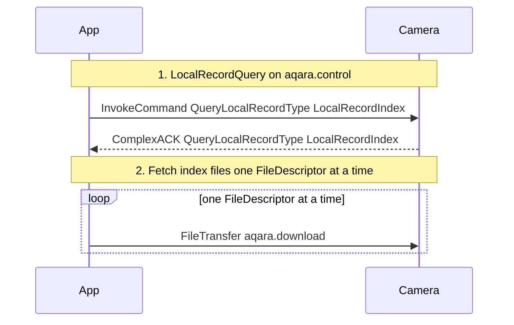
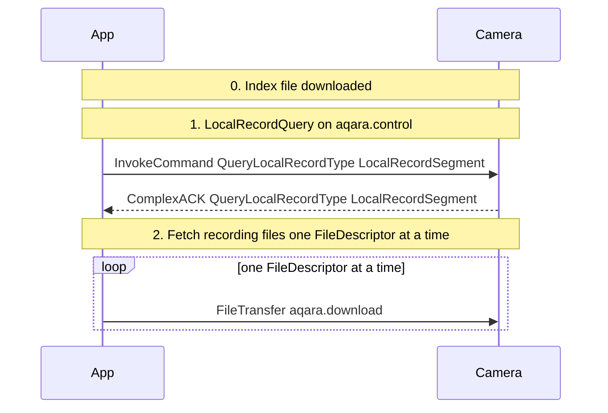
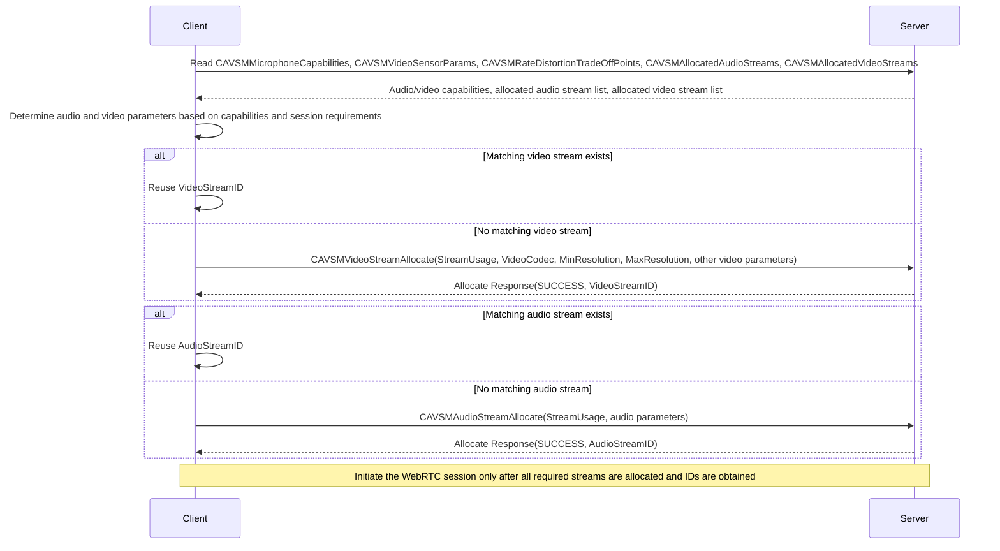
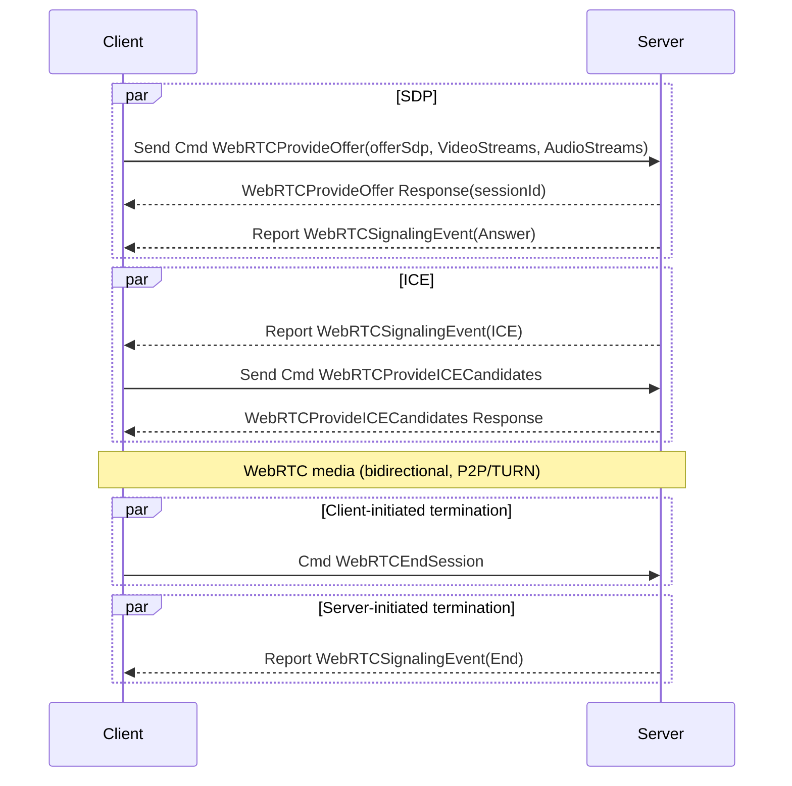
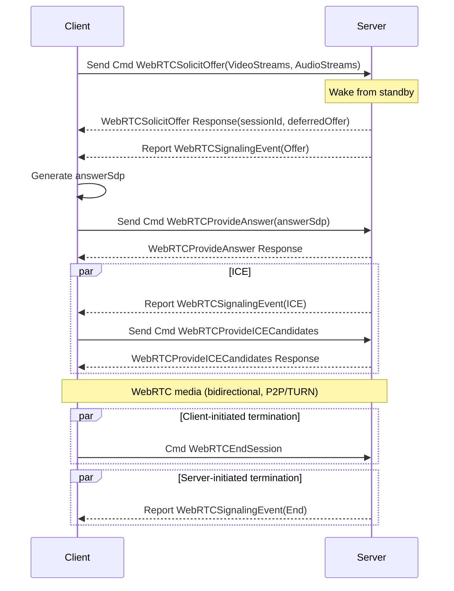
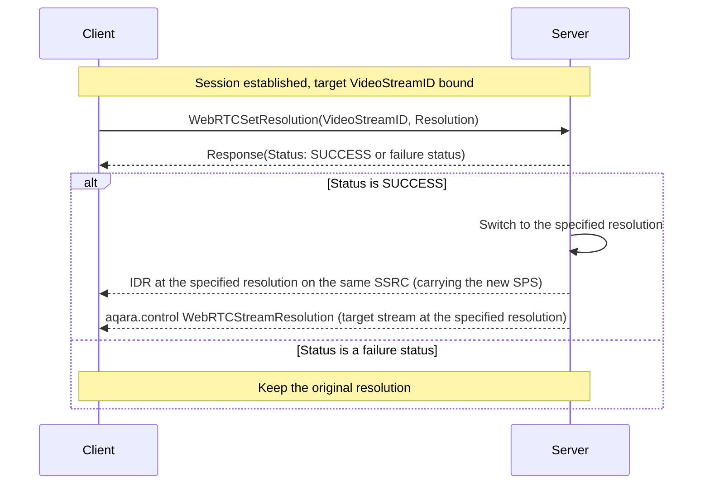
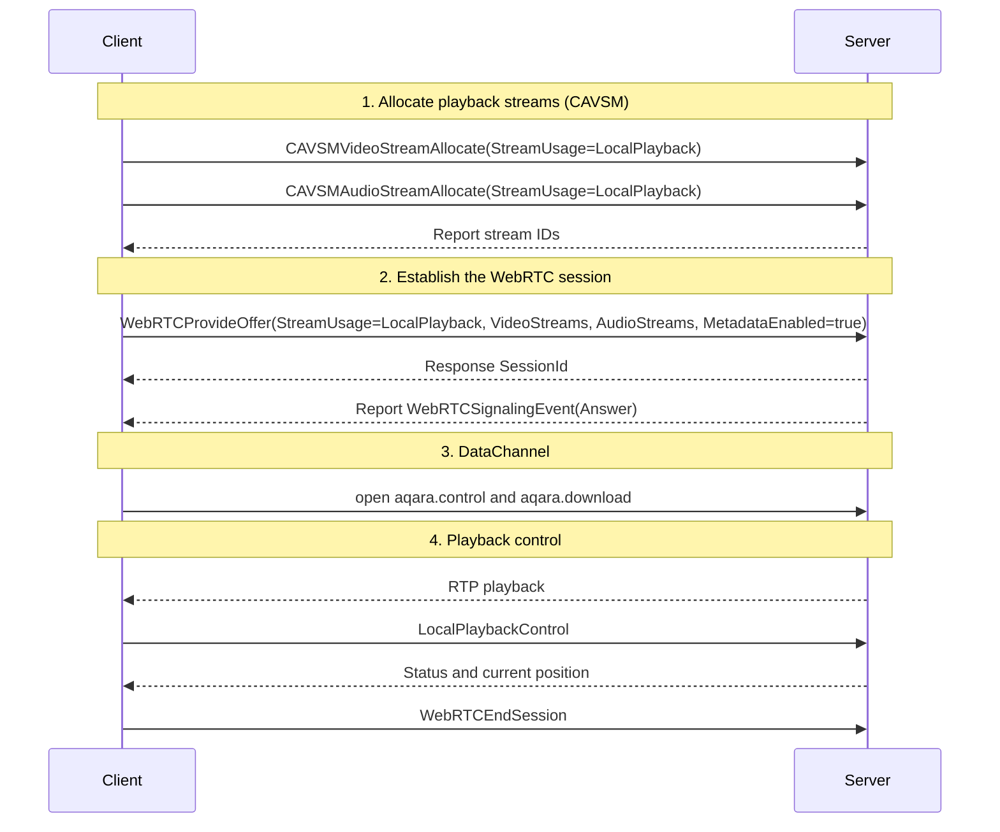
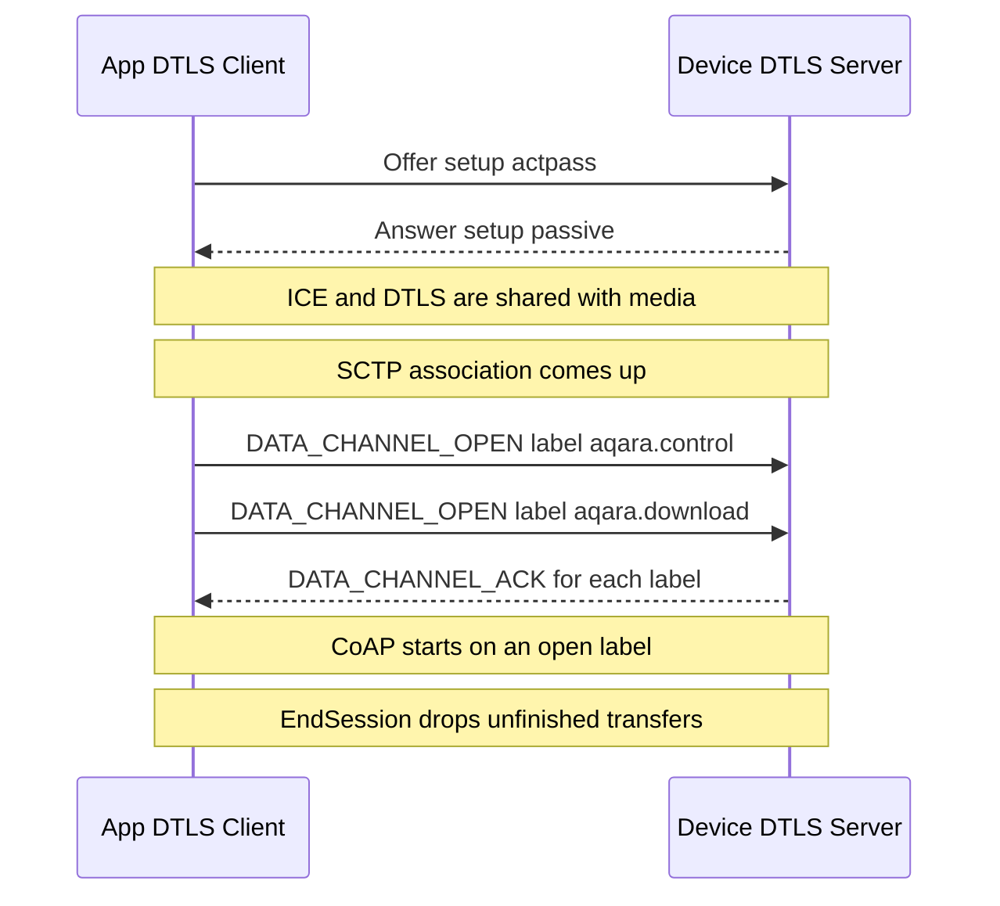

# Aqara Data Model Tags

This appendix defines the Function, Trait, and Command in the Aqara Spec data model tag system. These definitions serve as the business semantic layer, where Function and Trait map to Object/Property of the Aqara data model, and Command maps to the Service of the Aqara data model business interaction protocol.

Aqara Spec defines the data model tag system for Aqara smart devices, used to describe what the device "can do". In this tag system, Function and Trait map to Object/Property of the Aqara data model, and Command maps to the Service of the Aqara data model business interaction protocol: Aqara Spec describes business semantics, while the data model and interaction protocol describe data structures and access methods respectively.

## Data Model Architecture

The Aqara Spec data model adopts a layered architecture, from top to bottom: Device -> Endpoint -> Device Type -> Function -> Trait / Command.

There are two special types of Endpoint in a device: *Root Endpoint* (Endpoint 0) and *Public Endpoint* (usually Endpoint 1). The Root Endpoint carries device root information; the Public Endpoint carries device-level common Functions shared by the entire device, which are not implemented repeatedly on each business Endpoint.

The following uses a multi-Endpoint human presence sensor as an example to show the actual structure of the Root Endpoint, Public Endpoint, and multiple business Endpoints:

```
Device: "<Device ID>"
├── Endpoint 0 (Root Endpoint)
│    └── Device Type: Root (ID: 0x0000)
│         └── Basic Information (Function ID: 0x0080)
│              ├── DebugInfo (Trait ID: 0x4E29)
│              ├── BLEVersion (Trait ID: 0x4EE9)
│              ├── MCUVersion (Trait ID: 0x4EEB)
│              ├── FirmwareRevision (Trait ID: 0x8080)
│              ├── SerialNumber (Trait ID: 0x8081)
│              ├── VendorName (Trait ID: 0x8082)
│              ├── VendorID (Trait ID: 0x8083)
│              ├── ProductName (Trait ID: 0x8084)
│              ├── Reachable (Trait ID: 0x8085)
│              ├── FirmwareRevisionString (Trait ID: 0x8117)
│              └── ProductID (Trait ID: 0x8118)
├── Endpoint 1 (Public Endpoint)
│    └── Device Type: Public (ID: 0x0001)
│         ├── Identify (Function ID: 0x0083)
│         │    ├── IdentifyTime (Trait ID: 0x8094)
│         │    ├── IdentifyType (Trait ID: 0x8095)
│         │    └── Identify (Command ID: 0x8096)
│         ├── Matter Commissioning (Function ID: 0x00AD)
│         │    ├── MatterFabricsOperationState (Trait ID: 0x4FA0)
│         │    ├── ConnectedMatterFabrics (Trait ID: 0x8123)
│         │    ├── MatterCommissioningWindowStatus (Trait ID: 0x8124)
│         │    ├── MatterNodeID (Trait ID: 0x8142)
│         │    ├── OpenMatterCommissioningWindow (Command ID: 0x88B9)
│         │    └── RemoveMatterFabric (Command ID: 0x88BC)
│         ├── General Diagnostics (Function ID: 0x00B0)
│         │    ├── UpTime (Trait ID: 0x4E23)
│         │    ├── NetworkInterfaces (Trait ID: 0x4E2A)
│         │    ├── ActiveHardwareFaults (Trait ID: 0x813D)
│         │    ├── RebootCount (Trait ID: 0x8148)
│         │    └── RebootReason (Trait ID: 0x8149)
│         ├── Matter Node Information (Function ID: 0x00B3)
│         │    └── MatterNodeFirstEndpointID (Trait ID: 0x8143)
│         └── Thread Network Diagnostics (Function ID: 0x00B5)
│              ├── OverrunCount (Trait ID: 0x4E2C)
│              ├── PartitionID (Trait ID: 0x4E2D)
│              ├── TxTotalCount (Trait ID: 0x4E2E)
│              ├── TxUnicastCount (Trait ID: 0x4E2F)
│              ├── TxBroadcastCount (Trait ID: 0x4E30)
│              ├── RxTotalCount (Trait ID: 0x4E31)
│              ├── RxUnicastCount (Trait ID: 0x4E32)
│              ├── RxBroadcastCount (Trait ID: 0x4E33)
│              ├── NetworkFaultChange (Trait ID: 0x4E34)
│              ├── Channel (Trait ID: 0x814A)
│              ├── PanID (Trait ID: 0x814B)
│              ├── ExtendedPanID (Trait ID: 0x814C)
│              ├── NetworkName (Trait ID: 0x814D)
│              ├── RouteTable (Trait ID: 0x814E)
│              ├── RoutingRole (Trait ID: 0x814F)
│              ├── NeighborTable (Trait ID: 0x8150)
│              └── MeshLocalPrefix (Trait ID: 0x8151)
├── Endpoint 2 (Business Endpoint)
│    └── Device Type: Occupancy Sensor (ID: 0x0027)
│         ├── Occupancy Sensing (Function ID: 0x00A0)
│         │    ├── HoldTime (Trait ID: 0x4E72)
│         │    ├── Occupancy (Trait ID: 0x80E8)
│         │    └── OccupancySensorType (Trait ID: 0x80E9)
│         ├── General Configuration (Function ID: 0x00AF)
│         │    └── CurrentSensitivityLevel (Trait ID: 0x813B)
│         ├── Ambient Sensing Configuration (Function ID: 0x00E3)
│         │    ├── InstallMode (Trait ID: 0x4F13)
│         │    ├── SideInstall (Trait ID: 0x4F14)
│         │    ├── InstallHeightSetting (Trait ID: 0x4F15)
│         │    ├── InstallStatus (Trait ID: 0x4F16)
│         │    ├── InstallAngle (Trait ID: 0x4F17)
│         │    ├── MaxDetectionZones (Trait ID: 0x4F18)
│         │    ├── Zones (Trait ID: 0x4F19)
│         │    ├── EntryExitRegionBitmask (Trait ID: 0x4F1B)
│         │    ├── InterferenceRegionBitmask (Trait ID: 0x4F1C)
│         │    ├── EdgeRegionBitmask (Trait ID: 0x4F1D)
│         │    ├── EnableHumanCountDetection (Trait ID: 0x4F1F)
│         │    ├── EnableAIHighPrecisionRecognition (Trait ID: 0x4F23)
│         │    ├── EnableAIInterferenceSourceRecognition (Trait ID: 0x4F27)
│         │    ├── EnableAIAdaptiveSensitivity (Trait ID: 0x4F28)
│         │    ├── CoordinateReverseSetting (Trait ID: 0x4F29)
│         │    ├── DetectionDirectionSetting (Trait ID: 0x4F2A)
│         │    ├── AutoInterferenceSourceRecognition (Trait ID: 0x4F30)
│         │    ├── AutoEdgeRecognition (Trait ID: 0x4F31)
│         │    ├── AIEntryExitRegionRecognition (Trait ID: 0x4F32)
│         │    ├── ProximityDistanceLevel (Trait ID: 0x4F5A)
│         │    ├── InterferenceSourceRecognitionReportingTimeout (Trait ID: 0x4FA8)
│         │    ├── AISpaceBackgroundLearningReportingTimeout (Trait ID: 0x4FA9)
│         │    ├── AISpaceBackgroundLearningComplete (Trait ID: 0x4FAA)
│         │    ├── SubscribeAutoInterferenceSourceRecognitionData (Command ID: 0x9C78)
│         │    ├── SubscribeAutoEdgeRecognitionData (Command ID: 0x9C79)
│         │    ├── SubscribeAIEntryExitRegionRecognitionData (Command ID: 0x9C7A)
│         │    ├── EnableAISpaceBackgroundLearning (Command ID: 0x9C7B)
│         │    ├── CreateZone (Command ID: 0x9C7C)
│         │    ├── UpdateZone (Command ID: 0x9C7D)
│         │    ├── RemoveZone (Command ID: 0x9C7E)
│         │    └── SetZones (Command ID: 0x9D36)
│         ├── Radar Sensing Union (Function ID: 0x00E4)
│         │    ├── ChildEndpointList (Trait ID: 0x4F33)
│         │    ├── CurrentHumanCount (Trait ID: 0x4F35)
│         │    └── MotionState (Trait ID: 0x80EA)
│         └── Occupant Location (Function ID: 0x00E5)
│              ├── MaxDetectionTargets (Trait ID: 0x4F3E)
│              ├── LocationInfo (Trait ID: 0x4F46)
│              ├── SubscribeLocationData (Command ID: 0x9C7F)
│              └── SubscribeRemoveDetectionTarget (Command ID: 0x9C80)
├── Endpoint 3 (Business Endpoint)
│    └── Device Type: Illuminance Sensor (ID: 0x001A)
│         └── Illuminance (Function ID: 0x009A)
│              └── CurrentIlluminance (Trait ID: 0x80DD)
├── Endpoint 4 (Business Endpoint, Sub-area)
│    └── Device Type: Occupancy Sensor (ID: 0x0027)
│         ├── Occupancy Sensing (Function ID: 0x00A0)
│         │    ├── HoldTime (Trait ID: 0x4E72)
│         │    ├── Occupancy (Trait ID: 0x80E8)
│         │    └── OccupancySensorType (Trait ID: 0x80E9)
│         ├── Radar Sensing Union (Function ID: 0x00E4)
│         │    ├── ZoneID (Trait ID: 0x4F34)
│         │    └── MotionState (Trait ID: 0x80EA)
│         └── Occupant Location (Function ID: 0x00E5)
│              └── LocationInfo (Trait ID: 0x4F46)
└── Endpoint 5 (Business Endpoint, Sub-area)
     └── Device Type: Occupancy Sensor (ID: 0x0027)
          ├── Occupancy Sensing (Function ID: 0x00A0)
          │    ├── HoldTime (Trait ID: 0x4E72)
          │    ├── Occupancy (Trait ID: 0x80E8)
          │    └── OccupancySensorType (Trait ID: 0x80E9)
          ├── Radar Sensing Union (Function ID: 0x00E4)
          │    ├── ZoneID (Trait ID: 0x4F34)
          │    └── MotionState (Trait ID: 0x80EA)
          └── Occupant Location (Function ID: 0x00E5)
               └── LocationInfo (Trait ID: 0x4F46)
```

## Core Concepts

### Device

A Device is a physical smart device, such as a gateway, light bulb, door lock, sensor, etc. A Device consists of one or more Endpoints.

### Endpoint

An Endpoint is a logical functional node in a device. Each Endpoint has an Endpoint ID (Uint16, ranging from 0 to 65535) and is associated with one or more Device Types.

Aqara Spec defines three types of Endpoint:

* *Root Endpoint* (Endpoint 0): device root node, associated with the Root Device Type, and must implement Basic Information and Descriptor functions.
* *Public Endpoint* (usually Endpoint 1): device public endpoint, associated with the Public Device Type, carrying device-level common Functions such as Identify, diagnostics, OTA, and various ecosystem collaboration, shared by the entire device.
* *Business Endpoint* (Endpoint 2 and above): carries specific business functions and is associated with the corresponding business Device Type (such as Occupancy Sensor, Illuminance Sensor). The same Device Type can appear on multiple Endpoints (e.g., Endpoints 4 and 5 in the above example are sub-areas of Endpoint 2). Front-end visible business Endpoints must implement the Label and Endpoint Icon functions, otherwise they cannot be displayed on the front end.

### Device Type

A Device Type describes the device type of an Endpoint. Each Device Type is identified by a unique Device Type ID (Uint16). Each Device Type defines the set of Functions that devices of this type must (M) or may (O) implement. Duplicate Functions are not allowed under one Endpoint.

The new allocation range for business Aqara standard Device Type IDs is `1` ~ `10000`. The Root Device Type ID `0` is a special reserved value and is not part of the new allocation range for business Device Types.

In addition to business Device Types, Aqara Spec defines two Device Types corresponding to special Endpoints:

* *Root* (ID: 0x0000): used only for the Root Endpoint, must implement Basic Information and Descriptor.
* *Public* (ID: 0x0001): used only for the Public Endpoint, must implement Identify, and may optionally implement common Functions such as diagnostics, network provisioning, OTA, and various ecosystem collaboration.

For example, in the above example, business Endpoint 2 is associated with the Occupancy Sensor (ID: 0x0027) Device Type, implementing Functions such as Occupancy Sensing and Radar Sensing Union; device-level common capabilities (such as Identify and Matter Commissioning) are uniformly provided by the Public Endpoint (Endpoint 1) and are not implemented repeatedly on each business Endpoint.

For the complete Device Type ID encoding and Function requirements, see [Device Type definitions](#ref_spec_DeviceType).

### Function

A Function describes a complete functional unit of a device, consisting of several Traits and Commands. Each Function is identified by a unique Function ID (Uint16).

The new allocation range for Aqara standard Function IDs is `0` ~ `19999`; the private Function ID range reserved for user customization is `64001` ~ `65534`.

### Trait

A Trait describes an attribute or state in a Function, supporting operations such as Read, Write, and Report. Each Trait is identified by a unique Trait ID (Uint16).

The new allocation range for Aqara standard Trait IDs is `1` ~ `30000`; the private Trait ID range reserved for user customization is `60000` ~ `64000`.

### Command

A Command describes an executable operation in a Function, sent from the client to the device. Each Command is identified by a unique Command ID (Uint16).

The new allocation range for Aqara standard Command IDs is `40001` ~ `50000`; the private Command ID range reserved for user customization is `64001` ~ `65534`.

### Parameter

A Parameter is a data field inside a Trait, identified by a Parameter ID (Uint16).

## ID Numbering System

**ID Allocation Range Overview**

<table>
  <thead>
    <tr>
      <th>Category</th>
      <th>Standard Range</th>
      <th>Private Range</th>
      <th>Format</th>
    </tr>
  </thead>
  <tbody>
    <tr>
      <td>Device Type ID</td>
      <td><code>1</code> ~ <code>10000</code> (business types; <code>0</code> is the Root special reserved value)</td>
      <td><code>64001</code> ~ <code>65534</code></td>
      <td>Uint16</td>
    </tr>
    <tr>
      <td>Function ID</td>
      <td><code>0</code> ~ <code>19999</code></td>
      <td><code>64001</code> ~ <code>65534</code></td>
      <td>Uint16</td>
    </tr>
    <tr>
      <td>Trait ID</td>
      <td><code>1</code> ~ <code>30000</code></td>
      <td><code>60000</code> ~ <code>64000</code></td>
      <td>Uint16</td>
    </tr>
    <tr>
      <td>Command ID</td>
      <td><code>40001</code> ~ <code>50000</code></td>
      <td><code>64001</code> ~ <code>65534</code></td>
      <td>Uint16</td>
    </tr>
    <tr>
      <td>Parameter ID</td>
      <td><code>0x0000</code> ~ <code>0xFFFF</code></td>
      <td>-</td>
      <td>Uint16</td>
    </tr>
  </tbody>
</table>

The standard and private ranges above constrain new ID allocation so that user-defined IDs do not collide with Aqara standard ID ranges. Values outside these ranges are not part of the corresponding category's standard or private new-allocation ranges. Updating the rules does not change IDs that are already defined or already in use: existing IDs SHOULD be kept as-is, and MUST NOT be renumbered or revalidated solely to fit the new ranges even if they fall outside the current new-allocation ranges. Except for the Root special reserved Device Type ID value `0`, newly allocated Device Type IDs SHOULD use the business standard range or the private range above.

## Trait Parameter Field Description

Parameter ID uses a 16-bit integer identifier, with a valid range of `0x0001` ~ `0xFFFE` (1 ~ 65534). `0x0000` and `0xFFFF` are reserved and unavailable.

**Standard Trait Parameter ID**

<table>
  <thead>
    <tr>
      <th>Parameter ID</th>
      <th>Name</th>
      <th>BACnet Property</th>
      <th>Default Access</th>
      <th>Description</th>
    </tr>
  </thead>
  <tbody>
    <tr>
      <td>0x0001</td>
      <td>Present Value</td>
      <td>PROP_PRESENT_VALUE</td>
      <td>-</td>
      <td>Current value, indicating the real-time state of the Trait; the data type is defined by the Trait, and may be an integer, float, boolean, enumeration, string, or composite data type. For numeric values, `Minimum Value <= Present Value <= Maximum Value` MUST hold, and step and other constraints MUST be satisfied.</td>
    </tr>
    <tr>
      <td>0x0002</td>
      <td>Maximum Value</td>
      <td>PROP_MAX_PRES_VALUE</td>
      <td>RV</td>
      <td>Maximum allowed/representable value of `Present Value`; the data type is consistent with the numeric `Present Value`, supporting integers and float, and MUST NOT be less than `Minimum Value`. Together with `Minimum Value` it describes the numeric range, not an alarm threshold.</td>
    </tr>
    <tr>
      <td>0x0003</td>
      <td>Minimum Value</td>
      <td>PROP_MIN_PRES_VALUE</td>
      <td>RV</td>
      <td>Minimum allowed/representable value of `Present Value`; the data type is consistent with the numeric `Present Value`, supporting integers and float, and MUST NOT be greater than `Maximum Value`. Together with `Maximum Value` it describes the numeric range, not an alarm threshold.</td>
    </tr>
    <tr>
      <td>0x0004</td>
      <td>Unit</td>
      <td>PROP_UNITS</td>
      <td>RV</td>
      <td>Engineering unit; the data type and the valid unit codes are specified by the unit definition of the corresponding Trait. Numeric values and related thresholds SHOULD use compatible units.</td>
    </tr>
    <tr>
      <td>0x0005</td>
      <td>Step Value</td>
      <td>PROP_STEP_VALUE</td>
      <td>RV</td>
      <td>Numeric step value; the data type is consistent with `Present Value`, supporting integers and float, and MUST be greater than `0`. It describes the step granularity of valid numeric values.</td>
    </tr>
    <tr>
      <td>0x0006</td>
      <td>Supported Value</td>
      <td>PROP_SUPPORTED_VALUES</td>
      <td>RV</td>
      <td>Supported value list (Array/List); the element data type MUST be consistent with `Present Value`, and each element SHOULD satisfy the valid-value constraints of the Trait.</td>
    </tr>
    <tr>
      <td>0x0007</td>
      <td>Default Value</td>
      <td>PROP_RELINQUISH_DEFAULT</td>
      <td>RV</td>
      <td>Default value (relinquish default); readable and reportable by default, not writable (Access is RV). The data type is consistent with `Present Value`, supporting integers, float, and other data types defined by the Trait; it MUST satisfy the range, step, supported-value list, and other applicable constraints of `Present Value`. The specific timing of adoption is defined by the Trait.</td>
    </tr>
    <tr>
      <td>0x0008</td>
      <td>High Limit</td>
      <td>PROP_HIGH_LIMIT</td>
      <td>RVW</td>
      <td>High-side monitoring threshold; the data type is consistent with the numeric `Present Value`, supporting integers and float. `Minimum Value <= High Limit <= Maximum Value` and `High Limit > Low Limit` are required. It does not define the `Present Value` span.</td>
    </tr>
    <tr>
      <td>0x0009</td>
      <td>Low Limit</td>
      <td>PROP_LOW_LIMIT</td>
      <td>RVW</td>
      <td>Low-side monitoring threshold; the data type is consistent with the numeric `Present Value`, supporting integers and float. `Minimum Value <= Low Limit <= Maximum Value` and `Low Limit < High Limit` are required. It does not define the `Present Value` span.</td>
    </tr>
    <tr>
      <td>0x000A</td>
      <td>COV Increment</td>
      <td>PROP_COV_INCREMENT</td>
      <td>RVW</td>
      <td>Change-reporting threshold, applicable to Traits whose `Present Value` is float; the data type is float, MUST be greater than `0`, and the unit is consistent with `Present Value`. When the absolute difference between the current value and the baseline value of the last COV notification reaches or exceeds this threshold, a notification is triggered, suppressing frequent reports caused by minor fluctuations.</td>
    </tr>
    <tr>
      <td>0x000B</td>
      <td>Maximum Actual Value</td>
      <td>PROP_MAX_ACTUAL_VALUE</td>
      <td>RVW</td>
      <td>Upper endpoint calibration value of the actual quantity corresponding to `Present Value`; readable, writable, and reportable (Access is RVW); the data type is float, and integer data types are not supported. `Minimum Value <= Maximum Actual Value <= Maximum Value` and `Maximum Actual Value > Minimum Actual Value` are required; the mapping is defined by the Trait.</td>
    </tr>
    <tr>
      <td>0x000C</td>
      <td>Minimum Actual Value</td>
      <td>PROP_MIN_ACTUAL_VALUE</td>
      <td>RVW</td>
      <td>Lower endpoint calibration value of the actual quantity corresponding to `Present Value`; readable, writable, and reportable (Access is RVW); the data type is float, and integer data types are not supported. `Minimum Value <= Minimum Actual Value <= Maximum Value` and `Minimum Actual Value < Maximum Actual Value` are required; the mapping is defined by the Trait.</td>
    </tr>
    <tr>
      <td>0x000D</td>
      <td>Is Null</td>
      <td>PROP_IS_NULL</td>
      <td>RV</td>
      <td>Boolean with values `true`/`false`; `true` indicates that `Present Value` currently has no valid data or is uninitialized, and its current payload SHOULD NOT be used as a valid business value.</td>
    </tr>
    <tr>
      <td>0x000E</td>
      <td>Extended Supported Values</td>
      <td>PROP_EXTENDED_SUPPORTED_VALUES</td>
      <td>RV</td>
      <td>Extended supported value list (List[Struct]); the structure fields, element constraints, and list length are defined by the corresponding Trait.</td>
    </tr>
    <tr>
      <td>0x000F</td>
      <td>Max Item Num</td>
      <td>-</td>
      <td>RV</td>
      <td>Maximum number of elements allowed when `Present Value` is Array/List; the data type is uint32, ranging from `0` to `4294967295`. The number of list elements MUST NOT exceed this value.</td>
    </tr>
    <tr>
      <td>0x0010</td>
      <td>Counter Generation</td>
      <td>-</td>
      <td>RV</td>
      <td>Optional read-only, reportable Parameter of the Trait; the data type is uint32, ranging from `0` to `4294967295`, used to identify the generation of a cumulative counter. MUST be provided when the implementation cannot guarantee continuous logical cumulative values and requires accurate difference calculation.</td>
    </tr>
  </tbody>
</table>

The default read/write access in this table uses full `Access` flags: `RV` means readable and reportable, and `RVW` means readable, writable, and reportable. All readable Parameters support reporting, so the default access does not use standalone `R` or `RW` flags. Parameters marked only `R` or `RW` in specific Trait parameter tables also follow this reporting-support rule; reportable means the capability to report exists, and does not mean a notification MUST be sent on every read or when the value is unchanged. The specific reporting timing follows the corresponding Trait and interaction protocol definitions.

`Present Value` has no default read/write access; it follows the `Access` definition in the specific Trait parameter table. When it is readable, it is also reportable. Data types, read/write access, and constraints explicitly defined by a specific Trait take precedence over the generic default conventions; this table neither automatically extends the write access of existing Traits nor requires all Traits to implement every Parameter.

Frontends determine the read, write, and reporting capabilities of Parameters based on the access descriptions in this table by default. If the actual access of a device Parameter differs from the default access in this table, the device SHALL report the difference, or clearly record it in a pre-configurable data table accessible to the frontend. The difference information SHALL be able to locate the applicable device and its Function, Trait, and Parameter, and SHALL clearly state the actual `Access` of that Parameter so that the frontend can identify and apply it.

Frontends SHALL prefer explicit difference information applicable to the target device and the target Parameter; when no applicable difference information is provided, the default access in this table applies. `Present Value` access is still determined by the actual definition of the specific Trait and is not derived from the default access in this table. The above access information is used for frontend capability display and interaction control, and does not replace the device-side validation of actual access permissions.

The range constraints in this table use `Minimum Value <= parameter value <= Maximum Value`, including both boundary values. When boundary parameters are not explicitly provided, the valid range and data type boundaries declared by the corresponding Trait apply. The magnitude relationship between a pair of upper and lower limit parameters is validated only when both are implemented together. For writable Parameters, the written value and parameter combinations MUST still satisfy the applicable constraints, and MUST NOT invalidate the upper/lower limit relationship by writing.

### Numeric Boundary Parameters

#### Minimum Value and Maximum Value

`Minimum Value` (`PROP_MIN_PRES_VALUE`) and `Maximum Value` (`PROP_MAX_PRES_VALUE`) describe the lower and upper bounds of the numeric range of `Present Value`. Reading these two parameters reveals the valid numeric range declared by the Trait. When writing `Present Value`, clients SHOULD constrain the target value to this range while also obeying the Trait's own data type, step value, enumeration values, and other constraints. Devices SHOULD also handle out-of-range inputs according to their Trait definitions, and MUST NOT treat these two boundaries as alarm thresholds.

For example, if a temperature Trait has `Minimum Value` of `-50`, `Maximum Value` of `100`, and `Unit` of degrees Celsius, it declares a numeric range of `-50°C` to `100°C`. Clients may use this range to validate user input or to display the adjustable range. If the value is a read-only sensor reading, these boundaries describe the Trait's range and do not imply that clients can write the value.

These two parameters describe the protocol-level numeric range of `Present Value`; they are not necessarily identical to the sensor's physical measurement capability, the device's alarm range, or the controller's safety range. Whether they exist, whether they are readable, and their concrete constraints are defined by the corresponding Trait parameter table; do not assume every Trait defines both parameters.

### Step Value and Default Value

`Step Value` uses the same data type as the numeric `Present Value`, supporting both integer steps (for example, `1`) and float steps (for example, `0.1`). The step value MUST be greater than `0`; when the Trait uses `Minimum Value` as the step start, valid values are determined by `Minimum Value + n × Step Value`, where `n` is a non-negative integer, and the result MUST NOT exceed `Maximum Value`. Floating-point comparisons SHOULD consider the representation precision of the data type and MUST NOT rely on a floating-point remainder being exactly zero to judge step validity.

`Default Value` uses the same data type as `Present Value` and obeys the same valid-value constraints. Its data type is not limited to integers, and it does not mean the value can be silently returned when the current value cannot be read. Whether the default value is adopted when restoring default settings, releasing control, or in other circumstances SHOULD be defined by the corresponding Trait.

### COV Increment Parameters

`COV Increment` references the change-notification semantics of BACnet `COV_Increment` and is used for change-reporting filtering of float-type `Present Value`. Let `Vref` be the baseline value at the last notification and `V` the current valid value; when `abs(V - Vref) >= COV Increment`, the COV notification condition for the current value change is satisfied. After a notification is triggered, the baseline is updated to the value of this notification. The comparison baseline is not the previous sample value, so accumulated offsets from multiple small changes may still trigger a notification.

For example, with `COV Increment = 0.5` and a baseline of `20.0`, a current value of `20.2` does not trigger a change notification, while continuing to change to `20.5` or `19.5` satisfies the notification condition. This Parameter is not a sampling period, a periodic reporting interval, or an alarm deadband, and it does not change the read precision or numeric range of `Present Value`.

This specification requires `COV Increment` to be a finite floating-point number greater than `0`. The initial notification on first subscription, subscription validity, other state changes, and periodic notifications are still handled according to the corresponding interaction protocol and Trait definitions and MUST NOT be blocked by this change threshold. Defining this Parameter alone does not mean a subscription is established or a notification will necessarily be sent; this section only borrows the increment semantics of BACnet and does not directly introduce its full subscription mechanism.

### Monitoring Threshold Parameters

#### Low Limit and High Limit

`Low Limit` (`PROP_LOW_LIMIT`) and `High Limit` (`PROP_HIGH_LIMIT`) represent the low-side and high-side monitoring thresholds, for scenarios where the object defines corresponding monitoring or alarm semantics. They answer "at what operating value should a low-side or high-side anomaly be considered", not "what numeric values this Trait can represent". Thresholds are often configurable for site operating requirements, but whether they can actually be configured depends on the parameter's access permissions and the corresponding Trait definition.

For example, chilled-water temperature monitoring may set `Low Limit` to `5°C` and `High Limit` to `35°C`: when the current value is below the low limit it may be judged as a low-side limit violation, and when above the high limit as a high-side limit violation. Exact comparison rules (for example, whether equality to the threshold counts as a violation) SHOULD be defined by the corresponding object or alarm mechanism.

Merely defining or reading `Low Limit` and `High Limit` does not automatically mean that the device will generate alarms or events, or proactively report them. To implement complete alarm behavior, the object must also support the relevant mechanisms and handle factors such as enabling conditions, duration/delay, deadband, event state, and notification methods according to their definitions. Clients MUST NOT infer that alarms are enabled or that alarm notifications will necessarily be sent solely from the presence of threshold parameters. Thresholds MUST use the same data type as the monitored `Present Value` and compatible units, and their values MUST satisfy `Minimum Value <= Low Limit < High Limit <= Maximum Value`. Thresholds may lie outside the normal operating range for the application, but MUST NOT exceed the declared numeric range or be used as substitutes for `Minimum Value` or `Maximum Value`.

### Actual Quantity Calibration Parameters

#### Minimum Actual Value and Maximum Actual Value

`Minimum Actual Value` (`PROP_MIN_ACTUAL_VALUE`) and `Maximum Actual Value` (`PROP_MAX_ACTUAL_VALUE`) describe the actual-quantity endpoints corresponding to the two ends of the `Present Value` range, and may be used to interpret or convert between device numeric values and actual physical quantities. Together with `Unit`, they help clients understand the meaning of the actual quantity; for example, the actual quantity's unit may be lumens, volts, or another engineering unit. Which actual quantity is represented, which `Present Value` the endpoints correspond to, whether the mapping is linear, and whether it is used for output mapping MUST be stated by the corresponding Trait or object definition and MUST NOT be inferred from parameter names alone.

For example, a dimming object's `Present Value` may represent a dimming control interval of `0%` to `100%`, while the brightness the device can actually reach is `20%` to `80%` of rated brightness; the object defines a linear mapping between these interval endpoints. In that case `Minimum Actual Value` is `20%` brightness and `Maximum Actual Value` is `80%` brightness: control value `0%` maps to actual brightness `20%`, control value `100%` maps to actual brightness `80%`, and control value `50%` maps to `20% + (80% - 20%) × 50% = 50%` brightness. Here the two Actual Value percentages are actual output relative to rated brightness, while the control-value percentage is the position of Present Value in the control interval; they have different meanings. For a general linear endpoint mapping, use proportional interpolation between the Present Value endpoints defined by the object; if the object specifies a nonlinear mapping, or Present Value is not a percentage, follow that object's mapping rules and do not apply this example directly.

This parameter pair explains the correspondence between numeric endpoints and actual quantities. It is not the protocol-allowed range of `Present Value` (described by `Minimum Value` / `Maximum Value`), nor the operating alarm thresholds (described by `Low Limit` / `High Limit`). For example, a dimmable luminaire's `Present Value` control range may be `0%` to `100%`, while the corresponding actual brightness range is `20%` to `80%` of rated brightness.

Both Actual Value parameters use the float data type; integer data types are not supported, and their data type is not required to match that of `Present Value`. Their values MUST satisfy `Minimum Value <= Minimum Actual Value < Maximum Actual Value <= Maximum Value`. The corresponding Trait MUST still explicitly define the unit and mapping of the actual quantity and ensure that the endpoint values can be represented within the declared range.

### Distinguishing the Three Parameter Groups

* *Minimum Value / Maximum Value*: validate or understand the protocol-level numeric bounds of `Present Value`—"how far is this value allowed/representable?"
* *Low Limit / High Limit*: judge whether an operating value has reached a monitoring threshold—"at what operating level is a low-side/high-side limit violation?"
* *Minimum Actual Value / Maximum Actual Value*: where the object definition supports it, explain the correspondence between `Present Value` and actual physical-quantity endpoints—"how much actual quantity does this numeric endpoint correspond to?"

The three groups are not interchangeable, and a Trait is not guaranteed to define all of them. Implementations and clients SHOULD first consult the specific Trait's parameter table, data types, units, access permissions, and constraints, then interpret and use them according to that Trait definition; linear interpolation for actual-quantity conversion is appropriate only when the object explicitly defines a linear mapping.

## Permission Flags

**Permission Types**

<table>
  <thead>
    <tr>
      <th>Flag</th>
      <th>Description</th>
    </tr>
  </thead>
  <tbody>
    <tr>
      <td>Read</td>
      <td>Client can read this parameter</td>
    </tr>
    <tr>
      <td>Write</td>
      <td>Client can write this parameter</td>
    </tr>
    <tr>
      <td>Report</td>
      <td>Actively report this parameter when the device changes</td>
    </tr>
    <tr>
      <td>Configured</td>
      <td>Device reports during configuration phase</td>
    </tr>
  </tbody>
</table>

## Mandatory Flags

* *M* (Mandatory): device must implement
* *O* (Optional): device may implement optionally

## Function List Overview

The following summarizes all Function definitions covered in this appendix. See the corresponding sections for the Trait, Command, and data types of each Function.

## Function Index {#ref_Aqara_Spec_FunctionIndex}

This section summarizes all Function definitions in Aqara Spec. See the corresponding sections for the Trait, Command, and data types of each Function.

<table>
  <thead>
    <tr>
      <th>Function ID</th>
      <th>Code</th>
      <th>Description</th>
    </tr>
  </thead>
  <tbody>
    <tr>
      <td><a href="#ref_Aqara_Spec_Binding">0x0001</a></td>
      <td>Binding</td>
      <td>Indicates the persistent binding relationship between an endpoint and one or more other local or remote Endpoints.</td>
    </tr>
    <tr>
      <td><a href="#ref_Aqara_Spec_CO">0x0009</a></td>
      <td>CO</td>
      <td>Provides carbon monoxide concentration monitoring and alarm capabilities, used to detect carbon monoxide leaks in the environment and alert in time.</td>
    </tr>
    <tr>
      <td><a href="#ref_Aqara_Spec_WaterFreezeDetector">0x000A</a></td>
      <td>WaterFreezeDetector</td>
      <td>Used to detect the risk of freezing in pipes or the environment, and report water freezing related events when the threshold is reached.</td>
    </tr>
    <tr>
      <td><a href="#ref_Aqara_Spec_RainSensor">0x000B</a></td>
      <td>RainSensor</td>
      <td>Used to detect rainfall status, reporting whether it is raining and related rainfall information.</td>
    </tr>
    <tr>
      <td><a href="#ref_Aqara_Spec_OnOffSensor">0x000C</a></td>
      <td>OnOffSensor</td>
      <td>Used to detect binary switch input status, reporting discrete states such as on/off or triggered/not triggered.</td>
    </tr>
    <tr>
      <td><a href="#ref_Aqara_Spec_BasicInformation">0x0080</a></td>
      <td>BasicInformation</td>
      <td>Provides basic device information, including vendor, product model, firmware version, serial number, online status and other basic attributes.</td>
    </tr>
    <tr>
      <td><a href="#ref_Aqara_Spec_Descriptor">0x0081</a></td>
      <td>Descriptor</td>
      <td>Describes the device endpoint composition and capability structure, including endpoint list, device types, Server/Client clusters, etc.</td>
    </tr>
    <tr>
      <td><a href="#ref_Aqara_Spec_EndpointLabel">0x0082</a></td>
      <td>EndpointLabel</td>
      <td>Manages endpoint visibility and display information, such as name, room, icon, tags, etc., for front-end display and organization.</td>
    </tr>
    <tr>
      <td><a href="#ref_Aqara_Spec_Identify">0x0083</a></td>
      <td>Identify</td>
      <td>Provides device identification capability, helping users locate physical devices through LED blinking, sound and other methods.</td>
    </tr>
    <tr>
      <td><a href="#ref_Aqara_Spec_Output">0x0084</a></td>
      <td>Output</td>
      <td>Provides switch output control capability, supporting reading and controlling the on/off state of the load.</td>
    </tr>
    <tr>
      <td><a href="#ref_Aqara_Spec_LevelControl">0x0085</a></td>
      <td>LevelControl</td>
      <td>Provides brightness or level adjustment capability, supporting setting, reading current brightness/level, and gradual control.</td>
    </tr>
    <tr>
      <td><a href="#ref_Aqara_Spec_ColorControl">0x0086</a></td>
      <td>ColorControl</td>
      <td>Provides color control capability, including adjusting light color through color temperature, HSV, XY color space and other methods.</td>
    </tr>
    <tr>
      <td><a href="#ref_Aqara_Spec_Button">0x0087</a></td>
      <td>Button</td>
      <td>Describes event reporting of button-type input devices, including single click, long press, multi-click and other action recognition.</td>
    </tr>
    <tr>
      <td><a href="#ref_Aqara_Spec_Camera">0x0088</a></td>
      <td>Camera</td>
      <td>Manages camera basic capabilities, including device status, mode switching, image encryption and cloud-related capabilities.</td>
    </tr>
    <tr>
      <td><a href="#ref_Aqara_Spec_WindowCovering">0x0089</a></td>
      <td>WindowCovering</td>
      <td>Provides lift, tilt, position control and status feedback for shading devices such as curtains and blinds.</td>
    </tr>
    <tr>
      <td><a href="#ref_Aqara_Spec_Lifter">0x008A</a></td>
      <td>Lifter</td>
      <td>Provides stroke control for lifting devices, supporting setting target position, stopping and status query.</td>
    </tr>
    <tr>
      <td><a href="#ref_Aqara_Spec_IRControl">0x008B</a></td>
      <td>IRControl</td>
      <td>Provides infrared emission control capability, used to control traditional infrared appliances such as air conditioners and TVs.</td>
    </tr>
    <tr>
      <td><a href="#ref_Aqara_Spec_EnergyManagement">0x008C</a></td>
      <td>EnergyManagement</td>
      <td>Manages device battery level and energy information, including battery percentage, power consumption statistics and low battery alarm.</td>
    </tr>
    <tr>
      <td><a href="#ref_Aqara_Spec_HeaterCooler">0x008D</a></td>
      <td>HeaterCooler</td>
      <td>Provides cooling/heating control capability, including target temperature, operation mode, fan speed and other HVAC parameters.</td>
    </tr>
    <tr>
      <td><a href="#ref_Aqara_Spec_FanControl">0x008E</a></td>
      <td>FanControl</td>
      <td>Provides fan speed and mode control, supporting gear adjustment and operation status reading.</td>
    </tr>
    <tr>
      <td><a href="#ref_Aqara_Spec_Temperature">0x008F</a></td>
      <td>Temperature</td>
      <td>Measures and reports ambient temperature, providing attributes such as current temperature value and valid range.</td>
    </tr>
    <tr>
      <td><a href="#ref_Aqara_Spec_RelativeHumidity">0x0090</a></td>
      <td>RelativeHumidity</td>
      <td>Measures and reports ambient relative humidity, providing attributes such as current humidity value and valid range.</td>
    </tr>
    <tr>
      <td><a href="#ref_Aqara_Spec_MediaPlayback">0x0091</a></td>
      <td>MediaPlayback</td>
      <td>Provides media playback control capability, including play, pause, track switching, volume and playback state management.</td>
    </tr>
    <tr>
      <td><a href="#ref_Aqara_Spec_Speaker">0x0092</a></td>
      <td>Speaker</td>
      <td>Describes device speaker output capability, including text-to-speech broadcast, volume control, mute and other audio output functions.</td>
    </tr>
    <tr>
      <td><a href="#ref_Aqara_Spec_PowerSource">0x0093</a></td>
      <td>PowerSource</td>
      <td>Describes device power source and battery status, including battery level, charging status, battery type and other information.</td>
    </tr>
    <tr>
      <td><a href="#ref_Aqara_Spec_DoorLock">0x0094</a></td>
      <td>DoorLock</td>
      <td>Provides smart door lock core capabilities, including lock status, user/credential management, lock/unlock and alarm events.</td>
    </tr>
    <tr>
      <td><a href="#ref_Aqara_Spec_Sweeper">0x0095</a></td>
      <td>Sweeper</td>
      <td>Provides basic sweeping robot control, including starting cleaning, pausing, returning to dock and status feedback.</td>
    </tr>
    <tr>
      <td><a href="#ref_Aqara_Spec_AirQuality">0x0096</a></td>
      <td>AirQuality</td>
      <td>Monitors and reports air quality indicators, such as AQI or comprehensive air quality level.</td>
    </tr>
    <tr>
      <td><a href="#ref_Aqara_Spec_Pressure">0x0097</a></td>
      <td>Pressure</td>
      <td>Measures and reports atmospheric pressure or system pressure value.</td>
    </tr>
    <tr>
      <td><a href="#ref_Aqara_Spec_ParticulateMatter">0x0098</a></td>
      <td>ParticulateMatter</td>
      <td>Monitors and reports particulate matter concentration (such as PM2.5, PM10).</td>
    </tr>
    <tr>
      <td><a href="#ref_Aqara_Spec_CO2">0x0099</a></td>
      <td>CO2</td>
      <td>Measures and reports carbon dioxide concentration in the environment.</td>
    </tr>
    <tr>
      <td><a href="#ref_Aqara_Spec_Illuminance">0x009A</a></td>
      <td>Illuminance</td>
      <td>Measures and reports ambient illuminance (lux).</td>
    </tr>
    <tr>
      <td><a href="#ref_Aqara_Spec_Contact">0x009B</a></td>
      <td>Contact</td>
      <td>Detects binary states such as contact/door magnetic, reporting open or closed state and optional angle information.</td>
    </tr>
    <tr>
      <td><a href="#ref_Aqara_Spec_Smoke">0x009C</a></td>
      <td>Smoke</td>
      <td>Detects smoke and reports alarm events, supporting related configurations such as sensitivity, self-test and mute.</td>
    </tr>
    <tr>
      <td><a href="#ref_Aqara_Spec_Gas">0x009D</a></td>
      <td>Gas</td>
      <td>Detects combustible gas or harmful gas leaks and reports alarm events.</td>
    </tr>
    <tr>
      <td><a href="#ref_Aqara_Spec_Sleep">0x009E</a></td>
      <td>Sleep</td>
      <td>Monitors sleep-related states, reporting indicators such as sleep stage, duration or quality.</td>
    </tr>
    <tr>
      <td><a href="#ref_Aqara_Spec_WaterLeak">0x009F</a></td>
      <td>WaterLeak</td>
      <td>Detects water immersion events and reports alarm in time when water leakage is detected.</td>
    </tr>
    <tr>
      <td><a href="#ref_Aqara_Spec_OccupancySensing">0x00A0</a></td>
      <td>OccupancySensing</td>
      <td>Detects whether people are present in the space, reporting occupancy/idle state and parameters such as hold time.</td>
    </tr>
    <tr>
      <td><a href="#ref_Aqara_Spec_Location">0x00A1</a></td>
      <td>Location</td>
      <td>Provides location information reporting and query capability for devices or targets.</td>
    </tr>
    <tr>
      <td><a href="#ref_Aqara_Spec_Knob">0x00A2</a></td>
      <td>Knob</td>
      <td>Describes rotation angle, press and combined action events of knob-type input devices.</td>
    </tr>
    <tr>
      <td><a href="#ref_Aqara_Spec_Cube">0x00A3</a></td>
      <td>Cube</td>
      <td>Describes gesture recognition of the cube controller, including actions such as flip, rotate, shake and face recognition.</td>
    </tr>
    <tr>
      <td><a href="#ref_Aqara_Spec_Vibration">0x00A4</a></td>
      <td>Vibration</td>
      <td>Detects vibration or motion changes, reporting events such as movement, tilt and fall.</td>
    </tr>
    <tr>
      <td><a href="#ref_Aqara_Spec_Modes">0x00A5</a></td>
      <td>Modes</td>
      <td>Provides device multi-mode management capability, supporting switching and reading the current operation mode.</td>
    </tr>
    <tr>
      <td><a href="#ref_Aqara_Spec_PetFeeder">0x00A6</a></td>
      <td>PetFeeder</td>
      <td>Provides pet feeding control capability, including food amount, feeding schedule and remaining quantity status.</td>
    </tr>
    <tr>
      <td><a href="#ref_Aqara_Spec_BridgeConfiguration">0x00A7</a></td>
      <td>BridgeConfiguration</td>
      <td>Manages gateway bridging configuration, describing sub-device access, bridging capability and network topology related information.</td>
    </tr>
    <tr>
      <td><a href="#ref_Aqara_Spec_AttitudeDetection">0x00A8</a></td>
      <td>AttitudeDetection</td>
      <td>Detects device posture or tilt angle changes, reporting abnormal posture or angle information.</td>
    </tr>
    <tr>
      <td><a href="#ref_Aqara_Spec_Group">0x00A9</a></td>
      <td>Group</td>
      <td>Manages device group configuration, maintaining node list within the group and group-level control capabilities.</td>
    </tr>
    <tr>
      <td><a href="#ref_Aqara_Spec_Doorbell">0x00AA</a></td>
      <td>Doorbell</td>
      <td>Provides doorbell related capabilities, including call event reporting and linkage with indoor chimes/relays.</td>
    </tr>
    <tr>
      <td><a href="#ref_Aqara_Spec_NetworkCommissioning">0x00AB</a></td>
      <td>NetworkCommissioning</td>
      <td>Provides network provisioning capability, supporting scanning, connecting and configuring networks such as Wi-Fi and Thread.</td>
    </tr>
    <tr>
      <td><a href="#ref_Aqara_Spec_EcosystemInformation">0x00AC</a></td>
      <td>EcosystemInformation</td>
      <td>Describes ecosystem platform information that the device is connected to, such as binding status of HomeKit, Matter Fabric, etc.</td>
    </tr>
    <tr>
      <td><a href="#ref_Aqara_Spec_MatterCommissioning">0x00AD</a></td>
      <td>MatterCommissioning</td>
      <td>Provides Matter onboarding and Fabric management capability, including provisioning window, Fabric list and node identification.</td>
    </tr>
    <tr>
      <td><a href="#ref_Aqara_Spec_IndicationLight">0x00AE</a></td>
      <td>IndicationLight</td>
      <td>Manages device indicator light behavior, including status indication, brightness, color and blinking modes.</td>
    </tr>
    <tr>
      <td><a href="#ref_Aqara_Spec_GeneralConfiguration">0x00AF</a></td>
      <td>GeneralConfiguration</td>
      <td>Provides common device configuration items, such as sensitivity, delay, default parameters and other device-level settings.</td>
    </tr>
    <tr>
      <td><a href="#ref_Aqara_Spec_GeneralDiagnostics">0x00B0</a></td>
      <td>GeneralDiagnostics</td>
      <td>Provides common diagnostic information, including running time, restart count, network interfaces and hardware faults.</td>
    </tr>
    <tr>
      <td><a href="#ref_Aqara_Spec_PanTilt">0x00B1</a></td>
      <td>PanTilt</td>
      <td>Provides Pan/Tilt/Zoom control capability, including presets, calibration and relative/absolute movement.</td>
    </tr>
    <tr>
      <td><a href="#ref_Aqara_Spec_BridgedConfiguration">0x00B2</a></td>
      <td>BridgedConfiguration</td>
      <td>Describes configuration information of bridged sub-devices, used in Matter/Zigbee bridging scenarios.</td>
    </tr>
    <tr>
      <td><a href="#ref_Aqara_Spec_MatterNodeInformation">0x00B3</a></td>
      <td>MatterNodeInformation</td>
      <td>Provides Matter node related information, such as the first Endpoint ID and node topology auxiliary information.</td>
    </tr>
    <tr>
      <td><a href="#ref_Aqara_Spec_ThreadNetworkDiagnostics">0x00B5</a></td>
      <td>ThreadNetworkDiagnostics</td>
      <td>Provides Thread network diagnostic metrics, including channel, PAN ID, neighbor table, routing role and transmission/reception statistics.</td>
    </tr>
    <tr>
      <td><a href="#ref_Aqara_Spec_GarageDoorOpener">0x00B6</a></td>
      <td>GarageDoorOpener</td>
      <td>Provides garage door control and status feedback, including open/close/stop and position status.</td>
    </tr>
    <tr>
      <td><a href="#ref_Aqara_Spec_MatterBridgeCommissioning">0x00B7</a></td>
      <td>MatterBridgeCommissioning</td>
      <td>Manages the capability of the Matter Bridge to share bridged devices with third-party Matter ecosystems.</td>
    </tr>
    <tr>
      <td><a href="#ref_Aqara_Spec_MARSConfiguration">0x00B8</a></td>
      <td>MARSConfiguration</td>
      <td>Provides smart load (MARS) related configuration, used for load identification and smart power distribution management.</td>
    </tr>
    <tr>
      <td><a href="#ref_Aqara_Spec_CustomizedConfiguration">0x00B9</a></td>
      <td>CustomizedConfiguration</td>
      <td>Provides read/write capability for vendor or user custom extension configuration items.</td>
    </tr>
    <tr>
      <td><a href="#ref_Aqara_Spec_FreshAirControl">0x00BA</a></td>
      <td>FreshAirControl</td>
      <td>Provides fresh air system control capability, supporting introducing outdoor air and adjusting air volume, modes, etc.</td>
    </tr>
    <tr>
      <td><a href="#ref_Aqara_Spec_ScreenDisplay">0x00BB</a></td>
      <td>ScreenDisplay</td>
      <td>Manages screen display related hardware properties, such as resolution, brightness, backlight and display status.</td>
    </tr>
    <tr>
      <td><a href="#ref_Aqara_Spec_ValveControl">0x00BC</a></td>
      <td>ValveControl</td>
      <td>Provides automatic or manual valve control capability, used to precisely adjust water/gas flow.</td>
    </tr>
    <tr>
      <td><a href="#ref_Aqara_Spec_FilterMonitoring">0x00BD</a></td>
      <td>FilterMonitoring</td>
      <td>Continuously monitors the usage status and remaining life of various filter elements (such as HEPA, activated carbon).</td>
    </tr>
    <tr>
      <td><a href="#ref_Aqara_Spec_OperationalState">0x00BE</a></td>
      <td>OperationalState</td>
      <td>Describes the current running state of the device, such as idle, running, paused, fault, etc.</td>
    </tr>
    <tr>
      <td><a href="#ref_Aqara_Spec_Flow">0x00BF</a></td>
      <td>Flow</td>
      <td>Measures and reports the flow rate of liquid or gas.</td>
    </tr>
    <tr>
      <td><a href="#ref_Aqara_Spec_Mode">0x00C0</a></td>
      <td>Mode</td>
      <td>Provides device characteristic mode interface, supporting switching between multiple predefined modes.</td>
    </tr>
    <tr>
      <td><a href="#ref_Aqara_Spec_VacuumOperationalState">0x00C1</a></td>
      <td>VacuumOperationalState</td>
      <td>Describes the current running state of the sweeping robot, such as cleaning, returning to dock, charging, etc.</td>
    </tr>
    <tr>
      <td><a href="#ref_Aqara_Spec_RefrigeratorState">0x00C2</a></td>
      <td>RefrigeratorState</td>
      <td>Describes refrigerator running state, including idle, cooling, defrosting, fault, etc.</td>
    </tr>
    <tr>
      <td><a href="#ref_Aqara_Spec_EVSE">0x00C3</a></td>
      <td>EVSE</td>
      <td>Provides electric vehicle supply equipment (EVSE) control capability, including charging start/stop, current limit and charging status.</td>
    </tr>
    <tr>
      <td><a href="#ref_Aqara_Spec_VacuumRunMode">0x00C4</a></td>
      <td>VacuumRunMode</td>
      <td>Controls sweeping robot operation modes, such as auto, edge, spot, etc.</td>
    </tr>
    <tr>
      <td><a href="#ref_Aqara_Spec_VacuumCleanMode">0x00C5</a></td>
      <td>VacuumCleanMode</td>
      <td>Controls sweeping robot cleaning modes, such as standard, strong, quiet, etc.</td>
    </tr>
    <tr>
      <td><a href="#ref_Aqara_Spec_TemperatureControl">0x00C6</a></td>
      <td>TemperatureControl</td>
      <td>Provides temperature setting and adjustment capability, used for target temperature control of thermostat devices.</td>
    </tr>
    <tr>
      <td><a href="#ref_Aqara_Spec_MediaInput">0x00C7</a></td>
      <td>MediaInput</td>
      <td>Describes media input source management and switching, supporting selecting the current playback source and input list.</td>
    </tr>
    <tr>
      <td><a href="#ref_Aqara_Spec_HEPAFilterMonitoring">0x00C8</a></td>
      <td>HEPAFilterMonitoring</td>
      <td>Monitors HEPA filter usage, remaining life and replacement reminders.</td>
    </tr>
    <tr>
      <td><a href="#ref_Aqara_Spec_ActivatedCarbonFilterMonitoring">0x00C9</a></td>
      <td>ActivatedCarbonFilterMonitoring</td>
      <td>Monitors activated carbon filter usage, remaining life and replacement reminders.</td>
    </tr>
    <tr>
      <td><a href="#ref_Aqara_Spec_ThreadBorderRouter">0x00CA</a></td>
      <td>ThreadBorderRouter</td>
      <td>Manages Thread border routers and the operation and configuration of the Thread networks they host.</td>
    </tr>
    <tr>
      <td><a href="#ref_Aqara_Spec_ThemePack">0x00CB</a></td>
      <td>ThemePack</td>
      <td>Manages device theme package resources, including theme download, switching and version information.</td>
    </tr>
    <tr>
      <td><a href="#ref_Aqara_Spec_WiFiNetworkDiagnostics">0x00CC</a></td>
      <td>WiFiNetworkDiagnostics</td>
      <td>Provides standardized Wi-Fi network diagnostic metrics, assisting in troubleshooting connection quality and link status.</td>
    </tr>
    <tr>
      <td><a href="#ref_Aqara_Spec_ZigbeeNetworkDiagnostics">0x00CD</a></td>
      <td>ZigbeeNetworkDiagnostics</td>
      <td>Provides Zigbee network diagnostic capability, including channel, PAN, neighbors and routing information.</td>
    </tr>
    <tr>
      <td><a href="#ref_Aqara_Spec_ZigbeeSubscribe">0x0125</a></td>
      <td>ZigbeeSubscribe</td>
      <td>Provides Zigbee subscription capability, used to record subscribable device resources, capability scope and subscription record management.</td>
    </tr>
    <tr>
      <td><a href="#ref_Aqara_Spec_AnalogInputObject">0x00CE</a></td>
      <td>AnalogInputObject</td>
      <td>Collects continuously changing analog input in a read-only manner (such as voltage and temperature analog signals).</td>
    </tr>
    <tr>
      <td><a href="#ref_Aqara_Spec_AnalogOutputObject">0x00CF</a></td>
      <td>AnalogOutputObject</td>
      <td>Provides writable continuous analog output control signals.</td>
    </tr>
    <tr>
      <td><a href="#ref_Aqara_Spec_BinaryInputObject">0x00D0</a></td>
      <td>BinaryInputObject</td>
      <td>Collects binary state inputs, such as door magnetic, switch and other true/false or active/inactive quantities.</td>
    </tr>
    <tr>
      <td><a href="#ref_Aqara_Spec_BinaryOutputObject">0x00D1</a></td>
      <td>BinaryOutputObject</td>
      <td>Drives binary actuator outputs, such as relays, contactors, solenoid valves or alarms.</td>
    </tr>
    <tr>
      <td><a href="#ref_Aqara_Spec_MultiStateInputObject">0x00D2</a></td>
      <td>MultiStateInputObject</td>
      <td>Collects multi-state discrete inputs, representing one of N states.</td>
    </tr>
    <tr>
      <td><a href="#ref_Aqara_Spec_MultiStateOutputObject">0x00D3</a></td>
      <td>MultiStateOutputObject</td>
      <td>Outputs multi-state discrete control commands, such as HVAC mode or light scene switching.</td>
    </tr>
    <tr>
      <td><a href="#ref_Aqara_Spec_CharacterStringValueObject">0x00D4</a></td>
      <td>CharacterStringValueObject</td>
      <td>Defines data objects represented in string form and their externally visible characteristics.</td>
    </tr>
    <tr>
      <td><a href="#ref_Aqara_Spec_ScreenUserInterface">0x00D5</a></td>
      <td>ScreenUserInterface</td>
      <td>Manages panel-side user interface configuration, including page layout, cards, themes and display data.</td>
    </tr>
    <tr>
      <td><a href="#ref_Aqara_Spec_DeviceAnomalyMonitoring">0x00D6</a></td>
      <td>DeviceAnomalyMonitoring</td>
      <td>Continuously monitors key safety indicators such as device temperature, load, current and voltage, and reports alarms to support protection strategies when anomalies such as over-temperature, overload, overcurrent or undervoltage occur.</td>
    </tr>
    <tr>
      <td><a href="#ref_Aqara_Spec_OTA">0x00D7</a></td>
      <td>OTA</td>
      <td>Manages the device firmware upgrade process, including download, installation scheduling and upgrade progress and result reporting.</td>
    </tr>
    <tr>
      <td><a href="#ref_Aqara_Spec_HumanRecognition">0x00D8</a></td>
      <td>HumanRecognition</td>
      <td>Uses algorithms such as vision to detect human-shaped targets in the image in real time, distinguishing humans from other objects and reporting events.</td>
    </tr>
    <tr>
      <td><a href="#ref_Aqara_Spec_SoundDetection">0x00D9</a></td>
      <td>SoundDetection</td>
      <td>Collects ambient sounds through microphones, recognizes specific sound types (such as glass breaking, baby crying) and raises alarms.</td>
    </tr>
    <tr>
      <td><a href="#ref_Aqara_Spec_PetRecognition">0x00DA</a></td>
      <td>PetRecognition</td>
      <td>Identifies pet individuals such as cats and dogs in the image, reporting pet appearance or related recognition events.</td>
    </tr>
    <tr>
      <td><a href="#ref_Aqara_Spec_FaceRecognition">0x00DB</a></td>
      <td>FaceRecognition</td>
      <td>Collects facial features and compares them with the local library, reporting face recognition results and matching information.</td>
    </tr>
    <tr>
      <td><a href="#ref_Aqara_Spec_GestureRecognition">0x00DC</a></td>
      <td>GestureRecognition</td>
      <td>Analyzes gesture actions in real time and converts predefined gestures into control commands.</td>
    </tr>
    <tr>
      <td><a href="#ref_Aqara_Spec_VehicleDetection">0x00DD</a></td>
      <td>VehicleDetection</td>
      <td>Detects vehicle appearance in the monitored area, reporting vehicle presence events for security or automation use.</td>
    </tr>
    <tr>
      <td><a href="#ref_Aqara_Spec_FlameDetection">0x00DE</a></td>
      <td>FlameDetection</td>
      <td>Detects visible flames through image or sensor algorithms, reporting fire events immediately for early warning.</td>
    </tr>
    <tr>
      <td><a href="#ref_Aqara_Spec_PackageRecognition">0x00DF</a></td>
      <td>PackageRecognition</td>
      <td>Automatically recognizes packages in the image, sending reminders and recording events upon delivery or pickup.</td>
    </tr>
    <tr>
      <td><a href="#ref_Aqara_Spec_HumanPresence">0x00E0</a></td>
      <td>HumanPresence</td>
      <td>Detects human presence in the space, supporting advanced perception capabilities such as people counting, trajectory and identity association.</td>
    </tr>
    <tr>
      <td><a href="#ref_Aqara_Spec_HeartMonitoring">0x00E1</a></td>
      <td>HeartMonitoring</td>
      <td>Uses sensors to continuously or periodically measure the user's heart rate, recording and analyzing heart health related data.</td>
    </tr>
    <tr>
      <td><a href="#ref_Aqara_Spec_BreathingMonitoring">0x00E2</a></td>
      <td>BreathingMonitoring</td>
      <td>Uses sensors to continuously or periodically measure the user's respiratory rate and patterns, supporting health monitoring.</td>
    </tr>
    <tr>
      <td><a href="#ref_Aqara_Spec_AmbientSensingConfiguration">0x00E3</a></td>
      <td>AmbientSensingConfiguration</td>
      <td>Provides environmental sensing configuration capability, including area management, installation mode, detection switch and AI area recognition.</td>
    </tr>
    <tr>
      <td><a href="#ref_Aqara_Spec_RadarSensingUnion">0x00E4</a></td>
      <td>RadarSensingUnion</td>
      <td>Aggregates radar sensing capabilities, including joint data such as sub-endpoint list, people counting and motion status.</td>
    </tr>
    <tr>
      <td><a href="#ref_Aqara_Spec_OccupantLocation">0x00E5</a></td>
      <td>OccupantLocation</td>
      <td>Provides location, activity state and posture information of presence targets, supporting location data subscription and target management.</td>
    </tr>
    <tr>
      <td><a href="#ref_Aqara_Spec_MatterCoordination">0x00E6</a></td>
      <td>MatterCoordination</td>
      <td>Centrally manages Matter protocol related collaboration operations, including onboarding, binding, data synchronization and certificate management.</td>
    </tr>
    <tr>
      <td><a href="#ref_Aqara_Spec_OTACoordination">0x00E7</a></td>
      <td>OTACoordination</td>
      <td>Manages OTA firmware upgrade collaboration process, including task issuance, progress reporting, result feedback and version query.</td>
    </tr>
    <tr>
      <td><a href="#ref_Aqara_Spec_StudioCoordination">0x00E8</a></td>
      <td>StudioCoordination</td>
      <td>Manages the integration of gateway with the Aqara Studio development environment, including account authentication, project backup and device synchronization.</td>
    </tr>
    <tr>
      <td><a href="#ref_Aqara_Spec_CameraCoordination">0x00E9</a></td>
      <td>CameraCoordination</td>
      <td>Handles complex camera business logic, including WebRTC calls, pan/tilt control, recognition data synchronization and extended events.</td>
    </tr>
    <tr>
      <td><a href="#ref_Aqara_Spec_SecurityGuardCoordination">0x00EA</a></td>
      <td>SecurityGuardCoordination</td>
      <td>Manages home space security alert capability, including alert arm/disarm, alarm confirmation and local/cloud configuration synchronization.</td>
    </tr>
    <tr>
      <td><a href="#ref_Aqara_Spec_SceneCoordination">0x00EB</a></td>
      <td>SceneCoordination</td>
      <td>Manages the lifecycle of smart scenes (automation rules), including synchronization, deletion, trigger execution and consistency verification.</td>
    </tr>
    <tr>
      <td><a href="#ref_Aqara_Spec_HubCoordination">0x00EC</a></td>
      <td>HubCoordination</td>
      <td>Serves as the gateway core collaboration module, managing sub-device onboarding, configuration, heartbeat, tokens and various proxy services.</td>
    </tr>
    <tr>
      <td><a href="#ref_Aqara_Spec_LightBoxCoordination">0x00ED</a></td>
      <td>LightBoxCoordination</td>
      <td>Manages configuration issuance of smart light box devices, controlling displayed content and effects.</td>
    </tr>
    <tr>
      <td><a href="#ref_Aqara_Spec_IRCoordination">0x00EE</a></td>
      <td>IRCoordination</td>
      <td>Manages gateway infrared learning and emission, including code library synchronization, virtual remote creation and button control.</td>
    </tr>
    <tr>
      <td><a href="#ref_Aqara_Spec_CommLinkCoordination">0x00EF</a></td>
      <td>CommLinkCoordination</td>
      <td>Monitors the communication link quality between gateway and cloud, performing latency probing and reporting results.</td>
    </tr>
    <tr>
      <td><a href="#ref_Aqara_Spec_RingtoneCoordination">0x00F0</a></td>
      <td>RingtoneCoordination</td>
      <td>Manages gateway local ringtone/music files, including download, deletion and consistency verification with the cloud library.</td>
    </tr>
    <tr>
      <td><a href="#ref_Aqara_Spec_ScreenCoordination">0x00F1</a></td>
      <td>ScreenCoordination</td>
      <td>Manages smart scene panel interaction, including configuration issuance, status query and cloud/panel bidirectional transparent transmission.</td>
    </tr>
    <tr>
      <td><a href="#ref_Aqara_Spec_ConfigurationCoordination">0x00F2</a></td>
      <td>ConfigurationCoordination</td>
      <td>Manages common function configuration, resource subscription and location information synchronization through multicast or batch methods.</td>
    </tr>
    <tr>
      <td><a href="#ref_Aqara_Spec_LockCoordination">0x00F3</a></td>
      <td>LockCoordination</td>
      <td>Handles smart door lock extended business, including dedicated transparent transmission channel, encryption/decryption assistance and extended event reporting.</td>
    </tr>
    <tr>
      <td><a href="#ref_Aqara_Spec_WakeupCoordination">0x00F4</a></td>
      <td>WakeupCoordination</td>
      <td>Obtains wake-up service address or token for low-power devices supporting remote wake-up.</td>
    </tr>
    <tr>
      <td><a href="#ref_Aqara_Spec_CloudStorageCoordination">0x00F5</a></td>
      <td>CloudStorageCoordination</td>
      <td>Manages cloud recording/cloud storage business resource configuration, obtaining information such as storage quota and upload credentials.</td>
    </tr>
    <tr>
      <td><a href="#ref_Aqara_Spec_CentralHubCoordination">0x00F6</a></td>
      <td>CentralHubCoordination</td>
      <td>Manages hub gateway advanced capabilities, including hub enabling, Broker information and data transparent transmission channel.</td>
    </tr>
    <tr>
      <td><a href="#ref_Aqara_Spec_IftttCoordination">0x00F7</a></td>
      <td>IftttCoordination</td>
      <td>Serves as the automation rule collaboration center, managing the synchronization, subscription and execution of IFTTT/local automation rules.</td>
    </tr>
    <tr>
      <td><a href="#ref_Aqara_Spec_NetworkManagement">0x00F8</a></td>
      <td>NetworkManagement</td>
      <td>Serves as the core control module for device network connection and access policies, managing remote proxies and access addresses.</td>
    </tr>
    <tr>
      <td><a href="#ref_Aqara_Spec_ToiletCore">0x00F9</a></td>
      <td>ToiletCore</td>
      <td>Integrates the most basic physical state sensing and component control of smart toilets, including sitting detection, lid opening, flushing, seat heating and night light.</td>
    </tr>
    <tr>
      <td><a href="#ref_Aqara_Spec_ToiletDiagnostic">0x00FA</a></td>
      <td>ToiletDiagnostic</td>
      <td>Monitors the health status of key hardware subsystems of smart toilets, proactively reporting fault information such as temperature, flow and fan.</td>
    </tr>
    <tr>
      <td><a href="#ref_Aqara_Spec_ToiletHygiene">0x00FB</a></td>
      <td>ToiletHygiene</td>
      <td>Maintains device self-cleaning hygiene, including nozzle cleaning, foam shield, plasma sterilization and pipeline cleaning.</td>
    </tr>
    <tr>
      <td><a href="#ref_Aqara_Spec_ToiletWashDry">0x00FC</a></td>
      <td>ToiletWashDry</td>
      <td>Defines the complete washing and drying process of smart toilets, covering wash modes, water temperature/water pressure, drying wind speed and duration settings.</td>
    </tr>
    <tr>
      <td><a href="#ref_Aqara_Spec_ToiletSettings">0x00FD</a></td>
      <td>ToiletSettings</td>
      <td>Allows users to personalize default parameters and automation scenarios, such as automatic lid opening, automatic flushing, foam shield and prolonged sitting reminders.</td>
    </tr>
    <tr>
      <td><a href="#ref_Aqara_Spec_Lighting">0x00FE</a></td>
      <td>Lighting</td>
      <td>Provides Aqara dimming and scene control capability, including built-in/custom scenes, music rhythm and light strip segment control.</td>
    </tr>
    <tr>
      <td><a href="#ref_Aqara_Spec_ScreenUIConfig">0x00FF</a></td>
      <td>ScreenUIConfig</td>
      <td>Provides unified panel UI configuration, including page layout, themes, card count and multi-page information management.</td>
    </tr>
    <tr>
      <td><a href="#ref_Aqara_Spec_Ringtone">0x0100</a></td>
      <td>Ringtone</td>
      <td>Provides ringtone and music playback control, supporting track selection, volume/duration adjustment and playback status monitoring.</td>
    </tr>
    <tr>
      <td><a href="#ref_Aqara_Spec_FenceDetection">0x0101</a></td>
      <td>FenceDetection</td>
      <td>Defines virtual fence areas in camera images, detecting people entering or leaving and supporting linkage policies such as recording and push notifications.</td>
    </tr>
    <tr>
      <td><a href="#ref_Aqara_Spec_Security">0x0102</a></td>
      <td>Security</td>
      <td>Manages device security policies and access permissions, including user passwords, lost mode and related verification mechanisms.</td>
    </tr>
    <tr>
      <td><a href="#ref_Aqara_Spec_Storage">0x0103</a></td>
      <td>Storage</td>
      <td>Manages local SD card recording, formatting, recording modes and storage status monitoring and maintenance.</td>
    </tr>
    <tr>
      <td><a href="#ref_Aqara_Spec_ImageMediaManagement">0x0104</a></td>
      <td>ImageMediaManagement</td>
      <td>Manages canvas layout and image resources, supporting image download, storage, deletion, status reporting and ID list maintenance.</td>
    </tr>
    <tr>
      <td><a href="#ref_Aqara_Spec_VoiceAssistant">0x0105</a></td>
      <td>VoiceAssistant</td>
      <td>Manages device voice interaction capabilities, including wake word, voice control switch, voice timbre, continuous conversation, voice control language, near-field wake-up and space area configuration.</td>
    </tr>
    <tr>
      <td><a href="#ref_Aqara_Spec_VoiceIntercom">TBD</a></td>
      <td>VoiceIntercom</td>
      <td>Manages device voice intercom related capabilities, including the list of online devices available for intercom.</td>
    </tr>
    <tr>
      <td><a href="#ref_Aqara_Spec_SpaceSecurity">0x0106</a></td>
      <td>SpaceSecurity</td>
      <td>Manages device security capabilities in a specific space, including alarm ringtone, volume, arm/disarm status and alarm duration.</td>
    </tr>
    <tr>
      <td><a href="#ref_Aqara_Spec_Massage">0x0107</a></td>
      <td>Massage</td>
      <td>Manages electric bed comfort and posture adjustment, including back/leg lifting, massage mode/intensity/timer, child lock and emergency stop.</td>
    </tr>
    <tr>
      <td><a href="#ref_Aqara_Spec_TowelRackDry">0x0108</a></td>
      <td>TowelRackDry</td>
      <td>Manages towel rack drying process, controlling target temperature and drying duration, and feeding back remaining time and fault status.</td>
    </tr>
    <tr>
      <td><a href="#ref_Aqara_Spec_Live">0x0109</a></td>
      <td>Live</td>
      <td>Controls real-time video streaming, supporting enhanced capabilities such as time-lapse photography, zoom, sleep/wake and associated event recording.</td>
    </tr>
    <tr>
      <td><a href="#ref_Aqara_Spec_Playback">0x010A</a></td>
      <td>Playback</td>
      <td>Manages recording playback and history, including cloud short video type recognition and local recording download capability.</td>
    </tr>
    <tr>
      <td><a href="#ref_Aqara_Spec_CloudRecording">0x010B</a></td>
      <td>CloudRecording</td>
      <td>Controls the cloud recording master switch, deciding whether to upload video content to cloud storage.</td>
    </tr>
    <tr>
      <td><a href="#ref_Aqara_Spec_CameraSettings">0x010C</a></td>
      <td>CameraSettings</td>
      <td>Provides camera extended configuration, such as scheduled image upload, RTSP streaming and advanced function switches.</td>
    </tr>
    <tr>
      <td><a href="#ref_Aqara_Spec_AIDetection">0x010D</a></td>
      <td>AIDetection</td>
      <td>Performs AI-driven image and audio analysis, implementing event detection, content recognition and intelligent alerts.</td>
    </tr>
    <tr>
      <td><a href="#ref_Aqara_Spec_VideoSettings">0x010E</a></td>
      <td>VideoSettings</td>
      <td>Manages image processing and display, including image quality, watermark, privacy masking, night vision and fill light linkage.</td>
    </tr>
    <tr>
      <td><a href="#ref_Aqara_Spec_CameraWorkMode">0x010F</a></td>
      <td>CameraWorkMode</td>
      <td>Defines camera power consumption strategy and working modes, adapting to different power types and usage scenarios.</td>
    </tr>
    <tr>
      <td><a href="#ref_Aqara_Spec_AudioSettings">0x0110</a></td>
      <td>AudioSettings</td>
      <td>Controls audio capture and output, adjusting parameters such as recording mute and system prompt volume.</td>
    </tr>
    <tr>
      <td><a href="#ref_Aqara_Spec_CameraPrivacySecurity">0x0111</a></td>
      <td>CameraPrivacySecurity</td>
      <td>Focuses on camera privacy policies, including low-power security privacy protection capabilities such as scheduled sleep.</td>
    </tr>
    <tr>
      <td><a href="#ref_Aqara_Spec_CameraNotifications">0x0112</a></td>
      <td>CameraNotifications</td>
      <td>Manages event notification policies, supporting notification type, scheduled time period, filter rules and importance level settings.</td>
    </tr>
    <tr>
      <td><a href="#ref_Aqara_Spec_NASStorage">0x0113</a></td>
      <td>NASStorage</td>
      <td>Integrates with network attached storage (NAS), providing binding, policy configuration, transmission interval and status management.</td>
    </tr>
    <tr>
      <td><a href="#ref_Aqara_Spec_Repeater">0x0114</a></td>
      <td>Repeater</td>
      <td>Manages Wi-Fi relay capability, including keep-alive, relay link information, network diagnostics and connection status with the gateway.</td>
    </tr>
    <tr>
      <td><a href="#ref_Aqara_Spec_TamperProtection">0x0115</a></td>
      <td>TamperProtection</td>
      <td>Provides physical security protection, detecting and responding to tampering behaviors such as illegal disassembly and forced removal, supporting alarm and recording linkage.</td>
    </tr>
    <tr>
      <td><a href="#ref_Aqara_Spec_SmileDetection">0x0116</a></td>
      <td>SmileDetection</td>
      <td>Recognizes smiling faces in the image and reports events, supporting enabling/disabling control of smile recognition capability.</td>
    </tr>
    <tr>
      <td><a href="#ref_Aqara_Spec_SO2">0x0128</a></td>
      <td>SO2</td>
      <td>Represents the monitoring functional domain for sulfur dioxide in the air, including but not limited to SO2 concentration measurement, SO2 detection status, over-limit alarm, sensor status and other capabilities.</td>
    </tr>
    <tr>
      <td><a href="#ref_Aqara_Spec_NO2">0x0129</a></td>
      <td>NO2</td>
      <td>Represents the monitoring functional domain for nitrogen dioxide in the air, including but not limited to NO2 concentration measurement, NO2 detection status, over-limit alarm, sensor status and other capabilities.</td>
    </tr>
    <tr>
      <td><a href="#ref_Aqara_Spec_O3">0x012A</a></td>
      <td>O3</td>
      <td>Represents the monitoring functional domain for ozone in the air, including but not limited to O3 concentration measurement, O3 detection status, over-limit alarm, sensor status and other capabilities.</td>
    </tr>
    <tr>
      <td><a href="#ref_Aqara_Spec_Formaldehyde">0x012B</a></td>
      <td>Formaldehyde</td>
      <td>Represents the monitoring functional domain for formaldehyde in the air, including but not limited to HCHO concentration measurement, formaldehyde detection status, over-limit alarm, sensor status and other capabilities.</td>
    </tr>
    <tr>
      <td><a href="#ref_Aqara_Spec_O2">0x012C</a></td>
      <td>O2</td>
      <td>Represents the monitoring functional domain for oxygen in the environment, including but not limited to O2 concentration measurement, hypoxia/hyperoxia determination, sensor status and other capabilities.</td>
    </tr>
    <tr>
      <td><a href="#ref_Aqara_Spec_Chlorine">0x012D</a></td>
      <td>Chlorine</td>
      <td>Represents the monitoring functional domain for chlorine gas in the air, including but not limited to Cl2 concentration measurement, chlorine detection status, over-limit alarm, sensor status and other capabilities.</td>
    </tr>
    <tr>
      <td><a href="#ref_Aqara_Spec_HydrochloricAcid">0x012E</a></td>
      <td>HydrochloricAcid</td>
      <td>Represents the monitoring functional domain for hydrogen chloride gas in the air, including but not limited to HCl concentration measurement, hydrogen chloride detection status, over-limit alarm, sensor status and other capabilities.</td>
    </tr>
    <tr>
      <td><a href="#ref_Aqara_Spec_HydrogenSulfide">0x012F</a></td>
      <td>HydrogenSulfide</td>
      <td>Represents the monitoring functional domain for hydrogen sulfide in the air, including but not limited to H2S concentration measurement, hydrogen sulfide detection status, over-limit alarm, sensor status and other capabilities.</td>
    </tr>
    <tr>
      <td><a href="#ref_Aqara_Spec_Ammonia">0x0130</a></td>
      <td>Ammonia</td>
      <td>Represents the monitoring functional domain for ammonia gas in the air, including but not limited to NH3 concentration measurement, ammonia detection status, over-limit alarm, sensor status and other capabilities.</td>
    </tr>
    <tr>
      <td><a href="#ref_Aqara_Spec_WaterQuality">0x0131</a></td>
      <td>WaterQuality</td>
      <td>Represents the monitoring functional domain for water quality, covering but not limited to the measurement and state determination of parameters such as water hardness, turbidity, pH, TDS, residual chlorine and dissolved oxygen.</td>
    </tr>
    <tr>
      <td><a href="#ref_Aqara_Spec_NitrogenOxides">0x0132</a></td>
      <td>NitrogenOxides</td>
      <td>Represents the monitoring functional domain for nitrogen oxides in the air, including but not limited to NOx concentration measurement, nitrogen oxide detection status, over-limit alarm, sensor status and other capabilities.</td>
    </tr>
    <tr>
      <td><a href="#ref_Aqara_Spec_LiquidLevel">0x0133</a></td>
      <td>LiquidLevel</td>
      <td>Represents the monitoring functional domain for liquid level in containers or pipelines, including but not limited to liquid level height measurement, stored liquid volume determination, replenishment/drainage demand analysis, and high/low liquid level risk warning.</td>
    </tr>
    <tr>
      <td><a href="#ref_Aqara_Spec_Noise">0x0134</a></td>
      <td>Noise</td>
      <td>Represents the monitoring functional domain for environmental noise, including but not limited to noise level measurement, noise over-limit determination, peak noise, average noise and other capabilities.</td>
    </tr>
    <tr>
      <td><a href="#ref_Aqara_Spec_HeatMeter">0x0135</a></td>
      <td>HeatMeter</td>
      <td>Represents the comprehensive management of heating/cooling metering functions in heating/cooling supply systems, covering the measurement and reporting of parameters such as instantaneous heat flow, instantaneous cooling flow, cumulative heat value, cumulative cooling value and their fractional parts.</td>
    </tr>
    <tr>
      <td><a href="#ref_Aqara_Spec_Boiler">0x0136</a></td>
      <td>Boiler</td>
      <td>Represents the monitoring and control functional domain for boiler equipment operation status, covering the measurement, setting and reporting of parameters such as exhaust gas temperature, flame regulation, load output, combustion timing and ignition count.</td>
    </tr>
    <tr>
      <td><a href="#ref_Aqara_Spec_ControlCabinet">0x0137</a></td>
      <td>ControlCabinet</td>
      <td>Represents the monitoring and control functional domain for control cabinet equipment, covering the measurement, setting and reporting of parameters such as frequency feedback, cooling water temperature actual value and setpoint, temperature difference setting and manual frequency reference.</td>
    </tr>
    <tr>
      <td><a href="#ref_Aqara_Spec_Compressor">0x0138</a></td>
      <td>Compressor</td>
      <td>Represents the monitoring and control functional domain for compressor equipment operation status, covering the measurement, setting and reporting of parameters such as temperature, pressure, current, voltage, power, humidity, speed, opening, running time and cooling capacity.</td>
    </tr>
    <tr>
      <td><a href="#ref_Aqara_Spec_CoolingPump">0x0139</a></td>
      <td>CoolingPump</td>
      <td>Represents the monitoring and control functional domain for cooling pump equipment, covering the measurement, setting and reporting of parameters such as frequency feedback, manual frequency reference, frequency upper/lower limits and running time.</td>
    </tr>
    <tr>
      <td><a href="#ref_Aqara_Spec_Buzzer">0x013A</a></td>
      <td>Buzzer</td>
      <td>Represents the control functional domain for device buzzers, used to play or stop buzzer sounds, supporting setting playback volume and duration, applicable to scenarios such as doorbell prompts, alarm reminders and operation feedback.</td>
    </tr>
    <tr>
      <td><a href="#ref_Aqara_Spec_GasMetering">0x013B</a></td>
      <td>GasMetering</td>
      <td>Provides gas metering related capabilities, including gas calorific value and the conversion coefficient from working-condition volume to standard volume, used for energy conversion and standardized conversion of gas consumption.</td>
    </tr>
    <tr>
      <td><a href="#ref_Aqara_Spec_EnergyStorage">0x013C</a></td>
      <td>EnergyStorage</td>
      <td>Manages energy storage battery SOC, rated/available capacity, cumulative charge/discharge energy and charge/discharge power measured at the battery boundary, as well as battery health status.</td>
    </tr>
    <tr>
      <td><a href="#ref_Aqara_Spec_ElectricityMetering">0x013D</a></td>
      <td>ElectricityMetering</td>
      <td>Provides energy meter and grid connection point metering capabilities, including power direction, demand, and imported/exported energy accumulated separately by tariff registers.</td>
    </tr>
    <tr>
      <td><a href="#ref_Aqara_Spec_PowerGeneration">0x013E</a></td>
      <td>PowerGeneration</td>
      <td>Describes the rated power and operation status of power generation equipment, as well as energy, power and heat recovery data related to gas cogeneration.</td>
    </tr>
  </tbody>
</table>

## Device Type Definitions {#ref_spec_DeviceType}

A Device Type describes the device type of an Endpoint. A Device can consist of one or more Endpoints. Each Endpoint can consist of one or more Device Types. Duplicate Functions are not allowed under one Endpoint.

Each Device Type is identified by a unique Device Type ID (Uint16). The following table lists the ID encoding of each Device Type and its mandatory (M) or optional (O) Function set, grouped by category.

Special types: Root, Public. They correspond to the Root Endpoint and Public Endpoint respectively.

* *Root* (ID: 0x0000): used for the Root Endpoint (Endpoint 0), must implement Basic Information and Descriptor functions.
* *Public* (ID: 0x0001): used for the Public Endpoint (usually Endpoint 1), carrying device-level common Functions, including Identify and various optional collaboration/diagnostic functions.

### Device Type List

#### System Types

**System Types**

<table>
  <thead>
    <tr>
      <th>ID</th>
      <th>Device Type</th>
      <th>Required Functions</th>
      <th>Mandatory</th>
      <th>Remarks</th>
    </tr>
  </thead>
  <tbody>
    <tr>
      <td>0x0000</td>
      <td>Root (Root Node)</td>
      <td>BasicInformation</td>
      <td>M</td>
      <td></td>
    </tr>
    <tr>
      <td>0x0000</td>
      <td>Root (Root Node)</td>
      <td>Descriptor</td>
      <td>M</td>
      <td></td>
    </tr>
    <tr>
      <td>0x0000</td>
      <td>Root (Root Node)</td>
      <td>EndpointLabel</td>
      <td>O</td>
      <td></td>
    </tr>
    <tr>
      <td>0x0001</td>
      <td>Public (Public Node)</td>
      <td>Identify</td>
      <td>M</td>
      <td></td>
    </tr>
    <tr>
      <td>0x0001</td>
      <td>Public (Public Node)</td>
      <td>WindowCovering</td>
      <td>O</td>
      <td></td>
    </tr>
    <tr>
      <td>0x0001</td>
      <td>Public (Public Node)</td>
      <td>EnergyManagement</td>
      <td>O</td>
      <td></td>
    </tr>
    <tr>
      <td>0x0001</td>
      <td>Public (Public Node)</td>
      <td>PowerSource</td>
      <td>O</td>
      <td></td>
    </tr>
    <tr>
      <td>0x0001</td>
      <td>Public (Public Node)</td>
      <td>NetworkCommissioning</td>
      <td>O</td>
      <td></td>
    </tr>
    <tr>
      <td>0x0001</td>
      <td>Public (Public Node)</td>
      <td>EcosystemInformation</td>
      <td>O</td>
      <td></td>
    </tr>
    <tr>
      <td>0x0001</td>
      <td>Public (Public Node)</td>
      <td>IndicationLight</td>
      <td>O</td>
      <td></td>
    </tr>
    <tr>
      <td>0x0001</td>
      <td>Public (Public Node)</td>
      <td>GeneralConfiguration</td>
      <td>O</td>
      <td></td>
    </tr>
    <tr>
      <td>0x0001</td>
      <td>Public (Public Node)</td>
      <td>GeneralDiagnostics</td>
      <td>O</td>
      <td></td>
    </tr>
    <tr>
      <td>0x0001</td>
      <td>Public (Public Node)</td>
      <td>ThreadNetworkDiagnostics</td>
      <td>O</td>
      <td></td>
    </tr>
    <tr>
      <td>0x0001</td>
      <td>Public (Public Node)</td>
      <td>ZigbeeNetworkDiagnostics</td>
      <td>O</td>
      <td></td>
    </tr>
    <tr>
      <td>0x0001</td>
      <td>Public (Public Node)</td>
      <td>DeviceAnomalyMonitoring</td>
      <td>O</td>
      <td></td>
    </tr>
    <tr>
      <td>0x0001</td>
      <td>Public (Public Node)</td>
      <td>MatterCoordination</td>
      <td>O</td>
      <td></td>
    </tr>
    <tr>
      <td>0x0001</td>
      <td>Public (Public Node)</td>
      <td>OTACoordination</td>
      <td>O</td>
      <td></td>
    </tr>
    <tr>
      <td>0x0001</td>
      <td>Public (Public Node)</td>
      <td>StudioCoordination</td>
      <td>O</td>
      <td></td>
    </tr>
    <tr>
      <td>0x0001</td>
      <td>Public (Public Node)</td>
      <td>CameraCoordination</td>
      <td>O</td>
      <td></td>
    </tr>
    <tr>
      <td>0x0001</td>
      <td>Public (Public Node)</td>
      <td>SecurityGuardCoordination</td>
      <td>O</td>
      <td></td>
    </tr>
    <tr>
      <td>0x0001</td>
      <td>Public (Public Node)</td>
      <td>SceneCoordination</td>
      <td>O</td>
      <td></td>
    </tr>
    <tr>
      <td>0x0001</td>
      <td>Public (Public Node)</td>
      <td>HubCoordination</td>
      <td>O</td>
      <td></td>
    </tr>
    <tr>
      <td>0x0001</td>
      <td>Public (Public Node)</td>
      <td>LightBoxCoordination</td>
      <td>O</td>
      <td></td>
    </tr>
    <tr>
      <td>0x0001</td>
      <td>Public (Public Node)</td>
      <td>IRCoordination</td>
      <td>O</td>
      <td></td>
    </tr>
    <tr>
      <td>0x0001</td>
      <td>Public (Public Node)</td>
      <td>CommLinkCoordination</td>
      <td>O</td>
      <td></td>
    </tr>
    <tr>
      <td>0x0001</td>
      <td>Public (Public Node)</td>
      <td>RingtoneCoordination</td>
      <td>O</td>
      <td></td>
    </tr>
    <tr>
      <td>0x0001</td>
      <td>Public (Public Node)</td>
      <td>ScreenCoordination</td>
      <td>O</td>
      <td></td>
    </tr>
    <tr>
      <td>0x0001</td>
      <td>Public (Public Node)</td>
      <td>ConfigurationCoordination</td>
      <td>O</td>
      <td></td>
    </tr>
    <tr>
      <td>0x0001</td>
      <td>Public (Public Node)</td>
      <td>LockCoordination</td>
      <td>O</td>
      <td></td>
    </tr>
    <tr>
      <td>0x0001</td>
      <td>Public (Public Node)</td>
      <td>WakeupCoordination</td>
      <td>O</td>
      <td></td>
    </tr>
    <tr>
      <td>0x0001</td>
      <td>Public (Public Node)</td>
      <td>CloudStorageCoordination</td>
      <td>O</td>
      <td></td>
    </tr>
    <tr>
      <td>0x0001</td>
      <td>Public (Public Node)</td>
      <td>CentralHubCoordination</td>
      <td>O</td>
      <td></td>
    </tr>
    <tr>
      <td>0x0001</td>
      <td>Public (Public Node)</td>
      <td>IftttCoordination</td>
      <td>O</td>
      <td></td>
    </tr>
    <tr>
      <td>0x0001</td>
      <td>Public (Public Node)</td>
      <td>NetworkManagement</td>
      <td>O</td>
      <td></td>
    </tr>
    <tr>
      <td>0x0001</td>
      <td>Public (Public Node)</td>
      <td>Security</td>
      <td>O</td>
      <td></td>
    </tr>
    <tr>
      <td>0x0001</td>
      <td>Public (Public Node)</td>
      <td>OTA</td>
      <td>O</td>
      <td></td>
    </tr>
  </tbody>
</table>

#### Gateway/Bridge Types

**Gateway/Bridge Types**

<table>
  <thead>
    <tr>
      <th>ID</th>
      <th>Device Type</th>
      <th>Required Functions</th>
      <th>Mandatory</th>
      <th>Remarks</th>
    </tr>
  </thead>
  <tbody>
    <tr>
      <td>0x0003</td>
      <td>Hub (Gateway)</td>
      <td>BridgeConfiguration</td>
      <td>M</td>
      <td></td>
    </tr>
    <tr>
      <td>0x0003</td>
      <td>Hub (Gateway)</td>
      <td>Speaker</td>
      <td>O</td>
      <td></td>
    </tr>
    <tr>
      <td>0x0003</td>
      <td>Hub (Gateway)</td>
      <td>MatterBridgeCommissioning</td>
      <td>O</td>
      <td></td>
    </tr>
    <tr>
      <td>0x0003</td>
      <td>Hub (Gateway)</td>
      <td>ZigbeeNetworkDiagnostics</td>
      <td>O</td>
      <td></td>
    </tr>
    <tr>
      <td>0x0003</td>
      <td>Hub (Gateway)</td>
      <td>Ringtone</td>
      <td>O</td>
      <td></td>
    </tr>
    <tr>
      <td>0x0003</td>
      <td>Hub (Gateway)</td>
      <td>ThreadNetworkDiagnostics</td>
      <td>O</td>
      <td></td>
    </tr>
    <tr>
      <td>0x0004</td>
      <td>BridgedNode (Bridged Device)</td>
      <td>BridgedConfiguration</td>
      <td>M</td>
      <td>Describes bridged devices</td>
    </tr>
  </tbody>
</table>

#### Lighting Types

**Lighting Types**

<table>
  <thead>
    <tr>
      <th>ID</th>
      <th>Device Type</th>
      <th>Required Functions</th>
      <th>Mandatory</th>
      <th>Remarks</th>
    </tr>
  </thead>
  <tbody>
    <tr>
      <td>0x000A</td>
      <td>Light (Light)</td>
      <td>Output</td>
      <td>M</td>
      <td></td>
    </tr>
    <tr>
      <td>0x000A</td>
      <td>Light (Light)</td>
      <td>LevelControl</td>
      <td>O</td>
      <td></td>
    </tr>
    <tr>
      <td>0x000A</td>
      <td>Light (Light)</td>
      <td>ColorControl</td>
      <td>O</td>
      <td></td>
    </tr>
    <tr>
      <td>0x000A</td>
      <td>Light (Light)</td>
      <td>DeviceAnomalyMonitoring</td>
      <td>O</td>
      <td></td>
    </tr>
    <tr>
      <td>0x000A</td>
      <td>Light (Light)</td>
      <td>Lighting</td>
      <td>O</td>
      <td></td>
    </tr>
    <tr>
      <td>0x000A</td>
      <td>Light (Light)</td>
      <td>ImageMediaManagement</td>
      <td>O</td>
      <td></td>
    </tr>
  </tbody>
</table>

#### Electrical Types

**Electrical Types**

<table>
  <thead>
    <tr>
      <th>ID</th>
      <th>Device Type</th>
      <th>Required Functions</th>
      <th>Mandatory</th>
      <th>Remarks</th>
    </tr>
  </thead>
  <tbody>
    <tr>
      <td>0x000B</td>
      <td>Outlet (Socket)</td>
      <td>Output</td>
      <td>M</td>
      <td></td>
    </tr>
    <tr>
      <td>0x000B</td>
      <td>Outlet (Socket)</td>
      <td>EnergyManagement</td>
      <td>O</td>
      <td></td>
    </tr>
    <tr>
      <td>0x000B</td>
      <td>Outlet (Socket)</td>
      <td>DeviceAnomalyMonitoring</td>
      <td>O</td>
      <td></td>
    </tr>
    <tr>
      <td>0x000C</td>
      <td>Switch (Switch)</td>
      <td>Output</td>
      <td>M</td>
      <td></td>
    </tr>
    <tr>
      <td>0x000C</td>
      <td>Switch (Switch)</td>
      <td>EnergyManagement</td>
      <td>O</td>
      <td></td>
    </tr>
    <tr>
      <td>0x000C</td>
      <td>Switch (Switch)</td>
      <td>MARSConfiguration</td>
      <td>O</td>
      <td></td>
    </tr>
    <tr>
      <td>0x000C</td>
      <td>Switch (Switch)</td>
      <td>CustomizedConfiguration</td>
      <td>O</td>
      <td></td>
    </tr>
    <tr>
      <td>0x000C</td>
      <td>Switch (Switch)</td>
      <td>ScreenUserInterface</td>
      <td>O</td>
      <td></td>
    </tr>
    <tr>
      <td>0x000C</td>
      <td>Switch (Switch)</td>
      <td>DeviceAnomalyMonitoring</td>
      <td>O</td>
      <td></td>
    </tr>
    <tr>
      <td>0x004A</td>
      <td>GeneralValve (Valve)</td>
      <td>Identify</td>
      <td>M</td>
      <td>This defines conformance to the Water Valve device type.</td>
    </tr>
    <tr>
      <td>0x004A</td>
      <td>GeneralValve (Valve)</td>
      <td>ValveControl</td>
      <td>M</td>
      <td></td>
    </tr>
    <tr>
      <td>0x003E</td>
      <td>Valve (Valve)</td>
      <td>Output</td>
      <td>M</td>
      <td></td>
    </tr>
    <tr>
      <td>0x0042</td>
      <td>ElectricalSensor (Electrical Parameter Sensor)</td>
      <td>EnergyManagement</td>
      <td>O</td>
      <td>General electrical parameter sensor; does not indicate the imported/exported, demand or time-of-use metering capabilities of a grid connection point meter.</td>
    </tr>
    <tr>
      <td>0x0043</td>
      <td>Pump (Pump)</td>
      <td>Output</td>
      <td>M</td>
      <td>A Pump device in a smart home system is designed to control and manage the flow of liquids, such as water or other fluids.</td>
    </tr>
  </tbody>
</table>

#### HVAC Types

**HVAC Types**

<table>
  <thead>
    <tr>
      <th>ID</th>
      <th>Device Type</th>
      <th>Required Functions</th>
      <th>Mandatory</th>
      <th>Remarks</th>
    </tr>
  </thead>
  <tbody>
    <tr>
      <td>0x000D</td>
      <td>AirConditioner (Air Conditioner, dual setpoint)</td>
      <td>Output</td>
      <td>M</td>
      <td>Supports automatic cool/heat switching and maintains separate cooling and heating target temperatures.</td>
    </tr>
    <tr>
      <td>0x000D</td>
      <td>AirConditioner (Air Conditioner, dual setpoint)</td>
      <td>HeaterCooler</td>
      <td>M</td>
      <td>Must implement <code>CoolingTemperature</code>, <code>HeatingTemperature</code>, and <code>MinHeatCoolDeadBand</code>; <code>HeaterCoolerMode</code> must support <code>Auto</code> and report <code>Supported Value</code>. See below for dual-setpoint and Auto mode requirements.</td>
    </tr>
    <tr>
      <td>0x000D</td>
      <td>AirConditioner (Air Conditioner, dual setpoint)</td>
      <td>FanControl</td>
      <td>O</td>
      <td></td>
    </tr>
    <tr>
      <td>0x000D</td>
      <td>AirConditioner (Air Conditioner, dual setpoint)</td>
      <td>FreshAirControl</td>
      <td>O</td>
      <td></td>
    </tr>
    <tr>
      <td>0x000D</td>
      <td>AirConditioner (Air Conditioner, dual setpoint)</td>
      <td>Temperature</td>
      <td>O</td>
      <td>Outdoor temperature uses <code>OutdoorTemperature</code>; indoor temperature reuses HeaterCooler's <code>CurrentTemperature</code>.</td>
    </tr>
    <tr>
      <td>0x0087</td>
      <td>SingleSetpointAC (Single-setpoint Air Conditioner)</td>
      <td>Output</td>
      <td>M</td>
      <td>The user first selects cool or heat mode, then sets the single target temperature for that mode.</td>
    </tr>
    <tr>
      <td>0x0087</td>
      <td>SingleSetpointAC (Single-setpoint Air Conditioner)</td>
      <td>HeaterCooler</td>
      <td>M</td>
      <td>Must implement <code>SetTemperature</code>; <code>HeaterCoolerMode</code> must report <code>Supported Value</code> and support at least one of <code>Cool</code> or <code>Heat</code>. See below for single-setpoint control requirements.</td>
    </tr>
    <tr>
      <td>0x0087</td>
      <td>SingleSetpointAC (Single-setpoint Air Conditioner)</td>
      <td>FanControl</td>
      <td>O</td>
      <td></td>
    </tr>
    <tr>
      <td>0x0087</td>
      <td>SingleSetpointAC (Single-setpoint Air Conditioner)</td>
      <td>FreshAirControl</td>
      <td>O</td>
      <td></td>
    </tr>
    <tr>
      <td>0x0087</td>
      <td>SingleSetpointAC (Single-setpoint Air Conditioner)</td>
      <td>Temperature</td>
      <td>O</td>
      <td>Outdoor temperature uses <code>OutdoorTemperature</code>; indoor temperature reuses HeaterCooler's <code>CurrentTemperature</code>.</td>
    </tr>
    <tr>
      <td>0x0062</td>
      <td>AirConditionerController (Air Conditioner Controller)</td>
      <td>Binding</td>
      <td>M</td>
      <td>This device type represents a controller that can be bound to one or more target air conditioners.</td>
    </tr>
    <tr>
      <td>0x000E</td>
      <td>WindowCovering (Curtain)</td>
      <td>WindowCovering</td>
      <td>M</td>
      <td></td>
    </tr>
    <tr>
      <td>0x002D</td>
      <td>Thermostat (Thermostat)</td>
      <td>HeaterCooler</td>
      <td>M</td>
      <td></td>
    </tr>
    <tr>
      <td>0x002D</td>
      <td>Thermostat (Thermostat)</td>
      <td>FanControl</td>
      <td>O</td>
      <td></td>
    </tr>
    <tr>
      <td>0x0061</td>
      <td>ThermostatController (Thermostat Controller)</td>
      <td>Binding</td>
      <td>M</td>
      <td>This device type represents a thermostat controller that can be bound to one or more target thermostats.</td>
    </tr>
    <tr>
      <td>0x0030</td>
      <td>FloorHeating (Floor Heating)</td>
      <td>Output</td>
      <td>M</td>
      <td></td>
    </tr>
    <tr>
      <td>0x0030</td>
      <td>FloorHeating (Floor Heating)</td>
      <td>HeaterCooler</td>
      <td>M</td>
      <td></td>
    </tr>
    <tr>
      <td>0x0031</td>
      <td>Ventilation (Fresh Air)</td>
      <td>Output</td>
      <td>M</td>
      <td></td>
    </tr>
    <tr>
      <td>0x0031</td>
      <td>Ventilation (Fresh Air)</td>
      <td>FanControl</td>
      <td>M</td>
      <td></td>
    </tr>
    <tr>
      <td>0x0031</td>
      <td>Ventilation (Fresh Air)</td>
      <td>FreshAirControl</td>
      <td>O</td>
      <td></td>
    </tr>
    <tr>
      <td>0x0038</td>
      <td>BathroomHeater (Bathroom Heater)</td>
      <td>Output</td>
      <td>M</td>
      <td></td>
    </tr>
    <tr>
      <td>0x0038</td>
      <td>BathroomHeater (Bathroom Heater)</td>
      <td>HeaterCooler</td>
      <td>O</td>
      <td></td>
    </tr>
    <tr>
      <td>0x0038</td>
      <td>BathroomHeater (Bathroom Heater)</td>
      <td>FanControl</td>
      <td>O</td>
      <td></td>
    </tr>
    <tr>
      <td>0x005E</td>
      <td>TemperatureControlledCabinet (Temperature Controlled Cabinet)</td>
      <td>TemperatureControl</td>
      <td>M</td>
      <td></td>
    </tr>
    <tr>
      <td>0x005E</td>
      <td>TemperatureControlledCabinet (Temperature Controlled Cabinet)</td>
      <td>Temperature</td>
      <td>O</td>
      <td></td>
    </tr>
    <tr>
      <td>0x0048</td>
      <td>Fan (Fan)</td>
      <td>FanControl</td>
      <td>M</td>
      <td>A Fan is a smart home device designed to circulate air in order to provide cooling, ventilation, or air circulation within a roo</td>
    </tr>
    <tr>
      <td>0x0048</td>
      <td>Fan (Fan)</td>
      <td>Output</td>
      <td>O</td>
      <td></td>
    </tr>
    <tr>
      <td>0x0059</td>
      <td>HeatPump (Heat Pump)</td>
      <td>HeaterCooler</td>
      <td>M</td>
      <td>A Heat Pump Device is an energy-efficient heating and cooling system that transfers heat between indoor and outdoor environments</td>
    </tr>
    <tr>
      <td>0x0059</td>
      <td>HeatPump (Heat Pump)</td>
      <td>PowerSource</td>
      <td>M</td>
      <td></td>
    </tr>
    <tr>
      <td>0x0059</td>
      <td>HeatPump (Heat Pump)</td>
      <td>EnergyManagement</td>
      <td>M</td>
      <td></td>
    </tr>
  </tbody>
</table>

AirConditioner and SingleSetpointAC both implement `Output` and `HeaterCooler`; they differ in target-temperature and mode-control models:

* `AirConditioner` (Device Type ID `0x000D`, decimal 13) is a dual-setpoint air conditioner for devices that can maintain cooling and heating targets at the same time and automatically switch between cooling and heating based on room temperature. Its `CoolingTemperature` and `HeatingTemperature` are two independent targets that are both effective concurrently; `SetTemperature` MUST NOT be used as an alias or substitute for these two targets. The difference between the two targets MUST be no less than the Present Value of `MinHeatCoolDeadBand`. The device MUST support and report `Auto` in `HeaterCoolerMode/Supported Value`. In Auto mode, cool when room temperature is above the cooling target, and heat when below the heating target; while in the deadband between the two targets, do not simultaneously request both cooling and heating because of this automatic temperature-control logic. In Auto mode, clients SHOULD display and allow independent adjustment of both targets; when switching to Cool or Heat, use the corresponding cooling or heating target, while the other target remains independently effective. The device SHOULD validate the relationship whenever either target or the minimum deadband is updated; writes that violate the minimum deadband MUST be rejected, and MUST NOT be applied partially.
* `SingleSetpointAC` (Device Type ID `0x0087`, decimal 135) is a single-setpoint air conditioner for devices where the user first selects cool or heat mode and then sets one target temperature, including cool-only or heat-only devices. Its `SetTemperature` is the only effective air-conditioner target temperature in the current mode; the device MUST NOT use `CoolingTemperature` and `HeatingTemperature` together to represent the current air-conditioner control target. For this Device Type, `HeaterCoolerMode/Supported Value` MUST list the modes the device actually supports and MUST include at least one of `Cool` or `Heat`; after the user switches Cool/Heat mode, `SetTemperature` still means the single target for the current mode and does not represent separately stored cooling and heating targets.
* `HeaterCoolerMode/Supported Value` is the basis for modes available to the client; clients MUST NOT present modes the device has not declared support for based only on the global enumeration definition. Auto mode on `AirConditioner` works from the two targets and the deadband; the client flow for `SingleSetpointAC` SHOULD first present the Cool/Heat modes the device supports (only that one mode if only one is supported), then edit `SetTemperature`.
* `MinHeatCoolDeadBand` constrains dual-setpoint automatic control and represents the minimum temperature difference that MUST be kept between the cooling and heating targets; it does not apply to SingleSetpointAC controlled with `SetTemperature`. When a current-temperature Trait is used for status display, implement it according to its own Conformance; the device may use an internal sensor for Auto control and need not fabricate an external temperature measurement solely because of that internal sensor.

#### Audio/Video Types

**Audio/Video Types**

<table>
  <thead>
    <tr>
      <th>ID</th>
      <th>Device Type</th>
      <th>Required Functions</th>
      <th>Mandatory</th>
      <th>Remarks</th>
    </tr>
  </thead>
  <tbody>
    <tr>
      <td>0x000F</td>
      <td>Camera (Camera)</td>
      <td>Camera</td>
      <td>M</td>
      <td></td>
    </tr>
    <tr>
      <td>0x000F</td>
      <td>Camera (Camera)</td>
      <td>Speaker</td>
      <td>O</td>
      <td></td>
    </tr>
    <tr>
      <td>0x000F</td>
      <td>Camera (Camera)</td>
      <td>PanTilt</td>
      <td>O</td>
      <td></td>
    </tr>
    <tr>
      <td>0x000F</td>
      <td>Camera (Camera)</td>
      <td>Storage</td>
      <td>O</td>
      <td></td>
    </tr>
    <tr>
      <td>0x000F</td>
      <td>Camera (Camera)</td>
      <td>NASStorage</td>
      <td>O</td>
      <td></td>
    </tr>
    <tr>
      <td>0x000F</td>
      <td>Camera (Camera)</td>
      <td>CameraNotifications</td>
      <td>O</td>
      <td></td>
    </tr>
    <tr>
      <td>0x000F</td>
      <td>Camera (Camera)</td>
      <td>CameraPrivacySecurity</td>
      <td>O</td>
      <td></td>
    </tr>
    <tr>
      <td>0x000F</td>
      <td>Camera (Camera)</td>
      <td>AudioSettings</td>
      <td>O</td>
      <td></td>
    </tr>
    <tr>
      <td>0x000F</td>
      <td>Camera (Camera)</td>
      <td>CameraWorkMode</td>
      <td>O</td>
      <td></td>
    </tr>
    <tr>
      <td>0x000F</td>
      <td>Camera (Camera)</td>
      <td>VideoSettings</td>
      <td>O</td>
      <td></td>
    </tr>
    <tr>
      <td>0x000F</td>
      <td>Camera (Camera)</td>
      <td>AIDetection</td>
      <td>O</td>
      <td></td>
    </tr>
    <tr>
      <td>0x000F</td>
      <td>Camera (Camera)</td>
      <td>CameraSettings</td>
      <td>O</td>
      <td></td>
    </tr>
    <tr>
      <td>0x000F</td>
      <td>Camera (Camera)</td>
      <td>CloudRecording</td>
      <td>O</td>
      <td></td>
    </tr>
    <tr>
      <td>0x000F</td>
      <td>Camera (Camera)</td>
      <td>Playback</td>
      <td>O</td>
      <td></td>
    </tr>
    <tr>
      <td>0x000F</td>
      <td>Camera (Camera)</td>
      <td>Live</td>
      <td>O</td>
      <td></td>
    </tr>
    <tr>
      <td>0x0011</td>
      <td>Speaker (Speaker)</td>
      <td>Speaker</td>
      <td>M</td>
      <td></td>
    </tr>
    <tr>
      <td>0x0011</td>
      <td>Speaker (Speaker)</td>
      <td>MediaPlayback</td>
      <td>O</td>
      <td></td>
    </tr>
    <tr>
      <td>0x0012</td>
      <td>TV (TV)</td>
      <td>Output</td>
      <td>M</td>
      <td></td>
    </tr>
    <tr>
      <td>0x0012</td>
      <td>TV (TV)</td>
      <td>MediaPlayback</td>
      <td>O</td>
      <td></td>
    </tr>
    <tr>
      <td>0x0012</td>
      <td>TV (TV)</td>
      <td>Speaker</td>
      <td>O</td>
      <td></td>
    </tr>
    <tr>
      <td>0x005A</td>
      <td>BasicVideoPlayer (Basic Video Player)</td>
      <td>Output</td>
      <td>M</td>
      <td></td>
    </tr>
    <tr>
      <td>0x005A</td>
      <td>BasicVideoPlayer (Basic Video Player)</td>
      <td>MediaPlayback</td>
      <td>M</td>
      <td></td>
    </tr>
    <tr>
      <td>0x005A</td>
      <td>BasicVideoPlayer (Basic Video Player)</td>
      <td>MediaInput</td>
      <td>O</td>
      <td></td>
    </tr>
    <tr>
      <td>0x005B</td>
      <td>CastingVideoPlayer (Casting Video Player)</td>
      <td>Output</td>
      <td>M</td>
      <td></td>
    </tr>
    <tr>
      <td>0x005B</td>
      <td>CastingVideoPlayer (Casting Video Player)</td>
      <td>MediaPlayback</td>
      <td>M</td>
      <td></td>
    </tr>
    <tr>
      <td>0x005B</td>
      <td>CastingVideoPlayer (Casting Video Player)</td>
      <td>MediaInput</td>
      <td>O</td>
      <td></td>
    </tr>
    <tr>
      <td>0x005C</td>
      <td>VideoRemoteControl (Video Remote Control)</td>
      <td>Output</td>
      <td>M</td>
      <td></td>
    </tr>
    <tr>
      <td>0x005C</td>
      <td>VideoRemoteControl (Video Remote Control)</td>
      <td>MediaPlayback</td>
      <td>M</td>
      <td></td>
    </tr>
    <tr>
      <td>0x005C</td>
      <td>VideoRemoteControl (Video Remote Control)</td>
      <td>MediaInput</td>
      <td>O</td>
      <td></td>
    </tr>
    <tr>
      <td>0x003F</td>
      <td>Projector (Projector)</td>
      <td>Output</td>
      <td>O</td>
      <td></td>
    </tr>
    <tr>
      <td>0x0039</td>
      <td>Panel (Panel)</td>
      <td>Speaker</td>
      <td>O</td>
      <td></td>
    </tr>
    <tr>
      <td>0x0039</td>
      <td>Panel (Panel)</td>
      <td>ScreenDisplay</td>
      <td>O</td>
      <td></td>
    </tr>
    <tr>
      <td>0x003A</td>
      <td>VideoDoorbell (Video Doorbell)</td>
      <td>Camera</td>
      <td>M</td>
      <td></td>
    </tr>
    <tr>
      <td>0x003A</td>
      <td>VideoDoorbell (Video Doorbell)</td>
      <td>Speaker</td>
      <td>O</td>
      <td></td>
    </tr>
  </tbody>
</table>

#### IR/Remote Control Types

**IR/Remote Control Types**

<table>
  <thead>
    <tr>
      <th>ID</th>
      <th>Device Type</th>
      <th>Required Functions</th>
      <th>Mandatory</th>
      <th>Remarks</th>
    </tr>
  </thead>
  <tbody>
    <tr>
      <td>0x0013</td>
      <td>IRDevice (IR Device)</td>
      <td>IRControl</td>
      <td>M</td>
      <td></td>
    </tr>
    <tr>
      <td>0x0013</td>
      <td>IRDevice (IR Device)</td>
      <td>Output</td>
      <td>O</td>
      <td></td>
    </tr>
    <tr>
      <td>0x0013</td>
      <td>IRDevice (IR Device)</td>
      <td>HeaterCooler</td>
      <td>O</td>
      <td></td>
    </tr>
    <tr>
      <td>0x006C</td>
      <td>GestureSensor (Gesture Sensor)</td>
      <td>GestureRecognition</td>
      <td>M</td>
      <td></td>
    </tr>
  </tbody>
</table>

#### Clothes Drying Rack Types

**Clothes Drying Rack Types**

<table>
  <thead>
    <tr>
      <th>ID</th>
      <th>Device Type</th>
      <th>Required Functions</th>
      <th>Mandatory</th>
      <th>Remarks</th>
    </tr>
  </thead>
  <tbody>
    <tr>
      <td>0x0014</td>
      <td>ClotheDryingMachine (Clothes Drying Machine)</td>
      <td>Lifter</td>
      <td>M</td>
      <td></td>
    </tr>
  </tbody>
</table>

#### Sensor Types

**Sensor Types**

<table>
  <thead>
    <tr>
      <th>ID</th>
      <th>Device Type</th>
      <th>Required Functions</th>
      <th>Mandatory</th>
      <th>Remarks</th>
    </tr>
  </thead>
  <tbody>
    <tr>
      <td>0x0015</td>
      <td>ContactSensor (Contact Sensor)</td>
      <td>Contact</td>
      <td>M</td>
      <td></td>
    </tr>
    <tr>
      <td>0x0016</td>
      <td>DoorLock (Door Lock)</td>
      <td>DoorLock</td>
      <td>M</td>
      <td></td>
    </tr>
    <tr>
      <td>0x0017</td>
      <td>TemperatureSensor (Temperature Sensor)</td>
      <td>Temperature</td>
      <td>M</td>
      <td></td>
    </tr>
    <tr>
      <td>0x0018</td>
      <td>HumiditySensor (Humidity Sensor)</td>
      <td>RelativeHumidity</td>
      <td>M</td>
      <td></td>
    </tr>
    <tr>
      <td>0x0019</td>
      <td>AtmosphericPressureSensor (Atmospheric Pressure)</td>
      <td>Pressure</td>
      <td>M</td>
      <td></td>
    </tr>
    <tr>
      <td>0x005D</td>
      <td>PressureSensor (Pressure Sensor)</td>
      <td>Pressure</td>
      <td>M</td>
      <td>Pressure Sensor is a general-purpose pressure detection device capable of measuring air pressure, water pressure, and hydraulic</td>
    </tr>
    <tr>
      <td>0x001A</td>
      <td>IlluminanceSensor (Illuminance Sensor)</td>
      <td>Illuminance</td>
      <td>M</td>
      <td></td>
    </tr>
    <tr>
      <td>0x001B</td>
      <td>CO2Sensor (CO2 Sensor)</td>
      <td>CO2</td>
      <td>M</td>
      <td></td>
    </tr>
    <tr>
      <td>0x001C</td>
      <td>TVOCSensor (TVOC Sensor)</td>
      <td>AirQuality</td>
      <td>M</td>
      <td></td>
    </tr>
    <tr>
      <td>0x0049</td>
      <td>AirQualitySensor (Air Quality Sensor)</td>
      <td>AirQuality</td>
      <td>M</td>
      <td>An Air Quality Sensor is a smart device designed to monitor the quality of the air within a home or other indoor environments.</td>
    </tr>
    <tr>
      <td>0x007C</td>
      <td>WaterQualitySensor (Water Quality Sensor)</td>
      <td>WaterQuality</td>
      <td>M</td>
      <td></td>
    </tr>
    <tr>
      <td>0x001D</td>
      <td>NaturalGasAlarm (Natural Gas Alarm)</td>
      <td>Gas</td>
      <td>M</td>
      <td></td>
    </tr>
    <tr>
      <td>0x001E</td>
      <td>SmokeAlarm (Smoke Alarm)</td>
      <td>Smoke</td>
      <td>M</td>
      <td></td>
    </tr>
    <tr>
      <td>0x001E</td>
      <td>SmokeAlarm (Smoke Alarm)</td>
      <td>CO</td>
      <td>O</td>
      <td></td>
    </tr>
    <tr>
      <td>0x001E</td>
      <td>SmokeAlarm (Smoke Alarm)</td>
      <td>PowerSource</td>
      <td>O</td>
      <td></td>
    </tr>
    <tr>
      <td>0x0047</td>
      <td>COAlarm (Carbon Monoxide Alarm)</td>
      <td>CO</td>
      <td>M</td>
      <td>A CO Alarm is a critical safety device designed to detect the presence of carbon monoxide (CO) gas in the air.</td>
    </tr>
    <tr>
      <td>0x0047</td>
      <td>COAlarm (Carbon Monoxide Alarm)</td>
      <td>PowerSource</td>
      <td>O</td>
      <td></td>
    </tr>
    <tr>
      <td>0x003D</td>
      <td>LPGAlarm (Liquefied Petroleum Gas Alarm)</td>
      <td>Gas</td>
      <td>M</td>
      <td></td>
    </tr>
    <tr>
      <td>0x001F</td>
      <td>ParticulateMatterSensor (Particulate Matter Sensor)</td>
      <td>ParticulateMatter</td>
      <td>M</td>
      <td></td>
    </tr>
    <tr>
      <td>0x0020</td>
      <td>WaterLeakSensor (Water Leak Sensor)</td>
      <td>WaterLeak</td>
      <td>M</td>
      <td></td>
    </tr>
    <tr>
      <td>0x0021</td>
      <td>SleepMonitor (Sleep Monitor)</td>
      <td>Sleep</td>
      <td>M</td>
      <td></td>
    </tr>
    <tr>
      <td>0x0022</td>
      <td>MotionSensor (Motion Sensor)</td>
      <td>OccupancySensing</td>
      <td>M</td>
      <td></td>
    </tr>
    <tr>
      <td>0x0027</td>
      <td>OccupancySensor (Occupancy Sensor)</td>
      <td>OccupancySensing</td>
      <td>M</td>
      <td></td>
    </tr>
    <tr>
      <td>0x0027</td>
      <td>OccupancySensor (Occupancy Sensor)</td>
      <td>OccupantLocation</td>
      <td>O</td>
      <td></td>
    </tr>
    <tr>
      <td>0x0027</td>
      <td>OccupancySensor (Occupancy Sensor)</td>
      <td>RadarSensingUnion</td>
      <td>O</td>
      <td></td>
    </tr>
    <tr>
      <td>0x0027</td>
      <td>OccupancySensor (Occupancy Sensor)</td>
      <td>AmbientSensingConfiguration</td>
      <td>O</td>
      <td></td>
    </tr>
    <tr>
      <td>0x0023</td>
      <td>Knob (Knob Switch)</td>
      <td>Knob</td>
      <td>M</td>
      <td></td>
    </tr>
    <tr>
      <td>0x0023</td>
      <td>Knob (Knob Switch)</td>
      <td>Button</td>
      <td>O</td>
      <td></td>
    </tr>
    <tr>
      <td>0x0024</td>
      <td>Button (Wireless Switch)</td>
      <td>Button</td>
      <td>M</td>
      <td></td>
    </tr>
    <tr>
      <td>0x0025</td>
      <td>Cube (Cube)</td>
      <td>Cube</td>
      <td>M</td>
      <td></td>
    </tr>
    <tr>
      <td>0x0026</td>
      <td>VibrationSensor (Vibration Sensor)</td>
      <td>Vibration</td>
      <td>M</td>
      <td></td>
    </tr>
    <tr>
      <td>0x0029</td>
      <td>LocationSensor (Location Sensor)</td>
      <td>Location</td>
      <td>M</td>
      <td></td>
    </tr>
    <tr>
      <td>0x0028</td>
      <td>WaterHeater (Water Heater)</td>
      <td>Output</td>
      <td>M</td>
      <td></td>
    </tr>
    <tr>
      <td>0x0044</td>
      <td>OnOffSensor (On/Off Sensor)</td>
      <td>OnOffSensor</td>
      <td>O</td>
      <td>An On/Off Sensor is a smart home device designed to detect and report the status of electrical appliances or systems-whether the</td>
    </tr>
    <tr>
      <td>0x0046</td>
      <td>RainSensor (Rain Sensor)</td>
      <td>RainSensor</td>
      <td>O</td>
      <td>A Rain Sensor is a smart device designed to detect rainfall and provide real-time information about weather conditions.</td>
    </tr>
    <tr>
      <td>0x0045</td>
      <td>WaterFreezeDetector (Water Freeze Detector)</td>
      <td>WaterFreezeDetector</td>
      <td>M</td>
      <td>A Water Freeze Detector is a smart device designed to monitor the temperature of water systems in the home.</td>
    </tr>
    <tr>
      <td>0x004C</td>
      <td>FlowSensor (Flow Sensor)</td>
      <td>Flow</td>
      <td>M</td>
      <td>A Flow Sensor device measures and reports the flow rate of a fluid.</td>
    </tr>
    <tr>
      <td>0x007D</td>
      <td>HeatMeter (Heat Meter)</td>
      <td>HeatMeter</td>
      <td>M</td>
      <td>Used for heat/cooling metering and statistics in heating/cooling supply systems.</td>
    </tr>
    <tr>
      <td>0x007E</td>
      <td>Compressor (Compressor)</td>
      <td>Compressor</td>
      <td>M</td>
      <td>Used for operation monitoring and control of the compression stage in refrigeration systems.</td>
    </tr>
    <tr>
      <td>0x007F</td>
      <td>ControlCabinet (Control Cabinet)</td>
      <td>ControlCabinet</td>
      <td>M</td>
      <td>Used for centralized monitoring and frequency regulation control in scenarios such as cooling water systems.</td>
    </tr>
    <tr>
      <td>0x0080</td>
      <td>CoolingPump (Cooling Pump)</td>
      <td>CoolingPump</td>
      <td>M</td>
      <td>Used for pump operation monitoring and frequency regulation in cooling water circulation systems.</td>
    </tr>
    <tr>
      <td>0x0081</td>
      <td>Boiler (Boiler)</td>
      <td>Boiler</td>
      <td>M</td>
      <td>Used for boiler operation parameter monitoring, flame regulation and combustion control.</td>
    </tr>
    <tr>
      <td>0x0082</td>
      <td>LiquidLevelSensor (Liquid Level Sensor)</td>
      <td>LiquidLevel</td>
      <td>M</td>
      <td>Used to monitor liquid level height and liquid level risks in containers or pipelines.</td>
    </tr>
    <tr>
      <td>0x0084</td>
      <td>WaterMeter (Water Meter)</td>
      <td>Flow</td>
      <td>M</td>
      <td>Used to measure and report water flow rate and cumulative water consumption.</td>
    </tr>
    <tr>
      <td>0x0084</td>
      <td>WaterMeter (Water Meter)</td>
      <td>Temperature</td>
      <td>O</td>
      <td>Applicable to water meters that support water temperature measurement.</td>
    </tr>
    <tr>
      <td>0x0084</td>
      <td>WaterMeter (Water Meter)</td>
      <td>ValveControl</td>
      <td>O</td>
      <td>Applicable to water meters with integrated shut-off valves.</td>
    </tr>
    <tr>
      <td>0x0085</td>
      <td>GasMeter (Gas Meter)</td>
      <td>Flow</td>
      <td>M</td>
      <td>Used to measure and report gas flow rate and cumulative gas consumption.</td>
    </tr>
    <tr>
      <td>0x0085</td>
      <td>GasMeter (Gas Meter)</td>
      <td>ValveControl</td>
      <td>O</td>
      <td>Applicable to gas meters with integrated shut-off valves.</td>
    </tr>
    <tr>
      <td>0x0085</td>
      <td>GasMeter (Gas Meter)</td>
      <td>GasMetering</td>
      <td>O</td>
      <td>Provides gas metering parameters such as gas calorific value and gas volume conversion coefficient.</td>
    </tr>
    <tr>
      <td>0x003C</td>
      <td>AttitudeDetector (Attitude Detection)</td>
      <td>AttitudeDetection</td>
      <td>M</td>
      <td></td>
    </tr>
    <tr>
      <td>0x005F</td>
      <td>ModeSelector (Mode Selector)</td>
      <td>Mode</td>
      <td>M</td>
      <td></td>
    </tr>
  </tbody>
</table>

#### Security/AI Detection Types

**Security/AI Detection Types**

<table>
  <thead>
    <tr>
      <th>ID</th>
      <th>Device Type</th>
      <th>Required Functions</th>
      <th>Mandatory</th>
      <th>Remarks</th>
    </tr>
  </thead>
  <tbody>
    <tr>
      <td>0x0071</td>
      <td>HumanDetector (Human Detector)</td>
      <td>HumanRecognition</td>
      <td>O</td>
      <td></td>
    </tr>
    <tr>
      <td>0x0071</td>
      <td>HumanDetector (Human Detector)</td>
      <td>HumanPresence</td>
      <td>O</td>
      <td></td>
    </tr>
    <tr>
      <td>0x002F</td>
      <td>FireAlarm (Fire Alarm)</td>
      <td>FlameDetection</td>
      <td>M</td>
      <td></td>
    </tr>
    <tr>
      <td>0x0070</td>
      <td>PackageDetector (Package Detector)</td>
      <td>PackageRecognition</td>
      <td>M</td>
      <td></td>
    </tr>
    <tr>
      <td>0x006F</td>
      <td>SoundSensor (Sound Sensor)</td>
      <td>SoundDetection</td>
      <td>M</td>
      <td></td>
    </tr>
    <tr>
      <td>0x006E</td>
      <td>PetMonitor (Pet Monitor)</td>
      <td>PetRecognition</td>
      <td>M</td>
      <td></td>
    </tr>
    <tr>
      <td>0x006D</td>
      <td>FaceScanner (Face Scanner)</td>
      <td>FaceRecognition</td>
      <td>M</td>
      <td></td>
    </tr>
    <tr>
      <td>0x006B</td>
      <td>VehicleDetector (Vehicle Detector)</td>
      <td>VehicleDetection</td>
      <td>M</td>
      <td></td>
    </tr>
    <tr>
      <td>0x0072</td>
      <td>Doorbell (Doorbell)</td>
      <td>Doorbell</td>
      <td>M</td>
      <td>A doorbell that is not a video doorbell</td>
    </tr>
  </tbody>
</table>

#### Health Monitoring Types

**Health Monitoring Types**

<table>
  <thead>
    <tr>
      <th>ID</th>
      <th>Device Type</th>
      <th>Required Functions</th>
      <th>Mandatory</th>
      <th>Remarks</th>
    </tr>
  </thead>
  <tbody>
    <tr>
      <td>0x0073</td>
      <td>BreathingMonitor (Breathing Monitor)</td>
      <td>BreathingMonitoring</td>
      <td>M</td>
      <td></td>
    </tr>
    <tr>
      <td>0x0074</td>
      <td>HeartMonitor (Heart Monitor)</td>
      <td>HeartMonitoring</td>
      <td>M</td>
      <td></td>
    </tr>
    <tr>
      <td>0x0075</td>
      <td>VirtualFence (Virtual Fence)</td>
      <td>FenceDetection</td>
      <td>O</td>
      <td></td>
    </tr>
  </tbody>
</table>

#### Cleaning/Appliance Types

**Cleaning/Appliance Types**

<table>
  <thead>
    <tr>
      <th>ID</th>
      <th>Device Type</th>
      <th>Required Functions</th>
      <th>Mandatory</th>
      <th>Remarks</th>
    </tr>
  </thead>
  <tbody>
    <tr>
      <td>0x0010</td>
      <td>SweepingRobot (Sweeping Robot)</td>
      <td>Sweeper</td>
      <td>M</td>
      <td></td>
    </tr>
    <tr>
      <td>0x004D</td>
      <td>RoboticVacuumCleaner (Robotic Vacuum Cleaner)</td>
      <td>VacuumOperationalState</td>
      <td>M</td>
      <td>This defines conformance for the Robotic Vacuum Cleaner device type.</td>
    </tr>
    <tr>
      <td>0x004D</td>
      <td>RoboticVacuumCleaner (Robotic Vacuum Cleaner)</td>
      <td>Mode</td>
      <td>M</td>
      <td></td>
    </tr>
    <tr>
      <td>0x004B</td>
      <td>AirPurifier (Air Purifier)</td>
      <td>Identify</td>
      <td>M</td>
      <td>An Air Purifier is a standalone device that is designed to clean the air in a room.</td>
    </tr>
    <tr>
      <td>0x004B</td>
      <td>AirPurifier (Air Purifier)</td>
      <td>Output</td>
      <td>M</td>
      <td></td>
    </tr>
    <tr>
      <td>0x004B</td>
      <td>AirPurifier (Air Purifier)</td>
      <td>FanControl</td>
      <td>M</td>
      <td></td>
    </tr>
    <tr>
      <td>0x004B</td>
      <td>AirPurifier (Air Purifier)</td>
      <td>ActivatedCarbonFilterMonitoring</td>
      <td>O</td>
      <td></td>
    </tr>
    <tr>
      <td>0x004B</td>
      <td>AirPurifier (Air Purifier)</td>
      <td>HEPAFilterMonitoring</td>
      <td>O</td>
      <td></td>
    </tr>
    <tr>
      <td>0x002A</td>
      <td>SmartToilet (Toilet)</td>
      <td>ToiletCore</td>
      <td>M</td>
      <td></td>
    </tr>
    <tr>
      <td>0x002A</td>
      <td>SmartToilet (Toilet)</td>
      <td>ToiletDiagnostic</td>
      <td>O</td>
      <td></td>
    </tr>
    <tr>
      <td>0x002A</td>
      <td>SmartToilet (Toilet)</td>
      <td>ToiletHygiene</td>
      <td>O</td>
      <td></td>
    </tr>
    <tr>
      <td>0x002A</td>
      <td>SmartToilet (Toilet)</td>
      <td>ToiletWashDry</td>
      <td>O</td>
      <td></td>
    </tr>
    <tr>
      <td>0x002A</td>
      <td>SmartToilet (Toilet)</td>
      <td>ToiletSettings</td>
      <td>O</td>
      <td></td>
    </tr>
    <tr>
      <td>0x002B</td>
      <td>TVBox (TV Box)</td>
      <td>BasicInformation</td>
      <td></td>
      <td></td>
    </tr>
    <tr>
      <td>0x002C</td>
      <td>SmartBed (Bed)</td>
      <td>Lifter</td>
      <td>O</td>
      <td>Represent a motorized bed system that allows for independent or synchronized adjustment of the backrest and legrest positions, and may incorporate multi-mode massage functions, timer-based operations, and safety mechanisms such as child locks to enhance user comfort and safety.</td>
    </tr>
    <tr>
      <td>0x002C</td>
      <td>SmartBed (Bed)</td>
      <td>Massage</td>
      <td>O</td>
      <td></td>
    </tr>
    <tr>
      <td>0x002E</td>
      <td>Pusher (Window Pusher)</td>
      <td>BasicInformation</td>
      <td></td>
      <td></td>
    </tr>
    <tr>
      <td>0x0035</td>
      <td>TowelRack (Towel Rack)</td>
      <td>TowelRackDry</td>
      <td>M</td>
      <td>Represent an intelligent bathroom heating appliance designed to dry and warm towels through controlled heating cycles, providing real-time monitoring of surface temperature, remaining drying duration, and operational status while ensuring system safety through fault detection.</td>
    </tr>
    <tr>
      <td>0x0036</td>
      <td>PetFeeder (Pet Feeder)</td>
      <td>PetFeeder</td>
      <td>M</td>
      <td></td>
    </tr>
    <tr>
      <td>0x0037</td>
      <td>PetWaterer (Pet Waterer)</td>
      <td>BasicInformation</td>
      <td></td>
      <td></td>
    </tr>
    <tr>
      <td>0x0034</td>
      <td>ElectricCooker (Electric Cooker)</td>
      <td>BasicInformation</td>
      <td></td>
      <td></td>
    </tr>
    <tr>
      <td>0x0033</td>
      <td>Oven (Steamer/Oven)</td>
      <td>OperationalState</td>
      <td>M</td>
      <td>An Oven is a household or commercial appliance used for cooking, baking, roasting, or heating food.</td>
    </tr>
    <tr>
      <td>0x0032</td>
      <td>Hearth (Stove)</td>
      <td>BasicInformation</td>
      <td></td>
      <td></td>
    </tr>
    <tr>
      <td>0x004F</td>
      <td>Refrigerator (Refrigerator)</td>
      <td>Mode</td>
      <td>M</td>
      <td>A Refrigerator is an appliance that keeps food and beverages cold to preserve freshness.</td>
    </tr>
    <tr>
      <td>0x004F</td>
      <td>Refrigerator (Refrigerator)</td>
      <td>RefrigeratorState</td>
      <td>M</td>
      <td></td>
    </tr>
    <tr>
      <td>0x004E</td>
      <td>LaundryWasher (Washing Machine)</td>
      <td>OperationalState</td>
      <td>M</td>
      <td>A Laundry Washer is an appliance that cleans clothes and textiles by agitating them in water with detergent to remove dirt, stai</td>
    </tr>
    <tr>
      <td>0x0051</td>
      <td>LaundryDryer (Clothes Dryer)</td>
      <td>OperationalState</td>
      <td>M</td>
      <td>A Laundry Dryer is an appliance designed to dry clothes, towels, and other textiles by removing moisture through heat</td>
    </tr>
    <tr>
      <td>0x0050</td>
      <td>Dishwasher (Dishwasher)</td>
      <td>OperationalState</td>
      <td>M</td>
      <td>A Dishwasher is an appliance designed to automatically clean dishes, utensils, and cookware by spraying hot water mixed with det</td>
    </tr>
    <tr>
      <td>0x0052</td>
      <td>Cooktop (Cooktop)</td>
      <td>Output</td>
      <td>M</td>
      <td>A Cooktop is a kitchen appliance designed for cooking food by providing heat through burners, induction coils, or other heating</td>
    </tr>
    <tr>
      <td>0x0053</td>
      <td>CookSurface (Cooking Surface)</td>
      <td>Output</td>
      <td>M</td>
      <td>A Cook Surface refers to the flat cooking area of a stove or cooktop, where heat is applied to cookware for cooking food.</td>
    </tr>
    <tr>
      <td>0x0054</td>
      <td>ExtractorHood (Range Hood)</td>
      <td>FanControl</td>
      <td>M</td>
      <td>An Extractor Hood is an appliance installed above the cooktop or stove to ventilate and remove smoke, steam, odors</td>
    </tr>
    <tr>
      <td>0x0055</td>
      <td>MicrowaveOven (Microwave Oven)</td>
      <td>Output</td>
      <td>M</td>
      <td>A Microwave Oven is an appliance that uses electromagnetic waves (microwaves) to rapidly heat or cook food.</td>
    </tr>
    <tr>
      <td>0x003B</td>
      <td>AccessController (Access Controller)</td>
      <td>BasicInformation</td>
      <td></td>
      <td></td>
    </tr>
  </tbody>
</table>

#### Energy Types

**Energy Types**

<table>
  <thead>
    <tr>
      <th>ID</th>
      <th>Device Type</th>
      <th>Required Functions</th>
      <th>Mandatory</th>
      <th>Remarks</th>
    </tr>
  </thead>
  <tbody>
    <tr>
      <td>0x0056</td>
      <td>ElectricVehicleSupplyEquipment (EV Charging Pile)</td>
      <td>EVSE</td>
      <td>M</td>
      <td>Electric Vehicle Supply Equipment (EVSE) refers to the hardware used to deliver electrical energy from a power source</td>
    </tr>
    <tr>
      <td>0x0056</td>
      <td>ElectricVehicleSupplyEquipment (EV Charging Pile)</td>
      <td>Mode</td>
      <td>M</td>
      <td></td>
    </tr>
    <tr>
      <td>0x0056</td>
      <td>ElectricVehicleSupplyEquipment (EV Charging Pile)</td>
      <td>EnergyStorage</td>
      <td>O</td>
      <td>Only implemented when the device can provide vehicle battery-side data; must not be confused with EVSE's own backup battery.</td>
    </tr>
    <tr>
      <td>0x0057</td>
      <td>SolarPower (Solar Power)</td>
      <td>PowerSource</td>
      <td>M</td>
      <td>Solar Power is the energy harnessed from the sun using photovoltaic (PV) cells, which convert sunlight into electricity.</td>
    </tr>
    <tr>
      <td>0x0057</td>
      <td>SolarPower (Solar Power)</td>
      <td>EnergyManagement</td>
      <td>M</td>
      <td>The SolarPower implementation must provide <code>CumulativeGeneratedActiveEnergy</code> and <code>GeneratedActivePower</code>, whose metering boundary is the AC output side of the inverter.</td>
    </tr>
    <tr>
      <td>0x0057</td>
      <td>SolarPower (Solar Power)</td>
      <td>PowerGeneration</td>
      <td>O</td>
      <td>Rated generation power and cumulative sold energy are implemented according to device capabilities; grid connection status is provided by EnergyManagement.</td>
    </tr>
    <tr>
      <td>0x0058</td>
      <td>BatteryStorage (Battery Storage)</td>
      <td>PowerSource</td>
      <td>M</td>
      <td>PowerSource describes the device power source; <code>BatPercentRemaining</code> does not replace the storage SOC.</td>
    </tr>
    <tr>
      <td>0x0058</td>
      <td>BatteryStorage (Battery Storage)</td>
      <td>EnergyManagement</td>
      <td>M</td>
      <td></td>
    </tr>
    <tr>
      <td>0x0058</td>
      <td>BatteryStorage (Battery Storage)</td>
      <td>EnergyStorage</td>
      <td>M</td>
      <td>Provides battery-side data of the storage system, such as SOC, capacity, charge/discharge and health status.</td>
    </tr>
    <tr>
      <td>0x0086</td>
      <td>ElectricityMeter (Energy Meter)</td>
      <td>EnergyManagement</td>
      <td>M</td>
      <td>Provides general electrical parameters and cumulative imported/exported active energy.</td>
    </tr>
    <tr>
      <td>0x0086</td>
      <td>ElectricityMeter (Energy Meter)</td>
      <td>ElectricityMetering</td>
      <td>M</td>
      <td>The <code>MeteringPointType</code> of the grid connection point meter must be <code>GridConnectionPoint</code>; demand and time-of-use energy are optionally implemented according to device capabilities.</td>
    </tr>
  </tbody>
</table>

#### BACnet Object Types

**BACnet Object Types**

<table>
  <thead>
    <tr>
      <th>ID</th>
      <th>Device Type</th>
      <th>Required Functions</th>
      <th>Mandatory</th>
      <th>Remarks</th>
    </tr>
  </thead>
  <tbody>
    <tr>
      <td>0x0063</td>
      <td>AnalogInputDevice (Analog Input Device)</td>
      <td>AnalogInputObject</td>
      <td>M</td>
      <td></td>
    </tr>
    <tr>
      <td>0x0064</td>
      <td>AnalogOutputDevice (Analog Output Device)</td>
      <td>AnalogOutputObject</td>
      <td>M</td>
      <td></td>
    </tr>
    <tr>
      <td>0x0065</td>
      <td>BinaryInputDevice (Binary Input Device)</td>
      <td>BinaryInputObject</td>
      <td>M</td>
      <td></td>
    </tr>
    <tr>
      <td>0x0066</td>
      <td>BinaryOutputDevice (Binary Output Device)</td>
      <td>BinaryOutputObject</td>
      <td>M</td>
      <td></td>
    </tr>
    <tr>
      <td>0x0067</td>
      <td>MultiStateInputDevice (Multi-state Input Device)</td>
      <td>MultiStateInputObject</td>
      <td>M</td>
      <td></td>
    </tr>
    <tr>
      <td>0x0068</td>
      <td>MultiStateOutputDevice (Multi-state Output Device)</td>
      <td>MultiStateOutputObject</td>
      <td>M</td>
      <td></td>
    </tr>
    <tr>
      <td>0x0069</td>
      <td>CharStringValueDevice (Character String Device)</td>
      <td>CharacterStringValueObject</td>
      <td>M</td>
      <td></td>
    </tr>
  </tbody>
</table>

#### Vehicle-mounted Types

**Vehicle-mounted Types**

<table>
  <thead>
    <tr>
      <th>ID</th>
      <th>Device Type</th>
      <th>Required Functions</th>
      <th>Mandatory</th>
      <th>Remarks</th>
    </tr>
  </thead>
  <tbody>
    <tr>
      <td>0x0041</td>
      <td>MultiActionDetector (Multi-action Detector)</td>
      <td>Cube</td>
      <td>O</td>
      <td>Multi-action detector supporting multiple types of action detection, such as double tap, rotation, vibration, etc.</td>
    </tr>
    <tr>
      <td>0x0041</td>
      <td>MultiActionDetector (Multi-action Detector)</td>
      <td>Vibration</td>
      <td>O</td>
      <td></td>
    </tr>
    <tr>
      <td>0x0041</td>
      <td>MultiActionDetector (Multi-action Detector)</td>
      <td>Knob</td>
      <td>O</td>
      <td></td>
    </tr>
    <tr>
      <td>0x0040</td>
      <td>GarageDoor (Garage Door)</td>
      <td>GarageDoorOpener</td>
      <td>M</td>
      <td></td>
    </tr>
  </tbody>
</table>

#### Other Types

**Other Types**

<table>
  <thead>
    <tr>
      <th>ID</th>
      <th>Device Type</th>
      <th>Required Functions</th>
      <th>Mandatory</th>
      <th>Remarks</th>
    </tr>
  </thead>
  <tbody>
    <tr>
      <td>0x006A</td>
      <td>Scene (Scene)</td>
      <td>BasicInformation</td>
      <td></td>
      <td></td>
    </tr>
    <tr>
      <td>0x0077</td>
      <td>NAS (Network Attached Storage)</td>
      <td>BasicInformation</td>
      <td></td>
      <td></td>
    </tr>
    <tr>
      <td>0x0076</td>
      <td>WiFiRepeater (WiFi Repeater)</td>
      <td>BasicInformation</td>
      <td></td>
      <td></td>
    </tr>
    <tr>
      <td>0x0083</td>
      <td>VoiceAssistant (Voice Assistant)</td>
      <td>VoiceAssistant</td>
      <td>M</td>
      <td>Voice assistant device type.</td>
    </tr>
  </tbody>
</table>

:::note
Function names in the table are consistent with the Aqara Spec Function definition sections.
:::

### Device Type ID Index

The following table lists all Device Types in ascending ID order for easy lookup by code. See the previous section list for Function requirements.

**Device Type ID Index Table**

<table>
  <thead>
    <tr>
      <th>ID</th>
      <th>Code</th>
      <th>Name</th>
      <th>Category</th>
    </tr>
  </thead>
  <tbody>
    <tr>
      <td>[[devtype_0000]]0x0000</td>
      <td>Root</td>
      <td>Root node</td>
      <td>Other</td>
    </tr>
    <tr>
      <td>[[devtype_0001]]0x0001</td>
      <td>Public</td>
      <td>Public node</td>
      <td>Other</td>
    </tr>
    <tr>
      <td>[[devtype_0003]]0x0003</td>
      <td>Hub</td>
      <td>Gateway</td>
      <td>Other</td>
    </tr>
    <tr>
      <td>[[devtype_0004]]0x0004</td>
      <td>BridgedNode</td>
      <td>Bridged device</td>
      <td>Other</td>
    </tr>
    <tr>
      <td>[[devtype_000a]]0x000A</td>
      <td>Light</td>
      <td>Light</td>
      <td>Lighting</td>
    </tr>
    <tr>
      <td>[[devtype_000b]]0x000B</td>
      <td>Outlet</td>
      <td>Socket</td>
      <td>Outlet</td>
    </tr>
    <tr>
      <td>[[devtype_000c]]0x000C</td>
      <td>Switch</td>
      <td>Switch</td>
      <td>Switch</td>
    </tr>
    <tr>
      <td>[[devtype_000d]]0x000D</td>
      <td>AirConditioner</td>
      <td>Dual-setpoint Air Conditioner</td>
      <td>HeaterCooler</td>
    </tr>
    <tr>
      <td>[[devtype_000e]]0x000E</td>
      <td>WindowCovering</td>
      <td>Curtain</td>
      <td>Shading</td>
    </tr>
    <tr>
      <td>[[devtype_000f]]0x000F</td>
      <td>Camera</td>
      <td>Camera</td>
      <td>Security</td>
    </tr>
    <tr>
      <td>[[devtype_0010]]0x0010</td>
      <td>SweepingRobot</td>
      <td>Sweeping robot</td>
      <td>Other</td>
    </tr>
    <tr>
      <td>[[devtype_0011]]0x0011</td>
      <td>Speaker</td>
      <td>Speaker</td>
      <td>Other</td>
    </tr>
    <tr>
      <td>[[devtype_0012]]0x0012</td>
      <td>TV</td>
      <td>TV</td>
      <td>Other</td>
    </tr>
    <tr>
      <td>[[devtype_0013]]0x0013</td>
      <td>IRDevice</td>
      <td>IR device</td>
      <td>IRDevice</td>
    </tr>
    <tr>
      <td>[[devtype_0014]]0x0014</td>
      <td>ClotheDryingMachine</td>
      <td>Clothes drying machine</td>
      <td>Other</td>
    </tr>
    <tr>
      <td>[[devtype_0015]]0x0015</td>
      <td>ContactSensor</td>
      <td>Contact sensor</td>
      <td>Security</td>
    </tr>
    <tr>
      <td>[[devtype_0016]]0x0016</td>
      <td>DoorLock</td>
      <td>Door lock</td>
      <td>Security</td>
    </tr>
    <tr>
      <td>[[devtype_0017]]0x0017</td>
      <td>TemperatureSensor</td>
      <td>Temperature sensor</td>
      <td>Environment</td>
    </tr>
    <tr>
      <td>[[devtype_0018]]0x0018</td>
      <td>HumiditySensor</td>
      <td>Humidity sensor</td>
      <td>Environment</td>
    </tr>
    <tr>
      <td>[[devtype_0019]]0x0019</td>
      <td>AtmosphericPressureSensor</td>
      <td>Atmospheric pressure</td>
      <td>Environment</td>
    </tr>
    <tr>
      <td>[[devtype_001a]]0x001A</td>
      <td>IlluminanceSensor</td>
      <td>Illuminance sensor</td>
      <td>Environment</td>
    </tr>
    <tr>
      <td>[[devtype_001b]]0x001B</td>
      <td>CO2Sensor</td>
      <td>CO2 sensor</td>
      <td>Environment</td>
    </tr>
    <tr>
      <td>[[devtype_001c]]0x001C</td>
      <td>TVOCSensor</td>
      <td>TVOC sensor</td>
      <td>Environment</td>
    </tr>
    <tr>
      <td>[[devtype_001d]]0x001D</td>
      <td>NaturalGasAlarm</td>
      <td>Natural gas alarm</td>
      <td>Security</td>
    </tr>
    <tr>
      <td>[[devtype_001e]]0x001E</td>
      <td>SmokeAlarm</td>
      <td>Smoke alarm</td>
      <td>Security</td>
    </tr>
    <tr>
      <td>[[devtype_001f]]0x001F</td>
      <td>ParticulateMatterSensor</td>
      <td>Particulate matter sensor</td>
      <td>Environment</td>
    </tr>
    <tr>
      <td>[[devtype_0020]]0x0020</td>
      <td>WaterLeakSensor</td>
      <td>Water leak sensor</td>
      <td>Security</td>
    </tr>
    <tr>
      <td>[[devtype_0021]]0x0021</td>
      <td>SleepMonitor</td>
      <td>Sleep monitor</td>
      <td>Other</td>
    </tr>
    <tr>
      <td>[[devtype_0022]]0x0022</td>
      <td>MotionSensor</td>
      <td>Motion sensor</td>
      <td>Security</td>
    </tr>
    <tr>
      <td>[[devtype_0023]]0x0023</td>
      <td>Knob</td>
      <td>Knob switch</td>
      <td>Remote</td>
    </tr>
    <tr>
      <td>[[devtype_0024]]0x0024</td>
      <td>Button</td>
      <td>Wireless switch</td>
      <td>Remote</td>
    </tr>
    <tr>
      <td>[[devtype_0025]]0x0025</td>
      <td>Cube</td>
      <td>Cube</td>
      <td>Remote</td>
    </tr>
    <tr>
      <td>[[devtype_0026]]0x0026</td>
      <td>VibrationSensor</td>
      <td>Vibration sensor</td>
      <td>Security</td>
    </tr>
    <tr>
      <td>[[devtype_0027]]0x0027</td>
      <td>OccupancySensor</td>
      <td>Occupancy sensor</td>
      <td>Security</td>
    </tr>
    <tr>
      <td>[[devtype_0028]]0x0028</td>
      <td>WaterHeater</td>
      <td>Water heater</td>
      <td>Other</td>
    </tr>
    <tr>
      <td>[[devtype_0029]]0x0029</td>
      <td>LocationSensor</td>
      <td>Location sensor</td>
      <td>Other</td>
    </tr>
    <tr>
      <td>[[devtype_002a]]0x002A</td>
      <td>SmartToilet</td>
      <td>Toilet</td>
      <td>Other</td>
    </tr>
    <tr>
      <td>[[devtype_002b]]0x002B</td>
      <td>TVBox</td>
      <td>TV box</td>
      <td>Other</td>
    </tr>
    <tr>
      <td>[[devtype_002c]]0x002C</td>
      <td>SmartBed</td>
      <td>Bed</td>
      <td>Other</td>
    </tr>
    <tr>
      <td>[[devtype_002d]]0x002D</td>
      <td>Thermostat</td>
      <td>Thermostat</td>
      <td>HeaterCooler</td>
    </tr>
    <tr>
      <td>[[devtype_002e]]0x002E</td>
      <td>Pusher</td>
      <td>Window pusher</td>
      <td>Other</td>
    </tr>
    <tr>
      <td>[[devtype_002f]]0x002F</td>
      <td>FireAlarm</td>
      <td>Fire alarm</td>
      <td>Security</td>
    </tr>
    <tr>
      <td>[[devtype_0030]]0x0030</td>
      <td>FloorHeating</td>
      <td>Floor heating</td>
      <td>HeaterCooler</td>
    </tr>
    <tr>
      <td>[[devtype_0031]]0x0031</td>
      <td>Ventilation</td>
      <td>Fresh air</td>
      <td>HeaterCooler</td>
    </tr>
    <tr>
      <td>[[devtype_0032]]0x0032</td>
      <td>Hearth</td>
      <td>Stove</td>
      <td>Other</td>
    </tr>
    <tr>
      <td>[[devtype_0033]]0x0033</td>
      <td>Oven</td>
      <td>Steamer/Oven</td>
      <td>Other</td>
    </tr>
    <tr>
      <td>[[devtype_0034]]0x0034</td>
      <td>ElectricCooker</td>
      <td>Electric cooker</td>
      <td>Other</td>
    </tr>
    <tr>
      <td>[[devtype_0035]]0x0035</td>
      <td>TowelRack</td>
      <td>Towel rack</td>
      <td>Other</td>
    </tr>
    <tr>
      <td>[[devtype_0036]]0x0036</td>
      <td>PetFeeder</td>
      <td>Pet feeder</td>
      <td>Other</td>
    </tr>
    <tr>
      <td>[[devtype_0037]]0x0037</td>
      <td>PetWaterer</td>
      <td>Pet waterer</td>
      <td>Other</td>
    </tr>
    <tr>
      <td>[[devtype_0038]]0x0038</td>
      <td>BathroomHeater</td>
      <td>Bathroom heater</td>
      <td>HeaterCooler</td>
    </tr>
    <tr>
      <td>[[devtype_0039]]0x0039</td>
      <td>Panel</td>
      <td>Panel</td>
      <td>Other</td>
    </tr>
    <tr>
      <td>[[devtype_003a]]0x003A</td>
      <td>VideoDoorbell</td>
      <td>Video doorbell</td>
      <td>Security</td>
    </tr>
    <tr>
      <td>[[devtype_003b]]0x003B</td>
      <td>AccessController</td>
      <td>Access controller</td>
      <td>Other</td>
    </tr>
    <tr>
      <td>[[devtype_003c]]0x003C</td>
      <td>AttitudeDetector</td>
      <td>Attitude detection</td>
      <td>Other</td>
    </tr>
    <tr>
      <td>[[devtype_003d]]0x003D</td>
      <td>LPGAlarm</td>
      <td>LPG alarm</td>
      <td>Security</td>
    </tr>
    <tr>
      <td>[[devtype_003e]]0x003E</td>
      <td>Valve</td>
      <td>Valve</td>
      <td>Other</td>
    </tr>
    <tr>
      <td>[[devtype_003f]]0x003F</td>
      <td>Projector</td>
      <td>Projector</td>
      <td>Other</td>
    </tr>
    <tr>
      <td>[[devtype_0040]]0x0040</td>
      <td>GarageDoor</td>
      <td>Garage door</td>
      <td>Other</td>
    </tr>
    <tr>
      <td>[[devtype_0041]]0x0041</td>
      <td>MultiActionDetector</td>
      <td>Multi-action detector</td>
      <td>Remote</td>
    </tr>
    <tr>
      <td>[[devtype_0042]]0x0042</td>
      <td>ElectricalSensor</td>
      <td>Electrical parameter sensor</td>
      <td>Outlet</td>
    </tr>
    <tr>
      <td>[[devtype_0043]]0x0043</td>
      <td>Pump</td>
      <td>Pump</td>
      <td>Other</td>
    </tr>
    <tr>
      <td>[[devtype_0044]]0x0044</td>
      <td>OnOffSensor</td>
      <td>On/off sensor</td>
      <td>Environment</td>
    </tr>
    <tr>
      <td>[[devtype_0045]]0x0045</td>
      <td>WaterFreezeDetector</td>
      <td>Water freeze detector</td>
      <td>Environment</td>
    </tr>
    <tr>
      <td>[[devtype_0046]]0x0046</td>
      <td>RainSensor</td>
      <td>Rain sensor</td>
      <td>Environment</td>
    </tr>
    <tr>
      <td>[[devtype_0047]]0x0047</td>
      <td>COAlarm</td>
      <td>Carbon monoxide alarm</td>
      <td>Environment</td>
    </tr>
    <tr>
      <td>[[devtype_0048]]0x0048</td>
      <td>Fan</td>
      <td>Fan</td>
      <td>Other</td>
    </tr>
    <tr>
      <td>[[devtype_0049]]0x0049</td>
      <td>AirQualitySensor</td>
      <td>Air quality sensor</td>
      <td>Environment</td>
    </tr>
    <tr>
      <td>[[devtype_004a]]0x004A</td>
      <td>GeneralValve</td>
      <td>Valve</td>
      <td>Outlet</td>
    </tr>
    <tr>
      <td>[[devtype_004b]]0x004B</td>
      <td>AirPurifier</td>
      <td>Air purifier</td>
      <td>Environment</td>
    </tr>
    <tr>
      <td>[[devtype_004c]]0x004C</td>
      <td>FlowSensor</td>
      <td>Flow sensor</td>
      <td>Environment</td>
    </tr>
    <tr>
      <td>[[devtype_004d]]0x004D</td>
      <td>RoboticVacuumCleaner</td>
      <td>Sweeping robot</td>
      <td>Other</td>
    </tr>
    <tr>
      <td>[[devtype_004e]]0x004E</td>
      <td>LaundryWasher</td>
      <td>Washing machine</td>
      <td>Other</td>
    </tr>
    <tr>
      <td>[[devtype_004f]]0x004F</td>
      <td>Refrigerator</td>
      <td>Refrigerator</td>
      <td>Other</td>
    </tr>
    <tr>
      <td>[[devtype_0050]]0x0050</td>
      <td>Dishwasher</td>
      <td>Dishwasher</td>
      <td>Other</td>
    </tr>
    <tr>
      <td>[[devtype_0051]]0x0051</td>
      <td>LaundryDryer</td>
      <td>Clothes dryer</td>
      <td>Other</td>
    </tr>
    <tr>
      <td>[[devtype_0052]]0x0052</td>
      <td>Cooktop</td>
      <td>Cooktop</td>
      <td>Other</td>
    </tr>
    <tr>
      <td>[[devtype_0053]]0x0053</td>
      <td>CookSurface</td>
      <td>Cooking surface</td>
      <td>Other</td>
    </tr>
    <tr>
      <td>[[devtype_0054]]0x0054</td>
      <td>ExtractorHood</td>
      <td>Range hood</td>
      <td>Other</td>
    </tr>
    <tr>
      <td>[[devtype_0055]]0x0055</td>
      <td>MicrowaveOven</td>
      <td>Microwave oven</td>
      <td>Other</td>
    </tr>
    <tr>
      <td>[[devtype_0056]]0x0056</td>
      <td>ElectricVehicleSupplyEquipment</td>
      <td>EV charging pile</td>
      <td>Other</td>
    </tr>
    <tr>
      <td>[[devtype_0057]]0x0057</td>
      <td>SolarPower</td>
      <td>Solar power</td>
      <td>Other</td>
    </tr>
    <tr>
      <td>[[devtype_0058]]0x0058</td>
      <td>BatteryStorage</td>
      <td>Battery storage</td>
      <td>Other</td>
    </tr>
    <tr>
      <td>[[devtype_0059]]0x0059</td>
      <td>HeatPump</td>
      <td>Heat pump</td>
      <td>Other</td>
    </tr>
    <tr>
      <td>[[devtype_005a]]0x005A</td>
      <td>BasicVideoPlayer</td>
      <td>Basic video player</td>
      <td>Other</td>
    </tr>
    <tr>
      <td>[[devtype_005b]]0x005B</td>
      <td>CastingVideoPlayer</td>
      <td>Casting video player</td>
      <td>Other</td>
    </tr>
    <tr>
      <td>[[devtype_005c]]0x005C</td>
      <td>VideoRemoteControl</td>
      <td>Video remote control</td>
      <td>Other</td>
    </tr>
    <tr>
      <td>[[devtype_005d]]0x005D</td>
      <td>PressureSensor</td>
      <td>Pressure sensor</td>
      <td>Environment</td>
    </tr>
    <tr>
      <td>[[devtype_005e]]0x005E</td>
      <td>TemperatureControlledCabinet</td>
      <td>Temperature controlled cabinet</td>
      <td>HeaterCooler</td>
    </tr>
    <tr>
      <td>[[devtype_005f]]0x005F</td>
      <td>ModeSelector</td>
      <td>Mode selector</td>
      <td>Other</td>
    </tr>
    <tr>
      <td>[[devtype_0061]]0x0061</td>
      <td>ThermostatController</td>
      <td>Thermostat controller</td>
      <td>HeaterCooler</td>
    </tr>
    <tr>
      <td>[[devtype_0062]]0x0062</td>
      <td>AirConditionerController</td>
      <td>Air conditioner controller</td>
      <td>HeaterCooler</td>
    </tr>
    <tr>
      <td>[[devtype_0063]]0x0063</td>
      <td>AnalogInputDevice</td>
      <td>Analog input device</td>
      <td>Other</td>
    </tr>
    <tr>
      <td>[[devtype_0064]]0x0064</td>
      <td>AnalogOutputDevice</td>
      <td>Analog output device</td>
      <td>Other</td>
    </tr>
    <tr>
      <td>[[devtype_0065]]0x0065</td>
      <td>BinaryInputDevice</td>
      <td>Binary input device</td>
      <td>Other</td>
    </tr>
    <tr>
      <td>[[devtype_0066]]0x0066</td>
      <td>BinaryOutputDevice</td>
      <td>Binary output device</td>
      <td>Other</td>
    </tr>
    <tr>
      <td>[[devtype_0067]]0x0067</td>
      <td>MultiStateInputDevice</td>
      <td>Multi-state input device</td>
      <td>Other</td>
    </tr>
    <tr>
      <td>[[devtype_0068]]0x0068</td>
      <td>MultiStateOutputDevice</td>
      <td>Multi-state output device</td>
      <td>Other</td>
    </tr>
    <tr>
      <td>[[devtype_0069]]0x0069</td>
      <td>CharStringValueDevice</td>
      <td>Character string device</td>
      <td>Other</td>
    </tr>
    <tr>
      <td>[[devtype_006a]]0x006A</td>
      <td>Scene</td>
      <td>Scene</td>
      <td>Other</td>
    </tr>
    <tr>
      <td>[[devtype_006b]]0x006B</td>
      <td>VehicleDetector</td>
      <td>Vehicle detector</td>
      <td>Security</td>
    </tr>
    <tr>
      <td>[[devtype_006c]]0x006C</td>
      <td>GestureSensor</td>
      <td>Gesture sensor</td>
      <td>Remote</td>
    </tr>
    <tr>
      <td>[[devtype_006d]]0x006D</td>
      <td>FaceScanner</td>
      <td>Face scanner</td>
      <td>Security</td>
    </tr>
    <tr>
      <td>[[devtype_006e]]0x006E</td>
      <td>PetMonitor</td>
      <td>Pet monitor</td>
      <td>Security</td>
    </tr>
    <tr>
      <td>[[devtype_006f]]0x006F</td>
      <td>SoundSensor</td>
      <td>Sound sensor</td>
      <td>Security</td>
    </tr>
    <tr>
      <td>[[devtype_0070]]0x0070</td>
      <td>PackageDetector</td>
      <td>Package detector</td>
      <td>Security</td>
    </tr>
    <tr>
      <td>[[devtype_0071]]0x0071</td>
      <td>HumanDetector</td>
      <td>Human detector</td>
      <td>Security</td>
    </tr>
    <tr>
      <td>[[devtype_0072]]0x0072</td>
      <td>Doorbell</td>
      <td>Doorbell</td>
      <td>Other</td>
    </tr>
    <tr>
      <td>[[devtype_0073]]0x0073</td>
      <td>BreathingMonitor</td>
      <td>Breathing monitor</td>
      <td>Other</td>
    </tr>
    <tr>
      <td>[[devtype_0074]]0x0074</td>
      <td>HeartMonitor</td>
      <td>Heart monitor</td>
      <td>Other</td>
    </tr>
    <tr>
      <td>[[devtype_0075]]0x0075</td>
      <td>VirtualFence</td>
      <td>Virtual fence</td>
      <td>Other</td>
    </tr>
    <tr>
      <td>[[devtype_0076]]0x0076</td>
      <td>WiFiRepeater</td>
      <td>WiFi repeater</td>
      <td>Other</td>
    </tr>
    <tr>
      <td>[[devtype_0077]]0x0077</td>
      <td>NAS</td>
      <td>Network attached storage</td>
      <td>Other</td>
    </tr>
    <tr>
      <td>[[devtype_007c]]0x007C</td>
      <td>WaterQualitySensor</td>
      <td>Water quality sensor</td>
      <td>Environment</td>
    </tr>
    <tr>
      <td>[[devtype_007d]]0x007D</td>
      <td>HeatMeter</td>
      <td>Heat meter</td>
      <td>Environment</td>
    </tr>
    <tr>
      <td>[[devtype_007e]]0x007E</td>
      <td>Compressor</td>
      <td>Compressor</td>
      <td>HeaterCooler</td>
    </tr>
    <tr>
      <td>[[devtype_007f]]0x007F</td>
      <td>ControlCabinet</td>
      <td>Control cabinet</td>
      <td>HeaterCooler</td>
    </tr>
    <tr>
      <td>[[devtype_0080]]0x0080</td>
      <td>CoolingPump</td>
      <td>Cooling pump</td>
      <td>HeaterCooler</td>
    </tr>
    <tr>
      <td>[[devtype_0081]]0x0081</td>
      <td>Boiler</td>
      <td>Boiler</td>
      <td>HeaterCooler</td>
    </tr>
    <tr>
      <td>[[devtype_0082]]0x0082</td>
      <td>LiquidLevelSensor</td>
      <td>Liquid level sensor</td>
      <td>Environment</td>
    </tr>
    <tr>
      <td>[[devtype_0083]]0x0083</td>
      <td>VoiceAssistant</td>
      <td>Voice assistant</td>
      <td>Other</td>
    </tr>
    <tr>
      <td>[[devtype_0084]]0x0084</td>
      <td>WaterMeter</td>
      <td>Water meter</td>
      <td>Environment</td>
    </tr>
    <tr>
      <td>[[devtype_0085]]0x0085</td>
      <td>GasMeter</td>
      <td>Gas meter</td>
      <td>Environment</td>
    </tr>
    <tr>
      <td>[[devtype_0086]]0x0086</td>
      <td>ElectricityMeter</td>
      <td>Energy meter</td>
      <td>Other</td>
    </tr>
    <tr>
      <td>[[devtype_0087]]0x0087</td>
      <td>SingleSetpointAC</td>
      <td>Single-setpoint Air Conditioner</td>
      <td>HeaterCooler</td>
    </tr>
  </tbody>
</table>

:::note
Function names in the table are consistent with the Aqara Spec Function definition sections.
:::

## Matter / Zigbee Device Type to Aqara Spec Device Type Mapping {#ref_Appendix_DeviceType_To_AqaraSpec}

This appendix defines the correspondence between Matter Device Types, Zigbee Device Types and Aqara Spec Device Types.

### Matter Device Type Mapping

<table>
  <thead>
    <tr>
      <th>No.</th>
      <th>Matter Device Type</th>
      <th>Matter Device Type ID</th>
      <th>Aqara Spec Device Type</th>
      <th>Aqara Spec Device Type ID</th>
    </tr>
  </thead>
  <tbody>
    <tr>
      <td>1</td>
      <td>Dimmable Plug-In Unit</td>
      <td>0x010B</td>
      <td>Light</td>
      <td>0x000A</td>
    </tr>
    <tr>
      <td>2</td>
      <td>Mounted On/Off Control</td>
      <td>0x010F</td>
      <td>Switch</td>
      <td>0x000C</td>
    </tr>
    <tr>
      <td>3</td>
      <td>Mounted Dimmable Load Control</td>
      <td>0x0110</td>
      <td>Light</td>
      <td>0x000A</td>
    </tr>
    <tr>
      <td>4</td>
      <td>Pump</td>
      <td>0x0303</td>
      <td>Pump</td>
      <td>0x0043</td>
    </tr>
    <tr>
      <td>5</td>
      <td>Pressure Sensor</td>
      <td>0x0305</td>
      <td>PressureSensor</td>
      <td>0x005D</td>
    </tr>
    <tr>
      <td>6</td>
      <td>On/Off Sensor</td>
      <td>0x0850</td>
      <td>OnOffSensor</td>
      <td>0x0044</td>
    </tr>
    <tr>
      <td>7</td>
      <td>Smoke &amp; CO Alarm</td>
      <td>0x0076</td>
      <td>SmokeAlarm</td>
      <td>0x001E</td>
    </tr>
    <tr>
      <td></td>
      <td>Smoke &amp; CO Alarm</td>
      <td>0x0076</td>
      <td>COAlarm</td>
      <td>0x0047</td>
    </tr>
    <tr>
      <td>8</td>
      <td>Air Quality Sensor</td>
      <td>0x002C</td>
      <td>AirQualitySensor</td>
      <td>0x0049</td>
    </tr>
    <tr>
      <td>9</td>
      <td>Water Leak Detector</td>
      <td>0x0043</td>
      <td>WaterLeakDetector</td>
      <td>0x0020</td>
    </tr>
    <tr>
      <td>10</td>
      <td>Water Freeze Detector</td>
      <td>0x0041</td>
      <td>WaterFreezeDetector</td>
      <td>0x0045</td>
    </tr>
    <tr>
      <td>11</td>
      <td>Rain Sensor</td>
      <td>0x0044</td>
      <td>RainSensor</td>
      <td>0x0046</td>
    </tr>
    <tr>
      <td>12</td>
      <td>Window Covering</td>
      <td>0x0202</td>
      <td>WindowCovering</td>
      <td>0x000E</td>
    </tr>
    <tr>
      <td>13</td>
      <td>Fan</td>
      <td>0x002B</td>
      <td>Fan</td>
      <td>0x0048</td>
    </tr>
    <tr>
      <td>14</td>
      <td>Water Valve</td>
      <td>0x0042</td>
      <td>GeneralValve</td>
      <td>0x004A</td>
    </tr>
    <tr>
      <td>15</td>
      <td>Flow Sensor</td>
      <td>0x0306</td>
      <td>FlowSensor</td>
      <td>0x004C</td>
    </tr>
    <tr>
      <td>16</td>
      <td>Air Purifier</td>
      <td>0x002D</td>
      <td>AirPurifier</td>
      <td>0x004B</td>
    </tr>
    <tr>
      <td>17</td>
      <td>Laundry Washer</td>
      <td>0x0073</td>
      <td>LaundryWasher</td>
      <td>0x004E</td>
    </tr>
    <tr>
      <td>18</td>
      <td>Refrigerator</td>
      <td>0x0070</td>
      <td>Refrigerator</td>
      <td>0x004F</td>
    </tr>
    <tr>
      <td>19</td>
      <td>Room Air Conditioner</td>
      <td>0x0072</td>
      <td>AirConditioner</td>
      <td>0x000D</td>
    </tr>
    <tr>
      <td>20</td>
      <td>Dishwasher</td>
      <td>0x0075</td>
      <td>Dishwasher</td>
      <td>0x0050</td>
    </tr>
    <tr>
      <td>21</td>
      <td>Laundry Dryer</td>
      <td>0x007C</td>
      <td>LaundryDryer</td>
      <td>0x0051</td>
    </tr>
    <tr>
      <td>22</td>
      <td>Oven (Range)</td>
      <td>0x007B</td>
      <td>Oven</td>
      <td>0x0033</td>
    </tr>
    <tr>
      <td>23</td>
      <td>Cooktop</td>
      <td>0x0078</td>
      <td>Cooktop</td>
      <td>0x0052</td>
    </tr>
    <tr>
      <td>24</td>
      <td>Cook Surface</td>
      <td>0x0077</td>
      <td>CookSurface</td>
      <td>0x0053</td>
    </tr>
    <tr>
      <td>25</td>
      <td>Extractor Hood</td>
      <td>0x007A</td>
      <td>ExtractorHood</td>
      <td>0x0054</td>
    </tr>
    <tr>
      <td>26</td>
      <td>Microwave Oven</td>
      <td>0x0079</td>
      <td>MicrowaveOven</td>
      <td>0x0055</td>
    </tr>
    <tr>
      <td>27</td>
      <td>Robotic Vacuum Cleaner</td>
      <td>0x0074</td>
      <td>RoboticVacuumCleaner</td>
      <td>0x004D</td>
    </tr>
    <tr>
      <td>28</td>
      <td>Electric Vehicle Supply Equipment</td>
      <td>0x050C</td>
      <td>ElectricVehicleSupplyEquipment</td>
      <td>0x0056</td>
    </tr>
    <tr>
      <td>29</td>
      <td>Water Heater</td>
      <td>0x050F</td>
      <td>WaterHeater</td>
      <td>0x0028</td>
    </tr>
    <tr>
      <td>30</td>
      <td>Solar Power</td>
      <td>0x0017</td>
      <td>SolarPower</td>
      <td>0x0057</td>
    </tr>
    <tr>
      <td>31</td>
      <td>Battery Storage</td>
      <td>0x0011</td>
      <td>BatteryStorage</td>
      <td>0x0058</td>
    </tr>
    <tr>
      <td>32</td>
      <td>Heat Pump</td>
      <td>0x0309</td>
      <td>HeatPump</td>
      <td>0x0059</td>
    </tr>
    <tr>
      <td>33</td>
      <td>Electrical Sensor</td>
      <td>0x0510</td>
      <td>ElectricalSensor</td>
      <td>0x0042</td>
    </tr>
    <tr>
      <td>34</td>
      <td>Basic Video Player</td>
      <td>0x0028</td>
      <td>BasicVideoPlayer</td>
      <td>0x005A</td>
    </tr>
    <tr>
      <td>35</td>
      <td>Casting Video Player</td>
      <td>0x0023</td>
      <td>CastingVideoPlayer</td>
      <td>0x005B</td>
    </tr>
    <tr>
      <td>36</td>
      <td>Video Remote Control</td>
      <td>0x002A</td>
      <td>VideoRemoteControl</td>
      <td>0x005C</td>
    </tr>
    <tr>
      <td>37</td>
      <td>Speaker</td>
      <td>0x0022</td>
      <td>Speaker</td>
      <td>0x0011</td>
    </tr>
    <tr>
      <td>38</td>
      <td>Door Lock</td>
      <td>0x000A</td>
      <td>DoorLock</td>
      <td>0x0016</td>
    </tr>
    <tr>
      <td>39</td>
      <td>On/Off Light</td>
      <td>0x0100</td>
      <td>Switch</td>
      <td>0x000C</td>
    </tr>
    <tr>
      <td>40</td>
      <td>Dimmable Light</td>
      <td>0x0101</td>
      <td>Light</td>
      <td>0x000A</td>
    </tr>
    <tr>
      <td>41</td>
      <td>Color Temperature Light</td>
      <td>0x010C</td>
      <td>Light</td>
      <td>0x000A</td>
    </tr>
    <tr>
      <td>42</td>
      <td>Extended Color Light</td>
      <td>0x010D</td>
      <td>Light</td>
      <td>0x000A</td>
    </tr>
    <tr>
      <td>43</td>
      <td>On/Off Plug-in Unit</td>
      <td>0x010A</td>
      <td>Outlet</td>
      <td>0x000B</td>
    </tr>
    <tr>
      <td>44</td>
      <td>Thermostat</td>
      <td>0x0301</td>
      <td>Thermostat</td>
      <td>0x002D</td>
    </tr>
    <tr>
      <td>45</td>
      <td>Occupancy Sensor</td>
      <td>0x0107</td>
      <td>OccupancySensor</td>
      <td>0x0027</td>
    </tr>
    <tr>
      <td></td>
      <td>Occupancy Sensor</td>
      <td>0x0107</td>
      <td>MotionSensor</td>
      <td>0x0022</td>
    </tr>
    <tr>
      <td>46</td>
      <td>Light Sensor</td>
      <td>0x0106</td>
      <td>IlluminanceSensor</td>
      <td>0x001A</td>
    </tr>
    <tr>
      <td>47</td>
      <td>Contact Sensor</td>
      <td>0x0015</td>
      <td>ContactSensor</td>
      <td>0x0015</td>
    </tr>
    <tr>
      <td>48</td>
      <td>Temperature Sensor</td>
      <td>0x0302</td>
      <td>TemperatureSensor</td>
      <td>0x0017</td>
    </tr>
    <tr>
      <td>49</td>
      <td>Humidity Sensor</td>
      <td>0x0307</td>
      <td>HumiditySensor</td>
      <td>0x0018</td>
    </tr>
    <tr>
      <td>50</td>
      <td>Generic Switch</td>
      <td>0x000F</td>
      <td>Button</td>
      <td>0x0024</td>
    </tr>
    <tr>
      <td>51</td>
      <td>Bridge</td>
      <td>0x000E</td>
      <td>BridgeNode</td>
      <td>0x0004</td>
    </tr>
    <tr>
      <td>52</td>
      <td>Temperature Controlled Cabinet</td>
      <td>0x0071</td>
      <td>TemperatureControlledCabinet</td>
      <td>0x005E</td>
    </tr>
  </tbody>
</table>

### Zigbee Device Type Mapping

<table>
  <thead>
    <tr>
      <th>No.</th>
      <th>Zigbee Device Type</th>
      <th>Zigbee Device Type ID</th>
      <th>Aqara Spec Device Type</th>
      <th>Aqara Spec Device Type ID</th>
    </tr>
  </thead>
  <tbody>
    <tr>
      <td>1</td>
      <td>Aqara Root Node</td>
      <td>0x0016</td>
      <td>Public</td>
      <td>0x0001</td>
    </tr>
    <tr>
      <td>2</td>
      <td>On/Off Switch</td>
      <td>0x0000</td>
      <td>Switch</td>
      <td>0x000C</td>
    </tr>
    <tr>
      <td>3</td>
      <td>Door Lock</td>
      <td>0x000A</td>
      <td>DoorLock</td>
      <td>0x0016</td>
    </tr>
    <tr>
      <td>4</td>
      <td>Smart Plug</td>
      <td>0x0051</td>
      <td>Outlet</td>
      <td>0x000B</td>
    </tr>
    <tr>
      <td>5</td>
      <td>On/Off Light</td>
      <td>0x0100</td>
      <td>Switch</td>
      <td>0x000C</td>
    </tr>
    <tr>
      <td>6</td>
      <td>Dimmable Light</td>
      <td>0x0101</td>
      <td>Light</td>
      <td>0x000A</td>
    </tr>
    <tr>
      <td>7</td>
      <td>Color Dimmable Light</td>
      <td>0x0102</td>
      <td>Light</td>
      <td>0x000A</td>
    </tr>
    <tr>
      <td>8</td>
      <td>Light Sensor</td>
      <td>0x0106</td>
      <td>IlluminanceSensor</td>
      <td>0x001A</td>
    </tr>
    <tr>
      <td>9</td>
      <td>Occupancy Sensor</td>
      <td>0x0107</td>
      <td>OccupancySensor</td>
      <td>0x0027</td>
    </tr>
    <tr>
      <td>10</td>
      <td>Window Covering Device</td>
      <td>0x0202</td>
      <td>WindowCovering</td>
      <td>0x000E</td>
    </tr>
    <tr>
      <td>11</td>
      <td>Window Covering Controller</td>
      <td>0x0203</td>
      <td>WindowCovering</td>
      <td>0x000E</td>
    </tr>
    <tr>
      <td>12</td>
      <td>Thermostat</td>
      <td>0x0301</td>
      <td>Thermostat</td>
      <td>0x002D</td>
    </tr>
    <tr>
      <td>13</td>
      <td>Temperature Sensor</td>
      <td>0x0302</td>
      <td>TemperatureSensor</td>
      <td>0x0017</td>
    </tr>
    <tr>
      <td>14</td>
      <td>Pump</td>
      <td>0x0303</td>
      <td>Pump</td>
      <td>0x0043</td>
    </tr>
    <tr>
      <td>15</td>
      <td>Pressure Sensor</td>
      <td>0x0305</td>
      <td>AtmosphericPressureSensor</td>
      <td>0x0019</td>
    </tr>
    <tr>
      <td>16</td>
      <td>Flow Sensor</td>
      <td>0x0306</td>
      <td>FlowSensor</td>
      <td>0x004C</td>
    </tr>
    <tr>
      <td>17</td>
      <td>Mini Split AC</td>
      <td>0x0307</td>
      <td>AirConditioner</td>
      <td>0x000D</td>
    </tr>
  </tbody>
</table>

## Binding {#ref_Aqara_Spec_Binding}

### Introduction

Indicates the persistent binding relationship between an endpoint and one or more other local or remote Endpoints.

### Function Identification

<table>
  <thead>
    <tr>
      <th>Function ID</th>
      <th>Code</th>
      <th>Name</th>
    </tr>
  </thead>
  <tbody>
    <tr>
      <td>0x0001</td>
      <td>Binding</td>
      <td>Binding</td>
    </tr>
  </tbody>
</table>

### Trait

<table>
  <thead>
    <tr>
      <th>Trait ID</th>
      <th>Code</th>
      <th>Name</th>
      <th>Conformance</th>
    </tr>
  </thead>
  <tbody>
    <tr>
      <td>0x0002</td>
      <td><a href="#ref_Binding">Binding</a></td>
      <td>Binding</td>
      <td>M</td>
    </tr>
    <tr>
      <td>0x4E76</td>
      <td><a href="#ref_SupportedBindingDeviceTypes">SupportedBindingDeviceTypes</a></td>
      <td>Supported bindable device types</td>
      <td>O</td>
    </tr>
    <tr>
      <td>0x4E75</td>
      <td><a href="#ref_SupportedBindingFunctions">SupportedBindingFunctions</a></td>
      <td>Supported bindable Functions</td>
      <td>O</td>
    </tr>
  </tbody>
</table>

### Command

This Function does not contain Commands.

### Data Types

##### BindingTraitPresentValueStructure Type {#ref_BindingTraitPresentValueStructure}

This structure defines the Present Value field layout of the Binding Trait.

<table>
  <thead>
    <tr>
      <th>Struct Member No.</th>
      <th>Field Name</th>
      <th>Type</th>
      <th>Mandatory</th>
      <th>Description</th>
    </tr>
  </thead>
  <tbody>
    <tr>
      <td>0</td>
      <td>DeviceID</td>
      <td>characterString</td>
      <td>M</td>
      <td>Device ID of the target device. Maximum length 32 bytes.</td>
    </tr>
    <tr>
      <td>1</td>
      <td>ParentID</td>
      <td>characterString</td>
      <td>O</td>
      <td>Device ID of the parent device to which the target device belongs. Not required if it is under the same preferred Matter controller as the binding party. Maximum length 32 bytes.</td>
    </tr>
    <tr>
      <td>2</td>
      <td>GroupID</td>
      <td>uint32</td>
      <td>O</td>
      <td>SHALL be set when the binding target is a device group (Conformance: GROUP).</td>
    </tr>
    <tr>
      <td>3</td>
      <td>ModelValue</td>
      <td>characterString</td>
      <td>O</td>
      <td>For non-Matter devices, the target model value SHALL be set (Conformance: !MATTER). Maximum length 32 bytes.</td>
    </tr>
    <tr>
      <td>4</td>
      <td>EndPointID</td>
      <td>uint32</td>
      <td>M</td>
      <td>Endpoint ID of the target device.</td>
    </tr>
    <tr>
      <td>5</td>
      <td>DeviceTypeID</td>
      <td>uint32</td>
      <td>M</td>
      <td>Aqara Device Type ID of the target device.</td>
    </tr>
  </tbody>
</table>

### Trait Definitions

<table>
  <thead>
    <tr>
      <th>Trait ID</th>
      <th>Name</th>
      <th>Conformance</th>
    </tr>
  </thead>
  <tbody>
    <tr>
      <td>0x0002</td>
      <td><a href="#ref_Binding">Binding</a></td>
      <td>M</td>
    </tr>
    <tr>
      <td>0x4E76</td>
      <td><a href="#ref_SupportedBindingDeviceTypes">SupportedBindingDeviceTypes</a></td>
      <td>O</td>
    </tr>
    <tr>
      <td>0x4E75</td>
      <td><a href="#ref_SupportedBindingFunctions">SupportedBindingFunctions</a></td>
      <td>O</td>
    </tr>
  </tbody>
</table>

#### Binding Trait {#ref_Binding}

Binding indicates the persistent relationship between an endpoint and one or more other local or remote Endpoints.

<table>
  <thead>
    <tr>
      <th>Trait ID</th>
      <th>Code</th>
    </tr>
  </thead>
  <tbody>
    <tr>
      <td>0x0002</td>
      <td>Binding</td>
    </tr>
  </tbody>
</table>

##### Parameters

<table>
  <thead>
    <tr>
      <th>Parameter ID</th>
      <th>Name</th>
      <th>Type</th>
      <th>Constraint</th>
      <th>Default</th>
      <th>Access</th>
      <th>Conformance</th>
    </tr>
  </thead>
  <tbody>
    <tr>
      <td>0x0001</td>
      <td>Present Value</td>
      <td>list[<a href="#ref_BindingTraitPresentValueStructure">BindingTraitPresentValueStructure</a>]</td>
      <td></td>
      <td></td>
      <td>RVW</td>
      <td>M</td>
    </tr>
  </tbody>
</table>

#### SupportedBindingDeviceTypes Trait {#ref_SupportedBindingDeviceTypes}

Indicates the list of device types that can be bound by this controller endpoint.

<table>
  <thead>
    <tr>
      <th>Trait ID</th>
      <th>Code</th>
    </tr>
  </thead>
  <tbody>
    <tr>
      <td>0x4E76</td>
      <td>SupportedBindingDeviceTypes</td>
    </tr>
  </tbody>
</table>

##### Parameters

<table>
  <thead>
    <tr>
      <th>Parameter ID</th>
      <th>Name</th>
      <th>Type</th>
      <th>Constraint</th>
      <th>Default</th>
      <th>Access</th>
      <th>Conformance</th>
    </tr>
  </thead>
  <tbody>
    <tr>
      <td>0x0001</td>
      <td>Present Value</td>
      <td>list</td>
      <td></td>
      <td></td>
      <td>RV</td>
      <td>O</td>
    </tr>
  </tbody>
</table>

#### SupportedBindingFunctions Trait {#ref_SupportedBindingFunctions}

Indicates the list of Function capabilities that this controller endpoint can bind and control.

<table>
  <thead>
    <tr>
      <th>Trait ID</th>
      <th>Code</th>
    </tr>
  </thead>
  <tbody>
    <tr>
      <td>0x4E75</td>
      <td>SupportedBindingFunctions</td>
    </tr>
  </tbody>
</table>

##### Parameters

<table>
  <thead>
    <tr>
      <th>Parameter ID</th>
      <th>Name</th>
      <th>Type</th>
      <th>Constraint</th>
      <th>Default</th>
      <th>Access</th>
      <th>Conformance</th>
    </tr>
  </thead>
  <tbody>
    <tr>
      <td>0x0001</td>
      <td>Present Value</td>
      <td>list</td>
      <td></td>
      <td></td>
      <td>RV</td>
      <td>O</td>
    </tr>
  </tbody>
</table>


### Command Definitions
This Function does not contain Commands.

## CO (Carbon Monoxide) {#ref_Aqara_Spec_CO}

### Introduction

Provides carbon monoxide concentration monitoring and alarm capabilities, used to detect carbon monoxide leaks in the environment and alert in time.

### Function Identification

<table>
  <thead>
    <tr>
      <th>Function ID</th>
      <th>Code</th>
      <th>Name</th>
    </tr>
  </thead>
  <tbody>
    <tr>
      <td>0x0009</td>
      <td>CO</td>
      <td>Carbon monoxide</td>
    </tr>
  </tbody>
</table>

### Trait

<table>
  <thead>
    <tr>
      <th>Trait ID</th>
      <th>Code</th>
      <th>Name</th>
      <th>Conformance</th>
    </tr>
  </thead>
  <tbody>
    <tr>
      <td>0x0004</td>
      <td><a href="#ref_CODetected">CODetected</a></td>
      <td>CO detection status</td>
      <td>M</td>
    </tr>
    <tr>
      <td>0x0005</td>
      <td><a href="#ref_ExpressedState">ExpressedState</a></td>
      <td>Alarm status</td>
      <td>O</td>
    </tr>
    <tr>
      <td>0x51A2</td>
      <td><a href="#ref_CODensity">CODensity</a></td>
      <td>CO concentration</td>
      <td>O</td>
    </tr>
  </tbody>
</table>

### Command

<table>
  <thead>
    <tr>
      <th>Command ID</th>
      <th>Code</th>
      <th>Name</th>
      <th>Conformance</th>
    </tr>
  </thead>
  <tbody>
    <tr>
      <td>0x9C42</td>
      <td><a href="#ref_SelfTestRequest">SelfTestRequest</a></td>
      <td>Self-test</td>
      <td>O</td>
    </tr>
  </tbody>
</table>

### Data Types

##### ExpressedStateEnum8 Type {#ref_ExpressedStateEnum8}

This enumeration defines the valid values of the Present Value of the ExpressedState Trait.

<table>
  <thead>
    <tr>
      <th>Value</th>
      <th>Name</th>
      <th>Description</th>
    </tr>
  </thead>
  <tbody>
    <tr>
      <td>0x00</td>
      <td>Normal</td>
      <td>Normal</td>
    </tr>
    <tr>
      <td>0x01</td>
      <td>SmokeAlarm</td>
      <td>Smoke leak</td>
    </tr>
    <tr>
      <td>0x02</td>
      <td>COAlarm</td>
      <td>CO leak</td>
    </tr>
    <tr>
      <td>0x03</td>
      <td>BatteryAlert</td>
      <td>Battery warning</td>
    </tr>
    <tr>
      <td>0x04</td>
      <td>Testing</td>
      <td>Testing</td>
    </tr>
    <tr>
      <td>0x05</td>
      <td>HardwareFault</td>
      <td>Hardware error</td>
    </tr>
    <tr>
      <td>0x06</td>
      <td>EndOfService</td>
      <td>Service end</td>
    </tr>
    <tr>
      <td>0x07</td>
      <td>InterconnectSmoke</td>
      <td>Interconnected smoke alarm</td>
    </tr>
    <tr>
      <td>0x08</td>
      <td>InterconnectCO</td>
      <td>Interconnected CO alarm</td>
    </tr>
  </tbody>
</table>

### Trait Definitions

<table>
  <thead>
    <tr>
      <th>Trait ID</th>
      <th>Name</th>
      <th>Conformance</th>
    </tr>
  </thead>
  <tbody>
    <tr>
      <td>0x0004</td>
      <td><a href="#ref_CODetected">CODetected</a></td>
      <td>M</td>
    </tr>
    <tr>
      <td>0x0005</td>
      <td><a href="#ref_ExpressedState">ExpressedState</a></td>
      <td>O</td>
    </tr>
    <tr>
      <td>0x51A2</td>
      <td><a href="#ref_CODensity">CODensity</a></td>
      <td>O</td>
    </tr>
  </tbody>
</table>

#### CODetected Trait {#ref_CODetected}

Indicates whether a carbon monoxide leak has been detected.

<table>
  <thead>
    <tr>
      <th>Trait ID</th>
      <th>Code</th>
    </tr>
  </thead>
  <tbody>
    <tr>
      <td>0x0004</td>
      <td>CODetected</td>
    </tr>
  </tbody>
</table>

##### Parameters

<table>
  <thead>
    <tr>
      <th>Parameter ID</th>
      <th>Name</th>
      <th>Type</th>
      <th>Constraint</th>
      <th>Default</th>
      <th>Access</th>
      <th>Conformance</th>
    </tr>
  </thead>
  <tbody>
    <tr>
      <td>0x0001</td>
      <td>Present Value</td>
      <td>boolean</td>
      <td></td>
      <td>0</td>
      <td>RV</td>
      <td>M</td>
    </tr>
    <tr>
      <td>0x0007</td>
      <td>Default Value</td>
      <td>boolean</td>
      <td></td>
      <td>0</td>
      <td>RW</td>
      <td>O</td>
    </tr>
  </tbody>
</table>

#### ExpressedState Trait {#ref_ExpressedState}

ExpressedState defines the status of the alarm.

<table>
  <thead>
    <tr>
      <th>Trait ID</th>
      <th>Code</th>
    </tr>
  </thead>
  <tbody>
    <tr>
      <td>0x0005</td>
      <td>ExpressedState</td>
    </tr>
  </tbody>
</table>

##### Parameters

<table>
  <thead>
    <tr>
      <th>Parameter ID</th>
      <th>Name</th>
      <th>Type</th>
      <th>Constraint</th>
      <th>Default</th>
      <th>Access</th>
      <th>Conformance</th>
    </tr>
  </thead>
  <tbody>
    <tr>
      <td>0x0001</td>
      <td>Present Value</td>
      <td><a href="#ref_ExpressedStateEnum8">ExpressedStateEnum8</a></td>
      <td></td>
      <td>0</td>
      <td>RV</td>
      <td>O</td>
    </tr>
    <tr>
      <td>0x0006</td>
      <td>Supported Value</td>
      <td>list[<a href="#ref_ExpressedStateEnum8">ExpressedStateEnum8</a>]</td>
      <td></td>
      <td></td>
      <td>R</td>
      <td>O</td>
    </tr>
    <tr>
      <td>0x0007</td>
      <td>Default Value</td>
      <td>uint8</td>
      <td></td>
      <td>0</td>
      <td>RW</td>
      <td>O</td>
    </tr>
  </tbody>
</table>

#### CODensity Trait {#ref_CODensity}

Indicates the carbon monoxide concentration in the air, used to monitor toxic gas risks and assist with ventilation linkage and safety alarms. Unit: mg/m^3.

<table>
  <thead>
    <tr>
      <th>Trait ID</th>
      <th>Code</th>
    </tr>
  </thead>
  <tbody>
    <tr>
      <td>0x51A2</td>
      <td>CODensity</td>
    </tr>
  </tbody>
</table>

##### Parameters

<table>
  <thead>
    <tr>
      <th>Parameter ID</th>
      <th>Name</th>
      <th>Type</th>
      <th>Constraint</th>
      <th>Default</th>
      <th>Access</th>
      <th>Conformance</th>
    </tr>
  </thead>
  <tbody>
    <tr>
      <td>0x0001</td>
      <td>Present Value</td>
      <td>float</td>
      <td></td>
      <td>0</td>
      <td>RV</td>
      <td>O</td>
    </tr>
    <tr>
      <td>0x0002</td>
      <td>Maximum Value</td>
      <td>float</td>
      <td></td>
      <td>1000.0</td>
      <td>R</td>
      <td>O</td>
    </tr>
    <tr>
      <td>0x0003</td>
      <td>Minimum Value</td>
      <td>float</td>
      <td></td>
      <td>0.0</td>
      <td>R</td>
      <td>O</td>
    </tr>
    <tr>
      <td>0x0005</td>
      <td>Step Value</td>
      <td>float</td>
      <td></td>
      <td>0.1</td>
      <td>R</td>
      <td>O</td>
    </tr>
    <tr>
      <td>0x0007</td>
      <td>Default Value</td>
      <td>float</td>
      <td></td>
      <td>0</td>
      <td>RW</td>
      <td>O</td>
    </tr>
  </tbody>
</table>


### Command Definitions
<table>
  <thead>
    <tr>
      <th>Command ID</th>
      <th>Name</th>
      <th>Conformance</th>
    </tr>
  </thead>
  <tbody>
    <tr>
      <td>0x9C42</td>
      <td><a href="#ref_SelfTestRequest">SelfTestRequest</a></td>
      <td>O</td>
    </tr>
  </tbody>
</table>

#### SelfTestRequest Command {#ref_SelfTestRequest}

SelfTestRequest indicates alarm self-test.

This Command has no parameters.

## WaterFreezeDetector {#ref_Aqara_Spec_WaterFreezeDetector}

### Introduction

Used to detect the risk of freezing in pipes or the environment, and report water freezing related events when the threshold is reached.

### Function Identification

<table>
  <thead>
    <tr>
      <th>Function ID</th>
      <th>Code</th>
      <th>Name</th>
    </tr>
  </thead>
  <tbody>
    <tr>
      <td>0x000A</td>
      <td>WaterFreezeDetector</td>
      <td>Water freeze detector</td>
    </tr>
  </tbody>
</table>

### Trait

<table>
  <thead>
    <tr>
      <th>Trait ID</th>
      <th>Code</th>
      <th>Name</th>
      <th>Conformance</th>
    </tr>
  </thead>
  <tbody>
    <tr>
      <td>0x000A</td>
      <td><a href="#ref_BooleanState">BooleanState</a></td>
      <td>Boolean state</td>
      <td>M</td>
    </tr>
  </tbody>
</table>

### Command

This Function does not contain Commands.

### Data Types

This Function has no custom data types.

### Trait Definitions

<table>
  <thead>
    <tr>
      <th>Trait ID</th>
      <th>Name</th>
      <th>Conformance</th>
    </tr>
  </thead>
  <tbody>
    <tr>
      <td>0x000A</td>
      <td><a href="#ref_BooleanState">BooleanState</a></td>
      <td>M</td>
    </tr>
  </tbody>
</table>

#### BooleanState Trait {#ref_BooleanState}

BooleanState describes how boolean values are used to represent statistics in the context of the device (possibly in a smart home system).

<table>
  <thead>
    <tr>
      <th>Trait ID</th>
      <th>Code</th>
    </tr>
  </thead>
  <tbody>
    <tr>
      <td>0x000A</td>
      <td>BooleanState</td>
    </tr>
  </tbody>
</table>

##### Parameters

<table>
  <thead>
    <tr>
      <th>Parameter ID</th>
      <th>Name</th>
      <th>Type</th>
      <th>Constraint</th>
      <th>Default</th>
      <th>Access</th>
      <th>Conformance</th>
    </tr>
  </thead>
  <tbody>
    <tr>
      <td>0x0001</td>
      <td>Present Value</td>
      <td>boolean</td>
      <td></td>
      <td>0</td>
      <td>RV</td>
      <td>M</td>
    </tr>
    <tr>
      <td>0x0007</td>
      <td>Default Value</td>
      <td>boolean</td>
      <td></td>
      <td>0</td>
      <td>RW</td>
      <td>O</td>
    </tr>
  </tbody>
</table>

### Command Definitions

This Function does not contain Commands.

## RainSensor {#ref_Aqara_Spec_RainSensor}

### Introduction

Used to detect rainfall status, reporting whether it is raining and related rainfall information.

### Function Identification

<table>
  <thead>
    <tr>
      <th>Function ID</th>
      <th>Code</th>
      <th>Name</th>
    </tr>
  </thead>
  <tbody>
    <tr>
      <td>0x000B</td>
      <td>RainSensor</td>
      <td>Rain sensor</td>
    </tr>
  </tbody>
</table>

### Trait

<table>
  <thead>
    <tr>
      <th>Trait ID</th>
      <th>Code</th>
      <th>Name</th>
      <th>Conformance</th>
    </tr>
  </thead>
  <tbody>
    <tr>
      <td>0x000A</td>
      <td><a href="#ref_BooleanState">BooleanState</a></td>
      <td>Boolean state</td>
      <td>M</td>
    </tr>
    <tr>
      <td>0x51AE</td>
      <td><a href="#ref_Rainfall">Rainfall</a></td>
      <td>Rainfall</td>
      <td>O</td>
    </tr>
  </tbody>
</table>

### Command

This Function does not contain Commands.

### Data Types

This Function has no custom data types.

### Trait Definitions

<table>
  <thead>
    <tr>
      <th>Trait ID</th>
      <th>Name</th>
      <th>Conformance</th>
    </tr>
  </thead>
  <tbody>
    <tr>
      <td>0x000A</td>
      <td><a href="#ref_BooleanState">BooleanState</a></td>
      <td>M</td>
    </tr>
    <tr>
      <td>0x51AE</td>
      <td><a href="#ref_Rainfall">Rainfall</a></td>
      <td>O</td>
    </tr>
  </tbody>
</table>

#### BooleanState Trait {#ref_BooleanState}

BooleanState describes how boolean values are used to represent statistics in the context of the device (possibly in a smart home system).

<table>
  <thead>
    <tr>
      <th>Trait ID</th>
      <th>Code</th>
    </tr>
  </thead>
  <tbody>
    <tr>
      <td>0x000A</td>
      <td>BooleanState</td>
    </tr>
  </tbody>
</table>

##### Parameters

<table>
  <thead>
    <tr>
      <th>Parameter ID</th>
      <th>Name</th>
      <th>Type</th>
      <th>Constraint</th>
      <th>Default</th>
      <th>Access</th>
      <th>Conformance</th>
    </tr>
  </thead>
  <tbody>
    <tr>
      <td>0x0001</td>
      <td>Present Value</td>
      <td>boolean</td>
      <td></td>
      <td>0</td>
      <td>RV</td>
      <td>M</td>
    </tr>
    <tr>
      <td>0x0007</td>
      <td>Default Value</td>
      <td>boolean</td>
      <td></td>
      <td>0</td>
      <td>RW</td>
      <td>O</td>
    </tr>
  </tbody>
</table>

#### Rainfall Trait {#ref_Rainfall}

Indicates the rainfall intensity per unit time, which can be used to determine weather changes, on-site precipitation levels, and linkage conditions related to the outdoor environment. Unit: mm/min.

<table>
  <thead>
    <tr>
      <th>Trait ID</th>
      <th>Code</th>
    </tr>
  </thead>
  <tbody>
    <tr>
      <td>0x51AE</td>
      <td>Rainfall</td>
    </tr>
  </tbody>
</table>

##### Parameters

<table>
  <thead>
    <tr>
      <th>Parameter ID</th>
      <th>Name</th>
      <th>Type</th>
      <th>Constraint</th>
      <th>Default</th>
      <th>Access</th>
      <th>Conformance</th>
    </tr>
  </thead>
  <tbody>
    <tr>
      <td>0x0001</td>
      <td>Present Value</td>
      <td>float</td>
      <td></td>
      <td>0</td>
      <td>RV</td>
      <td>O</td>
    </tr>
    <tr>
      <td>0x0002</td>
      <td>Maximum Value</td>
      <td>float</td>
      <td></td>
      <td>500.0</td>
      <td>R</td>
      <td>O</td>
    </tr>
    <tr>
      <td>0x0003</td>
      <td>Minimum Value</td>
      <td>float</td>
      <td></td>
      <td>0.0</td>
      <td>R</td>
      <td>O</td>
    </tr>
    <tr>
      <td>0x0005</td>
      <td>Step Value</td>
      <td>float</td>
      <td></td>
      <td>0.01</td>
      <td>R</td>
      <td>O</td>
    </tr>
    <tr>
      <td>0x0007</td>
      <td>Default Value</td>
      <td>float</td>
      <td></td>
      <td>0</td>
      <td>RW</td>
      <td>O</td>
    </tr>
  </tbody>
</table>

### Command Definitions

This Function does not contain Commands.

## OnOffSensor {#ref_Aqara_Spec_OnOffSensor}

### Introduction

Used to detect binary switch input status, reporting discrete states such as on/off or triggered/not triggered.

### Function Identification

<table>
  <thead>
    <tr>
      <th>Function ID</th>
      <th>Code</th>
      <th>Name</th>
    </tr>
  </thead>
  <tbody>
    <tr>
      <td>0x000C</td>
      <td>OnOffSensor</td>
      <td>On/off sensor</td>
    </tr>
  </tbody>
</table>

### Trait

<table>
  <thead>
    <tr>
      <th>Trait ID</th>
      <th>Code</th>
      <th>Name</th>
      <th>Conformance</th>
    </tr>
  </thead>
  <tbody>
    <tr>
      <td>0x000A</td>
      <td><a href="#ref_BooleanState">BooleanState</a></td>
      <td>Boolean state</td>
      <td>M</td>
    </tr>
  </tbody>
</table>

### Command

This Function does not contain Commands.

### Data Types

This Function has no custom data types.

### Trait Definitions

<table>
  <thead>
    <tr>
      <th>Trait ID</th>
      <th>Name</th>
      <th>Conformance</th>
    </tr>
  </thead>
  <tbody>
    <tr>
      <td>0x000A</td>
      <td><a href="#ref_BooleanState">BooleanState</a></td>
      <td>M</td>
    </tr>
  </tbody>
</table>

#### BooleanState Trait {#ref_BooleanState}

BooleanState describes how boolean values are used to represent statistics in the context of the device (possibly in a smart home system).

<table>
  <thead>
    <tr>
      <th>Trait ID</th>
      <th>Code</th>
    </tr>
  </thead>
  <tbody>
    <tr>
      <td>0x000A</td>
      <td>BooleanState</td>
    </tr>
  </tbody>
</table>

##### Parameters

<table>
  <thead>
    <tr>
      <th>Parameter ID</th>
      <th>Name</th>
      <th>Type</th>
      <th>Constraint</th>
      <th>Default</th>
      <th>Access</th>
      <th>Conformance</th>
    </tr>
  </thead>
  <tbody>
    <tr>
      <td>0x0001</td>
      <td>Present Value</td>
      <td>boolean</td>
      <td></td>
      <td>0</td>
      <td>RV</td>
      <td>M</td>
    </tr>
    <tr>
      <td>0x0007</td>
      <td>Default Value</td>
      <td>boolean</td>
      <td></td>
      <td>0</td>
      <td>RW</td>
      <td>O</td>
    </tr>
  </tbody>
</table>

### Command Definitions

This Function does not contain Commands.

## BasicInformation {#ref_Aqara_Spec_BasicInformation}

### Introduction

Provides basic device information, including vendor, product model, firmware version, serial number, online status and other basic attributes.

### Function Identification

<table>
  <thead>
    <tr>
      <th>Function ID</th>
      <th>Code</th>
      <th>Name</th>
    </tr>
  </thead>
  <tbody>
    <tr>
      <td>0x0080</td>
      <td>BasicInformation</td>
      <td>Basic device information</td>
    </tr>
  </tbody>
</table>

### Trait

<table>
  <thead>
    <tr>
      <th>Trait ID</th>
      <th>Code</th>
      <th>Name</th>
      <th>Conformance</th>
    </tr>
  </thead>
  <tbody>
    <tr>
      <td>0x8116</td>
      <td><a href="#ref_HardwareVersionString">HardwareVersionString</a></td>
      <td>Hardware version string</td>
      <td>M</td>
    </tr>
    <tr>
      <td>0x8117</td>
      <td><a href="#ref_FirmwareRevisionString">FirmwareRevisionString</a></td>
      <td>Firmware revision string</td>
      <td>M</td>
    </tr>
    <tr>
      <td>0x4F8E</td>
      <td><a href="#ref_ConfigurationVersion">ConfigurationVersion</a></td>
      <td>Configuration version</td>
      <td>M</td>
    </tr>
    <tr>
      <td>0x8089</td>
      <td><a href="#ref_DeviceID">DeviceID</a></td>
      <td>Device ID</td>
      <td>M</td>
    </tr>
    <tr>
      <td>0x8085</td>
      <td><a href="#ref_Reachable">Reachable</a></td>
      <td>Connection status</td>
      <td>M</td>
    </tr>
    <tr>
      <td>0x8084</td>
      <td><a href="#ref_ProductName">ProductName</a></td>
      <td>Product name</td>
      <td>M</td>
    </tr>
    <tr>
      <td>0x5241</td>
      <td><a href="#ref_NodeLabel">NodeLabel</a></td>
      <td>Node label</td>
      <td>O</td>
    </tr>
    <tr>
      <td>0x8083</td>
      <td><a href="#ref_VendorID">VendorID</a></td>
      <td>Vendor ID</td>
      <td>M</td>
    </tr>
    <tr>
      <td>0x8082</td>
      <td><a href="#ref_VendorName">VendorName</a></td>
      <td>Vendor name</td>
      <td>M</td>
    </tr>
    <tr>
      <td>0x4F52</td>
      <td><a href="#ref_HubConnectionStatus">HubConnectionStatus</a></td>
      <td>Hub connection status</td>
      <td>O</td>
    </tr>
    <tr>
      <td>0x4EE9</td>
      <td><a href="#ref_BLVersion">BLVersion</a></td>
      <td>Bootloader version</td>
      <td>O</td>
    </tr>
    <tr>
      <td>0x4EEB</td>
      <td><a href="#ref_MCUVersion">MCUVersion</a></td>
      <td>MCU version</td>
      <td>O</td>
    </tr>
    <tr>
      <td>0x4EEA</td>
      <td><a href="#ref_RadarVersion">RadarVersion</a></td>
      <td>Radar version</td>
      <td>O</td>
    </tr>
    <tr>
      <td>0x4E7F</td>
      <td><a href="#ref_ChipTemperature">ChipTemperature</a></td>
      <td>Chip temperature</td>
      <td>O</td>
    </tr>
    <tr>
      <td>0x4EA4</td>
      <td><a href="#ref_ManufacturerChipID">ManufacturerChipID</a></td>
      <td>Manufacturer chip ID</td>
      <td>O</td>
    </tr>
    <tr>
      <td>0x4E9E</td>
      <td><a href="#ref_DeviceXCode">DeviceXCode</a></td>
      <td>Device type X code</td>
      <td>O</td>
    </tr>
    <tr>
      <td>0x8175</td>
      <td><a href="#ref_ModelValue">ModelValue</a></td>
      <td>Model value</td>
      <td>O</td>
    </tr>
    <tr>
      <td>0x816F</td>
      <td><a href="#ref_ConfigurationFlag">ConfigurationFlag</a></td>
      <td>Configuration flag</td>
      <td>O</td>
    </tr>
    <tr>
      <td>0x8147</td>
      <td><a href="#ref_MatterSpecificationVersion">MatterSpecificationVersion</a></td>
      <td>Matter specification version</td>
      <td>O</td>
    </tr>
    <tr>
      <td>0x8146</td>
      <td><a href="#ref_PartNumber">PartNumber</a></td>
      <td>Part number</td>
      <td>O</td>
    </tr>
    <tr>
      <td>0x8120</td>
      <td><a href="#ref_SupportedMatterRoles">SupportedMatterRoles</a></td>
      <td>Supported Matter roles</td>
      <td>O</td>
    </tr>
    <tr>
      <td>0x8118</td>
      <td><a href="#ref_ProductID">ProductID</a></td>
      <td>Product ID</td>
      <td>O</td>
    </tr>
    <tr>
      <td>0x8088</td>
      <td><a href="#ref_Mac">Mac</a></td>
      <td>MAC address</td>
      <td>O</td>
    </tr>
    <tr>
      <td>0x8087</td>
      <td><a href="#ref_Location">Location</a></td>
      <td>Location</td>
      <td>O</td>
    </tr>
    <tr>
      <td>0x8086</td>
      <td><a href="#ref_HardwareVersion">HardwareVersion</a></td>
      <td>Hardware version</td>
      <td>O</td>
    </tr>
    <tr>
      <td>0x8081</td>
      <td><a href="#ref_SerialNumber">SerialNumber</a></td>
      <td>Serial number</td>
      <td>O</td>
    </tr>
    <tr>
      <td>0x8080</td>
      <td><a href="#ref_FirmwareRevision">FirmwareRevision</a></td>
      <td>Firmware revision</td>
      <td>O</td>
    </tr>
    <tr>
      <td>0x4FC4</td>
      <td><a href="#ref_AIModelVersion">AIModelVersion</a></td>
      <td>AI algorithm model version</td>
      <td>O</td>
    </tr>
    <tr>
      <td>0x5146</td>
      <td><a href="#ref_LogicBlockVersion">LogicBlockVersion</a></td>
      <td>Logic block firmware version</td>
      <td>O</td>
    </tr>
    <tr>
      <td>0x5155</td>
      <td><a href="#ref_ThermostatBaseSN">ThermostatBaseSN</a></td>
      <td>Thermostat base SN</td>
      <td>O</td>
    </tr>
    <tr>
      <td>0x515E</td>
      <td><a href="#ref_ThermostatBaseFWVersion">ThermostatBaseFWVersion</a></td>
      <td>Thermostat base firmware version</td>
      <td>O</td>
    </tr>
  </tbody>
</table>

### Command

This Function does not contain Commands.

### Data Types

##### ConfigurationVersionTraitPresentValueStructure Type {#ref_ConfigurationVersionTraitPresentValueStructure}

This structure defines the Present Value field layout of the ConfigurationVersion Trait.

<table>
  <thead>
    <tr>
      <th>Struct Member No.</th>
      <th>Field Name</th>
      <th>Type</th>
      <th>Mandatory</th>
      <th>Description</th>
    </tr>
  </thead>
  <tbody>
    <tr>
      <td>0</td>
      <td>ConfigurationVersion</td>
      <td>uint32</td>
      <td>M</td>
      <td>Device configuration version number.</td>
    </tr>
    <tr>
      <td>1</td>
      <td>ThingModelMd5</td>
      <td>characterString</td>
      <td>M</td>
      <td>Data model MD5 checksum.</td>
    </tr>
  </tbody>
</table>

##### HubConnectionStatusEnum8 Type {#ref_HubConnectionStatusEnum8}

This enumeration defines the valid values of the Present Value of the HubConnectionStatus Trait.

<table>
  <thead>
    <tr>
      <th>Value</th>
      <th>Name</th>
      <th>Description</th>
    </tr>
  </thead>
  <tbody>
    <tr>
      <td>0x00</td>
      <td>Disconnected</td>
      <td>Disconnected</td>
    </tr>
    <tr>
      <td>0x01</td>
      <td>Connected</td>
      <td>Connected</td>
    </tr>
  </tbody>
</table>

### Trait Definitions

<table>
  <thead>
    <tr>
      <th>Trait ID</th>
      <th>Name</th>
      <th>Conformance</th>
    </tr>
  </thead>
  <tbody>
    <tr>
      <td>0x8116</td>
      <td><a href="#ref_HardwareVersionString">HardwareVersionString</a></td>
      <td>M</td>
    </tr>
    <tr>
      <td>0x8117</td>
      <td><a href="#ref_FirmwareRevisionString">FirmwareRevisionString</a></td>
      <td>M</td>
    </tr>
    <tr>
      <td>0x4F8E</td>
      <td><a href="#ref_ConfigurationVersion">ConfigurationVersion</a></td>
      <td>M</td>
    </tr>
    <tr>
      <td>0x8089</td>
      <td><a href="#ref_DeviceID">DeviceID</a></td>
      <td>M</td>
    </tr>
    <tr>
      <td>0x8085</td>
      <td><a href="#ref_Reachable">Reachable</a></td>
      <td>M</td>
    </tr>
    <tr>
      <td>0x8084</td>
      <td><a href="#ref_ProductName">ProductName</a></td>
      <td>M</td>
    </tr>
    <tr>
      <td>0x5241</td>
      <td><a href="#ref_NodeLabel">NodeLabel</a></td>
      <td>O</td>
    </tr>
    <tr>
      <td>0x8083</td>
      <td><a href="#ref_VendorID">VendorID</a></td>
      <td>M</td>
    </tr>
    <tr>
      <td>0x8082</td>
      <td><a href="#ref_VendorName">VendorName</a></td>
      <td>M</td>
    </tr>
    <tr>
      <td>0x4F52</td>
      <td><a href="#ref_HubConnectionStatus">HubConnectionStatus</a></td>
      <td>O</td>
    </tr>
    <tr>
      <td>0x4EE9</td>
      <td><a href="#ref_BLVersion">BLVersion</a></td>
      <td>O</td>
    </tr>
    <tr>
      <td>0x4EEB</td>
      <td><a href="#ref_MCUVersion">MCUVersion</a></td>
      <td>O</td>
    </tr>
    <tr>
      <td>0x4EEA</td>
      <td><a href="#ref_RadarVersion">RadarVersion</a></td>
      <td>O</td>
    </tr>
    <tr>
      <td>0x4E7F</td>
      <td><a href="#ref_ChipTemperature">ChipTemperature</a></td>
      <td>O</td>
    </tr>
    <tr>
      <td>0x4EA4</td>
      <td><a href="#ref_ManufacturerChipID">ManufacturerChipID</a></td>
      <td>O</td>
    </tr>
    <tr>
      <td>0x4E9E</td>
      <td><a href="#ref_DeviceXCode">DeviceXCode</a></td>
      <td>O</td>
    </tr>
    <tr>
      <td>0x8175</td>
      <td><a href="#ref_ModelValue">ModelValue</a></td>
      <td>O</td>
    </tr>
    <tr>
      <td>0x816F</td>
      <td><a href="#ref_ConfigurationFlag">ConfigurationFlag</a></td>
      <td>O</td>
    </tr>
    <tr>
      <td>0x8147</td>
      <td><a href="#ref_MatterSpecificationVersion">MatterSpecificationVersion</a></td>
      <td>O</td>
    </tr>
    <tr>
      <td>0x8146</td>
      <td><a href="#ref_PartNumber">PartNumber</a></td>
      <td>O</td>
    </tr>
    <tr>
      <td>0x8120</td>
      <td><a href="#ref_SupportedMatterRoles">SupportedMatterRoles</a></td>
      <td>O</td>
    </tr>
    <tr>
      <td>0x8118</td>
      <td><a href="#ref_ProductID">ProductID</a></td>
      <td>O</td>
    </tr>
    <tr>
      <td>0x8088</td>
      <td><a href="#ref_Mac">Mac</a></td>
      <td>O</td>
    </tr>
    <tr>
      <td>0x8087</td>
      <td><a href="#ref_Location">Location</a></td>
      <td>O</td>
    </tr>
    <tr>
      <td>0x8086</td>
      <td><a href="#ref_HardwareVersion">HardwareVersion</a></td>
      <td>O</td>
    </tr>
    <tr>
      <td>0x8081</td>
      <td><a href="#ref_SerialNumber">SerialNumber</a></td>
      <td>O</td>
    </tr>
    <tr>
      <td>0x8080</td>
      <td><a href="#ref_FirmwareRevision">FirmwareRevision</a></td>
      <td>O</td>
    </tr>
    <tr>
      <td>0x4FC4</td>
      <td><a href="#ref_AIModelVersion">AIModelVersion</a></td>
      <td>O</td>
    </tr>
    <tr>
      <td>0x5146</td>
      <td><a href="#ref_LogicBlockVersion">LogicBlockVersion</a></td>
      <td>O</td>
    </tr>
    <tr>
      <td>0x5155</td>
      <td><a href="#ref_ThermostatBaseSN">ThermostatBaseSN</a></td>
      <td>O</td>
    </tr>
    <tr>
      <td>0x515E</td>
      <td><a href="#ref_ThermostatBaseFWVersion">ThermostatBaseFWVersion</a></td>
      <td>O</td>
    </tr>
  </tbody>
</table>

#### HardwareVersionString Trait {#ref_HardwareVersionString}

Specifies the version number of the node hardware. The value meaning and version numbering rules are defined by the vendor. This attribute provides a value that is easier for users to understand than the HardwareVersion attribute.

<table>
  <thead>
    <tr>
      <th>Trait ID</th>
      <th>Code</th>
    </tr>
  </thead>
  <tbody>
    <tr>
      <td>0x8116</td>
      <td>HardwareVersionString</td>
    </tr>
  </tbody>
</table>

##### Parameters

<table>
  <thead>
    <tr>
      <th>Parameter ID</th>
      <th>Name</th>
      <th>Type</th>
      <th>Constraint</th>
      <th>Default</th>
      <th>Access</th>
      <th>Conformance</th>
    </tr>
  </thead>
  <tbody>
    <tr>
      <td>0x0001</td>
      <td>Present Value</td>
      <td>characterString</td>
      <td></td>
      <td></td>
      <td>RV</td>
      <td>M</td>
    </tr>
  </tbody>
</table>

#### FirmwareRevisionString Trait {#ref_FirmwareRevisionString}

This Trait is used for access to and reporting of "firmware revision string" data.

<table>
  <thead>
    <tr>
      <th>Trait ID</th>
      <th>Code</th>
    </tr>
  </thead>
  <tbody>
    <tr>
      <td>0x8117</td>
      <td>FirmwareRevisionString</td>
    </tr>
  </tbody>
</table>

##### Parameters

<table>
  <thead>
    <tr>
      <th>Parameter ID</th>
      <th>Name</th>
      <th>Type</th>
      <th>Constraint</th>
      <th>Default</th>
      <th>Access</th>
      <th>Conformance</th>
    </tr>
  </thead>
  <tbody>
    <tr>
      <td>0x0001</td>
      <td>Present Value</td>
      <td>characterString</td>
      <td></td>
      <td></td>
      <td>RV</td>
      <td>M</td>
    </tr>
  </tbody>
</table>

#### ConfigurationVersion Trait {#ref_ConfigurationVersion}

Used to store the device ConfigurationVersion and data model MD5. Each time the App directly connects to the device and builds a new data model, it compares this Trait with the cloud data model, then decides whether to update the data model or report the new Trait value.

<table>
  <thead>
    <tr>
      <th>Trait ID</th>
      <th>Code</th>
    </tr>
  </thead>
  <tbody>
    <tr>
      <td>0x4F8E</td>
      <td>ConfigurationVersion</td>
    </tr>
  </tbody>
</table>

##### Parameters

<table>
  <thead>
    <tr>
      <th>Parameter ID</th>
      <th>Name</th>
      <th>Type</th>
      <th>Constraint</th>
      <th>Default</th>
      <th>Access</th>
      <th>Conformance</th>
    </tr>
  </thead>
  <tbody>
    <tr>
      <td>0x0001</td>
      <td>Present Value</td>
      <td><a href="#ref_ConfigurationVersionTraitPresentValueStructure">ConfigurationVersionTraitPresentValueStructure</a></td>
      <td></td>
      <td></td>
      <td>RVW</td>
      <td>M</td>
    </tr>
  </tbody>
</table>

#### DeviceID Trait {#ref_DeviceID}

Indicates the unique identifier of the device.

<table>
  <thead>
    <tr>
      <th>Trait ID</th>
      <th>Code</th>
    </tr>
  </thead>
  <tbody>
    <tr>
      <td>0x8089</td>
      <td>DeviceID</td>
    </tr>
  </tbody>
</table>

##### Parameters

<table>
  <thead>
    <tr>
      <th>Parameter ID</th>
      <th>Name</th>
      <th>Type</th>
      <th>Constraint</th>
      <th>Default</th>
      <th>Access</th>
      <th>Conformance</th>
    </tr>
  </thead>
  <tbody>
    <tr>
      <td>0x0001</td>
      <td>Present Value</td>
      <td>characterString</td>
      <td></td>
      <td></td>
      <td>RV</td>
      <td>M</td>
    </tr>
  </tbody>
</table>

#### Reachable Trait {#ref_Reachable}

Indicates whether the device is reachable. 0: Offline, 1: Online.

<table>
  <thead>
    <tr>
      <th>Trait ID</th>
      <th>Code</th>
    </tr>
  </thead>
  <tbody>
    <tr>
      <td>0x8085</td>
      <td>Reachable</td>
    </tr>
  </tbody>
</table>

##### Parameters

<table>
  <thead>
    <tr>
      <th>Parameter ID</th>
      <th>Name</th>
      <th>Type</th>
      <th>Constraint</th>
      <th>Default</th>
      <th>Access</th>
      <th>Conformance</th>
    </tr>
  </thead>
  <tbody>
    <tr>
      <td>0x0001</td>
      <td>Present Value</td>
      <td>boolean</td>
      <td></td>
      <td>1</td>
      <td>RV</td>
      <td>M</td>
    </tr>
  </tbody>
</table>

#### ProductName Trait {#ref_ProductName}

Specifies the readable (displayable) name of the node model, such as the model number (or other identifier) assigned by the vendor.

<table>
  <thead>
    <tr>
      <th>Trait ID</th>
      <th>Code</th>
    </tr>
  </thead>
  <tbody>
    <tr>
      <td>0x8084</td>
      <td>ProductName</td>
    </tr>
  </tbody>
</table>

##### Parameters

<table>
  <thead>
    <tr>
      <th>Parameter ID</th>
      <th>Name</th>
      <th>Type</th>
      <th>Constraint</th>
      <th>Default</th>
      <th>Access</th>
      <th>Conformance</th>
    </tr>
  </thead>
  <tbody>
    <tr>
      <td>0x0001</td>
      <td>Present Value</td>
      <td>characterString</td>
      <td></td>
      <td></td>
      <td>RV</td>
      <td>M</td>
    </tr>
  </tbody>
</table>

#### NodeLabel Trait {#ref_NodeLabel}

Indicates the custom name set by the user for the Matter node, with a string length of at most 32 bytes. When a Matter device is connected to Aqara, the device name preferentially uses a non-empty `NodeLabel`; when `NodeLabel` is empty, it falls back to displaying `ProductName`. After the user modifies the device name in Aqara Home, the gateway or App should write the custom name to the device's `NodeLabel`, which is saved by the device and synchronized through this Trait.

<table>
  <thead>
    <tr>
      <th>Trait ID</th>
      <th>Code</th>
    </tr>
  </thead>
  <tbody>
    <tr>
      <td>0x5241</td>
      <td>NodeLabel</td>
    </tr>
  </tbody>
</table>

##### Parameters

<table>
  <thead>
    <tr>
      <th>Parameter ID</th>
      <th>Name</th>
      <th>Type</th>
      <th>Constraint</th>
      <th>Default</th>
      <th>Access</th>
      <th>Conformance</th>
    </tr>
  </thead>
  <tbody>
    <tr>
      <td>0x0001</td>
      <td>Present Value</td>
      <td>string32</td>
      <td>Maximum 32 bytes</td>
      <td></td>
      <td>RVW</td>
      <td>O</td>
    </tr>
  </tbody>
</table>

#### VendorID Trait {#ref_VendorID}

This Trait is used for access to and reporting of "vendor ID" data.

<table>
  <thead>
    <tr>
      <th>Trait ID</th>
      <th>Code</th>
    </tr>
  </thead>
  <tbody>
    <tr>
      <td>0x8083</td>
      <td>VendorID</td>
    </tr>
  </tbody>
</table>

##### Parameters

<table>
  <thead>
    <tr>
      <th>Parameter ID</th>
      <th>Name</th>
      <th>Type</th>
      <th>Constraint</th>
      <th>Default</th>
      <th>Access</th>
      <th>Conformance</th>
    </tr>
  </thead>
  <tbody>
    <tr>
      <td>0x0001</td>
      <td>Present Value</td>
      <td>characterString</td>
      <td></td>
      <td></td>
      <td>RV</td>
      <td>M</td>
    </tr>
  </tbody>
</table>

#### VendorName Trait {#ref_VendorName}

This Trait is used for access to and reporting of "vendor name" data.

<table>
  <thead>
    <tr>
      <th>Trait ID</th>
      <th>Code</th>
    </tr>
  </thead>
  <tbody>
    <tr>
      <td>0x8082</td>
      <td>VendorName</td>
    </tr>
  </tbody>
</table>

##### Parameters

<table>
  <thead>
    <tr>
      <th>Parameter ID</th>
      <th>Name</th>
      <th>Type</th>
      <th>Constraint</th>
      <th>Default</th>
      <th>Access</th>
      <th>Conformance</th>
    </tr>
  </thead>
  <tbody>
    <tr>
      <td>0x0001</td>
      <td>Present Value</td>
      <td>characterString</td>
      <td></td>
      <td></td>
      <td>RV</td>
      <td>M</td>
    </tr>
  </tbody>
</table>

#### HubConnectionStatus Trait {#ref_HubConnectionStatus}

Indicates the connection status between the device and the central Hub, used to determine whether the device is currently connected to the central Hub.

<table>
  <thead>
    <tr>
      <th>Trait ID</th>
      <th>Code</th>
    </tr>
  </thead>
  <tbody>
    <tr>
      <td>0x4F52</td>
      <td>HubConnectionStatus</td>
    </tr>
  </tbody>
</table>

##### Parameters

<table>
  <thead>
    <tr>
      <th>Parameter ID</th>
      <th>Name</th>
      <th>Type</th>
      <th>Constraint</th>
      <th>Default</th>
      <th>Access</th>
      <th>Conformance</th>
    </tr>
  </thead>
  <tbody>
    <tr>
      <td>0x0001</td>
      <td>Present Value</td>
      <td><a href="#ref_HubConnectionStatusEnum8">HubConnectionStatusEnum8</a></td>
      <td></td>
      <td>0</td>
      <td>RV</td>
      <td>O</td>
    </tr>
    <tr>
      <td>0x0006</td>
      <td>Supported Value</td>
      <td>list[<a href="#ref_HubConnectionStatusEnum8">HubConnectionStatusEnum8</a>]</td>
      <td></td>
      <td></td>
      <td>R</td>
      <td>O</td>
    </tr>
    <tr>
      <td>0x0007</td>
      <td>Default Value</td>
      <td>uint8</td>
      <td></td>
      <td>0</td>
      <td>RW</td>
      <td>O</td>
    </tr>
  </tbody>
</table>

#### BLVersion Trait {#ref_BLVersion}

Specifies the Bootloader version. UTF-8 characters with a maximum length of 64 bytes.

<table>
  <thead>
    <tr>
      <th>Trait ID</th>
      <th>Code</th>
    </tr>
  </thead>
  <tbody>
    <tr>
      <td>0x4EE9</td>
      <td>BLVersion</td>
    </tr>
  </tbody>
</table>

##### Parameters

<table>
  <thead>
    <tr>
      <th>Parameter ID</th>
      <th>Name</th>
      <th>Type</th>
      <th>Constraint</th>
      <th>Default</th>
      <th>Access</th>
      <th>Conformance</th>
    </tr>
  </thead>
  <tbody>
    <tr>
      <td>0x0001</td>
      <td>Present Value</td>
      <td>characterString</td>
      <td></td>
      <td></td>
      <td>RV</td>
      <td>O</td>
    </tr>
  </tbody>
</table>

#### MCUVersion Trait {#ref_MCUVersion}

Specifies the MCU version. (Current value: String(64), default null)

<table>
  <thead>
    <tr>
      <th>Trait ID</th>
      <th>Code</th>
    </tr>
  </thead>
  <tbody>
    <tr>
      <td>0x4EEB</td>
      <td>MCUVersion</td>
    </tr>
  </tbody>
</table>

##### Parameters

<table>
  <thead>
    <tr>
      <th>Parameter ID</th>
      <th>Name</th>
      <th>Type</th>
      <th>Constraint</th>
      <th>Default</th>
      <th>Access</th>
      <th>Conformance</th>
    </tr>
  </thead>
  <tbody>
    <tr>
      <td>0x0001</td>
      <td>Present Value</td>
      <td>characterString</td>
      <td></td>
      <td></td>
      <td>RV</td>
      <td>O</td>
    </tr>
  </tbody>
</table>

#### RadarVersion Trait {#ref_RadarVersion}

Specifies the radar module version. (Current value: String(64), default null)

<table>
  <thead>
    <tr>
      <th>Trait ID</th>
      <th>Code</th>
    </tr>
  </thead>
  <tbody>
    <tr>
      <td>0x4EEA</td>
      <td>RadarVersion</td>
    </tr>
  </tbody>
</table>

##### Parameters

<table>
  <thead>
    <tr>
      <th>Parameter ID</th>
      <th>Name</th>
      <th>Type</th>
      <th>Constraint</th>
      <th>Default</th>
      <th>Access</th>
      <th>Conformance</th>
    </tr>
  </thead>
  <tbody>
    <tr>
      <td>0x0001</td>
      <td>Present Value</td>
      <td>characterString</td>
      <td></td>
      <td></td>
      <td>RV</td>
      <td>O</td>
    </tr>
  </tbody>
</table>

#### ChipTemperature Trait {#ref_ChipTemperature}

Indicates the current temperature measured by the device. Unit: deg C.

<table>
  <thead>
    <tr>
      <th>Trait ID</th>
      <th>Code</th>
    </tr>
  </thead>
  <tbody>
    <tr>
      <td>0x4E7F</td>
      <td>ChipTemperature</td>
    </tr>
  </tbody>
</table>

##### Parameters

<table>
  <thead>
    <tr>
      <th>Parameter ID</th>
      <th>Name</th>
      <th>Type</th>
      <th>Constraint</th>
      <th>Default</th>
      <th>Access</th>
      <th>Conformance</th>
    </tr>
  </thead>
  <tbody>
    <tr>
      <td>0x0001</td>
      <td>Present Value</td>
      <td>float</td>
      <td></td>
      <td>0</td>
      <td>RV</td>
      <td>O</td>
    </tr>
    <tr>
      <td>0x0002</td>
      <td>Maximum Value</td>
      <td>float</td>
      <td></td>
      <td>1000.0</td>
      <td>R</td>
      <td>O</td>
    </tr>
    <tr>
      <td>0x0003</td>
      <td>Minimum Value</td>
      <td>float</td>
      <td></td>
      <td>-50.0</td>
      <td>R</td>
      <td>O</td>
    </tr>
    <tr>
      <td>0x0005</td>
      <td>Step Value</td>
      <td>float</td>
      <td></td>
      <td>0.01</td>
      <td>R</td>
      <td>O</td>
    </tr>
    <tr>
      <td>0x0007</td>
      <td>Default Value</td>
      <td>float</td>
      <td></td>
      <td>0</td>
      <td>RW</td>
      <td>O</td>
    </tr>
  </tbody>
</table>

#### ManufacturerChipID Trait {#ref_ManufacturerChipID}

Identifies the manufacturer chip ID.

<table>
  <thead>
    <tr>
      <th>Trait ID</th>
      <th>Code</th>
    </tr>
  </thead>
  <tbody>
    <tr>
      <td>0x4EA4</td>
      <td>ManufacturerChipID</td>
    </tr>
  </tbody>
</table>

##### Parameters

<table>
  <thead>
    <tr>
      <th>Parameter ID</th>
      <th>Name</th>
      <th>Type</th>
      <th>Constraint</th>
      <th>Default</th>
      <th>Access</th>
      <th>Conformance</th>
    </tr>
  </thead>
  <tbody>
    <tr>
      <td>0x0001</td>
      <td>Present Value</td>
      <td>uint16</td>
      <td></td>
      <td>0</td>
      <td>RV</td>
      <td>O</td>
    </tr>
    <tr>
      <td>0x0002</td>
      <td>Maximum Value</td>
      <td>uint16</td>
      <td></td>
      <td>65535</td>
      <td>R</td>
      <td>O</td>
    </tr>
    <tr>
      <td>0x0003</td>
      <td>Minimum Value</td>
      <td>uint16</td>
      <td></td>
      <td>0</td>
      <td>R</td>
      <td>O</td>
    </tr>
    <tr>
      <td>0x0005</td>
      <td>Step Value</td>
      <td>uint32</td>
      <td></td>
      <td>1</td>
      <td>R</td>
      <td>O</td>
    </tr>
  </tbody>
</table>

#### DeviceXCode Trait {#ref_DeviceXCode}

Indicates the device type X code of the device.

Valid X code range is 1 to 65534. `0` and `65535` are invalid X code values, both indicating that the device has no X code; the default value is `65535`.

<table>
  <thead>
    <tr>
      <th>Trait ID</th>
      <th>Code</th>
    </tr>
  </thead>
  <tbody>
    <tr>
      <td>0x4E9E</td>
      <td>DeviceXCode</td>
    </tr>
  </tbody>
</table>

##### Parameters

<table>
  <thead>
    <tr>
      <th>Parameter ID</th>
      <th>Name</th>
      <th>Type</th>
      <th>Constraint</th>
      <th>Default</th>
      <th>Access</th>
      <th>Conformance</th>
    </tr>
  </thead>
  <tbody>
    <tr>
      <td>0x0001</td>
      <td>Present Value</td>
      <td>uint16</td>
      <td>1 to 65534; 65535 is the default no-X-code marker</td>
      <td>65535</td>
      <td>RV</td>
      <td>O</td>
    </tr>
    <tr>
      <td>0x0002</td>
      <td>Maximum Value</td>
      <td>uint16</td>
      <td></td>
      <td>65534</td>
      <td>R</td>
      <td>O</td>
    </tr>
    <tr>
      <td>0x0003</td>
      <td>Minimum Value</td>
      <td>uint16</td>
      <td></td>
      <td>1</td>
      <td>R</td>
      <td>O</td>
    </tr>
    <tr>
      <td>0x0005</td>
      <td>Step Value</td>
      <td>uint32</td>
      <td></td>
      <td>1</td>
      <td>R</td>
      <td>O</td>
    </tr>
  </tbody>
</table>

#### ModelValue Trait {#ref_ModelValue}

AIOT model value, e.g., lumi.gateway.cn01.

<table>
  <thead>
    <tr>
      <th>Trait ID</th>
      <th>Code</th>
    </tr>
  </thead>
  <tbody>
    <tr>
      <td>0x8175</td>
      <td>ModelValue</td>
    </tr>
  </tbody>
</table>

##### Parameters

<table>
  <thead>
    <tr>
      <th>Parameter ID</th>
      <th>Name</th>
      <th>Type</th>
      <th>Constraint</th>
      <th>Default</th>
      <th>Access</th>
      <th>Conformance</th>
    </tr>
  </thead>
  <tbody>
    <tr>
      <td>0x0001</td>
      <td>Present Value</td>
      <td>characterString</td>
      <td></td>
      <td></td>
      <td>RV</td>
      <td>O</td>
    </tr>
  </tbody>
</table>

#### ConfigurationFlag Trait {#ref_ConfigurationFlag}

Indicates the configuration status. When the flag is set to 1, the device must be configured before normal use.

<table>
  <thead>
    <tr>
      <th>Trait ID</th>
      <th>Code</th>
    </tr>
  </thead>
  <tbody>
    <tr>
      <td>0x816F</td>
      <td>ConfigurationFlag</td>
    </tr>
  </tbody>
</table>

##### Parameters

<table>
  <thead>
    <tr>
      <th>Parameter ID</th>
      <th>Name</th>
      <th>Type</th>
      <th>Constraint</th>
      <th>Default</th>
      <th>Access</th>
      <th>Conformance</th>
    </tr>
  </thead>
  <tbody>
    <tr>
      <td>0x0001</td>
      <td>Present Value</td>
      <td>boolean</td>
      <td></td>
      <td>0</td>
      <td>RV</td>
      <td>O</td>
    </tr>
  </tbody>
</table>

#### MatterSpecificationVersion Trait {#ref_MatterSpecificationVersion}

This Trait is used for access to and reporting of "Matter specification version" data.

<table>
  <thead>
    <tr>
      <th>Trait ID</th>
      <th>Code</th>
    </tr>
  </thead>
  <tbody>
    <tr>
      <td>0x8147</td>
      <td>MatterSpecificationVersion</td>
    </tr>
  </tbody>
</table>

##### Parameters

<table>
  <thead>
    <tr>
      <th>Parameter ID</th>
      <th>Name</th>
      <th>Type</th>
      <th>Constraint</th>
      <th>Default</th>
      <th>Access</th>
      <th>Conformance</th>
    </tr>
  </thead>
  <tbody>
    <tr>
      <td>0x0001</td>
      <td>Present Value</td>
      <td>characterString</td>
      <td></td>
      <td></td>
      <td>RV</td>
      <td>O</td>
    </tr>
  </tbody>
</table>

#### PartNumber Trait {#ref_PartNumber}

This Trait is used for access to and reporting of "part number" data.

<table>
  <thead>
    <tr>
      <th>Trait ID</th>
      <th>Code</th>
    </tr>
  </thead>
  <tbody>
    <tr>
      <td>0x8146</td>
      <td>PartNumber</td>
    </tr>
  </tbody>
</table>

##### Parameters

<table>
  <thead>
    <tr>
      <th>Parameter ID</th>
      <th>Name</th>
      <th>Type</th>
      <th>Constraint</th>
      <th>Default</th>
      <th>Access</th>
      <th>Conformance</th>
    </tr>
  </thead>
  <tbody>
    <tr>
      <td>0x0001</td>
      <td>Present Value</td>
      <td>characterString</td>
      <td></td>
      <td></td>
      <td>RV</td>
      <td>O</td>
    </tr>
  </tbody>
</table>

#### SupportedMatterRoles Trait {#ref_SupportedMatterRoles}

Indicates the Matter roles supported by the device, such as Thread Border Router, Matter Controller, Matter Commissioner, and Matter Bridge. Each bit represents one role.

<table>
  <thead>
    <tr>
      <th>Trait ID</th>
      <th>Code</th>
    </tr>
  </thead>
  <tbody>
    <tr>
      <td>0x8120</td>
      <td>SupportedMatterRoles</td>
    </tr>
  </tbody>
</table>

##### Parameters

<table>
  <thead>
    <tr>
      <th>Parameter ID</th>
      <th>Name</th>
      <th>Type</th>
      <th>Constraint</th>
      <th>Default</th>
      <th>Access</th>
      <th>Conformance</th>
    </tr>
  </thead>
  <tbody>
    <tr>
      <td>0x0001</td>
      <td>Present Value</td>
      <td>uint8</td>
      <td></td>
      <td>0</td>
      <td>RV</td>
      <td>O</td>
    </tr>
    <tr>
      <td>0x0002</td>
      <td>Maximum Value</td>
      <td>uint8</td>
      <td></td>
      <td>255</td>
      <td>R</td>
      <td>O</td>
    </tr>
    <tr>
      <td>0x0003</td>
      <td>Minimum Value</td>
      <td>uint8</td>
      <td></td>
      <td>0</td>
      <td>R</td>
      <td>O</td>
    </tr>
    <tr>
      <td>0x0005</td>
      <td>Step Value</td>
      <td>uint32</td>
      <td></td>
      <td>1</td>
      <td>R</td>
      <td>O</td>
    </tr>
  </tbody>
</table>

#### ProductID Trait {#ref_ProductID}

Specifies the numeric ID assigned by the vendor to uniquely identify the specific product of this node.

<table>
  <thead>
    <tr>
      <th>Trait ID</th>
      <th>Code</th>
    </tr>
  </thead>
  <tbody>
    <tr>
      <td>0x8118</td>
      <td>ProductID</td>
    </tr>
  </tbody>
</table>

##### Parameters

<table>
  <thead>
    <tr>
      <th>Parameter ID</th>
      <th>Name</th>
      <th>Type</th>
      <th>Constraint</th>
      <th>Default</th>
      <th>Access</th>
      <th>Conformance</th>
    </tr>
  </thead>
  <tbody>
    <tr>
      <td>0x0001</td>
      <td>Present Value</td>
      <td>uint16</td>
      <td></td>
      <td>0</td>
      <td>RV</td>
      <td>O</td>
    </tr>
    <tr>
      <td>0x0002</td>
      <td>Maximum Value</td>
      <td>uint16</td>
      <td></td>
      <td>65535</td>
      <td>R</td>
      <td>O</td>
    </tr>
    <tr>
      <td>0x0003</td>
      <td>Minimum Value</td>
      <td>uint16</td>
      <td></td>
      <td>0</td>
      <td>R</td>
      <td>O</td>
    </tr>
    <tr>
      <td>0x0005</td>
      <td>Step Value</td>
      <td>uint32</td>
      <td></td>
      <td>1</td>
      <td>R</td>
      <td>O</td>
    </tr>
  </tbody>
</table>

#### Mac Trait {#ref_Mac}

Specifies the IEEE 802 link MAC (Wi-Fi or Ethernet) of the device. The BLE address and Magic Pair Unique ID are not values of this Trait; the Unique ID can be found in ref_MagicPairOnboardingPayload.

<table>
  <thead>
    <tr>
      <th>Trait ID</th>
      <th>Code</th>
    </tr>
  </thead>
  <tbody>
    <tr>
      <td>0x8088</td>
      <td>Mac</td>
    </tr>
  </tbody>
</table>

##### Parameters

<table>
  <thead>
    <tr>
      <th>Parameter ID</th>
      <th>Name</th>
      <th>Type</th>
      <th>Constraint</th>
      <th>Default</th>
      <th>Access</th>
      <th>Conformance</th>
    </tr>
  </thead>
  <tbody>
    <tr>
      <td>0x0001</td>
      <td>Present Value</td>
      <td>characterString</td>
      <td></td>
      <td></td>
      <td>RV</td>
      <td>O</td>
    </tr>
  </tbody>
</table>

#### Location Trait {#ref_Location}

This Trait is used for access to and reporting of "location" data.

<table>
  <thead>
    <tr>
      <th>Trait ID</th>
      <th>Code</th>
    </tr>
  </thead>
  <tbody>
    <tr>
      <td>0x8087</td>
      <td>Location</td>
    </tr>
  </tbody>
</table>

##### Parameters

<table>
  <thead>
    <tr>
      <th>Parameter ID</th>
      <th>Name</th>
      <th>Type</th>
      <th>Constraint</th>
      <th>Default</th>
      <th>Access</th>
      <th>Conformance</th>
    </tr>
  </thead>
  <tbody>
    <tr>
      <td>0x0001</td>
      <td>Present Value</td>
      <td>characterString</td>
      <td></td>
      <td></td>
      <td>RV</td>
      <td>O</td>
    </tr>
  </tbody>
</table>

#### HardwareVersion Trait {#ref_HardwareVersion}

Specifies the version number of the node hardware. The value meaning and version numbering rules are defined by the vendor.

<table>
  <thead>
    <tr>
      <th>Trait ID</th>
      <th>Code</th>
    </tr>
  </thead>
  <tbody>
    <tr>
      <td>0x8086</td>
      <td>HardwareVersion</td>
    </tr>
  </tbody>
</table>

##### Parameters

<table>
  <thead>
    <tr>
      <th>Parameter ID</th>
      <th>Name</th>
      <th>Type</th>
      <th>Constraint</th>
      <th>Default</th>
      <th>Access</th>
      <th>Conformance</th>
    </tr>
  </thead>
  <tbody>
    <tr>
      <td>0x0001</td>
      <td>Present Value</td>
      <td>characterString</td>
      <td></td>
      <td>0</td>
      <td>RV</td>
      <td>O</td>
    </tr>
    <tr>
      <td>0x0002</td>
      <td>Maximum Value</td>
      <td>characterString</td>
      <td></td>
      <td>4294967295</td>
      <td>R</td>
      <td>O</td>
    </tr>
    <tr>
      <td>0x0003</td>
      <td>Minimum Value</td>
      <td>characterString</td>
      <td></td>
      <td>0</td>
      <td>R</td>
      <td>O</td>
    </tr>
  </tbody>
</table>

#### SerialNumber Trait {#ref_SerialNumber}

This Trait is used for access to and reporting of "serial number" data.

<table>
  <thead>
    <tr>
      <th>Trait ID</th>
      <th>Code</th>
    </tr>
  </thead>
  <tbody>
    <tr>
      <td>0x8081</td>
      <td>SerialNumber</td>
    </tr>
  </tbody>
</table>

##### Parameters

<table>
  <thead>
    <tr>
      <th>Parameter ID</th>
      <th>Name</th>
      <th>Type</th>
      <th>Constraint</th>
      <th>Default</th>
      <th>Access</th>
      <th>Conformance</th>
    </tr>
  </thead>
  <tbody>
    <tr>
      <td>0x0001</td>
      <td>Present Value</td>
      <td>characterString</td>
      <td></td>
      <td></td>
      <td>RV</td>
      <td>O</td>
    </tr>
  </tbody>
</table>

#### FirmwareRevision Trait {#ref_FirmwareRevision}

Contains the current version number of the software running on this node.

<table>
  <thead>
    <tr>
      <th>Trait ID</th>
      <th>Code</th>
    </tr>
  </thead>
  <tbody>
    <tr>
      <td>0x8080</td>
      <td>FirmwareRevision</td>
    </tr>
  </tbody>
</table>

##### Parameters

<table>
  <thead>
    <tr>
      <th>Parameter ID</th>
      <th>Name</th>
      <th>Type</th>
      <th>Constraint</th>
      <th>Default</th>
      <th>Access</th>
      <th>Conformance</th>
    </tr>
  </thead>
  <tbody>
    <tr>
      <td>0x0001</td>
      <td>Present Value</td>
      <td>characterString</td>
      <td></td>
      <td>0</td>
      <td>RV</td>
      <td>O</td>
    </tr>
    <tr>
      <td>0x0002</td>
      <td>Maximum Value</td>
      <td>characterString</td>
      <td></td>
      <td>4294967295</td>
      <td>R</td>
      <td>O</td>
    </tr>
    <tr>
      <td>0x0003</td>
      <td>Minimum Value</td>
      <td>characterString</td>
      <td></td>
      <td>0</td>
      <td>R</td>
      <td>O</td>
    </tr>
  </tbody>
</table>

#### AIModelVersion Trait {#ref_AIModelVersion}

Version string of the current AI algorithm model.

<table>
  <thead>
    <tr>
      <th>Trait ID</th>
      <th>Code</th>
    </tr>
  </thead>
  <tbody>
    <tr>
      <td>0x4FC4</td>
      <td>AIModelVersion</td>
    </tr>
  </tbody>
</table>

##### Parameters

<table>
  <thead>
    <tr>
      <th>Parameter ID</th>
      <th>Name</th>
      <th>Type</th>
      <th>Constraint</th>
      <th>Default</th>
      <th>Access</th>
      <th>Conformance</th>
    </tr>
  </thead>
  <tbody>
    <tr>
      <td>0x0001</td>
      <td>Present Value</td>
      <td>characterString</td>
      <td></td>
      <td></td>
      <td>RV</td>
      <td>O</td>
    </tr>
  </tbody>
</table>

#### LogicBlockVersion Trait {#ref_LogicBlockVersion}

Logic Block Firmware Version. Indicates the firmware version of the Aqara Studio logic block, used to identify the specific version of the logic block firmware for OTA upgrades, compatibility determination and troubleshooting.

<table>
  <thead>
    <tr>
      <th>Trait ID</th>
      <th>Code</th>
    </tr>
  </thead>
  <tbody>
    <tr>
      <td>0x5146</td>
      <td>LogicBlockVersion</td>
    </tr>
  </tbody>
</table>

##### Parameters

<table>
  <thead>
    <tr>
      <th>Parameter ID</th>
      <th>Name</th>
      <th>Type</th>
      <th>Constraint</th>
      <th>Default</th>
      <th>Access</th>
      <th>Conformance</th>
    </tr>
  </thead>
  <tbody>
    <tr>
      <td>0x0001</td>
      <td>Present Value</td>
      <td>characterString</td>
      <td></td>
      <td></td>
      <td>RV</td>
      <td>O</td>
    </tr>
  </tbody>
</table>

#### ThermostatBaseSN Trait {#ref_ThermostatBaseSN}

Thermostat base serial number (SN), used to uniquely identify the hardware identity information of the thermostat base. It is typically used for device registration, after-sales tracking and production traceability.

<table>
  <thead>
    <tr>
      <th>Trait ID</th>
      <th>Code</th>
    </tr>
  </thead>
  <tbody>
    <tr>
      <td>0x5155</td>
      <td>ThermostatBaseSN</td>
    </tr>
  </tbody>
</table>

##### Parameters

<table>
  <thead>
    <tr>
      <th>Parameter ID</th>
      <th>Name</th>
      <th>Type</th>
      <th>Constraint</th>
      <th>Default</th>
      <th>Access</th>
      <th>Conformance</th>
    </tr>
  </thead>
  <tbody>
    <tr>
      <td>0x0001</td>
      <td>Present Value</td>
      <td>characterString</td>
      <td></td>
      <td></td>
      <td>RV</td>
      <td>O</td>
    </tr>
  </tbody>
</table>

#### ThermostatBaseFWVersion Trait {#ref_ThermostatBaseFWVersion}

Indicates the firmware version of the thermostat base. The version number consists of five parts separated by dots: integrator.Air conditioner brand.Fresh air brand.Floor heating brand.Version number. This version number is used to identify the base firmware version for OTA upgrades, compatibility checks and troubleshooting.

<table>
  <thead>
    <tr>
      <th>Trait ID</th>
      <th>Code</th>
    </tr>
  </thead>
  <tbody>
    <tr>
      <td>0x515E</td>
      <td>ThermostatBaseFWVersion</td>
    </tr>
  </tbody>
</table>

##### Parameters

<table>
  <thead>
    <tr>
      <th>Parameter ID</th>
      <th>Name</th>
      <th>Type</th>
      <th>Constraint</th>
      <th>Default</th>
      <th>Access</th>
      <th>Conformance</th>
    </tr>
  </thead>
  <tbody>
    <tr>
      <td>0x0001</td>
      <td>Present Value</td>
      <td>characterString</td>
      <td></td>
      <td></td>
      <td>RV</td>
      <td>O</td>
    </tr>
  </tbody>
</table>

### Command Definitions

This Function does not contain Commands.

## Descriptor {#ref_Aqara_Spec_Descriptor}

### Introduction

Describes the device endpoint composition and capability structure, including endpoint list, device types, Server/Client clusters and other information.

### Function Identification

<table>
  <thead>
    <tr>
      <th>Function ID</th>
      <th>Code</th>
      <th>Name</th>
    </tr>
  </thead>
  <tbody>
    <tr>
      <td>0x0081</td>
      <td>Descriptor</td>
      <td>Device capability description</td>
    </tr>
  </tbody>
</table>

### Trait

<table>
  <thead>
    <tr>
      <th>Trait ID</th>
      <th>Code</th>
      <th>Name</th>
      <th>Conformance</th>
    </tr>
  </thead>
  <tbody>
    <tr>
      <td>0x808C</td>
      <td><a href="#ref_EndpointCount">EndpointCount</a></td>
      <td>Endpoint count</td>
      <td>M</td>
    </tr>
    <tr>
      <td>0x808E</td>
      <td><a href="#ref_EndpointDeviceTypes">EndpointDeviceTypes</a></td>
      <td>Endpoint device types</td>
      <td>M</td>
    </tr>
    <tr>
      <td>0x808A</td>
      <td><a href="#ref_SupportedEndpointDynamic">SupportedEndpointDynamic</a></td>
      <td>Supports dynamic mode</td>
      <td>M</td>
    </tr>
    <tr>
      <td>0x808D</td>
      <td><a href="#ref_EndpointArray">EndpointArray</a></td>
      <td>Endpoint array</td>
      <td>O</td>
    </tr>
    <tr>
      <td>0x808F</td>
      <td><a href="#ref_EndpointFunctions">EndpointFunctions</a></td>
      <td>Endpoint functions</td>
      <td>O</td>
    </tr>
    <tr>
      <td>0x80F5</td>
      <td><a href="#ref_EndpointArrayDynamic">EndpointArrayDynamic</a></td>
      <td>Endpoint dynamic array</td>
      <td>O</td>
    </tr>
    <tr>
      <td>0x808B</td>
      <td><a href="#ref_EndpointDynamicCount">EndpointDynamicCount</a></td>
      <td>Dynamic mode count</td>
      <td>O</td>
    </tr>
    <tr>
      <td>0x8090</td>
      <td><a href="#ref_SelectedEndpointDynamic">SelectedEndpointDynamic</a></td>
      <td>Current mode</td>
      <td>O</td>
    </tr>
    <tr>
      <td>0x8156</td>
      <td><a href="#ref_EndpointStructure">EndpointStructure</a></td>
      <td>Device Endpoint hierarchy structure</td>
      <td>O</td>
    </tr>
  </tbody>
</table>

### Command

This Function does not contain Commands.

### Data Types

##### EndpointStructureNodeStructure Type {#ref_EndpointStructureNodeStructure}

This structure defines the nested child node field layout of EndpointStructure.

<table>
  <thead>
    <tr>
      <th>Struct Member No.</th>
      <th>Field Name</th>
      <th>Type</th>
      <th>Mandatory</th>
      <th>Description</th>
    </tr>
  </thead>
  <tbody>
    <tr>
      <td>0</td>
      <td>EndpointId</td>
      <td>uint16</td>
      <td>M</td>
      <td>Endpoint ID.</td>
    </tr>
    <tr>
      <td>1</td>
      <td>ChildEndpoints</td>
      <td>list[<a href="#ref_EndpointStructureNodeStructure">EndpointStructureNodeStructure</a>]</td>
      <td>O</td>
      <td>List of child Endpoint nodes, used to express the nested hierarchy.</td>
    </tr>
  </tbody>
</table>

##### EndpointStructureTraitPresentValueStructure Type {#ref_EndpointStructureTraitPresentValueStructure}

This structure defines the Present Value field layout of the EndpointStructure Trait.

<table>
  <thead>
    <tr>
      <th>Struct Member No.</th>
      <th>Field Name</th>
      <th>Type</th>
      <th>Mandatory</th>
      <th>Description</th>
    </tr>
  </thead>
  <tbody>
    <tr>
      <td>0</td>
      <td>EndpointId</td>
      <td>uint16</td>
      <td>M</td>
      <td>Root Endpoint ID.</td>
    </tr>
    <tr>
      <td>1</td>
      <td>ChildEndpoints</td>
      <td>list[<a href="#ref_EndpointStructureNodeStructure">EndpointStructureNodeStructure</a>]</td>
      <td>O</td>
      <td>Child Endpoint hierarchy structure.</td>
    </tr>
  </tbody>
</table>

### Trait Definitions

<table>
  <thead>
    <tr>
      <th>Trait ID</th>
      <th>Name</th>
      <th>Conformance</th>
    </tr>
  </thead>
  <tbody>
    <tr>
      <td>0x808C</td>
      <td><a href="#ref_EndpointCount">EndpointCount</a></td>
      <td>M</td>
    </tr>
    <tr>
      <td>0x808E</td>
      <td><a href="#ref_EndpointDeviceTypes">EndpointDeviceTypes</a></td>
      <td>M</td>
    </tr>
    <tr>
      <td>0x808A</td>
      <td><a href="#ref_SupportedEndpointDynamic">SupportedEndpointDynamic</a></td>
      <td>M</td>
    </tr>
    <tr>
      <td>0x808D</td>
      <td><a href="#ref_EndpointArray">EndpointArray</a></td>
      <td>O</td>
    </tr>
    <tr>
      <td>0x808F</td>
      <td><a href="#ref_EndpointFunctions">EndpointFunctions</a></td>
      <td>O</td>
    </tr>
    <tr>
      <td>0x80F5</td>
      <td><a href="#ref_EndpointArrayDynamic">EndpointArrayDynamic</a></td>
      <td>O</td>
    </tr>
    <tr>
      <td>0x808B</td>
      <td><a href="#ref_EndpointDynamicCount">EndpointDynamicCount</a></td>
      <td>O</td>
    </tr>
    <tr>
      <td>0x8090</td>
      <td><a href="#ref_SelectedEndpointDynamic">SelectedEndpointDynamic</a></td>
      <td>O</td>
    </tr>
    <tr>
      <td>0x8156</td>
      <td><a href="#ref_EndpointStructure">EndpointStructure</a></td>
      <td>O</td>
    </tr>
  </tbody>
</table>

#### EndpointCount Trait {#ref_EndpointCount}

Indicates the number of Endpoints contained in the current Device.

<table>
  <thead>
    <tr>
      <th>Trait ID</th>
      <th>Code</th>
    </tr>
  </thead>
  <tbody>
    <tr>
      <td>0x808C</td>
      <td>EndpointCount</td>
    </tr>
  </tbody>
</table>

##### Parameters

<table>
  <thead>
    <tr>
      <th>Parameter ID</th>
      <th>Name</th>
      <th>Type</th>
      <th>Constraint</th>
      <th>Default</th>
      <th>Access</th>
      <th>Conformance</th>
    </tr>
  </thead>
  <tbody>
    <tr>
      <td>0x0001</td>
      <td>Present Value</td>
      <td>int32</td>
      <td></td>
      <td>3</td>
      <td>RV</td>
      <td>M</td>
    </tr>
    <tr>
      <td>0x0002</td>
      <td>Maximum Value</td>
      <td>int32</td>
      <td></td>
      <td>65279</td>
      <td>R</td>
      <td>O</td>
    </tr>
    <tr>
      <td>0x0003</td>
      <td>Minimum Value</td>
      <td>int32</td>
      <td></td>
      <td>2</td>
      <td>R</td>
      <td>O</td>
    </tr>
    <tr>
      <td>0x0005</td>
      <td>Step Value</td>
      <td>uint32</td>
      <td></td>
      <td>1</td>
      <td>R</td>
      <td>O</td>
    </tr>
  </tbody>
</table>

#### EndpointDeviceTypes Trait {#ref_EndpointDeviceTypes}

Describes the Device Type of each Endpoint in all configuration instances of the current Device, used together with EndpointArray or EndpointArrayDynamic.

<table>
  <thead>
    <tr>
      <th>Trait ID</th>
      <th>Code</th>
    </tr>
  </thead>
  <tbody>
    <tr>
      <td>0x808E</td>
      <td>EndpointDeviceTypes</td>
    </tr>
  </tbody>
</table>

##### Parameters

<table>
  <thead>
    <tr>
      <th>Parameter ID</th>
      <th>Name</th>
      <th>Type</th>
      <th>Constraint</th>
      <th>Default</th>
      <th>Access</th>
      <th>Conformance</th>
    </tr>
  </thead>
  <tbody>
    <tr>
      <td>0x0001</td>
      <td>Present Value</td>
      <td>list</td>
      <td></td>
      <td></td>
      <td>RV</td>
      <td>M</td>
    </tr>
  </tbody>
</table>

#### SupportedEndpointDynamic Trait {#ref_SupportedEndpointDynamic}

Indicates whether the current Device instance supports dynamic configuration.

<table>
  <thead>
    <tr>
      <th>Trait ID</th>
      <th>Code</th>
    </tr>
  </thead>
  <tbody>
    <tr>
      <td>0x808A</td>
      <td>SupportedEndpointDynamic</td>
    </tr>
  </tbody>
</table>

##### Parameters

<table>
  <thead>
    <tr>
      <th>Parameter ID</th>
      <th>Name</th>
      <th>Type</th>
      <th>Constraint</th>
      <th>Default</th>
      <th>Access</th>
      <th>Conformance</th>
    </tr>
  </thead>
  <tbody>
    <tr>
      <td>0x0001</td>
      <td>Present Value</td>
      <td>boolean</td>
      <td></td>
      <td>0</td>
      <td>RV</td>
      <td>M</td>
    </tr>
  </tbody>
</table>

#### EndpointArray Trait {#ref_EndpointArray}

Describes all possible combinations of Endpoints contained in the current Device. Used together with SupportedEndpointDynamic, EndpointDynamicCount and SelectedEndpointDynamic.

<table>
  <thead>
    <tr>
      <th>Trait ID</th>
      <th>Code</th>
    </tr>
  </thead>
  <tbody>
    <tr>
      <td>0x808D</td>
      <td>EndpointArray</td>
    </tr>
  </tbody>
</table>

##### Parameters

<table>
  <thead>
    <tr>
      <th>Parameter ID</th>
      <th>Name</th>
      <th>Type</th>
      <th>Constraint</th>
      <th>Default</th>
      <th>Access</th>
      <th>Conformance</th>
    </tr>
  </thead>
  <tbody>
    <tr>
      <td>0x0001</td>
      <td>Present Value</td>
      <td>list</td>
      <td></td>
      <td></td>
      <td>RV</td>
      <td>O</td>
    </tr>
  </tbody>
</table>

#### EndpointFunctions Trait {#ref_EndpointFunctions}

This Trait is used for access to and reporting of "endpoint functions" data.

<table>
  <thead>
    <tr>
      <th>Trait ID</th>
      <th>Code</th>
    </tr>
  </thead>
  <tbody>
    <tr>
      <td>0x808F</td>
      <td>EndpointFunctions</td>
    </tr>
  </tbody>
</table>

##### Parameters

<table>
  <thead>
    <tr>
      <th>Parameter ID</th>
      <th>Name</th>
      <th>Type</th>
      <th>Constraint</th>
      <th>Default</th>
      <th>Access</th>
      <th>Conformance</th>
    </tr>
  </thead>
  <tbody>
    <tr>
      <td>0x0001</td>
      <td>Present Value</td>
      <td>list</td>
      <td></td>
      <td></td>
      <td>RV</td>
      <td>O</td>
    </tr>
  </tbody>
</table>

#### EndpointArrayDynamic Trait {#ref_EndpointArrayDynamic}

Describes the Endpoint combination used by the current Device instance. Mutually exclusive with EndpointArray (only one is valid at a time).

<table>
  <thead>
    <tr>
      <th>Trait ID</th>
      <th>Code</th>
    </tr>
  </thead>
  <tbody>
    <tr>
      <td>0x80F5</td>
      <td>EndpointArrayDynamic</td>
    </tr>
  </tbody>
</table>

##### Parameters

<table>
  <thead>
    <tr>
      <th>Parameter ID</th>
      <th>Name</th>
      <th>Type</th>
      <th>Constraint</th>
      <th>Default</th>
      <th>Access</th>
      <th>Conformance</th>
    </tr>
  </thead>
  <tbody>
    <tr>
      <td>0x0001</td>
      <td>Present Value</td>
      <td>list</td>
      <td></td>
      <td></td>
      <td>RV</td>
      <td>O</td>
    </tr>
  </tbody>
</table>

#### EndpointDynamicCount Trait {#ref_EndpointDynamicCount}

Indicates the number of dynamic Endpoint configuration instances supported by the current Device. Default value is 1.

<table>
  <thead>
    <tr>
      <th>Trait ID</th>
      <th>Code</th>
    </tr>
  </thead>
  <tbody>
    <tr>
      <td>0x808B</td>
      <td>EndpointDynamicCount</td>
    </tr>
  </tbody>
</table>

##### Parameters

<table>
  <thead>
    <tr>
      <th>Parameter ID</th>
      <th>Name</th>
      <th>Type</th>
      <th>Constraint</th>
      <th>Default</th>
      <th>Access</th>
      <th>Conformance</th>
    </tr>
  </thead>
  <tbody>
    <tr>
      <td>0x0001</td>
      <td>Present Value</td>
      <td>int32</td>
      <td></td>
      <td>0</td>
      <td>RV</td>
      <td>O</td>
    </tr>
    <tr>
      <td>0x0002</td>
      <td>Maximum Value</td>
      <td>int32</td>
      <td></td>
      <td>65279</td>
      <td>R</td>
      <td>O</td>
    </tr>
    <tr>
      <td>0x0003</td>
      <td>Minimum Value</td>
      <td>int32</td>
      <td></td>
      <td>0</td>
      <td>R</td>
      <td>O</td>
    </tr>
    <tr>
      <td>0x0005</td>
      <td>Step Value</td>
      <td>uint32</td>
      <td></td>
      <td>1</td>
      <td>R</td>
      <td>O</td>
    </tr>
  </tbody>
</table>

#### SelectedEndpointDynamic Trait {#ref_SelectedEndpointDynamic}

Indicates the array index of EndpointArray, identifying the currently selected Device Endpoint configuration instance.

<table>
  <thead>
    <tr>
      <th>Trait ID</th>
      <th>Code</th>
    </tr>
  </thead>
  <tbody>
    <tr>
      <td>0x8090</td>
      <td>SelectedEndpointDynamic</td>
    </tr>
  </tbody>
</table>

##### Parameters

<table>
  <thead>
    <tr>
      <th>Parameter ID</th>
      <th>Name</th>
      <th>Type</th>
      <th>Constraint</th>
      <th>Default</th>
      <th>Access</th>
      <th>Conformance</th>
    </tr>
  </thead>
  <tbody>
    <tr>
      <td>0x0001</td>
      <td>Present Value</td>
      <td>int32</td>
      <td></td>
      <td>0</td>
      <td>RVW</td>
      <td>O</td>
    </tr>
    <tr>
      <td>0x0002</td>
      <td>Maximum Value</td>
      <td>int32</td>
      <td></td>
      <td>65279</td>
      <td>R</td>
      <td>O</td>
    </tr>
    <tr>
      <td>0x0003</td>
      <td>Minimum Value</td>
      <td>int32</td>
      <td></td>
      <td>0</td>
      <td>R</td>
      <td>O</td>
    </tr>
    <tr>
      <td>0x0005</td>
      <td>Step Value</td>
      <td>uint32</td>
      <td></td>
      <td>1</td>
      <td>R</td>
      <td>O</td>
    </tr>
    <tr>
      <td>0x0007</td>
      <td>Default Value</td>
      <td>int32</td>
      <td></td>
      <td>0</td>
      <td>RW</td>
      <td>O</td>
    </tr>
  </tbody>
</table>

#### EndpointStructure Trait {#ref_EndpointStructure}

Describes the Endpoint hierarchy (nested relationship) in the configuration instance used by the current Device.

<table>
  <thead>
    <tr>
      <th>Trait ID</th>
      <th>Code</th>
    </tr>
  </thead>
  <tbody>
    <tr>
      <td>0x8156</td>
      <td>EndpointStructure</td>
    </tr>
  </tbody>
</table>

##### Parameters

<table>
  <thead>
    <tr>
      <th>Parameter ID</th>
      <th>Name</th>
      <th>Type</th>
      <th>Constraint</th>
      <th>Default</th>
      <th>Access</th>
      <th>Conformance</th>
    </tr>
  </thead>
  <tbody>
    <tr>
      <td>0x0001</td>
      <td>Present Value</td>
      <td><a href="#ref_EndpointStructureTraitPresentValueStructure">EndpointStructureTraitPresentValueStructure</a></td>
      <td></td>
      <td></td>
      <td>RV</td>
      <td>O</td>
    </tr>
  </tbody>
</table>

### Command Definitions

This Function does not contain Commands.

## EndpointLabel {#ref_Aqara_Spec_EndpointLabel}

### Introduction

Manages endpoint visibility and display information, such as name, room, icon, tags, etc., for front-end display and organization.

### Function Identification

<table>
  <thead>
    <tr>
      <th>Function ID</th>
      <th>Code</th>
      <th>Name</th>
    </tr>
  </thead>
  <tbody>
    <tr>
      <td>0x0082</td>
      <td>EndpointLabel</td>
      <td>Endpoint label</td>
    </tr>
  </tbody>
</table>

### Trait

<table>
  <thead>
    <tr>
      <th>Trait ID</th>
      <th>Code</th>
      <th>Name</th>
      <th>Conformance</th>
    </tr>
  </thead>
  <tbody>
    <tr>
      <td>0x8093</td>
      <td><a href="#ref_EndpointVisibility">EndpointVisibility</a></td>
      <td>Endpoint visibility</td>
      <td>M</td>
    </tr>
    <tr>
      <td>0x8091</td>
      <td><a href="#ref_EndpointName">EndpointName</a></td>
      <td>Device or card name</td>
      <td>O</td>
    </tr>
    <tr>
      <td>0x8092</td>
      <td><a href="#ref_EndpointRoom">EndpointRoom</a></td>
      <td>Location ID of the device or card</td>
      <td>O</td>
    </tr>
    <tr>
      <td>0x80F8</td>
      <td><a href="#ref_EndpointRoomName">EndpointRoomName</a></td>
      <td>Room name of the device or card</td>
      <td>O</td>
    </tr>
    <tr>
      <td>0x8097</td>
      <td><a href="#ref_EndpointIcon">EndpointIcon</a></td>
      <td>Endpoint icon</td>
      <td>O</td>
    </tr>
    <tr>
      <td>0x80A1</td>
      <td><a href="#ref_EndpointApplianceType">EndpointApplianceType</a></td>
      <td>Endpoint usage</td>
      <td>O</td>
    </tr>
    <tr>
      <td>0x80F4</td>
      <td><a href="#ref_EndpointStatistics">EndpointStatistics</a></td>
      <td>Endpoint statistics</td>
      <td>O</td>
    </tr>
    <tr>
      <td>0x8154</td>
      <td><a href="#ref_EndpointTag">EndpointTag</a></td>
      <td>Endpoint label</td>
      <td>O</td>
    </tr>
  </tbody>
</table>

### Command

This Function does not contain Commands.

### Data Types

##### EndpointApplianceTypeEnum8 Type {#ref_EndpointApplianceTypeEnum8}

This enumeration defines the valid values of the Present Value of the EndpointApplianceType Trait.

<table>
  <thead>
    <tr>
      <th>Value</th>
      <th>Name</th>
      <th>Description</th>
    </tr>
  </thead>
  <tbody>
    <tr>
      <td>Light</td>
      <td>Light fixture</td>
      <td>Used to represent an endpoint for light fixtures or lighting control functions.</td>
    </tr>
    <tr>
      <td>Switch</td>
      <td>Switch</td>
      <td>Used to represent an endpoint that controls the on/off state of a circuit or device.</td>
    </tr>
    <tr>
      <td>Outlet</td>
      <td>Socket</td>
      <td>Used to represent an endpoint for a controlled power outlet or power output.</td>
    </tr>
    <tr>
      <td>Fan</td>
      <td>Fan</td>
      <td>Used to represent an endpoint for fan-type devices.</td>
    </tr>
    <tr>
      <td>Ventilation</td>
      <td>Fresh air device</td>
      <td>Used to represent an endpoint for fresh air or ventilation devices.</td>
    </tr>
    <tr>
      <td>AirConditioner</td>
      <td>Air conditioner</td>
      <td>Used to represent an endpoint for air conditioner devices.</td>
    </tr>
    <tr>
      <td>AirPurifier</td>
      <td>Air purifier</td>
      <td>Used to represent an endpoint for air purification devices.</td>
    </tr>
    <tr>
      <td>Humidifier</td>
      <td>Humidifier</td>
      <td>Used to represent an endpoint for devices that increase ambient humidity.</td>
    </tr>
    <tr>
      <td>Dehumidifier</td>
      <td>Dehumidifier</td>
      <td>Used to represent an endpoint for devices that decrease ambient humidity.</td>
    </tr>
    <tr>
      <td>TV</td>
      <td>TV</td>
      <td>Used to represent an endpoint for TV devices.</td>
    </tr>
    <tr>
      <td>Refrigerator</td>
      <td>Refrigerator</td>
      <td>Used to represent an endpoint for refrigerators or cold storage devices.</td>
    </tr>
    <tr>
      <td>Computer</td>
      <td>Computer</td>
      <td>Used to represent an endpoint for computer devices.</td>
    </tr>
    <tr>
      <td>WaterHeater</td>
      <td>Water heater</td>
      <td>Used to represent an endpoint for devices that prepare or supply hot water.</td>
    </tr>
    <tr>
      <td>Kettle</td>
      <td>Electric kettle</td>
      <td>Used to represent an endpoint for kettle-type devices.</td>
    </tr>
    <tr>
      <td>MicrowaveOven</td>
      <td>Microwave oven</td>
      <td>Used to represent an endpoint for microwave heating or cooking devices.</td>
    </tr>
    <tr>
      <td>Hub</td>
      <td>Gateway</td>
      <td>Used to represent an endpoint for gateway or hub devices.</td>
    </tr>
    <tr>
      <td>ContactSensor</td>
      <td>Contact sensor</td>
      <td>Used to represent a sensor endpoint that detects the opening/closing or contact state of objects such as doors and windows.</td>
    </tr>
    <tr>
      <td>Door</td>
      <td>Door</td>
      <td>Used to represent an endpoint for door bodies or door-type devices.</td>
    </tr>
    <tr>
      <td>Window</td>
      <td>Window</td>
      <td>Used to represent an endpoint for window bodies or window-type devices.</td>
    </tr>
    <tr>
      <td>Cabinet</td>
      <td>Cabinet</td>
      <td>Used to represent an endpoint for cabinets or cabinet-type devices.</td>
    </tr>
    <tr>
      <td>Other</td>
      <td>Other</td>
      <td>Used to represent an endpoint for appliances or devices not classified into the above categories.</td>
    </tr>
  </tbody>
</table>

### Trait Definitions

<table>
  <thead>
    <tr>
      <th>Trait ID</th>
      <th>Name</th>
      <th>Conformance</th>
    </tr>
  </thead>
  <tbody>
    <tr>
      <td>0x8093</td>
      <td><a href="#ref_EndpointVisibility">EndpointVisibility</a></td>
      <td>M</td>
    </tr>
    <tr>
      <td>0x8091</td>
      <td><a href="#ref_EndpointName">EndpointName</a></td>
      <td>O</td>
    </tr>
    <tr>
      <td>0x8092</td>
      <td><a href="#ref_EndpointRoom">EndpointRoom</a></td>
      <td>O</td>
    </tr>
    <tr>
      <td>0x80F8</td>
      <td><a href="#ref_EndpointRoomName">EndpointRoomName</a></td>
      <td>O</td>
    </tr>
    <tr>
      <td>0x8097</td>
      <td><a href="#ref_EndpointIcon">EndpointIcon</a></td>
      <td>O</td>
    </tr>
    <tr>
      <td>0x80A1</td>
      <td><a href="#ref_EndpointApplianceType">EndpointApplianceType</a></td>
      <td>O</td>
    </tr>
    <tr>
      <td>0x80F4</td>
      <td><a href="#ref_EndpointStatistics">EndpointStatistics</a></td>
      <td>O</td>
    </tr>
    <tr>
      <td>0x8154</td>
      <td><a href="#ref_EndpointTag">EndpointTag</a></td>
      <td>O</td>
    </tr>
  </tbody>
</table>

#### EndpointVisibility Trait {#ref_EndpointVisibility}

Describes the visibility of all Endpoints contained in the current Device. 0: Invisible, 1: Visible.

<table>
  <thead>
    <tr>
      <th>Trait ID</th>
      <th>Code</th>
    </tr>
  </thead>
  <tbody>
    <tr>
      <td>0x8093</td>
      <td>EndpointVisibility</td>
    </tr>
  </tbody>
</table>

##### Parameters

<table>
  <thead>
    <tr>
      <th>Parameter ID</th>
      <th>Name</th>
      <th>Type</th>
      <th>Constraint</th>
      <th>Default</th>
      <th>Access</th>
      <th>Conformance</th>
    </tr>
  </thead>
  <tbody>
    <tr>
      <td>0x0001</td>
      <td>Present Value</td>
      <td>boolean</td>
      <td></td>
      <td>1</td>
      <td>RV</td>
      <td>M</td>
    </tr>
  </tbody>
</table>

#### EndpointName Trait {#ref_EndpointName}

Describes the Endpoint name, in string format, maximum length 32.

<table>
  <thead>
    <tr>
      <th>Trait ID</th>
      <th>Code</th>
    </tr>
  </thead>
  <tbody>
    <tr>
      <td>0x8091</td>
      <td>EndpointName</td>
    </tr>
  </tbody>
</table>

##### Parameters

<table>
  <thead>
    <tr>
      <th>Parameter ID</th>
      <th>Name</th>
      <th>Type</th>
      <th>Constraint</th>
      <th>Default</th>
      <th>Access</th>
      <th>Conformance</th>
    </tr>
  </thead>
  <tbody>
    <tr>
      <td>0x0001</td>
      <td>Present Value</td>
      <td>characterString</td>
      <td></td>
      <td></td>
      <td>RVW</td>
      <td>O</td>
    </tr>
  </tbody>
</table>

#### EndpointRoom Trait {#ref_EndpointRoom}

Describes the ID of the room where the Endpoint is located, in string format, maximum length 32 bytes.

<table>
  <thead>
    <tr>
      <th>Trait ID</th>
      <th>Code</th>
    </tr>
  </thead>
  <tbody>
    <tr>
      <td>0x8092</td>
      <td>EndpointRoom</td>
    </tr>
  </tbody>
</table>

##### Parameters

<table>
  <thead>
    <tr>
      <th>Parameter ID</th>
      <th>Name</th>
      <th>Type</th>
      <th>Constraint</th>
      <th>Default</th>
      <th>Access</th>
      <th>Conformance</th>
    </tr>
  </thead>
  <tbody>
    <tr>
      <td>0x0001</td>
      <td>Present Value</td>
      <td>characterString</td>
      <td></td>
      <td></td>
      <td>RVW</td>
      <td>O</td>
    </tr>
  </tbody>
</table>

#### EndpointRoomName Trait {#ref_EndpointRoomName}

Describes the name of the room where the Endpoint is located, in string format, maximum length 128 bytes.

<table>
  <thead>
    <tr>
      <th>Trait ID</th>
      <th>Code</th>
    </tr>
  </thead>
  <tbody>
    <tr>
      <td>0x80F8</td>
      <td>EndpointRoomName</td>
    </tr>
  </tbody>
</table>

##### Parameters

<table>
  <thead>
    <tr>
      <th>Parameter ID</th>
      <th>Name</th>
      <th>Type</th>
      <th>Constraint</th>
      <th>Default</th>
      <th>Access</th>
      <th>Conformance</th>
    </tr>
  </thead>
  <tbody>
    <tr>
      <td>0x0001</td>
      <td>Present Value</td>
      <td>characterString</td>
      <td></td>
      <td></td>
      <td>RVW</td>
      <td>O</td>
    </tr>
  </tbody>
</table>

#### EndpointIcon Trait {#ref_EndpointIcon}

Describes the current icon ID. The selectable icon list varies by Device Type and cannot be customized by the vendor.

<table>
  <thead>
    <tr>
      <th>Trait ID</th>
      <th>Code</th>
    </tr>
  </thead>
  <tbody>
    <tr>
      <td>0x8097</td>
      <td>EndpointIcon</td>
    </tr>
  </tbody>
</table>

##### Parameters

<table>
  <thead>
    <tr>
      <th>Parameter ID</th>
      <th>Name</th>
      <th>Type</th>
      <th>Constraint</th>
      <th>Default</th>
      <th>Access</th>
      <th>Conformance</th>
    </tr>
  </thead>
  <tbody>
    <tr>
      <td>0x0001</td>
      <td>Present Value</td>
      <td>characterString</td>
      <td></td>
      <td></td>
      <td>RVW</td>
      <td>O</td>
    </tr>
  </tbody>
</table>

#### EndpointApplianceType Trait {#ref_EndpointApplianceType}

Describes the current appliance type (e.g., Light, Fan, Air Conditioner, etc.). The selectable type list varies by Device Type.

<table>
  <thead>
    <tr>
      <th>Trait ID</th>
      <th>Code</th>
    </tr>
  </thead>
  <tbody>
    <tr>
      <td>0x80A1</td>
      <td>EndpointApplianceType</td>
    </tr>
  </tbody>
</table>

##### Parameters

<table>
  <thead>
    <tr>
      <th>Parameter ID</th>
      <th>Name</th>
      <th>Type</th>
      <th>Constraint</th>
      <th>Default</th>
      <th>Access</th>
      <th>Conformance</th>
    </tr>
  </thead>
  <tbody>
    <tr>
      <td>0x0001</td>
      <td>Present Value</td>
      <td>characterString</td>
      <td></td>
      <td></td>
      <td>RVW</td>
      <td>O</td>
    </tr>
    <tr>
      <td>0x0006</td>
      <td>Supported Value</td>
      <td>list[characterString]</td>
      <td></td>
      <td></td>
      <td>R</td>
      <td>O</td>
    </tr>
  </tbody>
</table>

#### EndpointStatistics Trait {#ref_EndpointStatistics}

Describes whether the device can be included in statistics functions.

<table>
  <thead>
    <tr>
      <th>Trait ID</th>
      <th>Code</th>
    </tr>
  </thead>
  <tbody>
    <tr>
      <td>0x80F4</td>
      <td>EndpointStatistics</td>
    </tr>
  </tbody>
</table>

##### Parameters

<table>
  <thead>
    <tr>
      <th>Parameter ID</th>
      <th>Name</th>
      <th>Type</th>
      <th>Constraint</th>
      <th>Default</th>
      <th>Access</th>
      <th>Conformance</th>
    </tr>
  </thead>
  <tbody>
    <tr>
      <td>0x0001</td>
      <td>Present Value</td>
      <td>boolean</td>
      <td></td>
      <td>0</td>
      <td>RVW</td>
      <td>O</td>
    </tr>
    <tr>
      <td>0x0007</td>
      <td>Default Value</td>
      <td>boolean</td>
      <td></td>
      <td>0</td>
      <td>RW</td>
      <td>O</td>
    </tr>
  </tbody>
</table>

#### EndpointTag Trait {#ref_EndpointTag}

The current value of this attribute should be the ID of a semantic tag within the namespace. 0 indicates the "aggregation" capability, and N (N > 0) specifies the capability of the Nth channel.

<table>
  <thead>
    <tr>
      <th>Trait ID</th>
      <th>Code</th>
    </tr>
  </thead>
  <tbody>
    <tr>
      <td>0x8154</td>
      <td>EndpointTag</td>
    </tr>
  </tbody>
</table>

##### Parameters

<table>
  <thead>
    <tr>
      <th>Parameter ID</th>
      <th>Name</th>
      <th>Type</th>
      <th>Constraint</th>
      <th>Default</th>
      <th>Access</th>
      <th>Conformance</th>
    </tr>
  </thead>
  <tbody>
    <tr>
      <td>0x0001</td>
      <td>Present Value</td>
      <td>uint16</td>
      <td></td>
      <td>0</td>
      <td>RV</td>
      <td>O</td>
    </tr>
    <tr>
      <td>0x0002</td>
      <td>Maximum Value</td>
      <td>uint16</td>
      <td></td>
      <td>65535</td>
      <td>R</td>
      <td>O</td>
    </tr>
    <tr>
      <td>0x0003</td>
      <td>Minimum Value</td>
      <td>uint16</td>
      <td></td>
      <td>0</td>
      <td>R</td>
      <td>O</td>
    </tr>
    <tr>
      <td>0x0005</td>
      <td>Step Value</td>
      <td>uint32</td>
      <td></td>
      <td>1</td>
      <td>R</td>
      <td>O</td>
    </tr>
  </tbody>
</table>

### Command Definitions

This Function does not contain Commands.

## Identify {#ref_Aqara_Spec_Identify}

### Introduction

Provides device identification capability, helping users locate a physical device through indicator blinking, sounds, etc.

### Function Identification

<table>
  <thead>
    <tr>
      <th>Function ID</th>
      <th>Code</th>
      <th>Name</th>
    </tr>
  </thead>
  <tbody>
    <tr>
      <td>0x0083</td>
      <td>Identify</td>
      <td>Identify</td>
    </tr>
  </tbody>
</table>

### Trait

<table>
  <thead>
    <tr>
      <th>Trait ID</th>
      <th>Code</th>
      <th>Name</th>
      <th>Conformance</th>
    </tr>
  </thead>
  <tbody>
    <tr>
      <td>0x8094</td>
      <td><a href="#ref_IdentifyTime">IdentifyTime</a></td>
      <td>Identify time</td>
      <td>M</td>
    </tr>
    <tr>
      <td>0x8095</td>
      <td><a href="#ref_IdentifyType">IdentifyType</a></td>
      <td>Identify type</td>
      <td>M</td>
    </tr>
    <tr>
      <td>0x8136</td>
      <td><a href="#ref_ReverseIdentify">ReverseIdentify</a></td>
      <td>Reverse identify</td>
      <td>O</td>
    </tr>
  </tbody>
</table>

### Command

<table>
  <thead>
    <tr>
      <th>Command ID</th>
      <th>Code</th>
      <th>Name</th>
      <th>Conformance</th>
    </tr>
  </thead>
  <tbody>
    <tr>
      <td>0x8096</td>
      <td><a href="#ref_Identify">Identify</a></td>
      <td>Identify</td>
      <td>M</td>
    </tr>
  </tbody>
</table>

### Data Types

##### IdentifyTypeEnum8 Type {#ref_IdentifyTypeEnum8}

This enumeration defines the valid values of the Present Value of the IdentifyType Trait.

<table>
  <thead>
    <tr>
      <th>Value</th>
      <th>Name</th>
      <th>Description</th>
    </tr>
  </thead>
  <tbody>
    <tr>
      <td>0x00</td>
      <td>None</td>
      <td>None</td>
    </tr>
    <tr>
      <td>0x01</td>
      <td>Light</td>
      <td>Light</td>
    </tr>
    <tr>
      <td>0x02</td>
      <td>LEDIndicator</td>
      <td>LEDIndicator</td>
    </tr>
    <tr>
      <td>0x03</td>
      <td>AudibleBeep</td>
      <td>AudibleBeep</td>
    </tr>
    <tr>
      <td>0x04</td>
      <td>Display</td>
      <td>Display</td>
    </tr>
    <tr>
      <td>0x05</td>
      <td>Actuator</td>
      <td>Actuator</td>
    </tr>
  </tbody>
</table>

##### Identify Command Structure Type {#ref_IdentifyCommandStructure}

Parameter structure of the Identify Command.

<table>
  <thead>
    <tr>
      <th>Struct Member No.</th>
      <th>Field Name</th>
      <th>Type</th>
      <th>Mandatory</th>
      <th>Description</th>
    </tr>
  </thead>
  <tbody>
    <tr>
      <td>0</td>
      <td>IdentifyTime</td>
      <td>uint16</td>
      <td>M</td>
      <td>Remaining time in seconds for the device to continue self-identifying. When the value is <code>0</code>, the device MAY use the default identification duration.</td>
    </tr>
  </tbody>
</table>

### Trait Definitions

<table>
  <thead>
    <tr>
      <th>Trait ID</th>
      <th>Name</th>
      <th>Conformance</th>
    </tr>
  </thead>
  <tbody>
    <tr>
      <td>0x8094</td>
      <td><a href="#ref_IdentifyTime">IdentifyTime</a></td>
      <td>M</td>
    </tr>
    <tr>
      <td>0x8095</td>
      <td><a href="#ref_IdentifyType">IdentifyType</a></td>
      <td>M</td>
    </tr>
    <tr>
      <td>0x8136</td>
      <td><a href="#ref_ReverseIdentify">ReverseIdentify</a></td>
      <td>O</td>
    </tr>
  </tbody>
</table>

#### IdentifyTime Trait {#ref_IdentifyTime}

Indicates the remaining duration (in seconds) during which the device will continue self-identifying. Value range is 0 to 10, step 0.1, unit seconds (s). When the value is 0, the default remaining duration is used.

<table>
  <thead>
    <tr>
      <th>Trait ID</th>
      <th>Code</th>
    </tr>
  </thead>
  <tbody>
    <tr>
      <td>0x8094</td>
      <td>IdentifyTime</td>
    </tr>
  </tbody>
</table>

##### Parameters

<table>
  <thead>
    <tr>
      <th>Parameter ID</th>
      <th>Name</th>
      <th>Type</th>
      <th>Constraint</th>
      <th>Default</th>
      <th>Access</th>
      <th>Conformance</th>
    </tr>
  </thead>
  <tbody>
    <tr>
      <td>0x0001</td>
      <td>Present Value</td>
      <td>float</td>
      <td></td>
      <td>0</td>
      <td>RV</td>
      <td>M</td>
    </tr>
    <tr>
      <td>0x0002</td>
      <td>Maximum Value</td>
      <td>float</td>
      <td></td>
      <td>10.0</td>
      <td>R</td>
      <td>O</td>
    </tr>
    <tr>
      <td>0x0003</td>
      <td>Minimum Value</td>
      <td>float</td>
      <td></td>
      <td>0.0</td>
      <td>R</td>
      <td>O</td>
    </tr>
    <tr>
      <td>0x0005</td>
      <td>Step Value</td>
      <td>float</td>
      <td></td>
      <td>0.1</td>
      <td>R</td>
      <td>O</td>
    </tr>
  </tbody>
</table>

#### IdentifyType Trait {#ref_IdentifyType}

Specifies the way identification is presented to the user. Values: 0 = None, 1 = Light, 2 = LED indicator, 3 = Sound, 4 = Display (visible on screen), 5 = Actuator (e.g., curtain or relay action), 6-255 = Reserved.

<table>
  <thead>
    <tr>
      <th>Trait ID</th>
      <th>Code</th>
    </tr>
  </thead>
  <tbody>
    <tr>
      <td>0x8095</td>
      <td>IdentifyType</td>
    </tr>
  </tbody>
</table>

##### Parameters

<table>
  <thead>
    <tr>
      <th>Parameter ID</th>
      <th>Name</th>
      <th>Type</th>
      <th>Constraint</th>
      <th>Default</th>
      <th>Access</th>
      <th>Conformance</th>
    </tr>
  </thead>
  <tbody>
    <tr>
      <td>0x0001</td>
      <td>Present Value</td>
      <td><a href="#ref_IdentifyTypeEnum8">IdentifyTypeEnum8</a></td>
      <td></td>
      <td>0</td>
      <td>RVW</td>
      <td>M</td>
    </tr>
    <tr>
      <td>0x0006</td>
      <td>Supported Value</td>
      <td>list[<a href="#ref_IdentifyTypeEnum8">IdentifyTypeEnum8</a>]</td>
      <td></td>
      <td></td>
      <td>R</td>
      <td>O</td>
    </tr>
    <tr>
      <td>0x0007</td>
      <td>Default Value</td>
      <td><a href="#ref_IdentifyTypeEnum8">IdentifyTypeEnum8</a></td>
      <td></td>
      <td>0</td>
      <td>RW</td>
      <td>O</td>
    </tr>
  </tbody>
</table>

#### ReverseIdentify Trait {#ref_ReverseIdentify}

When triggered (through a local operation on the device, such as button press or touch screen interaction), the device sends a signal to all connected client tools (e.g., mobile App, Web application, or desktop software) to locate and identify the corresponding device in that tool. The user can physically operate the device to quickly find it in the tool.

<table>
  <thead>
    <tr>
      <th>Trait ID</th>
      <th>Code</th>
    </tr>
  </thead>
  <tbody>
    <tr>
      <td>0x8136</td>
      <td>ReverseIdentify</td>
    </tr>
  </tbody>
</table>

##### Parameters

<table>
  <thead>
    <tr>
      <th>Parameter ID</th>
      <th>Name</th>
      <th>Type</th>
      <th>Constraint</th>
      <th>Default</th>
      <th>Access</th>
      <th>Conformance</th>
    </tr>
  </thead>
  <tbody>
    <tr>
      <td>0x0001</td>
      <td>Present Value</td>
      <td>uint8</td>
      <td></td>
      <td>1</td>
      <td>V</td>
      <td>O</td>
    </tr>
    <tr>
      <td>0x0002</td>
      <td>Maximum Value</td>
      <td>uint8</td>
      <td></td>
      <td>255</td>
      <td>R</td>
      <td>O</td>
    </tr>
    <tr>
      <td>0x0003</td>
      <td>Minimum Value</td>
      <td>uint8</td>
      <td></td>
      <td>0</td>
      <td>R</td>
      <td>O</td>
    </tr>
    <tr>
      <td>0x0005</td>
      <td>Step Value</td>
      <td>uint32</td>
      <td></td>
      <td>1</td>
      <td>R</td>
      <td>O</td>
    </tr>
  </tbody>
</table>

### Command Definitions

<table>
  <thead>
    <tr>
      <th>Command ID</th>
      <th>Name</th>
      <th>Conformance</th>
    </tr>
  </thead>
  <tbody>
    <tr>
      <td>0x8096</td>
      <td><a href="#ref_Identify">Identify</a></td>
      <td>M</td>
    </tr>
  </tbody>
</table>

#### Identify Command {#ref_Identify}

When written, starts or stops device self-identification.

##### Parameters

[Identify Command Structure](#ref_IdentifyCommandStructure)

## Output {#ref_Aqara_Spec_Output}

### Introduction

Provides switch output control capability, supporting reading and controlling the on/off state of the load.

### Function Identification

<table>
  <thead>
    <tr>
      <th>Function ID</th>
      <th>Code</th>
      <th>Name</th>
    </tr>
  </thead>
  <tbody>
    <tr>
      <td>0x0084</td>
      <td>Output</td>
      <td>Output</td>
    </tr>
  </tbody>
</table>

### Trait

<table>
  <thead>
    <tr>
      <th>Trait ID</th>
      <th>Code</th>
      <th>Name</th>
      <th>Conformance</th>
    </tr>
  </thead>
  <tbody>
    <tr>
      <td>0x8098</td>
      <td><a href="#ref_OnOff">OnOff</a></td>
      <td>Switch state</td>
      <td>M</td>
    </tr>
    <tr>
      <td>0x8099</td>
      <td><a href="#ref_StartUpOnOff">StartUpOnOff</a></td>
      <td>Start-up switch</td>
      <td>O</td>
    </tr>
    <tr>
      <td>0x4E87</td>
      <td><a href="#ref_OutputSwitchingType">OutputSwitchingType</a></td>
      <td>External switch type</td>
      <td>O</td>
    </tr>
    <tr>
      <td>0x4E86</td>
      <td><a href="#ref_OutputNodeMode">OutputNodeMode</a></td>
      <td>Switch node mode configuration</td>
      <td>O</td>
    </tr>
    <tr>
      <td>0x4E85</td>
      <td><a href="#ref_OutputInterlockFlag">OutputInterlockFlag</a></td>
      <td>Switch interlock enable configuration flag</td>
      <td>O</td>
    </tr>
  </tbody>
</table>

### Command

<table>
  <thead>
    <tr>
      <th>Command ID</th>
      <th>Code</th>
      <th>Name</th>
      <th>Conformance</th>
    </tr>
  </thead>
  <tbody>
    <tr>
      <td>0x811A</td>
      <td><a href="#ref_Off">Off</a></td>
      <td>Off</td>
      <td>O</td>
    </tr>
    <tr>
      <td>0x8119</td>
      <td><a href="#ref_On">On</a></td>
      <td>On</td>
      <td>O</td>
    </tr>
    <tr>
      <td>0x809A</td>
      <td><a href="#ref_Toggle">Toggle</a></td>
      <td>Toggle</td>
      <td>O</td>
    </tr>
  </tbody>
</table>

### Data Types

##### StartUpOnOffEnum8 Type {#ref_StartUpOnOffEnum8}

This enumeration defines the valid values of the Present Value of the StartUpOnOff Trait.

<table>
  <thead>
    <tr>
      <th>Value</th>
      <th>Name</th>
      <th>Description</th>
    </tr>
  </thead>
  <tbody>
    <tr>
      <td>0x00</td>
      <td>Off</td>
      <td>Off at power-on</td>
    </tr>
    <tr>
      <td>0x01</td>
      <td>On</td>
      <td>On at power-on</td>
    </tr>
    <tr>
      <td>0x02</td>
      <td>Toggle</td>
      <td>Invert at power-on</td>
    </tr>
    <tr>
      <td>0x03</td>
      <td>Hold</td>
      <td>Memory at power-on</td>
    </tr>
  </tbody>
</table>

##### OutputSwitchingTypeEnum8 Type {#ref_OutputSwitchingTypeEnum8}

This enumeration defines the valid values of the Present Value of the OutputSwitchingType Trait.

<table>
  <thead>
    <tr>
      <th>Value</th>
      <th>Name</th>
      <th>Description</th>
    </tr>
  </thead>
  <tbody>
    <tr>
      <td>0x01</td>
      <td>NonResettableSwitch</td>
      <td>Non-rebound switch</td>
    </tr>
    <tr>
      <td>0x02</td>
      <td>MomentaryPushSwitch</td>
      <td>Rebound switch</td>
    </tr>
    <tr>
      <td>0x03</td>
      <td>ActiveLowCloseRelay</td>
      <td>Low-level closed relay</td>
    </tr>
    <tr>
      <td>0x04</td>
      <td>InsertCardOnMode</td>
      <td>Card insertion power-on mode</td>
    </tr>
    <tr>
      <td>0x05</td>
      <td>InsertCardOffMode</td>
      <td>Card insertion power-off mode</td>
    </tr>
  </tbody>
</table>

##### OutputNodeModeEnum32 Type {#ref_OutputNodeModeEnum32}

This enumeration defines the valid values of the Present Value of the OutputNodeMode Trait.

<table>
  <thead>
    <tr>
      <th>Value</th>
      <th>Name</th>
      <th>Description</th>
    </tr>
  </thead>
  <tbody>
    <tr>
      <td>0x00</td>
      <td>WetMode</td>
      <td>Wet node mode</td>
    </tr>
    <tr>
      <td>0x01</td>
      <td>DryPulseNormallyClosed</td>
      <td>Dry node pulse normally closed mode</td>
    </tr>
    <tr>
      <td>0x02</td>
      <td>DryPulseNormallyOpen</td>
      <td>Dry node pulse normally open mode</td>
    </tr>
    <tr>
      <td>0x03</td>
      <td>DryToggleMode</td>
      <td>Dry node on/off mode</td>
    </tr>
  </tbody>
</table>

### Trait Definitions

<table>
  <thead>
    <tr>
      <th>Trait ID</th>
      <th>Name</th>
      <th>Conformance</th>
    </tr>
  </thead>
  <tbody>
    <tr>
      <td>0x8098</td>
      <td><a href="#ref_OnOff">OnOff</a></td>
      <td>M</td>
    </tr>
    <tr>
      <td>0x8099</td>
      <td><a href="#ref_StartUpOnOff">StartUpOnOff</a></td>
      <td>O</td>
    </tr>
    <tr>
      <td>0x4E87</td>
      <td><a href="#ref_OutputSwitchingType">OutputSwitchingType</a></td>
      <td>O</td>
    </tr>
    <tr>
      <td>0x4E86</td>
      <td><a href="#ref_OutputNodeMode">OutputNodeMode</a></td>
      <td>O</td>
    </tr>
    <tr>
      <td>0x4E85</td>
      <td><a href="#ref_OutputInterlockFlag">OutputInterlockFlag</a></td>
      <td>O</td>
    </tr>
  </tbody>
</table>

#### OnOff Trait {#ref_OnOff}

When written, turns the device on or off, i.e. controls the device switch state. Reading indicates the current switch state. Values: false = Off, true = On.

<table>
  <thead>
    <tr>
      <th>Trait ID</th>
      <th>Code</th>
    </tr>
  </thead>
  <tbody>
    <tr>
      <td>0x8098</td>
      <td>OnOff</td>
    </tr>
  </tbody>
</table>

##### Parameters

<table>
  <thead>
    <tr>
      <th>Parameter ID</th>
      <th>Name</th>
      <th>Type</th>
      <th>Constraint</th>
      <th>Default</th>
      <th>Access</th>
      <th>Conformance</th>
    </tr>
  </thead>
  <tbody>
    <tr>
      <td>0x0001</td>
      <td>Present Value</td>
      <td>boolean</td>
      <td></td>
      <td></td>
      <td>RVW</td>
      <td>M</td>
    </tr>
    <tr>
      <td>0x0007</td>
      <td>Default Value</td>
      <td>boolean</td>
      <td></td>
      <td>0</td>
      <td>RW</td>
      <td>O</td>
    </tr>
  </tbody>
</table>

#### StartUpOnOff Trait {#ref_StartUpOnOff}

Defines the startup behavior of a set of custom configuration parameters when the device powers on (e.g., restoring user-customized configurations). It may override the default OnOff behavior.

<table>
  <thead>
    <tr>
      <th>Trait ID</th>
      <th>Code</th>
    </tr>
  </thead>
  <tbody>
    <tr>
      <td>0x8099</td>
      <td>StartUpOnOff</td>
    </tr>
  </tbody>
</table>

##### Parameters

<table>
  <thead>
    <tr>
      <th>Parameter ID</th>
      <th>Name</th>
      <th>Type</th>
      <th>Constraint</th>
      <th>Default</th>
      <th>Access</th>
      <th>Conformance</th>
    </tr>
  </thead>
  <tbody>
    <tr>
      <td>0x0001</td>
      <td>Present Value</td>
      <td><a href="#ref_StartUpOnOffEnum8">StartUpOnOffEnum8</a></td>
      <td></td>
      <td>0</td>
      <td>RVW</td>
      <td>O</td>
    </tr>
    <tr>
      <td>0x0006</td>
      <td>Supported Value</td>
      <td>list[<a href="#ref_StartUpOnOffEnum8">StartUpOnOffEnum8</a>]</td>
      <td></td>
      <td></td>
      <td>R</td>
      <td>O</td>
    </tr>
    <tr>
      <td>0x0007</td>
      <td>Default Value</td>
      <td><a href="#ref_StartUpOnOffEnum8">StartUpOnOffEnum8</a></td>
      <td></td>
      <td>0</td>
      <td>RW</td>
      <td>O</td>
    </tr>
  </tbody>
</table>

#### OutputSwitchingType Trait {#ref_OutputSwitchingType}

Defines the type of external switch connected to the device.

<table>
  <thead>
    <tr>
      <th>Trait ID</th>
      <th>Code</th>
    </tr>
  </thead>
  <tbody>
    <tr>
      <td>0x4E87</td>
      <td>OutputSwitchingType</td>
    </tr>
  </tbody>
</table>

##### Parameters

<table>
  <thead>
    <tr>
      <th>Parameter ID</th>
      <th>Name</th>
      <th>Type</th>
      <th>Constraint</th>
      <th>Default</th>
      <th>Access</th>
      <th>Conformance</th>
    </tr>
  </thead>
  <tbody>
    <tr>
      <td>0x0001</td>
      <td>Present Value</td>
      <td><a href="#ref_OutputSwitchingTypeEnum8">OutputSwitchingTypeEnum8</a></td>
      <td></td>
      <td>1</td>
      <td>RVW</td>
      <td>O</td>
    </tr>
    <tr>
      <td>0x0006</td>
      <td>Supported Value</td>
      <td>list[<a href="#ref_OutputSwitchingTypeEnum8">OutputSwitchingTypeEnum8</a>]</td>
      <td></td>
      <td></td>
      <td>R</td>
      <td>O</td>
    </tr>
    <tr>
      <td>0x0007</td>
      <td>Default Value</td>
      <td><a href="#ref_OutputSwitchingTypeEnum8">OutputSwitchingTypeEnum8</a></td>
      <td></td>
      <td>1</td>
      <td>RW</td>
      <td>O</td>
    </tr>
  </tbody>
</table>

#### OutputNodeMode Trait {#ref_OutputNodeMode}

Defines the working mode of the output node.

<table>
  <thead>
    <tr>
      <th>Trait ID</th>
      <th>Code</th>
    </tr>
  </thead>
  <tbody>
    <tr>
      <td>0x4E86</td>
      <td>OutputNodeMode</td>
    </tr>
  </tbody>
</table>

##### Parameters

<table>
  <thead>
    <tr>
      <th>Parameter ID</th>
      <th>Name</th>
      <th>Type</th>
      <th>Constraint</th>
      <th>Default</th>
      <th>Access</th>
      <th>Conformance</th>
    </tr>
  </thead>
  <tbody>
    <tr>
      <td>0x0001</td>
      <td>Present Value</td>
      <td><a href="#ref_OutputNodeModeEnum32">OutputNodeModeEnum32</a></td>
      <td></td>
      <td>0</td>
      <td>RVW</td>
      <td>O</td>
    </tr>
    <tr>
      <td>0x0006</td>
      <td>Supported Value</td>
      <td>list[<a href="#ref_OutputNodeModeEnum32">OutputNodeModeEnum32</a>]</td>
      <td></td>
      <td></td>
      <td>R</td>
      <td>O</td>
    </tr>
    <tr>
      <td>0x0007</td>
      <td>Default Value</td>
      <td><a href="#ref_OutputNodeModeEnum32">OutputNodeModeEnum32</a></td>
      <td></td>
      <td>0</td>
      <td>RW</td>
      <td>O</td>
    </tr>
  </tbody>
</table>

#### OutputInterlockFlag Trait {#ref_OutputInterlockFlag}

When the values of two attributes are the same, the states corresponding to these two attributes are in an interlock relationship.

<table>
  <thead>
    <tr>
      <th>Trait ID</th>
      <th>Code</th>
    </tr>
  </thead>
  <tbody>
    <tr>
      <td>0x4E85</td>
      <td>OutputInterlockFlag</td>
    </tr>
  </tbody>
</table>

##### Parameters

<table>
  <thead>
    <tr>
      <th>Parameter ID</th>
      <th>Name</th>
      <th>Type</th>
      <th>Constraint</th>
      <th>Default</th>
      <th>Access</th>
      <th>Conformance</th>
    </tr>
  </thead>
  <tbody>
    <tr>
      <td>0x0001</td>
      <td>Present Value</td>
      <td>uint8</td>
      <td></td>
      <td>0</td>
      <td>RVW</td>
      <td>O</td>
    </tr>
    <tr>
      <td>0x0002</td>
      <td>Maximum Value</td>
      <td>uint8</td>
      <td></td>
      <td>255</td>
      <td>R</td>
      <td>O</td>
    </tr>
    <tr>
      <td>0x0003</td>
      <td>Minimum Value</td>
      <td>uint8</td>
      <td></td>
      <td>0</td>
      <td>R</td>
      <td>O</td>
    </tr>
    <tr>
      <td>0x0005</td>
      <td>Step Value</td>
      <td>uint32</td>
      <td></td>
      <td>1</td>
      <td>R</td>
      <td>O</td>
    </tr>
    <tr>
      <td>0x0007</td>
      <td>Default Value</td>
      <td>uint8</td>
      <td></td>
      <td>0</td>
      <td>RW</td>
      <td>O</td>
    </tr>
  </tbody>
</table>

### Command Definitions

<table>
  <thead>
    <tr>
      <th>Command ID</th>
      <th>Name</th>
      <th>Conformance</th>
    </tr>
  </thead>
  <tbody>
    <tr>
      <td>0x811A</td>
      <td><a href="#ref_Off">Off</a></td>
      <td>O</td>
    </tr>
    <tr>
      <td>0x8119</td>
      <td><a href="#ref_On">On</a></td>
      <td>O</td>
    </tr>
    <tr>
      <td>0x809A</td>
      <td><a href="#ref_Toggle">Toggle</a></td>
      <td>O</td>
    </tr>
  </tbody>
</table>

#### Off Command {#ref_Off}

This Command is used to perform the "Off" operation.

This Command has no parameters.

#### On Command {#ref_On}

This Command is used to perform the "On" operation.

This Command has no parameters.

#### Toggle Command {#ref_Toggle}

This Command is used to perform the "Toggle" operation.

This Command has no parameters.

## LevelControl {#ref_Aqara_Spec_LevelControl}

### Introduction

Provides brightness level adjustment capability, supporting setting/reading the current brightness, step dimming, and dimming control linked or decoupled with the switch.

### Function Identification

<table>
  <thead>
    <tr>
      <th>Function ID</th>
      <th>Code</th>
      <th>Name</th>
    </tr>
  </thead>
  <tbody>
    <tr>
      <td>0x0085</td>
      <td>LevelControl</td>
      <td>Level control</td>
    </tr>
  </tbody>
</table>

### Trait

<table>
  <thead>
    <tr>
      <th>Trait ID</th>
      <th>Code</th>
      <th>Name</th>
      <th>Conformance</th>
    </tr>
  </thead>
  <tbody>
    <tr>
      <td>0x809B</td>
      <td><a href="#ref_CurrentLevel">CurrentLevel</a></td>
      <td>Current level</td>
      <td>M</td>
    </tr>
    <tr>
      <td>0x4EAC</td>
      <td><a href="#ref_DimmingCurvature">DimmingCurvature</a></td>
      <td>Dimming algorithm curvature</td>
      <td>O</td>
    </tr>
    <tr>
      <td>0x4E8A</td>
      <td><a href="#ref_StartUpBrightness">StartUpBrightness</a></td>
      <td>Start-up brightness</td>
      <td>O</td>
    </tr>
    <tr>
      <td>0x8166</td>
      <td><a href="#ref_OffTransitionTime">OffTransitionTime</a></td>
      <td>Off transition time</td>
      <td>O</td>
    </tr>
    <tr>
      <td>0x8165</td>
      <td><a href="#ref_OnTransitionTime">OnTransitionTime</a></td>
      <td>On transition time</td>
      <td>O</td>
    </tr>
    <tr>
      <td>0x4F8B</td>
      <td><a href="#ref_InitialBrightness">InitialBrightness</a></td>
      <td>Initial brightness of dimming curvature</td>
      <td>O</td>
    </tr>
  </tbody>
</table>

### Command

<table>
  <thead>
    <tr>
      <th>Command ID</th>
      <th>Code</th>
      <th>Name</th>
      <th>Conformance</th>
    </tr>
  </thead>
  <tbody>
    <tr>
      <td>0x88CB</td>
      <td><a href="#ref_StepBrightnessWithOnOff">StepBrightnessWithOnOff</a></td>
      <td>Step brightness (with on/off)</td>
      <td>O</td>
    </tr>
    <tr>
      <td>0x811D</td>
      <td><a href="#ref_SetBrightnessWithOnOff">SetBrightnessWithOnOff</a></td>
      <td>Set brightness (with on/off)</td>
      <td>O</td>
    </tr>
    <tr>
      <td>0x811C</td>
      <td><a href="#ref_SetBrightness">SetBrightness</a></td>
      <td>Set brightness</td>
      <td>O</td>
    </tr>
    <tr>
      <td>0x80FE</td>
      <td><a href="#ref_StepBrightness">StepBrightness</a></td>
      <td>Step brightness</td>
      <td>O</td>
    </tr>
  </tbody>
</table>

### Data Types

##### StepBrightnessWithOnOff Command Structure Type {#ref_StepBrightnessWithOnOffCommandStructure}

Parameter structure of the StepBrightnessWithOnOff Command.

<table>
  <thead>
    <tr>
      <th>Struct Member No.</th>
      <th>Field Name</th>
      <th>Type</th>
      <th>Mandatory</th>
      <th>Description</th>
    </tr>
  </thead>
  <tbody>
    <tr>
      <td>0</td>
      <td>Size</td>
      <td>float</td>
      <td>M</td>
      <td>Brightness step value, range <code>-100</code> ~ <code>100</code>; positive means increase, negative means decrease, unit <code>%</code>.</td>
    </tr>
    <tr>
      <td>1</td>
      <td>Time</td>
      <td>int32</td>
      <td>O</td>
      <td>Transition time, unit <code>ms</code>; value range <code>0</code> ~ <code>1000000</code>, step uniformly <code>500 ms</code>.</td>
    </tr>
  </tbody>
</table>

##### SetBrightnessWithOnOff Command Structure Type {#ref_SetBrightnessWithOnOffCommandStructure}

Parameter structure of the SetBrightnessWithOnOff Command.

<table>
  <thead>
    <tr>
      <th>Struct Member No.</th>
      <th>Field Name</th>
      <th>Type</th>
      <th>Mandatory</th>
      <th>Description</th>
    </tr>
  </thead>
  <tbody>
    <tr>
      <td>0</td>
      <td>Level</td>
      <td>float</td>
      <td>M</td>
      <td>Target brightness value, range <code>1</code> ~ <code>100</code>, unit <code>%</code>; default value <code>50</code>.</td>
    </tr>
    <tr>
      <td>1</td>
      <td>Time</td>
      <td>int32</td>
      <td>O</td>
      <td>Transition time, unit <code>ms</code>; value range <code>0</code> ~ <code>1000000</code>, step uniformly <code>500 ms</code>.</td>
    </tr>
  </tbody>
</table>

##### SetBrightness Command Structure Type {#ref_SetBrightnessCommandStructure}

Parameter structure of the SetBrightness Command.

<table>
  <thead>
    <tr>
      <th>Struct Member No.</th>
      <th>Field Name</th>
      <th>Type</th>
      <th>Mandatory</th>
      <th>Description</th>
    </tr>
  </thead>
  <tbody>
    <tr>
      <td>0</td>
      <td>Level</td>
      <td>float</td>
      <td>M</td>
      <td>Target brightness value, range <code>1</code> ~ <code>100</code>, unit <code>%</code>; default value <code>50</code>.</td>
    </tr>
    <tr>
      <td>1</td>
      <td>Time</td>
      <td>int32</td>
      <td>O</td>
      <td>Transition time, unit <code>ms</code>; value range <code>0</code> ~ <code>1000000</code>, step uniformly <code>500 ms</code>.</td>
    </tr>
    <tr>
      <td>2</td>
      <td>ExecuteIfOff</td>
      <td>boolean</td>
      <td>O</td>
      <td>Whether to execute the command when the light is off: <code>0</code> means not executed when the <code>Present Value</code> of the <code>OnOff</code> Trait is <code>FALSE</code>; <code>1</code> means executed even when <code>OnOff</code> is <code>FALSE</code>, and may change the <code>Present Value</code> of the <code>CurrentLevel</code> Trait.</td>
    </tr>
  </tbody>
</table>

##### StepBrightness Command Structure Type {#ref_StepBrightnessCommandStructure}

Parameter structure of the StepBrightness Command.

<table>
  <thead>
    <tr>
      <th>Struct Member No.</th>
      <th>Field Name</th>
      <th>Type</th>
      <th>Mandatory</th>
      <th>Description</th>
    </tr>
  </thead>
  <tbody>
    <tr>
      <td>0</td>
      <td>Size</td>
      <td>float</td>
      <td>M</td>
      <td>Brightness step value, range <code>-100</code> ~ <code>100</code>; positive means increase, negative means decrease, unit <code>%</code>.</td>
    </tr>
    <tr>
      <td>1</td>
      <td>Time</td>
      <td>int32</td>
      <td>O</td>
      <td>Transition time, unit <code>ms</code>; value range <code>0</code> ~ <code>1000000</code>, step uniformly <code>500 ms</code>.</td>
    </tr>
    <tr>
      <td>2</td>
      <td>ExecuteIfOff</td>
      <td>boolean</td>
      <td>O</td>
      <td>Whether to execute the command when the light is off: <code>0</code> means not executed when the <code>Present Value</code> of the <code>OnOff</code> Trait is <code>FALSE</code>; <code>1</code> means executed even when <code>OnOff</code> is <code>FALSE</code>, and may change the <code>Present Value</code> of the <code>CurrentLevel</code> Trait.</td>
    </tr>
  </tbody>
</table>

### Trait Definitions

<table>
  <thead>
    <tr>
      <th>Trait ID</th>
      <th>Name</th>
      <th>Conformance</th>
    </tr>
  </thead>
  <tbody>
    <tr>
      <td>0x809B</td>
      <td><a href="#ref_CurrentLevel">CurrentLevel</a></td>
      <td>M</td>
    </tr>
    <tr>
      <td>0x4EAC</td>
      <td><a href="#ref_DimmingCurvature">DimmingCurvature</a></td>
      <td>O</td>
    </tr>
    <tr>
      <td>0x4E8A</td>
      <td><a href="#ref_StartUpBrightness">StartUpBrightness</a></td>
      <td>O</td>
    </tr>
    <tr>
      <td>0x8166</td>
      <td><a href="#ref_OffTransitionTime">OffTransitionTime</a></td>
      <td>O</td>
    </tr>
    <tr>
      <td>0x8165</td>
      <td><a href="#ref_OnTransitionTime">OnTransitionTime</a></td>
      <td>O</td>
    </tr>
    <tr>
      <td>0x4F8B</td>
      <td><a href="#ref_InitialBrightness">InitialBrightness</a></td>
      <td>O</td>
    </tr>
  </tbody>
</table>

#### CurrentLevel Trait {#ref_CurrentLevel}

This Trait indicates the current brightness level and is the core state value of Level Control.

On the Matter side (light-type devices), a level range of 1-254 is commonly used; the Aqara side uses percentage semantics, with mapping examples of 1%~=1, 50%~=127, 100%~=254.

<table>
  <thead>
    <tr>
      <th>Trait ID</th>
      <th>Code</th>
    </tr>
  </thead>
  <tbody>
    <tr>
      <td>0x809B</td>
      <td>CurrentLevel</td>
    </tr>
  </tbody>
</table>

##### Parameters

<table>
  <thead>
    <tr>
      <th>Parameter ID</th>
      <th>Name</th>
      <th>Type</th>
      <th>Constraint</th>
      <th>Default</th>
      <th>Access</th>
      <th>Conformance</th>
    </tr>
  </thead>
  <tbody>
    <tr>
      <td>0x0001</td>
      <td>Present Value</td>
      <td>float</td>
      <td></td>
      <td>50</td>
      <td>RVW</td>
      <td>M</td>
    </tr>
    <tr>
      <td>0x0002</td>
      <td>Maximum Value</td>
      <td>float</td>
      <td></td>
      <td>100.0</td>
      <td>R</td>
      <td>O</td>
    </tr>
    <tr>
      <td>0x0003</td>
      <td>Minimum Value</td>
      <td>float</td>
      <td></td>
      <td>1.0</td>
      <td>R</td>
      <td>O</td>
    </tr>
    <tr>
      <td>0x0005</td>
      <td>Step Value</td>
      <td>float</td>
      <td></td>
      <td>1.0</td>
      <td>R</td>
      <td>O</td>
    </tr>
    <tr>
      <td>0x0007</td>
      <td>Default Value</td>
      <td>float</td>
      <td></td>
      <td>50</td>
      <td>RW</td>
      <td>O</td>
    </tr>
    <tr>
      <td>0x000B</td>
      <td>Maximum Actual Value</td>
      <td>float</td>
      <td></td>
      <td></td>
      <td>RVW</td>
      <td>O</td>
    </tr>
    <tr>
      <td>0x000C</td>
      <td>Minimum Actual Value</td>
      <td>float</td>
      <td></td>
      <td></td>
      <td>RVW</td>
      <td>O</td>
    </tr>
  </tbody>
</table>

#### DimmingCurvature Trait {#ref_DimmingCurvature}

This Trait is used to indicate the power value of the dimming algorithm curve, which controls the change speed and dwell time of brightness in the low-brightness region (near the minimum brightness range).

The value range is `0.1` to `10.0`. The device should apply curve mapping within this range and adjust the subjective visual rhythm of the brightness transition accordingly.

* When the value is `1.0`, it indicates a linear dimming curve, where brightness changes at an approximately uniform rate over time.
* When the value is greater than `1.0`, the low-brightness region changes more slowly and dwells longer, making the overall visual effect closer to "slow start, then accelerating at the end".
* When the value is less than `1.0`, the low-brightness region passes through faster, brightness enters the medium-high region earlier, and the visual start-up is more direct.

The larger the value, the higher the proportion of transition time occupied by the low-brightness region; the smaller the value, the lower the proportion. This parameter only affects the shape of the transition curve and does not change the target brightness range of the command.

<table>
  <thead>
    <tr>
      <th>Trait ID</th>
      <th>Code</th>
    </tr>
  </thead>
  <tbody>
    <tr>
      <td>0x4EAC</td>
      <td>DimmingCurvature</td>
    </tr>
  </tbody>
</table>

##### Parameters

<table>
  <thead>
    <tr>
      <th>Parameter ID</th>
      <th>Name</th>
      <th>Type</th>
      <th>Constraint</th>
      <th>Default</th>
      <th>Access</th>
      <th>Conformance</th>
    </tr>
  </thead>
  <tbody>
    <tr>
      <td>0x0001</td>
      <td>Present Value</td>
      <td>float</td>
      <td></td>
      <td>1.5</td>
      <td>RVW</td>
      <td>O</td>
    </tr>
    <tr>
      <td>0x0002</td>
      <td>Maximum Value</td>
      <td>float</td>
      <td></td>
      <td>10.0</td>
      <td>R</td>
      <td>O</td>
    </tr>
    <tr>
      <td>0x0003</td>
      <td>Minimum Value</td>
      <td>float</td>
      <td></td>
      <td>0.1</td>
      <td>R</td>
      <td>O</td>
    </tr>
    <tr>
      <td>0x0005</td>
      <td>Step Value</td>
      <td>float</td>
      <td></td>
      <td>0.1</td>
      <td>R</td>
      <td>O</td>
    </tr>
    <tr>
      <td>0x0007</td>
      <td>Default Value</td>
      <td>float</td>
      <td></td>
      <td>1.5</td>
      <td>RW</td>
      <td>O</td>
    </tr>
  </tbody>
</table>

#### StartUpBrightness Trait {#ref_StartUpBrightness}

This Trait indicates the start-up brightness used by the device after power-on (when the light is turned on). Unit: %.

<table>
  <thead>
    <tr>
      <th>Trait ID</th>
      <th>Code</th>
    </tr>
  </thead>
  <tbody>
    <tr>
      <td>0x4E8A</td>
      <td>StartUpBrightness</td>
    </tr>
  </tbody>
</table>

##### Parameters

<table>
  <thead>
    <tr>
      <th>Parameter ID</th>
      <th>Name</th>
      <th>Type</th>
      <th>Constraint</th>
      <th>Default</th>
      <th>Access</th>
      <th>Conformance</th>
    </tr>
  </thead>
  <tbody>
    <tr>
      <td>0x0001</td>
      <td>Present Value</td>
      <td>float</td>
      <td></td>
      <td>50</td>
      <td>RVW</td>
      <td>O</td>
    </tr>
    <tr>
      <td>0x0002</td>
      <td>Maximum Value</td>
      <td>float</td>
      <td></td>
      <td>100.0</td>
      <td>R</td>
      <td>O</td>
    </tr>
    <tr>
      <td>0x0003</td>
      <td>Minimum Value</td>
      <td>float</td>
      <td></td>
      <td>1.0</td>
      <td>R</td>
      <td>O</td>
    </tr>
    <tr>
      <td>0x0005</td>
      <td>Step Value</td>
      <td>float</td>
      <td></td>
      <td>1.0</td>
      <td>R</td>
      <td>O</td>
    </tr>
    <tr>
      <td>0x0007</td>
      <td>Default Value</td>
      <td>float</td>
      <td></td>
      <td>50</td>
      <td>RW</td>
      <td>O</td>
    </tr>
  </tbody>
</table>

#### OffTransitionTime Trait {#ref_OffTransitionTime}

This Trait is used to indicate the brightness transition duration when the On/Off Cluster of the same endpoint receives the `Off` command.

Its semantics are: the device should gradually transition CurrentLevel from the maximum brightness to the minimum brightness allowed by the device (usually corresponding to the off state) within this duration.

The unit of this value is `ms`. For example, a value of `1000` means `1000 ms`, i.e., a `1 s` off transition duration.

When this Trait is not implemented, or the Present Value is null, the device should fall back to the configuration of `OnOffTransitionTime`.

<table>
  <thead>
    <tr>
      <th>Trait ID</th>
      <th>Code</th>
    </tr>
  </thead>
  <tbody>
    <tr>
      <td>0x8166</td>
      <td>OffTransitionTime</td>
    </tr>
  </tbody>
</table>

##### Parameters

<table>
  <thead>
    <tr>
      <th>Parameter ID</th>
      <th>Name</th>
      <th>Type</th>
      <th>Constraint</th>
      <th>Default</th>
      <th>Access</th>
      <th>Conformance</th>
    </tr>
  </thead>
  <tbody>
    <tr>
      <td>0x0001</td>
      <td>Present Value</td>
      <td>int32</td>
      <td></td>
      <td>0</td>
      <td>RVW</td>
      <td>O</td>
    </tr>
    <tr>
      <td>0x0002</td>
      <td>Maximum Value</td>
      <td>int32</td>
      <td></td>
      <td>10000</td>
      <td>R</td>
      <td>O</td>
    </tr>
    <tr>
      <td>0x0003</td>
      <td>Minimum Value</td>
      <td>int32</td>
      <td></td>
      <td>0</td>
      <td>R</td>
      <td>O</td>
    </tr>
    <tr>
      <td>0x0005</td>
      <td>Step Value</td>
      <td>uint32</td>
      <td></td>
      <td>500</td>
      <td>R</td>
      <td>O</td>
    </tr>
    <tr>
      <td>0x0007</td>
      <td>Default Value</td>
      <td>int32</td>
      <td></td>
      <td>0</td>
      <td>RW</td>
      <td>O</td>
    </tr>
  </tbody>
</table>

#### OnTransitionTime Trait {#ref_OnTransitionTime}

This Trait is used to indicate the brightness transition duration when the On/Off Cluster of the same endpoint receives the `On` command.

Its semantics are: the device should gradually transition CurrentLevel from the minimum brightness allowed by the device to the maximum brightness within this duration.

The unit of this value is `ms`. For example, a value of `1000` means `1000 ms`, i.e., a `1 s` on transition duration.

When this Trait is not implemented, or the Present Value is null, the device should fall back to the configuration of `OnOffTransitionTime`.

<table>
  <thead>
    <tr>
      <th>Trait ID</th>
      <th>Code</th>
    </tr>
  </thead>
  <tbody>
    <tr>
      <td>0x8165</td>
      <td>OnTransitionTime</td>
    </tr>
  </tbody>
</table>

##### Parameters

<table>
  <thead>
    <tr>
      <th>Parameter ID</th>
      <th>Name</th>
      <th>Type</th>
      <th>Constraint</th>
      <th>Default</th>
      <th>Access</th>
      <th>Conformance</th>
    </tr>
  </thead>
  <tbody>
    <tr>
      <td>0x0001</td>
      <td>Present Value</td>
      <td>int32</td>
      <td></td>
      <td>0</td>
      <td>RVW</td>
      <td>O</td>
    </tr>
    <tr>
      <td>0x0002</td>
      <td>Maximum Value</td>
      <td>int32</td>
      <td></td>
      <td>10000</td>
      <td>R</td>
      <td>O</td>
    </tr>
    <tr>
      <td>0x0003</td>
      <td>Minimum Value</td>
      <td>int32</td>
      <td></td>
      <td>0</td>
      <td>R</td>
      <td>O</td>
    </tr>
    <tr>
      <td>0x0005</td>
      <td>Step Value</td>
      <td>uint32</td>
      <td></td>
      <td>500</td>
      <td>R</td>
      <td>O</td>
    </tr>
    <tr>
      <td>0x0007</td>
      <td>Default Value</td>
      <td>int32</td>
      <td></td>
      <td>0</td>
      <td>RW</td>
      <td>O</td>
    </tr>
  </tbody>
</table>

#### InitialBrightness Trait {#ref_InitialBrightness}

This Trait indicates the starting brightness when the device begins the brightness transition after power-on or reset.

If a target brightness is configured, the device should start from this initial brightness and gradually transition to the target brightness. Unit: %.

<table>
  <thead>
    <tr>
      <th>Trait ID</th>
      <th>Code</th>
    </tr>
  </thead>
  <tbody>
    <tr>
      <td>0x4F8B</td>
      <td>InitialBrightness</td>
    </tr>
  </tbody>
</table>

##### Parameters

<table>
  <thead>
    <tr>
      <th>Parameter ID</th>
      <th>Name</th>
      <th>Type</th>
      <th>Constraint</th>
      <th>Default</th>
      <th>Access</th>
      <th>Conformance</th>
    </tr>
  </thead>
  <tbody>
    <tr>
      <td>0x0001</td>
      <td>Present Value</td>
      <td>uint8</td>
      <td></td>
      <td></td>
      <td>RVW</td>
      <td>O</td>
    </tr>
    <tr>
      <td>0x0002</td>
      <td>Maximum Value</td>
      <td>uint8</td>
      <td></td>
      <td>50</td>
      <td>R</td>
      <td>O</td>
    </tr>
    <tr>
      <td>0x0003</td>
      <td>Minimum Value</td>
      <td>uint8</td>
      <td></td>
      <td>0</td>
      <td>R</td>
      <td>O</td>
    </tr>
    <tr>
      <td>0x0005</td>
      <td>Step Value</td>
      <td>uint32</td>
      <td></td>
      <td>1</td>
      <td>R</td>
      <td>O</td>
    </tr>
    <tr>
      <td>0x0007</td>
      <td>Default Value</td>
      <td>uint8</td>
      <td></td>
      <td>0</td>
      <td>RW</td>
      <td>O</td>
    </tr>
  </tbody>
</table>

### Command Definitions

<table>
  <thead>
    <tr>
      <th>Command ID</th>
      <th>Name</th>
      <th>Conformance</th>
    </tr>
  </thead>
  <tbody>
    <tr>
      <td>0x88CB</td>
      <td><a href="#ref_StepBrightnessWithOnOff">StepBrightnessWithOnOff</a></td>
      <td>O</td>
    </tr>
    <tr>
      <td>0x811D</td>
      <td><a href="#ref_SetBrightnessWithOnOff">SetBrightnessWithOnOff</a></td>
      <td>O</td>
    </tr>
    <tr>
      <td>0x811C</td>
      <td><a href="#ref_SetBrightness">SetBrightness</a></td>
      <td>O</td>
    </tr>
    <tr>
      <td>0x80FE</td>
      <td><a href="#ref_StepBrightness">StepBrightness</a></td>
      <td>O</td>
    </tr>
  </tbody>
</table>

#### StepBrightnessWithOnOff Command {#ref_StepBrightnessWithOnOff}

This command is used to perform brightness step adjustment with switch linkage.

When the brightness drops near the minimum level, the device may synchronously update the switch state according to the linkage semantics.

##### Effect on Receipt

After receiving this command, the device should first perform the brightness step according to the semantics of `StepBrightness`:

* When `Size = 0`, the command has no effect and should return `INVALID_COMMAND`.
* When `Size ≠ 0`, update CurrentLevel according to the step direction and step size; if the minimum/maximum boundary allowed by the device is reached, stop at the boundary and shorten the actual transition duration proportionally.

On top of the above behavior, this command should also perform switch linkage:

* If the command effect would make CurrentLevel higher than the device minimum level, the OnOff of the same endpoint should be set to `TRUE` (On).
* If the command effect would make CurrentLevel reach the device minimum level, the OnOff of the same endpoint should be set to `FALSE` (Off).

##### Parameters

[StepBrightnessWithOnOff Command Structure](#ref_StepBrightnessWithOnOffCommandStructure)

#### SetBrightnessWithOnOff Command {#ref_SetBrightnessWithOnOff}

This command is used to perform target brightness setting with switch linkage.

Compared with `SetBrightness`, this command supports affecting the switch state while setting the brightness.

##### Effect on Receipt

After receiving this command, the device should first, according to the semantics of `SetBrightness`, continuously transition from the current brightness to the target brightness.

* The transition duration preferentially uses the `Time` in the command.
* When `Time` is empty, the device transition duration configuration should be used; if no configuration is available, the transition should be completed as fast as the device can achieve.

On top of the above behavior, this command should also perform switch linkage:

* If the command effect would make CurrentLevel higher than the device minimum level, the OnOff of the same endpoint should be set to `TRUE` (On).
* If the command effect would make CurrentLevel reach the device minimum level, the OnOff of the same endpoint should be set to `FALSE` (Off).

##### Parameters

[SetBrightnessWithOnOff Command Structure](#ref_SetBrightnessWithOnOffCommandStructure)

#### SetBrightness Command {#ref_SetBrightness}

This command is used to set the target brightness without changing the on/off state of the light.

##### Effect on Receipt

After receiving this command, the device should continuously transition from the current brightness to the target value specified by `Level`.

* The transition duration preferentially uses the `Time` in the command.
* When `Time` is empty, the device transition duration configuration should be used; if no configuration is available, the transition should be completed as fast as the device can achieve.

If the device does not support variable-rate transition, the transition duration field may be ignored.

##### Parameters

[SetBrightness Command Structure](#ref_SetBrightnessCommandStructure)

#### StepBrightness Command {#ref_StepBrightness}

This command is used to perform brightness step adjustment without changing the on/off state of the light.

##### Effect on Receipt

When `Size = 0`, the command has no effect and should return `INVALID_COMMAND`.

When `Size ≠ 0`, the device should perform the brightness change according to the step direction:

* `Up`: increase CurrentLevel by `Size`, or stop when the device maximum level is reached; if the boundary is reached early, the transition duration should be shortened proportionally.
* `Down`: decrease CurrentLevel by `Size`, or stop when the device minimum level is reached; if the boundary is reached early, the transition duration should be shortened proportionally.

##### Parameters

[StepBrightness Command Structure](#ref_StepBrightnessCommandStructure)

## ColorControl {#ref_Aqara_Spec_ColorControl}

### Introduction

Provides color control capability, supporting adjustment of light color through HSV, XY and color temperature modes, and supporting combined delivery with brightness commands.

This Function provides the light color adjustment interface. Color definition follows the CIE 1931 color space, with the core control method being x, y chromaticity coordinates (corresponding to ColorXY / CurrentX / CurrentY).
In addition, color can optionally be controlled through ColorTemperature or Hue + Saturation; Hue and Saturation are recommended to be interpreted according to the HSV (HSB) model. RGB/W primary point capabilities can be used to extend the color expression range.
This Function does not handle brightness control; brightness is provided by the LevelControl Function. During linkage control, the brightness value in LevelControl should be interpreted as "the ratio of the maximum light intensity achievable at the current color".

### Function Identification

<table>
  <thead>
    <tr>
      <th>Function ID</th>
      <th>Code</th>
      <th>Name</th>
    </tr>
  </thead>
  <tbody>
    <tr>
      <td>0x0086</td>
      <td>ColorControl</td>
      <td>Color control</td>
    </tr>
  </tbody>
</table>

### Trait

<table>
  <thead>
    <tr>
      <th>Trait ID</th>
      <th>Code</th>
      <th>Name</th>
      <th>Conformance</th>
    </tr>
  </thead>
  <tbody>
    <tr>
      <td>0x809C</td>
      <td><a href="#ref_ColorMode">ColorMode</a></td>
      <td>Color mode</td>
      <td>M</td>
    </tr>
    <tr>
      <td>0x4F9F</td>
      <td><a href="#ref_ColorPointRGBXY">ColorPointRGBXY</a></td>
      <td>RGB color point XY coordinates</td>
      <td>O</td>
    </tr>
    <tr>
      <td>0x4F9E</td>
      <td><a href="#ref_WhitePointXY">WhitePointXY</a></td>
      <td>White point XY coordinates</td>
      <td>O</td>
    </tr>
    <tr>
      <td>0x4EE0</td>
      <td><a href="#ref_ColorXY">ColorXY</a></td>
      <td>Color value XY</td>
      <td>O</td>
    </tr>
    <tr>
      <td>0x4F00</td>
      <td><a href="#ref_LEDICQuantity">LEDICQuantity</a></td>
      <td>Number of dimming driver ICs</td>
      <td>O</td>
    </tr>
    <tr>
      <td>0x4EFF</td>
      <td><a href="#ref_LEDICProtocol">LEDICProtocol</a></td>
      <td>Light IC protocol</td>
      <td>O</td>
    </tr>
    <tr>
      <td>0x4EFE</td>
      <td><a href="#ref_LEDType">LEDType</a></td>
      <td>LED bead type</td>
      <td>O</td>
    </tr>
    <tr>
      <td>0x4EEE</td>
      <td><a href="#ref_LightingMusicSyncMode">LightingMusicSyncMode</a></td>
      <td>Music rhythm mode</td>
      <td>O</td>
    </tr>
    <tr>
      <td>0x4EED</td>
      <td><a href="#ref_LightingMusicSyncEnable">LightingMusicSyncEnable</a></td>
      <td>Music rhythm enable configuration</td>
      <td>O</td>
    </tr>
    <tr>
      <td>0x4EEC</td>
      <td><a href="#ref_LightingDynamicSceneMode">LightingDynamicSceneMode</a></td>
      <td>Light flow dynamic mode</td>
      <td>O</td>
    </tr>
    <tr>
      <td>0x4E8C</td>
      <td><a href="#ref_StartUpXYColor">StartUpXYColor</a></td>
      <td>Start-up XY color</td>
      <td>O</td>
    </tr>
    <tr>
      <td>0x4EDF</td>
      <td><a href="#ref_ColorRGB">ColorRGB</a></td>
      <td>Color value RGB</td>
      <td>O</td>
    </tr>
    <tr>
      <td>0x809F</td>
      <td><a href="#ref_ColorTemperature">ColorTemperature</a></td>
      <td>Color temperature value</td>
      <td>O</td>
    </tr>
    <tr>
      <td>0x4E8B</td>
      <td><a href="#ref_StartUpColorTemperature">StartUpColorTemperature</a></td>
      <td>Start-up color temperature value</td>
      <td>O</td>
    </tr>
    <tr>
      <td>0x813F</td>
      <td><a href="#ref_Saturation">Saturation</a></td>
      <td>Saturation</td>
      <td>O</td>
    </tr>
    <tr>
      <td>0x813E</td>
      <td><a href="#ref_Hue">Hue</a></td>
      <td>Hue color</td>
      <td>O</td>
    </tr>
    <tr>
      <td>0x80F3</td>
      <td><a href="#ref_CurrentB">CurrentB</a></td>
      <td>Blue value</td>
      <td>O</td>
    </tr>
    <tr>
      <td>0x80F2</td>
      <td><a href="#ref_CurrentG">CurrentG</a></td>
      <td>Green value</td>
      <td>O</td>
    </tr>
    <tr>
      <td>0x80F1</td>
      <td><a href="#ref_CurrentR">CurrentR</a></td>
      <td>Red value</td>
      <td>O</td>
    </tr>
    <tr>
      <td>0x809E</td>
      <td><a href="#ref_CurrentY">CurrentY</a></td>
      <td>Y value</td>
      <td>O</td>
    </tr>
    <tr>
      <td>0x809D</td>
      <td><a href="#ref_CurrentX">CurrentX</a></td>
      <td>X value</td>
      <td>O</td>
    </tr>
    <tr>
      <td>0x4FEB</td>
      <td><a href="#ref_LightStripSegmentCount">LightStripSegmentCount</a></td>
      <td>Total segments of the light strip</td>
      <td>O</td>
    </tr>
    <tr>
      <td>0x506B</td>
      <td><a href="#ref_DynamicColorSequenceSetting">DynamicColorSequenceSetting</a></td>
      <td>Dynamic sequence scene settings</td>
      <td>O</td>
    </tr>
    <tr>
      <td>0x506C</td>
      <td><a href="#ref_DynamicSequenceOperation">DynamicSequenceOperation</a></td>
      <td>Dynamic sequence operation</td>
      <td>O</td>
    </tr>
    <tr>
      <td>0x506A</td>
      <td><a href="#ref_OtaDynamicColorSequenceResult">OtaDynamicColorSequenceResult</a></td>
      <td>OTA dynamic sequence transmission result</td>
      <td>O</td>
    </tr>
    <tr>
      <td>0x506D</td>
      <td><a href="#ref_IsInDynamicColorSequence">IsInDynamicColorSequence</a></td>
      <td>Whether to enter dynamic scene mode</td>
      <td>O</td>
    </tr>
    <tr>
      <td>0x5107</td>
      <td><a href="#ref_DynamicColorSequences">DynamicColorSequences</a></td>
      <td>All dynamic sequence data information</td>
      <td>O</td>
    </tr>
  </tbody>
</table>

### Command

<table>
  <thead>
    <tr>
      <th>Command ID</th>
      <th>Code</th>
      <th>Name</th>
      <th>Conformance</th>
    </tr>
  </thead>
  <tbody>
    <tr>
      <td>0x88CA</td>
      <td><a href="#ref_MoveToXYColorBrightness">MoveToXYColorBrightness</a></td>
      <td>Set XY color and brightness</td>
      <td>O</td>
    </tr>
    <tr>
      <td>0x88C9</td>
      <td><a href="#ref_MoveToColorTemperatureBrightness">MoveToColorTemperatureBrightness</a></td>
      <td>Set color temperature and brightness</td>
      <td>O</td>
    </tr>
    <tr>
      <td>0x88C8</td>
      <td><a href="#ref_MoveToHueSaturationBrightness">MoveToHueSaturationBrightness</a></td>
      <td>Set color and brightness</td>
      <td>O</td>
    </tr>
    <tr>
      <td>0x88C7</td>
      <td><a href="#ref_MoveToXYColor">MoveToXYColor</a></td>
      <td>Set XY color</td>
      <td>O</td>
    </tr>
    <tr>
      <td>0x88BF</td>
      <td><a href="#ref_MoveToHueAndSaturation">MoveToHueAndSaturation</a></td>
      <td>Set color</td>
      <td>O</td>
    </tr>
    <tr>
      <td>0x88BE</td>
      <td><a href="#ref_MoveToColorTemperature">MoveToColorTemperature</a></td>
      <td>Set color temperature</td>
      <td>O</td>
    </tr>
    <tr>
      <td>0x80FF</td>
      <td><a href="#ref_StepColorTemperature">StepColorTemperature</a></td>
      <td>Step color temperature</td>
      <td>O</td>
    </tr>
    <tr>
      <td>0x88C0</td>
      <td><a href="#ref_MoveToHue">MoveToHue</a></td>
      <td>Set Hue</td>
      <td>O</td>
    </tr>
    <tr>
      <td>0x88C1</td>
      <td><a href="#ref_MoveToSaturation">MoveToSaturation</a></td>
      <td>Set saturation</td>
      <td>O</td>
    </tr>
    <tr>
      <td>0x9D82</td>
      <td><a href="#ref_SaveDynamicColorSequence">SaveDynamicColorSequence</a></td>
      <td>Add or update dynamic sequence</td>
      <td>O</td>
    </tr>
    <tr>
      <td>0x9D83</td>
      <td><a href="#ref_PreviewDynamicColorSequence">PreviewDynamicColorSequence</a></td>
      <td>Preview dynamic sequence</td>
      <td>O</td>
    </tr>
    <tr>
      <td>0x9D84</td>
      <td><a href="#ref_RemoveDynamicColorSequence">RemoveDynamicColorSequence</a></td>
      <td>Delete dynamic sequence</td>
      <td>O</td>
    </tr>
    <tr>
      <td>0x9D85</td>
      <td><a href="#ref_GetDynamicColorSequenceData">GetDynamicColorSequenceData</a></td>
      <td>Get dynamic sequence details</td>
      <td>O</td>
    </tr>
    <tr>
      <td>0x9D81</td>
      <td><a href="#ref_StartDynamicColorSequence">StartDynamicColorSequence</a></td>
      <td>Start dynamic sequence</td>
      <td>O</td>
    </tr>
    <tr>
      <td>0x9D86</td>
      <td><a href="#ref_StopDynamicColorSequence">StopDynamicColorSequence</a></td>
      <td>Stop dynamic sequence</td>
      <td>O</td>
    </tr>
  </tbody>
</table>

### Data Types

##### ColorModeEnum8 Type {#ref_ColorModeEnum8}

This enumeration defines the valid values of the Present Value of the ColorMode Trait.

<table>
  <thead>
    <tr>
      <th>Value</th>
      <th>Name</th>
      <th>Description</th>
    </tr>
  </thead>
  <tbody>
    <tr>
      <td>0x00</td>
      <td>HSV</td>
      <td>Current color determined by Hue and Saturation</td>
    </tr>
    <tr>
      <td>0x01</td>
      <td>XY</td>
      <td>Current color determined by CurrentX and CurrentY</td>
    </tr>
    <tr>
      <td>0x02</td>
      <td>ColorTemperature</td>
      <td>Current color determined by the color temperature value</td>
    </tr>
  </tbody>
</table>

##### ColorPointRGBXYPresentValueStructure Type {#ref_ColorPointRGBXYPresentValueStructure}

This structure defines the Present Value field layout of ColorPointRGBXY.

<table>
  <thead>
    <tr>
      <th>Struct Member No.</th>
      <th>Field Name</th>
      <th>Type</th>
      <th>Mandatory</th>
      <th>Description</th>
    </tr>
  </thead>
  <tbody>
    <tr>
      <td>0</td>
      <td>ColorPointRX</td>
      <td>uint16</td>
      <td>M</td>
      <td>This parameter represents the normalized chromaticity value x of the device's current red primary point defined in the CIE xyY color space. x and the ColorPointRX attribute satisfy: x = ColorPointRX / 65536 (ColorPointRX value range is 0 to 65279, inclusive).</td>
    </tr>
    <tr>
      <td>1</td>
      <td>ColorPointRY</td>
      <td>uint16</td>
      <td>M</td>
      <td>This parameter represents the normalized chromaticity value y of the device's current red primary point defined in the CIE xyY color space. y and the ColorPointRY attribute satisfy: y = ColorPointRY / 65536 (ColorPointRY value range is 0 to 65279, inclusive).</td>
    </tr>
    <tr>
      <td>2</td>
      <td>ColorPointGX</td>
      <td>uint16</td>
      <td>M</td>
      <td>This parameter represents the normalized chromaticity value x of the device's current green primary point defined in the CIE xyY color space. x and the ColorPointGX attribute satisfy: x = ColorPointGX / 65536 (ColorPointGX value range is 0 to 65279, inclusive).</td>
    </tr>
    <tr>
      <td>3</td>
      <td>ColorPointGY</td>
      <td>uint16</td>
      <td>M</td>
      <td>This parameter represents the normalized chromaticity value y of the device's current green primary point defined in the CIE xyY color space. y and the ColorPointGY attribute satisfy: y = ColorPointGY / 65536 (ColorPointGY value range is 0 to 65279, inclusive).</td>
    </tr>
    <tr>
      <td>4</td>
      <td>ColorPointBX</td>
      <td>uint16</td>
      <td>M</td>
      <td>This parameter represents the normalized chromaticity value x of the device's current blue primary point defined in the CIE xyY color space. x and the ColorPointBX attribute satisfy: x = ColorPointBX / 65536 (ColorPointBX value range is 0 to 65279, inclusive).</td>
    </tr>
    <tr>
      <td>5</td>
      <td>ColorPointBY</td>
      <td>uint16</td>
      <td>M</td>
      <td>This parameter represents the normalized chromaticity value y of the device's current blue primary point defined in the CIE xyY color space. y and the ColorPointBY attribute satisfy: y = ColorPointBY / 65536 (ColorPointBY value range is 0 to 65279, inclusive).</td>
    </tr>
  </tbody>
</table>

##### WhitePointXYPresentValueStructure Type {#ref_WhitePointXYPresentValueStructure}

This structure defines the Present Value field layout of WhitePointXY.

<table>
  <thead>
    <tr>
      <th>Struct Member No.</th>
      <th>Field Name</th>
      <th>Type</th>
      <th>Mandatory</th>
      <th>Description</th>
    </tr>
  </thead>
  <tbody>
    <tr>
      <td>0</td>
      <td>WhitePointX</td>
      <td>uint16</td>
      <td>M</td>
      <td>This parameter represents the normalized chromaticity value x of the device's current white point defined in the CIE xyY color space. x and the WhitePointX attribute satisfy: x = WhitePointX / 65536 (WhitePointX value range is 0 to 65279, inclusive).</td>
    </tr>
    <tr>
      <td>1</td>
      <td>WhitePointY</td>
      <td>uint16</td>
      <td>M</td>
      <td>This parameter represents the normalized chromaticity value y of the device's current white point defined in the CIE xyY color space. y and the WhitePointY attribute satisfy: y = WhitePointY / 65536 (WhitePointY value range is 0 to 65279, inclusive).</td>
    </tr>
  </tbody>
</table>

##### LEDICProtocolEnum8 Type {#ref_LEDICProtocolEnum8}

This enumeration defines the valid values of the Present Value of the LEDICProtocol Trait.

<table>
  <thead>
    <tr>
      <th>Value</th>
      <th>Name</th>
      <th>Description</th>
    </tr>
  </thead>
  <tbody>
    <tr>
      <td>0x01</td>
      <td>SID</td>
      <td>Single-wire zero code</td>
    </tr>
  </tbody>
</table>

##### LEDTypeEnum8 Type {#ref_LEDTypeEnum8}

This enumeration defines the valid values of the Present Value of the LEDType Trait.

<table>
  <thead>
    <tr>
      <th>Value</th>
      <th>Name</th>
      <th>Description</th>
    </tr>
  </thead>
  <tbody>
    <tr>
      <td>0x00</td>
      <td>RGBW</td>
      <td>RGBW light-color LED bead</td>
    </tr>
  </tbody>
</table>

##### LightingMusicSyncModeEnum8 Type {#ref_LightingMusicSyncModeEnum8}

This enumeration defines the valid values of the Present Value of the LightingMusicSyncMode Trait.

<table>
  <thead>
    <tr>
      <th>Value</th>
      <th>Name</th>
      <th>Description</th>
    </tr>
  </thead>
  <tbody>
    <tr>
      <td>0x00</td>
      <td>Random</td>
      <td>Random</td>
    </tr>
    <tr>
      <td>0x01</td>
      <td>Breath</td>
      <td>Breathing</td>
    </tr>
    <tr>
      <td>0x02</td>
      <td>Rainbow</td>
      <td>Rainbow</td>
    </tr>
    <tr>
      <td>0x03</td>
      <td>WaterFlow</td>
      <td>Flowing</td>
    </tr>
  </tbody>
</table>

##### LightingDynamicSceneModeEnum8 Type {#ref_LightingDynamicSceneModeEnum8}

This enumeration defines the valid values of the Present Value of the LightingDynamicSceneMode Trait.

<table>
  <thead>
    <tr>
      <th>Value</th>
      <th>Name</th>
      <th>Description</th>
    </tr>
  </thead>
  <tbody>
    <tr>
      <td>0x00</td>
      <td>Breath</td>
      <td>Breathing</td>
    </tr>
    <tr>
      <td>0x01</td>
      <td>ForwardRainbow</td>
      <td>Forward rainbow</td>
    </tr>
    <tr>
      <td>0x02</td>
      <td>WaterFlow</td>
      <td>Flowing</td>
    </tr>
    <tr>
      <td>0x03</td>
      <td>Flicker</td>
      <td>Blinking</td>
    </tr>
    <tr>
      <td>0x04</td>
      <td>Jump</td>
      <td>Jumping</td>
    </tr>
    <tr>
      <td>0x05</td>
      <td>ReverseRainbow</td>
      <td>Reverse rainbow</td>
    </tr>
    <tr>
      <td>0x06</td>
      <td>Floating</td>
      <td>Floating</td>
    </tr>
    <tr>
      <td>0x07</td>
      <td>Running</td>
      <td>Running</td>
    </tr>
  </tbody>
</table>

##### OtaDynamicColorSequenceResultEnum8 Type {#ref_OtaDynamicColorSequenceResultEnum8}

This enumeration defines the valid values of the Present Value of the OtaDynamicColorSequenceResult Trait.

<table>
  <thead>
    <tr>
      <th>Value</th>
      <th>Name</th>
      <th>Description</th>
    </tr>
  </thead>
  <tbody>
    <tr>
      <td>0x00</td>
      <td>Delivering</td>
      <td>Transmitting</td>
    </tr>
    <tr>
      <td>0x01</td>
      <td>Success</td>
      <td>Success</td>
    </tr>
    <tr>
      <td>0x02</td>
      <td>Uninitialized</td>
      <td>Not initialized</td>
    </tr>
    <tr>
      <td>0x03</td>
      <td>Idle</td>
      <td>Idle</td>
    </tr>
    <tr>
      <td>0x04</td>
      <td>SameVersion</td>
      <td>No upgrade needed, same version</td>
    </tr>
    <tr>
      <td>0x05</td>
      <td>OtaInProgress</td>
      <td>OTA in progress</td>
    </tr>
    <tr>
      <td>0x06</td>
      <td>DeviceError</td>
      <td>Failed_device returned</td>
    </tr>
    <tr>
      <td>0x07</td>
      <td>Timeout</td>
      <td>Failed_timeout</td>
    </tr>
    <tr>
      <td>0x08</td>
      <td>OtaBusy</td>
      <td>Failed_OTA in progress</td>
    </tr>
    <tr>
      <td>0x09</td>
      <td>FileFetchFailed</td>
      <td>Failed_file not obtained</td>
    </tr>
    <tr>
      <td>0x0A</td>
      <td>NoMemory</td>
      <td>Failed_memory allocation unsuccessful</td>
    </tr>
    <tr>
      <td>0x0B</td>
      <td>InvalidCommandParameter</td>
      <td>Invalid command parameter</td>
    </tr>
    <tr>
      <td>0x11</td>
      <td>DongleUpgrading</td>
      <td>dongle upgrading</td>
    </tr>
    <tr>
      <td>0x12</td>
      <td>DongleChipInfoFailed</td>
      <td>dongle upgrade failed to obtain chip information</td>
    </tr>
    <tr>
      <td>0x13</td>
      <td>DongleChipInfoParseFailed</td>
      <td>dongle upgrade failed to parse chip information</td>
    </tr>
    <tr>
      <td>0x14</td>
      <td>DongleVersionIncompatible</td>
      <td>dongle upgrade version incompatible</td>
    </tr>
    <tr>
      <td>0x15</td>
      <td>DongleFlashWriteFailed</td>
      <td>dongle upgrade failed to write flash</td>
    </tr>
  </tbody>
</table>

##### IsInDynamicColorSequenceEnum8 Type {#ref_IsInDynamicColorSequenceEnum8}

This enumeration defines the valid values of the Present Value of the IsInDynamicColorSequence Trait.

<table>
  <thead>
    <tr>
      <th>Value</th>
      <th>Name</th>
      <th>Description</th>
    </tr>
  </thead>
  <tbody>
    <tr>
      <td>0x00</td>
      <td>NotInSequence</td>
      <td>Not in dynamic sequence mode</td>
    </tr>
    <tr>
      <td>0x01</td>
      <td>InSequence</td>
      <td>In dynamic sequence mode</td>
    </tr>
  </tbody>
</table>

##### DynamicSequenceModeEnum8 Type {#ref_DynamicSequenceModeEnum8}

This enumeration defines the valid values of the `Mode` field in the dynamic sequence configuration.

<table>
  <thead>
    <tr>
      <th>Value</th>
      <th>Name</th>
      <th>Description</th>
    </tr>
  </thead>
  <tbody>
    <tr>
      <td>0x00</td>
      <td>Level</td>
      <td>Level mode</td>
    </tr>
    <tr>
      <td>0x01</td>
      <td>LevelColorTemperature</td>
      <td>Level + color temperature mode</td>
    </tr>
    <tr>
      <td>0x02</td>
      <td>LevelXY</td>
      <td>Level + XY mode</td>
    </tr>
    <tr>
      <td>0x03</td>
      <td>SegmentedLevelXYStatic</td>
      <td>Level + XY segmented mode (static)</td>
    </tr>
    <tr>
      <td>0x04</td>
      <td>SegmentedLevelXYDynamic</td>
      <td>Level + XY segmented mode (dynamic)</td>
    </tr>
    <tr>
      <td>0x05</td>
      <td>PureId</td>
      <td>Pure ID mode</td>
    </tr>
  </tbody>
</table>

##### DynamicSequenceOperationFunctionCodeEnum8 Type {#ref_DynamicSequenceOperationFunctionCodeEnum8}

This enumeration defines the valid values of the `FunctionCode` field in DynamicSequenceOperation.

<table>
  <thead>
    <tr>
      <th>Value</th>
      <th>Name</th>
      <th>Description</th>
    </tr>
  </thead>
  <tbody>
    <tr>
      <td>0x00</td>
      <td>FunctionSendPreview</td>
      <td>Send custom sequence data (preview, not persisted)</td>
    </tr>
    <tr>
      <td>0x01</td>
      <td>FunctionSave</td>
      <td>Send custom sequence data (persisted, requires later startup)</td>
    </tr>
    <tr>
      <td>0x02</td>
      <td>FunctionStart</td>
      <td>Start sequence mode (using SequenceID)</td>
    </tr>
    <tr>
      <td>0x03</td>
      <td>FunctionDelete</td>
      <td>Delete custom sequence mode (using SequenceID)</td>
    </tr>
    <tr>
      <td>0x04</td>
      <td>FunctionStop</td>
      <td>Stop the current sequence mode (ignoring SequenceID)</td>
    </tr>
    <tr>
      <td>0x80</td>
      <td>StatusSuccess</td>
      <td>Operation successful</td>
    </tr>
    <tr>
      <td>0x81</td>
      <td>StatusIncomplete</td>
      <td>Request received but operation not completed</td>
    </tr>
    <tr>
      <td>0x82</td>
      <td>StatusInternalError</td>
      <td>Internal error (e.g., insufficient storage, data corruption)</td>
    </tr>
    <tr>
      <td>0x83</td>
      <td>StatusInvalidAttribute</td>
      <td>Illegal attribute value (e.g., ID does not exist, wrong step count)</td>
    </tr>
    <tr>
      <td>0x84</td>
      <td>StatusOtaReady</td>
      <td>The device has exited the previous OTA and can perform the next OTA</td>
    </tr>
  </tbody>
</table>

##### SequenceStepStructure Type {#ref_SequenceStepStructure}

Parameter structure of a single step of a dynamic sequence.

<table>
  <thead>
    <tr>
      <th>Struct Member No.</th>
      <th>Field Name</th>
      <th>Type</th>
      <th>Mandatory</th>
      <th>Description</th>
    </tr>
  </thead>
  <tbody>
    <tr>
      <td>0</td>
      <td>Duration</td>
      <td>uint32</td>
      <td>M</td>
      <td>Hold time of this step, in milliseconds (ms).</td>
    </tr>
    <tr>
      <td>1</td>
      <td>LightLevel</td>
      <td>uint8</td>
      <td>M</td>
      <td>Brightness value, range 0-255 (0 means off).</td>
    </tr>
    <tr>
      <td>2</td>
      <td>TransitionTime</td>
      <td>uint32</td>
      <td>M</td>
      <td>Time to transition to this step, in milliseconds (ms).</td>
    </tr>
    <tr>
      <td>3</td>
      <td>XY</td>
      <td>uint32</td>
      <td>O</td>
      <td>Color value (XY encoded).</td>
    </tr>
    <tr>
      <td>4</td>
      <td>ColorTemp</td>
      <td>uint16</td>
      <td>O</td>
      <td>Color temperature value (micro reciprocal degree, 1000000 / K).</td>
    </tr>
  </tbody>
</table>

##### SequenceStructDataStructure Type {#ref_SequenceStructDataStructure}

Main structure of a dynamic sequence.

<table>
  <thead>
    <tr>
      <th>Struct Member No.</th>
      <th>Field Name</th>
      <th>Type</th>
      <th>Mandatory</th>
      <th>Description</th>
    </tr>
  </thead>
  <tbody>
    <tr>
      <td>0</td>
      <td>Channel</td>
      <td>uint8</td>
      <td>M</td>
      <td>Channel number of the light strip (0 indicates the main channel or monochrome light).</td>
    </tr>
    <tr>
      <td>1</td>
      <td>Cycles</td>
      <td>uint16</td>
      <td>M</td>
      <td>Number of loop executions (0 means infinite loop).</td>
    </tr>
    <tr>
      <td>2</td>
      <td>EndAction</td>
      <td>characterString</td>
      <td>M</td>
      <td>End action: <code>0x00</code> turns off the light, <code>0x02</code> keeps the last sequence state.</td>
    </tr>
    <tr>
      <td>3</td>
      <td>Mode</td>
      <td><a href="#ref_DynamicSequenceModeEnum8">DynamicSequenceModeEnum8</a></td>
      <td>M</td>
      <td>Sequence mode.</td>
    </tr>
    <tr>
      <td>4</td>
      <td>Queues</td>
      <td>list[<a href="#ref_SequenceStepStructure">SequenceStepStructure</a>]</td>
      <td>M</td>
      <td>Step list.</td>
    </tr>
  </tbody>
</table>

##### DynamicColorSequenceInfoStructure Type {#ref_DynamicColorSequenceInfoStructure}

Complete information structure of a dynamic sequence.

<table>
  <thead>
    <tr>
      <th>Struct Member No.</th>
      <th>Field Name</th>
      <th>Type</th>
      <th>Mandatory</th>
      <th>Description</th>
    </tr>
  </thead>
  <tbody>
    <tr>
      <td>0</td>
      <td>SequenceID</td>
      <td>uint32</td>
      <td>M</td>
      <td>Sequence ID.</td>
    </tr>
    <tr>
      <td>1</td>
      <td>SequenceStructData</td>
      <td><a href="#ref_SequenceStructDataStructure">SequenceStructDataStructure</a></td>
      <td>M</td>
      <td>Sequence content.</td>
    </tr>
    <tr>
      <td>2</td>
      <td>SequenceName</td>
      <td>characterString</td>
      <td>M</td>
      <td>Sequence name.</td>
    </tr>
    <tr>
      <td>3</td>
      <td>IconID</td>
      <td>characterString</td>
      <td>M</td>
      <td>Icon ID.</td>
    </tr>
    <tr>
      <td>4</td>
      <td>UpdateTime</td>
      <td>uint32</td>
      <td>O</td>
      <td>Update time.</td>
    </tr>
    <tr>
      <td>5</td>
      <td>Source</td>
      <td>uint8</td>
      <td>O</td>
      <td>Source (e.g., <code>1</code> indicates AI).</td>
    </tr>
    <tr>
      <td>6</td>
      <td>Type</td>
      <td>characterString</td>
      <td>M</td>
      <td>Type: <code>inner</code> (built-in) or <code>self</code> (custom).</td>
    </tr>
    <tr>
      <td>7</td>
      <td>State</td>
      <td>uint32</td>
      <td>M</td>
      <td>Status (<code>1</code> indicates success).</td>
    </tr>
  </tbody>
</table>

##### DynamicSequenceOperationTraitPresentValueStructure Type {#ref_DynamicSequenceOperationTraitPresentValueStructure}

Parameter structure of the DynamicSequenceOperation Trait.

<table>
  <thead>
    <tr>
      <th>Struct Member No.</th>
      <th>Field Name</th>
      <th>Type</th>
      <th>Mandatory</th>
      <th>Description</th>
    </tr>
  </thead>
  <tbody>
    <tr>
      <td>0</td>
      <td>SequenceID</td>
      <td>uint32</td>
      <td>M</td>
      <td>ID of the dynamic/static sequence mode. Recommended range: <code>0x00-0x3F</code> (custom dynamic), <code>0x40-0x7F</code> (preset dynamic), <code>0x80-0x9F</code> (preset static), <code>0xA0-0xBF</code> (custom static), <code>0xFF</code> (not specified).</td>
    </tr>
    <tr>
      <td>1</td>
      <td>FunctionCode</td>
      <td><a href="#ref_DynamicSequenceOperationFunctionCodeEnum8">DynamicSequenceOperationFunctionCodeEnum8</a></td>
      <td>M</td>
      <td>Function code when sent by the client; status code when reported by the device.</td>
    </tr>
    <tr>
      <td>2</td>
      <td>ChannelMask</td>
      <td>uint32</td>
      <td>M</td>
      <td>Channel mask of a multi-channel device. Bit0-Bit3 correspond to channels 1-4, Bit4-Bit7 are reserved and should be 0. Only valid when stopping (0x04) or sending data (0x00/0x01); otherwise set to 0.</td>
    </tr>
  </tbody>
</table>

##### SaveDynamicColorSequence Command Structure Type {#ref_SaveDynamicColorSequenceCommandStructure}

Parameter structure of the SaveDynamicColorSequence Command.

<table>
  <thead>
    <tr>
      <th>Struct Member No.</th>
      <th>Field Name</th>
      <th>Type</th>
      <th>Mandatory</th>
      <th>Description</th>
    </tr>
  </thead>
  <tbody>
    <tr>
      <td>0</td>
      <td>SequenceID</td>
      <td>uint32</td>
      <td>O</td>
      <td>May be left empty when adding; the server assigns a new sequence ID.</td>
    </tr>
    <tr>
      <td>1</td>
      <td>SequenceStructData</td>
      <td><a href="#ref_SequenceStructDataStructure">SequenceStructDataStructure</a></td>
      <td>M</td>
      <td>Main structure of the sequence.</td>
    </tr>
    <tr>
      <td>2</td>
      <td>SequenceName</td>
      <td>characterString</td>
      <td>M</td>
      <td>Sequence name.</td>
    </tr>
    <tr>
      <td>3</td>
      <td>IconID</td>
      <td>characterString</td>
      <td>M</td>
      <td>Icon ID; not reported by the device, maintained on the server side.</td>
    </tr>
    <tr>
      <td>4</td>
      <td>UpdateTime</td>
      <td>uint32</td>
      <td>O</td>
      <td>Not reported by the device, maintained on the server side.</td>
    </tr>
    <tr>
      <td>5</td>
      <td>Source</td>
      <td>uint8</td>
      <td>O</td>
      <td>Not reported by the device, maintained on the server side.</td>
    </tr>
  </tbody>
</table>

##### PreviewDynamicColorSequence Command Structure Type {#ref_PreviewDynamicColorSequenceCommandStructure}

Parameter structure of the PreviewDynamicColorSequence Command.

<table>
  <thead>
    <tr>
      <th>Struct Member No.</th>
      <th>Field Name</th>
      <th>Type</th>
      <th>Mandatory</th>
      <th>Description</th>
    </tr>
  </thead>
  <tbody>
    <tr>
      <td>0</td>
      <td>SequenceStructData</td>
      <td><a href="#ref_SequenceStructDataStructure">SequenceStructDataStructure</a></td>
      <td>M</td>
      <td>Preview sequence content.</td>
    </tr>
  </tbody>
</table>

##### RemoveDynamicColorSequence Command Structure Type {#ref_RemoveDynamicColorSequenceCommandStructure}

Parameter structure of the RemoveDynamicColorSequence Command.

<table>
  <thead>
    <tr>
      <th>Struct Member No.</th>
      <th>Field Name</th>
      <th>Type</th>
      <th>Mandatory</th>
      <th>Description</th>
    </tr>
  </thead>
  <tbody>
    <tr>
      <td>0</td>
      <td>SequenceID</td>
      <td>uint32</td>
      <td>M</td>
      <td>Sequence ID to be deleted.</td>
    </tr>
  </tbody>
</table>

##### GetDynamicColorSequenceData Command Structure Type {#ref_GetDynamicColorSequenceDataCommandStructure}

Request parameter structure of the GetDynamicColorSequenceData Command.

<table>
  <thead>
    <tr>
      <th>Struct Member No.</th>
      <th>Field Name</th>
      <th>Type</th>
      <th>Mandatory</th>
      <th>Description</th>
    </tr>
  </thead>
  <tbody>
    <tr>
      <td>0</td>
      <td>SequenceID</td>
      <td>uint32</td>
      <td>M</td>
      <td>Sequence ID to be queried.</td>
    </tr>
  </tbody>
</table>

##### StartDynamicColorSequence Command Structure Type {#ref_StartDynamicColorSequenceCommandStructure}

Parameter structure of the StartDynamicColorSequence Command.

<table>
  <thead>
    <tr>
      <th>Struct Member No.</th>
      <th>Field Name</th>
      <th>Type</th>
      <th>Mandatory</th>
      <th>Description</th>
    </tr>
  </thead>
  <tbody>
    <tr>
      <td>0</td>
      <td>SequenceID</td>
      <td>uint32</td>
      <td>M</td>
      <td>Sequence ID to be executed.</td>
    </tr>
  </tbody>
</table>

##### MoveToXYColorBrightness Command Structure Type {#ref_MoveToXYColorBrightnessCommandStructure}

Parameter structure of the MoveToXYColorBrightness Command.

<table>
  <thead>
    <tr>
      <th>Struct Member No.</th>
      <th>Field Name</th>
      <th>Type</th>
      <th>Mandatory</th>
      <th>Description</th>
    </tr>
  </thead>
  <tbody>
    <tr>
      <td>0</td>
      <td>ColorX</td>
      <td>uint16</td>
      <td>M</td>
      <td>Target color <code>X</code> value, range <code>0</code> ~ <code>0xFEFF</code>.</td>
    </tr>
    <tr>
      <td>1</td>
      <td>ColorY</td>
      <td>uint16</td>
      <td>M</td>
      <td>Target color <code>Y</code> value, range <code>0</code> ~ <code>0xFEFF</code>.</td>
    </tr>
    <tr>
      <td>2</td>
      <td>Level</td>
      <td>float</td>
      <td>M</td>
      <td>Target brightness value, range <code>1</code> ~ <code>100</code>, unit <code>%</code>; default value <code>50</code>.</td>
    </tr>
    <tr>
      <td>3</td>
      <td>Time</td>
      <td>int32</td>
      <td>O</td>
      <td>Transition time, unit <code>ms</code>; value range <code>0</code> ~ <code>1000000</code>, step uniformly <code>500 ms</code>.</td>
    </tr>
    <tr>
      <td>4</td>
      <td>ExecuteIfOff</td>
      <td>boolean</td>
      <td>O</td>
      <td>Whether to execute the command when the light is off: <code>0</code> means not executed when the <code>Present Value</code> of the <code>OnOff</code> Trait is <code>FALSE</code>; <code>1</code> means executed even when <code>OnOff</code> is <code>FALSE</code>, and may change the <code>Present Value</code> of related Traits.</td>
    </tr>
  </tbody>
</table>

##### MoveToColorTemperatureBrightness Command Structure Type {#ref_MoveToColorTemperatureBrightnessCommandStructure}

Parameter structure of the MoveToColorTemperatureBrightness Command.

<table>
  <thead>
    <tr>
      <th>Struct Member No.</th>
      <th>Field Name</th>
      <th>Type</th>
      <th>Mandatory</th>
      <th>Description</th>
    </tr>
  </thead>
  <tbody>
    <tr>
      <td>0</td>
      <td>ColorTemperature</td>
      <td>uint32</td>
      <td>M</td>
      <td>Target color temperature value (micro reciprocal degree).</td>
    </tr>
    <tr>
      <td>1</td>
      <td>Level</td>
      <td>float</td>
      <td>M</td>
      <td>Target brightness value, range <code>1</code> ~ <code>100</code>, unit <code>%</code>; default value <code>50</code>.</td>
    </tr>
    <tr>
      <td>2</td>
      <td>Time</td>
      <td>int32</td>
      <td>O</td>
      <td>Transition time, unit <code>ms</code>; value range <code>0</code> ~ <code>1000000</code>, step uniformly <code>500 ms</code>.</td>
    </tr>
    <tr>
      <td>3</td>
      <td>ExecuteIfOff</td>
      <td>boolean</td>
      <td>O</td>
      <td>Whether to execute the command when the light is off: <code>0</code> means not executed when the <code>Present Value</code> of the <code>OnOff</code> Trait is <code>FALSE</code>; <code>1</code> means executed even when <code>OnOff</code> is <code>FALSE</code>, and may change the <code>Present Value</code> of related Traits.</td>
    </tr>
  </tbody>
</table>

##### MoveToHueSaturationBrightness Command Structure Type {#ref_MoveToHueSaturationBrightnessCommandStructure}

Parameter structure of the MoveToHueSaturationBrightness Command.

<table>
  <thead>
    <tr>
      <th>Struct Member No.</th>
      <th>Field Name</th>
      <th>Type</th>
      <th>Mandatory</th>
      <th>Description</th>
    </tr>
  </thead>
  <tbody>
    <tr>
      <td>0</td>
      <td>Hue</td>
      <td>float</td>
      <td>M</td>
      <td>Hue value, range <code>0</code> ~ <code>360</code>.</td>
    </tr>
    <tr>
      <td>1</td>
      <td>Saturation</td>
      <td>float</td>
      <td>M</td>
      <td>Saturation value.</td>
    </tr>
    <tr>
      <td>2</td>
      <td>Level</td>
      <td>float</td>
      <td>M</td>
      <td>Target brightness value, range <code>1</code> ~ <code>100</code>, unit <code>%</code>; default value <code>50</code>.</td>
    </tr>
    <tr>
      <td>3</td>
      <td>Time</td>
      <td>int32</td>
      <td>O</td>
      <td>Transition time, unit <code>ms</code>; value range <code>0</code> ~ <code>1000000</code>, step uniformly <code>500 ms</code>.</td>
    </tr>
    <tr>
      <td>4</td>
      <td>ExecuteIfOff</td>
      <td>boolean</td>
      <td>O</td>
      <td>Whether to execute the command when the light is off: <code>0</code> means not executed when the <code>Present Value</code> of the <code>OnOff</code> Trait is <code>FALSE</code>; <code>1</code> means executed even when <code>OnOff</code> is <code>FALSE</code>, and may change the <code>Present Value</code> of related Traits.</td>
    </tr>
  </tbody>
</table>

##### MoveToXYColor Command Structure Type {#ref_MoveToXYColorCommandStructure}

Parameter structure of the MoveToXYColor Command.

<table>
  <thead>
    <tr>
      <th>Struct Member No.</th>
      <th>Field Name</th>
      <th>Type</th>
      <th>Mandatory</th>
      <th>Description</th>
    </tr>
  </thead>
  <tbody>
    <tr>
      <td>0</td>
      <td>ColorX</td>
      <td>uint16</td>
      <td>M</td>
      <td>Target color <code>X</code> value, range <code>0</code> ~ <code>0xFEFF</code>.</td>
    </tr>
    <tr>
      <td>1</td>
      <td>ColorY</td>
      <td>uint16</td>
      <td>M</td>
      <td>Target color <code>Y</code> value, range <code>0</code> ~ <code>0xFEFF</code>.</td>
    </tr>
    <tr>
      <td>2</td>
      <td>Time</td>
      <td>int32</td>
      <td>O</td>
      <td>Transition time, unit <code>ms</code>; value range <code>0</code> ~ <code>1000000</code>, step uniformly <code>500 ms</code>.</td>
    </tr>
    <tr>
      <td>3</td>
      <td>ExecuteIfOff</td>
      <td>boolean</td>
      <td>O</td>
      <td>Whether to execute the command when the light is off: <code>0</code> means not executed when the <code>Present Value</code> of the <code>OnOff</code> Trait is <code>FALSE</code>; <code>1</code> means executed even when <code>OnOff</code> is <code>FALSE</code>, and may change the <code>Present Value</code> of related Traits.</td>
    </tr>
  </tbody>
</table>

##### MoveToHueAndSaturation Command Structure Type {#ref_MoveToHueAndSaturationCommandStructure}

Parameter structure of the MoveToHueAndSaturation Command.

<table>
  <thead>
    <tr>
      <th>Struct Member No.</th>
      <th>Field Name</th>
      <th>Type</th>
      <th>Mandatory</th>
      <th>Description</th>
    </tr>
  </thead>
  <tbody>
    <tr>
      <td>0</td>
      <td>Hue</td>
      <td>float</td>
      <td>M</td>
      <td>Hue value, range <code>0</code> ~ <code>360</code>.</td>
    </tr>
    <tr>
      <td>1</td>
      <td>Saturation</td>
      <td>float</td>
      <td>M</td>
      <td>Saturation value.</td>
    </tr>
    <tr>
      <td>2</td>
      <td>Time</td>
      <td>int32</td>
      <td>O</td>
      <td>Transition time, unit <code>ms</code>; value range <code>0</code> ~ <code>1000000</code>, step uniformly <code>500 ms</code>.</td>
    </tr>
    <tr>
      <td>3</td>
      <td>ExecuteIfOff</td>
      <td>boolean</td>
      <td>O</td>
      <td>Whether to execute the command when the light is off: <code>0</code> means not executed when the <code>Present Value</code> of the <code>OnOff</code> Trait is <code>FALSE</code>; <code>1</code> means executed even when <code>OnOff</code> is <code>FALSE</code>, and may change the <code>Present Value</code> of related Traits.</td>
    </tr>
  </tbody>
</table>

##### MoveToColorTemperature Command Structure Type {#ref_MoveToColorTemperatureCommandStructure}

Parameter structure of the MoveToColorTemperature Command.

<table>
  <thead>
    <tr>
      <th>Struct Member No.</th>
      <th>Field Name</th>
      <th>Type</th>
      <th>Mandatory</th>
      <th>Description</th>
    </tr>
  </thead>
  <tbody>
    <tr>
      <td>0</td>
      <td>ColorTemperature</td>
      <td>uint32</td>
      <td>M</td>
      <td>Target color temperature value (micro reciprocal degree).</td>
    </tr>
    <tr>
      <td>1</td>
      <td>Time</td>
      <td>int32</td>
      <td>O</td>
      <td>Transition time, unit <code>ms</code>; value range <code>0</code> ~ <code>1000000</code>, step uniformly <code>500 ms</code>.</td>
    </tr>
    <tr>
      <td>2</td>
      <td>ExecuteIfOff</td>
      <td>boolean</td>
      <td>O</td>
      <td>Whether to execute the command when the light is off: <code>0</code> means not executed when the <code>Present Value</code> of the <code>OnOff</code> Trait is <code>FALSE</code>; <code>1</code> means executed even when <code>OnOff</code> is <code>FALSE</code>, and may change the <code>Present Value</code> of related Traits.</td>
    </tr>
  </tbody>
</table>

##### StepColorTemperature Command Structure Type {#ref_StepColorTemperatureCommandStructure}

Parameter structure of the StepColorTemperature Command.

<table>
  <thead>
    <tr>
      <th>Struct Member No.</th>
      <th>Field Name</th>
      <th>Type</th>
      <th>Mandatory</th>
      <th>Description</th>
    </tr>
  </thead>
  <tbody>
    <tr>
      <td>0</td>
      <td>Size</td>
      <td>int32</td>
      <td>M</td>
      <td>Color temperature step value, range <code>-370</code> ~ <code>370</code>; positive means increase, negative means decrease.</td>
    </tr>
    <tr>
      <td>1</td>
      <td>Time</td>
      <td>int32</td>
      <td>O</td>
      <td>Transition time, unit <code>ms</code>; value range <code>0</code> ~ <code>1000000</code>, step uniformly <code>500 ms</code>.</td>
    </tr>
    <tr>
      <td>2</td>
      <td>ExecuteIfOff</td>
      <td>boolean</td>
      <td>O</td>
      <td>Whether to execute the command when the light is off: <code>0</code> means not executed when the <code>Present Value</code> of the <code>OnOff</code> Trait is <code>FALSE</code>; <code>1</code> means executed even when <code>OnOff</code> is <code>FALSE</code>, and may change the <code>Present Value</code> of related Traits.</td>
    </tr>
  </tbody>
</table>

##### MoveToHue Command Structure Type {#ref_MoveToHueCommandStructure}

Parameter structure of the MoveToHue Command.

<table>
  <thead>
    <tr>
      <th>Struct Member No.</th>
      <th>Field Name</th>
      <th>Type</th>
      <th>Mandatory</th>
      <th>Description</th>
    </tr>
  </thead>
  <tbody>
    <tr>
      <td>0</td>
      <td>Hue</td>
      <td>float</td>
      <td>M</td>
      <td>Hue value, range <code>0</code> ~ <code>360</code>.</td>
    </tr>
    <tr>
      <td>1</td>
      <td>Direction</td>
      <td>uint8</td>
      <td>O</td>
      <td>Hue change direction: <code>0</code> shortest path, <code>1</code> longest path, <code>2</code> up, <code>3</code> down.</td>
    </tr>
    <tr>
      <td>2</td>
      <td>Time</td>
      <td>uint16</td>
      <td>O</td>
      <td>Transition time, unit <code>ms</code>; value range <code>0</code> ~ <code>1000000</code>, step uniformly <code>500 ms</code>.</td>
    </tr>
    <tr>
      <td>3</td>
      <td>ExecuteIfOff</td>
      <td>boolean</td>
      <td>O</td>
      <td>Whether to execute the command when the light is off: <code>0</code> means not executed when the <code>Present Value</code> of the <code>OnOff</code> Trait is <code>FALSE</code>; <code>1</code> means executed even when <code>OnOff</code> is <code>FALSE</code>, and may change the <code>Present Value</code> of related Traits.</td>
    </tr>
  </tbody>
</table>

##### MoveToSaturation Command Structure Type {#ref_MoveToSaturationCommandStructure}

Parameter structure of the MoveToSaturation Command.

<table>
  <thead>
    <tr>
      <th>Struct Member No.</th>
      <th>Field Name</th>
      <th>Type</th>
      <th>Mandatory</th>
      <th>Description</th>
    </tr>
  </thead>
  <tbody>
    <tr>
      <td>0</td>
      <td>Saturation</td>
      <td>float</td>
      <td>M</td>
      <td>Saturation value.</td>
    </tr>
    <tr>
      <td>1</td>
      <td>Time</td>
      <td>uint16</td>
      <td>O</td>
      <td>Transition time, unit <code>ms</code>; value range <code>0</code> ~ <code>1000000</code>, step uniformly <code>500 ms</code>.</td>
    </tr>
    <tr>
      <td>2</td>
      <td>ExecuteIfOff</td>
      <td>boolean</td>
      <td>O</td>
      <td>Whether to execute the command when the light is off: <code>0</code> means not executed when the <code>Present Value</code> of the <code>OnOff</code> Trait is <code>FALSE</code>; <code>1</code> means executed even when <code>OnOff</code> is <code>FALSE</code>, and may change the <code>Present Value</code> of related Traits.</td>
    </tr>
  </tbody>
</table>

### Trait Definitions

<table>
  <thead>
    <tr>
      <th>Trait ID</th>
      <th>Name</th>
      <th>Conformance</th>
    </tr>
  </thead>
  <tbody>
    <tr>
      <td>0x809C</td>
      <td><a href="#ref_ColorMode">ColorMode</a></td>
      <td>M</td>
    </tr>
    <tr>
      <td>0x4F9F</td>
      <td><a href="#ref_ColorPointRGBXY">ColorPointRGBXY</a></td>
      <td>O</td>
    </tr>
    <tr>
      <td>0x4F9E</td>
      <td><a href="#ref_WhitePointXY">WhitePointXY</a></td>
      <td>O</td>
    </tr>
    <tr>
      <td>0x4EE0</td>
      <td><a href="#ref_ColorXY">ColorXY</a></td>
      <td>O</td>
    </tr>
    <tr>
      <td>0x4F00</td>
      <td><a href="#ref_LEDICQuantity">LEDICQuantity</a></td>
      <td>O</td>
    </tr>
    <tr>
      <td>0x4EFF</td>
      <td><a href="#ref_LEDICProtocol">LEDICProtocol</a></td>
      <td>O</td>
    </tr>
    <tr>
      <td>0x4EFE</td>
      <td><a href="#ref_LEDType">LEDType</a></td>
      <td>O</td>
    </tr>
    <tr>
      <td>0x4EEE</td>
      <td><a href="#ref_LightingMusicSyncMode">LightingMusicSyncMode</a></td>
      <td>O</td>
    </tr>
    <tr>
      <td>0x4EED</td>
      <td><a href="#ref_LightingMusicSyncEnable">LightingMusicSyncEnable</a></td>
      <td>O</td>
    </tr>
    <tr>
      <td>0x4EEC</td>
      <td><a href="#ref_LightingDynamicSceneMode">LightingDynamicSceneMode</a></td>
      <td>O</td>
    </tr>
    <tr>
      <td>0x4E8C</td>
      <td><a href="#ref_StartUpXYColor">StartUpXYColor</a></td>
      <td>O</td>
    </tr>
    <tr>
      <td>0x4EDF</td>
      <td><a href="#ref_ColorRGB">ColorRGB</a></td>
      <td>O</td>
    </tr>
    <tr>
      <td>0x809F</td>
      <td><a href="#ref_ColorTemperature">ColorTemperature</a></td>
      <td>O</td>
    </tr>
    <tr>
      <td>0x4E8B</td>
      <td><a href="#ref_StartUpColorTemperature">StartUpColorTemperature</a></td>
      <td>O</td>
    </tr>
    <tr>
      <td>0x813F</td>
      <td><a href="#ref_Saturation">Saturation</a></td>
      <td>O</td>
    </tr>
    <tr>
      <td>0x813E</td>
      <td><a href="#ref_Hue">Hue</a></td>
      <td>O</td>
    </tr>
    <tr>
      <td>0x80F3</td>
      <td><a href="#ref_CurrentB">CurrentB</a></td>
      <td>O</td>
    </tr>
    <tr>
      <td>0x80F2</td>
      <td><a href="#ref_CurrentG">CurrentG</a></td>
      <td>O</td>
    </tr>
    <tr>
      <td>0x80F1</td>
      <td><a href="#ref_CurrentR">CurrentR</a></td>
      <td>O</td>
    </tr>
    <tr>
      <td>0x809E</td>
      <td><a href="#ref_CurrentY">CurrentY</a></td>
      <td>O</td>
    </tr>
    <tr>
      <td>0x809D</td>
      <td><a href="#ref_CurrentX">CurrentX</a></td>
      <td>O</td>
    </tr>
    <tr>
      <td>0x4FEB</td>
      <td><a href="#ref_LightStripSegmentCount">LightStripSegmentCount</a></td>
      <td>O</td>
    </tr>
    <tr>
      <td>0x506B</td>
      <td><a href="#ref_DynamicColorSequenceSetting">DynamicColorSequenceSetting</a></td>
      <td>O</td>
    </tr>
    <tr>
      <td>0x506C</td>
      <td><a href="#ref_DynamicSequenceOperation">DynamicSequenceOperation</a></td>
      <td>O</td>
    </tr>
    <tr>
      <td>0x506A</td>
      <td><a href="#ref_OtaDynamicColorSequenceResult">OtaDynamicColorSequenceResult</a></td>
      <td>O</td>
    </tr>
    <tr>
      <td>0x506D</td>
      <td><a href="#ref_IsInDynamicColorSequence">IsInDynamicColorSequence</a></td>
      <td>O</td>
    </tr>
    <tr>
      <td>0x5107</td>
      <td><a href="#ref_DynamicColorSequences">DynamicColorSequences</a></td>
      <td>O</td>
    </tr>
  </tbody>
</table>

#### ColorMode Trait {#ref_ColorMode}

The ColorMode trait is used to indicate the color space in which the lighting device currently operates, i.e., the color encoding format or coordinate system used by the device to receive and report color data. It supports reading and reporting but not writing. Its values are four types: Hue color, XY color, color temperature, and RGB color. Hue color represents a color description method based on hue, usually used together with saturation and lightness, suitable for intuitive color selection; XY color represents a precise color description method based on CIE 1931 chromaticity coordinates, which is device-independent and suitable for professional color management scenarios; color temperature represents white light color based on the color temperature value (micro reciprocal degree, value 1000000 / Kelvin color temperature), used to adjust the warmth/coolness of white light; RGB color represents colored light described by the three primary components red, green and blue, and is the most common full-color control method. It should be noted that ColorMode and LightingModeSetting are two traits at different levels: LightingModeSetting determines the set of functions supported by the device (e.g., whether color temperature, whether color is supported), affecting the exposure of data model points, while ColorMode only determines the specific encoding format of the current color data; the two are independent of each other but together affect the color control behavior of the device. In particular, when the light device is a sub-device bridged under a gateway, the gateway will automatically identify the color space actually supported by the sub-device and update the data model data of the sub-device. Therefore, when an external system (such as an App or AI control) wants to control the color of the light, it should determine which specific color control commands can be sent based on the traits and commands contained in the device's data model (e.g., whether color temperature control, RGB control or XY control commands are included), and the gateway will automatically handle color space adaptation and ultimately control the sub-device.

<table>
  <thead>
    <tr>
      <th>Trait ID</th>
      <th>Code</th>
    </tr>
  </thead>
  <tbody>
    <tr>
      <td>0x809C</td>
      <td>ColorMode</td>
    </tr>
  </tbody>
</table>

##### Parameters

<table>
  <thead>
    <tr>
      <th>Parameter ID</th>
      <th>Name</th>
      <th>Type</th>
      <th>Constraint</th>
      <th>Default</th>
      <th>Access</th>
      <th>Conformance</th>
    </tr>
  </thead>
  <tbody>
    <tr>
      <td>0x0001</td>
      <td>Present Value</td>
      <td><a href="#ref_ColorModeEnum8">ColorModeEnum8</a></td>
      <td></td>
      <td>0</td>
      <td>RV</td>
      <td>M</td>
    </tr>
    <tr>
      <td>0x0006</td>
      <td>Supported Value</td>
      <td>list[<a href="#ref_ColorModeEnum8">ColorModeEnum8</a>]</td>
      <td></td>
      <td></td>
      <td>R</td>
      <td>O</td>
    </tr>
  </tbody>
</table>

#### ColorPointRGBXY Trait {#ref_ColorPointRGBXY}

Defines the coordinate points of the RGB three primary colors in the CIE 1931 chromaticity space (R/G/B each contains X and Y), used to describe the device color gamut boundary.

<table>
  <thead>
    <tr>
      <th>Trait ID</th>
      <th>Code</th>
    </tr>
  </thead>
  <tbody>
    <tr>
      <td>0x4F9F</td>
      <td>ColorPointRGBXY</td>
    </tr>
  </tbody>
</table>

##### Parameters

<table>
  <thead>
    <tr>
      <th>Parameter ID</th>
      <th>Name</th>
      <th>Type</th>
      <th>Constraint</th>
      <th>Default</th>
      <th>Access</th>
      <th>Conformance</th>
    </tr>
  </thead>
  <tbody>
    <tr>
      <td>0x0001</td>
      <td>Present Value</td>
      <td><a href="#ref_ColorPointRGBXYPresentValueStructure">ColorPointRGBXYPresentValueStructure</a></td>
      <td></td>
      <td></td>
      <td>RV</td>
      <td>O</td>
    </tr>
  </tbody>
</table>

#### WhitePointXY Trait {#ref_WhitePointXY}

Defines the X and Y coordinates of the white point in the CIE 1931 chromaticity space, used to describe the device white point reference.

<table>
  <thead>
    <tr>
      <th>Trait ID</th>
      <th>Code</th>
    </tr>
  </thead>
  <tbody>
    <tr>
      <td>0x4F9E</td>
      <td>WhitePointXY</td>
    </tr>
  </tbody>
</table>

##### Parameters

<table>
  <thead>
    <tr>
      <th>Parameter ID</th>
      <th>Name</th>
      <th>Type</th>
      <th>Constraint</th>
      <th>Default</th>
      <th>Access</th>
      <th>Conformance</th>
    </tr>
  </thead>
  <tbody>
    <tr>
      <td>0x0001</td>
      <td>Present Value</td>
      <td><a href="#ref_WhitePointXYPresentValueStructure">WhitePointXYPresentValueStructure</a></td>
      <td></td>
      <td></td>
      <td>RV</td>
      <td>O</td>
    </tr>
  </tbody>
</table>

#### ColorXY Trait {#ref_ColorXY}

ColorXY is used to represent x and y in the CIE 1931 color space.

The two high bytes of ColorXY correspond to `CurrentX`, and the two low bytes correspond to `CurrentY`; the conversion relationship between CurrentX/CurrentY and x/y in the CIE 1931 color space is as follows: `x = CurrentX / 65535`, `y = CurrentY / 65535`.

<table>
  <thead>
    <tr>
      <th>Trait ID</th>
      <th>Code</th>
    </tr>
  </thead>
  <tbody>
    <tr>
      <td>0x4EE0</td>
      <td>ColorXY</td>
    </tr>
  </tbody>
</table>

##### Parameters

<table>
  <thead>
    <tr>
      <th>Parameter ID</th>
      <th>Name</th>
      <th>Type</th>
      <th>Constraint</th>
      <th>Default</th>
      <th>Access</th>
      <th>Conformance</th>
    </tr>
  </thead>
  <tbody>
    <tr>
      <td>0x0001</td>
      <td>Present Value</td>
      <td>uint32</td>
      <td>O</td>
      <td>0</td>
      <td>RVW</td>
      <td>O</td>
    </tr>
    <tr>
      <td>0x0002</td>
      <td>Maximum Value</td>
      <td>uint32</td>
      <td></td>
      <td>4294967295</td>
      <td>R</td>
      <td>O</td>
    </tr>
    <tr>
      <td>0x0003</td>
      <td>Minimum Value</td>
      <td>uint32</td>
      <td></td>
      <td>0</td>
      <td>R</td>
      <td>O</td>
    </tr>
    <tr>
      <td>0x0005</td>
      <td>Step Value</td>
      <td>uint32</td>
      <td></td>
      <td>1</td>
      <td>R</td>
      <td>O</td>
    </tr>
    <tr>
      <td>0x0007</td>
      <td>Default Value</td>
      <td>uint32</td>
      <td>O</td>
      <td>0</td>
      <td>RW</td>
      <td>O</td>
    </tr>
  </tbody>
</table>

#### LEDICQuantity Trait {#ref_LEDICQuantity}

Indicates the number of dimming driver ICs.

<table>
  <thead>
    <tr>
      <th>Trait ID</th>
      <th>Code</th>
    </tr>
  </thead>
  <tbody>
    <tr>
      <td>0x4F00</td>
      <td>LEDICQuantity</td>
    </tr>
  </tbody>
</table>

##### Parameters

<table>
  <thead>
    <tr>
      <th>Parameter ID</th>
      <th>Name</th>
      <th>Type</th>
      <th>Constraint</th>
      <th>Default</th>
      <th>Access</th>
      <th>Conformance</th>
    </tr>
  </thead>
  <tbody>
    <tr>
      <td>0x0001</td>
      <td>Present Value</td>
      <td>uint16</td>
      <td></td>
      <td>0</td>
      <td>RVW</td>
      <td>O</td>
    </tr>
    <tr>
      <td>0x0002</td>
      <td>Maximum Value</td>
      <td>uint16</td>
      <td></td>
      <td>100</td>
      <td>R</td>
      <td>O</td>
    </tr>
    <tr>
      <td>0x0003</td>
      <td>Minimum Value</td>
      <td>uint16</td>
      <td></td>
      <td>0</td>
      <td>R</td>
      <td>O</td>
    </tr>
    <tr>
      <td>0x0005</td>
      <td>Step Value</td>
      <td>uint32</td>
      <td></td>
      <td>1</td>
      <td>R</td>
      <td>O</td>
    </tr>
    <tr>
      <td>0x0007</td>
      <td>Default Value</td>
      <td>uint16</td>
      <td></td>
      <td>0</td>
      <td>RW</td>
      <td>O</td>
    </tr>
  </tbody>
</table>

#### LEDICProtocol Trait {#ref_LEDICProtocol}

Indicates the IC protocol of the LED.

<table>
  <thead>
    <tr>
      <th>Trait ID</th>
      <th>Code</th>
    </tr>
  </thead>
  <tbody>
    <tr>
      <td>0x4EFF</td>
      <td>LEDICProtocol</td>
    </tr>
  </tbody>
</table>

##### Parameters

<table>
  <thead>
    <tr>
      <th>Parameter ID</th>
      <th>Name</th>
      <th>Type</th>
      <th>Constraint</th>
      <th>Default</th>
      <th>Access</th>
      <th>Conformance</th>
    </tr>
  </thead>
  <tbody>
    <tr>
      <td>0x0001</td>
      <td>Present Value</td>
      <td><a href="#ref_LEDICProtocolEnum8">LEDICProtocolEnum8</a></td>
      <td></td>
      <td>0</td>
      <td>RVW</td>
      <td>O</td>
    </tr>
    <tr>
      <td>0x0006</td>
      <td>Supported Value</td>
      <td>list[<a href="#ref_LEDICProtocolEnum8">LEDICProtocolEnum8</a>]</td>
      <td></td>
      <td></td>
      <td>R</td>
      <td>O</td>
    </tr>
    <tr>
      <td>0x0007</td>
      <td>Default Value</td>
      <td><a href="#ref_LEDICProtocolEnum8">LEDICProtocolEnum8</a></td>
      <td></td>
      <td>0</td>
      <td>RW</td>
      <td>O</td>
    </tr>
  </tbody>
</table>

#### LEDType Trait {#ref_LEDType}

Indicates the type of LED beads.

<table>
  <thead>
    <tr>
      <th>Trait ID</th>
      <th>Code</th>
    </tr>
  </thead>
  <tbody>
    <tr>
      <td>0x4EFE</td>
      <td>LEDType</td>
    </tr>
  </tbody>
</table>

##### Parameters

<table>
  <thead>
    <tr>
      <th>Parameter ID</th>
      <th>Name</th>
      <th>Type</th>
      <th>Constraint</th>
      <th>Default</th>
      <th>Access</th>
      <th>Conformance</th>
    </tr>
  </thead>
  <tbody>
    <tr>
      <td>0x0001</td>
      <td>Present Value</td>
      <td><a href="#ref_LEDTypeEnum8">LEDTypeEnum8</a></td>
      <td></td>
      <td>0</td>
      <td>RVW</td>
      <td>O</td>
    </tr>
    <tr>
      <td>0x0006</td>
      <td>Supported Value</td>
      <td>list[<a href="#ref_LEDTypeEnum8">LEDTypeEnum8</a>]</td>
      <td></td>
      <td></td>
      <td>R</td>
      <td>O</td>
    </tr>
    <tr>
      <td>0x0007</td>
      <td>Default Value</td>
      <td><a href="#ref_LEDTypeEnum8">LEDTypeEnum8</a></td>
      <td></td>
      <td>0</td>
      <td>RW</td>
      <td>O</td>
    </tr>
  </tbody>
</table>

#### LightingMusicSyncMode Trait {#ref_LightingMusicSyncMode}

Determines how the light responds to music after enabling (e.g., random effects, breathing transitions, rainbow flowing or water ripple, etc.).

<table>
  <thead>
    <tr>
      <th>Trait ID</th>
      <th>Code</th>
    </tr>
  </thead>
  <tbody>
    <tr>
      <td>0x4EEE</td>
      <td>LightingMusicSyncMode</td>
    </tr>
  </tbody>
</table>

##### Parameters

<table>
  <thead>
    <tr>
      <th>Parameter ID</th>
      <th>Name</th>
      <th>Type</th>
      <th>Constraint</th>
      <th>Default</th>
      <th>Access</th>
      <th>Conformance</th>
    </tr>
  </thead>
  <tbody>
    <tr>
      <td>0x0001</td>
      <td>Present Value</td>
      <td><a href="#ref_LightingMusicSyncModeEnum8">LightingMusicSyncModeEnum8</a></td>
      <td>O</td>
      <td>0</td>
      <td>RVW</td>
      <td>O</td>
    </tr>
    <tr>
      <td>0x0006</td>
      <td>Supported Value</td>
      <td>list[<a href="#ref_LightingMusicSyncModeEnum8">LightingMusicSyncModeEnum8</a>]</td>
      <td></td>
      <td></td>
      <td>R</td>
      <td>O</td>
    </tr>
    <tr>
      <td>0x0007</td>
      <td>Default Value</td>
      <td>uint8</td>
      <td>O</td>
      <td>0</td>
      <td>RW</td>
      <td>O</td>
    </tr>
  </tbody>
</table>

#### LightingMusicSyncEnable Trait {#ref_LightingMusicSyncEnable}

Makes the light color and brightness change synchronously with the music rhythm to achieve a dynamic audio-visual effect.

<table>
  <thead>
    <tr>
      <th>Trait ID</th>
      <th>Code</th>
    </tr>
  </thead>
  <tbody>
    <tr>
      <td>0x4EED</td>
      <td>LightingMusicSyncEnable</td>
    </tr>
  </tbody>
</table>

##### Parameters

<table>
  <thead>
    <tr>
      <th>Parameter ID</th>
      <th>Name</th>
      <th>Type</th>
      <th>Constraint</th>
      <th>Default</th>
      <th>Access</th>
      <th>Conformance</th>
    </tr>
  </thead>
  <tbody>
    <tr>
      <td>0x0001</td>
      <td>Present Value</td>
      <td>boolean</td>
      <td>O</td>
      <td>0</td>
      <td>RVW</td>
      <td>O</td>
    </tr>
    <tr>
      <td>0x0007</td>
      <td>Default Value</td>
      <td>boolean</td>
      <td>O</td>
      <td>0</td>
      <td>RW</td>
      <td>O</td>
    </tr>
  </tbody>
</table>

#### LightingDynamicSceneMode Trait {#ref_LightingDynamicSceneMode}

Supports dynamic lighting effects (such as rainbow flowing, breathing gradients, blinking, etc.) and provides preset scenes such as "forward rainbow" or "waterfall", delivering a rich visual experience.

<table>
  <thead>
    <tr>
      <th>Trait ID</th>
      <th>Code</th>
    </tr>
  </thead>
  <tbody>
    <tr>
      <td>0x4EEC</td>
      <td>LightingDynamicSceneMode</td>
    </tr>
  </tbody>
</table>

##### Parameters

<table>
  <thead>
    <tr>
      <th>Parameter ID</th>
      <th>Name</th>
      <th>Type</th>
      <th>Constraint</th>
      <th>Default</th>
      <th>Access</th>
      <th>Conformance</th>
    </tr>
  </thead>
  <tbody>
    <tr>
      <td>0x0001</td>
      <td>Present Value</td>
      <td><a href="#ref_LightingDynamicSceneModeEnum8">LightingDynamicSceneModeEnum8</a></td>
      <td>O</td>
      <td>0</td>
      <td>RVW</td>
      <td>O</td>
    </tr>
    <tr>
      <td>0x0006</td>
      <td>Supported Value</td>
      <td>list[<a href="#ref_LightingDynamicSceneModeEnum8">LightingDynamicSceneModeEnum8</a>]</td>
      <td></td>
      <td></td>
      <td>R</td>
      <td>O</td>
    </tr>
    <tr>
      <td>0x0007</td>
      <td>Default Value</td>
      <td>uint8</td>
      <td>O</td>
      <td>0</td>
      <td>RW</td>
      <td>O</td>
    </tr>
  </tbody>
</table>

#### StartUpXYColor Trait {#ref_StartUpXYColor}

ColorXY represents the x and y values in the CIE xyY color space, containing the ColorX and ColorY elements, where x = ColorX/65535 and y = ColorY/65535.

<table>
  <thead>
    <tr>
      <th>Trait ID</th>
      <th>Code</th>
    </tr>
  </thead>
  <tbody>
    <tr>
      <td>0x4E8C</td>
      <td>StartUpXYColor</td>
    </tr>
  </tbody>
</table>

##### Parameters

<table>
  <thead>
    <tr>
      <th>Parameter ID</th>
      <th>Name</th>
      <th>Type</th>
      <th>Constraint</th>
      <th>Default</th>
      <th>Access</th>
      <th>Conformance</th>
    </tr>
  </thead>
  <tbody>
    <tr>
      <td>0x0001</td>
      <td>Present Value</td>
      <td>uint32</td>
      <td>O</td>
      <td>0</td>
      <td>RVW</td>
      <td>O</td>
    </tr>
    <tr>
      <td>0x0002</td>
      <td>Maximum Value</td>
      <td>uint32</td>
      <td></td>
      <td>4294967295</td>
      <td>R</td>
      <td>O</td>
    </tr>
    <tr>
      <td>0x0003</td>
      <td>Minimum Value</td>
      <td>uint32</td>
      <td></td>
      <td>0</td>
      <td>R</td>
      <td>O</td>
    </tr>
    <tr>
      <td>0x0005</td>
      <td>Step Value</td>
      <td>uint32</td>
      <td></td>
      <td>1</td>
      <td>R</td>
      <td>O</td>
    </tr>
    <tr>
      <td>0x0007</td>
      <td>Default Value</td>
      <td>uint32</td>
      <td>O</td>
      <td>0</td>
      <td>RW</td>
      <td>O</td>
    </tr>
  </tbody>
</table>

#### ColorRGB Trait {#ref_ColorRGB}

ColorRGB represents a 24-bit color value in the RGB color space, packed as `0xRRGGBB`, without an Alpha channel.

<table>
  <thead>
    <tr>
      <th>Trait ID</th>
      <th>Code</th>
    </tr>
  </thead>
  <tbody>
    <tr>
      <td>0x4EDF</td>
      <td>ColorRGB</td>
    </tr>
  </tbody>
</table>

##### Parameters

<table>
  <thead>
    <tr>
      <th>Parameter ID</th>
      <th>Name</th>
      <th>Type</th>
      <th>Constraint</th>
      <th>Default</th>
      <th>Access</th>
      <th>Conformance</th>
    </tr>
  </thead>
  <tbody>
    <tr>
      <td>0x0001</td>
      <td>Present Value</td>
      <td>uint32</td>
      <td>O</td>
      <td>0</td>
      <td>RVW</td>
      <td>O</td>
    </tr>
    <tr>
      <td>0x0002</td>
      <td>Maximum Value</td>
      <td>uint32</td>
      <td></td>
      <td>16777215</td>
      <td>R</td>
      <td>O</td>
    </tr>
    <tr>
      <td>0x0003</td>
      <td>Minimum Value</td>
      <td>uint32</td>
      <td></td>
      <td>0</td>
      <td>R</td>
      <td>O</td>
    </tr>
    <tr>
      <td>0x0005</td>
      <td>Step Value</td>
      <td>uint32</td>
      <td></td>
      <td>1</td>
      <td>R</td>
      <td>O</td>
    </tr>
    <tr>
      <td>0x0007</td>
      <td>Default Value</td>
      <td>uint32</td>
      <td>O</td>
      <td>0</td>
      <td>RW</td>
      <td>O</td>
    </tr>
  </tbody>
</table>

#### ColorTemperature Trait {#ref_ColorTemperature}

This Trait is used for access to and reporting of color temperature values.

In implementation, Kelvin and Mired are often converted: `Mired = 1000000 / Kelvin`.

<table>
  <thead>
    <tr>
      <th>Trait ID</th>
      <th>Code</th>
    </tr>
  </thead>
  <tbody>
    <tr>
      <td>0x809F</td>
      <td>ColorTemperature</td>
    </tr>
  </tbody>
</table>

##### Parameters

<table>
  <thead>
    <tr>
      <th>Parameter ID</th>
      <th>Name</th>
      <th>Type</th>
      <th>Constraint</th>
      <th>Default</th>
      <th>Access</th>
      <th>Conformance</th>
    </tr>
  </thead>
  <tbody>
    <tr>
      <td>0x0001</td>
      <td>Present Value</td>
      <td>uint32</td>
      <td>O</td>
      <td>270</td>
      <td>RVW</td>
      <td>O</td>
    </tr>
    <tr>
      <td>0x0002</td>
      <td>Maximum Value</td>
      <td>uint32</td>
      <td></td>
      <td>500</td>
      <td>R</td>
      <td>O</td>
    </tr>
    <tr>
      <td>0x0003</td>
      <td>Minimum Value</td>
      <td>uint32</td>
      <td></td>
      <td>153</td>
      <td>R</td>
      <td>O</td>
    </tr>
    <tr>
      <td>0x0005</td>
      <td>Step Value</td>
      <td>uint32</td>
      <td></td>
      <td>1</td>
      <td>R</td>
      <td>O</td>
    </tr>
    <tr>
      <td>0x0007</td>
      <td>Default Value</td>
      <td>uint32</td>
      <td>O</td>
      <td>270</td>
      <td>RW</td>
      <td>O</td>
    </tr>
  </tbody>
</table>

#### StartUpColorTemperature Trait {#ref_StartUpColorTemperature}

Sets the default color temperature applied when the device powers on and the light is turned on. Unit: mired.

<table>
  <thead>
    <tr>
      <th>Trait ID</th>
      <th>Code</th>
    </tr>
  </thead>
  <tbody>
    <tr>
      <td>0x4E8B</td>
      <td>StartUpColorTemperature</td>
    </tr>
  </tbody>
</table>

##### Parameters

<table>
  <thead>
    <tr>
      <th>Parameter ID</th>
      <th>Name</th>
      <th>Type</th>
      <th>Constraint</th>
      <th>Default</th>
      <th>Access</th>
      <th>Conformance</th>
    </tr>
  </thead>
  <tbody>
    <tr>
      <td>0x0001</td>
      <td>Present Value</td>
      <td>uint32</td>
      <td>O</td>
      <td>270</td>
      <td>RVW</td>
      <td>O</td>
    </tr>
    <tr>
      <td>0x0002</td>
      <td>Maximum Value</td>
      <td>uint32</td>
      <td></td>
      <td>370</td>
      <td>R</td>
      <td>O</td>
    </tr>
    <tr>
      <td>0x0003</td>
      <td>Minimum Value</td>
      <td>uint32</td>
      <td></td>
      <td>153</td>
      <td>R</td>
      <td>O</td>
    </tr>
    <tr>
      <td>0x0005</td>
      <td>Step Value</td>
      <td>uint32</td>
      <td></td>
      <td>1</td>
      <td>R</td>
      <td>O</td>
    </tr>
    <tr>
      <td>0x0007</td>
      <td>Default Value</td>
      <td>uint32</td>
      <td>O</td>
      <td>270</td>
      <td>RW</td>
      <td>O</td>
    </tr>
  </tbody>
</table>

#### Saturation Trait {#ref_Saturation}

Contains the current saturation of the light source.

The conversion relationship with Matter `CurrentSaturation` is: `Saturation(0~1) = CurrentSaturation / 254`, and it can be displayed as 0-100% in the Aqara percentage view.

<table>
  <thead>
    <tr>
      <th>Trait ID</th>
      <th>Code</th>
    </tr>
  </thead>
  <tbody>
    <tr>
      <td>0x813F</td>
      <td>Saturation</td>
    </tr>
  </tbody>
</table>

##### Parameters

<table>
  <thead>
    <tr>
      <th>Parameter ID</th>
      <th>Name</th>
      <th>Type</th>
      <th>Constraint</th>
      <th>Default</th>
      <th>Access</th>
      <th>Conformance</th>
    </tr>
  </thead>
  <tbody>
    <tr>
      <td>0x0001</td>
      <td>Present Value</td>
      <td>float</td>
      <td>O</td>
      <td>50</td>
      <td>RVW</td>
      <td>O</td>
    </tr>
    <tr>
      <td>0x0002</td>
      <td>Maximum Value</td>
      <td>float</td>
      <td></td>
      <td>100.0</td>
      <td>R</td>
      <td>O</td>
    </tr>
    <tr>
      <td>0x0003</td>
      <td>Minimum Value</td>
      <td>float</td>
      <td></td>
      <td>0.0</td>
      <td>R</td>
      <td>O</td>
    </tr>
    <tr>
      <td>0x0005</td>
      <td>Step Value</td>
      <td>float</td>
      <td></td>
      <td>1.0</td>
      <td>R</td>
      <td>O</td>
    </tr>
    <tr>
      <td>0x0007</td>
      <td>Default Value</td>
      <td>float</td>
      <td>O</td>
      <td>50</td>
      <td>RW</td>
      <td>O</td>
    </tr>
  </tbody>
</table>

#### Hue Trait {#ref_Hue}

Contains the current hue value of the light source, in degrees (0-360).

The conversion relationship with Matter `CurrentHue` is: `Hue(deg) = CurrentHue * 360 / 254`. Unit: deg.

<table>
  <thead>
    <tr>
      <th>Trait ID</th>
      <th>Code</th>
    </tr>
  </thead>
  <tbody>
    <tr>
      <td>0x813E</td>
      <td>Hue</td>
    </tr>
  </tbody>
</table>

##### Parameters

<table>
  <thead>
    <tr>
      <th>Parameter ID</th>
      <th>Name</th>
      <th>Type</th>
      <th>Constraint</th>
      <th>Default</th>
      <th>Access</th>
      <th>Conformance</th>
    </tr>
  </thead>
  <tbody>
    <tr>
      <td>0x0001</td>
      <td>Present Value</td>
      <td>float</td>
      <td></td>
      <td>0</td>
      <td>RVW</td>
      <td>O</td>
    </tr>
    <tr>
      <td>0x0002</td>
      <td>Maximum Value</td>
      <td>float</td>
      <td></td>
      <td>360.0</td>
      <td>R</td>
      <td>O</td>
    </tr>
    <tr>
      <td>0x0003</td>
      <td>Minimum Value</td>
      <td>float</td>
      <td></td>
      <td>0.0</td>
      <td>R</td>
      <td>O</td>
    </tr>
    <tr>
      <td>0x0005</td>
      <td>Step Value</td>
      <td>float</td>
      <td></td>
      <td>1.0</td>
      <td>R</td>
      <td>O</td>
    </tr>
    <tr>
      <td>0x0007</td>
      <td>Default Value</td>
      <td>float</td>
      <td></td>
      <td>0</td>
      <td>RW</td>
      <td>O</td>
    </tr>
  </tbody>
</table>

#### CurrentB Trait {#ref_CurrentB}

This Trait is used for access to and reporting of "blue value" data.

<table>
  <thead>
    <tr>
      <th>Trait ID</th>
      <th>Code</th>
    </tr>
  </thead>
  <tbody>
    <tr>
      <td>0x80F3</td>
      <td>CurrentB</td>
    </tr>
  </tbody>
</table>

##### Parameters

<table>
  <thead>
    <tr>
      <th>Parameter ID</th>
      <th>Name</th>
      <th>Type</th>
      <th>Constraint</th>
      <th>Default</th>
      <th>Access</th>
      <th>Conformance</th>
    </tr>
  </thead>
  <tbody>
    <tr>
      <td>0x0001</td>
      <td>Present Value</td>
      <td>int32</td>
      <td></td>
      <td>0</td>
      <td>RVW</td>
      <td>O</td>
    </tr>
    <tr>
      <td>0x0002</td>
      <td>Maximum Value</td>
      <td>int32</td>
      <td></td>
      <td>255</td>
      <td>R</td>
      <td>O</td>
    </tr>
    <tr>
      <td>0x0003</td>
      <td>Minimum Value</td>
      <td>int32</td>
      <td></td>
      <td>0</td>
      <td>R</td>
      <td>O</td>
    </tr>
    <tr>
      <td>0x0005</td>
      <td>Step Value</td>
      <td>uint32</td>
      <td></td>
      <td>1</td>
      <td>R</td>
      <td>O</td>
    </tr>
    <tr>
      <td>0x0007</td>
      <td>Default Value</td>
      <td>int32</td>
      <td></td>
      <td>0</td>
      <td>RW</td>
      <td>O</td>
    </tr>
  </tbody>
</table>

#### CurrentG Trait {#ref_CurrentG}

This Trait is used for access to and reporting of "green value" data.

<table>
  <thead>
    <tr>
      <th>Trait ID</th>
      <th>Code</th>
    </tr>
  </thead>
  <tbody>
    <tr>
      <td>0x80F2</td>
      <td>CurrentG</td>
    </tr>
  </tbody>
</table>

##### Parameters

<table>
  <thead>
    <tr>
      <th>Parameter ID</th>
      <th>Name</th>
      <th>Type</th>
      <th>Constraint</th>
      <th>Default</th>
      <th>Access</th>
      <th>Conformance</th>
    </tr>
  </thead>
  <tbody>
    <tr>
      <td>0x0001</td>
      <td>Present Value</td>
      <td>int32</td>
      <td></td>
      <td>0</td>
      <td>RVW</td>
      <td>O</td>
    </tr>
    <tr>
      <td>0x0002</td>
      <td>Maximum Value</td>
      <td>int32</td>
      <td></td>
      <td>255</td>
      <td>R</td>
      <td>O</td>
    </tr>
    <tr>
      <td>0x0003</td>
      <td>Minimum Value</td>
      <td>int32</td>
      <td></td>
      <td>0</td>
      <td>R</td>
      <td>O</td>
    </tr>
    <tr>
      <td>0x0005</td>
      <td>Step Value</td>
      <td>uint32</td>
      <td></td>
      <td>1</td>
      <td>R</td>
      <td>O</td>
    </tr>
    <tr>
      <td>0x0007</td>
      <td>Default Value</td>
      <td>int32</td>
      <td></td>
      <td>0</td>
      <td>RW</td>
      <td>O</td>
    </tr>
  </tbody>
</table>

#### CurrentR Trait {#ref_CurrentR}

This Trait is used for access to and reporting of "red value" data.

<table>
  <thead>
    <tr>
      <th>Trait ID</th>
      <th>Code</th>
    </tr>
  </thead>
  <tbody>
    <tr>
      <td>0x80F1</td>
      <td>CurrentR</td>
    </tr>
  </tbody>
</table>

##### Parameters

<table>
  <thead>
    <tr>
      <th>Parameter ID</th>
      <th>Name</th>
      <th>Type</th>
      <th>Constraint</th>
      <th>Default</th>
      <th>Access</th>
      <th>Conformance</th>
    </tr>
  </thead>
  <tbody>
    <tr>
      <td>0x0001</td>
      <td>Present Value</td>
      <td>int32</td>
      <td></td>
      <td>0</td>
      <td>RVW</td>
      <td>O</td>
    </tr>
    <tr>
      <td>0x0002</td>
      <td>Maximum Value</td>
      <td>int32</td>
      <td></td>
      <td>255</td>
      <td>R</td>
      <td>O</td>
    </tr>
    <tr>
      <td>0x0003</td>
      <td>Minimum Value</td>
      <td>int32</td>
      <td></td>
      <td>0</td>
      <td>R</td>
      <td>O</td>
    </tr>
    <tr>
      <td>0x0005</td>
      <td>Step Value</td>
      <td>uint32</td>
      <td></td>
      <td>1</td>
      <td>R</td>
      <td>O</td>
    </tr>
    <tr>
      <td>0x0007</td>
      <td>Default Value</td>
      <td>int32</td>
      <td></td>
      <td>0</td>
      <td>RW</td>
      <td>O</td>
    </tr>
  </tbody>
</table>

#### CurrentY Trait {#ref_CurrentY}

This Trait represents the y component of the CIE 1931 chromaticity coordinate.

The relationship is: `y = CurrentY / 65536`, and the valid range of CurrentY is 0-65279.

<table>
  <thead>
    <tr>
      <th>Trait ID</th>
      <th>Code</th>
    </tr>
  </thead>
  <tbody>
    <tr>
      <td>0x809E</td>
      <td>CurrentY</td>
    </tr>
  </tbody>
</table>

##### Parameters

<table>
  <thead>
    <tr>
      <th>Parameter ID</th>
      <th>Name</th>
      <th>Type</th>
      <th>Constraint</th>
      <th>Default</th>
      <th>Access</th>
      <th>Conformance</th>
    </tr>
  </thead>
  <tbody>
    <tr>
      <td>0x0001</td>
      <td>Present Value</td>
      <td>uint16</td>
      <td></td>
      <td>0</td>
      <td>RVW</td>
      <td>O</td>
    </tr>
    <tr>
      <td>0x0002</td>
      <td>Maximum Value</td>
      <td>uint16</td>
      <td></td>
      <td>65279</td>
      <td>R</td>
      <td>O</td>
    </tr>
    <tr>
      <td>0x0003</td>
      <td>Minimum Value</td>
      <td>uint16</td>
      <td></td>
      <td>0</td>
      <td>R</td>
      <td>O</td>
    </tr>
    <tr>
      <td>0x0005</td>
      <td>Step Value</td>
      <td>uint32</td>
      <td></td>
      <td>1</td>
      <td>R</td>
      <td>O</td>
    </tr>
    <tr>
      <td>0x0007</td>
      <td>Default Value</td>
      <td>uint16</td>
      <td></td>
      <td>0</td>
      <td>RW</td>
      <td>O</td>
    </tr>
  </tbody>
</table>

#### CurrentX Trait {#ref_CurrentX}

This Trait represents the x component of the CIE 1931 chromaticity coordinate.

The relationship is: `x = CurrentX / 65536`, and the valid range of CurrentX is 0-65279.

<table>
  <thead>
    <tr>
      <th>Trait ID</th>
      <th>Code</th>
    </tr>
  </thead>
  <tbody>
    <tr>
      <td>0x809D</td>
      <td>CurrentX</td>
    </tr>
  </tbody>
</table>

##### Parameters

<table>
  <thead>
    <tr>
      <th>Parameter ID</th>
      <th>Name</th>
      <th>Type</th>
      <th>Constraint</th>
      <th>Default</th>
      <th>Access</th>
      <th>Conformance</th>
    </tr>
  </thead>
  <tbody>
    <tr>
      <td>0x0001</td>
      <td>Present Value</td>
      <td>uint16</td>
      <td></td>
      <td>0</td>
      <td>RVW</td>
      <td>O</td>
    </tr>
    <tr>
      <td>0x0002</td>
      <td>Maximum Value</td>
      <td>uint16</td>
      <td></td>
      <td>65279</td>
      <td>R</td>
      <td>O</td>
    </tr>
    <tr>
      <td>0x0003</td>
      <td>Minimum Value</td>
      <td>uint16</td>
      <td></td>
      <td>0</td>
      <td>R</td>
      <td>O</td>
    </tr>
    <tr>
      <td>0x0005</td>
      <td>Step Value</td>
      <td>uint32</td>
      <td></td>
      <td>1</td>
      <td>R</td>
      <td>O</td>
    </tr>
    <tr>
      <td>0x0007</td>
      <td>Default Value</td>
      <td>uint16</td>
      <td></td>
      <td>0</td>
      <td>RW</td>
      <td>O</td>
    </tr>
  </tbody>
</table>

#### LightStripSegmentCount Trait {#ref_LightStripSegmentCount}

Indicates the total number of segments (addressable sections) of the light strip connected to the control module.

<table>
  <thead>
    <tr>
      <th>Trait ID</th>
      <th>Code</th>
    </tr>
  </thead>
  <tbody>
    <tr>
      <td>0x4FEB</td>
      <td>LightStripSegmentCount</td>
    </tr>
  </tbody>
</table>

##### Parameters

<table>
  <thead>
    <tr>
      <th>Parameter ID</th>
      <th>Name</th>
      <th>Type</th>
      <th>Constraint</th>
      <th>Default</th>
      <th>Access</th>
      <th>Conformance</th>
    </tr>
  </thead>
  <tbody>
    <tr>
      <td>0x0001</td>
      <td>Present Value</td>
      <td>uint32</td>
      <td>O</td>
      <td>10</td>
      <td>RVW</td>
      <td>O</td>
    </tr>
    <tr>
      <td>0x0002</td>
      <td>Maximum Value</td>
      <td>uint32</td>
      <td></td>
      <td>50</td>
      <td>R</td>
      <td>O</td>
    </tr>
    <tr>
      <td>0x0003</td>
      <td>Minimum Value</td>
      <td>uint32</td>
      <td></td>
      <td>0</td>
      <td>R</td>
      <td>O</td>
    </tr>
    <tr>
      <td>0x0005</td>
      <td>Step Value</td>
      <td>uint32</td>
      <td></td>
      <td>1</td>
      <td>R</td>
      <td>O</td>
    </tr>
    <tr>
      <td>0x0007</td>
      <td>Default Value</td>
      <td>uint32</td>
      <td>O</td>
      <td>10</td>
      <td>RW</td>
      <td>O</td>
    </tr>
  </tbody>
</table>

#### DynamicColorSequenceSetting Trait {#ref_DynamicColorSequenceSetting}

This Trait is used for access to and reporting of "dynamic sequence scene settings" data.

<table>
  <thead>
    <tr>
      <th>Trait ID</th>
      <th>Code</th>
    </tr>
  </thead>
  <tbody>
    <tr>
      <td>0x506B</td>
      <td>DynamicColorSequenceSetting</td>
    </tr>
  </tbody>
</table>

##### Parameters

<table>
  <thead>
    <tr>
      <th>Parameter ID</th>
      <th>Name</th>
      <th>Type</th>
      <th>Constraint</th>
      <th>Default</th>
      <th>Access</th>
      <th>Conformance</th>
    </tr>
  </thead>
  <tbody>
    <tr>
      <td>0x0001</td>
      <td>Present Value</td>
      <td>characterString</td>
      <td></td>
      <td></td>
      <td>RVW</td>
      <td>O</td>
    </tr>
  </tbody>
</table>

#### DynamicSequenceOperation Trait {#ref_DynamicSequenceOperation}

This Trait is used to represent the related operation configuration for writing a dynamic sequence.

<table>
  <thead>
    <tr>
      <th>Trait ID</th>
      <th>Code</th>
    </tr>
  </thead>
  <tbody>
    <tr>
      <td>0x506C</td>
      <td>DynamicSequenceOperation</td>
    </tr>
  </tbody>
</table>

##### Parameters

<table>
  <thead>
    <tr>
      <th>Parameter ID</th>
      <th>Name</th>
      <th>Type</th>
      <th>Constraint</th>
      <th>Default</th>
      <th>Access</th>
      <th>Conformance</th>
    </tr>
  </thead>
  <tbody>
    <tr>
      <td>0x0001</td>
      <td>Present Value</td>
      <td><a href="#ref_DynamicSequenceOperationTraitPresentValueStructure">DynamicSequenceOperationTraitPresentValueStructure</a></td>
      <td></td>
      <td></td>
      <td>RVW</td>
      <td>O</td>
    </tr>
  </tbody>
</table>

#### OtaDynamicColorSequenceResult Trait {#ref_OtaDynamicColorSequenceResult}

This Trait is used to represent the reporting of dynamic sequence transmission results.

<table>
  <thead>
    <tr>
      <th>Trait ID</th>
      <th>Code</th>
    </tr>
  </thead>
  <tbody>
    <tr>
      <td>0x506A</td>
      <td>OtaDynamicColorSequenceResult</td>
    </tr>
  </tbody>
</table>

##### Parameters

<table>
  <thead>
    <tr>
      <th>Parameter ID</th>
      <th>Name</th>
      <th>Type</th>
      <th>Constraint</th>
      <th>Default</th>
      <th>Access</th>
      <th>Conformance</th>
    </tr>
  </thead>
  <tbody>
    <tr>
      <td>0x0001</td>
      <td>Present Value</td>
      <td><a href="#ref_OtaDynamicColorSequenceResultEnum8">OtaDynamicColorSequenceResultEnum8</a></td>
      <td></td>
      <td>0</td>
      <td>RV</td>
      <td>O</td>
    </tr>
    <tr>
      <td>0x0006</td>
      <td>Supported Value</td>
      <td>list[<a href="#ref_OtaDynamicColorSequenceResultEnum8">OtaDynamicColorSequenceResultEnum8</a>]</td>
      <td></td>
      <td></td>
      <td>R</td>
      <td>O</td>
    </tr>
  </tbody>
</table>

#### IsInDynamicColorSequence Trait {#ref_IsInDynamicColorSequence}

This Trait is used to indicate whether the device is in dynamic scene mode.

<table>
  <thead>
    <tr>
      <th>Trait ID</th>
      <th>Code</th>
    </tr>
  </thead>
  <tbody>
    <tr>
      <td>0x506D</td>
      <td>IsInDynamicColorSequence</td>
    </tr>
  </tbody>
</table>

##### Parameters

<table>
  <thead>
    <tr>
      <th>Parameter ID</th>
      <th>Name</th>
      <th>Type</th>
      <th>Constraint</th>
      <th>Default</th>
      <th>Access</th>
      <th>Conformance</th>
    </tr>
  </thead>
  <tbody>
    <tr>
      <td>0x0001</td>
      <td>Present Value</td>
      <td><a href="#ref_IsInDynamicColorSequenceEnum8">IsInDynamicColorSequenceEnum8</a></td>
      <td></td>
      <td>0</td>
      <td>RV</td>
      <td>O</td>
    </tr>
    <tr>
      <td>0x0006</td>
      <td>Supported Value</td>
      <td>list[<a href="#ref_IsInDynamicColorSequenceEnum8">IsInDynamicColorSequenceEnum8</a>]</td>
      <td></td>
      <td></td>
      <td>R</td>
      <td>O</td>
    </tr>
  </tbody>
</table>

#### DynamicColorSequences Trait {#ref_DynamicColorSequences}

This Trait is used to report all dynamic sequence data information.

<table>
  <thead>
    <tr>
      <th>Trait ID</th>
      <th>Code</th>
    </tr>
  </thead>
  <tbody>
    <tr>
      <td>0x5107</td>
      <td>DynamicColorSequences</td>
    </tr>
  </tbody>
</table>

##### Parameters

<table>
  <thead>
    <tr>
      <th>Parameter ID</th>
      <th>Name</th>
      <th>Type</th>
      <th>Constraint</th>
      <th>Default</th>
      <th>Access</th>
      <th>Conformance</th>
    </tr>
  </thead>
  <tbody>
    <tr>
      <td>0x0001</td>
      <td>Present Value</td>
      <td>list[<a href="#ref_DynamicColorSequenceInfoStructure">DynamicColorSequenceInfoStructure</a>]</td>
      <td></td>
      <td></td>
      <td>RV</td>
      <td>O</td>
    </tr>
  </tbody>
</table>

### Command Definitions

<table>
  <thead>
    <tr>
      <th>Command ID</th>
      <th>Name</th>
      <th>Conformance</th>
    </tr>
  </thead>
  <tbody>
    <tr>
      <td>0x88CA</td>
      <td><a href="#ref_MoveToXYColorBrightness">MoveToXYColorBrightness</a></td>
      <td>O</td>
    </tr>
    <tr>
      <td>0x88C9</td>
      <td><a href="#ref_MoveToColorTemperatureBrightness">MoveToColorTemperatureBrightness</a></td>
      <td>O</td>
    </tr>
    <tr>
      <td>0x88C8</td>
      <td><a href="#ref_MoveToHueSaturationBrightness">MoveToHueSaturationBrightness</a></td>
      <td>O</td>
    </tr>
    <tr>
      <td>0x88C7</td>
      <td><a href="#ref_MoveToXYColor">MoveToXYColor</a></td>
      <td>O</td>
    </tr>
    <tr>
      <td>0x88BF</td>
      <td><a href="#ref_MoveToHueAndSaturation">MoveToHueAndSaturation</a></td>
      <td>O</td>
    </tr>
    <tr>
      <td>0x88BE</td>
      <td><a href="#ref_MoveToColorTemperature">MoveToColorTemperature</a></td>
      <td>O</td>
    </tr>
    <tr>
      <td>0x80FF</td>
      <td><a href="#ref_StepColorTemperature">StepColorTemperature</a></td>
      <td>O</td>
    </tr>
    <tr>
      <td>0x88C0</td>
      <td><a href="#ref_MoveToHue">MoveToHue</a></td>
      <td>O</td>
    </tr>
    <tr>
      <td>0x88C1</td>
      <td><a href="#ref_MoveToSaturation">MoveToSaturation</a></td>
      <td>O</td>
    </tr>
    <tr>
      <td>0x9D82</td>
      <td><a href="#ref_SaveDynamicColorSequence">SaveDynamicColorSequence</a></td>
      <td>O</td>
    </tr>
    <tr>
      <td>0x9D83</td>
      <td><a href="#ref_PreviewDynamicColorSequence">PreviewDynamicColorSequence</a></td>
      <td>O</td>
    </tr>
    <tr>
      <td>0x9D84</td>
      <td><a href="#ref_RemoveDynamicColorSequence">RemoveDynamicColorSequence</a></td>
      <td>O</td>
    </tr>
    <tr>
      <td>0x9D85</td>
      <td><a href="#ref_GetDynamicColorSequenceData">GetDynamicColorSequenceData</a></td>
      <td>O</td>
    </tr>
    <tr>
      <td>0x9D81</td>
      <td><a href="#ref_StartDynamicColorSequence">StartDynamicColorSequence</a></td>
      <td>O</td>
    </tr>
    <tr>
      <td>0x9D86</td>
      <td><a href="#ref_StopDynamicColorSequence">StopDynamicColorSequence</a></td>
      <td>O</td>
    </tr>
  </tbody>
</table>

##### General Usage Notes

When the device receives any color control command in this section, the implementation should, within the hardware capability range of the device, choose a target color as close as possible to the requested color. The definition of the "actual presentation" of color is outside the scope of this specification; however, as long as the color data fields in the received command are within the range allowed by this specification and there is no error condition, the returned status code should be Success.

Taking the MoveToColorTemperature command as an example: if the target color temperature exceeds the hardware reachable range, the device should clamp at the physical minimum or maximum value (depending on the color temperature transition direction); this arrival time may be earlier than the end of the requested transition time.

If the color loop is active (ColorLoopActive = 1), the loop can only be stopped by sending the ColorLoopSet command that explicitly requests "disable color loop"; it should not be stopped by other commands with "stop semantics" (e.g., EnhancedMoveToHue with MoveMode = Stop, or StopMoveStep). In addition, while the color loop is active, the vendor may choose to ignore input color commands that would change Hue.

##### ColorMode Switching Notes

When the device receives any color command in this section, the first processing action should be to switch ColorMode to the mode corresponding to that command (see each command definition).

When switching from one color mode to another (e.g., from CurrentX/CurrentY to CurrentHue/CurrentSaturation), the command start color should be converted from the old mode attribute values to the new mode attribute values, and then executed as the starting point in the new mode.

When switching from a mode with a wider gamut to a mode with a more restricted gamut (e.g., CurrentX/CurrentY to CurrentHue/CurrentSaturation, or CurrentHue/CurrentSaturation to ColorTemperatureMireds), the current color may not have an equivalent value in the new mode. The behavior in such scenarios is vendor-defined, and it is recommended to avoid such mode switching during use.

#### MoveToXYColorBrightness Command {#ref_MoveToXYColorBrightness}

This command is used to set XY color and brightness simultaneously.

It is usually equivalent to sending `MoveToColor` and `MoveToLevelWithOnOff` in combination.

##### Effect on Receipt

After receiving this command, the device should first set the target XY color according to the semantics of `MoveToXYColor` (switching ColorMode to XY), and continuously transition to the target color according to the transition time; meanwhile, set the target brightness according to the semantics of `MoveToLevelWithOnOff` and handle switch linkage.

The color transition path is not mandated; the shortest path in the CIE xyY space is recommended.

##### Parameters

[MoveToXYColorBrightness Command Structure](#ref_MoveToXYColorBrightnessCommandStructure)

#### MoveToColorTemperatureBrightness Command {#ref_MoveToColorTemperatureBrightness}

This command is used to set color temperature and brightness simultaneously.

It is usually equivalent to sending `MoveToColorTemperature` and `MoveToLevelWithOnOff` in combination.

##### Effect on Receipt

After receiving this command, the device should first perform the color temperature transition according to the semantics of `MoveToColorTemperature` (switching ColorMode to ColorTemperature), and perform brightness and switch linkage according to the semantics of `MoveToLevelWithOnOff`.

If the target color temperature exceeds the device's physical capability range, it should be clamped to the device's reachable minimum/maximum color temperature.

##### Parameters

[MoveToColorTemperatureBrightness Command Structure](#ref_MoveToColorTemperatureBrightnessCommandStructure)

#### MoveToHueSaturationBrightness Command {#ref_MoveToHueSaturationBrightness}

This command is used to set Hue/Saturation and brightness simultaneously.

It is usually equivalent to sending `MoveToHueAndSaturation` and `MoveToLevelWithOnOff` in combination.

##### Effect on Receipt

After receiving this command, the device should first switch ColorMode to HSV, and transition continuously from the current Hue/Saturation to the target values; meanwhile, perform brightness and switch linkage according to the semantics of `MoveToLevelWithOnOff`.

##### Parameters

[MoveToHueSaturationBrightness Command Structure](#ref_MoveToHueSaturationBrightnessCommandStructure)

#### MoveToXYColor Command {#ref_MoveToXYColor}

This command is used to set the XY color.

After execution, the device should switch ColorMode to XY mode.

##### Effect on Receipt

After receiving this command, the device should set ColorMode (if implemented) to XY mode and transition continuously from the current color to the target color specified by `ColorX/ColorY`.

The transition duration should be consistent with the `Time` field. The color space transition path is not mandated; the shortest path in the CIE xyY space (which can be regarded as a "straight line" path) is recommended.

##### Parameters

[MoveToXYColor Command Structure](#ref_MoveToXYColorCommandStructure)

#### MoveToHueAndSaturation Command {#ref_MoveToHueAndSaturation}

This command is used to set Hue and Saturation.

After execution, the device should switch ColorMode to HSV mode.

##### Effect on Receipt

After receiving this command, the device should switch ColorMode to HSV mode and transition continuously from the current Hue/Saturation to the target Hue/Saturation.

The transition duration should be consistent with the `Time` field. The transition path is not mandated; the shortest path in the color space is recommended.

##### Parameters

[MoveToHueAndSaturation Command Structure](#ref_MoveToHueAndSaturationCommandStructure)

#### MoveToColorTemperature Command {#ref_MoveToColorTemperature}

This command is used to set the color temperature.

After execution, the device should switch ColorMode to ColorTemperature mode.

##### Effect on Receipt

After receiving this command, the device should set ColorMode (if implemented) to ColorTemperature mode and transition continuously from the current color temperature to the target color temperature.

The transition duration should be consistent with the `Time` field. According to this mode definition, the color temperature transition path changes along the Black Body Line.

If the target value is less than the device's physical minimum color temperature (Mired) or greater than the device's physical maximum color temperature (Mired), it should be clamped to the physical minimum/maximum value respectively as the final target.

##### Parameters

[MoveToColorTemperature Command Structure](#ref_MoveToColorTemperatureCommandStructure)

#### StepColorTemperature Command {#ref_StepColorTemperature}

This command is used to perform color temperature step adjustment.

##### Effect on Receipt

When `StepSize = 0`, the command has no effect and should return `INVALID_COMMAND`.

When `StepSize > 0`, the device should set ColorMode (and the corresponding enhanced mode, if implemented) to ColorTemperature mode and perform one step of color temperature change in the direction specified by `StepMode`:

* `Up`: increase Mired (i.e., decrease Kelvin color temperature).
* `Down`: decrease Mired (i.e., increase Kelvin color temperature).

When the device-allowed boundary (configured boundary or physical boundary) is reached, the step operation should stop.

##### Parameters

[StepColorTemperature Command Structure](#ref_StepColorTemperatureCommandStructure)

#### MoveToHue Command {#ref_MoveToHue}

This command is used to set the target Hue (optionally with direction and time).

##### Effect on Receipt

After receiving this command, the device should switch ColorMode to HSV mode and transition continuously from the current Hue to the target Hue.

The transition duration should be consistent with the `Time` field; the direction is determined by the `Direction` field:

* Shortest path: move along the shortest direction of the hue ring.
* Longest path: move along the longest direction of the hue ring (commonly used for rainbow effects).
* When the two directions are equal in distance, the Up direction should be used.

##### Parameters

[MoveToHue Command Structure](#ref_MoveToHueCommandStructure)

#### MoveToSaturation Command {#ref_MoveToSaturation}

This command is used to set the target Saturation (optionally with time).

##### Effect on Receipt

After receiving this command, the device should switch ColorMode to HSV mode and transition continuously from the current Saturation to the target Saturation.

The transition duration should be consistent with the `Time` field.

##### Parameters

[MoveToSaturation Command Structure](#ref_MoveToSaturationCommandStructure)

#### SaveDynamicColorSequence Command {#ref_SaveDynamicColorSequence}

This command is used to add or update a dynamic sequence.

##### Parameters

[SaveDynamicColorSequence Command Structure](#ref_SaveDynamicColorSequenceCommandStructure)

#### PreviewDynamicColorSequence Command {#ref_PreviewDynamicColorSequence}

This command is used to preview the dynamic sequence content.

##### Parameters

[PreviewDynamicColorSequence Command Structure](#ref_PreviewDynamicColorSequenceCommandStructure)

#### RemoveDynamicColorSequence Command {#ref_RemoveDynamicColorSequence}

This command is used to delete the specified dynamic sequence.

##### Parameters

[RemoveDynamicColorSequence Command Structure](#ref_RemoveDynamicColorSequenceCommandStructure)

#### GetDynamicColorSequenceData Command {#ref_GetDynamicColorSequenceData}

This command is used to get the details of the specified dynamic sequence.

##### Parameters

[GetDynamicColorSequenceData Command Structure](#ref_GetDynamicColorSequenceDataCommandStructure)

#### StartDynamicColorSequence Command {#ref_StartDynamicColorSequence}

This command is used to start the specified dynamic sequence.

##### Parameters

[StartDynamicColorSequence Command Structure](#ref_StartDynamicColorSequenceCommandStructure)

#### StopDynamicColorSequence Command {#ref_StopDynamicColorSequence}

This command is used to stop dynamic sequence execution.

This Command has no parameters.

## Button {#ref_Aqara_Spec_Button}

### Introduction

Describes event reporting of button-type input devices, including action recognition such as single click, long press, and multi-click.

### Function Identification

<table>
  <thead>
    <tr>
      <th>Function ID</th>
      <th>Code</th>
      <th>Name</th>
    </tr>
  </thead>
  <tbody>
    <tr>
      <td>0x0087</td>
      <td>Button</td>
      <td>Button</td>
    </tr>
  </tbody>
</table>

### Trait

<table>
  <thead>
    <tr>
      <th>Trait ID</th>
      <th>Code</th>
      <th>Name</th>
      <th>Conformance</th>
    </tr>
  </thead>
  <tbody>
    <tr>
      <td>0x80A0</td>
      <td><a href="#ref_ButtonEvent">ButtonEvent</a></td>
      <td>Button event</td>
      <td>M</td>
    </tr>
    <tr>
      <td>0x8155</td>
      <td><a href="#ref_LocalControlDisabled">LocalControlDisabled</a></td>
      <td>Whether the switch disables local control (convert to wireless switch function)</td>
      <td>O</td>
    </tr>
    <tr>
      <td>0x4E89</td>
      <td><a href="#ref_SpeedModeSetting">SpeedModeSetting</a></td>
      <td>Key speed mode switching</td>
      <td>O</td>
    </tr>
  </tbody>
</table>

### Command

This Function does not contain Commands.

### Data Types

##### ButtonEventEnum8 Type {#ref_ButtonEventEnum8}

This enumeration defines the valid values of the Present Value of the ButtonEvent Trait.

<table>
  <thead>
    <tr>
      <th>Value</th>
      <th>Name</th>
      <th>Description</th>
    </tr>
  </thead>
  <tbody>
    <tr>
      <td>0x00</td>
      <td>SinglePress</td>
      <td>Single click</td>
    </tr>
    <tr>
      <td>0x01</td>
      <td>DoublePress</td>
      <td>Double click</td>
    </tr>
    <tr>
      <td>0x02</td>
      <td>LongPress</td>
      <td>Long press</td>
    </tr>
    <tr>
      <td>0x03</td>
      <td>LongPressRelease</td>
      <td>Long press release</td>
    </tr>
  </tbody>
</table>

##### SpeedModeSettingEnum8 Type {#ref_SpeedModeSettingEnum8}

This enumeration defines the valid values of the Present Value of the SpeedModeSetting Trait.

<table>
  <thead>
    <tr>
      <th>Value</th>
      <th>Name</th>
      <th>Description</th>
    </tr>
  </thead>
  <tbody>
    <tr>
      <td>0x01</td>
      <td>FastClickMode</td>
      <td>Fast click mode</td>
    </tr>
    <tr>
      <td>0x02</td>
      <td>MultiFuncMode</td>
      <td>Multi-function mode</td>
    </tr>
  </tbody>
</table>

### Trait Definitions

<table>
  <thead>
    <tr>
      <th>Trait ID</th>
      <th>Name</th>
      <th>Conformance</th>
    </tr>
  </thead>
  <tbody>
    <tr>
      <td>0x80A0</td>
      <td><a href="#ref_ButtonEvent">ButtonEvent</a></td>
      <td>M</td>
    </tr>
    <tr>
      <td>0x8155</td>
      <td><a href="#ref_LocalControlDisabled">LocalControlDisabled</a></td>
      <td>O</td>
    </tr>
    <tr>
      <td>0x4E89</td>
      <td><a href="#ref_SpeedModeSetting">SpeedModeSetting</a></td>
      <td>O</td>
    </tr>
  </tbody>
</table>

#### ButtonEvent Trait {#ref_ButtonEvent}

This Trait is used for access to and reporting of "button event" data.

<table>
  <thead>
    <tr>
      <th>Trait ID</th>
      <th>Code</th>
    </tr>
  </thead>
  <tbody>
    <tr>
      <td>0x80A0</td>
      <td>ButtonEvent</td>
    </tr>
  </tbody>
</table>

##### Parameters

<table>
  <thead>
    <tr>
      <th>Parameter ID</th>
      <th>Name</th>
      <th>Type</th>
      <th>Constraint</th>
      <th>Default</th>
      <th>Access</th>
      <th>Conformance</th>
    </tr>
  </thead>
  <tbody>
    <tr>
      <td>0x0001</td>
      <td>Present Value</td>
      <td><a href="#ref_ButtonEventEnum8">ButtonEventEnum8</a></td>
      <td></td>
      <td>0</td>
      <td>V</td>
      <td>M</td>
    </tr>
    <tr>
      <td>0x0006</td>
      <td>Supported Value</td>
      <td>list[<a href="#ref_ButtonEventEnum8">ButtonEventEnum8</a>]</td>
      <td></td>
      <td></td>
      <td>R</td>
      <td>O</td>
    </tr>
  </tbody>
</table>

#### LocalControlDisabled Trait {#ref_LocalControlDisabled}

Describes whether the button disables the associated local device control function (e.g., relay control). If disabled, pressing the button cannot turn on or off the local actuator.

<table>
  <thead>
    <tr>
      <th>Trait ID</th>
      <th>Code</th>
    </tr>
  </thead>
  <tbody>
    <tr>
      <td>0x8155</td>
      <td>LocalControlDisabled</td>
    </tr>
  </tbody>
</table>

##### Parameters

<table>
  <thead>
    <tr>
      <th>Parameter ID</th>
      <th>Name</th>
      <th>Type</th>
      <th>Constraint</th>
      <th>Default</th>
      <th>Access</th>
      <th>Conformance</th>
    </tr>
  </thead>
  <tbody>
    <tr>
      <td>0x0001</td>
      <td>Present Value</td>
      <td>boolean</td>
      <td></td>
      <td>0</td>
      <td>RVW</td>
      <td>O</td>
    </tr>
    <tr>
      <td>0x0007</td>
      <td>Default Value</td>
      <td>boolean</td>
      <td></td>
      <td>0</td>
      <td>RW</td>
      <td>O</td>
    </tr>
  </tbody>
</table>

#### SpeedModeSetting Trait {#ref_SpeedModeSetting}

Defines the speed mode of key operations, e.g., Fast Click Mode and Multi-Function Mode.

<table>
  <thead>
    <tr>
      <th>Trait ID</th>
      <th>Code</th>
    </tr>
  </thead>
  <tbody>
    <tr>
      <td>0x4E89</td>
      <td>SpeedModeSetting</td>
    </tr>
  </tbody>
</table>

##### Parameters

<table>
  <thead>
    <tr>
      <th>Parameter ID</th>
      <th>Name</th>
      <th>Type</th>
      <th>Constraint</th>
      <th>Default</th>
      <th>Access</th>
      <th>Conformance</th>
    </tr>
  </thead>
  <tbody>
    <tr>
      <td>0x0001</td>
      <td>Present Value</td>
      <td><a href="#ref_SpeedModeSettingEnum8">SpeedModeSettingEnum8</a></td>
      <td></td>
      <td>1</td>
      <td>RVW</td>
      <td>O</td>
    </tr>
    <tr>
      <td>0x0006</td>
      <td>Supported Value</td>
      <td>list[<a href="#ref_SpeedModeSettingEnum8">SpeedModeSettingEnum8</a>]</td>
      <td></td>
      <td></td>
      <td>R</td>
      <td>O</td>
    </tr>
    <tr>
      <td>0x0007</td>
      <td>Default Value</td>
      <td>uint8</td>
      <td></td>
      <td>1</td>
      <td>RW</td>
      <td>O</td>
    </tr>
  </tbody>
</table>

### Command Definitions

This Function does not contain Commands.

## Camera {#ref_Aqara_Spec_Camera}

### Introduction

Manages camera basic capabilities, including device status, mode switching, image encryption and cloud-related capabilities.

### Function Identification

<table>
  <thead>
    <tr>
      <th>Function ID</th>
      <th>Code</th>
      <th>Name</th>
    </tr>
  </thead>
  <tbody>
    <tr>
      <td>0x0088</td>
      <td>Camera</td>
      <td>Camera</td>
    </tr>
  </tbody>
</table>

### Trait

<table>
  <thead>
    <tr>
      <th>Trait ID</th>
      <th>Code</th>
      <th>Name</th>
      <th>Conformance</th>
    </tr>
  </thead>
  <tbody>
    <tr>
      <td>0x5001</td>
      <td><a href="#ref_CloudRecordingMode">CloudRecordingMode</a></td>
      <td>Cloud recording mode</td>
      <td>O</td>
    </tr>
    <tr>
      <td>0x5000</td>
      <td><a href="#ref_HdrEnable">HdrEnable</a></td>
      <td>HDR enable</td>
      <td>O</td>
    </tr>
    <tr>
      <td>0x4FFF</td>
      <td><a href="#ref_CloudTimelapseInfo">CloudTimelapseInfo</a></td>
      <td>Cloud timelapse information</td>
      <td>O</td>
    </tr>
    <tr>
      <td>0x4E3E</td>
      <td><a href="#ref_P2PCaptureEnabled">P2PCaptureEnabled</a></td>
      <td>Whether P2P snapshot is supported</td>
      <td>O</td>
    </tr>
    <tr>
      <td>0x50D8</td>
      <td><a href="#ref_P2PVideoEnable">P2PVideoEnable</a></td>
      <td>P2P video enable</td>
      <td>O</td>
    </tr>
    <tr>
      <td>0x4FC9</td>
      <td><a href="#ref_CameraAdvancedEventNotificationSettings">CameraAdvancedEventNotificationSettings</a></td>
      <td>Camera advanced event notification settings</td>
      <td>O</td>
    </tr>
    <tr>
      <td>0x4FE9</td>
      <td><a href="#ref_CloudClipRecordingType">CloudClipRecordingType</a></td>
      <td>Cloud clip recording type</td>
      <td>O</td>
    </tr>
    <tr>
      <td>0x4FE8</td>
      <td><a href="#ref_ZoomRatio">ZoomRatio</a></td>
      <td>Zoom ratio setting</td>
      <td>O</td>
    </tr>
    <tr>
      <td>0x4FE6</td>
      <td><a href="#ref_ImageEncryptionKey">ImageEncryptionKey</a></td>
      <td>Image encryption key</td>
      <td>O</td>
    </tr>
    <tr>
      <td>0x4FE0</td>
      <td><a href="#ref_LensObstructionPushEnable">LensObstructionPushEnable</a></td>
      <td>Lens obstruction push enable</td>
      <td>O</td>
    </tr>
    <tr>
      <td>0x4FDF</td>
      <td><a href="#ref_LensObstructionTimePeriod">LensObstructionTimePeriod</a></td>
      <td>Lens obstruction detection time period</td>
      <td>O</td>
    </tr>
    <tr>
      <td>0x4FDE</td>
      <td><a href="#ref_LensObstructionEnable">LensObstructionEnable</a></td>
      <td>Lens obstruction enable</td>
      <td>O</td>
    </tr>
    <tr>
      <td>0x4FDB</td>
      <td><a href="#ref_WhiteLightDuration">WhiteLightDuration</a></td>
      <td>White light duration</td>
      <td>O</td>
    </tr>
    <tr>
      <td>0x4FDD</td>
      <td><a href="#ref_CloudAISupportedAlgorithm">CloudAISupportedAlgorithm</a></td>
      <td>Cloud-supported AI algorithms</td>
      <td>O</td>
    </tr>
    <tr>
      <td>0x4FDA</td>
      <td><a href="#ref_EventLightingMode">EventLightingMode</a></td>
      <td>Event-triggered light mode</td>
      <td>O</td>
    </tr>
    <tr>
      <td>0x4FD9</td>
      <td><a href="#ref_ActiveWakeupInterval">ActiveWakeupInterval</a></td>
      <td>Active wake-up interval</td>
      <td>O</td>
    </tr>
    <tr>
      <td>0x4FD7</td>
      <td><a href="#ref_CameraMatterCapability">CameraMatterCapability</a></td>
      <td>Camera Matter capability</td>
      <td>O</td>
    </tr>
    <tr>
      <td>0x4FD8</td>
      <td><a href="#ref_CamWorkMode">CamWorkMode</a></td>
      <td>Camera work mode</td>
      <td>O</td>
    </tr>
    <tr>
      <td>0x4FD6</td>
      <td><a href="#ref_AOVRecordingEnable">AOVRecordingEnable</a></td>
      <td>AOV recording enable</td>
      <td>O</td>
    </tr>
    <tr>
      <td>0x4FD2</td>
      <td><a href="#ref_RecordingMode">RecordingMode</a></td>
      <td>Recording mode</td>
      <td>O</td>
    </tr>
    <tr>
      <td>0x4FD3</td>
      <td><a href="#ref_RangeTestMode">RangeTestMode</a></td>
      <td>Enter ranging test mode</td>
      <td>O</td>
    </tr>
    <tr>
      <td>0x4FD1</td>
      <td><a href="#ref_RecordingMuteEnable">RecordingMuteEnable</a></td>
      <td>Silent recording enable</td>
      <td>O</td>
    </tr>
    <tr>
      <td>0x4FD0</td>
      <td><a href="#ref_VideoCorrectionEnable">VideoCorrectionEnable</a></td>
      <td>Video correction enable</td>
      <td>O</td>
    </tr>
    <tr>
      <td>0x4FCE</td>
      <td><a href="#ref_OSDTimeFormatSetting">OSDTimeFormatSetting</a></td>
      <td>Time watermark format setting</td>
      <td>O</td>
    </tr>
    <tr>
      <td>0x4FCF</td>
      <td><a href="#ref_ImageFlipMode">ImageFlipMode</a></td>
      <td>Image flip</td>
      <td>O</td>
    </tr>
    <tr>
      <td>0x4FCB</td>
      <td><a href="#ref_OSDWatermarkEnable">OSDWatermarkEnable</a></td>
      <td>OSD time watermark enable</td>
      <td>O</td>
    </tr>
    <tr>
      <td>0x4FCA</td>
      <td><a href="#ref_InfraredNightVisionSetting">InfraredNightVisionSetting</a></td>
      <td>Night vision setting</td>
      <td>O</td>
    </tr>
    <tr>
      <td>0x4FC8</td>
      <td><a href="#ref_TimelapseTimePeriod">TimelapseTimePeriod</a></td>
      <td>Timelapse time period</td>
      <td>O</td>
    </tr>
    <tr>
      <td>0x4FC7</td>
      <td><a href="#ref_TimelapseEnable">TimelapseEnable</a></td>
      <td>Timelapse enable</td>
      <td>O</td>
    </tr>
    <tr>
      <td>0x5027</td>
      <td><a href="#ref_DynamicCoverRefreshEnable">DynamicCoverRefreshEnable</a></td>
      <td>Dynamic refresh cover enable</td>
      <td>O</td>
    </tr>
    <tr>
      <td>0x5028</td>
      <td><a href="#ref_PeriodicSnapshotUploadEnable">PeriodicSnapshotUploadEnable</a></td>
      <td>Scheduled image upload enable</td>
      <td>O</td>
    </tr>
    <tr>
      <td>0x5026</td>
      <td><a href="#ref_CloudRecordingEnable">CloudRecordingEnable</a></td>
      <td>Cloud video recording master enable</td>
      <td>O</td>
    </tr>
    <tr>
      <td>0x501D</td>
      <td><a href="#ref_TheftModeNotificationEnable">TheftModeNotificationEnable</a></td>
      <td>Lost mode push enable</td>
      <td>O</td>
    </tr>
    <tr>
      <td>0x501C</td>
      <td><a href="#ref_TheftModeEnable">TheftModeEnable</a></td>
      <td>Lost mode enable</td>
      <td>O</td>
    </tr>
    <tr>
      <td>0x501B</td>
      <td><a href="#ref_ScheduledSleepTimePeriod">ScheduledSleepTimePeriod</a></td>
      <td>Scheduled sleep time period</td>
      <td>O</td>
    </tr>
    <tr>
      <td>0x5019</td>
      <td><a href="#ref_AIDetectionBoxEnable">AIDetectionBoxEnable</a></td>
      <td>Show detection frame enable</td>
      <td>O</td>
    </tr>
    <tr>
      <td>0x501A</td>
      <td><a href="#ref_ScheduledSleepEnable">ScheduledSleepEnable</a></td>
      <td>Scheduled sleep enable</td>
      <td>O</td>
    </tr>
    <tr>
      <td>0x5018</td>
      <td><a href="#ref_PrivacyMaskRegions">PrivacyMaskRegions</a></td>
      <td>Privacy mask regions</td>
      <td>O</td>
    </tr>
    <tr>
      <td>0x5017</td>
      <td><a href="#ref_PowerFrequency">PowerFrequency</a></td>
      <td>Power frequency</td>
      <td>O</td>
    </tr>
    <tr>
      <td>0x5014</td>
      <td><a href="#ref_WhiteLightOnOff">WhiteLightOnOff</a></td>
      <td>White light fill switch</td>
      <td>O</td>
    </tr>
    <tr>
      <td>0x5016</td>
      <td><a href="#ref_WhiteLightBrightness">WhiteLightBrightness</a></td>
      <td>White light brightness setting</td>
      <td>O</td>
    </tr>
    <tr>
      <td>0x5013</td>
      <td><a href="#ref_CameraEventImportanceLevel">CameraEventImportanceLevel</a></td>
      <td>Camera event importance level</td>
      <td>O</td>
    </tr>
    <tr>
      <td>0x5012</td>
      <td><a href="#ref_CameraAdvancedEventNotificationEnable">CameraAdvancedEventNotificationEnable</a></td>
      <td>Camera advanced event notification enable</td>
      <td>O</td>
    </tr>
    <tr>
      <td>0x5010</td>
      <td><a href="#ref_CameraNotificationSchedulePeriods">CameraNotificationSchedulePeriods</a></td>
      <td>Camera notification schedule period</td>
      <td>O</td>
    </tr>
    <tr>
      <td>0x5011</td>
      <td><a href="#ref_CameraFilterUnimportantNotifications">CameraFilterUnimportantNotifications</a></td>
      <td>Camera filter unimportant notifications enable</td>
      <td>O</td>
    </tr>
    <tr>
      <td>0x500F</td>
      <td><a href="#ref_CameraNotificationScheduleEnable">CameraNotificationScheduleEnable</a></td>
      <td>Camera notification schedule enable</td>
      <td>O</td>
    </tr>
    <tr>
      <td>0x500E</td>
      <td><a href="#ref_CameraNotificationType">CameraNotificationType</a></td>
      <td>Camera notification type</td>
      <td>O</td>
    </tr>
    <tr>
      <td>0x516D</td>
      <td><a href="#ref_AlexaDetectionEvents">AlexaDetectionEvents</a></td>
      <td>Alexa supported detection events</td>
      <td>O</td>
    </tr>
    <tr>
      <td>0x4FFC</td>
      <td><a href="#ref_LensObstructionRecordEnable">LensObstructionRecordEnable</a></td>
      <td>Lens obstruction recording enable</td>
      <td>O</td>
    </tr>
    <tr>
      <td>0x4FFD</td>
      <td><a href="#ref_LensObstructionInterval">LensObstructionInterval</a></td>
      <td>Lens obstruction detection interval</td>
      <td>O</td>
    </tr>
    <tr>
      <td>0x4FFB</td>
      <td><a href="#ref_LensObstructionSensitivity">LensObstructionSensitivity</a></td>
      <td>Lens obstruction detection sensitivity</td>
      <td>O</td>
    </tr>
    <tr>
      <td>0x4FC5</td>
      <td><a href="#ref_AIModelSilenceOTAEnable">AIModelSilenceOTAEnable</a></td>
      <td>AI algorithm model silent upgrade enable</td>
      <td>O</td>
    </tr>
    <tr>
      <td>0x4FC6</td>
      <td><a href="#ref_SetDetectionMode">SetDetectionMode</a></td>
      <td>Detection type</td>
      <td>O</td>
    </tr>
    <tr>
      <td>0x4FC3</td>
      <td><a href="#ref_AIVideoSummaryEnable">AIVideoSummaryEnable</a></td>
      <td>AI video summary enable</td>
      <td>O</td>
    </tr>
    <tr>
      <td>0x4FC2</td>
      <td><a href="#ref_AIVideoSearchEnable">AIVideoSearchEnable</a></td>
      <td>AI video search enable</td>
      <td>O</td>
    </tr>
    <tr>
      <td>0x4FC1</td>
      <td><a href="#ref_SupportLocalVideoDownload">SupportLocalVideoDownload</a></td>
      <td>Whether local recording download is supported</td>
      <td>O</td>
    </tr>
    <tr>
      <td>0x4FBF</td>
      <td><a href="#ref_LightingTimePeriod">LightingTimePeriod</a></td>
      <td>Lighting time period</td>
      <td>O</td>
    </tr>
    <tr>
      <td>0x4FC0</td>
      <td><a href="#ref_RelatedEventRecordEnable">RelatedEventRecordEnable</a></td>
      <td>Associated event recording enable</td>
      <td>O</td>
    </tr>
    <tr>
      <td>0x4FBE</td>
      <td><a href="#ref_LightUpWhenEventDetected">LightUpWhenEventDetected</a></td>
      <td>Light up when an event is detected</td>
      <td>O</td>
    </tr>
    <tr>
      <td>0x4FB0</td>
      <td><a href="#ref_LogoWatermarkEnable">LogoWatermarkEnable</a></td>
      <td>Logo watermark enable</td>
      <td>O</td>
    </tr>
    <tr>
      <td>0x4F91</td>
      <td><a href="#ref_CameraRTSPEnable">CameraRTSPEnable</a></td>
      <td>Camera RTSP enable</td>
      <td>O</td>
    </tr>
    <tr>
      <td>0x4F90</td>
      <td><a href="#ref_CameraRTSPURL">CameraRTSPURL</a></td>
      <td>Camera RTSP address</td>
      <td>O</td>
    </tr>
    <tr>
      <td>0x517C</td>
      <td><a href="#ref_LiveChannel">LiveChannel</a></td>
      <td>Live video channel</td>
      <td>O</td>
    </tr>
    <tr>
      <td>0x517D</td>
      <td><a href="#ref_PlaybackChannel">PlaybackChannel</a></td>
      <td>Playback video channel</td>
      <td>O</td>
    </tr>
    <tr>
      <td>0x4E44</td>
      <td><a href="#ref_P2PCaptureStatus">P2PCaptureStatus</a></td>
      <td>P2P dynamic snapshot status</td>
      <td>O</td>
    </tr>
    <tr>
      <td>0x80C0</td>
      <td><a href="#ref_Volume">Volume</a></td>
      <td>Volume</td>
      <td>O</td>
    </tr>
    <tr>
      <td>0x80A2</td>
      <td><a href="#ref_CameraActiveStatus">CameraActiveStatus</a></td>
      <td>Camera sleep status</td>
      <td>O</td>
    </tr>
  </tbody>
</table>

### Command

<table>
  <thead>
    <tr>
      <th>Command ID</th>
      <th>Code</th>
      <th>Name</th>
      <th>Conformance</th>
    </tr>
  </thead>
  <tbody>
    <tr>
      <td>0x9DAD</td>
      <td><a href="#ref_ThirdPartySnapshotTrigger">ThirdPartySnapshotTrigger</a></td>
      <td>Third-party snapshot trigger</td>
      <td>O</td>
    </tr>
    <tr>
      <td>0x9D3E</td>
      <td><a href="#ref_WhiteLightToggle">WhiteLightToggle</a></td>
      <td>White light status toggle control</td>
      <td>O</td>
    </tr>
    <tr>
      <td>0x9D3D</td>
      <td><a href="#ref_SnapshotUploadCommand">SnapshotUploadCommand</a></td>
      <td>Capture and upload</td>
      <td>O</td>
    </tr>
    <tr>
      <td>0x9D3B</td>
      <td><a href="#ref_FormatSDCardCommand">FormatSDCardCommand</a></td>
      <td>Format SD card</td>
      <td>O</td>
    </tr>
    <tr>
      <td>0x9D3A</td>
      <td><a href="#ref_CameraActiveToggle">CameraActiveToggle</a></td>
      <td>Camera sleep toggle command</td>
      <td>O</td>
    </tr>
  </tbody>
</table>

### Data Types

##### CloudRecordingModeEnum8 Type {#ref_CloudRecordingModeEnum8}

This enumeration defines the valid values of the Present Value of the CloudRecordingMode Trait.

<table>
  <thead>
    <tr>
      <th>Value</th>
      <th>Name</th>
      <th>Description</th>
    </tr>
  </thead>
  <tbody>
    <tr>
      <td>0x00</td>
      <td>Event</td>
      <td>Event recording</td>
    </tr>
    <tr>
      <td>0x01</td>
      <td>Continuous</td>
      <td>Continuous recording</td>
    </tr>
  </tbody>
</table>

##### CloudTimelapseInfoTraitPresentValueStructure Type {#ref_CloudTimelapseInfoTraitPresentValueStructure}

This structure defines the Present Value field layout of the CloudTimelapseInfo Trait.

<table>
  <thead>
    <tr>
      <th>Struct Member No.</th>
      <th>Field Name</th>
      <th>Type</th>
      <th>Mandatory</th>
      <th>Description</th>
    </tr>
  </thead>
  <tbody>
    <tr>
      <td>0</td>
      <td>task_num</td>
      <td>characterString</td>
      <td>M</td>
      <td>Number of tasks.</td>
    </tr>
    <tr>
      <td>1</td>
      <td>task</td>
      <td>array[Struct]</td>
      <td>M</td>
      <td>Cloud timelapse task array. Each Task contains id, active, repeat, start_date, end_date, start_time, end_time and interval.</td>
    </tr>
  </tbody>
</table>

##### CloudClipRecordingTypeEnum8 Type {#ref_CloudClipRecordingTypeEnum8}

This enumeration defines the valid values of the Present Value of the CloudClipRecordingType Trait.

<table>
  <thead>
    <tr>
      <th>Value</th>
      <th>Name</th>
      <th>Description</th>
    </tr>
  </thead>
  <tbody>
    <tr>
      <td>0x00</td>
      <td>Default</td>
      <td>Default</td>
    </tr>
    <tr>
      <td>0x01</td>
      <td>Recording</td>
      <td>Recording</td>
    </tr>
    <tr>
      <td>0x16</td>
      <td>AssociatedEvent</td>
      <td>Associated event</td>
    </tr>
    <tr>
      <td>0x1B</td>
      <td>SecurityAssociated</td>
      <td>Security associated event</td>
    </tr>
  </tbody>
</table>

##### LensObstructionTimePeriodTraitPresentValueStructure Type {#ref_LensObstructionTimePeriodTraitPresentValueStructure}

This structure defines the Present Value field layout of the LensObstructionTimePeriod Trait.

<table>
  <thead>
    <tr>
      <th>Struct Member No.</th>
      <th>Field Name</th>
      <th>Type</th>
      <th>Mandatory</th>
      <th>Description</th>
    </tr>
  </thead>
  <tbody>
    <tr>
      <td>0</td>
      <td>starttime</td>
      <td>characterString</td>
      <td>M</td>
      <td>Start time, format <code>HH:MM</code> (24-hour).</td>
    </tr>
    <tr>
      <td>1</td>
      <td>endtime</td>
      <td>characterString</td>
      <td>M</td>
      <td>End time, format <code>HH:MM</code> (24-hour).</td>
    </tr>
    <tr>
      <td>2</td>
      <td>repeat</td>
      <td>array[uint32]</td>
      <td>M</td>
      <td>Weekday repeat flags of fixed length 7, in the order Sunday to Saturday; 1 means active, 0 means inactive.</td>
    </tr>
  </tbody>
</table>

##### CloudAISupportedAlgorithmEnum8 Type {#ref_CloudAISupportedAlgorithmEnum8}

This enumeration defines the valid values of the Present Value of the CloudAISupportedAlgorithm Trait.

<table>
  <thead>
    <tr>
      <th>Value</th>
      <th>Name</th>
      <th>Description</th>
    </tr>
  </thead>
  <tbody>
    <tr>
      <td>0x00</td>
      <td>HumanRecognition</td>
      <td>Human detection</td>
    </tr>
    <tr>
      <td>0x01</td>
      <td>FaceRecognition</td>
      <td>Face recognition</td>
    </tr>
    <tr>
      <td>0x02</td>
      <td>PetRecognition</td>
      <td>Cat and dog recognition</td>
    </tr>
    <tr>
      <td>0x03</td>
      <td>VehicleDetection</td>
      <td>Vehicle detection</td>
    </tr>
    <tr>
      <td>0x04</td>
      <td>PackageRecognition</td>
      <td>Package recognition</td>
    </tr>
    <tr>
      <td>0x05</td>
      <td>FlameDetection</td>
      <td>Flame detection</td>
    </tr>
  </tbody>
</table>

##### EventLightingModeEnum8 Type {#ref_EventLightingModeEnum8}

This enumeration defines the valid values of the Present Value of the EventLightingMode Trait.

<table>
  <thead>
    <tr>
      <th>Value</th>
      <th>Name</th>
      <th>Description</th>
    </tr>
  </thead>
  <tbody>
    <tr>
      <td>0x00</td>
      <td>Steady</td>
      <td>Always on</td>
    </tr>
    <tr>
      <td>0x01</td>
      <td>Blink</td>
      <td>Blinking</td>
    </tr>
  </tbody>
</table>

##### CamWorkModeEnum8 Type {#ref_CamWorkModeEnum8}

This enumeration defines the valid values of the Present Value of the CamWorkMode Trait.

<table>
  <thead>
    <tr>
      <th>Value</th>
      <th>Name</th>
      <th>Description</th>
    </tr>
  </thead>
  <tbody>
    <tr>
      <td>0x00</td>
      <td>PowerSaving</td>
      <td>Power saving mode</td>
    </tr>
    <tr>
      <td>0x01</td>
      <td>SuperPowerSaving</td>
      <td>Super power saving mode</td>
    </tr>
    <tr>
      <td>0x02</td>
      <td>MainsPower</td>
      <td>Always-on mode</td>
    </tr>
    <tr>
      <td>0x03</td>
      <td>AOV</td>
      <td>Smart monitoring mode (AOV)</td>
    </tr>
  </tbody>
</table>

##### RecordingModeTraitPresentValueStructure Type {#ref_RecordingModeTraitPresentValueStructure}

This structure defines the Present Value field layout of the RecordingMode Trait.

<table>
  <thead>
    <tr>
      <th>Struct Member No.</th>
      <th>Field Name</th>
      <th>Type</th>
      <th>Mandatory</th>
      <th>Description</th>
    </tr>
  </thead>
  <tbody>
    <tr>
      <td>0</td>
      <td>mode</td>
      <td>uint32</td>
      <td>M</td>
      <td>Recording mode: 0=Off, 1=Continuous recording, 2=Event-triggered recording.</td>
    </tr>
    <tr>
      <td>1</td>
      <td>cover</td>
      <td>uint32</td>
      <td>M</td>
      <td>Storage overwrite policy; 1 means circular overwrite when storage is full.</td>
    </tr>
  </tbody>
</table>

##### ImageFlipModeEnum8 Type {#ref_ImageFlipModeEnum8}

This enumeration defines the valid values of the Present Value of the ImageFlipMode Trait.

<table>
  <thead>
    <tr>
      <th>Value</th>
      <th>Name</th>
      <th>Description</th>
    </tr>
  </thead>
  <tbody>
    <tr>
      <td>0x00</td>
      <td>Normal</td>
      <td>Normal</td>
    </tr>
    <tr>
      <td>0x01</td>
      <td>HorizontalFlip</td>
      <td>Horizontal flip</td>
    </tr>
    <tr>
      <td>0x02</td>
      <td>VerticalFlip</td>
      <td>Vertical flip</td>
    </tr>
    <tr>
      <td>0x03</td>
      <td>HorizontalVerticalFlip</td>
      <td>Horizontal and vertical flip</td>
    </tr>
  </tbody>
</table>

##### InfraredNightVisionSettingEnum8 Type {#ref_InfraredNightVisionSettingEnum8}

This enumeration defines the valid values of the Present Value of the InfraredNightVisionSetting Trait.

<table>
  <thead>
    <tr>
      <th>Value</th>
      <th>Name</th>
      <th>Description</th>
    </tr>
  </thead>
  <tbody>
    <tr>
      <td>0x00</td>
      <td>AlwaysOff</td>
      <td>Always off</td>
    </tr>
    <tr>
      <td>0x01</td>
      <td>AlwaysOn</td>
      <td>Always on</td>
    </tr>
    <tr>
      <td>0x02</td>
      <td>Auto</td>
      <td>Auto switch</td>
    </tr>
    <tr>
      <td>0x03</td>
      <td>WarmColorFullColor</td>
      <td>Warm light full color</td>
    </tr>
  </tbody>
</table>

##### TimelapseTimePeriodTraitPresentValueStructure Type {#ref_TimelapseTimePeriodTraitPresentValueStructure}

This structure defines the Present Value field layout of the TimelapseTimePeriod Trait.

<table>
  <thead>
    <tr>
      <th>Struct Member No.</th>
      <th>Field Name</th>
      <th>Type</th>
      <th>Mandatory</th>
      <th>Description</th>
    </tr>
  </thead>
  <tbody>
    <tr>
      <td>0</td>
      <td>starttime</td>
      <td>characterString</td>
      <td>M</td>
      <td>Start time, format <code>HH:MM</code> (24-hour).</td>
    </tr>
    <tr>
      <td>1</td>
      <td>endtime</td>
      <td>characterString</td>
      <td>M</td>
      <td>End time, format <code>HH:MM</code> (24-hour).</td>
    </tr>
    <tr>
      <td>2</td>
      <td>repeat</td>
      <td>array[uint32]</td>
      <td>M</td>
      <td>Weekday repeat flags of fixed length 7, in the order Sunday to Saturday; 1 means active, 0 means inactive.</td>
    </tr>
  </tbody>
</table>

##### ScheduledSleepTimePeriodTraitPresentValueStructure Type {#ref_ScheduledSleepTimePeriodTraitPresentValueStructure}

This structure defines the Present Value field layout of the ScheduledSleepTimePeriod Trait.

<table>
  <thead>
    <tr>
      <th>Struct Member No.</th>
      <th>Field Name</th>
      <th>Type</th>
      <th>Mandatory</th>
      <th>Description</th>
    </tr>
  </thead>
  <tbody>
    <tr>
      <td>0</td>
      <td>starttime</td>
      <td>characterString</td>
      <td>M</td>
      <td>Start time, format <code>HH:MM</code> (24-hour).</td>
    </tr>
    <tr>
      <td>1</td>
      <td>endtime</td>
      <td>characterString</td>
      <td>M</td>
      <td>End time, format <code>HH:MM</code> (24-hour).</td>
    </tr>
    <tr>
      <td>2</td>
      <td>repeat</td>
      <td>array[uint32]</td>
      <td>M</td>
      <td>Weekday repeat flags of fixed length 7, in the order Sunday to Saturday; 1 means active, 0 means inactive.</td>
    </tr>
  </tbody>
</table>

##### PrivacyMaskRegionsTraitPresentValueStructure Type {#ref_PrivacyMaskRegionsTraitPresentValueStructure}

This structure defines the Present Value field layout of the PrivacyMaskRegions Trait.

<table>
  <thead>
    <tr>
      <th>Struct Member No.</th>
      <th>Field Name</th>
      <th>Type</th>
      <th>Mandatory</th>
      <th>Description</th>
    </tr>
  </thead>
  <tbody>
    <tr>
      <td>0</td>
      <td>visible</td>
      <td>boolean</td>
      <td>M</td>
      <td>Whether to show the outline of mask regions in the live preview.</td>
    </tr>
    <tr>
      <td>1</td>
      <td>regions</td>
      <td>array[Struct]</td>
      <td>M</td>
      <td>Privacy mask region array, up to 4 regions. Each Region contains color and rect.</td>
    </tr>
  </tbody>
</table>

##### PowerFrequencyEnum8 Type {#ref_PowerFrequencyEnum8}

This enumeration defines the valid values of the Present Value of the PowerFrequency Trait.

<table>
  <thead>
    <tr>
      <th>Value</th>
      <th>Name</th>
      <th>Description</th>
    </tr>
  </thead>
  <tbody>
    <tr>
      <td>0x00</td>
      <td>50Hz</td>
      <td>50Hz</td>
    </tr>
    <tr>
      <td>0x01</td>
      <td>60Hz</td>
      <td>60Hz</td>
    </tr>
  </tbody>
</table>

##### CameraNotificationSchedulePeriodsTraitPresentValueStructure Type {#ref_CameraNotificationSchedulePeriodsTraitPresentValueStructure}

This structure defines the Present Value field layout of the CameraNotificationSchedulePeriods Trait.

<table>
  <thead>
    <tr>
      <th>Struct Member No.</th>
      <th>Field Name</th>
      <th>Type</th>
      <th>Mandatory</th>
      <th>Description</th>
    </tr>
  </thead>
  <tbody>
    <tr>
      <td>0</td>
      <td>starttime</td>
      <td>characterString</td>
      <td>M</td>
      <td>Start time, format <code>HH:MM</code> (24-hour).</td>
    </tr>
    <tr>
      <td>1</td>
      <td>endtime</td>
      <td>characterString</td>
      <td>M</td>
      <td>End time, format <code>HH:MM</code> (24-hour).</td>
    </tr>
    <tr>
      <td>2</td>
      <td>repeat</td>
      <td>array[uint32]</td>
      <td>M</td>
      <td>Weekday repeat flags of fixed length 7, in the order Sunday to Saturday; 1 means active, 0 means inactive.</td>
    </tr>
  </tbody>
</table>

##### CameraNotificationTypeEnum8 Type {#ref_CameraNotificationTypeEnum8}

This enumeration defines the valid values of the Present Value of the CameraNotificationType Trait.

<table>
  <thead>
    <tr>
      <th>Value</th>
      <th>Name</th>
      <th>Description</th>
    </tr>
  </thead>
  <tbody>
    <tr>
      <td>0x01</td>
      <td>EventNotification</td>
      <td>Event notification</td>
    </tr>
    <tr>
      <td>0x02</td>
      <td>AIVideoSummary</td>
      <td>AI video summary notification</td>
    </tr>
  </tbody>
</table>

##### LiveChannelEnum8 Type {#ref_LiveChannelEnum8}

This enumeration defines the valid values of the Present Value of the LiveChannel Trait.

<table>
  <thead>
    <tr>
      <th>Value</th>
      <th>Name</th>
      <th>Description</th>
    </tr>
  </thead>
  <tbody>
    <tr>
      <td>0x00</td>
      <td>Main</td>
      <td>Main stream</td>
    </tr>
    <tr>
      <td>0x01</td>
      <td>Sub</td>
      <td>Sub stream</td>
    </tr>
    <tr>
      <td>0x02</td>
      <td>Third</td>
      <td>Third stream</td>
    </tr>
    <tr>
      <td>0x03</td>
      <td>Other</td>
      <td>Other</td>
    </tr>
  </tbody>
</table>

##### PlaybackChannelEnum8 Type {#ref_PlaybackChannelEnum8}

This enumeration defines the valid values of the Present Value of the PlaybackChannel Trait.

<table>
  <thead>
    <tr>
      <th>Value</th>
      <th>Name</th>
      <th>Description</th>
    </tr>
  </thead>
  <tbody>
    <tr>
      <td>0x00</td>
      <td>Main</td>
      <td>Main stream</td>
    </tr>
    <tr>
      <td>0x01</td>
      <td>Sub</td>
      <td>Sub stream</td>
    </tr>
    <tr>
      <td>0x02</td>
      <td>Third</td>
      <td>Third stream</td>
    </tr>
    <tr>
      <td>0x03</td>
      <td>Other</td>
      <td>Other</td>
    </tr>
  </tbody>
</table>

##### AlexaDetectionEventsEnum8 Type {#ref_AlexaDetectionEventsEnum8}

This enumeration defines the valid values of the array members of the AlexaDetectionEvents Trait.

<table>
  <thead>
    <tr>
      <th>Value</th>
      <th>Name</th>
      <th>Description</th>
    </tr>
  </thead>
  <tbody>
    <tr>
      <td>0x01</td>
      <td>HumanRecognition</td>
      <td>Human detection</td>
    </tr>
    <tr>
      <td>0x02</td>
      <td>PackageRecognition</td>
      <td>Package detection</td>
    </tr>
  </tbody>
</table>

##### ThirdPartySnapshotTriggerSourceEnum8 Type {#ref_ThirdPartySnapshotTriggerSourceEnum8}

This enumeration defines the valid values of the `source` field of the ThirdPartySnapshotTrigger Command.

<table>
  <thead>
    <tr>
      <th>Value</th>
      <th>Name</th>
      <th>Description</th>
    </tr>
  </thead>
  <tbody>
    <tr>
      <td>0x01</td>
      <td>Alexa</td>
      <td>Amazon Alexa</td>
    </tr>
  </tbody>
</table>

##### LensObstructionSensitivityEnum8 Type {#ref_LensObstructionSensitivityEnum8}

This enumeration defines the valid values of the Present Value of the LensObstructionSensitivity Trait.

<table>
  <thead>
    <tr>
      <th>Value</th>
      <th>Name</th>
      <th>Description</th>
    </tr>
  </thead>
  <tbody>
    <tr>
      <td>0x00</td>
      <td>Lowest</td>
      <td>Lowest</td>
    </tr>
    <tr>
      <td>0x01</td>
      <td>Low</td>
      <td>Low</td>
    </tr>
    <tr>
      <td>0x02</td>
      <td>Medium</td>
      <td>Medium</td>
    </tr>
    <tr>
      <td>0x03</td>
      <td>High</td>
      <td>High</td>
    </tr>
    <tr>
      <td>0x04</td>
      <td>Highest</td>
      <td>Highest</td>
    </tr>
  </tbody>
</table>

##### SetDetectionModeEnum8 Type {#ref_SetDetectionModeEnum8}

This enumeration defines the valid values of the Present Value of the SetDetectionMode Trait.

<table>
  <thead>
    <tr>
      <th>Value</th>
      <th>Name</th>
      <th>Description</th>
    </tr>
  </thead>
  <tbody>
    <tr>
      <td>0x00</td>
      <td>FaceRecognition</td>
      <td>Face recognition</td>
    </tr>
    <tr>
      <td>0x01</td>
      <td>HumanDetection</td>
      <td>Human detection</td>
    </tr>
    <tr>
      <td>0x02</td>
      <td>PetDetection</td>
      <td>Cat and dog recognition</td>
    </tr>
    <tr>
      <td>0x03</td>
      <td>PackageDetection</td>
      <td>Package recognition</td>
    </tr>
    <tr>
      <td>0x04</td>
      <td>HumanLoitering</td>
      <td>Person lingering</td>
    </tr>
    <tr>
      <td>0x05</td>
      <td>LensBlocking</td>
      <td>Lens obstruction recognition</td>
    </tr>
  </tbody>
</table>

##### LightingTimePeriodTraitPresentValueStructure Type {#ref_LightingTimePeriodTraitPresentValueStructure}

This structure defines the Present Value field layout of the LightingTimePeriod Trait.

<table>
  <thead>
    <tr>
      <th>Struct Member No.</th>
      <th>Field Name</th>
      <th>Type</th>
      <th>Mandatory</th>
      <th>Description</th>
    </tr>
  </thead>
  <tbody>
    <tr>
      <td>0</td>
      <td>starttime</td>
      <td>characterString</td>
      <td>M</td>
      <td>Start time, format <code>HH:MM</code> (24-hour).</td>
    </tr>
    <tr>
      <td>1</td>
      <td>endtime</td>
      <td>characterString</td>
      <td>M</td>
      <td>End time, format <code>HH:MM</code> (24-hour).</td>
    </tr>
    <tr>
      <td>2</td>
      <td>repeat</td>
      <td>array[uint32]</td>
      <td>M</td>
      <td>Weekday repeat flags of fixed length 7, in the order Sunday to Saturday; 1 means active, 0 means inactive.</td>
    </tr>
  </tbody>
</table>

##### WhiteLightToggle Command Structure Type {#ref_WhiteLightToggleCommandStructure}

Parameter structure of the WhiteLightToggle Command.

<table>
  <thead>
    <tr>
      <th>Struct Member No.</th>
      <th>Field Name</th>
      <th>Type</th>
      <th>Mandatory</th>
      <th>Description</th>
    </tr>
  </thead>
  <tbody>
    <tr>
      <td>0</td>
      <td>Type</td>
      <td>enum8</td>
      <td>M</td>
      <td>Command type.</td>
    </tr>
  </tbody>
</table>

##### SnapshotUploadCommand Command Structure Type {#ref_SnapshotUploadCommandCommandStructure}

Parameter structure of the SnapshotUploadCommand Command.

<table>
  <thead>
    <tr>
      <th>Struct Member No.</th>
      <th>Field Name</th>
      <th>Type</th>
      <th>Mandatory</th>
      <th>Description</th>
    </tr>
  </thead>
  <tbody>
    <tr>
      <td>0</td>
      <td>Type</td>
      <td>enum8</td>
      <td>M</td>
      <td>Command type. Values: 0:Default; 1:Capture.</td>
    </tr>
  </tbody>
</table>

##### FormatSDCardCommand Command Structure Type {#ref_FormatSDCardCommandCommandStructure}

Parameter structure of the FormatSDCardCommand Command.

<table>
  <thead>
    <tr>
      <th>Struct Member No.</th>
      <th>Field Name</th>
      <th>Type</th>
      <th>Mandatory</th>
      <th>Description</th>
    </tr>
  </thead>
  <tbody>
    <tr>
      <td>0</td>
      <td>Type</td>
      <td>enum8</td>
      <td>M</td>
      <td>Command type.</td>
    </tr>
  </tbody>
</table>

##### CameraActiveToggle Command Structure Type {#ref_CameraActiveToggleCommandStructure}

Parameter structure of the CameraActiveToggle Command.

<table>
  <thead>
    <tr>
      <th>Struct Member No.</th>
      <th>Field Name</th>
      <th>Type</th>
      <th>Mandatory</th>
      <th>Description</th>
    </tr>
  </thead>
  <tbody>
    <tr>
      <td>0</td>
      <td>Type</td>
      <td>enum8</td>
      <td>M</td>
      <td>Command type.</td>
    </tr>
  </tbody>
</table>

##### ThirdPartySnapshotTrigger Command Structure Type {#ref_ThirdPartySnapshotTriggerCommandStructure}

Parameter structure of the ThirdPartySnapshotTrigger Command. This Command is invoked by third-party ecosystem platforms (such as Alexa) to trigger the device to perform a snapshot operation.

<table>
  <thead>
    <tr>
      <th>Struct Member No.</th>
      <th>Field Name</th>
      <th>Type</th>
      <th>Mandatory</th>
      <th>Description</th>
    </tr>
  </thead>
  <tbody>
    <tr>
      <td>0</td>
      <td>Source</td>
      <td><a href="#ref_ThirdPartySnapshotTriggerSourceEnum8">ThirdPartySnapshotTriggerSourceEnum8</a></td>
      <td>M</td>
      <td>Trigger source identifier. <code>0x01</code> = Alexa (Amazon Alexa), other values reserved for extension.</td>
    </tr>
  </tbody>
</table>

### Trait Definitions

<table>
  <thead>
    <tr>
      <th>Trait ID</th>
      <th>Name</th>
      <th>Conformance</th>
    </tr>
  </thead>
  <tbody>
    <tr>
      <td>0x5001</td>
      <td><a href="#ref_CloudRecordingMode">CloudRecordingMode</a></td>
      <td>O</td>
    </tr>
    <tr>
      <td>0x5000</td>
      <td><a href="#ref_HdrEnable">HdrEnable</a></td>
      <td>O</td>
    </tr>
    <tr>
      <td>0x4FFF</td>
      <td><a href="#ref_CloudTimelapseInfo">CloudTimelapseInfo</a></td>
      <td>O</td>
    </tr>
    <tr>
      <td>0x4E3E</td>
      <td><a href="#ref_P2PCaptureEnabled">P2PCaptureEnabled</a></td>
      <td>O</td>
    </tr>
    <tr>
      <td>0x50D8</td>
      <td><a href="#ref_P2PVideoEnable">P2PVideoEnable</a></td>
      <td>O</td>
    </tr>
    <tr>
      <td>0x4FC9</td>
      <td><a href="#ref_CameraAdvancedEventNotificationSettings">CameraAdvancedEventNotificationSettings</a></td>
      <td>O</td>
    </tr>
    <tr>
      <td>0x4FE9</td>
      <td><a href="#ref_CloudClipRecordingType">CloudClipRecordingType</a></td>
      <td>O</td>
    </tr>
    <tr>
      <td>0x4FE8</td>
      <td><a href="#ref_ZoomRatio">ZoomRatio</a></td>
      <td>O</td>
    </tr>
    <tr>
      <td>0x4FE6</td>
      <td><a href="#ref_ImageEncryptionKey">ImageEncryptionKey</a></td>
      <td>O</td>
    </tr>
    <tr>
      <td>0x4FE0</td>
      <td><a href="#ref_LensObstructionPushEnable">LensObstructionPushEnable</a></td>
      <td>O</td>
    </tr>
    <tr>
      <td>0x4FDF</td>
      <td><a href="#ref_LensObstructionTimePeriod">LensObstructionTimePeriod</a></td>
      <td>O</td>
    </tr>
    <tr>
      <td>0x4FDE</td>
      <td><a href="#ref_LensObstructionEnable">LensObstructionEnable</a></td>
      <td>O</td>
    </tr>
    <tr>
      <td>0x4FDB</td>
      <td><a href="#ref_WhiteLightDuration">WhiteLightDuration</a></td>
      <td>O</td>
    </tr>
    <tr>
      <td>0x4FDD</td>
      <td><a href="#ref_CloudAISupportedAlgorithm">CloudAISupportedAlgorithm</a></td>
      <td>O</td>
    </tr>
    <tr>
      <td>0x4FDA</td>
      <td><a href="#ref_EventLightingMode">EventLightingMode</a></td>
      <td>O</td>
    </tr>
    <tr>
      <td>0x4FD9</td>
      <td><a href="#ref_ActiveWakeupInterval">ActiveWakeupInterval</a></td>
      <td>O</td>
    </tr>
    <tr>
      <td>0x4FD7</td>
      <td><a href="#ref_CameraMatterCapability">CameraMatterCapability</a></td>
      <td>O</td>
    </tr>
    <tr>
      <td>0x4FD8</td>
      <td><a href="#ref_CamWorkMode">CamWorkMode</a></td>
      <td>O</td>
    </tr>
    <tr>
      <td>0x4FD6</td>
      <td><a href="#ref_AOVRecordingEnable">AOVRecordingEnable</a></td>
      <td>O</td>
    </tr>
    <tr>
      <td>0x4FD2</td>
      <td><a href="#ref_RecordingMode">RecordingMode</a></td>
      <td>O</td>
    </tr>
    <tr>
      <td>0x4FD3</td>
      <td><a href="#ref_RangeTestMode">RangeTestMode</a></td>
      <td>O</td>
    </tr>
    <tr>
      <td>0x4FD1</td>
      <td><a href="#ref_RecordingMuteEnable">RecordingMuteEnable</a></td>
      <td>O</td>
    </tr>
    <tr>
      <td>0x4FD0</td>
      <td><a href="#ref_VideoCorrectionEnable">VideoCorrectionEnable</a></td>
      <td>O</td>
    </tr>
    <tr>
      <td>0x4FCE</td>
      <td><a href="#ref_OSDTimeFormatSetting">OSDTimeFormatSetting</a></td>
      <td>O</td>
    </tr>
    <tr>
      <td>0x4FCF</td>
      <td><a href="#ref_ImageFlipMode">ImageFlipMode</a></td>
      <td>O</td>
    </tr>
    <tr>
      <td>0x4FCB</td>
      <td><a href="#ref_OSDWatermarkEnable">OSDWatermarkEnable</a></td>
      <td>O</td>
    </tr>
    <tr>
      <td>0x4FCA</td>
      <td><a href="#ref_InfraredNightVisionSetting">InfraredNightVisionSetting</a></td>
      <td>O</td>
    </tr>
    <tr>
      <td>0x4FC8</td>
      <td><a href="#ref_TimelapseTimePeriod">TimelapseTimePeriod</a></td>
      <td>O</td>
    </tr>
    <tr>
      <td>0x4FC7</td>
      <td><a href="#ref_TimelapseEnable">TimelapseEnable</a></td>
      <td>O</td>
    </tr>
    <tr>
      <td>0x5027</td>
      <td><a href="#ref_DynamicCoverRefreshEnable">DynamicCoverRefreshEnable</a></td>
      <td>O</td>
    </tr>
    <tr>
      <td>0x5028</td>
      <td><a href="#ref_PeriodicSnapshotUploadEnable">PeriodicSnapshotUploadEnable</a></td>
      <td>O</td>
    </tr>
    <tr>
      <td>0x5026</td>
      <td><a href="#ref_CloudRecordingEnable">CloudRecordingEnable</a></td>
      <td>O</td>
    </tr>
    <tr>
      <td>0x501D</td>
      <td><a href="#ref_TheftModeNotificationEnable">TheftModeNotificationEnable</a></td>
      <td>O</td>
    </tr>
    <tr>
      <td>0x501C</td>
      <td><a href="#ref_TheftModeEnable">TheftModeEnable</a></td>
      <td>O</td>
    </tr>
    <tr>
      <td>0x501B</td>
      <td><a href="#ref_ScheduledSleepTimePeriod">ScheduledSleepTimePeriod</a></td>
      <td>O</td>
    </tr>
    <tr>
      <td>0x5019</td>
      <td><a href="#ref_AIDetectionBoxEnable">AIDetectionBoxEnable</a></td>
      <td>O</td>
    </tr>
    <tr>
      <td>0x501A</td>
      <td><a href="#ref_ScheduledSleepEnable">ScheduledSleepEnable</a></td>
      <td>O</td>
    </tr>
    <tr>
      <td>0x5018</td>
      <td><a href="#ref_PrivacyMaskRegions">PrivacyMaskRegions</a></td>
      <td>O</td>
    </tr>
    <tr>
      <td>0x5017</td>
      <td><a href="#ref_PowerFrequency">PowerFrequency</a></td>
      <td>O</td>
    </tr>
    <tr>
      <td>0x5014</td>
      <td><a href="#ref_WhiteLightOnOff">WhiteLightOnOff</a></td>
      <td>O</td>
    </tr>
    <tr>
      <td>0x5016</td>
      <td><a href="#ref_WhiteLightBrightness">WhiteLightBrightness</a></td>
      <td>O</td>
    </tr>
    <tr>
      <td>0x5013</td>
      <td><a href="#ref_CameraEventImportanceLevel">CameraEventImportanceLevel</a></td>
      <td>O</td>
    </tr>
    <tr>
      <td>0x5012</td>
      <td><a href="#ref_CameraAdvancedEventNotificationEnable">CameraAdvancedEventNotificationEnable</a></td>
      <td>O</td>
    </tr>
    <tr>
      <td>0x5010</td>
      <td><a href="#ref_CameraNotificationSchedulePeriods">CameraNotificationSchedulePeriods</a></td>
      <td>O</td>
    </tr>
    <tr>
      <td>0x5011</td>
      <td><a href="#ref_CameraFilterUnimportantNotifications">CameraFilterUnimportantNotifications</a></td>
      <td>O</td>
    </tr>
    <tr>
      <td>0x500F</td>
      <td><a href="#ref_CameraNotificationScheduleEnable">CameraNotificationScheduleEnable</a></td>
      <td>O</td>
    </tr>
    <tr>
      <td>0x500E</td>
      <td><a href="#ref_CameraNotificationType">CameraNotificationType</a></td>
      <td>O</td>
    </tr>
    <tr>
      <td>0x516D</td>
      <td><a href="#ref_AlexaDetectionEvents">AlexaDetectionEvents</a></td>
      <td>O</td>
    </tr>
    <tr>
      <td>0x4FFC</td>
      <td><a href="#ref_LensObstructionRecordEnable">LensObstructionRecordEnable</a></td>
      <td>O</td>
    </tr>
    <tr>
      <td>0x4FFD</td>
      <td><a href="#ref_LensObstructionInterval">LensObstructionInterval</a></td>
      <td>O</td>
    </tr>
    <tr>
      <td>0x4FFB</td>
      <td><a href="#ref_LensObstructionSensitivity">LensObstructionSensitivity</a></td>
      <td>O</td>
    </tr>
    <tr>
      <td>0x4FC5</td>
      <td><a href="#ref_AIModelSilenceOTAEnable">AIModelSilenceOTAEnable</a></td>
      <td>O</td>
    </tr>
    <tr>
      <td>0x4FC6</td>
      <td><a href="#ref_SetDetectionMode">SetDetectionMode</a></td>
      <td>O</td>
    </tr>
    <tr>
      <td>0x4FC3</td>
      <td><a href="#ref_AIVideoSummaryEnable">AIVideoSummaryEnable</a></td>
      <td>O</td>
    </tr>
    <tr>
      <td>0x4FC2</td>
      <td><a href="#ref_AIVideoSearchEnable">AIVideoSearchEnable</a></td>
      <td>O</td>
    </tr>
    <tr>
      <td>0x4FC1</td>
      <td><a href="#ref_SupportLocalVideoDownload">SupportLocalVideoDownload</a></td>
      <td>O</td>
    </tr>
    <tr>
      <td>0x4FBF</td>
      <td><a href="#ref_LightingTimePeriod">LightingTimePeriod</a></td>
      <td>O</td>
    </tr>
    <tr>
      <td>0x4FC0</td>
      <td><a href="#ref_RelatedEventRecordEnable">RelatedEventRecordEnable</a></td>
      <td>O</td>
    </tr>
    <tr>
      <td>0x4FBE</td>
      <td><a href="#ref_LightUpWhenEventDetected">LightUpWhenEventDetected</a></td>
      <td>O</td>
    </tr>
    <tr>
      <td>0x4FB0</td>
      <td><a href="#ref_LogoWatermarkEnable">LogoWatermarkEnable</a></td>
      <td>O</td>
    </tr>
    <tr>
      <td>0x4F91</td>
      <td><a href="#ref_CameraRTSPEnable">CameraRTSPEnable</a></td>
      <td>O</td>
    </tr>
    <tr>
      <td>0x4F90</td>
      <td><a href="#ref_CameraRTSPURL">CameraRTSPURL</a></td>
      <td>O</td>
    </tr>
    <tr>
      <td>0x517C</td>
      <td><a href="#ref_LiveChannel">LiveChannel</a></td>
      <td>O</td>
    </tr>
    <tr>
      <td>0x517D</td>
      <td><a href="#ref_PlaybackChannel">PlaybackChannel</a></td>
      <td>O</td>
    </tr>
    <tr>
      <td>0x4E44</td>
      <td><a href="#ref_P2PCaptureStatus">P2PCaptureStatus</a></td>
      <td>O</td>
    </tr>
    <tr>
      <td>0x80C0</td>
      <td><a href="#ref_Volume">Volume</a></td>
      <td>O</td>
    </tr>
    <tr>
      <td>0x80A2</td>
      <td><a href="#ref_CameraActiveStatus">CameraActiveStatus</a></td>
      <td>O</td>
    </tr>
  </tbody>
</table>

#### CloudRecordingMode Trait {#ref_CloudRecordingMode}

Indicates the cloud recording type. Value 0 means event-triggered recording (only when an event occurs), 1 means continuous recording (24/7).

<table>
  <thead>
    <tr>
      <th>Trait ID</th>
      <th>Code</th>
    </tr>
  </thead>
  <tbody>
    <tr>
      <td>0x5001</td>
      <td>CloudRecordingMode</td>
    </tr>
  </tbody>
</table>

##### Parameters

<table>
  <thead>
    <tr>
      <th>Parameter ID</th>
      <th>Name</th>
      <th>Type</th>
      <th>Constraint</th>
      <th>Default</th>
      <th>Access</th>
      <th>Conformance</th>
    </tr>
  </thead>
  <tbody>
    <tr>
      <td>0x0001</td>
      <td>Present Value</td>
      <td><a href="#ref_CloudRecordingModeEnum8">CloudRecordingModeEnum8</a></td>
      <td></td>
      <td>0</td>
      <td>RVW</td>
      <td>O</td>
    </tr>
    <tr>
      <td>0x0006</td>
      <td>Supported Value</td>
      <td>list[<a href="#ref_CloudRecordingModeEnum8">CloudRecordingModeEnum8</a>]</td>
      <td></td>
      <td></td>
      <td>R</td>
      <td>O</td>
    </tr>
    <tr>
      <td>0x0007</td>
      <td>Default Value</td>
      <td>uint8</td>
      <td></td>
      <td>0</td>
      <td>RW</td>
      <td>O</td>
    </tr>
  </tbody>
</table>

#### HdrEnable Trait {#ref_HdrEnable}

Enables or disables the HDR (High Dynamic Range) function. After enabling, the device improves image quality in backlit or high-contrast scenes, preserving details in highlights and shadows for a clearer, more natural picture.

<table>
  <thead>
    <tr>
      <th>Trait ID</th>
      <th>Code</th>
    </tr>
  </thead>
  <tbody>
    <tr>
      <td>0x5000</td>
      <td>HdrEnable</td>
    </tr>
  </tbody>
</table>

##### Parameters

<table>
  <thead>
    <tr>
      <th>Parameter ID</th>
      <th>Name</th>
      <th>Type</th>
      <th>Constraint</th>
      <th>Default</th>
      <th>Access</th>
      <th>Conformance</th>
    </tr>
  </thead>
  <tbody>
    <tr>
      <td>0x0001</td>
      <td>Present Value</td>
      <td>boolean</td>
      <td></td>
      <td>0</td>
      <td>RVW</td>
      <td>O</td>
    </tr>
    <tr>
      <td>0x0007</td>
      <td>Default Value</td>
      <td>boolean</td>
      <td></td>
      <td>0</td>
      <td>RW</td>
      <td>O</td>
    </tr>
  </tbody>
</table>

#### CloudTimelapseInfo Trait {#ref_CloudTimelapseInfo}

Provides cloud timelapse task information, including the number of tasks, task ID, active status, daily repeat flags, start/end dates, start/end times (absolute time or relative to sunrise/sunset) and capture interval.

<table>
  <thead>
    <tr>
      <th>Trait ID</th>
      <th>Code</th>
    </tr>
  </thead>
  <tbody>
    <tr>
      <td>0x4FFF</td>
      <td>CloudTimelapseInfo</td>
    </tr>
  </tbody>
</table>

##### Parameters

<table>
  <thead>
    <tr>
      <th>Parameter ID</th>
      <th>Name</th>
      <th>Type</th>
      <th>Constraint</th>
      <th>Default</th>
      <th>Access</th>
      <th>Conformance</th>
    </tr>
  </thead>
  <tbody>
    <tr>
      <td>0x0001</td>
      <td>Present Value</td>
      <td><a href="#ref_CloudTimelapseInfoTraitPresentValueStructure">CloudTimelapseInfoTraitPresentValueStructure</a></td>
      <td></td>
      <td></td>
      <td>RVW</td>
      <td>O</td>
    </tr>
  </tbody>
</table>

#### P2PCaptureEnabled Trait {#ref_P2PCaptureEnabled}

Indicates whether the camera enables the P2P (peer-to-peer) snapshot function.

<table>
  <thead>
    <tr>
      <th>Trait ID</th>
      <th>Code</th>
    </tr>
  </thead>
  <tbody>
    <tr>
      <td>0x4E3E</td>
      <td>P2PCaptureEnabled</td>
    </tr>
  </tbody>
</table>

##### Parameters

<table>
  <thead>
    <tr>
      <th>Parameter ID</th>
      <th>Name</th>
      <th>Type</th>
      <th>Constraint</th>
      <th>Default</th>
      <th>Access</th>
      <th>Conformance</th>
    </tr>
  </thead>
  <tbody>
    <tr>
      <td>0x0001</td>
      <td>Present Value</td>
      <td>boolean</td>
      <td></td>
      <td>1</td>
      <td>RV</td>
      <td>O</td>
    </tr>
    <tr>
      <td>0x0007</td>
      <td>Default Value</td>
      <td>boolean</td>
      <td></td>
      <td>1</td>
      <td>RW</td>
      <td>O</td>
    </tr>
  </tbody>
</table>

#### P2PVideoEnable Trait {#ref_P2PVideoEnable}

Enables or disables the P2P video transmission capability of the camera. After enabling, a video connection can be established through a peer-to-peer link.

<table>
  <thead>
    <tr>
      <th>Trait ID</th>
      <th>Code</th>
    </tr>
  </thead>
  <tbody>
    <tr>
      <td>0x50D8</td>
      <td>P2PVideoEnable</td>
    </tr>
  </tbody>
</table>

##### Parameters

<table>
  <thead>
    <tr>
      <th>Parameter ID</th>
      <th>Name</th>
      <th>Type</th>
      <th>Constraint</th>
      <th>Default</th>
      <th>Access</th>
      <th>Conformance</th>
    </tr>
  </thead>
  <tbody>
    <tr>
      <td>0x0001</td>
      <td>Present Value</td>
      <td>boolean</td>
      <td></td>
      <td>0</td>
      <td>RVW</td>
      <td>O</td>
    </tr>
    <tr>
      <td>0x0007</td>
      <td>Default Value</td>
      <td>boolean</td>
      <td></td>
      <td>0</td>
      <td>RW</td>
      <td>O</td>
    </tr>
  </tbody>
</table>

#### CameraAdvancedEventNotificationSettings Trait {#ref_CameraAdvancedEventNotificationSettings}

Configures the advanced event set for camera notifications. This value is a string composed of event type numbers separated by vertical bars (|), e.g., "39 | 40 | 111 | 108". Each number corresponds to a specific event type listed below. Only events whose numbers are included in the string will trigger notifications. Value Event Description
1	Motion detection
2	Human
3	Cat or dog present
4	Human wandering
5	Doorbell pressed
6	Tampering alarm
7	Family member recognized
8	Stranger recognized
9	Abnormal crying
10	Crying
11	Coughing
12	Alarm sound
13	Dog barking
14	Lens blocked
15	Package detected
16	Package disappeared
17	Vehicle present
32	Crib
33	Stroller
38	Toy car
39	Mask/face covering
40	Mouth and nose covered
46	Holding phone
48	Person fallen
50	Person climbing
53	Person smoking
56	Wearing hat
58	Dog
59	Cat
60	Drinking water
61	Eating
62	Using toilet
63	Animal
64	Pet
65	Bird
66	Bear
67	Brown bear
68	Squirrel
69	Rabbit
70	Deer
71	Reindeer

<table>
  <thead>
    <tr>
      <th>Trait ID</th>
      <th>Code</th>
    </tr>
  </thead>
  <tbody>
    <tr>
      <td>0x4FC9</td>
      <td>CameraAdvancedEventNotificationSettings</td>
    </tr>
  </tbody>
</table>

##### Parameters

<table>
  <thead>
    <tr>
      <th>Parameter ID</th>
      <th>Name</th>
      <th>Type</th>
      <th>Constraint</th>
      <th>Default</th>
      <th>Access</th>
      <th>Conformance</th>
    </tr>
  </thead>
  <tbody>
    <tr>
      <td>0x0001</td>
      <td>Present Value</td>
      <td>characterString</td>
      <td></td>
      <td></td>
      <td>RVW</td>
      <td>O</td>
    </tr>
  </tbody>
</table>

#### CloudClipRecordingType Trait {#ref_CloudClipRecordingType}

Indicates the type of cloud short video (clip) recording triggered. Value 0 = Default (unspecified), 1 = Recording (general event), 22 = Associated event (triggered by other sensors/devices), 27 = Security associated event (e.g., home security alarm). This Trait can be read, written and actively reported by the device.

<table>
  <thead>
    <tr>
      <th>Trait ID</th>
      <th>Code</th>
    </tr>
  </thead>
  <tbody>
    <tr>
      <td>0x4FE9</td>
      <td>CloudClipRecordingType</td>
    </tr>
  </tbody>
</table>

##### Parameters

<table>
  <thead>
    <tr>
      <th>Parameter ID</th>
      <th>Name</th>
      <th>Type</th>
      <th>Constraint</th>
      <th>Default</th>
      <th>Access</th>
      <th>Conformance</th>
    </tr>
  </thead>
  <tbody>
    <tr>
      <td>0x0001</td>
      <td>Present Value</td>
      <td><a href="#ref_CloudClipRecordingTypeEnum8">CloudClipRecordingTypeEnum8</a></td>
      <td></td>
      <td>0</td>
      <td>RVW</td>
      <td>O</td>
    </tr>
    <tr>
      <td>0x0006</td>
      <td>Supported Value</td>
      <td>list[<a href="#ref_CloudClipRecordingTypeEnum8">CloudClipRecordingTypeEnum8</a>]</td>
      <td></td>
      <td></td>
      <td>R</td>
      <td>O</td>
    </tr>
    <tr>
      <td>0x0007</td>
      <td>Default Value</td>
      <td>uint8</td>
      <td></td>
      <td>0</td>
      <td>RW</td>
      <td>O</td>
    </tr>
  </tbody>
</table>

#### ZoomRatio Trait {#ref_ZoomRatio}

Controls the zoom ratio of the camera. The larger the value, the closer the shooting subject appears.

<table>
  <thead>
    <tr>
      <th>Trait ID</th>
      <th>Code</th>
    </tr>
  </thead>
  <tbody>
    <tr>
      <td>0x4FE8</td>
      <td>ZoomRatio</td>
    </tr>
  </tbody>
</table>

##### Parameters

<table>
  <thead>
    <tr>
      <th>Parameter ID</th>
      <th>Name</th>
      <th>Type</th>
      <th>Constraint</th>
      <th>Default</th>
      <th>Access</th>
      <th>Conformance</th>
    </tr>
  </thead>
  <tbody>
    <tr>
      <td>0x0001</td>
      <td>Present Value</td>
      <td>float</td>
      <td></td>
      <td>1</td>
      <td>RVW</td>
      <td>O</td>
    </tr>
    <tr>
      <td>0x0002</td>
      <td>Maximum Value</td>
      <td>float</td>
      <td></td>
      <td>9.0</td>
      <td>R</td>
      <td>O</td>
    </tr>
    <tr>
      <td>0x0003</td>
      <td>Minimum Value</td>
      <td>float</td>
      <td></td>
      <td>1.0</td>
      <td>R</td>
      <td>O</td>
    </tr>
    <tr>
      <td>0x0005</td>
      <td>Step Value</td>
      <td>float</td>
      <td></td>
      <td>0.1</td>
      <td>R</td>
      <td>O</td>
    </tr>
    <tr>
      <td>0x0007</td>
      <td>Default Value</td>
      <td>float</td>
      <td></td>
      <td>1</td>
      <td>RW</td>
      <td>O</td>
    </tr>
  </tbody>
</table>

#### ImageEncryptionKey Trait {#ref_ImageEncryptionKey}

Provides the encryption key used to encrypt images (snapshots) before pushing them to the cloud or to clients.

<table>
  <thead>
    <tr>
      <th>Trait ID</th>
      <th>Code</th>
    </tr>
  </thead>
  <tbody>
    <tr>
      <td>0x4FE6</td>
      <td>ImageEncryptionKey</td>
    </tr>
  </tbody>
</table>

##### Parameters

<table>
  <thead>
    <tr>
      <th>Parameter ID</th>
      <th>Name</th>
      <th>Type</th>
      <th>Constraint</th>
      <th>Default</th>
      <th>Access</th>
      <th>Conformance</th>
    </tr>
  </thead>
  <tbody>
    <tr>
      <td>0x0001</td>
      <td>Present Value</td>
      <td>characterString</td>
      <td></td>
      <td></td>
      <td>RV</td>
      <td>O</td>
    </tr>
  </tbody>
</table>

#### LensObstructionPushEnable Trait {#ref_LensObstructionPushEnable}

Enables or disables push notifications for lens obstruction events. When enabled, the user will receive an alert when the lens is obstructed.

<table>
  <thead>
    <tr>
      <th>Trait ID</th>
      <th>Code</th>
    </tr>
  </thead>
  <tbody>
    <tr>
      <td>0x4FE0</td>
      <td>LensObstructionPushEnable</td>
    </tr>
  </tbody>
</table>

##### Parameters

<table>
  <thead>
    <tr>
      <th>Parameter ID</th>
      <th>Name</th>
      <th>Type</th>
      <th>Constraint</th>
      <th>Default</th>
      <th>Access</th>
      <th>Conformance</th>
    </tr>
  </thead>
  <tbody>
    <tr>
      <td>0x0001</td>
      <td>Present Value</td>
      <td>boolean</td>
      <td></td>
      <td>1</td>
      <td>RVW</td>
      <td>O</td>
    </tr>
    <tr>
      <td>0x0007</td>
      <td>Default Value</td>
      <td>boolean</td>
      <td></td>
      <td>1</td>
      <td>RW</td>
      <td>O</td>
    </tr>
  </tbody>
</table>

#### LensObstructionTimePeriod Trait {#ref_LensObstructionTimePeriod}

Defines the time period during which lens obstruction detection is active. The schedule configuration structure contains three fields: starttime, endtime and repeat. starttime and endtime are "HH:MM" format strings (24-hour), ranging from "00:00" to "23:59", defining the start and end time of the active period. If the two are equal, the period is valid all day. When starttime is less than endtime, the period is within the same day; when starttime is greater than endtime, the period crosses midnight, starting from starttime on the active day and ending at endtime on the next day. repeat is an array of 7 unsigned 8-bit integers, indexed in the order Sunday, Monday, Tuesday, Wednesday, Thursday, Friday, Saturday. A value of 1 means active on that weekday, 0 means inactive. All times are based on the device's current time zone.

<table>
  <thead>
    <tr>
      <th>Trait ID</th>
      <th>Code</th>
    </tr>
  </thead>
  <tbody>
    <tr>
      <td>0x4FDF</td>
      <td>LensObstructionTimePeriod</td>
    </tr>
  </tbody>
</table>

##### Parameters

<table>
  <thead>
    <tr>
      <th>Parameter ID</th>
      <th>Name</th>
      <th>Type</th>
      <th>Constraint</th>
      <th>Default</th>
      <th>Access</th>
      <th>Conformance</th>
    </tr>
  </thead>
  <tbody>
    <tr>
      <td>0x0001</td>
      <td>Present Value</td>
      <td><a href="#ref_LensObstructionTimePeriodTraitPresentValueStructure">LensObstructionTimePeriodTraitPresentValueStructure</a></td>
      <td></td>
      <td></td>
      <td>RVW</td>
      <td>O</td>
    </tr>
  </tbody>
</table>

#### LensObstructionEnable Trait {#ref_LensObstructionEnable}

Enables or disables the lens obstruction detection function. When enabled, the camera monitors whether the lens is partially or fully obstructed, and can trigger events, recordings or notifications accordingly.

<table>
  <thead>
    <tr>
      <th>Trait ID</th>
      <th>Code</th>
    </tr>
  </thead>
  <tbody>
    <tr>
      <td>0x4FDE</td>
      <td>LensObstructionEnable</td>
    </tr>
  </tbody>
</table>

##### Parameters

<table>
  <thead>
    <tr>
      <th>Parameter ID</th>
      <th>Name</th>
      <th>Type</th>
      <th>Constraint</th>
      <th>Default</th>
      <th>Access</th>
      <th>Conformance</th>
    </tr>
  </thead>
  <tbody>
    <tr>
      <td>0x0001</td>
      <td>Present Value</td>
      <td>boolean</td>
      <td></td>
      <td>1</td>
      <td>RVW</td>
      <td>O</td>
    </tr>
    <tr>
      <td>0x0007</td>
      <td>Default Value</td>
      <td>boolean</td>
      <td></td>
      <td>1</td>
      <td>RW</td>
      <td>O</td>
    </tr>
  </tbody>
</table>

#### WhiteLightDuration Trait {#ref_WhiteLightDuration}

Sets how long the white light (fill light) stays on after being triggered. A value of 0 means stays on continuously (always on). 1 to 1800 means the number of seconds it stays on before automatically turning off.

<table>
  <thead>
    <tr>
      <th>Trait ID</th>
      <th>Code</th>
    </tr>
  </thead>
  <tbody>
    <tr>
      <td>0x4FDB</td>
      <td>WhiteLightDuration</td>
    </tr>
  </tbody>
</table>

##### Parameters

<table>
  <thead>
    <tr>
      <th>Parameter ID</th>
      <th>Name</th>
      <th>Type</th>
      <th>Constraint</th>
      <th>Default</th>
      <th>Access</th>
      <th>Conformance</th>
    </tr>
  </thead>
  <tbody>
    <tr>
      <td>0x0001</td>
      <td>Present Value</td>
      <td>uint32</td>
      <td></td>
      <td>0</td>
      <td>RVW</td>
      <td>O</td>
    </tr>
    <tr>
      <td>0x0002</td>
      <td>Maximum Value</td>
      <td>uint32</td>
      <td></td>
      <td>1800</td>
      <td>R</td>
      <td>O</td>
    </tr>
    <tr>
      <td>0x0003</td>
      <td>Minimum Value</td>
      <td>uint32</td>
      <td></td>
      <td>0</td>
      <td>R</td>
      <td>O</td>
    </tr>
    <tr>
      <td>0x0005</td>
      <td>Step Value</td>
      <td>uint32</td>
      <td></td>
      <td>1</td>
      <td>R</td>
      <td>O</td>
    </tr>
    <tr>
      <td>0x0007</td>
      <td>Default Value</td>
      <td>uint32</td>
      <td></td>
      <td>30</td>
      <td>RW</td>
      <td>O</td>
    </tr>
  </tbody>
</table>

#### CloudAISupportedAlgorithm Trait {#ref_CloudAISupportedAlgorithm}

Indicates the AI algorithm types supported by the cloud. The value is an enumeration representing the detection/recognition capabilities available through cloud processing.

<table>
  <thead>
    <tr>
      <th>Trait ID</th>
      <th>Code</th>
    </tr>
  </thead>
  <tbody>
    <tr>
      <td>0x4FDD</td>
      <td>CloudAISupportedAlgorithm</td>
    </tr>
  </tbody>
</table>

##### Parameters

<table>
  <thead>
    <tr>
      <th>Parameter ID</th>
      <th>Name</th>
      <th>Type</th>
      <th>Constraint</th>
      <th>Default</th>
      <th>Access</th>
      <th>Conformance</th>
    </tr>
  </thead>
  <tbody>
    <tr>
      <td>0x0001</td>
      <td>Present Value</td>
      <td>array</td>
      <td></td>
      <td></td>
      <td>RV</td>
      <td>O</td>
    </tr>
    <tr>
      <td>0x0006</td>
      <td>Supported Value</td>
      <td>list[array]</td>
      <td></td>
      <td></td>
      <td>R</td>
      <td>O</td>
    </tr>
  </tbody>
</table>

#### EventLightingMode Trait {#ref_EventLightingMode}

Defines the behavior of the indicator/lighting when the device detects an event. Steady: the light stays on continuously; Blink: the light blinks repeatedly.

<table>
  <thead>
    <tr>
      <th>Trait ID</th>
      <th>Code</th>
    </tr>
  </thead>
  <tbody>
    <tr>
      <td>0x4FDA</td>
      <td>EventLightingMode</td>
    </tr>
  </tbody>
</table>

##### Parameters

<table>
  <thead>
    <tr>
      <th>Parameter ID</th>
      <th>Name</th>
      <th>Type</th>
      <th>Constraint</th>
      <th>Default</th>
      <th>Access</th>
      <th>Conformance</th>
    </tr>
  </thead>
  <tbody>
    <tr>
      <td>0x0001</td>
      <td>Present Value</td>
      <td><a href="#ref_EventLightingModeEnum8">EventLightingModeEnum8</a></td>
      <td></td>
      <td>0</td>
      <td>RVW</td>
      <td>O</td>
    </tr>
    <tr>
      <td>0x0006</td>
      <td>Supported Value</td>
      <td>list[<a href="#ref_EventLightingModeEnum8">EventLightingModeEnum8</a>]</td>
      <td></td>
      <td></td>
      <td>R</td>
      <td>O</td>
    </tr>
    <tr>
      <td>0x0007</td>
      <td>Default Value</td>
      <td>uint8</td>
      <td></td>
      <td>0</td>
      <td>RW</td>
      <td>O</td>
    </tr>
  </tbody>
</table>

#### ActiveWakeupInterval Trait {#ref_ActiveWakeupInterval}

Configures the active wake-up interval of a battery-powered camera when operating in AOV (Always-On Video) smart monitoring mode. The device periodically wakes up at this interval (in seconds) to capture frames for event detection. For example, setting it to 3 means the camera wakes up every 3 seconds to check for motion or events.

<table>
  <thead>
    <tr>
      <th>Trait ID</th>
      <th>Code</th>
    </tr>
  </thead>
  <tbody>
    <tr>
      <td>0x4FD9</td>
      <td>ActiveWakeupInterval</td>
    </tr>
  </tbody>
</table>

##### Parameters

<table>
  <thead>
    <tr>
      <th>Parameter ID</th>
      <th>Name</th>
      <th>Type</th>
      <th>Constraint</th>
      <th>Default</th>
      <th>Access</th>
      <th>Conformance</th>
    </tr>
  </thead>
  <tbody>
    <tr>
      <td>0x0001</td>
      <td>Present Value</td>
      <td>uint32</td>
      <td></td>
      <td>3</td>
      <td>RVW</td>
      <td>O</td>
    </tr>
    <tr>
      <td>0x0002</td>
      <td>Maximum Value</td>
      <td>uint32</td>
      <td></td>
      <td>65535</td>
      <td>R</td>
      <td>O</td>
    </tr>
    <tr>
      <td>0x0003</td>
      <td>Minimum Value</td>
      <td>uint32</td>
      <td></td>
      <td>1</td>
      <td>R</td>
      <td>O</td>
    </tr>
    <tr>
      <td>0x0005</td>
      <td>Step Value</td>
      <td>uint32</td>
      <td></td>
      <td>1</td>
      <td>R</td>
      <td>O</td>
    </tr>
    <tr>
      <td>0x0007</td>
      <td>Default Value</td>
      <td>uint32</td>
      <td></td>
      <td>3</td>
      <td>RW</td>
      <td>O</td>
    </tr>
  </tbody>
</table>

#### CameraMatterCapability Trait {#ref_CameraMatterCapability}

Indicates Matter feature support using a bit mask. Bit0: the device supports native Matter camera (no gateway bridging required). Bit1: the gateway supports bridging the camera to Matter. Bit2: the camera (without a built-in gateway) can be bridged to Matter through a standalone gateway. Predefined combination values: 0 (bits 000), 2 (bits 010), 4 (bits 100), 5 (bits 101).

<table>
  <thead>
    <tr>
      <th>Trait ID</th>
      <th>Code</th>
    </tr>
  </thead>
  <tbody>
    <tr>
      <td>0x4FD7</td>
      <td>CameraMatterCapability</td>
    </tr>
  </tbody>
</table>

##### Parameters

<table>
  <thead>
    <tr>
      <th>Parameter ID</th>
      <th>Name</th>
      <th>Type</th>
      <th>Constraint</th>
      <th>Default</th>
      <th>Access</th>
      <th>Conformance</th>
    </tr>
  </thead>
  <tbody>
    <tr>
      <td>0x0001</td>
      <td>Present Value</td>
      <td>uint32</td>
      <td></td>
      <td>0</td>
      <td>RV</td>
      <td>O</td>
    </tr>
    <tr>
      <td>0x0002</td>
      <td>Maximum Value</td>
      <td>uint32</td>
      <td></td>
      <td>4294967295</td>
      <td>R</td>
      <td>O</td>
    </tr>
    <tr>
      <td>0x0003</td>
      <td>Minimum Value</td>
      <td>uint32</td>
      <td></td>
      <td>0</td>
      <td>R</td>
      <td>O</td>
    </tr>
    <tr>
      <td>0x0005</td>
      <td>Step Value</td>
      <td>uint32</td>
      <td></td>
      <td>1</td>
      <td>R</td>
      <td>O</td>
    </tr>
  </tbody>
</table>

#### CamWorkMode Trait {#ref_CamWorkMode}

Defines the working mode of the camera in terms of power consumption and functionality. PowerSaving: reduces performance to extend battery life; SuperPowerSaving: maximum power saving with limited functions; MainsPower: full performance running under continuous power supply (AC/DC); AOV: Always-On Video low-power smart monitoring mode.

<table>
  <thead>
    <tr>
      <th>Trait ID</th>
      <th>Code</th>
    </tr>
  </thead>
  <tbody>
    <tr>
      <td>0x4FD8</td>
      <td>CamWorkMode</td>
    </tr>
  </tbody>
</table>

##### Parameters

<table>
  <thead>
    <tr>
      <th>Parameter ID</th>
      <th>Name</th>
      <th>Type</th>
      <th>Constraint</th>
      <th>Default</th>
      <th>Access</th>
      <th>Conformance</th>
    </tr>
  </thead>
  <tbody>
    <tr>
      <td>0x0001</td>
      <td>Present Value</td>
      <td><a href="#ref_CamWorkModeEnum8">CamWorkModeEnum8</a></td>
      <td></td>
      <td>0</td>
      <td>RVW</td>
      <td>O</td>
    </tr>
    <tr>
      <td>0x0006</td>
      <td>Supported Value</td>
      <td>list[<a href="#ref_CamWorkModeEnum8">CamWorkModeEnum8</a>]</td>
      <td></td>
      <td></td>
      <td>R</td>
      <td>O</td>
    </tr>
    <tr>
      <td>0x0007</td>
      <td>Default Value</td>
      <td>uint8</td>
      <td></td>
      <td>0</td>
      <td>RW</td>
      <td>O</td>
    </tr>
  </tbody>
</table>

#### AOVRecordingEnable Trait {#ref_AOVRecordingEnable}

Enables or disables the AOV (Always-On Video) recording function. When enabled, the device records continuously to ensure critical moments are not missed.

<table>
  <thead>
    <tr>
      <th>Trait ID</th>
      <th>Code</th>
    </tr>
  </thead>
  <tbody>
    <tr>
      <td>0x4FD6</td>
      <td>AOVRecordingEnable</td>
    </tr>
  </tbody>
</table>

##### Parameters

<table>
  <thead>
    <tr>
      <th>Parameter ID</th>
      <th>Name</th>
      <th>Type</th>
      <th>Constraint</th>
      <th>Default</th>
      <th>Access</th>
      <th>Conformance</th>
    </tr>
  </thead>
  <tbody>
    <tr>
      <td>0x0001</td>
      <td>Present Value</td>
      <td>boolean</td>
      <td></td>
      <td>0</td>
      <td>RVW</td>
      <td>O</td>
    </tr>
    <tr>
      <td>0x0007</td>
      <td>Default Value</td>
      <td>boolean</td>
      <td></td>
      <td>0</td>
      <td>RW</td>
      <td>O</td>
    </tr>
  </tbody>
</table>

#### RecordingMode Trait {#ref_RecordingMode}

Configures the recording behavior of the device. The structure contains two fields: mode (uint8, values: 0 = Off, 1 = Continuous recording, 2 = Event-triggered recording) and overwrite (uint8, value: 1 = circular overwrite when storage is full). Both fields are mandatory.

<table>
  <thead>
    <tr>
      <th>Trait ID</th>
      <th>Code</th>
    </tr>
  </thead>
  <tbody>
    <tr>
      <td>0x4FD2</td>
      <td>RecordingMode</td>
    </tr>
  </tbody>
</table>

##### Parameters

<table>
  <thead>
    <tr>
      <th>Parameter ID</th>
      <th>Name</th>
      <th>Type</th>
      <th>Constraint</th>
      <th>Default</th>
      <th>Access</th>
      <th>Conformance</th>
    </tr>
  </thead>
  <tbody>
    <tr>
      <td>0x0001</td>
      <td>Present Value</td>
      <td><a href="#ref_RecordingModeTraitPresentValueStructure">RecordingModeTraitPresentValueStructure</a></td>
      <td></td>
      <td></td>
      <td>RVW</td>
      <td>O</td>
    </tr>
    <tr>
      <td>0x0007</td>
      <td>Default Value</td>
      <td><a href="#ref_RecordingModeTraitPresentValueStructure">RecordingModeTraitPresentValueStructure</a></td>
      <td></td>
      <td>If the default value is represented in JSON format, the default value is: &#123;&quot;0&quot;:2,&quot;1&quot;:1&#125;</td>
      <td>RW</td>
      <td>O</td>
    </tr>
  </tbody>
</table>

#### RangeTestMode Trait {#ref_RangeTestMode}

Enables the ranging test mode for camera detection distance configuration. In this mode, the device gives a prompt when a target is detected (e.g., the white light flashes three times), indicating the effective range of the current distance setting.

<table>
  <thead>
    <tr>
      <th>Trait ID</th>
      <th>Code</th>
    </tr>
  </thead>
  <tbody>
    <tr>
      <td>0x4FD3</td>
      <td>RangeTestMode</td>
    </tr>
  </tbody>
</table>

##### Parameters

<table>
  <thead>
    <tr>
      <th>Parameter ID</th>
      <th>Name</th>
      <th>Type</th>
      <th>Constraint</th>
      <th>Default</th>
      <th>Access</th>
      <th>Conformance</th>
    </tr>
  </thead>
  <tbody>
    <tr>
      <td>0x0001</td>
      <td>Present Value</td>
      <td>boolean</td>
      <td></td>
      <td>0</td>
      <td>RVW</td>
      <td>O</td>
    </tr>
    <tr>
      <td>0x0007</td>
      <td>Default Value</td>
      <td>boolean</td>
      <td></td>
      <td>0</td>
      <td>RW</td>
      <td>O</td>
    </tr>
  </tbody>
</table>

#### RecordingMuteEnable Trait {#ref_RecordingMuteEnable}

Determines whether audio is recorded simultaneously with video. When set to 1 (muted), the recording file does not save audio; when 0, audio is included.

<table>
  <thead>
    <tr>
      <th>Trait ID</th>
      <th>Code</th>
    </tr>
  </thead>
  <tbody>
    <tr>
      <td>0x4FD1</td>
      <td>RecordingMuteEnable</td>
    </tr>
  </tbody>
</table>

##### Parameters

<table>
  <thead>
    <tr>
      <th>Parameter ID</th>
      <th>Name</th>
      <th>Type</th>
      <th>Constraint</th>
      <th>Default</th>
      <th>Access</th>
      <th>Conformance</th>
    </tr>
  </thead>
  <tbody>
    <tr>
      <td>0x0001</td>
      <td>Present Value</td>
      <td>boolean</td>
      <td></td>
      <td>0</td>
      <td>RVW</td>
      <td>O</td>
    </tr>
    <tr>
      <td>0x0007</td>
      <td>Default Value</td>
      <td>boolean</td>
      <td></td>
      <td>0</td>
      <td>RW</td>
      <td>O</td>
    </tr>
  </tbody>
</table>

#### VideoCorrectionEnable Trait {#ref_VideoCorrectionEnable}

Turns lens distortion correction on/off. When enabled, the device applies distortion correction to straighten the curved edges caused by wide-angle lenses (improving image geometry but possibly cropping the field of view).

<table>
  <thead>
    <tr>
      <th>Trait ID</th>
      <th>Code</th>
    </tr>
  </thead>
  <tbody>
    <tr>
      <td>0x4FD0</td>
      <td>VideoCorrectionEnable</td>
    </tr>
  </tbody>
</table>

##### Parameters

<table>
  <thead>
    <tr>
      <th>Parameter ID</th>
      <th>Name</th>
      <th>Type</th>
      <th>Constraint</th>
      <th>Default</th>
      <th>Access</th>
      <th>Conformance</th>
    </tr>
  </thead>
  <tbody>
    <tr>
      <td>0x0001</td>
      <td>Present Value</td>
      <td>boolean</td>
      <td></td>
      <td>0</td>
      <td>RVW</td>
      <td>O</td>
    </tr>
    <tr>
      <td>0x0007</td>
      <td>Default Value</td>
      <td>boolean</td>
      <td></td>
      <td>0</td>
      <td>RW</td>
      <td>O</td>
    </tr>
  </tbody>
</table>

#### OSDTimeFormatSetting Trait {#ref_OSDTimeFormatSetting}

Specifies the format string for displaying date and time in the OSD watermark. Uses strftime-compatible format specifiers (e.g., %Y for year, %m for month, %d for day, %H for hour, %M for minute, %S for second).

<table>
  <thead>
    <tr>
      <th>Trait ID</th>
      <th>Code</th>
    </tr>
  </thead>
  <tbody>
    <tr>
      <td>0x4FCE</td>
      <td>OSDTimeFormatSetting</td>
    </tr>
  </tbody>
</table>

##### Parameters

<table>
  <thead>
    <tr>
      <th>Parameter ID</th>
      <th>Name</th>
      <th>Type</th>
      <th>Constraint</th>
      <th>Default</th>
      <th>Access</th>
      <th>Conformance</th>
    </tr>
  </thead>
  <tbody>
    <tr>
      <td>0x0001</td>
      <td>Present Value</td>
      <td>characterString</td>
      <td></td>
      <td></td>
      <td>RVW</td>
      <td>O</td>
    </tr>
  </tbody>
</table>

#### ImageFlipMode Trait {#ref_ImageFlipMode}

Controls whether the video image is flipped vertically (180 deg rotation). When set to Flip (1), the image is upside down, suitable for ceiling or inverted mounting scenarios; when set to Normal (0), the image orientation is standard.

<table>
  <thead>
    <tr>
      <th>Trait ID</th>
      <th>Code</th>
    </tr>
  </thead>
  <tbody>
    <tr>
      <td>0x4FCF</td>
      <td>ImageFlipMode</td>
    </tr>
  </tbody>
</table>

##### Parameters

<table>
  <thead>
    <tr>
      <th>Parameter ID</th>
      <th>Name</th>
      <th>Type</th>
      <th>Constraint</th>
      <th>Default</th>
      <th>Access</th>
      <th>Conformance</th>
    </tr>
  </thead>
  <tbody>
    <tr>
      <td>0x0001</td>
      <td>Present Value</td>
      <td><a href="#ref_ImageFlipModeEnum8">ImageFlipModeEnum8</a></td>
      <td></td>
      <td>0</td>
      <td>RVW</td>
      <td>O</td>
    </tr>
    <tr>
      <td>0x0006</td>
      <td>Supported Value</td>
      <td>list[<a href="#ref_ImageFlipModeEnum8">ImageFlipModeEnum8</a>]</td>
      <td></td>
      <td></td>
      <td>R</td>
      <td>O</td>
    </tr>
    <tr>
      <td>0x0007</td>
      <td>Default Value</td>
      <td>uint8</td>
      <td></td>
      <td>0</td>
      <td>RW</td>
      <td>O</td>
    </tr>
  </tbody>
</table>

#### OSDWatermarkEnable Trait {#ref_OSDWatermarkEnable}

Controls whether to overlay a timestamp in the live preview and recordings. When enabled, the current date and time are displayed at the specified position of the video image, making it easy for viewers to accurately identify when an event occurred.

<table>
  <thead>
    <tr>
      <th>Trait ID</th>
      <th>Code</th>
    </tr>
  </thead>
  <tbody>
    <tr>
      <td>0x4FCB</td>
      <td>OSDWatermarkEnable</td>
    </tr>
  </tbody>
</table>

##### Parameters

<table>
  <thead>
    <tr>
      <th>Parameter ID</th>
      <th>Name</th>
      <th>Type</th>
      <th>Constraint</th>
      <th>Default</th>
      <th>Access</th>
      <th>Conformance</th>
    </tr>
  </thead>
  <tbody>
    <tr>
      <td>0x0001</td>
      <td>Present Value</td>
      <td>boolean</td>
      <td></td>
      <td>0</td>
      <td>RVW</td>
      <td>O</td>
    </tr>
    <tr>
      <td>0x0007</td>
      <td>Default Value</td>
      <td>boolean</td>
      <td></td>
      <td>0</td>
      <td>RW</td>
      <td>O</td>
    </tr>
  </tbody>
</table>

#### InfraredNightVisionSetting Trait {#ref_InfraredNightVisionSetting}

Sets the night vision mode of the camera. AlwaysOff: IR cut and illuminator off; AlwaysOn: IR cut on (black and white) and IR LED on; Auto: switches according to ambient light; WarmColorFullColor: uses warm white light for full-color night vision.

<table>
  <thead>
    <tr>
      <th>Trait ID</th>
      <th>Code</th>
    </tr>
  </thead>
  <tbody>
    <tr>
      <td>0x4FCA</td>
      <td>InfraredNightVisionSetting</td>
    </tr>
  </tbody>
</table>

##### Parameters

<table>
  <thead>
    <tr>
      <th>Parameter ID</th>
      <th>Name</th>
      <th>Type</th>
      <th>Constraint</th>
      <th>Default</th>
      <th>Access</th>
      <th>Conformance</th>
    </tr>
  </thead>
  <tbody>
    <tr>
      <td>0x0001</td>
      <td>Present Value</td>
      <td><a href="#ref_InfraredNightVisionSettingEnum8">InfraredNightVisionSettingEnum8</a></td>
      <td></td>
      <td>2</td>
      <td>RVW</td>
      <td>O</td>
    </tr>
    <tr>
      <td>0x0006</td>
      <td>Supported Value</td>
      <td>list[<a href="#ref_InfraredNightVisionSettingEnum8">InfraredNightVisionSettingEnum8</a>]</td>
      <td></td>
      <td></td>
      <td>R</td>
      <td>O</td>
    </tr>
    <tr>
      <td>0x0007</td>
      <td>Default Value</td>
      <td>uint8</td>
      <td></td>
      <td>2</td>
      <td>RW</td>
      <td>O</td>
    </tr>
  </tbody>
</table>

#### TimelapseTimePeriod Trait {#ref_TimelapseTimePeriod}

Defines the scheduled period during which timelapse recording is active. The schedule configuration structure contains three fields: starttime, endtime and repeat. starttime and endtime are "HH:MM" format (24-hour) strings, ranging from "00:00" to "23:59", defining the start and end time of the active period. If the two are equal, the period covers the whole day. When starttime is less than endtime, the period is within the same day; when starttime is greater than endtime, the period crosses midnight, starting from starttime on the active day and ending at endtime on the next day. repeat is an array of 7 unsigned 8-bit integers, indexed in the order Sunday, Monday, Tuesday, Wednesday, Thursday, Friday, Saturday. A value of 1 means active on that weekday, 0 means inactive. All times are based on the device's current time zone.

<table>
  <thead>
    <tr>
      <th>Trait ID</th>
      <th>Code</th>
    </tr>
  </thead>
  <tbody>
    <tr>
      <td>0x4FC8</td>
      <td>TimelapseTimePeriod</td>
    </tr>
  </tbody>
</table>

##### Parameters

<table>
  <thead>
    <tr>
      <th>Parameter ID</th>
      <th>Name</th>
      <th>Type</th>
      <th>Constraint</th>
      <th>Default</th>
      <th>Access</th>
      <th>Conformance</th>
    </tr>
  </thead>
  <tbody>
    <tr>
      <td>0x0001</td>
      <td>Present Value</td>
      <td><a href="#ref_TimelapseTimePeriodTraitPresentValueStructure">TimelapseTimePeriodTraitPresentValueStructure</a></td>
      <td></td>
      <td></td>
      <td>RVW</td>
      <td>O</td>
    </tr>
  </tbody>
</table>

#### TimelapseEnable Trait {#ref_TimelapseEnable}

Enables or disables the timelapse function. When enabled, the device captures an image sequence at fixed intervals (configured separately) and composes them into a video.

<table>
  <thead>
    <tr>
      <th>Trait ID</th>
      <th>Code</th>
    </tr>
  </thead>
  <tbody>
    <tr>
      <td>0x4FC7</td>
      <td>TimelapseEnable</td>
    </tr>
  </tbody>
</table>

##### Parameters

<table>
  <thead>
    <tr>
      <th>Parameter ID</th>
      <th>Name</th>
      <th>Type</th>
      <th>Constraint</th>
      <th>Default</th>
      <th>Access</th>
      <th>Conformance</th>
    </tr>
  </thead>
  <tbody>
    <tr>
      <td>0x0001</td>
      <td>Present Value</td>
      <td>boolean</td>
      <td></td>
      <td>0</td>
      <td>RVW</td>
      <td>O</td>
    </tr>
    <tr>
      <td>0x0007</td>
      <td>Default Value</td>
      <td>boolean</td>
      <td></td>
      <td>0</td>
      <td>RW</td>
      <td>O</td>
    </tr>
  </tbody>
</table>

#### DynamicCoverRefreshEnable Trait {#ref_DynamicCoverRefreshEnable}

Enables or disables dynamic refresh of the device cover image on the App home page.

<table>
  <thead>
    <tr>
      <th>Trait ID</th>
      <th>Code</th>
    </tr>
  </thead>
  <tbody>
    <tr>
      <td>0x5027</td>
      <td>DynamicCoverRefreshEnable</td>
    </tr>
  </tbody>
</table>

##### Parameters

<table>
  <thead>
    <tr>
      <th>Parameter ID</th>
      <th>Name</th>
      <th>Type</th>
      <th>Constraint</th>
      <th>Default</th>
      <th>Access</th>
      <th>Conformance</th>
    </tr>
  </thead>
  <tbody>
    <tr>
      <td>0x0001</td>
      <td>Present Value</td>
      <td>boolean</td>
      <td></td>
      <td>1</td>
      <td>RVW</td>
      <td>O</td>
    </tr>
    <tr>
      <td>0x0007</td>
      <td>Default Value</td>
      <td>boolean</td>
      <td></td>
      <td>1</td>
      <td>RW</td>
      <td>O</td>
    </tr>
  </tbody>
</table>

#### PeriodicSnapshotUploadEnable Trait {#ref_PeriodicSnapshotUploadEnable}

Enables or disables periodic snapshot upload to the cloud. When [PeriodicSnapshotInterval](#ref_PeriodicSnapshotInterval) is implemented, the capture interval is configured by that Trait; when it is not implemented, the behavior of uploading one frame every 10 minutes is maintained.

<table>
  <thead>
    <tr>
      <th>Trait ID</th>
      <th>Code</th>
    </tr>
  </thead>
  <tbody>
    <tr>
      <td>0x5028</td>
      <td>PeriodicSnapshotUploadEnable</td>
    </tr>
  </tbody>
</table>

##### Parameters

<table>
  <thead>
    <tr>
      <th>Parameter ID</th>
      <th>Name</th>
      <th>Type</th>
      <th>Constraint</th>
      <th>Default</th>
      <th>Access</th>
      <th>Conformance</th>
    </tr>
  </thead>
  <tbody>
    <tr>
      <td>0x0001</td>
      <td>Present Value</td>
      <td>boolean</td>
      <td></td>
      <td>0</td>
      <td>RVW</td>
      <td>O</td>
    </tr>
    <tr>
      <td>0x0007</td>
      <td>Default Value</td>
      <td>boolean</td>
      <td></td>
      <td>0</td>
      <td>RW</td>
      <td>O</td>
    </tr>
  </tbody>
</table>

#### CloudRecordingEnable Trait {#ref_CloudRecordingEnable}

Enables or disables the master switch for event cloud recording.

<table>
  <thead>
    <tr>
      <th>Trait ID</th>
      <th>Code</th>
    </tr>
  </thead>
  <tbody>
    <tr>
      <td>0x5026</td>
      <td>CloudRecordingEnable</td>
    </tr>
  </tbody>
</table>

##### Parameters

<table>
  <thead>
    <tr>
      <th>Parameter ID</th>
      <th>Name</th>
      <th>Type</th>
      <th>Constraint</th>
      <th>Default</th>
      <th>Access</th>
      <th>Conformance</th>
    </tr>
  </thead>
  <tbody>
    <tr>
      <td>0x0001</td>
      <td>Present Value</td>
      <td>boolean</td>
      <td></td>
      <td>0</td>
      <td>RVW</td>
      <td>O</td>
    </tr>
    <tr>
      <td>0x0007</td>
      <td>Default Value</td>
      <td>boolean</td>
      <td></td>
      <td>0</td>
      <td>RW</td>
      <td>O</td>
    </tr>
  </tbody>
</table>

#### TheftModeNotificationEnable Trait {#ref_TheftModeNotificationEnable}

Enables or disables push notifications for anti-theft mode events.

<table>
  <thead>
    <tr>
      <th>Trait ID</th>
      <th>Code</th>
    </tr>
  </thead>
  <tbody>
    <tr>
      <td>0x501D</td>
      <td>TheftModeNotificationEnable</td>
    </tr>
  </tbody>
</table>

##### Parameters

<table>
  <thead>
    <tr>
      <th>Parameter ID</th>
      <th>Name</th>
      <th>Type</th>
      <th>Constraint</th>
      <th>Default</th>
      <th>Access</th>
      <th>Conformance</th>
    </tr>
  </thead>
  <tbody>
    <tr>
      <td>0x0001</td>
      <td>Present Value</td>
      <td>boolean</td>
      <td></td>
      <td>0</td>
      <td>RVW</td>
      <td>O</td>
    </tr>
    <tr>
      <td>0x0007</td>
      <td>Default Value</td>
      <td>boolean</td>
      <td></td>
      <td>0</td>
      <td>RW</td>
      <td>O</td>
    </tr>
  </tbody>
</table>

#### TheftModeEnable Trait {#ref_TheftModeEnable}

Enables or disables the anti-theft/lost mode.

<table>
  <thead>
    <tr>
      <th>Trait ID</th>
      <th>Code</th>
    </tr>
  </thead>
  <tbody>
    <tr>
      <td>0x501C</td>
      <td>TheftModeEnable</td>
    </tr>
  </tbody>
</table>

##### Parameters

<table>
  <thead>
    <tr>
      <th>Parameter ID</th>
      <th>Name</th>
      <th>Type</th>
      <th>Constraint</th>
      <th>Default</th>
      <th>Access</th>
      <th>Conformance</th>
    </tr>
  </thead>
  <tbody>
    <tr>
      <td>0x0001</td>
      <td>Present Value</td>
      <td>boolean</td>
      <td></td>
      <td>0</td>
      <td>RVW</td>
      <td>O</td>
    </tr>
    <tr>
      <td>0x0007</td>
      <td>Default Value</td>
      <td>boolean</td>
      <td></td>
      <td>0</td>
      <td>RW</td>
      <td>O</td>
    </tr>
  </tbody>
</table>

#### ScheduledSleepTimePeriod Trait {#ref_ScheduledSleepTimePeriod}

Defines the scheduled period during which the device should enter sleep mode. The schedule configuration structure contains three fields: starttime, endtime and repeat. starttime and endtime are "HH:MM" format (24-hour) strings, ranging from "00:00" to "23:59", defining the start and end time of the active period. If the two are equal, the period covers the whole day. When starttime is less than endtime, the period is within the same day; when starttime is greater than endtime, the period crosses midnight, starting from starttime on the active day and ending at endtime on the next day. repeat is an array of 7 unsigned 8-bit integers, indexed in the order Sunday, Monday, Tuesday, Wednesday, Thursday, Friday, Saturday. A value of 1 means active on that weekday, 0 means inactive. All times are based on the device's current time zone.

<table>
  <thead>
    <tr>
      <th>Trait ID</th>
      <th>Code</th>
    </tr>
  </thead>
  <tbody>
    <tr>
      <td>0x501B</td>
      <td>ScheduledSleepTimePeriod</td>
    </tr>
  </tbody>
</table>

##### Parameters

<table>
  <thead>
    <tr>
      <th>Parameter ID</th>
      <th>Name</th>
      <th>Type</th>
      <th>Constraint</th>
      <th>Default</th>
      <th>Access</th>
      <th>Conformance</th>
    </tr>
  </thead>
  <tbody>
    <tr>
      <td>0x0001</td>
      <td>Present Value</td>
      <td><a href="#ref_ScheduledSleepTimePeriodTraitPresentValueStructure">ScheduledSleepTimePeriodTraitPresentValueStructure</a></td>
      <td></td>
      <td></td>
      <td>RVW</td>
      <td>O</td>
    </tr>
  </tbody>
</table>

#### AIDetectionBoxEnable Trait {#ref_AIDetectionBoxEnable}

Enables or disables drawing AI detection bounding boxes (e.g., people, pets) in the live preview.

<table>
  <thead>
    <tr>
      <th>Trait ID</th>
      <th>Code</th>
    </tr>
  </thead>
  <tbody>
    <tr>
      <td>0x5019</td>
      <td>AIDetectionBoxEnable</td>
    </tr>
  </tbody>
</table>

##### Parameters

<table>
  <thead>
    <tr>
      <th>Parameter ID</th>
      <th>Name</th>
      <th>Type</th>
      <th>Constraint</th>
      <th>Default</th>
      <th>Access</th>
      <th>Conformance</th>
    </tr>
  </thead>
  <tbody>
    <tr>
      <td>0x0001</td>
      <td>Present Value</td>
      <td>boolean</td>
      <td></td>
      <td>0</td>
      <td>RVW</td>
      <td>O</td>
    </tr>
    <tr>
      <td>0x0007</td>
      <td>Default Value</td>
      <td>boolean</td>
      <td></td>
      <td>0</td>
      <td>RW</td>
      <td>O</td>
    </tr>
  </tbody>
</table>

#### ScheduledSleepEnable Trait {#ref_ScheduledSleepEnable}

Enables or disables the scheduled sleep mode.

<table>
  <thead>
    <tr>
      <th>Trait ID</th>
      <th>Code</th>
    </tr>
  </thead>
  <tbody>
    <tr>
      <td>0x501A</td>
      <td>ScheduledSleepEnable</td>
    </tr>
  </tbody>
</table>

##### Parameters

<table>
  <thead>
    <tr>
      <th>Parameter ID</th>
      <th>Name</th>
      <th>Type</th>
      <th>Constraint</th>
      <th>Default</th>
      <th>Access</th>
      <th>Conformance</th>
    </tr>
  </thead>
  <tbody>
    <tr>
      <td>0x0001</td>
      <td>Present Value</td>
      <td>boolean</td>
      <td></td>
      <td>0</td>
      <td>RVW</td>
      <td>O</td>
    </tr>
    <tr>
      <td>0x0007</td>
      <td>Default Value</td>
      <td>boolean</td>
      <td></td>
      <td>0</td>
      <td>RW</td>
      <td>O</td>
    </tr>
  </tbody>
</table>

#### PrivacyMaskRegions Trait {#ref_PrivacyMaskRegions}

Defines mask regions in the video frame to protect privacy. Its value is a structure containing two fields: visible and regions. visible is a boolean or integer (0 or 1), indicating whether to show the outline of mask regions in the live preview (for debugging or confirmation, without affecting the actual masking effect). regions is an array of up to 4 mask objects. Each mask object contains color and rect. color is an integer (decimal), representing the RGB color of the mask block (e.g., the decimal form of 0xRRGGBB, with the high byte being red, the middle byte green, and the low byte blue). rect is an array of four integers specifying the bounding rectangle: left coordinate, top coordinate, width, height. The coordinate origin is at the top-left corner of the image, with the X axis increasing to the right and the Y axis increasing downward. This configuration applies to both live video and recording streams; masking is performed on the device side to ensure privacy-sensitive content cannot be restored.

<table>
  <thead>
    <tr>
      <th>Trait ID</th>
      <th>Code</th>
    </tr>
  </thead>
  <tbody>
    <tr>
      <td>0x5018</td>
      <td>PrivacyMaskRegions</td>
    </tr>
  </tbody>
</table>

##### Parameters

<table>
  <thead>
    <tr>
      <th>Parameter ID</th>
      <th>Name</th>
      <th>Type</th>
      <th>Constraint</th>
      <th>Default</th>
      <th>Access</th>
      <th>Conformance</th>
    </tr>
  </thead>
  <tbody>
    <tr>
      <td>0x0001</td>
      <td>Present Value</td>
      <td><a href="#ref_PrivacyMaskRegionsTraitPresentValueStructure">PrivacyMaskRegionsTraitPresentValueStructure</a></td>
      <td></td>
      <td></td>
      <td>RVW</td>
      <td>O</td>
    </tr>
  </tbody>
</table>

#### PowerFrequency Trait {#ref_PowerFrequency}

Sets the power line frequency to avoid flicker (50Hz or 60Hz).

<table>
  <thead>
    <tr>
      <th>Trait ID</th>
      <th>Code</th>
    </tr>
  </thead>
  <tbody>
    <tr>
      <td>0x5017</td>
      <td>PowerFrequency</td>
    </tr>
  </tbody>
</table>

##### Parameters

<table>
  <thead>
    <tr>
      <th>Parameter ID</th>
      <th>Name</th>
      <th>Type</th>
      <th>Constraint</th>
      <th>Default</th>
      <th>Access</th>
      <th>Conformance</th>
    </tr>
  </thead>
  <tbody>
    <tr>
      <td>0x0001</td>
      <td>Present Value</td>
      <td><a href="#ref_PowerFrequencyEnum8">PowerFrequencyEnum8</a></td>
      <td></td>
      <td>0</td>
      <td>RVW</td>
      <td>O</td>
    </tr>
    <tr>
      <td>0x0006</td>
      <td>Supported Value</td>
      <td>list[<a href="#ref_PowerFrequencyEnum8">PowerFrequencyEnum8</a>]</td>
      <td></td>
      <td></td>
      <td>R</td>
      <td>O</td>
    </tr>
    <tr>
      <td>0x0007</td>
      <td>Default Value</td>
      <td>uint8</td>
      <td></td>
      <td>0</td>
      <td>RW</td>
      <td>O</td>
    </tr>
  </tbody>
</table>

#### WhiteLightOnOff Trait {#ref_WhiteLightOnOff}

Controls the master switch of the white fill light. Toggling can change the current state.

<table>
  <thead>
    <tr>
      <th>Trait ID</th>
      <th>Code</th>
    </tr>
  </thead>
  <tbody>
    <tr>
      <td>0x5014</td>
      <td>WhiteLightOnOff</td>
    </tr>
  </tbody>
</table>

##### Parameters

<table>
  <thead>
    <tr>
      <th>Parameter ID</th>
      <th>Name</th>
      <th>Type</th>
      <th>Constraint</th>
      <th>Default</th>
      <th>Access</th>
      <th>Conformance</th>
    </tr>
  </thead>
  <tbody>
    <tr>
      <td>0x0001</td>
      <td>Present Value</td>
      <td>boolean</td>
      <td></td>
      <td>0</td>
      <td>RVW</td>
      <td>O</td>
    </tr>
    <tr>
      <td>0x0007</td>
      <td>Default Value</td>
      <td>boolean</td>
      <td></td>
      <td>0</td>
      <td>RW</td>
      <td>O</td>
    </tr>
  </tbody>
</table>

#### WhiteLightBrightness Trait {#ref_WhiteLightBrightness}

Sets the white light brightness level, ranging from 1% to 100%.

<table>
  <thead>
    <tr>
      <th>Trait ID</th>
      <th>Code</th>
    </tr>
  </thead>
  <tbody>
    <tr>
      <td>0x5016</td>
      <td>WhiteLightBrightness</td>
    </tr>
  </tbody>
</table>

##### Parameters

<table>
  <thead>
    <tr>
      <th>Parameter ID</th>
      <th>Name</th>
      <th>Type</th>
      <th>Constraint</th>
      <th>Default</th>
      <th>Access</th>
      <th>Conformance</th>
    </tr>
  </thead>
  <tbody>
    <tr>
      <td>0x0001</td>
      <td>Present Value</td>
      <td>float</td>
      <td></td>
      <td>1</td>
      <td>RVW</td>
      <td>O</td>
    </tr>
    <tr>
      <td>0x0002</td>
      <td>Maximum Value</td>
      <td>float</td>
      <td></td>
      <td>100.0</td>
      <td>R</td>
      <td>O</td>
    </tr>
    <tr>
      <td>0x0003</td>
      <td>Minimum Value</td>
      <td>float</td>
      <td></td>
      <td>1.0</td>
      <td>R</td>
      <td>O</td>
    </tr>
    <tr>
      <td>0x0005</td>
      <td>Step Value</td>
      <td>float</td>
      <td></td>
      <td>1.0</td>
      <td>R</td>
      <td>O</td>
    </tr>
    <tr>
      <td>0x0007</td>
      <td>Default Value</td>
      <td>float</td>
      <td></td>
      <td>1</td>
      <td>RW</td>
      <td>O</td>
    </tr>
  </tbody>
</table>

#### CameraEventImportanceLevel Trait {#ref_CameraEventImportanceLevel}

Sets the minimum importance level for event notifications. Only events with level >= this value trigger notifications.

<table>
  <thead>
    <tr>
      <th>Trait ID</th>
      <th>Code</th>
    </tr>
  </thead>
  <tbody>
    <tr>
      <td>0x5013</td>
      <td>CameraEventImportanceLevel</td>
    </tr>
  </tbody>
</table>

##### Parameters

<table>
  <thead>
    <tr>
      <th>Parameter ID</th>
      <th>Name</th>
      <th>Type</th>
      <th>Constraint</th>
      <th>Default</th>
      <th>Access</th>
      <th>Conformance</th>
    </tr>
  </thead>
  <tbody>
    <tr>
      <td>0x0001</td>
      <td>Present Value</td>
      <td>uint8</td>
      <td></td>
      <td>2</td>
      <td>RVW</td>
      <td>O</td>
    </tr>
    <tr>
      <td>0x0002</td>
      <td>Maximum Value</td>
      <td>uint8</td>
      <td></td>
      <td>5</td>
      <td>R</td>
      <td>O</td>
    </tr>
    <tr>
      <td>0x0003</td>
      <td>Minimum Value</td>
      <td>uint8</td>
      <td></td>
      <td>1</td>
      <td>R</td>
      <td>O</td>
    </tr>
    <tr>
      <td>0x0005</td>
      <td>Step Value</td>
      <td>uint32</td>
      <td></td>
      <td>1</td>
      <td>R</td>
      <td>O</td>
    </tr>
    <tr>
      <td>0x0007</td>
      <td>Default Value</td>
      <td>uint8</td>
      <td></td>
      <td>2</td>
      <td>RW</td>
      <td>O</td>
    </tr>
  </tbody>
</table>

#### CameraAdvancedEventNotificationEnable Trait {#ref_CameraAdvancedEventNotificationEnable}

Enables or disables advanced event notifications (e.g., detailed AI event alerts).

<table>
  <thead>
    <tr>
      <th>Trait ID</th>
      <th>Code</th>
    </tr>
  </thead>
  <tbody>
    <tr>
      <td>0x5012</td>
      <td>CameraAdvancedEventNotificationEnable</td>
    </tr>
  </tbody>
</table>

##### Parameters

<table>
  <thead>
    <tr>
      <th>Parameter ID</th>
      <th>Name</th>
      <th>Type</th>
      <th>Constraint</th>
      <th>Default</th>
      <th>Access</th>
      <th>Conformance</th>
    </tr>
  </thead>
  <tbody>
    <tr>
      <td>0x0001</td>
      <td>Present Value</td>
      <td>boolean</td>
      <td></td>
      <td>0</td>
      <td>RVW</td>
      <td>O</td>
    </tr>
    <tr>
      <td>0x0007</td>
      <td>Default Value</td>
      <td>boolean</td>
      <td></td>
      <td>0</td>
      <td>RW</td>
      <td>O</td>
    </tr>
  </tbody>
</table>

#### CameraNotificationSchedulePeriods Trait {#ref_CameraNotificationSchedulePeriods}

Defines the scheduled period during which notifications are allowed. The schedule configuration structure contains three fields: starttime, endtime and repeat. starttime and endtime are "HH:MM" format (24-hour) strings, ranging from "00:00" to "23:59", defining the start and end time of the active period. If the two are equal, the period covers the whole day. When starttime is less than endtime, the period is within the same day; when starttime is greater than endtime, the period crosses midnight, starting from starttime on the active day and ending at endtime on the next day. repeat is an array of 7 unsigned 8-bit integers, indexed in the order Sunday, Monday, Tuesday, Wednesday, Thursday, Friday, Saturday. A value of 1 means active on that weekday, 0 means inactive. All times are based on the device's current time zone.

<table>
  <thead>
    <tr>
      <th>Trait ID</th>
      <th>Code</th>
    </tr>
  </thead>
  <tbody>
    <tr>
      <td>0x5010</td>
      <td>CameraNotificationSchedulePeriods</td>
    </tr>
  </tbody>
</table>

##### Parameters

<table>
  <thead>
    <tr>
      <th>Parameter ID</th>
      <th>Name</th>
      <th>Type</th>
      <th>Constraint</th>
      <th>Default</th>
      <th>Access</th>
      <th>Conformance</th>
    </tr>
  </thead>
  <tbody>
    <tr>
      <td>0x0001</td>
      <td>Present Value</td>
      <td><a href="#ref_CameraNotificationSchedulePeriodsTraitPresentValueStructure">CameraNotificationSchedulePeriodsTraitPresentValueStructure</a></td>
      <td></td>
      <td></td>
      <td>RVW</td>
      <td>O</td>
    </tr>
  </tbody>
</table>

#### CameraFilterUnimportantNotifications Trait {#ref_CameraFilterUnimportantNotifications}

Enables or disables unimportant notification filtering to reduce disturbance.

<table>
  <thead>
    <tr>
      <th>Trait ID</th>
      <th>Code</th>
    </tr>
  </thead>
  <tbody>
    <tr>
      <td>0x5011</td>
      <td>CameraFilterUnimportantNotifications</td>
    </tr>
  </tbody>
</table>

##### Parameters

<table>
  <thead>
    <tr>
      <th>Parameter ID</th>
      <th>Name</th>
      <th>Type</th>
      <th>Constraint</th>
      <th>Default</th>
      <th>Access</th>
      <th>Conformance</th>
    </tr>
  </thead>
  <tbody>
    <tr>
      <td>0x0001</td>
      <td>Present Value</td>
      <td>boolean</td>
      <td></td>
      <td>0</td>
      <td>RVW</td>
      <td>O</td>
    </tr>
    <tr>
      <td>0x0007</td>
      <td>Default Value</td>
      <td>boolean</td>
      <td></td>
      <td>0</td>
      <td>RW</td>
      <td>O</td>
    </tr>
  </tbody>
</table>

#### CameraNotificationScheduleEnable Trait {#ref_CameraNotificationScheduleEnable}

Enables or disables the notification schedule function.

<table>
  <thead>
    <tr>
      <th>Trait ID</th>
      <th>Code</th>
    </tr>
  </thead>
  <tbody>
    <tr>
      <td>0x500F</td>
      <td>CameraNotificationScheduleEnable</td>
    </tr>
  </tbody>
</table>

##### Parameters

<table>
  <thead>
    <tr>
      <th>Parameter ID</th>
      <th>Name</th>
      <th>Type</th>
      <th>Constraint</th>
      <th>Default</th>
      <th>Access</th>
      <th>Conformance</th>
    </tr>
  </thead>
  <tbody>
    <tr>
      <td>0x0001</td>
      <td>Present Value</td>
      <td>boolean</td>
      <td></td>
      <td>0</td>
      <td>RVW</td>
      <td>O</td>
    </tr>
    <tr>
      <td>0x0007</td>
      <td>Default Value</td>
      <td>boolean</td>
      <td></td>
      <td>0</td>
      <td>RW</td>
      <td>O</td>
    </tr>
  </tbody>
</table>

#### CameraNotificationType Trait {#ref_CameraNotificationType}

Specifies the type of notifications to receive: event notifications or AI video summary notifications.

<table>
  <thead>
    <tr>
      <th>Trait ID</th>
      <th>Code</th>
    </tr>
  </thead>
  <tbody>
    <tr>
      <td>0x500E</td>
      <td>CameraNotificationType</td>
    </tr>
  </tbody>
</table>

##### Parameters

<table>
  <thead>
    <tr>
      <th>Parameter ID</th>
      <th>Name</th>
      <th>Type</th>
      <th>Constraint</th>
      <th>Default</th>
      <th>Access</th>
      <th>Conformance</th>
    </tr>
  </thead>
  <tbody>
    <tr>
      <td>0x0001</td>
      <td>Present Value</td>
      <td><a href="#ref_CameraNotificationTypeEnum8">CameraNotificationTypeEnum8</a></td>
      <td></td>
      <td>1</td>
      <td>RVW</td>
      <td>O</td>
    </tr>
    <tr>
      <td>0x0006</td>
      <td>Supported Value</td>
      <td>list[<a href="#ref_CameraNotificationTypeEnum8">CameraNotificationTypeEnum8</a>]</td>
      <td></td>
      <td></td>
      <td>R</td>
      <td>O</td>
    </tr>
    <tr>
      <td>0x0007</td>
      <td>Default Value</td>
      <td><a href="#ref_CameraNotificationTypeEnum8">CameraNotificationTypeEnum8</a></td>
      <td></td>
      <td>1</td>
      <td>RW</td>
      <td>O</td>
    </tr>
  </tbody>
</table>

#### AlexaDetectionEvents Trait {#ref_AlexaDetectionEvents}

Represents the list of detection event types that the device is required to support, as configured by the user through the Alexa platform.

<table>
  <thead>
    <tr>
      <th>Trait ID</th>
      <th>Code</th>
    </tr>
  </thead>
  <tbody>
    <tr>
      <td>0x516D</td>
      <td>AlexaDetectionEvents</td>
    </tr>
  </tbody>
</table>

##### Parameters

<table>
  <thead>
    <tr>
      <th>Parameter ID</th>
      <th>Name</th>
      <th>Type</th>
      <th>Constraint</th>
      <th>Default</th>
      <th>Access</th>
      <th>Conformance</th>
    </tr>
  </thead>
  <tbody>
    <tr>
      <td>0x0001</td>
      <td>Present Value</td>
      <td>list[<a href="#ref_AlexaDetectionEventsEnum8">AlexaDetectionEventsEnum8</a>]</td>
      <td></td>
      <td></td>
      <td>RVW</td>
      <td>O</td>
    </tr>
  </tbody>
</table>

#### LensObstructionRecordEnable Trait {#ref_LensObstructionRecordEnable}

Enables or disables local recording when lens obstruction is detected.

<table>
  <thead>
    <tr>
      <th>Trait ID</th>
      <th>Code</th>
    </tr>
  </thead>
  <tbody>
    <tr>
      <td>0x4FFC</td>
      <td>LensObstructionRecordEnable</td>
    </tr>
  </tbody>
</table>

##### Parameters

<table>
  <thead>
    <tr>
      <th>Parameter ID</th>
      <th>Name</th>
      <th>Type</th>
      <th>Constraint</th>
      <th>Default</th>
      <th>Access</th>
      <th>Conformance</th>
    </tr>
  </thead>
  <tbody>
    <tr>
      <td>0x0001</td>
      <td>Present Value</td>
      <td>boolean</td>
      <td></td>
      <td>1</td>
      <td>RVW</td>
      <td>O</td>
    </tr>
    <tr>
      <td>0x0007</td>
      <td>Default Value</td>
      <td>boolean</td>
      <td></td>
      <td>1</td>
      <td>RW</td>
      <td>O</td>
    </tr>
  </tbody>
</table>

#### LensObstructionInterval Trait {#ref_LensObstructionInterval}

The time interval (in seconds) between consecutive lens obstruction detection triggers.

<table>
  <thead>
    <tr>
      <th>Trait ID</th>
      <th>Code</th>
    </tr>
  </thead>
  <tbody>
    <tr>
      <td>0x4FFD</td>
      <td>LensObstructionInterval</td>
    </tr>
  </tbody>
</table>

##### Parameters

<table>
  <thead>
    <tr>
      <th>Parameter ID</th>
      <th>Name</th>
      <th>Type</th>
      <th>Constraint</th>
      <th>Default</th>
      <th>Access</th>
      <th>Conformance</th>
    </tr>
  </thead>
  <tbody>
    <tr>
      <td>0x0001</td>
      <td>Present Value</td>
      <td>uint16</td>
      <td></td>
      <td>180</td>
      <td>RVW</td>
      <td>O</td>
    </tr>
    <tr>
      <td>0x0002</td>
      <td>Maximum Value</td>
      <td>uint16</td>
      <td></td>
      <td>65535</td>
      <td>R</td>
      <td>O</td>
    </tr>
    <tr>
      <td>0x0003</td>
      <td>Minimum Value</td>
      <td>uint16</td>
      <td></td>
      <td>0</td>
      <td>R</td>
      <td>O</td>
    </tr>
    <tr>
      <td>0x0005</td>
      <td>Step Value</td>
      <td>uint32</td>
      <td></td>
      <td>1</td>
      <td>R</td>
      <td>O</td>
    </tr>
    <tr>
      <td>0x0007</td>
      <td>Default Value</td>
      <td>uint16</td>
      <td></td>
      <td>180</td>
      <td>RW</td>
      <td>O</td>
    </tr>
  </tbody>
</table>

#### LensObstructionSensitivity Trait {#ref_LensObstructionSensitivity}

This enumeration configures the sensitivity level for multiple device functions (such as detection, recognition, sensing, alerting, etc.). Valid values are 0, 1, 2, 3, 4, corresponding to lowest, low, medium, high and highest sensitivity. Higher sensitivity makes the function more responsive to trigger conditions (e.g., more easily detecting weak signals or small targets); lower sensitivity requires more obvious triggers to respond.

<table>
  <thead>
    <tr>
      <th>Trait ID</th>
      <th>Code</th>
    </tr>
  </thead>
  <tbody>
    <tr>
      <td>0x4FFB</td>
      <td>LensObstructionSensitivity</td>
    </tr>
  </tbody>
</table>

##### Parameters

<table>
  <thead>
    <tr>
      <th>Parameter ID</th>
      <th>Name</th>
      <th>Type</th>
      <th>Constraint</th>
      <th>Default</th>
      <th>Access</th>
      <th>Conformance</th>
    </tr>
  </thead>
  <tbody>
    <tr>
      <td>0x0001</td>
      <td>Present Value</td>
      <td><a href="#ref_LensObstructionSensitivityEnum8">LensObstructionSensitivityEnum8</a></td>
      <td></td>
      <td>1</td>
      <td>RVW</td>
      <td>O</td>
    </tr>
    <tr>
      <td>0x0006</td>
      <td>Supported Value</td>
      <td>list[<a href="#ref_LensObstructionSensitivityEnum8">LensObstructionSensitivityEnum8</a>]</td>
      <td></td>
      <td></td>
      <td>R</td>
      <td>O</td>
    </tr>
    <tr>
      <td>0x0007</td>
      <td>Default Value</td>
      <td>uint8</td>
      <td></td>
      <td>1</td>
      <td>RW</td>
      <td>O</td>
    </tr>
  </tbody>
</table>

#### AIModelSilenceOTAEnable Trait {#ref_AIModelSilenceOTAEnable}

Enables or disables silent OTA upgrades of AI models without user intervention. When enabled, AI models are updated automatically in the background.

<table>
  <thead>
    <tr>
      <th>Trait ID</th>
      <th>Code</th>
    </tr>
  </thead>
  <tbody>
    <tr>
      <td>0x4FC5</td>
      <td>AIModelSilenceOTAEnable</td>
    </tr>
  </tbody>
</table>

##### Parameters

<table>
  <thead>
    <tr>
      <th>Parameter ID</th>
      <th>Name</th>
      <th>Type</th>
      <th>Constraint</th>
      <th>Default</th>
      <th>Access</th>
      <th>Conformance</th>
    </tr>
  </thead>
  <tbody>
    <tr>
      <td>0x0001</td>
      <td>Present Value</td>
      <td>boolean</td>
      <td></td>
      <td>0</td>
      <td>RVW</td>
      <td>O</td>
    </tr>
    <tr>
      <td>0x0007</td>
      <td>Default Value</td>
      <td>boolean</td>
      <td></td>
      <td>0</td>
      <td>RW</td>
      <td>O</td>
    </tr>
  </tbody>
</table>

#### SetDetectionMode Trait {#ref_SetDetectionMode}

Sets the primary detection mode of the camera. This mode determines the AI algorithm preferred for event generation and recording.

<table>
  <thead>
    <tr>
      <th>Trait ID</th>
      <th>Code</th>
    </tr>
  </thead>
  <tbody>
    <tr>
      <td>0x4FC6</td>
      <td>SetDetectionMode</td>
    </tr>
  </tbody>
</table>

##### Parameters

<table>
  <thead>
    <tr>
      <th>Parameter ID</th>
      <th>Name</th>
      <th>Type</th>
      <th>Constraint</th>
      <th>Default</th>
      <th>Access</th>
      <th>Conformance</th>
    </tr>
  </thead>
  <tbody>
    <tr>
      <td>0x0001</td>
      <td>Present Value</td>
      <td><a href="#ref_SetDetectionModeEnum8">SetDetectionModeEnum8</a></td>
      <td></td>
      <td>0</td>
      <td>RVW</td>
      <td>O</td>
    </tr>
    <tr>
      <td>0x0006</td>
      <td>Supported Value</td>
      <td>list[<a href="#ref_SetDetectionModeEnum8">SetDetectionModeEnum8</a>]</td>
      <td></td>
      <td></td>
      <td>R</td>
      <td>O</td>
    </tr>
    <tr>
      <td>0x0007</td>
      <td>Default Value</td>
      <td>uint8</td>
      <td></td>
      <td>0</td>
      <td>RW</td>
      <td>O</td>
    </tr>
  </tbody>
</table>

#### AIVideoSummaryEnable Trait {#ref_AIVideoSummaryEnable}

Enables or disables AI video summary generation. AI extracts key moments (events) and composes them into short video summaries.

<table>
  <thead>
    <tr>
      <th>Trait ID</th>
      <th>Code</th>
    </tr>
  </thead>
  <tbody>
    <tr>
      <td>0x4FC3</td>
      <td>AIVideoSummaryEnable</td>
    </tr>
  </tbody>
</table>

##### Parameters

<table>
  <thead>
    <tr>
      <th>Parameter ID</th>
      <th>Name</th>
      <th>Type</th>
      <th>Constraint</th>
      <th>Default</th>
      <th>Access</th>
      <th>Conformance</th>
    </tr>
  </thead>
  <tbody>
    <tr>
      <td>0x0001</td>
      <td>Present Value</td>
      <td>boolean</td>
      <td></td>
      <td>0</td>
      <td>RVW</td>
      <td>O</td>
    </tr>
    <tr>
      <td>0x0007</td>
      <td>Default Value</td>
      <td>boolean</td>
      <td></td>
      <td>0</td>
      <td>RW</td>
      <td>O</td>
    </tr>
  </tbody>
</table>

#### AIVideoSearchEnable Trait {#ref_AIVideoSearchEnable}

Enables or disables the AI video search function. When enabled, users can search recordings by object type (e.g., people, vehicles, packages).

<table>
  <thead>
    <tr>
      <th>Trait ID</th>
      <th>Code</th>
    </tr>
  </thead>
  <tbody>
    <tr>
      <td>0x4FC2</td>
      <td>AIVideoSearchEnable</td>
    </tr>
  </tbody>
</table>

##### Parameters

<table>
  <thead>
    <tr>
      <th>Parameter ID</th>
      <th>Name</th>
      <th>Type</th>
      <th>Constraint</th>
      <th>Default</th>
      <th>Access</th>
      <th>Conformance</th>
    </tr>
  </thead>
  <tbody>
    <tr>
      <td>0x0001</td>
      <td>Present Value</td>
      <td>boolean</td>
      <td></td>
      <td>0</td>
      <td>RVW</td>
      <td>O</td>
    </tr>
    <tr>
      <td>0x0007</td>
      <td>Default Value</td>
      <td>boolean</td>
      <td></td>
      <td>0</td>
      <td>RW</td>
      <td>O</td>
    </tr>
  </tbody>
</table>

#### SupportLocalVideoDownload Trait {#ref_SupportLocalVideoDownload}

Indicates whether the device supports downloading local videos from the SD card through the App.

<table>
  <thead>
    <tr>
      <th>Trait ID</th>
      <th>Code</th>
    </tr>
  </thead>
  <tbody>
    <tr>
      <td>0x4FC1</td>
      <td>SupportLocalVideoDownload</td>
    </tr>
  </tbody>
</table>

##### Parameters

<table>
  <thead>
    <tr>
      <th>Parameter ID</th>
      <th>Name</th>
      <th>Type</th>
      <th>Constraint</th>
      <th>Default</th>
      <th>Access</th>
      <th>Conformance</th>
    </tr>
  </thead>
  <tbody>
    <tr>
      <td>0x0001</td>
      <td>Present Value</td>
      <td>boolean</td>
      <td></td>
      <td>0</td>
      <td>RVW</td>
      <td>O</td>
    </tr>
    <tr>
      <td>0x0007</td>
      <td>Default Value</td>
      <td>boolean</td>
      <td></td>
      <td>0</td>
      <td>RW</td>
      <td>O</td>
    </tr>
  </tbody>
</table>

#### LightingTimePeriod Trait {#ref_LightingTimePeriod}

Defines the scheduled period during which the event-triggered lighting function is active. The schedule configuration structure contains three fields: starttime, endtime and repeat. starttime and endtime are "HH:MM" format (24-hour) strings, ranging from "00:00" to "23:59", defining the start and end time of the active period. If the two are equal, the period covers the whole day. When starttime is less than endtime, the period is within the same day; when starttime is greater than endtime, the period crosses midnight, starting from starttime on the active day and ending at endtime on the next day. repeat is an array of 7 unsigned 8-bit integers, indexed in the order Sunday, Monday, Tuesday, Wednesday, Thursday, Friday, Saturday. A value of 1 means active on that weekday, 0 means inactive. All times are based on the device's current time zone.

<table>
  <thead>
    <tr>
      <th>Trait ID</th>
      <th>Code</th>
    </tr>
  </thead>
  <tbody>
    <tr>
      <td>0x4FBF</td>
      <td>LightingTimePeriod</td>
    </tr>
  </tbody>
</table>

##### Parameters

<table>
  <thead>
    <tr>
      <th>Parameter ID</th>
      <th>Name</th>
      <th>Type</th>
      <th>Constraint</th>
      <th>Default</th>
      <th>Access</th>
      <th>Conformance</th>
    </tr>
  </thead>
  <tbody>
    <tr>
      <td>0x0001</td>
      <td>Present Value</td>
      <td><a href="#ref_LightingTimePeriodTraitPresentValueStructure">LightingTimePeriodTraitPresentValueStructure</a></td>
      <td></td>
      <td></td>
      <td>RVW</td>
      <td>O</td>
    </tr>
    <tr>
      <td>0x0007</td>
      <td>Default Value</td>
      <td><a href="#ref_LightingTimePeriodTraitPresentValueStructure">LightingTimePeriodTraitPresentValueStructure</a></td>
      <td></td>
      <td>If the default value is represented in JSON format, the default value is: &#123;&quot;0&quot;:&quot;00:00&quot;,&quot;1&quot;:&quot;23:59&quot;,&quot;2&quot;:[1,1,1,1,1,1,1]&#125;</td>
      <td>RW</td>
      <td>O</td>
    </tr>
  </tbody>
</table>

#### RelatedEventRecordEnable Trait {#ref_RelatedEventRecordEnable}

Enables or disables local recording when associated events (e.g., from other Zigbee/Thread sensors) occur. Allows recording to be triggered by external devices such as door/window sensors.

<table>
  <thead>
    <tr>
      <th>Trait ID</th>
      <th>Code</th>
    </tr>
  </thead>
  <tbody>
    <tr>
      <td>0x4FC0</td>
      <td>RelatedEventRecordEnable</td>
    </tr>
  </tbody>
</table>

##### Parameters

<table>
  <thead>
    <tr>
      <th>Parameter ID</th>
      <th>Name</th>
      <th>Type</th>
      <th>Constraint</th>
      <th>Default</th>
      <th>Access</th>
      <th>Conformance</th>
    </tr>
  </thead>
  <tbody>
    <tr>
      <td>0x0001</td>
      <td>Present Value</td>
      <td>boolean</td>
      <td></td>
      <td>0</td>
      <td>RVW</td>
      <td>O</td>
    </tr>
    <tr>
      <td>0x0007</td>
      <td>Default Value</td>
      <td>boolean</td>
      <td></td>
      <td>0</td>
      <td>RW</td>
      <td>O</td>
    </tr>
  </tbody>
</table>

#### LightUpWhenEventDetected Trait {#ref_LightUpWhenEventDetected}

Turns on the white light for 20 seconds when an event (such as motion or human detection) is detected within the scheduled period. Used as a visual deterrent or for illumination.

<table>
  <thead>
    <tr>
      <th>Trait ID</th>
      <th>Code</th>
    </tr>
  </thead>
  <tbody>
    <tr>
      <td>0x4FBE</td>
      <td>LightUpWhenEventDetected</td>
    </tr>
  </tbody>
</table>

##### Parameters

<table>
  <thead>
    <tr>
      <th>Parameter ID</th>
      <th>Name</th>
      <th>Type</th>
      <th>Constraint</th>
      <th>Default</th>
      <th>Access</th>
      <th>Conformance</th>
    </tr>
  </thead>
  <tbody>
    <tr>
      <td>0x0001</td>
      <td>Present Value</td>
      <td>boolean</td>
      <td></td>
      <td>1</td>
      <td>RVW</td>
      <td>O</td>
    </tr>
    <tr>
      <td>0x0007</td>
      <td>Default Value</td>
      <td>boolean</td>
      <td></td>
      <td>0</td>
      <td>RW</td>
      <td>O</td>
    </tr>
  </tbody>
</table>

#### LogoWatermarkEnable Trait {#ref_LogoWatermarkEnable}

Enables or disables the brand Logo watermark overlay on videos. When enabled, the device embeds a fixed Logo image into video files.

<table>
  <thead>
    <tr>
      <th>Trait ID</th>
      <th>Code</th>
    </tr>
  </thead>
  <tbody>
    <tr>
      <td>0x4FB0</td>
      <td>LogoWatermarkEnable</td>
    </tr>
  </tbody>
</table>

##### Parameters

<table>
  <thead>
    <tr>
      <th>Parameter ID</th>
      <th>Name</th>
      <th>Type</th>
      <th>Constraint</th>
      <th>Default</th>
      <th>Access</th>
      <th>Conformance</th>
    </tr>
  </thead>
  <tbody>
    <tr>
      <td>0x0001</td>
      <td>Present Value</td>
      <td>boolean</td>
      <td></td>
      <td>1</td>
      <td>RVW</td>
      <td>O</td>
    </tr>
    <tr>
      <td>0x0007</td>
      <td>Default Value</td>
      <td>boolean</td>
      <td></td>
      <td>1</td>
      <td>RW</td>
      <td>O</td>
    </tr>
  </tbody>
</table>

#### CameraRTSPEnable Trait {#ref_CameraRTSPEnable}

Indicates the RTSP (Real Time Streaming Protocol) enable switch configuration of the camera. When enabled, the live video stream can be accessed via the RTSP protocol; when disabled, RTSP access is prohibited.

<table>
  <thead>
    <tr>
      <th>Trait ID</th>
      <th>Code</th>
    </tr>
  </thead>
  <tbody>
    <tr>
      <td>0x4F91</td>
      <td>CameraRTSPEnable</td>
    </tr>
  </tbody>
</table>

##### Parameters

<table>
  <thead>
    <tr>
      <th>Parameter ID</th>
      <th>Name</th>
      <th>Type</th>
      <th>Constraint</th>
      <th>Default</th>
      <th>Access</th>
      <th>Conformance</th>
    </tr>
  </thead>
  <tbody>
    <tr>
      <td>0x0001</td>
      <td>Present Value</td>
      <td>boolean</td>
      <td></td>
      <td>0</td>
      <td>RVW</td>
      <td>O</td>
    </tr>
    <tr>
      <td>0x0007</td>
      <td>Default Value</td>
      <td>boolean</td>
      <td></td>
      <td>0</td>
      <td>RW</td>
      <td>O</td>
    </tr>
  </tbody>
</table>

#### CameraRTSPURL Trait {#ref_CameraRTSPURL}

Indicates the RTSP (Real Time Streaming Protocol) URL of the camera, used to access the live video stream via the RTSP protocol. This attribute returns a JSON object whose keys are resolution identifiers (e.g., "360p", "720p", "1080p", "4mp") and whose values are the corresponding complete RTSP URL strings. Example format: `{"360p": "rtsp://192.168.1.109:8554/360p","720p": "rtsp://192.168.1.109:8554/720p","1080p": "rtsp://192.168.1.109:8554/1080p","4mp": "rtsp://192.168.1.109:8554/4mp"}`

<table>
  <thead>
    <tr>
      <th>Trait ID</th>
      <th>Code</th>
    </tr>
  </thead>
  <tbody>
    <tr>
      <td>0x4F90</td>
      <td>CameraRTSPURL</td>
    </tr>
  </tbody>
</table>

##### Parameters

<table>
  <thead>
    <tr>
      <th>Parameter ID</th>
      <th>Name</th>
      <th>Type</th>
      <th>Constraint</th>
      <th>Default</th>
      <th>Access</th>
      <th>Conformance</th>
    </tr>
  </thead>
  <tbody>
    <tr>
      <td>0x0001</td>
      <td>Present Value</td>
      <td>characterString</td>
      <td></td>
      <td></td>
      <td>RV</td>
      <td>O</td>
    </tr>
  </tbody>
</table>

#### LiveChannel Trait {#ref_LiveChannel}

Live video channel. Indicates the stream channel used for live video. `0` = Main stream, `1` = Sub stream, `2` = Third stream, `3` = Other.

<table>
  <thead>
    <tr>
      <th>Trait ID</th>
      <th>Code</th>
    </tr>
  </thead>
  <tbody>
    <tr>
      <td>0x517C</td>
      <td>LiveChannel</td>
    </tr>
  </tbody>
</table>

##### Parameters

<table>
  <thead>
    <tr>
      <th>Parameter ID</th>
      <th>Name</th>
      <th>Type</th>
      <th>Constraint</th>
      <th>Default</th>
      <th>Access</th>
      <th>Conformance</th>
    </tr>
  </thead>
  <tbody>
    <tr>
      <td>0x0001</td>
      <td>Present Value</td>
      <td><a href="#ref_LiveChannelEnum8">LiveChannelEnum8</a></td>
      <td></td>
      <td>0</td>
      <td>RVW</td>
      <td>O</td>
    </tr>
    <tr>
      <td>0x0006</td>
      <td>Supported Value</td>
      <td>list[<a href="#ref_LiveChannelEnum8">LiveChannelEnum8</a>]</td>
      <td></td>
      <td></td>
      <td>R</td>
      <td>O</td>
    </tr>
    <tr>
      <td>0x0007</td>
      <td>Default Value</td>
      <td>uint8</td>
      <td></td>
      <td>0</td>
      <td>RW</td>
      <td>O</td>
    </tr>
  </tbody>
</table>

#### PlaybackChannel Trait {#ref_PlaybackChannel}

Playback video channel. Indicates the stream channel used for playback video. `0` = Main stream, `1` = Sub stream, `2` = Third stream, `3` = Other.

<table>
  <thead>
    <tr>
      <th>Trait ID</th>
      <th>Code</th>
    </tr>
  </thead>
  <tbody>
    <tr>
      <td>0x517D</td>
      <td>PlaybackChannel</td>
    </tr>
  </tbody>
</table>

##### Parameters

<table>
  <thead>
    <tr>
      <th>Parameter ID</th>
      <th>Name</th>
      <th>Type</th>
      <th>Constraint</th>
      <th>Default</th>
      <th>Access</th>
      <th>Conformance</th>
    </tr>
  </thead>
  <tbody>
    <tr>
      <td>0x0001</td>
      <td>Present Value</td>
      <td><a href="#ref_PlaybackChannelEnum8">PlaybackChannelEnum8</a></td>
      <td></td>
      <td>0</td>
      <td>RVW</td>
      <td>O</td>
    </tr>
    <tr>
      <td>0x0006</td>
      <td>Supported Value</td>
      <td>list[<a href="#ref_PlaybackChannelEnum8">PlaybackChannelEnum8</a>]</td>
      <td></td>
      <td></td>
      <td>R</td>
      <td>O</td>
    </tr>
    <tr>
      <td>0x0007</td>
      <td>Default Value</td>
      <td>uint8</td>
      <td></td>
      <td>0</td>
      <td>RW</td>
      <td>O</td>
    </tr>
  </tbody>
</table>

#### P2PCaptureStatus Trait {#ref_P2PCaptureStatus}

P2P dynamic snapshot status switch

<table>
  <thead>
    <tr>
      <th>Trait ID</th>
      <th>Code</th>
    </tr>
  </thead>
  <tbody>
    <tr>
      <td>0x4E44</td>
      <td>P2PCaptureStatus</td>
    </tr>
  </tbody>
</table>

##### Parameters

<table>
  <thead>
    <tr>
      <th>Parameter ID</th>
      <th>Name</th>
      <th>Type</th>
      <th>Constraint</th>
      <th>Default</th>
      <th>Access</th>
      <th>Conformance</th>
    </tr>
  </thead>
  <tbody>
    <tr>
      <td>0x0001</td>
      <td>Present Value</td>
      <td>boolean</td>
      <td></td>
      <td></td>
      <td>RVW</td>
      <td>O</td>
    </tr>
    <tr>
      <td>0x0007</td>
      <td>Default Value</td>
      <td>boolean</td>
      <td></td>
      <td>0</td>
      <td>RW</td>
      <td>O</td>
    </tr>
  </tbody>
</table>

#### Volume Trait {#ref_Volume}

Indicates or sets the speaker volume of the camera device (e.g., two-way voice). The value is usually a percentage (0 to 100) or a device-defined numeric range.

<table>
  <thead>
    <tr>
      <th>Trait ID</th>
      <th>Code</th>
    </tr>
  </thead>
  <tbody>
    <tr>
      <td>0x80C0</td>
      <td>Volume</td>
    </tr>
  </tbody>
</table>

##### Parameters

<table>
  <thead>
    <tr>
      <th>Parameter ID</th>
      <th>Name</th>
      <th>Type</th>
      <th>Constraint</th>
      <th>Default</th>
      <th>Access</th>
      <th>Conformance</th>
    </tr>
  </thead>
  <tbody>
    <tr>
      <td>0x0001</td>
      <td>Present Value</td>
      <td>float</td>
      <td></td>
      <td>50</td>
      <td>RVW</td>
      <td>O</td>
    </tr>
    <tr>
      <td>0x0002</td>
      <td>Maximum Value</td>
      <td>float</td>
      <td></td>
      <td>100.0</td>
      <td>R</td>
      <td>O</td>
    </tr>
    <tr>
      <td>0x0003</td>
      <td>Minimum Value</td>
      <td>float</td>
      <td></td>
      <td>0.0</td>
      <td>R</td>
      <td>O</td>
    </tr>
    <tr>
      <td>0x0005</td>
      <td>Step Value</td>
      <td>float</td>
      <td></td>
      <td>1.0</td>
      <td>R</td>
      <td>O</td>
    </tr>
    <tr>
      <td>0x0007</td>
      <td>Default Value</td>
      <td>float</td>
      <td></td>
      <td>50</td>
      <td>RW</td>
      <td>O</td>
    </tr>
  </tbody>
</table>

#### CameraActiveStatus Trait {#ref_CameraActiveStatus}

This Trait is used for access to and reporting of "camera sleep status" data.

<table>
  <thead>
    <tr>
      <th>Trait ID</th>
      <th>Code</th>
    </tr>
  </thead>
  <tbody>
    <tr>
      <td>0x80A2</td>
      <td>CameraActiveStatus</td>
    </tr>
  </tbody>
</table>

##### Parameters

<table>
  <thead>
    <tr>
      <th>Parameter ID</th>
      <th>Name</th>
      <th>Type</th>
      <th>Constraint</th>
      <th>Default</th>
      <th>Access</th>
      <th>Conformance</th>
    </tr>
  </thead>
  <tbody>
    <tr>
      <td>0x0001</td>
      <td>Present Value</td>
      <td>boolean</td>
      <td></td>
      <td>1</td>
      <td>RVW</td>
      <td>O</td>
    </tr>
    <tr>
      <td>0x0007</td>
      <td>Default Value</td>
      <td>boolean</td>
      <td></td>
      <td>1</td>
      <td>RW</td>
      <td>O</td>
    </tr>
  </tbody>
</table>

### Command Definitions

<table>
  <thead>
    <tr>
      <th>Command ID</th>
      <th>Name</th>
      <th>Conformance</th>
    </tr>
  </thead>
  <tbody>
    <tr>
      <td>0x9DAD</td>
      <td><a href="#ref_ThirdPartySnapshotTrigger">ThirdPartySnapshotTrigger</a></td>
      <td>O</td>
    </tr>
    <tr>
      <td>0x9D3E</td>
      <td><a href="#ref_WhiteLightToggle">WhiteLightToggle</a></td>
      <td>O</td>
    </tr>
    <tr>
      <td>0x9D3D</td>
      <td><a href="#ref_SnapshotUploadCommand">SnapshotUploadCommand</a></td>
      <td>O</td>
    </tr>
    <tr>
      <td>0x9D3B</td>
      <td><a href="#ref_FormatSDCardCommand">FormatSDCardCommand</a></td>
      <td>O</td>
    </tr>
    <tr>
      <td>0x9D3A</td>
      <td><a href="#ref_CameraActiveToggle">CameraActiveToggle</a></td>
      <td>O</td>
    </tr>
  </tbody>
</table>

#### ThirdPartySnapshotTrigger Command {#ref_ThirdPartySnapshotTrigger}

This Command is invoked by third-party ecosystem platforms (such as Alexa) to trigger the device to perform a snapshot operation. The command contains a trigger source parameter to identify the caller.

##### Parameters

[ThirdPartySnapshotTrigger Command Structure](#ref_ThirdPartySnapshotTriggerCommandStructure)

#### WhiteLightToggle Command {#ref_WhiteLightToggle}

This Command is used to perform the "white light status toggle control" operation.

##### Parameters

[WhiteLightToggle Command Structure](#ref_WhiteLightToggleCommandStructure)

#### SnapshotUploadCommand Command {#ref_SnapshotUploadCommand}

This Command is used to perform the "capture and upload" operation.

##### Parameters

[SnapshotUploadCommand Command Structure](#ref_SnapshotUploadCommandCommandStructure)

#### FormatSDCardCommand Command {#ref_FormatSDCardCommand}

This Command is used to perform the "format SD card" operation.

##### Parameters

[FormatSDCardCommand Command Structure](#ref_FormatSDCardCommandCommandStructure)

#### CameraActiveToggle Command {#ref_CameraActiveToggle}

This Command is used to perform the "camera sleep toggle" operation.

##### Parameters

[CameraActiveToggle Command Structure](#ref_CameraActiveToggleCommandStructure)

## WindowCovering {#ref_Aqara_Spec_WindowCovering}

### Introduction

This Function provides open/close control, tilt control, target position management and running status feedback for window covering devices such as curtains, roller blinds and venetian blinds.

In addition to standard open/close and tilt control, this Function also includes Aqara extended capabilities: scene management (startup, reading, preview, add/delete/modify of built-in/custom scenes), manual calibration, remote pairing, remote travel records, motor mapping exchange and enhanced mode status.

The client should determine the current controllability and operation stage of the device based on Traits such as TravelConfigured, MotorControllability, MotorOperationStatus and EnhanceMode, avoiding sending invalid commands when conditions are not met.

### Function Identification

<table>
  <thead>
    <tr>
      <th>Function ID</th>
      <th>Code</th>
      <th>Name</th>
    </tr>
  </thead>
  <tbody>
    <tr>
      <td>0x0089</td>
      <td>WindowCovering</td>
      <td>Window covering</td>
    </tr>
  </tbody>
</table>

### Trait

<table>
  <thead>
    <tr>
      <th>Trait ID</th>
      <th>Code</th>
      <th>Name</th>
      <th>Conformance</th>
    </tr>
  </thead>
  <tbody>
    <tr>
      <td>0x80A5</td>
      <td><a href="#ref_WindowCoveringOpenOrientation">WindowCoveringOpenOrientation</a></td>
      <td>Window covering open orientation</td>
      <td>M</td>
    </tr>
    <tr>
      <td>0x5199</td>
      <td><a href="#ref_TravelCalibrationReminderEnable">TravelCalibrationReminderEnable</a></td>
      <td>Travel calibration reminder enable</td>
      <td>M</td>
    </tr>
    <tr>
      <td>0x504E</td>
      <td><a href="#ref_TravelCalibrationCustomDays">TravelCalibrationCustomDays</a></td>
      <td>Travel calibration custom days</td>
      <td>M</td>
    </tr>
    <tr>
      <td>0x504D</td>
      <td><a href="#ref_TravelCalibrationReminder">TravelCalibrationReminder</a></td>
      <td>Travel calibration reminder</td>
      <td>M</td>
    </tr>
    <tr>
      <td>0x4F8A</td>
      <td><a href="#ref_EffectInfo">EffectInfo</a></td>
      <td>Effect info</td>
      <td>M</td>
    </tr>
    <tr>
      <td>0x50C0</td>
      <td><a href="#ref_LastCalibrationDate">LastCalibrationDate</a></td>
      <td>Last calibration date</td>
      <td>M</td>
    </tr>
    <tr>
      <td>0x5062</td>
      <td><a href="#ref_EffectOperationState">EffectOperationState</a></td>
      <td>Effect operation state</td>
      <td>O</td>
    </tr>
    <tr>
      <td>0x5051</td>
      <td><a href="#ref_SafetyStatus">SafetyStatus</a></td>
      <td>Safety status</td>
      <td>O</td>
    </tr>
    <tr>
      <td>0x4F33</td>
      <td><a href="#ref_ChildEndpointList">ChildEndpointList</a></td>
      <td>Child endpoint list</td>
      <td>O</td>
    </tr>
    <tr>
      <td>0x504C</td>
      <td><a href="#ref_AutoCalibration">AutoCalibration</a></td>
      <td>Auto calibration</td>
      <td>O</td>
    </tr>
    <tr>
      <td>0x504A</td>
      <td><a href="#ref_MotorMappingExchanged">MotorMappingExchanged</a></td>
      <td>Motor mapping exchanged</td>
      <td>O</td>
    </tr>
    <tr>
      <td>0x5049</td>
      <td><a href="#ref_StepResolution">StepResolution</a></td>
      <td>Step precision</td>
      <td>O</td>
    </tr>
    <tr>
      <td>0x5048</td>
      <td><a href="#ref_ManualPullStrength">ManualPullStrength</a></td>
      <td>Manual pull start/stop strength</td>
      <td>O</td>
    </tr>
    <tr>
      <td>0x5047</td>
      <td><a href="#ref_MotorStrength">MotorStrength</a></td>
      <td>Motor strength</td>
      <td>O</td>
    </tr>
    <tr>
      <td>0x5046</td>
      <td><a href="#ref_EnhanceMode">EnhanceMode</a></td>
      <td>Enhance mode</td>
      <td>O</td>
    </tr>
    <tr>
      <td>0x4EAD</td>
      <td><a href="#ref_LimitPointSetting">LimitPointSetting</a></td>
      <td>Set travel limit points</td>
      <td>O</td>
    </tr>
    <tr>
      <td>0x4F9C</td>
      <td><a href="#ref_MaxEffectNameLength">MaxEffectNameLength</a></td>
      <td>Maximum effect name length</td>
      <td>O</td>
    </tr>
    <tr>
      <td>0x4F9B</td>
      <td><a href="#ref_UserDefinedEffects">UserDefinedEffects</a></td>
      <td>User defined effects</td>
      <td>O</td>
    </tr>
    <tr>
      <td>0x4F89</td>
      <td><a href="#ref_MaxUserDefinedEffects">MaxUserDefinedEffects</a></td>
      <td>Maximum user defined effect count</td>
      <td>O</td>
    </tr>
    <tr>
      <td>0x4F88</td>
      <td><a href="#ref_CurrentEffectID">CurrentEffectID</a></td>
      <td>Current effect ID</td>
      <td>O</td>
    </tr>
    <tr>
      <td>0x4F87</td>
      <td><a href="#ref_BuiltInEffects">BuiltInEffects</a></td>
      <td>Built-in effects</td>
      <td>O</td>
    </tr>
    <tr>
      <td>0x4FAB</td>
      <td><a href="#ref_SupportedActionTypes">SupportedActionTypes</a></td>
      <td>Supported action types</td>
      <td>O</td>
    </tr>
    <tr>
      <td>0x4F05</td>
      <td><a href="#ref_TargetPositionRotationPercentage">TargetPositionRotationPercentage</a></td>
      <td>Target tilt rotation position percentage</td>
      <td>O</td>
    </tr>
    <tr>
      <td>0x4F04</td>
      <td><a href="#ref_CurrentPositionRotationPercentage">CurrentPositionRotationPercentage</a></td>
      <td>Current tilt rotation position percentage</td>
      <td>O</td>
    </tr>
    <tr>
      <td>0x51F0</td>
      <td><a href="#ref_TiltLimitRange">TiltLimitRange</a></td>
      <td>Flip motor limit points</td>
      <td>O</td>
    </tr>
    <tr>
      <td>0x8158</td>
      <td><a href="#ref_CurrentRotationAngle">CurrentRotationAngle</a></td>
      <td>Current rotation angle of the window covering</td>
      <td>O</td>
    </tr>
    <tr>
      <td>0x80A4</td>
      <td><a href="#ref_TargetPositionPercentage">TargetPositionPercentage</a></td>
      <td>Target position percentage</td>
      <td>O</td>
    </tr>
    <tr>
      <td>0x4EDE</td>
      <td><a href="#ref_ObstacleLimitMarkingBlockTime">ObstacleLimitMarkingBlockTime</a></td>
      <td>Obstacle tick function mute duration</td>
      <td>O</td>
    </tr>
    <tr>
      <td>0x4EDD</td>
      <td><a href="#ref_LimitPointCount">LimitPointCount</a></td>
      <td>Motor limit point count</td>
      <td>O</td>
    </tr>
    <tr>
      <td>0x4EDC</td>
      <td><a href="#ref_ObstacleLimitSensitivity">ObstacleLimitSensitivity</a></td>
      <td>Obstacle sensitivity setting</td>
      <td>O</td>
    </tr>
    <tr>
      <td>0x4EDB</td>
      <td><a href="#ref_ObstacleLimitAutoReboundEnable">ObstacleLimitAutoReboundEnable</a></td>
      <td>Obstacle rebound enable configuration</td>
      <td>O</td>
    </tr>
    <tr>
      <td>0x4EDA</td>
      <td><a href="#ref_ObstacleLimitMarkingEnable">ObstacleLimitMarkingEnable</a></td>
      <td>Obstacle tick function enable configuration</td>
      <td>O</td>
    </tr>
    <tr>
      <td>0x4ED9</td>
      <td><a href="#ref_MotorSpeedPercentage">MotorSpeedPercentage</a></td>
      <td>Motor speed percentage setting</td>
      <td>O</td>
    </tr>
    <tr>
      <td>0x4ED8</td>
      <td><a href="#ref_MotorSpeedSetting">MotorSpeedSetting</a></td>
      <td>Motor speed level setting</td>
      <td>O</td>
    </tr>
    <tr>
      <td>0x4ED7</td>
      <td><a href="#ref_ManualPullStartStopEnabled">ManualPullStartStopEnabled</a></td>
      <td>Manual pull start/stop enable</td>
      <td>O</td>
    </tr>
    <tr>
      <td>0x4EAE</td>
      <td><a href="#ref_ManualPullStartEnabled">ManualPullStartEnabled</a></td>
      <td>Manual pull start enable</td>
      <td>O</td>
    </tr>
    <tr>
      <td>0x4EAF</td>
      <td><a href="#ref_ManualPullStopEnabled">ManualPullStopEnabled</a></td>
      <td>Manual pull stop enable</td>
      <td>O</td>
    </tr>
    <tr>
      <td>0x4E3F</td>
      <td><a href="#ref_MotorOperationStatus">MotorOperationStatus</a></td>
      <td>Motor operation status</td>
      <td>O</td>
    </tr>
    <tr>
      <td>0x8157</td>
      <td><a href="#ref_WindowCoveringMotorsBinding">WindowCoveringMotorsBinding</a></td>
      <td>Window covering motors bound as unified master control</td>
      <td>O</td>
    </tr>
    <tr>
      <td>0x4EB1</td>
      <td><a href="#ref_ManualPullEvent">ManualPullEvent</a></td>
      <td>Manual pull event reporting</td>
      <td>O</td>
    </tr>
    <tr>
      <td>0x4EB0</td>
      <td><a href="#ref_ManualPullAdaptiveSpeedEnabled">ManualPullAdaptiveSpeedEnabled</a></td>
      <td>Manual pull speed adaptive enable</td>
      <td>O</td>
    </tr>
    <tr>
      <td>0x4E26</td>
      <td><a href="#ref_UnconfiguredTravelControlPermission">UnconfiguredTravelControlPermission</a></td>
      <td>Travel-not-configured control permission</td>
      <td>O</td>
    </tr>
    <tr>
      <td>0x4E43</td>
      <td><a href="#ref_MotorControllability">MotorControllability</a></td>
      <td>Whether the motor is controllable</td>
      <td>O</td>
    </tr>
    <tr>
      <td>0x80AE</td>
      <td><a href="#ref_WindowCoveringType">WindowCoveringType</a></td>
      <td>Window covering sub type</td>
      <td>O</td>
    </tr>
    <tr>
      <td>0x4E42</td>
      <td><a href="#ref_WindowCoveringCategory">WindowCoveringCategory</a></td>
      <td>Window covering category</td>
      <td>O</td>
    </tr>
    <tr>
      <td>0x4E41</td>
      <td><a href="#ref_MotorDirectionReversed">MotorDirectionReversed</a></td>
      <td>Motor direction reversal</td>
      <td>O</td>
    </tr>
    <tr>
      <td>0x4E40</td>
      <td><a href="#ref_TravelConfigured">TravelConfigured</a></td>
      <td>Whether travel is configured</td>
      <td>O</td>
    </tr>
    <tr>
      <td>0x8159</td>
      <td><a href="#ref_TargetRotationAngle">TargetRotationAngle</a></td>
      <td>Target rotation angle of the window covering</td>
      <td>O</td>
    </tr>
    <tr>
      <td>0x80F9</td>
      <td><a href="#ref_TripTime">TripTime</a></td>
      <td>Travel time</td>
      <td>O</td>
    </tr>
    <tr>
      <td>0x80A3</td>
      <td><a href="#ref_CurrentPositionPercentage">CurrentPositionPercentage</a></td>
      <td>Current position percentage</td>
      <td>O</td>
    </tr>
    <tr>
      <td>0x51EF</td>
      <td><a href="#ref_LiftLimitRange">LiftLimitRange</a></td>
      <td>Lift motor limit points</td>
      <td>O</td>
    </tr>
  </tbody>
</table>

### Command

<table>
  <thead>
    <tr>
      <th>Command ID</th>
      <th>Code</th>
      <th>Name</th>
      <th>Conformance</th>
    </tr>
  </thead>
  <tbody>
    <tr>
      <td>0x9D63</td>
      <td><a href="#ref_RemoveUserDefinedEffects">RemoveUserDefinedEffects</a></td>
      <td>Batch remove user defined effects</td>
      <td>O</td>
    </tr>
    <tr>
      <td>0x9D44</td>
      <td><a href="#ref_EnterRemoteControlPairing">EnterRemoteControlPairing</a></td>
      <td>Enter remote control pairing</td>
      <td>O</td>
    </tr>
    <tr>
      <td>0x9D43</td>
      <td><a href="#ref_CommitManualCalibration">CommitManualCalibration</a></td>
      <td>Complete manual calibration</td>
      <td>O</td>
    </tr>
    <tr>
      <td>0x9D42</td>
      <td><a href="#ref_ManualCalibrationOperation">ManualCalibrationOperation</a></td>
      <td>Manual calibration operation</td>
      <td>O</td>
    </tr>
    <tr>
      <td>0x9D41</td>
      <td><a href="#ref_EnterManualCalibration">EnterManualCalibration</a></td>
      <td>Enter manual calibration</td>
      <td>O</td>
    </tr>
    <tr>
      <td>0x9D30</td>
      <td><a href="#ref_StopPreview">StopPreview</a></td>
      <td>Stop preview</td>
      <td>O</td>
    </tr>
    <tr>
      <td>0x9D2F</td>
      <td><a href="#ref_PreviewEffect">PreviewEffect</a></td>
      <td>Preview effect</td>
      <td>O</td>
    </tr>
    <tr>
      <td>0x9D2E</td>
      <td><a href="#ref_RemoveUserDefinedEffect">RemoveUserDefinedEffect</a></td>
      <td>Remove user defined effect</td>
      <td>O</td>
    </tr>
    <tr>
      <td>0x9D2D</td>
      <td><a href="#ref_UpdateUserDefinedEffect">UpdateUserDefinedEffect</a></td>
      <td>Update user defined effect</td>
      <td>O</td>
    </tr>
    <tr>
      <td>0x9D2C</td>
      <td><a href="#ref_AddUserDefinedEffect">AddUserDefinedEffect</a></td>
      <td>Add user defined effect</td>
      <td>O</td>
    </tr>
    <tr>
      <td>0x9D2B</td>
      <td><a href="#ref_GetEffectData">GetEffectData</a></td>
      <td>Get effect data</td>
      <td>O</td>
    </tr>
    <tr>
      <td>0x9D2A</td>
      <td><a href="#ref_StartEffect">StartEffect</a></td>
      <td>Start effect</td>
      <td>O</td>
    </tr>
    <tr>
      <td>0x9C74</td>
      <td><a href="#ref_GoToPositionRotationPercentage">GoToPositionRotationPercentage</a></td>
      <td>Go to tilt rotation percentage</td>
      <td>O</td>
    </tr>
    <tr>
      <td>0x88C4</td>
      <td><a href="#ref_RotationControl">RotationControl</a></td>
      <td>Rotation control</td>
      <td>O</td>
    </tr>
    <tr>
      <td>0x8100</td>
      <td><a href="#ref_StepPosition">StepPosition</a></td>
      <td>Step position</td>
      <td>O</td>
    </tr>
    <tr>
      <td>0x80AA</td>
      <td><a href="#ref_GoToPositionPercentage">GoToPositionPercentage</a></td>
      <td>Go to position percentage</td>
      <td>O</td>
    </tr>
    <tr>
      <td>0x80A9</td>
      <td><a href="#ref_AutoControl">AutoControl</a></td>
      <td>Automatic control</td>
      <td>O</td>
    </tr>
    <tr>
      <td>0x80A8</td>
      <td><a href="#ref_StopMotion">StopMotion</a></td>
      <td>Stop</td>
      <td>O</td>
    </tr>
    <tr>
      <td>0x80A7</td>
      <td><a href="#ref_GoToMinPositionPercentage">GoToMinPositionPercentage</a></td>
      <td>Go to minimum</td>
      <td>O</td>
    </tr>
    <tr>
      <td>0x80A6</td>
      <td><a href="#ref_GoToMaxPositionPercentage">GoToMaxPositionPercentage</a></td>
      <td>Go to maximum</td>
      <td>O</td>
    </tr>
  </tbody>
</table>

### Data Types

##### LiftLimitRangeTraitPresentValueStructure Type {#ref_LiftLimitRangeTraitPresentValueStructure}

This structure defines the Present Value field layout of the LiftLimitRange Trait.

<table>
  <thead>
    <tr>
      <th>Struct Member No.</th>
      <th>Field Name</th>
      <th>Type</th>
      <th>Mandatory</th>
      <th>Description</th>
    </tr>
  </thead>
  <tbody>
    <tr>
      <td>0</td>
      <td>Min</td>
      <td>float</td>
      <td>M</td>
      <td>Minimum actual value of the open/close position, in %.</td>
    </tr>
    <tr>
      <td>1</td>
      <td>Max</td>
      <td>float</td>
      <td>M</td>
      <td>Maximum actual value of the open/close position, in %.</td>
    </tr>
  </tbody>
</table>

##### TiltLimitRangeTraitPresentValueStructure Type {#ref_TiltLimitRangeTraitPresentValueStructure}

This structure defines the Present Value field layout of the TiltLimitRange Trait.

<table>
  <thead>
    <tr>
      <th>Struct Member No.</th>
      <th>Field Name</th>
      <th>Type</th>
      <th>Mandatory</th>
      <th>Description</th>
    </tr>
  </thead>
  <tbody>
    <tr>
      <td>0</td>
      <td>Min</td>
      <td>float</td>
      <td>M</td>
      <td>Minimum actual value of the tilt/rotation position, in %.</td>
    </tr>
    <tr>
      <td>1</td>
      <td>Max</td>
      <td>float</td>
      <td>M</td>
      <td>Maximum actual value of the tilt/rotation position, in %.</td>
    </tr>
  </tbody>
</table>

##### WindowCoveringOpenOrientationEnum8 Type {#ref_WindowCoveringOpenOrientationEnum8}

This enumeration defines the valid values of the Present Value of the WindowCoveringOpenOrientation Trait.

<table>
  <thead>
    <tr>
      <th>Value</th>
      <th>Name</th>
      <th>Description</th>
    </tr>
  </thead>
  <tbody>
    <tr>
      <td>0x00</td>
      <td>LeftRight</td>
      <td>Dual open left and right</td>
    </tr>
    <tr>
      <td>0x01</td>
      <td>LeftToRight</td>
      <td>From left to right</td>
    </tr>
    <tr>
      <td>0x02</td>
      <td>RightToLeft</td>
      <td>From right to left</td>
    </tr>
    <tr>
      <td>0x03</td>
      <td>Up</td>
      <td>From bottom to top</td>
    </tr>
    <tr>
      <td>0x04</td>
      <td>Horizontal</td>
      <td>Left and right open/close</td>
    </tr>
    <tr>
      <td>0x05</td>
      <td>Vertical</td>
      <td>Top and bottom open/close</td>
    </tr>
  </tbody>
</table>

##### TravelCalibrationReminderEnum8 Type {#ref_TravelCalibrationReminderEnum8}

This enumeration defines the valid values of the Present Value of the TravelCalibrationReminder Trait.

<table>
  <thead>
    <tr>
      <th>Value</th>
      <th>Name</th>
      <th>Description</th>
    </tr>
  </thead>
  <tbody>
    <tr>
      <td>0x00</td>
      <td>TwoWeeks</td>
      <td>Two weeks</td>
    </tr>
    <tr>
      <td>0x01</td>
      <td>OneMonth</td>
      <td>One month</td>
    </tr>
    <tr>
      <td>0x02</td>
      <td>TwoMonths</td>
      <td>Two months</td>
    </tr>
    <tr>
      <td>0x03</td>
      <td>ThreeMonths</td>
      <td>Three months</td>
    </tr>
    <tr>
      <td>0x04</td>
      <td>SixMonths</td>
      <td>Six months</td>
    </tr>
    <tr>
      <td>0x05</td>
      <td>Custom</td>
      <td>Custom</td>
    </tr>
  </tbody>
</table>

##### EffectInfoTraitPresentValueStructure Type {#ref_EffectInfoTraitPresentValueStructure}

This structure defines the Present Value field layout of the EffectInfo Trait.

<table>
  <thead>
    <tr>
      <th>Struct Member No.</th>
      <th>Field Name</th>
      <th>Type</th>
      <th>Mandatory</th>
      <th>Description</th>
    </tr>
  </thead>
  <tbody>
    <tr>
      <td>0</td>
      <td>EffectID</td>
      <td>uint8</td>
      <td>M</td>
      <td>Effect ID.</td>
    </tr>
    <tr>
      <td>1</td>
      <td>EffectData</td>
      <td>characterString</td>
      <td>M</td>
      <td>Effect data.</td>
    </tr>
    <tr>
      <td>2</td>
      <td>EffectName</td>
      <td>characterString</td>
      <td>M</td>
      <td>Effect name.</td>
    </tr>
  </tbody>
</table>

##### EffectOperationStateEnum8 Type {#ref_EffectOperationStateEnum8}

This enumeration defines the valid values of the Present Value of the EffectOperationState Trait.

<table>
  <thead>
    <tr>
      <th>Value</th>
      <th>Name</th>
      <th>Description</th>
    </tr>
  </thead>
  <tbody>
    <tr>
      <td>0x00</td>
      <td>Idle</td>
      <td>Idle</td>
    </tr>
    <tr>
      <td>0x01</td>
      <td>Executing</td>
      <td>Executing</td>
    </tr>
    <tr>
      <td>0x02</td>
      <td>Previewing</td>
      <td>Previewing</td>
    </tr>
  </tbody>
</table>

##### AutoCalibrationEnum8 Type {#ref_AutoCalibrationEnum8}

This enumeration defines the valid values of the Present Value of the AutoCalibration Trait.

<table>
  <thead>
    <tr>
      <th>Value</th>
      <th>Name</th>
      <th>Description</th>
    </tr>
  </thead>
  <tbody>
    <tr>
      <td>0x00</td>
      <td>NormalMode</td>
      <td>Normal mode</td>
    </tr>
    <tr>
      <td>0x01</td>
      <td>CalibrationMode</td>
      <td>Calibration mode</td>
    </tr>
  </tbody>
</table>

##### ManualPullStrengthEnum8 Type {#ref_ManualPullStrengthEnum8}

This enumeration defines the valid values of the Present Value of the ManualPullStrength Trait.

<table>
  <thead>
    <tr>
      <th>Value</th>
      <th>Name</th>
      <th>Description</th>
    </tr>
  </thead>
  <tbody>
    <tr>
      <td>0x00</td>
      <td>Low</td>
      <td>Low</td>
    </tr>
    <tr>
      <td>0x01</td>
      <td>Medium</td>
      <td>Medium</td>
    </tr>
    <tr>
      <td>0x02</td>
      <td>High</td>
      <td>High</td>
    </tr>
  </tbody>
</table>

##### MotorStrengthEnum8 Type {#ref_MotorStrengthEnum8}

This enumeration defines the valid values of the Present Value of the MotorStrength Trait.

<table>
  <thead>
    <tr>
      <th>Value</th>
      <th>Name</th>
      <th>Description</th>
    </tr>
  </thead>
  <tbody>
    <tr>
      <td>0x00</td>
      <td>Normal</td>
      <td>Normal</td>
    </tr>
    <tr>
      <td>0x01</td>
      <td>Strong</td>
      <td>Strong</td>
    </tr>
  </tbody>
</table>

##### LimitPointSettingEnum8 Type {#ref_LimitPointSettingEnum8}

This enumeration defines the valid values of the Present Value of the LimitPointSetting Trait.

<table>
  <thead>
    <tr>
      <th>Value</th>
      <th>Name</th>
      <th>Description</th>
    </tr>
  </thead>
  <tbody>
    <tr>
      <td>0x00</td>
      <td>ClearLimitPoints</td>
      <td>Clear limit points</td>
    </tr>
    <tr>
      <td>0x01</td>
      <td>SetOpenLimit</td>
      <td>Set open limit point</td>
    </tr>
    <tr>
      <td>0x02</td>
      <td>SetCloseLimit</td>
      <td>Set close limit point</td>
    </tr>
  </tbody>
</table>

##### UserDefinedEffectsTraitPresentValueStructure Type {#ref_UserDefinedEffectsTraitPresentValueStructure}

This structure defines the Present Value field layout of the UserDefinedEffects Trait.

<table>
  <thead>
    <tr>
      <th>Struct Member No.</th>
      <th>Field Name</th>
      <th>Type</th>
      <th>Mandatory</th>
      <th>Description</th>
    </tr>
  </thead>
  <tbody>
    <tr>
      <td>0</td>
      <td>EffectID</td>
      <td>uint8</td>
      <td>M</td>
      <td>User defined effect ID.</td>
    </tr>
    <tr>
      <td>1</td>
      <td>EffectName</td>
      <td>characterString</td>
      <td>M</td>
      <td>Effect name.</td>
    </tr>
  </tbody>
</table>

##### BuiltInEffectsTraitPresentValueStructure Type {#ref_BuiltInEffectsTraitPresentValueStructure}

This structure defines the Present Value field layout of the BuiltInEffects Trait.

<table>
  <thead>
    <tr>
      <th>Struct Member No.</th>
      <th>Field Name</th>
      <th>Type</th>
      <th>Mandatory</th>
      <th>Description</th>
    </tr>
  </thead>
  <tbody>
    <tr>
      <td>0</td>
      <td>EffectID</td>
      <td>uint8</td>
      <td>M</td>
      <td>Built-in effect ID.</td>
    </tr>
    <tr>
      <td>1</td>
      <td>BuiltInEffectLabelID</td>
      <td>enum8</td>
      <td>M</td>
      <td>Built-in effect tag ID.</td>
    </tr>
  </tbody>
</table>

##### ObstacleLimitSensitivityEnum8 Type {#ref_ObstacleLimitSensitivityEnum8}

This enumeration defines the valid values of the Present Value of the ObstacleLimitSensitivity Trait.

<table>
  <thead>
    <tr>
      <th>Value</th>
      <th>Name</th>
      <th>Description</th>
    </tr>
  </thead>
  <tbody>
    <tr>
      <td>0x00</td>
      <td>Low</td>
      <td>Low</td>
    </tr>
    <tr>
      <td>0x01</td>
      <td>MediumLow</td>
      <td>Lower</td>
    </tr>
    <tr>
      <td>0x02</td>
      <td>Medium</td>
      <td>Medium</td>
    </tr>
    <tr>
      <td>0x03</td>
      <td>MediumHigh</td>
      <td>Higher</td>
    </tr>
    <tr>
      <td>0x04</td>
      <td>High</td>
      <td>High</td>
    </tr>
  </tbody>
</table>

##### MotorSpeedSettingEnum8 Type {#ref_MotorSpeedSettingEnum8}

This enumeration defines the valid values of the Present Value of the MotorSpeedSetting Trait.

<table>
  <thead>
    <tr>
      <th>Value</th>
      <th>Name</th>
      <th>Description</th>
    </tr>
  </thead>
  <tbody>
    <tr>
      <td>0x00</td>
      <td>LowSpeed</td>
      <td>Low speed</td>
    </tr>
    <tr>
      <td>0x01</td>
      <td>MediumSpeed</td>
      <td>Medium speed</td>
    </tr>
    <tr>
      <td>0x02</td>
      <td>HighSpeed</td>
      <td>High speed</td>
    </tr>
  </tbody>
</table>

##### MotorOperationStatusEnum8 Type {#ref_MotorOperationStatusEnum8}

This enumeration defines the valid values of the Present Value of the MotorOperationStatus Trait.

<table>
  <thead>
    <tr>
      <th>Value</th>
      <th>Name</th>
      <th>Description</th>
    </tr>
  </thead>
  <tbody>
    <tr>
      <td>0x00</td>
      <td>Closing</td>
      <td>Closing</td>
    </tr>
    <tr>
      <td>0x01</td>
      <td>Opening</td>
      <td>Opening</td>
    </tr>
    <tr>
      <td>0x02</td>
      <td>Stopped</td>
      <td>Stopped</td>
    </tr>
    <tr>
      <td>0x03</td>
      <td>ObstacleStop</td>
      <td>Stopped by obstacle</td>
    </tr>
    <tr>
      <td>0x04</td>
      <td>ObstacleLimitAutoRebound</td>
      <td>Obstacle rebound</td>
    </tr>
  </tbody>
</table>

##### ManualPullEventEnum32 Type {#ref_ManualPullEventEnum32}

This enumeration defines the valid values of the Present Value of the ManualPullEvent Trait.

<table>
  <thead>
    <tr>
      <th>Value</th>
      <th>Name</th>
      <th>Description</th>
    </tr>
  </thead>
  <tbody>
    <tr>
      <td>0x01</td>
      <td>ManualOpen</td>
      <td>Manual pull open</td>
    </tr>
    <tr>
      <td>0x02</td>
      <td>ManualClose</td>
      <td>Manual pull close</td>
    </tr>
    <tr>
      <td>0x03</td>
      <td>ManualStop</td>
      <td>Manual pull stop</td>
    </tr>
  </tbody>
</table>

##### WindowCoveringTypeEnum8 Type {#ref_WindowCoveringTypeEnum8}

This enumeration defines the valid values of the Present Value of the WindowCoveringType Trait.

<table>
  <thead>
    <tr>
      <th>Value</th>
      <th>Name</th>
      <th>Description</th>
    </tr>
  </thead>
  <tbody>
    <tr>
      <td>0x00</td>
      <td>RollerShade</td>
      <td>Roller shade</td>
    </tr>
    <tr>
      <td>0x01</td>
      <td>VenetianBlind</td>
      <td>Venetian blind</td>
    </tr>
    <tr>
      <td>0x02</td>
      <td>ShangrilaBlind</td>
      <td>Shangri-La blind</td>
    </tr>
    <tr>
      <td>0x03</td>
      <td>ZebraBlind</td>
      <td>Zebra blind</td>
    </tr>
    <tr>
      <td>0x04</td>
      <td>Curtain</td>
      <td>Curtain</td>
    </tr>
    <tr>
      <td>0x05</td>
      <td>VerticalVenetianBlind</td>
      <td>Dream curtain</td>
    </tr>
    <tr>
      <td>0x1F</td>
      <td>RomanShade</td>
      <td>Roman blind</td>
    </tr>
    <tr>
      <td>0x20</td>
      <td>BalloonShade</td>
      <td>Balloon blind</td>
    </tr>
    <tr>
      <td>0x21</td>
      <td>WovenWood</td>
      <td>Woven wood blind</td>
    </tr>
    <tr>
      <td>0x22</td>
      <td>PleatedShade</td>
      <td>Pleated blind</td>
    </tr>
    <tr>
      <td>0x23</td>
      <td>CellularShade</td>
      <td>Honeycomb blind</td>
    </tr>
    <tr>
      <td>0x24</td>
      <td>LayeredShade</td>
      <td>Layered blind</td>
    </tr>
    <tr>
      <td>0x25</td>
      <td>LayeredShade2D</td>
      <td>2D layered blind</td>
    </tr>
    <tr>
      <td>0x26</td>
      <td>SheerShade</td>
      <td>Translucent blind</td>
    </tr>
    <tr>
      <td>0x27</td>
      <td>TiltOnlyInteriorBlind</td>
      <td>Tilt-only interior venetian blind</td>
    </tr>
    <tr>
      <td>0x28</td>
      <td>InteriorBlind</td>
      <td>Interior venetian blind</td>
    </tr>
    <tr>
      <td>0x29</td>
      <td>VerticalBlindStripCurtain</td>
      <td>Vertical blind slat curtain</td>
    </tr>
    <tr>
      <td>0x2A</td>
      <td>InteriorVenetianBlind</td>
      <td>Interior venetian blind (window)</td>
    </tr>
    <tr>
      <td>0x2B</td>
      <td>ExteriorVenetianBlind</td>
      <td>Exterior venetian blind</td>
    </tr>
    <tr>
      <td>0x2C</td>
      <td>LateralLeftCurtain</td>
      <td>Left sliding curtain</td>
    </tr>
    <tr>
      <td>0x2D</td>
      <td>LateralRightCurtain</td>
      <td>Right sliding curtain</td>
    </tr>
    <tr>
      <td>0x2E</td>
      <td>CentralCurtain</td>
      <td>Center curtain</td>
    </tr>
    <tr>
      <td>0x2F</td>
      <td>RollerShutter</td>
      <td>Rolling door</td>
    </tr>
    <tr>
      <td>0x30</td>
      <td>ExteriorVerticalScreen</td>
      <td>Exterior vertical sun shade</td>
    </tr>
    <tr>
      <td>0x31</td>
      <td>AwningTerracePatio</td>
      <td>Terrace awning</td>
    </tr>
    <tr>
      <td>0x32</td>
      <td>AwningVerticalScreen</td>
      <td>Vertical awning</td>
    </tr>
    <tr>
      <td>0x33</td>
      <td>TiltOnlyPergola</td>
      <td>Tilt-only gazebo</td>
    </tr>
    <tr>
      <td>0x34</td>
      <td>SwingingShutter</td>
      <td>Swinging blind</td>
    </tr>
    <tr>
      <td>0x35</td>
      <td>SlidingShutter</td>
      <td>Sliding blind</td>
    </tr>
    <tr>
      <td>0xFF</td>
      <td>Unknown</td>
      <td>Unknown</td>
    </tr>
  </tbody>
</table>

##### WindowCoveringCategoryEnum8 Type {#ref_WindowCoveringCategoryEnum8}

This enumeration defines the valid values of the Present Value of the WindowCoveringCategory Trait.

<table>
  <thead>
    <tr>
      <th>Value</th>
      <th>Name</th>
      <th>Description</th>
    </tr>
  </thead>
  <tbody>
    <tr>
      <td>0x00</td>
      <td>RollerShade</td>
      <td>Roller shade</td>
    </tr>
    <tr>
      <td>0x01</td>
      <td>RollerShade2Motor</td>
      <td>Double roller shade</td>
    </tr>
    <tr>
      <td>0x02</td>
      <td>RollerShadeExterior</td>
      <td>Exterior roller shade</td>
    </tr>
    <tr>
      <td>0x03</td>
      <td>RollerShadeExterior2Motor</td>
      <td>Double exterior roller shade</td>
    </tr>
    <tr>
      <td>0x04</td>
      <td>Drapery</td>
      <td>Curtain</td>
    </tr>
    <tr>
      <td>0x05</td>
      <td>Awning</td>
      <td>Awning</td>
    </tr>
    <tr>
      <td>0x06</td>
      <td>Shutter</td>
      <td>Blind</td>
    </tr>
    <tr>
      <td>0x07</td>
      <td>TiltBlindTiltOnly</td>
      <td>Tilt-only blind</td>
    </tr>
    <tr>
      <td>0x08</td>
      <td>TiltBlindLiftAndTilt</td>
      <td>Tilt and lift blind</td>
    </tr>
    <tr>
      <td>0x09</td>
      <td>ProjectorScreen</td>
      <td>Projection screen</td>
    </tr>
    <tr>
      <td>0xFF</td>
      <td>Unknown</td>
      <td>Unknown</td>
    </tr>
  </tbody>
</table>

##### RemoveUserDefinedEffects Command Structure Type {#ref_RemoveUserDefinedEffectsCommandStructure}

Parameter structure of the RemoveUserDefinedEffects Command.

<table>
  <thead>
    <tr>
      <th>Struct Member No.</th>
      <th>Field Name</th>
      <th>Type</th>
      <th>Mandatory</th>
      <th>Description</th>
    </tr>
  </thead>
  <tbody>
    <tr>
      <td>0</td>
      <td>EffectIDs</td>
      <td>list[Struct]</td>
      <td>M</td>
      <td>List of EffectIDs to be batch deleted. Each item should be an existing UserDefined effect ID; the list length must not exceed the Present Value of MaxUserDefinedEffects.</td>
    </tr>
  </tbody>
</table>

##### EnterRemoteControlPairing Command Structure Type {#ref_EnterRemoteControlPairingCommandStructure}

Parameter structure of the EnterRemoteControlPairing Command.

<table>
  <thead>
    <tr>
      <th>Struct Member No.</th>
      <th>Field Name</th>
      <th>Type</th>
      <th>Mandatory</th>
      <th>Description</th>
    </tr>
  </thead>
  <tbody>
    <tr>
      <td>0</td>
      <td>PairingDuration</td>
      <td>uint16</td>
      <td>M</td>
      <td>Duration of remote pairing (seconds). After success, the device enters pairing mode and automatically exits after the timeout.</td>
    </tr>
  </tbody>
</table>

##### ManualCalibrationOperation Command Structure Type {#ref_ManualCalibrationOperationCommandStructure}

Parameter structure of the ManualCalibrationOperation Command.

<table>
  <thead>
    <tr>
      <th>Struct Member No.</th>
      <th>Field Name</th>
      <th>Type</th>
      <th>Mandatory</th>
      <th>Description</th>
    </tr>
  </thead>
  <tbody>
    <tr>
      <td>0</td>
      <td>Operation</td>
      <td>enum8</td>
      <td>M</td>
      <td>Calibration operation type (Open/Close/Stop). Only valid in manual calibration mode.</td>
    </tr>
  </tbody>
</table>

##### EnterManualCalibration Command Structure Type {#ref_EnterManualCalibrationCommandStructure}

Parameter structure of the EnterManualCalibration Command.

<table>
  <thead>
    <tr>
      <th>Struct Member No.</th>
      <th>Field Name</th>
      <th>Type</th>
      <th>Mandatory</th>
      <th>Description</th>
    </tr>
  </thead>
  <tbody>
    <tr>
      <td>0</td>
      <td>CalibrationTimeout</td>
      <td>uint16</td>
      <td>M</td>
      <td>Idle timeout of the manual calibration session (seconds). After the timeout, the device should automatically exit calibration mode and discard temporary records.</td>
    </tr>
  </tbody>
</table>

##### PreviewEffect Command Structure Type {#ref_PreviewEffectCommandStructure}

Parameter structure of the PreviewEffect Command.

<table>
  <thead>
    <tr>
      <th>Struct Member No.</th>
      <th>Field Name</th>
      <th>Type</th>
      <th>Mandatory</th>
      <th>Description</th>
    </tr>
  </thead>
  <tbody>
    <tr>
      <td>0</td>
      <td>EffectData</td>
      <td>characterString</td>
      <td>M</td>
      <td>Raw data of the effect to be previewed. The encoding format should be consistent with adding/updating user defined effects.</td>
    </tr>
  </tbody>
</table>

##### RemoveUserDefinedEffect Command Structure Type {#ref_RemoveUserDefinedEffectCommandStructure}

Parameter structure of the RemoveUserDefinedEffect Command.

<table>
  <thead>
    <tr>
      <th>Struct Member No.</th>
      <th>Field Name</th>
      <th>Type</th>
      <th>Mandatory</th>
      <th>Description</th>
    </tr>
  </thead>
  <tbody>
    <tr>
      <td>0</td>
      <td>EffectID</td>
      <td>uint8</td>
      <td>M</td>
      <td>Effect ID to be deleted. It should be an existing and removable UserDefined effect.</td>
    </tr>
  </tbody>
</table>

##### UpdateUserDefinedEffect Command Structure Type {#ref_UpdateUserDefinedEffectCommandStructure}

Parameter structure of the UpdateUserDefinedEffect Command.

<table>
  <thead>
    <tr>
      <th>Struct Member No.</th>
      <th>Field Name</th>
      <th>Type</th>
      <th>Mandatory</th>
      <th>Description</th>
    </tr>
  </thead>
  <tbody>
    <tr>
      <td>0</td>
      <td>EffectID</td>
      <td>uint8</td>
      <td>M</td>
      <td>Effect ID to be updated. It should be an existing UserDefined effect.</td>
    </tr>
    <tr>
      <td>1</td>
      <td>EffectData</td>
      <td>characterString</td>
      <td>M</td>
      <td>Updated effect data, with an encoding format consistent with the EffectData specification.</td>
    </tr>
  </tbody>
</table>

##### AddUserDefinedEffect Command Structure Type {#ref_AddUserDefinedEffectCommandStructure}

Parameter structure of the AddUserDefinedEffect Command.

<table>
  <thead>
    <tr>
      <th>Struct Member No.</th>
      <th>Field Name</th>
      <th>Type</th>
      <th>Mandatory</th>
      <th>Description</th>
    </tr>
  </thead>
  <tbody>
    <tr>
      <td>0</td>
      <td>EffectName</td>
      <td>characterString</td>
      <td>M</td>
      <td>Name of the new effect; the UTF-8 byte length must not exceed MaxEffectNameLength.</td>
    </tr>
    <tr>
      <td>1</td>
      <td>EffectData</td>
      <td>characterString</td>
      <td>M</td>
      <td>Raw data of the new effect, with an encoding format consistent with the EffectData specification.</td>
    </tr>
  </tbody>
</table>

##### GetEffectData Command Structure Type {#ref_GetEffectDataCommandStructure}

Parameter structure of the GetEffectData Command.

<table>
  <thead>
    <tr>
      <th>Struct Member No.</th>
      <th>Field Name</th>
      <th>Type</th>
      <th>Mandatory</th>
      <th>Description</th>
    </tr>
  </thead>
  <tbody>
    <tr>
      <td>0</td>
      <td>EffectID</td>
      <td>uint8</td>
      <td>M</td>
      <td>Effect ID of the effect data to be read; it should exist in the BuiltIn or UserDefined list.</td>
    </tr>
  </tbody>
</table>

##### StartEffect Command Structure Type {#ref_StartEffectCommandStructure}

Parameter structure of the StartEffect Command.

<table>
  <thead>
    <tr>
      <th>Struct Member No.</th>
      <th>Field Name</th>
      <th>Type</th>
      <th>Mandatory</th>
      <th>Description</th>
    </tr>
  </thead>
  <tbody>
    <tr>
      <td>0</td>
      <td>EffectID</td>
      <td>enum8</td>
      <td>M</td>
      <td>Effect ID to be started; it should be a BuiltIn or UserDefined effect currently supported by the device.</td>
    </tr>
  </tbody>
</table>

##### GoToPositionRotationPercentage Command Structure Type {#ref_GoToPositionRotationPercentageCommandStructure}

Parameter structure of the GoToPositionRotationPercentage Command.

<table>
  <thead>
    <tr>
      <th>Struct Member No.</th>
      <th>Field Name</th>
      <th>Type</th>
      <th>Mandatory</th>
      <th>Description</th>
    </tr>
  </thead>
  <tbody>
    <tr>
      <td>0</td>
      <td>RotationPercentage</td>
      <td>float</td>
      <td>M</td>
      <td>Tilt rotation percentage.</td>
    </tr>
  </tbody>
</table>

##### RotationControl Command Structure Type {#ref_RotationControlCommandStructure}

Parameter structure of the RotationControl Command.

<table>
  <thead>
    <tr>
      <th>Struct Member No.</th>
      <th>Field Name</th>
      <th>Type</th>
      <th>Mandatory</th>
      <th>Description</th>
    </tr>
  </thead>
  <tbody>
    <tr>
      <td>0</td>
      <td>Direction</td>
      <td>enum8</td>
      <td>M</td>
      <td>Direction.</td>
    </tr>
  </tbody>
</table>

##### StepPosition Command Structure Type {#ref_StepPositionCommandStructure}

Parameter structure of the StepPosition Command.

<table>
  <thead>
    <tr>
      <th>Struct Member No.</th>
      <th>Field Name</th>
      <th>Type</th>
      <th>Mandatory</th>
      <th>Description</th>
    </tr>
  </thead>
  <tbody>
    <tr>
      <td>0</td>
      <td>Size</td>
      <td>float</td>
      <td>M</td>
      <td>Step value.</td>
    </tr>
    <tr>
      <td>1</td>
      <td>Time</td>
      <td>int32</td>
      <td>O</td>
      <td>Time.</td>
    </tr>
  </tbody>
</table>

##### GoToPositionPercentage Command Structure Type {#ref_GoToPositionPercentageCommandStructure}

Parameter structure of the GoToPositionPercentage Command.

<table>
  <thead>
    <tr>
      <th>Struct Member No.</th>
      <th>Field Name</th>
      <th>Type</th>
      <th>Mandatory</th>
      <th>Description</th>
    </tr>
  </thead>
  <tbody>
    <tr>
      <td>0</td>
      <td>PositionPercentage</td>
      <td>float</td>
      <td>M</td>
      <td>Open/close ratio.</td>
    </tr>
    <tr>
      <td>1</td>
      <td>TransitionTime</td>
      <td>uint32</td>
      <td>O</td>
      <td>Time.</td>
    </tr>
  </tbody>
</table>

### Trait Definitions

<table>
  <thead>
    <tr>
      <th>Trait ID</th>
      <th>Name</th>
      <th>Conformance</th>
    </tr>
  </thead>
  <tbody>
    <tr>
      <td>0x80A5</td>
      <td><a href="#ref_WindowCoveringOpenOrientation">WindowCoveringOpenOrientation</a></td>
      <td>M</td>
    </tr>
    <tr>
      <td>0x5199</td>
      <td><a href="#ref_TravelCalibrationReminderEnable">TravelCalibrationReminderEnable</a></td>
      <td>M</td>
    </tr>
    <tr>
      <td>0x504E</td>
      <td><a href="#ref_TravelCalibrationCustomDays">TravelCalibrationCustomDays</a></td>
      <td>M</td>
    </tr>
    <tr>
      <td>0x504D</td>
      <td><a href="#ref_TravelCalibrationReminder">TravelCalibrationReminder</a></td>
      <td>M</td>
    </tr>
    <tr>
      <td>0x4F8A</td>
      <td><a href="#ref_EffectInfo">EffectInfo</a></td>
      <td>M</td>
    </tr>
    <tr>
      <td>0x50C0</td>
      <td><a href="#ref_LastCalibrationDate">LastCalibrationDate</a></td>
      <td>M</td>
    </tr>
    <tr>
      <td>0x5062</td>
      <td><a href="#ref_EffectOperationState">EffectOperationState</a></td>
      <td>O</td>
    </tr>
    <tr>
      <td>0x5051</td>
      <td><a href="#ref_SafetyStatus">SafetyStatus</a></td>
      <td>O</td>
    </tr>
    <tr>
      <td>0x4F33</td>
      <td><a href="#ref_ChildEndpointList">ChildEndpointList</a></td>
      <td>O</td>
    </tr>
    <tr>
      <td>0x504C</td>
      <td><a href="#ref_AutoCalibration">AutoCalibration</a></td>
      <td>O</td>
    </tr>
    <tr>
      <td>0x504A</td>
      <td><a href="#ref_MotorMappingExchanged">MotorMappingExchanged</a></td>
      <td>O</td>
    </tr>
    <tr>
      <td>0x5049</td>
      <td><a href="#ref_StepResolution">StepResolution</a></td>
      <td>O</td>
    </tr>
    <tr>
      <td>0x5048</td>
      <td><a href="#ref_ManualPullStrength">ManualPullStrength</a></td>
      <td>O</td>
    </tr>
    <tr>
      <td>0x5047</td>
      <td><a href="#ref_MotorStrength">MotorStrength</a></td>
      <td>O</td>
    </tr>
    <tr>
      <td>0x5046</td>
      <td><a href="#ref_EnhanceMode">EnhanceMode</a></td>
      <td>O</td>
    </tr>
    <tr>
      <td>0x4EAD</td>
      <td><a href="#ref_LimitPointSetting">LimitPointSetting</a></td>
      <td>O</td>
    </tr>
    <tr>
      <td>0x4F9C</td>
      <td><a href="#ref_MaxEffectNameLength">MaxEffectNameLength</a></td>
      <td>O</td>
    </tr>
    <tr>
      <td>0x4F9B</td>
      <td><a href="#ref_UserDefinedEffects">UserDefinedEffects</a></td>
      <td>O</td>
    </tr>
    <tr>
      <td>0x4F89</td>
      <td><a href="#ref_MaxUserDefinedEffects">MaxUserDefinedEffects</a></td>
      <td>O</td>
    </tr>
    <tr>
      <td>0x4F88</td>
      <td><a href="#ref_CurrentEffectID">CurrentEffectID</a></td>
      <td>O</td>
    </tr>
    <tr>
      <td>0x4F87</td>
      <td><a href="#ref_BuiltInEffects">BuiltInEffects</a></td>
      <td>O</td>
    </tr>
    <tr>
      <td>0x4FAB</td>
      <td><a href="#ref_SupportedActionTypes">SupportedActionTypes</a></td>
      <td>O</td>
    </tr>
    <tr>
      <td>0x4F05</td>
      <td><a href="#ref_TargetPositionRotationPercentage">TargetPositionRotationPercentage</a></td>
      <td>O</td>
    </tr>
    <tr>
      <td>0x4F04</td>
      <td><a href="#ref_CurrentPositionRotationPercentage">CurrentPositionRotationPercentage</a></td>
      <td>O</td>
    </tr>
    <tr>
      <td>0x8158</td>
      <td><a href="#ref_CurrentRotationAngle">CurrentRotationAngle</a></td>
      <td>O</td>
    </tr>
    <tr>
      <td>0x80A4</td>
      <td><a href="#ref_TargetPositionPercentage">TargetPositionPercentage</a></td>
      <td>O</td>
    </tr>
    <tr>
      <td>0x4EDE</td>
      <td><a href="#ref_ObstacleLimitMarkingBlockTime">ObstacleLimitMarkingBlockTime</a></td>
      <td>O</td>
    </tr>
    <tr>
      <td>0x4EDD</td>
      <td><a href="#ref_LimitPointCount">LimitPointCount</a></td>
      <td>O</td>
    </tr>
    <tr>
      <td>0x4EDC</td>
      <td><a href="#ref_ObstacleLimitSensitivity">ObstacleLimitSensitivity</a></td>
      <td>O</td>
    </tr>
    <tr>
      <td>0x4EDB</td>
      <td><a href="#ref_ObstacleLimitAutoReboundEnable">ObstacleLimitAutoReboundEnable</a></td>
      <td>O</td>
    </tr>
    <tr>
      <td>0x4EDA</td>
      <td><a href="#ref_ObstacleLimitMarkingEnable">ObstacleLimitMarkingEnable</a></td>
      <td>O</td>
    </tr>
    <tr>
      <td>0x4ED9</td>
      <td><a href="#ref_MotorSpeedPercentage">MotorSpeedPercentage</a></td>
      <td>O</td>
    </tr>
    <tr>
      <td>0x4ED8</td>
      <td><a href="#ref_MotorSpeedSetting">MotorSpeedSetting</a></td>
      <td>O</td>
    </tr>
    <tr>
      <td>0x4ED7</td>
      <td><a href="#ref_ManualPullStartStopEnabled">ManualPullStartStopEnabled</a></td>
      <td>O</td>
    </tr>
    <tr>
      <td>0x4EAE</td>
      <td><a href="#ref_ManualPullStartEnabled">ManualPullStartEnabled</a></td>
      <td>O</td>
    </tr>
    <tr>
      <td>0x4EAF</td>
      <td><a href="#ref_ManualPullStopEnabled">ManualPullStopEnabled</a></td>
      <td>O</td>
    </tr>
    <tr>
      <td>0x4E3F</td>
      <td><a href="#ref_MotorOperationStatus">MotorOperationStatus</a></td>
      <td>O</td>
    </tr>
    <tr>
      <td>0x8157</td>
      <td><a href="#ref_WindowCoveringMotorsBinding">WindowCoveringMotorsBinding</a></td>
      <td>O</td>
    </tr>
    <tr>
      <td>0x4EB1</td>
      <td><a href="#ref_ManualPullEvent">ManualPullEvent</a></td>
      <td>O</td>
    </tr>
    <tr>
      <td>0x4EB0</td>
      <td><a href="#ref_ManualPullAdaptiveSpeedEnabled">ManualPullAdaptiveSpeedEnabled</a></td>
      <td>O</td>
    </tr>
    <tr>
      <td>0x4E26</td>
      <td><a href="#ref_UnconfiguredTravelControlPermission">UnconfiguredTravelControlPermission</a></td>
      <td>O</td>
    </tr>
    <tr>
      <td>0x4E43</td>
      <td><a href="#ref_MotorControllability">MotorControllability</a></td>
      <td>O</td>
    </tr>
    <tr>
      <td>0x80AE</td>
      <td><a href="#ref_WindowCoveringType">WindowCoveringType</a></td>
      <td>O</td>
    </tr>
    <tr>
      <td>0x4E42</td>
      <td><a href="#ref_WindowCoveringCategory">WindowCoveringCategory</a></td>
      <td>O</td>
    </tr>
    <tr>
      <td>0x4E41</td>
      <td><a href="#ref_MotorDirectionReversed">MotorDirectionReversed</a></td>
      <td>O</td>
    </tr>
    <tr>
      <td>0x4E40</td>
      <td><a href="#ref_TravelConfigured">TravelConfigured</a></td>
      <td>O</td>
    </tr>
    <tr>
      <td>0x8159</td>
      <td><a href="#ref_TargetRotationAngle">TargetRotationAngle</a></td>
      <td>O</td>
    </tr>
    <tr>
      <td>0x80F9</td>
      <td><a href="#ref_TripTime">TripTime</a></td>
      <td>O</td>
    </tr>
    <tr>
      <td>0x80A3</td>
      <td><a href="#ref_CurrentPositionPercentage">CurrentPositionPercentage</a></td>
      <td>O</td>
    </tr>
  </tbody>
</table>

#### WindowCoveringOpenOrientation Trait {#ref_WindowCoveringOpenOrientation}

Identifies the actual opening orientation of the window covering in automatic control.

<table>
  <thead>
    <tr>
      <th>Trait ID</th>
      <th>Code</th>
    </tr>
  </thead>
  <tbody>
    <tr>
      <td>0x80A5</td>
      <td>WindowCoveringOpenOrientation</td>
    </tr>
  </tbody>
</table>

##### Parameters

<table>
  <thead>
    <tr>
      <th>Parameter ID</th>
      <th>Name</th>
      <th>Type</th>
      <th>Constraint</th>
      <th>Default</th>
      <th>Access</th>
      <th>Conformance</th>
    </tr>
  </thead>
  <tbody>
    <tr>
      <td>0x0001</td>
      <td>Present Value</td>
      <td><a href="#ref_WindowCoveringOpenOrientationEnum8">WindowCoveringOpenOrientationEnum8</a></td>
      <td></td>
      <td>0</td>
      <td>RVW</td>
      <td>M</td>
    </tr>
    <tr>
      <td>0x0006</td>
      <td>Supported Value</td>
      <td>list[<a href="#ref_WindowCoveringOpenOrientationEnum8">WindowCoveringOpenOrientationEnum8</a>]</td>
      <td></td>
      <td></td>
      <td>R</td>
      <td>O</td>
    </tr>
    <tr>
      <td>0x0007</td>
      <td>Default Value</td>
      <td><a href="#ref_WindowCoveringOpenOrientationEnum8">WindowCoveringOpenOrientationEnum8</a></td>
      <td></td>
      <td>0</td>
      <td>RW</td>
      <td>O</td>
    </tr>
  </tbody>
</table>

#### TravelCalibrationReminderEnable Trait {#ref_TravelCalibrationReminderEnable}

This Trait is used to enable or disable the travel calibration reminder.

When the Present Value is `true`, the device should trigger travel calibration reminders according to the periodic configuration of TravelCalibrationReminder and TravelCalibrationCustomDays; when `false`, the device does not trigger travel calibration reminders.

<table>
  <thead>
    <tr>
      <th>Trait ID</th>
      <th>Code</th>
    </tr>
  </thead>
  <tbody>
    <tr>
      <td>0x5199</td>
      <td>TravelCalibrationReminderEnable</td>
    </tr>
  </tbody>
</table>

##### Parameters

<table>
  <thead>
    <tr>
      <th>Parameter ID</th>
      <th>Name</th>
      <th>Type</th>
      <th>Constraint</th>
      <th>Default</th>
      <th>Access</th>
      <th>Conformance</th>
    </tr>
  </thead>
  <tbody>
    <tr>
      <td>0x0001</td>
      <td>Present Value</td>
      <td>boolean</td>
      <td></td>
      <td>0</td>
      <td>RVW</td>
      <td>M</td>
    </tr>
    <tr>
      <td>0x0007</td>
      <td>Default Value</td>
      <td>boolean</td>
      <td></td>
      <td>0</td>
      <td>RW</td>
      <td>O</td>
    </tr>
  </tbody>
</table>

#### TravelCalibrationCustomDays Trait {#ref_TravelCalibrationCustomDays}

This Trait is used to configure the custom period (in days) for travel calibration reminders.

When the value of TravelCalibrationReminder is Custom, the device should use the Present Value of this Trait as the reminder period.

<table>
  <thead>
    <tr>
      <th>Trait ID</th>
      <th>Code</th>
    </tr>
  </thead>
  <tbody>
    <tr>
      <td>0x504E</td>
      <td>TravelCalibrationCustomDays</td>
    </tr>
  </tbody>
</table>

##### Parameters

<table>
  <thead>
    <tr>
      <th>Parameter ID</th>
      <th>Name</th>
      <th>Type</th>
      <th>Constraint</th>
      <th>Default</th>
      <th>Access</th>
      <th>Conformance</th>
    </tr>
  </thead>
  <tbody>
    <tr>
      <td>0x0001</td>
      <td>Present Value</td>
      <td>uint16</td>
      <td></td>
      <td>1</td>
      <td>RVW</td>
      <td>M</td>
    </tr>
    <tr>
      <td>0x0002</td>
      <td>Maximum Value</td>
      <td>uint16</td>
      <td></td>
      <td>999</td>
      <td>R</td>
      <td>O</td>
    </tr>
    <tr>
      <td>0x0003</td>
      <td>Minimum Value</td>
      <td>uint16</td>
      <td></td>
      <td>1</td>
      <td>R</td>
      <td>O</td>
    </tr>
    <tr>
      <td>0x0005</td>
      <td>Step Value</td>
      <td>uint32</td>
      <td></td>
      <td>1</td>
      <td>R</td>
      <td>O</td>
    </tr>
    <tr>
      <td>0x0007</td>
      <td>Default Value</td>
      <td>uint16</td>
      <td></td>
      <td>1</td>
      <td>RW</td>
      <td>O</td>
    </tr>
  </tbody>
</table>

#### TravelCalibrationReminder Trait {#ref_TravelCalibrationReminder}

This Trait is used to configure the travel calibration reminder period.

The device can trigger reminders at fixed levels (two weeks/one month/two months/three months/six months) or custom days; when the value is Custom, it should be used together with TravelCalibrationCustomDays.

<table>
  <thead>
    <tr>
      <th>Trait ID</th>
      <th>Code</th>
    </tr>
  </thead>
  <tbody>
    <tr>
      <td>0x504D</td>
      <td>TravelCalibrationReminder</td>
    </tr>
  </tbody>
</table>

##### Parameters

<table>
  <thead>
    <tr>
      <th>Parameter ID</th>
      <th>Name</th>
      <th>Type</th>
      <th>Constraint</th>
      <th>Default</th>
      <th>Access</th>
      <th>Conformance</th>
    </tr>
  </thead>
  <tbody>
    <tr>
      <td>0x0001</td>
      <td>Present Value</td>
      <td><a href="#ref_TravelCalibrationReminderEnum8">TravelCalibrationReminderEnum8</a></td>
      <td></td>
      <td>0</td>
      <td>RVW</td>
      <td>M</td>
    </tr>
    <tr>
      <td>0x0006</td>
      <td>Supported Value</td>
      <td>list[<a href="#ref_TravelCalibrationReminderEnum8">TravelCalibrationReminderEnum8</a>]</td>
      <td></td>
      <td></td>
      <td>R</td>
      <td>O</td>
    </tr>
    <tr>
      <td>0x0007</td>
      <td>Default Value</td>
      <td><a href="#ref_TravelCalibrationReminderEnum8">TravelCalibrationReminderEnum8</a></td>
      <td></td>
      <td>0</td>
      <td>RW</td>
      <td>O</td>
    </tr>
  </tbody>
</table>

#### EffectInfo Trait {#ref_EffectInfo}

This Trait provides a list of effect information, each item containing EffectID, EffectData and EffectName, used for maintaining, displaying and synchronizing effect details.

The encoding of `EffectData` should be consistent with the effect write/preview commands, so that the client can directly display, back up or reuse it after reading.

<table>
  <thead>
    <tr>
      <th>Trait ID</th>
      <th>Code</th>
    </tr>
  </thead>
  <tbody>
    <tr>
      <td>0x4F8A</td>
      <td>EffectInfo</td>
    </tr>
  </tbody>
</table>

##### Parameters

<table>
  <thead>
    <tr>
      <th>Parameter ID</th>
      <th>Name</th>
      <th>Type</th>
      <th>Constraint</th>
      <th>Default</th>
      <th>Access</th>
      <th>Conformance</th>
    </tr>
  </thead>
  <tbody>
    <tr>
      <td>0x0001</td>
      <td>Present Value</td>
      <td>list[<a href="#ref_EffectInfoTraitPresentValueStructure">EffectInfoTraitPresentValueStructure</a>]</td>
      <td></td>
      <td></td>
      <td>RV</td>
      <td>M</td>
    </tr>
  </tbody>
</table>

#### LastCalibrationDate Trait {#ref_LastCalibrationDate}

Should indicate the date of the last calibration. Total = Year &lt;&lt; 12 | Month &lt;&lt; 8 | Day

<table>
  <thead>
    <tr>
      <th>Trait ID</th>
      <th>Code</th>
    </tr>
  </thead>
  <tbody>
    <tr>
      <td>0x50C0</td>
      <td>LastCalibrationDate</td>
    </tr>
  </tbody>
</table>

##### Parameters

<table>
  <thead>
    <tr>
      <th>Parameter ID</th>
      <th>Name</th>
      <th>Type</th>
      <th>Constraint</th>
      <th>Default</th>
      <th>Access</th>
      <th>Conformance</th>
    </tr>
  </thead>
  <tbody>
    <tr>
      <td>0x0001</td>
      <td>Present Value</td>
      <td>uint32</td>
      <td></td>
      <td>0</td>
      <td>RV</td>
      <td>M</td>
    </tr>
    <tr>
      <td>0x0002</td>
      <td>Maximum Value</td>
      <td>uint32</td>
      <td></td>
      <td>4294967295</td>
      <td>R</td>
      <td>O</td>
    </tr>
    <tr>
      <td>0x0003</td>
      <td>Minimum Value</td>
      <td>uint32</td>
      <td></td>
      <td>0</td>
      <td>R</td>
      <td>O</td>
    </tr>
  </tbody>
</table>

#### EffectOperationState Trait {#ref_EffectOperationState}

Indicates the current effect operation state of the window covering device (e.g., idle, executing, previewing).

<table>
  <thead>
    <tr>
      <th>Trait ID</th>
      <th>Code</th>
    </tr>
  </thead>
  <tbody>
    <tr>
      <td>0x5062</td>
      <td>EffectOperationState</td>
    </tr>
  </tbody>
</table>

##### Parameters

<table>
  <thead>
    <tr>
      <th>Parameter ID</th>
      <th>Name</th>
      <th>Type</th>
      <th>Constraint</th>
      <th>Default</th>
      <th>Access</th>
      <th>Conformance</th>
    </tr>
  </thead>
  <tbody>
    <tr>
      <td>0x0001</td>
      <td>Present Value</td>
      <td><a href="#ref_EffectOperationStateEnum8">EffectOperationStateEnum8</a></td>
      <td></td>
      <td>0</td>
      <td>RV</td>
      <td>O</td>
    </tr>
    <tr>
      <td>0x0006</td>
      <td>Supported Value</td>
      <td>list[<a href="#ref_EffectOperationStateEnum8">EffectOperationStateEnum8</a>]</td>
      <td></td>
      <td></td>
      <td>R</td>
      <td>O</td>
    </tr>
  </tbody>
</table>

#### SafetyStatus Trait {#ref_SafetyStatus}

This Trait is used to report the safety status bit set of the device (e.g., obstacle, overload or other protection states).

The client can use this to determine whether the device is in a restricted running state, and decide whether to prompt the user or limit further control.

<table>
  <thead>
    <tr>
      <th>Trait ID</th>
      <th>Code</th>
    </tr>
  </thead>
  <tbody>
    <tr>
      <td>0x5051</td>
      <td>SafetyStatus</td>
    </tr>
  </tbody>
</table>

##### Parameters

<table>
  <thead>
    <tr>
      <th>Parameter ID</th>
      <th>Name</th>
      <th>Type</th>
      <th>Constraint</th>
      <th>Default</th>
      <th>Access</th>
      <th>Conformance</th>
    </tr>
  </thead>
  <tbody>
    <tr>
      <td>0x0001</td>
      <td>Present Value</td>
      <td>list</td>
      <td></td>
      <td></td>
      <td>RV</td>
      <td>O</td>
    </tr>
  </tbody>
</table>

#### ChildEndpointList Trait {#ref_ChildEndpointList}

This attribute should report the child endpoints currently allocated in the configured partitions of the window covering device.

<table>
  <thead>
    <tr>
      <th>Trait ID</th>
      <th>Code</th>
    </tr>
  </thead>
  <tbody>
    <tr>
      <td>0x4F33</td>
      <td>ChildEndpointList</td>
    </tr>
  </tbody>
</table>

##### Parameters

<table>
  <thead>
    <tr>
      <th>Parameter ID</th>
      <th>Name</th>
      <th>Type</th>
      <th>Constraint</th>
      <th>Default</th>
      <th>Access</th>
      <th>Conformance</th>
    </tr>
  </thead>
  <tbody>
    <tr>
      <td>0x0001</td>
      <td>Present Value</td>
      <td>list</td>
      <td></td>
      <td></td>
      <td>RV</td>
      <td>O</td>
    </tr>
  </tbody>
</table>

#### AutoCalibration Trait {#ref_AutoCalibration}

This Trait indicates the current auto calibration mode state of the device.

`NormalMode` indicates the normal control state; `CalibrationMode` indicates being in the calibration process. When in a calibration-related mode, some regular control behaviors may be restricted.

<table>
  <thead>
    <tr>
      <th>Trait ID</th>
      <th>Code</th>
    </tr>
  </thead>
  <tbody>
    <tr>
      <td>0x504C</td>
      <td>AutoCalibration</td>
    </tr>
  </tbody>
</table>

##### Parameters

<table>
  <thead>
    <tr>
      <th>Parameter ID</th>
      <th>Name</th>
      <th>Type</th>
      <th>Constraint</th>
      <th>Default</th>
      <th>Access</th>
      <th>Conformance</th>
    </tr>
  </thead>
  <tbody>
    <tr>
      <td>0x0001</td>
      <td>Present Value</td>
      <td><a href="#ref_AutoCalibrationEnum8">AutoCalibrationEnum8</a></td>
      <td></td>
      <td>0</td>
      <td>RVW</td>
      <td>O</td>
    </tr>
    <tr>
      <td>0x0006</td>
      <td>Supported Value</td>
      <td>list[<a href="#ref_AutoCalibrationEnum8">AutoCalibrationEnum8</a>]</td>
      <td></td>
      <td></td>
      <td>R</td>
      <td>O</td>
    </tr>
    <tr>
      <td>0x0007</td>
      <td>Default Value</td>
      <td>uint8</td>
      <td></td>
      <td>0</td>
      <td>RW</td>
      <td>O</td>
    </tr>
  </tbody>
</table>

#### MotorMappingExchanged Trait {#ref_MotorMappingExchanged}

This Trait indicates whether the logical mapping of the primary/secondary motor has been exchanged.

When the value is `true`, the device should exchange the primary/secondary motor mapping, used to correct scenarios where the installation wiring direction is inconsistent, without rewiring.

<table>
  <thead>
    <tr>
      <th>Trait ID</th>
      <th>Code</th>
    </tr>
  </thead>
  <tbody>
    <tr>
      <td>0x504A</td>
      <td>MotorMappingExchanged</td>
    </tr>
  </tbody>
</table>

##### Parameters

<table>
  <thead>
    <tr>
      <th>Parameter ID</th>
      <th>Name</th>
      <th>Type</th>
      <th>Constraint</th>
      <th>Default</th>
      <th>Access</th>
      <th>Conformance</th>
    </tr>
  </thead>
  <tbody>
    <tr>
      <td>0x0001</td>
      <td>Present Value</td>
      <td>boolean</td>
      <td></td>
      <td>0</td>
      <td>RVW</td>
      <td>O</td>
    </tr>
    <tr>
      <td>0x0007</td>
      <td>Default Value</td>
      <td>boolean</td>
      <td></td>
      <td>0</td>
      <td>RW</td>
      <td>O</td>
    </tr>
  </tbody>
</table>

#### StepResolution Trait {#ref_StepResolution}

This Trait defines the minimum resolution step accepted for position control.

When processing position targets or step requests, the device should align to this resolution (may round to the nearest supported value, or reject requests that do not meet the precision requirement according to device policy).

<table>
  <thead>
    <tr>
      <th>Trait ID</th>
      <th>Code</th>
    </tr>
  </thead>
  <tbody>
    <tr>
      <td>0x5049</td>
      <td>StepResolution</td>
    </tr>
  </tbody>
</table>

##### Parameters

<table>
  <thead>
    <tr>
      <th>Parameter ID</th>
      <th>Name</th>
      <th>Type</th>
      <th>Constraint</th>
      <th>Default</th>
      <th>Access</th>
      <th>Conformance</th>
    </tr>
  </thead>
  <tbody>
    <tr>
      <td>0x0001</td>
      <td>Present Value</td>
      <td>uint16</td>
      <td></td>
      <td>100</td>
      <td>RV</td>
      <td>O</td>
    </tr>
    <tr>
      <td>0x0002</td>
      <td>Maximum Value</td>
      <td>uint16</td>
      <td></td>
      <td>10000</td>
      <td>R</td>
      <td>O</td>
    </tr>
    <tr>
      <td>0x0003</td>
      <td>Minimum Value</td>
      <td>uint16</td>
      <td></td>
      <td>1</td>
      <td>R</td>
      <td>O</td>
    </tr>
    <tr>
      <td>0x0005</td>
      <td>Step Value</td>
      <td>uint32</td>
      <td></td>
      <td>1</td>
      <td>R</td>
      <td>O</td>
    </tr>
    <tr>
      <td>0x0007</td>
      <td>Default Value</td>
      <td>uint16</td>
      <td></td>
      <td>100</td>
      <td>RW</td>
      <td>O</td>
    </tr>
  </tbody>
</table>

#### ManualPullStrength Trait {#ref_ManualPullStrength}

This Trait is used to configure the manual pull trigger threshold strength.

The higher the threshold, the greater the external force usually required to trigger a manual pull action.

<table>
  <thead>
    <tr>
      <th>Trait ID</th>
      <th>Code</th>
    </tr>
  </thead>
  <tbody>
    <tr>
      <td>0x5048</td>
      <td>ManualPullStrength</td>
    </tr>
  </tbody>
</table>

##### Parameters

<table>
  <thead>
    <tr>
      <th>Parameter ID</th>
      <th>Name</th>
      <th>Type</th>
      <th>Constraint</th>
      <th>Default</th>
      <th>Access</th>
      <th>Conformance</th>
    </tr>
  </thead>
  <tbody>
    <tr>
      <td>0x0001</td>
      <td>Present Value</td>
      <td><a href="#ref_ManualPullStrengthEnum8">ManualPullStrengthEnum8</a></td>
      <td></td>
      <td>0</td>
      <td>RVW</td>
      <td>O</td>
    </tr>
    <tr>
      <td>0x0006</td>
      <td>Supported Value</td>
      <td>list[<a href="#ref_ManualPullStrengthEnum8">ManualPullStrengthEnum8</a>]</td>
      <td></td>
      <td></td>
      <td>R</td>
      <td>O</td>
    </tr>
    <tr>
      <td>0x0007</td>
      <td>Default Value</td>
      <td><a href="#ref_ManualPullStrengthEnum8">ManualPullStrengthEnum8</a></td>
      <td></td>
      <td>0</td>
      <td>RW</td>
      <td>O</td>
    </tr>
  </tbody>
</table>

#### MotorStrength Trait {#ref_MotorStrength}

This Trait is used to configure the motor output strength mode.

`Normal` is suitable for regular operating conditions, `Strong` is suitable for load scenarios requiring greater driving force.

<table>
  <thead>
    <tr>
      <th>Trait ID</th>
      <th>Code</th>
    </tr>
  </thead>
  <tbody>
    <tr>
      <td>0x5047</td>
      <td>MotorStrength</td>
    </tr>
  </tbody>
</table>

##### Parameters

<table>
  <thead>
    <tr>
      <th>Parameter ID</th>
      <th>Name</th>
      <th>Type</th>
      <th>Constraint</th>
      <th>Default</th>
      <th>Access</th>
      <th>Conformance</th>
    </tr>
  </thead>
  <tbody>
    <tr>
      <td>0x0001</td>
      <td>Present Value</td>
      <td><a href="#ref_MotorStrengthEnum8">MotorStrengthEnum8</a></td>
      <td></td>
      <td>0</td>
      <td>RVW</td>
      <td>O</td>
    </tr>
    <tr>
      <td>0x0006</td>
      <td>Supported Value</td>
      <td>list[<a href="#ref_MotorStrengthEnum8">MotorStrengthEnum8</a>]</td>
      <td></td>
      <td></td>
      <td>R</td>
      <td>O</td>
    </tr>
    <tr>
      <td>0x0007</td>
      <td>Default Value</td>
      <td><a href="#ref_MotorStrengthEnum8">MotorStrengthEnum8</a></td>
      <td></td>
      <td>0</td>
      <td>RW</td>
      <td>O</td>
    </tr>
  </tbody>
</table>

#### EnhanceMode Trait {#ref_EnhanceMode}

This Trait represents the enhanced mode bitmap state of the device.

Under the manual calibration capability model, the key bits include: manual calibration mode (bit0), open/close calibration records configured (bit1/bit2); the remaining bits are reserved (bit3-bit7).

`ManualCalibration` and `RemoteTravelRecord` features are mutually exclusive; when the device implements one of them, it should keep the bitmap semantics consistent and not mix them.

The remote pairing state is not expressed through the EnhanceMode bitmap; the client should not use bit7 to infer the remote pairing state, but should rely on command responses and device pairing window behavior.

<table>
  <thead>
    <tr>
      <th>Trait ID</th>
      <th>Code</th>
    </tr>
  </thead>
  <tbody>
    <tr>
      <td>0x5046</td>
      <td>EnhanceMode</td>
    </tr>
  </tbody>
</table>

##### Parameters

<table>
  <thead>
    <tr>
      <th>Parameter ID</th>
      <th>Name</th>
      <th>Type</th>
      <th>Constraint</th>
      <th>Default</th>
      <th>Access</th>
      <th>Conformance</th>
    </tr>
  </thead>
  <tbody>
    <tr>
      <td>0x0001</td>
      <td>Present Value</td>
      <td>list</td>
      <td></td>
      <td></td>
      <td>RV</td>
      <td>O</td>
    </tr>
  </tbody>
</table>

#### LimitPointSetting Trait {#ref_LimitPointSetting}

Used to configure the curtain motor limit points, specifically setting the fully open or fully closed limit position.

<table>
  <thead>
    <tr>
      <th>Trait ID</th>
      <th>Code</th>
    </tr>
  </thead>
  <tbody>
    <tr>
      <td>0x4EAD</td>
      <td>LimitPointSetting</td>
    </tr>
  </tbody>
</table>

##### Parameters

<table>
  <thead>
    <tr>
      <th>Parameter ID</th>
      <th>Name</th>
      <th>Type</th>
      <th>Constraint</th>
      <th>Default</th>
      <th>Access</th>
      <th>Conformance</th>
    </tr>
  </thead>
  <tbody>
    <tr>
      <td>0x0001</td>
      <td>Present Value</td>
      <td><a href="#ref_LimitPointSettingEnum8">LimitPointSettingEnum8</a></td>
      <td></td>
      <td>0</td>
      <td>RVW</td>
      <td>O</td>
    </tr>
    <tr>
      <td>0x0006</td>
      <td>Supported Value</td>
      <td>list[<a href="#ref_LimitPointSettingEnum8">LimitPointSettingEnum8</a>]</td>
      <td></td>
      <td></td>
      <td>R</td>
      <td>O</td>
    </tr>
    <tr>
      <td>0x0007</td>
      <td>Default Value</td>
      <td><a href="#ref_LimitPointSettingEnum8">LimitPointSettingEnum8</a></td>
      <td></td>
      <td>0</td>
      <td>RW</td>
      <td>O</td>
    </tr>
  </tbody>
</table>

#### MaxEffectNameLength Trait {#ref_MaxEffectNameLength}

Indicates the maximum byte length allowed for the EffectName field in user defined effects of the window covering device. This value is fixed by the device, ranging from 1-32.

<table>
  <thead>
    <tr>
      <th>Trait ID</th>
      <th>Code</th>
    </tr>
  </thead>
  <tbody>
    <tr>
      <td>0x4F9C</td>
      <td>MaxEffectNameLength</td>
    </tr>
  </tbody>
</table>

##### Parameters

<table>
  <thead>
    <tr>
      <th>Parameter ID</th>
      <th>Name</th>
      <th>Type</th>
      <th>Constraint</th>
      <th>Default</th>
      <th>Access</th>
      <th>Conformance</th>
    </tr>
  </thead>
  <tbody>
    <tr>
      <td>0x0001</td>
      <td>Present Value</td>
      <td>uint8</td>
      <td></td>
      <td>0</td>
      <td>RV</td>
      <td>O</td>
    </tr>
    <tr>
      <td>0x0002</td>
      <td>Maximum Value</td>
      <td>uint8</td>
      <td></td>
      <td>32</td>
      <td>R</td>
      <td>O</td>
    </tr>
    <tr>
      <td>0x0003</td>
      <td>Minimum Value</td>
      <td>uint8</td>
      <td></td>
      <td>1</td>
      <td>R</td>
      <td>O</td>
    </tr>
    <tr>
      <td>0x0005</td>
      <td>Step Value</td>
      <td>uint32</td>
      <td></td>
      <td>1</td>
      <td>R</td>
      <td>O</td>
    </tr>
  </tbody>
</table>

#### UserDefinedEffects Trait {#ref_UserDefinedEffects}

Contains a list of all user defined effects stored on the window covering device. Each entry includes EffectID (0x80-0xFE) and EffectName.

<table>
  <thead>
    <tr>
      <th>Trait ID</th>
      <th>Code</th>
    </tr>
  </thead>
  <tbody>
    <tr>
      <td>0x4F9B</td>
      <td>UserDefinedEffects</td>
    </tr>
  </tbody>
</table>

##### Parameters

<table>
  <thead>
    <tr>
      <th>Parameter ID</th>
      <th>Name</th>
      <th>Type</th>
      <th>Constraint</th>
      <th>Default</th>
      <th>Access</th>
      <th>Conformance</th>
    </tr>
  </thead>
  <tbody>
    <tr>
      <td>0x0001</td>
      <td>Present Value</td>
      <td>list[<a href="#ref_UserDefinedEffectsTraitPresentValueStructure">UserDefinedEffectsTraitPresentValueStructure</a>]</td>
      <td></td>
      <td></td>
      <td>RV</td>
      <td>O</td>
    </tr>
  </tbody>
</table>

#### MaxUserDefinedEffects Trait {#ref_MaxUserDefinedEffects}

Indicates the maximum number of user defined effects that the window covering device can support.

<table>
  <thead>
    <tr>
      <th>Trait ID</th>
      <th>Code</th>
    </tr>
  </thead>
  <tbody>
    <tr>
      <td>0x4F89</td>
      <td>MaxUserDefinedEffects</td>
    </tr>
  </tbody>
</table>

##### Parameters

<table>
  <thead>
    <tr>
      <th>Parameter ID</th>
      <th>Name</th>
      <th>Type</th>
      <th>Constraint</th>
      <th>Default</th>
      <th>Access</th>
      <th>Conformance</th>
    </tr>
  </thead>
  <tbody>
    <tr>
      <td>0x0001</td>
      <td>Present Value</td>
      <td>uint8</td>
      <td></td>
      <td>0</td>
      <td>RV</td>
      <td>O</td>
    </tr>
    <tr>
      <td>0x0002</td>
      <td>Maximum Value</td>
      <td>uint8</td>
      <td></td>
      <td>32</td>
      <td>R</td>
      <td>O</td>
    </tr>
    <tr>
      <td>0x0003</td>
      <td>Minimum Value</td>
      <td>uint8</td>
      <td></td>
      <td>1</td>
      <td>R</td>
      <td>O</td>
    </tr>
    <tr>
      <td>0x0005</td>
      <td>Step Value</td>
      <td>uint32</td>
      <td></td>
      <td>1</td>
      <td>R</td>
      <td>O</td>
    </tr>
  </tbody>
</table>

#### CurrentEffectID Trait {#ref_CurrentEffectID}

Indicates the EffectID of the currently active effect on the window covering device.

<table>
  <thead>
    <tr>
      <th>Trait ID</th>
      <th>Code</th>
    </tr>
  </thead>
  <tbody>
    <tr>
      <td>0x4F88</td>
      <td>CurrentEffectID</td>
    </tr>
  </tbody>
</table>

##### Parameters

<table>
  <thead>
    <tr>
      <th>Parameter ID</th>
      <th>Name</th>
      <th>Type</th>
      <th>Constraint</th>
      <th>Default</th>
      <th>Access</th>
      <th>Conformance</th>
    </tr>
  </thead>
  <tbody>
    <tr>
      <td>0x0001</td>
      <td>Present Value</td>
      <td>uint8</td>
      <td></td>
      <td>0</td>
      <td>RV</td>
      <td>O</td>
    </tr>
    <tr>
      <td>0x0002</td>
      <td>Maximum Value</td>
      <td>uint8</td>
      <td></td>
      <td>255</td>
      <td>R</td>
      <td>O</td>
    </tr>
    <tr>
      <td>0x0003</td>
      <td>Minimum Value</td>
      <td>uint8</td>
      <td></td>
      <td>0</td>
      <td>R</td>
      <td>O</td>
    </tr>
    <tr>
      <td>0x000D</td>
      <td>Is Null</td>
      <td>boolean</td>
      <td></td>
      <td>False</td>
      <td>RV</td>
      <td>O</td>
    </tr>
  </tbody>
</table>

#### BuiltInEffects Trait {#ref_BuiltInEffects}

Contains a list of all built-in effects supported by the window covering device. Each entry includes EffectID (0x00-0x7F) and BuiltInEffectLabelID.

<table>
  <thead>
    <tr>
      <th>Trait ID</th>
      <th>Code</th>
    </tr>
  </thead>
  <tbody>
    <tr>
      <td>0x4F87</td>
      <td>BuiltInEffects</td>
    </tr>
  </tbody>
</table>

##### Parameters

<table>
  <thead>
    <tr>
      <th>Parameter ID</th>
      <th>Name</th>
      <th>Type</th>
      <th>Constraint</th>
      <th>Default</th>
      <th>Access</th>
      <th>Conformance</th>
    </tr>
  </thead>
  <tbody>
    <tr>
      <td>0x0001</td>
      <td>Present Value</td>
      <td>list[<a href="#ref_BuiltInEffectsTraitPresentValueStructure">BuiltInEffectsTraitPresentValueStructure</a>]</td>
      <td></td>
      <td></td>
      <td>RV</td>
      <td>O</td>
    </tr>
    <tr>
      <td>0x000D</td>
      <td>Is Null</td>
      <td>boolean</td>
      <td></td>
      <td>False</td>
      <td>RV</td>
      <td>O</td>
    </tr>
  </tbody>
</table>

#### SupportedActionTypes Trait {#ref_SupportedActionTypes}

This Trait indicates the set of action types supported by the device in EffectData.

Before sending AddUserDefinedEffect, UpdateUserDefinedEffect or PreviewEffect, the client should constrain the optional action modes based on this list.

<table>
  <thead>
    <tr>
      <th>Trait ID</th>
      <th>Code</th>
    </tr>
  </thead>
  <tbody>
    <tr>
      <td>0x4FAB</td>
      <td>SupportedActionTypes</td>
    </tr>
  </tbody>
</table>

##### Parameters

<table>
  <thead>
    <tr>
      <th>Parameter ID</th>
      <th>Name</th>
      <th>Type</th>
      <th>Constraint</th>
      <th>Default</th>
      <th>Access</th>
      <th>Conformance</th>
    </tr>
  </thead>
  <tbody>
    <tr>
      <td>0x0001</td>
      <td>Present Value</td>
      <td>list</td>
      <td></td>
      <td></td>
      <td>RV</td>
      <td>O</td>
    </tr>
  </tbody>
</table>

#### TargetPositionRotationPercentage Trait {#ref_TargetPositionRotationPercentage}

The current value of the TargetPositionRotationPercentage feature represents the target position that the window covering device tilt will reach or is moving toward, in percentage (unit 1%).

<table>
  <thead>
    <tr>
      <th>Trait ID</th>
      <th>Code</th>
    </tr>
  </thead>
  <tbody>
    <tr>
      <td>0x4F05</td>
      <td>TargetPositionRotationPercentage</td>
    </tr>
  </tbody>
</table>

##### Parameters

<table>
  <thead>
    <tr>
      <th>Parameter ID</th>
      <th>Name</th>
      <th>Type</th>
      <th>Constraint</th>
      <th>Default</th>
      <th>Access</th>
      <th>Conformance</th>
    </tr>
  </thead>
  <tbody>
    <tr>
      <td>0x0001</td>
      <td>Present Value</td>
      <td>float</td>
      <td></td>
      <td>0</td>
      <td>RVW</td>
      <td>O</td>
    </tr>
    <tr>
      <td>0x0002</td>
      <td>Maximum Value</td>
      <td>float</td>
      <td></td>
      <td>100.0</td>
      <td>R</td>
      <td>O</td>
    </tr>
    <tr>
      <td>0x0003</td>
      <td>Minimum Value</td>
      <td>float</td>
      <td></td>
      <td>0.0</td>
      <td>R</td>
      <td>O</td>
    </tr>
    <tr>
      <td>0x0005</td>
      <td>Step Value</td>
      <td>float</td>
      <td></td>
      <td>1.0</td>
      <td>R</td>
      <td>O</td>
    </tr>
    <tr>
      <td>0x0007</td>
      <td>Default Value</td>
      <td>float</td>
      <td></td>
      <td>0</td>
      <td>RW</td>
      <td>O</td>
    </tr>
  </tbody>
</table>

#### CurrentPositionRotationPercentage Trait {#ref_CurrentPositionRotationPercentage}

The current value of the CurrentPositionRotationPercentage feature represents the actual tilt/rotation position, ranging from 0% to 100%, with a default step of 1%.

<table>
  <thead>
    <tr>
      <th>Trait ID</th>
      <th>Code</th>
    </tr>
  </thead>
  <tbody>
    <tr>
      <td>0x4F04</td>
      <td>CurrentPositionRotationPercentage</td>
    </tr>
  </tbody>
</table>

##### Parameters

<table>
  <thead>
    <tr>
      <th>Parameter ID</th>
      <th>Name</th>
      <th>Type</th>
      <th>Constraint</th>
      <th>Default</th>
      <th>Access</th>
      <th>Conformance</th>
    </tr>
  </thead>
  <tbody>
    <tr>
      <td>0x0001</td>
      <td>Present Value</td>
      <td>float</td>
      <td></td>
      <td>0</td>
      <td>RV</td>
      <td>O</td>
    </tr>
    <tr>
      <td>0x0002</td>
      <td>Maximum Value</td>
      <td>float</td>
      <td></td>
      <td>100.0</td>
      <td>R</td>
      <td>O</td>
    </tr>
    <tr>
      <td>0x0003</td>
      <td>Minimum Value</td>
      <td>float</td>
      <td></td>
      <td>0.0</td>
      <td>R</td>
      <td>O</td>
    </tr>
    <tr>
      <td>0x0005</td>
      <td>Step Value</td>
      <td>float</td>
      <td></td>
      <td>1.0</td>
      <td>R</td>
      <td>O</td>
    </tr>
    <tr>
      <td>0x0007</td>
      <td>Default Value</td>
      <td>float</td>
      <td></td>
      <td>0</td>
      <td>RW</td>
      <td>O</td>
    </tr>
  </tbody>
</table>

#### TiltLimitRange Trait {#ref_TiltLimitRange}

This extended Trait is used to report the tilt/rotation limit range.

<table>
  <thead>
    <tr>
      <th>Trait ID</th>
      <th>Code</th>
    </tr>
  </thead>
  <tbody>
    <tr>
      <td>0x51F0</td>
      <td>TiltLimitRange</td>
    </tr>
  </tbody>
</table>

##### Parameters

<table>
  <thead>
    <tr>
      <th>Parameter ID</th>
      <th>Name</th>
      <th>Type</th>
      <th>Constraint</th>
      <th>Default</th>
      <th>Access</th>
      <th>Conformance</th>
    </tr>
  </thead>
  <tbody>
    <tr>
      <td>0x0001</td>
      <td>Present Value</td>
      <td><a href="#ref_TiltLimitRangeTraitPresentValueStructure">TiltLimitRangeTraitPresentValueStructure</a></td>
      <td></td>
      <td></td>
      <td>RV</td>
      <td>O</td>
    </tr>
  </tbody>
</table>

#### CurrentRotationAngle Trait {#ref_CurrentRotationAngle}

The current value indicates the current rotation angle of the window covering device, ranging from -90 degrees to 90 degrees.

<table>
  <thead>
    <tr>
      <th>Trait ID</th>
      <th>Code</th>
    </tr>
  </thead>
  <tbody>
    <tr>
      <td>0x8158</td>
      <td>CurrentRotationAngle</td>
    </tr>
  </tbody>
</table>

##### Parameters

<table>
  <thead>
    <tr>
      <th>Parameter ID</th>
      <th>Name</th>
      <th>Type</th>
      <th>Constraint</th>
      <th>Default</th>
      <th>Access</th>
      <th>Conformance</th>
    </tr>
  </thead>
  <tbody>
    <tr>
      <td>0x0001</td>
      <td>Present Value</td>
      <td>float</td>
      <td></td>
      <td>0</td>
      <td>RV</td>
      <td>O</td>
    </tr>
    <tr>
      <td>0x0002</td>
      <td>Maximum Value</td>
      <td>float</td>
      <td></td>
      <td>90.0</td>
      <td>R</td>
      <td>O</td>
    </tr>
    <tr>
      <td>0x0003</td>
      <td>Minimum Value</td>
      <td>float</td>
      <td></td>
      <td>-90.0</td>
      <td>R</td>
      <td>O</td>
    </tr>
    <tr>
      <td>0x0005</td>
      <td>Step Value</td>
      <td>float</td>
      <td></td>
      <td>1.0</td>
      <td>R</td>
      <td>O</td>
    </tr>
  </tbody>
</table>

#### TargetPositionPercentage Trait {#ref_TargetPositionPercentage}

This Trait indicates the current or upcoming target open/close position percentage.

After receiving an open/close position control command, the device should write the target value to this Trait, and keep it consistent with CurrentPositionPercentage after movement completes or is interrupted.

<table>
  <thead>
    <tr>
      <th>Trait ID</th>
      <th>Code</th>
    </tr>
  </thead>
  <tbody>
    <tr>
      <td>0x80A4</td>
      <td>TargetPositionPercentage</td>
    </tr>
  </tbody>
</table>

##### Parameters

<table>
  <thead>
    <tr>
      <th>Parameter ID</th>
      <th>Name</th>
      <th>Type</th>
      <th>Constraint</th>
      <th>Default</th>
      <th>Access</th>
      <th>Conformance</th>
    </tr>
  </thead>
  <tbody>
    <tr>
      <td>0x0001</td>
      <td>Present Value</td>
      <td>float</td>
      <td></td>
      <td>50</td>
      <td>RVW</td>
      <td>O</td>
    </tr>
    <tr>
      <td>0x0002</td>
      <td>Maximum Value</td>
      <td>float</td>
      <td></td>
      <td>100.0</td>
      <td>R</td>
      <td>O</td>
    </tr>
    <tr>
      <td>0x0003</td>
      <td>Minimum Value</td>
      <td>float</td>
      <td></td>
      <td>0.0</td>
      <td>R</td>
      <td>O</td>
    </tr>
    <tr>
      <td>0x0005</td>
      <td>Step Value</td>
      <td>float</td>
      <td></td>
      <td>1.0</td>
      <td>R</td>
      <td>O</td>
    </tr>
    <tr>
      <td>0x0007</td>
      <td>Default Value</td>
      <td>float</td>
      <td></td>
      <td>50</td>
      <td>RW</td>
      <td>O</td>
    </tr>
  </tbody>
</table>

#### ObstacleLimitMarkingBlockTime Trait {#ref_ObstacleLimitMarkingBlockTime}

The duration (in seconds) during which the obstacle limit marking function is disabled.

<table>
  <thead>
    <tr>
      <th>Trait ID</th>
      <th>Code</th>
    </tr>
  </thead>
  <tbody>
    <tr>
      <td>0x4EDE</td>
      <td>ObstacleLimitMarkingBlockTime</td>
    </tr>
  </tbody>
</table>

##### Parameters

<table>
  <thead>
    <tr>
      <th>Parameter ID</th>
      <th>Name</th>
      <th>Type</th>
      <th>Constraint</th>
      <th>Default</th>
      <th>Access</th>
      <th>Conformance</th>
    </tr>
  </thead>
  <tbody>
    <tr>
      <td>0x0001</td>
      <td>Present Value</td>
      <td>uint8</td>
      <td></td>
      <td>255</td>
      <td>RVW</td>
      <td>O</td>
    </tr>
    <tr>
      <td>0x0002</td>
      <td>Maximum Value</td>
      <td>uint8</td>
      <td></td>
      <td>255</td>
      <td>R</td>
      <td>O</td>
    </tr>
    <tr>
      <td>0x0003</td>
      <td>Minimum Value</td>
      <td>uint8</td>
      <td></td>
      <td>10</td>
      <td>R</td>
      <td>O</td>
    </tr>
    <tr>
      <td>0x0005</td>
      <td>Step Value</td>
      <td>uint32</td>
      <td></td>
      <td>1</td>
      <td>R</td>
      <td>O</td>
    </tr>
    <tr>
      <td>0x0007</td>
      <td>Default Value</td>
      <td>uint8</td>
      <td></td>
      <td>255</td>
      <td>RW</td>
      <td>O</td>
    </tr>
  </tbody>
</table>

#### LimitPointCount Trait {#ref_LimitPointCount}

Represents the number of limit points (or travel limits) configured for curtain-type motors.

<table>
  <thead>
    <tr>
      <th>Trait ID</th>
      <th>Code</th>
    </tr>
  </thead>
  <tbody>
    <tr>
      <td>0x4EDD</td>
      <td>LimitPointCount</td>
    </tr>
  </tbody>
</table>

##### Parameters

<table>
  <thead>
    <tr>
      <th>Parameter ID</th>
      <th>Name</th>
      <th>Type</th>
      <th>Constraint</th>
      <th>Default</th>
      <th>Access</th>
      <th>Conformance</th>
    </tr>
  </thead>
  <tbody>
    <tr>
      <td>0x0001</td>
      <td>Present Value</td>
      <td>uint8</td>
      <td></td>
      <td>0</td>
      <td>RV</td>
      <td>O</td>
    </tr>
    <tr>
      <td>0x0002</td>
      <td>Maximum Value</td>
      <td>uint8</td>
      <td></td>
      <td>2</td>
      <td>R</td>
      <td>O</td>
    </tr>
    <tr>
      <td>0x0003</td>
      <td>Minimum Value</td>
      <td>uint8</td>
      <td></td>
      <td>0</td>
      <td>R</td>
      <td>O</td>
    </tr>
    <tr>
      <td>0x0005</td>
      <td>Step Value</td>
      <td>uint32</td>
      <td></td>
      <td>1</td>
      <td>R</td>
      <td>O</td>
    </tr>
    <tr>
      <td>0x0007</td>
      <td>Default Value</td>
      <td>uint8</td>
      <td></td>
      <td>0</td>
      <td>RW</td>
      <td>O</td>
    </tr>
  </tbody>
</table>

#### ObstacleLimitSensitivity Trait {#ref_ObstacleLimitSensitivity}

Refers to the sensitivity setting of the curtain motor when encountering obstacles.

<table>
  <thead>
    <tr>
      <th>Trait ID</th>
      <th>Code</th>
    </tr>
  </thead>
  <tbody>
    <tr>
      <td>0x4EDC</td>
      <td>ObstacleLimitSensitivity</td>
    </tr>
  </tbody>
</table>

##### Parameters

<table>
  <thead>
    <tr>
      <th>Parameter ID</th>
      <th>Name</th>
      <th>Type</th>
      <th>Constraint</th>
      <th>Default</th>
      <th>Access</th>
      <th>Conformance</th>
    </tr>
  </thead>
  <tbody>
    <tr>
      <td>0x0001</td>
      <td>Present Value</td>
      <td><a href="#ref_ObstacleLimitSensitivityEnum8">ObstacleLimitSensitivityEnum8</a></td>
      <td></td>
      <td>2</td>
      <td>RVW</td>
      <td>O</td>
    </tr>
    <tr>
      <td>0x0006</td>
      <td>Supported Value</td>
      <td>list[<a href="#ref_ObstacleLimitSensitivityEnum8">ObstacleLimitSensitivityEnum8</a>]</td>
      <td></td>
      <td></td>
      <td>R</td>
      <td>O</td>
    </tr>
    <tr>
      <td>0x0007</td>
      <td>Default Value</td>
      <td>uint8</td>
      <td></td>
      <td>2</td>
      <td>RW</td>
      <td>O</td>
    </tr>
  </tbody>
</table>

#### ObstacleLimitAutoReboundEnable Trait {#ref_ObstacleLimitAutoReboundEnable}

When enabled, the curtain motor reverses direction when encountering an obstacle, preventing damage.

<table>
  <thead>
    <tr>
      <th>Trait ID</th>
      <th>Code</th>
    </tr>
  </thead>
  <tbody>
    <tr>
      <td>0x4EDB</td>
      <td>ObstacleLimitAutoReboundEnable</td>
    </tr>
  </tbody>
</table>

##### Parameters

<table>
  <thead>
    <tr>
      <th>Parameter ID</th>
      <th>Name</th>
      <th>Type</th>
      <th>Constraint</th>
      <th>Default</th>
      <th>Access</th>
      <th>Conformance</th>
    </tr>
  </thead>
  <tbody>
    <tr>
      <td>0x0001</td>
      <td>Present Value</td>
      <td>boolean</td>
      <td></td>
      <td>1</td>
      <td>RVW</td>
      <td>O</td>
    </tr>
    <tr>
      <td>0x0007</td>
      <td>Default Value</td>
      <td>boolean</td>
      <td></td>
      <td>1</td>
      <td>RW</td>
      <td>O</td>
    </tr>
  </tbody>
</table>

#### ObstacleLimitMarkingEnable Trait {#ref_ObstacleLimitMarkingEnable}

Enables or disables the function of marking limit points (open or close) when the motor encounters an obstacle.

<table>
  <thead>
    <tr>
      <th>Trait ID</th>
      <th>Code</th>
    </tr>
  </thead>
  <tbody>
    <tr>
      <td>0x4EDA</td>
      <td>ObstacleLimitMarkingEnable</td>
    </tr>
  </tbody>
</table>

##### Parameters

<table>
  <thead>
    <tr>
      <th>Parameter ID</th>
      <th>Name</th>
      <th>Type</th>
      <th>Constraint</th>
      <th>Default</th>
      <th>Access</th>
      <th>Conformance</th>
    </tr>
  </thead>
  <tbody>
    <tr>
      <td>0x0001</td>
      <td>Present Value</td>
      <td>boolean</td>
      <td></td>
      <td>1</td>
      <td>RVW</td>
      <td>O</td>
    </tr>
    <tr>
      <td>0x0007</td>
      <td>Default Value</td>
      <td>boolean</td>
      <td></td>
      <td>1</td>
      <td>RW</td>
      <td>O</td>
    </tr>
  </tbody>
</table>

#### MotorSpeedPercentage Trait {#ref_MotorSpeedPercentage}

Defines the motor running speed percentage, ranging from 1 (lowest speed) to 100 (highest speed).

<table>
  <thead>
    <tr>
      <th>Trait ID</th>
      <th>Code</th>
    </tr>
  </thead>
  <tbody>
    <tr>
      <td>0x4ED9</td>
      <td>MotorSpeedPercentage</td>
    </tr>
  </tbody>
</table>

##### Parameters

<table>
  <thead>
    <tr>
      <th>Parameter ID</th>
      <th>Name</th>
      <th>Type</th>
      <th>Constraint</th>
      <th>Default</th>
      <th>Access</th>
      <th>Conformance</th>
    </tr>
  </thead>
  <tbody>
    <tr>
      <td>0x0001</td>
      <td>Present Value</td>
      <td>float</td>
      <td></td>
      <td>50</td>
      <td>RVW</td>
      <td>O</td>
    </tr>
    <tr>
      <td>0x0002</td>
      <td>Maximum Value</td>
      <td>float</td>
      <td></td>
      <td>100.0</td>
      <td>R</td>
      <td>O</td>
    </tr>
    <tr>
      <td>0x0003</td>
      <td>Minimum Value</td>
      <td>float</td>
      <td></td>
      <td>1.0</td>
      <td>R</td>
      <td>O</td>
    </tr>
    <tr>
      <td>0x0005</td>
      <td>Step Value</td>
      <td>float</td>
      <td></td>
      <td>1.0</td>
      <td>R</td>
      <td>O</td>
    </tr>
    <tr>
      <td>0x0007</td>
      <td>Default Value</td>
      <td>float</td>
      <td></td>
      <td>50</td>
      <td>RW</td>
      <td>O</td>
    </tr>
  </tbody>
</table>

#### MotorSpeedSetting Trait {#ref_MotorSpeedSetting}

Defines the motor running speed level, ranging from 1 (lowest speed) to 2 (highest speed).

<table>
  <thead>
    <tr>
      <th>Trait ID</th>
      <th>Code</th>
    </tr>
  </thead>
  <tbody>
    <tr>
      <td>0x4ED8</td>
      <td>MotorSpeedSetting</td>
    </tr>
  </tbody>
</table>

##### Parameters

<table>
  <thead>
    <tr>
      <th>Parameter ID</th>
      <th>Name</th>
      <th>Type</th>
      <th>Constraint</th>
      <th>Default</th>
      <th>Access</th>
      <th>Conformance</th>
    </tr>
  </thead>
  <tbody>
    <tr>
      <td>0x0001</td>
      <td>Present Value</td>
      <td><a href="#ref_MotorSpeedSettingEnum8">MotorSpeedSettingEnum8</a></td>
      <td></td>
      <td>1</td>
      <td>RVW</td>
      <td>O</td>
    </tr>
    <tr>
      <td>0x0006</td>
      <td>Supported Value</td>
      <td>list[<a href="#ref_MotorSpeedSettingEnum8">MotorSpeedSettingEnum8</a>]</td>
      <td></td>
      <td></td>
      <td>R</td>
      <td>O</td>
    </tr>
    <tr>
      <td>0x0007</td>
      <td>Default Value</td>
      <td>uint8</td>
      <td></td>
      <td>1</td>
      <td>RW</td>
      <td>O</td>
    </tr>
  </tbody>
</table>

#### ManualPullStartStopEnabled Trait {#ref_ManualPullStartStopEnabled}

Enables the function that allows users to manually start and stop the curtain/window covering movement by pulling.

<table>
  <thead>
    <tr>
      <th>Trait ID</th>
      <th>Code</th>
    </tr>
  </thead>
  <tbody>
    <tr>
      <td>0x4ED7</td>
      <td>ManualPullStartStopEnabled</td>
    </tr>
  </tbody>
</table>

##### Parameters

<table>
  <thead>
    <tr>
      <th>Parameter ID</th>
      <th>Name</th>
      <th>Type</th>
      <th>Constraint</th>
      <th>Default</th>
      <th>Access</th>
      <th>Conformance</th>
    </tr>
  </thead>
  <tbody>
    <tr>
      <td>0x0001</td>
      <td>Present Value</td>
      <td>boolean</td>
      <td></td>
      <td>1</td>
      <td>RVW</td>
      <td>O</td>
    </tr>
    <tr>
      <td>0x0007</td>
      <td>Default Value</td>
      <td>boolean</td>
      <td></td>
      <td>1</td>
      <td>RW</td>
      <td>O</td>
    </tr>
  </tbody>
</table>

#### ManualPullStartEnabled Trait {#ref_ManualPullStartEnabled}

Enables the function that allows users to manually start the curtain/window covering movement by pulling.

<table>
  <thead>
    <tr>
      <th>Trait ID</th>
      <th>Code</th>
    </tr>
  </thead>
  <tbody>
    <tr>
      <td>0x4EAE</td>
      <td>ManualPullStartEnabled</td>
    </tr>
  </tbody>
</table>

##### Parameters

<table>
  <thead>
    <tr>
      <th>Parameter ID</th>
      <th>Name</th>
      <th>Type</th>
      <th>Constraint</th>
      <th>Default</th>
      <th>Access</th>
      <th>Conformance</th>
    </tr>
  </thead>
  <tbody>
    <tr>
      <td>0x0001</td>
      <td>Present Value</td>
      <td>boolean</td>
      <td></td>
      <td>1</td>
      <td>RVW</td>
      <td>O</td>
    </tr>
    <tr>
      <td>0x0007</td>
      <td>Default Value</td>
      <td>boolean</td>
      <td></td>
      <td>1</td>
      <td>RW</td>
      <td>O</td>
    </tr>
  </tbody>
</table>

#### ManualPullStopEnabled Trait {#ref_ManualPullStopEnabled}

Enables the function that allows users to manually stop the curtain/window covering movement by pulling.

<table>
  <thead>
    <tr>
      <th>Trait ID</th>
      <th>Code</th>
    </tr>
  </thead>
  <tbody>
    <tr>
      <td>0x4EAF</td>
      <td>ManualPullStopEnabled</td>
    </tr>
  </tbody>
</table>

##### Parameters

<table>
  <thead>
    <tr>
      <th>Parameter ID</th>
      <th>Name</th>
      <th>Type</th>
      <th>Constraint</th>
      <th>Default</th>
      <th>Access</th>
      <th>Conformance</th>
    </tr>
  </thead>
  <tbody>
    <tr>
      <td>0x0001</td>
      <td>Present Value</td>
      <td>boolean</td>
      <td></td>
      <td>1</td>
      <td>RVW</td>
      <td>O</td>
    </tr>
    <tr>
      <td>0x0007</td>
      <td>Default Value</td>
      <td>boolean</td>
      <td></td>
      <td>1</td>
      <td>RW</td>
      <td>O</td>
    </tr>
  </tbody>
</table>

#### MotorOperationStatus Trait {#ref_MotorOperationStatus}

Indicates the current running status of the motor.

<table>
  <thead>
    <tr>
      <th>Trait ID</th>
      <th>Code</th>
    </tr>
  </thead>
  <tbody>
    <tr>
      <td>0x4E3F</td>
      <td>MotorOperationStatus</td>
    </tr>
  </tbody>
</table>

##### Parameters

<table>
  <thead>
    <tr>
      <th>Parameter ID</th>
      <th>Name</th>
      <th>Type</th>
      <th>Constraint</th>
      <th>Default</th>
      <th>Access</th>
      <th>Conformance</th>
    </tr>
  </thead>
  <tbody>
    <tr>
      <td>0x0001</td>
      <td>Present Value</td>
      <td><a href="#ref_MotorOperationStatusEnum8">MotorOperationStatusEnum8</a></td>
      <td></td>
      <td>2</td>
      <td>RV</td>
      <td>O</td>
    </tr>
    <tr>
      <td>0x0006</td>
      <td>Supported Value</td>
      <td>list[<a href="#ref_MotorOperationStatusEnum8">MotorOperationStatusEnum8</a>]</td>
      <td></td>
      <td></td>
      <td>R</td>
      <td>O</td>
    </tr>
    <tr>
      <td>0x0007</td>
      <td>Default Value</td>
      <td>uint8</td>
      <td></td>
      <td>2</td>
      <td>RW</td>
      <td>O</td>
    </tr>
  </tbody>
</table>

#### WindowCoveringMotorsBinding Trait {#ref_WindowCoveringMotorsBinding}

Indicates whether multiple motors of a curtain-type device are logically bound for unified control. Values: false = independent control, true = unified master control.

<table>
  <thead>
    <tr>
      <th>Trait ID</th>
      <th>Code</th>
    </tr>
  </thead>
  <tbody>
    <tr>
      <td>0x8157</td>
      <td>WindowCoveringMotorsBinding</td>
    </tr>
  </tbody>
</table>

##### Parameters

<table>
  <thead>
    <tr>
      <th>Parameter ID</th>
      <th>Name</th>
      <th>Type</th>
      <th>Constraint</th>
      <th>Default</th>
      <th>Access</th>
      <th>Conformance</th>
    </tr>
  </thead>
  <tbody>
    <tr>
      <td>0x0001</td>
      <td>Present Value</td>
      <td>boolean</td>
      <td></td>
      <td>0</td>
      <td>RVW</td>
      <td>O</td>
    </tr>
    <tr>
      <td>0x0007</td>
      <td>Default Value</td>
      <td>boolean</td>
      <td></td>
      <td>0</td>
      <td>RW</td>
      <td>O</td>
    </tr>
  </tbody>
</table>

#### ManualPullEvent Trait {#ref_ManualPullEvent}

Tracks or emits events triggered by manual pull interactions with the window covering device.

<table>
  <thead>
    <tr>
      <th>Trait ID</th>
      <th>Code</th>
    </tr>
  </thead>
  <tbody>
    <tr>
      <td>0x4EB1</td>
      <td>ManualPullEvent</td>
    </tr>
  </tbody>
</table>

##### Parameters

<table>
  <thead>
    <tr>
      <th>Parameter ID</th>
      <th>Name</th>
      <th>Type</th>
      <th>Constraint</th>
      <th>Default</th>
      <th>Access</th>
      <th>Conformance</th>
    </tr>
  </thead>
  <tbody>
    <tr>
      <td>0x0001</td>
      <td>Present Value</td>
      <td><a href="#ref_ManualPullEventEnum32">ManualPullEventEnum32</a></td>
      <td></td>
      <td>1</td>
      <td>V</td>
      <td>O</td>
    </tr>
    <tr>
      <td>0x0006</td>
      <td>Supported Value</td>
      <td>list[<a href="#ref_ManualPullEventEnum32">ManualPullEventEnum32</a>]</td>
      <td></td>
      <td></td>
      <td>R</td>
      <td>O</td>
    </tr>
  </tbody>
</table>

#### ManualPullAdaptiveSpeedEnabled Trait {#ref_ManualPullAdaptiveSpeedEnabled}

Allows adaptive speed adjustment during manual pull operations, providing pull-force-based variable speed response.

<table>
  <thead>
    <tr>
      <th>Trait ID</th>
      <th>Code</th>
    </tr>
  </thead>
  <tbody>
    <tr>
      <td>0x4EB0</td>
      <td>ManualPullAdaptiveSpeedEnabled</td>
    </tr>
  </tbody>
</table>

##### Parameters

<table>
  <thead>
    <tr>
      <th>Parameter ID</th>
      <th>Name</th>
      <th>Type</th>
      <th>Constraint</th>
      <th>Default</th>
      <th>Access</th>
      <th>Conformance</th>
    </tr>
  </thead>
  <tbody>
    <tr>
      <td>0x0001</td>
      <td>Present Value</td>
      <td>boolean</td>
      <td></td>
      <td>0</td>
      <td>RVW</td>
      <td>O</td>
    </tr>
    <tr>
      <td>0x0007</td>
      <td>Default Value</td>
      <td>boolean</td>
      <td></td>
      <td>0</td>
      <td>RW</td>
      <td>O</td>
    </tr>
  </tbody>
</table>

#### UnconfiguredTravelControlPermission Trait {#ref_UnconfiguredTravelControlPermission}

Used to indicate whether control is allowed when the curtain motor device has no travel configured.

<table>
  <thead>
    <tr>
      <th>Trait ID</th>
      <th>Code</th>
    </tr>
  </thead>
  <tbody>
    <tr>
      <td>0x4E26</td>
      <td>UnconfiguredTravelControlPermission</td>
    </tr>
  </tbody>
</table>

##### Parameters

<table>
  <thead>
    <tr>
      <th>Parameter ID</th>
      <th>Name</th>
      <th>Type</th>
      <th>Constraint</th>
      <th>Default</th>
      <th>Access</th>
      <th>Conformance</th>
    </tr>
  </thead>
  <tbody>
    <tr>
      <td>0x0001</td>
      <td>Present Value</td>
      <td>boolean</td>
      <td></td>
      <td>1</td>
      <td>RV</td>
      <td>O</td>
    </tr>
    <tr>
      <td>0x0007</td>
      <td>Default Value</td>
      <td>boolean</td>
      <td></td>
      <td>1</td>
      <td>RW</td>
      <td>O</td>
    </tr>
  </tbody>
</table>

#### MotorControllability Trait {#ref_MotorControllability}

Indicates whether the motor is currently controllable.

<table>
  <thead>
    <tr>
      <th>Trait ID</th>
      <th>Code</th>
    </tr>
  </thead>
  <tbody>
    <tr>
      <td>0x4E43</td>
      <td>MotorControllability</td>
    </tr>
  </tbody>
</table>

##### Parameters

<table>
  <thead>
    <tr>
      <th>Parameter ID</th>
      <th>Name</th>
      <th>Type</th>
      <th>Constraint</th>
      <th>Default</th>
      <th>Access</th>
      <th>Conformance</th>
    </tr>
  </thead>
  <tbody>
    <tr>
      <td>0x0001</td>
      <td>Present Value</td>
      <td>boolean</td>
      <td></td>
      <td>0</td>
      <td>RV</td>
      <td>O</td>
    </tr>
  </tbody>
</table>

#### WindowCoveringType Trait {#ref_WindowCoveringType}

Identifies the window covering product type (e.g., roller shade, venetian blind, curtain, etc.). The value is an enumeration defined in the supported value list (0 = Roller Shade, 1 = Venetian Blind, ... 255 = Unknown).

<table>
  <thead>
    <tr>
      <th>Trait ID</th>
      <th>Code</th>
    </tr>
  </thead>
  <tbody>
    <tr>
      <td>0x80AE</td>
      <td>WindowCoveringType</td>
    </tr>
  </tbody>
</table>

##### Parameters

<table>
  <thead>
    <tr>
      <th>Parameter ID</th>
      <th>Name</th>
      <th>Type</th>
      <th>Constraint</th>
      <th>Default</th>
      <th>Access</th>
      <th>Conformance</th>
    </tr>
  </thead>
  <tbody>
    <tr>
      <td>0x0001</td>
      <td>Present Value</td>
      <td><a href="#ref_WindowCoveringTypeEnum8">WindowCoveringTypeEnum8</a></td>
      <td></td>
      <td>0</td>
      <td>RVW</td>
      <td>O</td>
    </tr>
    <tr>
      <td>0x0006</td>
      <td>Supported Value</td>
      <td>list[<a href="#ref_WindowCoveringTypeEnum8">WindowCoveringTypeEnum8</a>]</td>
      <td></td>
      <td></td>
      <td>R</td>
      <td>O</td>
    </tr>
    <tr>
      <td>0x0007</td>
      <td>Default Value</td>
      <td>uint8</td>
      <td></td>
      <td>0</td>
      <td>RW</td>
      <td>O</td>
    </tr>
  </tbody>
</table>

#### WindowCoveringCategory Trait {#ref_WindowCoveringCategory}

Reported by curtain-type devices to classify window covering devices into major categories.

<table>
  <thead>
    <tr>
      <th>Trait ID</th>
      <th>Code</th>
    </tr>
  </thead>
  <tbody>
    <tr>
      <td>0x4E42</td>
      <td>WindowCoveringCategory</td>
    </tr>
  </tbody>
</table>

##### Parameters

<table>
  <thead>
    <tr>
      <th>Parameter ID</th>
      <th>Name</th>
      <th>Type</th>
      <th>Constraint</th>
      <th>Default</th>
      <th>Access</th>
      <th>Conformance</th>
    </tr>
  </thead>
  <tbody>
    <tr>
      <td>0x0001</td>
      <td>Present Value</td>
      <td><a href="#ref_WindowCoveringCategoryEnum8">WindowCoveringCategoryEnum8</a></td>
      <td></td>
      <td>0</td>
      <td>RV</td>
      <td>O</td>
    </tr>
    <tr>
      <td>0x0006</td>
      <td>Supported Value</td>
      <td>list[<a href="#ref_WindowCoveringCategoryEnum8">WindowCoveringCategoryEnum8</a>]</td>
      <td></td>
      <td></td>
      <td>R</td>
      <td>O</td>
    </tr>
    <tr>
      <td>0x0007</td>
      <td>Default Value</td>
      <td>uint8</td>
      <td></td>
      <td>0</td>
      <td>RW</td>
      <td>O</td>
    </tr>
  </tbody>
</table>

#### MotorDirectionReversed Trait {#ref_MotorDirectionReversed}

Specifies whether the motor running direction is reversed, affecting the open/close manner of the window covering device.

<table>
  <thead>
    <tr>
      <th>Trait ID</th>
      <th>Code</th>
    </tr>
  </thead>
  <tbody>
    <tr>
      <td>0x4E41</td>
      <td>MotorDirectionReversed</td>
    </tr>
  </tbody>
</table>

##### Parameters

<table>
  <thead>
    <tr>
      <th>Parameter ID</th>
      <th>Name</th>
      <th>Type</th>
      <th>Constraint</th>
      <th>Default</th>
      <th>Access</th>
      <th>Conformance</th>
    </tr>
  </thead>
  <tbody>
    <tr>
      <td>0x0001</td>
      <td>Present Value</td>
      <td>boolean</td>
      <td></td>
      <td>0</td>
      <td>RVW</td>
      <td>O</td>
    </tr>
    <tr>
      <td>0x0007</td>
      <td>Default Value</td>
      <td>boolean</td>
      <td></td>
      <td>0</td>
      <td>RW</td>
      <td>O</td>
    </tr>
  </tbody>
</table>

#### TravelConfigured Trait {#ref_TravelConfigured}

Indicates whether the curtain motor travel (movement range) has been configured.

<table>
  <thead>
    <tr>
      <th>Trait ID</th>
      <th>Code</th>
    </tr>
  </thead>
  <tbody>
    <tr>
      <td>0x4E40</td>
      <td>TravelConfigured</td>
    </tr>
  </tbody>
</table>

##### Parameters

<table>
  <thead>
    <tr>
      <th>Parameter ID</th>
      <th>Name</th>
      <th>Type</th>
      <th>Constraint</th>
      <th>Default</th>
      <th>Access</th>
      <th>Conformance</th>
    </tr>
  </thead>
  <tbody>
    <tr>
      <td>0x0001</td>
      <td>Present Value</td>
      <td>boolean</td>
      <td></td>
      <td>0</td>
      <td>RV</td>
      <td>O</td>
    </tr>
    <tr>
      <td>0x0007</td>
      <td>Default Value</td>
      <td>boolean</td>
      <td></td>
      <td>0</td>
      <td>RW</td>
      <td>O</td>
    </tr>
  </tbody>
</table>

#### TargetRotationAngle Trait {#ref_TargetRotationAngle}

The current value specifies the target rotation angle of the window covering device, ranging from -90 degrees to 90 degrees.

<table>
  <thead>
    <tr>
      <th>Trait ID</th>
      <th>Code</th>
    </tr>
  </thead>
  <tbody>
    <tr>
      <td>0x8159</td>
      <td>TargetRotationAngle</td>
    </tr>
  </tbody>
</table>

##### Parameters

<table>
  <thead>
    <tr>
      <th>Parameter ID</th>
      <th>Name</th>
      <th>Type</th>
      <th>Constraint</th>
      <th>Default</th>
      <th>Access</th>
      <th>Conformance</th>
    </tr>
  </thead>
  <tbody>
    <tr>
      <td>0x0001</td>
      <td>Present Value</td>
      <td>float</td>
      <td></td>
      <td>0</td>
      <td>RVW</td>
      <td>O</td>
    </tr>
    <tr>
      <td>0x0002</td>
      <td>Maximum Value</td>
      <td>float</td>
      <td></td>
      <td>90.0</td>
      <td>R</td>
      <td>O</td>
    </tr>
    <tr>
      <td>0x0003</td>
      <td>Minimum Value</td>
      <td>float</td>
      <td></td>
      <td>-90.0</td>
      <td>R</td>
      <td>O</td>
    </tr>
    <tr>
      <td>0x0005</td>
      <td>Step Value</td>
      <td>float</td>
      <td></td>
      <td>1.0</td>
      <td>R</td>
      <td>O</td>
    </tr>
    <tr>
      <td>0x0007</td>
      <td>Default Value</td>
      <td>float</td>
      <td></td>
      <td>0</td>
      <td>RW</td>
      <td>O</td>
    </tr>
  </tbody>
</table>

#### TripTime Trait {#ref_TripTime}

Indicates the motor travel time, i.e., the time required from fully open to fully closed (or vice versa), in seconds. Value range 1 to 300 seconds, default 1 second.

<table>
  <thead>
    <tr>
      <th>Trait ID</th>
      <th>Code</th>
    </tr>
  </thead>
  <tbody>
    <tr>
      <td>0x80F9</td>
      <td>TripTime</td>
    </tr>
  </tbody>
</table>

##### Parameters

<table>
  <thead>
    <tr>
      <th>Parameter ID</th>
      <th>Name</th>
      <th>Type</th>
      <th>Constraint</th>
      <th>Default</th>
      <th>Access</th>
      <th>Conformance</th>
    </tr>
  </thead>
  <tbody>
    <tr>
      <td>0x0001</td>
      <td>Present Value</td>
      <td>float</td>
      <td></td>
      <td>1</td>
      <td>RV</td>
      <td>O</td>
    </tr>
    <tr>
      <td>0x0002</td>
      <td>Maximum Value</td>
      <td>float</td>
      <td></td>
      <td>300.0</td>
      <td>R</td>
      <td>O</td>
    </tr>
    <tr>
      <td>0x0003</td>
      <td>Minimum Value</td>
      <td>float</td>
      <td></td>
      <td>1.0</td>
      <td>R</td>
      <td>O</td>
    </tr>
    <tr>
      <td>0x0005</td>
      <td>Step Value</td>
      <td>float</td>
      <td></td>
      <td>1.0</td>
      <td>R</td>
      <td>O</td>
    </tr>
  </tbody>
</table>

#### CurrentPositionPercentage Trait {#ref_CurrentPositionPercentage}

Identifies the actual position as a percentage from 0% to 100%, with a default step of 1%.

<table>
  <thead>
    <tr>
      <th>Trait ID</th>
      <th>Code</th>
    </tr>
  </thead>
  <tbody>
    <tr>
      <td>0x80A3</td>
      <td>CurrentPositionPercentage</td>
    </tr>
  </tbody>
</table>

##### Parameters

<table>
  <thead>
    <tr>
      <th>Parameter ID</th>
      <th>Name</th>
      <th>Type</th>
      <th>Constraint</th>
      <th>Default</th>
      <th>Access</th>
      <th>Conformance</th>
    </tr>
  </thead>
  <tbody>
    <tr>
      <td>0x0001</td>
      <td>Present Value</td>
      <td>float</td>
      <td></td>
      <td>50</td>
      <td>RV</td>
      <td>O</td>
    </tr>
    <tr>
      <td>0x0002</td>
      <td>Maximum Value</td>
      <td>float</td>
      <td></td>
      <td>100.0</td>
      <td>R</td>
      <td>O</td>
    </tr>
    <tr>
      <td>0x0003</td>
      <td>Minimum Value</td>
      <td>float</td>
      <td></td>
      <td>0.0</td>
      <td>R</td>
      <td>O</td>
    </tr>
    <tr>
      <td>0x0005</td>
      <td>Step Value</td>
      <td>float</td>
      <td></td>
      <td>1.0</td>
      <td>R</td>
      <td>O</td>
    </tr>
    <tr>
      <td>0x0007</td>
      <td>Default Value</td>
      <td>float</td>
      <td></td>
      <td>50</td>
      <td>RW</td>
      <td>O</td>
    </tr>
  </tbody>
</table>

#### LiftLimitRange Trait {#ref_LiftLimitRange}

This extended Trait is used to report the lift limit range.

<table>
  <thead>
    <tr>
      <th>Trait ID</th>
      <th>Code</th>
    </tr>
  </thead>
  <tbody>
    <tr>
      <td>0x51EF</td>
      <td>LiftLimitRange</td>
    </tr>
  </tbody>
</table>

##### Parameters

<table>
  <thead>
    <tr>
      <th>Parameter ID</th>
      <th>Name</th>
      <th>Type</th>
      <th>Constraint</th>
      <th>Default</th>
      <th>Access</th>
      <th>Conformance</th>
    </tr>
  </thead>
  <tbody>
    <tr>
      <td>0x0001</td>
      <td>Present Value</td>
      <td><a href="#ref_LiftLimitRangeTraitPresentValueStructure">LiftLimitRangeTraitPresentValueStructure</a></td>
      <td></td>
      <td></td>
      <td>RV</td>
      <td>O</td>
    </tr>
  </tbody>
</table>

### Command Definitions

<table>
  <thead>
    <tr>
      <th>Command ID</th>
      <th>Name</th>
      <th>Conformance</th>
    </tr>
  </thead>
  <tbody>
    <tr>
      <td>0x9D63</td>
      <td><a href="#ref_RemoveUserDefinedEffects">RemoveUserDefinedEffects</a></td>
      <td>O</td>
    </tr>
    <tr>
      <td>0x9D44</td>
      <td><a href="#ref_EnterRemoteControlPairing">EnterRemoteControlPairing</a></td>
      <td>O</td>
    </tr>
    <tr>
      <td>0x9D43</td>
      <td><a href="#ref_CommitManualCalibration">CommitManualCalibration</a></td>
      <td>O</td>
    </tr>
    <tr>
      <td>0x9D42</td>
      <td><a href="#ref_ManualCalibrationOperation">ManualCalibrationOperation</a></td>
      <td>O</td>
    </tr>
    <tr>
      <td>0x9D41</td>
      <td><a href="#ref_EnterManualCalibration">EnterManualCalibration</a></td>
      <td>O</td>
    </tr>
    <tr>
      <td>0x9D30</td>
      <td><a href="#ref_StopPreview">StopPreview</a></td>
      <td>O</td>
    </tr>
    <tr>
      <td>0x9D2F</td>
      <td><a href="#ref_PreviewEffect">PreviewEffect</a></td>
      <td>O</td>
    </tr>
    <tr>
      <td>0x9D2E</td>
      <td><a href="#ref_RemoveUserDefinedEffect">RemoveUserDefinedEffect</a></td>
      <td>O</td>
    </tr>
    <tr>
      <td>0x9D2D</td>
      <td><a href="#ref_UpdateUserDefinedEffect">UpdateUserDefinedEffect</a></td>
      <td>O</td>
    </tr>
    <tr>
      <td>0x9D2C</td>
      <td><a href="#ref_AddUserDefinedEffect">AddUserDefinedEffect</a></td>
      <td>O</td>
    </tr>
    <tr>
      <td>0x9D2B</td>
      <td><a href="#ref_GetEffectData">GetEffectData</a></td>
      <td>O</td>
    </tr>
    <tr>
      <td>0x9D2A</td>
      <td><a href="#ref_StartEffect">StartEffect</a></td>
      <td>O</td>
    </tr>
    <tr>
      <td>0x9C74</td>
      <td><a href="#ref_GoToPositionRotationPercentage">GoToPositionRotationPercentage</a></td>
      <td>O</td>
    </tr>
    <tr>
      <td>0x88C4</td>
      <td><a href="#ref_RotationControl">RotationControl</a></td>
      <td>O</td>
    </tr>
    <tr>
      <td>0x8100</td>
      <td><a href="#ref_StepPosition">StepPosition</a></td>
      <td>O</td>
    </tr>
    <tr>
      <td>0x80AA</td>
      <td><a href="#ref_GoToPositionPercentage">GoToPositionPercentage</a></td>
      <td>O</td>
    </tr>
    <tr>
      <td>0x80A9</td>
      <td><a href="#ref_AutoControl">AutoControl</a></td>
      <td>O</td>
    </tr>
    <tr>
      <td>0x80A8</td>
      <td><a href="#ref_StopMotion">StopMotion</a></td>
      <td>O</td>
    </tr>
    <tr>
      <td>0x80A7</td>
      <td><a href="#ref_GoToMinPositionPercentage">GoToMinPositionPercentage</a></td>
      <td>O</td>
    </tr>
    <tr>
      <td>0x80A6</td>
      <td><a href="#ref_GoToMaxPositionPercentage">GoToMaxPositionPercentage</a></td>
      <td>O</td>
    </tr>
  </tbody>
</table>

#### RemoveUserDefinedEffects Command {#ref_RemoveUserDefinedEffects}

This command should request the device to batch remove user defined effects; only UserDefined type effects can be removed.

The device may return the processing result for each EffectID individually, or return a global error as defined by the implementation.

##### Effect on Receipt

After receiving the command, the device should validate each `EffectID` in turn:

* The length of the `EffectIDs` list must not exceed the `Present Value` of the `MaxUserDefinedEffects` Trait.
* If the target ID does not exist, return a not-found semantic error.
* If the target ID corresponds to a BuiltIn effect, return a "cannot be deleted" semantic error.
* If the target ID corresponds to a UserDefined effect, delete it and return success.

The device may adopt the "per-item result return" or "overall failure return" strategy, but should ensure the final storage state is consistent with the returned semantics.

##### Parameters

[RemoveUserDefinedEffects Command Structure](#ref_RemoveUserDefinedEffectsCommandStructure)

#### EnterRemoteControlPairing Command {#ref_EnterRemoteControlPairing}

This command should request the device to enter remote pairing mode and remain pairable for the duration specified by `PairingDuration`.

The state of this command does not depend on the EnhanceMode bitmap; the device should manage this process through the pairing window state.

##### Effect on Receipt

After receiving the command, the device should validate whether `PairingDuration` is within the supported range of the device.

* On validation success: the device should enter remote pairing mode and start the pairing timer.
* If already in remote pairing mode: the device may choose to reset the timer according to the implementation, or keep the existing timer policy.
* When the pairing duration expires: the device should automatically exit remote pairing mode.

##### Parameters

[EnterRemoteControlPairing Command Structure](#ref_EnterRemoteControlPairingCommandStructure)

#### CommitManualCalibration Command {#ref_CommitManualCalibration}

This command should request the device to commit the current manual calibration temporary records and exit manual calibration mode.

If the open/close key calibration records are incomplete, the command should fail and temporary records should not be persisted.

##### Effect on Receipt

The device should only process this command in manual calibration mode.

* If the device is not in manual calibration mode: return a "not in manual calibration mode" semantic error.
* If in manual calibration mode and the open/close temporary records are complete: the device should persist the calibration records, exit manual calibration mode, and update EnhanceMode (clear bit0, set bit1/bit2).
* If the temporary records are incomplete: the device should return a "missing calibration records" semantic error, and should not persist the temporary records; it should exit manual calibration mode and clear bit0 to ensure a predictable state.

This Command has no parameters.

#### ManualCalibrationOperation Command {#ref_ManualCalibrationOperation}

This command should perform open/close/stop actions in manual calibration mode, used for position adjustment during calibration.

If the device is not in manual calibration mode, the command should return the corresponding error.

##### Effect on Receipt

The device should only process this command in manual calibration mode.

* When `Operation = Open`: the device should move in the opening direction.
* When `Operation = Close`: the device should move in the closing direction.
* When `Operation = Stop`: the device should immediately stop the current movement.

After successful command execution, the device should reset the manual calibration idle timer; if the device is not in manual calibration mode, it should return the corresponding error.

##### Parameters

[ManualCalibrationOperation Command Structure](#ref_ManualCalibrationOperationCommandStructure)

#### EnterManualCalibration Command {#ref_EnterManualCalibration}

This command should request the device to enter manual calibration mode and start the idle timeout timer according to `CalibrationTimeout`.

When the timeout expires and no valid calibration action is received, the device should automatically exit calibration mode and clean up temporary records.

##### Effect on Receipt

After receiving the command, the device should validate whether `CalibrationTimeout` satisfies the supported range of the device.

* On validation success: the device should enter manual calibration mode, set bit0 of EnhanceMode, and start the idle timer according to this parameter.
* When entering manual calibration mode: the device should not clear the saved open/close calibration records, and should not change bit1/bit2 of EnhanceMode.
* During the calibration session, after each successfully processed calibration action command, the device should reset the idle timer.
* After the timer expires: the device should exit manual calibration mode, clear bit0, and discard uncommitted temporary calibration records of this session; uncommitted records should not be persisted.

##### Parameters

[EnterManualCalibration Command Structure](#ref_EnterManualCalibrationCommandStructure)

#### StopPreview Command {#ref_StopPreview}

This command should request the device to stop the currently running effect preview and resume normal window covering operation.

##### Effect on Receipt

After receiving the command, the device should stop the current preview effect and restore to the regular control state.

* If a preview effect currently exists: terminate the preview and switch EffectOperationState back to idle or a stable state defined by the device.
* If no preview effect currently exists: the device may return a "no active preview" semantic status, or return success as a no-op according to the implementation.

This Command has no parameters.

#### PreviewEffect Command {#ref_PreviewEffect}

This command should request the device to preview an effect using the provided EffectData without saving. Users can preview an effect before adding or updating a user defined effect.

##### Effect on Receipt

After receiving the command, the device should validate the `EffectData` encoding legality and action type support.

* On validation success: the device should enter preview state and execute the corresponding effect, without writing to persistent storage.
* On validation failure: the device SHALL return a parameter or data format error semantic status.

During preview, `EffectOperationState` SHALL reflect `Previewing`; after completion, it SHALL return to idle or an implementation-defined state.

##### Parameters

[PreviewEffect Command Structure](#ref_PreviewEffectCommandStructure)

#### RemoveUserDefinedEffect Command {#ref_RemoveUserDefinedEffect}

This command should request the device to remove an existing user defined effect. Only UserDefined type effects can be removed; BuiltIn effects cannot be removed.

##### Effect on Receipt

After receiving the command, the device should validate whether `EffectID` exists and belongs to the UserDefined range.

* On validation success: the device should delete the effect record and update the UserDefinedEffects list.
* If `EffectID` does not exist: return a "effect not found" semantic error.
* If the target is a BuiltIn effect: return a "non-user-defined effects cannot be deleted" semantic error.

##### Parameters

[RemoveUserDefinedEffect Command Structure](#ref_RemoveUserDefinedEffectCommandStructure)

#### UpdateUserDefinedEffect Command {#ref_UpdateUserDefinedEffect}

This command should request the device to update an existing user defined effect. Only UserDefined type effects can be updated.

##### Effect on Receipt

After receiving the command, the device should first validate the legality of `EffectID` and the data content.

* On validation success: the device should update the corresponding effect data, keeping the effect ID unchanged.
* If `EffectID` does not exist: return a "effect not found" semantic error.
* If the target is a BuiltIn effect: return a "non-user-defined effects cannot be updated" semantic error.

##### Parameters

[UpdateUserDefinedEffect Command Structure](#ref_UpdateUserDefinedEffectCommandStructure)

#### AddUserDefinedEffect Command {#ref_AddUserDefinedEffect}

This command should request the device to add a new user defined effect. The new effect type is UserDefined.

##### Effect on Receipt

After receiving the command, the device should validate the `EffectName` length and the `EffectData` format.

* On validation success and capacity not full: the device should allocate a new UserDefined `EffectID`, write the effect and update UserDefinedEffects.
* If the current count reaches MaxUserDefinedEffects: return a "effect count has reached the upper limit" semantic error.
* If the name or data is invalid: return a parameter error semantic status.

##### Parameters

[AddUserDefinedEffect Command Structure](#ref_AddUserDefinedEffectCommandStructure)

#### GetEffectData Command {#ref_GetEffectData}

This command should request the device to return the effect data of the specified EffectID. Clients can use it to read stored effect data (e.g., for display, backup or editing).

##### Effect on Receipt

After receiving the command, the device should validate whether `EffectID` exists in the BuiltIn or UserDefined list.

* On validation success: the device should return the corresponding `EffectData`.
* On validation failure: SHALL return an "invalid scene ID" or "scene not found" semantic error.

##### Parameters

[GetEffectData Command Structure](#ref_GetEffectDataCommandStructure)

#### StartEffect Command {#ref_StartEffect}

This command should request the device to start the specified window covering effect.

The target EffectID should exist in the BuiltInEffects or UserDefinedEffects list.

##### Effect on Receipt

After receiving the command, the device should validate the existence and executability of the target `EffectID`.

* On validation success: the device should start the corresponding effect, update CurrentEffectID to the target ID, and update EffectOperationState to executing.
* On validation failure: return a "effect not found" or "effect invalid" semantic error.

##### Parameters

[StartEffect Command Structure](#ref_StartEffectCommandStructure)

#### GoToPositionRotationPercentage Command {#ref_GoToPositionRotationPercentage}

The GoToPositionRotationPercentage command is used to set the target tilt position of the window covering device to the percentage value specified in the command. TargetPositionRotationPercentage should be set to RotationPercentage; after completion, CurrentPositionRotationPercentage will be set to the percentage value specified in the command.

##### Effect on Receipt

After receiving the command, the device should constrain `RotationPercentage` within the supported range of the device and write it to TargetPositionRotationPercentage.

The device should drive the tilt movement; after reaching the target, it should update CurrentPositionRotationPercentage. If it cannot fully reach due to mechanical boundary constraints, it should stop at the reachable boundary and report the actual position.

##### Parameters

[GoToPositionRotationPercentage Command Structure](#ref_GoToPositionRotationPercentageCommandStructure)

#### RotationControl Command {#ref_RotationControl}

This command should request the device to perform rotation control in the specified direction.

The device should perform rotation in combination with the current angle boundary, resolution and mechanical constraints, stopping at the boundary when necessary.

##### Parameters

[RotationControl Command Structure](#ref_RotationControlCommandStructure)

#### StepPosition Command {#ref_StepPosition}

This command should request the device to perform a relative position step.

The step direction is determined by the sign of `Size`; the device should clip the target value within the controllable range and execute at the available resolution.

##### Effect on Receipt

After receiving the command, the device should calculate the relative target position according to `Size`.

* When `Size > 0`: step in the opening direction.
* When `Size < 0`: step in the closing direction.
* When `Size = 0`: the device may return a no-action success according to the implementation, or return an invalid parameter semantic error.

If `Time` is provided, the device should perform the transition at that duration; otherwise, execute according to the device default policy. If the calculation result exceeds the boundary, it should be clipped to the minimum/maximum reachable position.

##### Parameters

[StepPosition Command Structure](#ref_StepPositionCommandStructure)

#### GoToPositionPercentage Command {#ref_GoToPositionPercentage}

This command should request the device to move to the specified open/close percentage position.

When `TransitionTime` is provided, the device should try to complete the transition at the specified duration; otherwise, execute according to the device default policy.

##### Effect on Receipt

After receiving the command, the device should validate and normalize `PositionPercentage`, and write it to TargetPositionPercentage.

The device should drive the position transition and update MotorOperationStatus during the movement; after reaching the target, it should update CurrentPositionPercentage.

When `TransitionTime` cannot be satisfied or the device does not support timed transitions, the device may adopt the nearest feasible policy according to implementation capability, but should not exceed the position boundary.

##### Parameters

[GoToPositionPercentage Command Structure](#ref_GoToPositionPercentageCommandStructure)

#### AutoControl Command {#ref_AutoControl}

This command should request the device to perform a product-defined automatic control action (e.g., switching between preset targets).

The specific policy is defined by the device implementation; the client can trigger it based on the current state and configuration.

This Command has no parameters.

#### StopMotion Command {#ref_StopMotion}

This command should request the device to immediately stop the current movement.

After successful execution, the device should keep the current position and update the relevant running status.

This Command has no parameters.

#### GoToMinPositionPercentage Command {#ref_GoToMinPositionPercentage}

This command should request the device to move to the minimum open/close percentage position (usually corresponding to fully closed or the device-defined minimum endpoint).

This Command has no parameters.

#### GoToMaxPositionPercentage Command {#ref_GoToMaxPositionPercentage}

This command should request the device to move to the maximum open/close percentage position (usually corresponding to fully open or the device-defined maximum endpoint).

This Command has no parameters.

## Lifter {#ref_Aqara_Spec_Lifter}

### Introduction

Provides travel control for lifting-type devices, supporting target position setting, stop and status query.

### Function Identification

<table>
  <thead>
    <tr>
      <th>Function ID</th>
      <th>Code</th>
      <th>Name</th>
    </tr>
  </thead>
  <tbody>
    <tr>
      <td>0x008A</td>
      <td>Lifter</td>
      <td>Lifter</td>
    </tr>
  </tbody>
</table>

### Trait

<table>
  <thead>
    <tr>
      <th>Trait ID</th>
      <th>Code</th>
      <th>Name</th>
      <th>Conformance</th>
    </tr>
  </thead>
  <tbody>
    <tr>
      <td>0x80A4</td>
      <td><a href="#ref_TargetPositionPercentage">TargetPositionPercentage</a></td>
      <td>Target position percentage</td>
      <td>M</td>
    </tr>
    <tr>
      <td>0x80A3</td>
      <td><a href="#ref_CurrentPositionPercentage">CurrentPositionPercentage</a></td>
      <td>Current position percentage</td>
      <td>M</td>
    </tr>
    <tr>
      <td>0x80F9</td>
      <td><a href="#ref_TripTime">TripTime</a></td>
      <td>Travel time</td>
      <td>O</td>
    </tr>
  </tbody>
</table>

### Command

<table>
  <thead>
    <tr>
      <th>Command ID</th>
      <th>Code</th>
      <th>Name</th>
      <th>Conformance</th>
    </tr>
  </thead>
  <tbody>
    <tr>
      <td>0x80AA</td>
      <td><a href="#ref_GoToPositionPercentage">GoToPositionPercentage</a></td>
      <td>Go to position percentage</td>
      <td>M</td>
    </tr>
    <tr>
      <td>0x80A8</td>
      <td><a href="#ref_StopMotion">StopMotion</a></td>
      <td>Stop</td>
      <td>M</td>
    </tr>
    <tr>
      <td>0x80A7</td>
      <td><a href="#ref_GoToMinPositionPercentage">GoToMinPositionPercentage</a></td>
      <td>Go to minimum</td>
      <td>M</td>
    </tr>
    <tr>
      <td>0x80A6</td>
      <td><a href="#ref_GoToMaxPositionPercentage">GoToMaxPositionPercentage</a></td>
      <td>Go to maximum</td>
      <td>M</td>
    </tr>
    <tr>
      <td>0x80A9</td>
      <td><a href="#ref_AutoControl">AutoControl</a></td>
      <td>Automatic control</td>
      <td>O</td>
    </tr>
  </tbody>
</table>

### Data Types

##### GoToPositionPercentage Command Structure Type {#ref_GoToPositionPercentageCommandStructure}

Parameter structure of the GoToPositionPercentage Command.

<table>
  <thead>
    <tr>
      <th>Struct Member No.</th>
      <th>Field Name</th>
      <th>Type</th>
      <th>Mandatory</th>
      <th>Description</th>
    </tr>
  </thead>
  <tbody>
    <tr>
      <td>0</td>
      <td>PositionPercentage</td>
      <td>float</td>
      <td>M</td>
      <td>Open/close ratio.</td>
    </tr>
    <tr>
      <td>1</td>
      <td>TransitionTime</td>
      <td>uint32</td>
      <td>O</td>
      <td>Time.</td>
    </tr>
  </tbody>
</table>

### Trait Definitions

<table>
  <thead>
    <tr>
      <th>Trait ID</th>
      <th>Name</th>
      <th>Conformance</th>
    </tr>
  </thead>
  <tbody>
    <tr>
      <td>0x80A4</td>
      <td><a href="#ref_TargetPositionPercentage">TargetPositionPercentage</a></td>
      <td>M</td>
    </tr>
    <tr>
      <td>0x80A3</td>
      <td><a href="#ref_CurrentPositionPercentage">CurrentPositionPercentage</a></td>
      <td>M</td>
    </tr>
    <tr>
      <td>0x80F9</td>
      <td><a href="#ref_TripTime">TripTime</a></td>
      <td>O</td>
    </tr>
  </tbody>
</table>

#### TargetPositionPercentage Trait {#ref_TargetPositionPercentage}

This Trait is used for access to and reporting of "target position percentage" data.

<table>
  <thead>
    <tr>
      <th>Trait ID</th>
      <th>Code</th>
    </tr>
  </thead>
  <tbody>
    <tr>
      <td>0x80A4</td>
      <td>TargetPositionPercentage</td>
    </tr>
  </tbody>
</table>

##### Parameters

<table>
  <thead>
    <tr>
      <th>Parameter ID</th>
      <th>Name</th>
      <th>Type</th>
      <th>Constraint</th>
      <th>Default</th>
      <th>Access</th>
      <th>Conformance</th>
    </tr>
  </thead>
  <tbody>
    <tr>
      <td>0x0001</td>
      <td>Present Value</td>
      <td>float</td>
      <td></td>
      <td>50</td>
      <td>RVW</td>
      <td>M</td>
    </tr>
    <tr>
      <td>0x0002</td>
      <td>Maximum Value</td>
      <td>float</td>
      <td></td>
      <td>100.0</td>
      <td>R</td>
      <td>O</td>
    </tr>
    <tr>
      <td>0x0003</td>
      <td>Minimum Value</td>
      <td>float</td>
      <td></td>
      <td>0.0</td>
      <td>R</td>
      <td>O</td>
    </tr>
    <tr>
      <td>0x0005</td>
      <td>Step Value</td>
      <td>float</td>
      <td></td>
      <td>1.0</td>
      <td>R</td>
      <td>O</td>
    </tr>
    <tr>
      <td>0x0007</td>
      <td>Default Value</td>
      <td>float</td>
      <td></td>
      <td>50</td>
      <td>RW</td>
      <td>O</td>
    </tr>
  </tbody>
</table>

#### CurrentPositionPercentage Trait {#ref_CurrentPositionPercentage}

Identifies the actual position as a percentage from 0% to 100%, with a default step of 1%.

<table>
  <thead>
    <tr>
      <th>Trait ID</th>
      <th>Code</th>
    </tr>
  </thead>
  <tbody>
    <tr>
      <td>0x80A3</td>
      <td>CurrentPositionPercentage</td>
    </tr>
  </tbody>
</table>

##### Parameters

<table>
  <thead>
    <tr>
      <th>Parameter ID</th>
      <th>Name</th>
      <th>Type</th>
      <th>Constraint</th>
      <th>Default</th>
      <th>Access</th>
      <th>Conformance</th>
    </tr>
  </thead>
  <tbody>
    <tr>
      <td>0x0001</td>
      <td>Present Value</td>
      <td>float</td>
      <td></td>
      <td>50</td>
      <td>RV</td>
      <td>M</td>
    </tr>
    <tr>
      <td>0x0002</td>
      <td>Maximum Value</td>
      <td>float</td>
      <td></td>
      <td>100.0</td>
      <td>R</td>
      <td>O</td>
    </tr>
    <tr>
      <td>0x0003</td>
      <td>Minimum Value</td>
      <td>float</td>
      <td></td>
      <td>0.0</td>
      <td>R</td>
      <td>O</td>
    </tr>
    <tr>
      <td>0x0005</td>
      <td>Step Value</td>
      <td>float</td>
      <td></td>
      <td>1.0</td>
      <td>R</td>
      <td>O</td>
    </tr>
    <tr>
      <td>0x0007</td>
      <td>Default Value</td>
      <td>float</td>
      <td></td>
      <td>50</td>
      <td>RW</td>
      <td>O</td>
    </tr>
  </tbody>
</table>

#### TripTime Trait {#ref_TripTime}

Indicates the motor travel time, i.e., the time required from fully open to fully closed (or vice versa), in seconds. Value range 1 to 300 seconds, default 1 second.

<table>
  <thead>
    <tr>
      <th>Trait ID</th>
      <th>Code</th>
    </tr>
  </thead>
  <tbody>
    <tr>
      <td>0x80F9</td>
      <td>TripTime</td>
    </tr>
  </tbody>
</table>

##### Parameters

<table>
  <thead>
    <tr>
      <th>Parameter ID</th>
      <th>Name</th>
      <th>Type</th>
      <th>Constraint</th>
      <th>Default</th>
      <th>Access</th>
      <th>Conformance</th>
    </tr>
  </thead>
  <tbody>
    <tr>
      <td>0x0001</td>
      <td>Present Value</td>
      <td>float</td>
      <td></td>
      <td>1</td>
      <td>RV</td>
      <td>O</td>
    </tr>
    <tr>
      <td>0x0002</td>
      <td>Maximum Value</td>
      <td>float</td>
      <td></td>
      <td>300.0</td>
      <td>R</td>
      <td>O</td>
    </tr>
    <tr>
      <td>0x0003</td>
      <td>Minimum Value</td>
      <td>float</td>
      <td></td>
      <td>1.0</td>
      <td>R</td>
      <td>O</td>
    </tr>
    <tr>
      <td>0x0005</td>
      <td>Step Value</td>
      <td>float</td>
      <td></td>
      <td>1.0</td>
      <td>R</td>
      <td>O</td>
    </tr>
  </tbody>
</table>

### Command Definitions

<table>
  <thead>
    <tr>
      <th>Command ID</th>
      <th>Name</th>
      <th>Conformance</th>
    </tr>
  </thead>
  <tbody>
    <tr>
      <td>0x80AA</td>
      <td><a href="#ref_GoToPositionPercentage">GoToPositionPercentage</a></td>
      <td>M</td>
    </tr>
    <tr>
      <td>0x80A8</td>
      <td><a href="#ref_StopMotion">StopMotion</a></td>
      <td>M</td>
    </tr>
    <tr>
      <td>0x80A7</td>
      <td><a href="#ref_GoToMinPositionPercentage">GoToMinPositionPercentage</a></td>
      <td>M</td>
    </tr>
    <tr>
      <td>0x80A6</td>
      <td><a href="#ref_GoToMaxPositionPercentage">GoToMaxPositionPercentage</a></td>
      <td>M</td>
    </tr>
    <tr>
      <td>0x80A9</td>
      <td><a href="#ref_AutoControl">AutoControl</a></td>
      <td>O</td>
    </tr>
  </tbody>
</table>

#### GoToPositionPercentage Command {#ref_GoToPositionPercentage}

This Command is used to perform the "go to position percentage" operation.

##### Parameters

[GoToPositionPercentage Command Structure](#ref_GoToPositionPercentageCommandStructure)

#### StopMotion Command {#ref_StopMotion}

This Command is used to perform the "stop" operation.

This Command has no parameters.

#### GoToMinPositionPercentage Command {#ref_GoToMinPositionPercentage}

This Command is used to perform the "go to minimum" operation.

This Command has no parameters.

#### GoToMaxPositionPercentage Command {#ref_GoToMaxPositionPercentage}

This Command is used to perform the "go to maximum" operation.

This Command has no parameters.

#### AutoControl Command {#ref_AutoControl}

This Command is used to perform the "automatic control" operation.

This Command has no parameters.

## IRControl {#ref_Aqara_Spec_IRControl}

### Introduction

Provides infrared transmission control capability for controlling traditional IR appliances such as air conditioners and TVs.

### Function Identification

<table>
  <thead>
    <tr>
      <th>Function ID</th>
      <th>Code</th>
      <th>Name</th>
    </tr>
  </thead>
  <tbody>
    <tr>
      <td>0x008B</td>
      <td>IRControl</td>
      <td>IR control</td>
    </tr>
  </tbody>
</table>

### Trait

<table>
  <thead>
    <tr>
      <th>Trait ID</th>
      <th>Code</th>
      <th>Name</th>
      <th>Conformance</th>
    </tr>
  </thead>
  <tbody>
    <tr>
      <td>0x80CC</td>
      <td><a href="#ref_IRKey">IRKey</a></td>
      <td>IR key</td>
      <td>M</td>
    </tr>
    <tr>
      <td>0x80AC</td>
      <td><a href="#ref_IRType">IRType</a></td>
      <td>IR type</td>
      <td>M</td>
    </tr>
    <tr>
      <td>0x5089</td>
      <td><a href="#ref_IRRemoteId">IRRemoteId</a></td>
      <td>IR remote code ID</td>
      <td>O</td>
    </tr>
    <tr>
      <td>0x5088</td>
      <td><a href="#ref_IRBrandId">IRBrandId</a></td>
      <td>IR brand ID</td>
      <td>O</td>
    </tr>
    <tr>
      <td>0x506F</td>
      <td><a href="#ref_IRCodeMatchStatus">IRCodeMatchStatus</a></td>
      <td>IR code match status</td>
      <td>O</td>
    </tr>
    <tr>
      <td>0x508A</td>
      <td><a href="#ref_IRLearnResult">IRLearnResult</a></td>
      <td>IR learn result</td>
      <td>O</td>
    </tr>
  </tbody>
</table>

### Command

<table>
  <thead>
    <tr>
      <th>Command ID</th>
      <th>Code</th>
      <th>Name</th>
      <th>Conformance</th>
    </tr>
  </thead>
  <tbody>
    <tr>
      <td>0x9D60</td>
      <td><a href="#ref_SetIRDeviceInfo">SetIRDeviceInfo</a></td>
      <td>Set IR device info</td>
      <td>O</td>
    </tr>
    <tr>
      <td>0x80AD</td>
      <td><a href="#ref_SendIRCode">SendIRCode</a></td>
      <td>Send IR code</td>
      <td>O</td>
    </tr>
    <tr>
      <td>0x9D71</td>
      <td><a href="#ref_SendIrKey">SendIrKey</a></td>
      <td>Send IR key</td>
      <td>O</td>
    </tr>
  </tbody>
</table>

### Data Types

##### IRKeyEnum32 Type {#ref_IRKeyEnum32}

This enumeration defines the valid values of the Present Value of the IRKey Trait.

<table>
  <thead>
    <tr>
      <th>Value</th>
      <th>Name</th>
      <th>Description</th>
    </tr>
  </thead>
  <tbody>
    <tr>
      <td>0x00</td>
      <td>Reserved</td>
      <td>Reserved</td>
    </tr>
    <tr>
      <td>0x01</td>
      <td>Power</td>
      <td>Power</td>
    </tr>
    <tr>
      <td>0x02</td>
      <td>Mode</td>
      <td>Mode</td>
    </tr>
    <tr>
      <td>0x03</td>
      <td>Temp+</td>
      <td>Temp+</td>
    </tr>
    <tr>
      <td>0x04</td>
      <td>Temp-</td>
      <td>Temp-</td>
    </tr>
    <tr>
      <td>0x05</td>
      <td>WindSpeed</td>
      <td>WindSpeed</td>
    </tr>
    <tr>
      <td>0x25A5</td>
      <td>P_KEY</td>
      <td>P_KEY</td>
    </tr>
  </tbody>
</table>

##### IRTypeEnum8 Type {#ref_IRTypeEnum8}

This enumeration defines the valid values of the Present Value of the IRType Trait.

<table>
  <thead>
    <tr>
      <th>Value</th>
      <th>Name</th>
      <th>Description</th>
    </tr>
  </thead>
  <tbody>
    <tr>
      <td>0x00</td>
      <td>AirConditioner</td>
      <td>AirConditioner</td>
    </tr>
    <tr>
      <td>0x01</td>
      <td>TV</td>
      <td>TV</td>
    </tr>
    <tr>
      <td>0x02</td>
      <td>Fan</td>
      <td>Fan</td>
    </tr>
    <tr>
      <td>0x03</td>
      <td>TVBox</td>
      <td>TVBox</td>
    </tr>
    <tr>
      <td>0x04</td>
      <td>Projector</td>
      <td>Projector</td>
    </tr>
    <tr>
      <td>0x05</td>
      <td>SettopBox</td>
      <td>SettopBox</td>
    </tr>
    <tr>
      <td>0x06</td>
      <td>DVD</td>
      <td>DVD</td>
    </tr>
    <tr>
      <td>0x07</td>
      <td>Heater</td>
      <td>Heater</td>
    </tr>
    <tr>
      <td>0x08</td>
      <td>AirPurifier</td>
      <td>AirPurifier</td>
    </tr>
    <tr>
      <td>0x09</td>
      <td>Speaker</td>
      <td>Speaker</td>
    </tr>
    <tr>
      <td>0x0A</td>
      <td>Lighting</td>
      <td>Lighting</td>
    </tr>
    <tr>
      <td>0x0B</td>
      <td>Camera</td>
      <td>Camera</td>
    </tr>
    <tr>
      <td>0x0C</td>
      <td>Customize</td>
      <td>Customize</td>
    </tr>
  </tbody>
</table>

##### IRCodeMatchStatusEnum8 Type {#ref_IRCodeMatchStatusEnum8}

This enumeration defines the valid values of the Present Value of the IRCodeMatchStatus Trait.

<table>
  <thead>
    <tr>
      <th>Value</th>
      <th>Name</th>
      <th>Description</th>
    </tr>
  </thead>
  <tbody>
    <tr>
      <td>0x00</td>
      <td>Default</td>
      <td>Default</td>
    </tr>
    <tr>
      <td>0x01</td>
      <td>MatchSuccess</td>
      <td>Match success</td>
    </tr>
    <tr>
      <td>0x02</td>
      <td>MatchFailure</td>
      <td>Match failure</td>
    </tr>
    <tr>
      <td>0x03</td>
      <td>Redownload</td>
      <td>Redownload firmware</td>
    </tr>
    <tr>
      <td>0x04</td>
      <td>DownloadSuccess</td>
      <td>Code library download success</td>
    </tr>
  </tbody>
</table>

##### IRLearnResultTraitPresentValueStructure Type {#ref_IRLearnResultTraitPresentValueStructure}

This structure defines the Present Value field layout of the IRLearnResult Trait.

<table>
  <thead>
    <tr>
      <th>Struct Member No.</th>
      <th>Field Name</th>
      <th>Type</th>
      <th>Mandatory</th>
      <th>Description</th>
    </tr>
  </thead>
  <tbody>
    <tr>
      <td>0</td>
      <td>did</td>
      <td>characterString</td>
      <td>M</td>
      <td>Device ID of the gateway that performed the IR learning.</td>
    </tr>
    <tr>
      <td>1</td>
      <td>ircode</td>
      <td>characterString</td>
      <td>M</td>
      <td>The learned IR code (Base64 or Hex encoded).</td>
    </tr>
    <tr>
      <td>2</td>
      <td>key</td>
      <td>characterString</td>
      <td>M</td>
      <td>Key ID generated during the learning process.</td>
    </tr>
    <tr>
      <td>3</td>
      <td>len</td>
      <td>uint32</td>
      <td>M</td>
      <td>IR code length (in bits or bytes).</td>
    </tr>
    <tr>
      <td>4</td>
      <td>success</td>
      <td>uint32</td>
      <td>M</td>
      <td>Status code: 0 means success, non-zero means failure.</td>
    </tr>
  </tbody>
</table>

##### SetIRDeviceInfo Command Structure Type {#ref_SetIRDeviceInfoCommandStructure}

Parameter structure of the SetIRDeviceInfo Command.

<table>
  <thead>
    <tr>
      <th>Struct Member No.</th>
      <th>Field Name</th>
      <th>Type</th>
      <th>Mandatory</th>
      <th>Description</th>
    </tr>
  </thead>
  <tbody>
    <tr>
      <td>0</td>
      <td>BrandId</td>
      <td>uint32</td>
      <td>M</td>
      <td>Brand ID; default value <code>0</code>.</td>
    </tr>
    <tr>
      <td>1</td>
      <td>RemoteId</td>
      <td>uint32</td>
      <td>M</td>
      <td>Remote control ID; default value <code>0</code>.</td>
    </tr>
    <tr>
      <td>2</td>
      <td>ACMode</td>
      <td>uint32</td>
      <td>O</td>
      <td>AC mode; default value <code>0</code>.</td>
    </tr>
    <tr>
      <td>3</td>
      <td>ACType</td>
      <td>uint32</td>
      <td>O</td>
      <td>AC type; default value <code>0</code>.</td>
    </tr>
  </tbody>
</table>

##### SendIRCode Command Structure Type {#ref_SendIRCodeCommandStructure}

Parameter structure of the SendIRCode Command.

<table>
  <thead>
    <tr>
      <th>Struct Member No.</th>
      <th>Field Name</th>
      <th>Type</th>
      <th>Mandatory</th>
      <th>Description</th>
    </tr>
  </thead>
  <tbody>
    <tr>
      <td>0</td>
      <td>Mode</td>
      <td>enum8</td>
      <td>M</td>
      <td>Mode.</td>
    </tr>
    <tr>
      <td>1</td>
      <td>BrandId</td>
      <td>uint32</td>
      <td>M</td>
      <td>Brand ID.</td>
    </tr>
    <tr>
      <td>2</td>
      <td>RemoteId</td>
      <td>uint32</td>
      <td>M</td>
      <td>Remote control ID.</td>
    </tr>
    <tr>
      <td>3</td>
      <td>IRCode</td>
      <td>characterString</td>
      <td>O</td>
      <td>IR compressed code.</td>
    </tr>
    <tr>
      <td>4</td>
      <td>IRCodeLength</td>
      <td>uint16</td>
      <td>O</td>
      <td>IR raw data length.</td>
    </tr>
    <tr>
      <td>5</td>
      <td>ACKey</td>
      <td>characterString</td>
      <td>O</td>
      <td>Air conditioner status data.</td>
    </tr>
    <tr>
      <td>6</td>
      <td>Frequency</td>
      <td>uint32</td>
      <td>M</td>
      <td>IR transmission frequency.</td>
    </tr>
  </tbody>
</table>

##### SendIrKey Command Structure Type {#ref_SendIrKeyCommandStructure}

Parameter structure of the SendIrKey Command.

<table>
  <thead>
    <tr>
      <th>Struct Member No.</th>
      <th>Field Name</th>
      <th>Type</th>
      <th>Mandatory</th>
      <th>Description</th>
    </tr>
  </thead>
  <tbody>
    <tr>
      <td>0</td>
      <td>IRKey</td>
      <td>uint32</td>
      <td>O</td>
      <td>IR key.</td>
    </tr>
  </tbody>
</table>

### Trait Definitions

<table>
  <thead>
    <tr>
      <th>Trait ID</th>
      <th>Name</th>
      <th>Conformance</th>
    </tr>
  </thead>
  <tbody>
    <tr>
      <td>0x80CC</td>
      <td><a href="#ref_IRKey">IRKey</a></td>
      <td>M</td>
    </tr>
    <tr>
      <td>0x80AC</td>
      <td><a href="#ref_IRType">IRType</a></td>
      <td>M</td>
    </tr>
    <tr>
      <td>0x5089</td>
      <td><a href="#ref_IRRemoteId">IRRemoteId</a></td>
      <td>O</td>
    </tr>
    <tr>
      <td>0x5088</td>
      <td><a href="#ref_IRBrandId">IRBrandId</a></td>
      <td>O</td>
    </tr>
    <tr>
      <td>0x506F</td>
      <td><a href="#ref_IRCodeMatchStatus">IRCodeMatchStatus</a></td>
      <td>O</td>
    </tr>
    <tr>
      <td>0x508A</td>
      <td><a href="#ref_IRLearnResult">IRLearnResult</a></td>
      <td>O</td>
    </tr>
  </tbody>
</table>

#### IRKey Trait {#ref_IRKey}

This Trait is used for access to and reporting of "IR key" data.

<table>
  <thead>
    <tr>
      <th>Trait ID</th>
      <th>Code</th>
    </tr>
  </thead>
  <tbody>
    <tr>
      <td>0x80CC</td>
      <td>IRKey</td>
    </tr>
  </tbody>
</table>

##### Parameters

<table>
  <thead>
    <tr>
      <th>Parameter ID</th>
      <th>Name</th>
      <th>Type</th>
      <th>Constraint</th>
      <th>Default</th>
      <th>Access</th>
      <th>Conformance</th>
    </tr>
  </thead>
  <tbody>
    <tr>
      <td>0x0001</td>
      <td>Present Value</td>
      <td><a href="#ref_IRKeyEnum32">IRKeyEnum32</a></td>
      <td></td>
      <td>0</td>
      <td>W</td>
      <td>M</td>
    </tr>
    <tr>
      <td>0x0006</td>
      <td>Supported Value</td>
      <td>list[<a href="#ref_IRKeyEnum32">IRKeyEnum32</a>]</td>
      <td></td>
      <td></td>
      <td>R</td>
      <td>O</td>
    </tr>
    <tr>
      <td>0x0007</td>
      <td>Default Value</td>
      <td><a href="#ref_IRKeyEnum32">IRKeyEnum32</a></td>
      <td></td>
      <td>0</td>
      <td>RW</td>
      <td>O</td>
    </tr>
  </tbody>
</table>

#### IRType Trait {#ref_IRType}

Defines the device type of the IR remote control.

<table>
  <thead>
    <tr>
      <th>Trait ID</th>
      <th>Code</th>
    </tr>
  </thead>
  <tbody>
    <tr>
      <td>0x80AC</td>
      <td>IRType</td>
    </tr>
  </tbody>
</table>

##### Parameters

<table>
  <thead>
    <tr>
      <th>Parameter ID</th>
      <th>Name</th>
      <th>Type</th>
      <th>Constraint</th>
      <th>Default</th>
      <th>Access</th>
      <th>Conformance</th>
    </tr>
  </thead>
  <tbody>
    <tr>
      <td>0x0001</td>
      <td>Present Value</td>
      <td><a href="#ref_IRTypeEnum8">IRTypeEnum8</a></td>
      <td></td>
      <td>0</td>
      <td>RVW</td>
      <td>M</td>
    </tr>
    <tr>
      <td>0x0006</td>
      <td>Supported Value</td>
      <td>list[<a href="#ref_IRTypeEnum8">IRTypeEnum8</a>]</td>
      <td></td>
      <td></td>
      <td>R</td>
      <td>O</td>
    </tr>
    <tr>
      <td>0x0007</td>
      <td>Default Value</td>
      <td><a href="#ref_IRTypeEnum8">IRTypeEnum8</a></td>
      <td></td>
      <td>0</td>
      <td>RW</td>
      <td>O</td>
    </tr>
  </tbody>
</table>

#### IRRemoteId Trait {#ref_IRRemoteId}

Indicates the remote control identifier (code library ID) of the IR device.

<table>
  <thead>
    <tr>
      <th>Trait ID</th>
      <th>Code</th>
    </tr>
  </thead>
  <tbody>
    <tr>
      <td>0x5089</td>
      <td>IRRemoteId</td>
    </tr>
  </tbody>
</table>

##### Parameters

<table>
  <thead>
    <tr>
      <th>Parameter ID</th>
      <th>Name</th>
      <th>Type</th>
      <th>Constraint</th>
      <th>Default</th>
      <th>Access</th>
      <th>Conformance</th>
    </tr>
  </thead>
  <tbody>
    <tr>
      <td>0x0001</td>
      <td>Present Value</td>
      <td>uint32</td>
      <td>O</td>
      <td>0</td>
      <td>RVW</td>
      <td>O</td>
    </tr>
    <tr>
      <td>0x0002</td>
      <td>Maximum Value</td>
      <td>uint32</td>
      <td></td>
      <td>4294967295</td>
      <td>R</td>
      <td>O</td>
    </tr>
    <tr>
      <td>0x0003</td>
      <td>Minimum Value</td>
      <td>uint32</td>
      <td></td>
      <td>0</td>
      <td>R</td>
      <td>O</td>
    </tr>
    <tr>
      <td>0x0005</td>
      <td>Step Value</td>
      <td>uint32</td>
      <td></td>
      <td>1</td>
      <td>R</td>
      <td>O</td>
    </tr>
    <tr>
      <td>0x0007</td>
      <td>Default Value</td>
      <td>uint32</td>
      <td>O</td>
      <td>0</td>
      <td>RW</td>
      <td>O</td>
    </tr>
  </tbody>
</table>

#### IRBrandId Trait {#ref_IRBrandId}

Indicates the brand identifier of the IR device (e.g., air conditioner, TV).

<table>
  <thead>
    <tr>
      <th>Trait ID</th>
      <th>Code</th>
    </tr>
  </thead>
  <tbody>
    <tr>
      <td>0x5088</td>
      <td>IRBrandId</td>
    </tr>
  </tbody>
</table>

##### Parameters

<table>
  <thead>
    <tr>
      <th>Parameter ID</th>
      <th>Name</th>
      <th>Type</th>
      <th>Constraint</th>
      <th>Default</th>
      <th>Access</th>
      <th>Conformance</th>
    </tr>
  </thead>
  <tbody>
    <tr>
      <td>0x0001</td>
      <td>Present Value</td>
      <td>uint32</td>
      <td>O</td>
      <td>0</td>
      <td>RVW</td>
      <td>O</td>
    </tr>
    <tr>
      <td>0x0002</td>
      <td>Maximum Value</td>
      <td>uint32</td>
      <td></td>
      <td>4294967295</td>
      <td>R</td>
      <td>O</td>
    </tr>
    <tr>
      <td>0x0003</td>
      <td>Minimum Value</td>
      <td>uint32</td>
      <td></td>
      <td>0</td>
      <td>R</td>
      <td>O</td>
    </tr>
    <tr>
      <td>0x0005</td>
      <td>Step Value</td>
      <td>uint32</td>
      <td></td>
      <td>1</td>
      <td>R</td>
      <td>O</td>
    </tr>
    <tr>
      <td>0x0007</td>
      <td>Default Value</td>
      <td>uint32</td>
      <td>O</td>
      <td>0</td>
      <td>RW</td>
      <td>O</td>
    </tr>
  </tbody>
</table>

#### IRCodeMatchStatus Trait {#ref_IRCodeMatchStatus}

Indicates the IR code match or code library download status. Values: 0 = Default (idle), 1 = Match success, 2 = Match failure, 3 = File needs to be redownloaded, 4 = Code library download success.

<table>
  <thead>
    <tr>
      <th>Trait ID</th>
      <th>Code</th>
    </tr>
  </thead>
  <tbody>
    <tr>
      <td>0x506F</td>
      <td>IRCodeMatchStatus</td>
    </tr>
  </tbody>
</table>

##### Parameters

<table>
  <thead>
    <tr>
      <th>Parameter ID</th>
      <th>Name</th>
      <th>Type</th>
      <th>Constraint</th>
      <th>Default</th>
      <th>Access</th>
      <th>Conformance</th>
    </tr>
  </thead>
  <tbody>
    <tr>
      <td>0x0001</td>
      <td>Present Value</td>
      <td><a href="#ref_IRCodeMatchStatusEnum8">IRCodeMatchStatusEnum8</a></td>
      <td>O</td>
      <td>0</td>
      <td>RV</td>
      <td>O</td>
    </tr>
    <tr>
      <td>0x0006</td>
      <td>Supported Value</td>
      <td>list[<a href="#ref_IRCodeMatchStatusEnum8">IRCodeMatchStatusEnum8</a>]</td>
      <td></td>
      <td></td>
      <td>R</td>
      <td>O</td>
    </tr>
    <tr>
      <td>0x0007</td>
      <td>Default Value</td>
      <td>uint8</td>
      <td>O</td>
      <td>0</td>
      <td>RW</td>
      <td>O</td>
    </tr>
  </tbody>
</table>

#### IRLearnResult Trait {#ref_IRLearnResult}

Reports the result of an IR code learning operation. The device publishes this result when IR code learning is completed. The value is a structure containing:

did (characterString): Device ID of the gateway that performed the learning.

ircode (characterString): The learned IR code (base64 or hex encoded).

key (characterString): Key ID generated during the learning process.

len (uint32): Length of the learned IR code (in bits or bytes).

success (uint32): Status code, 0 means success, 1 means failure (or other non-zero values indicate specific errors).

<table>
  <thead>
    <tr>
      <th>Trait ID</th>
      <th>Code</th>
    </tr>
  </thead>
  <tbody>
    <tr>
      <td>0x508A</td>
      <td>IRLearnResult</td>
    </tr>
  </tbody>
</table>

##### Parameters

<table>
  <thead>
    <tr>
      <th>Parameter ID</th>
      <th>Name</th>
      <th>Type</th>
      <th>Constraint</th>
      <th>Default</th>
      <th>Access</th>
      <th>Conformance</th>
    </tr>
  </thead>
  <tbody>
    <tr>
      <td>0x0001</td>
      <td>Present Value</td>
      <td><a href="#ref_IRLearnResultTraitPresentValueStructure">IRLearnResultTraitPresentValueStructure</a></td>
      <td></td>
      <td></td>
      <td>RV</td>
      <td>O</td>
    </tr>
  </tbody>
</table>

### Command Definitions

<table>
  <thead>
    <tr>
      <th>Command ID</th>
      <th>Name</th>
      <th>Conformance</th>
    </tr>
  </thead>
  <tbody>
    <tr>
      <td>0x9D60</td>
      <td><a href="#ref_SetIRDeviceInfo">SetIRDeviceInfo</a></td>
      <td>O</td>
    </tr>
    <tr>
      <td>0x80AD</td>
      <td><a href="#ref_SendIRCode">SendIRCode</a></td>
      <td>O</td>
    </tr>
    <tr>
      <td>0x9D71</td>
      <td><a href="#ref_SendIrKey">SendIrKey</a></td>
      <td>O</td>
    </tr>
  </tbody>
</table>

#### SetIRDeviceInfo Command {#ref_SetIRDeviceInfo}

This command configures IR device information, including brand ID, remote control ID, AC mode and AC type. After receiving the command, the device downloads the corresponding remote control code library. Setting all fields to 0 restores the device to the factory unconfigured state.

##### Parameters

[SetIRDeviceInfo Command Structure](#ref_SetIRDeviceInfoCommandStructure)

#### SendIRCode Command {#ref_SendIRCode}

This Command is used to perform the "send IR code" operation.

##### Parameters

[SendIRCode Command Structure](#ref_SendIRCodeCommandStructure)

#### SendIrKey Command {#ref_SendIrKey}

This command sends an IR key to control the target device (e.g., air conditioner, TV).

##### Parameters

[SendIrKey Command Structure](#ref_SendIrKeyCommandStructure)

## EnergyManagement {#ref_Aqara_Spec_EnergyManagement}

### Introduction

EnergyManagement is used to describe the energy measurement and management capabilities of a device, including data such as voltage, current, power, energy and grid connection status.

### Abbreviations and Units

This section and related energy Functions use the following abbreviations and units. When first reading the energy data definitions, you may refer to this table first.

<table>
  <thead>
    <tr>
      <th>Abbreviation/Unit</th>
      <th>Full English Name</th>
      <th>Chinese Description</th>
    </tr>
  </thead>
  <tbody>
    <tr>
      <td>PCC</td>
      <td>Point of Common Coupling</td>
      <td>Point of common coupling; the metering boundary connecting the user's energy system to the public grid.</td>
    </tr>
    <tr>
      <td>PCS</td>
      <td>Power Conversion System</td>
      <td>Power conversion system; equipment that converts electric energy between the battery DC side and the AC system.</td>
    </tr>
    <tr>
      <td>BMS</td>
      <td>Battery Management System</td>
      <td>Battery management system; monitors and manages battery status and operating boundaries.</td>
    </tr>
    <tr>
      <td>SOC</td>
      <td>State of Charge</td>
      <td>State of charge; the percentage of currently available charge of the battery.</td>
    </tr>
    <tr>
      <td>SOH</td>
      <td>State of Health</td>
      <td>State of health; describes the performance/capacity health of the battery relative to its initial state.</td>
    </tr>
    <tr>
      <td>AC</td>
      <td>Alternating Current</td>
      <td>Alternating current.</td>
    </tr>
    <tr>
      <td>DC</td>
      <td>Direct Current</td>
      <td>Direct current.</td>
    </tr>
    <tr>
      <td>W</td>
      <td>watt</td>
      <td>Watt, unit of power.</td>
    </tr>
    <tr>
      <td>kW</td>
      <td>kilowatt</td>
      <td>Kilowatt, unit of power; 1 kW = 1000 W.</td>
    </tr>
    <tr>
      <td>W&middot;h</td>
      <td>watt-hour</td>
      <td>Watt-hour, unit of energy.</td>
    </tr>
    <tr>
      <td>kWh</td>
      <td>kilowatt-hour</td>
      <td>Kilowatt-hour, unit of energy; 1 kWh = 1000 W&middot;h.</td>
    </tr>
    <tr>
      <td>UTC</td>
      <td>Coordinated Universal Time</td>
      <td>Coordinated Universal Time; timestamps in this specification are expressed in UTC Unix epoch milliseconds.</td>
    </tr>
    <tr>
      <td>Unix epoch</td>
      <td>Unix epoch time</td>
      <td>Unix time epoch; the cumulative time since 1970-01-01T00:00:00Z.</td>
    </tr>
  </tbody>
</table>

### Energy Data Model Usage Guide

This section explains common concepts and their boundaries in energy data, helping implementers select Functions and Traits based on the actual metering position of the device. Whether energy data is comparable first depends on whether the measurement boundary, direction convention and statistics period are consistent; having the same unit alone does not mean the data has the same meaning.

#### Basic Concepts

<table>
  <thead>
    <tr>
      <th>Concept</th>
      <th>Meaning</th>
      <th>Common Unit</th>
      <th>Description</th>
    </tr>
  </thead>
  <tbody>
    <tr>
      <td>Power</td>
      <td>The rate at which energy is transferred or consumed at a given moment</td>
      <td>W / kW</td>
      <td>Instantaneous measurement; energy is obtained by integrating power over time.</td>
    </tr>
    <tr>
      <td>Energy</td>
      <td>Energy transferred or consumed over a period of time</td>
      <td>Wh / kWh</td>
      <td>Cumulative energy is usually a non-negative counter; import and export should be accumulated separately and should not cancel each other out.</td>
    </tr>
    <tr>
      <td>Import</td>
      <td>Energy flows from the grid to the user side</td>
      <td>W / Wh</td>
      <td>Import power/energy at the point of common coupling, used to represent electricity purchased from the grid.</td>
    </tr>
    <tr>
      <td>Export</td>
      <td>Energy flows from the user side to the grid</td>
      <td>W / Wh</td>
      <td>Export power/energy at the point of common coupling, used to represent electricity fed back to the grid.</td>
    </tr>
    <tr>
      <td>Generation</td>
      <td>Electric energy output by generating equipment</td>
      <td>W / Wh</td>
      <td>The total PV generation includes on-site self-consumption and grid export; it is not equal to the energy fed back to the grid.</td>
    </tr>
    <tr>
      <td>Charge/Discharge</td>
      <td>Energy flowing into/out of the storage battery respectively</td>
      <td>W / Wh</td>
      <td>Should be metered separately at the battery-side boundary; charge and discharge use independent non-negative values.</td>
    </tr>
    <tr>
      <td>SOC</td>
      <td>The percentage of the battery's currently available state of charge</td>
      <td>%</td>
      <td>Estimated or measured by the battery management system; not equivalent to the remaining battery power attribute.</td>
    </tr>
    <tr>
      <td>Demand</td>
      <td>Average power over a specified integration period</td>
      <td>W / kW</td>
      <td>Maximum demand is the maximum of the average power of each demand interval in a billing period, not the instantaneous power peak.</td>
    </tr>
  </tbody>
</table>

#### Estimation of Currently Available Stored Energy

`EnergyStorage/StoredEnergy` should give priority to using the effective value directly reported by the device. Consumers may estimate the currently available energy only when the `EnergyStorage/StateOfCharge` of the same battery is a trusted, valid and sufficiently fresh value, and `EnergyStorage/UsableEnergyCapacity` is currently valid:

`Currently available energy = UsableEnergyCapacity × StateOfCharge / 100`

Here, 0% and 100% of SOC correspond to the usable discharge lower limit and charge upper limit configured by the BMS, so SOC should not be normalized again by the optional SOC lower/upper limit parameters. Rated capacity, SOH, power limits or missing parameters cannot replace a trusted SOC or usable capacity; when any input is missing, invalid, expired or semantically unclear, the result must not be calculated or falsely reported as 0. `RatedEnergyCapacity`, `UsableEnergyCapacity`, SOC allowed range, maximum charge/discharge power and SOH are all optional information by default.

#### Measurement Boundary and Direction

At the PCC, import means electric energy enters the user side from the grid, and export means electric energy is sent from the user side to the grid. `CurrentForwardTotalActiveEnergy` and `CurrentReverseTotalActiveEnergy` represent import cumulative energy and export cumulative energy respectively in meter/PCC scenarios; both are non-negative cumulative values.

Device-side data must be interpreted using the physical boundary of that device:

* PV generation represents the total generation on the AC output side of the inverter; the export energy at the PCC only represents the part fed into the grid and cannot replace the total generation.
* Storage charge/discharge energy and power use the battery DC terminal as the boundary; the import/export energy of the meter uses the grid AC PCC as the boundary. There are PCS conversion losses between the two boundaries, which cannot be directly treated as equal.
* For storage devices, in `EnergyStorage`, charging power/energy means energy flowing into the battery, and discharging power/energy means energy flowing out of the battery. Itemized power and energy are all non-negative values.
* `ElectricityMetering/GridActivePower` uses a signed value: a positive value means flowing from the upstream power source to the user side (purchasing at the PCC), a negative value means reverse flow (feeding back at the PCC).

Unsigned import, export, generation, charge and discharge cumulative values are counted separately, avoiding loss of direction information from netting. Before comparing or summing cumulative values across devices, you must confirm that the measurement boundary, multiplier, unit, counter reset/rollover handling and statistics time range are consistent.

#### Cumulative Values and Counter Generations

A cumulative value represents the non-negative total since the metering start. The same device endpoint, Function, Trait, metering boundary and counter field constitute a counter identity. Implementations must guarantee that logical cumulative values are monotonically non-decreasing; device restart, network reconnection or software upgrade must not cause readings to roll back. Implementations that can guarantee continuity of logical cumulative values may omit the counter generation.

When an implementation cannot guarantee continuity of logical cumulative values and requires consumers to compute precise differences, it must provide a `Counter Generation` Parameter (Parameter ID `0x0010`, Uint32) on the corresponding cumulative Trait; this Parameter is at the same level as Trait Parameters such as `Present Value`, `Minimum Value` and `Maximum Value`, and is not required by default. The initial generation is 0; when the counter is reset, an uncompensable rollover, or a replacement of the underlying meter causes the cumulative reading to restart, the device must first increment the generation, then publish the new reading. The generation must be persisted and must not roll back; before reaching `4294967295`, a new device endpoint/counter identity must be established, and wrap-around is not allowed. The reading and the generation must come from the same consistency snapshot. If the device can maintain the logical cumulative value losslessly after replacing the underlying meter or counter rollover, it may continue to use the same generation or omit the generation.

`Maximum Value` represents the upper limit of the Trait numeric range and does not automatically represent the hardware rollover modulus. The device should first compensate for identifiable hardware rollover to maintain the logical cumulative value; when lossless compensation is impossible and precise differences are required, increment the generation and re-establish the baseline according to the rules below.

Consumers compute the difference only when the counter identity is the same and the new reading is not less than the old reading: `delta = newValue - oldValue`. If a generation is provided, the consumer must also confirm that the old and new generations are the same; when the generation changes, the difference for that sampling interval is unknown, and the consumer should establish a baseline with the new reading instead of treating it as consumption for that interval. If the generation is unchanged but the reading decreases, it is invalid/inconsistent data and must not be silently corrected as a reset or rollover. When no generation is provided and the reading decreases, the consumer cannot determine whether it is a reset, rollover or anomaly, and should mark the difference as unavailable and establish a baseline with the new reading. The first reading only establishes a baseline unless there is another reliable metering start.

When a cumulative value is a member of a structure list, each independent counter may carry `CounterGeneration` in the corresponding data item; the counter identity also includes the stable list key (e.g., circuit number, tariff register number) and cumulative direction. This field is only required when the implementation cannot guarantee continuity of logical cumulative values and precise differences are required. When the source protocol does not provide a generation, the adapter may generate a generation only when it can reliably identify reset/meter replacement events; a decrease in reading alone cannot distinguish between reset, rollover and abnormal values. When it cannot be identified, the difference must be marked unavailable and a baseline re-established, without fabricating precise increments.

#### Function Selection Guide

<table>
  <thead>
    <tr>
      <th>Device/Usage</th>
      <th>Recommended Function</th>
      <th>Primary Data</th>
      <th>Concepts That Should Not Be Confused</th>
    </tr>
  </thead>
  <tbody>
    <tr>
      <td>General electrical parameters or power-consuming equipment</td>
      <td><code>EnergyManagement</code></td>
      <td>Voltage, current, power, cumulative energy consumption</td>
      <td>The <code>CumulativeEnergyConsumption</code> in this Function represents consumption, not generation.</td>
    </tr>
    <tr>
      <td>PV inverter/generating equipment</td>
      <td><code>EnergyManagement</code></td>
      <td><code>GeneratedActivePower</code>, <code>CumulativeGeneratedActiveEnergy</code></td>
      <td>Total generation is different from the PCC export energy; self-consumed energy is not counted in the export register.</td>
    </tr>
    <tr>
      <td>Battery energy storage system</td>
      <td><code>EnergyManagement</code> + <code>EnergyStorage</code></td>
      <td>Grid/device electrical parameters, as well as SOC, capacity, charge/discharge, SOH</td>
      <td><code>PowerSource/BatPercentRemaining</code> is the remaining battery power of the device power supply, not the SOC of the storage system.</td>
    </tr>
    <tr>
      <td>Electricity meter/PCC metering device</td>
      <td><code>EnergyManagement</code> + <code>ElectricityMetering</code></td>
      <td>Import/export energy, directional grid power, demand, time-of-use registers</td>
      <td>The meter measurement position and time/tariff configuration determine the data meaning; not equivalent to PV generation metering.</td>
    </tr>
  </tbody>
</table>

#### Common Energy Flow Examples

In a residential PV storage system, the PCC meter reports the import energy purchased from the grid and the export energy sent to the grid; the PV inverter reports the total PV generation; the battery management system reports the battery-side SOC, cumulative charge energy and cumulative discharge energy. The load consumption of the user side can be reported by a dedicated load meter, or inferred from other metering values when the measurement boundary, time synchronization and conversion losses are all clear. Data from different devices cannot simply be subtracted/added by value to derive unmeasured quantities.

### Function Identification

<table>
  <thead>
    <tr>
      <th>Function ID</th>
      <th>Code</th>
      <th>Name</th>
    </tr>
  </thead>
  <tbody>
    <tr>
      <td>0x008C</td>
      <td>EnergyManagement</td>
      <td>Energy management</td>
    </tr>
  </tbody>
</table>

### Trait

<table>
  <thead>
    <tr>
      <th>Trait ID</th>
      <th>Code</th>
      <th>Conformance</th>
    </tr>
  </thead>
  <tbody>
    <tr>
      <td>0x8141</td>
      <td><a href="#ref_PowerMode">PowerMode</a></td>
      <td>O</td>
    </tr>
    <tr>
      <td>0x4EAB</td>
      <td><a href="#ref_ConfiguredLoadVoltage">ConfiguredLoadVoltage</a></td>
      <td>O</td>
    </tr>
    <tr>
      <td>0x80B1</td>
      <td><a href="#ref_CurrentPower">CurrentPower</a></td>
      <td>O</td>
    </tr>
    <tr>
      <td>0x80B0</td>
      <td><a href="#ref_CurrentVoltage">CurrentVoltage</a></td>
      <td>O</td>
    </tr>
    <tr>
      <td>0x4E80</td>
      <td><a href="#ref_ConfiguredLoadPower">ConfiguredLoadPower</a></td>
      <td>O</td>
    </tr>
    <tr>
      <td>0x4E3D</td>
      <td><a href="#ref_CircuitCurrent">CircuitCurrent</a></td>
      <td>O</td>
    </tr>
    <tr>
      <td>0x80B2</td>
      <td><a href="#ref_CumulativeEnergyConsumption">CumulativeEnergyConsumption</a></td>
      <td>O</td>
    </tr>
    <tr>
      <td>0x51B0</td>
      <td><a href="#ref_PhaseAVoltage">PhaseAVoltage</a></td>
      <td>O</td>
    </tr>
    <tr>
      <td>0x51B1</td>
      <td><a href="#ref_PhaseBVoltage">PhaseBVoltage</a></td>
      <td>O</td>
    </tr>
    <tr>
      <td>0x51B2</td>
      <td><a href="#ref_PhaseCVoltage">PhaseCVoltage</a></td>
      <td>O</td>
    </tr>
    <tr>
      <td>0x51B3</td>
      <td><a href="#ref_CurrentForwardTotalActiveEnergy">CurrentForwardTotalActiveEnergy</a></td>
      <td>O</td>
    </tr>
    <tr>
      <td>0x51B4</td>
      <td><a href="#ref_CurrentReverseTotalActiveEnergy">CurrentReverseTotalActiveEnergy</a></td>
      <td>O</td>
    </tr>
    <tr>
      <td>0x51B5</td>
      <td><a href="#ref_PhaseACurrent">PhaseACurrent</a></td>
      <td>O</td>
    </tr>
    <tr>
      <td>0x51B6</td>
      <td><a href="#ref_PhaseBCurrent">PhaseBCurrent</a></td>
      <td>O</td>
    </tr>
    <tr>
      <td>0x51B7</td>
      <td><a href="#ref_PhaseCCurrent">PhaseCCurrent</a></td>
      <td>O</td>
    </tr>
    <tr>
      <td>0x51B8</td>
      <td><a href="#ref_Frequency">Frequency</a></td>
      <td>O</td>
    </tr>
    <tr>
      <td>0x51B9</td>
      <td><a href="#ref_TotalActivePower">TotalActivePower</a></td>
      <td>O</td>
    </tr>
    <tr>
      <td>0x51BA</td>
      <td><a href="#ref_TotalReactivePower">TotalReactivePower</a></td>
      <td>O</td>
    </tr>
    <tr>
      <td>0x51BB</td>
      <td><a href="#ref_TotalApparentPower">TotalApparentPower</a></td>
      <td>O</td>
    </tr>
    <tr>
      <td>0x51BC</td>
      <td><a href="#ref_PowerFactor">PowerFactor</a></td>
      <td>O</td>
    </tr>
    <tr>
      <td>0x51F7</td>
      <td><a href="#ref_CumulativeGeneratedActiveEnergy">CumulativeGeneratedActiveEnergy</a></td>
      <td>O</td>
    </tr>
    <tr>
      <td>0x51F8</td>
      <td><a href="#ref_GeneratedActivePower">GeneratedActivePower</a></td>
      <td>O</td>
    </tr>
    <tr>
      <td>0x5232</td>
      <td><a href="#ref_SystemInterconnectionStatus">SystemInterconnectionStatus</a></td>
      <td>O</td>
    </tr>
  </tbody>
</table>

### Command

This Function does not contain Commands.

### Data Types

##### PowerModeEnum8 Type {#ref_PowerModeEnum8}

This enumeration defines the valid values of the Present Value of the PowerMode Trait.

<table>
  <thead>
    <tr>
      <th>Value</th>
      <th>Name</th>
      <th>Description</th>
    </tr>
  </thead>
  <tbody>
    <tr>
      <td>0x00</td>
      <td>Unknown</td>
      <td>Unknown</td>
    </tr>
    <tr>
      <td>0x01</td>
      <td>Mains</td>
      <td>Mains</td>
    </tr>
    <tr>
      <td>0x02</td>
      <td>Battery</td>
      <td>Battery</td>
    </tr>
    <tr>
      <td>0x03</td>
      <td>DCSource</td>
      <td>DC power</td>
    </tr>
    <tr>
      <td>0x04</td>
      <td>ACSource</td>
      <td>AC power</td>
    </tr>
  </tbody>
</table>

##### SystemInterconnectionStatusEnum8 Type {#ref_SystemInterconnectionStatusEnum8}

This enumeration represents the grid connection state of the energy device. Currently, the islanding operation value is defined; other values should be added after the semantics and interoperability rules are clarified.

<table>
  <thead>
    <tr>
      <th>Value</th>
      <th>Name</th>
      <th>Description</th>
    </tr>
  </thead>
  <tbody>
    <tr>
      <td>0x00</td>
      <td>Independent</td>
      <td>Islanding operation</td>
    </tr>
  </tbody>
</table>

### Trait Definitions

<table>
  <thead>
    <tr>
      <th>Trait ID</th>
      <th>Name</th>
      <th>Conformance</th>
    </tr>
  </thead>
  <tbody>
    <tr>
      <td>0x8141</td>
      <td><a href="#ref_PowerMode">PowerMode</a></td>
      <td>O</td>
    </tr>
    <tr>
      <td>0x4EAB</td>
      <td><a href="#ref_ConfiguredLoadVoltage">ConfiguredLoadVoltage</a></td>
      <td>O</td>
    </tr>
    <tr>
      <td>0x80B1</td>
      <td><a href="#ref_CurrentPower">CurrentPower</a></td>
      <td>O</td>
    </tr>
    <tr>
      <td>0x80B0</td>
      <td><a href="#ref_CurrentVoltage">CurrentVoltage</a></td>
      <td>O</td>
    </tr>
    <tr>
      <td>0x4E80</td>
      <td><a href="#ref_ConfiguredLoadPower">ConfiguredLoadPower</a></td>
      <td>O</td>
    </tr>
    <tr>
      <td>0x4E3D</td>
      <td><a href="#ref_CircuitCurrent">CircuitCurrent</a></td>
      <td>O</td>
    </tr>
    <tr>
      <td>0x80B2</td>
      <td><a href="#ref_CumulativeEnergyConsumption">CumulativeEnergyConsumption</a></td>
      <td>O</td>
    </tr>
    <tr>
      <td>0x51B0</td>
      <td><a href="#ref_PhaseAVoltage">PhaseAVoltage</a></td>
      <td>O</td>
    </tr>
    <tr>
      <td>0x51B1</td>
      <td><a href="#ref_PhaseBVoltage">PhaseBVoltage</a></td>
      <td>O</td>
    </tr>
    <tr>
      <td>0x51B2</td>
      <td><a href="#ref_PhaseCVoltage">PhaseCVoltage</a></td>
      <td>O</td>
    </tr>
    <tr>
      <td>0x51B3</td>
      <td><a href="#ref_CurrentForwardTotalActiveEnergy">CurrentForwardTotalActiveEnergy</a></td>
      <td>O</td>
    </tr>
    <tr>
      <td>0x51B4</td>
      <td><a href="#ref_CurrentReverseTotalActiveEnergy">CurrentReverseTotalActiveEnergy</a></td>
      <td>O</td>
    </tr>
    <tr>
      <td>0x51B5</td>
      <td><a href="#ref_PhaseACurrent">PhaseACurrent</a></td>
      <td>O</td>
    </tr>
    <tr>
      <td>0x51B6</td>
      <td><a href="#ref_PhaseBCurrent">PhaseBCurrent</a></td>
      <td>O</td>
    </tr>
    <tr>
      <td>0x51B7</td>
      <td><a href="#ref_PhaseCCurrent">PhaseCCurrent</a></td>
      <td>O</td>
    </tr>
    <tr>
      <td>0x51B8</td>
      <td><a href="#ref_Frequency">Frequency</a></td>
      <td>O</td>
    </tr>
    <tr>
      <td>0x51B9</td>
      <td><a href="#ref_TotalActivePower">TotalActivePower</a></td>
      <td>O</td>
    </tr>
    <tr>
      <td>0x51BA</td>
      <td><a href="#ref_TotalReactivePower">TotalReactivePower</a></td>
      <td>O</td>
    </tr>
    <tr>
      <td>0x51BB</td>
      <td><a href="#ref_TotalApparentPower">TotalApparentPower</a></td>
      <td>O</td>
    </tr>
    <tr>
      <td>0x51BC</td>
      <td><a href="#ref_PowerFactor">PowerFactor</a></td>
      <td>O</td>
    </tr>
    <tr>
      <td>0x51F7</td>
      <td><a href="#ref_CumulativeGeneratedActiveEnergy">CumulativeGeneratedActiveEnergy</a></td>
      <td>O</td>
    </tr>
    <tr>
      <td>0x51F8</td>
      <td><a href="#ref_GeneratedActivePower">GeneratedActivePower</a></td>
      <td>O</td>
    </tr>
    <tr>
      <td>0x5232</td>
      <td><a href="#ref_SystemInterconnectionStatus">SystemInterconnectionStatus</a></td>
      <td>O</td>
    </tr>
  </tbody>
</table>

#### PowerMode Trait {#ref_PowerMode}

Indicates the power supply mode of the device.

<table>
  <thead>
    <tr>
      <th>Trait ID</th>
      <th>Code</th>
    </tr>
  </thead>
  <tbody>
    <tr>
      <td>0x8141</td>
      <td>PowerMode</td>
    </tr>
  </tbody>
</table>

##### Parameters

<table>
  <thead>
    <tr>
      <th>Parameter ID</th>
      <th>Name</th>
      <th>Type</th>
      <th>Constraint</th>
      <th>Default</th>
      <th>Access</th>
      <th>Conformance</th>
    </tr>
  </thead>
  <tbody>
    <tr>
      <td>0x0001</td>
      <td>Present Value</td>
      <td><a href="#ref_PowerModeEnum8">PowerModeEnum8</a></td>
      <td></td>
      <td>0</td>
      <td>RV</td>
      <td>O</td>
    </tr>
    <tr>
      <td>0x0006</td>
      <td>Supported Value</td>
      <td>list[<a href="#ref_PowerModeEnum8">PowerModeEnum8</a>]</td>
      <td></td>
      <td></td>
      <td>R</td>
      <td>O</td>
    </tr>
  </tbody>
</table>

#### ConfiguredLoadVoltage Trait {#ref_ConfiguredLoadVoltage}

The load voltage value configured for device operation (unit: volts), overriding the internal measurement after initialization.

<table>
  <thead>
    <tr>
      <th>Trait ID</th>
      <th>Code</th>
    </tr>
  </thead>
  <tbody>
    <tr>
      <td>0x4EAB</td>
      <td>ConfiguredLoadVoltage</td>
    </tr>
  </tbody>
</table>

##### Parameters

<table>
  <thead>
    <tr>
      <th>Parameter ID</th>
      <th>Name</th>
      <th>Type</th>
      <th>Constraint</th>
      <th>Default</th>
      <th>Access</th>
      <th>Conformance</th>
    </tr>
  </thead>
  <tbody>
    <tr>
      <td>0x0001</td>
      <td>Present Value</td>
      <td>float</td>
      <td></td>
      <td>0</td>
      <td>RVW</td>
      <td>O</td>
    </tr>
    <tr>
      <td>0x0002</td>
      <td>Maximum Value</td>
      <td>float</td>
      <td></td>
      <td>500.0</td>
      <td>R</td>
      <td>O</td>
    </tr>
    <tr>
      <td>0x0003</td>
      <td>Minimum Value</td>
      <td>float</td>
      <td></td>
      <td>0.0</td>
      <td>R</td>
      <td>O</td>
    </tr>
    <tr>
      <td>0x0005</td>
      <td>Step Value</td>
      <td>float</td>
      <td></td>
      <td>0.01</td>
      <td>R</td>
      <td>O</td>
    </tr>
    <tr>
      <td>0x0007</td>
      <td>Default Value</td>
      <td>float</td>
      <td></td>
      <td>0</td>
      <td>RW</td>
      <td>O</td>
    </tr>
  </tbody>
</table>

#### CurrentPower Trait {#ref_CurrentPower}

Indicates the current real-time power consumption. Unit: watt (W).

<table>
  <thead>
    <tr>
      <th>Trait ID</th>
      <th>Code</th>
    </tr>
  </thead>
  <tbody>
    <tr>
      <td>0x80B1</td>
      <td>CurrentPower</td>
    </tr>
  </tbody>
</table>

##### Parameters

<table>
  <thead>
    <tr>
      <th>Parameter ID</th>
      <th>Name</th>
      <th>Type</th>
      <th>Constraint</th>
      <th>Default</th>
      <th>Access</th>
      <th>Conformance</th>
    </tr>
  </thead>
  <tbody>
    <tr>
      <td>0x0001</td>
      <td>Present Value</td>
      <td>float</td>
      <td></td>
      <td>0</td>
      <td>RV</td>
      <td>O</td>
    </tr>
    <tr>
      <td>0x0002</td>
      <td>Maximum Value</td>
      <td>float</td>
      <td></td>
      <td>5000.0</td>
      <td>R</td>
      <td>O</td>
    </tr>
    <tr>
      <td>0x0003</td>
      <td>Minimum Value</td>
      <td>float</td>
      <td></td>
      <td>0.0</td>
      <td>R</td>
      <td>O</td>
    </tr>
    <tr>
      <td>0x0005</td>
      <td>Step Value</td>
      <td>float</td>
      <td></td>
      <td>0.1</td>
      <td>R</td>
      <td>O</td>
    </tr>
  </tbody>
</table>

#### CurrentVoltage Trait {#ref_CurrentVoltage}

Indicates the currently measured power supply voltage value. Unit: volt (V).

<table>
  <thead>
    <tr>
      <th>Trait ID</th>
      <th>Code</th>
    </tr>
  </thead>
  <tbody>
    <tr>
      <td>0x80B0</td>
      <td>CurrentVoltage</td>
    </tr>
  </tbody>
</table>

##### Parameters

<table>
  <thead>
    <tr>
      <th>Parameter ID</th>
      <th>Name</th>
      <th>Type</th>
      <th>Constraint</th>
      <th>Default</th>
      <th>Access</th>
      <th>Conformance</th>
    </tr>
  </thead>
  <tbody>
    <tr>
      <td>0x0001</td>
      <td>Present Value</td>
      <td>float</td>
      <td></td>
      <td>0</td>
      <td>RV</td>
      <td>O</td>
    </tr>
    <tr>
      <td>0x0002</td>
      <td>Maximum Value</td>
      <td>float</td>
      <td></td>
      <td>500.0</td>
      <td>R</td>
      <td>O</td>
    </tr>
    <tr>
      <td>0x0003</td>
      <td>Minimum Value</td>
      <td>float</td>
      <td></td>
      <td>0.0</td>
      <td>R</td>
      <td>O</td>
    </tr>
    <tr>
      <td>0x0005</td>
      <td>Step Value</td>
      <td>float</td>
      <td></td>
      <td>0.01</td>
      <td>R</td>
      <td>O</td>
    </tr>
  </tbody>
</table>

#### ConfiguredLoadPower Trait {#ref_ConfiguredLoadPower}

The externally configured active power value (watts); the device should use it as the load power after initial setup. Unit: W.

<table>
  <thead>
    <tr>
      <th>Trait ID</th>
      <th>Code</th>
    </tr>
  </thead>
  <tbody>
    <tr>
      <td>0x4E80</td>
      <td>ConfiguredLoadPower</td>
    </tr>
  </tbody>
</table>

##### Parameters

<table>
  <thead>
    <tr>
      <th>Parameter ID</th>
      <th>Name</th>
      <th>Type</th>
      <th>Constraint</th>
      <th>Default</th>
      <th>Access</th>
      <th>Conformance</th>
    </tr>
  </thead>
  <tbody>
    <tr>
      <td>0x0001</td>
      <td>Present Value</td>
      <td>float</td>
      <td></td>
      <td>0</td>
      <td>RVW</td>
      <td>O</td>
    </tr>
    <tr>
      <td>0x0002</td>
      <td>Maximum Value</td>
      <td>float</td>
      <td></td>
      <td>5000.0</td>
      <td>R</td>
      <td>O</td>
    </tr>
    <tr>
      <td>0x0003</td>
      <td>Minimum Value</td>
      <td>float</td>
      <td></td>
      <td>0.0</td>
      <td>R</td>
      <td>O</td>
    </tr>
    <tr>
      <td>0x0005</td>
      <td>Step Value</td>
      <td>float</td>
      <td></td>
      <td>0.01</td>
      <td>R</td>
      <td>O</td>
    </tr>
    <tr>
      <td>0x0007</td>
      <td>Default Value</td>
      <td>float</td>
      <td></td>
      <td>0</td>
      <td>RW</td>
      <td>O</td>
    </tr>
  </tbody>
</table>

#### CircuitCurrent Trait {#ref_CircuitCurrent}

The current flowing through a specific circuit or circuit section, usually used to measure the current load. Unit: A.

<table>
  <thead>
    <tr>
      <th>Trait ID</th>
      <th>Code</th>
    </tr>
  </thead>
  <tbody>
    <tr>
      <td>0x4E3D</td>
      <td>CircuitCurrent</td>
    </tr>
  </tbody>
</table>

##### Parameters

<table>
  <thead>
    <tr>
      <th>Parameter ID</th>
      <th>Name</th>
      <th>Type</th>
      <th>Constraint</th>
      <th>Default</th>
      <th>Access</th>
      <th>Conformance</th>
    </tr>
  </thead>
  <tbody>
    <tr>
      <td>0x0001</td>
      <td>Present Value</td>
      <td>float</td>
      <td></td>
      <td>0</td>
      <td>RV</td>
      <td>O</td>
    </tr>
    <tr>
      <td>0x0002</td>
      <td>Maximum Value</td>
      <td>float</td>
      <td></td>
      <td>10000.0</td>
      <td>R</td>
      <td>O</td>
    </tr>
    <tr>
      <td>0x0003</td>
      <td>Minimum Value</td>
      <td>float</td>
      <td></td>
      <td>0.0</td>
      <td>R</td>
      <td>O</td>
    </tr>
    <tr>
      <td>0x0005</td>
      <td>Step Value</td>
      <td>float</td>
      <td></td>
      <td>0.001</td>
      <td>R</td>
      <td>O</td>
    </tr>
    <tr>
      <td>0x0007</td>
      <td>Default Value</td>
      <td>float</td>
      <td></td>
      <td>0</td>
      <td>RW</td>
      <td>O</td>
    </tr>
  </tbody>
</table>

#### CumulativeEnergyConsumption Trait {#ref_CumulativeEnergyConsumption}

This Trait is used for access to and reporting of "cumulative energy consumption" data. Unit: W&middot;h.

<table>
  <thead>
    <tr>
      <th>Trait ID</th>
      <th>Code</th>
    </tr>
  </thead>
  <tbody>
    <tr>
      <td>0x80B2</td>
      <td>CumulativeEnergyConsumption</td>
    </tr>
  </tbody>
</table>

##### Parameters

<table>
  <thead>
    <tr>
      <th>Parameter ID</th>
      <th>Name</th>
      <th>Type</th>
      <th>Constraint</th>
      <th>Default</th>
      <th>Access</th>
      <th>Conformance</th>
    </tr>
  </thead>
  <tbody>
    <tr>
      <td>0x0001</td>
      <td>Present Value</td>
      <td>float</td>
      <td></td>
      <td>0</td>
      <td>RV</td>
      <td>O</td>
    </tr>
    <tr>
      <td>0x0010</td>
      <td>Counter Generation</td>
      <td>uint32</td>
      <td>0-4294967295</td>
      <td>0</td>
      <td>R</td>
      <td>O</td>
    </tr>
    <tr>
      <td>0x0002</td>
      <td>Maximum Value</td>
      <td>float</td>
      <td></td>
      <td>1.0E8</td>
      <td>R</td>
      <td>O</td>
    </tr>
    <tr>
      <td>0x0003</td>
      <td>Minimum Value</td>
      <td>float</td>
      <td></td>
      <td>0.0</td>
      <td>R</td>
      <td>O</td>
    </tr>
    <tr>
      <td>0x0005</td>
      <td>Step Value</td>
      <td>float</td>
      <td></td>
      <td>0.1</td>
      <td>R</td>
      <td>O</td>
    </tr>
  </tbody>
</table>

#### CumulativeGeneratedActiveEnergy Trait {#ref_CumulativeGeneratedActiveEnergy}

Cumulative generation energy represents the cumulative active energy output by the generating equipment within the current counter generation. For PV devices, the metering boundary is the AC output side of the inverter, including generation for on-site self-consumption, storage charging and grid export; it is not the PCC export energy. This value is a non-negative cumulative counter, unit W&middot;h. Device restart must not clear the reading or generation; when counter reset, uncompensable rollover or meter replacement causes the count to restart, the `Counter Generation` must be incremented.

<table>
  <thead>
    <tr>
      <th>Trait ID</th>
      <th>Code</th>
    </tr>
  </thead>
  <tbody>
    <tr>
      <td>0x51F7</td>
      <td>CumulativeGeneratedActiveEnergy</td>
    </tr>
  </tbody>
</table>

##### Parameters

<table>
  <thead>
    <tr>
      <th>Parameter ID</th>
      <th>Name</th>
      <th>Type</th>
      <th>Constraint</th>
      <th>Default</th>
      <th>Access</th>
      <th>Conformance</th>
    </tr>
  </thead>
  <tbody>
    <tr>
      <td>0x0001</td>
      <td>Present Value</td>
      <td>float</td>
      <td>0-1000000000000 W&middot;h</td>
      <td>0</td>
      <td>RV</td>
      <td>O</td>
    </tr>
    <tr>
      <td>0x0010</td>
      <td>Counter Generation</td>
      <td>uint32</td>
      <td>0-4294967295</td>
      <td>0</td>
      <td>R</td>
      <td>O</td>
    </tr>
    <tr>
      <td>0x0002</td>
      <td>Maximum Value</td>
      <td>float</td>
      <td></td>
      <td>1000000000000</td>
      <td>R</td>
      <td>O</td>
    </tr>
    <tr>
      <td>0x0003</td>
      <td>Minimum Value</td>
      <td>float</td>
      <td></td>
      <td>0</td>
      <td>R</td>
      <td>O</td>
    </tr>
    <tr>
      <td>0x0005</td>
      <td>Step Value</td>
      <td>float</td>
      <td></td>
      <td>0.1</td>
      <td>R</td>
      <td>O</td>
    </tr>
  </tbody>
</table>

#### GeneratedActivePower Trait {#ref_GeneratedActivePower}

Generation power represents the active power currently output by the generating equipment. For PV devices, the metering boundary is the AC output side of the inverter; this value does not include the PCC net power direction, unit W. Report 0 when there is no generation or the device is in standby.

<table>
  <thead>
    <tr>
      <th>Trait ID</th>
      <th>Code</th>
    </tr>
  </thead>
  <tbody>
    <tr>
      <td>0x51F8</td>
      <td>GeneratedActivePower</td>
    </tr>
  </tbody>
</table>

##### Parameters

<table>
  <thead>
    <tr>
      <th>Parameter ID</th>
      <th>Name</th>
      <th>Type</th>
      <th>Constraint</th>
      <th>Default</th>
      <th>Access</th>
      <th>Conformance</th>
    </tr>
  </thead>
  <tbody>
    <tr>
      <td>0x0001</td>
      <td>Present Value</td>
      <td>float</td>
      <td>0-5000000 W</td>
      <td>0</td>
      <td>RV</td>
      <td>O</td>
    </tr>
    <tr>
      <td>0x0002</td>
      <td>Maximum Value</td>
      <td>float</td>
      <td></td>
      <td>5000000</td>
      <td>R</td>
      <td>O</td>
    </tr>
    <tr>
      <td>0x0003</td>
      <td>Minimum Value</td>
      <td>float</td>
      <td></td>
      <td>0</td>
      <td>R</td>
      <td>O</td>
    </tr>
    <tr>
      <td>0x0005</td>
      <td>Step Value</td>
      <td>float</td>
      <td></td>
      <td>0.1</td>
      <td>R</td>
      <td>O</td>
    </tr>
  </tbody>
</table>

#### PhaseAVoltage Trait {#ref_PhaseAVoltage}

Represents the real-time voltage of phase A in a three-phase power supply system, used to determine whether the phase power supply is stable and whether there are undervoltage, overvoltage or phase imbalance issues. Unit: V.

<table>
  <thead>
    <tr>
      <th>Trait ID</th>
      <th>Code</th>
    </tr>
  </thead>
  <tbody>
    <tr>
      <td>0x51B0</td>
      <td>PhaseAVoltage</td>
    </tr>
  </tbody>
</table>

##### Parameters

<table>
  <thead>
    <tr>
      <th>Parameter ID</th>
      <th>Name</th>
      <th>Type</th>
      <th>Constraint</th>
      <th>Default</th>
      <th>Access</th>
      <th>Conformance</th>
    </tr>
  </thead>
  <tbody>
    <tr>
      <td>0x0001</td>
      <td>Present Value</td>
      <td>float</td>
      <td></td>
      <td>220</td>
      <td>RV</td>
      <td>O</td>
    </tr>
    <tr>
      <td>0x0002</td>
      <td>Maximum Value</td>
      <td>float</td>
      <td></td>
      <td>500.0</td>
      <td>R</td>
      <td>O</td>
    </tr>
    <tr>
      <td>0x0003</td>
      <td>Minimum Value</td>
      <td>float</td>
      <td></td>
      <td>0.0</td>
      <td>R</td>
      <td>O</td>
    </tr>
    <tr>
      <td>0x0005</td>
      <td>Step Value</td>
      <td>float</td>
      <td></td>
      <td>0.01</td>
      <td>R</td>
      <td>O</td>
    </tr>
    <tr>
      <td>0x0007</td>
      <td>Default Value</td>
      <td>float</td>
      <td></td>
      <td>220</td>
      <td>RW</td>
      <td>O</td>
    </tr>
  </tbody>
</table>

#### PhaseBVoltage Trait {#ref_PhaseBVoltage}

Represents the real-time voltage of phase B in a three-phase power supply system, used to determine the phase power supply stability and voltage anomalies. Unit: V.

<table>
  <thead>
    <tr>
      <th>Trait ID</th>
      <th>Code</th>
    </tr>
  </thead>
  <tbody>
    <tr>
      <td>0x51B1</td>
      <td>PhaseBVoltage</td>
    </tr>
  </tbody>
</table>

##### Parameters

<table>
  <thead>
    <tr>
      <th>Parameter ID</th>
      <th>Name</th>
      <th>Type</th>
      <th>Constraint</th>
      <th>Default</th>
      <th>Access</th>
      <th>Conformance</th>
    </tr>
  </thead>
  <tbody>
    <tr>
      <td>0x0001</td>
      <td>Present Value</td>
      <td>float</td>
      <td></td>
      <td>220</td>
      <td>RV</td>
      <td>O</td>
    </tr>
    <tr>
      <td>0x0002</td>
      <td>Maximum Value</td>
      <td>float</td>
      <td></td>
      <td>500.0</td>
      <td>R</td>
      <td>O</td>
    </tr>
    <tr>
      <td>0x0003</td>
      <td>Minimum Value</td>
      <td>float</td>
      <td></td>
      <td>0.0</td>
      <td>R</td>
      <td>O</td>
    </tr>
    <tr>
      <td>0x0005</td>
      <td>Step Value</td>
      <td>float</td>
      <td></td>
      <td>0.01</td>
      <td>R</td>
      <td>O</td>
    </tr>
    <tr>
      <td>0x0007</td>
      <td>Default Value</td>
      <td>float</td>
      <td></td>
      <td>220</td>
      <td>RW</td>
      <td>O</td>
    </tr>
  </tbody>
</table>

#### PhaseCVoltage Trait {#ref_PhaseCVoltage}

Represents the real-time voltage of phase C in a three-phase power supply system, used to determine the phase power supply stability and voltage anomalies. Unit: V.

<table>
  <thead>
    <tr>
      <th>Trait ID</th>
      <th>Code</th>
    </tr>
  </thead>
  <tbody>
    <tr>
      <td>0x51B2</td>
      <td>PhaseCVoltage</td>
    </tr>
  </tbody>
</table>

##### Parameters

<table>
  <thead>
    <tr>
      <th>Parameter ID</th>
      <th>Name</th>
      <th>Type</th>
      <th>Constraint</th>
      <th>Default</th>
      <th>Access</th>
      <th>Conformance</th>
    </tr>
  </thead>
  <tbody>
    <tr>
      <td>0x0001</td>
      <td>Present Value</td>
      <td>float</td>
      <td></td>
      <td>220</td>
      <td>RV</td>
      <td>O</td>
    </tr>
    <tr>
      <td>0x0002</td>
      <td>Maximum Value</td>
      <td>float</td>
      <td></td>
      <td>500.0</td>
      <td>R</td>
      <td>O</td>
    </tr>
    <tr>
      <td>0x0003</td>
      <td>Minimum Value</td>
      <td>float</td>
      <td></td>
      <td>0.0</td>
      <td>R</td>
      <td>O</td>
    </tr>
    <tr>
      <td>0x0005</td>
      <td>Step Value</td>
      <td>float</td>
      <td></td>
      <td>0.01</td>
      <td>R</td>
      <td>O</td>
    </tr>
    <tr>
      <td>0x0007</td>
      <td>Default Value</td>
      <td>float</td>
      <td></td>
      <td>220</td>
      <td>RW</td>
      <td>O</td>
    </tr>
  </tbody>
</table>

#### CurrentForwardTotalActiveEnergy Trait {#ref_CurrentForwardTotalActiveEnergy}

Represents the cumulative active energy obtained forward from the grid by the device, commonly used for statistics of actual power consumption, energy analysis and billing settlement. Unit: W&middot;h.

In a PCC meter scenario, the forward direction is defined as flowing from the grid to the user side (import/purchase), and this value is a non-negative cumulative value. Other measurement boundaries must clarify the forward meaning in the corresponding device/Function definitions, and must not infer generation or storage charging from the `Forward` name alone.

<table>
  <thead>
    <tr>
      <th>Trait ID</th>
      <th>Code</th>
    </tr>
  </thead>
  <tbody>
    <tr>
      <td>0x51B3</td>
      <td>CurrentForwardTotalActiveEnergy</td>
    </tr>
  </tbody>
</table>

##### Parameters

<table>
  <thead>
    <tr>
      <th>Parameter ID</th>
      <th>Name</th>
      <th>Type</th>
      <th>Constraint</th>
      <th>Default</th>
      <th>Access</th>
      <th>Conformance</th>
    </tr>
  </thead>
  <tbody>
    <tr>
      <td>0x0001</td>
      <td>Present Value</td>
      <td>float</td>
      <td></td>
      <td>0</td>
      <td>RV</td>
      <td>O</td>
    </tr>
    <tr>
      <td>0x0010</td>
      <td>Counter Generation</td>
      <td>uint32</td>
      <td>0-4294967295</td>
      <td>0</td>
      <td>R</td>
      <td>O</td>
    </tr>
    <tr>
      <td>0x0002</td>
      <td>Maximum Value</td>
      <td>float</td>
      <td></td>
      <td>100000000.0</td>
      <td>R</td>
      <td>O</td>
    </tr>
    <tr>
      <td>0x0003</td>
      <td>Minimum Value</td>
      <td>float</td>
      <td></td>
      <td>0.0</td>
      <td>R</td>
      <td>O</td>
    </tr>
    <tr>
      <td>0x0005</td>
      <td>Step Value</td>
      <td>float</td>
      <td></td>
      <td>0.1</td>
      <td>R</td>
      <td>O</td>
    </tr>
    <tr>
      <td>0x0007</td>
      <td>Default Value</td>
      <td>float</td>
      <td></td>
      <td>0</td>
      <td>RW</td>
      <td>O</td>
    </tr>
  </tbody>
</table>

#### CurrentReverseTotalActiveEnergy Trait {#ref_CurrentReverseTotalActiveEnergy}

Represents the cumulative active energy fed back to the grid by the device, commonly used for analyzing feedback energy, grid-connected operation and energy recovery. Unit: W&middot;h.

In a PCC meter scenario, the reverse direction is defined as flowing from the user side to the grid (export/feed-in), and this value is a non-negative cumulative value. This value is not equal to the total generation of the generating equipment; other measurement boundaries must clarify the reverse meaning in the corresponding device/Function definitions.

<table>
  <thead>
    <tr>
      <th>Trait ID</th>
      <th>Code</th>
    </tr>
  </thead>
  <tbody>
    <tr>
      <td>0x51B4</td>
      <td>CurrentReverseTotalActiveEnergy</td>
    </tr>
  </tbody>
</table>

##### Parameters

<table>
  <thead>
    <tr>
      <th>Parameter ID</th>
      <th>Name</th>
      <th>Type</th>
      <th>Constraint</th>
      <th>Default</th>
      <th>Access</th>
      <th>Conformance</th>
    </tr>
  </thead>
  <tbody>
    <tr>
      <td>0x0001</td>
      <td>Present Value</td>
      <td>float</td>
      <td></td>
      <td>0</td>
      <td>RV</td>
      <td>O</td>
    </tr>
    <tr>
      <td>0x0010</td>
      <td>Counter Generation</td>
      <td>uint32</td>
      <td>0-4294967295</td>
      <td>0</td>
      <td>R</td>
      <td>O</td>
    </tr>
    <tr>
      <td>0x0002</td>
      <td>Maximum Value</td>
      <td>float</td>
      <td></td>
      <td>100000000.0</td>
      <td>R</td>
      <td>O</td>
    </tr>
    <tr>
      <td>0x0003</td>
      <td>Minimum Value</td>
      <td>float</td>
      <td></td>
      <td>0.0</td>
      <td>R</td>
      <td>O</td>
    </tr>
    <tr>
      <td>0x0005</td>
      <td>Step Value</td>
      <td>float</td>
      <td></td>
      <td>0.1</td>
      <td>R</td>
      <td>O</td>
    </tr>
    <tr>
      <td>0x0007</td>
      <td>Default Value</td>
      <td>float</td>
      <td></td>
      <td>0</td>
      <td>RW</td>
      <td>O</td>
    </tr>
  </tbody>
</table>

#### PhaseACurrent Trait {#ref_PhaseACurrent}

Represents the real-time current of phase A in a three-phase power supply system, used to determine the phase load size, running current status and whether there is an overload risk.

<table>
  <thead>
    <tr>
      <th>Trait ID</th>
      <th>Code</th>
    </tr>
  </thead>
  <tbody>
    <tr>
      <td>0x51B5</td>
      <td>PhaseACurrent</td>
    </tr>
  </tbody>
</table>

##### Parameters

<table>
  <thead>
    <tr>
      <th>Parameter ID</th>
      <th>Name</th>
      <th>Type</th>
      <th>Constraint</th>
      <th>Default</th>
      <th>Access</th>
      <th>Conformance</th>
    </tr>
  </thead>
  <tbody>
    <tr>
      <td>0x0001</td>
      <td>Present Value</td>
      <td>float</td>
      <td></td>
      <td>0</td>
      <td>RV</td>
      <td>O</td>
    </tr>
    <tr>
      <td>0x0002</td>
      <td>Maximum Value</td>
      <td>float</td>
      <td></td>
      <td>10000.0</td>
      <td>R</td>
      <td>O</td>
    </tr>
    <tr>
      <td>0x0003</td>
      <td>Minimum Value</td>
      <td>float</td>
      <td></td>
      <td>0.0</td>
      <td>R</td>
      <td>O</td>
    </tr>
    <tr>
      <td>0x0005</td>
      <td>Step Value</td>
      <td>float</td>
      <td></td>
      <td>0.001</td>
      <td>R</td>
      <td>O</td>
    </tr>
    <tr>
      <td>0x0007</td>
      <td>Default Value</td>
      <td>float</td>
      <td></td>
      <td>0</td>
      <td>RW</td>
      <td>O</td>
    </tr>
  </tbody>
</table>

#### PhaseBCurrent Trait {#ref_PhaseBCurrent}

Represents the real-time current of phase B in a three-phase power supply system, used to determine the phase load size and whether there is phase imbalance among the three phases. Unit: A.

<table>
  <thead>
    <tr>
      <th>Trait ID</th>
      <th>Code</th>
    </tr>
  </thead>
  <tbody>
    <tr>
      <td>0x51B6</td>
      <td>PhaseBCurrent</td>
    </tr>
  </tbody>
</table>

##### Parameters

<table>
  <thead>
    <tr>
      <th>Parameter ID</th>
      <th>Name</th>
      <th>Type</th>
      <th>Constraint</th>
      <th>Default</th>
      <th>Access</th>
      <th>Conformance</th>
    </tr>
  </thead>
  <tbody>
    <tr>
      <td>0x0001</td>
      <td>Present Value</td>
      <td>float</td>
      <td></td>
      <td>0</td>
      <td>RV</td>
      <td>O</td>
    </tr>
    <tr>
      <td>0x0002</td>
      <td>Maximum Value</td>
      <td>float</td>
      <td></td>
      <td>10000.0</td>
      <td>R</td>
      <td>O</td>
    </tr>
    <tr>
      <td>0x0003</td>
      <td>Minimum Value</td>
      <td>float</td>
      <td></td>
      <td>0.0</td>
      <td>R</td>
      <td>O</td>
    </tr>
    <tr>
      <td>0x0005</td>
      <td>Step Value</td>
      <td>float</td>
      <td></td>
      <td>0.001</td>
      <td>R</td>
      <td>O</td>
    </tr>
    <tr>
      <td>0x0007</td>
      <td>Default Value</td>
      <td>float</td>
      <td></td>
      <td>0</td>
      <td>RW</td>
      <td>O</td>
    </tr>
  </tbody>
</table>

#### PhaseCCurrent Trait {#ref_PhaseCCurrent}

Represents the real-time current of phase C in a three-phase power supply system, used to determine the phase load size and whether there is phase imbalance among the three phases. Unit: A.

<table>
  <thead>
    <tr>
      <th>Trait ID</th>
      <th>Code</th>
    </tr>
  </thead>
  <tbody>
    <tr>
      <td>0x51B7</td>
      <td>PhaseCCurrent</td>
    </tr>
  </tbody>
</table>

##### Parameters

<table>
  <thead>
    <tr>
      <th>Parameter ID</th>
      <th>Name</th>
      <th>Type</th>
      <th>Constraint</th>
      <th>Default</th>
      <th>Access</th>
      <th>Conformance</th>
    </tr>
  </thead>
  <tbody>
    <tr>
      <td>0x0001</td>
      <td>Present Value</td>
      <td>float</td>
      <td></td>
      <td>0</td>
      <td>RV</td>
      <td>O</td>
    </tr>
    <tr>
      <td>0x0002</td>
      <td>Maximum Value</td>
      <td>float</td>
      <td></td>
      <td>10000.0</td>
      <td>R</td>
      <td>O</td>
    </tr>
    <tr>
      <td>0x0003</td>
      <td>Minimum Value</td>
      <td>float</td>
      <td></td>
      <td>0.0</td>
      <td>R</td>
      <td>O</td>
    </tr>
    <tr>
      <td>0x0005</td>
      <td>Step Value</td>
      <td>float</td>
      <td></td>
      <td>0.001</td>
      <td>R</td>
      <td>O</td>
    </tr>
    <tr>
      <td>0x0007</td>
      <td>Default Value</td>
      <td>float</td>
      <td></td>
      <td>0</td>
      <td>RW</td>
      <td>O</td>
    </tr>
  </tbody>
</table>

#### Frequency Trait {#ref_Frequency}

Represents the real-time frequency of the AC power supply system, used to determine whether the grid operation is stable and whether there are frequency fluctuations or supply anomalies. Unit: Hz.

<table>
  <thead>
    <tr>
      <th>Trait ID</th>
      <th>Code</th>
    </tr>
  </thead>
  <tbody>
    <tr>
      <td>0x51B8</td>
      <td>Frequency</td>
    </tr>
  </tbody>
</table>

##### Parameters

<table>
  <thead>
    <tr>
      <th>Parameter ID</th>
      <th>Name</th>
      <th>Type</th>
      <th>Constraint</th>
      <th>Default</th>
      <th>Access</th>
      <th>Conformance</th>
    </tr>
  </thead>
  <tbody>
    <tr>
      <td>0x0001</td>
      <td>Present Value</td>
      <td>float</td>
      <td></td>
      <td>50</td>
      <td>RV</td>
      <td>O</td>
    </tr>
    <tr>
      <td>0x0002</td>
      <td>Maximum Value</td>
      <td>float</td>
      <td></td>
      <td>100.0</td>
      <td>R</td>
      <td>O</td>
    </tr>
    <tr>
      <td>0x0003</td>
      <td>Minimum Value</td>
      <td>float</td>
      <td></td>
      <td>0.0</td>
      <td>R</td>
      <td>O</td>
    </tr>
    <tr>
      <td>0x0005</td>
      <td>Step Value</td>
      <td>float</td>
      <td></td>
      <td>0.1</td>
      <td>R</td>
      <td>O</td>
    </tr>
    <tr>
      <td>0x0007</td>
      <td>Default Value</td>
      <td>float</td>
      <td></td>
      <td>50</td>
      <td>RW</td>
      <td>O</td>
    </tr>
  </tbody>
</table>

#### TotalActivePower Trait {#ref_TotalActivePower}

Represents the total active power actually being done by the device, an important indicator reflecting the real load level, energy consumption state and operating intensity. Unit: W.

<table>
  <thead>
    <tr>
      <th>Trait ID</th>
      <th>Code</th>
    </tr>
  </thead>
  <tbody>
    <tr>
      <td>0x51B9</td>
      <td>TotalActivePower</td>
    </tr>
  </tbody>
</table>

##### Parameters

<table>
  <thead>
    <tr>
      <th>Parameter ID</th>
      <th>Name</th>
      <th>Type</th>
      <th>Constraint</th>
      <th>Default</th>
      <th>Access</th>
      <th>Conformance</th>
    </tr>
  </thead>
  <tbody>
    <tr>
      <td>0x0001</td>
      <td>Present Value</td>
      <td>float</td>
      <td></td>
      <td>0</td>
      <td>RV</td>
      <td>O</td>
    </tr>
    <tr>
      <td>0x0002</td>
      <td>Maximum Value</td>
      <td>float</td>
      <td></td>
      <td>5000000.0</td>
      <td>R</td>
      <td>O</td>
    </tr>
    <tr>
      <td>0x0003</td>
      <td>Minimum Value</td>
      <td>float</td>
      <td></td>
      <td>0.0</td>
      <td>R</td>
      <td>O</td>
    </tr>
    <tr>
      <td>0x0005</td>
      <td>Step Value</td>
      <td>float</td>
      <td></td>
      <td>0.1</td>
      <td>R</td>
      <td>O</td>
    </tr>
    <tr>
      <td>0x0007</td>
      <td>Default Value</td>
      <td>float</td>
      <td></td>
      <td>0</td>
      <td>RW</td>
      <td>O</td>
    </tr>
  </tbody>
</table>

#### TotalReactivePower Trait {#ref_TotalReactivePower}

Represents the total reactive power of the device, used to evaluate reactive power compensation requirements, power quality levels and power supply/distribution operation status. Unit: kvar.

<table>
  <thead>
    <tr>
      <th>Trait ID</th>
      <th>Code</th>
    </tr>
  </thead>
  <tbody>
    <tr>
      <td>0x51BA</td>
      <td>TotalReactivePower</td>
    </tr>
  </tbody>
</table>

##### Parameters

<table>
  <thead>
    <tr>
      <th>Parameter ID</th>
      <th>Name</th>
      <th>Type</th>
      <th>Constraint</th>
      <th>Default</th>
      <th>Access</th>
      <th>Conformance</th>
    </tr>
  </thead>
  <tbody>
    <tr>
      <td>0x0001</td>
      <td>Present Value</td>
      <td>float</td>
      <td></td>
      <td>0</td>
      <td>RV</td>
      <td>O</td>
    </tr>
    <tr>
      <td>0x0002</td>
      <td>Maximum Value</td>
      <td>float</td>
      <td></td>
      <td>5000.0</td>
      <td>R</td>
      <td>O</td>
    </tr>
    <tr>
      <td>0x0003</td>
      <td>Minimum Value</td>
      <td>float</td>
      <td></td>
      <td>0.0</td>
      <td>R</td>
      <td>O</td>
    </tr>
    <tr>
      <td>0x0005</td>
      <td>Step Value</td>
      <td>float</td>
      <td></td>
      <td>0.1</td>
      <td>R</td>
      <td>O</td>
    </tr>
    <tr>
      <td>0x0007</td>
      <td>Default Value</td>
      <td>float</td>
      <td></td>
      <td>0</td>
      <td>RW</td>
      <td>O</td>
    </tr>
  </tbody>
</table>

#### TotalApparentPower Trait {#ref_TotalApparentPower}

Represents the total apparent power of the device, i.e., the combined power formed by voltage and current, used together with active power and power factor to analyze load characteristics. Unit: kVA.

<table>
  <thead>
    <tr>
      <th>Trait ID</th>
      <th>Code</th>
    </tr>
  </thead>
  <tbody>
    <tr>
      <td>0x51BB</td>
      <td>TotalApparentPower</td>
    </tr>
  </tbody>
</table>

##### Parameters

<table>
  <thead>
    <tr>
      <th>Parameter ID</th>
      <th>Name</th>
      <th>Type</th>
      <th>Constraint</th>
      <th>Default</th>
      <th>Access</th>
      <th>Conformance</th>
    </tr>
  </thead>
  <tbody>
    <tr>
      <td>0x0001</td>
      <td>Present Value</td>
      <td>float</td>
      <td></td>
      <td>0</td>
      <td>RV</td>
      <td>O</td>
    </tr>
    <tr>
      <td>0x0002</td>
      <td>Maximum Value</td>
      <td>float</td>
      <td></td>
      <td>5000.0</td>
      <td>R</td>
      <td>O</td>
    </tr>
    <tr>
      <td>0x0003</td>
      <td>Minimum Value</td>
      <td>float</td>
      <td></td>
      <td>0.0</td>
      <td>R</td>
      <td>O</td>
    </tr>
    <tr>
      <td>0x0005</td>
      <td>Step Value</td>
      <td>float</td>
      <td></td>
      <td>0.1</td>
      <td>R</td>
      <td>O</td>
    </tr>
    <tr>
      <td>0x0007</td>
      <td>Default Value</td>
      <td>float</td>
      <td></td>
      <td>0</td>
      <td>RW</td>
      <td>O</td>
    </tr>
  </tbody>
</table>

#### PowerFactor Trait {#ref_PowerFactor}

Represents the ratio of active power to apparent power in an AC circuit, used to measure how effectively electric energy is utilized. The closer the value is to 1, the smaller the reactive loss; commonly used in distribution monitoring, energy efficiency evaluation and operation analysis.

<table>
  <thead>
    <tr>
      <th>Trait ID</th>
      <th>Code</th>
    </tr>
  </thead>
  <tbody>
    <tr>
      <td>0x51BC</td>
      <td>PowerFactor</td>
    </tr>
  </tbody>
</table>

##### Parameters

<table>
  <thead>
    <tr>
      <th>Parameter ID</th>
      <th>Name</th>
      <th>Type</th>
      <th>Constraint</th>
      <th>Default</th>
      <th>Access</th>
      <th>Conformance</th>
    </tr>
  </thead>
  <tbody>
    <tr>
      <td>0x0001</td>
      <td>Present Value</td>
      <td>float</td>
      <td></td>
      <td>1</td>
      <td>RV</td>
      <td>O</td>
    </tr>
    <tr>
      <td>0x0002</td>
      <td>Maximum Value</td>
      <td>float</td>
      <td></td>
      <td>1.0</td>
      <td>R</td>
      <td>O</td>
    </tr>
    <tr>
      <td>0x0003</td>
      <td>Minimum Value</td>
      <td>float</td>
      <td></td>
      <td>0.0</td>
      <td>R</td>
      <td>O</td>
    </tr>
    <tr>
      <td>0x0005</td>
      <td>Step Value</td>
      <td>float</td>
      <td></td>
      <td>0.01</td>
      <td>R</td>
      <td>O</td>
    </tr>
    <tr>
      <td>0x0007</td>
      <td>Default Value</td>
      <td>float</td>
      <td></td>
      <td>1</td>
      <td>RW</td>
      <td>O</td>
    </tr>
  </tbody>
</table>

#### SystemInterconnectionStatus Trait {#ref_SystemInterconnectionStatus}

The system grid connection state represents the current grid connection operation mode of the energy device; currently the islanding operation state is defined, and other states will be added after the semantics and interoperability rules are clarified.

<table>
  <thead>
    <tr>
      <th>Trait ID</th>
      <th>Code</th>
    </tr>
  </thead>
  <tbody>
    <tr>
      <td>0x5232</td>
      <td>SystemInterconnectionStatus</td>
    </tr>
  </tbody>
</table>

##### Parameters

<table>
  <thead>
    <tr>
      <th>Parameter ID</th>
      <th>Name</th>
      <th>Type</th>
      <th>Constraint</th>
      <th>Default</th>
      <th>Access</th>
      <th>Conformance</th>
    </tr>
  </thead>
  <tbody>
    <tr>
      <td>0x0001</td>
      <td>Present Value</td>
      <td><a href="#ref_SystemInterconnectionStatusEnum8">SystemInterconnectionStatusEnum8</a></td>
      <td>0</td>
      <td>No fixed default value</td>
      <td>RV</td>
      <td>O</td>
    </tr>
  </tbody>
</table>

### Command Definitions

This Function does not contain any Commands.

## HeaterCooler (Heating/Cooling Control Function) {#ref_Aqara_Spec_HeaterCooler}

### Introduction

Provides heating/cooling control capabilities, including HVAC parameters such as target temperature, operating mode, and fan speed.

### Function Identifier

<table>
  <thead>
    <tr>
      <th>Function ID</th>
      <th>Code</th>
      <th>Name</th>
    </tr>
  </thead>
  <tbody>
    <tr>
      <td>0x008D</td>
      <td>HeaterCooler</td>
      <td>Heating/cooling control function</td>
    </tr>
  </tbody>
</table>

### Trait

<table>
  <thead>
    <tr>
      <th>Trait ID</th>
      <th>Code</th>
      <th>Name</th>
      <th>Conformance</th>
    </tr>
  </thead>
  <tbody>
    <tr>
      <td>0x80B3</td>
      <td><a href="#ref_HeaterCoolerMode">HeaterCoolerMode</a></td>
      <td>Heating/cooling mode</td>
      <td>M</td>
    </tr>
    <tr>
      <td>0x80B8</td>
      <td><a href="#ref_CurrentTemperature">CurrentTemperature</a></td>
      <td>Temperature</td>
      <td>O</td>
    </tr>
    <tr>
      <td>0x5050</td>
      <td><a href="#ref_TRVValvePosition">TRVValvePosition</a></td>
      <td>Valve opening</td>
      <td>O</td>
    </tr>
    <tr>
      <td>0x504F</td>
      <td><a href="#ref_SummerMode">SummerMode</a></td>
      <td>Summer cooling mode</td>
      <td>O</td>
    </tr>
    <tr>
      <td>0x5045</td>
      <td><a href="#ref_Schedules">Schedules</a></td>
      <td>Smart schedule</td>
      <td>O</td>
    </tr>
    <tr>
      <td>0x5044</td>
      <td><a href="#ref_ActiveScheduleHandle">ActiveScheduleHandle</a></td>
      <td>Current schedule handle</td>
      <td>O</td>
    </tr>
    <tr>
      <td>0x5043</td>
      <td><a href="#ref_NumberOfScheduleTransitionPerDay">NumberOfScheduleTransitionPerDay</a></td>
      <td>Number of schedule transitions per day</td>
      <td>O</td>
    </tr>
    <tr>
      <td>0x5042</td>
      <td><a href="#ref_NumberOfScheduleTransitions">NumberOfScheduleTransitions</a></td>
      <td>Number of schedule transitions</td>
      <td>O</td>
    </tr>
    <tr>
      <td>0x5041</td>
      <td><a href="#ref_NumberOfSchedules">NumberOfSchedules</a></td>
      <td>Number of schedules</td>
      <td>O</td>
    </tr>
    <tr>
      <td>0x5040</td>
      <td><a href="#ref_ScheduleTypes">ScheduleTypes</a></td>
      <td>Schedule types</td>
      <td>O</td>
    </tr>
    <tr>
      <td>0x4EF2</td>
      <td><a href="#ref_Preset">Preset</a></td>
      <td>Preset</td>
      <td>O</td>
    </tr>
    <tr>
      <td>0x4EF1</td>
      <td><a href="#ref_ActivePresetHandle">ActivePresetHandle</a></td>
      <td>Active preset handle</td>
      <td>O</td>
    </tr>
    <tr>
      <td>0x4EF0</td>
      <td><a href="#ref_NumberOfPresets">NumberOfPresets</a></td>
      <td>Number of presets</td>
      <td>O</td>
    </tr>
    <tr>
      <td>0x4EEF</td>
      <td><a href="#ref_PresetTypes">PresetTypes</a></td>
      <td>Preset types</td>
      <td>O</td>
    </tr>
    <tr>
      <td>0x4EC4</td>
      <td><a href="#ref_AntiFreezeTemperature">AntiFreezeTemperature</a></td>
      <td>Anti-freeze temperature</td>
      <td>O</td>
    </tr>
    <tr>
      <td>0x4E82</td>
      <td><a href="#ref_HeaterCoolerPolarity">HeaterCoolerPolarity</a></td>
      <td>Thermostat polarity</td>
      <td>O</td>
    </tr>
    <tr>
      <td>0x4E81</td>
      <td><a href="#ref_HeaterCoolerButtonEvent">HeaterCoolerButtonEvent</a></td>
      <td>Thermostat button event</td>
      <td>O</td>
    </tr>
    <tr>
      <td>0x4E6C</td>
      <td><a href="#ref_SetBack">SetBack</a></td>
      <td>Setback</td>
      <td>O</td>
    </tr>
    <tr>
      <td>0x4E37</td>
      <td><a href="#ref_TemperatureUIDisplayMode">TemperatureUIDisplayMode</a></td>
      <td>Temperature UI display mode</td>
      <td>O</td>
    </tr>
    <tr>
      <td>0x8144</td>
      <td><a href="#ref_MinHeatCoolDeadBand">MinHeatCoolDeadBand</a></td>
      <td>Minimum heat/cool dead band</td>
      <td>O</td>
    </tr>
    <tr>
      <td>0x80B9</td>
      <td><a href="#ref_CurrentHumidity">CurrentHumidity</a></td>
      <td>Humidity</td>
      <td>O</td>
    </tr>
    <tr>
      <td>0x80B5</td>
      <td><a href="#ref_CoolingTemperature">CoolingTemperature</a></td>
      <td>Cooling temperature</td>
      <td>O</td>
    </tr>
    <tr>
      <td>0x80B4</td>
      <td><a href="#ref_HeatingTemperature">HeatingTemperature</a></td>
      <td>Heating temperature</td>
      <td>O</td>
    </tr>
    <tr>
      <td>0x4E5B</td>
      <td><a href="#ref_SetTemperature">SetTemperature</a></td>
      <td>Set temperature</td>
      <td>O</td>
    </tr>
    <tr>
      <td>0x5154</td>
      <td><a href="#ref_AcPreheatStatus">AcPreheatStatus</a></td>
      <td>AC preheat status</td>
      <td>O</td>
    </tr>
    <tr>
      <td>0x5156</td>
      <td><a href="#ref_FilterCleanRequired">FilterCleanRequired</a></td>
      <td>Filter clean required</td>
      <td>O</td>
    </tr>
    <tr>
      <td>0x5157</td>
      <td><a href="#ref_AcPumpStatus">AcPumpStatus</a></td>
      <td>AC pump status</td>
      <td>O</td>
    </tr>
    <tr>
      <td>0x5158</td>
      <td><a href="#ref_HvacCommStatus">HvacCommStatus</a></td>
      <td>HVAC communication status</td>
      <td>O</td>
    </tr>
    <tr>
      <td>0x5159</td>
      <td><a href="#ref_AntifreezeModeEnable">AntifreezeModeEnable</a></td>
      <td>Anti-freeze mode enable</td>
      <td>O</td>
    </tr>
    <tr>
      <td>0x515A</td>
      <td><a href="#ref_FloorHeatingBrand">FloorHeatingBrand</a></td>
      <td>Floor heating brand</td>
      <td>O</td>
    </tr>
    <tr>
      <td>0x515B</td>
      <td><a href="#ref_QuickCoolEnable">QuickCoolEnable</a></td>
      <td>Quick cool switch</td>
      <td>O</td>
    </tr>
    <tr>
      <td>0x515F</td>
      <td><a href="#ref_ThermostatBaseType">ThermostatBaseType</a></td>
      <td>Thermostat base type</td>
      <td>O</td>
    </tr>
    <tr>
      <td>0x5160</td>
      <td><a href="#ref_AcSelfCleaningEnable">AcSelfCleaningEnable</a></td>
      <td>AC self-cleaning switch</td>
      <td>O</td>
    </tr>
    <tr>
      <td>0x5161</td>
      <td><a href="#ref_AcErrorCode">AcErrorCode</a></td>
      <td>AC error code</td>
      <td>O</td>
    </tr>
    <tr>
      <td>0x5164</td>
      <td><a href="#ref_AcBrand">AcBrand</a></td>
      <td>AC brand</td>
      <td>O</td>
    </tr>
    <tr>
      <td>0x5165</td>
      <td><a href="#ref_DefrostStatus">DefrostStatus</a></td>
      <td>Defrost status</td>
      <td>O</td>
    </tr>
    <tr>
      <td>0x5167</td>
      <td><a href="#ref_FloorHeatingErrorCode">FloorHeatingErrorCode</a></td>
      <td>Floor heating error code</td>
      <td>O</td>
    </tr>
    <tr>
      <td>0x5168</td>
      <td><a href="#ref_AntifreezeStatus">AntifreezeStatus</a></td>
      <td>Anti-freeze protection status</td>
      <td>O</td>
    </tr>
    <tr>
      <td>0x518E</td>
      <td><a href="#ref_OpenWindowAlarm">OpenWindowAlarm</a></td>
      <td>Open window alarm</td>
      <td>O</td>
    </tr>
    <tr>
      <td>0x518F</td>
      <td><a href="#ref_EnableOpenWindowDetection">EnableOpenWindowDetection</a></td>
      <td>Open window detection enable</td>
      <td>O</td>
    </tr>
    <tr>
      <td>0x5190</td>
      <td><a href="#ref_OpenWindowTemperatureControlPauseDuration">OpenWindowTemperatureControlPauseDuration</a></td>
      <td>Open window temperature control pause duration</td>
      <td>O</td>
    </tr>
  </tbody>
</table>

### Command

<table>
  <thead>
    <tr>
      <th>Command ID</th>
      <th>Code</th>
      <th>Name</th>
      <th>Conformance</th>
    </tr>
  </thead>
  <tbody>
    <tr>
      <td>0x9D65</td>
      <td><a href="#ref_SetHvac">SetHvac</a></td>
      <td>Set HVAC</td>
      <td>O</td>
    </tr>
    <tr>
      <td>0x9D40</td>
      <td><a href="#ref_SetActiveSchedule">SetActiveSchedule</a></td>
      <td>Set active schedule</td>
      <td>O</td>
    </tr>
    <tr>
      <td>0x9C72</td>
      <td><a href="#ref_ClearActivePreset">ClearActivePreset</a></td>
      <td>Clear active preset</td>
      <td>O</td>
    </tr>
    <tr>
      <td>0x9C71</td>
      <td><a href="#ref_SetActivePreset">SetActivePreset</a></td>
      <td>Set active preset</td>
      <td>O</td>
    </tr>
    <tr>
      <td>0x9DB1</td>
      <td><a href="#ref_ClearOpenWindowAlarm">ClearOpenWindowAlarm</a></td>
      <td>Clear open window alarm</td>
      <td>O</td>
    </tr>
  </tbody>
</table>

### Data Types

##### HeaterCoolerModeEnum8 Type {#ref_HeaterCoolerModeEnum8}

This enumeration defines the valid values of the Present Value of the HeaterCoolerMode Trait.

<table>
  <thead>
    <tr>
      <th>Value</th>
      <th>Name</th>
      <th>Description</th>
    </tr>
  </thead>
  <tbody>
    <tr>
      <td>0x00</td>
      <td>Cool</td>
      <td>Cooling</td>
    </tr>
    <tr>
      <td>0x01</td>
      <td>Heat</td>
      <td>Heating</td>
    </tr>
    <tr>
      <td>0x02</td>
      <td>Auto</td>
      <td>Auto</td>
    </tr>
    <tr>
      <td>0x03</td>
      <td>Fan</td>
      <td>Fan only</td>
    </tr>
    <tr>
      <td>0x04</td>
      <td>Dry</td>
      <td>Dehumidify</td>
    </tr>
    <tr>
      <td>0x05</td>
      <td>Sleep</td>
      <td>Sleep</td>
    </tr>
    <tr>
      <td>0x06</td>
      <td>FreshAir</td>
      <td>Fresh air</td>
    </tr>
    <tr>
      <td>0x07</td>
      <td>FloorHeat</td>
      <td>Floor heating</td>
    </tr>
    <tr>
      <td>0x08</td>
      <td>HeatandFloorHeat</td>
      <td>Strong heat</td>
    </tr>
    <tr>
      <td>0x09</td>
      <td>FloorHeatandFreshAir</td>
      <td>Floor heating + fresh air</td>
    </tr>
    <tr>
      <td>0x0A</td>
      <td>EmergencyHeat</td>
      <td>Quick heat</td>
    </tr>
    <tr>
      <td>0x0B</td>
      <td>Precooling</td>
      <td>Pre-cool</td>
    </tr>
    <tr>
      <td>0x0C</td>
      <td>Off</td>
      <td>Off</td>
    </tr>
    <tr>
      <td>0x0D</td>
      <td>Manual</td>
      <td>Manual</td>
    </tr>
    <tr>
      <td>0x0E</td>
      <td>AntiFreeze</td>
      <td>Anti-freeze</td>
    </tr>
  </tbody>
</table>

##### SchedulesTraitPresentValueStructure Type {#ref_SchedulesTraitPresentValueStructure}

This structure defines the Present Value field layout of the Schedules Trait.

<table>
  <thead>
    <tr>
      <th>Struct Member No.</th>
      <th>Field Name</th>
      <th>Type</th>
      <th>Mandatory</th>
      <th>Description</th>
    </tr>
  </thead>
  <tbody>
    <tr>
      <td>0</td>
      <td>ScheduleHandle</td>
      <td>characterString</td>
      <td>O</td>
      <td>Schedule handle; null when creating a new schedule.</td>
    </tr>
    <tr>
      <td>1</td>
      <td>SystemMode</td>
      <td>enum8</td>
      <td>M</td>
      <td>System mode.</td>
    </tr>
    <tr>
      <td>2</td>
      <td>Transitions</td>
      <td>list[Struct]</td>
      <td>M</td>
      <td>Schedule transition list (ScheduleTransitionStruct).</td>
    </tr>
    <tr>
      <td>3</td>
      <td>BuiltIn</td>
      <td>boolean</td>
      <td>M</td>
      <td>Whether it is a built-in schedule.</td>
    </tr>
  </tbody>
</table>

##### ScheduleTypesTraitPresentValueStructure Type {#ref_ScheduleTypesTraitPresentValueStructure}

This structure defines the Present Value field layout of the ScheduleTypes Trait.

<table>
  <thead>
    <tr>
      <th>Struct Member No.</th>
      <th>Field Name</th>
      <th>Type</th>
      <th>Mandatory</th>
      <th>Description</th>
    </tr>
  </thead>
  <tbody>
    <tr>
      <td>0</td>
      <td>SystemMode</td>
      <td>enum8</td>
      <td>M</td>
      <td>System mode (consistent with the HeaterCoolerMode enumeration).</td>
    </tr>
    <tr>
      <td>1</td>
      <td>NumberOfSchedules</td>
      <td>uint8</td>
      <td>M</td>
      <td>Number of schedules supported in this mode.</td>
    </tr>
    <tr>
      <td>2</td>
      <td>ScheduleTypeFeatures</td>
      <td>uint8</td>
      <td>M</td>
      <td>Schedule type capability bitmap.</td>
    </tr>
  </tbody>
</table>

##### PresetTraitPresentValueStructure Type {#ref_PresetTraitPresentValueStructure}

This structure defines the Present Value field layout of the Preset Trait.

<table>
  <thead>
    <tr>
      <th>Struct Member No.</th>
      <th>Field Name</th>
      <th>Type</th>
      <th>Mandatory</th>
      <th>Description</th>
    </tr>
  </thead>
  <tbody>
    <tr>
      <td>0</td>
      <td>PresetHandle</td>
      <td>characterString</td>
      <td>M</td>
      <td>Preset handle.</td>
    </tr>
    <tr>
      <td>1</td>
      <td>PresetScenario</td>
      <td>enum8</td>
      <td>M</td>
      <td>Preset scenario: 1=Occupied, 2=Unoccupied, 3=Sleep, 4=Wake, 5=Vacation, 6=GoingToSleep; 7-254=Reserved.</td>
    </tr>
    <tr>
      <td>2</td>
      <td>Name</td>
      <td>characterString</td>
      <td>O</td>
      <td>Preset name; omitted if null.</td>
    </tr>
    <tr>
      <td>3</td>
      <td>CoolingSetpoint</td>
      <td>float</td>
      <td>O</td>
      <td>Cooling set temperature, default 26.</td>
    </tr>
    <tr>
      <td>4</td>
      <td>HeatingSetpoint</td>
      <td>float</td>
      <td>O</td>
      <td>Heating set temperature, default 20.</td>
    </tr>
    <tr>
      <td>5</td>
      <td>BuiltIn</td>
      <td>boolean</td>
      <td>M</td>
      <td>Whether it is a built-in preset, default false.</td>
    </tr>
  </tbody>
</table>

##### HeaterCoolerPolarityEnum8 Type {#ref_HeaterCoolerPolarityEnum8}

This enumeration defines the valid values of the Present Value of the HeaterCoolerPolarity Trait.

<table>
  <thead>
    <tr>
      <th>Value</th>
      <th>Name</th>
      <th>Description</th>
    </tr>
  </thead>
  <tbody>
    <tr>
      <td>0x00</td>
      <td>Forward</td>
      <td>Forward (heating)</td>
    </tr>
    <tr>
      <td>0x01</td>
      <td>Reverse</td>
      <td>Reverse (cooling)</td>
    </tr>
    <tr>
      <td>0x02</td>
      <td>Bidirectional</td>
      <td>Bidirectional</td>
    </tr>
  </tbody>
</table>

##### HeaterCoolerButtonEventEnum8 Type {#ref_HeaterCoolerButtonEventEnum8}

This enumeration defines the valid values of the Present Value of the HeaterCoolerButtonEvent Trait.

<table>
  <thead>
    <tr>
      <th>Value</th>
      <th>Name</th>
      <th>Description</th>
    </tr>
  </thead>
  <tbody>
    <tr>
      <td>0x00</td>
      <td>PowerShortPress</td>
      <td>Power short press</td>
    </tr>
    <tr>
      <td>0x01</td>
      <td>FanSpeedShortPress</td>
      <td>Fan speed short press</td>
    </tr>
    <tr>
      <td>0x02</td>
      <td>TempUpShortPress</td>
      <td>Temperature + short press</td>
    </tr>
    <tr>
      <td>0x03</td>
      <td>TempDownShortPress</td>
      <td>Temperature - short press</td>
    </tr>
    <tr>
      <td>0x04</td>
      <td>ModeShortPress</td>
      <td>Mode short press</td>
    </tr>
    <tr>
      <td>0x10</td>
      <td>PowerMidPress</td>
      <td>Power medium press</td>
    </tr>
    <tr>
      <td>0x11</td>
      <td>FanSpeedMidPress</td>
      <td>Fan speed medium press</td>
    </tr>
    <tr>
      <td>0x12</td>
      <td>TempUpMidPress</td>
      <td>Temperature + medium press</td>
    </tr>
    <tr>
      <td>0x13</td>
      <td>TempDownMidPress</td>
      <td>Temperature - medium press</td>
    </tr>
    <tr>
      <td>0x14</td>
      <td>ModeMidPress</td>
      <td>Mode medium press</td>
    </tr>
    <tr>
      <td>0x30</td>
      <td>PowerLongPress</td>
      <td>Power long press</td>
    </tr>
    <tr>
      <td>0x31</td>
      <td>FanSpeedLongPress</td>
      <td>Fan speed long press</td>
    </tr>
    <tr>
      <td>0x32</td>
      <td>TempUpLongPress</td>
      <td>Temperature + long press</td>
    </tr>
    <tr>
      <td>0x33</td>
      <td>TempDownLongPress</td>
      <td>Temperature - long press</td>
    </tr>
    <tr>
      <td>0x34</td>
      <td>ModeLongPress</td>
      <td>Mode long press</td>
    </tr>
  </tbody>
</table>

##### TemperatureUIDisplayModeEnum8 Type {#ref_TemperatureUIDisplayModeEnum8}

This enumeration defines the valid values of the Present Value of the TemperatureUIDisplayMode Trait.

<table>
  <thead>
    <tr>
      <th>Value</th>
      <th>Name</th>
      <th>Description</th>
    </tr>
  </thead>
  <tbody>
    <tr>
      <td>0x00</td>
      <td>Celsius</td>
      <td>Celsius</td>
    </tr>
    <tr>
      <td>0x01</td>
      <td>Fahrenheit</td>
      <td>Fahrenheit</td>
    </tr>
  </tbody>
</table>

##### AcPumpStatusEnum8 Type {#ref_AcPumpStatusEnum8}

This enumeration defines the valid values of the Present Value of the AcPumpStatus Trait.

<table>
  <thead>
    <tr>
      <th>Value</th>
      <th>Name</th>
      <th>Description</th>
    </tr>
  </thead>
  <tbody>
    <tr>
      <td>0x00</td>
      <td>Off</td>
      <td>Off</td>
    </tr>
    <tr>
      <td>0x01</td>
      <td>On</td>
      <td>On</td>
    </tr>
  </tbody>
</table>

##### HvacCommStatusEnum8 Type {#ref_HvacCommStatusEnum8}

This enumeration defines the valid values of the Present Value of the HvacCommStatus Trait.

<table>
  <thead>
    <tr>
      <th>Value</th>
      <th>Name</th>
      <th>Description</th>
    </tr>
  </thead>
  <tbody>
    <tr>
      <td>0x00</td>
      <td>Abnormal</td>
      <td>Communication abnormal</td>
    </tr>
    <tr>
      <td>0x01</td>
      <td>Normal</td>
      <td>Communication normal</td>
    </tr>
  </tbody>
</table>

##### ThermostatBaseTypeEnum8 Type {#ref_ThermostatBaseTypeEnum8}

This enumeration defines the valid values of the Present Value of the ThermostatBaseType Trait.

<table>
  <thead>
    <tr>
      <th>Value</th>
      <th>Name</th>
      <th>Description</th>
    </tr>
  </thead>
  <tbody>
    <tr>
      <td>0x00</td>
      <td>Unknown</td>
      <td>Unknown</td>
    </tr>
    <tr>
      <td>0x01</td>
      <td>Freon</td>
      <td>Fluorine system version</td>
    </tr>
    <tr>
      <td>0x02</td>
      <td>Water</td>
      <td>Water system version</td>
    </tr>
  </tbody>
</table>

##### DefrostStatusEnum8 Type {#ref_DefrostStatusEnum8}

This enumeration defines the valid values of the Present Value of the DefrostStatus Trait.

<table>
  <thead>
    <tr>
      <th>Value</th>
      <th>Name</th>
      <th>Description</th>
    </tr>
  </thead>
  <tbody>
    <tr>
      <td>0x00</td>
      <td>No</td>
      <td>No</td>
    </tr>
    <tr>
      <td>0x01</td>
      <td>Yes</td>
      <td>Defrosting</td>
    </tr>
  </tbody>
</table>

##### AntifreezeStatusEnum8 Type {#ref_AntifreezeStatusEnum8}

This enumeration defines the valid values of the Present Value of the AntifreezeStatus Trait.

<table>
  <thead>
    <tr>
      <th>Value</th>
      <th>Name</th>
      <th>Description</th>
    </tr>
  </thead>
  <tbody>
    <tr>
      <td>0x00</td>
      <td>Inactive</td>
      <td>Not in anti-freeze protection</td>
    </tr>
    <tr>
      <td>0x01</td>
      <td>Active</td>
      <td>In anti-freeze protection</td>
    </tr>
  </tbody>
</table>

##### OpenWindowAlarmEnum8 Type {#ref_OpenWindowAlarmEnum8}

This enumeration defines the valid values of the Present Value of the OpenWindowAlarm Trait.

<table>
  <thead>
    <tr>
      <th>Value</th>
      <th>Name</th>
      <th>Description</th>
    </tr>
  </thead>
  <tbody>
    <tr>
      <td>0x00</td>
      <td>NoAlarm</td>
      <td>No open window alarm</td>
    </tr>
    <tr>
      <td>0x01</td>
      <td>InternalOpenWindowAlarm</td>
      <td>Open window alarm detected by built-in probe</td>
    </tr>
    <tr>
      <td>0x02</td>
      <td>ExternalOpenWindowAlarm</td>
      <td>Open window alarm detected by external sensor</td>
    </tr>
  </tbody>
</table>

##### SetHvac Command Structure Type {#ref_SetHvacCommandStructure}

Parameter structure of the SetHvac Command.

<table>
  <thead>
    <tr>
      <th>Struct Member No.</th>
      <th>Field Name</th>
      <th>Type</th>
      <th>Mandatory</th>
      <th>Description</th>
    </tr>
  </thead>
  <tbody>
    <tr>
      <td>0</td>
      <td>Power</td>
      <td>enum8</td>
      <td>O</td>
      <td>Power switch; default value <code>0</code>.</td>
    </tr>
    <tr>
      <td>1</td>
      <td>Mode</td>
      <td>enum8</td>
      <td>O</td>
      <td>Mode; default value <code>0</code>.</td>
    </tr>
    <tr>
      <td>2</td>
      <td>Temperature</td>
      <td>float</td>
      <td>O</td>
      <td>Set temperature; default value <code>26</code>.</td>
    </tr>
    <tr>
      <td>3</td>
      <td>FanSpeed</td>
      <td>enum8</td>
      <td>O</td>
      <td>Fan speed; default value <code>0</code>.</td>
    </tr>
    <tr>
      <td>4</td>
      <td>SwingDirection</td>
      <td>enum8</td>
      <td>O</td>
      <td>Air direction; default value <code>0</code>.</td>
    </tr>
    <tr>
      <td>5</td>
      <td>LightSwitch</td>
      <td>enum8</td>
      <td>O</td>
      <td>Light switch; default value <code>0</code>.</td>
    </tr>
  </tbody>
</table>

##### SetActiveSchedule Command Structure Type {#ref_SetActiveScheduleCommandStructure}

Parameter structure of the SetActiveSchedule Command.

<table>
  <thead>
    <tr>
      <th>Struct Member No.</th>
      <th>Field Name</th>
      <th>Type</th>
      <th>Mandatory</th>
      <th>Description</th>
    </tr>
  </thead>
  <tbody>
    <tr>
      <td>0</td>
      <td>ScheduleHandle</td>
      <td>characterString</td>
      <td>M</td>
      <td>Schedule handle.</td>
    </tr>
  </tbody>
</table>

##### SetActivePreset Command Structure Type {#ref_SetActivePresetCommandStructure}

Parameter structure of the SetActivePreset Command.

<table>
  <thead>
    <tr>
      <th>Struct Member No.</th>
      <th>Field Name</th>
      <th>Type</th>
      <th>Mandatory</th>
      <th>Description</th>
    </tr>
  </thead>
  <tbody>
    <tr>
      <td>0</td>
      <td>PresetHandle</td>
      <td>characterString</td>
      <td>M</td>
      <td>Preset operation.</td>
    </tr>
  </tbody>
</table>

### Trait Definitions

<table>
  <thead>
    <tr>
      <th>Trait ID</th>
      <th>Name</th>
      <th>Conformance</th>
    </tr>
  </thead>
  <tbody>
    <tr>
      <td>0x80B3</td>
      <td><a href="#ref_HeaterCoolerMode">HeaterCoolerMode</a></td>
      <td>M</td>
    </tr>
    <tr>
      <td>0x80B8</td>
      <td><a href="#ref_CurrentTemperature">CurrentTemperature</a></td>
      <td>O</td>
    </tr>
    <tr>
      <td>0x5050</td>
      <td><a href="#ref_TRVValvePosition">TRVValvePosition</a></td>
      <td>O</td>
    </tr>
    <tr>
      <td>0x504F</td>
      <td><a href="#ref_SummerMode">SummerMode</a></td>
      <td>O</td>
    </tr>
    <tr>
      <td>0x5045</td>
      <td><a href="#ref_Schedules">Schedules</a></td>
      <td>O</td>
    </tr>
    <tr>
      <td>0x5044</td>
      <td><a href="#ref_ActiveScheduleHandle">ActiveScheduleHandle</a></td>
      <td>O</td>
    </tr>
    <tr>
      <td>0x5043</td>
      <td><a href="#ref_NumberOfScheduleTransitionPerDay">NumberOfScheduleTransitionPerDay</a></td>
      <td>O</td>
    </tr>
    <tr>
      <td>0x5042</td>
      <td><a href="#ref_NumberOfScheduleTransitions">NumberOfScheduleTransitions</a></td>
      <td>O</td>
    </tr>
    <tr>
      <td>0x5041</td>
      <td><a href="#ref_NumberOfSchedules">NumberOfSchedules</a></td>
      <td>O</td>
    </tr>
    <tr>
      <td>0x5040</td>
      <td><a href="#ref_ScheduleTypes">ScheduleTypes</a></td>
      <td>O</td>
    </tr>
    <tr>
      <td>0x4EF2</td>
      <td><a href="#ref_Preset">Preset</a></td>
      <td>O</td>
    </tr>
    <tr>
      <td>0x4EF1</td>
      <td><a href="#ref_ActivePresetHandle">ActivePresetHandle</a></td>
      <td>O</td>
    </tr>
    <tr>
      <td>0x4EF0</td>
      <td><a href="#ref_NumberOfPresets">NumberOfPresets</a></td>
      <td>O</td>
    </tr>
    <tr>
      <td>0x4EEF</td>
      <td><a href="#ref_PresetTypes">PresetTypes</a></td>
      <td>O</td>
    </tr>
    <tr>
      <td>0x4EC4</td>
      <td><a href="#ref_AntiFreezeTemperature">AntiFreezeTemperature</a></td>
      <td>O</td>
    </tr>
    <tr>
      <td>0x4E82</td>
      <td><a href="#ref_HeaterCoolerPolarity">HeaterCoolerPolarity</a></td>
      <td>O</td>
    </tr>
    <tr>
      <td>0x4E81</td>
      <td><a href="#ref_HeaterCoolerButtonEvent">HeaterCoolerButtonEvent</a></td>
      <td>O</td>
    </tr>
    <tr>
      <td>0x4E6C</td>
      <td><a href="#ref_SetBack">SetBack</a></td>
      <td>O</td>
    </tr>
    <tr>
      <td>0x4E37</td>
      <td><a href="#ref_TemperatureUIDisplayMode">TemperatureUIDisplayMode</a></td>
      <td>O</td>
    </tr>
    <tr>
      <td>0x8144</td>
      <td><a href="#ref_MinHeatCoolDeadBand">MinHeatCoolDeadBand</a></td>
      <td>O</td>
    </tr>
    <tr>
      <td>0x80B9</td>
      <td><a href="#ref_CurrentHumidity">CurrentHumidity</a></td>
      <td>O</td>
    </tr>
    <tr>
      <td>0x80B5</td>
      <td><a href="#ref_CoolingTemperature">CoolingTemperature</a></td>
      <td>O</td>
    </tr>
    <tr>
      <td>0x80B4</td>
      <td><a href="#ref_HeatingTemperature">HeatingTemperature</a></td>
      <td>O</td>
    </tr>
    <tr>
      <td>0x4E5B</td>
      <td><a href="#ref_SetTemperature">SetTemperature</a></td>
      <td>O</td>
    </tr>
    <tr>
      <td>0x5154</td>
      <td><a href="#ref_AcPreheatStatus">AcPreheatStatus</a></td>
      <td>O</td>
    </tr>
    <tr>
      <td>0x5156</td>
      <td><a href="#ref_FilterCleanRequired">FilterCleanRequired</a></td>
      <td>O</td>
    </tr>
    <tr>
      <td>0x5157</td>
      <td><a href="#ref_AcPumpStatus">AcPumpStatus</a></td>
      <td>O</td>
    </tr>
    <tr>
      <td>0x5158</td>
      <td><a href="#ref_HvacCommStatus">HvacCommStatus</a></td>
      <td>O</td>
    </tr>
    <tr>
      <td>0x5159</td>
      <td><a href="#ref_AntifreezeModeEnable">AntifreezeModeEnable</a></td>
      <td>O</td>
    </tr>
    <tr>
      <td>0x515A</td>
      <td><a href="#ref_FloorHeatingBrand">FloorHeatingBrand</a></td>
      <td>O</td>
    </tr>
    <tr>
      <td>0x515B</td>
      <td><a href="#ref_QuickCoolEnable">QuickCoolEnable</a></td>
      <td>O</td>
    </tr>
    <tr>
      <td>0x515F</td>
      <td><a href="#ref_ThermostatBaseType">ThermostatBaseType</a></td>
      <td>O</td>
    </tr>
    <tr>
      <td>0x5160</td>
      <td><a href="#ref_AcSelfCleaningEnable">AcSelfCleaningEnable</a></td>
      <td>O</td>
    </tr>
    <tr>
      <td>0x5161</td>
      <td><a href="#ref_AcErrorCode">AcErrorCode</a></td>
      <td>O</td>
    </tr>
    <tr>
      <td>0x5164</td>
      <td><a href="#ref_AcBrand">AcBrand</a></td>
      <td>O</td>
    </tr>
    <tr>
      <td>0x5165</td>
      <td><a href="#ref_DefrostStatus">DefrostStatus</a></td>
      <td>O</td>
    </tr>
    <tr>
      <td>0x5167</td>
      <td><a href="#ref_FloorHeatingErrorCode">FloorHeatingErrorCode</a></td>
      <td>O</td>
    </tr>
    <tr>
      <td>0x5168</td>
      <td><a href="#ref_AntifreezeStatus">AntifreezeStatus</a></td>
      <td>O</td>
    </tr>
    <tr>
      <td>0x518E</td>
      <td><a href="#ref_OpenWindowAlarm">OpenWindowAlarm</a></td>
      <td>O</td>
    </tr>
    <tr>
      <td>0x518F</td>
      <td><a href="#ref_EnableOpenWindowDetection">EnableOpenWindowDetection</a></td>
      <td>O</td>
    </tr>
    <tr>
      <td>0x5190</td>
      <td><a href="#ref_OpenWindowTemperatureControlPauseDuration">OpenWindowTemperatureControlPauseDuration</a></td>
      <td>O</td>
    </tr>
  </tbody>
</table>

#### HeaterCoolerMode Trait {#ref_HeaterCoolerMode}

This Trait is used for access to and reporting of "heater/cooler mode" data.

<table>
  <thead>
    <tr>
      <th>Trait ID</th>
      <th>Code</th>
    </tr>
  </thead>
  <tbody>
    <tr>
      <td>0x80B3</td>
      <td>HeaterCoolerMode</td>
    </tr>
  </tbody>
</table>

##### Parameters

<table>
  <thead>
    <tr>
      <th>Parameter ID</th>
      <th>Name</th>
      <th>Type</th>
      <th>Constraint</th>
      <th>Default</th>
      <th>Access</th>
      <th>Conformance</th>
    </tr>
  </thead>
  <tbody>
    <tr>
      <td>0x0001</td>
      <td>Present Value</td>
      <td><a href="#ref_HeaterCoolerModeEnum8">HeaterCoolerModeEnum8</a></td>
      <td></td>
      <td>0</td>
      <td>RVW</td>
      <td>M</td>
    </tr>
    <tr>
      <td>0x0006</td>
      <td>Supported Value</td>
      <td>list[<a href="#ref_HeaterCoolerModeEnum8">HeaterCoolerModeEnum8</a>]</td>
      <td></td>
      <td></td>
      <td>R</td>
      <td>O</td>
    </tr>
    <tr>
      <td>0x0007</td>
      <td>Default Value</td>
      <td><a href="#ref_HeaterCoolerModeEnum8">HeaterCoolerModeEnum8</a></td>
      <td></td>
      <td>0</td>
      <td>RW</td>
      <td>O</td>
    </tr>
  </tbody>
</table>

#### CurrentTemperature Trait {#ref_CurrentTemperature}

Indicates the current temperature. Unit: deg C.

<table>
  <thead>
    <tr>
      <th>Trait ID</th>
      <th>Code</th>
    </tr>
  </thead>
  <tbody>
    <tr>
      <td>0x80B8</td>
      <td>CurrentTemperature</td>
    </tr>
  </tbody>
</table>

##### Parameters

<table>
  <thead>
    <tr>
      <th>Parameter ID</th>
      <th>Name</th>
      <th>Type</th>
      <th>Constraint</th>
      <th>Default</th>
      <th>Access</th>
      <th>Conformance</th>
    </tr>
  </thead>
  <tbody>
    <tr>
      <td>0x0001</td>
      <td>Present Value</td>
      <td>float</td>
      <td></td>
      <td>26</td>
      <td>RV</td>
      <td>O</td>
    </tr>
    <tr>
      <td>0x0002</td>
      <td>Maximum Value</td>
      <td>float</td>
      <td></td>
      <td>100.0</td>
      <td>R</td>
      <td>O</td>
    </tr>
    <tr>
      <td>0x0003</td>
      <td>Minimum Value</td>
      <td>float</td>
      <td></td>
      <td>-50.0</td>
      <td>R</td>
      <td>O</td>
    </tr>
    <tr>
      <td>0x0005</td>
      <td>Step Value</td>
      <td>float</td>
      <td></td>
      <td>0.01</td>
      <td>R</td>
      <td>O</td>
    </tr>
    <tr>
      <td>0x0007</td>
      <td>Default Value</td>
      <td>float</td>
      <td></td>
      <td>26</td>
      <td>RW</td>
      <td>O</td>
    </tr>
  </tbody>
</table>

#### TRVValvePosition Trait {#ref_TRVValvePosition}

This Trait is used for access to and reporting of "valve position" data. Unit: %.

<table>
  <thead>
    <tr>
      <th>Trait ID</th>
      <th>Code</th>
    </tr>
  </thead>
  <tbody>
    <tr>
      <td>0x5050</td>
      <td>TRVValvePosition</td>
    </tr>
  </tbody>
</table>

##### Parameters

<table>
  <thead>
    <tr>
      <th>Parameter ID</th>
      <th>Name</th>
      <th>Type</th>
      <th>Constraint</th>
      <th>Default</th>
      <th>Access</th>
      <th>Conformance</th>
    </tr>
  </thead>
  <tbody>
    <tr>
      <td>0x0001</td>
      <td>Present Value</td>
      <td>float</td>
      <td></td>
      <td>0</td>
      <td>RVW</td>
      <td>O</td>
    </tr>
    <tr>
      <td>0x0002</td>
      <td>Maximum Value</td>
      <td>float</td>
      <td></td>
      <td>100.0</td>
      <td>R</td>
      <td>O</td>
    </tr>
    <tr>
      <td>0x0003</td>
      <td>Minimum Value</td>
      <td>float</td>
      <td></td>
      <td>0.0</td>
      <td>R</td>
      <td>O</td>
    </tr>
    <tr>
      <td>0x0005</td>
      <td>Step Value</td>
      <td>float</td>
      <td></td>
      <td>1.0</td>
      <td>R</td>
      <td>O</td>
    </tr>
    <tr>
      <td>0x0007</td>
      <td>Default Value</td>
      <td>float</td>
      <td></td>
      <td>0</td>
      <td>RW</td>
      <td>O</td>
    </tr>
  </tbody>
</table>

#### SummerMode Trait {#ref_SummerMode}

This Trait is used for access to and reporting of "summer mode" data.

<table>
  <thead>
    <tr>
      <th>Trait ID</th>
      <th>Code</th>
    </tr>
  </thead>
  <tbody>
    <tr>
      <td>0x504F</td>
      <td>SummerMode</td>
    </tr>
  </tbody>
</table>

##### Parameters

<table>
  <thead>
    <tr>
      <th>Parameter ID</th>
      <th>Name</th>
      <th>Type</th>
      <th>Constraint</th>
      <th>Default</th>
      <th>Access</th>
      <th>Conformance</th>
    </tr>
  </thead>
  <tbody>
    <tr>
      <td>0x0001</td>
      <td>Present Value</td>
      <td>boolean</td>
      <td></td>
      <td>0</td>
      <td>RVW</td>
      <td>O</td>
    </tr>
    <tr>
      <td>0x0007</td>
      <td>Default Value</td>
      <td>boolean</td>
      <td></td>
      <td>0</td>
      <td>RW</td>
      <td>O</td>
    </tr>
  </tbody>
</table>

#### Schedules Trait {#ref_Schedules}

This Trait is used for access to and reporting of "smart schedule" data.

<table>
  <thead>
    <tr>
      <th>Trait ID</th>
      <th>Code</th>
    </tr>
  </thead>
  <tbody>
    <tr>
      <td>0x5045</td>
      <td>Schedules</td>
    </tr>
  </tbody>
</table>

##### Parameters

<table>
  <thead>
    <tr>
      <th>Parameter ID</th>
      <th>Name</th>
      <th>Type</th>
      <th>Constraint</th>
      <th>Default</th>
      <th>Access</th>
      <th>Conformance</th>
    </tr>
  </thead>
  <tbody>
    <tr>
      <td>0x0001</td>
      <td>Present Value</td>
      <td>list[<a href="#ref_SchedulesTraitPresentValueStructure">SchedulesTraitPresentValueStructure</a>]</td>
      <td></td>
      <td></td>
      <td>RVW</td>
      <td>O</td>
    </tr>
  </tbody>
</table>

#### ActiveScheduleHandle Trait {#ref_ActiveScheduleHandle}

This Trait is used for access to and reporting of "current schedule handle" data.

<table>
  <thead>
    <tr>
      <th>Trait ID</th>
      <th>Code</th>
    </tr>
  </thead>
  <tbody>
    <tr>
      <td>0x5044</td>
      <td>ActiveScheduleHandle</td>
    </tr>
  </tbody>
</table>

##### Parameters

<table>
  <thead>
    <tr>
      <th>Parameter ID</th>
      <th>Name</th>
      <th>Type</th>
      <th>Constraint</th>
      <th>Default</th>
      <th>Access</th>
      <th>Conformance</th>
    </tr>
  </thead>
  <tbody>
    <tr>
      <td>0x0001</td>
      <td>Present Value</td>
      <td>characterString</td>
      <td></td>
      <td></td>
      <td>RV</td>
      <td>O</td>
    </tr>
  </tbody>
</table>

#### NumberOfScheduleTransitionPerDay Trait {#ref_NumberOfScheduleTransitionPerDay}

This Trait is used for access to and reporting of "number of schedule transitions per day" data.

<table>
  <thead>
    <tr>
      <th>Trait ID</th>
      <th>Code</th>
    </tr>
  </thead>
  <tbody>
    <tr>
      <td>0x5043</td>
      <td>NumberOfScheduleTransitionPerDay</td>
    </tr>
  </tbody>
</table>

##### Parameters

<table>
  <thead>
    <tr>
      <th>Parameter ID</th>
      <th>Name</th>
      <th>Type</th>
      <th>Constraint</th>
      <th>Default</th>
      <th>Access</th>
      <th>Conformance</th>
    </tr>
  </thead>
  <tbody>
    <tr>
      <td>0x0001</td>
      <td>Present Value</td>
      <td>uint8</td>
      <td></td>
      <td>1</td>
      <td>RV</td>
      <td>O</td>
    </tr>
    <tr>
      <td>0x0002</td>
      <td>Maximum Value</td>
      <td>uint8</td>
      <td></td>
      <td>255</td>
      <td>R</td>
      <td>O</td>
    </tr>
    <tr>
      <td>0x0003</td>
      <td>Minimum Value</td>
      <td>uint8</td>
      <td></td>
      <td>1</td>
      <td>R</td>
      <td>O</td>
    </tr>
    <tr>
      <td>0x0005</td>
      <td>Step Value</td>
      <td>uint32</td>
      <td></td>
      <td>1</td>
      <td>R</td>
      <td>O</td>
    </tr>
  </tbody>
</table>

#### NumberOfScheduleTransitions Trait {#ref_NumberOfScheduleTransitions}

This Trait is used for access to and reporting of "number of schedule transitions" data.

<table>
  <thead>
    <tr>
      <th>Trait ID</th>
      <th>Code</th>
    </tr>
  </thead>
  <tbody>
    <tr>
      <td>0x5042</td>
      <td>NumberOfScheduleTransitions</td>
    </tr>
  </tbody>
</table>

##### Parameters

<table>
  <thead>
    <tr>
      <th>Parameter ID</th>
      <th>Name</th>
      <th>Type</th>
      <th>Constraint</th>
      <th>Default</th>
      <th>Access</th>
      <th>Conformance</th>
    </tr>
  </thead>
  <tbody>
    <tr>
      <td>0x0001</td>
      <td>Present Value</td>
      <td>uint8</td>
      <td></td>
      <td>1</td>
      <td>RV</td>
      <td>O</td>
    </tr>
    <tr>
      <td>0x0002</td>
      <td>Maximum Value</td>
      <td>uint8</td>
      <td></td>
      <td>255</td>
      <td>R</td>
      <td>O</td>
    </tr>
    <tr>
      <td>0x0003</td>
      <td>Minimum Value</td>
      <td>uint8</td>
      <td></td>
      <td>1</td>
      <td>R</td>
      <td>O</td>
    </tr>
    <tr>
      <td>0x0005</td>
      <td>Step Value</td>
      <td>uint32</td>
      <td></td>
      <td>1</td>
      <td>R</td>
      <td>O</td>
    </tr>
  </tbody>
</table>

#### NumberOfSchedules Trait {#ref_NumberOfSchedules}

This Trait is used for access to and reporting of "number of schedules" data.

<table>
  <thead>
    <tr>
      <th>Trait ID</th>
      <th>Code</th>
    </tr>
  </thead>
  <tbody>
    <tr>
      <td>0x5041</td>
      <td>NumberOfSchedules</td>
    </tr>
  </tbody>
</table>

##### Parameters

<table>
  <thead>
    <tr>
      <th>Parameter ID</th>
      <th>Name</th>
      <th>Type</th>
      <th>Constraint</th>
      <th>Default</th>
      <th>Access</th>
      <th>Conformance</th>
    </tr>
  </thead>
  <tbody>
    <tr>
      <td>0x0001</td>
      <td>Present Value</td>
      <td>uint8</td>
      <td></td>
      <td>1</td>
      <td>RV</td>
      <td>O</td>
    </tr>
    <tr>
      <td>0x0002</td>
      <td>Maximum Value</td>
      <td>uint8</td>
      <td></td>
      <td>255</td>
      <td>R</td>
      <td>O</td>
    </tr>
    <tr>
      <td>0x0003</td>
      <td>Minimum Value</td>
      <td>uint8</td>
      <td></td>
      <td>1</td>
      <td>R</td>
      <td>O</td>
    </tr>
    <tr>
      <td>0x0005</td>
      <td>Step Value</td>
      <td>uint32</td>
      <td></td>
      <td>1</td>
      <td>R</td>
      <td>O</td>
    </tr>
  </tbody>
</table>

#### ScheduleTypes Trait {#ref_ScheduleTypes}

This Trait is used for access to and reporting of "schedule types" data.

<table>
  <thead>
    <tr>
      <th>Trait ID</th>
      <th>Code</th>
    </tr>
  </thead>
  <tbody>
    <tr>
      <td>0x5040</td>
      <td>ScheduleTypes</td>
    </tr>
  </tbody>
</table>

##### Parameters

<table>
  <thead>
    <tr>
      <th>Parameter ID</th>
      <th>Name</th>
      <th>Type</th>
      <th>Constraint</th>
      <th>Default</th>
      <th>Access</th>
      <th>Conformance</th>
    </tr>
  </thead>
  <tbody>
    <tr>
      <td>0x0001</td>
      <td>Present Value</td>
      <td>list[<a href="#ref_ScheduleTypesTraitPresentValueStructure">ScheduleTypesTraitPresentValueStructure</a>]</td>
      <td></td>
      <td></td>
      <td>RV</td>
      <td>O</td>
    </tr>
  </tbody>
</table>

#### Preset Trait {#ref_Preset}

This Trait is used for access to and reporting of "preset" data.

<table>
  <thead>
    <tr>
      <th>Trait ID</th>
      <th>Code</th>
    </tr>
  </thead>
  <tbody>
    <tr>
      <td>0x4EF2</td>
      <td>Preset</td>
    </tr>
  </tbody>
</table>

##### Parameters

<table>
  <thead>
    <tr>
      <th>Parameter ID</th>
      <th>Name</th>
      <th>Type</th>
      <th>Constraint</th>
      <th>Default</th>
      <th>Access</th>
      <th>Conformance</th>
    </tr>
  </thead>
  <tbody>
    <tr>
      <td>0x0001</td>
      <td>Present Value</td>
      <td>list[<a href="#ref_PresetTraitPresentValueStructure">PresetTraitPresentValueStructure</a>]</td>
      <td></td>
      <td></td>
      <td>RVW</td>
      <td>O</td>
    </tr>
  </tbody>
</table>

#### ActivePresetHandle Trait {#ref_ActivePresetHandle}

This Trait is used for access to and reporting of "active preset handle" data.

<table>
  <thead>
    <tr>
      <th>Trait ID</th>
      <th>Code</th>
    </tr>
  </thead>
  <tbody>
    <tr>
      <td>0x4EF1</td>
      <td>ActivePresetHandle</td>
    </tr>
  </tbody>
</table>

##### Parameters

<table>
  <thead>
    <tr>
      <th>Parameter ID</th>
      <th>Name</th>
      <th>Type</th>
      <th>Constraint</th>
      <th>Default</th>
      <th>Access</th>
      <th>Conformance</th>
    </tr>
  </thead>
  <tbody>
    <tr>
      <td>0x0001</td>
      <td>Present Value</td>
      <td>characterString</td>
      <td></td>
      <td>null</td>
      <td>RVW</td>
      <td>O</td>
    </tr>
    <tr>
      <td>0x0007</td>
      <td>Default Value</td>
      <td>characterString</td>
      <td></td>
      <td>null</td>
      <td>RW</td>
      <td>O</td>
    </tr>
  </tbody>
</table>

#### NumberOfPresets Trait {#ref_NumberOfPresets}

This Trait is used for access to and reporting of "number of presets" data.

<table>
  <thead>
    <tr>
      <th>Trait ID</th>
      <th>Code</th>
    </tr>
  </thead>
  <tbody>
    <tr>
      <td>0x4EF0</td>
      <td>NumberOfPresets</td>
    </tr>
  </tbody>
</table>

##### Parameters

<table>
  <thead>
    <tr>
      <th>Parameter ID</th>
      <th>Name</th>
      <th>Type</th>
      <th>Constraint</th>
      <th>Default</th>
      <th>Access</th>
      <th>Conformance</th>
    </tr>
  </thead>
  <tbody>
    <tr>
      <td>0x0001</td>
      <td>Present Value</td>
      <td>uint8</td>
      <td></td>
      <td>0</td>
      <td>RVW</td>
      <td>O</td>
    </tr>
    <tr>
      <td>0x0002</td>
      <td>Maximum Value</td>
      <td>uint8</td>
      <td></td>
      <td>255</td>
      <td>R</td>
      <td>O</td>
    </tr>
    <tr>
      <td>0x0003</td>
      <td>Minimum Value</td>
      <td>uint8</td>
      <td></td>
      <td>0</td>
      <td>R</td>
      <td>O</td>
    </tr>
    <tr>
      <td>0x0007</td>
      <td>Default Value</td>
      <td>uint8</td>
      <td></td>
      <td>0</td>
      <td>RW</td>
      <td>O</td>
    </tr>
  </tbody>
</table>

#### PresetTypes Trait {#ref_PresetTypes}

This Trait is used for access to and reporting of "preset types" data.

<table>
  <thead>
    <tr>
      <th>Trait ID</th>
      <th>Code</th>
    </tr>
  </thead>
  <tbody>
    <tr>
      <td>0x4EEF</td>
      <td>PresetTypes</td>
    </tr>
  </tbody>
</table>

##### Parameters

<table>
  <thead>
    <tr>
      <th>Parameter ID</th>
      <th>Name</th>
      <th>Type</th>
      <th>Constraint</th>
      <th>Default</th>
      <th>Access</th>
      <th>Conformance</th>
    </tr>
  </thead>
  <tbody>
    <tr>
      <td>0x0001</td>
      <td>Present Value</td>
      <td>list</td>
      <td></td>
      <td></td>
      <td>RVW</td>
      <td>O</td>
    </tr>
  </tbody>
</table>

#### AntiFreezeTemperature Trait {#ref_AntiFreezeTemperature}

The anti-freeze protection temperature setting usually refers to the threshold that triggers the anti-freeze mechanism (e.g., 5 degC).

<table>
  <thead>
    <tr>
      <th>Trait ID</th>
      <th>Code</th>
    </tr>
  </thead>
  <tbody>
    <tr>
      <td>0x4EC4</td>
      <td>AntiFreezeTemperature</td>
    </tr>
  </tbody>
</table>

##### Parameters

<table>
  <thead>
    <tr>
      <th>Parameter ID</th>
      <th>Name</th>
      <th>Type</th>
      <th>Constraint</th>
      <th>Default</th>
      <th>Access</th>
      <th>Conformance</th>
    </tr>
  </thead>
  <tbody>
    <tr>
      <td>0x0001</td>
      <td>Present Value</td>
      <td>float</td>
      <td></td>
      <td>5</td>
      <td>RVW</td>
      <td>O</td>
    </tr>
    <tr>
      <td>0x0002</td>
      <td>Maximum Value</td>
      <td>float</td>
      <td></td>
      <td>15.0</td>
      <td>R</td>
      <td>O</td>
    </tr>
    <tr>
      <td>0x0003</td>
      <td>Minimum Value</td>
      <td>float</td>
      <td></td>
      <td>5.0</td>
      <td>R</td>
      <td>O</td>
    </tr>
    <tr>
      <td>0x0005</td>
      <td>Step Value</td>
      <td>float</td>
      <td></td>
      <td>0.5</td>
      <td>R</td>
      <td>O</td>
    </tr>
    <tr>
      <td>0x0007</td>
      <td>Default Value</td>
      <td>float</td>
      <td></td>
      <td>5</td>
      <td>RW</td>
      <td>O</td>
    </tr>
  </tbody>
</table>

#### HeaterCoolerPolarity Trait {#ref_HeaterCoolerPolarity}

Specifies the polarity configuration, used to determine whether the system controls cooling or heating.

<table>
  <thead>
    <tr>
      <th>Trait ID</th>
      <th>Code</th>
    </tr>
  </thead>
  <tbody>
    <tr>
      <td>0x4E82</td>
      <td>HeaterCoolerPolarity</td>
    </tr>
  </tbody>
</table>

##### Parameters

<table>
  <thead>
    <tr>
      <th>Parameter ID</th>
      <th>Name</th>
      <th>Type</th>
      <th>Constraint</th>
      <th>Default</th>
      <th>Access</th>
      <th>Conformance</th>
    </tr>
  </thead>
  <tbody>
    <tr>
      <td>0x0001</td>
      <td>Present Value</td>
      <td><a href="#ref_HeaterCoolerPolarityEnum8">HeaterCoolerPolarityEnum8</a></td>
      <td></td>
      <td>2</td>
      <td>RVW</td>
      <td>O</td>
    </tr>
    <tr>
      <td>0x0006</td>
      <td>Supported Value</td>
      <td>list[<a href="#ref_HeaterCoolerPolarityEnum8">HeaterCoolerPolarityEnum8</a>]</td>
      <td></td>
      <td></td>
      <td>R</td>
      <td>O</td>
    </tr>
    <tr>
      <td>0x0007</td>
      <td>Default Value</td>
      <td>uint8</td>
      <td></td>
      <td>2</td>
      <td>RW</td>
      <td>O</td>
    </tr>
  </tbody>
</table>

#### HeaterCoolerButtonEvent Trait {#ref_HeaterCoolerButtonEvent}

Events triggered by button interactions on the thermostat or climate control device.

<table>
  <thead>
    <tr>
      <th>Trait ID</th>
      <th>Code</th>
    </tr>
  </thead>
  <tbody>
    <tr>
      <td>0x4E81</td>
      <td>HeaterCoolerButtonEvent</td>
    </tr>
  </tbody>
</table>

##### Parameters

<table>
  <thead>
    <tr>
      <th>Parameter ID</th>
      <th>Name</th>
      <th>Type</th>
      <th>Constraint</th>
      <th>Default</th>
      <th>Access</th>
      <th>Conformance</th>
    </tr>
  </thead>
  <tbody>
    <tr>
      <td>0x0001</td>
      <td>Present Value</td>
      <td><a href="#ref_HeaterCoolerButtonEventEnum8">HeaterCoolerButtonEventEnum8</a></td>
      <td></td>
      <td>0</td>
      <td>RV</td>
      <td>O</td>
    </tr>
    <tr>
      <td>0x0006</td>
      <td>Supported Value</td>
      <td>list[<a href="#ref_HeaterCoolerButtonEventEnum8">HeaterCoolerButtonEventEnum8</a>]</td>
      <td></td>
      <td></td>
      <td>R</td>
      <td>O</td>
    </tr>
  </tbody>
</table>

#### SetBack Trait {#ref_SetBack}

Represents the thermostat temperature setback range. Unit: deg C.

<table>
  <thead>
    <tr>
      <th>Trait ID</th>
      <th>Code</th>
    </tr>
  </thead>
  <tbody>
    <tr>
      <td>0x4E6C</td>
      <td>SetBack</td>
    </tr>
  </tbody>
</table>

##### Parameters

<table>
  <thead>
    <tr>
      <th>Parameter ID</th>
      <th>Name</th>
      <th>Type</th>
      <th>Constraint</th>
      <th>Default</th>
      <th>Access</th>
      <th>Conformance</th>
    </tr>
  </thead>
  <tbody>
    <tr>
      <td>0x0001</td>
      <td>Present Value</td>
      <td>float</td>
      <td></td>
      <td>0</td>
      <td>RVW</td>
      <td>O</td>
    </tr>
    <tr>
      <td>0x0002</td>
      <td>Maximum Value</td>
      <td>float</td>
      <td></td>
      <td>25.5</td>
      <td>R</td>
      <td>O</td>
    </tr>
    <tr>
      <td>0x0003</td>
      <td>Minimum Value</td>
      <td>float</td>
      <td></td>
      <td>0.0</td>
      <td>R</td>
      <td>O</td>
    </tr>
    <tr>
      <td>0x0005</td>
      <td>Step Value</td>
      <td>float</td>
      <td></td>
      <td>0.1</td>
      <td>R</td>
      <td>O</td>
    </tr>
    <tr>
      <td>0x0007</td>
      <td>Default Value</td>
      <td>float</td>
      <td></td>
      <td>0</td>
      <td>RW</td>
      <td>O</td>
    </tr>
  </tbody>
</table>

#### TemperatureUIDisplayMode Trait {#ref_TemperatureUIDisplayMode}

This feature should specify the unit used by the built-in screen of the thermostat to display temperature.

<table>
  <thead>
    <tr>
      <th>Trait ID</th>
      <th>Code</th>
    </tr>
  </thead>
  <tbody>
    <tr>
      <td>0x4E37</td>
      <td>TemperatureUIDisplayMode</td>
    </tr>
  </tbody>
</table>

##### Parameters

<table>
  <thead>
    <tr>
      <th>Parameter ID</th>
      <th>Name</th>
      <th>Type</th>
      <th>Constraint</th>
      <th>Default</th>
      <th>Access</th>
      <th>Conformance</th>
    </tr>
  </thead>
  <tbody>
    <tr>
      <td>0x0001</td>
      <td>Present Value</td>
      <td><a href="#ref_TemperatureUIDisplayModeEnum8">TemperatureUIDisplayModeEnum8</a></td>
      <td></td>
      <td>0</td>
      <td>RVW</td>
      <td>O</td>
    </tr>
    <tr>
      <td>0x0006</td>
      <td>Supported Value</td>
      <td>list[<a href="#ref_TemperatureUIDisplayModeEnum8">TemperatureUIDisplayModeEnum8</a>]</td>
      <td></td>
      <td></td>
      <td>R</td>
      <td>O</td>
    </tr>
    <tr>
      <td>0x0007</td>
      <td>Default Value</td>
      <td>uint8</td>
      <td></td>
      <td>0</td>
      <td>RW</td>
      <td>O</td>
    </tr>
  </tbody>
</table>

#### MinHeatCoolDeadBand Trait {#ref_MinHeatCoolDeadBand}

Indicates the minimum difference between heating and cooling temperatures in auto mode. Unit: deg C.

<table>
  <thead>
    <tr>
      <th>Trait ID</th>
      <th>Code</th>
    </tr>
  </thead>
  <tbody>
    <tr>
      <td>0x8144</td>
      <td>MinHeatCoolDeadBand</td>
    </tr>
  </tbody>
</table>

##### Parameters

<table>
  <thead>
    <tr>
      <th>Parameter ID</th>
      <th>Name</th>
      <th>Type</th>
      <th>Constraint</th>
      <th>Default</th>
      <th>Access</th>
      <th>Conformance</th>
    </tr>
  </thead>
  <tbody>
    <tr>
      <td>0x0001</td>
      <td>Present Value</td>
      <td>float</td>
      <td></td>
      <td>2</td>
      <td>RVW</td>
      <td>O</td>
    </tr>
    <tr>
      <td>0x0002</td>
      <td>Maximum Value</td>
      <td>float</td>
      <td></td>
      <td>2.5</td>
      <td>R</td>
      <td>O</td>
    </tr>
    <tr>
      <td>0x0003</td>
      <td>Minimum Value</td>
      <td>float</td>
      <td></td>
      <td>0.0</td>
      <td>R</td>
      <td>O</td>
    </tr>
    <tr>
      <td>0x0005</td>
      <td>Step Value</td>
      <td>float</td>
      <td></td>
      <td>0.1</td>
      <td>R</td>
      <td>O</td>
    </tr>
    <tr>
      <td>0x0007</td>
      <td>Default Value</td>
      <td>float</td>
      <td></td>
      <td>2</td>
      <td>RW</td>
      <td>O</td>
    </tr>
  </tbody>
</table>

#### CurrentHumidity Trait {#ref_CurrentHumidity}

This Trait is used for access to and reporting of "humidity" data. Unit: %.

<table>
  <thead>
    <tr>
      <th>Trait ID</th>
      <th>Code</th>
    </tr>
  </thead>
  <tbody>
    <tr>
      <td>0x80B9</td>
      <td>CurrentHumidity</td>
    </tr>
  </tbody>
</table>

##### Parameters

<table>
  <thead>
    <tr>
      <th>Parameter ID</th>
      <th>Name</th>
      <th>Type</th>
      <th>Constraint</th>
      <th>Default</th>
      <th>Access</th>
      <th>Conformance</th>
    </tr>
  </thead>
  <tbody>
    <tr>
      <td>0x0001</td>
      <td>Present Value</td>
      <td>float</td>
      <td></td>
      <td>50</td>
      <td>RV</td>
      <td>O</td>
    </tr>
    <tr>
      <td>0x0002</td>
      <td>Maximum Value</td>
      <td>float</td>
      <td></td>
      <td>100.0</td>
      <td>R</td>
      <td>O</td>
    </tr>
    <tr>
      <td>0x0003</td>
      <td>Minimum Value</td>
      <td>float</td>
      <td></td>
      <td>0.0</td>
      <td>R</td>
      <td>O</td>
    </tr>
    <tr>
      <td>0x0005</td>
      <td>Step Value</td>
      <td>float</td>
      <td></td>
      <td>1.0</td>
      <td>R</td>
      <td>O</td>
    </tr>
    <tr>
      <td>0x0007</td>
      <td>Default Value</td>
      <td>float</td>
      <td></td>
      <td>50</td>
      <td>RW</td>
      <td>O</td>
    </tr>
  </tbody>
</table>

#### CoolingTemperature Trait {#ref_CoolingTemperature}

Indicates the cooling temperature. Unit: deg C.

<table>
  <thead>
    <tr>
      <th>Trait ID</th>
      <th>Code</th>
    </tr>
  </thead>
  <tbody>
    <tr>
      <td>0x80B5</td>
      <td>CoolingTemperature</td>
    </tr>
  </tbody>
</table>

##### Parameters

<table>
  <thead>
    <tr>
      <th>Parameter ID</th>
      <th>Name</th>
      <th>Type</th>
      <th>Constraint</th>
      <th>Default</th>
      <th>Access</th>
      <th>Conformance</th>
    </tr>
  </thead>
  <tbody>
    <tr>
      <td>0x0001</td>
      <td>Present Value</td>
      <td>float</td>
      <td></td>
      <td>26</td>
      <td>RVW</td>
      <td>O</td>
    </tr>
    <tr>
      <td>0x0002</td>
      <td>Maximum Value</td>
      <td>float</td>
      <td></td>
      <td>32.0</td>
      <td>R</td>
      <td>O</td>
    </tr>
    <tr>
      <td>0x0003</td>
      <td>Minimum Value</td>
      <td>float</td>
      <td></td>
      <td>16.0</td>
      <td>R</td>
      <td>O</td>
    </tr>
    <tr>
      <td>0x0005</td>
      <td>Step Value</td>
      <td>float</td>
      <td></td>
      <td>1.0</td>
      <td>R</td>
      <td>O</td>
    </tr>
    <tr>
      <td>0x0007</td>
      <td>Default Value</td>
      <td>float</td>
      <td></td>
      <td>26</td>
      <td>RW</td>
      <td>O</td>
    </tr>
  </tbody>
</table>

#### HeatingTemperature Trait {#ref_HeatingTemperature}

Indicates the heating temperature. Unit: deg C.

<table>
  <thead>
    <tr>
      <th>Trait ID</th>
      <th>Code</th>
    </tr>
  </thead>
  <tbody>
    <tr>
      <td>0x80B4</td>
      <td>HeatingTemperature</td>
    </tr>
  </tbody>
</table>

##### Parameters

<table>
  <thead>
    <tr>
      <th>Parameter ID</th>
      <th>Name</th>
      <th>Type</th>
      <th>Constraint</th>
      <th>Default</th>
      <th>Access</th>
      <th>Conformance</th>
    </tr>
  </thead>
  <tbody>
    <tr>
      <td>0x0001</td>
      <td>Present Value</td>
      <td>float</td>
      <td></td>
      <td>18</td>
      <td>RVW</td>
      <td>O</td>
    </tr>
    <tr>
      <td>0x0002</td>
      <td>Maximum Value</td>
      <td>float</td>
      <td></td>
      <td>30.0</td>
      <td>R</td>
      <td>O</td>
    </tr>
    <tr>
      <td>0x0003</td>
      <td>Minimum Value</td>
      <td>float</td>
      <td></td>
      <td>5.0</td>
      <td>R</td>
      <td>O</td>
    </tr>
    <tr>
      <td>0x0005</td>
      <td>Step Value</td>
      <td>float</td>
      <td></td>
      <td>1.0</td>
      <td>R</td>
      <td>O</td>
    </tr>
    <tr>
      <td>0x0007</td>
      <td>Default Value</td>
      <td>float</td>
      <td></td>
      <td>18</td>
      <td>RW</td>
      <td>O</td>
    </tr>
  </tbody>
</table>

#### SetTemperature Trait {#ref_SetTemperature}

SetTemperature allows the user to specify and adjust the target temperature of the device or system. Unit: deg C.

<table>
  <thead>
    <tr>
      <th>Trait ID</th>
      <th>Code</th>
    </tr>
  </thead>
  <tbody>
    <tr>
      <td>0x4E5B</td>
      <td>SetTemperature</td>
    </tr>
  </tbody>
</table>

##### Parameters

<table>
  <thead>
    <tr>
      <th>Parameter ID</th>
      <th>Name</th>
      <th>Type</th>
      <th>Constraint</th>
      <th>Default</th>
      <th>Access</th>
      <th>Conformance</th>
    </tr>
  </thead>
  <tbody>
    <tr>
      <td>0x0001</td>
      <td>Present Value</td>
      <td>float</td>
      <td></td>
      <td>20</td>
      <td>RVW</td>
      <td>O</td>
    </tr>
    <tr>
      <td>0x0002</td>
      <td>Maximum Value</td>
      <td>float</td>
      <td></td>
      <td>32</td>
      <td>R</td>
      <td>O</td>
    </tr>
    <tr>
      <td>0x0003</td>
      <td>Minimum Value</td>
      <td>float</td>
      <td></td>
      <td>5</td>
      <td>R</td>
      <td>O</td>
    </tr>
    <tr>
      <td>0x0005</td>
      <td>Step Value</td>
      <td>float</td>
      <td></td>
      <td>1.0</td>
      <td>R</td>
      <td>O</td>
    </tr>
    <tr>
      <td>0x0007</td>
      <td>Default Value</td>
      <td>float</td>
      <td></td>
      <td>20</td>
      <td>RW</td>
      <td>O</td>
    </tr>
  </tbody>
</table>

#### AcPreheatStatus Trait {#ref_AcPreheatStatus}

Indicates whether the air conditioner is currently in the preheat state. A value of 0 means no (not preheating), 1 means yes (preheating).

<table>
  <thead>
    <tr>
      <th>Trait ID</th>
      <th>Code</th>
    </tr>
  </thead>
  <tbody>
    <tr>
      <td>0x5154</td>
      <td>AcPreheatStatus</td>
    </tr>
  </tbody>
</table>

##### Parameters

<table>
  <thead>
    <tr>
      <th>Parameter ID</th>
      <th>Name</th>
      <th>Type</th>
      <th>Constraint</th>
      <th>Default</th>
      <th>Access</th>
      <th>Conformance</th>
    </tr>
  </thead>
  <tbody>
    <tr>
      <td>0x0001</td>
      <td>Present Value</td>
      <td>boolean</td>
      <td></td>
      <td>0</td>
      <td>RV</td>
      <td>O</td>
    </tr>
    <tr>
      <td>0x0007</td>
      <td>Default Value</td>
      <td>boolean</td>
      <td></td>
      <td>0</td>
      <td>RW</td>
      <td>O</td>
    </tr>
  </tbody>
</table>

#### FilterCleanRequired Trait {#ref_FilterCleanRequired}

Indicates whether the air conditioner filter needs cleaning. A value of 0 means no cleaning required, 1 means cleaning required.

<table>
  <thead>
    <tr>
      <th>Trait ID</th>
      <th>Code</th>
    </tr>
  </thead>
  <tbody>
    <tr>
      <td>0x5156</td>
      <td>FilterCleanRequired</td>
    </tr>
  </tbody>
</table>

##### Parameters

<table>
  <thead>
    <tr>
      <th>Parameter ID</th>
      <th>Name</th>
      <th>Type</th>
      <th>Constraint</th>
      <th>Default</th>
      <th>Access</th>
      <th>Conformance</th>
    </tr>
  </thead>
  <tbody>
    <tr>
      <td>0x0001</td>
      <td>Present Value</td>
      <td>boolean</td>
      <td></td>
      <td>0</td>
      <td>RV</td>
      <td>O</td>
    </tr>
    <tr>
      <td>0x0007</td>
      <td>Default Value</td>
      <td>boolean</td>
      <td></td>
      <td>0</td>
      <td>RW</td>
      <td>O</td>
    </tr>
  </tbody>
</table>

#### AcPumpStatus Trait {#ref_AcPumpStatus}

Indicates the current running status of the air conditioner water pump. A value of 1 means the pump is on (working), 0 means the pump is off (stopped).

<table>
  <thead>
    <tr>
      <th>Trait ID</th>
      <th>Code</th>
    </tr>
  </thead>
  <tbody>
    <tr>
      <td>0x5157</td>
      <td>AcPumpStatus</td>
    </tr>
  </tbody>
</table>

##### Parameters

<table>
  <thead>
    <tr>
      <th>Parameter ID</th>
      <th>Name</th>
      <th>Type</th>
      <th>Constraint</th>
      <th>Default</th>
      <th>Access</th>
      <th>Conformance</th>
    </tr>
  </thead>
  <tbody>
    <tr>
      <td>0x0001</td>
      <td>Present Value</td>
      <td><a href="#ref_AcPumpStatusEnum8">AcPumpStatusEnum8</a></td>
      <td></td>
      <td>0</td>
      <td>RV</td>
      <td>O</td>
    </tr>
    <tr>
      <td>0x0006</td>
      <td>Supported Value</td>
      <td>list[<a href="#ref_AcPumpStatusEnum8">AcPumpStatusEnum8</a>]</td>
      <td></td>
      <td></td>
      <td>R</td>
      <td>O</td>
    </tr>
    <tr>
      <td>0x0007</td>
      <td>Default Value</td>
      <td><a href="#ref_AcPumpStatusEnum8">AcPumpStatusEnum8</a></td>
      <td></td>
      <td>0</td>
      <td>RW</td>
      <td>O</td>
    </tr>
  </tbody>
</table>

#### HvacCommStatus Trait {#ref_HvacCommStatus}

Indicates whether the communication link between the HVAC equipment (such as air conditioner, fresh air system) and the controller (thermostat or gateway) is normal. A value of 0 indicates abnormal communication, in which case control operations cannot be performed; a value of 1 indicates normal communication, and control commands can be sent normally.

<table>
  <thead>
    <tr>
      <th>Trait ID</th>
      <th>Code</th>
    </tr>
  </thead>
  <tbody>
    <tr>
      <td>0x5158</td>
      <td>HvacCommStatus</td>
    </tr>
  </tbody>
</table>

##### Parameters

<table>
  <thead>
    <tr>
      <th>Parameter ID</th>
      <th>Name</th>
      <th>Type</th>
      <th>Constraint</th>
      <th>Default</th>
      <th>Access</th>
      <th>Conformance</th>
    </tr>
  </thead>
  <tbody>
    <tr>
      <td>0x0001</td>
      <td>Present Value</td>
      <td><a href="#ref_HvacCommStatusEnum8">HvacCommStatusEnum8</a></td>
      <td></td>
      <td>1</td>
      <td>RV</td>
      <td>O</td>
    </tr>
    <tr>
      <td>0x0006</td>
      <td>Supported Value</td>
      <td>list[<a href="#ref_HvacCommStatusEnum8">HvacCommStatusEnum8</a>]</td>
      <td></td>
      <td></td>
      <td>R</td>
      <td>O</td>
    </tr>
    <tr>
      <td>0x0007</td>
      <td>Default Value</td>
      <td><a href="#ref_HvacCommStatusEnum8">HvacCommStatusEnum8</a></td>
      <td></td>
      <td>1</td>
      <td>RW</td>
      <td>O</td>
    </tr>
  </tbody>
</table>

#### AntifreezeModeEnable Trait {#ref_AntifreezeModeEnable}

Used to enable or disable the anti-freeze mode of the device. When enabled, the device starts the anti-freeze protection mechanism (such as maintaining a minimum temperature or circulating water) to prevent pipes or components from freezing and being damaged by low temperature.

<table>
  <thead>
    <tr>
      <th>Trait ID</th>
      <th>Code</th>
    </tr>
  </thead>
  <tbody>
    <tr>
      <td>0x5159</td>
      <td>AntifreezeModeEnable</td>
    </tr>
  </tbody>
</table>

##### Parameters

<table>
  <thead>
    <tr>
      <th>Parameter ID</th>
      <th>Name</th>
      <th>Type</th>
      <th>Constraint</th>
      <th>Default</th>
      <th>Access</th>
      <th>Conformance</th>
    </tr>
  </thead>
  <tbody>
    <tr>
      <td>0x0001</td>
      <td>Present Value</td>
      <td>boolean</td>
      <td></td>
      <td>0</td>
      <td>RVW</td>
      <td>O</td>
    </tr>
    <tr>
      <td>0x0007</td>
      <td>Default Value</td>
      <td>boolean</td>
      <td></td>
      <td>0</td>
      <td>RW</td>
      <td>O</td>
    </tr>
  </tbody>
</table>

#### FloorHeatingBrand Trait {#ref_FloorHeatingBrand}

Indicates the brand name of the floor heating system connected to the current thermostat. This value is a readable text string.

<table>
  <thead>
    <tr>
      <th>Trait ID</th>
      <th>Code</th>
    </tr>
  </thead>
  <tbody>
    <tr>
      <td>0x515A</td>
      <td>FloorHeatingBrand</td>
    </tr>
  </tbody>
</table>

##### Parameters

<table>
  <thead>
    <tr>
      <th>Parameter ID</th>
      <th>Name</th>
      <th>Type</th>
      <th>Constraint</th>
      <th>Default</th>
      <th>Access</th>
      <th>Conformance</th>
    </tr>
  </thead>
  <tbody>
    <tr>
      <td>0x0001</td>
      <td>Present Value</td>
      <td>characterString</td>
      <td></td>
      <td></td>
      <td>RV</td>
      <td>O</td>
    </tr>
  </tbody>
</table>

#### QuickCoolEnable Trait {#ref_QuickCoolEnable}

Used to start or stop the quick cool (fast cooling) function of the air conditioner. When enabled (value 1), the air conditioner operates at maximum cooling capacity to quickly lower the room temperature. When stopped (value 0), the quick cool function exits and the device returns to normal cooling mode. This Trait can be used both to send control commands (write) and to report the current quick cool status (report).

<table>
  <thead>
    <tr>
      <th>Trait ID</th>
      <th>Code</th>
    </tr>
  </thead>
  <tbody>
    <tr>
      <td>0x515B</td>
      <td>QuickCoolEnable</td>
    </tr>
  </tbody>
</table>

##### Parameters

<table>
  <thead>
    <tr>
      <th>Parameter ID</th>
      <th>Name</th>
      <th>Type</th>
      <th>Constraint</th>
      <th>Default</th>
      <th>Access</th>
      <th>Conformance</th>
    </tr>
  </thead>
  <tbody>
    <tr>
      <td>0x0001</td>
      <td>Present Value</td>
      <td>boolean</td>
      <td></td>
      <td>0</td>
      <td>RVW</td>
      <td>O</td>
    </tr>
    <tr>
      <td>0x0007</td>
      <td>Default Value</td>
      <td>boolean</td>
      <td></td>
      <td>0</td>
      <td>RW</td>
      <td>O</td>
    </tr>
  </tbody>
</table>

#### ThermostatBaseType Trait {#ref_ThermostatBaseType}

Indicates the base type of the thermostat. A value of 0 means unknown, 1 means fluorine system version (refrigerant system), 2 means water system version (water system).

<table>
  <thead>
    <tr>
      <th>Trait ID</th>
      <th>Code</th>
    </tr>
  </thead>
  <tbody>
    <tr>
      <td>0x515F</td>
      <td>ThermostatBaseType</td>
    </tr>
  </tbody>
</table>

##### Parameters

<table>
  <thead>
    <tr>
      <th>Parameter ID</th>
      <th>Name</th>
      <th>Type</th>
      <th>Constraint</th>
      <th>Default</th>
      <th>Access</th>
      <th>Conformance</th>
    </tr>
  </thead>
  <tbody>
    <tr>
      <td>0x0001</td>
      <td>Present Value</td>
      <td><a href="#ref_ThermostatBaseTypeEnum8">ThermostatBaseTypeEnum8</a></td>
      <td></td>
      <td>0</td>
      <td>RV</td>
      <td>O</td>
    </tr>
    <tr>
      <td>0x0006</td>
      <td>Supported Value</td>
      <td>list[<a href="#ref_ThermostatBaseTypeEnum8">ThermostatBaseTypeEnum8</a>]</td>
      <td></td>
      <td></td>
      <td>R</td>
      <td>O</td>
    </tr>
  </tbody>
</table>

#### AcSelfCleaningEnable Trait {#ref_AcSelfCleaningEnable}

Used to enable or disable the self-cleaning function of the air conditioner. This function can only be enabled when the air conditioner is powered off and the device supports self-cleaning. When enabled (value 1), the air conditioner performs the self-cleaning process (such as drying, sterilization) to keep the interior clean.

<table>
  <thead>
    <tr>
      <th>Trait ID</th>
      <th>Code</th>
    </tr>
  </thead>
  <tbody>
    <tr>
      <td>0x5160</td>
      <td>AcSelfCleaningEnable</td>
    </tr>
  </tbody>
</table>

##### Parameters

<table>
  <thead>
    <tr>
      <th>Parameter ID</th>
      <th>Name</th>
      <th>Type</th>
      <th>Constraint</th>
      <th>Default</th>
      <th>Access</th>
      <th>Conformance</th>
    </tr>
  </thead>
  <tbody>
    <tr>
      <td>0x0001</td>
      <td>Present Value</td>
      <td>boolean</td>
      <td></td>
      <td>0</td>
      <td>RVW</td>
      <td>O</td>
    </tr>
    <tr>
      <td>0x0007</td>
      <td>Default Value</td>
      <td>boolean</td>
      <td></td>
      <td>0</td>
      <td>RW</td>
      <td>O</td>
    </tr>
  </tbody>
</table>

#### AcErrorCode Trait {#ref_AcErrorCode}

Indicates the fault code of the air conditioner device, used to diagnose abnormal operation. This value is a readable text string.

<table>
  <thead>
    <tr>
      <th>Trait ID</th>
      <th>Code</th>
    </tr>
  </thead>
  <tbody>
    <tr>
      <td>0x5161</td>
      <td>AcErrorCode</td>
    </tr>
  </tbody>
</table>

##### Parameters

<table>
  <thead>
    <tr>
      <th>Parameter ID</th>
      <th>Name</th>
      <th>Type</th>
      <th>Constraint</th>
      <th>Default</th>
      <th>Access</th>
      <th>Conformance</th>
    </tr>
  </thead>
  <tbody>
    <tr>
      <td>0x0001</td>
      <td>Present Value</td>
      <td>characterString</td>
      <td></td>
      <td></td>
      <td>RV</td>
      <td>O</td>
    </tr>
  </tbody>
</table>

#### AcBrand Trait {#ref_AcBrand}

Indicates the brand name of the air conditioner device connected to the thermostat. This value is a readable text string.

<table>
  <thead>
    <tr>
      <th>Trait ID</th>
      <th>Code</th>
    </tr>
  </thead>
  <tbody>
    <tr>
      <td>0x5164</td>
      <td>AcBrand</td>
    </tr>
  </tbody>
</table>

##### Parameters

<table>
  <thead>
    <tr>
      <th>Parameter ID</th>
      <th>Name</th>
      <th>Type</th>
      <th>Constraint</th>
      <th>Default</th>
      <th>Access</th>
      <th>Conformance</th>
    </tr>
  </thead>
  <tbody>
    <tr>
      <td>0x0001</td>
      <td>Present Value</td>
      <td>characterString</td>
      <td></td>
      <td></td>
      <td>RV</td>
      <td>O</td>
    </tr>
  </tbody>
</table>

#### DefrostStatus Trait {#ref_DefrostStatus}

Indicates whether the device is currently performing a defrost operation. A value of 0 means not defrosting, 1 means defrosting.

<table>
  <thead>
    <tr>
      <th>Trait ID</th>
      <th>Code</th>
    </tr>
  </thead>
  <tbody>
    <tr>
      <td>0x5165</td>
      <td>DefrostStatus</td>
    </tr>
  </tbody>
</table>

##### Parameters

<table>
  <thead>
    <tr>
      <th>Parameter ID</th>
      <th>Name</th>
      <th>Type</th>
      <th>Constraint</th>
      <th>Default</th>
      <th>Access</th>
      <th>Conformance</th>
    </tr>
  </thead>
  <tbody>
    <tr>
      <td>0x0001</td>
      <td>Present Value</td>
      <td><a href="#ref_DefrostStatusEnum8">DefrostStatusEnum8</a></td>
      <td></td>
      <td>0</td>
      <td>RV</td>
      <td>O</td>
    </tr>
    <tr>
      <td>0x0006</td>
      <td>Supported Value</td>
      <td>list[<a href="#ref_DefrostStatusEnum8">DefrostStatusEnum8</a>]</td>
      <td></td>
      <td></td>
      <td>R</td>
      <td>O</td>
    </tr>
  </tbody>
</table>

#### FloorHeatingErrorCode Trait {#ref_FloorHeatingErrorCode}

Indicates the fault code of the floor heating device, used to diagnose abnormal operation. This value is a readable text string.

<table>
  <thead>
    <tr>
      <th>Trait ID</th>
      <th>Code</th>
    </tr>
  </thead>
  <tbody>
    <tr>
      <td>0x5167</td>
      <td>FloorHeatingErrorCode</td>
    </tr>
  </tbody>
</table>

##### Parameters

<table>
  <thead>
    <tr>
      <th>Parameter ID</th>
      <th>Name</th>
      <th>Type</th>
      <th>Constraint</th>
      <th>Default</th>
      <th>Access</th>
      <th>Conformance</th>
    </tr>
  </thead>
  <tbody>
    <tr>
      <td>0x0001</td>
      <td>Present Value</td>
      <td>characterString</td>
      <td></td>
      <td></td>
      <td>RV</td>
      <td>O</td>
    </tr>
  </tbody>
</table>

#### AntifreezeStatus Trait {#ref_AntifreezeStatus}

Indicates whether the thermostat is currently in the anti-freeze protection state. When in anti-freeze protection, the device takes corresponding measures to prevent freezing damage.

<table>
  <thead>
    <tr>
      <th>Trait ID</th>
      <th>Code</th>
    </tr>
  </thead>
  <tbody>
    <tr>
      <td>0x5168</td>
      <td>AntifreezeStatus</td>
    </tr>
  </tbody>
</table>

##### Parameters

<table>
  <thead>
    <tr>
      <th>Parameter ID</th>
      <th>Name</th>
      <th>Type</th>
      <th>Constraint</th>
      <th>Default</th>
      <th>Access</th>
      <th>Conformance</th>
    </tr>
  </thead>
  <tbody>
    <tr>
      <td>0x0001</td>
      <td>Present Value</td>
      <td><a href="#ref_AntifreezeStatusEnum8">AntifreezeStatusEnum8</a></td>
      <td></td>
      <td>0</td>
      <td>RV</td>
      <td>O</td>
    </tr>
    <tr>
      <td>0x0006</td>
      <td>Supported Value</td>
      <td>list[<a href="#ref_AntifreezeStatusEnum8">AntifreezeStatusEnum8</a>]</td>
      <td></td>
      <td></td>
      <td>R</td>
      <td>O</td>
    </tr>
    <tr>
      <td>0x0007</td>
      <td>Default Value</td>
      <td><a href="#ref_AntifreezeStatusEnum8">AntifreezeStatusEnum8</a></td>
      <td></td>
      <td>0</td>
      <td>RW</td>
      <td>O</td>
    </tr>
  </tbody>
</table>

#### OpenWindowAlarm Trait {#ref_OpenWindowAlarm}

Indicates the current open window alarm state of the thermostat.

When open window detection is enabled (EnableOpenWindowDetection is true) and an open window is detected, the thermostat sets this Trait to internal probe alarm (Internal open window alarm) or external sensor alarm (External open window alarm) and pauses temperature control. If OpenWindowTemperatureControlPauseDuration is supported, the thermostat pauses temperature control for the specified duration unless the alarm is cleared in advance; if not supported, the pause duration is determined by the specific device implementation.

When the open window condition is resolved or the alarm is successfully cleared via ClearOpenWindowAlarmReq, the thermostat sets this Trait to no alarm (No alarm) and immediately resumes temperature control. When open window detection is disabled (EnableOpenWindowDetection is false), the thermostat may set this Trait to no alarm and immediately resume temperature control.

<table>
  <thead>
    <tr>
      <th>Trait ID</th>
      <th>Code</th>
    </tr>
  </thead>
  <tbody>
    <tr>
      <td>0x518E</td>
      <td>OpenWindowAlarm</td>
    </tr>
  </tbody>
</table>

##### Parameters

<table>
  <thead>
    <tr>
      <th>Parameter ID</th>
      <th>Name</th>
      <th>Type</th>
      <th>Constraint</th>
      <th>Default</th>
      <th>Access</th>
      <th>Conformance</th>
    </tr>
  </thead>
  <tbody>
    <tr>
      <td>0x0001</td>
      <td>Present Value</td>
      <td><a href="#ref_OpenWindowAlarmEnum8">OpenWindowAlarmEnum8</a></td>
      <td></td>
      <td>0</td>
      <td>RV</td>
      <td>O</td>
    </tr>
    <tr>
      <td>0x0007</td>
      <td>Default Value</td>
      <td><a href="#ref_OpenWindowAlarmEnum8">OpenWindowAlarmEnum8</a></td>
      <td></td>
      <td>0</td>
      <td>RW</td>
      <td>O</td>
    </tr>
  </tbody>
</table>

#### EnableOpenWindowDetection Trait {#ref_EnableOpenWindowDetection}

Indicates whether the thermostat enables the open window detection function.

When set to true, the thermostat can detect an open window through rapid temperature changes, external sensor input or product-specific logic, and adjust local temperature control behavior accordingly. When set to false, the thermostat does not apply temperature control behavior specific to open window detection, resets OpenWindowAlarm to no alarm, and immediately resumes temperature control.

<table>
  <thead>
    <tr>
      <th>Trait ID</th>
      <th>Code</th>
    </tr>
  </thead>
  <tbody>
    <tr>
      <td>0x518F</td>
      <td>EnableOpenWindowDetection</td>
    </tr>
  </tbody>
</table>

##### Parameters

<table>
  <thead>
    <tr>
      <th>Parameter ID</th>
      <th>Name</th>
      <th>Type</th>
      <th>Constraint</th>
      <th>Default</th>
      <th>Access</th>
      <th>Conformance</th>
    </tr>
  </thead>
  <tbody>
    <tr>
      <td>0x0001</td>
      <td>Present Value</td>
      <td>boolean</td>
      <td></td>
      <td>0</td>
      <td>RVW</td>
      <td>O</td>
    </tr>
    <tr>
      <td>0x0007</td>
      <td>Default Value</td>
      <td>boolean</td>
      <td></td>
      <td>0</td>
      <td>RW</td>
      <td>O</td>
    </tr>
  </tbody>
</table>

#### OpenWindowTemperatureControlPauseDuration Trait {#ref_OpenWindowTemperatureControlPauseDuration}

Specifies the duration for which the thermostat pauses temperature control after an open window alarm is triggered, in minutes.

The value range is constrained by the minimum (OpenWindowTemperatureControlPauseDurationMin, default 1 minute) and the maximum (OpenWindowTemperatureControlPauseDurationMax, default 1440 minutes/24 hours). When an open window alarm is detected, the thermostat pauses temperature control for this duration unless restored in advance via the clear alarm command.

<table>
  <thead>
    <tr>
      <th>Trait ID</th>
      <th>Code</th>
    </tr>
  </thead>
  <tbody>
    <tr>
      <td>0x5190</td>
      <td>OpenWindowTemperatureControlPauseDuration</td>
    </tr>
  </tbody>
</table>

##### Parameters

<table>
  <thead>
    <tr>
      <th>Parameter ID</th>
      <th>Name</th>
      <th>Type</th>
      <th>Constraint</th>
      <th>Default</th>
      <th>Access</th>
      <th>Conformance</th>
    </tr>
  </thead>
  <tbody>
    <tr>
      <td>0x0001</td>
      <td>Present Value</td>
      <td>uint16</td>
      <td></td>
      <td>30</td>
      <td>RVW</td>
      <td>O</td>
    </tr>
    <tr>
      <td>0x0002</td>
      <td>Maximum Value</td>
      <td>uint16</td>
      <td></td>
      <td>1440</td>
      <td>R</td>
      <td>O</td>
    </tr>
    <tr>
      <td>0x0003</td>
      <td>Minimum Value</td>
      <td>uint16</td>
      <td></td>
      <td>1</td>
      <td>R</td>
      <td>O</td>
    </tr>
    <tr>
      <td>0x0007</td>
      <td>Default Value</td>
      <td>uint16</td>
      <td></td>
      <td>30</td>
      <td>RW</td>
      <td>O</td>
    </tr>
  </tbody>
</table>

### Command Definitions

<table>
  <thead>
    <tr>
      <th>Command ID</th>
      <th>Name</th>
      <th>Conformance</th>
    </tr>
  </thead>
  <tbody>
    <tr>
      <td>0x9D65</td>
      <td><a href="#ref_SetHvac">SetHvac</a></td>
      <td>O</td>
    </tr>
    <tr>
      <td>0x9D40</td>
      <td><a href="#ref_SetActiveSchedule">SetActiveSchedule</a></td>
      <td>O</td>
    </tr>
    <tr>
      <td>0x9C72</td>
      <td><a href="#ref_ClearActivePreset">ClearActivePreset</a></td>
      <td>O</td>
    </tr>
    <tr>
      <td>0x9C71</td>
      <td><a href="#ref_SetActivePreset">SetActivePreset</a></td>
      <td>O</td>
    </tr>
    <tr>
      <td>0x9DB1</td>
      <td><a href="#ref_ClearOpenWindowAlarm">ClearOpenWindowAlarm</a></td>
      <td>O</td>
    </tr>
  </tbody>
</table>

#### SetHvac Command {#ref_SetHvac}

This command configures the air conditioner; optional parameters include: power, running mode, target temperature, fan speed, swing direction and display light.

##### Parameters

[SetHvac Command Structure](#ref_SetHvacCommandStructure)

#### SetActiveSchedule Command {#ref_SetActiveSchedule}

This Command is used to perform the "set active schedule" operation.

##### Parameters

[SetActiveSchedule Command Structure](#ref_SetActiveScheduleCommandStructure)

#### ClearActivePreset Command {#ref_ClearActivePreset}

This Command is used to perform the "clear active preset" operation.

This Command has no parameters.

#### SetActivePreset Command {#ref_SetActivePreset}

This Command is used to perform the "set active preset" operation.

##### Parameters

[SetActivePreset Command Structure](#ref_SetActivePresetCommandStructure)

#### ClearOpenWindowAlarm Command {#ref_ClearOpenWindowAlarm}

Requests the thermostat to clear the currently active open window alarm.

After successful execution, the thermostat sets OpenWindowAlarm to no alarm (No alarm) and immediately resumes temperature control.

This Command has no parameters.

## FanControl {#ref_Aqara_Spec_FanControl}

### Introduction

Provides fan speed and mode control, supporting level adjustment and running status reading.

### Function Identification

<table>
  <thead>
    <tr>
      <th>Function ID</th>
      <th>Code</th>
      <th>Name</th>
    </tr>
  </thead>
  <tbody>
    <tr>
      <td>0x008E</td>
      <td>FanControl</td>
      <td>Fan control</td>
    </tr>
  </tbody>
</table>

### Trait

<table>
  <thead>
    <tr>
      <th>Trait ID</th>
      <th>Code</th>
      <th>Name</th>
      <th>Conformance</th>
    </tr>
  </thead>
  <tbody>
    <tr>
      <td>0x80B6</td>
      <td><a href="#ref_FanMode">FanMode</a></td>
      <td>Fan mode</td>
      <td>M</td>
    </tr>
    <tr>
      <td>0x80B7</td>
      <td><a href="#ref_RockSetting">RockSetting</a></td>
      <td>Rock setting</td>
      <td>O</td>
    </tr>
    <tr>
      <td>0x0008</td>
      <td><a href="#ref_FanSpeed">FanSpeed</a></td>
      <td>Fan speed</td>
      <td>O</td>
    </tr>
    <tr>
      <td>0x0007</td>
      <td><a href="#ref_AirflowDirection">AirflowDirection</a></td>
      <td>Airflow direction</td>
      <td>O</td>
    </tr>
    <tr>
      <td>0x0006</td>
      <td><a href="#ref_WindSetting">WindSetting</a></td>
      <td>Wind setting</td>
      <td>O</td>
    </tr>
  </tbody>
</table>

### Command

This Function does not contain Commands.

### Data Types

##### FanModeEnum8 Type {#ref_FanModeEnum8}

This enumeration defines the valid values of the Present Value of the FanMode Trait.

<table>
  <thead>
    <tr>
      <th>Value</th>
      <th>Name</th>
      <th>Description</th>
    </tr>
  </thead>
  <tbody>
    <tr>
      <td>0x00</td>
      <td>Off</td>
      <td>Off</td>
    </tr>
    <tr>
      <td>0x01</td>
      <td>LowSpeed</td>
      <td>Low</td>
    </tr>
    <tr>
      <td>0x02</td>
      <td>MediumSpeed</td>
      <td>Medium</td>
    </tr>
    <tr>
      <td>0x03</td>
      <td>HighSpeed</td>
      <td>High</td>
    </tr>
    <tr>
      <td>0x04</td>
      <td>Auto</td>
      <td>Auto</td>
    </tr>
    <tr>
      <td>0x05</td>
      <td>Smart</td>
      <td>Smart</td>
    </tr>
  </tbody>
</table>

##### RockSettingEnum8 Type {#ref_RockSettingEnum8}

This enumeration defines the valid values of the Present Value of the RockSetting Trait.

<table>
  <thead>
    <tr>
      <th>Value</th>
      <th>Name</th>
      <th>Description</th>
    </tr>
  </thead>
  <tbody>
    <tr>
      <td>0x00</td>
      <td>Off</td>
      <td>Off</td>
    </tr>
    <tr>
      <td>0x01</td>
      <td>RockLeftRight</td>
      <td>Left and right</td>
    </tr>
    <tr>
      <td>0x02</td>
      <td>RockUpDown</td>
      <td>Up and down</td>
    </tr>
    <tr>
      <td>0x03</td>
      <td>RockRound</td>
      <td>Circulate</td>
    </tr>
    <tr>
      <td>0x04</td>
      <td>Swing</td>
      <td>Rock</td>
    </tr>
    <tr>
      <td>0x05</td>
      <td>FixedDirection</td>
      <td>Fixed</td>
    </tr>
    <tr>
      <td>0x15</td>
      <td>Fixed</td>
      <td>Fixed air direction</td>
    </tr>
  </tbody>
</table>

##### AirflowDirectionEnum8 Type {#ref_AirflowDirectionEnum8}

This enumeration defines the valid values of the Present Value of the AirflowDirection Trait.

<table>
  <thead>
    <tr>
      <th>Value</th>
      <th>Name</th>
      <th>Description</th>
    </tr>
  </thead>
  <tbody>
    <tr>
      <td>0x00</td>
      <td>Forward</td>
      <td>Forward</td>
    </tr>
    <tr>
      <td>0x01</td>
      <td>Reverse</td>
      <td>Reverse</td>
    </tr>
  </tbody>
</table>

##### WindSettingEnum8 Type {#ref_WindSettingEnum8}

This enumeration defines the valid values of the Present Value of the WindSetting Trait.

<table>
  <thead>
    <tr>
      <th>Value</th>
      <th>Name</th>
      <th>Description</th>
    </tr>
  </thead>
  <tbody>
    <tr>
      <td>0x00</td>
      <td>Normal</td>
      <td>Normal</td>
    </tr>
    <tr>
      <td>0x01</td>
      <td>Sleep</td>
      <td>Sleep</td>
    </tr>
    <tr>
      <td>0x02</td>
      <td>Natural</td>
      <td>Natural</td>
    </tr>
  </tbody>
</table>

### Trait Definitions

<table>
  <thead>
    <tr>
      <th>Trait ID</th>
      <th>Name</th>
      <th>Conformance</th>
    </tr>
  </thead>
  <tbody>
    <tr>
      <td>0x80B6</td>
      <td><a href="#ref_FanMode">FanMode</a></td>
      <td>M</td>
    </tr>
    <tr>
      <td>0x80B7</td>
      <td><a href="#ref_RockSetting">RockSetting</a></td>
      <td>O</td>
    </tr>
    <tr>
      <td>0x0008</td>
      <td><a href="#ref_FanSpeed">FanSpeed</a></td>
      <td>O</td>
    </tr>
    <tr>
      <td>0x0007</td>
      <td><a href="#ref_AirflowDirection">AirflowDirection</a></td>
      <td>O</td>
    </tr>
    <tr>
      <td>0x0006</td>
      <td><a href="#ref_WindSetting">WindSetting</a></td>
      <td>O</td>
    </tr>
  </tbody>
</table>

#### FanMode Trait {#ref_FanMode}

FanMode defines the mode of the fan.

<table>
  <thead>
    <tr>
      <th>Trait ID</th>
      <th>Code</th>
    </tr>
  </thead>
  <tbody>
    <tr>
      <td>0x80B6</td>
      <td>FanMode</td>
    </tr>
  </tbody>
</table>

##### Parameters

<table>
  <thead>
    <tr>
      <th>Parameter ID</th>
      <th>Name</th>
      <th>Type</th>
      <th>Constraint</th>
      <th>Default</th>
      <th>Access</th>
      <th>Conformance</th>
    </tr>
  </thead>
  <tbody>
    <tr>
      <td>0x0001</td>
      <td>Present Value</td>
      <td><a href="#ref_FanModeEnum8">FanModeEnum8</a></td>
      <td></td>
      <td>0</td>
      <td>RVW</td>
      <td>M</td>
    </tr>
    <tr>
      <td>0x0006</td>
      <td>Supported Value</td>
      <td>list[<a href="#ref_FanModeEnum8">FanModeEnum8</a>]</td>
      <td></td>
      <td></td>
      <td>R</td>
      <td>O</td>
    </tr>
    <tr>
      <td>0x0007</td>
      <td>Default Value</td>
      <td><a href="#ref_FanModeEnum8">FanModeEnum8</a></td>
      <td></td>
      <td>0</td>
      <td>RW</td>
      <td>O</td>
    </tr>
  </tbody>
</table>

#### RockSetting Trait {#ref_RockSetting}

Defines the swing/rocking mode.

<table>
  <thead>
    <tr>
      <th>Trait ID</th>
      <th>Code</th>
    </tr>
  </thead>
  <tbody>
    <tr>
      <td>0x80B7</td>
      <td>RockSetting</td>
    </tr>
  </tbody>
</table>

##### Parameters

<table>
  <thead>
    <tr>
      <th>Parameter ID</th>
      <th>Name</th>
      <th>Type</th>
      <th>Constraint</th>
      <th>Default</th>
      <th>Access</th>
      <th>Conformance</th>
    </tr>
  </thead>
  <tbody>
    <tr>
      <td>0x0001</td>
      <td>Present Value</td>
      <td><a href="#ref_RockSettingEnum8">RockSettingEnum8</a></td>
      <td></td>
      <td>0</td>
      <td>RVW</td>
      <td>O</td>
    </tr>
    <tr>
      <td>0x0006</td>
      <td>Supported Value</td>
      <td>list[<a href="#ref_RockSettingEnum8">RockSettingEnum8</a>]</td>
      <td></td>
      <td></td>
      <td>R</td>
      <td>O</td>
    </tr>
    <tr>
      <td>0x0007</td>
      <td>Default Value</td>
      <td>uint8</td>
      <td></td>
      <td>0</td>
      <td>RW</td>
      <td>O</td>
    </tr>
  </tbody>
</table>

#### FanSpeed Trait {#ref_FanSpeed}

FanSpeed represents the fan speed percentage.

<table>
  <thead>
    <tr>
      <th>Trait ID</th>
      <th>Code</th>
    </tr>
  </thead>
  <tbody>
    <tr>
      <td>0x0008</td>
      <td>FanSpeed</td>
    </tr>
  </tbody>
</table>

##### Parameters

<table>
  <thead>
    <tr>
      <th>Parameter ID</th>
      <th>Name</th>
      <th>Type</th>
      <th>Constraint</th>
      <th>Default</th>
      <th>Access</th>
      <th>Conformance</th>
    </tr>
  </thead>
  <tbody>
    <tr>
      <td>0x0001</td>
      <td>Present Value</td>
      <td>uint8</td>
      <td></td>
      <td>0</td>
      <td>RVW</td>
      <td>O</td>
    </tr>
    <tr>
      <td>0x0002</td>
      <td>Maximum Value</td>
      <td>uint8</td>
      <td></td>
      <td>100</td>
      <td>R</td>
      <td>O</td>
    </tr>
    <tr>
      <td>0x0003</td>
      <td>Minimum Value</td>
      <td>uint8</td>
      <td></td>
      <td>0</td>
      <td>R</td>
      <td>O</td>
    </tr>
    <tr>
      <td>0x0005</td>
      <td>Step Value</td>
      <td>uint32</td>
      <td></td>
      <td>1</td>
      <td>R</td>
      <td>O</td>
    </tr>
    <tr>
      <td>0x0007</td>
      <td>Default Value</td>
      <td>uint8</td>
      <td></td>
      <td>0</td>
      <td>RW</td>
      <td>O</td>
    </tr>
  </tbody>
</table>

#### AirflowDirection Trait {#ref_AirflowDirection}

AirflowDirection defines the airflow direction.

<table>
  <thead>
    <tr>
      <th>Trait ID</th>
      <th>Code</th>
    </tr>
  </thead>
  <tbody>
    <tr>
      <td>0x0007</td>
      <td>AirflowDirection</td>
    </tr>
  </tbody>
</table>

##### Parameters

<table>
  <thead>
    <tr>
      <th>Parameter ID</th>
      <th>Name</th>
      <th>Type</th>
      <th>Constraint</th>
      <th>Default</th>
      <th>Access</th>
      <th>Conformance</th>
    </tr>
  </thead>
  <tbody>
    <tr>
      <td>0x0001</td>
      <td>Present Value</td>
      <td><a href="#ref_AirflowDirectionEnum8">AirflowDirectionEnum8</a></td>
      <td></td>
      <td>0</td>
      <td>RVW</td>
      <td>O</td>
    </tr>
    <tr>
      <td>0x0006</td>
      <td>Supported Value</td>
      <td>list[<a href="#ref_AirflowDirectionEnum8">AirflowDirectionEnum8</a>]</td>
      <td></td>
      <td></td>
      <td>R</td>
      <td>O</td>
    </tr>
    <tr>
      <td>0x0007</td>
      <td>Default Value</td>
      <td>uint8</td>
      <td></td>
      <td>0</td>
      <td>RW</td>
      <td>O</td>
    </tr>
  </tbody>
</table>

#### WindSetting Trait {#ref_WindSetting}

WindSetting defines the type of wind.

<table>
  <thead>
    <tr>
      <th>Trait ID</th>
      <th>Code</th>
    </tr>
  </thead>
  <tbody>
    <tr>
      <td>0x0006</td>
      <td>WindSetting</td>
    </tr>
  </tbody>
</table>

##### Parameters

<table>
  <thead>
    <tr>
      <th>Parameter ID</th>
      <th>Name</th>
      <th>Type</th>
      <th>Constraint</th>
      <th>Default</th>
      <th>Access</th>
      <th>Conformance</th>
    </tr>
  </thead>
  <tbody>
    <tr>
      <td>0x0001</td>
      <td>Present Value</td>
      <td><a href="#ref_WindSettingEnum8">WindSettingEnum8</a></td>
      <td></td>
      <td>0</td>
      <td>RVW</td>
      <td>O</td>
    </tr>
    <tr>
      <td>0x0006</td>
      <td>Supported Value</td>
      <td>list[<a href="#ref_WindSettingEnum8">WindSettingEnum8</a>]</td>
      <td></td>
      <td></td>
      <td>R</td>
      <td>O</td>
    </tr>
    <tr>
      <td>0x0007</td>
      <td>Default Value</td>
      <td>uint8</td>
      <td></td>
      <td>0</td>
      <td>RW</td>
      <td>O</td>
    </tr>
  </tbody>
</table>

### Command Definitions

This Function does not contain Commands.

## Temperature {#ref_Aqara_Spec_Temperature}

### Introduction

Measures and reports the ambient temperature, providing attributes such as the current temperature value and valid range.

### Function Identification

<table>
  <thead>
    <tr>
      <th>Function ID</th>
      <th>Code</th>
      <th>Name</th>
    </tr>
  </thead>
  <tbody>
    <tr>
      <td>0x008F</td>
      <td>Temperature</td>
      <td>Temperature</td>
    </tr>
  </tbody>
</table>

### Trait

<table>
  <thead>
    <tr>
      <th>Trait ID</th>
      <th>Code</th>
      <th>Conformance</th>
    </tr>
  </thead>
  <tbody>
    <tr>
      <td>0x80B8</td>
      <td><a href="#ref_CurrentTemperature">CurrentTemperature</a></td>
      <td>M</td>
    </tr>
    <tr>
      <td>0x502F</td>
      <td><a href="#ref_CentiCelsiusTemperature">CentiCelsiusTemperature</a></td>
      <td>O</td>
    </tr>
    <tr>
      <td>0x5173</td>
      <td><a href="#ref_TemperatureSource">TemperatureSource</a></td>
      <td>O</td>
    </tr>
    <tr>
      <td>0x51BF</td>
      <td><a href="#ref_InletTemperature">InletTemperature</a></td>
      <td>O</td>
    </tr>
    <tr>
      <td>0x51C0</td>
      <td><a href="#ref_OutletTemperature">OutletTemperature</a></td>
      <td>O</td>
    </tr>
    <tr>
      <td>0x523D</td>
      <td><a href="#ref_OutdoorTemperature">OutdoorTemperature</a></td>
      <td>O</td>
    </tr>
  </tbody>
</table>

### Command

This Function does not contain Commands.

### Data Types

##### TemperatureSourceTraitPresentValueStructure Type {#ref_TemperatureSourceTraitPresentValueStructure}

This structure defines the list item field layout of the TemperatureSource Trait.

<table>
  <thead>
    <tr>
      <th>Struct Member No.</th>
      <th>Field Name</th>
      <th>Type</th>
      <th>Mandatory</th>
      <th>Description</th>
    </tr>
  </thead>
  <tbody>
    <tr>
      <td>0</td>
      <td>DeviceDid</td>
      <td>characterString</td>
      <td>M</td>
      <td>Unique identifier of the temperature source device (Device DID). If it is the local device, fill in the local DID.</td>
    </tr>
    <tr>
      <td>1</td>
      <td>PointPath</td>
      <td>characterString</td>
      <td>O</td>
      <td>Temperature data point access path, format <code>&#123;Endpoint ID&#125;.&#123;Function ID&#125;.&#123;Trait ID&#125;.&#123;Parameter ID&#125;</code>, for example <code>2.143.32952.1</code>. If empty, it means using the default temperature data point of the device specified by the device ID in parameter 0.</td>
    </tr>
  </tbody>
</table>

### Trait Definitions

<table>
  <thead>
    <tr>
      <th>Trait ID</th>
      <th>Name</th>
      <th>Conformance</th>
    </tr>
  </thead>
  <tbody>
    <tr>
      <td>0x80B8</td>
      <td><a href="#ref_CurrentTemperature">CurrentTemperature</a></td>
      <td>M</td>
    </tr>
    <tr>
      <td>0x502F</td>
      <td><a href="#ref_CentiCelsiusTemperature">CentiCelsiusTemperature</a></td>
      <td>O</td>
    </tr>
    <tr>
      <td>0x5173</td>
      <td><a href="#ref_TemperatureSource">TemperatureSource</a></td>
      <td>O</td>
    </tr>
    <tr>
      <td>0x51BF</td>
      <td><a href="#ref_InletTemperature">InletTemperature</a></td>
      <td>O</td>
    </tr>
    <tr>
      <td>0x51C0</td>
      <td><a href="#ref_OutletTemperature">OutletTemperature</a></td>
      <td>O</td>
    </tr>
    <tr>
      <td>0x523D</td>
      <td><a href="#ref_OutdoorTemperature">OutdoorTemperature</a></td>
      <td>O</td>
    </tr>
  </tbody>
</table>

#### CurrentTemperature Trait {#ref_CurrentTemperature}

Indicates the current temperature. Unit: deg C.

<table>
  <thead>
    <tr>
      <th>Trait ID</th>
      <th>Code</th>
    </tr>
  </thead>
  <tbody>
    <tr>
      <td>0x80B8</td>
      <td>CurrentTemperature</td>
    </tr>
  </tbody>
</table>

##### Parameters

<table>
  <thead>
    <tr>
      <th>Parameter ID</th>
      <th>Name</th>
      <th>Type</th>
      <th>Constraint</th>
      <th>Default</th>
      <th>Access</th>
      <th>Conformance</th>
    </tr>
  </thead>
  <tbody>
    <tr>
      <td>0x0001</td>
      <td>Present Value</td>
      <td>float</td>
      <td></td>
      <td>26</td>
      <td>RV</td>
      <td>M</td>
    </tr>
    <tr>
      <td>0x0002</td>
      <td>Maximum Value</td>
      <td>float</td>
      <td></td>
      <td>100.0</td>
      <td>R</td>
      <td>O</td>
    </tr>
    <tr>
      <td>0x0003</td>
      <td>Minimum Value</td>
      <td>float</td>
      <td></td>
      <td>-50.0</td>
      <td>R</td>
      <td>O</td>
    </tr>
    <tr>
      <td>0x0005</td>
      <td>Step Value</td>
      <td>float</td>
      <td></td>
      <td>0.01</td>
      <td>R</td>
      <td>O</td>
    </tr>
    <tr>
      <td>0x0007</td>
      <td>Default Value</td>
      <td>float</td>
      <td></td>
      <td>26</td>
      <td>RW</td>
      <td>O</td>
    </tr>
  </tbody>
</table>

#### CentiCelsiusTemperature Trait {#ref_CentiCelsiusTemperature}

A numeric representation of temperature in degrees Celsius, where each unit equals one hundredth of a degree Celsius (0.01 degC). This format uses integer values to represent high-precision temperature readings; for example, the value 2500 corresponds to 25.00 degC.

<table>
  <thead>
    <tr>
      <th>Trait ID</th>
      <th>Code</th>
    </tr>
  </thead>
  <tbody>
    <tr>
      <td>0x502F</td>
      <td>CentiCelsiusTemperature</td>
    </tr>
  </tbody>
</table>

##### Parameters

<table>
  <thead>
    <tr>
      <th>Parameter ID</th>
      <th>Name</th>
      <th>Type</th>
      <th>Constraint</th>
      <th>Default</th>
      <th>Access</th>
      <th>Conformance</th>
    </tr>
  </thead>
  <tbody>
    <tr>
      <td>0x0001</td>
      <td>Present Value</td>
      <td>int32</td>
      <td></td>
      <td>0</td>
      <td>RV</td>
      <td>O</td>
    </tr>
    <tr>
      <td>0x0002</td>
      <td>Maximum Value</td>
      <td>int32</td>
      <td></td>
      <td>10000</td>
      <td>R</td>
      <td>O</td>
    </tr>
    <tr>
      <td>0x0003</td>
      <td>Minimum Value</td>
      <td>int32</td>
      <td></td>
      <td>-5000</td>
      <td>R</td>
      <td>O</td>
    </tr>
    <tr>
      <td>0x0005</td>
      <td>Step Value</td>
      <td>uint32</td>
      <td></td>
      <td>1</td>
      <td>R</td>
      <td>O</td>
    </tr>
  </tbody>
</table>

#### TemperatureSource Trait {#ref_TemperatureSource}

Represents the temperature source configuration used by the current temperature data. This Trait is a list; each list item contains a device ID (mandatory) and a temperature data point access path (optional), used to specify whether the temperature collected by the thermostat comes from the local sensor or an associated external sensor. If `point_path` is empty, it means using the default temperature data point of the device specified by that device ID. When multiple data sources exist in the list, it means there is more than one data source, and a certain agreed rule can be used to preferentially select one data source as the current temperature.

<table>
  <thead>
    <tr>
      <th>Trait ID</th>
      <th>Code</th>
    </tr>
  </thead>
  <tbody>
    <tr>
      <td>0x5173</td>
      <td>TemperatureSource</td>
    </tr>
  </tbody>
</table>

##### Parameters

<table>
  <thead>
    <tr>
      <th>Parameter ID</th>
      <th>Name</th>
      <th>Type</th>
      <th>Constraint</th>
      <th>Default</th>
      <th>Access</th>
      <th>Conformance</th>
    </tr>
  </thead>
  <tbody>
    <tr>
      <td>0x0001</td>
      <td>Present Value</td>
      <td>list[<a href="#ref_TemperatureSourceTraitPresentValueStructure">TemperatureSourceTraitPresentValueStructure</a>]</td>
      <td></td>
      <td></td>
      <td>RVW</td>
      <td>O</td>
    </tr>
  </tbody>
</table>

#### InletTemperature Trait {#ref_InletTemperature}

Represents the temperature of the medium entering the pipe section where the flow meter is located, used to analyze operating conditions together with flow data. Unit: degC.

<table>
  <thead>
    <tr>
      <th>Trait ID</th>
      <th>Code</th>
    </tr>
  </thead>
  <tbody>
    <tr>
      <td>0x51BF</td>
      <td>InletTemperature</td>
    </tr>
  </tbody>
</table>

##### Parameters

<table>
  <thead>
    <tr>
      <th>Parameter ID</th>
      <th>Name</th>
      <th>Type</th>
      <th>Constraint</th>
      <th>Default</th>
      <th>Access</th>
      <th>Conformance</th>
    </tr>
  </thead>
  <tbody>
    <tr>
      <td>0x0001</td>
      <td>Present Value</td>
      <td>float</td>
      <td></td>
      <td>25</td>
      <td>RV</td>
      <td>O</td>
    </tr>
    <tr>
      <td>0x0002</td>
      <td>Maximum Value</td>
      <td>float</td>
      <td></td>
      <td>150.0</td>
      <td>R</td>
      <td>O</td>
    </tr>
    <tr>
      <td>0x0003</td>
      <td>Minimum Value</td>
      <td>float</td>
      <td></td>
      <td>-50.0</td>
      <td>R</td>
      <td>O</td>
    </tr>
    <tr>
      <td>0x0005</td>
      <td>Step Value</td>
      <td>float</td>
      <td></td>
      <td>0.1</td>
      <td>R</td>
      <td>O</td>
    </tr>
    <tr>
      <td>0x0007</td>
      <td>Default Value</td>
      <td>float</td>
      <td></td>
      <td>25</td>
      <td>RW</td>
      <td>O</td>
    </tr>
  </tbody>
</table>

#### OutletTemperature Trait {#ref_OutletTemperature}

Represents the temperature of the medium leaving the pipe section where the flow meter is located, used to analyze operating conditions together with flow data. Unit: degC.

<table>
  <thead>
    <tr>
      <th>Trait ID</th>
      <th>Code</th>
    </tr>
  </thead>
  <tbody>
    <tr>
      <td>0x51C0</td>
      <td>OutletTemperature</td>
    </tr>
  </tbody>
</table>

##### Parameters

<table>
  <thead>
    <tr>
      <th>Parameter ID</th>
      <th>Name</th>
      <th>Type</th>
      <th>Constraint</th>
      <th>Default</th>
      <th>Access</th>
      <th>Conformance</th>
    </tr>
  </thead>
  <tbody>
    <tr>
      <td>0x0001</td>
      <td>Present Value</td>
      <td>float</td>
      <td></td>
      <td>25</td>
      <td>RV</td>
      <td>O</td>
    </tr>
    <tr>
      <td>0x0002</td>
      <td>Maximum Value</td>
      <td>float</td>
      <td></td>
      <td>150.0</td>
      <td>R</td>
      <td>O</td>
    </tr>
    <tr>
      <td>0x0003</td>
      <td>Minimum Value</td>
      <td>float</td>
      <td></td>
      <td>-50.0</td>
      <td>R</td>
      <td>O</td>
    </tr>
    <tr>
      <td>0x0005</td>
      <td>Step Value</td>
      <td>float</td>
      <td></td>
      <td>0.1</td>
      <td>R</td>
      <td>O</td>
    </tr>
    <tr>
      <td>0x0007</td>
      <td>Default Value</td>
      <td>float</td>
      <td></td>
      <td>25</td>
      <td>RW</td>
      <td>O</td>
    </tr>
  </tbody>
</table>

#### OutdoorTemperature Trait {#ref_OutdoorTemperature}

Outdoor temperature represents the outdoor ambient temperature measured by the device, unit deg C; it is reported separately from the indoor `CurrentTemperature` of the air conditioner.

<table>
  <thead>
    <tr>
      <th>Trait ID</th>
      <th>Code</th>
    </tr>
  </thead>
  <tbody>
    <tr>
      <td>0x523D</td>
      <td>OutdoorTemperature</td>
    </tr>
  </tbody>
</table>

##### Parameters

<table>
  <thead>
    <tr>
      <th>Parameter ID</th>
      <th>Name</th>
      <th>Type</th>
      <th>Constraint</th>
      <th>Default</th>
      <th>Access</th>
      <th>Conformance</th>
    </tr>
  </thead>
  <tbody>
    <tr>
      <td>0x0001</td>
      <td>Present Value</td>
      <td>float</td>
      <td>-50-100 deg C</td>
      <td>No fixed default value; reports the current value</td>
      <td>RV</td>
      <td>O</td>
    </tr>
    <tr>
      <td>0x0002</td>
      <td>Maximum Value</td>
      <td>float</td>
      <td></td>
      <td>100</td>
      <td>R</td>
      <td>O</td>
    </tr>
    <tr>
      <td>0x0003</td>
      <td>Minimum Value</td>
      <td>float</td>
      <td></td>
      <td>-50</td>
      <td>R</td>
      <td>O</td>
    </tr>
    <tr>
      <td>0x0005</td>
      <td>Step Value</td>
      <td>float</td>
      <td></td>
      <td>0.1</td>
      <td>R</td>
      <td>O</td>
    </tr>
  </tbody>
</table>

### Command Definitions

This Function does not contain Commands.

## RelativeHumidity {#ref_Aqara_Spec_RelativeHumidity}

### Introduction

Measures and reports the ambient relative humidity, providing attributes such as the current humidity value and valid range.

### Function Identification

<table>
  <thead>
    <tr>
      <th>Function ID</th>
      <th>Code</th>
      <th>Name</th>
    </tr>
  </thead>
  <tbody>
    <tr>
      <td>0x0090</td>
      <td>RelativeHumidity</td>
      <td>Humidity</td>
    </tr>
  </tbody>
</table>

### Trait

<table>
  <thead>
    <tr>
      <th>Trait ID</th>
      <th>Code</th>
      <th>Name</th>
      <th>Conformance</th>
    </tr>
  </thead>
  <tbody>
    <tr>
      <td>0x80B9</td>
      <td><a href="#ref_CurrentHumidity">CurrentHumidity</a></td>
      <td>Humidity</td>
      <td>M</td>
    </tr>
    <tr>
      <td>0x5030</td>
      <td><a href="#ref_CentiPercentHumidity">CentiPercentHumidity</a></td>
      <td>Centi-percent humidity</td>
      <td>O</td>
    </tr>
    <tr>
      <td>0x5174</td>
      <td><a href="#ref_HumiditySource">HumiditySource</a></td>
      <td>Humidity source</td>
      <td>O</td>
    </tr>
  </tbody>
</table>

### Command

This Function does not contain Commands.

### Data Types

##### HumiditySourceTraitPresentValueStructure Type {#ref_HumiditySourceTraitPresentValueStructure}

This structure defines the list item field layout of the HumiditySource Trait.

<table>
  <thead>
    <tr>
      <th>Struct Member No.</th>
      <th>Field Name</th>
      <th>Type</th>
      <th>Mandatory</th>
      <th>Description</th>
    </tr>
  </thead>
  <tbody>
    <tr>
      <td>0</td>
      <td>DeviceDid</td>
      <td>characterString</td>
      <td>M</td>
      <td>Unique identifier of the humidity source device (Device DID). If it is the local device, fill in the local DID.</td>
    </tr>
    <tr>
      <td>1</td>
      <td>PointPath</td>
      <td>characterString</td>
      <td>O</td>
      <td>Humidity data point access path, format: <code>&#123;Endpoint ID&#125;.&#123;Function ID&#125;.&#123;Trait ID&#125;.&#123;Parameter ID&#125;</code>, for example <code>2.144.32953.1</code>. If empty, it means using the default humidity data point of the device specified by that device ID in parameter 0.</td>
    </tr>
  </tbody>
</table>

### Trait Definitions

<table>
  <thead>
    <tr>
      <th>Trait ID</th>
      <th>Name</th>
      <th>Conformance</th>
    </tr>
  </thead>
  <tbody>
    <tr>
      <td>0x80B9</td>
      <td><a href="#ref_CurrentHumidity">CurrentHumidity</a></td>
      <td>M</td>
    </tr>
    <tr>
      <td>0x5030</td>
      <td><a href="#ref_CentiPercentHumidity">CentiPercentHumidity</a></td>
      <td>O</td>
    </tr>
    <tr>
      <td>0x5174</td>
      <td><a href="#ref_HumiditySource">HumiditySource</a></td>
      <td>O</td>
    </tr>
  </tbody>
</table>

#### CurrentHumidity Trait {#ref_CurrentHumidity}

This Trait is used for access to and reporting of "humidity" data. Unit: %.

<table>
  <thead>
    <tr>
      <th>Trait ID</th>
      <th>Code</th>
    </tr>
  </thead>
  <tbody>
    <tr>
      <td>0x80B9</td>
      <td>CurrentHumidity</td>
    </tr>
  </tbody>
</table>

##### Parameters

<table>
  <thead>
    <tr>
      <th>Parameter ID</th>
      <th>Name</th>
      <th>Type</th>
      <th>Constraint</th>
      <th>Default</th>
      <th>Access</th>
      <th>Conformance</th>
    </tr>
  </thead>
  <tbody>
    <tr>
      <td>0x0001</td>
      <td>Present Value</td>
      <td>float</td>
      <td></td>
      <td>50</td>
      <td>RV</td>
      <td>M</td>
    </tr>
    <tr>
      <td>0x0002</td>
      <td>Maximum Value</td>
      <td>float</td>
      <td></td>
      <td>100.0</td>
      <td>R</td>
      <td>O</td>
    </tr>
    <tr>
      <td>0x0003</td>
      <td>Minimum Value</td>
      <td>float</td>
      <td></td>
      <td>0.0</td>
      <td>R</td>
      <td>O</td>
    </tr>
    <tr>
      <td>0x0005</td>
      <td>Step Value</td>
      <td>float</td>
      <td></td>
      <td>1.0</td>
      <td>R</td>
      <td>O</td>
    </tr>
    <tr>
      <td>0x0007</td>
      <td>Default Value</td>
      <td>float</td>
      <td></td>
      <td>50</td>
      <td>RW</td>
      <td>O</td>
    </tr>
  </tbody>
</table>

#### CentiPercentHumidity Trait {#ref_CentiPercentHumidity}

The humidity value is represented as an integer, where each unit equals 0.01% relative humidity (e.g., the value 5000 represents 50.00% RH).

<table>
  <thead>
    <tr>
      <th>Trait ID</th>
      <th>Code</th>
    </tr>
  </thead>
  <tbody>
    <tr>
      <td>0x5030</td>
      <td>CentiPercentHumidity</td>
    </tr>
  </tbody>
</table>

##### Parameters

<table>
  <thead>
    <tr>
      <th>Parameter ID</th>
      <th>Name</th>
      <th>Type</th>
      <th>Constraint</th>
      <th>Default</th>
      <th>Access</th>
      <th>Conformance</th>
    </tr>
  </thead>
  <tbody>
    <tr>
      <td>0x0001</td>
      <td>Present Value</td>
      <td>uint16</td>
      <td></td>
      <td>0</td>
      <td>RV</td>
      <td>O</td>
    </tr>
    <tr>
      <td>0x0002</td>
      <td>Maximum Value</td>
      <td>uint16</td>
      <td></td>
      <td>10000</td>
      <td>R</td>
      <td>O</td>
    </tr>
    <tr>
      <td>0x0003</td>
      <td>Minimum Value</td>
      <td>uint16</td>
      <td></td>
      <td>0</td>
      <td>R</td>
      <td>O</td>
    </tr>
    <tr>
      <td>0x0005</td>
      <td>Step Value</td>
      <td>uint32</td>
      <td></td>
      <td>1</td>
      <td>R</td>
      <td>O</td>
    </tr>
  </tbody>
</table>

#### HumiditySource Trait {#ref_HumiditySource}

Represents the humidity source configuration used by the current humidity data. This Trait is a list; each list item contains a device ID (mandatory) and a humidity data point access path (optional), used to specify whether the humidity collected by the thermostat comes from the local sensor or an associated external sensor. If `PointPath` is empty, it means using the default humidity data point of the device specified by that device ID in parameter 0. When multiple data sources exist in the list, it means there is more than one data source, and a certain agreed rule can be used to preferentially select one data source as the current humidity.

<table>
  <thead>
    <tr>
      <th>Trait ID</th>
      <th>Code</th>
    </tr>
  </thead>
  <tbody>
    <tr>
      <td>0x5174</td>
      <td>HumiditySource</td>
    </tr>
  </tbody>
</table>

##### Parameters

<table>
  <thead>
    <tr>
      <th>Parameter ID</th>
      <th>Name</th>
      <th>Type</th>
      <th>Constraint</th>
      <th>Default</th>
      <th>Access</th>
      <th>Conformance</th>
    </tr>
  </thead>
  <tbody>
    <tr>
      <td>0x0001</td>
      <td>Present Value</td>
      <td>list[<a href="#ref_HumiditySourceTraitPresentValueStructure">HumiditySourceTraitPresentValueStructure</a>]</td>
      <td></td>
      <td></td>
      <td>RVW</td>
      <td>O</td>
    </tr>
  </tbody>
</table>

### Command Definitions

This Function does not contain Commands.

## MediaPlayback {#ref_Aqara_Spec_MediaPlayback}

### Introduction

Provides media playback control capabilities, including play, pause, track switching, volume and playback status management.

### Function Identification

<table>
  <thead>
    <tr>
      <th>Function ID</th>
      <th>Code</th>
      <th>Name</th>
    </tr>
  </thead>
  <tbody>
    <tr>
      <td>0x0091</td>
      <td>MediaPlayback</td>
      <td>Media playback</td>
    </tr>
  </tbody>
</table>

### Trait

<table>
  <thead>
    <tr>
      <th>Trait ID</th>
      <th>Code</th>
      <th>Name</th>
      <th>Conformance</th>
    </tr>
  </thead>
  <tbody>
    <tr>
      <td>0x80BA</td>
      <td><a href="#ref_CurrentPlaybackState">CurrentPlaybackState</a></td>
      <td>Playback state</td>
      <td>M</td>
    </tr>
    <tr>
      <td>0x80FD</td>
      <td><a href="#ref_TargetPlaybackState">TargetPlaybackState</a></td>
      <td>Target playback state</td>
      <td>M</td>
    </tr>
    <tr>
      <td>0x816A</td>
      <td><a href="#ref_SelectedMediaOutputSource">SelectedMediaOutputSource</a></td>
      <td>Current playback output source</td>
      <td>O</td>
    </tr>
    <tr>
      <td>0x8169</td>
      <td><a href="#ref_PlaybackSampledPosition">PlaybackSampledPosition</a></td>
      <td>Current media playback position</td>
      <td>O</td>
    </tr>
    <tr>
      <td>0x80F7</td>
      <td><a href="#ref_LoginState">LoginState</a></td>
      <td>Login status</td>
      <td>O</td>
    </tr>
    <tr>
      <td>0x80BF</td>
      <td><a href="#ref_SelectedSource">SelectedSource</a></td>
      <td>Playback source</td>
      <td>O</td>
    </tr>
    <tr>
      <td>0x80BE</td>
      <td><a href="#ref_MediaInformation">MediaInformation</a></td>
      <td>Media info</td>
      <td>O</td>
    </tr>
    <tr>
      <td>0x80BD</td>
      <td><a href="#ref_PlaybackMode">PlaybackMode</a></td>
      <td>Playback mode</td>
      <td>O</td>
    </tr>
    <tr>
      <td>0x80BC</td>
      <td><a href="#ref_SampledPosition">SampledPosition</a></td>
      <td>Playback progress</td>
      <td>O</td>
    </tr>
    <tr>
      <td>0x80BB</td>
      <td><a href="#ref_PlaybackDuration">PlaybackDuration</a></td>
      <td>Duration</td>
      <td>O</td>
    </tr>
    <tr>
      <td>0x5150</td>
      <td><a href="#ref_Playlists">Playlists</a></td>
      <td>Playlists</td>
      <td>O</td>
    </tr>
    <tr>
      <td>0x5151</td>
      <td><a href="#ref_FavoritePlaylists">FavoritePlaylists</a></td>
      <td>Favorite playlists</td>
      <td>O</td>
    </tr>
  </tbody>
</table>

### Command

<table>
  <thead>
    <tr>
      <th>Command ID</th>
      <th>Code</th>
      <th>Name</th>
      <th>Conformance</th>
    </tr>
  </thead>
  <tbody>
    <tr>
      <td>0x80C5</td>
      <td><a href="#ref_Stop">Stop</a></td>
      <td>Stop</td>
      <td>M</td>
    </tr>
    <tr>
      <td>0x80C4</td>
      <td><a href="#ref_Pause">Pause</a></td>
      <td>Pause</td>
      <td>M</td>
    </tr>
    <tr>
      <td>0x80C3</td>
      <td><a href="#ref_Play">Play</a></td>
      <td>Play</td>
      <td>M</td>
    </tr>
    <tr>
      <td>0x9C52</td>
      <td><a href="#ref_PlaySpecificList">PlaySpecificList</a></td>
      <td>Playlist</td>
      <td>O</td>
    </tr>
    <tr>
      <td>0x9C51</td>
      <td><a href="#ref_Rewind">Rewind</a></td>
      <td>Rewind</td>
      <td>O</td>
    </tr>
    <tr>
      <td>0x9C50</td>
      <td><a href="#ref_FastForward">FastForward</a></td>
      <td>Fast forward</td>
      <td>O</td>
    </tr>
    <tr>
      <td>0x9C41</td>
      <td><a href="#ref_MediaPlaybackCommand">MediaPlaybackCommand</a></td>
      <td>Media playback command</td>
      <td>O</td>
    </tr>
    <tr>
      <td>0x9DA6</td>
      <td><a href="#ref_SearchAndPlay">SearchAndPlay</a></td>
      <td>Search and play song</td>
      <td>O</td>
    </tr>
    <tr>
      <td>0x9DA9</td>
      <td><a href="#ref_PlayPlaylist">PlayPlaylist</a></td>
      <td>Play playlist</td>
      <td>O</td>
    </tr>
    <tr>
      <td>0x9DAC</td>
      <td><a href="#ref_PlayFavorite">PlayFavorite</a></td>
      <td>Play favorites</td>
      <td>O</td>
    </tr>
    <tr>
      <td>0x9DB6</td>
      <td><a href="#ref_PlayMediaURL">PlayMediaURL</a></td>
      <td>Play media by URL</td>
      <td>O</td>
    </tr>
    <tr>
      <td>0x811A</td>
      <td><a href="#ref_Off">Off</a></td>
      <td>Close</td>
      <td>O</td>
    </tr>
    <tr>
      <td>0x8119</td>
      <td><a href="#ref_On">On</a></td>
      <td>Open</td>
      <td>O</td>
    </tr>
    <tr>
      <td>0x80C8</td>
      <td><a href="#ref_Next">Next</a></td>
      <td>Next</td>
      <td>O</td>
    </tr>
    <tr>
      <td>0x80C7</td>
      <td><a href="#ref_Previous">Previous</a></td>
      <td>Previous</td>
      <td>O</td>
    </tr>
    <tr>
      <td>0x80C6</td>
      <td><a href="#ref_StartOver">StartOver</a></td>
      <td>Replay</td>
      <td>O</td>
    </tr>
  </tbody>
</table>

### Data Types

##### CurrentPlaybackStateEnum8 Type {#ref_CurrentPlaybackStateEnum8}

This enumeration defines the valid values of the Present Value of the CurrentPlaybackState Trait.

<table>
  <thead>
    <tr>
      <th>Value</th>
      <th>Name</th>
      <th>Description</th>
    </tr>
  </thead>
  <tbody>
    <tr>
      <td>0x00</td>
      <td>Playing</td>
      <td>Playing</td>
    </tr>
    <tr>
      <td>0x01</td>
      <td>Paused</td>
      <td>Paused</td>
    </tr>
    <tr>
      <td>0x02</td>
      <td>Stopped</td>
      <td>Stopped</td>
    </tr>
    <tr>
      <td>0x03</td>
      <td>Buffering</td>
      <td>Buffering</td>
    </tr>
    <tr>
      <td>0x04</td>
      <td>FastForwarding</td>
      <td>Fast forwarding</td>
    </tr>
    <tr>
      <td>0x05</td>
      <td>Rewinding</td>
      <td>Rewinding</td>
    </tr>
  </tbody>
</table>

##### TargetPlaybackStateEnum8 Type {#ref_TargetPlaybackStateEnum8}

This enumeration defines the valid values of the Present Value of the TargetPlaybackState Trait.

<table>
  <thead>
    <tr>
      <th>Value</th>
      <th>Name</th>
      <th>Description</th>
    </tr>
  </thead>
  <tbody>
    <tr>
      <td>0x00</td>
      <td>Play</td>
      <td>Play</td>
    </tr>
    <tr>
      <td>0x01</td>
      <td>Pause</td>
      <td>Pause</td>
    </tr>
    <tr>
      <td>0x02</td>
      <td>Stop</td>
      <td>Stop</td>
    </tr>
    <tr>
      <td>0x03</td>
      <td>StartOver</td>
      <td>Replay</td>
    </tr>
    <tr>
      <td>0x04</td>
      <td>FastForward</td>
      <td>Fast forward</td>
    </tr>
    <tr>
      <td>0x05</td>
      <td>Rewind</td>
      <td>Rewind</td>
    </tr>
    <tr>
      <td>0x06</td>
      <td>Previous</td>
      <td>Previous track</td>
    </tr>
    <tr>
      <td>0x07</td>
      <td>Next</td>
      <td>Next track</td>
    </tr>
    <tr>
      <td>0x08</td>
      <td>PlaySpecificList</td>
      <td>Play specified playlist</td>
    </tr>
  </tbody>
</table>

##### SelectedMediaOutputSourceEnum8 Type {#ref_SelectedMediaOutputSourceEnum8}

This enumeration defines the valid values of the Present Value of the SelectedMediaOutputSource Trait.

<table>
  <thead>
    <tr>
      <th>Value</th>
      <th>Name</th>
      <th>Description</th>
    </tr>
  </thead>
  <tbody>
    <tr>
      <td>0x00</td>
      <td>Internal</td>
      <td>Internal</td>
    </tr>
    <tr>
      <td>0x01</td>
      <td>Bluetooth</td>
      <td>Bluetooth</td>
    </tr>
    <tr>
      <td>0x02</td>
      <td>Aux</td>
      <td>Auxiliary</td>
    </tr>
    <tr>
      <td>0x03</td>
      <td>SPDIF</td>
      <td>SPDIF</td>
    </tr>
    <tr>
      <td>0x04</td>
      <td>Coaxial</td>
      <td>Coaxial</td>
    </tr>
    <tr>
      <td>0x05</td>
      <td>Audio1</td>
      <td>Audio 1</td>
    </tr>
    <tr>
      <td>0x06</td>
      <td>Audio2</td>
      <td>Audio 2</td>
    </tr>
    <tr>
      <td>0x07</td>
      <td>Audio3</td>
      <td>Audio 3</td>
    </tr>
    <tr>
      <td>0x08</td>
      <td>AV1</td>
      <td>AV1</td>
    </tr>
    <tr>
      <td>0x09</td>
      <td>AV2</td>
      <td>AV2</td>
    </tr>
    <tr>
      <td>0x0A</td>
      <td>AV3</td>
      <td>AV3</td>
    </tr>
    <tr>
      <td>0x0B</td>
      <td>HDMI1</td>
      <td>HDMI1</td>
    </tr>
    <tr>
      <td>0x0C</td>
      <td>HDMI2</td>
      <td>HDMI2</td>
    </tr>
    <tr>
      <td>0x0D</td>
      <td>HDMI3</td>
      <td>HDMI3</td>
    </tr>
    <tr>
      <td>0x0E</td>
      <td>Other</td>
      <td>Other</td>
    </tr>
  </tbody>
</table>

##### SelectedSourceEnum8 Type {#ref_SelectedSourceEnum8}

This enumeration defines the valid values of the Present Value of the SelectedSource Trait.

<table>
  <thead>
    <tr>
      <th>Value</th>
      <th>Name</th>
      <th>Description</th>
    </tr>
  </thead>
  <tbody>
    <tr>
      <td>0x00</td>
      <td>Internal</td>
      <td>Internal</td>
    </tr>
    <tr>
      <td>0x01</td>
      <td>Bluetooth</td>
      <td>Bluetooth</td>
    </tr>
    <tr>
      <td>0x02</td>
      <td>External</td>
      <td>External</td>
    </tr>
  </tbody>
</table>

##### PlaybackModeEnum8 Type {#ref_PlaybackModeEnum8}

This enumeration defines the valid values of the Present Value of the PlaybackMode Trait.

<table>
  <thead>
    <tr>
      <th>Value</th>
      <th>Name</th>
      <th>Description</th>
    </tr>
  </thead>
  <tbody>
    <tr>
      <td>0x00</td>
      <td>Shuffle</td>
      <td>Shuffle</td>
    </tr>
    <tr>
      <td>0x01</td>
      <td>Order</td>
      <td>Order</td>
    </tr>
    <tr>
      <td>0x02</td>
      <td>SingleCycle</td>
      <td>SingleCycle</td>
    </tr>
    <tr>
      <td>0x03</td>
      <td>AllCycle</td>
      <td>AllCycle</td>
    </tr>
  </tbody>
</table>

##### MediaPlaybackLoadActionEnum8 Type {#ref_MediaPlaybackLoadActionEnum8}

This enumeration defines the valid values of the playlist/favorite load action.

<table>
  <thead>
    <tr>
      <th>Value</th>
      <th>Name</th>
      <th>Description</th>
    </tr>
  </thead>
  <tbody>
    <tr>
      <td>0x00</td>
      <td>APPEND</td>
      <td>Append to the end of the current queue.</td>
    </tr>
    <tr>
      <td>0x01</td>
      <td>REPLACE</td>
      <td>Clear the current queue and replace with the new content.</td>
    </tr>
    <tr>
      <td>0x02</td>
      <td>INSERT_NEXT</td>
      <td>Insert after the currently playing item.</td>
    </tr>
  </tbody>
</table>

##### MediaPlaybackCommand Command Structure Type {#ref_MediaPlaybackCommandCommandStructure}

Parameter structure of the MediaPlaybackCommand Command.

<table>
  <thead>
    <tr>
      <th>Struct Member No.</th>
      <th>Field Name</th>
      <th>Type</th>
      <th>Mandatory</th>
      <th>Description</th>
    </tr>
  </thead>
  <tbody>
    <tr>
      <td>0</td>
      <td>MediaType</td>
      <td>enum8</td>
      <td>M</td>
      <td>Media type; default value <code>0</code>; media types: 0: Music, 1: Video, 2: Radio.</td>
    </tr>
    <tr>
      <td>1</td>
      <td>Command</td>
      <td>characterString</td>
      <td>O</td>
      <td>Command content, e.g., "I want to listen to Jay Chou's songs".</td>
    </tr>
    <tr>
      <td>2</td>
      <td>Title</td>
      <td>characterString</td>
      <td>O</td>
      <td>Media name, e.g., "Qilixiang".</td>
    </tr>
  </tbody>
</table>

##### SearchAndPlay Command Structure Type {#ref_SearchAndPlayCommandStructure}

Parameter structure of the SearchAndPlay Command.

<table>
  <thead>
    <tr>
      <th>Struct Member No.</th>
      <th>Field Name</th>
      <th>Type</th>
      <th>Mandatory</th>
      <th>Description</th>
    </tr>
  </thead>
  <tbody>
    <tr>
      <td>0</td>
      <td>Keyword</td>
      <td>characterString</td>
      <td>O</td>
      <td>Search keyword, such as song name, artist name or other search criteria.</td>
    </tr>
    <tr>
      <td>1</td>
      <td>Artist</td>
      <td>characterString</td>
      <td>O</td>
      <td>Artist name, used for precise filtering.</td>
    </tr>
    <tr>
      <td>2</td>
      <td>Track</td>
      <td>characterString</td>
      <td>O</td>
      <td>Song name, used for precise filtering.</td>
    </tr>
  </tbody>
</table>

##### PlayMediaURL Command Structure Type {#ref_PlayMediaURLCommandStructure}

Parameter structure of the PlayMediaURL Command.

<table>
  <thead>
    <tr>
      <th>Struct Member No.</th>
      <th>Field Name</th>
      <th>Type</th>
      <th>Mandatory</th>
      <th>Description</th>
    </tr>
  </thead>
  <tbody>
    <tr>
      <td>0</td>
      <td>MediaURL</td>
      <td>characterString</td>
      <td>M</td>
      <td>URL pointing to an audio resource that can be played directly. The device shall treat it as the playback target and shall not interpret it as a search keyword; URLs of ordinary web pages or search result pages are not directly playable resources.</td>
    </tr>
    <tr>
      <td>1</td>
      <td>Title</td>
      <td>characterString</td>
      <td>O</td>
      <td>Media title, used only for display or media information; it does not change the playback target specified by MediaURL.</td>
    </tr>
  </tbody>
</table>

#### Playlists Trait {#ref_Playlists}

This Trait is used to return the playlists created by the user in the current music service account; it supports reading and reporting.

##### PlaylistsTraitPresentValueStructure Type {#ref_PlaylistsTraitPresentValueStructure}

Single playlist structure of the Playlists Trait.

<table>
  <thead>
    <tr>
      <th>Struct Member No.</th>
      <th>Field Name</th>
      <th>Type</th>
      <th>Mandatory</th>
      <th>Description</th>
    </tr>
  </thead>
  <tbody>
    <tr>
      <td>0</td>
      <td>Id</td>
      <td>characterString</td>
      <td>M</td>
      <td>Playlist ID.</td>
    </tr>
    <tr>
      <td>1</td>
      <td>Name</td>
      <td>characterString</td>
      <td>M</td>
      <td>Playlist name.</td>
    </tr>
  </tbody>
</table>

##### Parameters

<table>
  <thead>
    <tr>
      <th>Parameter ID</th>
      <th>Name</th>
      <th>Type</th>
      <th>Constraint</th>
      <th>Default</th>
      <th>Access</th>
      <th>Conformance</th>
    </tr>
  </thead>
  <tbody>
    <tr>
      <td>0x0001</td>
      <td>Present Value</td>
      <td>list[<a href="#ref_PlaylistsTraitPresentValueStructure">PlaylistsTraitPresentValueStructure</a>]</td>
      <td></td>
      <td></td>
      <td>RV</td>
      <td>O</td>
    </tr>
  </tbody>
</table>

##### FavoritePlaylistsTraitPresentValueStructure Type {#ref_FavoritePlaylistsTraitPresentValueStructure}

Single favorite playlist structure of the FavoritePlaylists Trait.

<table>
  <thead>
    <tr>
      <th>Struct Member No.</th>
      <th>Field Name</th>
      <th>Type</th>
      <th>Mandatory</th>
      <th>Description</th>
    </tr>
  </thead>
  <tbody>
    <tr>
      <td>0</td>
      <td>Id</td>
      <td>characterString</td>
      <td>M</td>
      <td>Favorite item ID.</td>
    </tr>
    <tr>
      <td>1</td>
      <td>Name</td>
      <td>characterString</td>
      <td>M</td>
      <td>Favorite item name.</td>
    </tr>
  </tbody>
</table>

#### FavoritePlaylists Trait {#ref_FavoritePlaylists}

This Trait is used to return the playlists favorited by the user in the current music service account; it supports reading and reporting.

<table>
  <thead>
    <tr>
      <th>Trait ID</th>
      <th>Code</th>
      <th>Name</th>
      <th>Conformance</th>
    </tr>
  </thead>
  <tbody>
    <tr>
      <td>0x5151</td>
      <td><a href="#ref_FavoritePlaylists">FavoritePlaylists</a></td>
      <td>Favorite playlists</td>
      <td>O</td>
    </tr>
  </tbody>
</table>

##### Parameters

<table>
  <thead>
    <tr>
      <th>Parameter ID</th>
      <th>Name</th>
      <th>Type</th>
      <th>Constraint</th>
      <th>Default</th>
      <th>Access</th>
      <th>Conformance</th>
    </tr>
  </thead>
  <tbody>
    <tr>
      <td>0x0001</td>
      <td>Present Value</td>
      <td>list[<a href="#ref_FavoritePlaylistsTraitPresentValueStructure">FavoritePlaylistsTraitPresentValueStructure</a>]</td>
      <td></td>
      <td></td>
      <td>RV</td>
      <td>O</td>
    </tr>
  </tbody>
</table>

##### PlayPlaylist Command Structure Type {#ref_PlayPlaylistCommandStructure}

Parameter structure of the PlayPlaylist Command.

<table>
  <thead>
    <tr>
      <th>Struct Member No.</th>
      <th>Field Name</th>
      <th>Type</th>
      <th>Mandatory</th>
      <th>Description</th>
    </tr>
  </thead>
  <tbody>
    <tr>
      <td>0</td>
      <td>PlaylistId</td>
      <td>characterString</td>
      <td>M</td>
      <td>Playlist ID.</td>
    </tr>
  </tbody>
</table>

##### PlayFavorite Command Structure Type {#ref_PlayFavoriteCommandStructure}

Parameter structure of the PlayFavorite Command.

<table>
  <thead>
    <tr>
      <th>Struct Member No.</th>
      <th>Field Name</th>
      <th>Type</th>
      <th>Mandatory</th>
      <th>Description</th>
    </tr>
  </thead>
  <tbody>
    <tr>
      <td>0</td>
      <td>FavoriteId</td>
      <td>characterString</td>
      <td>M</td>
      <td>Favorite item ID.</td>
    </tr>
  </tbody>
</table>

### Trait Definitions

<table>
  <thead>
    <tr>
      <th>Trait ID</th>
      <th>Name</th>
      <th>Conformance</th>
    </tr>
  </thead>
  <tbody>
    <tr>
      <td>0x80BA</td>
      <td><a href="#ref_CurrentPlaybackState">CurrentPlaybackState</a></td>
      <td>M</td>
    </tr>
    <tr>
      <td>0x80FD</td>
      <td><a href="#ref_TargetPlaybackState">TargetPlaybackState</a></td>
      <td>M</td>
    </tr>
    <tr>
      <td>0x816A</td>
      <td><a href="#ref_SelectedMediaOutputSource">SelectedMediaOutputSource</a></td>
      <td>O</td>
    </tr>
    <tr>
      <td>0x8169</td>
      <td><a href="#ref_PlaybackSampledPosition">PlaybackSampledPosition</a></td>
      <td>O</td>
    </tr>
    <tr>
      <td>0x80F7</td>
      <td><a href="#ref_LoginState">LoginState</a></td>
      <td>O</td>
    </tr>
    <tr>
      <td>0x80BF</td>
      <td><a href="#ref_SelectedSource">SelectedSource</a></td>
      <td>O</td>
    </tr>
    <tr>
      <td>0x80BE</td>
      <td><a href="#ref_MediaInformation">MediaInformation</a></td>
      <td>O</td>
    </tr>
    <tr>
      <td>0x80BD</td>
      <td><a href="#ref_PlaybackMode">PlaybackMode</a></td>
      <td>O</td>
    </tr>
    <tr>
      <td>0x80BC</td>
      <td><a href="#ref_SampledPosition">SampledPosition</a></td>
      <td>O</td>
    </tr>
    <tr>
      <td>0x80BB</td>
      <td><a href="#ref_PlaybackDuration">PlaybackDuration</a></td>
      <td>O</td>
    </tr>
  </tbody>
</table>

#### CurrentPlaybackState Trait {#ref_CurrentPlaybackState}

Describes the current playback state.

<table>
  <thead>
    <tr>
      <th>Trait ID</th>
      <th>Code</th>
    </tr>
  </thead>
  <tbody>
    <tr>
      <td>0x80BA</td>
      <td>CurrentPlaybackState</td>
    </tr>
  </tbody>
</table>

##### Parameters

<table>
  <thead>
    <tr>
      <th>Parameter ID</th>
      <th>Name</th>
      <th>Type</th>
      <th>Constraint</th>
      <th>Default</th>
      <th>Access</th>
      <th>Conformance</th>
    </tr>
  </thead>
  <tbody>
    <tr>
      <td>0x0001</td>
      <td>Present Value</td>
      <td><a href="#ref_CurrentPlaybackStateEnum8">CurrentPlaybackStateEnum8</a></td>
      <td></td>
      <td>0</td>
      <td>RV</td>
      <td>M</td>
    </tr>
    <tr>
      <td>0x0006</td>
      <td>Supported Value</td>
      <td>list[<a href="#ref_CurrentPlaybackStateEnum8">CurrentPlaybackStateEnum8</a>]</td>
      <td></td>
      <td></td>
      <td>R</td>
      <td>O</td>
    </tr>
  </tbody>
</table>

#### TargetPlaybackState Trait {#ref_TargetPlaybackState}

This Trait is used for access to and reporting of "target playback state" data.

<table>
  <thead>
    <tr>
      <th>Trait ID</th>
      <th>Code</th>
    </tr>
  </thead>
  <tbody>
    <tr>
      <td>0x80FD</td>
      <td>TargetPlaybackState</td>
    </tr>
  </tbody>
</table>

##### Parameters

<table>
  <thead>
    <tr>
      <th>Parameter ID</th>
      <th>Name</th>
      <th>Type</th>
      <th>Constraint</th>
      <th>Default</th>
      <th>Access</th>
      <th>Conformance</th>
    </tr>
  </thead>
  <tbody>
    <tr>
      <td>0x0001</td>
      <td>Present Value</td>
      <td><a href="#ref_TargetPlaybackStateEnum8">TargetPlaybackStateEnum8</a></td>
      <td></td>
      <td>0</td>
      <td>RVW</td>
      <td>M</td>
    </tr>
    <tr>
      <td>0x0006</td>
      <td>Supported Value</td>
      <td>list[<a href="#ref_TargetPlaybackStateEnum8">TargetPlaybackStateEnum8</a>]</td>
      <td></td>
      <td></td>
      <td>R</td>
      <td>O</td>
    </tr>
    <tr>
      <td>0x0007</td>
      <td>Default Value</td>
      <td><a href="#ref_TargetPlaybackStateEnum8">TargetPlaybackStateEnum8</a></td>
      <td></td>
      <td>0</td>
      <td>RW</td>
      <td>O</td>
    </tr>
  </tbody>
</table>

#### SelectedMediaOutputSource Trait {#ref_SelectedMediaOutputSource}

Describes the selected media output source.

<table>
  <thead>
    <tr>
      <th>Trait ID</th>
      <th>Code</th>
    </tr>
  </thead>
  <tbody>
    <tr>
      <td>0x816A</td>
      <td>SelectedMediaOutputSource</td>
    </tr>
  </tbody>
</table>

##### Parameters

<table>
  <thead>
    <tr>
      <th>Parameter ID</th>
      <th>Name</th>
      <th>Type</th>
      <th>Constraint</th>
      <th>Default</th>
      <th>Access</th>
      <th>Conformance</th>
    </tr>
  </thead>
  <tbody>
    <tr>
      <td>0x0001</td>
      <td>Present Value</td>
      <td><a href="#ref_SelectedMediaOutputSourceEnum8">SelectedMediaOutputSourceEnum8</a></td>
      <td></td>
      <td>0</td>
      <td>RVW</td>
      <td>O</td>
    </tr>
    <tr>
      <td>0x0006</td>
      <td>Supported Value</td>
      <td>list[<a href="#ref_SelectedMediaOutputSourceEnum8">SelectedMediaOutputSourceEnum8</a>]</td>
      <td></td>
      <td></td>
      <td>R</td>
      <td>O</td>
    </tr>
    <tr>
      <td>0x0007</td>
      <td>Default Value</td>
      <td><a href="#ref_SelectedMediaOutputSourceEnum8">SelectedMediaOutputSourceEnum8</a></td>
      <td></td>
      <td>0</td>
      <td>RW</td>
      <td>O</td>
    </tr>
  </tbody>
</table>

#### PlaybackSampledPosition Trait {#ref_PlaybackSampledPosition}

Sets and queries the current playback position. Unit: ms.

<table>
  <thead>
    <tr>
      <th>Trait ID</th>
      <th>Code</th>
    </tr>
  </thead>
  <tbody>
    <tr>
      <td>0x8169</td>
      <td>PlaybackSampledPosition</td>
    </tr>
  </tbody>
</table>

##### Parameters

<table>
  <thead>
    <tr>
      <th>Parameter ID</th>
      <th>Name</th>
      <th>Type</th>
      <th>Constraint</th>
      <th>Default</th>
      <th>Access</th>
      <th>Conformance</th>
    </tr>
  </thead>
  <tbody>
    <tr>
      <td>0x0001</td>
      <td>Present Value</td>
      <td>uint64</td>
      <td></td>
      <td>0</td>
      <td>RVW</td>
      <td>O</td>
    </tr>
    <tr>
      <td>0x0002</td>
      <td>Maximum Value</td>
      <td>uint64</td>
      <td></td>
      <td>4294967295</td>
      <td>R</td>
      <td>O</td>
    </tr>
    <tr>
      <td>0x0003</td>
      <td>Minimum Value</td>
      <td>uint64</td>
      <td></td>
      <td>0</td>
      <td>R</td>
      <td>O</td>
    </tr>
    <tr>
      <td>0x0005</td>
      <td>Step Value</td>
      <td>uint32</td>
      <td></td>
      <td>1</td>
      <td>R</td>
      <td>O</td>
    </tr>
    <tr>
      <td>0x0007</td>
      <td>Default Value</td>
      <td>uint64</td>
      <td></td>
      <td>0</td>
      <td>RW</td>
      <td>O</td>
    </tr>
  </tbody>
</table>

#### LoginState Trait {#ref_LoginState}

Describes the login state of the media service.

<table>
  <thead>
    <tr>
      <th>Trait ID</th>
      <th>Code</th>
    </tr>
  </thead>
  <tbody>
    <tr>
      <td>0x80F7</td>
      <td>LoginState</td>
    </tr>
  </tbody>
</table>

##### Parameters

<table>
  <thead>
    <tr>
      <th>Parameter ID</th>
      <th>Name</th>
      <th>Type</th>
      <th>Constraint</th>
      <th>Default</th>
      <th>Access</th>
      <th>Conformance</th>
    </tr>
  </thead>
  <tbody>
    <tr>
      <td>0x0001</td>
      <td>Present Value</td>
      <td>characterString</td>
      <td></td>
      <td></td>
      <td>RV</td>
      <td>O</td>
    </tr>
  </tbody>
</table>

#### SelectedSource Trait {#ref_SelectedSource}

Indicates or sets the currently selected media output source (such as built-in speaker, Bluetooth, AUX, HDMI, etc.). Values: 0 = Internal, 1 = Bluetooth, 2 = Aux, 3 = SPDIF, 4 = Coaxial, 5-7 = Audio 1-3, 8-10 = AV1-3, 11-13 = HDMI1-3, 14 = Other.

<table>
  <thead>
    <tr>
      <th>Trait ID</th>
      <th>Code</th>
    </tr>
  </thead>
  <tbody>
    <tr>
      <td>0x80BF</td>
      <td>SelectedSource</td>
    </tr>
  </tbody>
</table>

##### Parameters

<table>
  <thead>
    <tr>
      <th>Parameter ID</th>
      <th>Name</th>
      <th>Type</th>
      <th>Constraint</th>
      <th>Default</th>
      <th>Access</th>
      <th>Conformance</th>
    </tr>
  </thead>
  <tbody>
    <tr>
      <td>0x0001</td>
      <td>Present Value</td>
      <td><a href="#ref_SelectedSourceEnum8">SelectedSourceEnum8</a></td>
      <td></td>
      <td>0</td>
      <td>RVW</td>
      <td>O</td>
    </tr>
    <tr>
      <td>0x0006</td>
      <td>Supported Value</td>
      <td>list[<a href="#ref_SelectedSourceEnum8">SelectedSourceEnum8</a>]</td>
      <td></td>
      <td></td>
      <td>R</td>
      <td>O</td>
    </tr>
    <tr>
      <td>0x0007</td>
      <td>Default Value</td>
      <td><a href="#ref_SelectedSourceEnum8">SelectedSourceEnum8</a></td>
      <td></td>
      <td>0</td>
      <td>RW</td>
      <td>O</td>
    </tr>
  </tbody>
</table>

#### MediaInformation Trait {#ref_MediaInformation}

Describes media information (title, artist, etc.).

<table>
  <thead>
    <tr>
      <th>Trait ID</th>
      <th>Code</th>
    </tr>
  </thead>
  <tbody>
    <tr>
      <td>0x80BE</td>
      <td>MediaInformation</td>
    </tr>
  </tbody>
</table>

##### Parameters

<table>
  <thead>
    <tr>
      <th>Parameter ID</th>
      <th>Name</th>
      <th>Type</th>
      <th>Constraint</th>
      <th>Default</th>
      <th>Access</th>
      <th>Conformance</th>
    </tr>
  </thead>
  <tbody>
    <tr>
      <td>0x0001</td>
      <td>Present Value</td>
      <td>characterString</td>
      <td></td>
      <td></td>
      <td>RV</td>
      <td>O</td>
    </tr>
  </tbody>
</table>

#### PlaybackMode Trait {#ref_PlaybackMode}

Describes the current playback mode.

<table>
  <thead>
    <tr>
      <th>Trait ID</th>
      <th>Code</th>
    </tr>
  </thead>
  <tbody>
    <tr>
      <td>0x80BD</td>
      <td>PlaybackMode</td>
    </tr>
  </tbody>
</table>

##### Parameters

<table>
  <thead>
    <tr>
      <th>Parameter ID</th>
      <th>Name</th>
      <th>Type</th>
      <th>Constraint</th>
      <th>Default</th>
      <th>Access</th>
      <th>Conformance</th>
    </tr>
  </thead>
  <tbody>
    <tr>
      <td>0x0001</td>
      <td>Present Value</td>
      <td><a href="#ref_PlaybackModeEnum8">PlaybackModeEnum8</a></td>
      <td></td>
      <td>0</td>
      <td>RVW</td>
      <td>O</td>
    </tr>
    <tr>
      <td>0x0006</td>
      <td>Supported Value</td>
      <td>list[<a href="#ref_PlaybackModeEnum8">PlaybackModeEnum8</a>]</td>
      <td></td>
      <td></td>
      <td>R</td>
      <td>O</td>
    </tr>
    <tr>
      <td>0x0007</td>
      <td>Default Value</td>
      <td><a href="#ref_PlaybackModeEnum8">PlaybackModeEnum8</a></td>
      <td></td>
      <td>0</td>
      <td>RW</td>
      <td>O</td>
    </tr>
  </tbody>
</table>

#### SampledPosition Trait {#ref_SampledPosition}

Indicates or sets the current playback position of the media. The value is a millisecond (ms) time offset, ranging from 0 to the total playback duration. On write, the device seeks to that position.

<table>
  <thead>
    <tr>
      <th>Trait ID</th>
      <th>Code</th>
    </tr>
  </thead>
  <tbody>
    <tr>
      <td>0x80BC</td>
      <td>SampledPosition</td>
    </tr>
  </tbody>
</table>

##### Parameters

<table>
  <thead>
    <tr>
      <th>Parameter ID</th>
      <th>Name</th>
      <th>Type</th>
      <th>Constraint</th>
      <th>Default</th>
      <th>Access</th>
      <th>Conformance</th>
    </tr>
  </thead>
  <tbody>
    <tr>
      <td>0x0001</td>
      <td>Present Value</td>
      <td>float</td>
      <td></td>
      <td>0</td>
      <td>RV</td>
      <td>O</td>
    </tr>
    <tr>
      <td>0x0002</td>
      <td>Maximum Value</td>
      <td>float</td>
      <td></td>
      <td>7200000.0</td>
      <td>R</td>
      <td>O</td>
    </tr>
    <tr>
      <td>0x0003</td>
      <td>Minimum Value</td>
      <td>float</td>
      <td></td>
      <td>0.0</td>
      <td>R</td>
      <td>O</td>
    </tr>
    <tr>
      <td>0x0005</td>
      <td>Step Value</td>
      <td>float</td>
      <td></td>
      <td>1.0</td>
      <td>R</td>
      <td>O</td>
    </tr>
  </tbody>
</table>

#### PlaybackDuration Trait {#ref_PlaybackDuration}

Indicates the playback duration, in ms.

<table>
  <thead>
    <tr>
      <th>Trait ID</th>
      <th>Code</th>
    </tr>
  </thead>
  <tbody>
    <tr>
      <td>0x80BB</td>
      <td>PlaybackDuration</td>
    </tr>
  </tbody>
</table>

##### Parameters

<table>
  <thead>
    <tr>
      <th>Parameter ID</th>
      <th>Name</th>
      <th>Type</th>
      <th>Constraint</th>
      <th>Default</th>
      <th>Access</th>
      <th>Conformance</th>
    </tr>
  </thead>
  <tbody>
    <tr>
      <td>0x0001</td>
      <td>Present Value</td>
      <td>float</td>
      <td></td>
      <td>0</td>
      <td>RV</td>
      <td>O</td>
    </tr>
    <tr>
      <td>0x0002</td>
      <td>Maximum Value</td>
      <td>float</td>
      <td></td>
      <td>7200000.0</td>
      <td>R</td>
      <td>O</td>
    </tr>
    <tr>
      <td>0x0003</td>
      <td>Minimum Value</td>
      <td>float</td>
      <td></td>
      <td>0.0</td>
      <td>R</td>
      <td>O</td>
    </tr>
    <tr>
      <td>0x0005</td>
      <td>Step Value</td>
      <td>float</td>
      <td></td>
      <td>1.0</td>
      <td>R</td>
      <td>O</td>
    </tr>
  </tbody>
</table>

### Command Definitions

<table>
  <thead>
    <tr>
      <th>Command ID</th>
      <th>Name</th>
      <th>Conformance</th>
    </tr>
  </thead>
  <tbody>
    <tr>
      <td>0x80C5</td>
      <td><a href="#ref_Stop">Stop</a></td>
      <td>M</td>
    </tr>
    <tr>
      <td>0x80C4</td>
      <td><a href="#ref_Pause">Pause</a></td>
      <td>M</td>
    </tr>
    <tr>
      <td>0x80C3</td>
      <td><a href="#ref_Play">Play</a></td>
      <td>M</td>
    </tr>
    <tr>
      <td>0x9C52</td>
      <td><a href="#ref_PlaySpecificList">PlaySpecificList</a></td>
      <td>O</td>
    </tr>
    <tr>
      <td>0x9C51</td>
      <td><a href="#ref_Rewind">Rewind</a></td>
      <td>O</td>
    </tr>
    <tr>
      <td>0x9C50</td>
      <td><a href="#ref_FastForward">FastForward</a></td>
      <td>O</td>
    </tr>
    <tr>
      <td>0x9C41</td>
      <td><a href="#ref_MediaPlaybackCommand">MediaPlaybackCommand</a></td>
      <td>O</td>
    </tr>
    <tr>
      <td>0x9DA6</td>
      <td><a href="#ref_SearchAndPlay">SearchAndPlay</a></td>
      <td>O</td>
    </tr>
    <tr>
      <td>0x9DA9</td>
      <td><a href="#ref_PlayPlaylist">PlayPlaylist</a></td>
      <td>O</td>
    </tr>
    <tr>
      <td>0x9DAC</td>
      <td><a href="#ref_PlayFavorite">PlayFavorite</a></td>
      <td>O</td>
    </tr>
    <tr>
      <td>0x9DB6</td>
      <td><a href="#ref_PlayMediaURL">PlayMediaURL</a></td>
      <td>O</td>
    </tr>
    <tr>
      <td>0x811A</td>
      <td><a href="#ref_Off">Off</a></td>
      <td>O</td>
    </tr>
    <tr>
      <td>0x8119</td>
      <td><a href="#ref_On">On</a></td>
      <td>O</td>
    </tr>
    <tr>
      <td>0x80C8</td>
      <td><a href="#ref_Next">Next</a></td>
      <td>O</td>
    </tr>
    <tr>
      <td>0x80C7</td>
      <td><a href="#ref_Previous">Previous</a></td>
      <td>O</td>
    </tr>
    <tr>
      <td>0x80C6</td>
      <td><a href="#ref_StartOver">StartOver</a></td>
      <td>O</td>
    </tr>
  </tbody>
</table>

#### Stop Command {#ref_Stop}

This command should request the device to stop the current operation.

This Command has no parameters.

#### Pause Command {#ref_Pause}

This Command is used to perform the "pause" operation.

This Command has no parameters.

#### Play Command {#ref_Play}

This Command is used to perform the "play" operation.

This Command has no parameters.

#### PlaySpecificList Command {#ref_PlaySpecificList}

This Command is used to perform the "playlist" operation.

This Command has no parameters.

#### Rewind Command {#ref_Rewind}

This Command is used to perform the "rewind" operation.

This Command has no parameters.

#### FastForward Command {#ref_FastForward}

This Command is used to perform the "fast forward" operation.

This Command has no parameters.

#### MediaPlaybackCommand Command {#ref_MediaPlaybackCommand}

MediaPlaybackCommand represents a media playback command, applicable to playback operations of multiple types of media (music, video, audiobooks, radio, etc.).

##### Parameters

[MediaPlaybackCommand Command Structure](#ref_MediaPlaybackCommandCommandStructure)

#### SearchAndPlay Command {#ref_SearchAndPlay}

Searches music content by keywords, artist, song name and other criteria, and plays the search results. Supports controlling the number of queue items and playback order (sequential/shuffle). This command is suitable for scenarios where the user actively requests a song.

##### Parameters

[SearchAndPlay Command Structure](#ref_SearchAndPlayCommandStructure)

#### PlayMediaURL Command {#ref_PlayMediaURL}

Plays the audio resource specified by `MediaURL` directly. This Command is used to play a direct link already known to the client and does not perform song search; to search by song name, artist or keyword, use `SearchAndPlay`. After the Command is executed, the device shall take the URL as the current playback item and start loading and playing it; if the resource pointed to by the URL is inaccessible, or its format or protocol is not supported by the device, the device shall not report it as playing and shall report a failure according to the Command execution mechanism. Supported URL protocols, audio formats and access conditions are determined by device capabilities, and the device implementation shall clearly define its supported scope. Resources requiring authentication can be played only when the device has the corresponding access credentials or authorization mechanism.

`Title` is optional display information and is not used as a resource locator or search condition. Command acceptance or the start of loading does not mean that the audio has been played successfully; the playback process and current state shall be reflected through the playback-status-related Trait of this Function.

##### Parameters

[PlayMediaURL Command Structure](#ref_PlayMediaURLCommandStructure)

#### PlayPlaylist Command {#ref_PlayPlaylist}

Loads and plays the specified playlist by playlist ID. The load action controls how the new content affects the current queue, and supports playback modes such as auto-play, shuffle, loop, and fade in/out.

##### Parameters

[PlayPlaylist Command Structure](#ref_PlayPlaylistCommandStructure)

#### PlayFavorite Command {#ref_PlayFavorite}

Loads and plays the specified favorite content by favorite item ID. Supports controlling the load action, whether to auto-play, and playback modes such as shuffle, loop, and fade in/out.

##### Parameters

[PlayFavorite Command Structure](#ref_PlayFavoriteCommandStructure)

#### Off Command {#ref_Off}

This Command is used to perform the "close" operation.

This Command has no parameters.

#### On Command {#ref_On}

This Command is used to perform the "open" operation.

This Command has no parameters.

#### Next Command {#ref_Next}

This Command is used to perform the "next" operation.

This Command has no parameters.

#### Previous Command {#ref_Previous}

This Command is used to perform the "previous" operation.

This Command has no parameters.

#### StartOver Command {#ref_StartOver}

This Command is used to perform the "replay" operation.

This Command has no parameters.

## Speaker {#ref_Aqara_Spec_Speaker}

### Introduction

Describes the speaker output capability of the device, including audio output functions such as text-to-speech announcement, volume control and mute.

### Function Identification

<table>
  <thead>
    <tr>
      <th>Function ID</th>
      <th>Code</th>
      <th>Name</th>
    </tr>
  </thead>
  <tbody>
    <tr>
      <td>0x0092</td>
      <td>Speaker</td>
      <td>Speaker</td>
    </tr>
  </tbody>
</table>

### Trait

<table>
  <thead>
    <tr>
      <th>Trait ID</th>
      <th>Code</th>
      <th>Name</th>
      <th>Conformance</th>
    </tr>
  </thead>
  <tbody>
    <tr>
      <td>0x80C0</td>
      <td><a href="#ref_Volume">Volume</a></td>
      <td>Volume</td>
      <td>O</td>
    </tr>
    <tr>
      <td>0x80C1</td>
      <td><a href="#ref_Mute">Mute</a></td>
      <td>Mute</td>
      <td>O</td>
    </tr>
    <tr>
      <td>0x80C2</td>
      <td><a href="#ref_StepValue">StepValue</a></td>
      <td>Step value</td>
      <td>O</td>
    </tr>
  </tbody>
</table>

### Command

<table>
  <thead>
    <tr>
      <th>Command ID</th>
      <th>Code</th>
      <th>Conformance</th>
    </tr>
  </thead>
  <tbody>
    <tr>
      <td>0x9DB5</td>
      <td><a href="#ref_PlayTTS">PlayTTS</a></td>
      <td>O</td>
    </tr>
  </tbody>
</table>

### Data Types

##### PlayTTS Command Structure Type {#ref_PlayTTSCommandStructure}

Parameter structure of the PlayTTS Command.

<table>
  <thead>
    <tr>
      <th>Struct Member No.</th>
      <th>Field Name</th>
      <th>Type</th>
      <th>Mandatory</th>
      <th>Description</th>
    </tr>
  </thead>
  <tbody>
    <tr>
      <td>0</td>
      <td>Text</td>
      <td>string</td>
      <td>M</td>
      <td>Text content to be converted to speech and played, up to 200 bytes.</td>
    </tr>
  </tbody>
</table>

### Trait Definitions

<table>
  <thead>
    <tr>
      <th>Trait ID</th>
      <th>Name</th>
      <th>Conformance</th>
    </tr>
  </thead>
  <tbody>
    <tr>
      <td>0x80C0</td>
      <td><a href="#ref_Volume">Volume</a></td>
      <td>O</td>
    </tr>
    <tr>
      <td>0x80C1</td>
      <td><a href="#ref_Mute">Mute</a></td>
      <td>O</td>
    </tr>
    <tr>
      <td>0x80C2</td>
      <td><a href="#ref_StepValue">StepValue</a></td>
      <td>O</td>
    </tr>
  </tbody>
</table>

#### Volume Trait {#ref_Volume}

Indicates or sets the speaker volume of the camera device (e.g., two-way audio). The value is usually a percentage (0 to 100) or a device-defined numeric range.

<table>
  <thead>
    <tr>
      <th>Trait ID</th>
      <th>Code</th>
    </tr>
  </thead>
  <tbody>
    <tr>
      <td>0x80C0</td>
      <td>Volume</td>
    </tr>
  </tbody>
</table>

##### Parameters

<table>
  <thead>
    <tr>
      <th>Parameter ID</th>
      <th>Name</th>
      <th>Type</th>
      <th>Constraint</th>
      <th>Default</th>
      <th>Access</th>
      <th>Conformance</th>
    </tr>
  </thead>
  <tbody>
    <tr>
      <td>0x0001</td>
      <td>Present Value</td>
      <td>float</td>
      <td></td>
      <td>50</td>
      <td>RVW</td>
      <td>O</td>
    </tr>
    <tr>
      <td>0x0002</td>
      <td>Maximum Value</td>
      <td>float</td>
      <td></td>
      <td>100.0</td>
      <td>R</td>
      <td>O</td>
    </tr>
    <tr>
      <td>0x0003</td>
      <td>Minimum Value</td>
      <td>float</td>
      <td></td>
      <td>0.0</td>
      <td>R</td>
      <td>O</td>
    </tr>
    <tr>
      <td>0x0005</td>
      <td>Step Value</td>
      <td>float</td>
      <td></td>
      <td>1.0</td>
      <td>R</td>
      <td>O</td>
    </tr>
    <tr>
      <td>0x0007</td>
      <td>Default Value</td>
      <td>float</td>
      <td></td>
      <td>50</td>
      <td>RW</td>
      <td>O</td>
    </tr>
  </tbody>
</table>

#### Mute Trait {#ref_Mute}

Indicates the mute state of the speaker.

<table>
  <thead>
    <tr>
      <th>Trait ID</th>
      <th>Code</th>
    </tr>
  </thead>
  <tbody>
    <tr>
      <td>0x80C1</td>
      <td>Mute</td>
    </tr>
  </tbody>
</table>

##### Parameters

<table>
  <thead>
    <tr>
      <th>Parameter ID</th>
      <th>Name</th>
      <th>Type</th>
      <th>Constraint</th>
      <th>Default</th>
      <th>Access</th>
      <th>Conformance</th>
    </tr>
  </thead>
  <tbody>
    <tr>
      <td>0x0001</td>
      <td>Present Value</td>
      <td>boolean</td>
      <td></td>
      <td>0</td>
      <td>RVW</td>
      <td>O</td>
    </tr>
    <tr>
      <td>0x0007</td>
      <td>Default Value</td>
      <td>boolean</td>
      <td></td>
      <td>0</td>
      <td>RW</td>
      <td>O</td>
    </tr>
  </tbody>
</table>

#### StepValue Trait {#ref_StepValue}

Indicates or sets the step increment (e.g., volume adjustment). In this speaker application, the unit is percentage (%); the specific value range varies by device.

<table>
  <thead>
    <tr>
      <th>Trait ID</th>
      <th>Code</th>
    </tr>
  </thead>
  <tbody>
    <tr>
      <td>0x80C2</td>
      <td>StepValue</td>
    </tr>
  </tbody>
</table>

##### Parameters

<table>
  <thead>
    <tr>
      <th>Parameter ID</th>
      <th>Name</th>
      <th>Type</th>
      <th>Constraint</th>
      <th>Default</th>
      <th>Access</th>
      <th>Conformance</th>
    </tr>
  </thead>
  <tbody>
    <tr>
      <td>0x0001</td>
      <td>Present Value</td>
      <td>float</td>
      <td></td>
      <td>1</td>
      <td>RVW</td>
      <td>O</td>
    </tr>
    <tr>
      <td>0x0002</td>
      <td>Maximum Value</td>
      <td>float</td>
      <td></td>
      <td>100.0</td>
      <td>R</td>
      <td>O</td>
    </tr>
    <tr>
      <td>0x0003</td>
      <td>Minimum Value</td>
      <td>float</td>
      <td></td>
      <td>1.0</td>
      <td>R</td>
      <td>O</td>
    </tr>
    <tr>
      <td>0x0005</td>
      <td>Step Value</td>
      <td>float</td>
      <td></td>
      <td>10.0</td>
      <td>R</td>
      <td>O</td>
    </tr>
    <tr>
      <td>0x0007</td>
      <td>Default Value</td>
      <td>float</td>
      <td></td>
      <td>1</td>
      <td>RW</td>
      <td>O</td>
    </tr>
  </tbody>
</table>

### Command Definitions

<table>
  <thead>
    <tr>
      <th>Command ID</th>
      <th>Name</th>
      <th>Conformance</th>
    </tr>
  </thead>
  <tbody>
    <tr>
      <td>0x9DB5</td>
      <td><a href="#ref_PlayTTS">PlayTTS</a></td>
      <td>O</td>
    </tr>
  </tbody>
</table>

#### PlayTTS Command {#ref_PlayTTS}

Controls the device to convert the specified text into speech and play it through the speaker. `Text` is a required string with content up to 200 bytes.

##### Parameters

[PlayTTS Command Structure](#ref_PlayTTSCommandStructure)

## PowerSource {#ref_Aqara_Spec_PowerSource}

### Introduction

Describes the power supply source and battery status of the device, including battery level, charging status, battery quantity, replaceability, and user-facing battery replacement specification descriptions, and other information.

### Function Identification

<table>
  <thead>
    <tr>
      <th>Function ID</th>
      <th>Code</th>
      <th>Name</th>
    </tr>
  </thead>
  <tbody>
    <tr>
      <td>0x0093</td>
      <td>PowerSource</td>
      <td>Power source</td>
    </tr>
  </tbody>
</table>

### Trait

<table>
  <thead>
    <tr>
      <th>Trait ID</th>
      <th>Code</th>
      <th>Name</th>
      <th>Conformance</th>
    </tr>
  </thead>
  <tbody>
    <tr>
      <td>0x80B0</td>
      <td><a href="#ref_CurrentVoltage">CurrentVoltage</a></td>
      <td>Voltage value</td>
      <td>O</td>
    </tr>
    <tr>
      <td>0x8141</td>
      <td><a href="#ref_PowerMode">PowerMode</a></td>
      <td>Power mode</td>
      <td>O</td>
    </tr>
    <tr>
      <td>0x5175</td>
      <td><a href="#ref_PowerDetectionMode">PowerDetectionMode</a></td>
      <td>Power detection mode</td>
      <td>O</td>
    </tr>
    <tr>
      <td>0x5176</td>
      <td><a href="#ref_PowerDetectionResult">PowerDetectionResult</a></td>
      <td>Power detection result report</td>
      <td>O</td>
    </tr>
    <tr>
      <td>0x4E3C</td>
      <td><a href="#ref_Rechargeable">Rechargeable</a></td>
      <td>Rechargeable</td>
      <td>O</td>
    </tr>
    <tr>
      <td>0x4E3B</td>
      <td><a href="#ref_BatQuantity">BatQuantity</a></td>
      <td>Battery quantity</td>
      <td>O</td>
    </tr>
    <tr>
      <td>0x4E3A</td>
      <td><a href="#ref_BatReplacementDescription">BatReplacementDescription</a></td>
      <td>Battery replacement description</td>
      <td>O</td>
    </tr>
    <tr>
      <td>0x4E39</td>
      <td><a href="#ref_BatReplaceability">BatReplaceability</a></td>
      <td>Battery replaceability</td>
      <td>O</td>
    </tr>
    <tr>
      <td>0x4E38</td>
      <td><a href="#ref_BatReplacementNeeded">BatReplacementNeeded</a></td>
      <td>Battery replacement needed</td>
      <td>O</td>
    </tr>
    <tr>
      <td>0x815B</td>
      <td><a href="#ref_WiredPresent">WiredPresent</a></td>
      <td>Wired present</td>
      <td>O</td>
    </tr>
    <tr>
      <td>0x80CD</td>
      <td><a href="#ref_BatPercentRemaining">BatPercentRemaining</a></td>
      <td>Battery percent remaining</td>
      <td>O</td>
    </tr>
    <tr>
      <td>0x80C9</td>
      <td><a href="#ref_StateOfLowBat">StateOfLowBat</a></td>
      <td>State of low battery</td>
      <td>O</td>
    </tr>
    <tr>
      <td>0x80CE</td>
      <td><a href="#ref_BatChargeState">BatChargeState</a></td>
      <td>Battery charge state</td>
      <td>O</td>
    </tr>
  </tbody>
</table>

### Command

This Function does not contain Commands.

### Data Types

##### PowerModeEnum8 Type {#ref_PowerModeEnum8}

This enumeration defines the valid values of the Present Value of the PowerMode Trait.

<table>
  <thead>
    <tr>
      <th>Value</th>
      <th>Name</th>
      <th>Description</th>
    </tr>
  </thead>
  <tbody>
    <tr>
      <td>0x00</td>
      <td>Unknown</td>
      <td>Unknown</td>
    </tr>
    <tr>
      <td>0x01</td>
      <td>Mains</td>
      <td>Mains</td>
    </tr>
    <tr>
      <td>0x02</td>
      <td>Battery</td>
      <td>Battery</td>
    </tr>
    <tr>
      <td>0x03</td>
      <td>DCSource</td>
      <td>DC power</td>
    </tr>
    <tr>
      <td>0x04</td>
      <td>ACSource</td>
      <td>AC power</td>
    </tr>
  </tbody>
</table>

##### PowerDetectionResultEnum8 Type {#ref_PowerDetectionResultEnum8}

This enumeration defines the valid values of the Present Value of the PowerDetectionResult Trait.

<table>
  <thead>
    <tr>
      <th>Value</th>
      <th>Name</th>
      <th>Description</th>
    </tr>
  </thead>
  <tbody>
    <tr>
      <td>0x00</td>
      <td>Unknown</td>
      <td>Unknown</td>
    </tr>
    <tr>
      <td>0x01</td>
      <td>Pass</td>
      <td>Pass</td>
    </tr>
  </tbody>
</table>

##### BatReplaceabilityEnum8 Type {#ref_BatReplaceabilityEnum8}

This enumeration defines the valid values of the Present Value of the BatReplaceability Trait.

<table>
  <thead>
    <tr>
      <th>Value</th>
      <th>Name</th>
      <th>Description</th>
    </tr>
  </thead>
  <tbody>
    <tr>
      <td>0x00</td>
      <td>Unspecified</td>
      <td>Unspecified</td>
    </tr>
    <tr>
      <td>0x01</td>
      <td>NotReplaceable</td>
      <td>Not replaceable</td>
    </tr>
    <tr>
      <td>0x02</td>
      <td>UserReplaceable</td>
      <td>User replaceable</td>
    </tr>
    <tr>
      <td>0x03</td>
      <td>FactoryReplaceable</td>
      <td>Factory replaceable</td>
    </tr>
  </tbody>
</table>

##### StateOfLowBatEnum8 Type {#ref_StateOfLowBatEnum8}

This enumeration defines the valid values of the Present Value of the StateOfLowBat Trait.

<table>
  <thead>
    <tr>
      <th>Value</th>
      <th>Name</th>
      <th>Description</th>
    </tr>
  </thead>
  <tbody>
    <tr>
      <td>0x00</td>
      <td>False</td>
      <td>Sufficient charge</td>
    </tr>
    <tr>
      <td>0x01</td>
      <td>True</td>
      <td>Low battery</td>
    </tr>
    <tr>
      <td>0x02</td>
      <td>Critical</td>
      <td>Battery exhausted</td>
    </tr>
  </tbody>
</table>

##### BatChargeStateEnum8 Type {#ref_BatChargeStateEnum8}

This enumeration defines the valid values of the Present Value of the BatChargeState Trait.

<table>
  <thead>
    <tr>
      <th>Value</th>
      <th>Name</th>
      <th>Description</th>
    </tr>
  </thead>
  <tbody>
    <tr>
      <td>0x00</td>
      <td>Unknown</td>
      <td>Unknown</td>
    </tr>
    <tr>
      <td>0x01</td>
      <td>TheBatteryIsCharging</td>
      <td>Charging</td>
    </tr>
    <tr>
      <td>0x02</td>
      <td>TheBatteryIsAtFullCharge</td>
      <td>Full charge</td>
    </tr>
    <tr>
      <td>0x03</td>
      <td>TheBatteryIsNotCharging</td>
      <td>Not charging</td>
    </tr>
    <tr>
      <td>0x04</td>
      <td>TheBatteryIsNotChargeable</td>
      <td>Not chargeable</td>
    </tr>
  </tbody>
</table>

### Trait Definitions

<table>
  <thead>
    <tr>
      <th>Trait ID</th>
      <th>Name</th>
      <th>Conformance</th>
    </tr>
  </thead>
  <tbody>
    <tr>
      <td>0x80B0</td>
      <td><a href="#ref_CurrentVoltage">CurrentVoltage</a></td>
      <td>O</td>
    </tr>
    <tr>
      <td>0x8141</td>
      <td><a href="#ref_PowerMode">PowerMode</a></td>
      <td>O</td>
    </tr>
    <tr>
      <td>0x5175</td>
      <td><a href="#ref_PowerDetectionMode">PowerDetectionMode</a></td>
      <td>O</td>
    </tr>
    <tr>
      <td>0x5176</td>
      <td><a href="#ref_PowerDetectionResult">PowerDetectionResult</a></td>
      <td>O</td>
    </tr>
    <tr>
      <td>0x4E3C</td>
      <td><a href="#ref_Rechargeable">Rechargeable</a></td>
      <td>O</td>
    </tr>
    <tr>
      <td>0x4E3B</td>
      <td><a href="#ref_BatQuantity">BatQuantity</a></td>
      <td>O</td>
    </tr>
    <tr>
      <td>0x4E3A</td>
      <td><a href="#ref_BatReplacementDescription">BatReplacementDescription</a></td>
      <td>O</td>
    </tr>
    <tr>
      <td>0x4E39</td>
      <td><a href="#ref_BatReplaceability">BatReplaceability</a></td>
      <td>O</td>
    </tr>
    <tr>
      <td>0x4E38</td>
      <td><a href="#ref_BatReplacementNeeded">BatReplacementNeeded</a></td>
      <td>O</td>
    </tr>
    <tr>
      <td>0x815B</td>
      <td><a href="#ref_WiredPresent">WiredPresent</a></td>
      <td>O</td>
    </tr>
    <tr>
      <td>0x80CD</td>
      <td><a href="#ref_BatPercentRemaining">BatPercentRemaining</a></td>
      <td>O</td>
    </tr>
    <tr>
      <td>0x80C9</td>
      <td><a href="#ref_StateOfLowBat">StateOfLowBat</a></td>
      <td>O</td>
    </tr>
    <tr>
      <td>0x80CE</td>
      <td><a href="#ref_BatChargeState">BatChargeState</a></td>
      <td>O</td>
    </tr>
  </tbody>
</table>

#### CurrentVoltage Trait {#ref_CurrentVoltage}

Indicates the currently measured power supply voltage value. Unit: volt (V).

<table>
  <thead>
    <tr>
      <th>Trait ID</th>
      <th>Code</th>
    </tr>
  </thead>
  <tbody>
    <tr>
      <td>0x80B0</td>
      <td>CurrentVoltage</td>
    </tr>
  </tbody>
</table>

##### Parameters

<table>
  <thead>
    <tr>
      <th>Parameter ID</th>
      <th>Name</th>
      <th>Type</th>
      <th>Constraint</th>
      <th>Default</th>
      <th>Access</th>
      <th>Conformance</th>
    </tr>
  </thead>
  <tbody>
    <tr>
      <td>0x0001</td>
      <td>Present Value</td>
      <td>float</td>
      <td></td>
      <td>0</td>
      <td>RV</td>
      <td>O</td>
    </tr>
    <tr>
      <td>0x0002</td>
      <td>Maximum Value</td>
      <td>float</td>
      <td></td>
      <td>500.0</td>
      <td>R</td>
      <td>O</td>
    </tr>
    <tr>
      <td>0x0003</td>
      <td>Minimum Value</td>
      <td>float</td>
      <td></td>
      <td>0.0</td>
      <td>R</td>
      <td>O</td>
    </tr>
    <tr>
      <td>0x0005</td>
      <td>Step Value</td>
      <td>float</td>
      <td></td>
      <td>0.01</td>
      <td>R</td>
      <td>O</td>
    </tr>
  </tbody>
</table>

#### PowerMode Trait {#ref_PowerMode}

Indicates the power supply mode of the device. 0: Unknown, 1: Mains, 2: Battery, 3: DC power.

<table>
  <thead>
    <tr>
      <th>Trait ID</th>
      <th>Code</th>
    </tr>
  </thead>
  <tbody>
    <tr>
      <td>0x8141</td>
      <td>PowerMode</td>
    </tr>
  </tbody>
</table>

##### Parameters

<table>
  <thead>
    <tr>
      <th>Parameter ID</th>
      <th>Name</th>
      <th>Type</th>
      <th>Constraint</th>
      <th>Default</th>
      <th>Access</th>
      <th>Conformance</th>
    </tr>
  </thead>
  <tbody>
    <tr>
      <td>0x0001</td>
      <td>Present Value</td>
      <td><a href="#ref_PowerModeEnum8">PowerModeEnum8</a></td>
      <td></td>
      <td>0</td>
      <td>RV</td>
      <td>O</td>
    </tr>
    <tr>
      <td>0x0006</td>
      <td>Supported Value</td>
      <td>list[<a href="#ref_PowerModeEnum8">PowerModeEnum8</a>]</td>
      <td></td>
      <td></td>
      <td>R</td>
      <td>O</td>
    </tr>
  </tbody>
</table>

#### PowerDetectionMode Trait {#ref_PowerDetectionMode}

Power detection mode. Used to indicate whether the device enters the power detection mode. Wired-powered doorbell devices (such as G400) may not work properly (e.g., automatic reboot) if the connected power supply is insufficient, so advance detection is required. Write `1` to enter detection mode, write `0` to exit detection mode.

<table>
  <thead>
    <tr>
      <th>Trait ID</th>
      <th>Code</th>
    </tr>
  </thead>
  <tbody>
    <tr>
      <td>0x5175</td>
      <td>PowerDetectionMode</td>
    </tr>
  </tbody>
</table>

##### Parameters

<table>
  <thead>
    <tr>
      <th>Parameter ID</th>
      <th>Name</th>
      <th>Type</th>
      <th>Constraint</th>
      <th>Default</th>
      <th>Access</th>
      <th>Conformance</th>
    </tr>
  </thead>
  <tbody>
    <tr>
      <td>0x0001</td>
      <td>Present Value</td>
      <td>boolean</td>
      <td></td>
      <td>0</td>
      <td>RVW</td>
      <td>O</td>
    </tr>
    <tr>
      <td>0x0007</td>
      <td>Default Value</td>
      <td>boolean</td>
      <td></td>
      <td>0</td>
      <td>RW</td>
      <td>O</td>
    </tr>
  </tbody>
</table>

#### PowerDetectionResult Trait {#ref_PowerDetectionResult}

Power detection result. Indicates whether the device returns that the power detection passed. When the detection passes, the device returns `1`; when it fails, the device reboots and cannot return a result, in which case the APP determines that the detection failed by timeout.

<table>
  <thead>
    <tr>
      <th>Trait ID</th>
      <th>Code</th>
    </tr>
  </thead>
  <tbody>
    <tr>
      <td>0x5176</td>
      <td>PowerDetectionResult</td>
    </tr>
  </tbody>
</table>

##### Parameters

<table>
  <thead>
    <tr>
      <th>Parameter ID</th>
      <th>Name</th>
      <th>Type</th>
      <th>Constraint</th>
      <th>Default</th>
      <th>Access</th>
      <th>Conformance</th>
    </tr>
  </thead>
  <tbody>
    <tr>
      <td>0x0001</td>
      <td>Present Value</td>
      <td><a href="#ref_PowerDetectionResultEnum8">PowerDetectionResultEnum8</a></td>
      <td></td>
      <td>0</td>
      <td>RV</td>
      <td>O</td>
    </tr>
    <tr>
      <td>0x0006</td>
      <td>Supported Value</td>
      <td>list[<a href="#ref_PowerDetectionResultEnum8">PowerDetectionResultEnum8</a>]</td>
      <td></td>
      <td></td>
      <td>R</td>
      <td>O</td>
    </tr>
  </tbody>
</table>

#### Rechargeable Trait {#ref_Rechargeable}

This feature should indicate whether the battery is rechargeable.

<table>
  <thead>
    <tr>
      <th>Trait ID</th>
      <th>Code</th>
    </tr>
  </thead>
  <tbody>
    <tr>
      <td>0x4E3C</td>
      <td>Rechargeable</td>
    </tr>
  </tbody>
</table>

##### Parameters

<table>
  <thead>
    <tr>
      <th>Parameter ID</th>
      <th>Name</th>
      <th>Type</th>
      <th>Constraint</th>
      <th>Default</th>
      <th>Access</th>
      <th>Conformance</th>
    </tr>
  </thead>
  <tbody>
    <tr>
      <td>0x0001</td>
      <td>Present Value</td>
      <td>boolean</td>
      <td></td>
      <td>0</td>
      <td>RV</td>
      <td>O</td>
    </tr>
  </tbody>
</table>

#### BatQuantity Trait {#ref_BatQuantity}

This feature should indicate the number of independent battery cells or battery packs in the battery source that can be maintained by the user or the factory.

<table>
  <thead>
    <tr>
      <th>Trait ID</th>
      <th>Code</th>
    </tr>
  </thead>
  <tbody>
    <tr>
      <td>0x4E3B</td>
      <td>BatQuantity</td>
    </tr>
  </tbody>
</table>

##### Parameters

<table>
  <thead>
    <tr>
      <th>Parameter ID</th>
      <th>Name</th>
      <th>Type</th>
      <th>Constraint</th>
      <th>Default</th>
      <th>Access</th>
      <th>Conformance</th>
    </tr>
  </thead>
  <tbody>
    <tr>
      <td>0x0001</td>
      <td>Present Value</td>
      <td>uint8</td>
      <td></td>
      <td>0</td>
      <td>RV</td>
      <td>O</td>
    </tr>
    <tr>
      <td>0x0002</td>
      <td>Maximum Value</td>
      <td>uint8</td>
      <td></td>
      <td>255</td>
      <td>R</td>
      <td>O</td>
    </tr>
    <tr>
      <td>0x0003</td>
      <td>Minimum Value</td>
      <td>uint8</td>
      <td></td>
      <td>0</td>
      <td>R</td>
      <td>O</td>
    </tr>
    <tr>
      <td>0x0005</td>
      <td>Step Value</td>
      <td>uint32</td>
      <td></td>
      <td>1</td>
      <td>R</td>
      <td>O</td>
    </tr>
  </tbody>
</table>

#### BatReplacementDescription Trait {#ref_BatReplacementDescription}

This feature must provide a user-facing battery description, used to explain the battery specifications to use when replacing the battery.

This Trait is optional in the PowerSource Function; when implementing this Trait, the Present Value parameter must be provided, supporting reading and reporting but not writing. The Present Value is a string of up to 32 characters, with a default value of `null`, indicating that the battery description has not been provided; `Unspecified` is a valid string value, different from `null`.

<table>
  <thead>
    <tr>
      <th>Trait ID</th>
      <th>Code</th>
    </tr>
  </thead>
  <tbody>
    <tr>
      <td>0x4E3A</td>
      <td>BatReplacementDescription</td>
    </tr>
  </tbody>
</table>

##### Parameters

<table>
  <thead>
    <tr>
      <th>Parameter ID</th>
      <th>Name</th>
      <th>Type</th>
      <th>Constraint</th>
      <th>Default</th>
      <th>Access</th>
      <th>Conformance</th>
    </tr>
  </thead>
  <tbody>
    <tr>
      <td>0x0001</td>
      <td>Present Value</td>
      <td>string32</td>
      <td>Up to 32; null allowed</td>
      <td>null</td>
      <td>RV</td>
      <td>M</td>
    </tr>
    <tr>
      <td>0x0006</td>
      <td>Supported Value</td>
      <td>list[string32]</td>
      <td>Element is a supported battery description string, each string up to 32 characters</td>
      <td></td>
      <td>R</td>
      <td>O</td>
    </tr>
  </tbody>
</table>

##### Supported String Values

This Trait supports at least the following string values. The spelling and case of the strings must be consistent with the table below; additional battery description strings may be extended, and the values are not limited to a closed enumeration.

<table>
  <thead>
    <tr>
      <th>Value</th>
      <th>Description</th>
    </tr>
  </thead>
  <tbody>
    <tr>
      <td>Unspecified</td>
      <td>Unspecified battery specification</td>
    </tr>
    <tr>
      <td>AA</td>
      <td>AA battery</td>
    </tr>
    <tr>
      <td>AAA</td>
      <td>AAA battery</td>
    </tr>
    <tr>
      <td>CR2450</td>
      <td>CR2450 battery</td>
    </tr>
    <tr>
      <td>CR1632</td>
      <td>CR1632 battery</td>
    </tr>
    <tr>
      <td>CR2032</td>
      <td>CR2032 battery</td>
    </tr>
    <tr>
      <td>CR123A</td>
      <td>CR123A battery</td>
    </tr>
    <tr>
      <td>CR17450</td>
      <td>CR17450 battery</td>
    </tr>
  </tbody>
</table>

The Supported Value parameter provides the list of battery description strings supported by the device; when implementing this parameter, the list includes the above string values.

#### BatReplaceability Trait {#ref_BatReplaceability}

This feature should indicate whether the battery is replaceable and the applicable replacement method: unspecified or unknown, not replaceable, user replaceable, or replaceable by factory-authorized personnel.

<table>
  <thead>
    <tr>
      <th>Trait ID</th>
      <th>Code</th>
    </tr>
  </thead>
  <tbody>
    <tr>
      <td>0x4E39</td>
      <td>BatReplaceability</td>
    </tr>
  </tbody>
</table>

##### Parameters

<table>
  <thead>
    <tr>
      <th>Parameter ID</th>
      <th>Name</th>
      <th>Type</th>
      <th>Constraint</th>
      <th>Default</th>
      <th>Access</th>
      <th>Conformance</th>
    </tr>
  </thead>
  <tbody>
    <tr>
      <td>0x0001</td>
      <td>Present Value</td>
      <td><a href="#ref_BatReplaceabilityEnum8">BatReplaceabilityEnum8</a></td>
      <td></td>
      <td>0</td>
      <td>RV</td>
      <td>O</td>
    </tr>
    <tr>
      <td>0x0006</td>
      <td>Supported Value</td>
      <td>list[<a href="#ref_BatReplaceabilityEnum8">BatReplaceabilityEnum8</a>]</td>
      <td></td>
      <td></td>
      <td>R</td>
      <td>O</td>
    </tr>
  </tbody>
</table>

#### BatReplacementNeeded Trait {#ref_BatReplacementNeeded}

This feature should indicate whether the battery needs replacement.

<table>
  <thead>
    <tr>
      <th>Trait ID</th>
      <th>Code</th>
    </tr>
  </thead>
  <tbody>
    <tr>
      <td>0x4E38</td>
      <td>BatReplacementNeeded</td>
    </tr>
  </tbody>
</table>

##### Parameters

<table>
  <thead>
    <tr>
      <th>Parameter ID</th>
      <th>Name</th>
      <th>Type</th>
      <th>Constraint</th>
      <th>Default</th>
      <th>Access</th>
      <th>Conformance</th>
    </tr>
  </thead>
  <tbody>
    <tr>
      <td>0x0001</td>
      <td>Present Value</td>
      <td>boolean</td>
      <td></td>
      <td>0</td>
      <td>RV</td>
      <td>O</td>
    </tr>
    <tr>
      <td>0x0007</td>
      <td>Default Value</td>
      <td>boolean</td>
      <td></td>
      <td>0</td>
      <td>RW</td>
      <td>O</td>
    </tr>
  </tbody>
</table>

#### WiredPresent Trait {#ref_WiredPresent}

Indicates whether a wired power source (power adapter) is detected.

<table>
  <thead>
    <tr>
      <th>Trait ID</th>
      <th>Code</th>
    </tr>
  </thead>
  <tbody>
    <tr>
      <td>0x815B</td>
      <td>WiredPresent</td>
    </tr>
  </tbody>
</table>

##### Parameters

<table>
  <thead>
    <tr>
      <th>Parameter ID</th>
      <th>Name</th>
      <th>Type</th>
      <th>Constraint</th>
      <th>Default</th>
      <th>Access</th>
      <th>Conformance</th>
    </tr>
  </thead>
  <tbody>
    <tr>
      <td>0x0001</td>
      <td>Present Value</td>
      <td>boolean</td>
      <td></td>
      <td>0</td>
      <td>RVW</td>
      <td>O</td>
    </tr>
    <tr>
      <td>0x0007</td>
      <td>Default Value</td>
      <td>boolean</td>
      <td></td>
      <td>0</td>
      <td>RW</td>
      <td>O</td>
    </tr>
  </tbody>
</table>

#### BatPercentRemaining Trait {#ref_BatPercentRemaining}

Indicates the remaining battery charge percentage. When the current battery level is being obtained and is temporarily unavailable, the Present Value uses `255` as the status indicator; this value indicates that the battery level is being obtained, not an actual battery percentage, and is not constrained by the 0-100 percentage range.

<table>
  <thead>
    <tr>
      <th>Trait ID</th>
      <th>Code</th>
    </tr>
  </thead>
  <tbody>
    <tr>
      <td>0x80CD</td>
      <td>BatPercentRemaining</td>
    </tr>
  </tbody>
</table>

##### Parameters

<table>
  <thead>
    <tr>
      <th>Parameter ID</th>
      <th>Name</th>
      <th>Type</th>
      <th>Constraint</th>
      <th>Default</th>
      <th>Access</th>
      <th>Conformance</th>
    </tr>
  </thead>
  <tbody>
    <tr>
      <td>0x0001</td>
      <td>Present Value</td>
      <td>float</td>
      <td></td>
      <td>50</td>
      <td>RV</td>
      <td>O</td>
    </tr>
    <tr>
      <td>0x0002</td>
      <td>Maximum Value</td>
      <td>float</td>
      <td></td>
      <td>100.0</td>
      <td>R</td>
      <td>O</td>
    </tr>
    <tr>
      <td>0x0003</td>
      <td>Minimum Value</td>
      <td>float</td>
      <td></td>
      <td>0.0</td>
      <td>R</td>
      <td>O</td>
    </tr>
    <tr>
      <td>0x0005</td>
      <td>Step Value</td>
      <td>float</td>
      <td></td>
      <td>0.1</td>
      <td>R</td>
      <td>O</td>
    </tr>
    <tr>
      <td>0x0007</td>
      <td>Default Value</td>
      <td>float</td>
      <td></td>
      <td>50</td>
      <td>RW</td>
      <td>O</td>
    </tr>
  </tbody>
</table>

#### StateOfLowBat Trait {#ref_StateOfLowBat}

Indicates whether the battery is in a low battery state. 0: Normal, 1: Low battery, 2: Critically low.

<table>
  <thead>
    <tr>
      <th>Trait ID</th>
      <th>Code</th>
    </tr>
  </thead>
  <tbody>
    <tr>
      <td>0x80C9</td>
      <td>StateOfLowBat</td>
    </tr>
  </tbody>
</table>

##### Parameters

<table>
  <thead>
    <tr>
      <th>Parameter ID</th>
      <th>Name</th>
      <th>Type</th>
      <th>Constraint</th>
      <th>Default</th>
      <th>Access</th>
      <th>Conformance</th>
    </tr>
  </thead>
  <tbody>
    <tr>
      <td>0x0001</td>
      <td>Present Value</td>
      <td><a href="#ref_StateOfLowBatEnum8">StateOfLowBatEnum8</a></td>
      <td></td>
      <td>0</td>
      <td>RV</td>
      <td>O</td>
    </tr>
    <tr>
      <td>0x0006</td>
      <td>Supported Value</td>
      <td>list[<a href="#ref_StateOfLowBatEnum8">StateOfLowBatEnum8</a>]</td>
      <td></td>
      <td></td>
      <td>R</td>
      <td>O</td>
    </tr>
  </tbody>
</table>

#### BatChargeState Trait {#ref_BatChargeState}

Indicates the battery charging state. 0: Unknown, 1: Charging, 2: Full charge, 3: Not charging, 4: Not chargeable.

<table>
  <thead>
    <tr>
      <th>Trait ID</th>
      <th>Code</th>
    </tr>
  </thead>
  <tbody>
    <tr>
      <td>0x80CE</td>
      <td>BatChargeState</td>
    </tr>
  </tbody>
</table>

##### Parameters

<table>
  <thead>
    <tr>
      <th>Parameter ID</th>
      <th>Name</th>
      <th>Type</th>
      <th>Constraint</th>
      <th>Default</th>
      <th>Access</th>
      <th>Conformance</th>
    </tr>
  </thead>
  <tbody>
    <tr>
      <td>0x0001</td>
      <td>Present Value</td>
      <td><a href="#ref_BatChargeStateEnum8">BatChargeStateEnum8</a></td>
      <td></td>
      <td>3</td>
      <td>RV</td>
      <td>O</td>
    </tr>
    <tr>
      <td>0x0006</td>
      <td>Supported Value</td>
      <td>list[<a href="#ref_BatChargeStateEnum8">BatChargeStateEnum8</a>]</td>
      <td></td>
      <td></td>
      <td>R</td>
      <td>O</td>
    </tr>
  </tbody>
</table>

### Command Definitions

This Function does not contain Commands.

## DoorLock {#ref_Aqara_Spec_DoorLock}

### Introduction

Provides core smart door lock capabilities, including lock state, user/credential management, lock/unlock operations and alarm events.

### Function Identification

<table>
  <thead>
    <tr>
      <th>Function ID</th>
      <th>Code</th>
      <th>Name</th>
    </tr>
  </thead>
  <tbody>
    <tr>
      <td>0x0094</td>
      <td>DoorLock</td>
      <td>Door lock</td>
    </tr>
  </tbody>
</table>

### Trait

<table>
  <thead>
    <tr>
      <th>Trait ID</th>
      <th>Code</th>
      <th>Name</th>
      <th>Conformance</th>
    </tr>
  </thead>
  <tbody>
    <tr>
      <td>0x80CA</td>
      <td><a href="#ref_LockState">LockState</a></td>
      <td>Lock state</td>
      <td>M</td>
    </tr>
    <tr>
      <td>0x50B4</td>
      <td><a href="#ref_FingerprintEnrollProgress">FingerprintEnrollProgress</a></td>
      <td>Fingerprint enrollment progress</td>
      <td>O</td>
    </tr>
    <tr>
      <td>0x50B3</td>
      <td><a href="#ref_LockErrorLogReport">LockErrorLogReport</a></td>
      <td>Lock error log report</td>
      <td>O</td>
    </tr>
    <tr>
      <td>0x50B2</td>
      <td><a href="#ref_LockLogReport">LockLogReport</a></td>
      <td>Lock log report</td>
      <td>O</td>
    </tr>
    <tr>
      <td>0x50B1</td>
      <td><a href="#ref_DoorLogReport">DoorLogReport</a></td>
      <td>Door log report</td>
      <td>O</td>
    </tr>
    <tr>
      <td>0x50B0</td>
      <td><a href="#ref_AqaraUserError">AqaraUserError</a></td>
      <td>Add Aqara credential timeout</td>
      <td>O</td>
    </tr>
    <tr>
      <td>0x50AF</td>
      <td><a href="#ref_AqaraUserChange">AqaraUserChange</a></td>
      <td>Aqara user change</td>
      <td>O</td>
    </tr>
    <tr>
      <td>0x51F1</td>
      <td><a href="#ref_GetAqaraUserResponse">GetAqaraUserResponse</a></td>
      <td>Get Aqara user response</td>
      <td>O</td>
    </tr>
    <tr>
      <td>0x50AC</td>
      <td><a href="#ref_WiFiConfigStatus">WiFiConfigStatus</a></td>
      <td>WiFi config status</td>
      <td>O</td>
    </tr>
    <tr>
      <td>0x50AB</td>
      <td><a href="#ref_WifiMode">WifiMode</a></td>
      <td>WiFi mode</td>
      <td>O</td>
    </tr>
    <tr>
      <td>0x50A9</td>
      <td><a href="#ref_WiFiStatus">WiFiStatus</a></td>
      <td>WiFi connection status</td>
      <td>O</td>
    </tr>
    <tr>
      <td>0x50A8</td>
      <td><a href="#ref_FirmwareDowngradeEnabled">FirmwareDowngradeEnabled</a></td>
      <td>Enable firmware downgrade</td>
      <td>O</td>
    </tr>
    <tr>
      <td>0x50A7</td>
      <td><a href="#ref_VoiceOTAStatus">VoiceOTAStatus</a></td>
      <td>Voice firmware upgrade</td>
      <td>O</td>
    </tr>
    <tr>
      <td>0x50A6</td>
      <td><a href="#ref_OTASilentUpgrade">OTASilentUpgrade</a></td>
      <td>OTA silent upgrade</td>
      <td>O</td>
    </tr>
    <tr>
      <td>0x50A5</td>
      <td><a href="#ref_OTAProgress">OTAProgress</a></td>
      <td>OTA progress</td>
      <td>O</td>
    </tr>
    <tr>
      <td>0x50A4</td>
      <td><a href="#ref_UWBApproachDirection">UWBApproachDirection</a></td>
      <td>UWB approach direction</td>
      <td>O</td>
    </tr>
    <tr>
      <td>0x50A2</td>
      <td><a href="#ref_SupportedNfcCardTypes">SupportedNfcCardTypes</a></td>
      <td>Supported NFC card types</td>
      <td>O</td>
    </tr>
    <tr>
      <td>0x50A1</td>
      <td><a href="#ref_VoicePackageInfo">VoicePackageInfo</a></td>
      <td>Voice package info</td>
      <td>O</td>
    </tr>
    <tr>
      <td>0x518A</td>
      <td><a href="#ref_DetectionDistance">DetectionDistance</a></td>
      <td>Detection distance</td>
      <td>O</td>
    </tr>
    <tr>
      <td>0x518B</td>
      <td><a href="#ref_DetectionThreshold">DetectionThreshold</a></td>
      <td>Detection sensitivity threshold</td>
      <td>O</td>
    </tr>
    <tr>
      <td>0x509C</td>
      <td><a href="#ref_RemoteUnlockRelockDelay">RemoteUnlockRelockDelay</a></td>
      <td>Remote unlock relock time</td>
      <td>O</td>
    </tr>
    <tr>
      <td>0x509B</td>
      <td><a href="#ref_LocalCredentialLockoutDuration">LocalCredentialLockoutDuration</a></td>
      <td>Local credential lockout time</td>
      <td>O</td>
    </tr>
    <tr>
      <td>0x509A</td>
      <td><a href="#ref_AutoUnlock">AutoUnlock</a></td>
      <td>Auto unlock</td>
      <td>O</td>
    </tr>
    <tr>
      <td>0x5098</td>
      <td><a href="#ref_AwayModeArming">AwayModeArming</a></td>
      <td>Away mode arming</td>
      <td>O</td>
    </tr>
    <tr>
      <td>0x5097</td>
      <td><a href="#ref_LockQuietMode">LockQuietMode</a></td>
      <td>Quiet unlock mode</td>
      <td>O</td>
    </tr>
    <tr>
      <td>0x5096</td>
      <td><a href="#ref_NormalModeSpeed">NormalModeSpeed</a></td>
      <td>Normal mode motor speed</td>
      <td>O</td>
    </tr>
    <tr>
      <td>0x5095</td>
      <td><a href="#ref_DoorbellLightEnabled">DoorbellLightEnabled</a></td>
      <td>Enable doorbell light</td>
      <td>O</td>
    </tr>
    <tr>
      <td>0x5094</td>
      <td><a href="#ref_DeviceOrientation">DeviceOrientation</a></td>
      <td>Door orientation</td>
      <td>O</td>
    </tr>
    <tr>
      <td>0x5047</td>
      <td><a href="#ref_MotorStrength">MotorStrength</a></td>
      <td>Motor strength</td>
      <td>O</td>
    </tr>
    <tr>
      <td>0x5092</td>
      <td><a href="#ref_PullSpring">PullSpring</a></td>
      <td>PullSpring configuration</td>
      <td>O</td>
    </tr>
    <tr>
      <td>0x5090</td>
      <td><a href="#ref_FrontLockConnectionStatus">FrontLockConnectionStatus</a></td>
      <td>Front lock connection status</td>
      <td>O</td>
    </tr>
    <tr>
      <td>0x508F</td>
      <td><a href="#ref_DoorHandleDirection">DoorHandleDirection</a></td>
      <td>Door handle direction</td>
      <td>O</td>
    </tr>
    <tr>
      <td>0x508E</td>
      <td><a href="#ref_LocalSetting">LocalSetting</a></td>
      <td>Enable local settings</td>
      <td>O</td>
    </tr>
    <tr>
      <td>0x508D</td>
      <td><a href="#ref_DualVerification">DualVerification</a></td>
      <td>Double verification</td>
      <td>O</td>
    </tr>
    <tr>
      <td>0x508C</td>
      <td><a href="#ref_LockWorkMode">LockWorkMode</a></td>
      <td>Lock work mode</td>
      <td>O</td>
    </tr>
    <tr>
      <td>0x5060</td>
      <td><a href="#ref_LocalMenuEntryMethod">LocalMenuEntryMethod</a></td>
      <td>Set local menu entry method</td>
      <td>O</td>
    </tr>
    <tr>
      <td>0x505F</td>
      <td><a href="#ref_DoorLockAlarmStatus">DoorLockAlarmStatus</a></td>
      <td>Door lock alarm status</td>
      <td>O</td>
    </tr>
    <tr>
      <td>0x505E</td>
      <td><a href="#ref_TamperAlarmEnabled">TamperAlarmEnabled</a></td>
      <td>Prying alarm switch setting</td>
      <td>O</td>
    </tr>
    <tr>
      <td>0x505D</td>
      <td><a href="#ref_HardInfo">HardInfo</a></td>
      <td>Hardware info</td>
      <td>O</td>
    </tr>
    <tr>
      <td>0x505C</td>
      <td><a href="#ref_DoorAjarConfig">DoorAjarConfig</a></td>
      <td>Door ajar alarm setting</td>
      <td>O</td>
    </tr>
    <tr>
      <td>0x505B</td>
      <td><a href="#ref_DoorNotLockedConfig">DoorNotLockedConfig</a></td>
      <td>Door not locked alarm setting</td>
      <td>O</td>
    </tr>
    <tr>
      <td>0x505A</td>
      <td><a href="#ref_DoorNotClosedConfig">DoorNotClosedConfig</a></td>
      <td>Door not closed alarm setting</td>
      <td>O</td>
    </tr>
    <tr>
      <td>0x5059</td>
      <td><a href="#ref_AlarmVolume">AlarmVolume</a></td>
      <td>Alarm volume</td>
      <td>O</td>
    </tr>
    <tr>
      <td>0x5058</td>
      <td><a href="#ref_LockJammedVolume">LockJammedVolume</a></td>
      <td>Bolt stuck prompt volume</td>
      <td>O</td>
    </tr>
    <tr>
      <td>0x5057</td>
      <td><a href="#ref_AwayModePromptVolume">AwayModePromptVolume</a></td>
      <td>Arm/disarm prompt volume</td>
      <td>O</td>
    </tr>
    <tr>
      <td>0x5056</td>
      <td><a href="#ref_DemoVoiceVolume">DemoVoiceVolume</a></td>
      <td>Demo firmware speech volume</td>
      <td>O</td>
    </tr>
    <tr>
      <td>0x5055</td>
      <td><a href="#ref_AbnormalVibrationAlarmVolume">AbnormalVibrationAlarmVolume</a></td>
      <td>Abnormal vibration alarm volume</td>
      <td>O</td>
    </tr>
    <tr>
      <td>0x5054</td>
      <td><a href="#ref_VoiceVolume">VoiceVolume</a></td>
      <td>Voice volume</td>
      <td>O</td>
    </tr>
    <tr>
      <td>0x5053</td>
      <td><a href="#ref_DoorbellVolume">DoorbellVolume</a></td>
      <td>Doorbell volume</td>
      <td>O</td>
    </tr>
    <tr>
      <td>0x5052</td>
      <td><a href="#ref_UnlockVolume">UnlockVolume</a></td>
      <td>Unlock volume</td>
      <td>O</td>
    </tr>
    <tr>
      <td>0x4F5D</td>
      <td><a href="#ref_EnableElectronicLockoutMode">EnableElectronicLockoutMode</a></td>
      <td>Enable electronic deadbolt mode</td>
      <td>O</td>
    </tr>
    <tr>
      <td>0x4F5B</td>
      <td><a href="#ref_EnableAwayMode">EnableAwayMode</a></td>
      <td>Enable away mode</td>
      <td>O</td>
    </tr>
    <tr>
      <td>0x514B</td>
      <td><a href="#ref_AqaraLockStateExtension">AqaraLockStateExtension</a></td>
      <td>Lock state extension</td>
      <td>O</td>
    </tr>
    <tr>
      <td>0x514C</td>
      <td><a href="#ref_AqaraDoorStateExtension">AqaraDoorStateExtension</a></td>
      <td>Door state extension</td>
      <td>O</td>
    </tr>
    <tr>
      <td>0x514D</td>
      <td><a href="#ref_DoorLockStateChangeTimestamp">DoorLockStateChangeTimestamp</a></td>
      <td>Lock state change timestamp</td>
      <td>O</td>
    </tr>
    <tr>
      <td>0x4EF3</td>
      <td><a href="#ref_VoiceLanguage">VoiceLanguage</a></td>
      <td>Voice broadcast language</td>
      <td>O</td>
    </tr>
    <tr>
      <td>0x4F09</td>
      <td><a href="#ref_OTAState">OTAState</a></td>
      <td>OTA status</td>
      <td>O</td>
    </tr>
    <tr>
      <td>0x5080</td>
      <td><a href="#ref_ChildLock">ChildLock</a></td>
      <td>Child lock</td>
      <td>O</td>
    </tr>
    <tr>
      <td>0x5169</td>
      <td><a href="#ref_ButtonLockUnlockEnabled">ButtonLockUnlockEnabled</a></td>
      <td>Single press unlock enable</td>
      <td>O</td>
    </tr>
    <tr>
      <td>0x509D</td>
      <td><a href="#ref_AlwaysOpenMode">AlwaysOpenMode</a></td>
      <td>Passage mode</td>
      <td>O</td>
    </tr>
    <tr>
      <td>0x514E</td>
      <td><a href="#ref_AuxRotationEnabled">AuxRotationEnabled</a></td>
      <td>Auxiliary rotation enable</td>
      <td>O</td>
    </tr>
    <tr>
      <td>0x514F</td>
      <td><a href="#ref_SpeedFollowEnabled">SpeedFollowEnabled</a></td>
      <td>Speed follow enable</td>
      <td>O</td>
    </tr>
    <tr>
      <td>0x5149</td>
      <td><a href="#ref_DoorbellEnabled">DoorbellEnabled</a></td>
      <td>Doorbell enable</td>
      <td>O</td>
    </tr>
    <tr>
      <td>0x514A</td>
      <td><a href="#ref_DoorbellSensitivity">DoorbellSensitivity</a></td>
      <td>Doorbell sensitivity</td>
      <td>O</td>
    </tr>
    <tr>
      <td>0x513F</td>
      <td><a href="#ref_UWBEnabled">UWBEnabled</a></td>
      <td>UWB function enable</td>
      <td>O</td>
    </tr>
    <tr>
      <td>0x5140</td>
      <td><a href="#ref_UWBDoubleDoorMode">UWBDoubleDoorMode</a></td>
      <td>UWB double-door mode enable</td>
      <td>O</td>
    </tr>
    <tr>
      <td>0x5141</td>
      <td><a href="#ref_UWBMinUnlockDistance">UWBMinUnlockDistance</a></td>
      <td>UWB minimum unlock distance</td>
      <td>O</td>
    </tr>
    <tr>
      <td>0x5142</td>
      <td><a href="#ref_UWBFastStartMode">UWBFastStartMode</a></td>
      <td>UWB quick start mode</td>
      <td>O</td>
    </tr>
    <tr>
      <td>0x5143</td>
      <td><a href="#ref_UWBRangingTimeout">UWBRangingTimeout</a></td>
      <td>UWB sensing time</td>
      <td>O</td>
    </tr>
    <tr>
      <td>0x5144</td>
      <td><a href="#ref_UWBSignalLostTimeout">UWBSignalLostTimeout</a></td>
      <td>UWB signal search time</td>
      <td>O</td>
    </tr>
    <tr>
      <td>0x5145</td>
      <td><a href="#ref_UWBMultiEntrancesMode">UWBMultiEntrancesMode</a></td>
      <td>UWB multi-entrance mode enable</td>
      <td>O</td>
    </tr>
    <tr>
      <td>0x513C</td>
      <td><a href="#ref_CloseDoorAutoRelockEnabled">CloseDoorAutoRelockEnabled</a></td>
      <td>Auto relock on door close enable</td>
      <td>O</td>
    </tr>
    <tr>
      <td>0x513D</td>
      <td><a href="#ref_CloseDoorAutoRelockTime">CloseDoorAutoRelockTime</a></td>
      <td>Auto relock on door close time</td>
      <td>O</td>
    </tr>
    <tr>
      <td>0x513E</td>
      <td><a href="#ref_RemoteUnlockAutoRelockEnabled">RemoteUnlockAutoRelockEnabled</a></td>
      <td>Auto relock after remote unlock enable</td>
      <td>O</td>
    </tr>
    <tr>
      <td>0x5185</td>
      <td><a href="#ref_MagneticEncoderCalibrationStatus">MagneticEncoderCalibrationStatus</a></td>
      <td>Magnetic encoding calibration status</td>
      <td>O</td>
    </tr>
    <tr>
      <td>0x518D</td>
      <td><a href="#ref_BoltTravelConfigured">BoltTravelConfigured</a></td>
      <td>Bolt travel configuration</td>
      <td>O</td>
    </tr>
    <tr>
      <td>0x507A</td>
      <td><a href="#ref_EnableDeadbolt">EnableDeadbolt</a></td>
      <td>Enable deadbolt</td>
      <td>O</td>
    </tr>
    <tr>
      <td>0x5031</td>
      <td><a href="#ref_ConfigOperation">ConfigOperation</a></td>
      <td>Door lock configuration operation</td>
      <td>O</td>
    </tr>
    <tr>
      <td>0x80C9</td>
      <td><a href="#ref_StateOfLowBat">StateOfLowBat</a></td>
      <td>Low battery state</td>
      <td>O</td>
    </tr>
    <tr>
      <td>0x4E71</td>
      <td><a href="#ref_GetCredentialStatusResponse">GetCredentialStatusResponse</a></td>
      <td>Get credential status reply</td>
      <td>O</td>
    </tr>
    <tr>
      <td>0x4E70</td>
      <td><a href="#ref_SetCredentialResponse">SetCredentialResponse</a></td>
      <td>Set credential reply</td>
      <td>O</td>
    </tr>
    <tr>
      <td>0x4E6F</td>
      <td><a href="#ref_GetUserResponse">GetUserResponse</a></td>
      <td>Get user reply</td>
      <td>O</td>
    </tr>
    <tr>
      <td>0x4E6D</td>
      <td><a href="#ref_GetWeekDayScheduleResponse">GetWeekDayScheduleResponse</a></td>
      <td>Get weekly schedule reply</td>
      <td>O</td>
    </tr>
    <tr>
      <td>0x4E6E</td>
      <td><a href="#ref_GetYearDayScheduleResponse">GetYearDayScheduleResponse</a></td>
      <td>Get yearly schedule reply</td>
      <td>O</td>
    </tr>
    <tr>
      <td>0x4E6B</td>
      <td><a href="#ref_NumberOfCredentialsSupportedPerUser">NumberOfCredentialsSupportedPerUser</a></td>
      <td>Credentials per user supported</td>
      <td>O</td>
    </tr>
    <tr>
      <td>0x4E6A</td>
      <td><a href="#ref_NumberOfYearDaySchedulesSupportedPerUser">NumberOfYearDaySchedulesSupportedPerUser</a></td>
      <td>Yearly schedules per user supported</td>
      <td>O</td>
    </tr>
    <tr>
      <td>0x4E69</td>
      <td><a href="#ref_NumberOfWeekDaySchedulesSupportedPerUser">NumberOfWeekDaySchedulesSupportedPerUser</a></td>
      <td>Weekly schedules per user supported</td>
      <td>O</td>
    </tr>
    <tr>
      <td>0x4E68</td>
      <td><a href="#ref_NumberOfRFIDUsersSupported">NumberOfRFIDUsersSupported</a></td>
      <td>RFID user count</td>
      <td>O</td>
    </tr>
    <tr>
      <td>0x4E67</td>
      <td><a href="#ref_NumberOfPINUsersSupported">NumberOfPINUsersSupported</a></td>
      <td>PIN user count</td>
      <td>O</td>
    </tr>
    <tr>
      <td>0x4E66</td>
      <td><a href="#ref_NumberOfTotalUsersSupported">NumberOfTotalUsersSupported</a></td>
      <td>Total door lock user count</td>
      <td>O</td>
    </tr>
    <tr>
      <td>0x4E2A</td>
      <td><a href="#ref_NetworkInterfaces">NetworkInterfaces</a></td>
      <td>Network interface info</td>
      <td>O</td>
    </tr>
    <tr>
      <td>0x8171</td>
      <td><a href="#ref_LockOperationError">LockOperationError</a></td>
      <td>Door lock operation (event) error report</td>
      <td>O</td>
    </tr>
    <tr>
      <td>0x9C40</td>
      <td><a href="#ref_RemoteControlWithAuthCode">RemoteControlWithAuthCode</a></td>
      <td>Remote control (with authorization code) - Aqara private</td>
      <td>O</td>
    </tr>
    <tr>
      <td>0x8173</td>
      <td><a href="#ref_LockUserChange">LockUserChange</a></td>
      <td>Door lock user change report</td>
      <td>O</td>
    </tr>
    <tr>
      <td>0x8172</td>
      <td><a href="#ref_DoorLockAlarm">DoorLockAlarm</a></td>
      <td>Door lock alarm (event) report</td>
      <td>O</td>
    </tr>
    <tr>
      <td>0x8170</td>
      <td><a href="#ref_LockOperation">LockOperation</a></td>
      <td>Door lock operation (event) report</td>
      <td>O</td>
    </tr>
    <tr>
      <td>0x8125</td>
      <td><a href="#ref_RemoteUnlock">RemoteUnlock</a></td>
      <td>Remote unlock - Aqara private</td>
      <td>O</td>
    </tr>
    <tr>
      <td>0x8102</td>
      <td><a href="#ref_SupportedRemoteFeatures">SupportedRemoteFeatures</a></td>
      <td>Supported remote features</td>
      <td>O</td>
    </tr>
    <tr>
      <td>0x8101</td>
      <td><a href="#ref_EnableRemoteControl">EnableRemoteControl</a></td>
      <td>Remote control enable</td>
      <td>O</td>
    </tr>
    <tr>
      <td>0x80CB</td>
      <td><a href="#ref_DoorState">DoorState</a></td>
      <td>Door state</td>
      <td>O</td>
    </tr>
    <tr>
      <td>0x8133</td>
      <td><a href="#ref_ActuatorEnabled">ActuatorEnabled</a></td>
      <td>Actuator enable</td>
      <td>O</td>
    </tr>
    <tr>
      <td>0x8130</td>
      <td><a href="#ref_AlarmMask">AlarmMask</a></td>
      <td>Alarm mask</td>
      <td>O</td>
    </tr>
    <tr>
      <td>0x812A</td>
      <td><a href="#ref_CredentialRulesSupport">CredentialRulesSupport</a></td>
      <td>Credential rules support</td>
      <td>O</td>
    </tr>
    <tr>
      <td>0x812F</td>
      <td><a href="#ref_ExpiringUserTimeout">ExpiringUserTimeout</a></td>
      <td>User timeout expired</td>
      <td>O</td>
    </tr>
    <tr>
      <td>0x8126</td>
      <td><a href="#ref_MaxPINCodeLength">MaxPINCodeLength</a></td>
      <td>Max PIN code length</td>
      <td>O</td>
    </tr>
    <tr>
      <td>0x8128</td>
      <td><a href="#ref_MaxRFIDCodeLength">MaxRFIDCodeLength</a></td>
      <td>Max RFID length</td>
      <td>O</td>
    </tr>
    <tr>
      <td>0x8127</td>
      <td><a href="#ref_MinPINCodeLength">MinPINCodeLength</a></td>
      <td>Min PIN code length</td>
      <td>O</td>
    </tr>
    <tr>
      <td>0x8129</td>
      <td><a href="#ref_MinRFIDCodeLength">MinRFIDCodeLength</a></td>
      <td>Min RFID length</td>
      <td>O</td>
    </tr>
    <tr>
      <td>0x812B</td>
      <td><a href="#ref_OperatingMode">OperatingMode</a></td>
      <td>Operating mode</td>
      <td>O</td>
    </tr>
    <tr>
      <td>0x812E</td>
      <td><a href="#ref_RequirePINForRemoteOperation">RequirePINForRemoteOperation</a></td>
      <td>PIN code required for remote operation</td>
      <td>O</td>
    </tr>
    <tr>
      <td>0x812D</td>
      <td><a href="#ref_SendPINOverTheAir">SendPINOverTheAir</a></td>
      <td>Send PIN code over the air</td>
      <td>O</td>
    </tr>
    <tr>
      <td>0x812C</td>
      <td><a href="#ref_UserCodeTemporaryDisableTime">UserCodeTemporaryDisableTime</a></td>
      <td>User code temporary disable time</td>
      <td>O</td>
    </tr>
    <tr>
      <td>0x8131</td>
      <td><a href="#ref_SupportsTapToUnlock">SupportsTapToUnlock</a></td>
      <td>Supports touch unlock</td>
      <td>O</td>
    </tr>
    <tr>
      <td>0x8132</td>
      <td><a href="#ref_SupportsTapToLock">SupportsTapToLock</a></td>
      <td>Supports touch lock</td>
      <td>O</td>
    </tr>
  </tbody>
</table>

### Command

<table>
  <thead>
    <tr>
      <th>Command ID</th>
      <th>Code</th>
      <th>Name</th>
      <th>Conformance</th>
    </tr>
  </thead>
  <tbody>
    <tr>
      <td>0x9C61</td>
      <td><a href="#ref_GetUser">GetUser</a></td>
      <td>Get user</td>
      <td>O</td>
    </tr>
    <tr>
      <td>0x9C65</td>
      <td><a href="#ref_ClearCredential">ClearCredential</a></td>
      <td>Clear credential</td>
      <td>O</td>
    </tr>
    <tr>
      <td>0x9C64</td>
      <td><a href="#ref_GetCredentialStatus">GetCredentialStatus</a></td>
      <td>Get credential status</td>
      <td>O</td>
    </tr>
    <tr>
      <td>0x9C63</td>
      <td><a href="#ref_SetCredential">SetCredential</a></td>
      <td>Set credential</td>
      <td>O</td>
    </tr>
    <tr>
      <td>0x9C62</td>
      <td><a href="#ref_ClearUser">ClearUser</a></td>
      <td>Clear user</td>
      <td>O</td>
    </tr>
    <tr>
      <td>0x9C60</td>
      <td><a href="#ref_SetUser">SetUser</a></td>
      <td>Set user</td>
      <td>O</td>
    </tr>
    <tr>
      <td>0x9C5F</td>
      <td><a href="#ref_UnboltDoor">UnboltDoor</a></td>
      <td>Open door</td>
      <td>O</td>
    </tr>
    <tr>
      <td>0x9C5D</td>
      <td><a href="#ref_GetYearDaySchedule">GetYearDaySchedule</a></td>
      <td>Get yearly schedule</td>
      <td>O</td>
    </tr>
    <tr>
      <td>0x9C5E</td>
      <td><a href="#ref_ClearYearDaySchedule">ClearYearDaySchedule</a></td>
      <td>Clear yearly schedule</td>
      <td>O</td>
    </tr>
    <tr>
      <td>0x9C5C</td>
      <td><a href="#ref_SetYearDaySchedule">SetYearDaySchedule</a></td>
      <td>Set yearly schedule</td>
      <td>O</td>
    </tr>
    <tr>
      <td>0x9C5B</td>
      <td><a href="#ref_ClearWeekDaySchedule">ClearWeekDaySchedule</a></td>
      <td>Clear weekly schedule</td>
      <td>O</td>
    </tr>
    <tr>
      <td>0x9C5A</td>
      <td><a href="#ref_GetWeekDaySchedule">GetWeekDaySchedule</a></td>
      <td>Get weekly schedule</td>
      <td>O</td>
    </tr>
    <tr>
      <td>0x9C59</td>
      <td><a href="#ref_SetWeekDaySchedule">SetWeekDaySchedule</a></td>
      <td>Set weekly schedule</td>
      <td>O</td>
    </tr>
    <tr>
      <td>0x88CD</td>
      <td><a href="#ref_QuietUnlockDoor">QuietUnlockDoor</a></td>
      <td>Quiet unlock</td>
      <td>O</td>
    </tr>
    <tr>
      <td>0x88CC</td>
      <td><a href="#ref_QuietLockDoor">QuietLockDoor</a></td>
      <td>Quiet lock</td>
      <td>O</td>
    </tr>
    <tr>
      <td>0x88C3</td>
      <td><a href="#ref_UnlockDoor">UnlockDoor</a></td>
      <td>Unlock</td>
      <td>O</td>
    </tr>
    <tr>
      <td>0x88C2</td>
      <td><a href="#ref_LockDoor">LockDoor</a></td>
      <td>Lock</td>
      <td>O</td>
    </tr>
    <tr>
      <td>0x9DAE</td>
      <td><a href="#ref_MagneticEncoderCalibration">MagneticEncoderCalibration</a></td>
      <td>Magnetic encoding calibration command</td>
      <td>O</td>
    </tr>
    <tr>
      <td>0x9D6F</td>
      <td><a href="#ref_GetLog">GetLog</a></td>
      <td>Get log</td>
      <td>O</td>
    </tr>
    <tr>
      <td>0x9D6E</td>
      <td><a href="#ref_ExitAddAqaraCredential">ExitAddAqaraCredential</a></td>
      <td>Exit add Aqara credential</td>
      <td>O</td>
    </tr>
    <tr>
      <td>0x9D6D</td>
      <td><a href="#ref_GetAqaraCredential">GetAqaraCredential</a></td>
      <td>Get Aqara credential</td>
      <td>O</td>
    </tr>
    <tr>
      <td>0x9D6C</td>
      <td><a href="#ref_DeleteAqaraCredential">DeleteAqaraCredential</a></td>
      <td>Delete Aqara credential</td>
      <td>O</td>
    </tr>
    <tr>
      <td>0x9D6B</td>
      <td><a href="#ref_ModifyAqaraCredential">ModifyAqaraCredential</a></td>
      <td>Modify Aqara credential</td>
      <td>O</td>
    </tr>
    <tr>
      <td>0x9D6A</td>
      <td><a href="#ref_AddAqaraCredential">AddAqaraCredential</a></td>
      <td>Add Aqara credential</td>
      <td>O</td>
    </tr>
    <tr>
      <td>0x9D69</td>
      <td><a href="#ref_GetAqaraUser">GetAqaraUser</a></td>
      <td>Get Aqara user</td>
      <td>O</td>
    </tr>
    <tr>
      <td>0x9D68</td>
      <td><a href="#ref_DeleteAqaraUser">DeleteAqaraUser</a></td>
      <td>Delete Aqara user</td>
      <td>O</td>
    </tr>
    <tr>
      <td>0x9D67</td>
      <td><a href="#ref_ModifyAqaraUser">ModifyAqaraUser</a></td>
      <td>Modify Aqara user</td>
      <td>O</td>
    </tr>
    <tr>
      <td>0x9D66</td>
      <td><a href="#ref_AddAqaraUser">AddAqaraUser</a></td>
      <td>Add Aqara user</td>
      <td>O</td>
    </tr>
    <tr>
      <td>0x9CB1</td>
      <td><a href="#ref_SetTravelCalibration">SetTravelCalibration</a></td>
      <td>Set travel calibration</td>
      <td>O</td>
    </tr>
  </tbody>
</table>

### Data Types

##### GetUserResponseCredentialStructure Type {#ref_GetUserResponseCredentialStructure}

This structure defines the Credential field layout in the GetUserResponse.

<table>
  <thead>
    <tr>
      <th>Struct Member No.</th>
      <th>Field Name</th>
      <th>Type</th>
      <th>Mandatory</th>
      <th>Description</th>
    </tr>
  </thead>
  <tbody>
    <tr>
      <td>0</td>
      <td>CredentialType</td>
      <td>enum8</td>
      <td>M</td>
      <td>Credential type: 0=ProgrammingPIN, 1=PIN, 2=RFID, 3=Fingerprint, 4=FingerVein, 5=Face, 6=AliroCredentialIssuerKey, 7=AliroEvictableEndpointKey, 8=AliroNonEvictableEndpointKey.</td>
    </tr>
    <tr>
      <td>1</td>
      <td>CredentialIndex</td>
      <td>uint16</td>
      <td>O</td>
      <td>Credential index.</td>
    </tr>
  </tbody>
</table>

##### LockStateEnum8 Type {#ref_LockStateEnum8}

This enumeration defines the valid values of the Present Value of the LockState Trait.

<table>
  <thead>
    <tr>
      <th>Value</th>
      <th>Name</th>
      <th>Description</th>
    </tr>
  </thead>
  <tbody>
    <tr>
      <td>0x00</td>
      <td>NotFullyLocked</td>
      <td>Bolt abnormal</td>
    </tr>
    <tr>
      <td>0x01</td>
      <td>Locked</td>
      <td>Locked</td>
    </tr>
    <tr>
      <td>0x02</td>
      <td>Unlocked</td>
      <td>Unlocked</td>
    </tr>
  </tbody>
</table>

##### FingerprintEnrollProgressTraitPresentValueStructure Type {#ref_FingerprintEnrollProgressTraitPresentValueStructure}

This structure defines the Present Value field layout of the FingerprintEnrollProgress Trait.

<table>
  <thead>
    <tr>
      <th>Struct Member No.</th>
      <th>Field Name</th>
      <th>Type</th>
      <th>Mandatory</th>
      <th>Description</th>
    </tr>
  </thead>
  <tbody>
    <tr>
      <td>0</td>
      <td>CurrentAttempt</td>
      <td>uint8</td>
      <td>M</td>
      <td>Current enrollment attempt sequence number, starting from 1.</td>
    </tr>
    <tr>
      <td>1</td>
      <td>TotalAttempts</td>
      <td>uint8</td>
      <td>M</td>
      <td>Number of attempts required for a complete registration session (currently 8).</td>
    </tr>
    <tr>
      <td>2</td>
      <td>EnrollmentProgress</td>
      <td>uint8</td>
      <td>M</td>
      <td>Enrollment progress percentage, ranging from 0 to 100.</td>
    </tr>
    <tr>
      <td>3</td>
      <td>EnrollmentStatus</td>
      <td>enum8</td>
      <td>M</td>
      <td>Enrollment status of this attempt.</td>
    </tr>
  </tbody>
</table>

##### LockErrorLogReportTraitPresentValueStructure Type {#ref_LockErrorLogReportTraitPresentValueStructure}

This structure defines the Present Value field layout of the LockErrorLogReport Trait.

<table>
  <thead>
    <tr>
      <th>Struct Member No.</th>
      <th>Field Name</th>
      <th>Type</th>
      <th>Mandatory</th>
      <th>Description</th>
    </tr>
  </thead>
  <tbody>
    <tr>
      <td>0</td>
      <td>LockErrorCode</td>
      <td>enum8</td>
      <td>M</td>
      <td>External or internal exception; value is defined by the LockErrorCodeEnum Type.</td>
    </tr>
    <tr>
      <td>1</td>
      <td>LogIndex</td>
      <td>uint16</td>
      <td>M</td>
      <td>Log index.</td>
    </tr>
    <tr>
      <td>2</td>
      <td>TimestampUtc</td>
      <td>uint32</td>
      <td>M</td>
      <td>UTC timestamp of the event occurrence (Epoch Time in Seconds).</td>
    </tr>
  </tbody>
</table>

##### LockLogReportTraitPresentValueStructure Type {#ref_LockLogReportTraitPresentValueStructure}

This structure defines the Present Value field layout of the LockLogReport Trait.

<table>
  <thead>
    <tr>
      <th>Struct Member No.</th>
      <th>Field Name</th>
      <th>Type</th>
      <th>Mandatory</th>
      <th>Description</th>
    </tr>
  </thead>
  <tbody>
    <tr>
      <td>0</td>
      <td>LockOperationType</td>
      <td>enum8</td>
      <td>M</td>
      <td>Type of door lock operation executed.</td>
    </tr>
    <tr>
      <td>1</td>
      <td>OperationSource</td>
      <td>enum8</td>
      <td>M</td>
      <td>Source of the door lock operation.</td>
    </tr>
    <tr>
      <td>2</td>
      <td>UserSource</td>
      <td>enum8</td>
      <td>O</td>
      <td>Source of UserId and CredentialId. Defaults to Lock Local when omitted.</td>
    </tr>
    <tr>
      <td>3</td>
      <td>UserId</td>
      <td>uint32</td>
      <td>O</td>
      <td>Unique user identifier.</td>
    </tr>
    <tr>
      <td>4</td>
      <td>CredentialId</td>
      <td>uint32</td>
      <td>O</td>
      <td>Unique credential identifier.</td>
    </tr>
    <tr>
      <td>5</td>
      <td>MatterVendorId</td>
      <td>uint16</td>
      <td>O</td>
      <td>Matter Vendor ID when OperationSource is Remote (Matter Ecosystem).</td>
    </tr>
    <tr>
      <td>6</td>
      <td>LockPosition</td>
      <td>enum8</td>
      <td>O</td>
      <td>Door lock operation location.</td>
    </tr>
    <tr>
      <td>7</td>
      <td>LogIndex</td>
      <td>uint16</td>
      <td>M</td>
      <td>Log index.</td>
    </tr>
    <tr>
      <td>8</td>
      <td>TimestampUtc</td>
      <td>uint32</td>
      <td>M</td>
      <td>UTC timestamp of the event occurrence (Epoch Time in Seconds).</td>
    </tr>
  </tbody>
</table>

##### DoorLogReportTraitPresentValueStructure Type {#ref_DoorLogReportTraitPresentValueStructure}

This structure defines the Present Value field layout of the DoorLogReport Trait.

<table>
  <thead>
    <tr>
      <th>Struct Member No.</th>
      <th>Field Name</th>
      <th>Type</th>
      <th>Mandatory</th>
      <th>Description</th>
    </tr>
  </thead>
  <tbody>
    <tr>
      <td>0</td>
      <td>DoorState</td>
      <td>enum8</td>
      <td>M</td>
      <td>Door state event type.</td>
    </tr>
    <tr>
      <td>1</td>
      <td>LogIndex</td>
      <td>uint16</td>
      <td>M</td>
      <td>Log index.</td>
    </tr>
    <tr>
      <td>2</td>
      <td>TimestampUtc</td>
      <td>uint32</td>
      <td>M</td>
      <td>UTC timestamp of the event occurrence (Epoch Time in Seconds).</td>
    </tr>
  </tbody>
</table>

##### LockDataTypeEnum8 Type {#ref_LockDataTypeEnum8}

This enumeration identifies the data category of the change in the AqaraUserChange event.

<table>
  <thead>
    <tr>
      <th>Value</th>
      <th>Name</th>
      <th>Description</th>
    </tr>
  </thead>
  <tbody>
    <tr>
      <td>0x00</td>
      <td>User</td>
      <td>User record</td>
    </tr>
    <tr>
      <td>0x01</td>
      <td>Credential</td>
      <td>Generic credential record</td>
    </tr>
    <tr>
      <td>0x02</td>
      <td>Schedule</td>
      <td>User validity schedule</td>
    </tr>
    <tr>
      <td>0x03</td>
      <td>NFC</td>
      <td>NFC card credential</td>
    </tr>
    <tr>
      <td>0x04</td>
      <td>Fingerprint</td>
      <td>Fingerprint credential</td>
    </tr>
    <tr>
      <td>0x05</td>
      <td>Face</td>
      <td>Face credential</td>
    </tr>
    <tr>
      <td>0x06</td>
      <td>FingerVein</td>
      <td>Finger vein credential</td>
    </tr>
    <tr>
      <td>0x07</td>
      <td>Password</td>
      <td>Numeric or alphanumeric password credential</td>
    </tr>
    <tr>
      <td>0x08</td>
      <td>UWB</td>
      <td>Ultra-wideband credential</td>
    </tr>
    <tr>
      <td>0x09</td>
      <td>Palm</td>
      <td>Palm print credential</td>
    </tr>
  </tbody>
</table>

##### DataOperationTypeEnum8 Type {#ref_DataOperationTypeEnum8}

This enumeration identifies the operation type performed by the AqaraUserChange event on a user or credential database entry.

<table>
  <thead>
    <tr>
      <th>Value</th>
      <th>Name</th>
      <th>Description</th>
    </tr>
  </thead>
  <tbody>
    <tr>
      <td>0x00</td>
      <td>Add</td>
      <td>Add a database entry</td>
    </tr>
    <tr>
      <td>0x01</td>
      <td>Delete</td>
      <td>Delete an existing database entry</td>
    </tr>
    <tr>
      <td>0x02</td>
      <td>Modify</td>
      <td>Modify an existing database entry</td>
    </tr>
  </tbody>
</table>

##### AqaraUserErrorTraitPresentValueStructure Type {#ref_AqaraUserErrorTraitPresentValueStructure}

This structure defines the Present Value field layout of the AqaraUserError Trait.

<table>
  <thead>
    <tr>
      <th>Struct Member No.</th>
      <th>Field Name</th>
      <th>Type</th>
      <th>Mandatory</th>
      <th>Description</th>
    </tr>
  </thead>
  <tbody>
    <tr>
      <td>1</td>
      <td>UserId</td>
      <td>uint16</td>
      <td>M</td>
      <td>User ID.</td>
    </tr>
    <tr>
      <td>2</td>
      <td>CredentialAttribute</td>
      <td>uint8</td>
      <td>M</td>
      <td>Credential properties.</td>
    </tr>
    <tr>
      <td>3</td>
      <td>CredentialType</td>
      <td>uint8</td>
      <td>M</td>
      <td>Credential type.</td>
    </tr>
  </tbody>
</table>

##### AqaraUserChangeTraitPresentValueStructure Type {#ref_AqaraUserChangeTraitPresentValueStructure}

This structure defines the Present Value field layout of the AqaraUserChange Trait. This Trait reports the relevant status only after a successful change to the user or credential database; when a credential changes, Credential may carry the complete AqaraCredentialItemStruct (including the credential type and its content). The CheckNumber in Extension events is for gateway-internal use only, does not belong to the Trait, and MUST NOT be reported to the App or the cloud.

<table>
  <thead>
    <tr>
      <th>Struct Member No.</th>
      <th>Field Name</th>
      <th>Type</th>
      <th>Mandatory</th>
      <th>Description</th>
    </tr>
  </thead>
  <tbody>
    <tr>
      <td>0</td>
      <td>LockDataType</td>
      <td><a href="#ref_LockDataTypeEnum8">LockDataTypeEnum8</a></td>
      <td>M</td>
      <td>The data category of the change.</td>
    </tr>
    <tr>
      <td>1</td>
      <td>DataOperationType</td>
      <td><a href="#ref_DataOperationTypeEnum8">DataOperationTypeEnum8</a></td>
      <td>M</td>
      <td>The operation type performed on the data.</td>
    </tr>
    <tr>
      <td>2</td>
      <td>UserId</td>
      <td>uint16</td>
      <td>M</td>
      <td>User ID involved in the change.</td>
    </tr>
    <tr>
      <td>3</td>
      <td>UserType</td>
      <td><a href="#ref_AqaraUserTypeEnum8">AqaraUserTypeEnum8</a></td>
      <td>M</td>
      <td>The type and access level of the user after the change.</td>
    </tr>
    <tr>
      <td>4</td>
      <td>UserName</td>
      <td>characterString</td>
      <td>O</td>
      <td>Username after the change, UTF-8 encoded, up to 20 bytes; may be null when not set.</td>
    </tr>
    <tr>
      <td>5</td>
      <td>Credential</td>
      <td><a href="#ref_AqaraCredentialItemStruct">AqaraCredentialItemStruct</a></td>
      <td>O</td>
      <td>Complete credential information involved in the change, including credential attributes, type, ID, index, name, validity period, and credential content corresponding to the type; may be omitted or null when there is no related credential, when a credential is deleted, or when the device does not provide sensitive credential content.</td>
    </tr>
  </tbody>
</table>

##### WiFiConfigStatusEnum8 Type {#ref_WiFiConfigStatusEnum8}

This enumeration defines the valid values of the Present Value of the WiFiConfigStatus Trait.

<table>
  <thead>
    <tr>
      <th>Value</th>
      <th>Name</th>
      <th>Description</th>
    </tr>
  </thead>
  <tbody>
    <tr>
      <td>0x00</td>
      <td>ConfigFailed</td>
      <td>Configuration failed</td>
    </tr>
    <tr>
      <td>0x01</td>
      <td>Configuring</td>
      <td>Configuring</td>
    </tr>
    <tr>
      <td>0x02</td>
      <td>ConfigSucceeded</td>
      <td>Configuration succeeded</td>
    </tr>
  </tbody>
</table>

##### WifiModeEnum8 Type {#ref_WifiModeEnum8}

This enumeration defines the valid values of the Present Value of the WifiMode Trait.

<table>
  <thead>
    <tr>
      <th>Value</th>
      <th>Name</th>
      <th>Description</th>
    </tr>
  </thead>
  <tbody>
    <tr>
      <td>0x00</td>
      <td>Normal</td>
      <td>Normal</td>
    </tr>
    <tr>
      <td>0x01</td>
      <td>KeepAlive</td>
      <td>Always online</td>
    </tr>
    <tr>
      <td>0x02</td>
      <td>Silence</td>
      <td>Silent sleep</td>
    </tr>
    <tr>
      <td>0x03</td>
      <td>TempAlive</td>
      <td>Temporary online</td>
    </tr>
  </tbody>
</table>

##### WiFiStatusEnum8 Type {#ref_WiFiStatusEnum8}

This enumeration defines the valid values of the Present Value of the WiFiStatus Trait.

<table>
  <thead>
    <tr>
      <th>Value</th>
      <th>Name</th>
      <th>Description</th>
    </tr>
  </thead>
  <tbody>
    <tr>
      <td>0x00</td>
      <td>Undefined</td>
      <td>Undefined</td>
    </tr>
    <tr>
      <td>0x01</td>
      <td>APConnected</td>
      <td>AP connected</td>
    </tr>
    <tr>
      <td>0x02</td>
      <td>APConnectFailed</td>
      <td>AP connection failed</td>
    </tr>
    <tr>
      <td>0x03</td>
      <td>CloudConnected</td>
      <td>Connected to cloud</td>
    </tr>
    <tr>
      <td>0x04</td>
      <td>CloudConnectFailed</td>
      <td>Cloud connection failed</td>
    </tr>
    <tr>
      <td>0x05</td>
      <td>APConnecting</td>
      <td>AP connecting</td>
    </tr>
    <tr>
      <td>0x06</td>
      <td>PowerOff</td>
      <td>Power-off state</td>
    </tr>
  </tbody>
</table>

##### VoiceOTAStatusTraitPresentValueStructure Type {#ref_VoiceOTAStatusTraitPresentValueStructure}

This structure defines the Present Value field layout of the VoiceOTAStatus Trait.

<table>
  <thead>
    <tr>
      <th>Struct Member No.</th>
      <th>Field Name</th>
      <th>Type</th>
      <th>Mandatory</th>
      <th>Description</th>
    </tr>
  </thead>
  <tbody>
    <tr>
      <td>0</td>
      <td>Status</td>
      <td>enum8</td>
      <td>M</td>
      <td>Voice firmware OTA upgrade status.</td>
    </tr>
    <tr>
      <td>1</td>
      <td>Progress</td>
      <td>uint8</td>
      <td>O</td>
      <td>Upgrade progress percentage, ranging from 1 to 100.</td>
    </tr>
  </tbody>
</table>

##### OTASilentUpgradeTraitPresentValueStructure Type {#ref_OTASilentUpgradeTraitPresentValueStructure}

This structure defines the Present Value field layout of the OTASilentUpgrade Trait.

<table>
  <thead>
    <tr>
      <th>Struct Member No.</th>
      <th>Field Name</th>
      <th>Type</th>
      <th>Mandatory</th>
      <th>Description</th>
    </tr>
  </thead>
  <tbody>
    <tr>
      <td>0</td>
      <td>Enabled</td>
      <td>boolean</td>
      <td>M</td>
      <td>Whether silent OTA upgrade is enabled.</td>
    </tr>
    <tr>
      <td>1</td>
      <td>ValidStartUtc</td>
      <td>uint32</td>
      <td>O</td>
      <td>UTC start time when the silent upgrade takes effect; both 0 with ValidEndUtc means always effective.</td>
    </tr>
    <tr>
      <td>2</td>
      <td>ValidEndUtc</td>
      <td>uint32</td>
      <td>O</td>
      <td>UTC end time of the silent upgrade.</td>
    </tr>
  </tbody>
</table>

##### VoicePackageInfoTraitPresentValueStructure Type {#ref_VoicePackageInfoTraitPresentValueStructure}

This structure defines the Present Value field layout of the VoicePackageInfo Trait.

<table>
  <thead>
    <tr>
      <th>Struct Member No.</th>
      <th>Field Name</th>
      <th>Type</th>
      <th>Mandatory</th>
      <th>Description</th>
    </tr>
  </thead>
  <tbody>
    <tr>
      <td>0</td>
      <td>PackageId</td>
      <td>uint32</td>
      <td>M</td>
      <td>Voice package ID.</td>
    </tr>
    <tr>
      <td>1</td>
      <td>PackageName</td>
      <td>characterString</td>
      <td>M</td>
      <td>Voice package name.</td>
    </tr>
    <tr>
      <td>2</td>
      <td>Language</td>
      <td>characterString</td>
      <td>M</td>
      <td>Voice package language identifier.</td>
    </tr>
    <tr>
      <td>3</td>
      <td>Version</td>
      <td>characterString</td>
      <td>M</td>
      <td>Voice package version.</td>
    </tr>
  </tbody>
</table>

##### CloseDoorAutoRelockTimeTraitPresentValueStructure Type {#ref_CloseDoorAutoRelockTimeTraitPresentValueStructure}

This structure defines the Present Value field layout of the CloseDoorAutoRelockTime Trait.

<table>
  <thead>
    <tr>
      <th>Struct Member No.</th>
      <th>Field Name</th>
      <th>Type</th>
      <th>Mandatory</th>
      <th>Description</th>
    </tr>
  </thead>
  <tbody>
    <tr>
      <td>0</td>
      <td>AutoLockTime</td>
      <td>uint32</td>
      <td>M</td>
      <td>Auto relock delay in seconds; a value of 0 disables auto relock.</td>
    </tr>
    <tr>
      <td>1</td>
      <td>ValidStartUtc</td>
      <td>uint32</td>
      <td>M</td>
      <td>UTC start time when auto relock takes effect; both 0 with ValidEndUtc means always effective.</td>
    </tr>
    <tr>
      <td>2</td>
      <td>ValidEndUtc</td>
      <td>uint32</td>
      <td>M</td>
      <td>UTC end time of auto relock.</td>
    </tr>
  </tbody>
</table>

##### LockQuietModeTraitPresentValueStructure Type {#ref_LockQuietModeTraitPresentValueStructure}

This structure defines the Present Value field layout of the LockQuietMode Trait.

<table>
  <thead>
    <tr>
      <th>Struct Member No.</th>
      <th>Field Name</th>
      <th>Type</th>
      <th>Mandatory</th>
      <th>Description</th>
    </tr>
  </thead>
  <tbody>
    <tr>
      <td>0</td>
      <td>QuietModeEnabled</td>
      <td>boolean</td>
      <td>M</td>
      <td>Whether quiet mode is active.</td>
    </tr>
    <tr>
      <td>1</td>
      <td>QuietModeSpeed</td>
      <td>enum8</td>
      <td>M</td>
      <td>Motor speed within the quiet window; value is defined by the MotorSpeedEnum Type.</td>
    </tr>
    <tr>
      <td>2</td>
      <td>ValidStartUtc</td>
      <td>uint32</td>
      <td>M</td>
      <td>UTC start time when quiet mode takes effect; both 0 with ValidEndUtc means the schedule is not active.</td>
    </tr>
    <tr>
      <td>3</td>
      <td>ValidEndUtc</td>
      <td>uint32</td>
      <td>M</td>
      <td>UTC end time of quiet mode.</td>
    </tr>
  </tbody>
</table>

##### NormalModeSpeedEnum8 Type {#ref_NormalModeSpeedEnum8}

This enumeration defines the valid values of the Present Value of the NormalModeSpeed Trait.

<table>
  <thead>
    <tr>
      <th>Value</th>
      <th>Name</th>
      <th>Description</th>
    </tr>
  </thead>
  <tbody>
    <tr>
      <td>0x00</td>
      <td>Performance</td>
      <td>Extremely fast</td>
    </tr>
    <tr>
      <td>0x01</td>
      <td>Standard</td>
      <td>Standard</td>
    </tr>
    <tr>
      <td>0x02</td>
      <td>Quiet</td>
      <td>Quiet</td>
    </tr>
    <tr>
      <td>0x03</td>
      <td>Silent</td>
      <td>Silent</td>
    </tr>
  </tbody>
</table>

##### DeviceOrientationTraitPresentValueStructure Type {#ref_DeviceOrientationTraitPresentValueStructure}

This structure defines the Present Value field layout of the DeviceOrientation Trait.

<table>
  <thead>
    <tr>
      <th>Struct Member No.</th>
      <th>Field Name</th>
      <th>Type</th>
      <th>Mandatory</th>
      <th>Description</th>
    </tr>
  </thead>
  <tbody>
    <tr>
      <td>0</td>
      <td>DoorOpenDirection</td>
      <td>enum8</td>
      <td>M</td>
      <td>Door opening direction; value is defined by the DoorOpenDirectionEnum Type.</td>
    </tr>
    <tr>
      <td>1</td>
      <td>InstallationOrientation</td>
      <td>enum8</td>
      <td>M</td>
      <td>Lock body installation axis; value is defined by the InstallationOrientationEnum Type.</td>
    </tr>
  </tbody>
</table>

##### MotorStrengthTraitPresentValueStructure Type {#ref_MotorStrengthTraitPresentValueStructure}

This structure defines the Present Value field layout of the MotorStrength Trait.

<table>
  <thead>
    <tr>
      <th>Struct Member No.</th>
      <th>Field Name</th>
      <th>Type</th>
      <th>Mandatory</th>
      <th>Description</th>
    </tr>
  </thead>
  <tbody>
    <tr>
      <td>0</td>
      <td>MotorStrength</td>
      <td>uint8</td>
      <td>M</td>
      <td>Motor strength.</td>
    </tr>
  </tbody>
</table>

##### PullSpringTraitPresentValueStructure Type {#ref_PullSpringTraitPresentValueStructure}

This structure defines the Present Value field layout of the PullSpring Trait.

<table>
  <thead>
    <tr>
      <th>Struct Member No.</th>
      <th>Field Name</th>
      <th>Type</th>
      <th>Mandatory</th>
      <th>Description</th>
    </tr>
  </thead>
  <tbody>
    <tr>
      <td>0</td>
      <td>Enabled</td>
      <td>boolean</td>
      <td>M</td>
      <td>Whether the pull spring is activated.</td>
    </tr>
    <tr>
      <td>1</td>
      <td>LatchRetractTime</td>
      <td>uint16</td>
      <td>M</td>
      <td>Bolt retraction time (milliseconds).</td>
    </tr>
  </tbody>
</table>

##### DoorHandleDirectionEnum8 Type {#ref_DoorHandleDirectionEnum8}

This enumeration defines the valid values of the Present Value of the DoorHandleDirection Trait.

<table>
  <thead>
    <tr>
      <th>Value</th>
      <th>Name</th>
      <th>Description</th>
    </tr>
  </thead>
  <tbody>
    <tr>
      <td>0x00</td>
      <td>RightOpen</td>
      <td>Right open</td>
    </tr>
    <tr>
      <td>0x01</td>
      <td>LeftOpen</td>
      <td>Left open</td>
    </tr>
  </tbody>
</table>

##### LockWorkModeEnum8 Type {#ref_LockWorkModeEnum8}

This enumeration defines the valid values of the Present Value of the LockWorkMode Trait.

<table>
  <thead>
    <tr>
      <th>Value</th>
      <th>Name</th>
      <th>Description</th>
    </tr>
  </thead>
  <tbody>
    <tr>
      <td>0x00</td>
      <td>Normal</td>
      <td>Normal</td>
    </tr>
    <tr>
      <td>0x01</td>
      <td>InstallationInspection</td>
      <td>Installation check</td>
    </tr>
    <tr>
      <td>0x02</td>
      <td>Demo</td>
      <td>Demo</td>
    </tr>
  </tbody>
</table>

##### DoorLockAlarmStatusTraitPresentValueStructure Type {#ref_DoorLockAlarmStatusTraitPresentValueStructure}

This structure defines the Present Value field layout of the DoorLockAlarmStatus Trait.

<table>
  <thead>
    <tr>
      <th>Struct Member No.</th>
      <th>Field Name</th>
      <th>Type</th>
      <th>Mandatory</th>
      <th>Description</th>
    </tr>
  </thead>
  <tbody>
    <tr>
      <td>0</td>
      <td>LockState</td>
      <td>enum8</td>
      <td>M</td>
      <td>Lock state snapshot.</td>
    </tr>
    <tr>
      <td>1</td>
      <td>DoorState</td>
      <td>enum8</td>
      <td>M</td>
      <td>Door state snapshot.</td>
    </tr>
    <tr>
      <td>2</td>
      <td>TamperActive</td>
      <td>boolean</td>
      <td>M</td>
      <td>Whether tamper alarm is active.</td>
    </tr>
    <tr>
      <td>3</td>
      <td>AwayModeArmed</td>
      <td>boolean</td>
      <td>M</td>
      <td>Whether away mode is armed.</td>
    </tr>
    <tr>
      <td>4</td>
      <td>LowBattery</td>
      <td>boolean</td>
      <td>M</td>
      <td>Whether in low battery state.</td>
    </tr>
  </tbody>
</table>

##### DoorAjarConfigTraitPresentValueStructure Type {#ref_DoorAjarConfigTraitPresentValueStructure}

This structure defines the Present Value field layout of the DoorAjarConfig Trait.

<table>
  <thead>
    <tr>
      <th>Struct Member No.</th>
      <th>Field Name</th>
      <th>Type</th>
      <th>Mandatory</th>
      <th>Description</th>
    </tr>
  </thead>
  <tbody>
    <tr>
      <td>0</td>
      <td>Enabled</td>
      <td>boolean</td>
      <td>M</td>
      <td>Whether the door ajar alarm is enabled.</td>
    </tr>
    <tr>
      <td>1</td>
      <td>Volume</td>
      <td>enum8</td>
      <td>M</td>
      <td>Alarm volume.</td>
    </tr>
    <tr>
      <td>2</td>
      <td>WaitTime</td>
      <td>uint32</td>
      <td>M</td>
      <td>Timeout in seconds before the alarm is triggered while the door remains ajar.</td>
    </tr>
    <tr>
      <td>3</td>
      <td>AlarmDuration</td>
      <td>uint32</td>
      <td>O</td>
      <td>Alarm duration in seconds per trigger.</td>
    </tr>
  </tbody>
</table>

##### DoorNotLockedConfigTraitPresentValueStructure Type {#ref_DoorNotLockedConfigTraitPresentValueStructure}

This structure defines the Present Value field layout of the DoorNotLockedConfig Trait.

<table>
  <thead>
    <tr>
      <th>Struct Member No.</th>
      <th>Field Name</th>
      <th>Type</th>
      <th>Mandatory</th>
      <th>Description</th>
    </tr>
  </thead>
  <tbody>
    <tr>
      <td>0</td>
      <td>Enabled</td>
      <td>boolean</td>
      <td>M</td>
      <td>Whether the door not locked alarm is enabled.</td>
    </tr>
    <tr>
      <td>1</td>
      <td>Volume</td>
      <td>enum8</td>
      <td>M</td>
      <td>Alarm volume.</td>
    </tr>
    <tr>
      <td>2</td>
      <td>WaitTime</td>
      <td>uint32</td>
      <td>M</td>
      <td>Timeout in seconds before the alarm is triggered while the door remains closed but unlocked.</td>
    </tr>
    <tr>
      <td>3</td>
      <td>AlarmDuration</td>
      <td>uint32</td>
      <td>O</td>
      <td>Alarm duration in seconds per trigger.</td>
    </tr>
  </tbody>
</table>

##### DoorNotClosedConfigTraitPresentValueStructure Type {#ref_DoorNotClosedConfigTraitPresentValueStructure}

This structure defines the Present Value field layout of the DoorNotClosedConfig Trait.

<table>
  <thead>
    <tr>
      <th>Struct Member No.</th>
      <th>Field Name</th>
      <th>Type</th>
      <th>Mandatory</th>
      <th>Description</th>
    </tr>
  </thead>
  <tbody>
    <tr>
      <td>0</td>
      <td>Enabled</td>
      <td>boolean</td>
      <td>M</td>
      <td>Whether the door not closed alarm is enabled.</td>
    </tr>
    <tr>
      <td>1</td>
      <td>Volume</td>
      <td>enum8</td>
      <td>M</td>
      <td>Alarm volume.</td>
    </tr>
    <tr>
      <td>2</td>
      <td>WaitTime</td>
      <td>uint32</td>
      <td>M</td>
      <td>Timeout in seconds before the alarm is triggered while the door remains open.</td>
    </tr>
    <tr>
      <td>3</td>
      <td>AlarmDuration</td>
      <td>uint32</td>
      <td>O</td>
      <td>Alarm duration in seconds per trigger.</td>
    </tr>
  </tbody>
</table>

##### AlarmVolumeEnum8 Type {#ref_AlarmVolumeEnum8}

This enumeration defines the valid values of the Present Value of the AlarmVolume Trait.

<table>
  <thead>
    <tr>
      <th>Value</th>
      <th>Name</th>
      <th>Description</th>
    </tr>
  </thead>
  <tbody>
    <tr>
      <td>0x00</td>
      <td>High</td>
      <td>High</td>
    </tr>
    <tr>
      <td>0x01</td>
      <td>Medium</td>
      <td>Medium</td>
    </tr>
    <tr>
      <td>0x02</td>
      <td>Low</td>
      <td>Low</td>
    </tr>
    <tr>
      <td>0x03</td>
      <td>Mute</td>
      <td>Mute</td>
    </tr>
  </tbody>
</table>

##### LockJammedVolumeEnum8 Type {#ref_LockJammedVolumeEnum8}

This enumeration defines the valid values of the Present Value of the LockJammedVolume Trait.

<table>
  <thead>
    <tr>
      <th>Value</th>
      <th>Name</th>
      <th>Description</th>
    </tr>
  </thead>
  <tbody>
    <tr>
      <td>0x00</td>
      <td>High</td>
      <td>High</td>
    </tr>
    <tr>
      <td>0x01</td>
      <td>Medium</td>
      <td>Medium</td>
    </tr>
    <tr>
      <td>0x02</td>
      <td>Low</td>
      <td>Low</td>
    </tr>
    <tr>
      <td>0x03</td>
      <td>Mute</td>
      <td>Mute</td>
    </tr>
  </tbody>
</table>

##### AwayModePromptVolumeEnum8 Type {#ref_AwayModePromptVolumeEnum8}

This enumeration defines the valid values of the Present Value of the AwayModePromptVolume Trait.

<table>
  <thead>
    <tr>
      <th>Value</th>
      <th>Name</th>
      <th>Description</th>
    </tr>
  </thead>
  <tbody>
    <tr>
      <td>0x00</td>
      <td>High</td>
      <td>High</td>
    </tr>
    <tr>
      <td>0x01</td>
      <td>Medium</td>
      <td>Medium</td>
    </tr>
    <tr>
      <td>0x02</td>
      <td>Low</td>
      <td>Low</td>
    </tr>
    <tr>
      <td>0x03</td>
      <td>Mute</td>
      <td>Mute</td>
    </tr>
  </tbody>
</table>

##### DemoVoiceVolumeEnum8 Type {#ref_DemoVoiceVolumeEnum8}

This enumeration defines the valid values of the Present Value of the DemoVoiceVolume Trait.

<table>
  <thead>
    <tr>
      <th>Value</th>
      <th>Name</th>
      <th>Description</th>
    </tr>
  </thead>
  <tbody>
    <tr>
      <td>0x00</td>
      <td>High</td>
      <td>High</td>
    </tr>
    <tr>
      <td>0x01</td>
      <td>Medium</td>
      <td>Medium</td>
    </tr>
    <tr>
      <td>0x02</td>
      <td>Low</td>
      <td>Low</td>
    </tr>
    <tr>
      <td>0x03</td>
      <td>Mute</td>
      <td>Mute</td>
    </tr>
  </tbody>
</table>

##### AbnormalVibrationAlarmVolumeEnum8 Type {#ref_AbnormalVibrationAlarmVolumeEnum8}

This enumeration defines the valid values of the Present Value of the AbnormalVibrationAlarmVolume Trait.

<table>
  <thead>
    <tr>
      <th>Value</th>
      <th>Name</th>
      <th>Description</th>
    </tr>
  </thead>
  <tbody>
    <tr>
      <td>0x00</td>
      <td>High</td>
      <td>High</td>
    </tr>
    <tr>
      <td>0x01</td>
      <td>Medium</td>
      <td>Medium</td>
    </tr>
    <tr>
      <td>0x02</td>
      <td>Low</td>
      <td>Low</td>
    </tr>
    <tr>
      <td>0x03</td>
      <td>Mute</td>
      <td>Mute</td>
    </tr>
  </tbody>
</table>

##### VoiceVolumeEnum8 Type {#ref_VoiceVolumeEnum8}

This enumeration defines the valid values of the Present Value of the VoiceVolume Trait.

<table>
  <thead>
    <tr>
      <th>Value</th>
      <th>Name</th>
      <th>Description</th>
    </tr>
  </thead>
  <tbody>
    <tr>
      <td>0x00</td>
      <td>High</td>
      <td>High</td>
    </tr>
    <tr>
      <td>0x01</td>
      <td>Medium</td>
      <td>Medium</td>
    </tr>
    <tr>
      <td>0x02</td>
      <td>Low</td>
      <td>Low</td>
    </tr>
    <tr>
      <td>0x03</td>
      <td>Mute</td>
      <td>Mute</td>
    </tr>
  </tbody>
</table>

##### DoorbellVolumeEnum8 Type {#ref_DoorbellVolumeEnum8}

This enumeration defines the valid values of the Present Value of the DoorbellVolume Trait.

<table>
  <thead>
    <tr>
      <th>Value</th>
      <th>Name</th>
      <th>Description</th>
    </tr>
  </thead>
  <tbody>
    <tr>
      <td>0x00</td>
      <td>High</td>
      <td>High</td>
    </tr>
    <tr>
      <td>0x01</td>
      <td>Medium</td>
      <td>Medium</td>
    </tr>
    <tr>
      <td>0x02</td>
      <td>Low</td>
      <td>Low</td>
    </tr>
    <tr>
      <td>0x03</td>
      <td>Mute</td>
      <td>Mute</td>
    </tr>
  </tbody>
</table>

##### UnlockVolumeEnum8 Type {#ref_UnlockVolumeEnum8}

This enumeration defines the valid values of the Present Value of the UnlockVolume Trait.

<table>
  <thead>
    <tr>
      <th>Value</th>
      <th>Name</th>
      <th>Description</th>
    </tr>
  </thead>
  <tbody>
    <tr>
      <td>0x00</td>
      <td>High</td>
      <td>High</td>
    </tr>
    <tr>
      <td>0x01</td>
      <td>Medium</td>
      <td>Medium</td>
    </tr>
    <tr>
      <td>0x02</td>
      <td>Low</td>
      <td>Low</td>
    </tr>
    <tr>
      <td>0x03</td>
      <td>Mute</td>
      <td>Mute</td>
    </tr>
  </tbody>
</table>

##### ConfigOperationEnum8 Type {#ref_ConfigOperationEnum8}

This enumeration defines the valid values of the Present Value of the ConfigOperation Trait.

<table>
  <thead>
    <tr>
      <th>Value</th>
      <th>Name</th>
      <th>Description</th>
    </tr>
  </thead>
  <tbody>
    <tr>
      <td>0x00</td>
      <td>EnableElectronicLockoutMode</td>
      <td>Enable electronic deadbolt</td>
    </tr>
    <tr>
      <td>0x01</td>
      <td>DisableElectronicLockoutMode</td>
      <td>Disable electronic deadbolt</td>
    </tr>
  </tbody>
</table>

##### StateOfLowBatEnum8 Type {#ref_StateOfLowBatEnum8}

This enumeration defines the valid values of the Present Value of the StateOfLowBat Trait.

<table>
  <thead>
    <tr>
      <th>Value</th>
      <th>Name</th>
      <th>Description</th>
    </tr>
  </thead>
  <tbody>
    <tr>
      <td>0x00</td>
      <td>False</td>
      <td>Sufficient charge</td>
    </tr>
    <tr>
      <td>0x01</td>
      <td>True</td>
      <td>Low battery</td>
    </tr>
    <tr>
      <td>0x02</td>
      <td>Critical</td>
      <td>Battery exhausted</td>
    </tr>
  </tbody>
</table>

##### GetCredentialStatusResponseTraitPresentValueStructure Type {#ref_GetCredentialStatusResponseTraitPresentValueStructure}

This structure defines the Present Value field layout of the GetCredentialStatusResponse Trait.

<table>
  <thead>
    <tr>
      <th>Struct Member No.</th>
      <th>Field Name</th>
      <th>Type</th>
      <th>Mandatory</th>
      <th>Description</th>
    </tr>
  </thead>
  <tbody>
    <tr>
      <td>0</td>
      <td>CredentialExists</td>
      <td>boolean</td>
      <td>M</td>
      <td>Whether the credential exists.</td>
    </tr>
    <tr>
      <td>1</td>
      <td>UserIndex</td>
      <td>uint16</td>
      <td>M</td>
      <td>User index.</td>
    </tr>
    <tr>
      <td>2</td>
      <td>CreatorFabricIndex</td>
      <td>uint16</td>
      <td>O</td>
      <td>Not reported when empty.</td>
    </tr>
    <tr>
      <td>3</td>
      <td>LastModifiedFabricIndex</td>
      <td>uint16</td>
      <td>O</td>
      <td>Not reported when empty.</td>
    </tr>
    <tr>
      <td>4</td>
      <td>NextUserIndex</td>
      <td>uint16</td>
      <td>O</td>
      <td>Not reported when empty.</td>
    </tr>
  </tbody>
</table>

##### SetCredentialResponseTraitPresentValueStructure Type {#ref_SetCredentialResponseTraitPresentValueStructure}

This structure defines the Present Value field layout of the SetCredentialResponse Trait.

<table>
  <thead>
    <tr>
      <th>Struct Member No.</th>
      <th>Field Name</th>
      <th>Type</th>
      <th>Mandatory</th>
      <th>Description</th>
    </tr>
  </thead>
  <tbody>
    <tr>
      <td>0</td>
      <td>Status</td>
      <td>enum8</td>
      <td>M</td>
      <td>Response status.</td>
    </tr>
    <tr>
      <td>1</td>
      <td>UserIndex</td>
      <td>uint16</td>
      <td>M</td>
      <td>User index.</td>
    </tr>
    <tr>
      <td>2</td>
      <td>NextCredentialIndex</td>
      <td>uint16</td>
      <td>O</td>
      <td>Next credential index; not reported when empty.</td>
    </tr>
  </tbody>
</table>

##### AqaraUserTypeEnum8 Type {#ref_AqaraUserTypeEnum8}

This enumeration defines the Aqara user types and their corresponding access permission levels.

<table>
  <thead>
    <tr>
      <th>Value</th>
      <th>Name</th>
      <th>Description</th>
    </tr>
  </thead>
  <tbody>
    <tr>
      <td>0x00</td>
      <td>Unknown</td>
      <td>User type unknown or unspecified.</td>
    </tr>
    <tr>
      <td>0x01</td>
      <td>Administrator</td>
      <td>Administrator, with higher permissions.</td>
    </tr>
    <tr>
      <td>0x02</td>
      <td>RegularUser</td>
      <td>Regular user, with standard access permissions.</td>
    </tr>
    <tr>
      <td>0x03</td>
      <td>FrequentVisitor</td>
      <td>Frequent guest, with restricted access permissions.</td>
    </tr>
    <tr>
      <td>0x04</td>
      <td>Owner</td>
      <td>Device owner; each lock has at most one Owner, and it cannot be deleted.</td>
    </tr>
  </tbody>
</table>

##### AqaraCredentialAttributeEnum8 Type {#ref_AqaraCredentialAttributeEnum8}

This enumeration defines the security attributes of credentials.

<table>
  <thead>
    <tr>
      <th>Value</th>
      <th>Name</th>
      <th>Description</th>
    </tr>
  </thead>
  <tbody>
    <tr>
      <td>0x00</td>
      <td>Normal</td>
      <td>Normal credential, without special attributes.</td>
    </tr>
    <tr>
      <td>0x01</td>
      <td>Duress</td>
      <td>Duress credential; triggers a silent alarm when used.</td>
    </tr>
    <tr>
      <td>0x02</td>
      <td>OneToMany</td>
      <td>One-to-many credential, can be associated with multiple users.</td>
    </tr>
  </tbody>
</table>

##### AqaraCredentialTypeEnum8 Type {#ref_AqaraCredentialTypeEnum8}

This enumeration defines the Aqara credential types.

<table>
  <thead>
    <tr>
      <th>Value</th>
      <th>Name</th>
      <th>Description</th>
    </tr>
  </thead>
  <tbody>
    <tr>
      <td>0x01</td>
      <td>Fingerprint</td>
      <td>Fingerprint credential.</td>
    </tr>
    <tr>
      <td>0x02</td>
      <td>Password</td>
      <td>Numeric or alphanumeric password credential.</td>
    </tr>
    <tr>
      <td>0x03</td>
      <td>NFC</td>
      <td>NFC card credential.</td>
    </tr>
    <tr>
      <td>0x04</td>
      <td>ElectronicKey</td>
      <td>Electronic key credential.</td>
    </tr>
    <tr>
      <td>0x06</td>
      <td>Face</td>
      <td>Face credential.</td>
    </tr>
    <tr>
      <td>0x10</td>
      <td>OneTimePassword</td>
      <td>One-time password credential.</td>
    </tr>
    <tr>
      <td>0x11</td>
      <td>Bluetooth</td>
      <td>Bluetooth credential.</td>
    </tr>
  </tbody>
</table>

##### AqaraCredentialRepeatTypeEnum8 Type {#ref_AqaraCredentialRepeatTypeEnum8}

This enumeration defines the repeat period of credential validity.

<table>
  <thead>
    <tr>
      <th>Value</th>
      <th>Name</th>
      <th>Description</th>
    </tr>
  </thead>
  <tbody>
    <tr>
      <td>0x00</td>
      <td>Never</td>
      <td>Single valid time range, no repetition.</td>
    </tr>
    <tr>
      <td>0x01</td>
      <td>Daily</td>
      <td>Repeats daily.</td>
    </tr>
    <tr>
      <td>0x02</td>
      <td>Weekly</td>
      <td>Repeats weekly.</td>
    </tr>
    <tr>
      <td>0x03</td>
      <td>BiWeekly</td>
      <td>Repeats every two weeks.</td>
    </tr>
    <tr>
      <td>0x04</td>
      <td>Monthly</td>
      <td>Repeats monthly.</td>
    </tr>
  </tbody>
</table>

##### AqaraNFCCardTypeEnum8 Type {#ref_AqaraNFCCardTypeEnum8}

This enumeration defines the physical card standard used by NFC credentials.

<table>
  <thead>
    <tr>
      <th>Value</th>
      <th>Name</th>
      <th>Description</th>
    </tr>
  </thead>
  <tbody>
    <tr>
      <td>0x01</td>
      <td>TypeA</td>
      <td>ISO 14443-A card.</td>
    </tr>
    <tr>
      <td>0x02</td>
      <td>TypeB</td>
      <td>ISO 14443-B card.</td>
    </tr>
    <tr>
      <td>0x03</td>
      <td>TypeF</td>
      <td>JIS X 6319-4 (FeliCa) card.</td>
    </tr>
  </tbody>
</table>

##### AqaraCredentialValidityStruct Type {#ref_AqaraCredentialValidityStruct}

This structure defines the valid time and repeat schedule of a credential.

<table>
  <thead>
    <tr>
      <th>Member ID</th>
      <th>Field Name</th>
      <th>Type</th>
      <th>Mandatory</th>
      <th>Description</th>
    </tr>
  </thead>
  <tbody>
    <tr>
      <td>0</td>
      <td>RepeatType</td>
      <td><a href="#ref_AqaraCredentialRepeatTypeEnum8">AqaraCredentialRepeatTypeEnum8</a></td>
      <td>M</td>
      <td>Validity repeat period.</td>
    </tr>
    <tr>
      <td>1</td>
      <td>StartTime</td>
      <td>uint32</td>
      <td>M</td>
      <td>Validity start time, in Epoch seconds; default value is 0.</td>
    </tr>
    <tr>
      <td>2</td>
      <td>EndTime</td>
      <td>uint32</td>
      <td>M</td>
      <td>Validity end time, in Epoch seconds; default value is 0.</td>
    </tr>
    <tr>
      <td>3</td>
      <td>EndRepeatTime</td>
      <td>uint32</td>
      <td>M</td>
      <td>Repeat schedule end time, in Epoch seconds; default value is <code>0xFFFFFFFF</code>, meaning no end time. It should be <code>0xFFFFFFFF</code> when RepeatType is Never.</td>
    </tr>
    <tr>
      <td>4</td>
      <td>RepeatDays</td>
      <td>uint32</td>
      <td>M</td>
      <td>Repeat date bitmap; default value is <code>0x00000000</code>. For Weekly, bits 0-6 represent Sunday to Saturday; for Monthly, bits 0-30 represent days 1-31 of each month; for other repeat types it should be 0.</td>
    </tr>
  </tbody>
</table>

##### AqaraNFCCardInfoStruct Type {#ref_AqaraNFCCardInfoStruct}

This structure defines the additional card data of an NFC credential.

<table>
  <thead>
    <tr>
      <th>Member ID</th>
      <th>Field Name</th>
      <th>Type</th>
      <th>Mandatory</th>
      <th>Description</th>
    </tr>
  </thead>
  <tbody>
    <tr>
      <td>0</td>
      <td>Cid</td>
      <td>octstr</td>
      <td>O</td>
      <td>Card CID, up to 32 bytes.</td>
    </tr>
    <tr>
      <td>1</td>
      <td>Key</td>
      <td>octstr</td>
      <td>O</td>
      <td>Card key, up to 64 bytes.</td>
    </tr>
    <tr>
      <td>2</td>
      <td>CardType</td>
      <td><a href="#ref_AqaraNFCCardTypeEnum8">AqaraNFCCardTypeEnum8</a></td>
      <td>O</td>
      <td>NFC card standard.</td>
    </tr>
  </tbody>
</table>

##### AqaraCredentialContentStruct Type {#ref_AqaraCredentialContentStruct}

This structure carries the credential-type-specific content. The valid field is selected by CredentialType in the same credential item: for Password (0x02), PasswordData is non-empty and NFCCardInfo is empty; for NFC (0x03), NFCCardInfo is non-empty and PasswordData is empty; for other credential types, both fields are empty.

<table>
  <thead>
    <tr>
      <th>Member ID</th>
      <th>Field Name</th>
      <th>Type</th>
      <th>Mandatory</th>
      <th>Description</th>
    </tr>
  </thead>
  <tbody>
    <tr>
      <td>0</td>
      <td>PasswordData</td>
      <td>octstr</td>
      <td>O</td>
      <td>Password content, up to 255 bytes; only used by Password credentials.</td>
    </tr>
    <tr>
      <td>1</td>
      <td>NFCCardInfo</td>
      <td><a href="#ref_AqaraNFCCardInfoStruct">AqaraNFCCardInfoStruct</a></td>
      <td>O</td>
      <td>NFC card additional data; only used by NFC credentials.</td>
    </tr>
  </tbody>
</table>

##### AqaraCredentialItemStruct Type {#ref_AqaraCredentialItemStruct}

This structure defines a single credential in the user record of GetAqaraUserResponse.

<table>
  <thead>
    <tr>
      <th>Member ID</th>
      <th>Field Name</th>
      <th>Type</th>
      <th>Mandatory</th>
      <th>Description</th>
    </tr>
  </thead>
  <tbody>
    <tr>
      <td>0</td>
      <td>CredentialAttribute</td>
      <td><a href="#ref_AqaraCredentialAttributeEnum8">AqaraCredentialAttributeEnum8</a></td>
      <td>M</td>
      <td>Credential security attribute.</td>
    </tr>
    <tr>
      <td>1</td>
      <td>CredentialType</td>
      <td><a href="#ref_AqaraCredentialTypeEnum8">AqaraCredentialTypeEnum8</a></td>
      <td>M</td>
      <td>Credential type.</td>
    </tr>
    <tr>
      <td>2</td>
      <td>CredentialId</td>
      <td>uint16</td>
      <td>M</td>
      <td>Credential ID.</td>
    </tr>
    <tr>
      <td>3</td>
      <td>CredentialIndex</td>
      <td>uint8</td>
      <td>M</td>
      <td>Credential index.</td>
    </tr>
    <tr>
      <td>4</td>
      <td>CredentialName</td>
      <td>characterString</td>
      <td>O</td>
      <td>Credential name, up to 20 bytes.</td>
    </tr>
    <tr>
      <td>5</td>
      <td>Validity</td>
      <td><a href="#ref_AqaraCredentialValidityStruct">AqaraCredentialValidityStruct</a></td>
      <td>O</td>
      <td>Credential validity schedule.</td>
    </tr>
    <tr>
      <td>6</td>
      <td>CredentialContent</td>
      <td><a href="#ref_AqaraCredentialContentStruct">AqaraCredentialContentStruct</a></td>
      <td>O</td>
      <td>Credential content determined by CredentialType.</td>
    </tr>
  </tbody>
</table>

##### AqaraUserRecordStruct Type {#ref_AqaraUserRecordStruct}

This structure defines a single user record in the Users list of GetAqaraUserResponse, including user identifier, user type, credentials and optional username.

<table>
  <thead>
    <tr>
      <th>Member ID</th>
      <th>Field Name</th>
      <th>Type</th>
      <th>Mandatory</th>
      <th>Description</th>
    </tr>
  </thead>
  <tbody>
    <tr>
      <td>0</td>
      <td>UserId</td>
      <td>uint16</td>
      <td>M</td>
      <td>User ID.</td>
    </tr>
    <tr>
      <td>1</td>
      <td>UserType</td>
      <td><a href="#ref_AqaraUserTypeEnum8">AqaraUserTypeEnum8</a></td>
      <td>M</td>
      <td>User type and access permission level.</td>
    </tr>
    <tr>
      <td>2</td>
      <td>Credentials</td>
      <td>list[<a href="#ref_AqaraCredentialItemStruct">AqaraCredentialItemStruct</a>]</td>
      <td>O</td>
      <td>User credential list; can be null or omitted (e.g., the user has no credentials yet, or the response does not include the credential list); an empty list is equivalent to null.</td>
    </tr>
    <tr>
      <td>3</td>
      <td>UserName</td>
      <td>characterString</td>
      <td>O</td>
      <td>User display name, UTF-8 encoded, up to 20 bytes; null when not set.</td>
    </tr>
  </tbody>
</table>

##### GetAqaraUserResponseTraitPresentValueStructure Type {#ref_GetAqaraUserResponseTraitPresentValueStructure}

This structure defines the Present Value of the GetAqaraUserResponse Trait. `Users` is a list of user record structures; `NextUserId` is a nullable pagination cursor.

<table>
  <thead>
    <tr>
      <th>Member ID</th>
      <th>Field Name</th>
      <th>Type</th>
      <th>Mandatory</th>
      <th>Description</th>
    </tr>
  </thead>
  <tbody>
    <tr>
      <td>0</td>
      <td>Users</td>
      <td>list[<a href="#ref_AqaraUserRecordStruct">AqaraUserRecordStruct</a>]</td>
      <td>O</td>
      <td>User record list, returning at most the Number of records requested, sorted by UserId in ascending order; an empty list when the database is empty.</td>
    </tr>
    <tr>
      <td>1</td>
      <td>NextUserId</td>
      <td>uint16</td>
      <td>M</td>
      <td>Starting user ID for the next pagination query; null indicates the traversal is complete.</td>
    </tr>
  </tbody>
</table>

##### GetUserResponseTraitPresentValueStructure Type {#ref_GetUserResponseTraitPresentValueStructure}

This structure defines the Present Value field layout of the GetUserResponse Trait.

<table>
  <thead>
    <tr>
      <th>Struct Member No.</th>
      <th>Field Name</th>
      <th>Type</th>
      <th>Mandatory</th>
      <th>Description</th>
    </tr>
  </thead>
  <tbody>
    <tr>
      <td>0</td>
      <td>UserIndex</td>
      <td>uint16</td>
      <td>M</td>
      <td>User index, ranging from 1 to NumberOfTotalUsersSupported.</td>
    </tr>
    <tr>
      <td>1</td>
      <td>UserName</td>
      <td>characterString</td>
      <td>O</td>
      <td>Username; the entire key is not sent when empty.</td>
    </tr>
    <tr>
      <td>2</td>
      <td>UserUniqueID</td>
      <td>uint32</td>
      <td>O</td>
      <td>User unique ID; the entire key is not sent when empty.</td>
    </tr>
    <tr>
      <td>3</td>
      <td>UserStatus</td>
      <td>enum8</td>
      <td>M</td>
      <td>User status: 0=Available, 1=OccupiedEnabled, 2=OccupiedDisabled.</td>
    </tr>
    <tr>
      <td>4</td>
      <td>UserType</td>
      <td>enum8</td>
      <td>M</td>
      <td>User type: 0=UnrestrictedUser, 1=YearDayScheduleUser, 2=WeekDayScheduleUser, 3=ProgrammingUser, 4=NonAccessUser, 5=ForcedUser, 6=DisposableUser, 7=ExpiringUser, 8=ScheduleRestrictedUser, 9=RemoteOnlyUser.</td>
    </tr>
    <tr>
      <td>5</td>
      <td>CredentialRule</td>
      <td>enum8</td>
      <td>M</td>
      <td>Credential rule: 0=Single, 1=Dual, 2=Tri.</td>
    </tr>
    <tr>
      <td>6</td>
      <td>Credential</td>
      <td><a href="#ref_GetUserResponseCredentialStructure">GetUserResponseCredentialStructure</a></td>
      <td>M</td>
      <td>Credential information.</td>
    </tr>
    <tr>
      <td>7</td>
      <td>CreatorFabricIndex</td>
      <td>uint16</td>
      <td>O</td>
      <td>Fabric index of the creator; not reported when null.</td>
    </tr>
    <tr>
      <td>8</td>
      <td>LastModifiedFabricIndex</td>
      <td>uint16</td>
      <td>O</td>
      <td>Fabric index of the last modifier; not reported when null.</td>
    </tr>
    <tr>
      <td>9</td>
      <td>NextUserIndex</td>
      <td>uint16</td>
      <td>O</td>
      <td>Next user index; not reported when null.</td>
    </tr>
  </tbody>
</table>

##### GetWeekDayScheduleResponseTraitPresentValueStructure Type {#ref_GetWeekDayScheduleResponseTraitPresentValueStructure}

This structure defines the Present Value field layout of the GetWeekDayScheduleResponse Trait.

<table>
  <thead>
    <tr>
      <th>Struct Member No.</th>
      <th>Field Name</th>
      <th>Type</th>
      <th>Mandatory</th>
      <th>Description</th>
    </tr>
  </thead>
  <tbody>
    <tr>
      <td>0</td>
      <td>WeekDayIndex</td>
      <td>uint8</td>
      <td>M</td>
      <td>Week Day schedule index.</td>
    </tr>
    <tr>
      <td>1</td>
      <td>UserIndex</td>
      <td>uint16</td>
      <td>M</td>
      <td>User index.</td>
    </tr>
    <tr>
      <td>2</td>
      <td>Status</td>
      <td>enum8</td>
      <td>M</td>
      <td>Response status.</td>
    </tr>
    <tr>
      <td>3</td>
      <td>DaysMask</td>
      <td>uint16</td>
      <td>M</td>
      <td>Day-of-week mask, bits 0..6 correspond to Sunday..Saturday respectively.</td>
    </tr>
    <tr>
      <td>4</td>
      <td>StartHour</td>
      <td>uint8</td>
      <td>M</td>
      <td>Start hour, max 23.</td>
    </tr>
    <tr>
      <td>5</td>
      <td>StartMinute</td>
      <td>uint8</td>
      <td>M</td>
      <td>Start minute, max 59.</td>
    </tr>
    <tr>
      <td>6</td>
      <td>EndHour</td>
      <td>uint8</td>
      <td>M</td>
      <td>End hour, max 23.</td>
    </tr>
    <tr>
      <td>7</td>
      <td>EndMinute</td>
      <td>uint8</td>
      <td>M</td>
      <td>End minute, max 59.</td>
    </tr>
  </tbody>
</table>

##### GetYearDayScheduleResponseTraitPresentValueStructure Type {#ref_GetYearDayScheduleResponseTraitPresentValueStructure}

This structure defines the Present Value field layout of the GetYearDayScheduleResponse Trait.

<table>
  <thead>
    <tr>
      <th>Struct Member No.</th>
      <th>Field Name</th>
      <th>Type</th>
      <th>Mandatory</th>
      <th>Description</th>
    </tr>
  </thead>
  <tbody>
    <tr>
      <td>0</td>
      <td>YearDayIndex</td>
      <td>uint8</td>
      <td>M</td>
      <td>Year Day schedule index.</td>
    </tr>
    <tr>
      <td>1</td>
      <td>UserIndex</td>
      <td>uint16</td>
      <td>M</td>
      <td>User index.</td>
    </tr>
    <tr>
      <td>2</td>
      <td>Status</td>
      <td>enum8</td>
      <td>M</td>
      <td>Response status.</td>
    </tr>
    <tr>
      <td>3</td>
      <td>LocalStartTime</td>
      <td>uint32</td>
      <td>M</td>
      <td>Local start time, in Epoch Time in Seconds.</td>
    </tr>
    <tr>
      <td>4</td>
      <td>LocalEndTime</td>
      <td>uint32</td>
      <td>M</td>
      <td>Local end time, in Epoch Time in Seconds; should be greater than LocalStartTime.</td>
    </tr>
  </tbody>
</table>

##### NetworkInterfacesTraitPresentValueStructure Type {#ref_NetworkInterfacesTraitPresentValueStructure}

This structure defines the Present Value field layout of the NetworkInterfaces Trait.

<table>
  <thead>
    <tr>
      <th>Struct Member No.</th>
      <th>Field Name</th>
      <th>Type</th>
      <th>Mandatory</th>
      <th>Description</th>
    </tr>
  </thead>
  <tbody>
    <tr>
      <td>0</td>
      <td>Name</td>
      <td>characterString</td>
      <td>M</td>
      <td>Network interface name, max length 32 bytes.</td>
    </tr>
    <tr>
      <td>1</td>
      <td>IsOperational</td>
      <td>boolean</td>
      <td>M</td>
      <td>Whether the interface is in the running state.</td>
    </tr>
    <tr>
      <td>2</td>
      <td>OffPremiseServicesReachableIPv4</td>
      <td>boolean</td>
      <td>O</td>
      <td>Whether external network services can be accessed via IPv4; empty means unknown.</td>
    </tr>
    <tr>
      <td>3</td>
      <td>OffPremiseServicesReachableIPv6</td>
      <td>boolean</td>
      <td>O</td>
      <td>Whether external network services can be accessed via IPv6; empty means unknown.</td>
    </tr>
    <tr>
      <td>4</td>
      <td>HardwareAddress</td>
      <td>octetString</td>
      <td>M</td>
      <td>Hardware MAC address.</td>
    </tr>
    <tr>
      <td>5</td>
      <td>IPv4Addresses</td>
      <td>list[octetString]</td>
      <td>M</td>
      <td>IPv4 address list.</td>
    </tr>
    <tr>
      <td>6</td>
      <td>IPv6Addresses</td>
      <td>list[octetString]</td>
      <td>M</td>
      <td>IPv6 address list.</td>
    </tr>
    <tr>
      <td>7</td>
      <td>Type</td>
      <td>enum8</td>
      <td>M</td>
      <td>Interface type (InterfaceTypeEnum).</td>
    </tr>
  </tbody>
</table>

##### LockOperationErrorTraitPresentValueStructure Type {#ref_LockOperationErrorTraitPresentValueStructure}

This structure defines the Present Value field layout of the LockOperationError Trait.

<table>
  <thead>
    <tr>
      <th>Struct Member No.</th>
      <th>Field Name</th>
      <th>Type</th>
      <th>Mandatory</th>
      <th>Description</th>
    </tr>
  </thead>
  <tbody>
    <tr>
      <td>0</td>
      <td>LockOperationType</td>
      <td>enum8</td>
      <td>M</td>
      <td>Type of door lock operation executed.</td>
    </tr>
    <tr>
      <td>1</td>
      <td>OperationSource</td>
      <td>enum8</td>
      <td>M</td>
      <td>Source of the door lock operation.</td>
    </tr>
    <tr>
      <td>2</td>
      <td>OperationError</td>
      <td>enum8</td>
      <td>M</td>
      <td>Reason for the operation failure.</td>
    </tr>
    <tr>
      <td>3</td>
      <td>UserIndex</td>
      <td>uint16</td>
      <td>M</td>
      <td>User index that executed the door lock operation.</td>
    </tr>
    <tr>
      <td>4</td>
      <td>FabricID</td>
      <td>uint64</td>
      <td>M</td>
      <td>Fabric ID that executed the door lock operation.</td>
    </tr>
    <tr>
      <td>5</td>
      <td>SourceNode</td>
      <td>uint64</td>
      <td>M</td>
      <td>Node ID that executed the door lock operation.</td>
    </tr>
    <tr>
      <td>6</td>
      <td>Credentials</td>
      <td>list[Struct]</td>
      <td>O</td>
      <td>Credential list used when executing the door lock operation; can be empty when no credential was used.</td>
    </tr>
  </tbody>
</table>

##### LockUserChangeTraitPresentValueStructure Type {#ref_LockUserChangeTraitPresentValueStructure}

This structure defines the Present Value field layout of the LockUserChange Trait.

<table>
  <thead>
    <tr>
      <th>Struct Member No.</th>
      <th>Field Name</th>
      <th>Type</th>
      <th>Mandatory</th>
      <th>Description</th>
    </tr>
  </thead>
  <tbody>
    <tr>
      <td>0</td>
      <td>LockDataType</td>
      <td>enum8</td>
      <td>M</td>
      <td>Data type that was changed.</td>
    </tr>
    <tr>
      <td>1</td>
      <td>DataOperationType</td>
      <td>enum8</td>
      <td>M</td>
      <td>Data operation type.</td>
    </tr>
    <tr>
      <td>2</td>
      <td>OperationSource</td>
      <td>enum8</td>
      <td>M</td>
      <td>Source that executed the operation.</td>
    </tr>
    <tr>
      <td>3</td>
      <td>UserIndex</td>
      <td>uint16</td>
      <td>M</td>
      <td>User index that executed the door lock operation.</td>
    </tr>
    <tr>
      <td>4</td>
      <td>FabricID</td>
      <td>uint64</td>
      <td>M</td>
      <td>Fabric ID that executed the door lock operation.</td>
    </tr>
    <tr>
      <td>5</td>
      <td>SourceNode</td>
      <td>uint64</td>
      <td>M</td>
      <td>Node ID that executed the door lock operation.</td>
    </tr>
    <tr>
      <td>6</td>
      <td>DataIndex</td>
      <td>uint16</td>
      <td>O</td>
      <td>Index of the changed item in the corresponding LockDataType list.</td>
    </tr>
  </tbody>
</table>

##### DoorLockAlarmTraitPresentValueStructure Type {#ref_DoorLockAlarmTraitPresentValueStructure}

This structure defines the Present Value field layout of the DoorLockAlarm Trait.

<table>
  <thead>
    <tr>
      <th>Struct Member No.</th>
      <th>Field Name</th>
      <th>Type</th>
      <th>Mandatory</th>
      <th>Description</th>
    </tr>
  </thead>
  <tbody>
    <tr>
      <td>0</td>
      <td>AlarmCode</td>
      <td>enum8</td>
      <td>M</td>
      <td>Door lock alarm type.</td>
    </tr>
  </tbody>
</table>

##### LockOperationTraitPresentValueStructure Type {#ref_LockOperationTraitPresentValueStructure}

This structure defines the Present Value field layout of the LockOperation Trait.

<table>
  <thead>
    <tr>
      <th>Struct Member No.</th>
      <th>Field Name</th>
      <th>Type</th>
      <th>Mandatory</th>
      <th>Description</th>
    </tr>
  </thead>
  <tbody>
    <tr>
      <td>0</td>
      <td>LockOperationType</td>
      <td>enum8</td>
      <td>M</td>
      <td>Type of door lock operation executed.</td>
    </tr>
    <tr>
      <td>1</td>
      <td>OperationSource</td>
      <td>enum8</td>
      <td>M</td>
      <td>Source of the door lock operation.</td>
    </tr>
    <tr>
      <td>2</td>
      <td>UserSource</td>
      <td>enum8</td>
      <td>O</td>
      <td>Source of UserId and CredentialId. Defaults to Lock Local when omitted.</td>
    </tr>
    <tr>
      <td>3</td>
      <td>UserId</td>
      <td>uint32</td>
      <td>O</td>
      <td>Unique user identifier.</td>
    </tr>
    <tr>
      <td>4</td>
      <td>CredentialId</td>
      <td>uint32</td>
      <td>O</td>
      <td>Unique credential identifier.</td>
    </tr>
    <tr>
      <td>5</td>
      <td>MatterVendorId</td>
      <td>uint16</td>
      <td>O</td>
      <td>Matter Vendor ID when OperationSource is Remote (Matter Ecosystem).</td>
    </tr>
    <tr>
      <td>6</td>
      <td>LockPosition</td>
      <td>enum8</td>
      <td>O</td>
      <td>Door lock operation location.</td>
    </tr>
  </tbody>
</table>

##### DoorStateEnum8 Type {#ref_DoorStateEnum8}

This enumeration defines the valid values of the Present Value of the DoorState Trait.

<table>
  <thead>
    <tr>
      <th>Value</th>
      <th>Name</th>
      <th>Description</th>
    </tr>
  </thead>
  <tbody>
    <tr>
      <td>0x00</td>
      <td>DoorOpen</td>
      <td>Door not closed</td>
    </tr>
    <tr>
      <td>0x01</td>
      <td>DoorClosed</td>
      <td>Door closed</td>
    </tr>
    <tr>
      <td>0x02</td>
      <td>DoorJammed</td>
      <td>Door jammed</td>
    </tr>
    <tr>
      <td>0x03</td>
      <td>DoorForcedOpen</td>
      <td>Door forced open</td>
    </tr>
    <tr>
      <td>0x04</td>
      <td>DoorUnspecifiedError</td>
      <td>Door abnormal</td>
    </tr>
    <tr>
      <td>0x05</td>
      <td>DoorAjar</td>
      <td>Door ajar</td>
    </tr>
  </tbody>
</table>

##### OperatingModeEnum8 Type {#ref_OperatingModeEnum8}

This enumeration defines the valid values of the Present Value of the OperatingMode Trait.

<table>
  <thead>
    <tr>
      <th>Value</th>
      <th>Name</th>
      <th>Description</th>
    </tr>
  </thead>
  <tbody>
    <tr>
      <td>0x00</td>
      <td>Normal</td>
      <td>Normal</td>
    </tr>
    <tr>
      <td>0x01</td>
      <td>Vacation</td>
      <td>Vacation</td>
    </tr>
    <tr>
      <td>0x02</td>
      <td>Privacy</td>
      <td>Privacy</td>
    </tr>
    <tr>
      <td>0x03</td>
      <td>NoRemoteLockUnlock</td>
      <td>NoRemoteLockUnlock</td>
    </tr>
    <tr>
      <td>0x04</td>
      <td>Passage</td>
      <td>Passage</td>
    </tr>
  </tbody>
</table>

##### ClearCredential Command Structure Type {#ref_ClearCredentialCommandStructure}

Parameter structure of the ClearCredential Command.

<table>
  <thead>
    <tr>
      <th>Struct Member No.</th>
      <th>Field Name</th>
      <th>Type</th>
      <th>Mandatory</th>
      <th>Description</th>
    </tr>
  </thead>
  <tbody>
    <tr>
      <td>0</td>
      <td>ClearCredential</td>
      <td>struct</td>
      <td>M</td>
      <td>Credential to clear.</td>
    </tr>
  </tbody>
</table>

##### GetCredentialStatus Command Structure Type {#ref_GetCredentialStatusCommandStructure}

Parameter structure of the GetCredentialStatus Command.

<table>
  <thead>
    <tr>
      <th>Struct Member No.</th>
      <th>Field Name</th>
      <th>Type</th>
      <th>Mandatory</th>
      <th>Description</th>
    </tr>
  </thead>
  <tbody>
    <tr>
      <td>0</td>
      <td>Credential</td>
      <td>struct</td>
      <td>M</td>
      <td>Credential.</td>
    </tr>
  </tbody>
</table>

##### SetCredential Command Structure Type {#ref_SetCredentialCommandStructure}

Parameter structure of the SetCredential Command.

<table>
  <thead>
    <tr>
      <th>Struct Member No.</th>
      <th>Field Name</th>
      <th>Type</th>
      <th>Mandatory</th>
      <th>Description</th>
    </tr>
  </thead>
  <tbody>
    <tr>
      <td>0</td>
      <td>OperationType</td>
      <td>uint16</td>
      <td>M</td>
      <td>Operation type.</td>
    </tr>
    <tr>
      <td>1</td>
      <td>Credential</td>
      <td>struct</td>
      <td>M</td>
      <td>Credential.</td>
    </tr>
    <tr>
      <td>2</td>
      <td>CredentialData</td>
      <td>characterString</td>
      <td>M</td>
      <td>Credential data.</td>
    </tr>
    <tr>
      <td>3</td>
      <td>UserIndex</td>
      <td>uint16</td>
      <td>M</td>
      <td>User index.</td>
    </tr>
    <tr>
      <td>4</td>
      <td>UserStatus</td>
      <td>uint32</td>
      <td>M</td>
      <td>User status; default value is <code>OccupiedEnabled</code>.</td>
    </tr>
    <tr>
      <td>5</td>
      <td>UserType</td>
      <td>uint32</td>
      <td>M</td>
      <td>User type; default value is <code>UnrestrictedUser</code>.</td>
    </tr>
  </tbody>
</table>

##### GetUser Command Structure Type {#ref_GetUserCommandStructure}

Parameter structure of the GetUser Command.

<table>
  <thead>
    <tr>
      <th>Struct Member No.</th>
      <th>Field Name</th>
      <th>Type</th>
      <th>Mandatory</th>
      <th>Description</th>
    </tr>
  </thead>
  <tbody>
    <tr>
      <td>0</td>
      <td>UserIndex</td>
      <td>uint16</td>
      <td>M</td>
      <td>User index to query.</td>
    </tr>
  </tbody>
</table>

##### ClearUser Command Structure Type {#ref_ClearUserCommandStructure}

Parameter structure of the ClearUser Command.

<table>
  <thead>
    <tr>
      <th>Struct Member No.</th>
      <th>Field Name</th>
      <th>Type</th>
      <th>Mandatory</th>
      <th>Description</th>
    </tr>
  </thead>
  <tbody>
    <tr>
      <td>0</td>
      <td>UserIndex</td>
      <td>uint16</td>
      <td>M</td>
      <td>User index.</td>
    </tr>
  </tbody>
</table>

##### SetUser Command Structure Type {#ref_SetUserCommandStructure}

Parameter structure of the SetUser Command.

<table>
  <thead>
    <tr>
      <th>Struct Member No.</th>
      <th>Field Name</th>
      <th>Type</th>
      <th>Mandatory</th>
      <th>Description</th>
    </tr>
  </thead>
  <tbody>
    <tr>
      <td>0</td>
      <td>OperationType</td>
      <td>uint16</td>
      <td>M</td>
      <td>Operation type.</td>
    </tr>
    <tr>
      <td>1</td>
      <td>UserIndex</td>
      <td>uint16</td>
      <td>M</td>
      <td>User index.</td>
    </tr>
    <tr>
      <td>2</td>
      <td>UserName</td>
      <td>characterString</td>
      <td>M</td>
      <td>Username.</td>
    </tr>
    <tr>
      <td>3</td>
      <td>UserUniqueID</td>
      <td>uint32</td>
      <td>M</td>
      <td>User unique ID; default value is <code>0xFFFFFFFF</code>.</td>
    </tr>
    <tr>
      <td>4</td>
      <td>UserStatus</td>
      <td>uint16</td>
      <td>M</td>
      <td>User status; default value is <code>OccupiedEnabled</code>.</td>
    </tr>
    <tr>
      <td>5</td>
      <td>UserType</td>
      <td>int64</td>
      <td>M</td>
      <td>User type; default value is <code>UnrestrictedUser</code>.</td>
    </tr>
    <tr>
      <td>6</td>
      <td>CredentialRule</td>
      <td>uint16</td>
      <td>M</td>
      <td>Credential rule; default value is <code>Single</code>.</td>
    </tr>
  </tbody>
</table>

##### UnboltDoor Command Structure Type {#ref_UnboltDoorCommandStructure}

Parameter structure of the UnboltDoor Command.

<table>
  <thead>
    <tr>
      <th>Struct Member No.</th>
      <th>Field Name</th>
      <th>Type</th>
      <th>Mandatory</th>
      <th>Description</th>
    </tr>
  </thead>
  <tbody>
    <tr>
      <td>0</td>
      <td>Code</td>
      <td>characterString</td>
      <td>O</td>
      <td>Code.</td>
    </tr>
  </tbody>
</table>

##### GetYearDaySchedule Command Structure Type {#ref_GetYearDayScheduleCommandStructure}

Parameter structure of the GetYearDaySchedule Command.

<table>
  <thead>
    <tr>
      <th>Struct Member No.</th>
      <th>Field Name</th>
      <th>Type</th>
      <th>Mandatory</th>
      <th>Description</th>
    </tr>
  </thead>
  <tbody>
    <tr>
      <td>0</td>
      <td>YearDayIndex</td>
      <td>uint8</td>
      <td>M</td>
      <td>Year day index; default value is <code>1</code>.</td>
    </tr>
    <tr>
      <td>1</td>
      <td>UserIndex</td>
      <td>uint16</td>
      <td>M</td>
      <td>User index; default value is <code>1</code>.</td>
    </tr>
  </tbody>
</table>

##### ClearYearDaySchedule Command Structure Type {#ref_ClearYearDayScheduleCommandStructure}

Parameter structure of the ClearYearDaySchedule Command.

<table>
  <thead>
    <tr>
      <th>Struct Member No.</th>
      <th>Field Name</th>
      <th>Type</th>
      <th>Mandatory</th>
      <th>Description</th>
    </tr>
  </thead>
  <tbody>
    <tr>
      <td>0</td>
      <td>YearDayIndex</td>
      <td>uint8</td>
      <td>M</td>
      <td>Year day index; default value is <code>1</code>.</td>
    </tr>
    <tr>
      <td>1</td>
      <td>UserIndex</td>
      <td>uint16</td>
      <td>M</td>
      <td>User index; default value is <code>1</code>.</td>
    </tr>
  </tbody>
</table>

##### SetYearDaySchedule Command Structure Type {#ref_SetYearDayScheduleCommandStructure}

Parameter structure of the SetYearDaySchedule Command.

<table>
  <thead>
    <tr>
      <th>Struct Member No.</th>
      <th>Field Name</th>
      <th>Type</th>
      <th>Mandatory</th>
      <th>Description</th>
    </tr>
  </thead>
  <tbody>
    <tr>
      <td>0</td>
      <td>YearDayIndex</td>
      <td>uint8</td>
      <td>M</td>
      <td>Year day index; default value is <code>1</code>.</td>
    </tr>
    <tr>
      <td>1</td>
      <td>UserIndex</td>
      <td>uint16</td>
      <td>M</td>
      <td>User index; default value is <code>1</code>.</td>
    </tr>
    <tr>
      <td>2</td>
      <td>LocalStartTime</td>
      <td>uint64</td>
      <td>M</td>
      <td>Local start time.</td>
    </tr>
    <tr>
      <td>3</td>
      <td>LocalEndTime</td>
      <td>uint64</td>
      <td>M</td>
      <td>Local end time.</td>
    </tr>
  </tbody>
</table>

##### ClearWeekDaySchedule Command Structure Type {#ref_ClearWeekDayScheduleCommandStructure}

Parameter structure of the ClearWeekDaySchedule Command.

<table>
  <thead>
    <tr>
      <th>Struct Member No.</th>
      <th>Field Name</th>
      <th>Type</th>
      <th>Mandatory</th>
      <th>Description</th>
    </tr>
  </thead>
  <tbody>
    <tr>
      <td>0</td>
      <td>WeekDayIndex</td>
      <td>uint8</td>
      <td>M</td>
      <td>Week day index; default value is <code>1</code>.</td>
    </tr>
    <tr>
      <td>1</td>
      <td>UserIndex</td>
      <td>uint16</td>
      <td>M</td>
      <td>User index; default value is <code>1</code>.</td>
    </tr>
  </tbody>
</table>

##### GetWeekDaySchedule Command Structure Type {#ref_GetWeekDayScheduleCommandStructure}

Parameter structure of the GetWeekDaySchedule Command.

<table>
  <thead>
    <tr>
      <th>Struct Member No.</th>
      <th>Field Name</th>
      <th>Type</th>
      <th>Mandatory</th>
      <th>Description</th>
    </tr>
  </thead>
  <tbody>
    <tr>
      <td>0</td>
      <td>WeekDayIndex</td>
      <td>uint8</td>
      <td>M</td>
      <td>Week day index; default value is <code>1</code>.</td>
    </tr>
    <tr>
      <td>1</td>
      <td>UserIndex</td>
      <td>uint16</td>
      <td>M</td>
      <td>User index; default value is <code>1</code>.</td>
    </tr>
  </tbody>
</table>

##### SetWeekDaySchedule Command Structure Type {#ref_SetWeekDayScheduleCommandStructure}

Parameter structure of the SetWeekDaySchedule Command.

<table>
  <thead>
    <tr>
      <th>Struct Member No.</th>
      <th>Field Name</th>
      <th>Type</th>
      <th>Mandatory</th>
      <th>Description</th>
    </tr>
  </thead>
  <tbody>
    <tr>
      <td>0</td>
      <td>WeekDayIndex</td>
      <td>uint8</td>
      <td>M</td>
      <td>Week day index; default value is <code>1</code>.</td>
    </tr>
    <tr>
      <td>1</td>
      <td>UserIndex</td>
      <td>uint16</td>
      <td>M</td>
      <td>User index; default value is <code>1</code>.</td>
    </tr>
    <tr>
      <td>2</td>
      <td>DaysMask</td>
      <td>enum8</td>
      <td>M</td>
      <td>Date mask.</td>
    </tr>
    <tr>
      <td>3</td>
      <td>StartHour</td>
      <td>uint8</td>
      <td>M</td>
      <td>Start hour; default value is <code>0</code>.</td>
    </tr>
    <tr>
      <td>4</td>
      <td>StartMinute</td>
      <td>uint8</td>
      <td>M</td>
      <td>Start minute; default value is <code>0</code>.</td>
    </tr>
    <tr>
      <td>5</td>
      <td>EndHour</td>
      <td>uint8</td>
      <td>M</td>
      <td>End hour; default value is <code>0</code>.</td>
    </tr>
    <tr>
      <td>6</td>
      <td>EndMinute</td>
      <td>uint8</td>
      <td>M</td>
      <td>End minute; default value is <code>0</code>.</td>
    </tr>
  </tbody>
</table>

##### UnlockDoor Command Structure Type {#ref_UnlockDoorCommandStructure}

Parameter structure of the UnlockDoor Command.

<table>
  <thead>
    <tr>
      <th>Struct Member No.</th>
      <th>Field Name</th>
      <th>Type</th>
      <th>Mandatory</th>
      <th>Description</th>
    </tr>
  </thead>
  <tbody>
    <tr>
      <td>0</td>
      <td>Code</td>
      <td>characterString</td>
      <td>O</td>
      <td>Unlock key.</td>
    </tr>
  </tbody>
</table>

##### LockDoor Command Structure Type {#ref_LockDoorCommandStructure}

Parameter structure of the LockDoor Command.

<table>
  <thead>
    <tr>
      <th>Struct Member No.</th>
      <th>Field Name</th>
      <th>Type</th>
      <th>Mandatory</th>
      <th>Description</th>
    </tr>
  </thead>
  <tbody>
    <tr>
      <td>0</td>
      <td>Code</td>
      <td>characterString</td>
      <td>O</td>
      <td></td>
    </tr>
  </tbody>
</table>

##### GetLog Command Structure Type {#ref_GetLogCommandStructure}

Parameter structure of the GetLog Command.

<table>
  <thead>
    <tr>
      <th>Struct Member No.</th>
      <th>Field Name</th>
      <th>Type</th>
      <th>Mandatory</th>
      <th>Description</th>
    </tr>
  </thead>
  <tbody>
    <tr>
      <td>0</td>
      <td>StartIndex</td>
      <td>uint16</td>
      <td>M</td>
      <td>Start index.</td>
    </tr>
    <tr>
      <td>1</td>
      <td>EndIndex</td>
      <td>uint16</td>
      <td>M</td>
      <td>End index.</td>
    </tr>
  </tbody>
</table>

##### ExitAddAqaraCredential Command Structure Type {#ref_ExitAddAqaraCredentialCommandStructure}

Parameter structure of the ExitAddAqaraCredential Command.

<table>
  <thead>
    <tr>
      <th>Struct Member No.</th>
      <th>Field Name</th>
      <th>Type</th>
      <th>Mandatory</th>
      <th>Description</th>
    </tr>
  </thead>
  <tbody>
    <tr>
      <td>1</td>
      <td>UserId</td>
      <td>uint16</td>
      <td>M</td>
      <td>User ID.</td>
    </tr>
    <tr>
      <td>2</td>
      <td>CredentialAttribute</td>
      <td>enum8</td>
      <td>M</td>
      <td>Credential attribute.</td>
    </tr>
    <tr>
      <td>3</td>
      <td>CredentialType</td>
      <td>enum8</td>
      <td>M</td>
      <td>Credential type.</td>
    </tr>
  </tbody>
</table>

##### GetAqaraCredential Command Structure Type {#ref_GetAqaraCredentialCommandStructure}

Parameter structure of the GetAqaraCredential Command.

<table>
  <thead>
    <tr>
      <th>Struct Member No.</th>
      <th>Field Name</th>
      <th>Type</th>
      <th>Mandatory</th>
      <th>Description</th>
    </tr>
  </thead>
  <tbody>
    <tr>
      <td>1</td>
      <td>UserId</td>
      <td>uint16</td>
      <td>M</td>
      <td>User ID.</td>
    </tr>
    <tr>
      <td>2</td>
      <td>CredentialId</td>
      <td>uint16</td>
      <td>M</td>
      <td>Credential ID.</td>
    </tr>
  </tbody>
</table>

##### DeleteAqaraCredential Command Structure Type {#ref_DeleteAqaraCredentialCommandStructure}

Parameter structure of the DeleteAqaraCredential Command.

<table>
  <thead>
    <tr>
      <th>Struct Member No.</th>
      <th>Field Name</th>
      <th>Type</th>
      <th>Mandatory</th>
      <th>Description</th>
    </tr>
  </thead>
  <tbody>
    <tr>
      <td>1</td>
      <td>CredentialId</td>
      <td>uint16</td>
      <td>M</td>
      <td>Credential ID.</td>
    </tr>
  </tbody>
</table>

##### ModifyAqaraCredential Command Structure Type {#ref_ModifyAqaraCredentialCommandStructure}

Parameter structure of the ModifyAqaraCredential Command.

<table>
  <thead>
    <tr>
      <th>Struct Member No.</th>
      <th>Field Name</th>
      <th>Type</th>
      <th>Mandatory</th>
      <th>Description</th>
    </tr>
  </thead>
  <tbody>
    <tr>
      <td>1</td>
      <td>CredentialId</td>
      <td>uint16</td>
      <td>M</td>
      <td>Credential ID.</td>
    </tr>
    <tr>
      <td>2</td>
      <td>CredentialAttribute</td>
      <td>enum8</td>
      <td>O</td>
      <td>Credential attribute.</td>
    </tr>
    <tr>
      <td>3</td>
      <td>CredentialType</td>
      <td>enum8</td>
      <td>O</td>
      <td>Credential type.</td>
    </tr>
    <tr>
      <td>4</td>
      <td>CredentialContent</td>
      <td>struct</td>
      <td>O</td>
      <td>Credential content.</td>
    </tr>
    <tr>
      <td>5</td>
      <td>Validity</td>
      <td>struct</td>
      <td>O</td>
      <td>Validity.</td>
    </tr>
    <tr>
      <td>6</td>
      <td>CredentialName</td>
      <td>characterString</td>
      <td>O</td>
      <td>Credential name.</td>
    </tr>
  </tbody>
</table>

##### AddAqaraCredential Command Structure Type {#ref_AddAqaraCredentialCommandStructure}

Parameter structure of the AddAqaraCredential Command.

<table>
  <thead>
    <tr>
      <th>Struct Member No.</th>
      <th>Field Name</th>
      <th>Type</th>
      <th>Mandatory</th>
      <th>Description</th>
    </tr>
  </thead>
  <tbody>
    <tr>
      <td>1</td>
      <td>UserId</td>
      <td>uint16</td>
      <td>M</td>
      <td>User ID.</td>
    </tr>
    <tr>
      <td>2</td>
      <td>CredentialAttribute</td>
      <td>enum8</td>
      <td>M</td>
      <td>Credential attribute.</td>
    </tr>
    <tr>
      <td>3</td>
      <td>CredentialType</td>
      <td>enum8</td>
      <td>M</td>
      <td>Credential type.</td>
    </tr>
    <tr>
      <td>4</td>
      <td>CredentialContent</td>
      <td>struct</td>
      <td>O</td>
      <td>Credential content.</td>
    </tr>
    <tr>
      <td>5</td>
      <td>Validity</td>
      <td>struct</td>
      <td>O</td>
      <td>Validity.</td>
    </tr>
    <tr>
      <td>6</td>
      <td>CredentialName</td>
      <td>characterString</td>
      <td>O</td>
      <td>Credential name.</td>
    </tr>
  </tbody>
</table>

##### DeleteAqaraUser Command Structure Type {#ref_DeleteAqaraUserCommandStructure}

Parameter structure of the DeleteAqaraUser Command.

<table>
  <thead>
    <tr>
      <th>Struct Member No.</th>
      <th>Field Name</th>
      <th>Type</th>
      <th>Mandatory</th>
      <th>Description</th>
    </tr>
  </thead>
  <tbody>
    <tr>
      <td>1</td>
      <td>UserId</td>
      <td>uint16</td>
      <td>M</td>
      <td>User ID.</td>
    </tr>
  </tbody>
</table>

##### ModifyAqaraUser Command Structure Type {#ref_ModifyAqaraUserCommandStructure}

Parameter structure of the ModifyAqaraUser Command.

<table>
  <thead>
    <tr>
      <th>Struct Member No.</th>
      <th>Field Name</th>
      <th>Type</th>
      <th>Mandatory</th>
      <th>Description</th>
    </tr>
  </thead>
  <tbody>
    <tr>
      <td>1</td>
      <td>UserId</td>
      <td>uint16</td>
      <td>M</td>
      <td>User ID.</td>
    </tr>
    <tr>
      <td>2</td>
      <td>UserType</td>
      <td>enum8</td>
      <td>O</td>
      <td>User type.</td>
    </tr>
    <tr>
      <td>3</td>
      <td>UserName</td>
      <td>characterString</td>
      <td>O</td>
      <td>Username.</td>
    </tr>
  </tbody>
</table>

##### AddAqaraUser Command Structure Type {#ref_AddAqaraUserCommandStructure}

Parameter structure of the AddAqaraUser Command.

<table>
  <thead>
    <tr>
      <th>Struct Member No.</th>
      <th>Field Name</th>
      <th>Type</th>
      <th>Mandatory</th>
      <th>Description</th>
    </tr>
  </thead>
  <tbody>
    <tr>
      <td>1</td>
      <td>UserType</td>
      <td>enum8</td>
      <td>M</td>
      <td>User type.</td>
    </tr>
    <tr>
      <td>2</td>
      <td>UserName</td>
      <td>characterString</td>
      <td>M</td>
      <td>Username.</td>
    </tr>
  </tbody>
</table>

##### GetAqaraUser Command Structure Type {#ref_GetAqaraUserCommandStructure}

Parameter structure of the GetAqaraUser Command.

<table>
  <thead>
    <tr>
      <th>Struct Member No.</th>
      <th>Field Name</th>
      <th>Type</th>
      <th>Mandatory</th>
      <th>Description</th>
    </tr>
  </thead>
  <tbody>
    <tr>
      <td>1</td>
      <td>UserId</td>
      <td>uint16</td>
      <td>M</td>
      <td>Starting user ID to query; user IDs start from 1.</td>
    </tr>
    <tr>
      <td>2</td>
      <td>Number</td>
      <td>uint8</td>
      <td>M</td>
      <td>Maximum number of user records returned per request, minimum value is 1.</td>
    </tr>
  </tbody>
</table>

##### SetTravelCalibration Command Structure Type {#ref_SetTravelCalibrationCommandStructure}

Parameter structure of the SetTravelCalibration Command.

<table>
  <thead>
    <tr>
      <th>Struct Member No.</th>
      <th>Field Name</th>
      <th>Type</th>
      <th>Mandatory</th>
      <th>Description</th>
    </tr>
  </thead>
  <tbody>
    <tr>
      <td>0</td>
      <td>TravelCalibrationCmd</td>
      <td>enum8</td>
      <td>M</td>
      <td>Travel calibration command.</td>
    </tr>
  </tbody>
</table>

### Trait Definitions

<table>
  <thead>
    <tr>
      <th>Trait ID</th>
      <th>Name</th>
      <th>Conformance</th>
    </tr>
  </thead>
  <tbody>
    <tr>
      <td>0x80CA</td>
      <td><a href="#ref_LockState">LockState</a></td>
      <td>M</td>
    </tr>
    <tr>
      <td>0x50B4</td>
      <td><a href="#ref_FingerprintEnrollProgress">FingerprintEnrollProgress</a></td>
      <td>O</td>
    </tr>
    <tr>
      <td>0x50B3</td>
      <td><a href="#ref_LockErrorLogReport">LockErrorLogReport</a></td>
      <td>O</td>
    </tr>
    <tr>
      <td>0x50B2</td>
      <td><a href="#ref_LockLogReport">LockLogReport</a></td>
      <td>O</td>
    </tr>
    <tr>
      <td>0x50B1</td>
      <td><a href="#ref_DoorLogReport">DoorLogReport</a></td>
      <td>O</td>
    </tr>
    <tr>
      <td>0x50B0</td>
      <td><a href="#ref_AqaraUserError">AqaraUserError</a></td>
      <td>O</td>
    </tr>
    <tr>
      <td>0x50AF</td>
      <td><a href="#ref_AqaraUserChange">AqaraUserChange</a></td>
      <td>O</td>
    </tr>
    <tr>
      <td>0x51F1</td>
      <td><a href="#ref_GetAqaraUserResponse">GetAqaraUserResponse</a></td>
      <td>O</td>
    </tr>
    <tr>
      <td>0x50AC</td>
      <td><a href="#ref_WiFiConfigStatus">WiFiConfigStatus</a></td>
      <td>O</td>
    </tr>
    <tr>
      <td>0x50AB</td>
      <td><a href="#ref_WifiMode">WifiMode</a></td>
      <td>O</td>
    </tr>
    <tr>
      <td>0x50A9</td>
      <td><a href="#ref_WiFiStatus">WiFiStatus</a></td>
      <td>O</td>
    </tr>
    <tr>
      <td>0x50A8</td>
      <td><a href="#ref_FirmwareDowngradeEnabled">FirmwareDowngradeEnabled</a></td>
      <td>O</td>
    </tr>
    <tr>
      <td>0x50A7</td>
      <td><a href="#ref_VoiceOTAStatus">VoiceOTAStatus</a></td>
      <td>O</td>
    </tr>
    <tr>
      <td>0x50A6</td>
      <td><a href="#ref_OTASilentUpgrade">OTASilentUpgrade</a></td>
      <td>O</td>
    </tr>
    <tr>
      <td>0x50A5</td>
      <td><a href="#ref_OTAProgress">OTAProgress</a></td>
      <td>O</td>
    </tr>
    <tr>
      <td>0x50A4</td>
      <td><a href="#ref_UWBApproachDirection">UWBApproachDirection</a></td>
      <td>O</td>
    </tr>
    <tr>
      <td>0x50A2</td>
      <td><a href="#ref_SupportedNfcCardTypes">SupportedNfcCardTypes</a></td>
      <td>O</td>
    </tr>
    <tr>
      <td>0x50A1</td>
      <td><a href="#ref_VoicePackageInfo">VoicePackageInfo</a></td>
      <td>O</td>
    </tr>
    <tr>
      <td>0x518A</td>
      <td><a href="#ref_DetectionDistance">DetectionDistance</a></td>
      <td>O</td>
    </tr>
    <tr>
      <td>0x518B</td>
      <td><a href="#ref_DetectionThreshold">DetectionThreshold</a></td>
      <td>O</td>
    </tr>
    <tr>
      <td>0x509C</td>
      <td><a href="#ref_RemoteUnlockRelockDelay">RemoteUnlockRelockDelay</a></td>
      <td>O</td>
    </tr>
    <tr>
      <td>0x509B</td>
      <td><a href="#ref_LocalCredentialLockoutDuration">LocalCredentialLockoutDuration</a></td>
      <td>O</td>
    </tr>
    <tr>
      <td>0x509A</td>
      <td><a href="#ref_AutoUnlock">AutoUnlock</a></td>
      <td>O</td>
    </tr>
    <tr>
      <td>0x5098</td>
      <td><a href="#ref_AwayModeArming">AwayModeArming</a></td>
      <td>O</td>
    </tr>
    <tr>
      <td>0x5097</td>
      <td><a href="#ref_LockQuietMode">LockQuietMode</a></td>
      <td>O</td>
    </tr>
    <tr>
      <td>0x5096</td>
      <td><a href="#ref_NormalModeSpeed">NormalModeSpeed</a></td>
      <td>O</td>
    </tr>
    <tr>
      <td>0x5095</td>
      <td><a href="#ref_DoorbellLightEnabled">DoorbellLightEnabled</a></td>
      <td>O</td>
    </tr>
    <tr>
      <td>0x5094</td>
      <td><a href="#ref_DeviceOrientation">DeviceOrientation</a></td>
      <td>O</td>
    </tr>
    <tr>
      <td>0x5047</td>
      <td><a href="#ref_MotorStrength">MotorStrength</a></td>
      <td>O</td>
    </tr>
    <tr>
      <td>0x5092</td>
      <td><a href="#ref_PullSpring">PullSpring</a></td>
      <td>O</td>
    </tr>
    <tr>
      <td>0x5090</td>
      <td><a href="#ref_FrontLockConnectionStatus">FrontLockConnectionStatus</a></td>
      <td>O</td>
    </tr>
    <tr>
      <td>0x508F</td>
      <td><a href="#ref_DoorHandleDirection">DoorHandleDirection</a></td>
      <td>O</td>
    </tr>
    <tr>
      <td>0x508E</td>
      <td><a href="#ref_LocalSetting">LocalSetting</a></td>
      <td>O</td>
    </tr>
    <tr>
      <td>0x508D</td>
      <td><a href="#ref_DualVerification">DualVerification</a></td>
      <td>O</td>
    </tr>
    <tr>
      <td>0x508C</td>
      <td><a href="#ref_LockWorkMode">LockWorkMode</a></td>
      <td>O</td>
    </tr>
    <tr>
      <td>0x5060</td>
      <td><a href="#ref_LocalMenuEntryMethod">LocalMenuEntryMethod</a></td>
      <td>O</td>
    </tr>
    <tr>
      <td>0x505F</td>
      <td><a href="#ref_DoorLockAlarmStatus">DoorLockAlarmStatus</a></td>
      <td>O</td>
    </tr>
    <tr>
      <td>0x505E</td>
      <td><a href="#ref_TamperAlarmEnabled">TamperAlarmEnabled</a></td>
      <td>O</td>
    </tr>
    <tr>
      <td>0x505D</td>
      <td><a href="#ref_HardInfo">HardInfo</a></td>
      <td>O</td>
    </tr>
    <tr>
      <td>0x505C</td>
      <td><a href="#ref_DoorAjarConfig">DoorAjarConfig</a></td>
      <td>O</td>
    </tr>
    <tr>
      <td>0x505B</td>
      <td><a href="#ref_DoorNotLockedConfig">DoorNotLockedConfig</a></td>
      <td>O</td>
    </tr>
    <tr>
      <td>0x505A</td>
      <td><a href="#ref_DoorNotClosedConfig">DoorNotClosedConfig</a></td>
      <td>O</td>
    </tr>
    <tr>
      <td>0x5059</td>
      <td><a href="#ref_AlarmVolume">AlarmVolume</a></td>
      <td>O</td>
    </tr>
    <tr>
      <td>0x5058</td>
      <td><a href="#ref_LockJammedVolume">LockJammedVolume</a></td>
      <td>O</td>
    </tr>
    <tr>
      <td>0x5057</td>
      <td><a href="#ref_AwayModePromptVolume">AwayModePromptVolume</a></td>
      <td>O</td>
    </tr>
    <tr>
      <td>0x5056</td>
      <td><a href="#ref_DemoVoiceVolume">DemoVoiceVolume</a></td>
      <td>O</td>
    </tr>
    <tr>
      <td>0x5055</td>
      <td><a href="#ref_AbnormalVibrationAlarmVolume">AbnormalVibrationAlarmVolume</a></td>
      <td>O</td>
    </tr>
    <tr>
      <td>0x5054</td>
      <td><a href="#ref_VoiceVolume">VoiceVolume</a></td>
      <td>O</td>
    </tr>
    <tr>
      <td>0x5053</td>
      <td><a href="#ref_DoorbellVolume">DoorbellVolume</a></td>
      <td>O</td>
    </tr>
    <tr>
      <td>0x5052</td>
      <td><a href="#ref_UnlockVolume">UnlockVolume</a></td>
      <td>O</td>
    </tr>
    <tr>
      <td>0x4F5D</td>
      <td><a href="#ref_EnableElectronicLockoutMode">EnableElectronicLockoutMode</a></td>
      <td>O</td>
    </tr>
    <tr>
      <td>0x4F5B</td>
      <td><a href="#ref_EnableAwayMode">EnableAwayMode</a></td>
      <td>O</td>
    </tr>
    <tr>
      <td>0x514B</td>
      <td><a href="#ref_AqaraLockStateExtension">AqaraLockStateExtension</a></td>
      <td>O</td>
    </tr>
    <tr>
      <td>0x514C</td>
      <td><a href="#ref_AqaraDoorStateExtension">AqaraDoorStateExtension</a></td>
      <td>O</td>
    </tr>
    <tr>
      <td>0x514D</td>
      <td><a href="#ref_DoorLockStateChangeTimestamp">DoorLockStateChangeTimestamp</a></td>
      <td>O</td>
    </tr>
    <tr>
      <td>0x4EF3</td>
      <td><a href="#ref_VoiceLanguage">VoiceLanguage</a></td>
      <td>O</td>
    </tr>
    <tr>
      <td>0x4F09</td>
      <td><a href="#ref_OTAState">OTAState</a></td>
      <td>O</td>
    </tr>
    <tr>
      <td>0x5080</td>
      <td><a href="#ref_ChildLock">ChildLock</a></td>
      <td>O</td>
    </tr>
    <tr>
      <td>0x5169</td>
      <td><a href="#ref_ButtonLockUnlockEnabled">ButtonLockUnlockEnabled</a></td>
      <td>O</td>
    </tr>
    <tr>
      <td>0x509D</td>
      <td><a href="#ref_AlwaysOpenMode">AlwaysOpenMode</a></td>
      <td>O</td>
    </tr>
    <tr>
      <td>0x514E</td>
      <td><a href="#ref_AuxRotationEnabled">AuxRotationEnabled</a></td>
      <td>O</td>
    </tr>
    <tr>
      <td>0x514F</td>
      <td><a href="#ref_SpeedFollowEnabled">SpeedFollowEnabled</a></td>
      <td>O</td>
    </tr>
    <tr>
      <td>0x5149</td>
      <td><a href="#ref_DoorbellEnabled">DoorbellEnabled</a></td>
      <td>O</td>
    </tr>
    <tr>
      <td>0x514A</td>
      <td><a href="#ref_DoorbellSensitivity">DoorbellSensitivity</a></td>
      <td>O</td>
    </tr>
    <tr>
      <td>0x513F</td>
      <td><a href="#ref_UWBEnabled">UWBEnabled</a></td>
      <td>O</td>
    </tr>
    <tr>
      <td>0x5140</td>
      <td><a href="#ref_UWBDoubleDoorMode">UWBDoubleDoorMode</a></td>
      <td>O</td>
    </tr>
    <tr>
      <td>0x5141</td>
      <td><a href="#ref_UWBMinUnlockDistance">UWBMinUnlockDistance</a></td>
      <td>O</td>
    </tr>
    <tr>
      <td>0x5142</td>
      <td><a href="#ref_UWBFastStartMode">UWBFastStartMode</a></td>
      <td>O</td>
    </tr>
    <tr>
      <td>0x5143</td>
      <td><a href="#ref_UWBRangingTimeout">UWBRangingTimeout</a></td>
      <td>O</td>
    </tr>
    <tr>
      <td>0x5144</td>
      <td><a href="#ref_UWBSignalLostTimeout">UWBSignalLostTimeout</a></td>
      <td>O</td>
    </tr>
    <tr>
      <td>0x5145</td>
      <td><a href="#ref_UWBMultiEntrancesMode">UWBMultiEntrancesMode</a></td>
      <td>O</td>
    </tr>
    <tr>
      <td>0x513C</td>
      <td><a href="#ref_CloseDoorAutoRelockEnabled">CloseDoorAutoRelockEnabled</a></td>
      <td>O</td>
    </tr>
    <tr>
      <td>0x513D</td>
      <td><a href="#ref_CloseDoorAutoRelockTime">CloseDoorAutoRelockTime</a></td>
      <td>O</td>
    </tr>
    <tr>
      <td>0x513E</td>
      <td><a href="#ref_RemoteUnlockAutoRelockEnabled">RemoteUnlockAutoRelockEnabled</a></td>
      <td>O</td>
    </tr>
    <tr>
      <td>0x5185</td>
      <td><a href="#ref_MagneticEncoderCalibrationStatus">MagneticEncoderCalibrationStatus</a></td>
      <td>O</td>
    </tr>
    <tr>
      <td>0x518D</td>
      <td><a href="#ref_BoltTravelConfigured">BoltTravelConfigured</a></td>
      <td>O</td>
    </tr>
    <tr>
      <td>0x507A</td>
      <td><a href="#ref_EnableDeadbolt">EnableDeadbolt</a></td>
      <td>O</td>
    </tr>
    <tr>
      <td>0x5031</td>
      <td><a href="#ref_ConfigOperation">ConfigOperation</a></td>
      <td>O</td>
    </tr>
    <tr>
      <td>0x80C9</td>
      <td><a href="#ref_StateOfLowBat">StateOfLowBat</a></td>
      <td>O</td>
    </tr>
    <tr>
      <td>0x4E71</td>
      <td><a href="#ref_GetCredentialStatusResponse">GetCredentialStatusResponse</a></td>
      <td>O</td>
    </tr>
    <tr>
      <td>0x4E70</td>
      <td><a href="#ref_SetCredentialResponse">SetCredentialResponse</a></td>
      <td>O</td>
    </tr>
    <tr>
      <td>0x4E6F</td>
      <td><a href="#ref_GetUserResponse">GetUserResponse</a></td>
      <td>O</td>
    </tr>
    <tr>
      <td>0x4E6D</td>
      <td><a href="#ref_GetWeekDayScheduleResponse">GetWeekDayScheduleResponse</a></td>
      <td>O</td>
    </tr>
    <tr>
      <td>0x4E6E</td>
      <td><a href="#ref_GetYearDayScheduleResponse">GetYearDayScheduleResponse</a></td>
      <td>O</td>
    </tr>
    <tr>
      <td>0x4E6B</td>
      <td><a href="#ref_NumberOfCredentialsSupportedPerUser">NumberOfCredentialsSupportedPerUser</a></td>
      <td>O</td>
    </tr>
    <tr>
      <td>0x4E6A</td>
      <td><a href="#ref_NumberOfYearDaySchedulesSupportedPerUser">NumberOfYearDaySchedulesSupportedPerUser</a></td>
      <td>O</td>
    </tr>
    <tr>
      <td>0x4E69</td>
      <td><a href="#ref_NumberOfWeekDaySchedulesSupportedPerUser">NumberOfWeekDaySchedulesSupportedPerUser</a></td>
      <td>O</td>
    </tr>
    <tr>
      <td>0x4E68</td>
      <td><a href="#ref_NumberOfRFIDUsersSupported">NumberOfRFIDUsersSupported</a></td>
      <td>O</td>
    </tr>
    <tr>
      <td>0x4E67</td>
      <td><a href="#ref_NumberOfPINUsersSupported">NumberOfPINUsersSupported</a></td>
      <td>O</td>
    </tr>
    <tr>
      <td>0x4E66</td>
      <td><a href="#ref_NumberOfTotalUsersSupported">NumberOfTotalUsersSupported</a></td>
      <td>O</td>
    </tr>
    <tr>
      <td>0x4E2A</td>
      <td><a href="#ref_NetworkInterfaces">NetworkInterfaces</a></td>
      <td>O</td>
    </tr>
    <tr>
      <td>0x8171</td>
      <td><a href="#ref_LockOperationError">LockOperationError</a></td>
      <td>O</td>
    </tr>
    <tr>
      <td>0x9C40</td>
      <td><a href="#ref_RemoteControlWithAuthCode">RemoteControlWithAuthCode</a></td>
      <td>O</td>
    </tr>
    <tr>
      <td>0x8173</td>
      <td><a href="#ref_LockUserChange">LockUserChange</a></td>
      <td>O</td>
    </tr>
    <tr>
      <td>0x8172</td>
      <td><a href="#ref_DoorLockAlarm">DoorLockAlarm</a></td>
      <td>O</td>
    </tr>
    <tr>
      <td>0x8170</td>
      <td><a href="#ref_LockOperation">LockOperation</a></td>
      <td>O</td>
    </tr>
    <tr>
      <td>0x8125</td>
      <td><a href="#ref_RemoteUnlock">RemoteUnlock</a></td>
      <td>O</td>
    </tr>
    <tr>
      <td>0x8102</td>
      <td><a href="#ref_SupportedRemoteFeatures">SupportedRemoteFeatures</a></td>
      <td>O</td>
    </tr>
    <tr>
      <td>0x8101</td>
      <td><a href="#ref_EnableRemoteControl">EnableRemoteControl</a></td>
      <td>O</td>
    </tr>
    <tr>
      <td>0x80CB</td>
      <td><a href="#ref_DoorState">DoorState</a></td>
      <td>O</td>
    </tr>
    <tr>
      <td>0x8133</td>
      <td><a href="#ref_ActuatorEnabled">ActuatorEnabled</a></td>
      <td>O</td>
    </tr>
    <tr>
      <td>0x8130</td>
      <td><a href="#ref_AlarmMask">AlarmMask</a></td>
      <td>O</td>
    </tr>
    <tr>
      <td>0x812A</td>
      <td><a href="#ref_CredentialRulesSupport">CredentialRulesSupport</a></td>
      <td>O</td>
    </tr>
    <tr>
      <td>0x812F</td>
      <td><a href="#ref_ExpiringUserTimeout">ExpiringUserTimeout</a></td>
      <td>O</td>
    </tr>
    <tr>
      <td>0x8126</td>
      <td><a href="#ref_MaxPINCodeLength">MaxPINCodeLength</a></td>
      <td>O</td>
    </tr>
    <tr>
      <td>0x8128</td>
      <td><a href="#ref_MaxRFIDCodeLength">MaxRFIDCodeLength</a></td>
      <td>O</td>
    </tr>
    <tr>
      <td>0x8127</td>
      <td><a href="#ref_MinPINCodeLength">MinPINCodeLength</a></td>
      <td>O</td>
    </tr>
    <tr>
      <td>0x8129</td>
      <td><a href="#ref_MinRFIDCodeLength">MinRFIDCodeLength</a></td>
      <td>O</td>
    </tr>
    <tr>
      <td>0x812B</td>
      <td><a href="#ref_OperatingMode">OperatingMode</a></td>
      <td>O</td>
    </tr>
    <tr>
      <td>0x812E</td>
      <td><a href="#ref_RequirePINForRemoteOperation">RequirePINForRemoteOperation</a></td>
      <td>O</td>
    </tr>
    <tr>
      <td>0x812D</td>
      <td><a href="#ref_SendPINOverTheAir">SendPINOverTheAir</a></td>
      <td>O</td>
    </tr>
    <tr>
      <td>0x812C</td>
      <td><a href="#ref_UserCodeTemporaryDisableTime">UserCodeTemporaryDisableTime</a></td>
      <td>O</td>
    </tr>
    <tr>
      <td>0x8131</td>
      <td><a href="#ref_SupportsTapToUnlock">SupportsTapToUnlock</a></td>
      <td>O</td>
    </tr>
    <tr>
      <td>0x8132</td>
      <td><a href="#ref_SupportsTapToLock">SupportsTapToLock</a></td>
      <td>O</td>
    </tr>
  </tbody>
</table>

#### LockState Trait {#ref_LockState}

This Trait is used for access to and reporting of "lock state" data.

<table>
  <thead>
    <tr>
      <th>Trait ID</th>
      <th>Code</th>
    </tr>
  </thead>
  <tbody>
    <tr>
      <td>0x80CA</td>
      <td>LockState</td>
    </tr>
  </tbody>
</table>

##### Parameters

<table>
  <thead>
    <tr>
      <th>Parameter ID</th>
      <th>Name</th>
      <th>Type</th>
      <th>Constraint</th>
      <th>Default</th>
      <th>Access</th>
      <th>Conformance</th>
    </tr>
  </thead>
  <tbody>
    <tr>
      <td>0x0001</td>
      <td>Present Value</td>
      <td><a href="#ref_LockStateEnum8">LockStateEnum8</a></td>
      <td></td>
      <td>0</td>
      <td>RV</td>
      <td>M</td>
    </tr>
    <tr>
      <td>0x0006</td>
      <td>Supported Value</td>
      <td>list[<a href="#ref_LockStateEnum8">LockStateEnum8</a>]</td>
      <td></td>
      <td></td>
      <td>R</td>
      <td>O</td>
    </tr>
  </tbody>
</table>

#### FingerprintEnrollProgress Trait {#ref_FingerprintEnrollProgress}

During a registration session, the device sends a FingerprintEnrollProgress event after each fingerprint enrollment attempt. A complete registration session consists of multiple attempts (currently 8); the device should emit this event after each attempt.

<table>
  <thead>
    <tr>
      <th>Trait ID</th>
      <th>Code</th>
    </tr>
  </thead>
  <tbody>
    <tr>
      <td>0x50B4</td>
      <td>FingerprintEnrollProgress</td>
    </tr>
  </tbody>
</table>

##### Parameters

<table>
  <thead>
    <tr>
      <th>Parameter ID</th>
      <th>Name</th>
      <th>Type</th>
      <th>Constraint</th>
      <th>Default</th>
      <th>Access</th>
      <th>Conformance</th>
    </tr>
  </thead>
  <tbody>
    <tr>
      <td>0x0001</td>
      <td>Present Value</td>
      <td><a href="#ref_FingerprintEnrollProgressTraitPresentValueStructure">FingerprintEnrollProgressTraitPresentValueStructure</a></td>
      <td></td>
      <td></td>
      <td>V</td>
      <td>O</td>
    </tr>
  </tbody>
</table>

#### LockErrorLogReport Trait {#ref_LockErrorLogReport}

Emitted whenever the device records an external or internal exception defined by the LockErrorCodeEnum Type.

<table>
  <thead>
    <tr>
      <th>Trait ID</th>
      <th>Code</th>
    </tr>
  </thead>
  <tbody>
    <tr>
      <td>0x50B3</td>
      <td>LockErrorLogReport</td>
    </tr>
  </tbody>
</table>

##### Parameters

<table>
  <thead>
    <tr>
      <th>Parameter ID</th>
      <th>Name</th>
      <th>Type</th>
      <th>Constraint</th>
      <th>Default</th>
      <th>Access</th>
      <th>Conformance</th>
    </tr>
  </thead>
  <tbody>
    <tr>
      <td>0x0001</td>
      <td>Present Value</td>
      <td><a href="#ref_LockErrorLogReportTraitPresentValueStructure">LockErrorLogReportTraitPresentValueStructure</a></td>
      <td></td>
      <td></td>
      <td>V</td>
      <td>O</td>
    </tr>
  </tbody>
</table>

#### LockLogReport Trait {#ref_LockLogReport}

Emitted whenever the device records a lock or unlock operation.

<table>
  <thead>
    <tr>
      <th>Trait ID</th>
      <th>Code</th>
    </tr>
  </thead>
  <tbody>
    <tr>
      <td>0x50B2</td>
      <td>LockLogReport</td>
    </tr>
  </tbody>
</table>

##### Parameters

<table>
  <thead>
    <tr>
      <th>Parameter ID</th>
      <th>Name</th>
      <th>Type</th>
      <th>Constraint</th>
      <th>Default</th>
      <th>Access</th>
      <th>Conformance</th>
    </tr>
  </thead>
  <tbody>
    <tr>
      <td>0x0001</td>
      <td>Present Value</td>
      <td><a href="#ref_LockLogReportTraitPresentValueStructure">LockLogReportTraitPresentValueStructure</a></td>
      <td></td>
      <td></td>
      <td>V</td>
      <td>O</td>
    </tr>
  </tbody>
</table>

#### DoorLogReport Trait {#ref_DoorLogReport}

Emitted whenever the device records a door state event.

<table>
  <thead>
    <tr>
      <th>Trait ID</th>
      <th>Code</th>
    </tr>
  </thead>
  <tbody>
    <tr>
      <td>0x50B1</td>
      <td>DoorLogReport</td>
    </tr>
  </tbody>
</table>

##### Parameters

<table>
  <thead>
    <tr>
      <th>Parameter ID</th>
      <th>Name</th>
      <th>Type</th>
      <th>Constraint</th>
      <th>Default</th>
      <th>Access</th>
      <th>Conformance</th>
    </tr>
  </thead>
  <tbody>
    <tr>
      <td>0x0001</td>
      <td>Present Value</td>
      <td><a href="#ref_DoorLogReportTraitPresentValueStructure">DoorLogReportTraitPresentValueStructure</a></td>
      <td></td>
      <td></td>
      <td>V</td>
      <td>O</td>
    </tr>
  </tbody>
</table>

#### AqaraUserError Trait {#ref_AqaraUserError}

This Trait is used to report error information about failed Aqara user or credential management operations.

<table>
  <thead>
    <tr>
      <th>Trait ID</th>
      <th>Code</th>
    </tr>
  </thead>
  <tbody>
    <tr>
      <td>0x50B0</td>
      <td>AqaraUserError</td>
    </tr>
  </tbody>
</table>

##### Parameters

<table>
  <thead>
    <tr>
      <th>Parameter ID</th>
      <th>Name</th>
      <th>Type</th>
      <th>Constraint</th>
      <th>Default</th>
      <th>Access</th>
      <th>Conformance</th>
    </tr>
  </thead>
  <tbody>
    <tr>
      <td>0x0001</td>
      <td>Present Value</td>
      <td><a href="#ref_AqaraUserErrorTraitPresentValueStructure">AqaraUserErrorTraitPresentValueStructure</a></td>
      <td></td>
      <td></td>
      <td>V</td>
      <td>O</td>
    </tr>
  </tbody>
</table>

#### AqaraUserChange Trait {#ref_AqaraUserChange}

The result status should be broadcast to all subscribers, regardless of where the change originated (remote command, local touch panel, factory reset, etc.).

<table>
  <thead>
    <tr>
      <th>Trait ID</th>
      <th>Code</th>
    </tr>
  </thead>
  <tbody>
    <tr>
      <td>0x50AF</td>
      <td>AqaraUserChange</td>
    </tr>
  </tbody>
</table>

##### Parameters

<table>
  <thead>
    <tr>
      <th>Parameter ID</th>
      <th>Name</th>
      <th>Type</th>
      <th>Constraint</th>
      <th>Default</th>
      <th>Access</th>
      <th>Conformance</th>
    </tr>
  </thead>
  <tbody>
    <tr>
      <td>0x0001</td>
      <td>Present Value</td>
      <td><a href="#ref_AqaraUserChangeTraitPresentValueStructure">AqaraUserChangeTraitPresentValueStructure</a></td>
      <td></td>
      <td></td>
      <td>V</td>
      <td>O</td>
    </tr>
  </tbody>
</table>

#### WiFiConfigStatus Trait {#ref_WiFiConfigStatus}

Should indicate the current Wi-Fi provisioning/configuration phase of the device, encoded as the WiFiConfigStatusEnum Type.

<table>
  <thead>
    <tr>
      <th>Trait ID</th>
      <th>Code</th>
    </tr>
  </thead>
  <tbody>
    <tr>
      <td>0x50AC</td>
      <td>WiFiConfigStatus</td>
    </tr>
  </tbody>
</table>

##### Parameters

<table>
  <thead>
    <tr>
      <th>Parameter ID</th>
      <th>Name</th>
      <th>Type</th>
      <th>Constraint</th>
      <th>Default</th>
      <th>Access</th>
      <th>Conformance</th>
    </tr>
  </thead>
  <tbody>
    <tr>
      <td>0x0001</td>
      <td>Present Value</td>
      <td><a href="#ref_WiFiConfigStatusEnum8">WiFiConfigStatusEnum8</a></td>
      <td></td>
      <td>0</td>
      <td>RV</td>
      <td>O</td>
    </tr>
    <tr>
      <td>0x0006</td>
      <td>Supported Value</td>
      <td>list[<a href="#ref_WiFiConfigStatusEnum8">WiFiConfigStatusEnum8</a>]</td>
      <td></td>
      <td></td>
      <td>R</td>
      <td>O</td>
    </tr>
  </tbody>
</table>

#### WifiMode Trait {#ref_WifiMode}

Should configure the Wi-Fi runtime power/behavior mode of the device, encoded as the WifiModeEnum Type.

<table>
  <thead>
    <tr>
      <th>Trait ID</th>
      <th>Code</th>
    </tr>
  </thead>
  <tbody>
    <tr>
      <td>0x50AB</td>
      <td>WifiMode</td>
    </tr>
  </tbody>
</table>

##### Parameters

<table>
  <thead>
    <tr>
      <th>Parameter ID</th>
      <th>Name</th>
      <th>Type</th>
      <th>Constraint</th>
      <th>Default</th>
      <th>Access</th>
      <th>Conformance</th>
    </tr>
  </thead>
  <tbody>
    <tr>
      <td>0x0001</td>
      <td>Present Value</td>
      <td><a href="#ref_WifiModeEnum8">WifiModeEnum8</a></td>
      <td></td>
      <td>0</td>
      <td>RVW</td>
      <td>O</td>
    </tr>
    <tr>
      <td>0x0006</td>
      <td>Supported Value</td>
      <td>list[<a href="#ref_WifiModeEnum8">WifiModeEnum8</a>]</td>
      <td></td>
      <td></td>
      <td>R</td>
      <td>O</td>
    </tr>
    <tr>
      <td>0x0007</td>
      <td>Default Value</td>
      <td><a href="#ref_WifiModeEnum8">WifiModeEnum8</a></td>
      <td></td>
      <td>0</td>
      <td>RW</td>
      <td>O</td>
    </tr>
  </tbody>
</table>

#### WiFiStatus Trait {#ref_WiFiStatus}

Should indicate the current Wi-Fi connection status of the device, encoded as the WiFiStatusEnum Type.

<table>
  <thead>
    <tr>
      <th>Trait ID</th>
      <th>Code</th>
    </tr>
  </thead>
  <tbody>
    <tr>
      <td>0x50A9</td>
      <td>WiFiStatus</td>
    </tr>
  </tbody>
</table>

##### Parameters

<table>
  <thead>
    <tr>
      <th>Parameter ID</th>
      <th>Name</th>
      <th>Type</th>
      <th>Constraint</th>
      <th>Default</th>
      <th>Access</th>
      <th>Conformance</th>
    </tr>
  </thead>
  <tbody>
    <tr>
      <td>0x0001</td>
      <td>Present Value</td>
      <td><a href="#ref_WiFiStatusEnum8">WiFiStatusEnum8</a></td>
      <td></td>
      <td>0</td>
      <td>RV</td>
      <td>O</td>
    </tr>
    <tr>
      <td>0x0006</td>
      <td>Supported Value</td>
      <td>list[<a href="#ref_WiFiStatusEnum8">WiFiStatusEnum8</a>]</td>
      <td></td>
      <td></td>
      <td>R</td>
      <td>O</td>
    </tr>
  </tbody>
</table>

#### FirmwareDowngradeEnabled Trait {#ref_FirmwareDowngradeEnabled}

Should control whether the device firmware version can be downgraded. false (0) should prohibit downgrade; true (1) should allow downgrade.

<table>
  <thead>
    <tr>
      <th>Trait ID</th>
      <th>Code</th>
    </tr>
  </thead>
  <tbody>
    <tr>
      <td>0x50A8</td>
      <td>FirmwareDowngradeEnabled</td>
    </tr>
  </tbody>
</table>

##### Parameters

<table>
  <thead>
    <tr>
      <th>Parameter ID</th>
      <th>Name</th>
      <th>Type</th>
      <th>Constraint</th>
      <th>Default</th>
      <th>Access</th>
      <th>Conformance</th>
    </tr>
  </thead>
  <tbody>
    <tr>
      <td>0x0001</td>
      <td>Present Value</td>
      <td>boolean</td>
      <td></td>
      <td>0</td>
      <td>W</td>
      <td>O</td>
    </tr>
    <tr>
      <td>0x0007</td>
      <td>Default Value</td>
      <td>boolean</td>
      <td></td>
      <td>0</td>
      <td>RW</td>
      <td>O</td>
    </tr>
  </tbody>
</table>

#### VoiceOTAStatus Trait {#ref_VoiceOTAStatus}

Should indicate the current voice firmware OTA upgrade status.

<table>
  <thead>
    <tr>
      <th>Trait ID</th>
      <th>Code</th>
    </tr>
  </thead>
  <tbody>
    <tr>
      <td>0x50A7</td>
      <td>VoiceOTAStatus</td>
    </tr>
  </tbody>
</table>

##### Parameters

<table>
  <thead>
    <tr>
      <th>Parameter ID</th>
      <th>Name</th>
      <th>Type</th>
      <th>Constraint</th>
      <th>Default</th>
      <th>Access</th>
      <th>Conformance</th>
    </tr>
  </thead>
  <tbody>
    <tr>
      <td>0x0001</td>
      <td>Present Value</td>
      <td><a href="#ref_VoiceOTAStatusTraitPresentValueStructure">VoiceOTAStatusTraitPresentValueStructure</a></td>
      <td></td>
      <td></td>
      <td>RV</td>
      <td>O</td>
    </tr>
  </tbody>
</table>

#### OTASilentUpgrade Trait {#ref_OTASilentUpgrade}

Should configure the silent OTA firmware upgrade function.

<table>
  <thead>
    <tr>
      <th>Trait ID</th>
      <th>Code</th>
    </tr>
  </thead>
  <tbody>
    <tr>
      <td>0x50A6</td>
      <td>OTASilentUpgrade</td>
    </tr>
  </tbody>
</table>

##### Parameters

<table>
  <thead>
    <tr>
      <th>Parameter ID</th>
      <th>Name</th>
      <th>Type</th>
      <th>Constraint</th>
      <th>Default</th>
      <th>Access</th>
      <th>Conformance</th>
    </tr>
  </thead>
  <tbody>
    <tr>
      <td>0x0001</td>
      <td>Present Value</td>
      <td><a href="#ref_OTASilentUpgradeTraitPresentValueStructure">OTASilentUpgradeTraitPresentValueStructure</a></td>
      <td></td>
      <td></td>
      <td>RVW</td>
      <td>O</td>
    </tr>
  </tbody>
</table>

#### OTAProgress Trait {#ref_OTAProgress}

Should indicate the current OTA firmware progress, reporting the upgrade completion percentage in the range 1 to 100.

<table>
  <thead>
    <tr>
      <th>Trait ID</th>
      <th>Code</th>
    </tr>
  </thead>
  <tbody>
    <tr>
      <td>0x50A5</td>
      <td>OTAProgress</td>
    </tr>
  </tbody>
</table>

##### Parameters

<table>
  <thead>
    <tr>
      <th>Parameter ID</th>
      <th>Name</th>
      <th>Type</th>
      <th>Constraint</th>
      <th>Default</th>
      <th>Access</th>
      <th>Conformance</th>
    </tr>
  </thead>
  <tbody>
    <tr>
      <td>0x0001</td>
      <td>Present Value</td>
      <td>uint8</td>
      <td></td>
      <td>1</td>
      <td>RV</td>
      <td>O</td>
    </tr>
    <tr>
      <td>0x0002</td>
      <td>Maximum Value</td>
      <td>uint8</td>
      <td></td>
      <td>100</td>
      <td>R</td>
      <td>O</td>
    </tr>
    <tr>
      <td>0x0003</td>
      <td>Minimum Value</td>
      <td>uint8</td>
      <td></td>
      <td>1</td>
      <td>R</td>
      <td>O</td>
    </tr>
    <tr>
      <td>0x0005</td>
      <td>Step Value</td>
      <td>uint32</td>
      <td></td>
      <td>1</td>
      <td>R</td>
      <td>O</td>
    </tr>
  </tbody>
</table>

#### UWBApproachDirection Trait {#ref_UWBApproachDirection}

Should configure the UWB approach direction zones. Each bit enables detection of a specific side zone.

<table>
  <thead>
    <tr>
      <th>Trait ID</th>
      <th>Code</th>
    </tr>
  </thead>
  <tbody>
    <tr>
      <td>0x50A4</td>
      <td>UWBApproachDirection</td>
    </tr>
  </tbody>
</table>

##### Parameters

<table>
  <thead>
    <tr>
      <th>Parameter ID</th>
      <th>Name</th>
      <th>Type</th>
      <th>Constraint</th>
      <th>Default</th>
      <th>Access</th>
      <th>Conformance</th>
    </tr>
  </thead>
  <tbody>
    <tr>
      <td>0x0001</td>
      <td>Present Value</td>
      <td>list</td>
      <td></td>
      <td></td>
      <td>RVW</td>
      <td>O</td>
    </tr>
  </tbody>
</table>

#### SupportedNfcCardTypes Trait {#ref_SupportedNfcCardTypes}

Should indicate the set of NFC card types enabled for credential identification on the door lock, encoded as the SupportedNfcCardTypesBitmap Type.

<table>
  <thead>
    <tr>
      <th>Trait ID</th>
      <th>Code</th>
    </tr>
  </thead>
  <tbody>
    <tr>
      <td>0x50A2</td>
      <td>SupportedNfcCardTypes</td>
    </tr>
  </tbody>
</table>

##### Parameters

<table>
  <thead>
    <tr>
      <th>Parameter ID</th>
      <th>Name</th>
      <th>Type</th>
      <th>Constraint</th>
      <th>Default</th>
      <th>Access</th>
      <th>Conformance</th>
    </tr>
  </thead>
  <tbody>
    <tr>
      <td>0x0001</td>
      <td>Present Value</td>
      <td>list</td>
      <td></td>
      <td></td>
      <td>RVW</td>
      <td>O</td>
    </tr>
  </tbody>
</table>

#### VoicePackageInfo Trait {#ref_VoicePackageInfo}

Should configure the door lock voice package metadata. Each item in the list is encoded as the VoicePackageInfoItemStruct Type.

<table>
  <thead>
    <tr>
      <th>Trait ID</th>
      <th>Code</th>
    </tr>
  </thead>
  <tbody>
    <tr>
      <td>0x50A1</td>
      <td>VoicePackageInfo</td>
    </tr>
  </tbody>
</table>

##### Parameters

<table>
  <thead>
    <tr>
      <th>Parameter ID</th>
      <th>Name</th>
      <th>Type</th>
      <th>Constraint</th>
      <th>Default</th>
      <th>Access</th>
      <th>Conformance</th>
    </tr>
  </thead>
  <tbody>
    <tr>
      <td>0x0001</td>
      <td>Present Value</td>
      <td>list[<a href="#ref_VoicePackageInfoTraitPresentValueStructure">VoicePackageInfoTraitPresentValueStructure</a>]</td>
      <td></td>
      <td></td>
      <td>RVW</td>
      <td>O</td>
    </tr>
  </tbody>
</table>

#### DetectionDistance Trait {#ref_DetectionDistance}

This Trait indicates the effective detection distance of the door lock radar, in centimeters.

<table>
  <thead>
    <tr>
      <th>Trait ID</th>
      <th>Code</th>
    </tr>
  </thead>
  <tbody>
    <tr>
      <td>0x518A</td>
      <td>DetectionDistance</td>
    </tr>
  </tbody>
</table>

##### Parameters

<table>
  <thead>
    <tr>
      <th>Parameter ID</th>
      <th>Name</th>
      <th>Type</th>
      <th>Constraint</th>
      <th>Default</th>
      <th>Access</th>
      <th>Conformance</th>
    </tr>
  </thead>
  <tbody>
    <tr>
      <td>0x0001</td>
      <td>Present Value</td>
      <td>uint16</td>
      <td></td>
      <td></td>
      <td>RVW</td>
      <td>O</td>
    </tr>
    <tr>
      <td>0x0002</td>
      <td>Maximum Value</td>
      <td>uint16</td>
      <td></td>
      <td>600</td>
      <td>R</td>
      <td>O</td>
    </tr>
    <tr>
      <td>0x0003</td>
      <td>Minimum Value</td>
      <td>uint16</td>
      <td></td>
      <td>0</td>
      <td>R</td>
      <td>O</td>
    </tr>
    <tr>
      <td>0x0007</td>
      <td>Default Value</td>
      <td>uint16</td>
      <td></td>
      <td>300</td>
      <td>RW</td>
      <td>O</td>
    </tr>
  </tbody>
</table>

#### DetectionThreshold Trait {#ref_DetectionThreshold}

This Trait indicates the radar detection sensitivity threshold used to distinguish valid detection events from noise.

<table>
  <thead>
    <tr>
      <th>Trait ID</th>
      <th>Code</th>
    </tr>
  </thead>
  <tbody>
    <tr>
      <td>0x518B</td>
      <td>DetectionThreshold</td>
    </tr>
  </tbody>
</table>

##### Parameters

<table>
  <thead>
    <tr>
      <th>Parameter ID</th>
      <th>Name</th>
      <th>Type</th>
      <th>Constraint</th>
      <th>Default</th>
      <th>Access</th>
      <th>Conformance</th>
    </tr>
  </thead>
  <tbody>
    <tr>
      <td>0x0001</td>
      <td>Present Value</td>
      <td>uint16</td>
      <td></td>
      <td></td>
      <td>RVW</td>
      <td>O</td>
    </tr>
    <tr>
      <td>0x0002</td>
      <td>Maximum Value</td>
      <td>uint16</td>
      <td></td>
      <td>12</td>
      <td>R</td>
      <td>O</td>
    </tr>
    <tr>
      <td>0x0003</td>
      <td>Minimum Value</td>
      <td>uint16</td>
      <td></td>
      <td>0</td>
      <td>R</td>
      <td>O</td>
    </tr>
    <tr>
      <td>0x0007</td>
      <td>Default Value</td>
      <td>uint16</td>
      <td></td>
      <td>1</td>
      <td>RW</td>
      <td>O</td>
    </tr>
  </tbody>
</table>

#### RemoteUnlockRelockDelay Trait {#ref_RemoteUnlockRelockDelay}

Should configure the delay in seconds before the door lock automatically relocks after a remote unlock. The unit is seconds.

<table>
  <thead>
    <tr>
      <th>Trait ID</th>
      <th>Code</th>
    </tr>
  </thead>
  <tbody>
    <tr>
      <td>0x509C</td>
      <td>RemoteUnlockRelockDelay</td>
    </tr>
  </tbody>
</table>

##### Parameters

<table>
  <thead>
    <tr>
      <th>Parameter ID</th>
      <th>Name</th>
      <th>Type</th>
      <th>Constraint</th>
      <th>Default</th>
      <th>Access</th>
      <th>Conformance</th>
    </tr>
  </thead>
  <tbody>
    <tr>
      <td>0x0001</td>
      <td>Present Value</td>
      <td>uint16</td>
      <td></td>
      <td>30</td>
      <td>RVW</td>
      <td>O</td>
    </tr>
    <tr>
      <td>0x0002</td>
      <td>Maximum Value</td>
      <td>uint16</td>
      <td></td>
      <td>65535</td>
      <td>R</td>
      <td>O</td>
    </tr>
    <tr>
      <td>0x0003</td>
      <td>Minimum Value</td>
      <td>uint16</td>
      <td></td>
      <td>0</td>
      <td>R</td>
      <td>O</td>
    </tr>
    <tr>
      <td>0x0005</td>
      <td>Step Value</td>
      <td>uint32</td>
      <td></td>
      <td>1</td>
      <td>R</td>
      <td>O</td>
    </tr>
    <tr>
      <td>0x0007</td>
      <td>Default Value</td>
      <td>uint16</td>
      <td></td>
      <td>30</td>
      <td>RW</td>
      <td>O</td>
    </tr>
  </tbody>
</table>

#### CloseDoorAutoRelockEnabled Trait {#ref_CloseDoorAutoRelockEnabled}

This Trait is used to enable or disable the automatic relock function of the door lock after the door is closed. When enabled, the relock delay is configured by `CloseDoorAutoRelockTime`.

<table>
  <thead>
    <tr>
      <th>Trait ID</th>
      <th>Code</th>
    </tr>
  </thead>
  <tbody>
    <tr>
      <td>0x513C</td>
      <td>CloseDoorAutoRelockEnabled</td>
    </tr>
  </tbody>
</table>

##### Parameters

<table>
  <thead>
    <tr>
      <th>Parameter ID</th>
      <th>Name</th>
      <th>Type</th>
      <th>Constraint</th>
      <th>Default</th>
      <th>Access</th>
      <th>Conformance</th>
    </tr>
  </thead>
  <tbody>
    <tr>
      <td>0x0001</td>
      <td>Present Value</td>
      <td>boolean</td>
      <td></td>
      <td>0</td>
      <td>RVW</td>
      <td>O</td>
    </tr>
    <tr>
      <td>0x0007</td>
      <td>Default Value</td>
      <td>boolean</td>
      <td></td>
      <td>0</td>
      <td>RW</td>
      <td>O</td>
    </tr>
  </tbody>
</table>

#### AqaraLockStateExtension Trait {#ref_AqaraLockStateExtension}

This Trait is used to report Aqara door lock abnormal lock states that cannot be expressed by the standard LockState. This value can be NULL when the lock body cannot determine the lock mechanism state for the time being.

<table>
  <thead>
    <tr>
      <th>Trait ID</th>
      <th>Code</th>
    </tr>
  </thead>
  <tbody>
    <tr>
      <td>0x514B</td>
      <td>AqaraLockStateExtension</td>
    </tr>
  </tbody>
</table>

##### Parameters

<table>
  <thead>
    <tr>
      <th>Parameter ID</th>
      <th>Name</th>
      <th>Type</th>
      <th>Constraint</th>
      <th>Default</th>
      <th>Access</th>
      <th>Conformance</th>
    </tr>
  </thead>
  <tbody>
    <tr>
      <td>0x0001</td>
      <td>Present Value</td>
      <td>uint8</td>
      <td></td>
      <td>254</td>
      <td>RV</td>
      <td>O</td>
    </tr>
  </tbody>
</table>

#### AqaraDoorStateExtension Trait {#ref_AqaraDoorStateExtension}

This Trait is used to report Aqara door lock abnormal door states that cannot be expressed by the standard DoorState. This value can be NULL when the lock body cannot determine the door state for the time being.

<table>
  <thead>
    <tr>
      <th>Trait ID</th>
      <th>Code</th>
    </tr>
  </thead>
  <tbody>
    <tr>
      <td>0x514C</td>
      <td>AqaraDoorStateExtension</td>
    </tr>
  </tbody>
</table>

##### Parameters

<table>
  <thead>
    <tr>
      <th>Parameter ID</th>
      <th>Name</th>
      <th>Type</th>
      <th>Constraint</th>
      <th>Default</th>
      <th>Access</th>
      <th>Conformance</th>
    </tr>
  </thead>
  <tbody>
    <tr>
      <td>0x0001</td>
      <td>Present Value</td>
      <td>uint8</td>
      <td></td>
      <td>254</td>
      <td>RV</td>
      <td>O</td>
    </tr>
  </tbody>
</table>

#### DoorLockStateChangeTimestamp Trait {#ref_DoorLockStateChangeTimestamp}

This Trait indicates the timestamp of the most recent change of the reported door lock state, using a Unix timestamp (milliseconds, ms). This value can be NULL when the device has not yet reported a state change.

<table>
  <thead>
    <tr>
      <th>Trait ID</th>
      <th>Code</th>
    </tr>
  </thead>
  <tbody>
    <tr>
      <td>0x514D</td>
      <td>DoorLockStateChangeTimestamp</td>
    </tr>
  </tbody>
</table>

##### Parameters

<table>
  <thead>
    <tr>
      <th>Parameter ID</th>
      <th>Name</th>
      <th>Type</th>
      <th>Constraint</th>
      <th>Default</th>
      <th>Access</th>
      <th>Conformance</th>
    </tr>
  </thead>
  <tbody>
    <tr>
      <td>0x0001</td>
      <td>Present Value</td>
      <td>uint64</td>
      <td></td>
      <td>0</td>
      <td>RV</td>
      <td>O</td>
    </tr>
    <tr>
      <td>0x0002</td>
      <td>Maximum Value</td>
      <td>uint64</td>
      <td></td>
      <td>18446744073709551615</td>
      <td>R</td>
      <td>O</td>
    </tr>
    <tr>
      <td>0x0003</td>
      <td>Minimum Value</td>
      <td>uint64</td>
      <td></td>
      <td>0</td>
      <td>R</td>
      <td>O</td>
    </tr>
  </tbody>
</table>

#### VoiceLanguage Trait {#ref_VoiceLanguage}

This Trait indicates the current voice broadcast language.

<table>
  <thead>
    <tr>
      <th>Trait ID</th>
      <th>Code</th>
    </tr>
  </thead>
  <tbody>
    <tr>
      <td>0x4EF3</td>
      <td>VoiceLanguage</td>
    </tr>
  </tbody>
</table>

##### Parameters

<table>
  <thead>
    <tr>
      <th>Parameter ID</th>
      <th>Name</th>
      <th>Type</th>
      <th>Constraint</th>
      <th>Default</th>
      <th>Access</th>
      <th>Conformance</th>
    </tr>
  </thead>
  <tbody>
    <tr>
      <td>0x0001</td>
      <td>Present Value</td>
      <td>uint8</td>
      <td></td>
      <td></td>
      <td>RVW</td>
      <td>O</td>
    </tr>
    <tr>
      <td>0x0006</td>
      <td>Supported Value</td>
      <td>list[uint8]</td>
      <td></td>
      <td></td>
      <td>R</td>
      <td>O</td>
    </tr>
    <tr>
      <td>0x0007</td>
      <td>Default Value</td>
      <td>uint8</td>
      <td></td>
      <td>1</td>
      <td>RW</td>
      <td>O</td>
    </tr>
  </tbody>
</table>

#### OTAState Trait {#ref_OTAState}

This Trait indicates the current OTA firmware upgrade state of the device.

<table>
  <thead>
    <tr>
      <th>Trait ID</th>
      <th>Code</th>
    </tr>
  </thead>
  <tbody>
    <tr>
      <td>0x4F09</td>
      <td>OTAState</td>
    </tr>
  </tbody>
</table>

##### Parameters

<table>
  <thead>
    <tr>
      <th>Parameter ID</th>
      <th>Name</th>
      <th>Type</th>
      <th>Constraint</th>
      <th>Default</th>
      <th>Access</th>
      <th>Conformance</th>
    </tr>
  </thead>
  <tbody>
    <tr>
      <td>0x0001</td>
      <td>Present Value</td>
      <td>uint8</td>
      <td></td>
      <td>1</td>
      <td>RV</td>
      <td>O</td>
    </tr>
  </tbody>
</table>

#### ButtonLockUnlockEnabled Trait {#ref_ButtonLockUnlockEnabled}

This Trait is used to enable or disable the single-press button lock/unlock function. When the value is `true`, the user can lock or unlock by a single press of the button; when the value is `false`, this function is disabled.

<table>
  <thead>
    <tr>
      <th>Trait ID</th>
      <th>Code</th>
    </tr>
  </thead>
  <tbody>
    <tr>
      <td>0x5169</td>
      <td>ButtonLockUnlockEnabled</td>
    </tr>
  </tbody>
</table>

##### Parameters

<table>
  <thead>
    <tr>
      <th>Parameter ID</th>
      <th>Name</th>
      <th>Type</th>
      <th>Constraint</th>
      <th>Default</th>
      <th>Access</th>
      <th>Conformance</th>
    </tr>
  </thead>
  <tbody>
    <tr>
      <td>0x0001</td>
      <td>Present Value</td>
      <td>boolean</td>
      <td></td>
      <td>0</td>
      <td>RVW</td>
      <td>O</td>
    </tr>
    <tr>
      <td>0x0007</td>
      <td>Default Value</td>
      <td>boolean</td>
      <td></td>
      <td>0</td>
      <td>RW</td>
      <td>O</td>
    </tr>
  </tbody>
</table>

#### AlwaysOpenMode Trait {#ref_AlwaysOpenMode}

This Trait is used to enable or disable the always-open mode. When the value is `true`, always-open mode is enabled; when the value is `false`, always-open mode is disabled.

<table>
  <thead>
    <tr>
      <th>Trait ID</th>
      <th>Code</th>
    </tr>
  </thead>
  <tbody>
    <tr>
      <td>0x509D</td>
      <td>AlwaysOpenMode</td>
    </tr>
  </tbody>
</table>

##### Parameters

<table>
  <thead>
    <tr>
      <th>Parameter ID</th>
      <th>Name</th>
      <th>Type</th>
      <th>Constraint</th>
      <th>Default</th>
      <th>Access</th>
      <th>Conformance</th>
    </tr>
  </thead>
  <tbody>
    <tr>
      <td>0x0001</td>
      <td>Present Value</td>
      <td>boolean</td>
      <td></td>
      <td>0</td>
      <td>RVW</td>
      <td>O</td>
    </tr>
    <tr>
      <td>0x0007</td>
      <td>Default Value</td>
      <td>boolean</td>
      <td></td>
      <td>0</td>
      <td>RW</td>
      <td>O</td>
    </tr>
  </tbody>
</table>

#### AuxRotationEnabled Trait {#ref_AuxRotationEnabled}

This Trait is used to control whether the auxiliary rotation function of the door lock is enabled.

<table>
  <thead>
    <tr>
      <th>Trait ID</th>
      <th>Code</th>
    </tr>
  </thead>
  <tbody>
    <tr>
      <td>0x514E</td>
      <td>AuxRotationEnabled</td>
    </tr>
  </tbody>
</table>

##### Parameters

<table>
  <thead>
    <tr>
      <th>Parameter ID</th>
      <th>Name</th>
      <th>Type</th>
      <th>Constraint</th>
      <th>Default</th>
      <th>Access</th>
      <th>Conformance</th>
    </tr>
  </thead>
  <tbody>
    <tr>
      <td>0x0001</td>
      <td>Present Value</td>
      <td>boolean</td>
      <td></td>
      <td>0</td>
      <td>RVW</td>
      <td>O</td>
    </tr>
    <tr>
      <td>0x0007</td>
      <td>Default Value</td>
      <td>boolean</td>
      <td></td>
      <td>0</td>
      <td>RW</td>
      <td>O</td>
    </tr>
  </tbody>
</table>

#### SpeedFollowEnabled Trait {#ref_SpeedFollowEnabled}

This Trait is used to control whether the speed follow function of the door lock is enabled.

<table>
  <thead>
    <tr>
      <th>Trait ID</th>
      <th>Code</th>
    </tr>
  </thead>
  <tbody>
    <tr>
      <td>0x514F</td>
      <td>SpeedFollowEnabled</td>
    </tr>
  </tbody>
</table>

##### Parameters

<table>
  <thead>
    <tr>
      <th>Parameter ID</th>
      <th>Name</th>
      <th>Type</th>
      <th>Constraint</th>
      <th>Default</th>
      <th>Access</th>
      <th>Conformance</th>
    </tr>
  </thead>
  <tbody>
    <tr>
      <td>0x0001</td>
      <td>Present Value</td>
      <td>boolean</td>
      <td></td>
      <td>0</td>
      <td>RVW</td>
      <td>O</td>
    </tr>
    <tr>
      <td>0x0007</td>
      <td>Default Value</td>
      <td>boolean</td>
      <td></td>
      <td>0</td>
      <td>RW</td>
      <td>O</td>
    </tr>
  </tbody>
</table>

#### DoorbellEnabled Trait {#ref_DoorbellEnabled}

This Trait is used to enable or disable the doorbell function.

<table>
  <thead>
    <tr>
      <th>Trait ID</th>
      <th>Code</th>
    </tr>
  </thead>
  <tbody>
    <tr>
      <td>0x5149</td>
      <td>DoorbellEnabled</td>
    </tr>
  </tbody>
</table>

##### Parameters

<table>
  <thead>
    <tr>
      <th>Parameter ID</th>
      <th>Name</th>
      <th>Type</th>
      <th>Constraint</th>
      <th>Default</th>
      <th>Access</th>
      <th>Conformance</th>
    </tr>
  </thead>
  <tbody>
    <tr>
      <td>0x0001</td>
      <td>Present Value</td>
      <td>boolean</td>
      <td></td>
      <td>0</td>
      <td>RVW</td>
      <td>O</td>
    </tr>
    <tr>
      <td>0x0007</td>
      <td>Default Value</td>
      <td>boolean</td>
      <td></td>
      <td>0</td>
      <td>RW</td>
      <td>O</td>
    </tr>
  </tbody>
</table>

#### DoorbellSensitivity Trait {#ref_DoorbellSensitivity}

This Trait indicates the doorbell sensing sensitivity level.

<table>
  <thead>
    <tr>
      <th>Trait ID</th>
      <th>Code</th>
    </tr>
  </thead>
  <tbody>
    <tr>
      <td>0x514A</td>
      <td>DoorbellSensitivity</td>
    </tr>
  </tbody>
</table>

##### Parameters

<table>
  <thead>
    <tr>
      <th>Parameter ID</th>
      <th>Name</th>
      <th>Type</th>
      <th>Constraint</th>
      <th>Default</th>
      <th>Access</th>
      <th>Conformance</th>
    </tr>
  </thead>
  <tbody>
    <tr>
      <td>0x0001</td>
      <td>Present Value</td>
      <td>uint8</td>
      <td></td>
      <td>1</td>
      <td>RVW</td>
      <td>O</td>
    </tr>
    <tr>
      <td>0x0007</td>
      <td>Default Value</td>
      <td>uint8</td>
      <td></td>
      <td>1</td>
      <td>RW</td>
      <td>O</td>
    </tr>
  </tbody>
</table>

#### UWBMinUnlockDistance Trait {#ref_UWBMinUnlockDistance}

This Trait indicates the UWB minimum unlock distance of the door lock, in mm.

#### UWBEnabled Trait {#ref_UWBEnabled}

This Trait is used to enable or disable the UWB function.

<table>
  <thead>
    <tr>
      <th>Trait ID</th>
      <th>Code</th>
    </tr>
  </thead>
  <tbody>
    <tr>
      <td>0x513F</td>
      <td>UWBEnabled</td>
    </tr>
  </tbody>
</table>

##### Parameters

<table>
  <thead>
    <tr>
      <th>Parameter ID</th>
      <th>Name</th>
      <th>Type</th>
      <th>Constraint</th>
      <th>Default</th>
      <th>Access</th>
      <th>Conformance</th>
    </tr>
  </thead>
  <tbody>
    <tr>
      <td>0x0001</td>
      <td>Present Value</td>
      <td>boolean</td>
      <td></td>
      <td>0</td>
      <td>RVW</td>
      <td>O</td>
    </tr>
    <tr>
      <td>0x0007</td>
      <td>Default Value</td>
      <td>boolean</td>
      <td></td>
      <td>0</td>
      <td>RW</td>
      <td>O</td>
    </tr>
  </tbody>
</table>

#### UWBDoubleDoorMode Trait {#ref_UWBDoubleDoorMode}

This Trait is used to enable or disable the UWB double-door mode.

<table>
  <thead>
    <tr>
      <th>Trait ID</th>
      <th>Code</th>
    </tr>
  </thead>
  <tbody>
    <tr>
      <td>0x5140</td>
      <td>UWBDoubleDoorMode</td>
    </tr>
  </tbody>
</table>

##### Parameters

<table>
  <thead>
    <tr>
      <th>Parameter ID</th>
      <th>Name</th>
      <th>Type</th>
      <th>Constraint</th>
      <th>Default</th>
      <th>Access</th>
      <th>Conformance</th>
    </tr>
  </thead>
  <tbody>
    <tr>
      <td>0x0001</td>
      <td>Present Value</td>
      <td>boolean</td>
      <td></td>
      <td>0</td>
      <td>RVW</td>
      <td>O</td>
    </tr>
    <tr>
      <td>0x0007</td>
      <td>Default Value</td>
      <td>boolean</td>
      <td></td>
      <td>0</td>
      <td>RW</td>
      <td>O</td>
    </tr>
  </tbody>
</table>

#### UWBFastStartMode Trait {#ref_UWBFastStartMode}

This Trait is used to enable or disable the UWB quick start mode.

<table>
  <thead>
    <tr>
      <th>Trait ID</th>
      <th>Code</th>
    </tr>
  </thead>
  <tbody>
    <tr>
      <td>0x5142</td>
      <td>UWBFastStartMode</td>
    </tr>
  </tbody>
</table>

##### Parameters

<table>
  <thead>
    <tr>
      <th>Parameter ID</th>
      <th>Name</th>
      <th>Type</th>
      <th>Constraint</th>
      <th>Default</th>
      <th>Access</th>
      <th>Conformance</th>
    </tr>
  </thead>
  <tbody>
    <tr>
      <td>0x0001</td>
      <td>Present Value</td>
      <td>boolean</td>
      <td></td>
      <td>0</td>
      <td>RVW</td>
      <td>O</td>
    </tr>
    <tr>
      <td>0x0007</td>
      <td>Default Value</td>
      <td>boolean</td>
      <td></td>
      <td>0</td>
      <td>RW</td>
      <td>O</td>
    </tr>
  </tbody>
</table>

#### UWBMultiEntrancesMode Trait {#ref_UWBMultiEntrancesMode}

This Trait is used to enable or disable the UWB multi-entrance mode.

<table>
  <thead>
    <tr>
      <th>Trait ID</th>
      <th>Code</th>
    </tr>
  </thead>
  <tbody>
    <tr>
      <td>0x5145</td>
      <td>UWBMultiEntrancesMode</td>
    </tr>
  </tbody>
</table>

##### Parameters

<table>
  <thead>
    <tr>
      <th>Parameter ID</th>
      <th>Name</th>
      <th>Type</th>
      <th>Constraint</th>
      <th>Default</th>
      <th>Access</th>
      <th>Conformance</th>
    </tr>
  </thead>
  <tbody>
    <tr>
      <td>0x0001</td>
      <td>Present Value</td>
      <td>boolean</td>
      <td></td>
      <td>0</td>
      <td>RVW</td>
      <td>O</td>
    </tr>
    <tr>
      <td>0x0007</td>
      <td>Default Value</td>
      <td>uint16</td>
      <td></td>
      <td>0</td>
      <td>RW</td>
      <td>O</td>
    </tr>
  </tbody>
</table>

<table>
  <thead>
    <tr>
      <th>Trait ID</th>
      <th>Code</th>
    </tr>
  </thead>
  <tbody>
    <tr>
      <td>0x5141</td>
      <td>UWBMinUnlockDistance</td>
    </tr>
  </tbody>
</table>

##### Parameters

<table>
  <thead>
    <tr>
      <th>Parameter ID</th>
      <th>Name</th>
      <th>Type</th>
      <th>Constraint</th>
      <th>Default</th>
      <th>Access</th>
      <th>Conformance</th>
    </tr>
  </thead>
  <tbody>
    <tr>
      <td>0x0001</td>
      <td>Present Value</td>
      <td>uint16</td>
      <td></td>
      <td>1000</td>
      <td>RVW</td>
      <td>O</td>
    </tr>
  </tbody>
</table>

#### UWBRangingTimeout Trait {#ref_UWBRangingTimeout}

This Trait indicates the timeout of the door lock UWB ranging session, in milliseconds.

<table>
  <thead>
    <tr>
      <th>Trait ID</th>
      <th>Code</th>
    </tr>
  </thead>
  <tbody>
    <tr>
      <td>0x5143</td>
      <td>UWBRangingTimeout</td>
    </tr>
  </tbody>
</table>

##### Parameters

<table>
  <thead>
    <tr>
      <th>Parameter ID</th>
      <th>Name</th>
      <th>Type</th>
      <th>Constraint</th>
      <th>Default</th>
      <th>Access</th>
      <th>Conformance</th>
    </tr>
  </thead>
  <tbody>
    <tr>
      <td>0x0001</td>
      <td>Present Value</td>
      <td>uint16</td>
      <td></td>
      <td>10</td>
      <td>RVW</td>
      <td>O</td>
    </tr>
    <tr>
      <td>0x0002</td>
      <td>Maximum Value</td>
      <td>uint16</td>
      <td></td>
      <td>65535</td>
      <td>R</td>
      <td>O</td>
    </tr>
    <tr>
      <td>0x0003</td>
      <td>Minimum Value</td>
      <td>uint16</td>
      <td></td>
      <td>0</td>
      <td>R</td>
      <td>O</td>
    </tr>
    <tr>
      <td>0x0007</td>
      <td>Default Value</td>
      <td>uint16</td>
      <td></td>
      <td>10</td>
      <td>RW</td>
      <td>O</td>
    </tr>
  </tbody>
</table>

#### UWBSignalLostTimeout Trait {#ref_UWBSignalLostTimeout}

This Trait indicates the timeout that the door lock waits for subsequent actions after losing the UWB signal, in milliseconds.

<table>
  <thead>
    <tr>
      <th>Trait ID</th>
      <th>Code</th>
    </tr>
  </thead>
  <tbody>
    <tr>
      <td>0x5144</td>
      <td>UWBSignalLostTimeout</td>
    </tr>
  </tbody>
</table>

##### Parameters

<table>
  <thead>
    <tr>
      <th>Parameter ID</th>
      <th>Name</th>
      <th>Type</th>
      <th>Constraint</th>
      <th>Default</th>
      <th>Access</th>
      <th>Conformance</th>
    </tr>
  </thead>
  <tbody>
    <tr>
      <td>0x0001</td>
      <td>Present Value</td>
      <td>uint16</td>
      <td></td>
      <td>30</td>
      <td>RVW</td>
      <td>O</td>
    </tr>
    <tr>
      <td>0x0002</td>
      <td>Maximum Value</td>
      <td>uint16</td>
      <td></td>
      <td>65535</td>
      <td>R</td>
      <td>O</td>
    </tr>
    <tr>
      <td>0x0003</td>
      <td>Minimum Value</td>
      <td>uint16</td>
      <td></td>
      <td>0</td>
      <td>R</td>
      <td>O</td>
    </tr>
    <tr>
      <td>0x0007</td>
      <td>Default Value</td>
      <td>uint16</td>
      <td></td>
      <td>30</td>
      <td>RW</td>
      <td>O</td>
    </tr>
  </tbody>
</table>

#### CloseDoorAutoRelockTime Trait {#ref_CloseDoorAutoRelockTime}

This Trait indicates the current close-door auto relock parameters of the door lock. `AutoLockTime` represents the delay in seconds before relocking.

<table>
  <thead>
    <tr>
      <th>Trait ID</th>
      <th>Code</th>
    </tr>
  </thead>
  <tbody>
    <tr>
      <td>0x513D</td>
      <td>CloseDoorAutoRelockTime</td>
    </tr>
  </tbody>
</table>

##### Parameters

<table>
  <thead>
    <tr>
      <th>Parameter ID</th>
      <th>Name</th>
      <th>Type</th>
      <th>Constraint</th>
      <th>Default</th>
      <th>Access</th>
      <th>Conformance</th>
    </tr>
  </thead>
  <tbody>
    <tr>
      <td>0x0001</td>
      <td>Present Value</td>
      <td><a href="#ref_CloseDoorAutoRelockTimeTraitPresentValueStructure">CloseDoorAutoRelockTimeTraitPresentValueStructure</a></td>
      <td></td>
      <td></td>
      <td>RVW</td>
      <td>O</td>
    </tr>
  </tbody>
</table>

#### MagneticEncoderCalibrationStatus Trait {#ref_MagneticEncoderCalibrationStatus}

This Trait indicates the magnetic encoder calibration status of the door lock.

<table>
  <thead>
    <tr>
      <th>Trait ID</th>
      <th>Code</th>
    </tr>
  </thead>
  <tbody>
    <tr>
      <td>0x5185</td>
      <td>MagneticEncoderCalibrationStatus</td>
    </tr>
  </tbody>
</table>

##### Parameters

<table>
  <thead>
    <tr>
      <th>Parameter ID</th>
      <th>Name</th>
      <th>Type</th>
      <th>Constraint</th>
      <th>Default</th>
      <th>Access</th>
      <th>Conformance</th>
    </tr>
  </thead>
  <tbody>
    <tr>
      <td>0x0001</td>
      <td>Present Value</td>
      <td>uint8</td>
      <td></td>
      <td>0</td>
      <td>RV</td>
      <td>O</td>
    </tr>
  </tbody>
</table>

#### BoltTravelConfigured Trait {#ref_BoltTravelConfigured}

This Trait indicates the bolt travel configuration status of the door lock.

<table>
  <thead>
    <tr>
      <th>Trait ID</th>
      <th>Code</th>
    </tr>
  </thead>
  <tbody>
    <tr>
      <td>0x518D</td>
      <td>BoltTravelConfigured</td>
    </tr>
  </tbody>
</table>

##### Parameters

<table>
  <thead>
    <tr>
      <th>Parameter ID</th>
      <th>Name</th>
      <th>Type</th>
      <th>Constraint</th>
      <th>Default</th>
      <th>Access</th>
      <th>Conformance</th>
    </tr>
  </thead>
  <tbody>
    <tr>
      <td>0x0001</td>
      <td>Present Value</td>
      <td>boolean</td>
      <td></td>
      <td>0</td>
      <td>RV</td>
      <td>O</td>
    </tr>
  </tbody>
</table>

#### RemoteUnlockAutoRelockEnabled Trait {#ref_RemoteUnlockAutoRelockEnabled}

This Trait is used to enable or disable the automatic relock function after a remote unlock. When enabled, the relock delay is configured by `RemoteUnlockAutoRelockTime`.

<table>
  <thead>
    <tr>
      <th>Trait ID</th>
      <th>Code</th>
    </tr>
  </thead>
  <tbody>
    <tr>
      <td>0x513E</td>
      <td>RemoteUnlockAutoRelockEnabled</td>
    </tr>
  </tbody>
</table>

##### Parameters

<table>
  <thead>
    <tr>
      <th>Parameter ID</th>
      <th>Name</th>
      <th>Type</th>
      <th>Constraint</th>
      <th>Default</th>
      <th>Access</th>
      <th>Conformance</th>
    </tr>
  </thead>
  <tbody>
    <tr>
      <td>0x0001</td>
      <td>Present Value</td>
      <td>boolean</td>
      <td></td>
      <td>0</td>
      <td>RVW</td>
      <td>O</td>
    </tr>
    <tr>
      <td>0x0007</td>
      <td>Default Value</td>
      <td>boolean</td>
      <td></td>
      <td>0</td>
      <td>RW</td>
      <td>O</td>
    </tr>
  </tbody>
</table>

#### LocalCredentialLockoutDuration Trait {#ref_LocalCredentialLockoutDuration}

Should indicate the remaining lockout seconds applied to local credential entry (e.g., device keypad PIN, fingerprint sensor, NFC reader, face/palm vein) after too many failed verification attempts. When this attribute is non-empty and non-zero, the device should reject local credential attempts and decrement this value over time.

<table>
  <thead>
    <tr>
      <th>Trait ID</th>
      <th>Code</th>
    </tr>
  </thead>
  <tbody>
    <tr>
      <td>0x509B</td>
      <td>LocalCredentialLockoutDuration</td>
    </tr>
  </tbody>
</table>

##### Parameters

<table>
  <thead>
    <tr>
      <th>Parameter ID</th>
      <th>Name</th>
      <th>Type</th>
      <th>Constraint</th>
      <th>Default</th>
      <th>Access</th>
      <th>Conformance</th>
    </tr>
  </thead>
  <tbody>
    <tr>
      <td>0x0001</td>
      <td>Present Value</td>
      <td>uint32</td>
      <td></td>
      <td>90</td>
      <td>RVW</td>
      <td>O</td>
    </tr>
    <tr>
      <td>0x0002</td>
      <td>Maximum Value</td>
      <td>uint32</td>
      <td></td>
      <td>4294967295</td>
      <td>R</td>
      <td>O</td>
    </tr>
    <tr>
      <td>0x0003</td>
      <td>Minimum Value</td>
      <td>uint32</td>
      <td></td>
      <td>0</td>
      <td>R</td>
      <td>O</td>
    </tr>
    <tr>
      <td>0x0005</td>
      <td>Step Value</td>
      <td>uint32</td>
      <td></td>
      <td>1</td>
      <td>R</td>
      <td>O</td>
    </tr>
    <tr>
      <td>0x0007</td>
      <td>Default Value</td>
      <td>uint32</td>
      <td></td>
      <td>90</td>
      <td>RW</td>
      <td>O</td>
    </tr>
  </tbody>
</table>

#### AutoUnlock Trait {#ref_AutoUnlock}

Should configure the Aqara-specific automatic unlock behavior, encoded as a 32-bit unsigned integer, in seconds. This value should specify the delay before automatic unlock; a value of 0 should disable automatic unlock.

<table>
  <thead>
    <tr>
      <th>Trait ID</th>
      <th>Code</th>
    </tr>
  </thead>
  <tbody>
    <tr>
      <td>0x509A</td>
      <td>AutoUnlock</td>
    </tr>
  </tbody>
</table>

##### Parameters

<table>
  <thead>
    <tr>
      <th>Parameter ID</th>
      <th>Name</th>
      <th>Type</th>
      <th>Constraint</th>
      <th>Default</th>
      <th>Access</th>
      <th>Conformance</th>
    </tr>
  </thead>
  <tbody>
    <tr>
      <td>0x0001</td>
      <td>Present Value</td>
      <td>uint32</td>
      <td></td>
      <td></td>
      <td>RVW</td>
      <td>O</td>
    </tr>
    <tr>
      <td>0x0002</td>
      <td>Maximum Value</td>
      <td>uint32</td>
      <td></td>
      <td>4294967295</td>
      <td>R</td>
      <td>O</td>
    </tr>
    <tr>
      <td>0x0003</td>
      <td>Minimum Value</td>
      <td>uint32</td>
      <td></td>
      <td>0</td>
      <td>R</td>
      <td>O</td>
    </tr>
    <tr>
      <td>0x0005</td>
      <td>Step Value</td>
      <td>uint32</td>
      <td></td>
      <td>1</td>
      <td>R</td>
      <td>O</td>
    </tr>
    <tr>
      <td>0x0007</td>
      <td>Default Value</td>
      <td>uint32</td>
      <td></td>
      <td>0</td>
      <td>RW</td>
      <td>O</td>
    </tr>
  </tbody>
</table>

#### AwayModeArming Trait {#ref_AwayModeArming}

Indicates the away mode arm/disarm state: false (0) disarmed, true (1) armed.

<table>
  <thead>
    <tr>
      <th>Trait ID</th>
      <th>Code</th>
    </tr>
  </thead>
  <tbody>
    <tr>
      <td>0x5098</td>
      <td>AwayModeArming</td>
    </tr>
  </tbody>
</table>

##### Parameters

<table>
  <thead>
    <tr>
      <th>Parameter ID</th>
      <th>Name</th>
      <th>Type</th>
      <th>Constraint</th>
      <th>Default</th>
      <th>Access</th>
      <th>Conformance</th>
    </tr>
  </thead>
  <tbody>
    <tr>
      <td>0x0001</td>
      <td>Present Value</td>
      <td>boolean</td>
      <td></td>
      <td></td>
      <td>RVW</td>
      <td>O</td>
    </tr>
    <tr>
      <td>0x0007</td>
      <td>Default Value</td>
      <td>boolean</td>
      <td></td>
      <td>0</td>
      <td>RW</td>
      <td>O</td>
    </tr>
  </tbody>
</table>

#### LockQuietMode Trait {#ref_LockQuietMode}

Should configure the quiet motor speed mode for lock/unlock operations. QuietModeEnabled controls whether quiet mode is active. QuietModeSpeed uses the MotorSpeedEnum Type to set the motor speed within the quiet window. ValidStartUtc and ValidEndUtc specify the UTC time range in which quiet mode takes effect; setting both to 0 means the schedule is not active.

<table>
  <thead>
    <tr>
      <th>Trait ID</th>
      <th>Code</th>
    </tr>
  </thead>
  <tbody>
    <tr>
      <td>0x5097</td>
      <td>LockQuietMode</td>
    </tr>
  </tbody>
</table>

##### Parameters

<table>
  <thead>
    <tr>
      <th>Parameter ID</th>
      <th>Name</th>
      <th>Type</th>
      <th>Constraint</th>
      <th>Default</th>
      <th>Access</th>
      <th>Conformance</th>
    </tr>
  </thead>
  <tbody>
    <tr>
      <td>0x0001</td>
      <td>Present Value</td>
      <td><a href="#ref_LockQuietModeTraitPresentValueStructure">LockQuietModeTraitPresentValueStructure</a></td>
      <td></td>
      <td></td>
      <td>RVW</td>
      <td>O</td>
    </tr>
  </tbody>
</table>

#### NormalModeSpeed Trait {#ref_NormalModeSpeed}

Should configure the motor speed level used in normal (daily) operating mode, i.e., when quiet mode is not active. This value should be a MotorSpeedEnum Type entry to select the speed level.

<table>
  <thead>
    <tr>
      <th>Trait ID</th>
      <th>Code</th>
    </tr>
  </thead>
  <tbody>
    <tr>
      <td>0x5096</td>
      <td>NormalModeSpeed</td>
    </tr>
  </tbody>
</table>

##### Parameters

<table>
  <thead>
    <tr>
      <th>Parameter ID</th>
      <th>Name</th>
      <th>Type</th>
      <th>Constraint</th>
      <th>Default</th>
      <th>Access</th>
      <th>Conformance</th>
    </tr>
  </thead>
  <tbody>
    <tr>
      <td>0x0001</td>
      <td>Present Value</td>
      <td><a href="#ref_NormalModeSpeedEnum8">NormalModeSpeedEnum8</a></td>
      <td></td>
      <td>0</td>
      <td>RVW</td>
      <td>O</td>
    </tr>
    <tr>
      <td>0x0006</td>
      <td>Supported Value</td>
      <td>list[<a href="#ref_NormalModeSpeedEnum8">NormalModeSpeedEnum8</a>]</td>
      <td></td>
      <td></td>
      <td>R</td>
      <td>O</td>
    </tr>
    <tr>
      <td>0x0007</td>
      <td>Default Value</td>
      <td><a href="#ref_NormalModeSpeedEnum8">NormalModeSpeedEnum8</a></td>
      <td></td>
      <td>0</td>
      <td>RW</td>
      <td>O</td>
    </tr>
  </tbody>
</table>

#### DoorbellLightEnabled Trait {#ref_DoorbellLightEnabled}

Should enable or disable the doorbell indicator light.

<table>
  <thead>
    <tr>
      <th>Trait ID</th>
      <th>Code</th>
    </tr>
  </thead>
  <tbody>
    <tr>
      <td>0x5095</td>
      <td>DoorbellLightEnabled</td>
    </tr>
  </tbody>
</table>

##### Parameters

<table>
  <thead>
    <tr>
      <th>Parameter ID</th>
      <th>Name</th>
      <th>Type</th>
      <th>Constraint</th>
      <th>Default</th>
      <th>Access</th>
      <th>Conformance</th>
    </tr>
  </thead>
  <tbody>
    <tr>
      <td>0x0001</td>
      <td>Present Value</td>
      <td>boolean</td>
      <td></td>
      <td>0</td>
      <td>RVW</td>
      <td>O</td>
    </tr>
    <tr>
      <td>0x0007</td>
      <td>Default Value</td>
      <td>boolean</td>
      <td></td>
      <td>0</td>
      <td>RW</td>
      <td>O</td>
    </tr>
  </tbody>
</table>

#### DeviceOrientation Trait {#ref_DeviceOrientation}

Should configure the physical orientation of the door lock. DoorOpenDirection uses the DoorOpenDirectionEnum Type to specify whether the door opens outward or inward.
InstallationOrientation uses the InstallationOrientationEnum Type to specify the installation axis of the lock body.

<table>
  <thead>
    <tr>
      <th>Trait ID</th>
      <th>Code</th>
    </tr>
  </thead>
  <tbody>
    <tr>
      <td>0x5094</td>
      <td>DeviceOrientation</td>
    </tr>
  </tbody>
</table>

##### Parameters

<table>
  <thead>
    <tr>
      <th>Parameter ID</th>
      <th>Name</th>
      <th>Type</th>
      <th>Constraint</th>
      <th>Default</th>
      <th>Access</th>
      <th>Conformance</th>
    </tr>
  </thead>
  <tbody>
    <tr>
      <td>0x0001</td>
      <td>Present Value</td>
      <td><a href="#ref_DeviceOrientationTraitPresentValueStructure">DeviceOrientationTraitPresentValueStructure</a></td>
      <td></td>
      <td></td>
      <td>RVW</td>
      <td>O</td>
    </tr>
  </tbody>
</table>

#### MotorStrength Trait {#ref_MotorStrength}

This Trait indicates the motor strength of the door lock.

<table>
  <thead>
    <tr>
      <th>Trait ID</th>
      <th>Code</th>
    </tr>
  </thead>
  <tbody>
    <tr>
      <td>0x5047</td>
      <td>MotorStrength</td>
    </tr>
  </tbody>
</table>

##### Parameters

<table>
  <thead>
    <tr>
      <th>Parameter ID</th>
      <th>Name</th>
      <th>Type</th>
      <th>Constraint</th>
      <th>Default</th>
      <th>Access</th>
      <th>Conformance</th>
    </tr>
  </thead>
  <tbody>
    <tr>
      <td>0x0001</td>
      <td>Present Value</td>
      <td>uint8</td>
      <td></td>
      <td></td>
      <td>RVW</td>
      <td>O</td>
    </tr>
    <tr>
      <td>0x0007</td>
      <td>Default Value</td>
      <td>uint8</td>
      <td></td>
      <td>0</td>
      <td>RW</td>
      <td>O</td>
    </tr>
  </tbody>
</table>

#### PullSpring Trait {#ref_PullSpring}

Should configure the pull spring mechanism. Enabled controls whether the pull spring is activated. LatchRetractTime specifies the bolt retraction time (milliseconds).

<table>
  <thead>
    <tr>
      <th>Trait ID</th>
      <th>Code</th>
    </tr>
  </thead>
  <tbody>
    <tr>
      <td>0x5092</td>
      <td>PullSpring</td>
    </tr>
  </tbody>
</table>

##### Parameters

<table>
  <thead>
    <tr>
      <th>Parameter ID</th>
      <th>Name</th>
      <th>Type</th>
      <th>Constraint</th>
      <th>Default</th>
      <th>Access</th>
      <th>Conformance</th>
    </tr>
  </thead>
  <tbody>
    <tr>
      <td>0x0001</td>
      <td>Present Value</td>
      <td><a href="#ref_PullSpringTraitPresentValueStructure">PullSpringTraitPresentValueStructure</a></td>
      <td></td>
      <td></td>
      <td>RVW</td>
      <td>O</td>
    </tr>
  </tbody>
</table>

#### FrontLockConnectionStatus Trait {#ref_FrontLockConnectionStatus}

Should indicate the connection status between the front and rear lock bodies. false (0x00) means not connected; true (0x01) means connected.

<table>
  <thead>
    <tr>
      <th>Trait ID</th>
      <th>Code</th>
    </tr>
  </thead>
  <tbody>
    <tr>
      <td>0x5090</td>
      <td>FrontLockConnectionStatus</td>
    </tr>
  </tbody>
</table>

##### Parameters

<table>
  <thead>
    <tr>
      <th>Parameter ID</th>
      <th>Name</th>
      <th>Type</th>
      <th>Constraint</th>
      <th>Default</th>
      <th>Access</th>
      <th>Conformance</th>
    </tr>
  </thead>
  <tbody>
    <tr>
      <td>0x0001</td>
      <td>Present Value</td>
      <td>boolean</td>
      <td></td>
      <td>0</td>
      <td>RV</td>
      <td>O</td>
    </tr>
  </tbody>
</table>

#### DoorHandleDirection Trait {#ref_DoorHandleDirection}

Should configure the opening direction of the door handle. RightOpen means the door opens to the right; LeftOpen means the door opens to the left.

<table>
  <thead>
    <tr>
      <th>Trait ID</th>
      <th>Code</th>
    </tr>
  </thead>
  <tbody>
    <tr>
      <td>0x508F</td>
      <td>DoorHandleDirection</td>
    </tr>
  </tbody>
</table>

##### Parameters

<table>
  <thead>
    <tr>
      <th>Parameter ID</th>
      <th>Name</th>
      <th>Type</th>
      <th>Constraint</th>
      <th>Default</th>
      <th>Access</th>
      <th>Conformance</th>
    </tr>
  </thead>
  <tbody>
    <tr>
      <td>0x0001</td>
      <td>Present Value</td>
      <td><a href="#ref_DoorHandleDirectionEnum8">DoorHandleDirectionEnum8</a></td>
      <td></td>
      <td>0</td>
      <td>RVW</td>
      <td>O</td>
    </tr>
    <tr>
      <td>0x0006</td>
      <td>Supported Value</td>
      <td>list[<a href="#ref_DoorHandleDirectionEnum8">DoorHandleDirectionEnum8</a>]</td>
      <td></td>
      <td></td>
      <td>R</td>
      <td>O</td>
    </tr>
    <tr>
      <td>0x0007</td>
      <td>Default Value</td>
      <td><a href="#ref_DoorHandleDirectionEnum8">DoorHandleDirectionEnum8</a></td>
      <td></td>
      <td>0</td>
      <td>RW</td>
      <td>O</td>
    </tr>
  </tbody>
</table>

#### LocalSetting Trait {#ref_LocalSetting}

Should enable or disable the local settings function of the door lock. When set to true, local configuration changes on the device are allowed; when set to false, local configuration is locked.

<table>
  <thead>
    <tr>
      <th>Trait ID</th>
      <th>Code</th>
    </tr>
  </thead>
  <tbody>
    <tr>
      <td>0x508E</td>
      <td>LocalSetting</td>
    </tr>
  </tbody>
</table>

##### Parameters

<table>
  <thead>
    <tr>
      <th>Parameter ID</th>
      <th>Name</th>
      <th>Type</th>
      <th>Constraint</th>
      <th>Default</th>
      <th>Access</th>
      <th>Conformance</th>
    </tr>
  </thead>
  <tbody>
    <tr>
      <td>0x0001</td>
      <td>Present Value</td>
      <td>boolean</td>
      <td></td>
      <td>0</td>
      <td>RVW</td>
      <td>O</td>
    </tr>
    <tr>
      <td>0x0007</td>
      <td>Default Value</td>
      <td>boolean</td>
      <td></td>
      <td>0</td>
      <td>RW</td>
      <td>O</td>
    </tr>
  </tbody>
</table>

#### DualVerification Trait {#ref_DualVerification}

Should enable or disable the dual verification mode of the door lock. When enabled, the door lock requires two independent credential verifications to grant access.

<table>
  <thead>
    <tr>
      <th>Trait ID</th>
      <th>Code</th>
    </tr>
  </thead>
  <tbody>
    <tr>
      <td>0x508D</td>
      <td>DualVerification</td>
    </tr>
  </tbody>
</table>

##### Parameters

<table>
  <thead>
    <tr>
      <th>Parameter ID</th>
      <th>Name</th>
      <th>Type</th>
      <th>Constraint</th>
      <th>Default</th>
      <th>Access</th>
      <th>Conformance</th>
    </tr>
  </thead>
  <tbody>
    <tr>
      <td>0x0001</td>
      <td>Present Value</td>
      <td>boolean</td>
      <td></td>
      <td>0</td>
      <td>RVW</td>
      <td>O</td>
    </tr>
    <tr>
      <td>0x0007</td>
      <td>Default Value</td>
      <td>boolean</td>
      <td></td>
      <td>0</td>
      <td>RW</td>
      <td>O</td>
    </tr>
  </tbody>
</table>

#### LockWorkMode Trait {#ref_LockWorkMode}

Should configure the operating mode of the door lock. Normal (0) selects standard operation. InstallationInspection (1) activates the on-site installation function inspection mode for field testing. Demo (2) activates demo mode for product display.

<table>
  <thead>
    <tr>
      <th>Trait ID</th>
      <th>Code</th>
    </tr>
  </thead>
  <tbody>
    <tr>
      <td>0x508C</td>
      <td>LockWorkMode</td>
    </tr>
  </tbody>
</table>

##### Parameters

<table>
  <thead>
    <tr>
      <th>Parameter ID</th>
      <th>Name</th>
      <th>Type</th>
      <th>Constraint</th>
      <th>Default</th>
      <th>Access</th>
      <th>Conformance</th>
    </tr>
  </thead>
  <tbody>
    <tr>
      <td>0x0001</td>
      <td>Present Value</td>
      <td><a href="#ref_LockWorkModeEnum8">LockWorkModeEnum8</a></td>
      <td></td>
      <td>0</td>
      <td>RVW</td>
      <td>O</td>
    </tr>
    <tr>
      <td>0x0006</td>
      <td>Supported Value</td>
      <td>list[<a href="#ref_LockWorkModeEnum8">LockWorkModeEnum8</a>]</td>
      <td></td>
      <td></td>
      <td>R</td>
      <td>O</td>
    </tr>
    <tr>
      <td>0x0007</td>
      <td>Default Value</td>
      <td>uint8</td>
      <td></td>
      <td>0</td>
      <td>RW</td>
      <td>O</td>
    </tr>
  </tbody>
</table>

#### LocalMenuEntryMethod Trait {#ref_LocalMenuEntryMethod}

Should configure the authentication method allowed to enter the device local menu.

<table>
  <thead>
    <tr>
      <th>Trait ID</th>
      <th>Code</th>
    </tr>
  </thead>
  <tbody>
    <tr>
      <td>0x5060</td>
      <td>LocalMenuEntryMethod</td>
    </tr>
  </tbody>
</table>

##### Parameters

<table>
  <thead>
    <tr>
      <th>Parameter ID</th>
      <th>Name</th>
      <th>Type</th>
      <th>Constraint</th>
      <th>Default</th>
      <th>Access</th>
      <th>Conformance</th>
    </tr>
  </thead>
  <tbody>
    <tr>
      <td>0x0001</td>
      <td>Present Value</td>
      <td>list</td>
      <td></td>
      <td></td>
      <td>RVW</td>
      <td>O</td>
    </tr>
  </tbody>
</table>

#### DoorLockAlarmStatus Trait {#ref_DoorLockAlarmStatus}

Should report the current combined state of the door lock device as a read-only snapshot. This attribute should be null when the device has not yet reported its state.

<table>
  <thead>
    <tr>
      <th>Trait ID</th>
      <th>Code</th>
    </tr>
  </thead>
  <tbody>
    <tr>
      <td>0x505F</td>
      <td>DoorLockAlarmStatus</td>
    </tr>
  </tbody>
</table>

##### Parameters

<table>
  <thead>
    <tr>
      <th>Parameter ID</th>
      <th>Name</th>
      <th>Type</th>
      <th>Constraint</th>
      <th>Default</th>
      <th>Access</th>
      <th>Conformance</th>
    </tr>
  </thead>
  <tbody>
    <tr>
      <td>0x0001</td>
      <td>Present Value</td>
      <td><a href="#ref_DoorLockAlarmStatusTraitPresentValueStructure">DoorLockAlarmStatusTraitPresentValueStructure</a></td>
      <td></td>
      <td></td>
      <td>RV</td>
      <td>O</td>
    </tr>
  </tbody>
</table>

#### TamperAlarmEnabled Trait {#ref_TamperAlarmEnabled}

Should enable or disable the tamper alarm. When set to true, the door lock should trigger an alarm when a tamper event is detected.

<table>
  <thead>
    <tr>
      <th>Trait ID</th>
      <th>Code</th>
    </tr>
  </thead>
  <tbody>
    <tr>
      <td>0x505E</td>
      <td>TamperAlarmEnabled</td>
    </tr>
  </tbody>
</table>

##### Parameters

<table>
  <thead>
    <tr>
      <th>Parameter ID</th>
      <th>Name</th>
      <th>Type</th>
      <th>Constraint</th>
      <th>Default</th>
      <th>Access</th>
      <th>Conformance</th>
    </tr>
  </thead>
  <tbody>
    <tr>
      <td>0x0001</td>
      <td>Present Value</td>
      <td>boolean</td>
      <td></td>
      <td>0</td>
      <td>RVW</td>
      <td>O</td>
    </tr>
    <tr>
      <td>0x0007</td>
      <td>Default Value</td>
      <td>boolean</td>
      <td></td>
      <td>0</td>
      <td>RW</td>
      <td>O</td>
    </tr>
  </tbody>
</table>

#### HardInfo Trait {#ref_HardInfo}

Should provide a read-only string encoding the version and identity information of the door lock device and its back cover module. This string should be UTF-8 encoded, with a maximum length of 256 bytes.

<table>
  <thead>
    <tr>
      <th>Trait ID</th>
      <th>Code</th>
    </tr>
  </thead>
  <tbody>
    <tr>
      <td>0x505D</td>
      <td>HardInfo</td>
    </tr>
  </tbody>
</table>

##### Parameters

<table>
  <thead>
    <tr>
      <th>Parameter ID</th>
      <th>Name</th>
      <th>Type</th>
      <th>Constraint</th>
      <th>Default</th>
      <th>Access</th>
      <th>Conformance</th>
    </tr>
  </thead>
  <tbody>
    <tr>
      <td>0x0001</td>
      <td>Present Value</td>
      <td>characterString</td>
      <td></td>
      <td></td>
      <td>RV</td>
      <td>O</td>
    </tr>
  </tbody>
</table>

#### DoorAjarConfig Trait {#ref_DoorAjarConfig}

Should configure the door ajar alarm behavior. The Enabled field enables or disables the alarm. The Volume field sets the alarm volume. The WaitTime field defines the timeout in seconds before the alarm is triggered while the door remains ajar (bolt not fully engaged). The optional AlarmDuration field, if present, specifies the number of seconds the alarm should last per trigger.

<table>
  <thead>
    <tr>
      <th>Trait ID</th>
      <th>Code</th>
    </tr>
  </thead>
  <tbody>
    <tr>
      <td>0x505C</td>
      <td>DoorAjarConfig</td>
    </tr>
  </tbody>
</table>

##### Parameters

<table>
  <thead>
    <tr>
      <th>Parameter ID</th>
      <th>Name</th>
      <th>Type</th>
      <th>Constraint</th>
      <th>Default</th>
      <th>Access</th>
      <th>Conformance</th>
    </tr>
  </thead>
  <tbody>
    <tr>
      <td>0x0001</td>
      <td>Present Value</td>
      <td><a href="#ref_DoorAjarConfigTraitPresentValueStructure">DoorAjarConfigTraitPresentValueStructure</a></td>
      <td></td>
      <td></td>
      <td>RVW</td>
      <td>O</td>
    </tr>
  </tbody>
</table>

#### DoorNotLockedConfig Trait {#ref_DoorNotLockedConfig}

Should configure the door not locked alarm behavior. The Enabled field enables or disables the alarm. The Volume field sets the alarm volume. The WaitTime field defines the timeout in seconds before the alarm is triggered while the door remains closed but unlocked. The optional AlarmDuration field, if present, specifies the number of seconds the alarm should last per trigger.

<table>
  <thead>
    <tr>
      <th>Trait ID</th>
      <th>Code</th>
    </tr>
  </thead>
  <tbody>
    <tr>
      <td>0x505B</td>
      <td>DoorNotLockedConfig</td>
    </tr>
  </tbody>
</table>

##### Parameters

<table>
  <thead>
    <tr>
      <th>Parameter ID</th>
      <th>Name</th>
      <th>Type</th>
      <th>Constraint</th>
      <th>Default</th>
      <th>Access</th>
      <th>Conformance</th>
    </tr>
  </thead>
  <tbody>
    <tr>
      <td>0x0001</td>
      <td>Present Value</td>
      <td><a href="#ref_DoorNotLockedConfigTraitPresentValueStructure">DoorNotLockedConfigTraitPresentValueStructure</a></td>
      <td></td>
      <td></td>
      <td>RVW</td>
      <td>O</td>
    </tr>
  </tbody>
</table>

#### DoorNotClosedConfig Trait {#ref_DoorNotClosedConfig}

Should configure the door not closed alarm behavior. The Enabled field enables or disables the alarm. The Volume field sets the alarm volume. The WaitTime field defines the timeout in seconds before the alarm is triggered while the door remains open. The optional AlarmDuration field, if present, specifies the number of seconds the alarm should last per trigger.

<table>
  <thead>
    <tr>
      <th>Trait ID</th>
      <th>Code</th>
    </tr>
  </thead>
  <tbody>
    <tr>
      <td>0x505A</td>
      <td>DoorNotClosedConfig</td>
    </tr>
  </tbody>
</table>

##### Parameters

<table>
  <thead>
    <tr>
      <th>Parameter ID</th>
      <th>Name</th>
      <th>Type</th>
      <th>Constraint</th>
      <th>Default</th>
      <th>Access</th>
      <th>Conformance</th>
    </tr>
  </thead>
  <tbody>
    <tr>
      <td>0x0001</td>
      <td>Present Value</td>
      <td><a href="#ref_DoorNotClosedConfigTraitPresentValueStructure">DoorNotClosedConfigTraitPresentValueStructure</a></td>
      <td></td>
      <td></td>
      <td>RVW</td>
      <td>O</td>
    </tr>
  </tbody>
</table>

#### AlarmVolume Trait {#ref_AlarmVolume}

Should configure the general alarm volume level.

<table>
  <thead>
    <tr>
      <th>Trait ID</th>
      <th>Code</th>
    </tr>
  </thead>
  <tbody>
    <tr>
      <td>0x5059</td>
      <td>AlarmVolume</td>
    </tr>
  </tbody>
</table>

##### Parameters

<table>
  <thead>
    <tr>
      <th>Parameter ID</th>
      <th>Name</th>
      <th>Type</th>
      <th>Constraint</th>
      <th>Default</th>
      <th>Access</th>
      <th>Conformance</th>
    </tr>
  </thead>
  <tbody>
    <tr>
      <td>0x0001</td>
      <td>Present Value</td>
      <td><a href="#ref_AlarmVolumeEnum8">AlarmVolumeEnum8</a></td>
      <td></td>
      <td>0</td>
      <td>RVW</td>
      <td>O</td>
    </tr>
    <tr>
      <td>0x0006</td>
      <td>Supported Value</td>
      <td>list[<a href="#ref_AlarmVolumeEnum8">AlarmVolumeEnum8</a>]</td>
      <td></td>
      <td></td>
      <td>R</td>
      <td>O</td>
    </tr>
    <tr>
      <td>0x0007</td>
      <td>Default Value</td>
      <td><a href="#ref_AlarmVolumeEnum8">AlarmVolumeEnum8</a></td>
      <td></td>
      <td>0</td>
      <td>RW</td>
      <td>O</td>
    </tr>
  </tbody>
</table>

#### LockJammedVolume Trait {#ref_LockJammedVolume}

Should configure the volume level of the alarm triggered when the lock mechanism is jammed.

<table>
  <thead>
    <tr>
      <th>Trait ID</th>
      <th>Code</th>
    </tr>
  </thead>
  <tbody>
    <tr>
      <td>0x5058</td>
      <td>LockJammedVolume</td>
    </tr>
  </tbody>
</table>

##### Parameters

<table>
  <thead>
    <tr>
      <th>Parameter ID</th>
      <th>Name</th>
      <th>Type</th>
      <th>Constraint</th>
      <th>Default</th>
      <th>Access</th>
      <th>Conformance</th>
    </tr>
  </thead>
  <tbody>
    <tr>
      <td>0x0001</td>
      <td>Present Value</td>
      <td><a href="#ref_LockJammedVolumeEnum8">LockJammedVolumeEnum8</a></td>
      <td></td>
      <td>0</td>
      <td>RVW</td>
      <td>O</td>
    </tr>
    <tr>
      <td>0x0006</td>
      <td>Supported Value</td>
      <td>list[<a href="#ref_LockJammedVolumeEnum8">LockJammedVolumeEnum8</a>]</td>
      <td></td>
      <td></td>
      <td>R</td>
      <td>O</td>
    </tr>
    <tr>
      <td>0x0007</td>
      <td>Default Value</td>
      <td><a href="#ref_LockJammedVolumeEnum8">LockJammedVolumeEnum8</a></td>
      <td></td>
      <td>0</td>
      <td>RW</td>
      <td>O</td>
    </tr>
  </tbody>
</table>

#### AwayModePromptVolume Trait {#ref_AwayModePromptVolume}

Should configure the volume level of the away mode arm/disarm prompts.

<table>
  <thead>
    <tr>
      <th>Trait ID</th>
      <th>Code</th>
    </tr>
  </thead>
  <tbody>
    <tr>
      <td>0x5057</td>
      <td>AwayModePromptVolume</td>
    </tr>
  </tbody>
</table>

##### Parameters

<table>
  <thead>
    <tr>
      <th>Parameter ID</th>
      <th>Name</th>
      <th>Type</th>
      <th>Constraint</th>
      <th>Default</th>
      <th>Access</th>
      <th>Conformance</th>
    </tr>
  </thead>
  <tbody>
    <tr>
      <td>0x0001</td>
      <td>Present Value</td>
      <td><a href="#ref_AwayModePromptVolumeEnum8">AwayModePromptVolumeEnum8</a></td>
      <td></td>
      <td>0</td>
      <td>RVW</td>
      <td>O</td>
    </tr>
    <tr>
      <td>0x0006</td>
      <td>Supported Value</td>
      <td>list[<a href="#ref_AwayModePromptVolumeEnum8">AwayModePromptVolumeEnum8</a>]</td>
      <td></td>
      <td></td>
      <td>R</td>
      <td>O</td>
    </tr>
    <tr>
      <td>0x0007</td>
      <td>Default Value</td>
      <td><a href="#ref_AwayModePromptVolumeEnum8">AwayModePromptVolumeEnum8</a></td>
      <td></td>
      <td>0</td>
      <td>RW</td>
      <td>O</td>
    </tr>
  </tbody>
</table>

#### DemoVoiceVolume Trait {#ref_DemoVoiceVolume}

Should configure the demo firmware voice volume level, used for showroom demonstration.

<table>
  <thead>
    <tr>
      <th>Trait ID</th>
      <th>Code</th>
    </tr>
  </thead>
  <tbody>
    <tr>
      <td>0x5056</td>
      <td>DemoVoiceVolume</td>
    </tr>
  </tbody>
</table>

##### Parameters

<table>
  <thead>
    <tr>
      <th>Parameter ID</th>
      <th>Name</th>
      <th>Type</th>
      <th>Constraint</th>
      <th>Default</th>
      <th>Access</th>
      <th>Conformance</th>
    </tr>
  </thead>
  <tbody>
    <tr>
      <td>0x0001</td>
      <td>Present Value</td>
      <td><a href="#ref_DemoVoiceVolumeEnum8">DemoVoiceVolumeEnum8</a></td>
      <td></td>
      <td>0</td>
      <td>RVW</td>
      <td>O</td>
    </tr>
    <tr>
      <td>0x0006</td>
      <td>Supported Value</td>
      <td>list[<a href="#ref_DemoVoiceVolumeEnum8">DemoVoiceVolumeEnum8</a>]</td>
      <td></td>
      <td></td>
      <td>R</td>
      <td>O</td>
    </tr>
    <tr>
      <td>0x0007</td>
      <td>Default Value</td>
      <td><a href="#ref_DemoVoiceVolumeEnum8">DemoVoiceVolumeEnum8</a></td>
      <td></td>
      <td>0</td>
      <td>RW</td>
      <td>O</td>
    </tr>
  </tbody>
</table>

#### AbnormalVibrationAlarmVolume Trait {#ref_AbnormalVibrationAlarmVolume}

Should configure the abnormal vibration alarm volume level, used for the safe box function.

<table>
  <thead>
    <tr>
      <th>Trait ID</th>
      <th>Code</th>
    </tr>
  </thead>
  <tbody>
    <tr>
      <td>0x5055</td>
      <td>AbnormalVibrationAlarmVolume</td>
    </tr>
  </tbody>
</table>

##### Parameters

<table>
  <thead>
    <tr>
      <th>Parameter ID</th>
      <th>Name</th>
      <th>Type</th>
      <th>Constraint</th>
      <th>Default</th>
      <th>Access</th>
      <th>Conformance</th>
    </tr>
  </thead>
  <tbody>
    <tr>
      <td>0x0001</td>
      <td>Present Value</td>
      <td><a href="#ref_AbnormalVibrationAlarmVolumeEnum8">AbnormalVibrationAlarmVolumeEnum8</a></td>
      <td></td>
      <td>0</td>
      <td>RVW</td>
      <td>O</td>
    </tr>
    <tr>
      <td>0x0006</td>
      <td>Supported Value</td>
      <td>list[<a href="#ref_AbnormalVibrationAlarmVolumeEnum8">AbnormalVibrationAlarmVolumeEnum8</a>]</td>
      <td></td>
      <td></td>
      <td>R</td>
      <td>O</td>
    </tr>
    <tr>
      <td>0x0007</td>
      <td>Default Value</td>
      <td><a href="#ref_AbnormalVibrationAlarmVolumeEnum8">AbnormalVibrationAlarmVolumeEnum8</a></td>
      <td></td>
      <td>0</td>
      <td>RW</td>
      <td>O</td>
    </tr>
  </tbody>
</table>

#### VoiceVolume Trait {#ref_VoiceVolume}

Should configure the voice prompt volume level.

<table>
  <thead>
    <tr>
      <th>Trait ID</th>
      <th>Code</th>
    </tr>
  </thead>
  <tbody>
    <tr>
      <td>0x5054</td>
      <td>VoiceVolume</td>
    </tr>
  </tbody>
</table>

##### Parameters

<table>
  <thead>
    <tr>
      <th>Parameter ID</th>
      <th>Name</th>
      <th>Type</th>
      <th>Constraint</th>
      <th>Default</th>
      <th>Access</th>
      <th>Conformance</th>
    </tr>
  </thead>
  <tbody>
    <tr>
      <td>0x0001</td>
      <td>Present Value</td>
      <td><a href="#ref_VoiceVolumeEnum8">VoiceVolumeEnum8</a></td>
      <td></td>
      <td>0</td>
      <td>RVW</td>
      <td>O</td>
    </tr>
    <tr>
      <td>0x0006</td>
      <td>Supported Value</td>
      <td>list[<a href="#ref_VoiceVolumeEnum8">VoiceVolumeEnum8</a>]</td>
      <td></td>
      <td></td>
      <td>R</td>
      <td>O</td>
    </tr>
    <tr>
      <td>0x0007</td>
      <td>Default Value</td>
      <td><a href="#ref_VoiceVolumeEnum8">VoiceVolumeEnum8</a></td>
      <td></td>
      <td>0</td>
      <td>RW</td>
      <td>O</td>
    </tr>
  </tbody>
</table>

#### DoorbellVolume Trait {#ref_DoorbellVolume}

Should configure the doorbell volume level.

<table>
  <thead>
    <tr>
      <th>Trait ID</th>
      <th>Code</th>
    </tr>
  </thead>
  <tbody>
    <tr>
      <td>0x5053</td>
      <td>DoorbellVolume</td>
    </tr>
  </tbody>
</table>

##### Parameters

<table>
  <thead>
    <tr>
      <th>Parameter ID</th>
      <th>Name</th>
      <th>Type</th>
      <th>Constraint</th>
      <th>Default</th>
      <th>Access</th>
      <th>Conformance</th>
    </tr>
  </thead>
  <tbody>
    <tr>
      <td>0x0001</td>
      <td>Present Value</td>
      <td><a href="#ref_DoorbellVolumeEnum8">DoorbellVolumeEnum8</a></td>
      <td></td>
      <td>0</td>
      <td>RVW</td>
      <td>O</td>
    </tr>
    <tr>
      <td>0x0006</td>
      <td>Supported Value</td>
      <td>list[<a href="#ref_DoorbellVolumeEnum8">DoorbellVolumeEnum8</a>]</td>
      <td></td>
      <td></td>
      <td>R</td>
      <td>O</td>
    </tr>
    <tr>
      <td>0x0007</td>
      <td>Default Value</td>
      <td><a href="#ref_DoorbellVolumeEnum8">DoorbellVolumeEnum8</a></td>
      <td></td>
      <td>0</td>
      <td>RW</td>
      <td>O</td>
    </tr>
  </tbody>
</table>

#### UnlockVolume Trait {#ref_UnlockVolume}

Should configure the unlock prompt tone volume level.

<table>
  <thead>
    <tr>
      <th>Trait ID</th>
      <th>Code</th>
    </tr>
  </thead>
  <tbody>
    <tr>
      <td>0x5052</td>
      <td>UnlockVolume</td>
    </tr>
  </tbody>
</table>

##### Parameters

<table>
  <thead>
    <tr>
      <th>Parameter ID</th>
      <th>Name</th>
      <th>Type</th>
      <th>Constraint</th>
      <th>Default</th>
      <th>Access</th>
      <th>Conformance</th>
    </tr>
  </thead>
  <tbody>
    <tr>
      <td>0x0001</td>
      <td>Present Value</td>
      <td><a href="#ref_UnlockVolumeEnum8">UnlockVolumeEnum8</a></td>
      <td></td>
      <td>0</td>
      <td>RVW</td>
      <td>O</td>
    </tr>
    <tr>
      <td>0x0006</td>
      <td>Supported Value</td>
      <td>list[<a href="#ref_UnlockVolumeEnum8">UnlockVolumeEnum8</a>]</td>
      <td></td>
      <td></td>
      <td>R</td>
      <td>O</td>
    </tr>
    <tr>
      <td>0x0007</td>
      <td>Default Value</td>
      <td><a href="#ref_UnlockVolumeEnum8">UnlockVolumeEnum8</a></td>
      <td></td>
      <td>0</td>
      <td>RW</td>
      <td>O</td>
    </tr>
  </tbody>
</table>

#### EnableElectronicLockoutMode Trait {#ref_EnableElectronicLockoutMode}

Should enable/disable the electronic lockout mode (child lock). When enabled, the touch panel and keypad are locked to prevent accidental operation.

<table>
  <thead>
    <tr>
      <th>Trait ID</th>
      <th>Code</th>
    </tr>
  </thead>
  <tbody>
    <tr>
      <td>0x4F5D</td>
      <td>EnableElectronicLockoutMode</td>
    </tr>
  </tbody>
</table>

##### Parameters

<table>
  <thead>
    <tr>
      <th>Parameter ID</th>
      <th>Name</th>
      <th>Type</th>
      <th>Constraint</th>
      <th>Default</th>
      <th>Access</th>
      <th>Conformance</th>
    </tr>
  </thead>
  <tbody>
    <tr>
      <td>0x0001</td>
      <td>Present Value</td>
      <td>boolean</td>
      <td></td>
      <td>0</td>
      <td>RVW</td>
      <td>O</td>
    </tr>
    <tr>
      <td>0x0007</td>
      <td>Default Value</td>
      <td>boolean</td>
      <td></td>
      <td>0</td>
      <td>RW</td>
      <td>O</td>
    </tr>
  </tbody>
</table>

#### EnableAwayMode Trait {#ref_EnableAwayMode}

Enable/disable away mode.

<table>
  <thead>
    <tr>
      <th>Trait ID</th>
      <th>Code</th>
    </tr>
  </thead>
  <tbody>
    <tr>
      <td>0x4F5B</td>
      <td>EnableAwayMode</td>
    </tr>
  </tbody>
</table>

##### Parameters

<table>
  <thead>
    <tr>
      <th>Parameter ID</th>
      <th>Name</th>
      <th>Type</th>
      <th>Constraint</th>
      <th>Default</th>
      <th>Access</th>
      <th>Conformance</th>
    </tr>
  </thead>
  <tbody>
    <tr>
      <td>0x0001</td>
      <td>Present Value</td>
      <td>boolean</td>
      <td></td>
      <td>0</td>
      <td>RVW</td>
      <td>O</td>
    </tr>
    <tr>
      <td>0x0007</td>
      <td>Default Value</td>
      <td>boolean</td>
      <td></td>
      <td>0</td>
      <td>RW</td>
      <td>O</td>
    </tr>
  </tbody>
</table>

#### EnableDeadbolt Trait {#ref_EnableDeadbolt}

This Trait is used for access to and reporting of "enable deadbolt" data.

<table>
  <thead>
    <tr>
      <th>Trait ID</th>
      <th>Code</th>
    </tr>
  </thead>
  <tbody>
    <tr>
      <td>0x507A</td>
      <td>EnableDeadbolt</td>
    </tr>
  </tbody>
</table>

##### Parameters

<table>
  <thead>
    <tr>
      <th>Parameter ID</th>
      <th>Name</th>
      <th>Type</th>
      <th>Constraint</th>
      <th>Default</th>
      <th>Access</th>
      <th>Conformance</th>
    </tr>
  </thead>
  <tbody>
    <tr>
      <td>0x0001</td>
      <td>Present Value</td>
      <td>boolean</td>
      <td></td>
      <td>0</td>
      <td>RVW</td>
      <td>O</td>
    </tr>
    <tr>
      <td>0x0007</td>
      <td>Default Value</td>
      <td>boolean</td>
      <td></td>
      <td>0</td>
      <td>RW</td>
      <td>O</td>
    </tr>
  </tbody>
</table>

#### ConfigOperation Trait {#ref_ConfigOperation}

This Trait is used for access to and reporting of "door lock configuration operation" data.

<table>
  <thead>
    <tr>
      <th>Trait ID</th>
      <th>Code</th>
    </tr>
  </thead>
  <tbody>
    <tr>
      <td>0x5031</td>
      <td>ConfigOperation</td>
    </tr>
  </tbody>
</table>

##### Parameters

<table>
  <thead>
    <tr>
      <th>Parameter ID</th>
      <th>Name</th>
      <th>Type</th>
      <th>Constraint</th>
      <th>Default</th>
      <th>Access</th>
      <th>Conformance</th>
    </tr>
  </thead>
  <tbody>
    <tr>
      <td>0x0001</td>
      <td>Present Value</td>
      <td><a href="#ref_ConfigOperationEnum8">ConfigOperationEnum8</a></td>
      <td></td>
      <td>0</td>
      <td>RV</td>
      <td>O</td>
    </tr>
    <tr>
      <td>0x0006</td>
      <td>Supported Value</td>
      <td>list[<a href="#ref_ConfigOperationEnum8">ConfigOperationEnum8</a>]</td>
      <td></td>
      <td></td>
      <td>R</td>
      <td>O</td>
    </tr>
  </tbody>
</table>

#### StateOfLowBat Trait {#ref_StateOfLowBat}

Indicates whether the battery is in a low battery state. 0: Normal, 1: Low battery, 2: Critically low.

<table>
  <thead>
    <tr>
      <th>Trait ID</th>
      <th>Code</th>
    </tr>
  </thead>
  <tbody>
    <tr>
      <td>0x80C9</td>
      <td>StateOfLowBat</td>
    </tr>
  </tbody>
</table>

##### Parameters

<table>
  <thead>
    <tr>
      <th>Parameter ID</th>
      <th>Name</th>
      <th>Type</th>
      <th>Constraint</th>
      <th>Default</th>
      <th>Access</th>
      <th>Conformance</th>
    </tr>
  </thead>
  <tbody>
    <tr>
      <td>0x0001</td>
      <td>Present Value</td>
      <td><a href="#ref_StateOfLowBatEnum8">StateOfLowBatEnum8</a></td>
      <td></td>
      <td>0</td>
      <td>RV</td>
      <td>O</td>
    </tr>
    <tr>
      <td>0x0006</td>
      <td>Supported Value</td>
      <td>list[<a href="#ref_StateOfLowBatEnum8">StateOfLowBatEnum8</a>]</td>
      <td></td>
      <td></td>
      <td>R</td>
      <td>O</td>
    </tr>
  </tbody>
</table>

#### GetCredentialStatusResponse Trait {#ref_GetCredentialStatusResponse}

This Trait is used for access to and reporting of "get credential status reply" data.

<table>
  <thead>
    <tr>
      <th>Trait ID</th>
      <th>Code</th>
    </tr>
  </thead>
  <tbody>
    <tr>
      <td>0x4E71</td>
      <td>GetCredentialStatusResponse</td>
    </tr>
  </tbody>
</table>

##### Parameters

<table>
  <thead>
    <tr>
      <th>Parameter ID</th>
      <th>Name</th>
      <th>Type</th>
      <th>Constraint</th>
      <th>Default</th>
      <th>Access</th>
      <th>Conformance</th>
    </tr>
  </thead>
  <tbody>
    <tr>
      <td>0x0001</td>
      <td>Present Value</td>
      <td><a href="#ref_GetCredentialStatusResponseTraitPresentValueStructure">GetCredentialStatusResponseTraitPresentValueStructure</a></td>
      <td></td>
      <td></td>
      <td>RV</td>
      <td>O</td>
    </tr>
  </tbody>
</table>

#### SetCredentialResponse Trait {#ref_SetCredentialResponse}

This Trait is used for access to and reporting of "set credential reply" data.

<table>
  <thead>
    <tr>
      <th>Trait ID</th>
      <th>Code</th>
    </tr>
  </thead>
  <tbody>
    <tr>
      <td>0x4E70</td>
      <td>SetCredentialResponse</td>
    </tr>
  </tbody>
</table>

##### Parameters

<table>
  <thead>
    <tr>
      <th>Parameter ID</th>
      <th>Name</th>
      <th>Type</th>
      <th>Constraint</th>
      <th>Default</th>
      <th>Access</th>
      <th>Conformance</th>
    </tr>
  </thead>
  <tbody>
    <tr>
      <td>0x0001</td>
      <td>Present Value</td>
      <td><a href="#ref_SetCredentialResponseTraitPresentValueStructure">SetCredentialResponseTraitPresentValueStructure</a></td>
      <td></td>
      <td></td>
      <td>RV</td>
      <td>O</td>
    </tr>
  </tbody>
</table>

#### GetUserResponse Trait {#ref_GetUserResponse}

This Trait is used for access to and reporting of "get user reply" data.

<table>
  <thead>
    <tr>
      <th>Trait ID</th>
      <th>Code</th>
    </tr>
  </thead>
  <tbody>
    <tr>
      <td>0x4E6F</td>
      <td>GetUserResponse</td>
    </tr>
  </tbody>
</table>

##### Parameters

<table>
  <thead>
    <tr>
      <th>Parameter ID</th>
      <th>Name</th>
      <th>Type</th>
      <th>Constraint</th>
      <th>Default</th>
      <th>Access</th>
      <th>Conformance</th>
    </tr>
  </thead>
  <tbody>
    <tr>
      <td>0x0001</td>
      <td>Present Value</td>
      <td>list[<a href="#ref_GetUserResponseTraitPresentValueStructure">GetUserResponseTraitPresentValueStructure</a>]</td>
      <td></td>
      <td></td>
      <td>RV</td>
      <td>O</td>
    </tr>
  </tbody>
</table>

#### GetAqaraUserResponse Trait {#ref_GetAqaraUserResponse}

This Trait is used to carry the user record list returned by `GetAqaraUserResponse`.

<table>
  <thead>
    <tr>
      <th>Trait ID</th>
      <th>Code</th>
    </tr>
  </thead>
  <tbody>
    <tr>
      <td>0x51F1</td>
      <td>GetAqaraUserResponse</td>
    </tr>
  </tbody>
</table>

##### Parameters

<table>
  <thead>
    <tr>
      <th>Parameter ID</th>
      <th>Name</th>
      <th>Type</th>
      <th>Constraint</th>
      <th>Default</th>
      <th>Access</th>
      <th>Conformance</th>
    </tr>
  </thead>
  <tbody>
    <tr>
      <td>0x0001</td>
      <td>Present Value</td>
      <td><a href="#ref_GetAqaraUserResponseTraitPresentValueStructure">GetAqaraUserResponseTraitPresentValueStructure</a></td>
      <td></td>
      <td></td>
      <td>RV</td>
      <td>O</td>
    </tr>
  </tbody>
</table>

#### GetWeekDayScheduleResponse Trait {#ref_GetWeekDayScheduleResponse}

This Trait is used for access to and reporting of "get weekly schedule reply" data.

<table>
  <thead>
    <tr>
      <th>Trait ID</th>
      <th>Code</th>
    </tr>
  </thead>
  <tbody>
    <tr>
      <td>0x4E6D</td>
      <td>GetWeekDayScheduleResponse</td>
    </tr>
  </tbody>
</table>

##### Parameters

<table>
  <thead>
    <tr>
      <th>Parameter ID</th>
      <th>Name</th>
      <th>Type</th>
      <th>Constraint</th>
      <th>Default</th>
      <th>Access</th>
      <th>Conformance</th>
    </tr>
  </thead>
  <tbody>
    <tr>
      <td>0x0001</td>
      <td>Present Value</td>
      <td><a href="#ref_GetWeekDayScheduleResponseTraitPresentValueStructure">GetWeekDayScheduleResponseTraitPresentValueStructure</a></td>
      <td></td>
      <td></td>
      <td>RV</td>
      <td>O</td>
    </tr>
  </tbody>
</table>

#### GetYearDayScheduleResponse Trait {#ref_GetYearDayScheduleResponse}

This Trait is used for access to and reporting of "get yearly schedule reply" data.

<table>
  <thead>
    <tr>
      <th>Trait ID</th>
      <th>Code</th>
    </tr>
  </thead>
  <tbody>
    <tr>
      <td>0x4E6E</td>
      <td>GetYearDayScheduleResponse</td>
    </tr>
  </tbody>
</table>

##### Parameters

<table>
  <thead>
    <tr>
      <th>Parameter ID</th>
      <th>Name</th>
      <th>Type</th>
      <th>Constraint</th>
      <th>Default</th>
      <th>Access</th>
      <th>Conformance</th>
    </tr>
  </thead>
  <tbody>
    <tr>
      <td>0x0001</td>
      <td>Present Value</td>
      <td><a href="#ref_GetYearDayScheduleResponseTraitPresentValueStructure">GetYearDayScheduleResponseTraitPresentValueStructure</a></td>
      <td></td>
      <td></td>
      <td>RV</td>
      <td>O</td>
    </tr>
  </tbody>
</table>

#### NumberOfCredentialsSupportedPerUser Trait {#ref_NumberOfCredentialsSupportedPerUser}

This Trait is used for access to and reporting of "credentials per user supported" data.

<table>
  <thead>
    <tr>
      <th>Trait ID</th>
      <th>Code</th>
    </tr>
  </thead>
  <tbody>
    <tr>
      <td>0x4E6B</td>
      <td>NumberOfCredentialsSupportedPerUser</td>
    </tr>
  </tbody>
</table>

##### Parameters

<table>
  <thead>
    <tr>
      <th>Parameter ID</th>
      <th>Name</th>
      <th>Type</th>
      <th>Constraint</th>
      <th>Default</th>
      <th>Access</th>
      <th>Conformance</th>
    </tr>
  </thead>
  <tbody>
    <tr>
      <td>0x0001</td>
      <td>Present Value</td>
      <td>uint8</td>
      <td></td>
      <td>0</td>
      <td>RV</td>
      <td>O</td>
    </tr>
    <tr>
      <td>0x0002</td>
      <td>Maximum Value</td>
      <td>uint8</td>
      <td></td>
      <td>255</td>
      <td>R</td>
      <td>O</td>
    </tr>
    <tr>
      <td>0x0003</td>
      <td>Minimum Value</td>
      <td>uint8</td>
      <td></td>
      <td>0</td>
      <td>R</td>
      <td>O</td>
    </tr>
    <tr>
      <td>0x0007</td>
      <td>Default Value</td>
      <td>uint8</td>
      <td></td>
      <td>0</td>
      <td>RW</td>
      <td>O</td>
    </tr>
  </tbody>
</table>

#### NumberOfYearDaySchedulesSupportedPerUser Trait {#ref_NumberOfYearDaySchedulesSupportedPerUser}

This Trait is used for access to and reporting of "yearly schedules per user supported" data.

<table>
  <thead>
    <tr>
      <th>Trait ID</th>
      <th>Code</th>
    </tr>
  </thead>
  <tbody>
    <tr>
      <td>0x4E6A</td>
      <td>NumberOfYearDaySchedulesSupportedPerUser</td>
    </tr>
  </tbody>
</table>

##### Parameters

<table>
  <thead>
    <tr>
      <th>Parameter ID</th>
      <th>Name</th>
      <th>Type</th>
      <th>Constraint</th>
      <th>Default</th>
      <th>Access</th>
      <th>Conformance</th>
    </tr>
  </thead>
  <tbody>
    <tr>
      <td>0x0001</td>
      <td>Present Value</td>
      <td>uint8</td>
      <td></td>
      <td>0</td>
      <td>RV</td>
      <td>O</td>
    </tr>
    <tr>
      <td>0x0002</td>
      <td>Maximum Value</td>
      <td>uint8</td>
      <td></td>
      <td>255</td>
      <td>R</td>
      <td>O</td>
    </tr>
    <tr>
      <td>0x0003</td>
      <td>Minimum Value</td>
      <td>uint8</td>
      <td></td>
      <td>0</td>
      <td>R</td>
      <td>O</td>
    </tr>
    <tr>
      <td>0x0007</td>
      <td>Default Value</td>
      <td>uint8</td>
      <td></td>
      <td>0</td>
      <td>RW</td>
      <td>O</td>
    </tr>
  </tbody>
</table>

#### NumberOfWeekDaySchedulesSupportedPerUser Trait {#ref_NumberOfWeekDaySchedulesSupportedPerUser}

This Trait is used for access to and reporting of "weekly schedules per user supported" data.

<table>
  <thead>
    <tr>
      <th>Trait ID</th>
      <th>Code</th>
    </tr>
  </thead>
  <tbody>
    <tr>
      <td>0x4E69</td>
      <td>NumberOfWeekDaySchedulesSupportedPerUser</td>
    </tr>
  </tbody>
</table>

##### Parameters

<table>
  <thead>
    <tr>
      <th>Parameter ID</th>
      <th>Name</th>
      <th>Type</th>
      <th>Constraint</th>
      <th>Default</th>
      <th>Access</th>
      <th>Conformance</th>
    </tr>
  </thead>
  <tbody>
    <tr>
      <td>0x0001</td>
      <td>Present Value</td>
      <td>uint8</td>
      <td></td>
      <td>0</td>
      <td>RV</td>
      <td>O</td>
    </tr>
    <tr>
      <td>0x0002</td>
      <td>Maximum Value</td>
      <td>uint8</td>
      <td></td>
      <td>255</td>
      <td>R</td>
      <td>O</td>
    </tr>
    <tr>
      <td>0x0003</td>
      <td>Minimum Value</td>
      <td>uint8</td>
      <td></td>
      <td>0</td>
      <td>R</td>
      <td>O</td>
    </tr>
    <tr>
      <td>0x0007</td>
      <td>Default Value</td>
      <td>uint8</td>
      <td></td>
      <td>0</td>
      <td>RW</td>
      <td>O</td>
    </tr>
  </tbody>
</table>

#### NumberOfRFIDUsersSupported Trait {#ref_NumberOfRFIDUsersSupported}

This Trait is used for access to and reporting of "RFID user count" data.

<table>
  <thead>
    <tr>
      <th>Trait ID</th>
      <th>Code</th>
    </tr>
  </thead>
  <tbody>
    <tr>
      <td>0x4E68</td>
      <td>NumberOfRFIDUsersSupported</td>
    </tr>
  </tbody>
</table>

##### Parameters

<table>
  <thead>
    <tr>
      <th>Parameter ID</th>
      <th>Name</th>
      <th>Type</th>
      <th>Constraint</th>
      <th>Default</th>
      <th>Access</th>
      <th>Conformance</th>
    </tr>
  </thead>
  <tbody>
    <tr>
      <td>0x0001</td>
      <td>Present Value</td>
      <td>uint16</td>
      <td></td>
      <td>0</td>
      <td>RV</td>
      <td>O</td>
    </tr>
    <tr>
      <td>0x0002</td>
      <td>Maximum Value</td>
      <td>uint16</td>
      <td></td>
      <td>65535</td>
      <td>R</td>
      <td>O</td>
    </tr>
    <tr>
      <td>0x0003</td>
      <td>Minimum Value</td>
      <td>uint16</td>
      <td></td>
      <td>0</td>
      <td>R</td>
      <td>O</td>
    </tr>
    <tr>
      <td>0x0007</td>
      <td>Default Value</td>
      <td>uint16</td>
      <td></td>
      <td>0</td>
      <td>RW</td>
      <td>O</td>
    </tr>
  </tbody>
</table>

#### NumberOfPINUsersSupported Trait {#ref_NumberOfPINUsersSupported}

This Trait is used for access to and reporting of "PIN user count" data.

<table>
  <thead>
    <tr>
      <th>Trait ID</th>
      <th>Code</th>
    </tr>
  </thead>
  <tbody>
    <tr>
      <td>0x4E67</td>
      <td>NumberOfPINUsersSupported</td>
    </tr>
  </tbody>
</table>

##### Parameters

<table>
  <thead>
    <tr>
      <th>Parameter ID</th>
      <th>Name</th>
      <th>Type</th>
      <th>Constraint</th>
      <th>Default</th>
      <th>Access</th>
      <th>Conformance</th>
    </tr>
  </thead>
  <tbody>
    <tr>
      <td>0x0001</td>
      <td>Present Value</td>
      <td>uint16</td>
      <td></td>
      <td>0</td>
      <td>RV</td>
      <td>O</td>
    </tr>
    <tr>
      <td>0x0002</td>
      <td>Maximum Value</td>
      <td>uint16</td>
      <td></td>
      <td>65535</td>
      <td>R</td>
      <td>O</td>
    </tr>
    <tr>
      <td>0x0003</td>
      <td>Minimum Value</td>
      <td>uint16</td>
      <td></td>
      <td>0</td>
      <td>R</td>
      <td>O</td>
    </tr>
    <tr>
      <td>0x0007</td>
      <td>Default Value</td>
      <td>uint16</td>
      <td></td>
      <td>0</td>
      <td>RW</td>
      <td>O</td>
    </tr>
  </tbody>
</table>

#### NumberOfTotalUsersSupported Trait {#ref_NumberOfTotalUsersSupported}

This Trait is used for access to and reporting of "total door lock user count" data.

<table>
  <thead>
    <tr>
      <th>Trait ID</th>
      <th>Code</th>
    </tr>
  </thead>
  <tbody>
    <tr>
      <td>0x4E66</td>
      <td>NumberOfTotalUsersSupported</td>
    </tr>
  </tbody>
</table>

##### Parameters

<table>
  <thead>
    <tr>
      <th>Parameter ID</th>
      <th>Name</th>
      <th>Type</th>
      <th>Constraint</th>
      <th>Default</th>
      <th>Access</th>
      <th>Conformance</th>
    </tr>
  </thead>
  <tbody>
    <tr>
      <td>0x0001</td>
      <td>Present Value</td>
      <td>uint16</td>
      <td></td>
      <td>0</td>
      <td>RV</td>
      <td>O</td>
    </tr>
    <tr>
      <td>0x0002</td>
      <td>Maximum Value</td>
      <td>uint16</td>
      <td></td>
      <td>65535</td>
      <td>R</td>
      <td>O</td>
    </tr>
    <tr>
      <td>0x0003</td>
      <td>Minimum Value</td>
      <td>uint16</td>
      <td></td>
      <td>0</td>
      <td>R</td>
      <td>O</td>
    </tr>
    <tr>
      <td>0x0007</td>
      <td>Default Value</td>
      <td>uint16</td>
      <td></td>
      <td>0</td>
      <td>RW</td>
      <td>O</td>
    </tr>
  </tbody>
</table>

#### NetworkInterfaces Trait {#ref_NetworkInterfaces}

This feature describes the network interfaces supported by the device.

<table>
  <thead>
    <tr>
      <th>Trait ID</th>
      <th>Code</th>
    </tr>
  </thead>
  <tbody>
    <tr>
      <td>0x4E2A</td>
      <td>NetworkInterfaces</td>
    </tr>
  </tbody>
</table>

##### Parameters

<table>
  <thead>
    <tr>
      <th>Parameter ID</th>
      <th>Name</th>
      <th>Type</th>
      <th>Constraint</th>
      <th>Default</th>
      <th>Access</th>
      <th>Conformance</th>
    </tr>
  </thead>
  <tbody>
    <tr>
      <td>0x0001</td>
      <td>Present Value</td>
      <td>list[<a href="#ref_NetworkInterfacesTraitPresentValueStructure">NetworkInterfacesTraitPresentValueStructure</a>]</td>
      <td></td>
      <td></td>
      <td>RV</td>
      <td>O</td>
    </tr>
  </tbody>
</table>

#### LockOperationError Trait {#ref_LockOperationError}

When a door lock operation fails for various reasons, the door lock will emit a LockOperationError event.

<table>
  <thead>
    <tr>
      <th>Trait ID</th>
      <th>Code</th>
    </tr>
  </thead>
  <tbody>
    <tr>
      <td>0x8171</td>
      <td>LockOperationError</td>
    </tr>
  </tbody>
</table>

##### Parameters

<table>
  <thead>
    <tr>
      <th>Parameter ID</th>
      <th>Name</th>
      <th>Type</th>
      <th>Constraint</th>
      <th>Default</th>
      <th>Access</th>
      <th>Conformance</th>
    </tr>
  </thead>
  <tbody>
    <tr>
      <td>0x0001</td>
      <td>Present Value</td>
      <td><a href="#ref_LockOperationErrorTraitPresentValueStructure">LockOperationErrorTraitPresentValueStructure</a></td>
      <td></td>
      <td></td>
      <td>V</td>
      <td>O</td>
    </tr>
  </tbody>
</table>

#### RemoteControlWithAuthCode Trait {#ref_RemoteControlWithAuthCode}

This Trait is used for access to and reporting of "remote control (with authorization code) - Aqara private" data.

<table>
  <thead>
    <tr>
      <th>Trait ID</th>
      <th>Code</th>
    </tr>
  </thead>
  <tbody>
    <tr>
      <td>0x9C40</td>
      <td>RemoteControlWithAuthCode</td>
    </tr>
  </tbody>
</table>

##### Parameters

<table>
  <thead>
    <tr>
      <th>Parameter ID</th>
      <th>Name</th>
      <th>Type</th>
      <th>Constraint</th>
      <th>Default</th>
      <th>Access</th>
      <th>Conformance</th>
    </tr>
  </thead>
  <tbody>
    <tr>
      <td>0x0001</td>
      <td>Present Value</td>
      <td>characterString</td>
      <td></td>
      <td></td>
      <td>W</td>
      <td>O</td>
    </tr>
  </tbody>
</table>

#### LockUserChange Trait {#ref_LockUserChange}

When a door lock user, schedule or credential changes, the door lock will emit a LockUserChange event.

<table>
  <thead>
    <tr>
      <th>Trait ID</th>
      <th>Code</th>
    </tr>
  </thead>
  <tbody>
    <tr>
      <td>0x8173</td>
      <td>LockUserChange</td>
    </tr>
  </tbody>
</table>

##### Parameters

<table>
  <thead>
    <tr>
      <th>Parameter ID</th>
      <th>Name</th>
      <th>Type</th>
      <th>Constraint</th>
      <th>Default</th>
      <th>Access</th>
      <th>Conformance</th>
    </tr>
  </thead>
  <tbody>
    <tr>
      <td>0x0001</td>
      <td>Present Value</td>
      <td><a href="#ref_LockUserChangeTraitPresentValueStructure">LockUserChangeTraitPresentValueStructure</a></td>
      <td></td>
      <td></td>
      <td>V</td>
      <td>O</td>
    </tr>
  </tbody>
</table>

#### DoorLockAlarm Trait {#ref_DoorLockAlarm}

The door lock can send various alarms when critical states occur.

<table>
  <thead>
    <tr>
      <th>Trait ID</th>
      <th>Code</th>
    </tr>
  </thead>
  <tbody>
    <tr>
      <td>0x8172</td>
      <td>DoorLockAlarm</td>
    </tr>
  </tbody>
</table>

##### Parameters

<table>
  <thead>
    <tr>
      <th>Parameter ID</th>
      <th>Name</th>
      <th>Type</th>
      <th>Constraint</th>
      <th>Default</th>
      <th>Access</th>
      <th>Conformance</th>
    </tr>
  </thead>
  <tbody>
    <tr>
      <td>0x0001</td>
      <td>Present Value</td>
      <td><a href="#ref_DoorLockAlarmTraitPresentValueStructure">DoorLockAlarmTraitPresentValueStructure</a></td>
      <td></td>
      <td></td>
      <td>V</td>
      <td>O</td>
    </tr>
    <tr>
      <td>0x0006</td>
      <td>Extended Supported Values</td>
      <td>list[enum8]</td>
      <td></td>
      <td></td>
      <td>R</td>
      <td>O</td>
    </tr>
  </tbody>
</table>

#### LockOperation Trait {#ref_LockOperation}

When the device successfully unlocks/locks through any supported method, the lock operation event is recorded and reported. It provides detailed context of the unlock/lock operation, including the source (e.g., Matter ecosystem or local method), user identity and the specific credential used.

<table>
  <thead>
    <tr>
      <th>Trait ID</th>
      <th>Code</th>
    </tr>
  </thead>
  <tbody>
    <tr>
      <td>0x8170</td>
      <td>LockOperation</td>
    </tr>
  </tbody>
</table>

##### Parameters

<table>
  <thead>
    <tr>
      <th>Parameter ID</th>
      <th>Name</th>
      <th>Type</th>
      <th>Constraint</th>
      <th>Default</th>
      <th>Access</th>
      <th>Conformance</th>
    </tr>
  </thead>
  <tbody>
    <tr>
      <td>0x0001</td>
      <td>Present Value</td>
      <td><a href="#ref_LockOperationTraitPresentValueStructure">LockOperationTraitPresentValueStructure</a></td>
      <td></td>
      <td></td>
      <td>V</td>
      <td>O</td>
    </tr>
    <tr>
      <td>0x0006</td>
      <td>Extended Supported Values</td>
      <td>list[enum8]</td>
      <td></td>
      <td></td>
      <td>R</td>
      <td>O</td>
    </tr>
  </tbody>
</table>

#### RemoteUnlock Trait {#ref_RemoteUnlock}

This Trait is used for access to and reporting of "remote unlock - Aqara private" data.

<table>
  <thead>
    <tr>
      <th>Trait ID</th>
      <th>Code</th>
    </tr>
  </thead>
  <tbody>
    <tr>
      <td>0x8125</td>
      <td>RemoteUnlock</td>
    </tr>
  </tbody>
</table>

##### Parameters

<table>
  <thead>
    <tr>
      <th>Parameter ID</th>
      <th>Name</th>
      <th>Type</th>
      <th>Constraint</th>
      <th>Default</th>
      <th>Access</th>
      <th>Conformance</th>
    </tr>
  </thead>
  <tbody>
    <tr>
      <td>0x0001</td>
      <td>Present Value</td>
      <td>boolean</td>
      <td></td>
      <td>0</td>
      <td>RVW</td>
      <td>O</td>
    </tr>
    <tr>
      <td>0x0007</td>
      <td>Default Value</td>
      <td>boolean</td>
      <td></td>
      <td>0</td>
      <td>RW</td>
      <td>O</td>
    </tr>
  </tbody>
</table>

#### SupportedRemoteFeatures Trait {#ref_SupportedRemoteFeatures}

This Trait is used for access to and reporting of "supported remote features" data.

<table>
  <thead>
    <tr>
      <th>Trait ID</th>
      <th>Code</th>
    </tr>
  </thead>
  <tbody>
    <tr>
      <td>0x8102</td>
      <td>SupportedRemoteFeatures</td>
    </tr>
  </tbody>
</table>

##### Parameters

<table>
  <thead>
    <tr>
      <th>Parameter ID</th>
      <th>Name</th>
      <th>Type</th>
      <th>Constraint</th>
      <th>Default</th>
      <th>Access</th>
      <th>Conformance</th>
    </tr>
  </thead>
  <tbody>
    <tr>
      <td>0x0001</td>
      <td>Present Value</td>
      <td>characterString</td>
      <td></td>
      <td></td>
      <td>R</td>
      <td>O</td>
    </tr>
  </tbody>
</table>

#### EnableRemoteControl Trait {#ref_EnableRemoteControl}

This Trait is used for access to and reporting of "remote control enable" data.

<table>
  <thead>
    <tr>
      <th>Trait ID</th>
      <th>Code</th>
    </tr>
  </thead>
  <tbody>
    <tr>
      <td>0x8101</td>
      <td>EnableRemoteControl</td>
    </tr>
  </tbody>
</table>

##### Parameters

<table>
  <thead>
    <tr>
      <th>Parameter ID</th>
      <th>Name</th>
      <th>Type</th>
      <th>Constraint</th>
      <th>Default</th>
      <th>Access</th>
      <th>Conformance</th>
    </tr>
  </thead>
  <tbody>
    <tr>
      <td>0x0001</td>
      <td>Present Value</td>
      <td>boolean</td>
      <td></td>
      <td>0</td>
      <td>RVW</td>
      <td>O</td>
    </tr>
    <tr>
      <td>0x0007</td>
      <td>Default Value</td>
      <td>boolean</td>
      <td></td>
      <td>0</td>
      <td>RW</td>
      <td>O</td>
    </tr>
  </tbody>
</table>

#### DoorState Trait {#ref_DoorState}

This Trait is used for access to and reporting of "door state" data.

<table>
  <thead>
    <tr>
      <th>Trait ID</th>
      <th>Code</th>
    </tr>
  </thead>
  <tbody>
    <tr>
      <td>0x80CB</td>
      <td>DoorState</td>
    </tr>
  </tbody>
</table>

##### Parameters

<table>
  <thead>
    <tr>
      <th>Parameter ID</th>
      <th>Name</th>
      <th>Type</th>
      <th>Constraint</th>
      <th>Default</th>
      <th>Access</th>
      <th>Conformance</th>
    </tr>
  </thead>
  <tbody>
    <tr>
      <td>0x0001</td>
      <td>Present Value</td>
      <td><a href="#ref_DoorStateEnum8">DoorStateEnum8</a></td>
      <td></td>
      <td>0</td>
      <td>RV</td>
      <td>O</td>
    </tr>
    <tr>
      <td>0x0006</td>
      <td>Supported Value</td>
      <td>list[<a href="#ref_DoorStateEnum8">DoorStateEnum8</a>]</td>
      <td></td>
      <td></td>
      <td>R</td>
      <td>O</td>
    </tr>
  </tbody>
</table>

#### ActuatorEnabled Trait {#ref_ActuatorEnabled}

This Trait is used for access to and reporting of "actuator enable" data.

<table>
  <thead>
    <tr>
      <th>Trait ID</th>
      <th>Code</th>
    </tr>
  </thead>
  <tbody>
    <tr>
      <td>0x8133</td>
      <td>ActuatorEnabled</td>
    </tr>
  </tbody>
</table>

##### Parameters

<table>
  <thead>
    <tr>
      <th>Parameter ID</th>
      <th>Name</th>
      <th>Type</th>
      <th>Constraint</th>
      <th>Default</th>
      <th>Access</th>
      <th>Conformance</th>
    </tr>
  </thead>
  <tbody>
    <tr>
      <td>0x0001</td>
      <td>Present Value</td>
      <td>boolean</td>
      <td></td>
      <td>0</td>
      <td>RV</td>
      <td>O</td>
    </tr>
  </tbody>
</table>

#### AlarmMask Trait {#ref_AlarmMask}

This Trait is used for access to and reporting of "alarm mask" data.

<table>
  <thead>
    <tr>
      <th>Trait ID</th>
      <th>Code</th>
    </tr>
  </thead>
  <tbody>
    <tr>
      <td>0x8130</td>
      <td>AlarmMask</td>
    </tr>
  </tbody>
</table>

##### Parameters

<table>
  <thead>
    <tr>
      <th>Parameter ID</th>
      <th>Name</th>
      <th>Type</th>
      <th>Constraint</th>
      <th>Default</th>
      <th>Access</th>
      <th>Conformance</th>
    </tr>
  </thead>
  <tbody>
    <tr>
      <td>0x0001</td>
      <td>Present Value</td>
      <td>uint16</td>
      <td></td>
      <td>1</td>
      <td>RVW</td>
      <td>O</td>
    </tr>
    <tr>
      <td>0x0002</td>
      <td>Maximum Value</td>
      <td>uint16</td>
      <td></td>
      <td>65535</td>
      <td>R</td>
      <td>O</td>
    </tr>
    <tr>
      <td>0x0003</td>
      <td>Minimum Value</td>
      <td>uint16</td>
      <td></td>
      <td>1</td>
      <td>R</td>
      <td>O</td>
    </tr>
    <tr>
      <td>0x0005</td>
      <td>Step Value</td>
      <td>uint32</td>
      <td></td>
      <td>1</td>
      <td>R</td>
      <td>O</td>
    </tr>
    <tr>
      <td>0x0007</td>
      <td>Default Value</td>
      <td>uint16</td>
      <td></td>
      <td>1</td>
      <td>RW</td>
      <td>O</td>
    </tr>
  </tbody>
</table>

#### CredentialRulesSupport Trait {#ref_CredentialRulesSupport}

This Trait is used for access to and reporting of "credential rules support" data.

<table>
  <thead>
    <tr>
      <th>Trait ID</th>
      <th>Code</th>
    </tr>
  </thead>
  <tbody>
    <tr>
      <td>0x812A</td>
      <td>CredentialRulesSupport</td>
    </tr>
  </tbody>
</table>

##### Parameters

<table>
  <thead>
    <tr>
      <th>Parameter ID</th>
      <th>Name</th>
      <th>Type</th>
      <th>Constraint</th>
      <th>Default</th>
      <th>Access</th>
      <th>Conformance</th>
    </tr>
  </thead>
  <tbody>
    <tr>
      <td>0x0001</td>
      <td>Present Value</td>
      <td>uint8</td>
      <td></td>
      <td>0</td>
      <td>RV</td>
      <td>O</td>
    </tr>
    <tr>
      <td>0x0002</td>
      <td>Maximum Value</td>
      <td>uint8</td>
      <td></td>
      <td>255</td>
      <td>R</td>
      <td>O</td>
    </tr>
    <tr>
      <td>0x0003</td>
      <td>Minimum Value</td>
      <td>uint8</td>
      <td></td>
      <td>0</td>
      <td>R</td>
      <td>O</td>
    </tr>
    <tr>
      <td>0x0005</td>
      <td>Step Value</td>
      <td>uint32</td>
      <td></td>
      <td>1</td>
      <td>R</td>
      <td>O</td>
    </tr>
  </tbody>
</table>

#### ExpiringUserTimeout Trait {#ref_ExpiringUserTimeout}

This Trait is used for access to and reporting of "user timeout expired" data. Unit: S.

<table>
  <thead>
    <tr>
      <th>Trait ID</th>
      <th>Code</th>
    </tr>
  </thead>
  <tbody>
    <tr>
      <td>0x812F</td>
      <td>ExpiringUserTimeout</td>
    </tr>
  </tbody>
</table>

##### Parameters

<table>
  <thead>
    <tr>
      <th>Parameter ID</th>
      <th>Name</th>
      <th>Type</th>
      <th>Constraint</th>
      <th>Default</th>
      <th>Access</th>
      <th>Conformance</th>
    </tr>
  </thead>
  <tbody>
    <tr>
      <td>0x0001</td>
      <td>Present Value</td>
      <td>float</td>
      <td></td>
      <td>1</td>
      <td>RVW</td>
      <td>O</td>
    </tr>
    <tr>
      <td>0x0002</td>
      <td>Maximum Value</td>
      <td>float</td>
      <td></td>
      <td>2880.0</td>
      <td>R</td>
      <td>O</td>
    </tr>
    <tr>
      <td>0x0003</td>
      <td>Minimum Value</td>
      <td>float</td>
      <td></td>
      <td>1.0</td>
      <td>R</td>
      <td>O</td>
    </tr>
    <tr>
      <td>0x0005</td>
      <td>Step Value</td>
      <td>float</td>
      <td></td>
      <td>1.0</td>
      <td>R</td>
      <td>O</td>
    </tr>
    <tr>
      <td>0x0007</td>
      <td>Default Value</td>
      <td>float</td>
      <td></td>
      <td>1</td>
      <td>RW</td>
      <td>O</td>
    </tr>
  </tbody>
</table>

#### MaxPINCodeLength Trait {#ref_MaxPINCodeLength}

This Trait is used for access to and reporting of "max PIN code length" data.

<table>
  <thead>
    <tr>
      <th>Trait ID</th>
      <th>Code</th>
    </tr>
  </thead>
  <tbody>
    <tr>
      <td>0x8126</td>
      <td>MaxPINCodeLength</td>
    </tr>
  </tbody>
</table>

##### Parameters

<table>
  <thead>
    <tr>
      <th>Parameter ID</th>
      <th>Name</th>
      <th>Type</th>
      <th>Constraint</th>
      <th>Default</th>
      <th>Access</th>
      <th>Conformance</th>
    </tr>
  </thead>
  <tbody>
    <tr>
      <td>0x0001</td>
      <td>Present Value</td>
      <td>uint8</td>
      <td></td>
      <td>0</td>
      <td>RV</td>
      <td>O</td>
    </tr>
    <tr>
      <td>0x0002</td>
      <td>Maximum Value</td>
      <td>uint8</td>
      <td></td>
      <td>255</td>
      <td>R</td>
      <td>O</td>
    </tr>
    <tr>
      <td>0x0003</td>
      <td>Minimum Value</td>
      <td>uint8</td>
      <td></td>
      <td>0</td>
      <td>R</td>
      <td>O</td>
    </tr>
    <tr>
      <td>0x0005</td>
      <td>Step Value</td>
      <td>uint32</td>
      <td></td>
      <td>1</td>
      <td>R</td>
      <td>O</td>
    </tr>
  </tbody>
</table>

#### MaxRFIDCodeLength Trait {#ref_MaxRFIDCodeLength}

This Trait is used for access to and reporting of "max RFID length" data.

<table>
  <thead>
    <tr>
      <th>Trait ID</th>
      <th>Code</th>
    </tr>
  </thead>
  <tbody>
    <tr>
      <td>0x8128</td>
      <td>MaxRFIDCodeLength</td>
    </tr>
  </tbody>
</table>

##### Parameters

<table>
  <thead>
    <tr>
      <th>Parameter ID</th>
      <th>Name</th>
      <th>Type</th>
      <th>Constraint</th>
      <th>Default</th>
      <th>Access</th>
      <th>Conformance</th>
    </tr>
  </thead>
  <tbody>
    <tr>
      <td>0x0001</td>
      <td>Present Value</td>
      <td>uint8</td>
      <td></td>
      <td>0</td>
      <td>RV</td>
      <td>O</td>
    </tr>
    <tr>
      <td>0x0002</td>
      <td>Maximum Value</td>
      <td>uint8</td>
      <td></td>
      <td>255</td>
      <td>R</td>
      <td>O</td>
    </tr>
    <tr>
      <td>0x0003</td>
      <td>Minimum Value</td>
      <td>uint8</td>
      <td></td>
      <td>0</td>
      <td>R</td>
      <td>O</td>
    </tr>
    <tr>
      <td>0x0005</td>
      <td>Step Value</td>
      <td>uint32</td>
      <td></td>
      <td>1</td>
      <td>R</td>
      <td>O</td>
    </tr>
  </tbody>
</table>

#### MinPINCodeLength Trait {#ref_MinPINCodeLength}

This Trait is used for access to and reporting of "min PIN code length" data.

<table>
  <thead>
    <tr>
      <th>Trait ID</th>
      <th>Code</th>
    </tr>
  </thead>
  <tbody>
    <tr>
      <td>0x8127</td>
      <td>MinPINCodeLength</td>
    </tr>
  </tbody>
</table>

##### Parameters

<table>
  <thead>
    <tr>
      <th>Parameter ID</th>
      <th>Name</th>
      <th>Type</th>
      <th>Constraint</th>
      <th>Default</th>
      <th>Access</th>
      <th>Conformance</th>
    </tr>
  </thead>
  <tbody>
    <tr>
      <td>0x0001</td>
      <td>Present Value</td>
      <td>uint8</td>
      <td></td>
      <td>0</td>
      <td>RV</td>
      <td>O</td>
    </tr>
    <tr>
      <td>0x0002</td>
      <td>Maximum Value</td>
      <td>uint8</td>
      <td></td>
      <td>255</td>
      <td>R</td>
      <td>O</td>
    </tr>
    <tr>
      <td>0x0003</td>
      <td>Minimum Value</td>
      <td>uint8</td>
      <td></td>
      <td>0</td>
      <td>R</td>
      <td>O</td>
    </tr>
    <tr>
      <td>0x0005</td>
      <td>Step Value</td>
      <td>uint32</td>
      <td></td>
      <td>1</td>
      <td>R</td>
      <td>O</td>
    </tr>
  </tbody>
</table>

#### MinRFIDCodeLength Trait {#ref_MinRFIDCodeLength}

This Trait is used for access to and reporting of "min RFID length" data.

<table>
  <thead>
    <tr>
      <th>Trait ID</th>
      <th>Code</th>
    </tr>
  </thead>
  <tbody>
    <tr>
      <td>0x8129</td>
      <td>MinRFIDCodeLength</td>
    </tr>
  </tbody>
</table>

##### Parameters

<table>
  <thead>
    <tr>
      <th>Parameter ID</th>
      <th>Name</th>
      <th>Type</th>
      <th>Constraint</th>
      <th>Default</th>
      <th>Access</th>
      <th>Conformance</th>
    </tr>
  </thead>
  <tbody>
    <tr>
      <td>0x0001</td>
      <td>Present Value</td>
      <td>uint8</td>
      <td></td>
      <td>0</td>
      <td>RV</td>
      <td>O</td>
    </tr>
    <tr>
      <td>0x0002</td>
      <td>Maximum Value</td>
      <td>uint8</td>
      <td></td>
      <td>255</td>
      <td>R</td>
      <td>O</td>
    </tr>
    <tr>
      <td>0x0003</td>
      <td>Minimum Value</td>
      <td>uint8</td>
      <td></td>
      <td>0</td>
      <td>R</td>
      <td>O</td>
    </tr>
    <tr>
      <td>0x0005</td>
      <td>Step Value</td>
      <td>uint32</td>
      <td></td>
      <td>1</td>
      <td>R</td>
      <td>O</td>
    </tr>
  </tbody>
</table>

#### OperatingMode Trait {#ref_OperatingMode}

This Trait is used for access to and reporting of "operating mode" data.

<table>
  <thead>
    <tr>
      <th>Trait ID</th>
      <th>Code</th>
    </tr>
  </thead>
  <tbody>
    <tr>
      <td>0x812B</td>
      <td>OperatingMode</td>
    </tr>
  </tbody>
</table>

##### Parameters

<table>
  <thead>
    <tr>
      <th>Parameter ID</th>
      <th>Name</th>
      <th>Type</th>
      <th>Constraint</th>
      <th>Default</th>
      <th>Access</th>
      <th>Conformance</th>
    </tr>
  </thead>
  <tbody>
    <tr>
      <td>0x0001</td>
      <td>Present Value</td>
      <td><a href="#ref_OperatingModeEnum8">OperatingModeEnum8</a></td>
      <td></td>
      <td></td>
      <td>RVW</td>
      <td>O</td>
    </tr>
    <tr>
      <td>0x0006</td>
      <td>Supported Value</td>
      <td>list[<a href="#ref_OperatingModeEnum8">OperatingModeEnum8</a>]</td>
      <td></td>
      <td></td>
      <td>R</td>
      <td>O</td>
    </tr>
    <tr>
      <td>0x0007</td>
      <td>Default Value</td>
      <td><a href="#ref_OperatingModeEnum8">OperatingModeEnum8</a></td>
      <td></td>
      <td>0</td>
      <td>RW</td>
      <td>O</td>
    </tr>
  </tbody>
</table>

#### RequirePINForRemoteOperation Trait {#ref_RequirePINForRemoteOperation}

This Trait is used for access to and reporting of "PIN code required for remote operation" data.

<table>
  <thead>
    <tr>
      <th>Trait ID</th>
      <th>Code</th>
    </tr>
  </thead>
  <tbody>
    <tr>
      <td>0x812E</td>
      <td>RequirePINForRemoteOperation</td>
    </tr>
  </tbody>
</table>

##### Parameters

<table>
  <thead>
    <tr>
      <th>Parameter ID</th>
      <th>Name</th>
      <th>Type</th>
      <th>Constraint</th>
      <th>Default</th>
      <th>Access</th>
      <th>Conformance</th>
    </tr>
  </thead>
  <tbody>
    <tr>
      <td>0x0001</td>
      <td>Present Value</td>
      <td>boolean</td>
      <td></td>
      <td>0</td>
      <td>RV</td>
      <td>O</td>
    </tr>
  </tbody>
</table>

#### SendPINOverTheAir Trait {#ref_SendPINOverTheAir}

This Trait is used for access to and reporting of "send PIN code over the air" data.

<table>
  <thead>
    <tr>
      <th>Trait ID</th>
      <th>Code</th>
    </tr>
  </thead>
  <tbody>
    <tr>
      <td>0x812D</td>
      <td>SendPINOverTheAir</td>
    </tr>
  </tbody>
</table>

##### Parameters

<table>
  <thead>
    <tr>
      <th>Parameter ID</th>
      <th>Name</th>
      <th>Type</th>
      <th>Constraint</th>
      <th>Default</th>
      <th>Access</th>
      <th>Conformance</th>
    </tr>
  </thead>
  <tbody>
    <tr>
      <td>0x0001</td>
      <td>Present Value</td>
      <td>boolean</td>
      <td></td>
      <td>0</td>
      <td>RV</td>
      <td>O</td>
    </tr>
  </tbody>
</table>

#### UserCodeTemporaryDisableTime Trait {#ref_UserCodeTemporaryDisableTime}

This Trait is used for access to and reporting of "user code temporary disable time" data. Unit: S.

<table>
  <thead>
    <tr>
      <th>Trait ID</th>
      <th>Code</th>
    </tr>
  </thead>
  <tbody>
    <tr>
      <td>0x812C</td>
      <td>UserCodeTemporaryDisableTime</td>
    </tr>
  </tbody>
</table>

##### Parameters

<table>
  <thead>
    <tr>
      <th>Parameter ID</th>
      <th>Name</th>
      <th>Type</th>
      <th>Constraint</th>
      <th>Default</th>
      <th>Access</th>
      <th>Conformance</th>
    </tr>
  </thead>
  <tbody>
    <tr>
      <td>0x0001</td>
      <td>Present Value</td>
      <td>float</td>
      <td></td>
      <td>1</td>
      <td>RVW</td>
      <td>O</td>
    </tr>
    <tr>
      <td>0x0002</td>
      <td>Maximum Value</td>
      <td>float</td>
      <td></td>
      <td>255.0</td>
      <td>R</td>
      <td>O</td>
    </tr>
    <tr>
      <td>0x0003</td>
      <td>Minimum Value</td>
      <td>float</td>
      <td></td>
      <td>1.0</td>
      <td>R</td>
      <td>O</td>
    </tr>
    <tr>
      <td>0x0005</td>
      <td>Step Value</td>
      <td>float</td>
      <td></td>
      <td>1.0</td>
      <td>R</td>
      <td>O</td>
    </tr>
    <tr>
      <td>0x0007</td>
      <td>Default Value</td>
      <td>float</td>
      <td></td>
      <td>1</td>
      <td>RW</td>
      <td>O</td>
    </tr>
  </tbody>
</table>

#### SupportsTapToUnlock Trait {#ref_SupportsTapToUnlock}

This Trait is used for access to and reporting of "supports tap to unlock" data.

<table>
  <thead>
    <tr>
      <th>Trait ID</th>
      <th>Code</th>
    </tr>
  </thead>
  <tbody>
    <tr>
      <td>0x8131</td>
      <td>SupportsTapToUnlock</td>
    </tr>
  </tbody>
</table>

##### Parameters

<table>
  <thead>
    <tr>
      <th>Parameter ID</th>
      <th>Name</th>
      <th>Type</th>
      <th>Constraint</th>
      <th>Default</th>
      <th>Access</th>
      <th>Conformance</th>
    </tr>
  </thead>
  <tbody>
    <tr>
      <td>0x0001</td>
      <td>Present Value</td>
      <td>boolean</td>
      <td></td>
      <td>0</td>
      <td>RV</td>
      <td>O</td>
    </tr>
  </tbody>
</table>

#### SupportsTapToLock Trait {#ref_SupportsTapToLock}

This Trait is used for access to and reporting of "supports tap to lock" data.

<table>
  <thead>
    <tr>
      <th>Trait ID</th>
      <th>Code</th>
    </tr>
  </thead>
  <tbody>
    <tr>
      <td>0x8132</td>
      <td>SupportsTapToLock</td>
    </tr>
  </tbody>
</table>

##### Parameters

<table>
  <thead>
    <tr>
      <th>Parameter ID</th>
      <th>Name</th>
      <th>Type</th>
      <th>Constraint</th>
      <th>Default</th>
      <th>Access</th>
      <th>Conformance</th>
    </tr>
  </thead>
  <tbody>
    <tr>
      <td>0x0001</td>
      <td>Present Value</td>
      <td>boolean</td>
      <td></td>
      <td>0</td>
      <td>RV</td>
      <td>O</td>
    </tr>
  </tbody>
</table>

#### SetTravelCalibrationResponse Command {#ref_SetTravelCalibrationResponse}

This command is used to respond to `SetTravelCalibration`, reporting the execution result of the travel calibration session.

<table>
  <thead>
    <tr>
      <th>Parameter No.</th>
      <th>Field Name</th>
      <th>Type</th>
      <th>Mandatory</th>
      <th>Description</th>
    </tr>
  </thead>
  <tbody>
    <tr>
      <td>0</td>
      <td>ErrorCode</td>
      <td>enum8</td>
      <td>M</td>
      <td>Travel calibration result; 0x00 means success, non-zero values indicate failure reasons.</td>
    </tr>
  </tbody>
</table>

#### AddAqaraUserResponse Command {#ref_AddAqaraUserResponse}

This command is used to respond to `AddAqaraUser`, reporting the user creation result and returning the UserId assigned by the device.

<table>
  <thead>
    <tr>
      <th>Parameter No.</th>
      <th>Field Name</th>
      <th>Type</th>
      <th>Mandatory</th>
      <th>Description</th>
    </tr>
  </thead>
  <tbody>
    <tr>
      <td>0</td>
      <td>ErrorCode</td>
      <td>enum8</td>
      <td>M</td>
      <td>User creation result.</td>
    </tr>
    <tr>
      <td>2</td>
      <td>UserId</td>
      <td>uint16</td>
      <td>M</td>
      <td>New user ID assigned by the device on success.</td>
    </tr>
  </tbody>
</table>

#### ModifyAqaraUserResponse Command {#ref_ModifyAqaraUserResponse}

This command is used to respond to `ModifyAqaraUser`, reporting the user modification result.

<table>
  <thead>
    <tr>
      <th>Parameter No.</th>
      <th>Field Name</th>
      <th>Type</th>
      <th>Mandatory</th>
      <th>Description</th>
    </tr>
  </thead>
  <tbody>
    <tr>
      <td>0</td>
      <td>ErrorCode</td>
      <td>enum8</td>
      <td>M</td>
      <td>User modification result.</td>
    </tr>
    <tr>
      <td>2</td>
      <td>UserId</td>
      <td>uint16</td>
      <td>M</td>
      <td>ID of the modified user.</td>
    </tr>
  </tbody>
</table>

#### DeleteAqaraUserResponse Command {#ref_DeleteAqaraUserResponse}

This command is used to respond to `DeleteAqaraUser`, reporting the user deletion result.

<table>
  <thead>
    <tr>
      <th>Parameter No.</th>
      <th>Field Name</th>
      <th>Type</th>
      <th>Mandatory</th>
      <th>Description</th>
    </tr>
  </thead>
  <tbody>
    <tr>
      <td>0</td>
      <td>ErrorCode</td>
      <td>enum8</td>
      <td>M</td>
      <td>User deletion result.</td>
    </tr>
    <tr>
      <td>2</td>
      <td>UserId</td>
      <td>uint16</td>
      <td>M</td>
      <td>ID of the deleted user.</td>
    </tr>
  </tbody>
</table>

#### GetAqaraUserResponse Response Data Format {#ref_GetAqaraUserResponseResponseFormat}

The device returns user records and a pagination cursor in this response. The table below only lists the fields used by the Aqara Spec user data model; the Trait only stores `Users`, not including `ErrorCode`. Field IDs follow the Extension definitions.

<table>
  <thead>
    <tr>
      <th>Parameter No.</th>
      <th>Field Name</th>
      <th>Type</th>
      <th>Mandatory</th>
      <th>Description</th>
    </tr>
  </thead>
  <tbody>
    <tr>
      <td>2</td>
      <td>Users</td>
      <td>list[<a href="#ref_AqaraUserRecordStruct">AqaraUserRecordStruct</a>]</td>
      <td>O</td>
      <td>User record list, returning at most the Number of records requested, sorted by UserId in ascending order; an empty list when the database is empty.</td>
    </tr>
    <tr>
      <td>3</td>
      <td>NextUserId</td>
      <td>uint16</td>
      <td>M</td>
      <td>Starting user ID for the next pagination query; null indicates the traversal is complete.</td>
    </tr>
  </tbody>
</table>

#### AddAqaraCredentialResponse Command {#ref_AddAqaraCredentialResponse}

This command is used to respond to `AddAqaraCredential`, reporting the credential addition result and returning the CredentialId on success.

<table>
  <thead>
    <tr>
      <th>Parameter No.</th>
      <th>Field Name</th>
      <th>Type</th>
      <th>Mandatory</th>
      <th>Description</th>
    </tr>
  </thead>
  <tbody>
    <tr>
      <td>0</td>
      <td>ErrorCode</td>
      <td>enum8</td>
      <td>M</td>
      <td>Credential addition result.</td>
    </tr>
    <tr>
      <td>2</td>
      <td>UserId</td>
      <td>uint16</td>
      <td>M</td>
      <td>User ID to which the credential belongs.</td>
    </tr>
    <tr>
      <td>3</td>
      <td>CredentialId</td>
      <td>uint16</td>
      <td>O</td>
      <td>Credential ID assigned by the device on success.</td>
    </tr>
  </tbody>
</table>

#### ModifyAqaraCredentialResponse Command {#ref_ModifyAqaraCredentialResponse}

This command is used to respond to `ModifyAqaraCredential`, reporting the credential modification result.

<table>
  <thead>
    <tr>
      <th>Parameter No.</th>
      <th>Field Name</th>
      <th>Type</th>
      <th>Mandatory</th>
      <th>Description</th>
    </tr>
  </thead>
  <tbody>
    <tr>
      <td>0</td>
      <td>ErrorCode</td>
      <td>enum8</td>
      <td>M</td>
      <td>Credential modification result.</td>
    </tr>
    <tr>
      <td>2</td>
      <td>CredentialId</td>
      <td>uint16</td>
      <td>M</td>
      <td>ID of the modified credential.</td>
    </tr>
  </tbody>
</table>

#### DeleteAqaraCredentialResponse Command {#ref_DeleteAqaraCredentialResponse}

This command is used to respond to `DeleteAqaraCredential`, reporting the credential deletion result.

<table>
  <thead>
    <tr>
      <th>Parameter No.</th>
      <th>Field Name</th>
      <th>Type</th>
      <th>Mandatory</th>
      <th>Description</th>
    </tr>
  </thead>
  <tbody>
    <tr>
      <td>0</td>
      <td>ErrorCode</td>
      <td>enum8</td>
      <td>M</td>
      <td>Credential deletion result.</td>
    </tr>
    <tr>
      <td>2</td>
      <td>CredentialId</td>
      <td>uint16</td>
      <td>M</td>
      <td>ID of the deleted credential.</td>
    </tr>
  </tbody>
</table>

#### GetAqaraCredentialResponse Command {#ref_GetAqaraCredentialResponse}

This command is used to respond to `GetAqaraCredential`, returning the credential query result and the credential record.

<table>
  <thead>
    <tr>
      <th>Parameter No.</th>
      <th>Field Name</th>
      <th>Type</th>
      <th>Mandatory</th>
      <th>Description</th>
    </tr>
  </thead>
  <tbody>
    <tr>
      <td>0</td>
      <td>ErrorCode</td>
      <td>enum8</td>
      <td>M</td>
      <td>Credential query result.</td>
    </tr>
    <tr>
      <td>2</td>
      <td>UserId</td>
      <td>uint16</td>
      <td>O</td>
      <td>User ID to which the credential belongs.</td>
    </tr>
    <tr>
      <td>3</td>
      <td>Credential</td>
      <td>Struct</td>
      <td>O</td>
      <td>Credential record.</td>
    </tr>
  </tbody>
</table>

#### ExitAddAqaraCredentialResponse Command {#ref_ExitAddAqaraCredentialResponse}

This command is used to respond to `ExitAddAqaraCredential`, reporting the result of exiting the credential enrollment session.

<table>
  <thead>
    <tr>
      <th>Parameter No.</th>
      <th>Field Name</th>
      <th>Type</th>
      <th>Mandatory</th>
      <th>Description</th>
    </tr>
  </thead>
  <tbody>
    <tr>
      <td>0</td>
      <td>ErrorCode</td>
      <td>enum8</td>
      <td>M</td>
      <td>Exit session result.</td>
    </tr>
    <tr>
      <td>2</td>
      <td>UserId</td>
      <td>uint16</td>
      <td>M</td>
      <td>User ID of the session being exited.</td>
    </tr>
  </tbody>
</table>

### Command Definitions

<table>
  <thead>
    <tr>
      <th>Command ID</th>
      <th>Name</th>
      <th>Conformance</th>
    </tr>
  </thead>
  <tbody>
    <tr>
      <td>0x9C61</td>
      <td><a href="#ref_GetUser">GetUser</a></td>
      <td>O</td>
    </tr>
    <tr>
      <td>0x9C65</td>
      <td><a href="#ref_ClearCredential">ClearCredential</a></td>
      <td>O</td>
    </tr>
    <tr>
      <td>0x9C64</td>
      <td><a href="#ref_GetCredentialStatus">GetCredentialStatus</a></td>
      <td>O</td>
    </tr>
    <tr>
      <td>0x9C63</td>
      <td><a href="#ref_SetCredential">SetCredential</a></td>
      <td>O</td>
    </tr>
    <tr>
      <td>0x9C62</td>
      <td><a href="#ref_ClearUser">ClearUser</a></td>
      <td>O</td>
    </tr>
    <tr>
      <td>0x9C60</td>
      <td><a href="#ref_SetUser">SetUser</a></td>
      <td>O</td>
    </tr>
    <tr>
      <td>0x9C5F</td>
      <td><a href="#ref_UnboltDoor">UnboltDoor</a></td>
      <td>O</td>
    </tr>
    <tr>
      <td>0x9C5D</td>
      <td><a href="#ref_GetYearDaySchedule">GetYearDaySchedule</a></td>
      <td>O</td>
    </tr>
    <tr>
      <td>0x9C5E</td>
      <td><a href="#ref_ClearYearDaySchedule">ClearYearDaySchedule</a></td>
      <td>O</td>
    </tr>
    <tr>
      <td>0x9C5C</td>
      <td><a href="#ref_SetYearDaySchedule">SetYearDaySchedule</a></td>
      <td>O</td>
    </tr>
    <tr>
      <td>0x9C5B</td>
      <td><a href="#ref_ClearWeekDaySchedule">ClearWeekDaySchedule</a></td>
      <td>O</td>
    </tr>
    <tr>
      <td>0x9C5A</td>
      <td><a href="#ref_GetWeekDaySchedule">GetWeekDaySchedule</a></td>
      <td>O</td>
    </tr>
    <tr>
      <td>0x9C59</td>
      <td><a href="#ref_SetWeekDaySchedule">SetWeekDaySchedule</a></td>
      <td>O</td>
    </tr>
    <tr>
      <td>0x88CD</td>
      <td><a href="#ref_QuietUnlockDoor">QuietUnlockDoor</a></td>
      <td>O</td>
    </tr>
    <tr>
      <td>0x88CC</td>
      <td><a href="#ref_QuietLockDoor">QuietLockDoor</a></td>
      <td>O</td>
    </tr>
    <tr>
      <td>0x88C3</td>
      <td><a href="#ref_UnlockDoor">UnlockDoor</a></td>
      <td>O</td>
    </tr>
    <tr>
      <td>0x88C2</td>
      <td><a href="#ref_LockDoor">LockDoor</a></td>
      <td>O</td>
    </tr>
    <tr>
      <td>0x9DAE</td>
      <td><a href="#ref_MagneticEncoderCalibration">MagneticEncoderCalibration</a></td>
      <td>O</td>
    </tr>
    <tr>
      <td>0x9D6F</td>
      <td><a href="#ref_GetLog">GetLog</a></td>
      <td>O</td>
    </tr>
    <tr>
      <td>0x9D6E</td>
      <td><a href="#ref_ExitAddAqaraCredential">ExitAddAqaraCredential</a></td>
      <td>O</td>
    </tr>
    <tr>
      <td>0x9D6D</td>
      <td><a href="#ref_GetAqaraCredential">GetAqaraCredential</a></td>
      <td>O</td>
    </tr>
    <tr>
      <td>0x9D6C</td>
      <td><a href="#ref_DeleteAqaraCredential">DeleteAqaraCredential</a></td>
      <td>O</td>
    </tr>
    <tr>
      <td>0x9D6B</td>
      <td><a href="#ref_ModifyAqaraCredential">ModifyAqaraCredential</a></td>
      <td>O</td>
    </tr>
    <tr>
      <td>0x9D6A</td>
      <td><a href="#ref_AddAqaraCredential">AddAqaraCredential</a></td>
      <td>O</td>
    </tr>
    <tr>
      <td>0x9D69</td>
      <td><a href="#ref_GetAqaraUser">GetAqaraUser</a></td>
      <td>O</td>
    </tr>
    <tr>
      <td>0x9D68</td>
      <td><a href="#ref_DeleteAqaraUser">DeleteAqaraUser</a></td>
      <td>O</td>
    </tr>
    <tr>
      <td>0x9D67</td>
      <td><a href="#ref_ModifyAqaraUser">ModifyAqaraUser</a></td>
      <td>O</td>
    </tr>
    <tr>
      <td>0x9D66</td>
      <td><a href="#ref_AddAqaraUser">AddAqaraUser</a></td>
      <td>O</td>
    </tr>
    <tr>
      <td>0x9CB1</td>
      <td><a href="#ref_SetTravelCalibration">SetTravelCalibration</a></td>
      <td>O</td>
    </tr>
  </tbody>
</table>

#### GetUser Command {#ref_GetUser}

This Command is used to perform the "get user" operation.

##### Parameters

[GetUser Command Structure](#ref_GetUserCommandStructure)

#### ClearCredential Command {#ref_ClearCredential}

This Command is used to perform the "clear credential" operation.

##### Parameters

[ClearCredential Command Structure](#ref_ClearCredentialCommandStructure)

#### GetCredentialStatus Command {#ref_GetCredentialStatus}

This Command is used to perform the "get credential status" operation.

##### Parameters

[GetCredentialStatus Command Structure](#ref_GetCredentialStatusCommandStructure)

#### SetCredential Command {#ref_SetCredential}

This Command is used to perform the "set credential" operation.

##### Parameters

[SetCredential Command Structure](#ref_SetCredentialCommandStructure)

#### ClearUser Command {#ref_ClearUser}

ClearUser (Clear user)

##### Parameters

[ClearUser Command Structure](#ref_ClearUserCommandStructure)

#### SetUser Command {#ref_SetUser}

This Command is used to perform the "set user" operation.

##### Parameters

[SetUser Command Structure](#ref_SetUserCommandStructure)

#### UnboltDoor Command {#ref_UnboltDoor}

Open door -- retract the square bolt and the latch bolt

##### Parameters

[UnboltDoor Command Structure](#ref_UnboltDoorCommandStructure)

#### GetYearDaySchedule Command {#ref_GetYearDaySchedule}

This Command is used to perform the "get yearly schedule" operation.

##### Parameters

[GetYearDaySchedule Command Structure](#ref_GetYearDayScheduleCommandStructure)

#### ClearYearDaySchedule Command {#ref_ClearYearDaySchedule}

This Command is used to perform the "clear yearly schedule" operation.

##### Parameters

[ClearYearDaySchedule Command Structure](#ref_ClearYearDayScheduleCommandStructure)

#### SetYearDaySchedule Command {#ref_SetYearDaySchedule}

This Command is used to perform the "set yearly schedule" operation.

##### Parameters

[SetYearDaySchedule Command Structure](#ref_SetYearDayScheduleCommandStructure)

#### ClearWeekDaySchedule Command {#ref_ClearWeekDaySchedule}

This Command is used to perform the "clear weekly schedule" operation.

##### Parameters

[ClearWeekDaySchedule Command Structure](#ref_ClearWeekDayScheduleCommandStructure)

#### GetWeekDaySchedule Command {#ref_GetWeekDaySchedule}

This Command is used to perform the "get weekly schedule" operation.

##### Parameters

[GetWeekDaySchedule Command Structure](#ref_GetWeekDayScheduleCommandStructure)

#### SetWeekDaySchedule Command {#ref_SetWeekDaySchedule}

This Command is used to perform the "set weekly schedule" operation.

##### Parameters

[SetWeekDaySchedule Command Structure](#ref_SetWeekDayScheduleCommandStructure)

#### QuietUnlockDoor Command {#ref_QuietUnlockDoor}

This Command is used to perform the "quiet unlock" operation.

This Command has no parameters.

#### QuietLockDoor Command {#ref_QuietLockDoor}

This Command is used to perform the "quiet lock" operation.

This Command has no parameters.

#### UnlockDoor Command {#ref_UnlockDoor}

This Command is used to perform the "unlock" operation.

##### Parameters

[UnlockDoor Command Structure](#ref_UnlockDoorCommandStructure)

#### LockDoor Command {#ref_LockDoor}

This Command is used to perform the "lock" operation.

##### Parameters

[LockDoor Command Structure](#ref_LockDoorCommandStructure)

#### MagneticEncoderCalibration Command {#ref_MagneticEncoderCalibration}

This command is used to start the door lock magnetic encoder calibration. This command has no parameters.

#### GetLog Command {#ref_GetLog}

This command should request the door lock to return a segment of log entries. The device should respond with the GetLogResponse command.

##### Parameters

[GetLog Command Structure](#ref_GetLogCommandStructure)

#### ExitAddAqaraCredential Command {#ref_ExitAddAqaraCredential}

This command should exit the add-credential session for the specified credential type and attribute. The client sends this command to cancel or complete the credential enrollment flow without submitting a new credential. The UserId field identifies the user whose credential enrollment session is being exited.

##### Parameters

[ExitAddAqaraCredential Command Structure](#ref_ExitAddAqaraCredentialCommandStructure)

#### GetAqaraCredential Command {#ref_GetAqaraCredential}

This command should request the door lock to return the complete credential record for the specified credential. The device should respond with the GetAqaraCredentialResponse command.

##### Parameters

[GetAqaraCredential Command Structure](#ref_GetAqaraCredentialCommandStructure)

#### DeleteAqaraCredential Command {#ref_DeleteAqaraCredential}

This command should delete the credential identified by CredentialId from the door lock credential database.

##### Parameters

[DeleteAqaraCredential Command Structure](#ref_DeleteAqaraCredentialCommandStructure)

#### ModifyAqaraCredential Command {#ref_ModifyAqaraCredential}

This command should update one or more attributes of the credential identified by CredentialId.
Each updatable field can be omitted independently: when a field is omitted, the existing value of the credential on the device should remain unchanged. At least one of CredentialAttribute, CredentialType, CredentialContent, Validity or CredentialName should be provided; if all five are omitted, the device should respond with InvalidParameter (0x07) of the DoorLockErrorCodeEnum type and must not modify any credential data.

##### Parameters

[ModifyAqaraCredential Command Structure](#ref_ModifyAqaraCredentialCommandStructure)

#### AddAqaraCredential Command {#ref_AddAqaraCredential}

This command should add a new credential and associate it with the existing user identified by UserId. The CredentialContent field carries the type-specific credential payload as a structured value; CredentialName is a variable-length string with an implicit length prefix. The optional Validity field, when present, encodes the credential's periodic validity schedule using the CredentialValidityStruct type; when absent, the credential has no time boundary restrictions other than device default limits.

##### Parameters

[AddAqaraCredential Command Structure](#ref_AddAqaraCredentialCommandStructure)

#### GetAqaraUser Command {#ref_GetAqaraUser}

This command should request the door lock to return one or more user records (each carrying user attributes and associated credentials). The device should respond with GetAqaraUserResponse, returning at most Number records starting from UserId. This command is also the basic operation for traversing the complete user database--the client traverses the database by making chained consecutive calls and consuming the NextUserId field of each response until it is null.

##### Parameters

[GetAqaraUser Command Structure](#ref_GetAqaraUserCommandStructure)

#### DeleteAqaraUser Command {#ref_DeleteAqaraUser}

This command should delete the user identified by UserId from the door lock user database.

##### Parameters

[DeleteAqaraUser Command Structure](#ref_DeleteAqaraUserCommandStructure)

#### ModifyAqaraUser Command {#ref_ModifyAqaraUser}

This command should update one or more attributes of the user identified by UserId on the door lock device. Each updatable field can be omitted independently: when a field is null or omitted, the existing value of the user on the device should remain unchanged. At least one of UserType or UserName should be provided with a non-null value; if both are null or omitted, the device should respond with InvalidParameter (0x07) of the DoorLockErrorCodeEnum type and must not modify any user data.

##### Parameters

[ModifyAqaraUser Command Structure](#ref_ModifyAqaraUserCommandStructure)

#### AddAqaraUser Command {#ref_AddAqaraUser}

This command should create a new user entry in the door lock user database. The device should assign an unused UserId to the new user and return that identifier in the corresponding AddAqaraUserResponse. The newly created user is not yet associated with any credentials; credentials can subsequently be attached via AddAqaraCredential.

##### Parameters

[AddAqaraUser Command Structure](#ref_AddAqaraUserCommandStructure)

#### SetTravelCalibration Command {#ref_SetTravelCalibration}

This command should control the manual travel calibration session of the door lock. The client sends this command to drive the lock body through a full travel motion and record the unlock and lock endpoint positions.

##### Parameters

[SetTravelCalibration Command Structure](#ref_SetTravelCalibrationCommandStructure)

## Sweeper {#ref_Aqara_Spec_Sweeper}

### Introduction

Provides basic control of the robot vacuum, including operations such as starting cleaning, pausing, returning to charge and status feedback.

### Function Identification

<table>
  <thead>
    <tr>
      <th>Function ID</th>
      <th>Code</th>
      <th>Name</th>
    </tr>
  </thead>
  <tbody>
    <tr>
      <td>0x0095</td>
      <td>Sweeper</td>
      <td>Sweeper</td>
    </tr>
  </tbody>
</table>

### Trait

<table>
  <thead>
    <tr>
      <th>Trait ID</th>
      <th>Code</th>
      <th>Name</th>
      <th>Conformance</th>
    </tr>
  </thead>
  <tbody>
    <tr>
      <td>0x80CF</td>
      <td><a href="#ref_SweeperState">SweeperState</a></td>
      <td>Sweeper state</td>
      <td>M</td>
    </tr>
  </tbody>
</table>

### Command

<table>
  <thead>
    <tr>
      <th>Command ID</th>
      <th>Code</th>
      <th>Name</th>
      <th>Conformance</th>
    </tr>
  </thead>
  <tbody>
    <tr>
      <td>0x80D0</td>
      <td><a href="#ref_ContinueCleaning">ContinueCleaning</a></td>
      <td>Continue cleaning</td>
      <td>M</td>
    </tr>
    <tr>
      <td>0x80D3</td>
      <td><a href="#ref_PauseCleaning">PauseCleaning</a></td>
      <td>Pause cleaning</td>
      <td>O</td>
    </tr>
    <tr>
      <td>0x80D2</td>
      <td><a href="#ref_StartCleaning">StartCleaning</a></td>
      <td>Start cleaning</td>
      <td>O</td>
    </tr>
    <tr>
      <td>0x80D1</td>
      <td><a href="#ref_StopCleaning">StopCleaning</a></td>
      <td>Stop cleaning</td>
      <td>O</td>
    </tr>
  </tbody>
</table>

### Data Types

##### SweeperStateEnum8 Type {#ref_SweeperStateEnum8}

This enumeration defines the valid values of the Present Value of the SweeperState Trait.

<table>
  <thead>
    <tr>
      <th>Value</th>
      <th>Name</th>
      <th>Description</th>
    </tr>
  </thead>
  <tbody>
    <tr>
      <td>0x00</td>
      <td>Cleaning</td>
      <td>Cleaning</td>
    </tr>
    <tr>
      <td>0x01</td>
      <td>Paused</td>
      <td>Paused</td>
    </tr>
    <tr>
      <td>0x02</td>
      <td>NotCleaning</td>
      <td>Not cleaning</td>
    </tr>
  </tbody>
</table>

### Trait Definitions

<table>
  <thead>
    <tr>
      <th>Trait ID</th>
      <th>Name</th>
      <th>Conformance</th>
    </tr>
  </thead>
  <tbody>
    <tr>
      <td>0x80CF</td>
      <td><a href="#ref_SweeperState">SweeperState</a></td>
      <td>M</td>
    </tr>
  </tbody>
</table>

#### SweeperState Trait {#ref_SweeperState}

This Trait is used for access to and reporting of "sweeper state" data.

<table>
  <thead>
    <tr>
      <th>Trait ID</th>
      <th>Code</th>
    </tr>
  </thead>
  <tbody>
    <tr>
      <td>0x80CF</td>
      <td>SweeperState</td>
    </tr>
  </tbody>
</table>

##### Parameters

<table>
  <thead>
    <tr>
      <th>Parameter ID</th>
      <th>Name</th>
      <th>Type</th>
      <th>Constraint</th>
      <th>Default</th>
      <th>Access</th>
      <th>Conformance</th>
    </tr>
  </thead>
  <tbody>
    <tr>
      <td>0x0001</td>
      <td>Present Value</td>
      <td><a href="#ref_SweeperStateEnum8">SweeperStateEnum8</a></td>
      <td></td>
      <td>0</td>
      <td>RV</td>
      <td>M</td>
    </tr>
    <tr>
      <td>0x0006</td>
      <td>Supported Value</td>
      <td>list[<a href="#ref_SweeperStateEnum8">SweeperStateEnum8</a>]</td>
      <td></td>
      <td></td>
      <td>R</td>
      <td>O</td>
    </tr>
  </tbody>
</table>

### Command Definitions

<table>
  <thead>
    <tr>
      <th>Command ID</th>
      <th>Name</th>
      <th>Conformance</th>
    </tr>
  </thead>
  <tbody>
    <tr>
      <td>0x80D0</td>
      <td><a href="#ref_ContinueCleaning">ContinueCleaning</a></td>
      <td>M</td>
    </tr>
    <tr>
      <td>0x80D3</td>
      <td><a href="#ref_PauseCleaning">PauseCleaning</a></td>
      <td>O</td>
    </tr>
    <tr>
      <td>0x80D2</td>
      <td><a href="#ref_StartCleaning">StartCleaning</a></td>
      <td>O</td>
    </tr>
    <tr>
      <td>0x80D1</td>
      <td><a href="#ref_StopCleaning">StopCleaning</a></td>
      <td>O</td>
    </tr>
  </tbody>
</table>

#### ContinueCleaning Command {#ref_ContinueCleaning}

This Command is used to perform the "continue cleaning" operation.

This Command has no parameters.

#### PauseCleaning Command {#ref_PauseCleaning}

This Command is used to perform the "pause cleaning" operation.

This Command has no parameters.

#### StartCleaning Command {#ref_StartCleaning}

This Command is used to perform the "start cleaning" operation.

This Command has no parameters.

#### StopCleaning Command {#ref_StopCleaning}

This Command is used to perform the "stop cleaning" operation.

This Command has no parameters.

## AirQuality {#ref_Aqara_Spec_AirQuality}

### Introduction

Monitors and reports air quality indicators, such as AQI or the overall air quality level.

### Function Identification

<table>
  <thead>
    <tr>
      <th>Function ID</th>
      <th>Code</th>
      <th>Name</th>
    </tr>
  </thead>
  <tbody>
    <tr>
      <td>0x0096</td>
      <td>AirQuality</td>
      <td>Air quality</td>
    </tr>
  </tbody>
</table>

### Trait

<table>
  <thead>
    <tr>
      <th>Trait ID</th>
      <th>Code</th>
      <th>Name</th>
      <th>Conformance</th>
    </tr>
  </thead>
  <tbody>
    <tr>
      <td>0x80D5</td>
      <td><a href="#ref_VOCQuality">VOCQuality</a></td>
      <td>VOC level</td>
      <td>M</td>
    </tr>
    <tr>
      <td>0x80D4</td>
      <td><a href="#ref_VOCDensity">VOCDensity</a></td>
      <td>VOC density</td>
      <td>M</td>
    </tr>
    <tr>
      <td>0x0009</td>
      <td><a href="#ref_AirQuality">AirQuality</a></td>
      <td>Air quality level</td>
      <td>O</td>
    </tr>
    <tr>
      <td>0x51A9</td>
      <td><a href="#ref_NMHCDensity">NMHCDensity</a></td>
      <td>NMHC density</td>
      <td>O</td>
    </tr>
    <tr>
      <td>0x51AD</td>
      <td><a href="#ref_NegativeOxygenIons">NegativeOxygenIons</a></td>
      <td>Negative oxygen ions</td>
      <td>O</td>
    </tr>
  </tbody>
</table>

### Command

This Function does not contain Commands.

### Data Types

##### VOCQualityEnum8 Type {#ref_VOCQualityEnum8}

This enumeration defines the valid values of the Present Value of the VOCQuality Trait.

<table>
  <thead>
    <tr>
      <th>Value</th>
      <th>Name</th>
      <th>Description</th>
    </tr>
  </thead>
  <tbody>
    <tr>
      <td>0x00</td>
      <td>Unknown</td>
      <td>Unknown</td>
    </tr>
    <tr>
      <td>0x01</td>
      <td>Excellent</td>
      <td>Excellent</td>
    </tr>
    <tr>
      <td>0x02</td>
      <td>Good</td>
      <td>Good</td>
    </tr>
    <tr>
      <td>0x03</td>
      <td>Fair</td>
      <td>Fair</td>
    </tr>
    <tr>
      <td>0x04</td>
      <td>Inferior</td>
      <td>Poor</td>
    </tr>
    <tr>
      <td>0x05</td>
      <td>Poor</td>
      <td>Very poor</td>
    </tr>
  </tbody>
</table>

##### AirQualityEnum8 Type {#ref_AirQualityEnum8}

This enumeration defines the valid values of the Present Value of the AirQuality Trait.

<table>
  <thead>
    <tr>
      <th>Value</th>
      <th>Name</th>
      <th>Description</th>
    </tr>
  </thead>
  <tbody>
    <tr>
      <td>0x00</td>
      <td>Unknown</td>
      <td>Unknown</td>
    </tr>
    <tr>
      <td>0x01</td>
      <td>Excellent</td>
      <td>Excellent</td>
    </tr>
    <tr>
      <td>0x02</td>
      <td>Good</td>
      <td>Good</td>
    </tr>
    <tr>
      <td>0x03</td>
      <td>Fair</td>
      <td>Fair</td>
    </tr>
    <tr>
      <td>0x04</td>
      <td>Inferior</td>
      <td>Poor</td>
    </tr>
    <tr>
      <td>0x05</td>
      <td>Poor</td>
      <td>Very poor</td>
    </tr>
  </tbody>
</table>

### Trait Definitions

<table>
  <thead>
    <tr>
      <th>Trait ID</th>
      <th>Name</th>
      <th>Conformance</th>
    </tr>
  </thead>
  <tbody>
    <tr>
      <td>0x80D5</td>
      <td><a href="#ref_VOCQuality">VOCQuality</a></td>
      <td>M</td>
    </tr>
    <tr>
      <td>0x80D4</td>
      <td><a href="#ref_VOCDensity">VOCDensity</a></td>
      <td>M</td>
    </tr>
    <tr>
      <td>0x0009</td>
      <td><a href="#ref_AirQuality">AirQuality</a></td>
      <td>O</td>
    </tr>
    <tr>
      <td>0x51A9</td>
      <td><a href="#ref_NMHCDensity">NMHCDensity</a></td>
      <td>O</td>
    </tr>
    <tr>
      <td>0x51AD</td>
      <td><a href="#ref_NegativeOxygenIons">NegativeOxygenIons</a></td>
      <td>O</td>
    </tr>
  </tbody>
</table>

#### VOCQuality Trait {#ref_VOCQuality}

Indicates the volatile organic compounds (VOC) air quality level. Values: 0 = Unknown, 1 = Excellent, 2 = Good, 3 = Fair, 4 = Poor, 5 = Very poor.

<table>
  <thead>
    <tr>
      <th>Trait ID</th>
      <th>Code</th>
    </tr>
  </thead>
  <tbody>
    <tr>
      <td>0x80D5</td>
      <td>VOCQuality</td>
    </tr>
  </tbody>
</table>

##### Parameters

<table>
  <thead>
    <tr>
      <th>Parameter ID</th>
      <th>Name</th>
      <th>Type</th>
      <th>Constraint</th>
      <th>Default</th>
      <th>Access</th>
      <th>Conformance</th>
    </tr>
  </thead>
  <tbody>
    <tr>
      <td>0x0001</td>
      <td>Present Value</td>
      <td><a href="#ref_VOCQualityEnum8">VOCQualityEnum8</a></td>
      <td></td>
      <td>0</td>
      <td>RV</td>
      <td>M</td>
    </tr>
    <tr>
      <td>0x0006</td>
      <td>Supported Value</td>
      <td>list[<a href="#ref_VOCQualityEnum8">VOCQualityEnum8</a>]</td>
      <td></td>
      <td></td>
      <td>R</td>
      <td>O</td>
    </tr>
  </tbody>
</table>

#### VOCDensity Trait {#ref_VOCDensity}

This Trait is used for access to and reporting of "VOC density" data. Unit: ppb.

<table>
  <thead>
    <tr>
      <th>Trait ID</th>
      <th>Code</th>
    </tr>
  </thead>
  <tbody>
    <tr>
      <td>0x80D4</td>
      <td>VOCDensity</td>
    </tr>
  </tbody>
</table>

##### Parameters

<table>
  <thead>
    <tr>
      <th>Parameter ID</th>
      <th>Name</th>
      <th>Type</th>
      <th>Constraint</th>
      <th>Default</th>
      <th>Access</th>
      <th>Conformance</th>
    </tr>
  </thead>
  <tbody>
    <tr>
      <td>0x0001</td>
      <td>Present Value</td>
      <td>float</td>
      <td></td>
      <td>1</td>
      <td>RV</td>
      <td>M</td>
    </tr>
    <tr>
      <td>0x0002</td>
      <td>Maximum Value</td>
      <td>float</td>
      <td></td>
      <td>9999.0</td>
      <td>R</td>
      <td>O</td>
    </tr>
    <tr>
      <td>0x0003</td>
      <td>Minimum Value</td>
      <td>float</td>
      <td></td>
      <td>1.0</td>
      <td>R</td>
      <td>O</td>
    </tr>
    <tr>
      <td>0x0005</td>
      <td>Step Value</td>
      <td>float</td>
      <td></td>
      <td>1.0</td>
      <td>R</td>
      <td>O</td>
    </tr>
    <tr>
      <td>0x0007</td>
      <td>Default Value</td>
      <td>float</td>
      <td></td>
      <td>1</td>
      <td>RW</td>
      <td>O</td>
    </tr>
  </tbody>
</table>

#### AirQuality Trait {#ref_AirQuality}

AirQuality represents the air quality level.

<table>
  <thead>
    <tr>
      <th>Trait ID</th>
      <th>Code</th>
    </tr>
  </thead>
  <tbody>
    <tr>
      <td>0x0009</td>
      <td>AirQuality</td>
    </tr>
  </tbody>
</table>

##### Parameters

<table>
  <thead>
    <tr>
      <th>Parameter ID</th>
      <th>Name</th>
      <th>Type</th>
      <th>Constraint</th>
      <th>Default</th>
      <th>Access</th>
      <th>Conformance</th>
    </tr>
  </thead>
  <tbody>
    <tr>
      <td>0x0001</td>
      <td>Present Value</td>
      <td><a href="#ref_AirQualityEnum8">AirQualityEnum8</a></td>
      <td></td>
      <td>0</td>
      <td>RV</td>
      <td>O</td>
    </tr>
    <tr>
      <td>0x0006</td>
      <td>Supported Value</td>
      <td>list[<a href="#ref_AirQualityEnum8">AirQualityEnum8</a>]</td>
      <td></td>
      <td></td>
      <td>R</td>
      <td>O</td>
    </tr>
    <tr>
      <td>0x0007</td>
      <td>Default Value</td>
      <td>uint8</td>
      <td></td>
      <td>0</td>
      <td>RW</td>
      <td>O</td>
    </tr>
  </tbody>
</table>

#### NMHCDensity Trait {#ref_NMHCDensity}

Represents the concentration of non-methane hydrocarbons in the air, which can be used to assess the overall level of volatile organic pollution. Unit: ug/m^3.

<table>
  <thead>
    <tr>
      <th>Trait ID</th>
      <th>Code</th>
    </tr>
  </thead>
  <tbody>
    <tr>
      <td>0x51A9</td>
      <td>NMHCDensity</td>
    </tr>
  </tbody>
</table>

##### Parameters

<table>
  <thead>
    <tr>
      <th>Parameter ID</th>
      <th>Name</th>
      <th>Type</th>
      <th>Constraint</th>
      <th>Default</th>
      <th>Access</th>
      <th>Conformance</th>
    </tr>
  </thead>
  <tbody>
    <tr>
      <td>0x0001</td>
      <td>Present Value</td>
      <td>float</td>
      <td></td>
      <td>0</td>
      <td>RV</td>
      <td>O</td>
    </tr>
    <tr>
      <td>0x0002</td>
      <td>Maximum Value</td>
      <td>float</td>
      <td></td>
      <td>9999.0</td>
      <td>R</td>
      <td>O</td>
    </tr>
    <tr>
      <td>0x0003</td>
      <td>Minimum Value</td>
      <td>float</td>
      <td></td>
      <td>0.0</td>
      <td>R</td>
      <td>O</td>
    </tr>
    <tr>
      <td>0x0005</td>
      <td>Step Value</td>
      <td>float</td>
      <td></td>
      <td>1.0</td>
      <td>R</td>
      <td>O</td>
    </tr>
    <tr>
      <td>0x0007</td>
      <td>Default Value</td>
      <td>float</td>
      <td></td>
      <td>0</td>
      <td>RW</td>
      <td>O</td>
    </tr>
  </tbody>
</table>

#### NegativeOxygenIons Trait {#ref_NegativeOxygenIons}

Represents the level of negative oxygen ions in the air, often used to describe air freshness or specific environmental characteristics. Unit: ions/cm^3.

<table>
  <thead>
    <tr>
      <th>Trait ID</th>
      <th>Code</th>
    </tr>
  </thead>
  <tbody>
    <tr>
      <td>0x51AD</td>
      <td>NegativeOxygenIons</td>
    </tr>
  </tbody>
</table>

##### Parameters

<table>
  <thead>
    <tr>
      <th>Parameter ID</th>
      <th>Name</th>
      <th>Type</th>
      <th>Constraint</th>
      <th>Default</th>
      <th>Access</th>
      <th>Conformance</th>
    </tr>
  </thead>
  <tbody>
    <tr>
      <td>0x0001</td>
      <td>Present Value</td>
      <td>float</td>
      <td></td>
      <td>0</td>
      <td>RV</td>
      <td>O</td>
    </tr>
    <tr>
      <td>0x0002</td>
      <td>Maximum Value</td>
      <td>float</td>
      <td></td>
      <td>1000000.0</td>
      <td>R</td>
      <td>O</td>
    </tr>
    <tr>
      <td>0x0003</td>
      <td>Minimum Value</td>
      <td>float</td>
      <td></td>
      <td>0.0</td>
      <td>R</td>
      <td>O</td>
    </tr>
    <tr>
      <td>0x0005</td>
      <td>Step Value</td>
      <td>float</td>
      <td></td>
      <td>1.0</td>
      <td>R</td>
      <td>O</td>
    </tr>
    <tr>
      <td>0x0007</td>
      <td>Default Value</td>
      <td>float</td>
      <td></td>
      <td>0</td>
      <td>RW</td>
      <td>O</td>
    </tr>
  </tbody>
</table>

### Command Definitions

This Function does not contain Commands.

## Pressure {#ref_Aqara_Spec_Pressure}

### Introduction

Measures and reports the atmospheric pressure or system pressure value.

### Function Identification

<table>
  <thead>
    <tr>
      <th>Function ID</th>
      <th>Code</th>
      <th>Name</th>
    </tr>
  </thead>
  <tbody>
    <tr>
      <td>0x0097</td>
      <td>Pressure</td>
      <td>Pressure</td>
    </tr>
  </tbody>
</table>

### Trait

<table>
  <thead>
    <tr>
      <th>Trait ID</th>
      <th>Code</th>
      <th>Name</th>
      <th>Conformance</th>
    </tr>
  </thead>
  <tbody>
    <tr>
      <td>0x80D6</td>
      <td><a href="#ref_CurrentPressure">CurrentPressure</a></td>
      <td>Pressure</td>
      <td>M</td>
    </tr>
  </tbody>
</table>

### Command

This Function does not contain Commands.

### Data Types

This Function has no custom data types.

### Trait Definitions

<table>
  <thead>
    <tr>
      <th>Trait ID</th>
      <th>Name</th>
      <th>Conformance</th>
    </tr>
  </thead>
  <tbody>
    <tr>
      <td>0x80D6</td>
      <td><a href="#ref_CurrentPressure">CurrentPressure</a></td>
      <td>M</td>
    </tr>
  </tbody>
</table>

#### CurrentPressure Trait {#ref_CurrentPressure}

This Trait is used for access to and reporting of "pressure" data. Unit: kPa.

<table>
  <thead>
    <tr>
      <th>Trait ID</th>
      <th>Code</th>
    </tr>
  </thead>
  <tbody>
    <tr>
      <td>0x80D6</td>
      <td>CurrentPressure</td>
    </tr>
  </tbody>
</table>

##### Parameters

<table>
  <thead>
    <tr>
      <th>Parameter ID</th>
      <th>Name</th>
      <th>Type</th>
      <th>Constraint</th>
      <th>Default</th>
      <th>Access</th>
      <th>Conformance</th>
    </tr>
  </thead>
  <tbody>
    <tr>
      <td>0x0001</td>
      <td>Present Value</td>
      <td>float</td>
      <td></td>
      <td>101</td>
      <td>RV</td>
      <td>M</td>
    </tr>
    <tr>
      <td>0x0002</td>
      <td>Maximum Value</td>
      <td>float</td>
      <td></td>
      <td>200000.0</td>
      <td>R</td>
      <td>O</td>
    </tr>
    <tr>
      <td>0x0003</td>
      <td>Minimum Value</td>
      <td>float</td>
      <td></td>
      <td>0.0</td>
      <td>R</td>
      <td>O</td>
    </tr>
    <tr>
      <td>0x0005</td>
      <td>Step Value</td>
      <td>float</td>
      <td></td>
      <td>1.0</td>
      <td>R</td>
      <td>O</td>
    </tr>
    <tr>
      <td>0x0007</td>
      <td>Default Value</td>
      <td>float</td>
      <td></td>
      <td>101</td>
      <td>RW</td>
      <td>O</td>
    </tr>
  </tbody>
</table>

### Command Definitions

This Function does not contain Commands.

## ParticulateMatter {#ref_Aqara_Spec_ParticulateMatter}

### Introduction

Monitors and reports particulate matter concentrations (such as PM2.5, PM10).

### Function Identification

<table>
  <thead>
    <tr>
      <th>Function ID</th>
      <th>Code</th>
      <th>Name</th>
    </tr>
  </thead>
  <tbody>
    <tr>
      <td>0x0098</td>
      <td>ParticulateMatter</td>
      <td>Particulate matter</td>
    </tr>
  </tbody>
</table>

### Trait

<table>
  <thead>
    <tr>
      <th>Trait ID</th>
      <th>Code</th>
      <th>Name</th>
      <th>Conformance</th>
    </tr>
  </thead>
  <tbody>
    <tr>
      <td>0x80D7</td>
      <td><a href="#ref_PM2.5Density">PM2.5Density</a></td>
      <td>PM2.5 concentration</td>
      <td>M</td>
    </tr>
    <tr>
      <td>0x80D8</td>
      <td><a href="#ref_PM2.5Level">PM2.5Level</a></td>
      <td>PM2.5 level</td>
      <td>M</td>
    </tr>
    <tr>
      <td>0x80D9</td>
      <td><a href="#ref_PM1.0Density">PM1.0Density</a></td>
      <td>PM1.0 concentration</td>
      <td>M</td>
    </tr>
    <tr>
      <td>0x80DA</td>
      <td><a href="#ref_PM10Density">PM10Density</a></td>
      <td>PM10 concentration</td>
      <td>M</td>
    </tr>
    <tr>
      <td>0x519E</td>
      <td><a href="#ref_PM100Density">PM100Density</a></td>
      <td>PM100 concentration</td>
      <td>O</td>
    </tr>
    <tr>
      <td>0x51AA</td>
      <td><a href="#ref_TSPDensity">TSPDensity</a></td>
      <td>TSP concentration</td>
      <td>O</td>
    </tr>
  </tbody>
</table>

### Command

This Function does not contain Commands.

### Data Types

##### PM2.5LevelEnum8 Type {#ref_PM2.5LevelEnum8}

This enumeration defines the valid values of the Present Value of the PM2.5Level Trait.

<table>
  <thead>
    <tr>
      <th>Value</th>
      <th>Name</th>
      <th>Description</th>
    </tr>
  </thead>
  <tbody>
    <tr>
      <td>0x00</td>
      <td>Unknown</td>
      <td>Unknown</td>
    </tr>
    <tr>
      <td>0x01</td>
      <td>Excellent</td>
      <td>Excellent</td>
    </tr>
    <tr>
      <td>0x02</td>
      <td>Good</td>
      <td>Good</td>
    </tr>
    <tr>
      <td>0x03</td>
      <td>Fair</td>
      <td>Fair</td>
    </tr>
    <tr>
      <td>0x04</td>
      <td>Inferior</td>
      <td>Poor</td>
    </tr>
    <tr>
      <td>0x05</td>
      <td>Poor</td>
      <td>Very poor</td>
    </tr>
  </tbody>
</table>

### Trait Definitions

<table>
  <thead>
    <tr>
      <th>Trait ID</th>
      <th>Name</th>
      <th>Conformance</th>
    </tr>
  </thead>
  <tbody>
    <tr>
      <td>0x80D7</td>
      <td><a href="#ref_PM2.5Density">PM2.5Density</a></td>
      <td>M</td>
    </tr>
    <tr>
      <td>0x80D8</td>
      <td><a href="#ref_PM2.5Level">PM2.5Level</a></td>
      <td>M</td>
    </tr>
    <tr>
      <td>0x80D9</td>
      <td><a href="#ref_PM1.0Density">PM1.0Density</a></td>
      <td>M</td>
    </tr>
    <tr>
      <td>0x80DA</td>
      <td><a href="#ref_PM10Density">PM10Density</a></td>
      <td>M</td>
    </tr>
    <tr>
      <td>0x519E</td>
      <td><a href="#ref_PM100Density">PM100Density</a></td>
      <td>O</td>
    </tr>
    <tr>
      <td>0x51AA</td>
      <td><a href="#ref_TSPDensity">TSPDensity</a></td>
      <td>O</td>
    </tr>
  </tbody>
</table>

#### PM2.5Density Trait {#ref_PM2.5Density}

This Trait is used for access to and reporting of "PM2.5 concentration" data. Unit: ug/m^3.

<table>
  <thead>
    <tr>
      <th>Trait ID</th>
      <th>Code</th>
    </tr>
  </thead>
  <tbody>
    <tr>
      <td>0x80D7</td>
      <td>PM2.5Density</td>
    </tr>
  </tbody>
</table>

##### Parameters

<table>
  <thead>
    <tr>
      <th>Parameter ID</th>
      <th>Name</th>
      <th>Type</th>
      <th>Constraint</th>
      <th>Default</th>
      <th>Access</th>
      <th>Conformance</th>
    </tr>
  </thead>
  <tbody>
    <tr>
      <td>0x0001</td>
      <td>Present Value</td>
      <td>float</td>
      <td></td>
      <td>0</td>
      <td>RV</td>
      <td>M</td>
    </tr>
    <tr>
      <td>0x0002</td>
      <td>Maximum Value</td>
      <td>float</td>
      <td></td>
      <td>1000.0</td>
      <td>R</td>
      <td>O</td>
    </tr>
    <tr>
      <td>0x0003</td>
      <td>Minimum Value</td>
      <td>float</td>
      <td></td>
      <td>0.0</td>
      <td>R</td>
      <td>O</td>
    </tr>
    <tr>
      <td>0x0005</td>
      <td>Step Value</td>
      <td>float</td>
      <td></td>
      <td>1.0</td>
      <td>R</td>
      <td>O</td>
    </tr>
    <tr>
      <td>0x0007</td>
      <td>Default Value</td>
      <td>float</td>
      <td></td>
      <td>0</td>
      <td>RW</td>
      <td>O</td>
    </tr>
  </tbody>
</table>

#### PM2.5Level Trait {#ref_PM2.5Level}

This Trait is used for access to and reporting of "PM2.5 level" data.

<table>
  <thead>
    <tr>
      <th>Trait ID</th>
      <th>Code</th>
    </tr>
  </thead>
  <tbody>
    <tr>
      <td>0x80D8</td>
      <td>PM2.5Level</td>
    </tr>
  </tbody>
</table>

##### Parameters

<table>
  <thead>
    <tr>
      <th>Parameter ID</th>
      <th>Name</th>
      <th>Type</th>
      <th>Constraint</th>
      <th>Default</th>
      <th>Access</th>
      <th>Conformance</th>
    </tr>
  </thead>
  <tbody>
    <tr>
      <td>0x0001</td>
      <td>Present Value</td>
      <td><a href="#ref_PM2.5LevelEnum8">PM2.5LevelEnum8</a></td>
      <td></td>
      <td>0</td>
      <td>RV</td>
      <td>M</td>
    </tr>
    <tr>
      <td>0x0006</td>
      <td>Supported Value</td>
      <td>list[<a href="#ref_PM2.5LevelEnum8">PM2.5LevelEnum8</a>]</td>
      <td></td>
      <td></td>
      <td>R</td>
      <td>O</td>
    </tr>
  </tbody>
</table>

#### PM1.0Density Trait {#ref_PM1.0Density}

This Trait is used for access to and reporting of "PM1.0 concentration" data. Unit: ug/m^3.

<table>
  <thead>
    <tr>
      <th>Trait ID</th>
      <th>Code</th>
    </tr>
  </thead>
  <tbody>
    <tr>
      <td>0x80D9</td>
      <td>PM1.0Density</td>
    </tr>
  </tbody>
</table>

##### Parameters

<table>
  <thead>
    <tr>
      <th>Parameter ID</th>
      <th>Name</th>
      <th>Type</th>
      <th>Constraint</th>
      <th>Default</th>
      <th>Access</th>
      <th>Conformance</th>
    </tr>
  </thead>
  <tbody>
    <tr>
      <td>0x0001</td>
      <td>Present Value</td>
      <td>float</td>
      <td></td>
      <td>0</td>
      <td>RV</td>
      <td>M</td>
    </tr>
    <tr>
      <td>0x0002</td>
      <td>Maximum Value</td>
      <td>float</td>
      <td></td>
      <td>65535.0</td>
      <td>R</td>
      <td>O</td>
    </tr>
    <tr>
      <td>0x0003</td>
      <td>Minimum Value</td>
      <td>float</td>
      <td></td>
      <td>0.0</td>
      <td>R</td>
      <td>O</td>
    </tr>
    <tr>
      <td>0x0005</td>
      <td>Step Value</td>
      <td>float</td>
      <td></td>
      <td>1.0</td>
      <td>R</td>
      <td>O</td>
    </tr>
    <tr>
      <td>0x0007</td>
      <td>Default Value</td>
      <td>float</td>
      <td></td>
      <td>0</td>
      <td>RW</td>
      <td>O</td>
    </tr>
  </tbody>
</table>

#### PM10Density Trait {#ref_PM10Density}

This Trait is used for access to and reporting of "PM10 concentration" data. Unit: ug/m^3.

<table>
  <thead>
    <tr>
      <th>Trait ID</th>
      <th>Code</th>
    </tr>
  </thead>
  <tbody>
    <tr>
      <td>0x80DA</td>
      <td>PM10Density</td>
    </tr>
  </tbody>
</table>

##### Parameters

<table>
  <thead>
    <tr>
      <th>Parameter ID</th>
      <th>Name</th>
      <th>Type</th>
      <th>Constraint</th>
      <th>Default</th>
      <th>Access</th>
      <th>Conformance</th>
    </tr>
  </thead>
  <tbody>
    <tr>
      <td>0x0001</td>
      <td>Present Value</td>
      <td>float</td>
      <td></td>
      <td>0</td>
      <td>RV</td>
      <td>M</td>
    </tr>
    <tr>
      <td>0x0002</td>
      <td>Maximum Value</td>
      <td>float</td>
      <td></td>
      <td>65535.0</td>
      <td>R</td>
      <td>O</td>
    </tr>
    <tr>
      <td>0x0003</td>
      <td>Minimum Value</td>
      <td>float</td>
      <td></td>
      <td>0.0</td>
      <td>R</td>
      <td>O</td>
    </tr>
    <tr>
      <td>0x0005</td>
      <td>Step Value</td>
      <td>float</td>
      <td></td>
      <td>1.0</td>
      <td>R</td>
      <td>O</td>
    </tr>
    <tr>
      <td>0x0007</td>
      <td>Default Value</td>
      <td>float</td>
      <td></td>
      <td>0</td>
      <td>RW</td>
      <td>O</td>
    </tr>
  </tbody>
</table>

#### PM100Density Trait {#ref_PM100Density}

Represents the mass concentration of larger particulate matter in the air, which can be used to assess the level of suspended particulate pollution and changes in environmental cleanliness. Unit: ug/m^3.

<table>
  <thead>
    <tr>
      <th>Trait ID</th>
      <th>Code</th>
    </tr>
  </thead>
  <tbody>
    <tr>
      <td>0x519E</td>
      <td>PM100Density</td>
    </tr>
  </tbody>
</table>

##### Parameters

<table>
  <thead>
    <tr>
      <th>Parameter ID</th>
      <th>Name</th>
      <th>Type</th>
      <th>Constraint</th>
      <th>Default</th>
      <th>Access</th>
      <th>Conformance</th>
    </tr>
  </thead>
  <tbody>
    <tr>
      <td>0x0001</td>
      <td>Present Value</td>
      <td>float</td>
      <td></td>
      <td>0</td>
      <td>RV</td>
      <td>O</td>
    </tr>
    <tr>
      <td>0x0002</td>
      <td>Maximum Value</td>
      <td>float</td>
      <td></td>
      <td>10000.0</td>
      <td>R</td>
      <td>O</td>
    </tr>
    <tr>
      <td>0x0003</td>
      <td>Minimum Value</td>
      <td>float</td>
      <td></td>
      <td>0.0</td>
      <td>R</td>
      <td>O</td>
    </tr>
    <tr>
      <td>0x0005</td>
      <td>Step Value</td>
      <td>float</td>
      <td></td>
      <td>1.0</td>
      <td>R</td>
      <td>O</td>
    </tr>
    <tr>
      <td>0x0007</td>
      <td>Default Value</td>
      <td>float</td>
      <td></td>
      <td>0</td>
      <td>RW</td>
      <td>O</td>
    </tr>
  </tbody>
</table>

#### TSPDensity Trait {#ref_TSPDensity}

Represents the concentration of total suspended particulate matter in the air, which can be used to assess the overall particulate pollution level and environmental cleanliness. Unit: ug/m^3.

<table>
  <thead>
    <tr>
      <th>Trait ID</th>
      <th>Code</th>
    </tr>
  </thead>
  <tbody>
    <tr>
      <td>0x51AA</td>
      <td>TSPDensity</td>
    </tr>
  </tbody>
</table>

##### Parameters

<table>
  <thead>
    <tr>
      <th>Parameter ID</th>
      <th>Name</th>
      <th>Type</th>
      <th>Constraint</th>
      <th>Default</th>
      <th>Access</th>
      <th>Conformance</th>
    </tr>
  </thead>
  <tbody>
    <tr>
      <td>0x0001</td>
      <td>Present Value</td>
      <td>float</td>
      <td></td>
      <td>0</td>
      <td>RV</td>
      <td>O</td>
    </tr>
    <tr>
      <td>0x0002</td>
      <td>Maximum Value</td>
      <td>float</td>
      <td></td>
      <td>10000.0</td>
      <td>R</td>
      <td>O</td>
    </tr>
    <tr>
      <td>0x0003</td>
      <td>Minimum Value</td>
      <td>float</td>
      <td></td>
      <td>0.0</td>
      <td>R</td>
      <td>O</td>
    </tr>
    <tr>
      <td>0x0005</td>
      <td>Step Value</td>
      <td>float</td>
      <td></td>
      <td>1.0</td>
      <td>R</td>
      <td>O</td>
    </tr>
    <tr>
      <td>0x0007</td>
      <td>Default Value</td>
      <td>float</td>
      <td></td>
      <td>0</td>
      <td>RW</td>
      <td>O</td>
    </tr>
  </tbody>
</table>

### Command Definitions

This Function does not contain Commands.

## CO2 {#ref_Aqara_Spec_CO2}

### Introduction

Measures and reports the carbon dioxide concentration in the environment.

### Function Identification

<table>
  <thead>
    <tr>
      <th>Function ID</th>
      <th>Code</th>
      <th>Name</th>
    </tr>
  </thead>
  <tbody>
    <tr>
      <td>0x0099</td>
      <td>CO2</td>
      <td>Carbon dioxide</td>
    </tr>
  </tbody>
</table>

### Trait

<table>
  <thead>
    <tr>
      <th>Trait ID</th>
      <th>Code</th>
      <th>Name</th>
      <th>Conformance</th>
    </tr>
  </thead>
  <tbody>
    <tr>
      <td>0x80DC</td>
      <td><a href="#ref_CO2Level">CO2Level</a></td>
      <td>CO2 level</td>
      <td>M</td>
    </tr>
    <tr>
      <td>0x80DB</td>
      <td><a href="#ref_CO2Density">CO2Density</a></td>
      <td>CO2 concentration</td>
      <td>M</td>
    </tr>
  </tbody>
</table>

### Command

This Function does not contain Commands.

### Data Types

##### CO2LevelEnum8 Type {#ref_CO2LevelEnum8}

This enumeration defines the valid values of the Present Value of the CO2Level Trait.

<table>
  <thead>
    <tr>
      <th>Value</th>
      <th>Name</th>
      <th>Description</th>
    </tr>
  </thead>
  <tbody>
    <tr>
      <td>0x00</td>
      <td>Excellent</td>
      <td>Excellent</td>
    </tr>
    <tr>
      <td>0x01</td>
      <td>LightPollution</td>
      <td>Light pollution</td>
    </tr>
    <tr>
      <td>0x02</td>
      <td>HeavyPollution</td>
      <td>Heavy pollution</td>
    </tr>
  </tbody>
</table>

### Trait Definitions

<table>
  <thead>
    <tr>
      <th>Trait ID</th>
      <th>Name</th>
      <th>Conformance</th>
    </tr>
  </thead>
  <tbody>
    <tr>
      <td>0x80DC</td>
      <td><a href="#ref_CO2Level">CO2Level</a></td>
      <td>M</td>
    </tr>
    <tr>
      <td>0x80DB</td>
      <td><a href="#ref_CO2Density">CO2Density</a></td>
      <td>M</td>
    </tr>
  </tbody>
</table>

#### CO2Level Trait {#ref_CO2Level}

Indicates the carbon dioxide concentration level with a qualitative index. Values: 0 = Excellent (normal/low CO2), 1 = Light Pollution (CO2 slightly elevated), 2 = Heavy Pollution (high CO2 concentration).

<table>
  <thead>
    <tr>
      <th>Trait ID</th>
      <th>Code</th>
    </tr>
  </thead>
  <tbody>
    <tr>
      <td>0x80DC</td>
      <td>CO2Level</td>
    </tr>
  </tbody>
</table>

##### Parameters

<table>
  <thead>
    <tr>
      <th>Parameter ID</th>
      <th>Name</th>
      <th>Type</th>
      <th>Constraint</th>
      <th>Default</th>
      <th>Access</th>
      <th>Conformance</th>
    </tr>
  </thead>
  <tbody>
    <tr>
      <td>0x0001</td>
      <td>Present Value</td>
      <td><a href="#ref_CO2LevelEnum8">CO2LevelEnum8</a></td>
      <td></td>
      <td>0</td>
      <td>RV</td>
      <td>M</td>
    </tr>
    <tr>
      <td>0x0006</td>
      <td>Supported Value</td>
      <td>list[<a href="#ref_CO2LevelEnum8">CO2LevelEnum8</a>]</td>
      <td></td>
      <td></td>
      <td>R</td>
      <td>O</td>
    </tr>
  </tbody>
</table>

#### CO2Density Trait {#ref_CO2Density}

This Trait is used for access to and reporting of "CO2 concentration" data. Unit: ppm.

<table>
  <thead>
    <tr>
      <th>Trait ID</th>
      <th>Code</th>
    </tr>
  </thead>
  <tbody>
    <tr>
      <td>0x80DB</td>
      <td>CO2Density</td>
    </tr>
  </tbody>
</table>

##### Parameters

<table>
  <thead>
    <tr>
      <th>Parameter ID</th>
      <th>Name</th>
      <th>Type</th>
      <th>Constraint</th>
      <th>Default</th>
      <th>Access</th>
      <th>Conformance</th>
    </tr>
  </thead>
  <tbody>
    <tr>
      <td>0x0001</td>
      <td>Present Value</td>
      <td>float</td>
      <td></td>
      <td>0</td>
      <td>RV</td>
      <td>M</td>
    </tr>
    <tr>
      <td>0x0002</td>
      <td>Maximum Value</td>
      <td>float</td>
      <td></td>
      <td>9999.0</td>
      <td>R</td>
      <td>O</td>
    </tr>
    <tr>
      <td>0x0003</td>
      <td>Minimum Value</td>
      <td>float</td>
      <td></td>
      <td>0.0</td>
      <td>R</td>
      <td>O</td>
    </tr>
    <tr>
      <td>0x0005</td>
      <td>Step Value</td>
      <td>float</td>
      <td></td>
      <td>1.0</td>
      <td>R</td>
      <td>O</td>
    </tr>
    <tr>
      <td>0x0007</td>
      <td>Default Value</td>
      <td>float</td>
      <td></td>
      <td>0</td>
      <td>RW</td>
      <td>O</td>
    </tr>
  </tbody>
</table>

### Command Definitions

This Function does not contain Commands.

## Illuminance {#ref_Aqara_Spec_Illuminance}

### Introduction

Measures and reports the ambient illuminance (lux).

### Function Identification

<table>
  <thead>
    <tr>
      <th>Function ID</th>
      <th>Code</th>
      <th>Name</th>
    </tr>
  </thead>
  <tbody>
    <tr>
      <td>0x009A</td>
      <td>Illuminance</td>
      <td>Illuminance</td>
    </tr>
  </tbody>
</table>

### Trait

<table>
  <thead>
    <tr>
      <th>Trait ID</th>
      <th>Code</th>
      <th>Name</th>
      <th>Conformance</th>
    </tr>
  </thead>
  <tbody>
    <tr>
      <td>0x80DD</td>
      <td><a href="#ref_CurrentIlluminance">CurrentIlluminance</a></td>
      <td>Illuminance</td>
      <td>M</td>
    </tr>
    <tr>
      <td>0x4E99</td>
      <td><a href="#ref_SamplingInterval">SamplingInterval</a></td>
      <td>Sampling interval setting</td>
      <td>O</td>
    </tr>
  </tbody>
</table>

### Command

This Function does not contain Commands.

### Data Types

This Function has no custom data types.

### Trait Definitions

<table>
  <thead>
    <tr>
      <th>Trait ID</th>
      <th>Name</th>
      <th>Conformance</th>
    </tr>
  </thead>
  <tbody>
    <tr>
      <td>0x80DD</td>
      <td><a href="#ref_CurrentIlluminance">CurrentIlluminance</a></td>
      <td>M</td>
    </tr>
    <tr>
      <td>0x4E99</td>
      <td><a href="#ref_SamplingInterval">SamplingInterval</a></td>
      <td>O</td>
    </tr>
  </tbody>
</table>

#### CurrentIlluminance Trait {#ref_CurrentIlluminance}

This Trait is used for access to and reporting of "illuminance" data. Unit: lux.

<table>
  <thead>
    <tr>
      <th>Trait ID</th>
      <th>Code</th>
    </tr>
  </thead>
  <tbody>
    <tr>
      <td>0x80DD</td>
      <td>CurrentIlluminance</td>
    </tr>
  </tbody>
</table>

##### Parameters

<table>
  <thead>
    <tr>
      <th>Parameter ID</th>
      <th>Name</th>
      <th>Type</th>
      <th>Constraint</th>
      <th>Default</th>
      <th>Access</th>
      <th>Conformance</th>
    </tr>
  </thead>
  <tbody>
    <tr>
      <td>0x0001</td>
      <td>Present Value</td>
      <td>float</td>
      <td></td>
      <td>50</td>
      <td>RV</td>
      <td>M</td>
    </tr>
    <tr>
      <td>0x0002</td>
      <td>Maximum Value</td>
      <td>float</td>
      <td></td>
      <td>100000.0</td>
      <td>R</td>
      <td>O</td>
    </tr>
    <tr>
      <td>0x0003</td>
      <td>Minimum Value</td>
      <td>float</td>
      <td></td>
      <td>0.0</td>
      <td>R</td>
      <td>O</td>
    </tr>
    <tr>
      <td>0x0005</td>
      <td>Step Value</td>
      <td>float</td>
      <td></td>
      <td>1.0</td>
      <td>R</td>
      <td>O</td>
    </tr>
    <tr>
      <td>0x0007</td>
      <td>Default Value</td>
      <td>float</td>
      <td></td>
      <td>50</td>
      <td>RW</td>
      <td>O</td>
    </tr>
  </tbody>
</table>

#### SamplingInterval Trait {#ref_SamplingInterval}

Defines the data sampling time interval. Unit: S.

<table>
  <thead>
    <tr>
      <th>Trait ID</th>
      <th>Code</th>
    </tr>
  </thead>
  <tbody>
    <tr>
      <td>0x4E99</td>
      <td>SamplingInterval</td>
    </tr>
  </tbody>
</table>

##### Parameters

<table>
  <thead>
    <tr>
      <th>Parameter ID</th>
      <th>Name</th>
      <th>Type</th>
      <th>Constraint</th>
      <th>Default</th>
      <th>Access</th>
      <th>Conformance</th>
    </tr>
  </thead>
  <tbody>
    <tr>
      <td>0x0001</td>
      <td>Present Value</td>
      <td>float</td>
      <td></td>
      <td>5</td>
      <td>RVW</td>
      <td>O</td>
    </tr>
    <tr>
      <td>0x0002</td>
      <td>Maximum Value</td>
      <td>float</td>
      <td></td>
      <td>3600.0</td>
      <td>R</td>
      <td>O</td>
    </tr>
    <tr>
      <td>0x0003</td>
      <td>Minimum Value</td>
      <td>float</td>
      <td></td>
      <td>0.5</td>
      <td>R</td>
      <td>O</td>
    </tr>
    <tr>
      <td>0x0005</td>
      <td>Step Value</td>
      <td>float</td>
      <td></td>
      <td>0.1</td>
      <td>R</td>
      <td>O</td>
    </tr>
    <tr>
      <td>0x0007</td>
      <td>Default Value</td>
      <td>float</td>
      <td></td>
      <td>5</td>
      <td>RW</td>
      <td>O</td>
    </tr>
  </tbody>
</table>

### Command Definitions

This Function does not contain Commands.

## Contact {#ref_Aqara_Spec_Contact}

### Introduction

Detects binary contact/magnetic contact states, reporting the open or closed state and optional angle information.

### Function Identification

<table>
  <thead>
    <tr>
      <th>Function ID</th>
      <th>Code</th>
      <th>Name</th>
    </tr>
  </thead>
  <tbody>
    <tr>
      <td>0x009B</td>
      <td>Contact</td>
      <td>Contact</td>
    </tr>
  </tbody>
</table>

### Trait

<table>
  <thead>
    <tr>
      <th>Trait ID</th>
      <th>Code</th>
      <th>Name</th>
      <th>Conformance</th>
    </tr>
  </thead>
  <tbody>
    <tr>
      <td>0x80DE</td>
      <td><a href="#ref_ContactSensorState">ContactSensorState</a></td>
      <td>Contact state</td>
      <td>M</td>
    </tr>
    <tr>
      <td>0x4E74</td>
      <td><a href="#ref_OpenAngle">OpenAngle</a></td>
      <td>Open/close angle</td>
      <td>O</td>
    </tr>
    <tr>
      <td>0x5061</td>
      <td><a href="#ref_CalibrationNotification">CalibrationNotification</a></td>
      <td>Calibration result</td>
      <td>O</td>
    </tr>
  </tbody>
</table>

### Command

<table>
  <thead>
    <tr>
      <th>Command ID</th>
      <th>Code</th>
      <th>Name</th>
      <th>Conformance</th>
    </tr>
  </thead>
  <tbody>
    <tr>
      <td>0x9C75</td>
      <td><a href="#ref_CalibrateReq">CalibrateReq</a></td>
      <td>Remote calibration</td>
      <td>O</td>
    </tr>
  </tbody>
</table>

### Data Types

##### CalibrationNotificationEnum8 Type {#ref_CalibrationNotificationEnum8}

This enumeration defines the valid values of the Present Value of the CalibrationNotification Trait.

<table>
  <thead>
    <tr>
      <th>Value</th>
      <th>Name</th>
      <th>Description</th>
    </tr>
  </thead>
  <tbody>
    <tr>
      <td>0x00</td>
      <td>Success</td>
      <td>Success</td>
    </tr>
    <tr>
      <td>0x01</td>
      <td>Failure</td>
      <td>Failure</td>
    </tr>
  </tbody>
</table>

### Trait Definitions

<table>
  <thead>
    <tr>
      <th>Trait ID</th>
      <th>Name</th>
      <th>Conformance</th>
    </tr>
  </thead>
  <tbody>
    <tr>
      <td>0x80DE</td>
      <td><a href="#ref_ContactSensorState">ContactSensorState</a></td>
      <td>M</td>
    </tr>
    <tr>
      <td>0x4E74</td>
      <td><a href="#ref_OpenAngle">OpenAngle</a></td>
      <td>O</td>
    </tr>
    <tr>
      <td>0x5061</td>
      <td><a href="#ref_CalibrationNotification">CalibrationNotification</a></td>
      <td>O</td>
    </tr>
  </tbody>
</table>

#### ContactSensorState Trait {#ref_ContactSensorState}

This Trait is used for access to and reporting of "contact state" data.

<table>
  <thead>
    <tr>
      <th>Trait ID</th>
      <th>Code</th>
    </tr>
  </thead>
  <tbody>
    <tr>
      <td>0x80DE</td>
      <td>ContactSensorState</td>
    </tr>
  </tbody>
</table>

##### Parameters

<table>
  <thead>
    <tr>
      <th>Parameter ID</th>
      <th>Name</th>
      <th>Type</th>
      <th>Constraint</th>
      <th>Default</th>
      <th>Access</th>
      <th>Conformance</th>
    </tr>
  </thead>
  <tbody>
    <tr>
      <td>0x0001</td>
      <td>Present Value</td>
      <td>boolean</td>
      <td></td>
      <td>0</td>
      <td>RV</td>
      <td>M</td>
    </tr>
  </tbody>
</table>

#### OpenAngle Trait {#ref_OpenAngle}

The open/close angle of the door or window

<table>
  <thead>
    <tr>
      <th>Trait ID</th>
      <th>Code</th>
    </tr>
  </thead>
  <tbody>
    <tr>
      <td>0x4E74</td>
      <td>OpenAngle</td>
    </tr>
  </tbody>
</table>

##### Parameters

<table>
  <thead>
    <tr>
      <th>Parameter ID</th>
      <th>Name</th>
      <th>Type</th>
      <th>Constraint</th>
      <th>Default</th>
      <th>Access</th>
      <th>Conformance</th>
    </tr>
  </thead>
  <tbody>
    <tr>
      <td>0x0001</td>
      <td>Present Value</td>
      <td>float</td>
      <td></td>
      <td>0</td>
      <td>RV</td>
      <td>O</td>
    </tr>
    <tr>
      <td>0x0002</td>
      <td>Maximum Value</td>
      <td>float</td>
      <td></td>
      <td>360.0</td>
      <td>R</td>
      <td>O</td>
    </tr>
    <tr>
      <td>0x0003</td>
      <td>Minimum Value</td>
      <td>float</td>
      <td></td>
      <td>0.0</td>
      <td>R</td>
      <td>O</td>
    </tr>
    <tr>
      <td>0x0005</td>
      <td>Step Value</td>
      <td>float</td>
      <td></td>
      <td>1.0</td>
      <td>R</td>
      <td>O</td>
    </tr>
    <tr>
      <td>0x0007</td>
      <td>Default Value</td>
      <td>float</td>
      <td></td>
      <td>0</td>
      <td>RW</td>
      <td>O</td>
    </tr>
  </tbody>
</table>

#### CalibrationNotification Trait {#ref_CalibrationNotification}

This Trait is used for access to and reporting of "calibration result" data.

<table>
  <thead>
    <tr>
      <th>Trait ID</th>
      <th>Code</th>
    </tr>
  </thead>
  <tbody>
    <tr>
      <td>0x5061</td>
      <td>CalibrationNotification</td>
    </tr>
  </tbody>
</table>

##### Parameters

<table>
  <thead>
    <tr>
      <th>Parameter ID</th>
      <th>Name</th>
      <th>Type</th>
      <th>Constraint</th>
      <th>Default</th>
      <th>Access</th>
      <th>Conformance</th>
    </tr>
  </thead>
  <tbody>
    <tr>
      <td>0x0001</td>
      <td>Present Value</td>
      <td><a href="#ref_CalibrationNotificationEnum8">CalibrationNotificationEnum8</a></td>
      <td></td>
      <td>0</td>
      <td>RV</td>
      <td>O</td>
    </tr>
    <tr>
      <td>0x0006</td>
      <td>Supported Value</td>
      <td>list[<a href="#ref_CalibrationNotificationEnum8">CalibrationNotificationEnum8</a>]</td>
      <td></td>
      <td></td>
      <td>R</td>
      <td>O</td>
    </tr>
  </tbody>
</table>

### Command Definitions

<table>
  <thead>
    <tr>
      <th>Command ID</th>
      <th>Name</th>
      <th>Conformance</th>
    </tr>
  </thead>
  <tbody>
    <tr>
      <td>0x9C75</td>
      <td><a href="#ref_CalibrateReq">CalibrateReq</a></td>
      <td>O</td>
    </tr>
  </tbody>
</table>

#### CalibrateReq Command {#ref_CalibrateReq}

This Command is used to perform the "remote calibration" operation.

This Command has no parameters.

## Smoke {#ref_Aqara_Spec_Smoke}

### Introduction

Detects smoke and reports alarm events, supporting related configurations such as sensitivity, self-check reminders and mute.

### Function Identification

<table>
  <thead>
    <tr>
      <th>Function ID</th>
      <th>Code</th>
      <th>Name</th>
    </tr>
  </thead>
  <tbody>
    <tr>
      <td>0x009C</td>
      <td>Smoke</td>
      <td>Smoke</td>
    </tr>
  </tbody>
</table>

### Trait

<table>
  <thead>
    <tr>
      <th>Trait ID</th>
      <th>Code</th>
      <th>Name</th>
      <th>Conformance</th>
    </tr>
  </thead>
  <tbody>
    <tr>
      <td>0x80E0</td>
      <td><a href="#ref_SmokeDetected">SmokeDetected</a></td>
      <td>Smoke detection state</td>
      <td>M</td>
    </tr>
    <tr>
      <td>0x4F86</td>
      <td><a href="#ref_SmokeChamberContamination">SmokeChamberContamination</a></td>
      <td>Smoke chamber contamination state</td>
      <td>O</td>
    </tr>
    <tr>
      <td>0x4F47</td>
      <td><a href="#ref_AlarmError">AlarmError</a></td>
      <td>Alarm error</td>
      <td>O</td>
    </tr>
    <tr>
      <td>0x4F11</td>
      <td><a href="#ref_SmokeState">SmokeState</a></td>
      <td>Smoke level</td>
      <td>O</td>
    </tr>
    <tr>
      <td>0x519B</td>
      <td><a href="#ref_SelfTestReminder">SelfTestReminder</a></td>
      <td>Self-check reminder</td>
      <td>O</td>
    </tr>
    <tr>
      <td>0x4F10</td>
      <td><a href="#ref_EnableHeartbeatIndicator">EnableHeartbeatIndicator</a></td>
      <td>Heartbeat indicator control</td>
      <td>O</td>
    </tr>
    <tr>
      <td>0x4F0F</td>
      <td><a href="#ref_FireProductIdentification">FireProductIdentification</a></td>
      <td>Fire product identification code</td>
      <td>O</td>
    </tr>
    <tr>
      <td>0x4F0B</td>
      <td><a href="#ref_AlarmsEnabled">AlarmsEnabled</a></td>
      <td>Alarm enable</td>
      <td>O</td>
    </tr>
    <tr>
      <td>0x4E88</td>
      <td><a href="#ref_SelfCheck">SelfCheck</a></td>
      <td>Alarm self-check</td>
      <td>O</td>
    </tr>
    <tr>
      <td>0x0005</td>
      <td><a href="#ref_ExpressedState">ExpressedState</a></td>
      <td>Alarm state</td>
      <td>O</td>
    </tr>
    <tr>
      <td>0x80F0</td>
      <td><a href="#ref_SmokeDensitydB">SmokeDensitydB</a></td>
      <td>Smoke density dB</td>
      <td>O</td>
    </tr>
    <tr>
      <td>0x80DF</td>
      <td><a href="#ref_SmokeDensity">SmokeDensity</a></td>
      <td>Smoke density</td>
      <td>O</td>
    </tr>
    <tr>
      <td>0x80C1</td>
      <td><a href="#ref_Mute">Mute</a></td>
      <td>Mute</td>
      <td>O</td>
    </tr>
    <tr>
      <td>0x503C</td>
      <td><a href="#ref_InterconnectSmokeAlarm">InterconnectSmokeAlarm</a></td>
      <td>Interconnected smoke alarm</td>
      <td>O</td>
    </tr>
  </tbody>
</table>

### Command

<table>
  <thead>
    <tr>
      <th>Command ID</th>
      <th>Code</th>
      <th>Name</th>
      <th>Conformance</th>
    </tr>
  </thead>
  <tbody>
    <tr>
      <td>0x9C76</td>
      <td><a href="#ref_TriggerWarning">TriggerWarning</a></td>
      <td>Trigger alarm</td>
      <td>O</td>
    </tr>
    <tr>
      <td>0x9C42</td>
      <td><a href="#ref_SelfTestRequest">SelfTestRequest</a></td>
      <td>Self-check</td>
      <td>O</td>
    </tr>
  </tbody>
</table>

### Data Types

##### SmokeChamberContaminationEnum8 Type {#ref_SmokeChamberContaminationEnum8}

This enumeration defines the valid values of the Present Value of the SmokeChamberContamination Trait.

<table>
  <thead>
    <tr>
      <th>Value</th>
      <th>Name</th>
      <th>Description</th>
    </tr>
  </thead>
  <tbody>
    <tr>
      <td>0x00</td>
      <td>Normal</td>
      <td>Monitoring normal</td>
    </tr>
    <tr>
      <td>0x01</td>
      <td>Contaminated</td>
      <td>Smoke chamber contaminated</td>
    </tr>
  </tbody>
</table>

##### AlarmErrorEnum8 Type {#ref_AlarmErrorEnum8}

This enumeration defines the valid values of the Present Value of the AlarmError Trait.

<table>
  <thead>
    <tr>
      <th>Value</th>
      <th>Name</th>
      <th>Description</th>
    </tr>
  </thead>
  <tbody>
    <tr>
      <td>0x00</td>
      <td>SUCCESS</td>
      <td>Success</td>
    </tr>
    <tr>
      <td>0x01</td>
      <td>FAILURE</td>
      <td>Failure</td>
    </tr>
    <tr>
      <td>0x02</td>
      <td>NOT_ALLOWED</td>
      <td>Not allowed</td>
    </tr>
  </tbody>
</table>

##### SmokeStateEnum8 Type {#ref_SmokeStateEnum8}

This enumeration defines the valid values of the Present Value of the SmokeState Trait.

<table>
  <thead>
    <tr>
      <th>Value</th>
      <th>Name</th>
      <th>Description</th>
    </tr>
  </thead>
  <tbody>
    <tr>
      <td>0x00</td>
      <td>Normal</td>
      <td>Normal</td>
    </tr>
    <tr>
      <td>0x01</td>
      <td>Warning</td>
      <td>Warning</td>
    </tr>
    <tr>
      <td>0x02</td>
      <td>Critical</td>
      <td>Severe</td>
    </tr>
  </tbody>
</table>

##### ExpressedStateEnum8 Type {#ref_ExpressedStateEnum8}

This enumeration defines the valid values of the Present Value of the ExpressedState Trait.

<table>
  <thead>
    <tr>
      <th>Value</th>
      <th>Name</th>
      <th>Description</th>
    </tr>
  </thead>
  <tbody>
    <tr>
      <td>0x00</td>
      <td>Normal</td>
      <td>Normal</td>
    </tr>
    <tr>
      <td>0x01</td>
      <td>SmokeAlarm</td>
      <td>Smoke leak</td>
    </tr>
    <tr>
      <td>0x02</td>
      <td>COAlarm</td>
      <td>CO leak</td>
    </tr>
    <tr>
      <td>0x03</td>
      <td>BatteryAlert</td>
      <td>Battery warning</td>
    </tr>
    <tr>
      <td>0x04</td>
      <td>Testing</td>
      <td>Testing</td>
    </tr>
    <tr>
      <td>0x05</td>
      <td>HardwareFault</td>
      <td>Hardware error</td>
    </tr>
    <tr>
      <td>0x06</td>
      <td>EndOfService</td>
      <td>Service terminated</td>
    </tr>
    <tr>
      <td>0x07</td>
      <td>InterconnectSmoke</td>
      <td>Interconnected smoke alarm</td>
    </tr>
    <tr>
      <td>0x08</td>
      <td>InterconnectCO</td>
      <td>Interconnected CO alarm</td>
    </tr>
  </tbody>
</table>

##### InterconnectSmokeAlarmEnum8 Type {#ref_InterconnectSmokeAlarmEnum8}

This enumeration defines the valid values of the Present Value of the InterconnectSmokeAlarm Trait.

<table>
  <thead>
    <tr>
      <th>Value</th>
      <th>Name</th>
      <th>Description</th>
    </tr>
  </thead>
  <tbody>
    <tr>
      <td>0x00</td>
      <td>Normal</td>
      <td>Normal</td>
    </tr>
    <tr>
      <td>0x01</td>
      <td>Warning</td>
      <td>Alarm</td>
    </tr>
    <tr>
      <td>0x02</td>
      <td>Critical</td>
      <td>Severe alarm</td>
    </tr>
  </tbody>
</table>

##### SelfTestReminderEnum8 Type {#ref_SelfTestReminderEnum8}

This enumeration defines the valid values of the Present Value of the SelfTestReminder Trait.

<table>
  <thead>
    <tr>
      <th>Value</th>
      <th>Name</th>
      <th>Description</th>
    </tr>
  </thead>
  <tbody>
    <tr>
      <td>0x00</td>
      <td>NoReminder</td>
      <td>Self-check is not currently required</td>
    </tr>
    <tr>
      <td>0x01</td>
      <td>SelfTestRequired</td>
      <td>The device needs to perform a self-check</td>
    </tr>
  </tbody>
</table>

##### TriggerWarning Command Structure Type {#ref_TriggerWarningCommandStructure}

Parameter structure of the TriggerWarning Command.

<table>
  <thead>
    <tr>
      <th>Struct Member No.</th>
      <th>Field Name</th>
      <th>Type</th>
      <th>Mandatory</th>
      <th>Description</th>
    </tr>
  </thead>
  <tbody>
    <tr>
      <td>0</td>
      <td>Warning</td>
      <td>enum8</td>
      <td>M</td>
      <td>Warning.</td>
    </tr>
  </tbody>
</table>

### Trait Definitions

<table>
  <thead>
    <tr>
      <th>Trait ID</th>
      <th>Name</th>
      <th>Conformance</th>
    </tr>
  </thead>
  <tbody>
    <tr>
      <td>0x80E0</td>
      <td><a href="#ref_SmokeDetected">SmokeDetected</a></td>
      <td>M</td>
    </tr>
    <tr>
      <td>0x4F86</td>
      <td><a href="#ref_SmokeChamberContamination">SmokeChamberContamination</a></td>
      <td>O</td>
    </tr>
    <tr>
      <td>0x4F47</td>
      <td><a href="#ref_AlarmError">AlarmError</a></td>
      <td>O</td>
    </tr>
    <tr>
      <td>0x4F11</td>
      <td><a href="#ref_SmokeState">SmokeState</a></td>
      <td>O</td>
    </tr>
    <tr>
      <td>0x519B</td>
      <td><a href="#ref_SelfTestReminder">SelfTestReminder</a></td>
      <td>O</td>
    </tr>
    <tr>
      <td>0x4F10</td>
      <td><a href="#ref_EnableHeartbeatIndicator">EnableHeartbeatIndicator</a></td>
      <td>O</td>
    </tr>
    <tr>
      <td>0x4F0F</td>
      <td><a href="#ref_FireProductIdentification">FireProductIdentification</a></td>
      <td>O</td>
    </tr>
    <tr>
      <td>0x4F0B</td>
      <td><a href="#ref_AlarmsEnabled">AlarmsEnabled</a></td>
      <td>O</td>
    </tr>
    <tr>
      <td>0x4E88</td>
      <td><a href="#ref_SelfCheck">SelfCheck</a></td>
      <td>O</td>
    </tr>
    <tr>
      <td>0x0005</td>
      <td><a href="#ref_ExpressedState">ExpressedState</a></td>
      <td>O</td>
    </tr>
    <tr>
      <td>0x80F0</td>
      <td><a href="#ref_SmokeDensitydB">SmokeDensitydB</a></td>
      <td>O</td>
    </tr>
    <tr>
      <td>0x80DF</td>
      <td><a href="#ref_SmokeDensity">SmokeDensity</a></td>
      <td>O</td>
    </tr>
    <tr>
      <td>0x80C1</td>
      <td><a href="#ref_Mute">Mute</a></td>
      <td>O</td>
    </tr>
    <tr>
      <td>0x503C</td>
      <td><a href="#ref_InterconnectSmokeAlarm">InterconnectSmokeAlarm</a></td>
      <td>O</td>
    </tr>
  </tbody>
</table>

#### SmokeDetected Trait {#ref_SmokeDetected}

This Trait is used for access to and reporting of "smoke detection state" data.

<table>
  <thead>
    <tr>
      <th>Trait ID</th>
      <th>Code</th>
    </tr>
  </thead>
  <tbody>
    <tr>
      <td>0x80E0</td>
      <td>SmokeDetected</td>
    </tr>
  </tbody>
</table>

##### Parameters

<table>
  <thead>
    <tr>
      <th>Parameter ID</th>
      <th>Name</th>
      <th>Type</th>
      <th>Constraint</th>
      <th>Default</th>
      <th>Access</th>
      <th>Conformance</th>
    </tr>
  </thead>
  <tbody>
    <tr>
      <td>0x0001</td>
      <td>Present Value</td>
      <td>boolean</td>
      <td></td>
      <td>0</td>
      <td>RV</td>
      <td>M</td>
    </tr>
  </tbody>
</table>

#### SmokeChamberContamination Trait {#ref_SmokeChamberContamination}

Indicates the smoke chamber contamination state. This Trait uses an enumeration to represent different contamination levels caused by dust or particulate buildup blocking the optical path. A non-zero value indicates that maintenance is required; a higher value may indicate more severe contamination.

<table>
  <thead>
    <tr>
      <th>Trait ID</th>
      <th>Code</th>
    </tr>
  </thead>
  <tbody>
    <tr>
      <td>0x4F86</td>
      <td>SmokeChamberContamination</td>
    </tr>
  </tbody>
</table>

##### Parameters

<table>
  <thead>
    <tr>
      <th>Parameter ID</th>
      <th>Name</th>
      <th>Type</th>
      <th>Constraint</th>
      <th>Default</th>
      <th>Access</th>
      <th>Conformance</th>
    </tr>
  </thead>
  <tbody>
    <tr>
      <td>0x0001</td>
      <td>Present Value</td>
      <td><a href="#ref_SmokeChamberContaminationEnum8">SmokeChamberContaminationEnum8</a></td>
      <td></td>
      <td>0</td>
      <td>RV</td>
      <td>O</td>
    </tr>
    <tr>
      <td>0x0006</td>
      <td>Supported Value</td>
      <td>list[<a href="#ref_SmokeChamberContaminationEnum8">SmokeChamberContaminationEnum8</a>]</td>
      <td></td>
      <td></td>
      <td>R</td>
      <td>O</td>
    </tr>
    <tr>
      <td>0x0007</td>
      <td>Default Value</td>
      <td>uint8</td>
      <td></td>
      <td>0</td>
      <td>RW</td>
      <td>O</td>
    </tr>
  </tbody>
</table>

#### AlarmError Trait {#ref_AlarmError}

This Trait is used for access to and reporting of "alarm error" data.

<table>
  <thead>
    <tr>
      <th>Trait ID</th>
      <th>Code</th>
    </tr>
  </thead>
  <tbody>
    <tr>
      <td>0x4F47</td>
      <td>AlarmError</td>
    </tr>
  </tbody>
</table>

##### Parameters

<table>
  <thead>
    <tr>
      <th>Parameter ID</th>
      <th>Name</th>
      <th>Type</th>
      <th>Constraint</th>
      <th>Default</th>
      <th>Access</th>
      <th>Conformance</th>
    </tr>
  </thead>
  <tbody>
    <tr>
      <td>0x0001</td>
      <td>Present Value</td>
      <td><a href="#ref_AlarmErrorEnum8">AlarmErrorEnum8</a></td>
      <td></td>
      <td>0</td>
      <td>RVW</td>
      <td>O</td>
    </tr>
    <tr>
      <td>0x0006</td>
      <td>Supported Value</td>
      <td>list[<a href="#ref_AlarmErrorEnum8">AlarmErrorEnum8</a>]</td>
      <td></td>
      <td></td>
      <td>R</td>
      <td>O</td>
    </tr>
    <tr>
      <td>0x0007</td>
      <td>Default Value</td>
      <td><a href="#ref_AlarmErrorEnum8">AlarmErrorEnum8</a></td>
      <td></td>
      <td>0</td>
      <td>RW</td>
      <td>O</td>
    </tr>
  </tbody>
</table>

#### SmokeState Trait {#ref_SmokeState}

This Trait is used for access to and reporting of "smoke state" data.

<table>
  <thead>
    <tr>
      <th>Trait ID</th>
      <th>Code</th>
    </tr>
  </thead>
  <tbody>
    <tr>
      <td>0x4F11</td>
      <td>SmokeState</td>
    </tr>
  </tbody>
</table>

##### Parameters

<table>
  <thead>
    <tr>
      <th>Parameter ID</th>
      <th>Name</th>
      <th>Type</th>
      <th>Constraint</th>
      <th>Default</th>
      <th>Access</th>
      <th>Conformance</th>
    </tr>
  </thead>
  <tbody>
    <tr>
      <td>0x0001</td>
      <td>Present Value</td>
      <td><a href="#ref_SmokeStateEnum8">SmokeStateEnum8</a></td>
      <td></td>
      <td>0</td>
      <td>RV</td>
      <td>O</td>
    </tr>
    <tr>
      <td>0x0006</td>
      <td>Supported Value</td>
      <td>list[<a href="#ref_SmokeStateEnum8">SmokeStateEnum8</a>]</td>
      <td></td>
      <td></td>
      <td>R</td>
      <td>O</td>
    </tr>
  </tbody>
</table>

#### EnableHeartbeatIndicator Trait {#ref_EnableHeartbeatIndicator}

This Trait is used for access to and reporting of "heartbeat indicator control" data.

<table>
  <thead>
    <tr>
      <th>Trait ID</th>
      <th>Code</th>
    </tr>
  </thead>
  <tbody>
    <tr>
      <td>0x4F10</td>
      <td>EnableHeartbeatIndicator</td>
    </tr>
  </tbody>
</table>

##### Parameters

<table>
  <thead>
    <tr>
      <th>Parameter ID</th>
      <th>Name</th>
      <th>Type</th>
      <th>Constraint</th>
      <th>Default</th>
      <th>Access</th>
      <th>Conformance</th>
    </tr>
  </thead>
  <tbody>
    <tr>
      <td>0x0001</td>
      <td>Present Value</td>
      <td>boolean</td>
      <td></td>
      <td>1</td>
      <td>RVW</td>
      <td>O</td>
    </tr>
    <tr>
      <td>0x0007</td>
      <td>Default Value</td>
      <td>boolean</td>
      <td></td>
      <td>1</td>
      <td>RW</td>
      <td>O</td>
    </tr>
  </tbody>
</table>

#### FireProductIdentification Trait {#ref_FireProductIdentification}

This Trait is used for access to and reporting of "fire product identification code" data.

<table>
  <thead>
    <tr>
      <th>Trait ID</th>
      <th>Code</th>
    </tr>
  </thead>
  <tbody>
    <tr>
      <td>0x4F0F</td>
      <td>FireProductIdentification</td>
    </tr>
  </tbody>
</table>

##### Parameters

<table>
  <thead>
    <tr>
      <th>Parameter ID</th>
      <th>Name</th>
      <th>Type</th>
      <th>Constraint</th>
      <th>Default</th>
      <th>Access</th>
      <th>Conformance</th>
    </tr>
  </thead>
  <tbody>
    <tr>
      <td>0x0001</td>
      <td>Present Value</td>
      <td>characterString</td>
      <td></td>
      <td></td>
      <td>RV</td>
      <td>O</td>
    </tr>
  </tbody>
</table>

#### SelfTestReminder Trait {#ref_SelfTestReminder}

This Trait is a read-only attribute used to indicate whether the device currently needs to perform a self-check. When the device detects that a self-check is needed, this Trait should be set to `SelfTestRequired`; when no self-check is needed, it should be set to `NoReminder`.

<table>
  <thead>
    <tr>
      <th>Trait ID</th>
      <th>Code</th>
    </tr>
  </thead>
  <tbody>
    <tr>
      <td>0x519B</td>
      <td>SelfTestReminder</td>
    </tr>
  </tbody>
</table>

##### Parameters

<table>
  <thead>
    <tr>
      <th>Parameter ID</th>
      <th>Name</th>
      <th>Type</th>
      <th>Constraint</th>
      <th>Default</th>
      <th>Access</th>
      <th>Conformance</th>
    </tr>
  </thead>
  <tbody>
    <tr>
      <td>0x0001</td>
      <td>Present Value</td>
      <td><a href="#ref_SelfTestReminderEnum8">SelfTestReminderEnum8</a></td>
      <td></td>
      <td>0</td>
      <td>RV</td>
      <td>O</td>
    </tr>
  </tbody>
</table>

#### AlarmsEnabled Trait {#ref_AlarmsEnabled}

This Trait is used for access to and reporting of "alarm enable" data.

<table>
  <thead>
    <tr>
      <th>Trait ID</th>
      <th>Code</th>
    </tr>
  </thead>
  <tbody>
    <tr>
      <td>0x4F0B</td>
      <td>AlarmsEnabled</td>
    </tr>
  </tbody>
</table>

##### Parameters

<table>
  <thead>
    <tr>
      <th>Parameter ID</th>
      <th>Name</th>
      <th>Type</th>
      <th>Constraint</th>
      <th>Default</th>
      <th>Access</th>
      <th>Conformance</th>
    </tr>
  </thead>
  <tbody>
    <tr>
      <td>0x0001</td>
      <td>Present Value</td>
      <td>boolean</td>
      <td></td>
      <td>0</td>
      <td>RVW</td>
      <td>O</td>
    </tr>
    <tr>
      <td>0x0007</td>
      <td>Default Value</td>
      <td>boolean</td>
      <td></td>
      <td>0</td>
      <td>RW</td>
      <td>O</td>
    </tr>
  </tbody>
</table>

#### SelfCheck Trait {#ref_SelfCheck}

Facilitates performing a self-check to verify that the device functions correctly.

<table>
  <thead>
    <tr>
      <th>Trait ID</th>
      <th>Code</th>
    </tr>
  </thead>
  <tbody>
    <tr>
      <td>0x4E88</td>
      <td>SelfCheck</td>
    </tr>
  </tbody>
</table>

##### Parameters

<table>
  <thead>
    <tr>
      <th>Parameter ID</th>
      <th>Name</th>
      <th>Type</th>
      <th>Constraint</th>
      <th>Default</th>
      <th>Access</th>
      <th>Conformance</th>
    </tr>
  </thead>
  <tbody>
    <tr>
      <td>0x0001</td>
      <td>Present Value</td>
      <td>boolean</td>
      <td></td>
      <td>0</td>
      <td>RVW</td>
      <td>O</td>
    </tr>
    <tr>
      <td>0x0007</td>
      <td>Default Value</td>
      <td>boolean</td>
      <td></td>
      <td>0</td>
      <td>RW</td>
      <td>O</td>
    </tr>
  </tbody>
</table>

#### ExpressedState Trait {#ref_ExpressedState}

ExpressedState defines the state of the alarm device.

<table>
  <thead>
    <tr>
      <th>Trait ID</th>
      <th>Code</th>
    </tr>
  </thead>
  <tbody>
    <tr>
      <td>0x0005</td>
      <td>ExpressedState</td>
    </tr>
  </tbody>
</table>

##### Parameters

<table>
  <thead>
    <tr>
      <th>Parameter ID</th>
      <th>Name</th>
      <th>Type</th>
      <th>Constraint</th>
      <th>Default</th>
      <th>Access</th>
      <th>Conformance</th>
    </tr>
  </thead>
  <tbody>
    <tr>
      <td>0x0001</td>
      <td>Present Value</td>
      <td><a href="#ref_ExpressedStateEnum8">ExpressedStateEnum8</a></td>
      <td></td>
      <td>0</td>
      <td>RV</td>
      <td>O</td>
    </tr>
    <tr>
      <td>0x0006</td>
      <td>Supported Value</td>
      <td>list[<a href="#ref_ExpressedStateEnum8">ExpressedStateEnum8</a>]</td>
      <td></td>
      <td></td>
      <td>R</td>
      <td>O</td>
    </tr>
    <tr>
      <td>0x0007</td>
      <td>Default Value</td>
      <td>uint8</td>
      <td></td>
      <td>0</td>
      <td>RW</td>
      <td>O</td>
    </tr>
  </tbody>
</table>

#### SmokeDensitydB Trait {#ref_SmokeDensitydB}

This Trait is used for access to and reporting of "smoke density dB" data. Unit: dB/m.

<table>
  <thead>
    <tr>
      <th>Trait ID</th>
      <th>Code</th>
    </tr>
  </thead>
  <tbody>
    <tr>
      <td>0x80F0</td>
      <td>SmokeDensitydB</td>
    </tr>
  </tbody>
</table>

##### Parameters

<table>
  <thead>
    <tr>
      <th>Parameter ID</th>
      <th>Name</th>
      <th>Type</th>
      <th>Constraint</th>
      <th>Default</th>
      <th>Access</th>
      <th>Conformance</th>
    </tr>
  </thead>
  <tbody>
    <tr>
      <td>0x0001</td>
      <td>Present Value</td>
      <td>float</td>
      <td></td>
      <td>0</td>
      <td>RV</td>
      <td>O</td>
    </tr>
    <tr>
      <td>0x0002</td>
      <td>Maximum Value</td>
      <td>float</td>
      <td></td>
      <td>10.0</td>
      <td>R</td>
      <td>O</td>
    </tr>
    <tr>
      <td>0x0003</td>
      <td>Minimum Value</td>
      <td>float</td>
      <td></td>
      <td>0.0</td>
      <td>R</td>
      <td>O</td>
    </tr>
    <tr>
      <td>0x0005</td>
      <td>Step Value</td>
      <td>float</td>
      <td></td>
      <td>0.001</td>
      <td>R</td>
      <td>O</td>
    </tr>
    <tr>
      <td>0x0007</td>
      <td>Default Value</td>
      <td>float</td>
      <td></td>
      <td>0</td>
      <td>RW</td>
      <td>O</td>
    </tr>
  </tbody>
</table>

#### SmokeDensity Trait {#ref_SmokeDensity}

This Trait is used for access to and reporting of "smoke density" data. Unit: OBS%/FT.

<table>
  <thead>
    <tr>
      <th>Trait ID</th>
      <th>Code</th>
    </tr>
  </thead>
  <tbody>
    <tr>
      <td>0x80DF</td>
      <td>SmokeDensity</td>
    </tr>
  </tbody>
</table>

##### Parameters

<table>
  <thead>
    <tr>
      <th>Parameter ID</th>
      <th>Name</th>
      <th>Type</th>
      <th>Constraint</th>
      <th>Default</th>
      <th>Access</th>
      <th>Conformance</th>
    </tr>
  </thead>
  <tbody>
    <tr>
      <td>0x0001</td>
      <td>Present Value</td>
      <td>float</td>
      <td></td>
      <td>0</td>
      <td>RV</td>
      <td>O</td>
    </tr>
    <tr>
      <td>0x0002</td>
      <td>Maximum Value</td>
      <td>float</td>
      <td></td>
      <td>5.0</td>
      <td>R</td>
      <td>O</td>
    </tr>
    <tr>
      <td>0x0003</td>
      <td>Minimum Value</td>
      <td>float</td>
      <td></td>
      <td>0.0</td>
      <td>R</td>
      <td>O</td>
    </tr>
    <tr>
      <td>0x0005</td>
      <td>Step Value</td>
      <td>float</td>
      <td></td>
      <td>0.001</td>
      <td>R</td>
      <td>O</td>
    </tr>
    <tr>
      <td>0x0007</td>
      <td>Default Value</td>
      <td>float</td>
      <td></td>
      <td>0</td>
      <td>RW</td>
      <td>O</td>
    </tr>
  </tbody>
</table>

#### Mute Trait {#ref_Mute}

Indicates the mute state of the speaker.

<table>
  <thead>
    <tr>
      <th>Trait ID</th>
      <th>Code</th>
    </tr>
  </thead>
  <tbody>
    <tr>
      <td>0x80C1</td>
      <td>Mute</td>
    </tr>
  </tbody>
</table>

##### Parameters

<table>
  <thead>
    <tr>
      <th>Parameter ID</th>
      <th>Name</th>
      <th>Type</th>
      <th>Constraint</th>
      <th>Default</th>
      <th>Access</th>
      <th>Conformance</th>
    </tr>
  </thead>
  <tbody>
    <tr>
      <td>0x0001</td>
      <td>Present Value</td>
      <td>boolean</td>
      <td></td>
      <td>0</td>
      <td>RVW</td>
      <td>O</td>
    </tr>
    <tr>
      <td>0x0007</td>
      <td>Default Value</td>
      <td>boolean</td>
      <td></td>
      <td>0</td>
      <td>RW</td>
      <td>O</td>
    </tr>
  </tbody>
</table>

#### InterconnectSmokeAlarm Trait {#ref_InterconnectSmokeAlarm}

This Trait is used for access to and reporting of "interconnected smoke alarm" data.

<table>
  <thead>
    <tr>
      <th>Trait ID</th>
      <th>Code</th>
    </tr>
  </thead>
  <tbody>
    <tr>
      <td>0x503C</td>
      <td>InterconnectSmokeAlarm</td>
    </tr>
  </tbody>
</table>

##### Parameters

<table>
  <thead>
    <tr>
      <th>Parameter ID</th>
      <th>Name</th>
      <th>Type</th>
      <th>Constraint</th>
      <th>Default</th>
      <th>Access</th>
      <th>Conformance</th>
    </tr>
  </thead>
  <tbody>
    <tr>
      <td>0x0001</td>
      <td>Present Value</td>
      <td><a href="#ref_InterconnectSmokeAlarmEnum8">InterconnectSmokeAlarmEnum8</a></td>
      <td></td>
      <td>0</td>
      <td>RV</td>
      <td>O</td>
    </tr>
    <tr>
      <td>0x0006</td>
      <td>Supported Value</td>
      <td>list[<a href="#ref_InterconnectSmokeAlarmEnum8">InterconnectSmokeAlarmEnum8</a>]</td>
      <td></td>
      <td></td>
      <td>R</td>
      <td>O</td>
    </tr>
  </tbody>
</table>

### Command Definitions

<table>
  <thead>
    <tr>
      <th>Command ID</th>
      <th>Name</th>
      <th>Conformance</th>
    </tr>
  </thead>
  <tbody>
    <tr>
      <td>0x9C76</td>
      <td><a href="#ref_TriggerWarning">TriggerWarning</a></td>
      <td>O</td>
    </tr>
    <tr>
      <td>0x9C42</td>
      <td><a href="#ref_SelfTestRequest">SelfTestRequest</a></td>
      <td>O</td>
    </tr>
  </tbody>
</table>

#### TriggerWarning Command {#ref_TriggerWarning}

This Command is used to perform the "trigger alarm" operation.

##### Parameters

[TriggerWarning Command Structure](#ref_TriggerWarningCommandStructure)

#### SelfTestRequest Command {#ref_SelfTestRequest}

SelfTestRequest represents the alarm device self-check.

This Command has no parameters.

## Gas {#ref_Aqara_Spec_Gas}

### Introduction

Detects combustible gas or harmful gas leaks and reports alarm events.

### Function Identification

<table>
  <thead>
    <tr>
      <th>Function ID</th>
      <th>Code</th>
      <th>Name</th>
    </tr>
  </thead>
  <tbody>
    <tr>
      <td>0x009D</td>
      <td>Gas</td>
      <td>Gas</td>
    </tr>
  </tbody>
</table>

### Trait

<table>
  <thead>
    <tr>
      <th>Trait ID</th>
      <th>Code</th>
      <th>Name</th>
      <th>Conformance</th>
    </tr>
  </thead>
  <tbody>
    <tr>
      <td>0x80E2</td>
      <td><a href="#ref_GasDetected">GasDetected</a></td>
      <td>Gas detection state</td>
      <td>M</td>
    </tr>
    <tr>
      <td>0x80E1</td>
      <td><a href="#ref_GasDensity">GasDensity</a></td>
      <td>Gas concentration</td>
      <td>M</td>
    </tr>
    <tr>
      <td>0x4E88</td>
      <td><a href="#ref_SelfCheck">SelfCheck</a></td>
      <td>Alarm self-check</td>
      <td>O</td>
    </tr>
    <tr>
      <td>0x80C1</td>
      <td><a href="#ref_Mute">Mute</a></td>
      <td>Mute</td>
      <td>O</td>
    </tr>
    <tr>
      <td>0x813B</td>
      <td><a href="#ref_CurrentSensitivityLevel">CurrentSensitivityLevel</a></td>
      <td>Current sensitivity level</td>
      <td>O</td>
    </tr>
  </tbody>
</table>

### Command

This Function does not contain Commands.

### Data Types

This Function has no custom data types.

### Trait Definitions

<table>
  <thead>
    <tr>
      <th>Trait ID</th>
      <th>Name</th>
      <th>Conformance</th>
    </tr>
  </thead>
  <tbody>
    <tr>
      <td>0x80E2</td>
      <td><a href="#ref_GasDetected">GasDetected</a></td>
      <td>M</td>
    </tr>
    <tr>
      <td>0x80E1</td>
      <td><a href="#ref_GasDensity">GasDensity</a></td>
      <td>M</td>
    </tr>
    <tr>
      <td>0x4E88</td>
      <td><a href="#ref_SelfCheck">SelfCheck</a></td>
      <td>O</td>
    </tr>
    <tr>
      <td>0x80C1</td>
      <td><a href="#ref_Mute">Mute</a></td>
      <td>O</td>
    </tr>
    <tr>
      <td>0x813B</td>
      <td><a href="#ref_CurrentSensitivityLevel">CurrentSensitivityLevel</a></td>
      <td>O</td>
    </tr>
  </tbody>
</table>

#### GasDetected Trait {#ref_GasDetected}

This Trait is used for access to and reporting of "gas detection state" data.

<table>
  <thead>
    <tr>
      <th>Trait ID</th>
      <th>Code</th>
    </tr>
  </thead>
  <tbody>
    <tr>
      <td>0x80E2</td>
      <td>GasDetected</td>
    </tr>
  </tbody>
</table>

##### Parameters

<table>
  <thead>
    <tr>
      <th>Parameter ID</th>
      <th>Name</th>
      <th>Type</th>
      <th>Constraint</th>
      <th>Default</th>
      <th>Access</th>
      <th>Conformance</th>
    </tr>
  </thead>
  <tbody>
    <tr>
      <td>0x0001</td>
      <td>Present Value</td>
      <td>boolean</td>
      <td></td>
      <td>0</td>
      <td>RV</td>
      <td>M</td>
    </tr>
  </tbody>
</table>

#### GasDensity Trait {#ref_GasDensity}

This Trait is used for access to and reporting of "gas concentration" data. Unit: %LEL.

<table>
  <thead>
    <tr>
      <th>Trait ID</th>
      <th>Code</th>
    </tr>
  </thead>
  <tbody>
    <tr>
      <td>0x80E1</td>
      <td>GasDensity</td>
    </tr>
  </tbody>
</table>

##### Parameters

<table>
  <thead>
    <tr>
      <th>Parameter ID</th>
      <th>Name</th>
      <th>Type</th>
      <th>Constraint</th>
      <th>Default</th>
      <th>Access</th>
      <th>Conformance</th>
    </tr>
  </thead>
  <tbody>
    <tr>
      <td>0x0001</td>
      <td>Present Value</td>
      <td>float</td>
      <td></td>
      <td>0</td>
      <td>RV</td>
      <td>M</td>
    </tr>
    <tr>
      <td>0x0002</td>
      <td>Maximum Value</td>
      <td>float</td>
      <td></td>
      <td>100.0</td>
      <td>R</td>
      <td>O</td>
    </tr>
    <tr>
      <td>0x0003</td>
      <td>Minimum Value</td>
      <td>float</td>
      <td></td>
      <td>0.0</td>
      <td>R</td>
      <td>O</td>
    </tr>
    <tr>
      <td>0x0005</td>
      <td>Step Value</td>
      <td>float</td>
      <td></td>
      <td>1.0</td>
      <td>R</td>
      <td>O</td>
    </tr>
    <tr>
      <td>0x0007</td>
      <td>Default Value</td>
      <td>float</td>
      <td></td>
      <td>0</td>
      <td>RW</td>
      <td>O</td>
    </tr>
  </tbody>
</table>

#### SelfCheck Trait {#ref_SelfCheck}

Facilitates performing a self-check to verify that the device functions correctly.

<table>
  <thead>
    <tr>
      <th>Trait ID</th>
      <th>Code</th>
    </tr>
  </thead>
  <tbody>
    <tr>
      <td>0x4E88</td>
      <td>SelfCheck</td>
    </tr>
  </tbody>
</table>

##### Parameters

<table>
  <thead>
    <tr>
      <th>Parameter ID</th>
      <th>Name</th>
      <th>Type</th>
      <th>Constraint</th>
      <th>Default</th>
      <th>Access</th>
      <th>Conformance</th>
    </tr>
  </thead>
  <tbody>
    <tr>
      <td>0x0001</td>
      <td>Present Value</td>
      <td>boolean</td>
      <td></td>
      <td>0</td>
      <td>RVW</td>
      <td>O</td>
    </tr>
    <tr>
      <td>0x0007</td>
      <td>Default Value</td>
      <td>boolean</td>
      <td></td>
      <td>0</td>
      <td>RW</td>
      <td>O</td>
    </tr>
  </tbody>
</table>

#### Mute Trait {#ref_Mute}

Indicates the mute state of the speaker.

<table>
  <thead>
    <tr>
      <th>Trait ID</th>
      <th>Code</th>
    </tr>
  </thead>
  <tbody>
    <tr>
      <td>0x80C1</td>
      <td>Mute</td>
    </tr>
  </tbody>
</table>

##### Parameters

<table>
  <thead>
    <tr>
      <th>Parameter ID</th>
      <th>Name</th>
      <th>Type</th>
      <th>Constraint</th>
      <th>Default</th>
      <th>Access</th>
      <th>Conformance</th>
    </tr>
  </thead>
  <tbody>
    <tr>
      <td>0x0001</td>
      <td>Present Value</td>
      <td>boolean</td>
      <td></td>
      <td>0</td>
      <td>RVW</td>
      <td>O</td>
    </tr>
    <tr>
      <td>0x0007</td>
      <td>Default Value</td>
      <td>boolean</td>
      <td></td>
      <td>0</td>
      <td>RW</td>
      <td>O</td>
    </tr>
  </tbody>
</table>

#### CurrentSensitivityLevel Trait {#ref_CurrentSensitivityLevel}

Indicates the currently selected general configuration sensitivity level.

<table>
  <thead>
    <tr>
      <th>Trait ID</th>
      <th>Code</th>
    </tr>
  </thead>
  <tbody>
    <tr>
      <td>0x813B</td>
      <td>CurrentSensitivityLevel</td>
    </tr>
  </tbody>
</table>

##### Parameters

<table>
  <thead>
    <tr>
      <th>Parameter ID</th>
      <th>Name</th>
      <th>Type</th>
      <th>Constraint</th>
      <th>Default</th>
      <th>Access</th>
      <th>Conformance</th>
    </tr>
  </thead>
  <tbody>
    <tr>
      <td>0x0001</td>
      <td>Present Value</td>
      <td>uint8</td>
      <td></td>
      <td></td>
      <td>RVW</td>
      <td>O</td>
    </tr>
    <tr>
      <td>0x0002</td>
      <td>Maximum Value</td>
      <td>uint8</td>
      <td></td>
      <td>255</td>
      <td>R</td>
      <td>O</td>
    </tr>
    <tr>
      <td>0x0003</td>
      <td>Minimum Value</td>
      <td>uint8</td>
      <td></td>
      <td>0</td>
      <td>R</td>
      <td>O</td>
    </tr>
    <tr>
      <td>0x0005</td>
      <td>Step Value</td>
      <td>uint32</td>
      <td></td>
      <td>1</td>
      <td>R</td>
      <td>O</td>
    </tr>
    <tr>
      <td>0x0007</td>
      <td>Default Value</td>
      <td>uint8</td>
      <td></td>
      <td>0</td>
      <td>RW</td>
      <td>O</td>
    </tr>
  </tbody>
</table>

### Command Definitions

This Function does not contain Commands.

## Sleep {#ref_Aqara_Spec_Sleep}

### Introduction

Monitors sleep-related states, reporting metrics such as sleep stage, duration or quality.

### Function Identification

<table>
  <thead>
    <tr>
      <th>Function ID</th>
      <th>Code</th>
      <th>Name</th>
    </tr>
  </thead>
  <tbody>
    <tr>
      <td>0x009E</td>
      <td>Sleep</td>
      <td>Sleep</td>
    </tr>
  </tbody>
</table>

### Trait

<table>
  <thead>
    <tr>
      <th>Trait ID</th>
      <th>Code</th>
      <th>Name</th>
      <th>Conformance</th>
    </tr>
  </thead>
  <tbody>
    <tr>
      <td>0x80E3</td>
      <td><a href="#ref_SleepState">SleepState</a></td>
      <td>Sleep state</td>
      <td>M</td>
    </tr>
    <tr>
      <td>0x80E4</td>
      <td><a href="#ref_SleepQuality">SleepQuality</a></td>
      <td>Sleep quality</td>
      <td>M</td>
    </tr>
    <tr>
      <td>0x80E5</td>
      <td><a href="#ref_OnBed">OnBed</a></td>
      <td>On-bed state</td>
      <td>M</td>
    </tr>
    <tr>
      <td>0x80E6</td>
      <td><a href="#ref_SleepStage">SleepStage</a></td>
      <td>Sleep stage</td>
      <td>O</td>
    </tr>
  </tbody>
</table>

### Command

This Function does not contain Commands.

### Data Types

##### SleepStateEnum8 Type {#ref_SleepStateEnum8}

This enumeration defines the valid values of the Present Value of the SleepState Trait.

<table>
  <thead>
    <tr>
      <th>Value</th>
      <th>Name</th>
      <th>Description</th>
    </tr>
  </thead>
  <tbody>
    <tr>
      <td>0x00</td>
      <td>Unknown</td>
      <td>Unknown</td>
    </tr>
    <tr>
      <td>0x01</td>
      <td>Awake</td>
      <td>Awake</td>
    </tr>
    <tr>
      <td>0x02</td>
      <td>Sleep</td>
      <td>Asleep</td>
    </tr>
  </tbody>
</table>

##### SleepStageEnum8 Type {#ref_SleepStageEnum8}

This enumeration defines the valid values of the Present Value of the SleepStage Trait.

<table>
  <thead>
    <tr>
      <th>Value</th>
      <th>Name</th>
      <th>Description</th>
    </tr>
  </thead>
  <tbody>
    <tr>
      <td>0x00</td>
      <td>LightSleep</td>
      <td>LightSleep</td>
    </tr>
    <tr>
      <td>0x01</td>
      <td>DeepSleep</td>
      <td>DeepSleep</td>
    </tr>
    <tr>
      <td>0x02</td>
      <td>REM</td>
      <td>REM</td>
    </tr>
  </tbody>
</table>

### Trait Definitions

<table>
  <thead>
    <tr>
      <th>Trait ID</th>
      <th>Name</th>
      <th>Conformance</th>
    </tr>
  </thead>
  <tbody>
    <tr>
      <td>0x80E3</td>
      <td><a href="#ref_SleepState">SleepState</a></td>
      <td>M</td>
    </tr>
    <tr>
      <td>0x80E4</td>
      <td><a href="#ref_SleepQuality">SleepQuality</a></td>
      <td>M</td>
    </tr>
    <tr>
      <td>0x80E5</td>
      <td><a href="#ref_OnBed">OnBed</a></td>
      <td>M</td>
    </tr>
    <tr>
      <td>0x80E6</td>
      <td><a href="#ref_SleepStage">SleepStage</a></td>
      <td>O</td>
    </tr>
  </tbody>
</table>

#### SleepState Trait {#ref_SleepState}

This Trait is used for access to and reporting of "sleep state" data.

<table>
  <thead>
    <tr>
      <th>Trait ID</th>
      <th>Code</th>
    </tr>
  </thead>
  <tbody>
    <tr>
      <td>0x80E3</td>
      <td>SleepState</td>
    </tr>
  </tbody>
</table>

##### Parameters

<table>
  <thead>
    <tr>
      <th>Parameter ID</th>
      <th>Name</th>
      <th>Type</th>
      <th>Constraint</th>
      <th>Default</th>
      <th>Access</th>
      <th>Conformance</th>
    </tr>
  </thead>
  <tbody>
    <tr>
      <td>0x0001</td>
      <td>Present Value</td>
      <td><a href="#ref_SleepStateEnum8">SleepStateEnum8</a></td>
      <td></td>
      <td>0</td>
      <td>RV</td>
      <td>M</td>
    </tr>
    <tr>
      <td>0x0006</td>
      <td>Supported Value</td>
      <td>list[<a href="#ref_SleepStateEnum8">SleepStateEnum8</a>]</td>
      <td></td>
      <td></td>
      <td>R</td>
      <td>O</td>
    </tr>
  </tbody>
</table>

#### SleepQuality Trait {#ref_SleepQuality}

Defines the sleep quality, ranging from 0 to 100.

<table>
  <thead>
    <tr>
      <th>Trait ID</th>
      <th>Code</th>
    </tr>
  </thead>
  <tbody>
    <tr>
      <td>0x80E4</td>
      <td>SleepQuality</td>
    </tr>
  </tbody>
</table>

##### Parameters

<table>
  <thead>
    <tr>
      <th>Parameter ID</th>
      <th>Name</th>
      <th>Type</th>
      <th>Constraint</th>
      <th>Default</th>
      <th>Access</th>
      <th>Conformance</th>
    </tr>
  </thead>
  <tbody>
    <tr>
      <td>0x0001</td>
      <td>Present Value</td>
      <td>float</td>
      <td></td>
      <td>0</td>
      <td>RV</td>
      <td>M</td>
    </tr>
    <tr>
      <td>0x0002</td>
      <td>Maximum Value</td>
      <td>float</td>
      <td></td>
      <td>100.0</td>
      <td>R</td>
      <td>O</td>
    </tr>
    <tr>
      <td>0x0003</td>
      <td>Minimum Value</td>
      <td>float</td>
      <td></td>
      <td>0.0</td>
      <td>R</td>
      <td>O</td>
    </tr>
    <tr>
      <td>0x0005</td>
      <td>Step Value</td>
      <td>float</td>
      <td></td>
      <td>1.0</td>
      <td>R</td>
      <td>O</td>
    </tr>
    <tr>
      <td>0x0007</td>
      <td>Default Value</td>
      <td>float</td>
      <td></td>
      <td>0</td>
      <td>RW</td>
      <td>O</td>
    </tr>
  </tbody>
</table>

#### OnBed Trait {#ref_OnBed}

Defines the on-bed state.

<table>
  <thead>
    <tr>
      <th>Trait ID</th>
      <th>Code</th>
    </tr>
  </thead>
  <tbody>
    <tr>
      <td>0x80E5</td>
      <td>OnBed</td>
    </tr>
  </tbody>
</table>

##### Parameters

<table>
  <thead>
    <tr>
      <th>Parameter ID</th>
      <th>Name</th>
      <th>Type</th>
      <th>Constraint</th>
      <th>Default</th>
      <th>Access</th>
      <th>Conformance</th>
    </tr>
  </thead>
  <tbody>
    <tr>
      <td>0x0001</td>
      <td>Present Value</td>
      <td>boolean</td>
      <td></td>
      <td>0</td>
      <td>RV</td>
      <td>M</td>
    </tr>
  </tbody>
</table>

#### SleepStage Trait {#ref_SleepStage}

Defines the sleep stage.

<table>
  <thead>
    <tr>
      <th>Trait ID</th>
      <th>Code</th>
    </tr>
  </thead>
  <tbody>
    <tr>
      <td>0x80E6</td>
      <td>SleepStage</td>
    </tr>
  </tbody>
</table>

##### Parameters

<table>
  <thead>
    <tr>
      <th>Parameter ID</th>
      <th>Name</th>
      <th>Type</th>
      <th>Constraint</th>
      <th>Default</th>
      <th>Access</th>
      <th>Conformance</th>
    </tr>
  </thead>
  <tbody>
    <tr>
      <td>0x0001</td>
      <td>Present Value</td>
      <td><a href="#ref_SleepStageEnum8">SleepStageEnum8</a></td>
      <td></td>
      <td>0</td>
      <td>RV</td>
      <td>O</td>
    </tr>
    <tr>
      <td>0x0006</td>
      <td>Supported Value</td>
      <td>list[<a href="#ref_SleepStageEnum8">SleepStageEnum8</a>]</td>
      <td></td>
      <td></td>
      <td>R</td>
      <td>O</td>
    </tr>
  </tbody>
</table>

### Command Definitions

This Function does not contain Commands.

## WaterLeak {#ref_Aqara_Spec_WaterLeak}

### Introduction

Detects water leak events and reports an alarm in a timely manner when a leak is detected.

### Function Identification

<table>
  <thead>
    <tr>
      <th>Function ID</th>
      <th>Code</th>
      <th>Name</th>
    </tr>
  </thead>
  <tbody>
    <tr>
      <td>0x009F</td>
      <td>WaterLeak</td>
      <td>Water leak</td>
    </tr>
  </tbody>
</table>

### Trait

<table>
  <thead>
    <tr>
      <th>Trait ID</th>
      <th>Code</th>
      <th>Name</th>
      <th>Conformance</th>
    </tr>
  </thead>
  <tbody>
    <tr>
      <td>0x80E7</td>
      <td><a href="#ref_LeakState">LeakState</a></td>
      <td>Leak state</td>
      <td>M</td>
    </tr>
  </tbody>
</table>

### Command

This Function does not contain Commands.

### Data Types

This Function has no custom data types.

### Trait Definitions

<table>
  <thead>
    <tr>
      <th>Trait ID</th>
      <th>Name</th>
      <th>Conformance</th>
    </tr>
  </thead>
  <tbody>
    <tr>
      <td>0x80E7</td>
      <td><a href="#ref_LeakState">LeakState</a></td>
      <td>M</td>
    </tr>
  </tbody>
</table>

#### LeakState Trait {#ref_LeakState}

This Trait is used for access to and reporting of "leak state" data.

<table>
  <thead>
    <tr>
      <th>Trait ID</th>
      <th>Code</th>
    </tr>
  </thead>
  <tbody>
    <tr>
      <td>0x80E7</td>
      <td>LeakState</td>
    </tr>
  </tbody>
</table>

##### Parameters

<table>
  <thead>
    <tr>
      <th>Parameter ID</th>
      <th>Name</th>
      <th>Type</th>
      <th>Constraint</th>
      <th>Default</th>
      <th>Access</th>
      <th>Conformance</th>
    </tr>
  </thead>
  <tbody>
    <tr>
      <td>0x0001</td>
      <td>Present Value</td>
      <td>boolean</td>
      <td></td>
      <td>0</td>
      <td>RV</td>
      <td>M</td>
    </tr>
  </tbody>
</table>

### Command Definitions

This Function does not contain Commands.

## OccupancySensing {#ref_Aqara_Spec_OccupancySensing}

### Introduction

Detects whether a person is present in the space, reporting occupied/idle states and parameters such as hold time.

### Function Identification

<table>
  <thead>
    <tr>
      <th>Function ID</th>
      <th>Code</th>
      <th>Name</th>
    </tr>
  </thead>
  <tbody>
    <tr>
      <td>0x00A0</td>
      <td>OccupancySensing</td>
      <td>Occupancy</td>
    </tr>
  </tbody>
</table>

### Trait

<table>
  <thead>
    <tr>
      <th>Trait ID</th>
      <th>Code</th>
      <th>Name</th>
      <th>Conformance</th>
    </tr>
  </thead>
  <tbody>
    <tr>
      <td>0x80E9</td>
      <td><a href="#ref_OccupancySensorType">OccupancySensorType</a></td>
      <td>Occupancy sensor type</td>
      <td>M</td>
    </tr>
    <tr>
      <td>0x80E8</td>
      <td><a href="#ref_Occupancy">Occupancy</a></td>
      <td>Occupancy state</td>
      <td>M</td>
    </tr>
    <tr>
      <td>0x5029</td>
      <td><a href="#ref_OccupancySensingEnable">OccupancySensingEnable</a></td>
      <td>Human sensing enable</td>
      <td>O</td>
    </tr>
    <tr>
      <td>0x502D</td>
      <td><a href="#ref_RegionDimension">RegionDimension</a></td>
      <td>Region dimension</td>
      <td>O</td>
    </tr>
    <tr>
      <td>0x4FCC</td>
      <td><a href="#ref_BitmaskRegionSetting">BitmaskRegionSetting</a></td>
      <td>Detection region setting</td>
      <td>O</td>
    </tr>
    <tr>
      <td>0x4FB6</td>
      <td><a href="#ref_RecordEnable">RecordEnable</a></td>
      <td>Record enable</td>
      <td>O</td>
    </tr>
    <tr>
      <td>0x4FB5</td>
      <td><a href="#ref_PushEnable">PushEnable</a></td>
      <td>Push enable</td>
      <td>O</td>
    </tr>
    <tr>
      <td>0x4FB4</td>
      <td><a href="#ref_SensitivityLevelEnum">SensitivityLevelEnum</a></td>
      <td>Recognition sensitivity setting</td>
      <td>O</td>
    </tr>
    <tr>
      <td>0x4FB3</td>
      <td><a href="#ref_TimePeriodSetting">TimePeriodSetting</a></td>
      <td>Time period setting</td>
      <td>O</td>
    </tr>
    <tr>
      <td>0x4E72</td>
      <td><a href="#ref_HoldTime">HoldTime</a></td>
      <td>Unoccupied hold time</td>
      <td>O</td>
    </tr>
    <tr>
      <td>0x8115</td>
      <td><a href="#ref_DurationOccupiedWithinOneWeek">DurationOccupiedWithinOneWeek</a></td>
      <td>Duration occupied within one week</td>
      <td>O</td>
    </tr>
    <tr>
      <td>0x8114</td>
      <td><a href="#ref_DurationOccupiedWithinOneDay">DurationOccupiedWithinOneDay</a></td>
      <td>Duration occupied within one day</td>
      <td>O</td>
    </tr>
    <tr>
      <td>0x4FE2</td>
      <td><a href="#ref_OccupancyStayTime">OccupancyStayTime</a></td>
      <td>Human sensing stay time</td>
      <td>O</td>
    </tr>
    <tr>
      <td>0x8134</td>
      <td><a href="#ref_OccupiedToUnoccupiedDelay">OccupiedToUnoccupiedDelay</a></td>
      <td>Occupied to unoccupied delay</td>
      <td>O</td>
    </tr>
    <tr>
      <td>0x8135</td>
      <td><a href="#ref_UnoccupiedToOccupiedDelay">UnoccupiedToOccupiedDelay</a></td>
      <td>Unoccupied to occupied delay</td>
      <td>O</td>
    </tr>
  </tbody>
</table>

### Command

This Function does not contain Commands.

### Data Types

##### OccupancySensorTypeEnum8 Type {#ref_OccupancySensorTypeEnum8}

This enumeration defines the valid values of the Present Value of the OccupancySensorType Trait.

<table>
  <thead>
    <tr>
      <th>Value</th>
      <th>Name</th>
      <th>Description</th>
    </tr>
  </thead>
  <tbody>
    <tr>
      <td>0x00</td>
      <td>PIR</td>
      <td>Passive infrared</td>
    </tr>
    <tr>
      <td>0x01</td>
      <td>Ultrasonic</td>
      <td>Ultrasonic</td>
    </tr>
    <tr>
      <td>0x02</td>
      <td>PIRAndUltrasonic</td>
      <td>Infrared and ultrasonic</td>
    </tr>
    <tr>
      <td>0x03</td>
      <td>PhysicalContact</td>
      <td>Physical contact</td>
    </tr>
    <tr>
      <td>0x04</td>
      <td>Radar</td>
      <td>Radar</td>
    </tr>
    <tr>
      <td>0x05</td>
      <td>Vision</td>
      <td>Vision</td>
    </tr>
  </tbody>
</table>

##### RegionDimensionTraitPresentValueStructure Type {#ref_RegionDimensionTraitPresentValueStructure}

This structure defines the Present Value field layout of the RegionDimension Trait.

<table>
  <thead>
    <tr>
      <th>Struct Member No.</th>
      <th>Field Name</th>
      <th>Type</th>
      <th>Mandatory</th>
      <th>Description</th>
    </tr>
  </thead>
  <tbody>
    <tr>
      <td>0</td>
      <td>unit</td>
      <td>enum8</td>
      <td>M</td>
      <td>The unit of width and height, e.g., GRID or PIXEL.</td>
    </tr>
    <tr>
      <td>1</td>
      <td>width</td>
      <td>uint32</td>
      <td>M</td>
      <td>The total width of the region in the specified unit.</td>
    </tr>
    <tr>
      <td>2</td>
      <td>height</td>
      <td>uint32</td>
      <td>M</td>
      <td>The total height of the region in the specified unit.</td>
    </tr>
  </tbody>
</table>

##### BitmaskRegionSettingTraitPresentValueStructure Type {#ref_BitmaskRegionSettingTraitPresentValueStructure}

This structure defines the Present Value field layout of the BitmaskRegionSetting Trait.

<table>
  <thead>
    <tr>
      <th>Struct Member No.</th>
      <th>Field Name</th>
      <th>Type</th>
      <th>Mandatory</th>
      <th>Description</th>
    </tr>
  </thead>
  <tbody>
    <tr>
      <td>0</td>
      <td>detect_region</td>
      <td>characterString</td>
      <td>M</td>
      <td>Bitmask in hexadecimal string form, where each bit corresponds to one grid cell.</td>
    </tr>
    <tr>
      <td>1</td>
      <td>effective_bits</td>
      <td>int32</td>
      <td>M</td>
      <td>The number of valid bits in the bitmask; bits beyond this count should be ignored.</td>
    </tr>
  </tbody>
</table>

##### SensitivityLevelEnum8 Type {#ref_SensitivityLevelEnum8}

This enumeration defines the valid values of the Present Value of the SensitivityLevelEnum Trait.

<table>
  <thead>
    <tr>
      <th>Value</th>
      <th>Name</th>
      <th>Description</th>
    </tr>
  </thead>
  <tbody>
    <tr>
      <td>0x00</td>
      <td>Lowest</td>
      <td>Lowest</td>
    </tr>
    <tr>
      <td>0x01</td>
      <td>Low</td>
      <td>Low</td>
    </tr>
    <tr>
      <td>0x02</td>
      <td>Medium</td>
      <td>Medium</td>
    </tr>
    <tr>
      <td>0x03</td>
      <td>High</td>
      <td>High</td>
    </tr>
    <tr>
      <td>0x04</td>
      <td>Highest</td>
      <td>Highest</td>
    </tr>
  </tbody>
</table>

##### TimePeriodSettingTraitPresentValueStructure Type {#ref_TimePeriodSettingTraitPresentValueStructure}

This structure defines the Present Value field layout of the TimePeriodSetting Trait.

<table>
  <thead>
    <tr>
      <th>Struct Member No.</th>
      <th>Field Name</th>
      <th>Type</th>
      <th>Mandatory</th>
      <th>Description</th>
    </tr>
  </thead>
  <tbody>
    <tr>
      <td>0</td>
      <td>starttime</td>
      <td>characterString</td>
      <td>M</td>
      <td>Start time, in <code>HH:MM</code> format (24-hour clock).</td>
    </tr>
    <tr>
      <td>1</td>
      <td>endtime</td>
      <td>characterString</td>
      <td>M</td>
      <td>End time, in <code>HH:MM</code> format (24-hour clock).</td>
    </tr>
    <tr>
      <td>2</td>
      <td>repeat</td>
      <td>array[uint32]</td>
      <td>M</td>
      <td>Repeat flags with a fixed length of 7, ordered from Sunday to Saturday; 1 means active, 0 means inactive.</td>
    </tr>
  </tbody>
</table>

### Trait Definitions

<table>
  <thead>
    <tr>
      <th>Trait ID</th>
      <th>Name</th>
      <th>Conformance</th>
    </tr>
  </thead>
  <tbody>
    <tr>
      <td>0x80E9</td>
      <td><a href="#ref_OccupancySensorType">OccupancySensorType</a></td>
      <td>M</td>
    </tr>
    <tr>
      <td>0x80E8</td>
      <td><a href="#ref_Occupancy">Occupancy</a></td>
      <td>M</td>
    </tr>
    <tr>
      <td>0x5029</td>
      <td><a href="#ref_OccupancySensingEnable">OccupancySensingEnable</a></td>
      <td>O</td>
    </tr>
    <tr>
      <td>0x502D</td>
      <td><a href="#ref_RegionDimension">RegionDimension</a></td>
      <td>O</td>
    </tr>
    <tr>
      <td>0x4FCC</td>
      <td><a href="#ref_BitmaskRegionSetting">BitmaskRegionSetting</a></td>
      <td>O</td>
    </tr>
    <tr>
      <td>0x4FB6</td>
      <td><a href="#ref_RecordEnable">RecordEnable</a></td>
      <td>O</td>
    </tr>
    <tr>
      <td>0x4FB5</td>
      <td><a href="#ref_PushEnable">PushEnable</a></td>
      <td>O</td>
    </tr>
    <tr>
      <td>0x4FB4</td>
      <td><a href="#ref_SensitivityLevelEnum">SensitivityLevelEnum</a></td>
      <td>O</td>
    </tr>
    <tr>
      <td>0x4FB3</td>
      <td><a href="#ref_TimePeriodSetting">TimePeriodSetting</a></td>
      <td>O</td>
    </tr>
    <tr>
      <td>0x4E72</td>
      <td><a href="#ref_HoldTime">HoldTime</a></td>
      <td>O</td>
    </tr>
    <tr>
      <td>0x8115</td>
      <td><a href="#ref_DurationOccupiedWithinOneWeek">DurationOccupiedWithinOneWeek</a></td>
      <td>O</td>
    </tr>
    <tr>
      <td>0x8114</td>
      <td><a href="#ref_DurationOccupiedWithinOneDay">DurationOccupiedWithinOneDay</a></td>
      <td>O</td>
    </tr>
    <tr>
      <td>0x4FE2</td>
      <td><a href="#ref_OccupancyStayTime">OccupancyStayTime</a></td>
      <td>O</td>
    </tr>
    <tr>
      <td>0x8134</td>
      <td><a href="#ref_OccupiedToUnoccupiedDelay">OccupiedToUnoccupiedDelay</a></td>
      <td>O</td>
    </tr>
    <tr>
      <td>0x8135</td>
      <td><a href="#ref_UnoccupiedToOccupiedDelay">UnoccupiedToOccupiedDelay</a></td>
      <td>O</td>
    </tr>
  </tbody>
</table>

#### OccupancySensorType Trait {#ref_OccupancySensorType}

Specifies the occupancy sensor type (e.g., PIR, ultrasonic, radar, vision, etc.).

<table>
  <thead>
    <tr>
      <th>Trait ID</th>
      <th>Code</th>
    </tr>
  </thead>
  <tbody>
    <tr>
      <td>0x80E9</td>
      <td>OccupancySensorType</td>
    </tr>
  </tbody>
</table>

##### Parameters

<table>
  <thead>
    <tr>
      <th>Parameter ID</th>
      <th>Name</th>
      <th>Type</th>
      <th>Constraint</th>
      <th>Default</th>
      <th>Access</th>
      <th>Conformance</th>
    </tr>
  </thead>
  <tbody>
    <tr>
      <td>0x0001</td>
      <td>Present Value</td>
      <td><a href="#ref_OccupancySensorTypeEnum8">OccupancySensorTypeEnum8</a></td>
      <td></td>
      <td>0</td>
      <td>RV</td>
      <td>M</td>
    </tr>
    <tr>
      <td>0x0006</td>
      <td>Supported Value</td>
      <td>list[<a href="#ref_OccupancySensorTypeEnum8">OccupancySensorTypeEnum8</a>]</td>
      <td></td>
      <td></td>
      <td>R</td>
      <td>O</td>
    </tr>
  </tbody>
</table>

#### Occupancy Trait {#ref_Occupancy}

This Trait is used for access to and reporting of "occupancy state" data.

<table>
  <thead>
    <tr>
      <th>Trait ID</th>
      <th>Code</th>
    </tr>
  </thead>
  <tbody>
    <tr>
      <td>0x80E8</td>
      <td>Occupancy</td>
    </tr>
  </tbody>
</table>

##### Parameters

<table>
  <thead>
    <tr>
      <th>Parameter ID</th>
      <th>Name</th>
      <th>Type</th>
      <th>Constraint</th>
      <th>Default</th>
      <th>Access</th>
      <th>Conformance</th>
    </tr>
  </thead>
  <tbody>
    <tr>
      <td>0x0001</td>
      <td>Present Value</td>
      <td>boolean</td>
      <td></td>
      <td>0</td>
      <td>RV</td>
      <td>M</td>
    </tr>
  </tbody>
</table>

#### OccupancySensingEnable Trait {#ref_OccupancySensingEnable}

The master switch to enable or disable motion detection.

<table>
  <thead>
    <tr>
      <th>Trait ID</th>
      <th>Code</th>
    </tr>
  </thead>
  <tbody>
    <tr>
      <td>0x5029</td>
      <td>OccupancySensingEnable</td>
    </tr>
  </tbody>
</table>

##### Parameters

<table>
  <thead>
    <tr>
      <th>Parameter ID</th>
      <th>Name</th>
      <th>Type</th>
      <th>Constraint</th>
      <th>Default</th>
      <th>Access</th>
      <th>Conformance</th>
    </tr>
  </thead>
  <tbody>
    <tr>
      <td>0x0001</td>
      <td>Present Value</td>
      <td>boolean</td>
      <td></td>
      <td>0</td>
      <td>RVW</td>
      <td>O</td>
    </tr>
    <tr>
      <td>0x0007</td>
      <td>Default Value</td>
      <td>boolean</td>
      <td></td>
      <td>0</td>
      <td>RW</td>
      <td>O</td>
    </tr>
  </tbody>
</table>

#### RegionDimension Trait {#ref_RegionDimension}

Defines the full canvas dimensions that the client (e.g., App) can use for region configuration (such as detection regions, privacy masks). Its value is a structure containing three fields:
unit (enum8): the unit of width and height, e.g., GRID (grid cells), PIXEL (pixels).
width (uint32): the total width of the region in the specified unit.
height (uint32): the total height of the region in the specified unit.

<table>
  <thead>
    <tr>
      <th>Trait ID</th>
      <th>Code</th>
    </tr>
  </thead>
  <tbody>
    <tr>
      <td>0x502D</td>
      <td>RegionDimension</td>
    </tr>
  </tbody>
</table>

##### Parameters

<table>
  <thead>
    <tr>
      <th>Parameter ID</th>
      <th>Name</th>
      <th>Type</th>
      <th>Constraint</th>
      <th>Default</th>
      <th>Access</th>
      <th>Conformance</th>
    </tr>
  </thead>
  <tbody>
    <tr>
      <td>0x0001</td>
      <td>Present Value</td>
      <td><a href="#ref_RegionDimensionTraitPresentValueStructure">RegionDimensionTraitPresentValueStructure</a></td>
      <td></td>
      <td></td>
      <td>RV</td>
      <td>O</td>
    </tr>
  </tbody>
</table>

#### BitmaskRegionSetting Trait {#ref_BitmaskRegionSetting}

Defines region configuration based on a grid mask. It contains two fields: detect_region (hexadecimal string) and effective_bits (integer). Each bit in the hexadecimal string corresponds to one grid cell (for example, dividing the frame into 24 cells). A bit value of 1 means detection or recognition is enabled for the corresponding cell, and 0 means disabled. The bit arrangement follows a predefined order (e.g., left to right or most significant bit to least significant bit). The effective_bits field specifies the number of actually valid bits in the hexadecimal string, allowing the string to maintain a fixed length with only the first N bits being meaningful. For example, "FF" means 8 consecutive bits are all 1. If effective_bits is 32, all 32 bits are valid; if it is 24, only the first 24 bits are valid. This representation is commonly used for features such as motion detection and human detection that require flexibly selecting specific regions on a video frame.

<table>
  <thead>
    <tr>
      <th>Trait ID</th>
      <th>Code</th>
    </tr>
  </thead>
  <tbody>
    <tr>
      <td>0x4FCC</td>
      <td>BitmaskRegionSetting</td>
    </tr>
  </tbody>
</table>

##### Parameters

<table>
  <thead>
    <tr>
      <th>Parameter ID</th>
      <th>Name</th>
      <th>Type</th>
      <th>Constraint</th>
      <th>Default</th>
      <th>Access</th>
      <th>Conformance</th>
    </tr>
  </thead>
  <tbody>
    <tr>
      <td>0x0001</td>
      <td>Present Value</td>
      <td><a href="#ref_BitmaskRegionSettingTraitPresentValueStructure">BitmaskRegionSettingTraitPresentValueStructure</a></td>
      <td></td>
      <td></td>
      <td>RVW</td>
      <td>O</td>
    </tr>
    <tr>
      <td>0x0007</td>
      <td>Default Value</td>
      <td><a href="#ref_BitmaskRegionSettingTraitPresentValueStructure">BitmaskRegionSettingTraitPresentValueStructure</a></td>
      <td></td>
      <td>If the default value is represented in JSON, the default value is: &#123;&quot;0&quot;:&quot;ffffffffffffffffffffffffffffffffffff&quot;&#125;</td>
      <td>RW</td>
      <td>O</td>
    </tr>
  </tbody>
</table>

#### RecordEnable Trait {#ref_RecordEnable}

Enables or disables local recording during face recognition.

<table>
  <thead>
    <tr>
      <th>Trait ID</th>
      <th>Code</th>
    </tr>
  </thead>
  <tbody>
    <tr>
      <td>0x4FB6</td>
      <td>RecordEnable</td>
    </tr>
  </tbody>
</table>

##### Parameters

<table>
  <thead>
    <tr>
      <th>Parameter ID</th>
      <th>Name</th>
      <th>Type</th>
      <th>Constraint</th>
      <th>Default</th>
      <th>Access</th>
      <th>Conformance</th>
    </tr>
  </thead>
  <tbody>
    <tr>
      <td>0x0001</td>
      <td>Present Value</td>
      <td>boolean</td>
      <td></td>
      <td>1</td>
      <td>RVW</td>
      <td>O</td>
    </tr>
    <tr>
      <td>0x0007</td>
      <td>Default Value</td>
      <td>boolean</td>
      <td></td>
      <td>1</td>
      <td>RW</td>
      <td>O</td>
    </tr>
  </tbody>
</table>

#### PushEnable Trait {#ref_PushEnable}

Controls whether to send push notifications to the user when specific functions (such as detection events, recognition events) are triggered. The value is of boolean type: true (enabled) means a push notification is sent when the event occurs; false (disabled) means no notification is sent even when the event occurs.

<table>
  <thead>
    <tr>
      <th>Trait ID</th>
      <th>Code</th>
    </tr>
  </thead>
  <tbody>
    <tr>
      <td>0x4FB5</td>
      <td>PushEnable</td>
    </tr>
  </tbody>
</table>

##### Parameters

<table>
  <thead>
    <tr>
      <th>Parameter ID</th>
      <th>Name</th>
      <th>Type</th>
      <th>Constraint</th>
      <th>Default</th>
      <th>Access</th>
      <th>Conformance</th>
    </tr>
  </thead>
  <tbody>
    <tr>
      <td>0x0001</td>
      <td>Present Value</td>
      <td>boolean</td>
      <td></td>
      <td>1</td>
      <td>RVW</td>
      <td>O</td>
    </tr>
    <tr>
      <td>0x0007</td>
      <td>Default Value</td>
      <td>boolean</td>
      <td></td>
      <td>1</td>
      <td>RW</td>
      <td>O</td>
    </tr>
  </tbody>
</table>

#### SensitivityLevelEnum Trait {#ref_SensitivityLevelEnum}

This enumeration configures the sensitivity level for various device functions (such as detection, recognition, sensing, alarm, etc.). Valid values are 0, 1, 2, 3, 4, corresponding to lowest, low, medium, high and highest sensitivity respectively. A higher sensitivity makes the function more responsive to trigger conditions (e.g., more likely to detect weak signals or small targets); a lower sensitivity requires more obvious triggers to respond.

<table>
  <thead>
    <tr>
      <th>Trait ID</th>
      <th>Code</th>
    </tr>
  </thead>
  <tbody>
    <tr>
      <td>0x4FB4</td>
      <td>SensitivityLevelEnum</td>
    </tr>
  </tbody>
</table>

##### Parameters

<table>
  <thead>
    <tr>
      <th>Parameter ID</th>
      <th>Name</th>
      <th>Type</th>
      <th>Constraint</th>
      <th>Default</th>
      <th>Access</th>
      <th>Conformance</th>
    </tr>
  </thead>
  <tbody>
    <tr>
      <td>0x0001</td>
      <td>Present Value</td>
      <td><a href="#ref_SensitivityLevelEnum8">SensitivityLevelEnum8</a></td>
      <td></td>
      <td>1</td>
      <td>RVW</td>
      <td>O</td>
    </tr>
    <tr>
      <td>0x0006</td>
      <td>Supported Value</td>
      <td>list[<a href="#ref_SensitivityLevelEnum8">SensitivityLevelEnum8</a>]</td>
      <td></td>
      <td></td>
      <td>R</td>
      <td>O</td>
    </tr>
    <tr>
      <td>0x0007</td>
      <td>Default Value</td>
      <td>uint8</td>
      <td></td>
      <td>1</td>
      <td>RW</td>
      <td>O</td>
    </tr>
  </tbody>
</table>

#### TimePeriodSetting Trait {#ref_TimePeriodSetting}

Defines the scheduled plan of time periods and weekdays. The scheduling configuration structure contains three fields: starttime, endtime and repeat. starttime and endtime are strings in "HH:MM" format (24-hour clock), ranging from "00:00" to "23:59", defining the start and end times of the active period. If the two are equal, the period covers the whole day. When starttime is less than endtime, the period is within the same day; when starttime is greater than endtime, the period spans midnight, starting from starttime of the active day and ending at endtime of the next day. repeat is an unsigned 8-bit integer array of length 7, whose index order corresponds to Sunday, Monday, Tuesday, Wednesday, Thursday, Friday, Saturday. A value of 1 means the weekday is active, and 0 means inactive. All times are based on the device's current time zone.

<table>
  <thead>
    <tr>
      <th>Trait ID</th>
      <th>Code</th>
    </tr>
  </thead>
  <tbody>
    <tr>
      <td>0x4FB3</td>
      <td>TimePeriodSetting</td>
    </tr>
  </tbody>
</table>

##### Parameters

<table>
  <thead>
    <tr>
      <th>Parameter ID</th>
      <th>Name</th>
      <th>Type</th>
      <th>Constraint</th>
      <th>Default</th>
      <th>Access</th>
      <th>Conformance</th>
    </tr>
  </thead>
  <tbody>
    <tr>
      <td>0x0001</td>
      <td>Present Value</td>
      <td><a href="#ref_TimePeriodSettingTraitPresentValueStructure">TimePeriodSettingTraitPresentValueStructure</a></td>
      <td></td>
      <td></td>
      <td>RVW</td>
      <td>O</td>
    </tr>
    <tr>
      <td>0x0007</td>
      <td>Default Value</td>
      <td><a href="#ref_TimePeriodSettingTraitPresentValueStructure">TimePeriodSettingTraitPresentValueStructure</a></td>
      <td></td>
      <td>If the default value is represented in JSON, the default value is: &#123;&quot;0&quot;:&quot;00:00&quot;,&quot;1&quot;:&quot;23:59&quot;,&quot;2&quot;:[1,1,1,1,1,1,1]&#125;</td>
      <td>RW</td>
      <td>O</td>
    </tr>
  </tbody>
</table>

#### HoldTime Trait {#ref_HoldTime}

The delay for determining unoccupied, in seconds.

<table>
  <thead>
    <tr>
      <th>Trait ID</th>
      <th>Code</th>
    </tr>
  </thead>
  <tbody>
    <tr>
      <td>0x4E72</td>
      <td>HoldTime</td>
    </tr>
  </tbody>
</table>

##### Parameters

<table>
  <thead>
    <tr>
      <th>Parameter ID</th>
      <th>Name</th>
      <th>Type</th>
      <th>Constraint</th>
      <th>Default</th>
      <th>Access</th>
      <th>Conformance</th>
    </tr>
  </thead>
  <tbody>
    <tr>
      <td>0x0001</td>
      <td>Present Value</td>
      <td>uint16</td>
      <td></td>
      <td>1</td>
      <td>RVW</td>
      <td>O</td>
    </tr>
    <tr>
      <td>0x0002</td>
      <td>Maximum Value</td>
      <td>uint16</td>
      <td></td>
      <td>65535</td>
      <td>R</td>
      <td>O</td>
    </tr>
    <tr>
      <td>0x0003</td>
      <td>Minimum Value</td>
      <td>uint16</td>
      <td></td>
      <td>1</td>
      <td>R</td>
      <td>O</td>
    </tr>
    <tr>
      <td>0x0007</td>
      <td>Default Value</td>
      <td>uint16</td>
      <td></td>
      <td>1</td>
      <td>RW</td>
      <td>O</td>
    </tr>
  </tbody>
</table>

#### DurationOccupiedWithinOneWeek Trait {#ref_DurationOccupiedWithinOneWeek}

Represents the total duration during which the occupancy sensor detected occupied state within one week (a natural week starting from Monday 00:00:00), in milliseconds.

<table>
  <thead>
    <tr>
      <th>Trait ID</th>
      <th>Code</th>
    </tr>
  </thead>
  <tbody>
    <tr>
      <td>0x8115</td>
      <td>DurationOccupiedWithinOneWeek</td>
    </tr>
  </tbody>
</table>

##### Parameters

<table>
  <thead>
    <tr>
      <th>Parameter ID</th>
      <th>Name</th>
      <th>Type</th>
      <th>Constraint</th>
      <th>Default</th>
      <th>Access</th>
      <th>Conformance</th>
    </tr>
  </thead>
  <tbody>
    <tr>
      <td>0x0001</td>
      <td>Present Value</td>
      <td>float</td>
      <td></td>
      <td>0</td>
      <td>RV</td>
      <td>O</td>
    </tr>
    <tr>
      <td>0x0002</td>
      <td>Maximum Value</td>
      <td>float</td>
      <td></td>
      <td>6.048E8</td>
      <td>R</td>
      <td>O</td>
    </tr>
    <tr>
      <td>0x0003</td>
      <td>Minimum Value</td>
      <td>float</td>
      <td></td>
      <td>0.0</td>
      <td>R</td>
      <td>O</td>
    </tr>
    <tr>
      <td>0x0005</td>
      <td>Step Value</td>
      <td>float</td>
      <td></td>
      <td>1.0</td>
      <td>R</td>
      <td>O</td>
    </tr>
  </tbody>
</table>

#### DurationOccupiedWithinOneDay Trait {#ref_DurationOccupiedWithinOneDay}

Represents the total duration during which the occupancy sensor detected occupied state within one day, in milliseconds.

<table>
  <thead>
    <tr>
      <th>Trait ID</th>
      <th>Code</th>
    </tr>
  </thead>
  <tbody>
    <tr>
      <td>0x8114</td>
      <td>DurationOccupiedWithinOneDay</td>
    </tr>
  </tbody>
</table>

##### Parameters

<table>
  <thead>
    <tr>
      <th>Parameter ID</th>
      <th>Name</th>
      <th>Type</th>
      <th>Constraint</th>
      <th>Default</th>
      <th>Access</th>
      <th>Conformance</th>
    </tr>
  </thead>
  <tbody>
    <tr>
      <td>0x0001</td>
      <td>Present Value</td>
      <td>float</td>
      <td></td>
      <td>0</td>
      <td>RV</td>
      <td>O</td>
    </tr>
    <tr>
      <td>0x0002</td>
      <td>Maximum Value</td>
      <td>float</td>
      <td></td>
      <td>8.64E7</td>
      <td>R</td>
      <td>O</td>
    </tr>
    <tr>
      <td>0x0003</td>
      <td>Minimum Value</td>
      <td>float</td>
      <td></td>
      <td>0.0</td>
      <td>R</td>
      <td>O</td>
    </tr>
    <tr>
      <td>0x0005</td>
      <td>Step Value</td>
      <td>float</td>
      <td></td>
      <td>1.0</td>
      <td>R</td>
      <td>O</td>
    </tr>
  </tbody>
</table>

#### OccupancyStayTime Trait {#ref_OccupancyStayTime}

The number of seconds a person stays in the detection region before the "loitering" event is triggered. Used to filter out brief movements.

<table>
  <thead>
    <tr>
      <th>Trait ID</th>
      <th>Code</th>
    </tr>
  </thead>
  <tbody>
    <tr>
      <td>0x4FE2</td>
      <td>OccupancyStayTime</td>
    </tr>
  </tbody>
</table>

##### Parameters

<table>
  <thead>
    <tr>
      <th>Parameter ID</th>
      <th>Name</th>
      <th>Type</th>
      <th>Constraint</th>
      <th>Default</th>
      <th>Access</th>
      <th>Conformance</th>
    </tr>
  </thead>
  <tbody>
    <tr>
      <td>0x0001</td>
      <td>Present Value</td>
      <td>uint8</td>
      <td></td>
      <td>3</td>
      <td>RVW</td>
      <td>O</td>
    </tr>
    <tr>
      <td>0x0002</td>
      <td>Maximum Value</td>
      <td>uint8</td>
      <td></td>
      <td>30</td>
      <td>R</td>
      <td>O</td>
    </tr>
    <tr>
      <td>0x0003</td>
      <td>Minimum Value</td>
      <td>uint8</td>
      <td></td>
      <td>0</td>
      <td>R</td>
      <td>O</td>
    </tr>
    <tr>
      <td>0x0005</td>
      <td>Step Value</td>
      <td>uint32</td>
      <td></td>
      <td>1</td>
      <td>R</td>
      <td>O</td>
    </tr>
    <tr>
      <td>0x0007</td>
      <td>Default Value</td>
      <td>uint8</td>
      <td></td>
      <td>3</td>
      <td>RW</td>
      <td>O</td>
    </tr>
  </tbody>
</table>

#### OccupiedToUnoccupiedDelay Trait {#ref_OccupiedToUnoccupiedDelay}

This Trait is used for access to and reporting of "occupied to unoccupied delay" data. Unit: S.

<table>
  <thead>
    <tr>
      <th>Trait ID</th>
      <th>Code</th>
    </tr>
  </thead>
  <tbody>
    <tr>
      <td>0x8134</td>
      <td>OccupiedToUnoccupiedDelay</td>
    </tr>
  </tbody>
</table>

##### Parameters

<table>
  <thead>
    <tr>
      <th>Parameter ID</th>
      <th>Name</th>
      <th>Type</th>
      <th>Constraint</th>
      <th>Default</th>
      <th>Access</th>
      <th>Conformance</th>
    </tr>
  </thead>
  <tbody>
    <tr>
      <td>0x0001</td>
      <td>Present Value</td>
      <td>float</td>
      <td></td>
      <td>0</td>
      <td>RVW</td>
      <td>O</td>
    </tr>
    <tr>
      <td>0x0002</td>
      <td>Maximum Value</td>
      <td>float</td>
      <td></td>
      <td>4.294967295E9</td>
      <td>R</td>
      <td>O</td>
    </tr>
    <tr>
      <td>0x0003</td>
      <td>Minimum Value</td>
      <td>float</td>
      <td></td>
      <td>0.0</td>
      <td>R</td>
      <td>O</td>
    </tr>
    <tr>
      <td>0x0005</td>
      <td>Step Value</td>
      <td>float</td>
      <td></td>
      <td>1.0</td>
      <td>R</td>
      <td>O</td>
    </tr>
    <tr>
      <td>0x0007</td>
      <td>Default Value</td>
      <td>float</td>
      <td></td>
      <td>0</td>
      <td>RW</td>
      <td>O</td>
    </tr>
  </tbody>
</table>

#### UnoccupiedToOccupiedDelay Trait {#ref_UnoccupiedToOccupiedDelay}

This Trait is used for access to and reporting of "unoccupied to occupied delay" data. Unit: S.

<table>
  <thead>
    <tr>
      <th>Trait ID</th>
      <th>Code</th>
    </tr>
  </thead>
  <tbody>
    <tr>
      <td>0x8135</td>
      <td>UnoccupiedToOccupiedDelay</td>
    </tr>
  </tbody>
</table>

##### Parameters

<table>
  <thead>
    <tr>
      <th>Parameter ID</th>
      <th>Name</th>
      <th>Type</th>
      <th>Constraint</th>
      <th>Default</th>
      <th>Access</th>
      <th>Conformance</th>
    </tr>
  </thead>
  <tbody>
    <tr>
      <td>0x0001</td>
      <td>Present Value</td>
      <td>float</td>
      <td></td>
      <td>0</td>
      <td>RVW</td>
      <td>O</td>
    </tr>
    <tr>
      <td>0x0002</td>
      <td>Maximum Value</td>
      <td>float</td>
      <td></td>
      <td>4.294967295E9</td>
      <td>R</td>
      <td>O</td>
    </tr>
    <tr>
      <td>0x0003</td>
      <td>Minimum Value</td>
      <td>float</td>
      <td></td>
      <td>0.0</td>
      <td>R</td>
      <td>O</td>
    </tr>
    <tr>
      <td>0x0005</td>
      <td>Step Value</td>
      <td>float</td>
      <td></td>
      <td>1.0</td>
      <td>R</td>
      <td>O</td>
    </tr>
    <tr>
      <td>0x0007</td>
      <td>Default Value</td>
      <td>float</td>
      <td></td>
      <td>0</td>
      <td>RW</td>
      <td>O</td>
    </tr>
  </tbody>
</table>

### Command Definitions

This Function does not contain Commands.

## Location {#ref_Aqara_Spec_Location}

### Introduction

Provides location information reporting and query capabilities for devices or targets.

### Function Identification

<table>
  <thead>
    <tr>
      <th>Function ID</th>
      <th>Code</th>
      <th>Name</th>
    </tr>
  </thead>
  <tbody>
    <tr>
      <td>0x00A1</td>
      <td>Location</td>
      <td>Location</td>
    </tr>
  </tbody>
</table>

### Trait

<table>
  <thead>
    <tr>
      <th>Trait ID</th>
      <th>Code</th>
      <th>Name</th>
      <th>Conformance</th>
    </tr>
  </thead>
  <tbody>
    <tr>
      <td>0x80EA</td>
      <td><a href="#ref_MotionDetected">MotionDetected</a></td>
      <td>Motion direction detection</td>
      <td>M</td>
    </tr>
  </tbody>
</table>

### Command

This Function does not contain Commands.

### Data Types

##### MotionDetectedEnum8 Type {#ref_MotionDetectedEnum8}

This enumeration defines the valid values of the Present Value of the MotionDetected Trait.

<table>
  <thead>
    <tr>
      <th>Value</th>
      <th>Name</th>
      <th>Description</th>
    </tr>
  </thead>
  <tbody>
    <tr>
      <td>0x00</td>
      <td>Enter</td>
      <td>Enter</td>
    </tr>
    <tr>
      <td>0x01</td>
      <td>Left</td>
      <td>Leave</td>
    </tr>
    <tr>
      <td>0x02</td>
      <td>LeftIn</td>
      <td>Enter from left</td>
    </tr>
    <tr>
      <td>0x03</td>
      <td>RightOut</td>
      <td>Exit to right</td>
    </tr>
    <tr>
      <td>0x04</td>
      <td>RightIn</td>
      <td>Enter from right</td>
    </tr>
    <tr>
      <td>0x05</td>
      <td>LeftOut</td>
      <td>Exit to left</td>
    </tr>
    <tr>
      <td>0x06</td>
      <td>Access</td>
      <td>Approach</td>
    </tr>
    <tr>
      <td>0x07</td>
      <td>Away</td>
      <td>Recede</td>
    </tr>
  </tbody>
</table>

### Trait Definitions

<table>
  <thead>
    <tr>
      <th>Trait ID</th>
      <th>Name</th>
      <th>Conformance</th>
    </tr>
  </thead>
  <tbody>
    <tr>
      <td>0x80EA</td>
      <td><a href="#ref_MotionDetected">MotionDetected</a></td>
      <td>M</td>
    </tr>
  </tbody>
</table>

#### MotionDetected Trait {#ref_MotionDetected}

This Trait is used for access to and reporting of "motion detection" data.

<table>
  <thead>
    <tr>
      <th>Trait ID</th>
      <th>Code</th>
    </tr>
  </thead>
  <tbody>
    <tr>
      <td>0x80EA</td>
      <td>MotionDetected</td>
    </tr>
  </tbody>
</table>

##### Parameters

<table>
  <thead>
    <tr>
      <th>Parameter ID</th>
      <th>Name</th>
      <th>Type</th>
      <th>Constraint</th>
      <th>Default</th>
      <th>Access</th>
      <th>Conformance</th>
    </tr>
  </thead>
  <tbody>
    <tr>
      <td>0x0001</td>
      <td>Present Value</td>
      <td><a href="#ref_MotionDetectedEnum8">MotionDetectedEnum8</a></td>
      <td></td>
      <td>0</td>
      <td>V</td>
      <td>M</td>
    </tr>
    <tr>
      <td>0x0006</td>
      <td>Supported Value</td>
      <td>list[<a href="#ref_MotionDetectedEnum8">MotionDetectedEnum8</a>]</td>
      <td></td>
      <td></td>
      <td>R</td>
      <td>O</td>
    </tr>
  </tbody>
</table>

### Command Definitions

This Function does not contain Commands.

## Knob {#ref_Aqara_Spec_Knob}

### Introduction

Describes rotation angle, press and combined action events of knob-type input devices.

### Function Identification

<table>
  <thead>
    <tr>
      <th>Function ID</th>
      <th>Code</th>
      <th>Name</th>
    </tr>
  </thead>
  <tbody>
    <tr>
      <td>0x00A2</td>
      <td>Knob</td>
      <td>Knob</td>
    </tr>
  </tbody>
</table>

### Trait

<table>
  <thead>
    <tr>
      <th>Trait ID</th>
      <th>Code</th>
      <th>Name</th>
      <th>Conformance</th>
    </tr>
  </thead>
  <tbody>
    <tr>
      <td>0x80EB</td>
      <td><a href="#ref_RotationAngle">RotationAngle</a></td>
      <td>Rotation angle</td>
      <td>M</td>
    </tr>
    <tr>
      <td>0x80ED</td>
      <td><a href="#ref_RotationEvent">RotationEvent</a></td>
      <td>Rotation event</td>
      <td>O</td>
    </tr>
    <tr>
      <td>0x4E28</td>
      <td><a href="#ref_InvertedRotationAngle">InvertedRotationAngle</a></td>
      <td>Inverted rotation angle</td>
      <td>O</td>
    </tr>
    <tr>
      <td>0x4E25</td>
      <td><a href="#ref_HoldRotationInterval">HoldRotationInterval</a></td>
      <td>Hold rotation interval</td>
      <td>O</td>
    </tr>
    <tr>
      <td>0x4E24</td>
      <td><a href="#ref_RotationInterval">RotationInterval</a></td>
      <td>Rotation interval</td>
      <td>O</td>
    </tr>
    <tr>
      <td>0x8167</td>
      <td><a href="#ref_HoldRotationAngle">HoldRotationAngle</a></td>
      <td>Hold rotation angle</td>
      <td>O</td>
    </tr>
    <tr>
      <td>0x80EC</td>
      <td><a href="#ref_RotationDirection">RotationDirection</a></td>
      <td>Rotation direction</td>
      <td>O</td>
    </tr>
    <tr>
      <td>0x50B6</td>
      <td><a href="#ref_RotationSamplingInterval">RotationSamplingInterval</a></td>
      <td>Rotation sampling interval</td>
      <td>O</td>
    </tr>
  </tbody>
</table>

### Command

This Function does not contain Commands.

### Data Types

##### RotationEventEnum8 Type {#ref_RotationEventEnum8}

This enumeration defines the valid values of the Present Value of the RotationEvent Trait.

<table>
  <thead>
    <tr>
      <th>Value</th>
      <th>Name</th>
      <th>Description</th>
    </tr>
  </thead>
  <tbody>
    <tr>
      <td>0x00</td>
      <td>Rotate</td>
      <td>Rotate</td>
    </tr>
    <tr>
      <td>0x01</td>
      <td>HoldToRotate</td>
      <td>Hold to rotate</td>
    </tr>
    <tr>
      <td>0x02</td>
      <td>InvertedRotate</td>
      <td>Inverted rotate</td>
    </tr>
  </tbody>
</table>

##### RotationDirectionEnum8 Type {#ref_RotationDirectionEnum8}

This enumeration defines the valid values of the Present Value of the RotationDirection Trait.

<table>
  <thead>
    <tr>
      <th>Value</th>
      <th>Name</th>
      <th>Description</th>
    </tr>
  </thead>
  <tbody>
    <tr>
      <td>0x00</td>
      <td>Clockwise</td>
      <td>Clockwise</td>
    </tr>
    <tr>
      <td>0x01</td>
      <td>CounterClockwise</td>
      <td>CounterClockwise</td>
    </tr>
  </tbody>
</table>

### Trait Definitions

<table>
  <thead>
    <tr>
      <th>Trait ID</th>
      <th>Name</th>
      <th>Conformance</th>
    </tr>
  </thead>
  <tbody>
    <tr>
      <td>0x80EB</td>
      <td><a href="#ref_RotationAngle">RotationAngle</a></td>
      <td>M</td>
    </tr>
    <tr>
      <td>0x80ED</td>
      <td><a href="#ref_RotationEvent">RotationEvent</a></td>
      <td>O</td>
    </tr>
    <tr>
      <td>0x4E28</td>
      <td><a href="#ref_InvertedRotationAngle">InvertedRotationAngle</a></td>
      <td>O</td>
    </tr>
    <tr>
      <td>0x4E25</td>
      <td><a href="#ref_HoldRotationInterval">HoldRotationInterval</a></td>
      <td>O</td>
    </tr>
    <tr>
      <td>0x4E24</td>
      <td><a href="#ref_RotationInterval">RotationInterval</a></td>
      <td>O</td>
    </tr>
    <tr>
      <td>0x8167</td>
      <td><a href="#ref_HoldRotationAngle">HoldRotationAngle</a></td>
      <td>O</td>
    </tr>
    <tr>
      <td>0x80EC</td>
      <td><a href="#ref_RotationDirection">RotationDirection</a></td>
      <td>O</td>
    </tr>
    <tr>
      <td>0x50B6</td>
      <td><a href="#ref_RotationSamplingInterval">RotationSamplingInterval</a></td>
      <td>O</td>
    </tr>
  </tbody>
</table>

#### RotationAngle Trait {#ref_RotationAngle}

This Trait is used for access to and reporting of "rotation angle" data.

<table>
  <thead>
    <tr>
      <th>Trait ID</th>
      <th>Code</th>
    </tr>
  </thead>
  <tbody>
    <tr>
      <td>0x80EB</td>
      <td>RotationAngle</td>
    </tr>
  </tbody>
</table>

##### Parameters

<table>
  <thead>
    <tr>
      <th>Parameter ID</th>
      <th>Name</th>
      <th>Type</th>
      <th>Constraint</th>
      <th>Default</th>
      <th>Access</th>
      <th>Conformance</th>
    </tr>
  </thead>
  <tbody>
    <tr>
      <td>0x0001</td>
      <td>Present Value</td>
      <td>float</td>
      <td></td>
      <td>0</td>
      <td>V</td>
      <td>M</td>
    </tr>
    <tr>
      <td>0x0002</td>
      <td>Maximum Value</td>
      <td>float</td>
      <td></td>
      <td>3600.0</td>
      <td>R</td>
      <td>O</td>
    </tr>
    <tr>
      <td>0x0003</td>
      <td>Minimum Value</td>
      <td>float</td>
      <td></td>
      <td>-3600.0</td>
      <td>R</td>
      <td>O</td>
    </tr>
    <tr>
      <td>0x0005</td>
      <td>Step Value</td>
      <td>float</td>
      <td></td>
      <td>1.0</td>
      <td>R</td>
      <td>O</td>
    </tr>
    <tr>
      <td>0x0007</td>
      <td>Default Value</td>
      <td>float</td>
      <td></td>
      <td>0</td>
      <td>RW</td>
      <td>O</td>
    </tr>
  </tbody>
</table>

#### RotationEvent Trait {#ref_RotationEvent}

Describes the knob event type: Rotate, Hold to rotate or Inverted rotate. Values: 0 = Rotate, 1 = Hold to rotate, 2 = Inverted Rotate.

<table>
  <thead>
    <tr>
      <th>Trait ID</th>
      <th>Code</th>
    </tr>
  </thead>
  <tbody>
    <tr>
      <td>0x80ED</td>
      <td>RotationEvent</td>
    </tr>
  </tbody>
</table>

##### Parameters

<table>
  <thead>
    <tr>
      <th>Parameter ID</th>
      <th>Name</th>
      <th>Type</th>
      <th>Constraint</th>
      <th>Default</th>
      <th>Access</th>
      <th>Conformance</th>
    </tr>
  </thead>
  <tbody>
    <tr>
      <td>0x0001</td>
      <td>Present Value</td>
      <td><a href="#ref_RotationEventEnum8">RotationEventEnum8</a></td>
      <td></td>
      <td>0</td>
      <td>V</td>
      <td>O</td>
    </tr>
    <tr>
      <td>0x0006</td>
      <td>Supported Value</td>
      <td>list[<a href="#ref_RotationEventEnum8">RotationEventEnum8</a>]</td>
      <td></td>
      <td></td>
      <td>R</td>
      <td>O</td>
    </tr>
  </tbody>
</table>

#### InvertedRotationAngle Trait {#ref_InvertedRotationAngle}

The angle of the inverted rotation

<table>
  <thead>
    <tr>
      <th>Trait ID</th>
      <th>Code</th>
    </tr>
  </thead>
  <tbody>
    <tr>
      <td>0x4E28</td>
      <td>InvertedRotationAngle</td>
    </tr>
  </tbody>
</table>

##### Parameters

<table>
  <thead>
    <tr>
      <th>Parameter ID</th>
      <th>Name</th>
      <th>Type</th>
      <th>Constraint</th>
      <th>Default</th>
      <th>Access</th>
      <th>Conformance</th>
    </tr>
  </thead>
  <tbody>
    <tr>
      <td>0x0001</td>
      <td>Present Value</td>
      <td>float</td>
      <td></td>
      <td>0</td>
      <td>V</td>
      <td>O</td>
    </tr>
    <tr>
      <td>0x0002</td>
      <td>Maximum Value</td>
      <td>float</td>
      <td></td>
      <td>3600.0</td>
      <td>R</td>
      <td>O</td>
    </tr>
    <tr>
      <td>0x0003</td>
      <td>Minimum Value</td>
      <td>float</td>
      <td></td>
      <td>-3600.0</td>
      <td>R</td>
      <td>O</td>
    </tr>
    <tr>
      <td>0x0005</td>
      <td>Step Value</td>
      <td>float</td>
      <td></td>
      <td>1.0</td>
      <td>R</td>
      <td>O</td>
    </tr>
    <tr>
      <td>0x0007</td>
      <td>Default Value</td>
      <td>float</td>
      <td></td>
      <td>0</td>
      <td>RW</td>
      <td>O</td>
    </tr>
  </tbody>
</table>

#### HoldRotationInterval Trait {#ref_HoldRotationInterval}

The duration of rotation for a hold-rotation event, i.e., the rotation interval duration, in ms.

<table>
  <thead>
    <tr>
      <th>Trait ID</th>
      <th>Code</th>
    </tr>
  </thead>
  <tbody>
    <tr>
      <td>0x4E25</td>
      <td>HoldRotationInterval</td>
    </tr>
  </tbody>
</table>

##### Parameters

<table>
  <thead>
    <tr>
      <th>Parameter ID</th>
      <th>Name</th>
      <th>Type</th>
      <th>Constraint</th>
      <th>Default</th>
      <th>Access</th>
      <th>Conformance</th>
    </tr>
  </thead>
  <tbody>
    <tr>
      <td>0x0001</td>
      <td>Present Value</td>
      <td>uint16</td>
      <td></td>
      <td>1</td>
      <td>V</td>
      <td>O</td>
    </tr>
    <tr>
      <td>0x0002</td>
      <td>Maximum Value</td>
      <td>uint16</td>
      <td></td>
      <td>65535</td>
      <td>R</td>
      <td>O</td>
    </tr>
    <tr>
      <td>0x0003</td>
      <td>Minimum Value</td>
      <td>uint16</td>
      <td></td>
      <td>1</td>
      <td>R</td>
      <td>O</td>
    </tr>
    <tr>
      <td>0x0005</td>
      <td>Step Value</td>
      <td>uint32</td>
      <td></td>
      <td>1</td>
      <td>R</td>
      <td>O</td>
    </tr>
  </tbody>
</table>

#### RotationInterval Trait {#ref_RotationInterval}

The duration of rotation for a rotation event, i.e., the rotation interval duration, in ms.

<table>
  <thead>
    <tr>
      <th>Trait ID</th>
      <th>Code</th>
    </tr>
  </thead>
  <tbody>
    <tr>
      <td>0x4E24</td>
      <td>RotationInterval</td>
    </tr>
  </tbody>
</table>

##### Parameters

<table>
  <thead>
    <tr>
      <th>Parameter ID</th>
      <th>Name</th>
      <th>Type</th>
      <th>Constraint</th>
      <th>Default</th>
      <th>Access</th>
      <th>Conformance</th>
    </tr>
  </thead>
  <tbody>
    <tr>
      <td>0x0001</td>
      <td>Present Value</td>
      <td>uint16</td>
      <td></td>
      <td>1</td>
      <td>V</td>
      <td>O</td>
    </tr>
    <tr>
      <td>0x0002</td>
      <td>Maximum Value</td>
      <td>uint16</td>
      <td></td>
      <td>65535</td>
      <td>R</td>
      <td>O</td>
    </tr>
    <tr>
      <td>0x0003</td>
      <td>Minimum Value</td>
      <td>uint16</td>
      <td></td>
      <td>1</td>
      <td>R</td>
      <td>O</td>
    </tr>
    <tr>
      <td>0x0005</td>
      <td>Step Value</td>
      <td>uint32</td>
      <td></td>
      <td>1</td>
      <td>R</td>
      <td>O</td>
    </tr>
  </tbody>
</table>

#### HoldRotationAngle Trait {#ref_HoldRotationAngle}

This Trait is used for access to and reporting of "hold rotation angle" data.

<table>
  <thead>
    <tr>
      <th>Trait ID</th>
      <th>Code</th>
    </tr>
  </thead>
  <tbody>
    <tr>
      <td>0x8167</td>
      <td>HoldRotationAngle</td>
    </tr>
  </tbody>
</table>

##### Parameters

<table>
  <thead>
    <tr>
      <th>Parameter ID</th>
      <th>Name</th>
      <th>Type</th>
      <th>Constraint</th>
      <th>Default</th>
      <th>Access</th>
      <th>Conformance</th>
    </tr>
  </thead>
  <tbody>
    <tr>
      <td>0x0001</td>
      <td>Present Value</td>
      <td>float</td>
      <td></td>
      <td>0</td>
      <td>V</td>
      <td>O</td>
    </tr>
    <tr>
      <td>0x0002</td>
      <td>Maximum Value</td>
      <td>float</td>
      <td></td>
      <td>3600.0</td>
      <td>R</td>
      <td>O</td>
    </tr>
    <tr>
      <td>0x0003</td>
      <td>Minimum Value</td>
      <td>float</td>
      <td></td>
      <td>-3600.0</td>
      <td>R</td>
      <td>O</td>
    </tr>
    <tr>
      <td>0x0005</td>
      <td>Step Value</td>
      <td>float</td>
      <td></td>
      <td>1.0</td>
      <td>R</td>
      <td>O</td>
    </tr>
    <tr>
      <td>0x0007</td>
      <td>Default Value</td>
      <td>float</td>
      <td></td>
      <td>0</td>
      <td>RW</td>
      <td>O</td>
    </tr>
  </tbody>
</table>

#### RotationDirection Trait {#ref_RotationDirection}

Describes the rotation direction. Values: 0 = Clockwise, 1 = Counterclockwise.

<table>
  <thead>
    <tr>
      <th>Trait ID</th>
      <th>Code</th>
    </tr>
  </thead>
  <tbody>
    <tr>
      <td>0x80EC</td>
      <td>RotationDirection</td>
    </tr>
  </tbody>
</table>

##### Parameters

<table>
  <thead>
    <tr>
      <th>Parameter ID</th>
      <th>Name</th>
      <th>Type</th>
      <th>Constraint</th>
      <th>Default</th>
      <th>Access</th>
      <th>Conformance</th>
    </tr>
  </thead>
  <tbody>
    <tr>
      <td>0x0001</td>
      <td>Present Value</td>
      <td><a href="#ref_RotationDirectionEnum8">RotationDirectionEnum8</a></td>
      <td></td>
      <td>0</td>
      <td>V</td>
      <td>O</td>
    </tr>
    <tr>
      <td>0x0006</td>
      <td>Supported Value</td>
      <td>list[<a href="#ref_RotationDirectionEnum8">RotationDirectionEnum8</a>]</td>
      <td></td>
      <td></td>
      <td>R</td>
      <td>O</td>
    </tr>
  </tbody>
</table>

#### RotationSamplingInterval Trait {#ref_RotationSamplingInterval}

Should indicate the minimum time required to sample an angle change. The unit is milliseconds.

<table>
  <thead>
    <tr>
      <th>Trait ID</th>
      <th>Code</th>
    </tr>
  </thead>
  <tbody>
    <tr>
      <td>0x50B6</td>
      <td>RotationSamplingInterval</td>
    </tr>
  </tbody>
</table>

##### Parameters

<table>
  <thead>
    <tr>
      <th>Parameter ID</th>
      <th>Name</th>
      <th>Type</th>
      <th>Constraint</th>
      <th>Default</th>
      <th>Access</th>
      <th>Conformance</th>
    </tr>
  </thead>
  <tbody>
    <tr>
      <td>0x0001</td>
      <td>Present Value</td>
      <td>uint16</td>
      <td></td>
      <td>100</td>
      <td>RV</td>
      <td>O</td>
    </tr>
    <tr>
      <td>0x0002</td>
      <td>Maximum Value</td>
      <td>uint16</td>
      <td></td>
      <td>500</td>
      <td>R</td>
      <td>O</td>
    </tr>
    <tr>
      <td>0x0003</td>
      <td>Minimum Value</td>
      <td>uint16</td>
      <td></td>
      <td>1</td>
      <td>R</td>
      <td>O</td>
    </tr>
    <tr>
      <td>0x0005</td>
      <td>Step Value</td>
      <td>uint32</td>
      <td></td>
      <td>1</td>
      <td>R</td>
      <td>O</td>
    </tr>
  </tbody>
</table>

### Command Definitions

This Function does not contain Commands.

## Cube {#ref_Aqara_Spec_Cube}

### Introduction

Describes gesture recognition of the cube controller, including actions such as flipping, rotation, shaking and face recognition.

### Function Identification

<table>
  <thead>
    <tr>
      <th>Function ID</th>
      <th>Code</th>
      <th>Name</th>
    </tr>
  </thead>
  <tbody>
    <tr>
      <td>0x00A3</td>
      <td>Cube</td>
      <td>Cube</td>
    </tr>
  </tbody>
</table>

### Trait

<table>
  <thead>
    <tr>
      <th>Trait ID</th>
      <th>Code</th>
      <th>Name</th>
      <th>Conformance</th>
    </tr>
  </thead>
  <tbody>
    <tr>
      <td>0x80EE</td>
      <td><a href="#ref_CubeEvent">CubeEvent</a></td>
      <td>Cube event</td>
      <td>M</td>
    </tr>
    <tr>
      <td>0x4F0D</td>
      <td><a href="#ref_CubeWorkModeSetting">CubeWorkModeSetting</a></td>
      <td>Cube work mode setting</td>
      <td>O</td>
    </tr>
    <tr>
      <td>0x4EC5</td>
      <td><a href="#ref_TopFace">TopFace</a></td>
      <td>Current top face</td>
      <td>O</td>
    </tr>
    <tr>
      <td>0x4EC6</td>
      <td><a href="#ref_TopFaceChanged">TopFaceChanged</a></td>
      <td>Top face flip</td>
      <td>O</td>
    </tr>
    <tr>
      <td>0x50BB</td>
      <td><a href="#ref_StationaryDuration">StationaryDuration</a></td>
      <td>Stationary duration</td>
      <td>O</td>
    </tr>
    <tr>
      <td>0x50B9</td>
      <td><a href="#ref_TapCount">TapCount</a></td>
      <td>Tap count</td>
      <td>O</td>
    </tr>
  </tbody>
</table>

### Command

This Function does not contain Commands.

### Data Types

##### CubeEventEnum8 Type {#ref_CubeEventEnum8}

This enumeration defines the valid values of the Present Value of the CubeEvent Trait.

<table>
  <thead>
    <tr>
      <th>Value</th>
      <th>Name</th>
      <th>Description</th>
    </tr>
  </thead>
  <tbody>
    <tr>
      <td>0x00</td>
      <td>Flip90</td>
      <td>Flip 90 deg</td>
    </tr>
    <tr>
      <td>0x01</td>
      <td>Flip180</td>
      <td>Flip 180 deg</td>
    </tr>
    <tr>
      <td>0x02</td>
      <td>Push</td>
      <td>Nudge</td>
    </tr>
    <tr>
      <td>0x03</td>
      <td>TapTwice</td>
      <td>Pick up and tap twice</td>
    </tr>
    <tr>
      <td>0x04</td>
      <td>Shake</td>
      <td>Shake</td>
    </tr>
    <tr>
      <td>0x05</td>
      <td>Swing</td>
      <td>Flick</td>
    </tr>
    <tr>
      <td>0x06</td>
      <td>Rotate</td>
      <td>Rotate</td>
    </tr>
    <tr>
      <td>0x07</td>
      <td>TriggeredAfter1Minute</td>
      <td>Touch after being stationary</td>
    </tr>
    <tr>
      <td>0x0A</td>
      <td>PickUpHold</td>
      <td>Pick up and hold</td>
    </tr>
  </tbody>
</table>

##### CubeWorkModeSettingEnum8 Type {#ref_CubeWorkModeSettingEnum8}

This enumeration defines the valid values of the Present Value of the CubeWorkModeSetting Trait.

<table>
  <thead>
    <tr>
      <th>Value</th>
      <th>Name</th>
      <th>Description</th>
    </tr>
  </thead>
  <tbody>
    <tr>
      <td>0x00</td>
      <td>Action Mode</td>
      <td>Action mode</td>
    </tr>
    <tr>
      <td>0x01</td>
      <td>Scene Mode</td>
      <td>Scene mode</td>
    </tr>
  </tbody>
</table>

##### TopFaceEnum8 Type {#ref_TopFaceEnum8}

This enumeration defines the valid values of the Present Value of the TopFace Trait.

<table>
  <thead>
    <tr>
      <th>Value</th>
      <th>Name</th>
      <th>Description</th>
    </tr>
  </thead>
  <tbody>
    <tr>
      <td>0x00</td>
      <td>Face 1 Up</td>
      <td>Face 1 up</td>
    </tr>
    <tr>
      <td>0x01</td>
      <td>Face 2 Up</td>
      <td>Face 2 up</td>
    </tr>
    <tr>
      <td>0x02</td>
      <td>Face 3 Up</td>
      <td>Face 3 up</td>
    </tr>
    <tr>
      <td>0x03</td>
      <td>Face 4 Up</td>
      <td>Face 4 up</td>
    </tr>
    <tr>
      <td>0x04</td>
      <td>Face 5 Up</td>
      <td>Face 5 up</td>
    </tr>
    <tr>
      <td>0x05</td>
      <td>Face 6 Up</td>
      <td>Face 6 up</td>
    </tr>
  </tbody>
</table>

##### TopFaceChangedEnum8 Type {#ref_TopFaceChangedEnum8}

This enumeration defines the valid values of the Present Value of the TopFaceChanged Trait.

<table>
  <thead>
    <tr>
      <th>Value</th>
      <th>Name</th>
      <th>Description</th>
    </tr>
  </thead>
  <tbody>
    <tr>
      <td>0x00</td>
      <td>Face 1 Up</td>
      <td>Face 1 up</td>
    </tr>
    <tr>
      <td>0x01</td>
      <td>Face 2 Up</td>
      <td>Face 2 up</td>
    </tr>
    <tr>
      <td>0x02</td>
      <td>Face 3 Up</td>
      <td>Face 3 up</td>
    </tr>
    <tr>
      <td>0x03</td>
      <td>Face 4 Up</td>
      <td>Face 4 up</td>
    </tr>
    <tr>
      <td>0x04</td>
      <td>Face 5 Up</td>
      <td>Face 5 up</td>
    </tr>
    <tr>
      <td>0x05</td>
      <td>Face 6 Up</td>
      <td>Face 6 up</td>
    </tr>
  </tbody>
</table>

### Trait Definitions

<table>
  <thead>
    <tr>
      <th>Trait ID</th>
      <th>Name</th>
      <th>Conformance</th>
    </tr>
  </thead>
  <tbody>
    <tr>
      <td>0x80EE</td>
      <td><a href="#ref_CubeEvent">CubeEvent</a></td>
      <td>M</td>
    </tr>
    <tr>
      <td>0x4F0D</td>
      <td><a href="#ref_CubeWorkModeSetting">CubeWorkModeSetting</a></td>
      <td>O</td>
    </tr>
    <tr>
      <td>0x4EC5</td>
      <td><a href="#ref_TopFace">TopFace</a></td>
      <td>O</td>
    </tr>
    <tr>
      <td>0x4EC6</td>
      <td><a href="#ref_TopFaceChanged">TopFaceChanged</a></td>
      <td>O</td>
    </tr>
    <tr>
      <td>0x50BB</td>
      <td><a href="#ref_StationaryDuration">StationaryDuration</a></td>
      <td>O</td>
    </tr>
    <tr>
      <td>0x50B9</td>
      <td><a href="#ref_TapCount">TapCount</a></td>
      <td>O</td>
    </tr>
  </tbody>
</table>

#### CubeEvent Trait {#ref_CubeEvent}

This Trait is used for access to and reporting of "cube event" data.

<table>
  <thead>
    <tr>
      <th>Trait ID</th>
      <th>Code</th>
    </tr>
  </thead>
  <tbody>
    <tr>
      <td>0x80EE</td>
      <td>CubeEvent</td>
    </tr>
  </tbody>
</table>

##### Parameters

<table>
  <thead>
    <tr>
      <th>Parameter ID</th>
      <th>Name</th>
      <th>Type</th>
      <th>Constraint</th>
      <th>Default</th>
      <th>Access</th>
      <th>Conformance</th>
    </tr>
  </thead>
  <tbody>
    <tr>
      <td>0x0001</td>
      <td>Present Value</td>
      <td><a href="#ref_CubeEventEnum8">CubeEventEnum8</a></td>
      <td></td>
      <td>0</td>
      <td>V</td>
      <td>M</td>
    </tr>
    <tr>
      <td>0x0006</td>
      <td>Supported Value</td>
      <td>list[<a href="#ref_CubeEventEnum8">CubeEventEnum8</a>]</td>
      <td></td>
      <td></td>
      <td>R</td>
      <td>O</td>
    </tr>
  </tbody>
</table>

#### CubeWorkModeSetting Trait {#ref_CubeWorkModeSetting}

Enables the setting of multiple operating modes of the Magic Cube device to enhance the experience and interaction.

<table>
  <thead>
    <tr>
      <th>Trait ID</th>
      <th>Code</th>
    </tr>
  </thead>
  <tbody>
    <tr>
      <td>0x4F0D</td>
      <td>CubeWorkModeSetting</td>
    </tr>
  </tbody>
</table>

##### Parameters

<table>
  <thead>
    <tr>
      <th>Parameter ID</th>
      <th>Name</th>
      <th>Type</th>
      <th>Constraint</th>
      <th>Default</th>
      <th>Access</th>
      <th>Conformance</th>
    </tr>
  </thead>
  <tbody>
    <tr>
      <td>0x0001</td>
      <td>Present Value</td>
      <td><a href="#ref_CubeWorkModeSettingEnum8">CubeWorkModeSettingEnum8</a></td>
      <td></td>
      <td>0</td>
      <td>RVW</td>
      <td>O</td>
    </tr>
    <tr>
      <td>0x0006</td>
      <td>Supported Value</td>
      <td>list[<a href="#ref_CubeWorkModeSettingEnum8">CubeWorkModeSettingEnum8</a>]</td>
      <td></td>
      <td></td>
      <td>R</td>
      <td>O</td>
    </tr>
    <tr>
      <td>0x0007</td>
      <td>Default Value</td>
      <td>uint8</td>
      <td></td>
      <td>0</td>
      <td>RW</td>
      <td>O</td>
    </tr>
  </tbody>
</table>

#### TopFace Trait {#ref_TopFace}

Indicates the current upward-facing face of the cube controller, used to define the device state.

<table>
  <thead>
    <tr>
      <th>Trait ID</th>
      <th>Code</th>
    </tr>
  </thead>
  <tbody>
    <tr>
      <td>0x4EC5</td>
      <td>TopFace</td>
    </tr>
  </tbody>
</table>

##### Parameters

<table>
  <thead>
    <tr>
      <th>Parameter ID</th>
      <th>Name</th>
      <th>Type</th>
      <th>Constraint</th>
      <th>Default</th>
      <th>Access</th>
      <th>Conformance</th>
    </tr>
  </thead>
  <tbody>
    <tr>
      <td>0x0001</td>
      <td>Present Value</td>
      <td><a href="#ref_TopFaceEnum8">TopFaceEnum8</a></td>
      <td></td>
      <td>0</td>
      <td>RV</td>
      <td>O</td>
    </tr>
    <tr>
      <td>0x0006</td>
      <td>Supported Value</td>
      <td>list[<a href="#ref_TopFaceEnum8">TopFaceEnum8</a>]</td>
      <td></td>
      <td></td>
      <td>R</td>
      <td>O</td>
    </tr>
  </tbody>
</table>

#### TopFaceChanged Trait {#ref_TopFaceChanged}

Indicates that the "upward-facing face" of the device has changed. Triggered when the user flips the device (e.g., the cube controller).

<table>
  <thead>
    <tr>
      <th>Trait ID</th>
      <th>Code</th>
    </tr>
  </thead>
  <tbody>
    <tr>
      <td>0x4EC6</td>
      <td>TopFaceChanged</td>
    </tr>
  </tbody>
</table>

##### Parameters

<table>
  <thead>
    <tr>
      <th>Parameter ID</th>
      <th>Name</th>
      <th>Type</th>
      <th>Constraint</th>
      <th>Default</th>
      <th>Access</th>
      <th>Conformance</th>
    </tr>
  </thead>
  <tbody>
    <tr>
      <td>0x0001</td>
      <td>Present Value</td>
      <td><a href="#ref_TopFaceChangedEnum8">TopFaceChangedEnum8</a></td>
      <td></td>
      <td>0</td>
      <td>V</td>
      <td>O</td>
    </tr>
    <tr>
      <td>0x0006</td>
      <td>Supported Value</td>
      <td>list[<a href="#ref_TopFaceChangedEnum8">TopFaceChangedEnum8</a>]</td>
      <td></td>
      <td></td>
      <td>R</td>
      <td>O</td>
    </tr>
  </tbody>
</table>

#### StationaryDuration Trait {#ref_StationaryDuration}

Should indicate the stationary duration threshold reached before movement is detected, in minutes.

<table>
  <thead>
    <tr>
      <th>Trait ID</th>
      <th>Code</th>
    </tr>
  </thead>
  <tbody>
    <tr>
      <td>0x50BB</td>
      <td>StationaryDuration</td>
    </tr>
  </tbody>
</table>

##### Parameters

<table>
  <thead>
    <tr>
      <th>Parameter ID</th>
      <th>Name</th>
      <th>Type</th>
      <th>Constraint</th>
      <th>Default</th>
      <th>Access</th>
      <th>Conformance</th>
    </tr>
  </thead>
  <tbody>
    <tr>
      <td>0x0001</td>
      <td>Present Value</td>
      <td>uint8</td>
      <td></td>
      <td>1</td>
      <td>V</td>
      <td>O</td>
    </tr>
    <tr>
      <td>0x0002</td>
      <td>Maximum Value</td>
      <td>uint8</td>
      <td></td>
      <td>255</td>
      <td>R</td>
      <td>O</td>
    </tr>
    <tr>
      <td>0x0003</td>
      <td>Minimum Value</td>
      <td>uint8</td>
      <td></td>
      <td>1</td>
      <td>R</td>
      <td>O</td>
    </tr>
  </tbody>
</table>

#### TapCount Trait {#ref_TapCount}

Should indicate the tap count

<table>
  <thead>
    <tr>
      <th>Trait ID</th>
      <th>Code</th>
    </tr>
  </thead>
  <tbody>
    <tr>
      <td>0x50B9</td>
      <td>TapCount</td>
    </tr>
  </tbody>
</table>

##### Parameters

<table>
  <thead>
    <tr>
      <th>Parameter ID</th>
      <th>Name</th>
      <th>Type</th>
      <th>Constraint</th>
      <th>Default</th>
      <th>Access</th>
      <th>Conformance</th>
    </tr>
  </thead>
  <tbody>
    <tr>
      <td>0x0001</td>
      <td>Present Value</td>
      <td>uint8</td>
      <td></td>
      <td>3</td>
      <td>V</td>
      <td>O</td>
    </tr>
    <tr>
      <td>0x0002</td>
      <td>Maximum Value</td>
      <td>uint8</td>
      <td></td>
      <td>255</td>
      <td>R</td>
      <td>O</td>
    </tr>
    <tr>
      <td>0x0003</td>
      <td>Minimum Value</td>
      <td>uint8</td>
      <td></td>
      <td>1</td>
      <td>R</td>
      <td>O</td>
    </tr>
    <tr>
      <td>0x0005</td>
      <td>Step Value</td>
      <td>uint32</td>
      <td></td>
      <td>1</td>
      <td>R</td>
      <td>O</td>
    </tr>
  </tbody>
</table>

### Command Definitions

This Function does not contain Commands.

## Vibration {#ref_Aqara_Spec_Vibration}

### Introduction

Detects vibration or motion changes, reporting events such as movement, tilt and fall.

### Function Identification

<table>
  <thead>
    <tr>
      <th>Function ID</th>
      <th>Code</th>
      <th>Name</th>
    </tr>
  </thead>
  <tbody>
    <tr>
      <td>0x00A4</td>
      <td>Vibration</td>
      <td>Vibration</td>
    </tr>
  </tbody>
</table>

### Trait

<table>
  <thead>
    <tr>
      <th>Trait ID</th>
      <th>Code</th>
      <th>Name</th>
      <th>Conformance</th>
    </tr>
  </thead>
  <tbody>
    <tr>
      <td>0x80EF</td>
      <td><a href="#ref_VibrationEvent">VibrationEvent</a></td>
      <td>Vibration sticker event</td>
      <td>M</td>
    </tr>
    <tr>
      <td>0x4F99</td>
      <td><a href="#ref_ObjectOrientationEnable">ObjectOrientationEnable</a></td>
      <td>Object posture detection enable</td>
      <td>O</td>
    </tr>
    <tr>
      <td>0x4F98</td>
      <td><a href="#ref_ObjectOrientationState">ObjectOrientationState</a></td>
      <td>Object posture direction state</td>
      <td>O</td>
    </tr>
    <tr>
      <td>0x4F97</td>
      <td><a href="#ref_EventReportInterval">EventReportInterval</a></td>
      <td>Event report interval</td>
      <td>O</td>
    </tr>
    <tr>
      <td>0x4F96</td>
      <td><a href="#ref_ObjectMotionDetectionEnable">ObjectMotionDetectionEnable</a></td>
      <td>Object motion detection enable</td>
      <td>O</td>
    </tr>
    <tr>
      <td>0x4F95</td>
      <td><a href="#ref_StationaryTiltAngle">StationaryTiltAngle</a></td>
      <td>Stationary tilt angle</td>
      <td>O</td>
    </tr>
    <tr>
      <td>0x4F94</td>
      <td><a href="#ref_PeakTiltAngle">PeakTiltAngle</a></td>
      <td>Peak tilt angle</td>
      <td>O</td>
    </tr>
    <tr>
      <td>0x4F93</td>
      <td><a href="#ref_TiltAngleDeviation">TiltAngleDeviation</a></td>
      <td>Tilt angle deviation</td>
      <td>O</td>
    </tr>
    <tr>
      <td>0x4F92</td>
      <td><a href="#ref_InitialTiltAngle">InitialTiltAngle</a></td>
      <td>Initial tilt angle</td>
      <td>O</td>
    </tr>
    <tr>
      <td>0x4F8C</td>
      <td><a href="#ref_StationaryState">StationaryState</a></td>
      <td>Stationary state monitoring</td>
      <td>O</td>
    </tr>
    <tr>
      <td>0x503B</td>
      <td><a href="#ref_VibrationDuration">VibrationDuration</a></td>
      <td>Vibration duration</td>
      <td>O</td>
    </tr>
    <tr>
      <td>0x503A</td>
      <td><a href="#ref_VibrationDurThreshold">VibrationDurThreshold</a></td>
      <td>Vibration duration monitoring threshold</td>
      <td>O</td>
    </tr>
    <tr>
      <td>0x5039</td>
      <td><a href="#ref_ObjectMotionDuration">ObjectMotionDuration</a></td>
      <td>Object motion duration</td>
      <td>O</td>
    </tr>
    <tr>
      <td>0x5038</td>
      <td><a href="#ref_ObjectMotionDurThreshold">ObjectMotionDurThreshold</a></td>
      <td>Object motion duration monitoring threshold</td>
      <td>O</td>
    </tr>
    <tr>
      <td>0x5194</td>
      <td><a href="#ref_FreeFallEnable">FreeFallEnable</a></td>
      <td>Free fall detection enable</td>
      <td>O</td>
    </tr>
    <tr>
      <td>0x5195</td>
      <td><a href="#ref_VibrationEnable">VibrationEnable</a></td>
      <td>Vibration detection enable</td>
      <td>O</td>
    </tr>
    <tr>
      <td>0x5197</td>
      <td><a href="#ref_ThreeKnocksEnable">ThreeKnocksEnable</a></td>
      <td>Three knocks detection enable</td>
      <td>O</td>
    </tr>
  </tbody>
</table>

### Command

This Function does not contain Commands.

### Data Types

##### VibrationEventEnum8 Type {#ref_VibrationEventEnum8}

This enumeration defines the valid values of the Present Value of the VibrationEvent Trait.

<table>
  <thead>
    <tr>
      <th>Value</th>
      <th>Name</th>
      <th>Description</th>
    </tr>
  </thead>
  <tbody>
    <tr>
      <td>0x00</td>
      <td>ThreeKnocks</td>
      <td>Three knocks</td>
    </tr>
    <tr>
      <td>0x01</td>
      <td>Move</td>
      <td>Movement</td>
    </tr>
    <tr>
      <td>0x02</td>
      <td>Vibrate</td>
      <td>Vibration</td>
    </tr>
    <tr>
      <td>0x03</td>
      <td>Tilt</td>
      <td>Tilt</td>
    </tr>
    <tr>
      <td>0x04</td>
      <td>FreeFall</td>
      <td>Fall</td>
    </tr>
  </tbody>
</table>

##### ObjectOrientationStateEnum8 Type {#ref_ObjectOrientationStateEnum8}

This enumeration defines the valid values of the Present Value of the ObjectOrientationState Trait.

<table>
  <thead>
    <tr>
      <th>Value</th>
      <th>Name</th>
      <th>Description</th>
    </tr>
  </thead>
  <tbody>
    <tr>
      <td>0x01</td>
      <td>HorizontalUp</td>
      <td>Horizontal up</td>
    </tr>
    <tr>
      <td>0x02</td>
      <td>HorizontalDown</td>
      <td>Horizontal down</td>
    </tr>
    <tr>
      <td>0x03</td>
      <td>Vertical</td>
      <td>Vertical</td>
    </tr>
    <tr>
      <td>0x04</td>
      <td>Tilted</td>
      <td>Tilted</td>
    </tr>
  </tbody>
</table>

##### StationaryStateEnum8 Type {#ref_StationaryStateEnum8}

This enumeration defines the valid values of the Present Value of the StationaryState Trait.

<table>
  <thead>
    <tr>
      <th>Value</th>
      <th>Name</th>
      <th>Description</th>
    </tr>
  </thead>
  <tbody>
    <tr>
      <td>0x00</td>
      <td>InMotion</td>
      <td>In motion</td>
    </tr>
    <tr>
      <td>0x01</td>
      <td>Stationary</td>
      <td>Stationary</td>
    </tr>
  </tbody>
</table>

### Trait Definitions

<table>
  <thead>
    <tr>
      <th>Trait ID</th>
      <th>Name</th>
      <th>Conformance</th>
    </tr>
  </thead>
  <tbody>
    <tr>
      <td>0x80EF</td>
      <td><a href="#ref_VibrationEvent">VibrationEvent</a></td>
      <td>M</td>
    </tr>
    <tr>
      <td>0x4F99</td>
      <td><a href="#ref_ObjectOrientationEnable">ObjectOrientationEnable</a></td>
      <td>O</td>
    </tr>
    <tr>
      <td>0x4F98</td>
      <td><a href="#ref_ObjectOrientationState">ObjectOrientationState</a></td>
      <td>O</td>
    </tr>
    <tr>
      <td>0x4F97</td>
      <td><a href="#ref_EventReportInterval">EventReportInterval</a></td>
      <td>O</td>
    </tr>
    <tr>
      <td>0x4F96</td>
      <td><a href="#ref_ObjectMotionDetectionEnable">ObjectMotionDetectionEnable</a></td>
      <td>O</td>
    </tr>
    <tr>
      <td>0x4F95</td>
      <td><a href="#ref_StationaryTiltAngle">StationaryTiltAngle</a></td>
      <td>O</td>
    </tr>
    <tr>
      <td>0x4F94</td>
      <td><a href="#ref_PeakTiltAngle">PeakTiltAngle</a></td>
      <td>O</td>
    </tr>
    <tr>
      <td>0x4F93</td>
      <td><a href="#ref_TiltAngleDeviation">TiltAngleDeviation</a></td>
      <td>O</td>
    </tr>
    <tr>
      <td>0x4F92</td>
      <td><a href="#ref_InitialTiltAngle">InitialTiltAngle</a></td>
      <td>O</td>
    </tr>
    <tr>
      <td>0x4F8C</td>
      <td><a href="#ref_StationaryState">StationaryState</a></td>
      <td>O</td>
    </tr>
    <tr>
      <td>0x503B</td>
      <td><a href="#ref_VibrationDuration">VibrationDuration</a></td>
      <td>O</td>
    </tr>
    <tr>
      <td>0x503A</td>
      <td><a href="#ref_VibrationDurThreshold">VibrationDurThreshold</a></td>
      <td>O</td>
    </tr>
    <tr>
      <td>0x5039</td>
      <td><a href="#ref_ObjectMotionDuration">ObjectMotionDuration</a></td>
      <td>O</td>
    </tr>
    <tr>
      <td>0x5038</td>
      <td><a href="#ref_ObjectMotionDurThreshold">ObjectMotionDurThreshold</a></td>
      <td>O</td>
    </tr>
    <tr>
      <td>0x5194</td>
      <td><a href="#ref_FreeFallEnable">FreeFallEnable</a></td>
      <td>O</td>
    </tr>
    <tr>
      <td>0x5195</td>
      <td><a href="#ref_VibrationEnable">VibrationEnable</a></td>
      <td>O</td>
    </tr>
    <tr>
      <td>0x5197</td>
      <td><a href="#ref_ThreeKnocksEnable">ThreeKnocksEnable</a></td>
      <td>O</td>
    </tr>
  </tbody>
</table>

#### VibrationEvent Trait {#ref_VibrationEvent}

This Trait is used for access to and reporting of "vibration sticker event" data.

<table>
  <thead>
    <tr>
      <th>Trait ID</th>
      <th>Code</th>
    </tr>
  </thead>
  <tbody>
    <tr>
      <td>0x80EF</td>
      <td>VibrationEvent</td>
    </tr>
  </tbody>
</table>

##### Parameters

<table>
  <thead>
    <tr>
      <th>Parameter ID</th>
      <th>Name</th>
      <th>Type</th>
      <th>Constraint</th>
      <th>Default</th>
      <th>Access</th>
      <th>Conformance</th>
    </tr>
  </thead>
  <tbody>
    <tr>
      <td>0x0001</td>
      <td>Present Value</td>
      <td><a href="#ref_VibrationEventEnum8">VibrationEventEnum8</a></td>
      <td></td>
      <td>0</td>
      <td>V</td>
      <td>M</td>
    </tr>
    <tr>
      <td>0x0006</td>
      <td>Supported Value</td>
      <td>list[<a href="#ref_VibrationEventEnum8">VibrationEventEnum8</a>]</td>
      <td></td>
      <td></td>
      <td>R</td>
      <td>O</td>
    </tr>
  </tbody>
</table>

#### FreeFallEnable Trait {#ref_FreeFallEnable}

Enables or disables the free fall detection function. When set to True, the device detects and reports fall events; when set to False, free fall detection is disabled.

<table>
  <thead>
    <tr>
      <th>Trait ID</th>
      <th>Code</th>
    </tr>
  </thead>
  <tbody>
    <tr>
      <td>0x5194</td>
      <td>FreeFallEnable</td>
    </tr>
  </tbody>
</table>

##### Parameters

<table>
  <thead>
    <tr>
      <th>Parameter ID</th>
      <th>Name</th>
      <th>Type</th>
      <th>Constraint</th>
      <th>Default</th>
      <th>Access</th>
      <th>Conformance</th>
    </tr>
  </thead>
  <tbody>
    <tr>
      <td>0x0001</td>
      <td>Present Value</td>
      <td>boolean</td>
      <td></td>
      <td>0</td>
      <td>RVW</td>
      <td>O</td>
    </tr>
    <tr>
      <td>0x0007</td>
      <td>Default Value</td>
      <td>boolean</td>
      <td></td>
      <td>0</td>
      <td>RW</td>
      <td>O</td>
    </tr>
  </tbody>
</table>

#### VibrationEnable Trait {#ref_VibrationEnable}

Enables or disables the vibration detection function. When set to True, the device detects and reports vibration events; when set to False, vibration detection is disabled.

<table>
  <thead>
    <tr>
      <th>Trait ID</th>
      <th>Code</th>
    </tr>
  </thead>
  <tbody>
    <tr>
      <td>0x5195</td>
      <td>VibrationEnable</td>
    </tr>
  </tbody>
</table>

##### Parameters

<table>
  <thead>
    <tr>
      <th>Parameter ID</th>
      <th>Name</th>
      <th>Type</th>
      <th>Constraint</th>
      <th>Default</th>
      <th>Access</th>
      <th>Conformance</th>
    </tr>
  </thead>
  <tbody>
    <tr>
      <td>0x0001</td>
      <td>Present Value</td>
      <td>boolean</td>
      <td></td>
      <td>0</td>
      <td>RVW</td>
      <td>O</td>
    </tr>
    <tr>
      <td>0x0007</td>
      <td>Default Value</td>
      <td>boolean</td>
      <td></td>
      <td>0</td>
      <td>RW</td>
      <td>O</td>
    </tr>
  </tbody>
</table>

#### ThreeKnocksEnable Trait {#ref_ThreeKnocksEnable}

Enables or disables the three-knocks detection function. When set to True, the device detects and reports three-knock events; when set to False, three-knocks detection is disabled.

<table>
  <thead>
    <tr>
      <th>Trait ID</th>
      <th>Code</th>
    </tr>
  </thead>
  <tbody>
    <tr>
      <td>0x5197</td>
      <td>ThreeKnocksEnable</td>
    </tr>
  </tbody>
</table>

##### Parameters

<table>
  <thead>
    <tr>
      <th>Parameter ID</th>
      <th>Name</th>
      <th>Type</th>
      <th>Constraint</th>
      <th>Default</th>
      <th>Access</th>
      <th>Conformance</th>
    </tr>
  </thead>
  <tbody>
    <tr>
      <td>0x0001</td>
      <td>Present Value</td>
      <td>boolean</td>
      <td></td>
      <td>0</td>
      <td>RVW</td>
      <td>O</td>
    </tr>
    <tr>
      <td>0x0007</td>
      <td>Default Value</td>
      <td>boolean</td>
      <td></td>
      <td>0</td>
      <td>RW</td>
      <td>O</td>
    </tr>
  </tbody>
</table>

#### ObjectOrientationEnable Trait {#ref_ObjectOrientationEnable}

Enables or disables the object orientation monitoring function. When set to True, the device actively monitors and reports object orientation changes; when set to False, orientation monitoring is disabled.

<table>
  <thead>
    <tr>
      <th>Trait ID</th>
      <th>Code</th>
    </tr>
  </thead>
  <tbody>
    <tr>
      <td>0x4F99</td>
      <td>ObjectOrientationEnable</td>
    </tr>
  </tbody>
</table>

##### Parameters

<table>
  <thead>
    <tr>
      <th>Parameter ID</th>
      <th>Name</th>
      <th>Type</th>
      <th>Constraint</th>
      <th>Default</th>
      <th>Access</th>
      <th>Conformance</th>
    </tr>
  </thead>
  <tbody>
    <tr>
      <td>0x0001</td>
      <td>Present Value</td>
      <td>boolean</td>
      <td></td>
      <td>1</td>
      <td>RVW</td>
      <td>O</td>
    </tr>
    <tr>
      <td>0x0007</td>
      <td>Default Value</td>
      <td>boolean</td>
      <td></td>
      <td>1</td>
      <td>RW</td>
      <td>O</td>
    </tr>
  </tbody>
</table>

#### ObjectOrientationState Trait {#ref_ObjectOrientationState}

Indicates the current spatial orientation of the object detected by the device. The value is an enumeration representing the object's posture relative to a reference plane; possible states are as follows:
1 - Horizontal Up (object facing up, e.g., lying flat on a table face up)
2 - Horizontal Down (object facing down, e.g., lying flat on a table face down)
3 - Vertical (object upright, e.g., perpendicular to the ground)
4 - Tilted (object tilted, not classified as horizontal or vertical)

<table>
  <thead>
    <tr>
      <th>Trait ID</th>
      <th>Code</th>
    </tr>
  </thead>
  <tbody>
    <tr>
      <td>0x4F98</td>
      <td>ObjectOrientationState</td>
    </tr>
  </tbody>
</table>

##### Parameters

<table>
  <thead>
    <tr>
      <th>Parameter ID</th>
      <th>Name</th>
      <th>Type</th>
      <th>Constraint</th>
      <th>Default</th>
      <th>Access</th>
      <th>Conformance</th>
    </tr>
  </thead>
  <tbody>
    <tr>
      <td>0x0001</td>
      <td>Present Value</td>
      <td><a href="#ref_ObjectOrientationStateEnum8">ObjectOrientationStateEnum8</a></td>
      <td></td>
      <td>1</td>
      <td>RV</td>
      <td>O</td>
    </tr>
    <tr>
      <td>0x0006</td>
      <td>Supported Value</td>
      <td>list[<a href="#ref_ObjectOrientationStateEnum8">ObjectOrientationStateEnum8</a>]</td>
      <td></td>
      <td></td>
      <td>R</td>
      <td>O</td>
    </tr>
  </tbody>
</table>

#### EventReportInterval Trait {#ref_EventReportInterval}

Indicates the time interval between consecutive event reports of the device, in seconds. For example, a value of 60 means the device reports an event every 60 seconds. This interval determines the frequency at which the device sends event data to the gateway or cloud.

<table>
  <thead>
    <tr>
      <th>Trait ID</th>
      <th>Code</th>
    </tr>
  </thead>
  <tbody>
    <tr>
      <td>0x4F97</td>
      <td>EventReportInterval</td>
    </tr>
  </tbody>
</table>

##### Parameters

<table>
  <thead>
    <tr>
      <th>Parameter ID</th>
      <th>Name</th>
      <th>Type</th>
      <th>Constraint</th>
      <th>Default</th>
      <th>Access</th>
      <th>Conformance</th>
    </tr>
  </thead>
  <tbody>
    <tr>
      <td>0x0001</td>
      <td>Present Value</td>
      <td>uint32</td>
      <td></td>
      <td>60</td>
      <td>RVW</td>
      <td>O</td>
    </tr>
    <tr>
      <td>0x0002</td>
      <td>Maximum Value</td>
      <td>uint32</td>
      <td></td>
      <td>300</td>
      <td>R</td>
      <td>O</td>
    </tr>
    <tr>
      <td>0x0003</td>
      <td>Minimum Value</td>
      <td>uint32</td>
      <td></td>
      <td>5</td>
      <td>R</td>
      <td>O</td>
    </tr>
    <tr>
      <td>0x0005</td>
      <td>Step Value</td>
      <td>uint32</td>
      <td></td>
      <td>1</td>
      <td>R</td>
      <td>O</td>
    </tr>
    <tr>
      <td>0x0007</td>
      <td>Default Value</td>
      <td>uint32</td>
      <td></td>
      <td>60</td>
      <td>RW</td>
      <td>O</td>
    </tr>
  </tbody>
</table>

#### ObjectMotionDetectionEnable Trait {#ref_ObjectMotionDetectionEnable}

Enables or disables the object motion detection function. True means enabled (object movement will be detected), False means disabled.

<table>
  <thead>
    <tr>
      <th>Trait ID</th>
      <th>Code</th>
    </tr>
  </thead>
  <tbody>
    <tr>
      <td>0x4F96</td>
      <td>ObjectMotionDetectionEnable</td>
    </tr>
  </tbody>
</table>

##### Parameters

<table>
  <thead>
    <tr>
      <th>Parameter ID</th>
      <th>Name</th>
      <th>Type</th>
      <th>Constraint</th>
      <th>Default</th>
      <th>Access</th>
      <th>Conformance</th>
    </tr>
  </thead>
  <tbody>
    <tr>
      <td>0x0001</td>
      <td>Present Value</td>
      <td>boolean</td>
      <td></td>
      <td>1</td>
      <td>RVW</td>
      <td>O</td>
    </tr>
    <tr>
      <td>0x0007</td>
      <td>Default Value</td>
      <td>boolean</td>
      <td></td>
      <td>1</td>
      <td>RW</td>
      <td>O</td>
    </tr>
  </tbody>
</table>

#### StationaryTiltAngle Trait {#ref_StationaryTiltAngle}

Indicates the tilt angle when the object is stationary after movement. Unit: deg.

<table>
  <thead>
    <tr>
      <th>Trait ID</th>
      <th>Code</th>
    </tr>
  </thead>
  <tbody>
    <tr>
      <td>0x4F95</td>
      <td>StationaryTiltAngle</td>
    </tr>
  </tbody>
</table>

##### Parameters

<table>
  <thead>
    <tr>
      <th>Parameter ID</th>
      <th>Name</th>
      <th>Type</th>
      <th>Constraint</th>
      <th>Default</th>
      <th>Access</th>
      <th>Conformance</th>
    </tr>
  </thead>
  <tbody>
    <tr>
      <td>0x0001</td>
      <td>Present Value</td>
      <td>float</td>
      <td></td>
      <td>0</td>
      <td>RV</td>
      <td>O</td>
    </tr>
    <tr>
      <td>0x0002</td>
      <td>Maximum Value</td>
      <td>float</td>
      <td></td>
      <td>180.0</td>
      <td>R</td>
      <td>O</td>
    </tr>
    <tr>
      <td>0x0003</td>
      <td>Minimum Value</td>
      <td>float</td>
      <td></td>
      <td>-180.0</td>
      <td>R</td>
      <td>O</td>
    </tr>
    <tr>
      <td>0x0005</td>
      <td>Step Value</td>
      <td>float</td>
      <td></td>
      <td>0.01</td>
      <td>R</td>
      <td>O</td>
    </tr>
  </tbody>
</table>

#### PeakTiltAngle Trait {#ref_PeakTiltAngle}

Indicates the maximum tilt angle recorded from wake-up to stationary. Unit: deg.

<table>
  <thead>
    <tr>
      <th>Trait ID</th>
      <th>Code</th>
    </tr>
  </thead>
  <tbody>
    <tr>
      <td>0x4F94</td>
      <td>PeakTiltAngle</td>
    </tr>
  </tbody>
</table>

##### Parameters

<table>
  <thead>
    <tr>
      <th>Parameter ID</th>
      <th>Name</th>
      <th>Type</th>
      <th>Constraint</th>
      <th>Default</th>
      <th>Access</th>
      <th>Conformance</th>
    </tr>
  </thead>
  <tbody>
    <tr>
      <td>0x0001</td>
      <td>Present Value</td>
      <td>float</td>
      <td></td>
      <td>0</td>
      <td>RV</td>
      <td>O</td>
    </tr>
    <tr>
      <td>0x0002</td>
      <td>Maximum Value</td>
      <td>float</td>
      <td></td>
      <td>180.0</td>
      <td>R</td>
      <td>O</td>
    </tr>
    <tr>
      <td>0x0003</td>
      <td>Minimum Value</td>
      <td>float</td>
      <td></td>
      <td>-180.0</td>
      <td>R</td>
      <td>O</td>
    </tr>
    <tr>
      <td>0x0005</td>
      <td>Step Value</td>
      <td>float</td>
      <td></td>
      <td>0.01</td>
      <td>R</td>
      <td>O</td>
    </tr>
  </tbody>
</table>

#### TiltAngleDeviation Trait {#ref_TiltAngleDeviation}

Indicates the actual change (deviation) of the Tilt angle during the current movement.

<table>
  <thead>
    <tr>
      <th>Trait ID</th>
      <th>Code</th>
    </tr>
  </thead>
  <tbody>
    <tr>
      <td>0x4F93</td>
      <td>TiltAngleDeviation</td>
    </tr>
  </tbody>
</table>

##### Parameters

<table>
  <thead>
    <tr>
      <th>Parameter ID</th>
      <th>Name</th>
      <th>Type</th>
      <th>Constraint</th>
      <th>Default</th>
      <th>Access</th>
      <th>Conformance</th>
    </tr>
  </thead>
  <tbody>
    <tr>
      <td>0x0001</td>
      <td>Present Value</td>
      <td>float</td>
      <td></td>
      <td>0</td>
      <td>RV</td>
      <td>O</td>
    </tr>
    <tr>
      <td>0x0002</td>
      <td>Maximum Value</td>
      <td>float</td>
      <td></td>
      <td>180.0</td>
      <td>R</td>
      <td>O</td>
    </tr>
    <tr>
      <td>0x0003</td>
      <td>Minimum Value</td>
      <td>float</td>
      <td></td>
      <td>-180.0</td>
      <td>R</td>
      <td>O</td>
    </tr>
    <tr>
      <td>0x0005</td>
      <td>Step Value</td>
      <td>float</td>
      <td></td>
      <td>0.01</td>
      <td>R</td>
      <td>O</td>
    </tr>
  </tbody>
</table>

#### InitialTiltAngle Trait {#ref_InitialTiltAngle}

Indicates the initial tilt angle established during device calibration, representing the angle between the calibration direction (e.g., upward) and the nearest positive axis. Unit: deg.

<table>
  <thead>
    <tr>
      <th>Trait ID</th>
      <th>Code</th>
    </tr>
  </thead>
  <tbody>
    <tr>
      <td>0x4F92</td>
      <td>InitialTiltAngle</td>
    </tr>
  </tbody>
</table>

##### Parameters

<table>
  <thead>
    <tr>
      <th>Parameter ID</th>
      <th>Name</th>
      <th>Type</th>
      <th>Constraint</th>
      <th>Default</th>
      <th>Access</th>
      <th>Conformance</th>
    </tr>
  </thead>
  <tbody>
    <tr>
      <td>0x0001</td>
      <td>Present Value</td>
      <td>float</td>
      <td></td>
      <td>0</td>
      <td>RV</td>
      <td>O</td>
    </tr>
    <tr>
      <td>0x0002</td>
      <td>Maximum Value</td>
      <td>float</td>
      <td></td>
      <td>180.0</td>
      <td>R</td>
      <td>O</td>
    </tr>
    <tr>
      <td>0x0003</td>
      <td>Minimum Value</td>
      <td>float</td>
      <td></td>
      <td>-180.0</td>
      <td>R</td>
      <td>O</td>
    </tr>
    <tr>
      <td>0x0005</td>
      <td>Step Value</td>
      <td>float</td>
      <td></td>
      <td>0.01</td>
      <td>R</td>
      <td>O</td>
    </tr>
  </tbody>
</table>

#### StationaryState Trait {#ref_StationaryState}

The current value of this feature should indicate, in enumeration form, whether the target is currently stationary. A value of 0 indicates the target is in motion, and a value of 1 indicates the target is stationary.

<table>
  <thead>
    <tr>
      <th>Trait ID</th>
      <th>Code</th>
    </tr>
  </thead>
  <tbody>
    <tr>
      <td>0x4F8C</td>
      <td>StationaryState</td>
    </tr>
  </tbody>
</table>

##### Parameters

<table>
  <thead>
    <tr>
      <th>Parameter ID</th>
      <th>Name</th>
      <th>Type</th>
      <th>Constraint</th>
      <th>Default</th>
      <th>Access</th>
      <th>Conformance</th>
    </tr>
  </thead>
  <tbody>
    <tr>
      <td>0x0001</td>
      <td>Present Value</td>
      <td><a href="#ref_StationaryStateEnum8">StationaryStateEnum8</a></td>
      <td></td>
      <td>1</td>
      <td>RV</td>
      <td>O</td>
    </tr>
    <tr>
      <td>0x0006</td>
      <td>Supported Value</td>
      <td>list[<a href="#ref_StationaryStateEnum8">StationaryStateEnum8</a>]</td>
      <td></td>
      <td></td>
      <td>R</td>
      <td>O</td>
    </tr>
    <tr>
      <td>0x0007</td>
      <td>Default Value</td>
      <td>uint8</td>
      <td></td>
      <td>1</td>
      <td>RW</td>
      <td>O</td>
    </tr>
  </tbody>
</table>

#### VibrationDuration Trait {#ref_VibrationDuration}

Reports the actual duration (seconds) of vibration detected by the device. The reporting logic is as follows: when the vibration duration reaches the configured "Vibration Duration" threshold, a duration equal to the threshold is reported immediately. If the vibration continues beyond the threshold, no further duration reports are sent until the vibration stops and a "stationary event" is reported (usually a duration of 0 or a separate state). When a new vibration event starts, the timer resets and counts again, reporting once more when the threshold is reached.

<table>
  <thead>
    <tr>
      <th>Trait ID</th>
      <th>Code</th>
    </tr>
  </thead>
  <tbody>
    <tr>
      <td>0x503B</td>
      <td>VibrationDuration</td>
    </tr>
  </tbody>
</table>

##### Parameters

<table>
  <thead>
    <tr>
      <th>Parameter ID</th>
      <th>Name</th>
      <th>Type</th>
      <th>Constraint</th>
      <th>Default</th>
      <th>Access</th>
      <th>Conformance</th>
    </tr>
  </thead>
  <tbody>
    <tr>
      <td>0x0001</td>
      <td>Present Value</td>
      <td>uint16</td>
      <td></td>
      <td>0</td>
      <td>RV</td>
      <td>O</td>
    </tr>
    <tr>
      <td>0x0002</td>
      <td>Maximum Value</td>
      <td>uint16</td>
      <td></td>
      <td>65535</td>
      <td>R</td>
      <td>O</td>
    </tr>
    <tr>
      <td>0x0003</td>
      <td>Minimum Value</td>
      <td>uint16</td>
      <td></td>
      <td>0</td>
      <td>R</td>
      <td>O</td>
    </tr>
    <tr>
      <td>0x0005</td>
      <td>Step Value</td>
      <td>uint32</td>
      <td></td>
      <td>1</td>
      <td>R</td>
      <td>O</td>
    </tr>
    <tr>
      <td>0x0007</td>
      <td>Default Value</td>
      <td>uint16</td>
      <td></td>
      <td>0</td>
      <td>RW</td>
      <td>O</td>
    </tr>
  </tbody>
</table>

#### VibrationDurThreshold Trait {#ref_VibrationDurThreshold}

Sets the duration threshold (seconds) for the device to continuously monitor vibration events. When the vibration duration reaches this configured value, the device triggers a "Vibration Duration" event report. The current value range is 0 to 3600 seconds, with a default of 3600 seconds. It may be extended to 18 hours in the future.

<table>
  <thead>
    <tr>
      <th>Trait ID</th>
      <th>Code</th>
    </tr>
  </thead>
  <tbody>
    <tr>
      <td>0x503A</td>
      <td>VibrationDurThreshold</td>
    </tr>
  </tbody>
</table>

##### Parameters

<table>
  <thead>
    <tr>
      <th>Parameter ID</th>
      <th>Name</th>
      <th>Type</th>
      <th>Constraint</th>
      <th>Default</th>
      <th>Access</th>
      <th>Conformance</th>
    </tr>
  </thead>
  <tbody>
    <tr>
      <td>0x0001</td>
      <td>Present Value</td>
      <td>uint16</td>
      <td></td>
      <td>3600</td>
      <td>RVW</td>
      <td>O</td>
    </tr>
    <tr>
      <td>0x0002</td>
      <td>Maximum Value</td>
      <td>uint16</td>
      <td></td>
      <td>3600</td>
      <td>R</td>
      <td>O</td>
    </tr>
    <tr>
      <td>0x0003</td>
      <td>Minimum Value</td>
      <td>uint16</td>
      <td></td>
      <td>0</td>
      <td>R</td>
      <td>O</td>
    </tr>
    <tr>
      <td>0x0005</td>
      <td>Step Value</td>
      <td>uint32</td>
      <td></td>
      <td>1</td>
      <td>R</td>
      <td>O</td>
    </tr>
    <tr>
      <td>0x0007</td>
      <td>Default Value</td>
      <td>uint16</td>
      <td></td>
      <td>3600</td>
      <td>RW</td>
      <td>O</td>
    </tr>
  </tbody>
</table>

#### ObjectMotionDuration Trait {#ref_ObjectMotionDuration}

Reports the actual duration (seconds) of movement detected by the device. The reporting logic is similar to vibration: when the movement duration reaches the configured "Object Motion Duration" threshold, a duration equal to the threshold is reported immediately. If the movement continues beyond the threshold, no further duration reports are sent until the movement stops and a "stationary event" is reported. When a new movement event starts, the timer resets and counts again, reporting once more when the threshold is reached.

<table>
  <thead>
    <tr>
      <th>Trait ID</th>
      <th>Code</th>
    </tr>
  </thead>
  <tbody>
    <tr>
      <td>0x5039</td>
      <td>ObjectMotionDuration</td>
    </tr>
  </tbody>
</table>

##### Parameters

<table>
  <thead>
    <tr>
      <th>Parameter ID</th>
      <th>Name</th>
      <th>Type</th>
      <th>Constraint</th>
      <th>Default</th>
      <th>Access</th>
      <th>Conformance</th>
    </tr>
  </thead>
  <tbody>
    <tr>
      <td>0x0001</td>
      <td>Present Value</td>
      <td>uint16</td>
      <td></td>
      <td>0</td>
      <td>RV</td>
      <td>O</td>
    </tr>
    <tr>
      <td>0x0002</td>
      <td>Maximum Value</td>
      <td>uint16</td>
      <td></td>
      <td>65535</td>
      <td>R</td>
      <td>O</td>
    </tr>
    <tr>
      <td>0x0003</td>
      <td>Minimum Value</td>
      <td>uint16</td>
      <td></td>
      <td>0</td>
      <td>R</td>
      <td>O</td>
    </tr>
    <tr>
      <td>0x0005</td>
      <td>Step Value</td>
      <td>uint32</td>
      <td></td>
      <td>1</td>
      <td>R</td>
      <td>O</td>
    </tr>
    <tr>
      <td>0x0007</td>
      <td>Default Value</td>
      <td>uint16</td>
      <td></td>
      <td>0</td>
      <td>RW</td>
      <td>O</td>
    </tr>
  </tbody>
</table>

#### ObjectMotionDurThreshold Trait {#ref_ObjectMotionDurThreshold}

Sets the duration threshold (seconds) for the device to continuously monitor movement events. When the movement duration reaches this configured value, the device triggers a "Motion Duration" event report. The current value range is 0 to 3600 seconds, with a default of 3600 seconds. It may be extended to 18 hours in the future.

<table>
  <thead>
    <tr>
      <th>Trait ID</th>
      <th>Code</th>
    </tr>
  </thead>
  <tbody>
    <tr>
      <td>0x5038</td>
      <td>ObjectMotionDurThreshold</td>
    </tr>
  </tbody>
</table>

##### Parameters

<table>
  <thead>
    <tr>
      <th>Parameter ID</th>
      <th>Name</th>
      <th>Type</th>
      <th>Constraint</th>
      <th>Default</th>
      <th>Access</th>
      <th>Conformance</th>
    </tr>
  </thead>
  <tbody>
    <tr>
      <td>0x0001</td>
      <td>Present Value</td>
      <td>uint16</td>
      <td></td>
      <td>3600</td>
      <td>RVW</td>
      <td>O</td>
    </tr>
    <tr>
      <td>0x0002</td>
      <td>Maximum Value</td>
      <td>uint16</td>
      <td></td>
      <td>3600</td>
      <td>R</td>
      <td>O</td>
    </tr>
    <tr>
      <td>0x0003</td>
      <td>Minimum Value</td>
      <td>uint16</td>
      <td></td>
      <td>0</td>
      <td>R</td>
      <td>O</td>
    </tr>
    <tr>
      <td>0x0005</td>
      <td>Step Value</td>
      <td>uint32</td>
      <td></td>
      <td>1</td>
      <td>R</td>
      <td>O</td>
    </tr>
    <tr>
      <td>0x0007</td>
      <td>Default Value</td>
      <td>uint16</td>
      <td></td>
      <td>3600</td>
      <td>RW</td>
      <td>O</td>
    </tr>
  </tbody>
</table>

### Command Definitions

This Function does not contain Commands.

## Modes {#ref_Aqara_Spec_Modes}

### Introduction

Provides device multi-mode management capability, supporting switching and reading the current operating mode.

### Function Identification

<table>
  <thead>
    <tr>
      <th>Function ID</th>
      <th>Code</th>
      <th>Name</th>
    </tr>
  </thead>
  <tbody>
    <tr>
      <td>0x00A5</td>
      <td>Modes</td>
      <td>Modes</td>
    </tr>
  </tbody>
</table>

### Trait

<table>
  <thead>
    <tr>
      <th>Trait ID</th>
      <th>Code</th>
      <th>Name</th>
      <th>Conformance</th>
    </tr>
  </thead>
  <tbody>
    <tr>
      <td>0x8168</td>
      <td><a href="#ref_ModeCount">ModeCount</a></td>
      <td>Mode count</td>
      <td>M</td>
    </tr>
  </tbody>
</table>

### Command

This Function does not contain Commands.

### Data Types

This Function has no custom data types.

### Trait Definitions

<table>
  <thead>
    <tr>
      <th>Trait ID</th>
      <th>Name</th>
      <th>Conformance</th>
    </tr>
  </thead>
  <tbody>
    <tr>
      <td>0x8168</td>
      <td><a href="#ref_ModeCount">ModeCount</a></td>
      <td>M</td>
    </tr>
  </tbody>
</table>

#### ModeCount Trait {#ref_ModeCount}

Describes the number of modes supported by the device. Format: int.

<table>
  <thead>
    <tr>
      <th>Trait ID</th>
      <th>Code</th>
    </tr>
  </thead>
  <tbody>
    <tr>
      <td>0x8168</td>
      <td>ModeCount</td>
    </tr>
  </tbody>
</table>

##### Parameters

<table>
  <thead>
    <tr>
      <th>Parameter ID</th>
      <th>Name</th>
      <th>Type</th>
      <th>Constraint</th>
      <th>Default</th>
      <th>Access</th>
      <th>Conformance</th>
    </tr>
  </thead>
  <tbody>
    <tr>
      <td>0x0001</td>
      <td>Present Value</td>
      <td>int32</td>
      <td></td>
      <td>0</td>
      <td>RV</td>
      <td>M</td>
    </tr>
    <tr>
      <td>0x0002</td>
      <td>Maximum Value</td>
      <td>int32</td>
      <td></td>
      <td>2147483647</td>
      <td>R</td>
      <td>O</td>
    </tr>
    <tr>
      <td>0x0003</td>
      <td>Minimum Value</td>
      <td>int32</td>
      <td></td>
      <td>0</td>
      <td>R</td>
      <td>O</td>
    </tr>
    <tr>
      <td>0x0005</td>
      <td>Step Value</td>
      <td>uint32</td>
      <td></td>
      <td>1</td>
      <td>R</td>
      <td>O</td>
    </tr>
  </tbody>
</table>

### Command Definitions

This Function does not contain Commands.

## PetFeeder {#ref_Aqara_Spec_PetFeeder}

### Introduction

Provides pet feeding control capability, including the number of portions dispensed, feeding schedule and remaining quantity state.

### Function Identification

<table>
  <thead>
    <tr>
      <th>Function ID</th>
      <th>Code</th>
      <th>Name</th>
    </tr>
  </thead>
  <tbody>
    <tr>
      <td>0x00A6</td>
      <td>PetFeeder</td>
      <td>Pet feeder</td>
    </tr>
  </tbody>
</table>

### Trait

<table>
  <thead>
    <tr>
      <th>Trait ID</th>
      <th>Code</th>
      <th>Name</th>
      <th>Conformance</th>
    </tr>
  </thead>
  <tbody>
    <tr>
      <td>0x80F6</td>
      <td><a href="#ref_Feed">Feed</a></td>
      <td>Feed</td>
      <td>M</td>
    </tr>
  </tbody>
</table>

### Command

This Function does not contain Commands.

### Data Types

##### FeedEnum8 Type {#ref_FeedEnum8}

This enumeration defines the valid values of the Present Value of the Feed Trait.

<table>
  <thead>
    <tr>
      <th>Value</th>
      <th>Name</th>
      <th>Description</th>
    </tr>
  </thead>
  <tbody>
    <tr>
      <td>0x01</td>
      <td>RemoteFeeding</td>
      <td>Feed</td>
    </tr>
  </tbody>
</table>

### Trait Definitions

<table>
  <thead>
    <tr>
      <th>Trait ID</th>
      <th>Name</th>
      <th>Conformance</th>
    </tr>
  </thead>
  <tbody>
    <tr>
      <td>0x80F6</td>
      <td><a href="#ref_Feed">Feed</a></td>
      <td>M</td>
    </tr>
  </tbody>
</table>

#### Feed Trait {#ref_Feed}

This Trait is used for access to and reporting of "feed" data.

<table>
  <thead>
    <tr>
      <th>Trait ID</th>
      <th>Code</th>
    </tr>
  </thead>
  <tbody>
    <tr>
      <td>0x80F6</td>
      <td>Feed</td>
    </tr>
  </tbody>
</table>

##### Parameters

<table>
  <thead>
    <tr>
      <th>Parameter ID</th>
      <th>Name</th>
      <th>Type</th>
      <th>Constraint</th>
      <th>Default</th>
      <th>Access</th>
      <th>Conformance</th>
    </tr>
  </thead>
  <tbody>
    <tr>
      <td>0x0001</td>
      <td>Present Value</td>
      <td><a href="#ref_FeedEnum8">FeedEnum8</a></td>
      <td></td>
      <td>1</td>
      <td>RV</td>
      <td>M</td>
    </tr>
    <tr>
      <td>0x0006</td>
      <td>Supported Value</td>
      <td>list[<a href="#ref_FeedEnum8">FeedEnum8</a>]</td>
      <td></td>
      <td></td>
      <td>R</td>
      <td>O</td>
    </tr>
  </tbody>
</table>

### Command Definitions

This Function does not contain Commands.

## BridgeConfiguration {#ref_Aqara_Spec_BridgeConfiguration}

### Introduction

Manages the gateway bridge configuration, describing sub-device access, bridging capability and network topology related information.

### Function Identification

<table>
  <thead>
    <tr>
      <th>Function ID</th>
      <th>Code</th>
      <th>Name</th>
    </tr>
  </thead>
  <tbody>
    <tr>
      <td>0x00A7</td>
      <td>BridgeConfiguration</td>
      <td>Bridge configuration</td>
    </tr>
  </tbody>
</table>

### Trait

<table>
  <thead>
    <tr>
      <th>Trait ID</th>
      <th>Code</th>
      <th>Name</th>
      <th>Conformance</th>
    </tr>
  </thead>
  <tbody>
    <tr>
      <td>0x80FA</td>
      <td><a href="#ref_BridgedNodeList">BridgedNodeList</a></td>
      <td>Bridged node list</td>
      <td>M</td>
    </tr>
    <tr>
      <td>0x4F55</td>
      <td><a href="#ref_SupportedHubCapability">SupportedHubCapability</a></td>
      <td>Supported hub gateway capability set</td>
      <td>M</td>
    </tr>
    <tr>
      <td>0x516B</td>
      <td><a href="#ref_MatterBridgeCapability">MatterBridgeCapability</a></td>
      <td>Matter bridging capability</td>
      <td>O</td>
    </tr>
  </tbody>
</table>

### Command

This Function does not contain Commands.

### Data Types

This Function has no custom data types.

### Trait Definitions

<table>
  <thead>
    <tr>
      <th>Trait ID</th>
      <th>Name</th>
      <th>Conformance</th>
    </tr>
  </thead>
  <tbody>
    <tr>
      <td>0x80FA</td>
      <td><a href="#ref_BridgedNodeList">BridgedNodeList</a></td>
      <td>M</td>
    </tr>
    <tr>
      <td>0x4F55</td>
      <td><a href="#ref_SupportedHubCapability">SupportedHubCapability</a></td>
      <td>M</td>
    </tr>
    <tr>
      <td>0x516B</td>
      <td><a href="#ref_MatterBridgeCapability">MatterBridgeCapability</a></td>
      <td>O</td>
    </tr>
  </tbody>
</table>

#### BridgedNodeList Trait {#ref_BridgedNodeList}

Represents the list of bridged node Device IDs added to this Bridge Node. String array.

<table>
  <thead>
    <tr>
      <th>Trait ID</th>
      <th>Code</th>
    </tr>
  </thead>
  <tbody>
    <tr>
      <td>0x80FA</td>
      <td>BridgedNodeList</td>
    </tr>
  </tbody>
</table>

##### Parameters

<table>
  <thead>
    <tr>
      <th>Parameter ID</th>
      <th>Name</th>
      <th>Type</th>
      <th>Constraint</th>
      <th>Default</th>
      <th>Access</th>
      <th>Conformance</th>
    </tr>
  </thead>
  <tbody>
    <tr>
      <td>0x0001</td>
      <td>Present Value</td>
      <td>characterString</td>
      <td></td>
      <td></td>
      <td>RV</td>
      <td>M</td>
    </tr>
  </tbody>
</table>

#### SupportedHubCapability Trait {#ref_SupportedHubCapability}

This attribute reports, in bitmask form, the core functional features that the gateway possesses as a smart home hub. Each bit represents a specific capability (such as local automation, data storage, AI support). Upper-layer applications use this to discover and adapt to advanced device functions, enabling differentiated experiences.
bit 0: Supports gateway basic functions (supports creating gateway clusters, etc.)
bit 1: Has the local automation module ha_driven
bit 2: Supports gateway local data storage function NAS
bit 3: Supports SAAS
bit 4: Supports local AI
bit 5: Supports LAN App control
bit 6: Supports running Aqara Studio
bit 7: Supports bridging camera devices
bit 8: Supports Aqara Studio logic function blocks
bit 9 to 31: Reserved

<table>
  <thead>
    <tr>
      <th>Trait ID</th>
      <th>Code</th>
    </tr>
  </thead>
  <tbody>
    <tr>
      <td>0x4F55</td>
      <td>SupportedHubCapability</td>
    </tr>
  </tbody>
</table>

##### Parameters

<table>
  <thead>
    <tr>
      <th>Parameter ID</th>
      <th>Name</th>
      <th>Type</th>
      <th>Constraint</th>
      <th>Default</th>
      <th>Access</th>
      <th>Conformance</th>
    </tr>
  </thead>
  <tbody>
    <tr>
      <td>0x0001</td>
      <td>Present Value</td>
      <td>uint32</td>
      <td></td>
      <td>0</td>
      <td>RV</td>
      <td>M</td>
    </tr>
    <tr>
      <td>0x0002</td>
      <td>Maximum Value</td>
      <td>uint32</td>
      <td></td>
      <td>4294967295</td>
      <td>R</td>
      <td>O</td>
    </tr>
    <tr>
      <td>0x0003</td>
      <td>Minimum Value</td>
      <td>uint32</td>
      <td></td>
      <td>0</td>
      <td>R</td>
      <td>O</td>
    </tr>
    <tr>
      <td>0x0005</td>
      <td>Step Value</td>
      <td>uint32</td>
      <td></td>
      <td>1</td>
      <td>R</td>
      <td>O</td>
    </tr>
  </tbody>
</table>

#### MatterBridgeCapability Trait {#ref_MatterBridgeCapability}

This Trait is used to identify the capability role of the device in the Matter bridge scenario. It uses a bitmask (Bitmap) form, where each bit represents a specific bridging or bridgeable capability.

<table>
  <thead>
    <tr>
      <th>Trait ID</th>
      <th>Code</th>
    </tr>
  </thead>
  <tbody>
    <tr>
      <td>0x516B</td>
      <td>MatterBridgeCapability</td>
    </tr>
  </tbody>
</table>

##### Bit Definitions

<table>
  <thead>
    <tr>
      <th>Bit</th>
      <th>Name</th>
      <th>Description</th>
    </tr>
  </thead>
  <tbody>
    <tr>
      <td>0</td>
      <td>BridgeSubDevices</td>
      <td>Supports bridging sub-devices to the Matter network (as a general Bridge).</td>
    </tr>
    <tr>
      <td>1</td>
      <td>BridgeCameraDevices</td>
      <td>Supports bridging sub-devices with Camera functionality to the Matter network.</td>
    </tr>
    <tr>
      <td>2</td>
      <td>CameraBridgeable</td>
      <td>The device itself has Camera functionality and can be bridged by devices with Bit1 capability.</td>
    </tr>
  </tbody>
</table>

##### Parameters

<table>
  <thead>
    <tr>
      <th>Parameter ID</th>
      <th>Name</th>
      <th>Type</th>
      <th>Constraint</th>
      <th>Default</th>
      <th>Access</th>
      <th>Conformance</th>
    </tr>
  </thead>
  <tbody>
    <tr>
      <td>0x0001</td>
      <td>Present Value</td>
      <td>uint32</td>
      <td></td>
      <td>0</td>
      <td>RV</td>
      <td>O</td>
    </tr>
    <tr>
      <td>0x0002</td>
      <td>Maximum Value</td>
      <td>uint32</td>
      <td></td>
      <td>4294967295</td>
      <td>R</td>
      <td>O</td>
    </tr>
    <tr>
      <td>0x0003</td>
      <td>Minimum Value</td>
      <td>uint32</td>
      <td></td>
      <td>0</td>
      <td>R</td>
      <td>O</td>
    </tr>
    <tr>
      <td>0x0005</td>
      <td>Step Value</td>
      <td>uint32</td>
      <td></td>
      <td>1</td>
      <td>R</td>
      <td>O</td>
    </tr>
  </tbody>
</table>

### Command Definitions

This Function does not contain Commands.

## AttitudeDetection {#ref_Aqara_Spec_AttitudeDetection}

### Introduction

Detects changes in device posture or tilt angle, reporting posture anomalies or angle information.

### Function Identification

<table>
  <thead>
    <tr>
      <th>Function ID</th>
      <th>Code</th>
      <th>Name</th>
    </tr>
  </thead>
  <tbody>
    <tr>
      <td>0x00A8</td>
      <td>AttitudeDetection</td>
      <td>Attitude detection</td>
    </tr>
  </tbody>
</table>

### Trait

<table>
  <thead>
    <tr>
      <th>Trait ID</th>
      <th>Code</th>
      <th>Name</th>
      <th>Conformance</th>
    </tr>
  </thead>
  <tbody>
    <tr>
      <td>0x80FB</td>
      <td><a href="#ref_AttitudeDetected">AttitudeDetected</a></td>
      <td>Attitude detection</td>
      <td>M</td>
    </tr>
  </tbody>
</table>

### Command

This Function does not contain Commands.

### Data Types

##### AttitudeDetectedEnum8 Type {#ref_AttitudeDetectedEnum8}

This enumeration defines the valid values of the Present Value of the AttitudeDetected Trait.

<table>
  <thead>
    <tr>
      <th>Value</th>
      <th>Name</th>
      <th>Description</th>
    </tr>
  </thead>
  <tbody>
    <tr>
      <td>0x00</td>
      <td>Normal</td>
      <td>Normal</td>
    </tr>
    <tr>
      <td>0x01</td>
      <td>FallDown</td>
      <td>Fall</td>
    </tr>
    <tr>
      <td>0x02</td>
      <td>SuspectedFall</td>
      <td>Suspected fall</td>
    </tr>
  </tbody>
</table>

### Trait Definitions

<table>
  <thead>
    <tr>
      <th>Trait ID</th>
      <th>Name</th>
      <th>Conformance</th>
    </tr>
  </thead>
  <tbody>
    <tr>
      <td>0x80FB</td>
      <td><a href="#ref_AttitudeDetected">AttitudeDetected</a></td>
      <td>M</td>
    </tr>
  </tbody>
</table>

#### AttitudeDetected Trait {#ref_AttitudeDetected}

This Trait is used for access to and reporting of "attitude detection" data.

<table>
  <thead>
    <tr>
      <th>Trait ID</th>
      <th>Code</th>
    </tr>
  </thead>
  <tbody>
    <tr>
      <td>0x80FB</td>
      <td>AttitudeDetected</td>
    </tr>
  </tbody>
</table>

##### Parameters

<table>
  <thead>
    <tr>
      <th>Parameter ID</th>
      <th>Name</th>
      <th>Type</th>
      <th>Constraint</th>
      <th>Default</th>
      <th>Access</th>
      <th>Conformance</th>
    </tr>
  </thead>
  <tbody>
    <tr>
      <td>0x0001</td>
      <td>Present Value</td>
      <td><a href="#ref_AttitudeDetectedEnum8">AttitudeDetectedEnum8</a></td>
      <td></td>
      <td>0</td>
      <td>RV</td>
      <td>M</td>
    </tr>
    <tr>
      <td>0x0006</td>
      <td>Supported Value</td>
      <td>list[<a href="#ref_AttitudeDetectedEnum8">AttitudeDetectedEnum8</a>]</td>
      <td></td>
      <td></td>
      <td>R</td>
      <td>O</td>
    </tr>
  </tbody>
</table>

### Command Definitions

This Function does not contain Commands.

## Group {#ref_Aqara_Spec_Group}

### Introduction

Manages device group configuration, maintaining the node list within the group and group-level control capability.

### Function Identification

<table>
  <thead>
    <tr>
      <th>Function ID</th>
      <th>Code</th>
      <th>Name</th>
    </tr>
  </thead>
  <tbody>
    <tr>
      <td>0x00A9</td>
      <td>Group</td>
      <td>Group configuration</td>
    </tr>
  </tbody>
</table>

### Trait

<table>
  <thead>
    <tr>
      <th>Trait ID</th>
      <th>Code</th>
      <th>Name</th>
      <th>Conformance</th>
    </tr>
  </thead>
  <tbody>
    <tr>
      <td>0x80FC</td>
      <td><a href="#ref_NodeList">NodeList</a></td>
      <td>Node list</td>
      <td>M</td>
    </tr>
  </tbody>
</table>

### Command

This Function does not contain Commands.

### Data Types

This Function has no custom data types.

### Trait Definitions

<table>
  <thead>
    <tr>
      <th>Trait ID</th>
      <th>Name</th>
      <th>Conformance</th>
    </tr>
  </thead>
  <tbody>
    <tr>
      <td>0x80FC</td>
      <td><a href="#ref_NodeList">NodeList</a></td>
      <td>M</td>
    </tr>
  </tbody>
</table>

#### NodeList Trait {#ref_NodeList}

This Trait is used for access to and reporting of "node list" data.

<table>
  <thead>
    <tr>
      <th>Trait ID</th>
      <th>Code</th>
    </tr>
  </thead>
  <tbody>
    <tr>
      <td>0x80FC</td>
      <td>NodeList</td>
    </tr>
  </tbody>
</table>

##### Parameters

<table>
  <thead>
    <tr>
      <th>Parameter ID</th>
      <th>Name</th>
      <th>Type</th>
      <th>Constraint</th>
      <th>Default</th>
      <th>Access</th>
      <th>Conformance</th>
    </tr>
  </thead>
  <tbody>
    <tr>
      <td>0x0001</td>
      <td>Present Value</td>
      <td>characterString</td>
      <td></td>
      <td></td>
      <td>RV</td>
      <td>M</td>
    </tr>
  </tbody>
</table>

### Command Definitions

This Function does not contain Commands.

## Doorbell {#ref_Aqara_Spec_Doorbell}

### Introduction

Provides doorbell-related capabilities, including call event reporting and linkage with the indoor chime/relay.

### Function Identification

<table>
  <thead>
    <tr>
      <th>Function ID</th>
      <th>Code</th>
      <th>Name</th>
    </tr>
  </thead>
  <tbody>
    <tr>
      <td>0x00AA</td>
      <td>Doorbell</td>
      <td>Doorbell</td>
    </tr>
  </tbody>
</table>

### Trait

<table>
  <thead>
    <tr>
      <th>Trait ID</th>
      <th>Code</th>
      <th>Name</th>
      <th>Conformance</th>
    </tr>
  </thead>
  <tbody>
    <tr>
      <td>0x80A0</td>
      <td><a href="#ref_ButtonEvent">ButtonEvent</a></td>
      <td>Button event</td>
      <td>M</td>
    </tr>
    <tr>
      <td>0x80C0</td>
      <td><a href="#ref_Volume">Volume</a></td>
      <td>Volume</td>
      <td>O</td>
    </tr>
    <tr>
      <td>0x50E1</td>
      <td><a href="#ref_DoorbellRepeaterConnectionStatus">DoorbellRepeaterConnectionStatus</a></td>
      <td>Doorbell repeater connection status</td>
      <td>O</td>
    </tr>
    <tr>
      <td>0x517F</td>
      <td><a href="#ref_DoorbellCallRecvEnable">DoorbellCallRecvEnable</a></td>
      <td>Receive doorbell call enable</td>
      <td>O</td>
    </tr>
    <tr>
      <td>0x5184</td>
      <td><a href="#ref_DoorbellRingCount">DoorbellRingCount</a></td>
      <td>Doorbell ring count</td>
      <td>O</td>
    </tr>
    <tr>
      <td>0x518C</td>
      <td><a href="#ref_OutdoorBellVolume">OutdoorBellVolume</a></td>
      <td>Outdoor doorbell volume</td>
      <td>O</td>
    </tr>
  </tbody>
</table>

### Command

<table>
  <thead>
    <tr>
      <th>Command ID</th>
      <th>Code</th>
      <th>Name</th>
      <th>Conformance</th>
    </tr>
  </thead>
  <tbody>
    <tr>
      <td>0x9D75</td>
      <td><a href="#ref_TriggerDoorbellWake">TriggerDoorbellWake</a></td>
      <td>Wake doorbell</td>
      <td>M</td>
    </tr>
  </tbody>
</table>

### Data Types

##### ButtonEventEnum8 Type {#ref_ButtonEventEnum8}

This enumeration defines the valid values of the Present Value of the ButtonEvent Trait.

<table>
  <thead>
    <tr>
      <th>Value</th>
      <th>Name</th>
      <th>Description</th>
    </tr>
  </thead>
  <tbody>
    <tr>
      <td>0x00</td>
      <td>SinglePress</td>
      <td>Single click</td>
    </tr>
    <tr>
      <td>0x01</td>
      <td>DoublePress</td>
      <td>Double click</td>
    </tr>
    <tr>
      <td>0x02</td>
      <td>LongPress</td>
      <td>Long press</td>
    </tr>
    <tr>
      <td>0x03</td>
      <td>LongPressRelease</td>
      <td>Long press release</td>
    </tr>
  </tbody>
</table>

##### DoorbellRepeaterConnectionStatusEnum8 Type {#ref_DoorbellRepeaterConnectionStatusEnum8}

This enumeration defines the valid values of the Present Value of the DoorbellRepeaterConnectionStatus Trait.

<table>
  <thead>
    <tr>
      <th>Value</th>
      <th>Name</th>
      <th>Description</th>
    </tr>
  </thead>
  <tbody>
    <tr>
      <td>0x00</td>
      <td>Disconnected</td>
      <td>Disconnected</td>
    </tr>
    <tr>
      <td>0x01</td>
      <td>Connected</td>
      <td>Normal</td>
    </tr>
  </tbody>
</table>

##### DoorbellRingCountEnum8 Type {#ref_DoorbellRingCountEnum8}

This enumeration defines the valid values of the Present Value of the DoorbellRingCount Trait.

<table>
  <thead>
    <tr>
      <th>Value</th>
      <th>Name</th>
      <th>Description</th>
    </tr>
  </thead>
  <tbody>
    <tr>
      <td>0x01</td>
      <td>RingOnce</td>
      <td>1 time</td>
    </tr>
    <tr>
      <td>0x02</td>
      <td>RingTwice</td>
      <td>2 times</td>
    </tr>
  </tbody>
</table>

##### TriggerDoorbellWake Command Structure Type {#ref_TriggerDoorbellWakeCommandStructure}

Parameter structure of the TriggerDoorbellWake Command.

<table>
  <thead>
    <tr>
      <th>Struct Member No.</th>
      <th>Field Name</th>
      <th>Type</th>
      <th>Mandatory</th>
      <th>Description</th>
    </tr>
  </thead>
  <tbody>
    <tr>
      <td>0</td>
      <td>Wake</td>
      <td>uint32</td>
      <td>M</td>
      <td>Wake; default value is <code>1</code>.</td>
    </tr>
  </tbody>
</table>

### Trait Definitions

<table>
  <thead>
    <tr>
      <th>Trait ID</th>
      <th>Name</th>
      <th>Conformance</th>
    </tr>
  </thead>
  <tbody>
    <tr>
      <td>0x80A0</td>
      <td><a href="#ref_ButtonEvent">ButtonEvent</a></td>
      <td>M</td>
    </tr>
    <tr>
      <td>0x80C0</td>
      <td><a href="#ref_Volume">Volume</a></td>
      <td>O</td>
    </tr>
    <tr>
      <td>0x50E1</td>
      <td><a href="#ref_DoorbellRepeaterConnectionStatus">DoorbellRepeaterConnectionStatus</a></td>
      <td>O</td>
    </tr>
    <tr>
      <td>0x517F</td>
      <td><a href="#ref_DoorbellCallRecvEnable">DoorbellCallRecvEnable</a></td>
      <td>O</td>
    </tr>
    <tr>
      <td>0x5184</td>
      <td><a href="#ref_DoorbellRingCount">DoorbellRingCount</a></td>
      <td>O</td>
    </tr>
    <tr>
      <td>0x518C</td>
      <td><a href="#ref_OutdoorBellVolume">OutdoorBellVolume</a></td>
      <td>O</td>
    </tr>
  </tbody>
</table>

#### ButtonEvent Trait {#ref_ButtonEvent}

This Trait is used for access to and reporting of "button event" data.

<table>
  <thead>
    <tr>
      <th>Trait ID</th>
      <th>Code</th>
    </tr>
  </thead>
  <tbody>
    <tr>
      <td>0x80A0</td>
      <td>ButtonEvent</td>
    </tr>
  </tbody>
</table>

##### Parameters

<table>
  <thead>
    <tr>
      <th>Parameter ID</th>
      <th>Name</th>
      <th>Type</th>
      <th>Constraint</th>
      <th>Default</th>
      <th>Access</th>
      <th>Conformance</th>
    </tr>
  </thead>
  <tbody>
    <tr>
      <td>0x0001</td>
      <td>Present Value</td>
      <td><a href="#ref_ButtonEventEnum8">ButtonEventEnum8</a></td>
      <td></td>
      <td>0</td>
      <td>V</td>
      <td>M</td>
    </tr>
    <tr>
      <td>0x0006</td>
      <td>Supported Value</td>
      <td>list[<a href="#ref_ButtonEventEnum8">ButtonEventEnum8</a>]</td>
      <td></td>
      <td></td>
      <td>R</td>
      <td>O</td>
    </tr>
  </tbody>
</table>

#### Volume Trait {#ref_Volume}

Indicates or sets the speaker volume of the camera device (e.g., two-way audio). The value is usually a percentage (0 to 100) or a device-defined numeric range.

<table>
  <thead>
    <tr>
      <th>Trait ID</th>
      <th>Code</th>
    </tr>
  </thead>
  <tbody>
    <tr>
      <td>0x80C0</td>
      <td>Volume</td>
    </tr>
  </tbody>
</table>

##### Parameters

<table>
  <thead>
    <tr>
      <th>Parameter ID</th>
      <th>Name</th>
      <th>Type</th>
      <th>Constraint</th>
      <th>Default</th>
      <th>Access</th>
      <th>Conformance</th>
    </tr>
  </thead>
  <tbody>
    <tr>
      <td>0x0001</td>
      <td>Present Value</td>
      <td>float</td>
      <td></td>
      <td>50</td>
      <td>RVW</td>
      <td>O</td>
    </tr>
    <tr>
      <td>0x0002</td>
      <td>Maximum Value</td>
      <td>float</td>
      <td></td>
      <td>100.0</td>
      <td>R</td>
      <td>O</td>
    </tr>
    <tr>
      <td>0x0003</td>
      <td>Minimum Value</td>
      <td>float</td>
      <td></td>
      <td>0.0</td>
      <td>R</td>
      <td>O</td>
    </tr>
    <tr>
      <td>0x0005</td>
      <td>Step Value</td>
      <td>float</td>
      <td></td>
      <td>1.0</td>
      <td>R</td>
      <td>O</td>
    </tr>
    <tr>
      <td>0x0007</td>
      <td>Default Value</td>
      <td>float</td>
      <td></td>
      <td>50</td>
      <td>RW</td>
      <td>O</td>
    </tr>
  </tbody>
</table>

#### DoorbellRepeaterConnectionStatus Trait {#ref_DoorbellRepeaterConnectionStatus}

Represents the connection status between the doorbell and the repeater (e.g., indoor chime).

<table>
  <thead>
    <tr>
      <th>Trait ID</th>
      <th>Code</th>
    </tr>
  </thead>
  <tbody>
    <tr>
      <td>0x50E1</td>
      <td>DoorbellRepeaterConnectionStatus</td>
    </tr>
  </tbody>
</table>

##### Parameters

<table>
  <thead>
    <tr>
      <th>Parameter ID</th>
      <th>Name</th>
      <th>Type</th>
      <th>Constraint</th>
      <th>Default</th>
      <th>Access</th>
      <th>Conformance</th>
    </tr>
  </thead>
  <tbody>
    <tr>
      <td>0x0001</td>
      <td>Present Value</td>
      <td><a href="#ref_DoorbellRepeaterConnectionStatusEnum8">DoorbellRepeaterConnectionStatusEnum8</a></td>
      <td></td>
      <td>0</td>
      <td>RV</td>
      <td>O</td>
    </tr>
    <tr>
      <td>0x0006</td>
      <td>Supported Value</td>
      <td>list[<a href="#ref_DoorbellRepeaterConnectionStatusEnum8">DoorbellRepeaterConnectionStatusEnum8</a>]</td>
      <td></td>
      <td></td>
      <td>R</td>
      <td>O</td>
    </tr>
    <tr>
      <td>0x0007</td>
      <td>Default Value</td>
      <td>uint8</td>
      <td></td>
      <td>0</td>
      <td>RW</td>
      <td>O</td>
    </tr>
  </tbody>
</table>

#### DoorbellCallRecvEnable Trait {#ref_DoorbellCallRecvEnable}

Receive doorbell call enable. When enabled, the App displays the call page when someone rings the doorbell. `0` = Off, `1` = On.

<table>
  <thead>
    <tr>
      <th>Trait ID</th>
      <th>Code</th>
    </tr>
  </thead>
  <tbody>
    <tr>
      <td>0x517F</td>
      <td>DoorbellCallRecvEnable</td>
    </tr>
  </tbody>
</table>

##### Parameters

<table>
  <thead>
    <tr>
      <th>Parameter ID</th>
      <th>Name</th>
      <th>Type</th>
      <th>Constraint</th>
      <th>Default</th>
      <th>Access</th>
      <th>Conformance</th>
    </tr>
  </thead>
  <tbody>
    <tr>
      <td>0x0001</td>
      <td>Present Value</td>
      <td>boolean</td>
      <td></td>
      <td>1</td>
      <td>RVW</td>
      <td>O</td>
    </tr>
    <tr>
      <td>0x0007</td>
      <td>Default Value</td>
      <td>boolean</td>
      <td></td>
      <td>1</td>
      <td>RW</td>
      <td>O</td>
    </tr>
  </tbody>
</table>

#### DoorbellRingCount Trait {#ref_DoorbellRingCount}

Doorbell ring count. `1` = 1 time, `2` = 2 times.

<table>
  <thead>
    <tr>
      <th>Trait ID</th>
      <th>Code</th>
    </tr>
  </thead>
  <tbody>
    <tr>
      <td>0x5184</td>
      <td>DoorbellRingCount</td>
    </tr>
  </tbody>
</table>

##### Parameters

<table>
  <thead>
    <tr>
      <th>Parameter ID</th>
      <th>Name</th>
      <th>Type</th>
      <th>Constraint</th>
      <th>Default</th>
      <th>Access</th>
      <th>Conformance</th>
    </tr>
  </thead>
  <tbody>
    <tr>
      <td>0x0001</td>
      <td>Present Value</td>
      <td><a href="#ref_DoorbellRingCountEnum8">DoorbellRingCountEnum8</a></td>
      <td></td>
      <td>2</td>
      <td>RVW</td>
      <td>O</td>
    </tr>
    <tr>
      <td>0x0002</td>
      <td>Maximum Value</td>
      <td><a href="#ref_DoorbellRingCountEnum8">DoorbellRingCountEnum8</a></td>
      <td></td>
      <td>2</td>
      <td>R</td>
      <td>O</td>
    </tr>
    <tr>
      <td>0x0003</td>
      <td>Minimum Value</td>
      <td><a href="#ref_DoorbellRingCountEnum8">DoorbellRingCountEnum8</a></td>
      <td></td>
      <td>1</td>
      <td>R</td>
      <td>O</td>
    </tr>
    <tr>
      <td>0x0006</td>
      <td>Supported Value</td>
      <td>list[<a href="#ref_DoorbellRingCountEnum8">DoorbellRingCountEnum8</a>]</td>
      <td></td>
      <td></td>
      <td>R</td>
      <td>O</td>
    </tr>
    <tr>
      <td>0x0007</td>
      <td>Default Value</td>
      <td>uint8</td>
      <td></td>
      <td>2</td>
      <td>RW</td>
      <td>O</td>
    </tr>
  </tbody>
</table>

#### OutdoorBellVolume Trait {#ref_OutdoorBellVolume}

Outdoor doorbell volume. Represents the volume level of the outdoor doorbell, ranging from 0-100 (percentage). This Trait is readable, writable and reportable, and is used to adjust and obtain the current volume of the outdoor doorbell.

<table>
  <thead>
    <tr>
      <th>Trait ID</th>
      <th>Code</th>
    </tr>
  </thead>
  <tbody>
    <tr>
      <td>0x518C</td>
      <td>OutdoorBellVolume</td>
    </tr>
  </tbody>
</table>

##### Parameters

<table>
  <thead>
    <tr>
      <th>Parameter ID</th>
      <th>Name</th>
      <th>Type</th>
      <th>Constraint</th>
      <th>Default</th>
      <th>Access</th>
      <th>Conformance</th>
    </tr>
  </thead>
  <tbody>
    <tr>
      <td>0x0001</td>
      <td>Present Value</td>
      <td>float</td>
      <td></td>
      <td>50</td>
      <td>RVW</td>
      <td>O</td>
    </tr>
    <tr>
      <td>0x0002</td>
      <td>Maximum Value</td>
      <td>float</td>
      <td></td>
      <td>100.0</td>
      <td>R</td>
      <td>O</td>
    </tr>
    <tr>
      <td>0x0003</td>
      <td>Minimum Value</td>
      <td>float</td>
      <td></td>
      <td>0.0</td>
      <td>R</td>
      <td>O</td>
    </tr>
    <tr>
      <td>0x0005</td>
      <td>Step Value</td>
      <td>float</td>
      <td></td>
      <td>1.0</td>
      <td>R</td>
      <td>O</td>
    </tr>
    <tr>
      <td>0x0007</td>
      <td>Default Value</td>
      <td>float</td>
      <td></td>
      <td>50</td>
      <td>RW</td>
      <td>O</td>
    </tr>
  </tbody>
</table>

### Command Definitions

<table>
  <thead>
    <tr>
      <th>Command ID</th>
      <th>Name</th>
      <th>Conformance</th>
    </tr>
  </thead>
  <tbody>
    <tr>
      <td>0x9D75</td>
      <td><a href="#ref_TriggerDoorbellWake">TriggerDoorbellWake</a></td>
      <td>M</td>
    </tr>
  </tbody>
</table>

#### TriggerDoorbellWake Command {#ref_TriggerDoorbellWake}

This command wakes the doorbell device to improve streaming or response speed. The value 1 should be written to this command to wake the device.

##### Parameters

[TriggerDoorbellWake Command Structure](#ref_TriggerDoorbellWakeCommandStructure)

## NetworkCommissioning {#ref_Aqara_Spec_NetworkCommissioning}

### Introduction

Provides network commissioning capability, supporting scanning, connection and configuration of Wi-Fi, Thread, Zigbee, Ethernet, BLE Endpoint and Wi-Fi Endpoint. The Magic Pair provisioning flow is described in ref_MagicPairNetworkCommissioning.

### Function Identification

<table>
  <thead>
    <tr>
      <th>Function ID</th>
      <th>Code</th>
      <th>Name</th>
    </tr>
  </thead>
  <tbody>
    <tr>
      <td>0x00AB</td>
      <td>NetworkCommissioning</td>
      <td>Network commissioning</td>
    </tr>
  </tbody>
</table>

### Trait

<table>
  <thead>
    <tr>
      <th>Trait ID</th>
      <th>Code</th>
      <th>Conformance</th>
    </tr>
  </thead>
  <tbody>
    <tr>
      <td>0x8103</td>
      <td><a href="#ref_SupportedNetwork">SupportedNetwork</a></td>
      <td>M</td>
    </tr>
    <tr>
      <td>0x4F54</td>
      <td><a href="#ref_MagicPairKeychain">MagicPairKeychain</a></td>
      <td>O</td>
    </tr>
    <tr>
      <td>0x4ECD</td>
      <td><a href="#ref_SlaveAddress">SlaveAddress</a></td>
      <td>O</td>
    </tr>
    <tr>
      <td>0x4ECC</td>
      <td><a href="#ref_AuthenticationStatus">AuthenticationStatus</a></td>
      <td>O</td>
    </tr>
    <tr>
      <td>0x4E97</td>
      <td><a href="#ref_WiFiRSSI">WiFiRSSI</a></td>
      <td>O</td>
    </tr>
    <tr>
      <td>0x4E96</td>
      <td><a href="#ref_WiFiChannel">WiFiChannel</a></td>
      <td>O</td>
    </tr>
    <tr>
      <td>0x4E95</td>
      <td><a href="#ref_ZigbeeAuthRandcodeResponse">ZigbeeAuthRandcodeResponse</a></td>
      <td>O</td>
    </tr>
    <tr>
      <td>0x4E94</td>
      <td><a href="#ref_ZigbeeAuthRandcode">ZigbeeAuthRandcode</a></td>
      <td>O</td>
    </tr>
    <tr>
      <td>0x4E73</td>
      <td><a href="#ref_HomeStationCredentials">HomeStationCredentials</a></td>
      <td>O</td>
    </tr>
    <tr>
      <td>0x8106</td>
      <td><a href="#ref_ZigbeeDiagnostics">ZigbeeDiagnostics</a></td>
      <td>O</td>
    </tr>
    <tr>
      <td>0x8105</td>
      <td><a href="#ref_ThreadDiagnostics">ThreadDiagnostics</a></td>
      <td>O</td>
    </tr>
    <tr>
      <td>0x8104</td>
      <td><a href="#ref_WiFiDiagnostics">WiFiDiagnostics</a></td>
      <td>O</td>
    </tr>
    <tr>
      <td>0x811F</td>
      <td><a href="#ref_EthernetDiagnostics">EthernetDiagnostics</a></td>
      <td>O</td>
    </tr>
    <tr>
      <td>0x8121</td>
      <td><a href="#ref_ZigbeeDeviceInformation">ZigbeeDeviceInformation</a></td>
      <td>O</td>
    </tr>
    <tr>
      <td>0x8122</td>
      <td><a href="#ref_LANStatus">LANStatus</a></td>
      <td>O</td>
    </tr>
    <tr>
      <td>0x8145</td>
      <td><a href="#ref_RegistrationInformation">RegistrationInformation</a></td>
      <td>O</td>
    </tr>
    <tr>
      <td>0x815A</td>
      <td><a href="#ref_TimeSynchronization">TimeSynchronization</a></td>
      <td>O</td>
    </tr>
    <tr>
      <td>0x8174</td>
      <td><a href="#ref_LocalizationConfiguration">LocalizationConfiguration</a></td>
      <td>O</td>
    </tr>
    <tr>
      <td>0x4FA6</td>
      <td><a href="#ref_ChildDeviceProvisioningState">ChildDeviceProvisioningState</a></td>
      <td>O</td>
    </tr>
  </tbody>
</table>

### Command

<table>
  <thead>
    <tr>
      <th>Command ID</th>
      <th>Code</th>
      <th>Conformance</th>
    </tr>
  </thead>
  <tbody>
    <tr>
      <td>0x9DB3</td>
      <td><a href="#ref_TriggerWifiRssiUpdate">TriggerWifiRssiUpdate</a></td>
      <td>O</td>
    </tr>
    <tr>
      <td>0x9D21</td>
      <td><a href="#ref_TriggerZigbeeNetworkInfoUpload">TriggerZigbeeNetworkInfoUpload</a></td>
      <td>O</td>
    </tr>
    <tr>
      <td>0x9C67</td>
      <td><a href="#ref_ConnectToHomeStationResponse">ConnectToHomeStationResponse</a></td>
      <td>O</td>
    </tr>
    <tr>
      <td>0x9C66</td>
      <td><a href="#ref_ConnectToHomeStation">ConnectToHomeStation</a></td>
      <td>O</td>
    </tr>
    <tr>
      <td>0x9C54</td>
      <td><a href="#ref_ConfigStaticIPAddr">ConfigStaticIPAddr</a></td>
      <td>O</td>
    </tr>
    <tr>
      <td>0x9D96</td>
      <td><a href="#ref_ConfigureWiFiNetwork">ConfigureWiFiNetwork</a></td>
      <td>O</td>
    </tr>
    <tr>
      <td>0x810E</td>
      <td><a href="#ref_AddOrUpdateZigbeeNetworkResponse">AddOrUpdateZigbeeNetworkResponse</a></td>
      <td>O</td>
    </tr>
    <tr>
      <td>0x810D</td>
      <td><a href="#ref_AddOrUpdateZigbeeNetwork">AddOrUpdateZigbeeNetwork</a></td>
      <td>O</td>
    </tr>
    <tr>
      <td>0x810C</td>
      <td><a href="#ref_AddOrUpdateThreadNetworkResponse">AddOrUpdateThreadNetworkResponse</a></td>
      <td>O</td>
    </tr>
    <tr>
      <td>0x810B</td>
      <td><a href="#ref_AddOrUpdateThreadNetwork">AddOrUpdateThreadNetwork</a></td>
      <td>O</td>
    </tr>
    <tr>
      <td>0x810A</td>
      <td><a href="#ref_AddOrUpdateWiFiNetworkResponse">AddOrUpdateWiFiNetworkResponse</a></td>
      <td>O</td>
    </tr>
    <tr>
      <td>0x8109</td>
      <td><a href="#ref_AddOrUpdateWiFiNetwork">AddOrUpdateWiFiNetwork</a></td>
      <td>O</td>
    </tr>
    <tr>
      <td>0x8108</td>
      <td><a href="#ref_ScanWiFiNetworksResponse">ScanWiFiNetworksResponse</a></td>
      <td>O</td>
    </tr>
    <tr>
      <td>0x8107</td>
      <td><a href="#ref_ScanWiFiNetworks">ScanWiFiNetworks</a></td>
      <td>O</td>
    </tr>
    <tr>
      <td>0x88BA</td>
      <td><a href="#ref_VerifyDeviceAuthenticity">VerifyDeviceAuthenticity</a></td>
      <td>O</td>
    </tr>
    <tr>
      <td>0x88BB</td>
      <td><a href="#ref_VerifyDeviceAuthenticityResponse">VerifyDeviceAuthenticityResponse</a></td>
      <td>O</td>
    </tr>
    <tr>
      <td>0x9D72</td>
      <td><a href="#ref_SetZigbeeChannel">SetZigbeeChannel</a></td>
      <td>O</td>
    </tr>
    <tr>
      <td>0x9D73</td>
      <td><a href="#ref_SetThreadChannel">SetThreadChannel</a></td>
      <td>O</td>
    </tr>
  </tbody>
</table>

### Data Types

##### AuthenticationStatusEnum8 Type {#ref_AuthenticationStatusEnum8}

This enumeration defines the valid values of the Present Value of the AuthenticationStatus Trait.

<table>
  <thead>
    <tr>
      <th>Value</th>
      <th>Name</th>
      <th>Description</th>
    </tr>
  </thead>
  <tbody>
    <tr>
      <td>0x00</td>
      <td>NotAuthenticated</td>
      <td>Not authenticated</td>
    </tr>
    <tr>
      <td>0x01</td>
      <td>CertifiedAndValid</td>
      <td>Authenticated and valid</td>
    </tr>
    <tr>
      <td>0x02</td>
      <td>NoCertificate</td>
      <td>No certificate</td>
    </tr>
    <tr>
      <td>0x03</td>
      <td>CertificateInvalid</td>
      <td>Has certificate but invalid</td>
    </tr>
  </tbody>
</table>

##### HomeStationCredentialsTraitPresentValueStructure Type {#ref_HomeStationCredentialsTraitPresentValueStructure}

This structure defines the Present Value field layout of the HomeStationCredentials Trait.

<table>
  <thead>
    <tr>
      <th>Struct Member No.</th>
      <th>Field Name</th>
      <th>Type</th>
      <th>Mandatory</th>
      <th>Description</th>
    </tr>
  </thead>
  <tbody>
    <tr>
      <td>0</td>
      <td>SSID</td>
      <td>characterString</td>
      <td>M</td>
      <td>Home station SSID.</td>
    </tr>
    <tr>
      <td>1</td>
      <td>Credentials</td>
      <td>characterString</td>
      <td>M</td>
      <td>Home station connection credential.</td>
    </tr>
  </tbody>
</table>

##### ZigbeeDiagnosticsTraitPresentValueStructure Type {#ref_ZigbeeDiagnosticsTraitPresentValueStructure}

This structure defines the Present Value field layout of the ZigbeeDiagnostics Trait.

<table>
  <thead>
    <tr>
      <th>Struct Member No.</th>
      <th>Field Name</th>
      <th>Type</th>
      <th>Mandatory</th>
      <th>Description</th>
    </tr>
  </thead>
  <tbody>
    <tr>
      <td>0</td>
      <td>Channel</td>
      <td>uint8</td>
      <td>M</td>
      <td>Zigbee radio channel.</td>
    </tr>
    <tr>
      <td>1</td>
      <td>ExtendedPANID</td>
      <td>uint64</td>
      <td>M</td>
      <td>Zigbee extended PAN identifier.</td>
    </tr>
    <tr>
      <td>2</td>
      <td>NetworkKey</td>
      <td>octetString</td>
      <td>M</td>
      <td>Zigbee network key.</td>
    </tr>
    <tr>
      <td>3</td>
      <td>NetworkName</td>
      <td>characterString</td>
      <td>M</td>
      <td>Zigbee network name.</td>
    </tr>
    <tr>
      <td>4</td>
      <td>PANID</td>
      <td>uint16</td>
      <td>M</td>
      <td>Zigbee PAN identifier.</td>
    </tr>
    <tr>
      <td>5</td>
      <td>RSSI</td>
      <td>int8</td>
      <td>O</td>
      <td>RSSI for the Zigbee network client in dBm.</td>
    </tr>
    <tr>
      <td>6</td>
      <td>LQI</td>
      <td>uint8</td>
      <td>O</td>
      <td>Link quality indicator.</td>
    </tr>
  </tbody>
</table>

##### ThreadDiagnosticsTraitPresentValueStructure Type {#ref_ThreadDiagnosticsTraitPresentValueStructure}

This structure defines the Present Value field layout of the ThreadDiagnostics Trait.

<table>
  <thead>
    <tr>
      <th>Struct Member No.</th>
      <th>Field Name</th>
      <th>Type</th>
      <th>Mandatory</th>
      <th>Description</th>
    </tr>
  </thead>
  <tbody>
    <tr>
      <td>0</td>
      <td>Channel</td>
      <td>uint8</td>
      <td>M</td>
      <td>The Thread network radio channel.</td>
    </tr>
    <tr>
      <td>1</td>
      <td>ExtendedPANID</td>
      <td>uint64</td>
      <td>M</td>
      <td>The Thread network extended PAN identifier.</td>
    </tr>
    <tr>
      <td>2</td>
      <td>NetworkKey</td>
      <td>octetString</td>
      <td>M</td>
      <td>The Thread network key.</td>
    </tr>
    <tr>
      <td>3</td>
      <td>NetworkName</td>
      <td>characterString</td>
      <td>M</td>
      <td>The Thread network name.</td>
    </tr>
    <tr>
      <td>4</td>
      <td>PANID</td>
      <td>uint16</td>
      <td>M</td>
      <td>The Thread network PAN identifier.</td>
    </tr>
    <tr>
      <td>5</td>
      <td>PSKc</td>
      <td>octetString</td>
      <td>M</td>
      <td>The Thread network pre-shared key for the Commissioner.</td>
    </tr>
    <tr>
      <td>6</td>
      <td>ActiveTimeStamp</td>
      <td>uint64</td>
      <td>M</td>
      <td>Active timestamp.</td>
    </tr>
    <tr>
      <td>7</td>
      <td>SecurityPolicy</td>
      <td>characterString</td>
      <td>O</td>
      <td>Security policy.</td>
    </tr>
    <tr>
      <td>8</td>
      <td>OperationalDataset</td>
      <td>octetString</td>
      <td>M</td>
      <td>Thread Network Parameters dataset.</td>
    </tr>
    <tr>
      <td>9</td>
      <td>RSSI</td>
      <td>int8</td>
      <td>O</td>
      <td>RSSI for the Thread network client in dBm.</td>
    </tr>
    <tr>
      <td>10</td>
      <td>LQI</td>
      <td>uint8</td>
      <td>O</td>
      <td>Link quality indicator.</td>
    </tr>
    <tr>
      <td>11</td>
      <td>BorderAgentID</td>
      <td>octetString</td>
      <td>M</td>
      <td>Identifier of an active Thread network Border Agent.</td>
    </tr>
    <tr>
      <td>12</td>
      <td>MeshLocalPrefix</td>
      <td>characterString</td>
      <td>O</td>
      <td>Prefix of all interfaces reachable within the same Thread network.</td>
    </tr>
    <tr>
      <td>13</td>
      <td>CommissionerCredential</td>
      <td>characterString</td>
      <td>O</td>
      <td>UTF-8 Commissioner Credential, 6 to 255 characters.</td>
    </tr>
    <tr>
      <td>14</td>
      <td>Version</td>
      <td>characterString</td>
      <td>O</td>
      <td>OpenThread Version.</td>
    </tr>
    <tr>
      <td>15</td>
      <td>Role</td>
      <td>uint8</td>
      <td>O</td>
      <td>Thread Role bit mask.</td>
    </tr>
    <tr>
      <td>16</td>
      <td>BorderExtAgentID</td>
      <td>characterString</td>
      <td>M</td>
      <td>Thread Border Agent ID.</td>
    </tr>
  </tbody>
</table>

##### WiFiDiagnosticsTraitPresentValueStructure Type {#ref_WiFiDiagnosticsTraitPresentValueStructure}

This structure defines the Present Value field layout of the WiFiDiagnostics Trait.

<table>
  <thead>
    <tr>
      <th>Struct Member No.</th>
      <th>Field Name</th>
      <th>Type</th>
      <th>Mandatory</th>
      <th>Description</th>
    </tr>
  </thead>
  <tbody>
    <tr>
      <td>0</td>
      <td>BSSID</td>
      <td>characterString</td>
      <td>M</td>
      <td>The Wi-Fi BSSID.</td>
    </tr>
    <tr>
      <td>1</td>
      <td>Encryption</td>
      <td>uint8</td>
      <td>O</td>
      <td>0: No Encryption;1: WEP;2: WPA;3: WPA/WPA2;4: WPA2;5: WPA3.</td>
    </tr>
    <tr>
      <td>2</td>
      <td>Version</td>
      <td>uint8</td>
      <td>O</td>
      <td>The Wi-Fi Version:0:a,1:b,2:g,3:n,4:ac,5:ax.</td>
    </tr>
    <tr>
      <td>3</td>
      <td>Channel</td>
      <td>uint8</td>
      <td>M</td>
      <td>The Wi-Fi network Channel.</td>
    </tr>
    <tr>
      <td>4</td>
      <td>RSSI</td>
      <td>int8</td>
      <td>M</td>
      <td>RSSI for the WiFi network client in dBm.</td>
    </tr>
    <tr>
      <td>5</td>
      <td>NetworkName</td>
      <td>characterString</td>
      <td>M</td>
      <td>The Wi-Fi network name.</td>
    </tr>
    <tr>
      <td>6</td>
      <td>IPV4Address</td>
      <td>characterString</td>
      <td>O</td>
      <td>IPV4 Address.</td>
    </tr>
    <tr>
      <td>7</td>
      <td>IPV6Address</td>
      <td>characterString</td>
      <td>O</td>
      <td>IPV6 Address.</td>
    </tr>
    <tr>
      <td>8</td>
      <td>SubnetMask</td>
      <td>characterString</td>
      <td>O</td>
      <td>Subnet mask.</td>
    </tr>
    <tr>
      <td>9</td>
      <td>Gateway</td>
      <td>characterString</td>
      <td>O</td>
      <td>Gateway address.</td>
    </tr>
    <tr>
      <td>10</td>
      <td>DNS</td>
      <td>characterString</td>
      <td>O</td>
      <td>DNS server.</td>
    </tr>
    <tr>
      <td>11</td>
      <td>AlternateDNS</td>
      <td>characterString</td>
      <td>O</td>
      <td>Backup DNS server.</td>
    </tr>
  </tbody>
</table>

##### EthernetDiagnosticsTraitPresentValueStructure Type {#ref_EthernetDiagnosticsTraitPresentValueStructure}

<table>
  <thead>
    <tr>
      <th>Struct Member No.</th>
      <th>Field Name</th>
      <th>Type</th>
      <th>Mandatory</th>
      <th>Description</th>
    </tr>
  </thead>
  <tbody>
    <tr>
      <td>0</td>
      <td>IsReady</td>
      <td>boolean</td>
      <td>M</td>
      <td>Whether the Ethernet cable is plugged in</td>
    </tr>
  </tbody>
</table>

##### ZigbeeDeviceInformationTraitPresentValueStructure Type {#ref_ZigbeeDeviceInformationTraitPresentValueStructure}

<table>
  <thead>
    <tr>
      <th>Struct Member No.</th>
      <th>Field Name</th>
      <th>Type</th>
      <th>Mandatory</th>
      <th>Description</th>
    </tr>
  </thead>
  <tbody>
    <tr>
      <td>0</td>
      <td>Mac</td>
      <td>uint64</td>
      <td>M</td>
      <td>The device's 64-bit Zigbee IEEE MAC address</td>
    </tr>
    <tr>
      <td>1</td>
      <td>InstallCode</td>
      <td>characterString</td>
      <td>O</td>
      <td>Install Code; mandatory during the Magic Pair phase and optional in other scenarios</td>
    </tr>
    <tr>
      <td>2</td>
      <td>FirmwareVersion</td>
      <td>uint32</td>
      <td>O</td>
      <td>Device firmware version number</td>
    </tr>
    <tr>
      <td>3</td>
      <td>HardwareVersion</td>
      <td>uint32</td>
      <td>O</td>
      <td>Device hardware version number</td>
    </tr>
    <tr>
      <td>4</td>
      <td>ManufacturerCode</td>
      <td>uint16</td>
      <td>O</td>
      <td>Zigbee manufacturer code</td>
    </tr>
    <tr>
      <td>5</td>
      <td>Model</td>
      <td>characterString</td>
      <td>O</td>
      <td>Device model</td>
    </tr>
    <tr>
      <td>6</td>
      <td>ShortAddr</td>
      <td>uint16</td>
      <td>O</td>
      <td>The short address of the device in the Zigbee network.</td>
    </tr>
    <tr>
      <td>7</td>
      <td>ZigbeeVersion</td>
      <td>uint8</td>
      <td>O</td>
      <td>Zigbee protocol version</td>
    </tr>
    <tr>
      <td>8</td>
      <td>DeviceType</td>
      <td>uint8</td>
      <td>O</td>
      <td>Zigbee device type</td>
    </tr>
    <tr>
      <td>9</td>
      <td>ExtendedXCode</td>
      <td>uint16</td>
      <td>O</td>
      <td>Extended X code; the specific meaning depends on the product Profile definition</td>
    </tr>
    <tr>
      <td>10</td>
      <td>LastResetType</td>
      <td>uint8</td>
      <td>O</td>
      <td>0 Invalid; 1 Factory Reset; 2 Network Reset</td>
    </tr>
  </tbody>
</table>

##### RegistrationInformationTraitPresentValueStructure Type {#ref_RegistrationInformationTraitPresentValueStructure}

<table>
  <thead>
    <tr>
      <th>Struct Member No.</th>
      <th>Field Name</th>
      <th>Type</th>
      <th>Mandatory</th>
      <th>Description</th>
    </tr>
  </thead>
  <tbody>
    <tr>
      <td>0</td>
      <td>EncryptionType</td>
      <td>uint8</td>
      <td>M</td>
      <td>0 Tuple;1 Certificate</td>
    </tr>
    <tr>
      <td>1</td>
      <td>ProtocolPrefix</td>
      <td>uint8</td>
      <td>M</td>
      <td>Cloud ID prefix enumeration, see Trait definition</td>
    </tr>
    <tr>
      <td>2</td>
      <td>UniqueId</td>
      <td>octetString</td>
      <td>M</td>
      <td>64-bit Unique ID</td>
    </tr>
    <tr>
      <td>3</td>
      <td>Mac</td>
      <td>octetString</td>
      <td>C</td>
      <td>Mandatory in Tuple mode</td>
    </tr>
    <tr>
      <td>4</td>
      <td>Token</td>
      <td>octetString</td>
      <td>C</td>
      <td>Certificate mode</td>
    </tr>
    <tr>
      <td>5</td>
      <td>CloudId</td>
      <td>characterString</td>
      <td>O</td>
      <td></td>
    </tr>
    <tr>
      <td>6</td>
      <td>LastResetType</td>
      <td>uint8</td>
      <td>O</td>
      <td></td>
    </tr>
  </tbody>
</table>

##### TimeSynchronizationTraitPresentValueStructure Type {#ref_TimeSynchronizationTraitPresentValueStructure}

<table>
  <thead>
    <tr>
      <th>Struct Member No.</th>
      <th>Field Name</th>
      <th>Type</th>
      <th>Mandatory</th>
      <th>Description</th>
    </tr>
  </thead>
  <tbody>
    <tr>
      <td>0</td>
      <td>UTCTime</td>
      <td>uint32</td>
      <td>M</td>
      <td>Unix Epoch seconds</td>
    </tr>
    <tr>
      <td>1</td>
      <td>TimeZoneOffset</td>
      <td>int32</td>
      <td>M</td>
      <td>Second offset relative to UTC</td>
    </tr>
    <tr>
      <td>2</td>
      <td>TimeZoneName</td>
      <td>characterString</td>
      <td>O</td>
      <td>IANA time zone name</td>
    </tr>
  </tbody>
</table>

##### LocalizationConfigurationTraitPresentValueStructure Type {#ref_LocalizationConfigurationTraitPresentValueStructure}

<table>
  <thead>
    <tr>
      <th>Struct Member No.</th>
      <th>Field Name</th>
      <th>Type</th>
      <th>Mandatory</th>
      <th>Description</th>
    </tr>
  </thead>
  <tbody>
    <tr>
      <td>0</td>
      <td>VoiceLanguage</td>
      <td>characterString</td>
      <td>O</td>
      <td>BCP 47</td>
    </tr>
    <tr>
      <td>1</td>
      <td>ScreenLanguage</td>
      <td>characterString</td>
      <td>O</td>
      <td>BCP 47</td>
    </tr>
    <tr>
      <td>2</td>
      <td>TemperatureUnit</td>
      <td>uint8</td>
      <td>O</td>
      <td>0 Celsius; 1 Fahrenheit</td>
    </tr>
    <tr>
      <td>3</td>
      <td>CountryCode</td>
      <td>characterString</td>
      <td>O</td>
      <td>ISO 3166-1 alpha-2</td>
    </tr>
  </tbody>
</table>

##### ScanWiFiNetworksResponse Command Structure Type {#ref_ScanWiFiNetworksResponseCommandStructure}

<table>
  <thead>
    <tr>
      <th>Struct Member No.</th>
      <th>Field Name</th>
      <th>Type</th>
      <th>Mandatory</th>
      <th>Description</th>
    </tr>
  </thead>
  <tbody>
    <tr>
      <td>0</td>
      <td>SSID</td>
      <td>characterString</td>
      <td>M</td>
      <td></td>
    </tr>
    <tr>
      <td>1</td>
      <td>RSSI</td>
      <td>int8</td>
      <td>M</td>
      <td></td>
    </tr>
    <tr>
      <td>2</td>
      <td>Encryption</td>
      <td>uint8</td>
      <td>M</td>
      <td></td>
    </tr>
    <tr>
      <td>3</td>
      <td>BSSID</td>
      <td>characterString</td>
      <td>O</td>
      <td></td>
    </tr>
    <tr>
      <td>4</td>
      <td>Channel</td>
      <td>uint16</td>
      <td>O</td>
      <td></td>
    </tr>
    <tr>
      <td>5</td>
      <td>WiFiBand</td>
      <td>uint8</td>
      <td>O</td>
      <td>0 2.4 GHz;1 3.6 GHz;2 5 GHz;3 6 GHz;4 60 GHz</td>
    </tr>
  </tbody>
</table>

##### ChildDeviceProvisioningStateEnum8 Type {#ref_ChildDeviceProvisioningStateEnum8}

This enumeration defines the valid values of the Present Value of the ChildDeviceProvisioningState Trait.

<table>
  <thead>
    <tr>
      <th>Value</th>
      <th>Name</th>
      <th>Description</th>
    </tr>
  </thead>
  <tbody>
    <tr>
      <td>0x00</td>
      <td>NotProvisioning</td>
      <td>Not in provisioning state</td>
    </tr>
    <tr>
      <td>0x01</td>
      <td>Provisioning</td>
      <td>In provisioning state</td>
    </tr>
  </tbody>
</table>

##### TriggerWifiRssiUpdateActionEnum8 Type {#ref_TriggerWifiRssiUpdateActionEnum8}

This enumeration defines the valid values of the Action field of the TriggerWifiRssiUpdate Command.

<table>
  <thead>
    <tr>
      <th>Value</th>
      <th>Name</th>
      <th>Description</th>
    </tr>
  </thead>
  <tbody>
    <tr>
      <td>0x01</td>
      <td>Update</td>
      <td>Update</td>
    </tr>
  </tbody>
</table>

##### TriggerWifiRssiUpdate Command Structure Type {#ref_TriggerWifiRssiUpdateCommandStructure}

Parameter structure of the TriggerWifiRssiUpdate Command.

<table>
  <thead>
    <tr>
      <th>Struct Member No.</th>
      <th>Field Name</th>
      <th>Type</th>
      <th>Mandatory</th>
      <th>Description</th>
    </tr>
  </thead>
  <tbody>
    <tr>
      <td>0</td>
      <td>Action</td>
      <td><a href="#ref_TriggerWifiRssiUpdateActionEnum8">TriggerWifiRssiUpdateActionEnum8</a></td>
      <td>M</td>
      <td>Action to perform, taking the value <code>0x01</code> (Update), meaning to immediately update and report the current Wi-Fi RSSI.</td>
    </tr>
  </tbody>
</table>

##### TriggerZigbeeNetworkInfoUpload Command Structure Type {#ref_TriggerZigbeeNetworkInfoUploadCommandStructure}

Parameter structure of the TriggerZigbeeNetworkInfoUpload Command.

<table>
  <thead>
    <tr>
      <th>Struct Member No.</th>
      <th>Field Name</th>
      <th>Type</th>
      <th>Mandatory</th>
      <th>Description</th>
    </tr>
  </thead>
  <tbody>
    <tr>
      <td>0</td>
      <td>InstallCode</td>
      <td>characterString</td>
      <td>M</td>
      <td>Installation code.</td>
    </tr>
    <tr>
      <td>1</td>
      <td>MAC</td>
      <td>characterString</td>
      <td>M</td>
      <td>MAC address.</td>
    </tr>
  </tbody>
</table>

##### ConnectToHomeStationResponse Command Structure Type {#ref_ConnectToHomeStationResponseCommandStructure}

Parameter structure of the ConnectToHomeStationResponse Command.

<table>
  <thead>
    <tr>
      <th>Struct Member No.</th>
      <th>Field Name</th>
      <th>Type</th>
      <th>Mandatory</th>
      <th>Description</th>
    </tr>
  </thead>
  <tbody>
    <tr>
      <td>0</td>
      <td>ConnectToHomeStationResponse</td>
      <td>enum8</td>
      <td>M</td>
      <td>Home station connection feedback.</td>
    </tr>
  </tbody>
</table>

##### ConnectToHomeStation Command Structure Type {#ref_ConnectToHomeStationCommandStructure}

Parameter structure of the ConnectToHomeStation Command.

<table>
  <thead>
    <tr>
      <th>Struct Member No.</th>
      <th>Field Name</th>
      <th>Type</th>
      <th>Mandatory</th>
      <th>Description</th>
    </tr>
  </thead>
  <tbody>
    <tr>
      <td>0</td>
      <td>SSID</td>
      <td>characterString</td>
      <td>M</td>
      <td>SSID.</td>
    </tr>
    <tr>
      <td>1</td>
      <td>Credentials</td>
      <td>characterString</td>
      <td>M</td>
      <td>Credential.</td>
    </tr>
    <tr>
      <td>2</td>
      <td>Type</td>
      <td>uint8</td>
      <td>M</td>
      <td>0 Full-function Home Station; 1 Restricted-function Home Station</td>
    </tr>
    <tr>
      <td>3</td>
      <td>RelayKey</td>
      <td>characterString</td>
      <td>M</td>
      <td>Relay credential generated by the Home Station, max 64 bytes</td>
    </tr>
    <tr>
      <td>4</td>
      <td>RelayPort</td>
      <td>uint16</td>
      <td>M</td>
      <td>Relay port, value provided by the Home Station</td>
    </tr>
    <tr>
      <td>5</td>
      <td>CloudIdOfStation</td>
      <td>characterString</td>
      <td>M</td>
      <td>Cloud ID of the Home Station</td>
    </tr>
    <tr>
      <td>6</td>
      <td>AlivePort</td>
      <td>uint16</td>
      <td>O</td>
      <td>Keep-alive port</td>
    </tr>
    <tr>
      <td>7</td>
      <td>CountryDomain</td>
      <td>characterString</td>
      <td>O</td>
      <td>Max 64 bytes</td>
    </tr>
    <tr>
      <td>8</td>
      <td>Bindkey</td>
      <td>characterString</td>
      <td>O</td>
      <td>Max 64 bytes</td>
    </tr>
    <tr>
      <td>9</td>
      <td>TimeZone</td>
      <td>characterString</td>
      <td>O</td>
      <td>Max 32 bytes</td>
    </tr>
    <tr>
      <td>10</td>
      <td>CountryCode</td>
      <td>characterString</td>
      <td>O</td>
      <td>ISO 3166-1 alpha-2</td>
    </tr>
  </tbody>
</table>

##### ConfigStaticIPAddr Command Structure Type {#ref_ConfigStaticIPAddrCommandStructure}

Parameter structure of the ConfigStaticIPAddr Command.

<table>
  <thead>
    <tr>
      <th>Struct Member No.</th>
      <th>Field Name</th>
      <th>Type</th>
      <th>Mandatory</th>
      <th>Description</th>
    </tr>
  </thead>
  <tbody>
    <tr>
      <td>0</td>
      <td>IPAddress</td>
      <td>characterString</td>
      <td>O</td>
      <td>IP address, string (max length 32). Example: <code>192.168.1.100</code>.</td>
    </tr>
    <tr>
      <td>1</td>
      <td>SubnetMask</td>
      <td>characterString</td>
      <td>O</td>
      <td>Subnet mask, string (max length 32). Example: <code>255.255.255.0</code>.</td>
    </tr>
    <tr>
      <td>2</td>
      <td>DefaultGateway</td>
      <td>characterString</td>
      <td>O</td>
      <td>Default gateway, string (max length 32). Example: <code>192.168.1.1</code>.</td>
    </tr>
    <tr>
      <td>3</td>
      <td>PrimaryDNS</td>
      <td>characterString</td>
      <td>O</td>
      <td>Primary DNS, string (max length 32). Example: <code>8.8.8.8</code>.</td>
    </tr>
    <tr>
      <td>4</td>
      <td>SecondaryDNS</td>
      <td>characterString</td>
      <td>O</td>
      <td>Secondary DNS, string (max length 32). Example: <code>8.8.4.4</code>.</td>
    </tr>
    <tr>
      <td>5</td>
      <td>InterfaceName</td>
      <td>characterString</td>
      <td>O</td>
      <td>Interface name, string (max length 32). Example: <code>eth0</code>. When empty, it applies to all network interfaces.</td>
    </tr>
    <tr>
      <td>6</td>
      <td>AddressingMode</td>
      <td>enum8</td>
      <td>O</td>
      <td>Address assignment mode. <code>0</code> switches to DHCP for obtaining the IP (the <code>IPAddress</code>, <code>SubnetMask</code>, <code>PrimaryDNS</code>, <code>DefaultGateway</code> and <code>SecondaryDNS</code> parameters are ignored); <code>1</code> is static IP mode (the network parameters above can be configured). If this field is absent, static IP mode is used by default.</td>
    </tr>
  </tbody>
</table>

##### ConfigureWiFiNetwork Command Structure Type {#ref_ConfigureWiFiNetworkCommandStructure}

Parameter structure of the ConfigureWiFiNetwork Command.

<table>
  <thead>
    <tr>
      <th>Struct Member No.</th>
      <th>Field Name</th>
      <th>Type</th>
      <th>Mandatory</th>
      <th>Description</th>
    </tr>
  </thead>
  <tbody>
    <tr>
      <td>0</td>
      <td>InterfaceName</td>
      <td>characterString</td>
      <td>M</td>
      <td>Network interface name, used to specify on which network interface to perform provisioning (should match the interface identifier in the device system). Example: <code>wlan0</code> (2.4G Wi-Fi STA), <code>wlan1</code> (5G Wi-Fi STA).</td>
    </tr>
    <tr>
      <td>1</td>
      <td>SSID</td>
      <td>characterString</td>
      <td>M</td>
      <td>Target Wi-Fi network name (case-sensitive, recommended to exactly match the AP broadcast name). Example: <code>Home_2.4G</code>, <code>Office-WiFi</code>.</td>
    </tr>
    <tr>
      <td>2</td>
      <td>Credentials</td>
      <td>characterString</td>
      <td>M</td>
      <td>Target Wi-Fi network access password (plaintext content should satisfy the device security policy). Example: <code>Home@2026!</code>, <code>MyHome#12345</code>.</td>
    </tr>
  </tbody>
</table>

##### AddOrUpdateZigbeeNetworkResponse Command Structure Type {#ref_AddOrUpdateZigbeeNetworkResponseCommandStructure}

Parameter structure of the AddOrUpdateZigbeeNetworkResponse Command.

<table>
  <thead>
    <tr>
      <th>Struct Member No.</th>
      <th>Field Name</th>
      <th>Type</th>
      <th>Mandatory</th>
      <th>Description</th>
    </tr>
  </thead>
  <tbody>
    <tr>
      <td>0</td>
      <td>StatusCodes</td>
      <td>uint8</td>
      <td>M</td>
      <td></td>
    </tr>
  </tbody>
</table>

##### AddOrUpdateZigbeeNetwork Command Structure Type {#ref_AddOrUpdateZigbeeNetworkCommandStructure}

Parameter structure of the AddOrUpdateZigbeeNetwork Command.

<table>
  <thead>
    <tr>
      <th>Struct Member No.</th>
      <th>Field Name</th>
      <th>Type</th>
      <th>Mandatory</th>
      <th>Description</th>
    </tr>
  </thead>
  <tbody>
    <tr>
      <td>0</td>
      <td>Channel</td>
      <td>uint8</td>
      <td>M</td>
      <td></td>
    </tr>
    <tr>
      <td>1</td>
      <td>ExtendedPANID</td>
      <td>octetString</td>
      <td>M</td>
      <td></td>
    </tr>
    <tr>
      <td>2</td>
      <td>NetworkKey</td>
      <td>octetString</td>
      <td>M</td>
      <td></td>
    </tr>
    <tr>
      <td>3</td>
      <td>NetworkName</td>
      <td>characterString</td>
      <td>O</td>
      <td></td>
    </tr>
    <tr>
      <td>4</td>
      <td>PANID</td>
      <td>uint16</td>
      <td>M</td>
      <td></td>
    </tr>
    <tr>
      <td>5</td>
      <td>NetworkKeySequenceNumber</td>
      <td>uint8</td>
      <td>M</td>
      <td>Zigbee Network Key Sequence Number</td>
    </tr>
    <tr>
      <td>6</td>
      <td>TrustCenterAddress</td>
      <td>characterString</td>
      <td>M</td>
      <td>Trust Center address</td>
    </tr>
  </tbody>
</table>

##### AddOrUpdateThreadNetworkResponse Command Structure Type {#ref_AddOrUpdateThreadNetworkResponseCommandStructure}

Parameter structure of the AddOrUpdateThreadNetworkResponse Command.

<table>
  <thead>
    <tr>
      <th>Struct Member No.</th>
      <th>Field Name</th>
      <th>Type</th>
      <th>Mandatory</th>
      <th>Description</th>
    </tr>
  </thead>
  <tbody>
    <tr>
      <td>0</td>
      <td>StatusCodes</td>
      <td>uint8</td>
      <td>M</td>
      <td></td>
    </tr>
  </tbody>
</table>

##### AddOrUpdateThreadNetwork Command Structure Type {#ref_AddOrUpdateThreadNetworkCommandStructure}

Parameter structure of the AddOrUpdateThreadNetwork Command.

<table>
  <thead>
    <tr>
      <th>Struct Member No.</th>
      <th>Field Name</th>
      <th>Type</th>
      <th>Mandatory</th>
      <th>Description</th>
    </tr>
  </thead>
  <tbody>
    <tr>
      <td>0</td>
      <td>OperationalDataset</td>
      <td>octetString</td>
      <td>O</td>
      <td>Complete Thread Operational Dataset. When omitted or Null, the device creates a new network</td>
    </tr>
  </tbody>
</table>

##### AddOrUpdateWiFiNetworkResponse Command Structure Type {#ref_AddOrUpdateWiFiNetworkResponseCommandStructure}

Parameter structure of the AddOrUpdateWiFiNetworkResponse Command.

<table>
  <thead>
    <tr>
      <th>Struct Member No.</th>
      <th>Field Name</th>
      <th>Type</th>
      <th>Mandatory</th>
      <th>Description</th>
    </tr>
  </thead>
  <tbody>
    <tr>
      <td>0</td>
      <td>StatusCodes</td>
      <td>uint8</td>
      <td>M</td>
      <td></td>
    </tr>
  </tbody>
</table>

##### AddOrUpdateWiFiNetwork Command Structure Type {#ref_AddOrUpdateWiFiNetworkCommandStructure}

Parameter structure of the AddOrUpdateWiFiNetwork Command.

<table>
  <thead>
    <tr>
      <th>Struct Member No.</th>
      <th>Field Name</th>
      <th>Type</th>
      <th>Mandatory</th>
      <th>Description</th>
    </tr>
  </thead>
  <tbody>
    <tr>
      <td>0</td>
      <td>SSID</td>
      <td>characterString</td>
      <td>O</td>
      <td></td>
    </tr>
    <tr>
      <td>1</td>
      <td>Credentials</td>
      <td>characterString</td>
      <td>O</td>
      <td></td>
    </tr>
    <tr>
      <td>2</td>
      <td>Encryption</td>
      <td>uint8</td>
      <td>O</td>
      <td></td>
    </tr>
    <tr>
      <td>3</td>
      <td>CountryDomain</td>
      <td>characterString</td>
      <td>O</td>
      <td></td>
    </tr>
    <tr>
      <td>4</td>
      <td>Bindkey</td>
      <td>characterString</td>
      <td>O</td>
      <td></td>
    </tr>
    <tr>
      <td>5</td>
      <td>TimeZone</td>
      <td>characterString</td>
      <td>O</td>
      <td></td>
    </tr>
    <tr>
      <td>6</td>
      <td>CountryCode</td>
      <td>characterString</td>
      <td>O</td>
      <td>ISO 3166-1 alpha-2</td>
    </tr>
    <tr>
      <td>7</td>
      <td>Ecosystem</td>
      <td>uint8</td>
      <td>O</td>
      <td>0 Aqara AIoT;1 Aqara Studio</td>
    </tr>
    <tr>
      <td>8</td>
      <td>ServerPort</td>
      <td>uint16</td>
      <td>O</td>
      <td>Cloud listening port</td>
    </tr>
  </tbody>
</table>

##### VerifyDeviceAuthenticity Command Structure Type {#ref_VerifyDeviceAuthenticityCommandStructure}

Parameter structure of the VerifyDeviceAuthenticity Command.

<table>
  <thead>
    <tr>
      <th>Struct Member No.</th>
      <th>Field Name</th>
      <th>Type</th>
      <th>Mandatory</th>
      <th>Description</th>
    </tr>
  </thead>
  <tbody>
    <tr>
      <td>0</td>
      <td>Cmd</td>
      <td>uint8</td>
      <td>M</td>
      <td>0 SendRandomCode;1 GetCertificateFile;2 ValidationPassed;3 ValidationFailed;4 WriteCloudId;5 Registered;6 RegisterFailed;7 SendSelfSignedCertificate;8 RefreshToken;9 WriteUserId;10 SendRandomCodeOfCertificate</td>
    </tr>
    <tr>
      <td>1</td>
      <td>Params</td>
      <td>characterString</td>
      <td>O</td>
      <td>Varies with Cmd: random number, certificate, Cloud ID, Token or UserID; must not be treated as a fixed schema</td>
    </tr>
  </tbody>
</table>

##### VerifyDeviceAuthenticityResponse Command Structure Type {#ref_VerifyDeviceAuthenticityResponseCommandStructure}

Parameter structure of the VerifyDeviceAuthenticityResponse Command.

<table>
  <thead>
    <tr>
      <th>Struct Member No.</th>
      <th>Field Name</th>
      <th>Type</th>
      <th>Mandatory</th>
      <th>Description</th>
    </tr>
  </thead>
  <tbody>
    <tr>
      <td>0</td>
      <td>Cmd</td>
      <td>uint8</td>
      <td>M</td>
      <td></td>
    </tr>
    <tr>
      <td>1</td>
      <td>Params</td>
      <td>characterString</td>
      <td>O</td>
      <td></td>
    </tr>
  </tbody>
</table>

##### SetZigbeeChannel Command Structure Type {#ref_SetZigbeeChannelCommandStructure}

Parameter structure of the SetZigbeeChannel Command.

<table>
  <thead>
    <tr>
      <th>Struct Member No.</th>
      <th>Field Name</th>
      <th>Type</th>
      <th>Mandatory</th>
      <th>Description</th>
    </tr>
  </thead>
  <tbody>
    <tr>
      <td>0</td>
      <td>Channel</td>
      <td>uint8</td>
      <td>M</td>
      <td>Channel; default value is <code>11</code>.</td>
    </tr>
  </tbody>
</table>

##### SetThreadChannel Command Structure Type {#ref_SetThreadChannelCommandStructure}

Parameter structure of the SetThreadChannel Command.

<table>
  <thead>
    <tr>
      <th>Struct Member No.</th>
      <th>Field Name</th>
      <th>Type</th>
      <th>Mandatory</th>
      <th>Description</th>
    </tr>
  </thead>
  <tbody>
    <tr>
      <td>0</td>
      <td>Channel</td>
      <td>uint8</td>
      <td>M</td>
      <td>Channel; default value is <code>11</code>.</td>
    </tr>
  </tbody>
</table>

### Trait Definitions

<table>
  <thead>
    <tr>
      <th>Trait ID</th>
      <th>Name</th>
      <th>Conformance</th>
    </tr>
  </thead>
  <tbody>
    <tr>
      <td>0x8103</td>
      <td><a href="#ref_SupportedNetwork">SupportedNetwork</a></td>
      <td>M</td>
    </tr>
    <tr>
      <td>0x4F54</td>
      <td><a href="#ref_MagicPairKeychain">MagicPairKeychain</a></td>
      <td>O</td>
    </tr>
    <tr>
      <td>0x4ECD</td>
      <td><a href="#ref_SlaveAddress">SlaveAddress</a></td>
      <td>O</td>
    </tr>
    <tr>
      <td>0x4ECC</td>
      <td><a href="#ref_AuthenticationStatus">AuthenticationStatus</a></td>
      <td>O</td>
    </tr>
    <tr>
      <td>0x4E97</td>
      <td><a href="#ref_WiFiRSSI">WiFiRSSI</a></td>
      <td>O</td>
    </tr>
    <tr>
      <td>0x4E96</td>
      <td><a href="#ref_WiFiChannel">WiFiChannel</a></td>
      <td>O</td>
    </tr>
    <tr>
      <td>0x4E95</td>
      <td><a href="#ref_ZigbeeAuthRandcodeResponse">ZigbeeAuthRandcodeResponse</a></td>
      <td>O</td>
    </tr>
    <tr>
      <td>0x4E94</td>
      <td><a href="#ref_ZigbeeAuthRandcode">ZigbeeAuthRandcode</a></td>
      <td>O</td>
    </tr>
    <tr>
      <td>0x4E73</td>
      <td><a href="#ref_HomeStationCredentials">HomeStationCredentials</a></td>
      <td>O</td>
    </tr>
    <tr>
      <td>0x8106</td>
      <td><a href="#ref_ZigbeeDiagnostics">ZigbeeDiagnostics</a></td>
      <td>O</td>
    </tr>
    <tr>
      <td>0x8105</td>
      <td><a href="#ref_ThreadDiagnostics">ThreadDiagnostics</a></td>
      <td>O</td>
    </tr>
    <tr>
      <td>0x8104</td>
      <td><a href="#ref_WiFiDiagnostics">WiFiDiagnostics</a></td>
      <td>O</td>
    </tr>
    <tr>
      <td>0x811F</td>
      <td><a href="#ref_EthernetDiagnostics">EthernetDiagnostics</a></td>
      <td>O</td>
    </tr>
    <tr>
      <td>0x8121</td>
      <td><a href="#ref_ZigbeeDeviceInformation">ZigbeeDeviceInformation</a></td>
      <td>O</td>
    </tr>
    <tr>
      <td>0x8122</td>
      <td><a href="#ref_LANStatus">LANStatus</a></td>
      <td>O</td>
    </tr>
    <tr>
      <td>0x8145</td>
      <td><a href="#ref_RegistrationInformation">RegistrationInformation</a></td>
      <td>O</td>
    </tr>
    <tr>
      <td>0x815A</td>
      <td><a href="#ref_TimeSynchronization">TimeSynchronization</a></td>
      <td>O</td>
    </tr>
    <tr>
      <td>0x8174</td>
      <td><a href="#ref_LocalizationConfiguration">LocalizationConfiguration</a></td>
      <td>O</td>
    </tr>
    <tr>
      <td>0x4FA6</td>
      <td><a href="#ref_ChildDeviceProvisioningState">ChildDeviceProvisioningState</a></td>
      <td>O</td>
    </tr>
  </tbody>
</table>

#### SupportedNetwork Trait {#ref_SupportedNetwork}

Indicates the network protocols supported by the device for provisioning (MagicPair). The value is a bitmask: bit0=Wi-Fi, bit1=Thread, bit2=Ethernet, bit3=Zigbee, bit4=BLE, bit5=BLE Endpoint, bit6=Wi-Fi Endpoint, bit7=Wi-Fi Endpoint of the Limited Home Station, bit8=Aqara RS485. The BLE used for pairing is not included.

<table>
  <thead>
    <tr>
      <th>Trait ID</th>
      <th>Code</th>
    </tr>
  </thead>
  <tbody>
    <tr>
      <td>0x8103</td>
      <td>SupportedNetwork</td>
    </tr>
  </tbody>
</table>

##### Parameters

<table>
  <thead>
    <tr>
      <th>Parameter ID</th>
      <th>Name</th>
      <th>Type</th>
      <th>Constraint</th>
      <th>Default</th>
      <th>Access</th>
      <th>Conformance</th>
    </tr>
  </thead>
  <tbody>
    <tr>
      <td>0x0001</td>
      <td>Present Value</td>
      <td>uint32</td>
      <td></td>
      <td>0</td>
      <td>R</td>
      <td>M</td>
    </tr>
    <tr>
      <td>0x0002</td>
      <td>Maximum Value</td>
      <td>uint32</td>
      <td></td>
      <td>4294967295</td>
      <td>R</td>
      <td>O</td>
    </tr>
    <tr>
      <td>0x0003</td>
      <td>Minimum Value</td>
      <td>uint32</td>
      <td></td>
      <td>0</td>
      <td>R</td>
      <td>O</td>
    </tr>
    <tr>
      <td>0x0005</td>
      <td>Step Value</td>
      <td>uint32</td>
      <td></td>
      <td>1</td>
      <td>R</td>
      <td>O</td>
    </tr>
  </tbody>
</table>

#### MagicPairKeychain Trait {#ref_MagicPairKeychain}

Used for the MagicPair network commissioning key chain.

<table>
  <thead>
    <tr>
      <th>Trait ID</th>
      <th>Code</th>
    </tr>
  </thead>
  <tbody>
    <tr>
      <td>0x4F54</td>
      <td>MagicPairKeychain</td>
    </tr>
  </tbody>
</table>

##### Parameters

<table>
  <thead>
    <tr>
      <th>Parameter ID</th>
      <th>Name</th>
      <th>Type</th>
      <th>Constraint</th>
      <th>Default</th>
      <th>Access</th>
      <th>Conformance</th>
    </tr>
  </thead>
  <tbody>
    <tr>
      <td>0x0001</td>
      <td>Present Value</td>
      <td>characterString</td>
      <td></td>
      <td></td>
      <td>RV</td>
      <td>O</td>
    </tr>
  </tbody>
</table>

#### SlaveAddress Trait {#ref_SlaveAddress}

The address assigned to the device as a slave on the bus, used for master-slave communication addressing.

<table>
  <thead>
    <tr>
      <th>Trait ID</th>
      <th>Code</th>
    </tr>
  </thead>
  <tbody>
    <tr>
      <td>0x4ECD</td>
      <td>SlaveAddress</td>
    </tr>
  </tbody>
</table>

##### Parameters

<table>
  <thead>
    <tr>
      <th>Parameter ID</th>
      <th>Name</th>
      <th>Type</th>
      <th>Constraint</th>
      <th>Default</th>
      <th>Access</th>
      <th>Conformance</th>
    </tr>
  </thead>
  <tbody>
    <tr>
      <td>0x0001</td>
      <td>Present Value</td>
      <td>uint8</td>
      <td>O</td>
      <td>255</td>
      <td>RVW</td>
      <td>O</td>
    </tr>
    <tr>
      <td>0x0002</td>
      <td>Maximum Value</td>
      <td>uint8</td>
      <td></td>
      <td>255</td>
      <td>R</td>
      <td>O</td>
    </tr>
    <tr>
      <td>0x0003</td>
      <td>Minimum Value</td>
      <td>uint8</td>
      <td></td>
      <td>1</td>
      <td>R</td>
      <td>O</td>
    </tr>
    <tr>
      <td>0x0005</td>
      <td>Step Value</td>
      <td>uint32</td>
      <td></td>
      <td>1</td>
      <td>R</td>
      <td>O</td>
    </tr>
    <tr>
      <td>0x0007</td>
      <td>Default Value</td>
      <td>uint8</td>
      <td>O</td>
      <td>255</td>
      <td>RW</td>
      <td>O</td>
    </tr>
  </tbody>
</table>

#### AuthenticationStatus Trait {#ref_AuthenticationStatus}

Indicates the device authentication status, reflecting whether it has passed authentication and whether the certificate is valid.

<table>
  <thead>
    <tr>
      <th>Trait ID</th>
      <th>Code</th>
    </tr>
  </thead>
  <tbody>
    <tr>
      <td>0x4ECC</td>
      <td>AuthenticationStatus</td>
    </tr>
  </tbody>
</table>

##### Parameters

<table>
  <thead>
    <tr>
      <th>Parameter ID</th>
      <th>Name</th>
      <th>Type</th>
      <th>Constraint</th>
      <th>Default</th>
      <th>Access</th>
      <th>Conformance</th>
    </tr>
  </thead>
  <tbody>
    <tr>
      <td>0x0001</td>
      <td>Present Value</td>
      <td><a href="#ref_AuthenticationStatusEnum8">AuthenticationStatusEnum8</a></td>
      <td>O</td>
      <td>0</td>
      <td>RV</td>
      <td>O</td>
    </tr>
    <tr>
      <td>0x0006</td>
      <td>Supported Value</td>
      <td>list[<a href="#ref_AuthenticationStatusEnum8">AuthenticationStatusEnum8</a>]</td>
      <td></td>
      <td></td>
      <td>R</td>
      <td>O</td>
    </tr>
    <tr>
      <td>0x0007</td>
      <td>Default Value</td>
      <td>uint8</td>
      <td>O</td>
      <td>0</td>
      <td>RW</td>
      <td>O</td>
    </tr>
  </tbody>
</table>

#### WiFiRSSI Trait {#ref_WiFiRSSI}

A metric that measures the Wi-Fi connection signal strength, in dBm, ranging from -100 dBm (very weak) to 0 dBm (strongest).

<table>
  <thead>
    <tr>
      <th>Trait ID</th>
      <th>Code</th>
    </tr>
  </thead>
  <tbody>
    <tr>
      <td>0x4E97</td>
      <td>WiFiRSSI</td>
    </tr>
  </tbody>
</table>

##### Parameters

<table>
  <thead>
    <tr>
      <th>Parameter ID</th>
      <th>Name</th>
      <th>Type</th>
      <th>Constraint</th>
      <th>Default</th>
      <th>Access</th>
      <th>Conformance</th>
    </tr>
  </thead>
  <tbody>
    <tr>
      <td>0x0001</td>
      <td>Present Value</td>
      <td>int8</td>
      <td></td>
      <td>0</td>
      <td>RV</td>
      <td>O</td>
    </tr>
    <tr>
      <td>0x0002</td>
      <td>Maximum Value</td>
      <td>int8</td>
      <td></td>
      <td>0</td>
      <td>R</td>
      <td>O</td>
    </tr>
    <tr>
      <td>0x0003</td>
      <td>Minimum Value</td>
      <td>int8</td>
      <td></td>
      <td>-100</td>
      <td>R</td>
      <td>O</td>
    </tr>
    <tr>
      <td>0x0005</td>
      <td>Step Value</td>
      <td>uint32</td>
      <td></td>
      <td>1</td>
      <td>R</td>
      <td>O</td>
    </tr>
  </tbody>
</table>

#### WiFiChannel Trait {#ref_WiFiChannel}

Wi-Fi channel, such as channels 1-14 in the 2.4GHz band or channels 149, 153, 157, 161, 165 in the 5GHz band, etc.

<table>
  <thead>
    <tr>
      <th>Trait ID</th>
      <th>Code</th>
    </tr>
  </thead>
  <tbody>
    <tr>
      <td>0x4E96</td>
      <td>WiFiChannel</td>
    </tr>
  </tbody>
</table>

##### Parameters

<table>
  <thead>
    <tr>
      <th>Parameter ID</th>
      <th>Name</th>
      <th>Type</th>
      <th>Constraint</th>
      <th>Default</th>
      <th>Access</th>
      <th>Conformance</th>
    </tr>
  </thead>
  <tbody>
    <tr>
      <td>0x0001</td>
      <td>Present Value</td>
      <td>uint16</td>
      <td></td>
      <td>1</td>
      <td>RV</td>
      <td>O</td>
    </tr>
    <tr>
      <td>0x0002</td>
      <td>Maximum Value</td>
      <td>uint16</td>
      <td></td>
      <td>165</td>
      <td>R</td>
      <td>O</td>
    </tr>
    <tr>
      <td>0x0003</td>
      <td>Minimum Value</td>
      <td>uint16</td>
      <td></td>
      <td>1</td>
      <td>R</td>
      <td>O</td>
    </tr>
    <tr>
      <td>0x0005</td>
      <td>Step Value</td>
      <td>uint32</td>
      <td></td>
      <td>1</td>
      <td>R</td>
      <td>O</td>
    </tr>
  </tbody>
</table>

#### ZigbeeAuthRandcodeResponse Trait {#ref_ZigbeeAuthRandcodeResponse}

The Confirm result returned when a Zigbee 3.0 device authenticates with the cloud.

<table>
  <thead>
    <tr>
      <th>Trait ID</th>
      <th>Code</th>
    </tr>
  </thead>
  <tbody>
    <tr>
      <td>0x4E95</td>
      <td>ZigbeeAuthRandcodeResponse</td>
    </tr>
  </tbody>
</table>

##### Parameters

<table>
  <thead>
    <tr>
      <th>Parameter ID</th>
      <th>Name</th>
      <th>Type</th>
      <th>Constraint</th>
      <th>Default</th>
      <th>Access</th>
      <th>Conformance</th>
    </tr>
  </thead>
  <tbody>
    <tr>
      <td>0x0001</td>
      <td>Present Value</td>
      <td>characterString</td>
      <td></td>
      <td></td>
      <td>V</td>
      <td>O</td>
    </tr>
  </tbody>
</table>

#### ZigbeeAuthRandcode Trait {#ref_ZigbeeAuthRandcode}

The random number issued by the cloud when a Zigbee 3.0 device connects to the cloud for authentication.

<table>
  <thead>
    <tr>
      <th>Trait ID</th>
      <th>Code</th>
    </tr>
  </thead>
  <tbody>
    <tr>
      <td>0x4E94</td>
      <td>ZigbeeAuthRandcode</td>
    </tr>
  </tbody>
</table>

##### Parameters

<table>
  <thead>
    <tr>
      <th>Parameter ID</th>
      <th>Name</th>
      <th>Type</th>
      <th>Constraint</th>
      <th>Default</th>
      <th>Access</th>
      <th>Conformance</th>
    </tr>
  </thead>
  <tbody>
    <tr>
      <td>0x0001</td>
      <td>Present Value</td>
      <td>characterString</td>
      <td></td>
      <td></td>
      <td>W</td>
      <td>O</td>
    </tr>
  </tbody>
</table>

#### HomeStationCredentials Trait {#ref_HomeStationCredentials}

Home Station Credentials information

<table>
  <thead>
    <tr>
      <th>Trait ID</th>
      <th>Code</th>
    </tr>
  </thead>
  <tbody>
    <tr>
      <td>0x4E73</td>
      <td>HomeStationCredentials</td>
    </tr>
  </tbody>
</table>

##### Parameters

<table>
  <thead>
    <tr>
      <th>Parameter ID</th>
      <th>Name</th>
      <th>Type</th>
      <th>Constraint</th>
      <th>Default</th>
      <th>Access</th>
      <th>Conformance</th>
    </tr>
  </thead>
  <tbody>
    <tr>
      <td>0x0001</td>
      <td>Present Value</td>
      <td><a href="#ref_HomeStationCredentialsTraitPresentValueStructure">HomeStationCredentialsTraitPresentValueStructure</a></td>
      <td></td>
      <td></td>
      <td>RV</td>
      <td>O</td>
    </tr>
  </tbody>
</table>

#### ZigbeeDiagnostics Trait {#ref_ZigbeeDiagnostics}

Provides diagnostic information about the Zigbee network. This includes the radio channel, extended PAN ID, network name, PAN ID, RSSI (if available) and LQI. `NetworkKey` belongs to the `commissioning-secret`: it MAY be used for provisioning in the Magic Pair secure session; CoIP normal Read/Report SHALL NOT read back this field, see ref_MagicPairModelMapping.

<table>
  <thead>
    <tr>
      <th>Trait ID</th>
      <th>Code</th>
    </tr>
  </thead>
  <tbody>
    <tr>
      <td>0x8106</td>
      <td>ZigbeeDiagnostics</td>
    </tr>
  </tbody>
</table>

##### Parameters

<table>
  <thead>
    <tr>
      <th>Parameter ID</th>
      <th>Name</th>
      <th>Type</th>
      <th>Constraint</th>
      <th>Default</th>
      <th>Access</th>
      <th>Conformance</th>
    </tr>
  </thead>
  <tbody>
    <tr>
      <td>0x0001</td>
      <td>Present Value</td>
      <td><a href="#ref_ZigbeeDiagnosticsTraitPresentValueStructure">ZigbeeDiagnosticsTraitPresentValueStructure</a></td>
      <td></td>
      <td></td>
      <td>RV</td>
      <td>O</td>
    </tr>
  </tbody>
</table>

#### ThreadDiagnostics Trait {#ref_ThreadDiagnostics}

Provides diagnostic information about the Thread network. This includes the channel, extended PAN ID, network name, PAN ID, active timestamp, security policy, RSSI, LQI, border agent ID, mesh local prefix, OpenThread version and role. `NetworkKey`, `PSKc`, `OperationalDataset` and commissioner credentials belong to the `commissioning-secret`: they MAY be used for provisioning in the Magic Pair secure session; CoIP normal Read/Report SHALL NOT read back these fields.

<table>
  <thead>
    <tr>
      <th>Trait ID</th>
      <th>Code</th>
    </tr>
  </thead>
  <tbody>
    <tr>
      <td>0x8105</td>
      <td>ThreadDiagnostics</td>
    </tr>
  </tbody>
</table>

##### Parameters

<table>
  <thead>
    <tr>
      <th>Parameter ID</th>
      <th>Name</th>
      <th>Type</th>
      <th>Constraint</th>
      <th>Default</th>
      <th>Access</th>
      <th>Conformance</th>
    </tr>
  </thead>
  <tbody>
    <tr>
      <td>0x0001</td>
      <td>Present Value</td>
      <td><a href="#ref_ThreadDiagnosticsTraitPresentValueStructure">ThreadDiagnosticsTraitPresentValueStructure</a></td>
      <td></td>
      <td></td>
      <td>RV</td>
      <td>O</td>
    </tr>
  </tbody>
</table>

#### WiFiDiagnostics Trait {#ref_WiFiDiagnostics}

Provides diagnostic information about the Wi-Fi network. This includes BSSID, encryption type, Wi-Fi version, channel, RSSI, network name, IPv4 address, IPv6 address, subnet mask, gateway, DNS and backup DNS (fields vary by availability).

<table>
  <thead>
    <tr>
      <th>Trait ID</th>
      <th>Code</th>
    </tr>
  </thead>
  <tbody>
    <tr>
      <td>0x8104</td>
      <td>WiFiDiagnostics</td>
    </tr>
  </tbody>
</table>

##### Parameters

<table>
  <thead>
    <tr>
      <th>Parameter ID</th>
      <th>Name</th>
      <th>Type</th>
      <th>Constraint</th>
      <th>Default</th>
      <th>Access</th>
      <th>Conformance</th>
    </tr>
  </thead>
  <tbody>
    <tr>
      <td>0x0001</td>
      <td>Present Value</td>
      <td><a href="#ref_WiFiDiagnosticsTraitPresentValueStructure">WiFiDiagnosticsTraitPresentValueStructure</a></td>
      <td></td>
      <td></td>
      <td>RV</td>
      <td>O</td>
    </tr>
  </tbody>
</table>

#### EthernetDiagnostics Trait {#ref_EthernetDiagnostics}

Whether the Ethernet cable is plugged into the Ethernet port.

<table>
  <thead>
    <tr>
      <th>Trait ID</th>
      <th>Code</th>
    </tr>
  </thead>
  <tbody>
    <tr>
      <td>0x811F</td>
      <td>EthernetDiagnostics</td>
    </tr>
  </tbody>
</table>

##### Parameters

<table>
  <thead>
    <tr>
      <th>Parameter ID</th>
      <th>Name</th>
      <th>Type</th>
      <th>Constraint</th>
      <th>Default</th>
      <th>Access</th>
      <th>Conformance</th>
    </tr>
  </thead>
  <tbody>
    <tr>
      <td>0x0001</td>
      <td>Present Value</td>
      <td><a href="#ref_EthernetDiagnosticsTraitPresentValueStructure">EthernetDiagnosticsTraitPresentValueStructure</a></td>
      <td></td>
      <td></td>
      <td>RV</td>
      <td>O</td>
    </tr>
  </tbody>
</table>

#### ZigbeeDeviceInformation Trait {#ref_ZigbeeDeviceInformation}

Zigbee device identity and installation information. InstallCode belongs to the commissioning-secret and SHALL NOT be read back through normal diagnostic interfaces.

<table>
  <thead>
    <tr>
      <th>Trait ID</th>
      <th>Code</th>
    </tr>
  </thead>
  <tbody>
    <tr>
      <td>0x8121</td>
      <td>ZigbeeDeviceInformation</td>
    </tr>
  </tbody>
</table>

##### Parameters

<table>
  <thead>
    <tr>
      <th>Parameter ID</th>
      <th>Name</th>
      <th>Type</th>
      <th>Constraint</th>
      <th>Default</th>
      <th>Access</th>
      <th>Conformance</th>
    </tr>
  </thead>
  <tbody>
    <tr>
      <td>0x0001</td>
      <td>Present Value</td>
      <td><a href="#ref_ZigbeeDeviceInformationTraitPresentValueStructure">ZigbeeDeviceInformationTraitPresentValueStructure</a></td>
      <td></td>
      <td></td>
      <td>RV</td>
      <td>O</td>
    </tr>
  </tbody>
</table>

#### LANStatus Trait {#ref_LANStatus}

Device LAN connection status. 0 not connected; 1 connected.

<table>
  <thead>
    <tr>
      <th>Trait ID</th>
      <th>Code</th>
    </tr>
  </thead>
  <tbody>
    <tr>
      <td>0x8122</td>
      <td>LANStatus</td>
    </tr>
  </tbody>
</table>

##### Parameters

<table>
  <thead>
    <tr>
      <th>Parameter ID</th>
      <th>Name</th>
      <th>Type</th>
      <th>Constraint</th>
      <th>Default</th>
      <th>Access</th>
      <th>Conformance</th>
    </tr>
  </thead>
  <tbody>
    <tr>
      <td>0x0001</td>
      <td>Present Value</td>
      <td>uint8</td>
      <td></td>
      <td>0</td>
      <td>RV</td>
      <td>O</td>
    </tr>
  </tbody>
</table>

#### RegistrationInformation Trait {#ref_RegistrationInformation}

Used for cloud registration starting from Magic Pair Version 20. ProtocolPrefix: 0 lumi; 1 lumi1; 2 lumi2; 3 O; 4 aqara; 5 matt; 6 lumi3; 7 lumi4.

<table>
  <thead>
    <tr>
      <th>Trait ID</th>
      <th>Code</th>
    </tr>
  </thead>
  <tbody>
    <tr>
      <td>0x8145</td>
      <td>RegistrationInformation</td>
    </tr>
  </tbody>
</table>

##### Parameters

<table>
  <thead>
    <tr>
      <th>Parameter ID</th>
      <th>Name</th>
      <th>Type</th>
      <th>Constraint</th>
      <th>Default</th>
      <th>Access</th>
      <th>Conformance</th>
    </tr>
  </thead>
  <tbody>
    <tr>
      <td>0x0001</td>
      <td>Present Value</td>
      <td><a href="#ref_RegistrationInformationTraitPresentValueStructure">RegistrationInformationTraitPresentValueStructure</a></td>
      <td></td>
      <td></td>
      <td>RV</td>
      <td>O</td>
    </tr>
  </tbody>
</table>

#### TimeSynchronization Trait {#ref_TimeSynchronization}

The App writes the UTC time and time zone to the device in the pre-provisioning phase, for certificate validity verification.

<table>
  <thead>
    <tr>
      <th>Trait ID</th>
      <th>Code</th>
    </tr>
  </thead>
  <tbody>
    <tr>
      <td>0x815A</td>
      <td>TimeSynchronization</td>
    </tr>
  </tbody>
</table>

##### Parameters

<table>
  <thead>
    <tr>
      <th>Parameter ID</th>
      <th>Name</th>
      <th>Type</th>
      <th>Constraint</th>
      <th>Default</th>
      <th>Access</th>
      <th>Conformance</th>
    </tr>
  </thead>
  <tbody>
    <tr>
      <td>0x0001</td>
      <td>Present Value</td>
      <td><a href="#ref_TimeSynchronizationTraitPresentValueStructure">TimeSynchronizationTraitPresentValueStructure</a></td>
      <td></td>
      <td></td>
      <td>RW</td>
      <td>O</td>
    </tr>
  </tbody>
</table>

#### LocalizationConfiguration Trait {#ref_LocalizationConfiguration}

Voice/interface language, temperature unit and country code. The country code can be used for wireless compliance restrictions.

<table>
  <thead>
    <tr>
      <th>Trait ID</th>
      <th>Code</th>
    </tr>
  </thead>
  <tbody>
    <tr>
      <td>0x8174</td>
      <td>LocalizationConfiguration</td>
    </tr>
  </tbody>
</table>

##### Parameters

<table>
  <thead>
    <tr>
      <th>Parameter ID</th>
      <th>Name</th>
      <th>Type</th>
      <th>Constraint</th>
      <th>Default</th>
      <th>Access</th>
      <th>Conformance</th>
    </tr>
  </thead>
  <tbody>
    <tr>
      <td>0x0001</td>
      <td>Present Value</td>
      <td><a href="#ref_LocalizationConfigurationTraitPresentValueStructure">LocalizationConfigurationTraitPresentValueStructure</a></td>
      <td></td>
      <td></td>
      <td>RW</td>
      <td>O</td>
    </tr>
  </tbody>
</table>

#### ChildDeviceProvisioningState Trait {#ref_ChildDeviceProvisioningState}

Used by the gateway to report the provisioning window state for sub-devices (such as Zigbee devices, Matter devices, etc.). When the gateway opens the network for a certain type of sub-device, it reports "entering provisioning state"; when it closes the provisioning window for that type of sub-device, it reports "exiting provisioning state". Upper-layer applications use this to perceive in real time whether the gateway is in a state that allows adding a certain type of sub-device, to guide user operations or display provisioning progress.

<table>
  <thead>
    <tr>
      <th>Trait ID</th>
      <th>Code</th>
    </tr>
  </thead>
  <tbody>
    <tr>
      <td>0x4FA6</td>
      <td>ChildDeviceProvisioningState</td>
    </tr>
  </tbody>
</table>

##### Parameters

<table>
  <thead>
    <tr>
      <th>Parameter ID</th>
      <th>Name</th>
      <th>Type</th>
      <th>Constraint</th>
      <th>Default</th>
      <th>Access</th>
      <th>Conformance</th>
    </tr>
  </thead>
  <tbody>
    <tr>
      <td>0x0001</td>
      <td>Present Value</td>
      <td><a href="#ref_ChildDeviceProvisioningStateEnum8">ChildDeviceProvisioningStateEnum8</a></td>
      <td>O</td>
      <td>0</td>
      <td>RV</td>
      <td>O</td>
    </tr>
    <tr>
      <td>0x0006</td>
      <td>Supported Value</td>
      <td>list[<a href="#ref_ChildDeviceProvisioningStateEnum8">ChildDeviceProvisioningStateEnum8</a>]</td>
      <td></td>
      <td></td>
      <td>R</td>
      <td>O</td>
    </tr>
    <tr>
      <td>0x0007</td>
      <td>Default Value</td>
      <td>uint8</td>
      <td>O</td>
      <td>0</td>
      <td>RW</td>
      <td>O</td>
    </tr>
  </tbody>
</table>

### Command Definitions

<table>
  <thead>
    <tr>
      <th>Command ID</th>
      <th>Name</th>
      <th>Conformance</th>
    </tr>
  </thead>
  <tbody>
    <tr>
      <td>0x9DB3</td>
      <td><a href="#ref_TriggerWifiRssiUpdate">TriggerWifiRssiUpdate</a></td>
      <td>O</td>
    </tr>
    <tr>
      <td>0x9D21</td>
      <td><a href="#ref_TriggerZigbeeNetworkInfoUpload">TriggerZigbeeNetworkInfoUpload</a></td>
      <td>O</td>
    </tr>
    <tr>
      <td>0x9C67</td>
      <td><a href="#ref_ConnectToHomeStationResponse">ConnectToHomeStationResponse</a></td>
      <td>O</td>
    </tr>
    <tr>
      <td>0x9C66</td>
      <td><a href="#ref_ConnectToHomeStation">ConnectToHomeStation</a></td>
      <td>O</td>
    </tr>
    <tr>
      <td>0x9C54</td>
      <td><a href="#ref_ConfigStaticIPAddr">ConfigStaticIPAddr</a></td>
      <td>O</td>
    </tr>
    <tr>
      <td>0x9D96</td>
      <td><a href="#ref_ConfigureWiFiNetwork">ConfigureWiFiNetwork</a></td>
      <td>O</td>
    </tr>
    <tr>
      <td>0x810E</td>
      <td><a href="#ref_AddOrUpdateZigbeeNetworkResponse">AddOrUpdateZigbeeNetworkResponse</a></td>
      <td>O</td>
    </tr>
    <tr>
      <td>0x810D</td>
      <td><a href="#ref_AddOrUpdateZigbeeNetwork">AddOrUpdateZigbeeNetwork</a></td>
      <td>O</td>
    </tr>
    <tr>
      <td>0x810C</td>
      <td><a href="#ref_AddOrUpdateThreadNetworkResponse">AddOrUpdateThreadNetworkResponse</a></td>
      <td>O</td>
    </tr>
    <tr>
      <td>0x810B</td>
      <td><a href="#ref_AddOrUpdateThreadNetwork">AddOrUpdateThreadNetwork</a></td>
      <td>O</td>
    </tr>
    <tr>
      <td>0x810A</td>
      <td><a href="#ref_AddOrUpdateWiFiNetworkResponse">AddOrUpdateWiFiNetworkResponse</a></td>
      <td>O</td>
    </tr>
    <tr>
      <td>0x8109</td>
      <td><a href="#ref_AddOrUpdateWiFiNetwork">AddOrUpdateWiFiNetwork</a></td>
      <td>O</td>
    </tr>
    <tr>
      <td>0x8108</td>
      <td><a href="#ref_ScanWiFiNetworksResponse">ScanWiFiNetworksResponse</a></td>
      <td>O</td>
    </tr>
    <tr>
      <td>0x8107</td>
      <td><a href="#ref_ScanWiFiNetworks">ScanWiFiNetworks</a></td>
      <td>O</td>
    </tr>
    <tr>
      <td>0x88BA</td>
      <td><a href="#ref_VerifyDeviceAuthenticity">VerifyDeviceAuthenticity</a></td>
      <td>O</td>
    </tr>
    <tr>
      <td>0x88BB</td>
      <td><a href="#ref_VerifyDeviceAuthenticityResponse">VerifyDeviceAuthenticityResponse</a></td>
      <td>O</td>
    </tr>
    <tr>
      <td>0x9D72</td>
      <td><a href="#ref_SetZigbeeChannel">SetZigbeeChannel</a></td>
      <td>O</td>
    </tr>
    <tr>
      <td>0x9D73</td>
      <td><a href="#ref_SetThreadChannel">SetThreadChannel</a></td>
      <td>O</td>
    </tr>
  </tbody>
</table>

#### TriggerWifiRssiUpdate Command {#ref_TriggerWifiRssiUpdate}

Triggers a Wi-Fi signal strength update. When the device receives this command with Action set to `0x01` (Update), it should immediately update the current Wi-Fi signal strength (RSSI) and report the latest value through the Present Value of the [WiFiRSSI](#ref_WiFiRSSI) Trait, in dBm.

On the signal test page of the device installation guide, the client or App can send this command every few seconds to trigger the device to report the latest Wi-Fi RSSI, allowing a timely determination of whether the signal at the current location is good. Periodic sending is controlled by the client or App, with each command triggering one update and report.

##### Parameters

[TriggerWifiRssiUpdate Command Structure](#ref_TriggerWifiRssiUpdateCommandStructure)

#### TriggerZigbeeNetworkInfoUpload Command {#ref_TriggerZigbeeNetworkInfoUpload}

Triggers the gateway to report Zigbee network information for subsequent operations, for example, enabling fast pairing of Zigbee devices based on the Zigbee network information.

##### Parameters

[TriggerZigbeeNetworkInfoUpload Command Structure](#ref_TriggerZigbeeNetworkInfoUploadCommandStructure)

#### ConnectToHomeStationResponse Command {#ref_ConnectToHomeStationResponse}

Home station connection feedback

##### Parameters

[ConnectToHomeStationResponse Command Structure](#ref_ConnectToHomeStationResponseCommandStructure)

#### ConnectToHomeStation Command {#ref_ConnectToHomeStation}

Represents the command for a WiFi Endpoint to connect to the Home Station.

##### Parameters

[ConnectToHomeStation Command Structure](#ref_ConnectToHomeStationCommandStructure)

#### ConfigStaticIPAddr Command {#ref_ConfigStaticIPAddr}

The ConfigStaticIPAddr Command represents configuring the device network address information. The optional parameter `AddressingMode`: when set to `0`, switches to DHCP for obtaining the IP (ignoring `IPAddress`, `SubnetMask`, `PrimaryDNS`, `DefaultGateway` and `SecondaryDNS`); when set to `1`, switches to static IP mode and applies the above parameters; if this field is absent, static IP mode is used by default. The optional parameter `InterfaceName` (example: `eth0`) specifies the target interface; when not passed, it applies to all network interfaces.

##### Parameters

[ConfigStaticIPAddr Command Structure](#ref_ConfigStaticIPAddrCommandStructure)

#### ConfigureWiFiNetwork Command {#ref_ConfigureWiFiNetwork}

This command is used to configure and connect to a Wi-Fi network on the specified network interface.

##### Parameters

[ConfigureWiFiNetwork Command Structure](#ref_ConfigureWiFiNetworkCommandStructure)

#### AddOrUpdateZigbeeNetworkResponse Command {#ref_AddOrUpdateZigbeeNetworkResponse}

This Command is used to perform the "add or update Zigbee network feedback" operation.

##### Parameters

[AddOrUpdateZigbeeNetworkResponse Command Structure](#ref_AddOrUpdateZigbeeNetworkResponseCommandStructure)

#### AddOrUpdateZigbeeNetwork Command {#ref_AddOrUpdateZigbeeNetwork}

This Command is used to perform the "add or update Zigbee network command" operation.

##### Parameters

[AddOrUpdateZigbeeNetwork Command Structure](#ref_AddOrUpdateZigbeeNetworkCommandStructure)

#### AddOrUpdateThreadNetworkResponse Command {#ref_AddOrUpdateThreadNetworkResponse}

This Command is used to perform the "add or update Thread network command feedback" operation.

##### Parameters

[AddOrUpdateThreadNetworkResponse Command Structure](#ref_AddOrUpdateThreadNetworkResponseCommandStructure)

#### AddOrUpdateThreadNetwork Command {#ref_AddOrUpdateThreadNetwork}

This Command is used to perform the "add or update Thread network command" operation. When `OperationalDataset` is omitted or Null, the device SHALL create a new Thread network.

##### Parameters

[AddOrUpdateThreadNetwork Command Structure](#ref_AddOrUpdateThreadNetworkCommandStructure)

#### AddOrUpdateWiFiNetworkResponse Command {#ref_AddOrUpdateWiFiNetworkResponse}

This Command is used to perform the "add or update WiFi network command feedback" operation.

##### Parameters

[AddOrUpdateWiFiNetworkResponse Command Structure](#ref_AddOrUpdateWiFiNetworkResponseCommandStructure)

#### AddOrUpdateWiFiNetwork Command {#ref_AddOrUpdateWiFiNetwork}

This Command is used to perform the "add or update WiFi network command" operation.

##### Parameters

[AddOrUpdateWiFiNetwork Command Structure](#ref_AddOrUpdateWiFiNetworkCommandStructure)

#### ScanWiFiNetworksResponse Command {#ref_ScanWiFiNetworksResponse}

This Command is used to return the list of nearby Wi-Fi hotspots. `payload` is an array of [ScanWiFiNetworksResponse Command Structure](#ref_ScanWiFiNetworksResponseCommandStructure).

##### Parameters

[ScanWiFiNetworksResponse Command Structure](#ref_ScanWiFiNetworksResponseCommandStructure)

#### ScanWiFiNetworks Command {#ref_ScanWiFiNetworks}

This Command is used to perform the "scan WiFi network command" operation.

This Command has no parameters.

#### VerifyDeviceAuthenticity Command {#ref_VerifyDeviceAuthenticity}

This Command is used to perform the "verify device authenticity" operation. `Cmd` values: 0 SendRandomCode; 1 GetCertificateFile; 2 ValidationPassed; 3 ValidationFailed; 4 WriteCloudId; 5 Registered; 6 RegisterFailed; 7 SendSelfSignedCertificate; 8 RefreshToken; 9 WriteUserId; 10 SendRandomCodeOfCertificate. See the flow in ref_MagicPairNetworkCommissioning.

##### Parameters

[VerifyDeviceAuthenticity Command Structure](#ref_VerifyDeviceAuthenticityCommandStructure)

#### VerifyDeviceAuthenticityResponse Command {#ref_VerifyDeviceAuthenticityResponse}

This Command is used to perform the "verify device authenticity response" operation.

##### Parameters

[VerifyDeviceAuthenticityResponse Command Structure](#ref_VerifyDeviceAuthenticityResponseCommandStructure)

#### SetZigbeeChannel Command {#ref_SetZigbeeChannel}

This command changes the Zigbee communication channel on the device (such as a gateway or coordinator). Channel values are typically 11 to 26 (2.4 GHz band). After execution, the device may need to restart the Zigbee protocol stack or perform network reconfiguration.

##### Parameters

[SetZigbeeChannel Command Structure](#ref_SetZigbeeChannelCommandStructure)

#### SetThreadChannel Command {#ref_SetThreadChannel}

This command changes the Thread communication channel on the device. Channel values are typically 11 to 26 (2.4 GHz band). After execution, the device may need to restart the Thread protocol stack or perform network reconfiguration.

##### Parameters

[SetThreadChannel Command Structure](#ref_SetThreadChannelCommandStructure)

## EcosystemInformation {#ref_Aqara_Spec_EcosystemInformation}

### Introduction

Describes the ecosystem platform information that the device is connected to, such as HomeKit, Matter Fabric binding states, etc.

### Function Identification

<table>
  <thead>
    <tr>
      <th>Function ID</th>
      <th>Code</th>
      <th>Name</th>
    </tr>
  </thead>
  <tbody>
    <tr>
      <td>0x00AC</td>
      <td>EcosystemInformation</td>
      <td>Ecosystem platform information</td>
    </tr>
  </tbody>
</table>

### Trait

<table>
  <thead>
    <tr>
      <th>Trait ID</th>
      <th>Code</th>
      <th>Name</th>
      <th>Conformance</th>
    </tr>
  </thead>
  <tbody>
    <tr>
      <td>0x810F</td>
      <td><a href="#ref_SupportedEcosystem">SupportedEcosystem</a></td>
      <td>Supported ecosystems</td>
      <td>M</td>
    </tr>
    <tr>
      <td>0x8113</td>
      <td><a href="#ref_MatterPayload">MatterPayload</a></td>
      <td>Matter pairing code data</td>
      <td>O</td>
    </tr>
    <tr>
      <td>0x8112</td>
      <td><a href="#ref_HomeKitPayload">HomeKitPayload</a></td>
      <td>HomeKit pairing code data</td>
      <td>O</td>
    </tr>
    <tr>
      <td>0x8111</td>
      <td><a href="#ref_MagicPairPayload">MagicPairPayload</a></td>
      <td>MagicPair pairing code data</td>
      <td>O</td>
    </tr>
    <tr>
      <td>0x8110</td>
      <td><a href="#ref_BoundEcosystem">BoundEcosystem</a></td>
      <td>Bound ecosystems</td>
      <td>O</td>
    </tr>
    <tr>
      <td>0x50C4</td>
      <td><a href="#ref_StudioStatusSync">StudioStatusSync</a></td>
      <td>Studio status sync</td>
      <td>O</td>
    </tr>
  </tbody>
</table>

### Command

<table>
  <thead>
    <tr>
      <th>Command ID</th>
      <th>Code</th>
      <th>Name</th>
      <th>Conformance</th>
    </tr>
  </thead>
  <tbody>
    <tr>
      <td>0x88B8</td>
      <td><a href="#ref_SysControl">SysControl</a></td>
      <td>Execute system command</td>
      <td>O</td>
    </tr>
    <tr>
      <td>0x9D5E</td>
      <td><a href="#ref_EnterHomeKitPairingMode">EnterHomeKitPairingMode</a></td>
      <td>Enter HomeKit pairing mode</td>
      <td>O</td>
    </tr>
  </tbody>
</table>

### Data Types

##### MatterPayloadTraitPresentValueStructure Type {#ref_MatterPayloadTraitPresentValueStructure}

This structure defines the Present Value field layout of the MatterPayload Trait.

<table>
  <thead>
    <tr>
      <th>Struct Member No.</th>
      <th>Field Name</th>
      <th>Type</th>
      <th>Mandatory</th>
      <th>Description</th>
    </tr>
  </thead>
  <tbody>
    <tr>
      <td>0</td>
      <td>QRCode</td>
      <td>characterString</td>
      <td>M</td>
      <td>Raw string data of the pairing QR code.</td>
    </tr>
    <tr>
      <td>1</td>
      <td>DigitalPairingCode</td>
      <td>characterString</td>
      <td>M</td>
      <td>11 or 21 digit numeric pairing code.</td>
    </tr>
  </tbody>
</table>

##### HomeKitPayloadTraitPresentValueStructure Type {#ref_HomeKitPayloadTraitPresentValueStructure}

This structure defines the Present Value field layout of the HomeKitPayload Trait.

<table>
  <thead>
    <tr>
      <th>Struct Member No.</th>
      <th>Field Name</th>
      <th>Type</th>
      <th>Mandatory</th>
      <th>Description</th>
    </tr>
  </thead>
  <tbody>
    <tr>
      <td>0</td>
      <td>QRCode</td>
      <td>characterString</td>
      <td>M</td>
      <td>Raw string data of the pairing QR code.</td>
    </tr>
    <tr>
      <td>1</td>
      <td>DigitalPairingCode</td>
      <td>characterString</td>
      <td>M</td>
      <td>8 digit numeric pairing code.</td>
    </tr>
  </tbody>
</table>

##### MagicPairPayloadTraitPresentValueStructure Type {#ref_MagicPairPayloadTraitPresentValueStructure}

This structure defines the Present Value field layout of the MagicPairPayload Trait.

<table>
  <thead>
    <tr>
      <th>Struct Member No.</th>
      <th>Field Name</th>
      <th>Type</th>
      <th>Mandatory</th>
      <th>Description</th>
    </tr>
  </thead>
  <tbody>
    <tr>
      <td>0</td>
      <td>QRCode</td>
      <td>characterString</td>
      <td>M</td>
      <td>Raw string data of the pairing QR code.</td>
    </tr>
    <tr>
      <td>1</td>
      <td>DigitalPairingCode</td>
      <td>characterString</td>
      <td>M</td>
      <td>8 digit numeric pairing code.</td>
    </tr>
  </tbody>
</table>

##### StudioStatusSyncTraitPresentValueStructure Type {#ref_StudioStatusSyncTraitPresentValueStructure}

This structure defines the Present Value field layout of the StudioStatusSync Trait.

<table>
  <thead>
    <tr>
      <th>Struct Member No.</th>
      <th>Field Name</th>
      <th>Type</th>
      <th>Mandatory</th>
      <th>Description</th>
    </tr>
  </thead>
  <tbody>
    <tr>
      <td>0</td>
      <td>Status</td>
      <td>enum8</td>
      <td>M</td>
      <td>Current key status enumeration value of Studio, used to identify sync events (such as first login).</td>
    </tr>
  </tbody>
</table>

##### SysControl Command Structure Type {#ref_SysControlCommandStructure}

Parameter structure of the SysControl Command.

<table>
  <thead>
    <tr>
      <th>Struct Member No.</th>
      <th>Field Name</th>
      <th>Type</th>
      <th>Mandatory</th>
      <th>Description</th>
    </tr>
  </thead>
  <tbody>
    <tr>
      <td>0</td>
      <td>Cmd</td>
      <td>uint8</td>
      <td>M</td>
      <td>Cmd.</td>
    </tr>
    <tr>
      <td>1</td>
      <td>Params</td>
      <td>characterString</td>
      <td>O</td>
      <td>Params.</td>
    </tr>
  </tbody>
</table>

##### EnterHomeKitPairingMode Command Structure Type {#ref_EnterHomeKitPairingModeCommandStructure}

Parameter structure of the EnterHomeKitPairingMode Command.

<table>
  <thead>
    <tr>
      <th>Struct Member No.</th>
      <th>Field Name</th>
      <th>Type</th>
      <th>Mandatory</th>
      <th>Description</th>
    </tr>
  </thead>
  <tbody>
    <tr>
      <td>0</td>
      <td>Action</td>
      <td>enum8</td>
      <td>M</td>
      <td>Action; default value is <code>1</code>.</td>
    </tr>
  </tbody>
</table>

### Trait Definitions

<table>
  <thead>
    <tr>
      <th>Trait ID</th>
      <th>Name</th>
      <th>Conformance</th>
    </tr>
  </thead>
  <tbody>
    <tr>
      <td>0x810F</td>
      <td><a href="#ref_SupportedEcosystem">SupportedEcosystem</a></td>
      <td>M</td>
    </tr>
    <tr>
      <td>0x8113</td>
      <td><a href="#ref_MatterPayload">MatterPayload</a></td>
      <td>O</td>
    </tr>
    <tr>
      <td>0x8112</td>
      <td><a href="#ref_HomeKitPayload">HomeKitPayload</a></td>
      <td>O</td>
    </tr>
    <tr>
      <td>0x8111</td>
      <td><a href="#ref_MagicPairPayload">MagicPairPayload</a></td>
      <td>O</td>
    </tr>
    <tr>
      <td>0x8110</td>
      <td><a href="#ref_BoundEcosystem">BoundEcosystem</a></td>
      <td>O</td>
    </tr>
    <tr>
      <td>0x50C4</td>
      <td><a href="#ref_StudioStatusSync">StudioStatusSync</a></td>
      <td>O</td>
    </tr>
  </tbody>
</table>

#### SupportedEcosystem Trait {#ref_SupportedEcosystem}

Indicates the ecosystems supported by the device (e.g., Aqara Hub M3 supports Aqara Home, Apple HomeKit and Matter). The value is a bitmask: bit0 = Aqara Home, bit1 = Apple HomeKit, bit2 = Matter, bit3 = Aqara Studio, bit4-7 reserved.

<table>
  <thead>
    <tr>
      <th>Trait ID</th>
      <th>Code</th>
    </tr>
  </thead>
  <tbody>
    <tr>
      <td>0x810F</td>
      <td>SupportedEcosystem</td>
    </tr>
  </tbody>
</table>

##### Parameters

<table>
  <thead>
    <tr>
      <th>Parameter ID</th>
      <th>Name</th>
      <th>Type</th>
      <th>Constraint</th>
      <th>Default</th>
      <th>Access</th>
      <th>Conformance</th>
    </tr>
  </thead>
  <tbody>
    <tr>
      <td>0x0001</td>
      <td>Present Value</td>
      <td>uint8</td>
      <td></td>
      <td>0</td>
      <td>R</td>
      <td>M</td>
    </tr>
    <tr>
      <td>0x0002</td>
      <td>Maximum Value</td>
      <td>uint8</td>
      <td></td>
      <td>255</td>
      <td>R</td>
      <td>O</td>
    </tr>
    <tr>
      <td>0x0003</td>
      <td>Minimum Value</td>
      <td>uint8</td>
      <td></td>
      <td>0</td>
      <td>R</td>
      <td>O</td>
    </tr>
    <tr>
      <td>0x0005</td>
      <td>Step Value</td>
      <td>uint32</td>
      <td></td>
      <td>1</td>
      <td>R</td>
      <td>O</td>
    </tr>
  </tbody>
</table>

#### MatterPayload Trait {#ref_MatterPayload}

Provides the pairing information required for Matter commissioning. The value is a structure containing: QRCode (raw string of the pairing QR code) and DigitalPairingCode (11 or 21 digit numeric pairing code). When the device is not bound, reading this payload may activate the Matter commissioning window for a period (10 minutes by default).

<table>
  <thead>
    <tr>
      <th>Trait ID</th>
      <th>Code</th>
    </tr>
  </thead>
  <tbody>
    <tr>
      <td>0x8113</td>
      <td>MatterPayload</td>
    </tr>
  </tbody>
</table>

##### Parameters

<table>
  <thead>
    <tr>
      <th>Parameter ID</th>
      <th>Name</th>
      <th>Type</th>
      <th>Constraint</th>
      <th>Default</th>
      <th>Access</th>
      <th>Conformance</th>
    </tr>
  </thead>
  <tbody>
    <tr>
      <td>0x0001</td>
      <td>Present Value</td>
      <td><a href="#ref_MatterPayloadTraitPresentValueStructure">MatterPayloadTraitPresentValueStructure</a></td>
      <td></td>
      <td></td>
      <td>RV</td>
      <td>O</td>
    </tr>
  </tbody>
</table>

#### HomeKitPayload Trait {#ref_HomeKitPayload}

Provides the pairing information required for HomeKit commissioning. The value is a structure containing: QRCode (raw string of the pairing QR code) and DigitalPairingCode (8 digit numeric pairing code). When the device is not bound, reading this payload may activate the HomeKit commissioning window for a period (10 minutes by default).

<table>
  <thead>
    <tr>
      <th>Trait ID</th>
      <th>Code</th>
    </tr>
  </thead>
  <tbody>
    <tr>
      <td>0x8112</td>
      <td>HomeKitPayload</td>
    </tr>
  </tbody>
</table>

##### Parameters

<table>
  <thead>
    <tr>
      <th>Parameter ID</th>
      <th>Name</th>
      <th>Type</th>
      <th>Constraint</th>
      <th>Default</th>
      <th>Access</th>
      <th>Conformance</th>
    </tr>
  </thead>
  <tbody>
    <tr>
      <td>0x0001</td>
      <td>Present Value</td>
      <td><a href="#ref_HomeKitPayloadTraitPresentValueStructure">HomeKitPayloadTraitPresentValueStructure</a></td>
      <td></td>
      <td></td>
      <td>RV</td>
      <td>O</td>
    </tr>
  </tbody>
</table>

#### MagicPairPayload Trait {#ref_MagicPairPayload}

Provides the pairing information required for MagicPair provisioning. The value is a structure containing: QRCode (raw string of the pairing QR code) and DigitalPairingCode (8 digit numeric pairing code). When the device is not bound, reading this payload may activate the MagicPair commissioning window for a period (10 minutes by default).

<table>
  <thead>
    <tr>
      <th>Trait ID</th>
      <th>Code</th>
    </tr>
  </thead>
  <tbody>
    <tr>
      <td>0x8111</td>
      <td>MagicPairPayload</td>
    </tr>
  </tbody>
</table>

##### Parameters

<table>
  <thead>
    <tr>
      <th>Parameter ID</th>
      <th>Name</th>
      <th>Type</th>
      <th>Constraint</th>
      <th>Default</th>
      <th>Access</th>
      <th>Conformance</th>
    </tr>
  </thead>
  <tbody>
    <tr>
      <td>0x0001</td>
      <td>Present Value</td>
      <td><a href="#ref_MagicPairPayloadTraitPresentValueStructure">MagicPairPayloadTraitPresentValueStructure</a></td>
      <td></td>
      <td></td>
      <td>RV</td>
      <td>O</td>
    </tr>
  </tbody>
</table>

#### BoundEcosystem Trait {#ref_BoundEcosystem}

Indicates the ecosystems bound to the device. The value is a bitmask: bit0 = Aqara Home, bit1 = Apple HomeKit, bit2 = Matter, bit3 = Aqara Studio, bit4-7 reserved (should be 0). For example, a value of 0x03 indicates that both Aqara Home and HomeKit are bound.

<table>
  <thead>
    <tr>
      <th>Trait ID</th>
      <th>Code</th>
    </tr>
  </thead>
  <tbody>
    <tr>
      <td>0x8110</td>
      <td>BoundEcosystem</td>
    </tr>
  </tbody>
</table>

##### Parameters

<table>
  <thead>
    <tr>
      <th>Parameter ID</th>
      <th>Name</th>
      <th>Type</th>
      <th>Constraint</th>
      <th>Default</th>
      <th>Access</th>
      <th>Conformance</th>
    </tr>
  </thead>
  <tbody>
    <tr>
      <td>0x0001</td>
      <td>Present Value</td>
      <td>uint8</td>
      <td></td>
      <td>0</td>
      <td>R</td>
      <td>O</td>
    </tr>
    <tr>
      <td>0x0002</td>
      <td>Maximum Value</td>
      <td>uint8</td>
      <td></td>
      <td>255</td>
      <td>R</td>
      <td>O</td>
    </tr>
    <tr>
      <td>0x0003</td>
      <td>Minimum Value</td>
      <td>uint8</td>
      <td></td>
      <td>0</td>
      <td>R</td>
      <td>O</td>
    </tr>
    <tr>
      <td>0x0005</td>
      <td>Step Value</td>
      <td>uint32</td>
      <td></td>
      <td>1</td>
      <td>R</td>
      <td>O</td>
    </tr>
  </tbody>
</table>

#### StudioStatusSync Trait {#ref_StudioStatusSync}

Studio notifies other endpoints (gateway, devices, cloud, etc.) of its current key status. This structure contains a single status enumeration value, used to identify specific sync events (such as first login).

<table>
  <thead>
    <tr>
      <th>Trait ID</th>
      <th>Code</th>
    </tr>
  </thead>
  <tbody>
    <tr>
      <td>0x50C4</td>
      <td>StudioStatusSync</td>
    </tr>
  </tbody>
</table>

##### Parameters

<table>
  <thead>
    <tr>
      <th>Parameter ID</th>
      <th>Name</th>
      <th>Type</th>
      <th>Constraint</th>
      <th>Default</th>
      <th>Access</th>
      <th>Conformance</th>
    </tr>
  </thead>
  <tbody>
    <tr>
      <td>0x0001</td>
      <td>Present Value</td>
      <td><a href="#ref_StudioStatusSyncTraitPresentValueStructure">StudioStatusSyncTraitPresentValueStructure</a></td>
      <td></td>
      <td></td>
      <td>RVW</td>
      <td>O</td>
    </tr>
  </tbody>
</table>

### Command Definitions

<table>
  <thead>
    <tr>
      <th>Command ID</th>
      <th>Name</th>
      <th>Conformance</th>
    </tr>
  </thead>
  <tbody>
    <tr>
      <td>0x88B8</td>
      <td><a href="#ref_SysControl">SysControl</a></td>
      <td>O</td>
    </tr>
    <tr>
      <td>0x9D5E</td>
      <td><a href="#ref_EnterHomeKitPairingMode">EnterHomeKitPairingMode</a></td>
      <td>O</td>
    </tr>
  </tbody>
</table>

#### SysControl Command {#ref_SysControl}

This Command is used to perform system control operations. `Cmd` values:

<table>
  <thead>
    <tr>
      <th>Cmd</th>
      <th>Name</th>
      <th>Description</th>
    </tr>
  </thead>
  <tbody>
    <tr>
      <td>0</td>
      <td>FactoryReset</td>
      <td>Erase all local user and network data</td>
    </tr>
    <tr>
      <td>1</td>
      <td>Reset</td>
      <td>Soft reset without deleting data</td>
    </tr>
    <tr>
      <td>2</td>
      <td>Restart</td>
      <td>Reboot</td>
    </tr>
    <tr>
      <td>3</td>
      <td>RemoveHomeKitPairing</td>
      <td>Remove HomeKit binding and report the updated BoundEcosystem</td>
    </tr>
    <tr>
      <td>4</td>
      <td>RemoveMatterPairing</td>
      <td>Remove all Matter Fabrics</td>
    </tr>
    <tr>
      <td>5</td>
      <td>OpenHomeKitCommissioningWindow</td>
      <td>Open the HomeKit window, 10 minutes by default</td>
    </tr>
    <tr>
      <td>6</td>
      <td>OpenMatterCommissioningWindow</td>
      <td>Open the Matter window, 10 minutes by default</td>
    </tr>
    <tr>
      <td>7</td>
      <td>RemoveSelectedMatterPairing</td>
      <td>Remove the Fabric with the Vendor ID specified in Params</td>
    </tr>
    <tr>
      <td>8</td>
      <td>WriteAqaraUserId</td>
      <td>Write the Aqara account User ID; Params is a string, max 128 bytes. Writing UserID during BLE Endpoint provisioning uses <a href="#ref_VerifyDeviceAuthenticity">VerifyDeviceAuthenticity</a> Cmd 9, not this Cmd</td>
    </tr>
  </tbody>
</table>

`Params` appears only when the Cmd requires additional data and must not be narrowed to a fixed string unrelated to the Cmd. The key clearing rules for factory reset, unbinding and protocol switching are described in ref_MagicPairSecurity and ref_MagicPairStateMachine.

##### Parameters

[SysControl Command Structure](#ref_SysControlCommandStructure)

#### EnterHomeKitPairingMode Command {#ref_EnterHomeKitPairingMode}

This command instructs the device to enter HomeKit pairing mode so that it can be discovered and paired with Apple HomeKit. When action is set to ENTER, the device starts broadcasting as a HomeKit accessory and responding to pairing requests. The command includes an action enumeration field: NO_ACTION (0) does nothing, ENTER (1) triggers the device to enter HomeKit pairing mode.

##### Parameters

[EnterHomeKitPairingMode Command Structure](#ref_EnterHomeKitPairingModeCommandStructure)

## MatterCommissioning {#ref_Aqara_Spec_MatterCommissioning}

### Introduction

Provides Matter commissioning and Fabric management capability, including the commissioning window, Fabric list and node identification. For two-in-one code devices, the Discriminator, Passcode and Vendor ID SHALL be consistent with this Function and the Matter QR; the Product ID is the same on single-firmware two-in-one code devices and different on dual-firmware two-in-one code devices, see ref_MatterMagicPairUnifiedTypes. The default timeout for opening the window is 10 minutes, and it can also be triggered by [SysControl](#ref_SysControl) Cmd 6.

### Function Identification

<table>
  <thead>
    <tr>
      <th>Function ID</th>
      <th>Code</th>
      <th>Name</th>
    </tr>
  </thead>
  <tbody>
    <tr>
      <td>0x00AD</td>
      <td>MatterCommissioning</td>
      <td>Matter commissioning</td>
    </tr>
  </tbody>
</table>

### Trait

<table>
  <thead>
    <tr>
      <th>Trait ID</th>
      <th>Code</th>
      <th>Name</th>
      <th>Conformance</th>
    </tr>
  </thead>
  <tbody>
    <tr>
      <td>0x8142</td>
      <td><a href="#ref_MatterNodeId">MatterNodeId</a></td>
      <td>Matter node ID</td>
      <td>M</td>
    </tr>
    <tr>
      <td>0x8124</td>
      <td><a href="#ref_MatterCommissioningWindowStatus">MatterCommissioningWindowStatus</a></td>
      <td>Matter commissioning window status</td>
      <td>M</td>
    </tr>
    <tr>
      <td>0x8123</td>
      <td><a href="#ref_ConnectedMatterFabrics">ConnectedMatterFabrics</a></td>
      <td>Connected Matter ecosystems</td>
      <td>M</td>
    </tr>
    <tr>
      <td>0x4FA0</td>
      <td><a href="#ref_MatterFabricsOperation">MatterFabricsOperation</a></td>
      <td>Matter ecosystem operations</td>
      <td>M</td>
    </tr>
  </tbody>
</table>

### Command

<table>
  <thead>
    <tr>
      <th>Command ID</th>
      <th>Code</th>
      <th>Name</th>
      <th>Conformance</th>
    </tr>
  </thead>
  <tbody>
    <tr>
      <td>0x88BC</td>
      <td><a href="#ref_RemoveMatterFabric">RemoveMatterFabric</a></td>
      <td>Remove Matter device from the specified Fabric</td>
      <td>M</td>
    </tr>
    <tr>
      <td>0x88B9</td>
      <td><a href="#ref_OpenMatterCommissioningWindow">OpenMatterCommissioningWindow</a></td>
      <td>Open Matter device commissioning window</td>
      <td>M</td>
    </tr>
  </tbody>
</table>

### Data Types

##### ConnectedMatterFabricsTraitPresentValueStructure Type {#ref_ConnectedMatterFabricsTraitPresentValueStructure}

This structure defines the Present Value field layout of the ConnectedMatterFabrics Trait.

<table>
  <thead>
    <tr>
      <th>Struct Member No.</th>
      <th>Field Name</th>
      <th>Type</th>
      <th>Mandatory</th>
      <th>Description</th>
    </tr>
  </thead>
  <tbody>
    <tr>
      <td>0</td>
      <td>VendorID</td>
      <td>uint16</td>
      <td>M</td>
      <td>Matter Vendor ID.</td>
    </tr>
    <tr>
      <td>1</td>
      <td>FabricID</td>
      <td>uint64</td>
      <td>M</td>
      <td>Fabric ID.</td>
    </tr>
    <tr>
      <td>2</td>
      <td>ManufacturerLabel</td>
      <td>characterString</td>
      <td>O</td>
      <td>Manufacturer Label.</td>
    </tr>
    <tr>
      <td>3</td>
      <td>NodeID</td>
      <td>uint64</td>
      <td>M</td>
      <td>Node ID.</td>
    </tr>
  </tbody>
</table>

##### MatterFabricsOperationTraitPresentValueStructure Type {#ref_MatterFabricsOperationTraitPresentValueStructure}

This structure defines the Present Value field layout of the MatterFabricsOperation Trait.

<table>
  <thead>
    <tr>
      <th>Struct Member No.</th>
      <th>Field Name</th>
      <th>Type</th>
      <th>Mandatory</th>
      <th>Description</th>
    </tr>
  </thead>
  <tbody>
    <tr>
      <td>0</td>
      <td>Fabric ID</td>
      <td>uint32</td>
      <td>M</td>
      <td>Fabric ID.</td>
    </tr>
    <tr>
      <td>1</td>
      <td>Vendor ID</td>
      <td>uint32</td>
      <td>M</td>
      <td>Vendor ID.</td>
    </tr>
  </tbody>
</table>

##### RemoveMatterFabric Command Structure Type {#ref_RemoveMatterFabricCommandStructure}

Parameter structure of the RemoveMatterFabric Command.

<table>
  <thead>
    <tr>
      <th>Struct Member No.</th>
      <th>Field Name</th>
      <th>Type</th>
      <th>Mandatory</th>
      <th>Description</th>
    </tr>
  </thead>
  <tbody>
    <tr>
      <td>0</td>
      <td>Fabric ID</td>
      <td>uint32</td>
      <td>M</td>
      <td>Fabric ID.</td>
    </tr>
    <tr>
      <td>1</td>
      <td>Vendor ID</td>
      <td>uint32</td>
      <td>M</td>
      <td>Vendor ID.</td>
    </tr>
  </tbody>
</table>

##### OpenMatterCommissioningWindow Command Structure Type {#ref_OpenMatterCommissioningWindowCommandStructure}

Parameter structure of the OpenMatterCommissioningWindow Command.

<table>
  <thead>
    <tr>
      <th>Struct Member No.</th>
      <th>Field Name</th>
      <th>Type</th>
      <th>Mandatory</th>
      <th>Description</th>
    </tr>
  </thead>
  <tbody>
    <tr>
      <td>0</td>
      <td>Commissioning Timeout</td>
      <td>uint16</td>
      <td>M</td>
      <td>Pairing time.</td>
    </tr>
    <tr>
      <td>1</td>
      <td>PAKE Passcode Verifier</td>
      <td>characterString</td>
      <td>M</td>
      <td>Password verifier.</td>
    </tr>
    <tr>
      <td>2</td>
      <td>Discriminator</td>
      <td>uint16</td>
      <td>M</td>
      <td>Discriminator.</td>
    </tr>
    <tr>
      <td>3</td>
      <td>Iterations</td>
      <td>uint32</td>
      <td>M</td>
      <td>Iteration.</td>
    </tr>
    <tr>
      <td>4</td>
      <td>Salt</td>
      <td>characterString</td>
      <td>M</td>
      <td>Salt.</td>
    </tr>
  </tbody>
</table>

### Trait Definitions

<table>
  <thead>
    <tr>
      <th>Trait ID</th>
      <th>Name</th>
      <th>Conformance</th>
    </tr>
  </thead>
  <tbody>
    <tr>
      <td>0x8142</td>
      <td><a href="#ref_MatterNodeId">MatterNodeId</a></td>
      <td>M</td>
    </tr>
    <tr>
      <td>0x8124</td>
      <td><a href="#ref_MatterCommissioningWindowStatus">MatterCommissioningWindowStatus</a></td>
      <td>M</td>
    </tr>
    <tr>
      <td>0x8123</td>
      <td><a href="#ref_ConnectedMatterFabrics">ConnectedMatterFabrics</a></td>
      <td>M</td>
    </tr>
    <tr>
      <td>0x4FA0</td>
      <td><a href="#ref_MatterFabricsOperation">MatterFabricsOperation</a></td>
      <td>M</td>
    </tr>
  </tbody>
</table>

#### MatterNodeId Trait {#ref_MatterNodeId}

Represents the Matter device ID. Format: Uint64.

<table>
  <thead>
    <tr>
      <th>Trait ID</th>
      <th>Code</th>
    </tr>
  </thead>
  <tbody>
    <tr>
      <td>0x8142</td>
      <td>MatterNodeId</td>
    </tr>
  </tbody>
</table>

##### Parameters

<table>
  <thead>
    <tr>
      <th>Parameter ID</th>
      <th>Name</th>
      <th>Type</th>
      <th>Constraint</th>
      <th>Default</th>
      <th>Access</th>
      <th>Conformance</th>
    </tr>
  </thead>
  <tbody>
    <tr>
      <td>0x0001</td>
      <td>Present Value</td>
      <td>uint64</td>
      <td></td>
      <td>0</td>
      <td>RV</td>
      <td>M</td>
    </tr>
    <tr>
      <td>0x0002</td>
      <td>Maximum Value</td>
      <td>uint64</td>
      <td></td>
      <td>18446744073709551615</td>
      <td>R</td>
      <td>O</td>
    </tr>
    <tr>
      <td>0x0003</td>
      <td>Minimum Value</td>
      <td>uint64</td>
      <td></td>
      <td>0</td>
      <td>R</td>
      <td>O</td>
    </tr>
    <tr>
      <td>0x0005</td>
      <td>Step Value</td>
      <td>uint32</td>
      <td></td>
      <td>1</td>
      <td>R</td>
      <td>O</td>
    </tr>
  </tbody>
</table>

#### MatterCommissioningWindowStatus Trait {#ref_MatterCommissioningWindowStatus}

Represents the current status of the Matter device commissioning window. Values: 0 = WindowNotOpen, 1 = EnhancedWindowOpen, 2 = BasicWindowOpen.

<table>
  <thead>
    <tr>
      <th>Trait ID</th>
      <th>Code</th>
    </tr>
  </thead>
  <tbody>
    <tr>
      <td>0x8124</td>
      <td>MatterCommissioningWindowStatus</td>
    </tr>
  </tbody>
</table>

##### Parameters

<table>
  <thead>
    <tr>
      <th>Parameter ID</th>
      <th>Name</th>
      <th>Type</th>
      <th>Constraint</th>
      <th>Default</th>
      <th>Access</th>
      <th>Conformance</th>
    </tr>
  </thead>
  <tbody>
    <tr>
      <td>0x0001</td>
      <td>Present Value</td>
      <td>uint8</td>
      <td></td>
      <td>0</td>
      <td>RV</td>
      <td>M</td>
    </tr>
    <tr>
      <td>0x0002</td>
      <td>Maximum Value</td>
      <td>uint8</td>
      <td></td>
      <td>255</td>
      <td>R</td>
      <td>O</td>
    </tr>
    <tr>
      <td>0x0003</td>
      <td>Minimum Value</td>
      <td>uint8</td>
      <td></td>
      <td>0</td>
      <td>R</td>
      <td>O</td>
    </tr>
    <tr>
      <td>0x0005</td>
      <td>Step Value</td>
      <td>uint32</td>
      <td></td>
      <td>1</td>
      <td>R</td>
      <td>O</td>
    </tr>
  </tbody>
</table>

#### ConnectedMatterFabrics Trait {#ref_ConnectedMatterFabrics}

Represents the list of connected Matter ecosystem fabrics. Each fabric contains Vendor ID, Fabric ID, Manufacturer Label, Node ID.

<table>
  <thead>
    <tr>
      <th>Trait ID</th>
      <th>Code</th>
    </tr>
  </thead>
  <tbody>
    <tr>
      <td>0x8123</td>
      <td>ConnectedMatterFabrics</td>
    </tr>
  </tbody>
</table>

##### Parameters

<table>
  <thead>
    <tr>
      <th>Parameter ID</th>
      <th>Name</th>
      <th>Type</th>
      <th>Constraint</th>
      <th>Default</th>
      <th>Access</th>
      <th>Conformance</th>
    </tr>
  </thead>
  <tbody>
    <tr>
      <td>0x0001</td>
      <td>Present Value</td>
      <td>list[<a href="#ref_ConnectedMatterFabricsTraitPresentValueStructure">ConnectedMatterFabricsTraitPresentValueStructure</a>]</td>
      <td></td>
      <td></td>
      <td>RV</td>
      <td>M</td>
    </tr>
  </tbody>
</table>

#### MatterFabricsOperation Trait {#ref_MatterFabricsOperation}

This Trait is used for access to and reporting of "Matter ecosystem operations" data.

<table>
  <thead>
    <tr>
      <th>Trait ID</th>
      <th>Code</th>
    </tr>
  </thead>
  <tbody>
    <tr>
      <td>0x4FA0</td>
      <td>MatterFabricsOperation</td>
    </tr>
  </tbody>
</table>

##### Parameters

<table>
  <thead>
    <tr>
      <th>Parameter ID</th>
      <th>Name</th>
      <th>Type</th>
      <th>Constraint</th>
      <th>Default</th>
      <th>Access</th>
      <th>Conformance</th>
    </tr>
  </thead>
  <tbody>
    <tr>
      <td>0x0001</td>
      <td>Present Value</td>
      <td>list[<a href="#ref_MatterFabricsOperationTraitPresentValueStructure">MatterFabricsOperationTraitPresentValueStructure</a>]</td>
      <td></td>
      <td></td>
      <td>RV</td>
      <td>M</td>
    </tr>
  </tbody>
</table>

### Command Definitions

<table>
  <thead>
    <tr>
      <th>Command ID</th>
      <th>Name</th>
      <th>Conformance</th>
    </tr>
  </thead>
  <tbody>
    <tr>
      <td>0x88BC</td>
      <td><a href="#ref_RemoveMatterFabric">RemoveMatterFabric</a></td>
      <td>M</td>
    </tr>
    <tr>
      <td>0x88B9</td>
      <td><a href="#ref_OpenMatterCommissioningWindow">OpenMatterCommissioningWindow</a></td>
      <td>M</td>
    </tr>
  </tbody>
</table>

#### RemoveMatterFabric Command {#ref_RemoveMatterFabric}

This Command is used to perform the "remove Matter device from the specified Fabric" operation.

##### Parameters

[RemoveMatterFabric Command Structure](#ref_RemoveMatterFabricCommandStructure)

#### OpenMatterCommissioningWindow Command {#ref_OpenMatterCommissioningWindow}

This Command is used to perform the "open Matter device commissioning window" operation.

##### Parameters

[OpenMatterCommissioningWindow Command Structure](#ref_OpenMatterCommissioningWindowCommandStructure)

## IndicationLight {#ref_Aqara_Spec_IndicationLight}

### Introduction

Manages device indicator light behavior, including status indication, brightness, color and blinking patterns.

### Function Identification

<table>
  <thead>
    <tr>
      <th>Function ID</th>
      <th>Code</th>
      <th>Name</th>
    </tr>
  </thead>
  <tbody>
    <tr>
      <td>0x00AE</td>
      <td>IndicationLight</td>
      <td>Indicator light</td>
    </tr>
  </tbody>
</table>

### Trait

<table>
  <thead>
    <tr>
      <th>Trait ID</th>
      <th>Code</th>
      <th>Name</th>
      <th>Conformance</th>
    </tr>
  </thead>
  <tbody>
    <tr>
      <td>0x4F33</td>
      <td><a href="#ref_ChildEndpointList">ChildEndpointList</a></td>
      <td>Child endpoint list</td>
      <td>O</td>
    </tr>
    <tr>
      <td>0x4EA0</td>
      <td><a href="#ref_EnableInvertIndicationLight">EnableInvertIndicationLight</a></td>
      <td>Indicator light inversion enable configuration</td>
      <td>O</td>
    </tr>
    <tr>
      <td>0x511B</td>
      <td><a href="#ref_EnableMotionDetectionIndicatorLight">EnableMotionDetectionIndicatorLight</a></td>
      <td>Motion detection indicator light enable configuration</td>
      <td>O</td>
    </tr>
    <tr>
      <td>0x8139</td>
      <td><a href="#ref_DNDTimePeriod">DNDTimePeriod</a></td>
      <td>Do Not Disturb time period</td>
      <td>O</td>
    </tr>
    <tr>
      <td>0x8138</td>
      <td><a href="#ref_EnableDNDMode">EnableDNDMode</a></td>
      <td>Do Not Disturb mode enable</td>
      <td>O</td>
    </tr>
    <tr>
      <td>0x8137</td>
      <td><a href="#ref_IndicationLightSetting">IndicationLightSetting</a></td>
      <td>Indicator light trigger setting</td>
      <td>O</td>
    </tr>
  </tbody>
</table>

### Command

<table>
  <thead>
    <tr>
      <th>Command ID</th>
      <th>Code</th>
      <th>Name</th>
      <th>Conformance</th>
    </tr>
  </thead>
  <tbody>
    <tr>
      <td>0x9D87</td>
      <td><a href="#ref_EnableQuietMode">EnableQuietMode</a></td>
      <td>Turn on Do Not Disturb mode</td>
      <td>O</td>
    </tr>
    <tr>
      <td>0x9D88</td>
      <td><a href="#ref_DisableQuietMode">DisableQuietMode</a></td>
      <td>Turn off Do Not Disturb mode</td>
      <td>O</td>
    </tr>
  </tbody>
</table>

### Data Types

##### DNDTimePeriodTraitPresentValueStructure Type {#ref_DNDTimePeriodTraitPresentValueStructure}

This structure defines the Present Value field layout of the DNDTimePeriod Trait.

<table>
  <thead>
    <tr>
      <th>Struct Member No.</th>
      <th>Field Name</th>
      <th>Type</th>
      <th>Mandatory</th>
      <th>Description</th>
    </tr>
  </thead>
  <tbody>
    <tr>
      <td>0</td>
      <td>BeginTime</td>
      <td>characterString</td>
      <td>M</td>
      <td>Do Not Disturb mode start time, crontab format, default value is <code>0 21 <strong> </strong> *</code>.</td>
    </tr>
    <tr>
      <td>1</td>
      <td>EndTime</td>
      <td>characterString</td>
      <td>M</td>
      <td>Do Not Disturb mode end time, crontab format, default value is <code>0 9 <strong> </strong> *</code>; if earlier than <code>BeginTime</code>, it means the time of the next day.</td>
    </tr>
  </tbody>
</table>

##### IndicationLightSettingEnum8 Type {#ref_IndicationLightSettingEnum8}

This enumeration defines the valid values of the Present Value of the IndicationLightSetting Trait.

<table>
  <thead>
    <tr>
      <th>Value</th>
      <th>Name</th>
      <th>Description</th>
    </tr>
  </thead>
  <tbody>
    <tr>
      <td>0x00</td>
      <td>NeverUse</td>
      <td>Never used</td>
    </tr>
    <tr>
      <td>0x01</td>
      <td>Use</td>
      <td>Used</td>
    </tr>
  </tbody>
</table>

### Trait Definitions

<table>
  <thead>
    <tr>
      <th>Trait ID</th>
      <th>Name</th>
      <th>Conformance</th>
    </tr>
  </thead>
  <tbody>
    <tr>
      <td>0x4F33</td>
      <td><a href="#ref_ChildEndpointList">ChildEndpointList</a></td>
      <td>O</td>
    </tr>
    <tr>
      <td>0x4EA0</td>
      <td><a href="#ref_EnableInvertIndicationLight">EnableInvertIndicationLight</a></td>
      <td>O</td>
    </tr>
    <tr>
      <td>0x511B</td>
      <td><a href="#ref_EnableMotionDetectionIndicatorLight">EnableMotionDetectionIndicatorLight</a></td>
      <td>O</td>
    </tr>
    <tr>
      <td>0x8139</td>
      <td><a href="#ref_DNDTimePeriod">DNDTimePeriod</a></td>
      <td>O</td>
    </tr>
    <tr>
      <td>0x8138</td>
      <td><a href="#ref_EnableDNDMode">EnableDNDMode</a></td>
      <td>O</td>
    </tr>
    <tr>
      <td>0x8137</td>
      <td><a href="#ref_IndicationLightSetting">IndicationLightSetting</a></td>
      <td>O</td>
    </tr>
  </tbody>
</table>

#### ChildEndpointList Trait {#ref_ChildEndpointList}

This attribute should report the child endpoints currently assigned in the configured partitions of the device.

<table>
  <thead>
    <tr>
      <th>Trait ID</th>
      <th>Code</th>
    </tr>
  </thead>
  <tbody>
    <tr>
      <td>0x4F33</td>
      <td>ChildEndpointList</td>
    </tr>
  </tbody>
</table>

##### Parameters

<table>
  <thead>
    <tr>
      <th>Parameter ID</th>
      <th>Name</th>
      <th>Type</th>
      <th>Constraint</th>
      <th>Default</th>
      <th>Access</th>
      <th>Conformance</th>
    </tr>
  </thead>
  <tbody>
    <tr>
      <td>0x0001</td>
      <td>Present Value</td>
      <td>list</td>
      <td></td>
      <td></td>
      <td>RV</td>
      <td>O</td>
    </tr>
  </tbody>
</table>

#### EnableInvertIndicationLight Trait {#ref_EnableInvertIndicationLight}

This configuration enables or disables the inversion function of the indicator light state, corresponding to the EnableIndicationLightInversion attribute of the Aqara Indicator Light Configuration Cluster.

<table>
  <thead>
    <tr>
      <th>Trait ID</th>
      <th>Code</th>
    </tr>
  </thead>
  <tbody>
    <tr>
      <td>0x4EA0</td>
      <td>EnableInvertIndicationLight</td>
    </tr>
  </tbody>
</table>

##### Parameters

<table>
  <thead>
    <tr>
      <th>Parameter ID</th>
      <th>Name</th>
      <th>Type</th>
      <th>Constraint</th>
      <th>Default</th>
      <th>Access</th>
      <th>Conformance</th>
    </tr>
  </thead>
  <tbody>
    <tr>
      <td>0x0001</td>
      <td>Present Value</td>
      <td>boolean</td>
      <td></td>
      <td>0</td>
      <td>RVW</td>
      <td>O</td>
    </tr>
    <tr>
      <td>0x0007</td>
      <td>Default Value</td>
      <td>boolean</td>
      <td></td>
      <td>0</td>
      <td>RW</td>
      <td>O</td>
    </tr>
  </tbody>
</table>

#### EnableMotionDetectionIndicatorLight Trait {#ref_EnableMotionDetectionIndicatorLight}

When written, turns the motion detection indicator light display on or off. Reading indicates the current on/off state. Values: false = Off, true = On.

<table>
  <thead>
    <tr>
      <th>Trait ID</th>
      <th>Code</th>
    </tr>
  </thead>
  <tbody>
    <tr>
      <td>0x511B</td>
      <td>EnableMotionDetectionIndicatorLight</td>
    </tr>
  </tbody>
</table>

##### Parameters

<table>
  <thead>
    <tr>
      <th>Parameter ID</th>
      <th>Name</th>
      <th>Type</th>
      <th>Constraint</th>
      <th>Default</th>
      <th>Access</th>
      <th>Conformance</th>
    </tr>
  </thead>
  <tbody>
    <tr>
      <td>0x0001</td>
      <td>Present Value</td>
      <td>boolean</td>
      <td></td>
      <td>0</td>
      <td>RVW</td>
      <td>O</td>
    </tr>
    <tr>
      <td>0x0007</td>
      <td>Default Value</td>
      <td>boolean</td>
      <td></td>
      <td>0</td>
      <td>RW</td>
      <td>O</td>
    </tr>
  </tbody>
</table>

#### DNDTimePeriod Trait {#ref_DNDTimePeriod}

Defines the Do Not Disturb time period. Its value is a structure containing two optional fields, begin_time and end_time, both expressed in crontab format. The crontab format follows the "minute hour day month weekday" pattern (e.g., "0 22 * * *" means 22:00 every day).

<table>
  <thead>
    <tr>
      <th>Trait ID</th>
      <th>Code</th>
    </tr>
  </thead>
  <tbody>
    <tr>
      <td>0x8139</td>
      <td>DNDTimePeriod</td>
    </tr>
  </tbody>
</table>

##### Parameters

<table>
  <thead>
    <tr>
      <th>Parameter ID</th>
      <th>Name</th>
      <th>Type</th>
      <th>Constraint</th>
      <th>Default</th>
      <th>Access</th>
      <th>Conformance</th>
    </tr>
  </thead>
  <tbody>
    <tr>
      <td>0x0001</td>
      <td>Present Value</td>
      <td><a href="#ref_DNDTimePeriodTraitPresentValueStructure">DNDTimePeriodTraitPresentValueStructure</a></td>
      <td></td>
      <td></td>
      <td>RVW</td>
      <td>O</td>
    </tr>
  </tbody>
</table>

#### EnableDNDMode Trait {#ref_EnableDNDMode}

When written, enables or disables the indicator light Do Not Disturb (DND) mode. In DND mode, the indicator light may not blink or may stay off during specific periods to avoid disturbance. Values: false = DND off (normal operation), true = DND on.

<table>
  <thead>
    <tr>
      <th>Trait ID</th>
      <th>Code</th>
    </tr>
  </thead>
  <tbody>
    <tr>
      <td>0x8138</td>
      <td>EnableDNDMode</td>
    </tr>
  </tbody>
</table>

##### Parameters

<table>
  <thead>
    <tr>
      <th>Parameter ID</th>
      <th>Name</th>
      <th>Type</th>
      <th>Constraint</th>
      <th>Default</th>
      <th>Access</th>
      <th>Conformance</th>
    </tr>
  </thead>
  <tbody>
    <tr>
      <td>0x0001</td>
      <td>Present Value</td>
      <td>boolean</td>
      <td></td>
      <td>0</td>
      <td>RVW</td>
      <td>O</td>
    </tr>
    <tr>
      <td>0x0007</td>
      <td>Default Value</td>
      <td>boolean</td>
      <td></td>
      <td>0</td>
      <td>RW</td>
      <td>O</td>
    </tr>
  </tbody>
</table>

#### IndicationLightSetting Trait {#ref_IndicationLightSetting}

Configures how the indicator light is used. Values: 0 = Never used (the indicator light is never activated), 1 = Used (the indicator light activates normally), 2 = Toggle (each time this value is written, the current state is toggled, e.g., from on to off or off to on). Reading returns the current setting mode.

<table>
  <thead>
    <tr>
      <th>Trait ID</th>
      <th>Code</th>
    </tr>
  </thead>
  <tbody>
    <tr>
      <td>0x8137</td>
      <td>IndicationLightSetting</td>
    </tr>
  </tbody>
</table>

##### Parameters

<table>
  <thead>
    <tr>
      <th>Parameter ID</th>
      <th>Name</th>
      <th>Type</th>
      <th>Constraint</th>
      <th>Default</th>
      <th>Access</th>
      <th>Conformance</th>
    </tr>
  </thead>
  <tbody>
    <tr>
      <td>0x0001</td>
      <td>Present Value</td>
      <td><a href="#ref_IndicationLightSettingEnum8">IndicationLightSettingEnum8</a></td>
      <td></td>
      <td>1</td>
      <td>RVW</td>
      <td>O</td>
    </tr>
    <tr>
      <td>0x0006</td>
      <td>Supported Value</td>
      <td>list[<a href="#ref_IndicationLightSettingEnum8">IndicationLightSettingEnum8</a>]</td>
      <td></td>
      <td></td>
      <td>R</td>
      <td>O</td>
    </tr>
    <tr>
      <td>0x0007</td>
      <td>Default Value</td>
      <td>uint8</td>
      <td></td>
      <td>1</td>
      <td>RW</td>
      <td>O</td>
    </tr>
  </tbody>
</table>

### Command Definitions

<table>
  <thead>
    <tr>
      <th>Command ID</th>
      <th>Name</th>
      <th>Conformance</th>
    </tr>
  </thead>
  <tbody>
    <tr>
      <td>0x9D87</td>
      <td><a href="#ref_EnableQuietMode">EnableQuietMode</a></td>
      <td>O</td>
    </tr>
    <tr>
      <td>0x9D88</td>
      <td><a href="#ref_DisableQuietMode">DisableQuietMode</a></td>
      <td>O</td>
    </tr>
  </tbody>
</table>

#### EnableQuietMode Command {#ref_EnableQuietMode}

This Command is used to perform the "enable silent mode" operation.

This Command has no parameters.

#### DisableQuietMode Command {#ref_DisableQuietMode}

This Command is used to perform the "disable silent mode" operation.

This Command has no parameters.

## SwitchConfiguration {#ref_Aqara_Spec_SwitchConfiguration}

### Introduction

Provides wall switch configuration capability, including wiring mode, button mode, anti-flicker, forced control and line terminal configuration.

### Function Identification

<table>
  <thead>
    <tr>
      <th>Function ID</th>
      <th>Code</th>
      <th>Name</th>
    </tr>
  </thead>
  <tbody>
    <tr>
      <td>0x011A</td>
      <td>SwitchConfiguration</td>
      <td>Switch configuration</td>
    </tr>
  </tbody>
</table>

### Trait

<table>
  <thead>
    <tr>
      <th>Trait ID</th>
      <th>Code</th>
      <th>Name</th>
      <th>Conformance</th>
    </tr>
  </thead>
  <tbody>
    <tr>
      <td>0x4F33</td>
      <td><a href="#ref_ChildEndpointList">ChildEndpointList</a></td>
      <td>Child endpoint list</td>
      <td>O</td>
    </tr>
    <tr>
      <td>0x510D</td>
      <td><a href="#ref_EnableRelayLock">EnableRelayLock</a></td>
      <td>Relay lock</td>
      <td>O</td>
    </tr>
    <tr>
      <td>0x510E</td>
      <td><a href="#ref_WireConfiguration">WireConfiguration</a></td>
      <td>Wiring configuration</td>
      <td>O</td>
    </tr>
    <tr>
      <td>0x510F</td>
      <td><a href="#ref_ButtonMode">ButtonMode</a></td>
      <td>Switch mode</td>
      <td>O</td>
    </tr>
    <tr>
      <td>0x5198</td>
      <td><a href="#ref_DeviceAssociationTarget">DeviceAssociationTarget</a></td>
      <td>Device association target</td>
      <td>O</td>
    </tr>
    <tr>
      <td>0x5172</td>
      <td><a href="#ref_QuickDoubleControlDevice">QuickDoubleControlDevice</a></td>
      <td>Quick double control target device</td>
      <td>O</td>
    </tr>
    <tr>
      <td>0x5110</td>
      <td><a href="#ref_EnableAntiFlicker">EnableAntiFlicker</a></td>
      <td>Anti-flicker enable</td>
      <td>O</td>
    </tr>
    <tr>
      <td>0x5111</td>
      <td><a href="#ref_EnableSwitchForcedControl">EnableSwitchForcedControl</a></td>
      <td>Switch forced control</td>
      <td>O</td>
    </tr>
    <tr>
      <td>0x5114</td>
      <td><a href="#ref_LineTerminal">LineTerminal</a></td>
      <td>Line terminal</td>
      <td>O</td>
    </tr>
  </tbody>
</table>

### Command

This Function does not contain Commands.

### Data Types

##### WireConfigurationEnum8 Type {#ref_WireConfigurationEnum8}

This enumeration defines the valid values of the Present Value of the WireConfiguration Trait.

<table>
  <thead>
    <tr>
      <th>Value</th>
      <th>Name</th>
      <th>Description</th>
    </tr>
  </thead>
  <tbody>
    <tr>
      <td>0x00</td>
      <td>WithNeutral</td>
      <td>With neutral wire</td>
    </tr>
    <tr>
      <td>0x01</td>
      <td>WithoutNeutral</td>
      <td>Without neutral wire</td>
    </tr>
  </tbody>
</table>

##### ButtonModeEnum8 Type {#ref_ButtonModeEnum8}

This enumeration defines the valid values of the Present Value of the ButtonMode Trait.

<table>
  <thead>
    <tr>
      <th>Value</th>
      <th>Name</th>
      <th>Description</th>
    </tr>
  </thead>
  <tbody>
    <tr>
      <td>0x00</td>
      <td>Unspecified</td>
      <td>No button mode is configured.</td>
    </tr>
    <tr>
      <td>0x01</td>
      <td>DualMode</td>
      <td>When the physical button is pressed, both the relay is controlled and the automation triggered by the wireless switch is executed.</td>
    </tr>
    <tr>
      <td>0x02</td>
      <td>StandardMode</td>
      <td>When the physical button is pressed, only the relay is controlled.</td>
    </tr>
    <tr>
      <td>0x03</td>
      <td>WirelessMode</td>
      <td>When the physical button is pressed, only the automation triggered by the wireless switch is executed.</td>
    </tr>
    <tr>
      <td>0x04</td>
      <td>DeviceAssociationMode</td>
      <td>When the physical button is pressed, the associated device is controlled.</td>
    </tr>
    <tr>
      <td>0x05</td>
      <td>SceneAssociationMode</td>
      <td>When the physical button is pressed, the associated scene is triggered.</td>
    </tr>
    <tr>
      <td>0x06</td>
      <td>QuickDoubleControlMode</td>
      <td>When the physical button is pressed, the relay of the associated switch is toggled.</td>
    </tr>
    <tr>
      <td>0x07</td>
      <td>MarsTechMode</td>
      <td>When the physical button is pressed, the load device is controlled in the Mars Technology manner.</td>
    </tr>
  </tbody>
</table>

##### LineTerminalEnum8 Type {#ref_LineTerminalEnum8}

This enumeration defines the valid values of the Present Value of the LineTerminal Trait.

<table>
  <thead>
    <tr>
      <th>Value</th>
      <th>Name</th>
      <th>Description</th>
    </tr>
  </thead>
  <tbody>
    <tr>
      <td>0x00</td>
      <td>Unspecified</td>
      <td>Unspecified</td>
    </tr>
    <tr>
      <td>0x01</td>
      <td>L1</td>
      <td>L1</td>
    </tr>
    <tr>
      <td>0x02</td>
      <td>L2</td>
      <td>L2</td>
    </tr>
    <tr>
      <td>0x03</td>
      <td>L3</td>
      <td>L3</td>
    </tr>
  </tbody>
</table>

##### QuickDoubleControlDeviceTraitPresentValueStructure Type {#ref_QuickDoubleControlDeviceTraitPresentValueStructure}

This structure defines the Present Value field layout of the QuickDoubleControlDevice Trait.

<table>
  <thead>
    <tr>
      <th>Struct Member No.</th>
      <th>Field Name</th>
      <th>Type</th>
      <th>Mandatory</th>
      <th>Description</th>
    </tr>
  </thead>
  <tbody>
    <tr>
      <td>0</td>
      <td>DeviceId</td>
      <td>characterString</td>
      <td>M</td>
      <td>Target device DID.</td>
    </tr>
    <tr>
      <td>1</td>
      <td>PointPath</td>
      <td>characterString</td>
      <td>M</td>
      <td>Data point access path, containing Endpoint ID, Function ID, Trait ID, Parameter ID, separated by <code>.</code>, e.g., <code>2.132.32920.1</code>.</td>
    </tr>
    <tr>
      <td>2</td>
      <td>SubscribeRecordId</td>
      <td>uint32</td>
      <td>M</td>
      <td>The data subscription record ID saved by the device for the quick double control function.</td>
    </tr>
  </tbody>
</table>

##### DeviceAssociationTargetTraitPresentValueStructure Type {#ref_DeviceAssociationTargetTraitPresentValueStructure}

This structure defines the field layout of a single associated target device in the Present Value list of the DeviceAssociationTarget Trait.

<table>
  <thead>
    <tr>
      <th>Struct Member No.</th>
      <th>Field Name</th>
      <th>Type</th>
      <th>Mandatory</th>
      <th>Description</th>
    </tr>
  </thead>
  <tbody>
    <tr>
      <td>0</td>
      <td>DeviceId</td>
      <td>characterString</td>
      <td>M</td>
      <td>Target device DID.</td>
    </tr>
    <tr>
      <td>1</td>
      <td>PointPath</td>
      <td>characterString</td>
      <td>M</td>
      <td>The data point access path of the target device, containing Endpoint ID, Function ID, Trait ID, Parameter ID, separated by <code>.</code>.</td>
    </tr>
    <tr>
      <td>2</td>
      <td>SubscribeRecordId</td>
      <td>uint32</td>
      <td>M</td>
      <td>The data subscription record ID associated with the target device.</td>
    </tr>
    <tr>
      <td>3</td>
      <td>GroupId</td>
      <td>uint16</td>
      <td>M</td>
      <td>Group ID used for group control; when non-zero, switch commands can be sent to this group.</td>
    </tr>
  </tbody>
</table>

### Trait Definitions

<table>
  <thead>
    <tr>
      <th>Trait ID</th>
      <th>Name</th>
      <th>Conformance</th>
    </tr>
  </thead>
  <tbody>
    <tr>
      <td>0x4F33</td>
      <td><a href="#ref_ChildEndpointList">ChildEndpointList</a></td>
      <td>O</td>
    </tr>
    <tr>
      <td>0x510D</td>
      <td><a href="#ref_EnableRelayLock">EnableRelayLock</a></td>
      <td>O</td>
    </tr>
    <tr>
      <td>0x510E</td>
      <td><a href="#ref_WireConfiguration">WireConfiguration</a></td>
      <td>O</td>
    </tr>
    <tr>
      <td>0x510F</td>
      <td><a href="#ref_ButtonMode">ButtonMode</a></td>
      <td>O</td>
    </tr>
    <tr>
      <td>0x5198</td>
      <td><a href="#ref_DeviceAssociationTarget">DeviceAssociationTarget</a></td>
      <td>O</td>
    </tr>
    <tr>
      <td>0x5172</td>
      <td><a href="#ref_QuickDoubleControlDevice">QuickDoubleControlDevice</a></td>
      <td>O</td>
    </tr>
    <tr>
      <td>0x5110</td>
      <td><a href="#ref_EnableAntiFlicker">EnableAntiFlicker</a></td>
      <td>O</td>
    </tr>
    <tr>
      <td>0x5111</td>
      <td><a href="#ref_EnableSwitchForcedControl">EnableSwitchForcedControl</a></td>
      <td>O</td>
    </tr>
    <tr>
      <td>0x5114</td>
      <td><a href="#ref_LineTerminal">LineTerminal</a></td>
      <td>O</td>
    </tr>
  </tbody>
</table>

#### ChildEndpointList Trait {#ref_ChildEndpointList}

This attribute should report the child endpoints currently assigned in the configured partitions of the device.

<table>
  <thead>
    <tr>
      <th>Trait ID</th>
      <th>Code</th>
    </tr>
  </thead>
  <tbody>
    <tr>
      <td>0x4F33</td>
      <td>ChildEndpointList</td>
    </tr>
  </tbody>
</table>

##### Parameters

<table>
  <thead>
    <tr>
      <th>Parameter ID</th>
      <th>Name</th>
      <th>Type</th>
      <th>Constraint</th>
      <th>Default</th>
      <th>Access</th>
      <th>Conformance</th>
    </tr>
  </thead>
  <tbody>
    <tr>
      <td>0x0001</td>
      <td>Present Value</td>
      <td>list</td>
      <td></td>
      <td></td>
      <td>RV</td>
      <td>O</td>
    </tr>
  </tbody>
</table>

#### EnableRelayLock Trait {#ref_EnableRelayLock}

This Trait is used for access to and reporting of "relay lock" data.

<table>
  <thead>
    <tr>
      <th>Trait ID</th>
      <th>Code</th>
    </tr>
  </thead>
  <tbody>
    <tr>
      <td>0x510D</td>
      <td>EnableRelayLock</td>
    </tr>
  </tbody>
</table>

##### Parameters

<table>
  <thead>
    <tr>
      <th>Parameter ID</th>
      <th>Name</th>
      <th>Type</th>
      <th>Constraint</th>
      <th>Default</th>
      <th>Access</th>
      <th>Conformance</th>
    </tr>
  </thead>
  <tbody>
    <tr>
      <td>0x0001</td>
      <td>Present Value</td>
      <td>boolean</td>
      <td></td>
      <td></td>
      <td>RVW</td>
      <td>O</td>
    </tr>
    <tr>
      <td>0x0007</td>
      <td>Default Value</td>
      <td>boolean</td>
      <td></td>
      <td>0</td>
      <td>RW</td>
      <td>O</td>
    </tr>
  </tbody>
</table>

#### WireConfiguration Trait {#ref_WireConfiguration}

This Trait is used for access to and reporting of "wiring mode" data.

<table>
  <thead>
    <tr>
      <th>Trait ID</th>
      <th>Code</th>
    </tr>
  </thead>
  <tbody>
    <tr>
      <td>0x510E</td>
      <td>WireConfiguration</td>
    </tr>
  </tbody>
</table>

##### Parameters

<table>
  <thead>
    <tr>
      <th>Parameter ID</th>
      <th>Name</th>
      <th>Type</th>
      <th>Constraint</th>
      <th>Default</th>
      <th>Access</th>
      <th>Conformance</th>
    </tr>
  </thead>
  <tbody>
    <tr>
      <td>0x0001</td>
      <td>Present Value</td>
      <td><a href="#ref_WireConfigurationEnum8">WireConfigurationEnum8</a></td>
      <td></td>
      <td>0</td>
      <td>RVW</td>
      <td>O</td>
    </tr>
  </tbody>
</table>

#### ButtonMode Trait {#ref_ButtonMode}

This Trait is used for access to and reporting of "button mode" data.

<table>
  <thead>
    <tr>
      <th>Trait ID</th>
      <th>Code</th>
    </tr>
  </thead>
  <tbody>
    <tr>
      <td>0x510F</td>
      <td>ButtonMode</td>
    </tr>
  </tbody>
</table>

##### Parameters

<table>
  <thead>
    <tr>
      <th>Parameter ID</th>
      <th>Name</th>
      <th>Type</th>
      <th>Constraint</th>
      <th>Default</th>
      <th>Access</th>
      <th>Conformance</th>
    </tr>
  </thead>
  <tbody>
    <tr>
      <td>0x0001</td>
      <td>Present Value</td>
      <td><a href="#ref_ButtonModeEnum8">ButtonModeEnum8</a></td>
      <td></td>
      <td></td>
      <td>RVW</td>
      <td>O</td>
    </tr>
    <tr>
      <td>0x0006</td>
      <td>Supported Value</td>
      <td>list[<a href="#ref_ButtonModeEnum8">ButtonModeEnum8</a>]</td>
      <td></td>
      <td></td>
      <td>R</td>
      <td>O</td>
    </tr>
    <tr>
      <td>0x0007</td>
      <td>Default Value</td>
      <td><a href="#ref_ButtonModeEnum8">ButtonModeEnum8</a></td>
      <td></td>
      <td>0</td>
      <td>RW</td>
      <td>O</td>
    </tr>
  </tbody>
</table>

#### DeviceAssociationTarget Trait {#ref_DeviceAssociationTarget}

This Trait is used to configure the associated target devices controlled by the physical button when ButtonMode is DeviceAssociationMode. When the physical button is pressed, the associated devices in this Trait's list should be controlled.

The client should configure this Trait by writing the list of target device entries.

<table>
  <thead>
    <tr>
      <th>Trait ID</th>
      <th>Code</th>
    </tr>
  </thead>
  <tbody>
    <tr>
      <td>0x5198</td>
      <td>DeviceAssociationTarget</td>
    </tr>
  </tbody>
</table>

##### Parameters

<table>
  <thead>
    <tr>
      <th>Parameter ID</th>
      <th>Name</th>
      <th>Type</th>
      <th>Constraint</th>
      <th>Default</th>
      <th>Access</th>
      <th>Conformance</th>
    </tr>
  </thead>
  <tbody>
    <tr>
      <td>0x0001</td>
      <td>Present Value</td>
      <td>list[<a href="#ref_DeviceAssociationTargetTraitPresentValueStructure">DeviceAssociationTargetTraitPresentValueStructure</a>]</td>
      <td></td>
      <td></td>
      <td>RVW</td>
      <td>O</td>
    </tr>
  </tbody>
</table>

#### QuickDoubleControlDevice Trait {#ref_QuickDoubleControlDevice}

This Trait represents the associated target switch device and its data points used when this switch's ButtonMode is set to QuickDoubleControl. This Trait is valid when ButtonMode is set to QuickDoubleControl. In this mode, pressing the physical button should toggle the relay of the associated switch identified by this Trait.

The client should configure this Trait by writing the target device entry.

<table>
  <thead>
    <tr>
      <th>Trait ID</th>
      <th>Code</th>
    </tr>
  </thead>
  <tbody>
    <tr>
      <td>0x5172</td>
      <td>QuickDoubleControlDevice</td>
    </tr>
  </tbody>
</table>

##### Parameters

<table>
  <thead>
    <tr>
      <th>Parameter ID</th>
      <th>Name</th>
      <th>Type</th>
      <th>Constraint</th>
      <th>Default</th>
      <th>Access</th>
      <th>Conformance</th>
    </tr>
  </thead>
  <tbody>
    <tr>
      <td>0x0001</td>
      <td>Present Value</td>
      <td><a href="#ref_QuickDoubleControlDeviceTraitPresentValueStructure">QuickDoubleControlDeviceTraitPresentValueStructure</a></td>
      <td></td>
      <td></td>
      <td>RVW</td>
      <td>O</td>
    </tr>
  </tbody>
</table>

#### EnableAntiFlicker Trait {#ref_EnableAntiFlicker}

This Trait is used for access to and reporting of "anti-flicker switch" data.

<table>
  <thead>
    <tr>
      <th>Trait ID</th>
      <th>Code</th>
    </tr>
  </thead>
  <tbody>
    <tr>
      <td>0x5110</td>
      <td>EnableAntiFlicker</td>
    </tr>
  </tbody>
</table>

##### Parameters

<table>
  <thead>
    <tr>
      <th>Parameter ID</th>
      <th>Name</th>
      <th>Type</th>
      <th>Constraint</th>
      <th>Default</th>
      <th>Access</th>
      <th>Conformance</th>
    </tr>
  </thead>
  <tbody>
    <tr>
      <td>0x0001</td>
      <td>Present Value</td>
      <td>boolean</td>
      <td></td>
      <td></td>
      <td>RVW</td>
      <td>O</td>
    </tr>
    <tr>
      <td>0x0007</td>
      <td>Default Value</td>
      <td>boolean</td>
      <td></td>
      <td>0</td>
      <td>RW</td>
      <td>O</td>
    </tr>
  </tbody>
</table>

#### EnableSwitchForcedControl Trait {#ref_EnableSwitchForcedControl}

This Trait is used for access to and reporting of "forced control switch" data.

<table>
  <thead>
    <tr>
      <th>Trait ID</th>
      <th>Code</th>
    </tr>
  </thead>
  <tbody>
    <tr>
      <td>0x5111</td>
      <td>EnableSwitchForcedControl</td>
    </tr>
  </tbody>
</table>

##### Parameters

<table>
  <thead>
    <tr>
      <th>Parameter ID</th>
      <th>Name</th>
      <th>Type</th>
      <th>Constraint</th>
      <th>Default</th>
      <th>Access</th>
      <th>Conformance</th>
    </tr>
  </thead>
  <tbody>
    <tr>
      <td>0x0001</td>
      <td>Present Value</td>
      <td>boolean</td>
      <td></td>
      <td></td>
      <td>RVW</td>
      <td>O</td>
    </tr>
    <tr>
      <td>0x0007</td>
      <td>Default Value</td>
      <td>boolean</td>
      <td></td>
      <td>0</td>
      <td>RW</td>
      <td>O</td>
    </tr>
  </tbody>
</table>

#### LineTerminal Trait {#ref_LineTerminal}

This Trait is used for access to and reporting of "line terminal" data.

<table>
  <thead>
    <tr>
      <th>Trait ID</th>
      <th>Code</th>
    </tr>
  </thead>
  <tbody>
    <tr>
      <td>0x5114</td>
      <td>LineTerminal</td>
    </tr>
  </tbody>
</table>

##### Parameters

<table>
  <thead>
    <tr>
      <th>Parameter ID</th>
      <th>Name</th>
      <th>Type</th>
      <th>Constraint</th>
      <th>Default</th>
      <th>Access</th>
      <th>Conformance</th>
    </tr>
  </thead>
  <tbody>
    <tr>
      <td>0x0001</td>
      <td>Present Value</td>
      <td><a href="#ref_LineTerminalEnum8">LineTerminalEnum8</a></td>
      <td></td>
      <td>0</td>
      <td>RVW</td>
      <td>O</td>
    </tr>
    <tr>
      <td>0x0006</td>
      <td>Supported Value</td>
      <td>list[<a href="#ref_LineTerminalEnum8">LineTerminalEnum8</a>]</td>
      <td></td>
      <td></td>
      <td>R</td>
      <td>O</td>
    </tr>
    <tr>
      <td>0x0007</td>
      <td>Default Value</td>
      <td><a href="#ref_LineTerminalEnum8">LineTerminalEnum8</a></td>
      <td></td>
      <td>0</td>
      <td>RW</td>
      <td>O</td>
    </tr>
  </tbody>
</table>

### Command Definitions

This Function does not contain Commands.

## GeneralConfiguration {#ref_Aqara_Spec_GeneralConfiguration}

### Introduction

Provides general device configuration items, such as sensitivity, delay, default parameters and other device-level settings.

### Function Identification

<table>
  <thead>
    <tr>
      <th>Function ID</th>
      <th>Code</th>
      <th>Name</th>
    </tr>
  </thead>
  <tbody>
    <tr>
      <td>0x00AF</td>
      <td>GeneralConfiguration</td>
      <td>General configuration</td>
    </tr>
  </tbody>
</table>

### Trait

<table>
  <thead>
    <tr>
      <th>Trait ID</th>
      <th>Code</th>
      <th>Name</th>
      <th>Conformance</th>
    </tr>
  </thead>
  <tbody>
    <tr>
      <td>0x5080</td>
      <td><a href="#ref_ChildLock">ChildLock</a></td>
      <td>Child lock</td>
      <td>O</td>
    </tr>
    <tr>
      <td>0x5009</td>
      <td><a href="#ref_WiFiBands">WiFiBands</a></td>
      <td>Wi-Fi band setting</td>
      <td>O</td>
    </tr>
    <tr>
      <td>0x5002</td>
      <td><a href="#ref_UsbDataCommunicationEnable">UsbDataCommunicationEnable</a></td>
      <td>USB data communication enable</td>
      <td>O</td>
    </tr>
    <tr>
      <td>0x4FF6</td>
      <td><a href="#ref_LightSourceCategory">LightSourceCategory</a></td>
      <td>Light source category</td>
      <td>O</td>
    </tr>
    <tr>
      <td>0x4FEC</td>
      <td><a href="#ref_AiAgreement">AiAgreement</a></td>
      <td>AI agreement acceptance</td>
      <td>O</td>
    </tr>
    <tr>
      <td>0x502E</td>
      <td><a href="#ref_SoftSensorAlgorithm">SoftSensorAlgorithm</a></td>
      <td>Soft sensor algorithm type</td>
      <td>O</td>
    </tr>
    <tr>
      <td>0x4FAF</td>
      <td><a href="#ref_SoftSensorSourceConfig">SoftSensorSourceConfig</a></td>
      <td>Soft sensor data source configuration</td>
      <td>O</td>
    </tr>
    <tr>
      <td>0x4F9A</td>
      <td><a href="#ref_DetectionModeSetting">DetectionModeSetting</a></td>
      <td>Detection mode setting</td>
      <td>O</td>
    </tr>
    <tr>
      <td>0x4F60</td>
      <td><a href="#ref_BeepEnable">BeepEnable</a></td>
      <td>Beep enable</td>
      <td>O</td>
    </tr>
    <tr>
      <td>0x5163</td>
      <td><a href="#ref_BuzzerVolume">BuzzerVolume</a></td>
      <td>Buzzer volume</td>
      <td>O</td>
    </tr>
    <tr>
      <td>0x4F5F</td>
      <td><a href="#ref_EnergySavingEnable">EnergySavingEnable</a></td>
      <td>Energy saving mode enable</td>
      <td>O</td>
    </tr>
    <tr>
      <td>0x4F5E</td>
      <td><a href="#ref_NightLightMode">NightLightMode</a></td>
      <td>Night light mode</td>
      <td>O</td>
    </tr>
    <tr>
      <td>0x4F51</td>
      <td><a href="#ref_HubArkTechEnable">HubArkTechEnable</a></td>
      <td>Ark Technology enable (gateway)</td>
      <td>O</td>
    </tr>
    <tr>
      <td>0x4F49</td>
      <td><a href="#ref_TimeZone">TimeZone</a></td>
      <td>Time zone</td>
      <td>O</td>
    </tr>
    <tr>
      <td>0x4F0A</td>
      <td><a href="#ref_ActivityDetectionModeSetting">ActivityDetectionModeSetting</a></td>
      <td>Activity detection mode setting</td>
      <td>O</td>
    </tr>
    <tr>
      <td>0x4EF3</td>
      <td><a href="#ref_VoiceLanguage">VoiceLanguage</a></td>
      <td>Voice broadcast language</td>
      <td>O</td>
    </tr>
    <tr>
      <td>0x4E85</td>
      <td><a href="#ref_OutputInterlockFlag">OutputInterlockFlag</a></td>
      <td>Switch interlock enable configuration flag</td>
      <td>O</td>
    </tr>
    <tr>
      <td>0x4EAA</td>
      <td><a href="#ref_ResetMode">ResetMode</a></td>
      <td>Factory reset mode</td>
      <td>O</td>
    </tr>
    <tr>
      <td>0x5134</td>
      <td><a href="#ref_LightingLinkageEnable">LightingLinkageEnable</a></td>
      <td>Lighting linkage enable</td>
      <td>O</td>
    </tr>
    <tr>
      <td>0x516C</td>
      <td><a href="#ref_PublicCapObjReason">PublicCapObjReason</a></td>
      <td>Public capability object presence reason</td>
      <td>M</td>
    </tr>
    <tr>
      <td>0x5133</td>
      <td><a href="#ref_DeviceControlFlags">DeviceControlFlags</a></td>
      <td>Device control flags</td>
      <td>M</td>
    </tr>
    <tr>
      <td>0x4E9A</td>
      <td><a href="#ref_PollingTime">PollingTime</a></td>
      <td>Polling time</td>
      <td>O</td>
    </tr>
    <tr>
      <td>0x519C</td>
      <td><a href="#ref_KeepAliveInterval">KeepAliveInterval</a></td>
      <td>Keep-alive interval</td>
      <td>O</td>
    </tr>
    <tr>
      <td>0x4E98</td>
      <td><a href="#ref_TransmissionPowerSetting">TransmissionPowerSetting</a></td>
      <td>Device transmission power setting</td>
      <td>O</td>
    </tr>
    <tr>
      <td>0x4E83</td>
      <td><a href="#ref_LightingModeSetting">LightingModeSetting</a></td>
      <td>Lighting mode setting</td>
      <td>O</td>
    </tr>
    <tr>
      <td>0x4E7E</td>
      <td><a href="#ref_InstallationOrientationConfiguration">InstallationOrientationConfiguration</a></td>
      <td>Installation orientation configuration</td>
      <td>O</td>
    </tr>
    <tr>
      <td>0x4FB4</td>
      <td><a href="#ref_SensitivityLevelEnum">SensitivityLevelEnum</a></td>
      <td>Recognition sensitivity setting</td>
      <td>O</td>
    </tr>
    <tr>
      <td>0x813B</td>
      <td><a href="#ref_CurrentSensitivityLevel">CurrentSensitivityLevel</a></td>
      <td>Current sensitivity level</td>
      <td>O</td>
    </tr>
    <tr>
      <td>0x813A</td>
      <td><a href="#ref_NumberOfSensitivityLevelIsSupported">NumberOfSensitivityLevelIsSupported</a></td>
      <td>Number of supported sensitivity levels</td>
      <td>O</td>
    </tr>
    <tr>
      <td>0x5027</td>
      <td><a href="#ref_DynamicCoverRefreshEnable">DynamicCoverRefreshEnable</a></td>
      <td>Dynamic cover refresh enable</td>
      <td>O</td>
    </tr>
    <tr>
      <td>0x4E3E</td>
      <td><a href="#ref_P2PCaptureEnabled">P2PCaptureEnabled</a></td>
      <td>P2P capture support</td>
      <td>O</td>
    </tr>
    <tr>
      <td>0x5248</td>
      <td><a href="#ref_P2PCaptureInterval">P2PCaptureInterval</a></td>
      <td>Home page card capture interval</td>
      <td>O</td>
    </tr>
    <tr>
      <td>0x4E44</td>
      <td><a href="#ref_P2PCaptureStatus">P2PCaptureStatus</a></td>
      <td>P2P dynamic capture status</td>
      <td>O</td>
    </tr>
    <tr>
      <td>0x51ED</td>
      <td><a href="#ref_VibrationIntensity">VibrationIntensity</a></td>
      <td>Vibration intensity</td>
      <td>O</td>
    </tr>
  </tbody>
</table>

### Command

<table>
  <thead>
    <tr>
      <th>Command ID</th>
      <th>Code</th>
      <th>Name</th>
      <th>Conformance</th>
    </tr>
  </thead>
  <tbody>
    <tr>
      <td>0x9D7C</td>
      <td><a href="#ref_WakeupDevice">WakeupDevice</a></td>
      <td>Wake up device</td>
      <td>O</td>
    </tr>
  </tbody>
</table>

### Data Types

#### P2PCaptureIntervalEnum8 Type {#ref_P2PCaptureIntervalEnum8}

This enumeration defines the valid values of the Present Value of the P2PCaptureInterval Trait.

<table>
  <thead>
    <tr>
      <th>Value</th>
      <th>Name</th>
      <th>Description</th>
    </tr>
  </thead>
  <tbody>
    <tr>
      <td>0x00</td>
      <td>Auto</td>
      <td>Automatic</td>
    </tr>
    <tr>
      <td>0x01</td>
      <td>Seconds10</td>
      <td>10 seconds</td>
    </tr>
    <tr>
      <td>0x02</td>
      <td>Seconds20</td>
      <td>20 seconds</td>
    </tr>
    <tr>
      <td>0x03</td>
      <td>Seconds30</td>
      <td>30 seconds</td>
    </tr>
    <tr>
      <td>0x04</td>
      <td>Minutes1</td>
      <td>1 minute</td>
    </tr>
    <tr>
      <td>0x05</td>
      <td>Minutes2</td>
      <td>2 minutes</td>
    </tr>
    <tr>
      <td>0x06</td>
      <td>Minutes5</td>
      <td>5 minutes</td>
    </tr>
    <tr>
      <td>0x07</td>
      <td>Minutes10</td>
      <td>10 minutes</td>
    </tr>
    <tr>
      <td>0x08</td>
      <td>Minutes30</td>
      <td>30 minutes</td>
    </tr>
    <tr>
      <td>0x09</td>
      <td>Hours1</td>
      <td>1 hour</td>
    </tr>
  </tbody>
</table>

#### SensitivityLevelEnum8 Type {#ref_SensitivityLevelEnum8}

This enumeration defines the valid values of the Present Value of the SensitivityLevelEnum Trait.

<table>
  <thead>
    <tr>
      <th>Value</th>
      <th>Name</th>
      <th>Description</th>
    </tr>
  </thead>
  <tbody>
    <tr>
      <td>0x00</td>
      <td>Lowest</td>
      <td>Lowest</td>
    </tr>
    <tr>
      <td>0x01</td>
      <td>Low</td>
      <td>Low</td>
    </tr>
    <tr>
      <td>0x02</td>
      <td>Medium</td>
      <td>Medium</td>
    </tr>
    <tr>
      <td>0x03</td>
      <td>High</td>
      <td>High</td>
    </tr>
    <tr>
      <td>0x04</td>
      <td>Highest</td>
      <td>Highest</td>
    </tr>
  </tbody>
</table>

#### WakeupDeviceActionEnum8 Type {#ref_WakeupDeviceActionEnum8}

This enumeration defines the valid values of the action field of the WakeupDevice Command.

<table>
  <thead>
    <tr>
      <th>Value</th>
      <th>Name</th>
      <th>Description</th>
    </tr>
  </thead>
  <tbody>
    <tr>
      <td>0x01</td>
      <td>Wakeup</td>
      <td>Wake up device</td>
    </tr>
  </tbody>
</table>

#### WakeupDeviceSourceEnum8 Type {#ref_WakeupDeviceSourceEnum8}

This enumeration defines the valid values of the source field of the WakeupDevice Command.

<table>
  <thead>
    <tr>
      <th>Value</th>
      <th>Name</th>
      <th>Description</th>
    </tr>
  </thead>
  <tbody>
    <tr>
      <td>0x00</td>
      <td>PPCS</td>
      <td>Wake up via PPCS stream pull</td>
    </tr>
    <tr>
      <td>0x01</td>
      <td>WebRTC</td>
      <td>Wake up via WebRTC stream pull</td>
    </tr>
    <tr>
      <td>0x02</td>
      <td>NetworkWrite</td>
      <td>Wake up via network write of a data point</td>
    </tr>
    <tr>
      <td>0x03</td>
      <td>Recording</td>
      <td>Wake up via recording</td>
    </tr>
  </tbody>
</table>

#### WakeupDevice Command Structure Type {#ref_WakeupDeviceCommandStructure}

Parameter structure of the WakeupDevice Command. The Server sends this Command to wake the device from sleep or standby mode, applicable to low-power devices such as cameras, sensors, door locks and control panels. `Action` is fixed to `1`, meaning the wake-up operation is performed; `Source` identifies the wake-up trigger source, enabling the device to perform statistics, logging or differentiated behavior.

<table>
  <thead>
    <tr>
      <th>Struct Member No.</th>
      <th>Field Name</th>
      <th>Type</th>
      <th>Mandatory</th>
      <th>Description</th>
    </tr>
  </thead>
  <tbody>
    <tr>
      <td>0</td>
      <td>Action</td>
      <td><a href="#ref_WakeupDeviceActionEnum8">WakeupDeviceActionEnum8</a></td>
      <td>M</td>
      <td>Wake-up action, fixed to <code>0x01</code> (Wakeup).</td>
    </tr>
    <tr>
      <td>1</td>
      <td>Source</td>
      <td><a href="#ref_WakeupDeviceSourceEnum8">WakeupDeviceSourceEnum8</a></td>
      <td>M</td>
      <td>Wake-up source: <code>0x00</code> = PPCS, <code>0x01</code> = WebRTC, <code>0x02</code> = NetworkWrite, <code>0x03</code> = Recording.</td>
    </tr>
  </tbody>
</table>

#### ChildLockEnum8 Type {#ref_ChildLockEnum8}

This enumeration defines the valid values of the Present Value of the ChildLock Trait.

<table>
  <thead>
    <tr>
      <th>Value</th>
      <th>Name</th>
      <th>Description</th>
    </tr>
  </thead>
  <tbody>
    <tr>
      <td>0x00</td>
      <td>Off</td>
      <td>Off</td>
    </tr>
    <tr>
      <td>0x01</td>
      <td>On</td>
      <td>On</td>
    </tr>
  </tbody>
</table>

#### WiFiBandsEnum8 Type {#ref_WiFiBandsEnum8}

This enumeration defines the valid values of the Present Value of the WiFiBands Trait.

<table>
  <thead>
    <tr>
      <th>Value</th>
      <th>Name</th>
      <th>Description</th>
    </tr>
  </thead>
  <tbody>
    <tr>
      <td>0x00</td>
      <td>2G4</td>
      <td>2.4G</td>
    </tr>
    <tr>
      <td>0x01</td>
      <td>3G65</td>
      <td>3.65G</td>
    </tr>
    <tr>
      <td>0x02</td>
      <td>5G</td>
      <td>5G</td>
    </tr>
    <tr>
      <td>0x03</td>
      <td>6G</td>
      <td>6G</td>
    </tr>
    <tr>
      <td>0x04</td>
      <td>60G</td>
      <td>60G</td>
    </tr>
    <tr>
      <td>0x05</td>
      <td>1G</td>
      <td>1G</td>
    </tr>
    <tr>
      <td>0xFF</td>
      <td>Auto</td>
      <td>Auto</td>
    </tr>
  </tbody>
</table>

#### LightSourceCategoryEnum8 Type {#ref_LightSourceCategoryEnum8}

This enumeration defines the valid values of the Present Value of the LightSourceCategory Trait.

<table>
  <thead>
    <tr>
      <th>Value</th>
      <th>Name</th>
      <th>Description</th>
    </tr>
  </thead>
  <tbody>
    <tr>
      <td>0x00</td>
      <td>SoftFilmHardLightBoard</td>
      <td>Soft film hard light board</td>
    </tr>
    <tr>
      <td>0x03</td>
      <td>RGBCWLightSource</td>
      <td>RGBCW light source</td>
    </tr>
    <tr>
      <td>0x04</td>
      <td>LightColorFourColorSource</td>
      <td>Light color four-color light source</td>
    </tr>
  </tbody>
</table>

#### SoftSensorAlgorithmEnum16 Type {#ref_SoftSensorAlgorithmEnum16}

This enumeration defines the valid values of the Present Value of the SoftSensorAlgorithm Trait.

<table>
  <thead>
    <tr>
      <th>Value</th>
      <th>Name</th>
      <th>Description</th>
    </tr>
  </thead>
  <tbody>
    <tr>
      <td>0x01</td>
      <td>Average</td>
      <td>Average</td>
    </tr>
    <tr>
      <td>0x02</td>
      <td>Maximum</td>
      <td>Maximum</td>
    </tr>
    <tr>
      <td>0x03</td>
      <td>Minimum</td>
      <td>Minimum</td>
    </tr>
  </tbody>
</table>

#### DetectionModeSettingEnum16 Type {#ref_DetectionModeSettingEnum16}

This enumeration defines the valid values of the Present Value of the DetectionModeSetting Trait.

<table>
  <thead>
    <tr>
      <th>Value</th>
      <th>Name</th>
      <th>Description</th>
    </tr>
  </thead>
  <tbody>
    <tr>
      <td>0x00</td>
      <td>Unconfigured</td>
      <td>Not configured</td>
    </tr>
    <tr>
      <td>0x03</td>
      <td>DoorWindowState</td>
      <td>Door/window state detection</td>
    </tr>
    <tr>
      <td>0x05</td>
      <td>ObjectOrientation</td>
      <td>Object posture detection</td>
    </tr>
  </tbody>
</table>

#### NightLightModeEnum8 Type {#ref_NightLightModeEnum8}

This enumeration defines the valid values of the Present Value of the NightLightMode Trait.

<table>
  <thead>
    <tr>
      <th>Value</th>
      <th>Name</th>
      <th>Description</th>
    </tr>
  </thead>
  <tbody>
    <tr>
      <td>0x00</td>
      <td>Off</td>
      <td>Always off</td>
    </tr>
    <tr>
      <td>0x01</td>
      <td>On</td>
      <td>Always on</td>
    </tr>
    <tr>
      <td>0x02</td>
      <td>Auto</td>
      <td>Auto sensing</td>
    </tr>
  </tbody>
</table>

#### BuzzerVolumeEnum8 Type {#ref_BuzzerVolumeEnum8}

This enumeration defines the valid values of the Present Value of the BuzzerVolume Trait.

<table>
  <thead>
    <tr>
      <th>Value</th>
      <th>Name</th>
      <th>Description</th>
    </tr>
  </thead>
  <tbody>
    <tr>
      <td>0x00</td>
      <td>Mute</td>
      <td>Silent</td>
    </tr>
    <tr>
      <td>0x01</td>
      <td>Low</td>
      <td>Low volume</td>
    </tr>
    <tr>
      <td>0x02</td>
      <td>Medium</td>
      <td>Medium volume</td>
    </tr>
    <tr>
      <td>0x03</td>
      <td>High</td>
      <td>High volume</td>
    </tr>
  </tbody>
</table>

#### ActivityDetectionModeSettingEnum32 Type {#ref_ActivityDetectionModeSettingEnum32}

This enumeration defines the valid values of the Present Value of the ActivityDetectionModeSetting Trait.

<table>
  <thead>
    <tr>
      <th>Value</th>
      <th>Name</th>
      <th>Description</th>
    </tr>
  </thead>
  <tbody>
    <tr>
      <td>0x01</td>
      <td>HumanPresence</td>
      <td>Human presence</td>
    </tr>
    <tr>
      <td>0x03</td>
      <td>PersonnelLocation</td>
      <td>Person location</td>
    </tr>
    <tr>
      <td>0x05</td>
      <td>FallDetection</td>
      <td>Fall detection</td>
    </tr>
    <tr>
      <td>0x08</td>
      <td>CeilingFallSingleTracking</td>
      <td>Ceiling-mounted fall and single-person location</td>
    </tr>
    <tr>
      <td>0x09</td>
      <td>SleepMode</td>
      <td>Sleep</td>
    </tr>
    <tr>
      <td>0x11</td>
      <td>GestureControl</td>
      <td>Gesture</td>
    </tr>
  </tbody>
</table>

#### VoiceLanguageEnum8 Type {#ref_VoiceLanguageEnum8}

This enumeration defines the valid values of the Present Value of the VoiceLanguage Trait.

<table>
  <thead>
    <tr>
      <th>Value</th>
      <th>Name</th>
      <th>Description</th>
    </tr>
  </thead>
  <tbody>
    <tr>
      <td>0x01</td>
      <td>Chinese</td>
      <td>Chinese</td>
    </tr>
    <tr>
      <td>0x02</td>
      <td>English</td>
      <td>English</td>
    </tr>
    <tr>
      <td>0x03</td>
      <td>Cantonese</td>
      <td>Cantonese</td>
    </tr>
    <tr>
      <td>0x04</td>
      <td>Spanish</td>
      <td>Spanish</td>
    </tr>
    <tr>
      <td>0x05</td>
      <td>Russian</td>
      <td>Russian</td>
    </tr>
    <tr>
      <td>0x06</td>
      <td>Korean</td>
      <td>Korean</td>
    </tr>
    <tr>
      <td>0x07</td>
      <td>PortugueseBR</td>
      <td>Brazilian Portuguese</td>
    </tr>
    <tr>
      <td>0x08</td>
      <td>German</td>
      <td>German</td>
    </tr>
    <tr>
      <td>0x09</td>
      <td>French</td>
      <td>French</td>
    </tr>
    <tr>
      <td>0x0A</td>
      <td>Italian</td>
      <td>Italian</td>
    </tr>
    <tr>
      <td>0x0B</td>
      <td>Japanese</td>
      <td>Japanese</td>
    </tr>
    <tr>
      <td>0x0C</td>
      <td>Polish</td>
      <td>Polish</td>
    </tr>
    <tr>
      <td>0x0D</td>
      <td>Czech</td>
      <td>Czech</td>
    </tr>
    <tr>
      <td>0x0E</td>
      <td>Slovak</td>
      <td>Slovak</td>
    </tr>
    <tr>
      <td>0x0F</td>
      <td>Turkish</td>
      <td>Turkish</td>
    </tr>
    <tr>
      <td>0x10</td>
      <td>Hungarian</td>
      <td>Hungarian</td>
    </tr>
    <tr>
      <td>0x11</td>
      <td>Dutch</td>
      <td>Dutch</td>
    </tr>
    <tr>
      <td>0x12</td>
      <td>Greek</td>
      <td>Greek</td>
    </tr>
    <tr>
      <td>0x13</td>
      <td>Arabic</td>
      <td>Arabic</td>
    </tr>
  </tbody>
</table>

#### ResetModeEnum8 Type {#ref_ResetModeEnum8}

This enumeration defines the valid values of the Present Value of the ResetMode Trait.

<table>
  <thead>
    <tr>
      <th>Value</th>
      <th>Name</th>
      <th>Description</th>
    </tr>
  </thead>
  <tbody>
    <tr>
      <td>0x01</td>
      <td>FactoryReset</td>
      <td>Factory reset</td>
    </tr>
    <tr>
      <td>0x02</td>
      <td>NetworkReset</td>
      <td>Reset network only</td>
    </tr>
    <tr>
      <td>0x03</td>
      <td>ConfigurationsReset</td>
      <td>Reset configuration only</td>
    </tr>
    <tr>
      <td>0x04</td>
      <td>PSWReset</td>
      <td>Reset device password only</td>
    </tr>
  </tbody>
</table>

#### LightingModeSettingEnum8 Type {#ref_LightingModeSettingEnum8}

This enumeration defines the valid values of the Present Value of the LightingModeSetting Trait.

<table>
  <thead>
    <tr>
      <th>Value</th>
      <th>Name</th>
      <th>Description</th>
    </tr>
  </thead>
  <tbody>
    <tr>
      <td>0x00</td>
      <td>Level</td>
      <td>Monochrome mode</td>
    </tr>
    <tr>
      <td>0x01</td>
      <td>ColorTemp</td>
      <td>Color temperature mode</td>
    </tr>
    <tr>
      <td>0x02</td>
      <td>RGB</td>
      <td>RGB mode</td>
    </tr>
    <tr>
      <td>0x03</td>
      <td>RGBW mode</td>
      <td>RGBW mode</td>
    </tr>
  </tbody>
</table>

#### InstallationOrientationConfigurationEnum16 Type {#ref_InstallationOrientationConfigurationEnum16}

This enumeration defines the valid values of the Present Value of the InstallationOrientationConfiguration Trait.

<table>
  <thead>
    <tr>
      <th>Value</th>
      <th>Name</th>
      <th>Description</th>
    </tr>
  </thead>
  <tbody>
    <tr>
      <td>0x00</td>
      <td>Horizontal</td>
      <td>Horizontal</td>
    </tr>
    <tr>
      <td>0x01</td>
      <td>Vertical</td>
      <td>Vertical</td>
    </tr>
  </tbody>
</table>

#### InstallationOrientationEnum8 Type {#ref_InstallationOrientationEnum8}

This enumeration defines the valid values of the InstallationOrientation member in the DeviceOrientation structure of the DoorLock Function.

<table>
  <thead>
    <tr>
      <th>Value</th>
      <th>Name</th>
      <th>Description</th>
    </tr>
  </thead>
  <tbody>
    <tr>
      <td>0x00</td>
      <td>Horizontal</td>
      <td>Horizontal</td>
    </tr>
    <tr>
      <td>0x01</td>
      <td>Vertical</td>
      <td>Vertical</td>
    </tr>
  </tbody>
</table>

#### DeviceControlFlagsBitmap32 Type {#ref_DeviceControlFlagsBitmap32}

This bitmap defines the valid meaning of each bit of the Present Value of the DeviceControlFlags Trait.

<table>
  <thead>
    <tr>
      <th>Value</th>
      <th>Name</th>
      <th>Description</th>
    </tr>
  </thead>
  <tbody>
    <tr>
      <td>0x00000001</td>
      <td>DownloadImageDataDisabled</td>
      <td>Bit0: a value of 1 prohibits downloading image data, a value of 0 allows normal downloading.</td>
    </tr>
  </tbody>
</table>

#### PublicCapObjReasonEnum32 Type {#ref_PublicCapObjReasonEnum32}

This enumeration defines the valid values of the Present Value of the PublicCapObjReason Trait, used to represent the reason why the device's public capability object exists.

<table>
  <thead>
    <tr>
      <th>Value</th>
      <th>Key</th>
      <th>Chinese Name</th>
      <th>English Name</th>
      <th>Description</th>
    </tr>
  </thead>
  <tbody>
    <tr>
      <td>0x00000000</td>
      <td>Unknown</td>
      <td>Unknown</td>
      <td>Unknown</td>
      <td>Default value, indicating no specific reason or unrecognizable.</td>
    </tr>
    <tr>
      <td>0x00000001</td>
      <td>BaseReplaceable</td>
      <td>Replaceable base</td>
      <td>Base Replaceable</td>
      <td>The device supports the replaceable base feature and requires this public capability object.</td>
    </tr>
  </tbody>
</table>

### Trait Definitions

<table>
  <thead>
    <tr>
      <th>Trait ID</th>
      <th>Name</th>
      <th>Conformance</th>
    </tr>
  </thead>
  <tbody>
    <tr>
      <td>0x5080</td>
      <td><a href="#ref_ChildLock">ChildLock</a></td>
      <td>O</td>
    </tr>
    <tr>
      <td>0x5009</td>
      <td><a href="#ref_WiFiBands">WiFiBands</a></td>
      <td>O</td>
    </tr>
    <tr>
      <td>0x5002</td>
      <td><a href="#ref_UsbDataCommunicationEnable">UsbDataCommunicationEnable</a></td>
      <td>O</td>
    </tr>
    <tr>
      <td>0x4FF6</td>
      <td><a href="#ref_LightSourceCategory">LightSourceCategory</a></td>
      <td>O</td>
    </tr>
    <tr>
      <td>0x4FEC</td>
      <td><a href="#ref_AiAgreement">AiAgreement</a></td>
      <td>O</td>
    </tr>
    <tr>
      <td>0x502E</td>
      <td><a href="#ref_SoftSensorAlgorithm">SoftSensorAlgorithm</a></td>
      <td>O</td>
    </tr>
    <tr>
      <td>0x4FAF</td>
      <td><a href="#ref_SoftSensorSourceConfig">SoftSensorSourceConfig</a></td>
      <td>O</td>
    </tr>
    <tr>
      <td>0x4F9A</td>
      <td><a href="#ref_DetectionModeSetting">DetectionModeSetting</a></td>
      <td>O</td>
    </tr>
    <tr>
      <td>0x4F60</td>
      <td><a href="#ref_BeepEnable">BeepEnable</a></td>
      <td>O</td>
    </tr>
    <tr>
      <td>0x5163</td>
      <td><a href="#ref_BuzzerVolume">BuzzerVolume</a></td>
      <td>O</td>
    </tr>
    <tr>
      <td>0x4F5F</td>
      <td><a href="#ref_EnergySavingEnable">EnergySavingEnable</a></td>
      <td>O</td>
    </tr>
    <tr>
      <td>0x4F5E</td>
      <td><a href="#ref_NightLightMode">NightLightMode</a></td>
      <td>O</td>
    </tr>
    <tr>
      <td>0x4F51</td>
      <td><a href="#ref_HubArkTechEnable">HubArkTechEnable</a></td>
      <td>O</td>
    </tr>
    <tr>
      <td>0x4F49</td>
      <td><a href="#ref_TimeZone">TimeZone</a></td>
      <td>O</td>
    </tr>
    <tr>
      <td>0x4F0A</td>
      <td><a href="#ref_ActivityDetectionModeSetting">ActivityDetectionModeSetting</a></td>
      <td>O</td>
    </tr>
    <tr>
      <td>0x4EF3</td>
      <td><a href="#ref_VoiceLanguage">VoiceLanguage</a></td>
      <td>O</td>
    </tr>
    <tr>
      <td>0x4E85</td>
      <td><a href="#ref_OutputInterlockFlag">OutputInterlockFlag</a></td>
      <td>O</td>
    </tr>
    <tr>
      <td>0x4EAA</td>
      <td><a href="#ref_ResetMode">ResetMode</a></td>
      <td>O</td>
    </tr>
    <tr>
      <td>0x5134</td>
      <td><a href="#ref_LightingLinkageEnable">LightingLinkageEnable</a></td>
      <td>O</td>
    </tr>
    <tr>
      <td>0x516C</td>
      <td><a href="#ref_PublicCapObjReason">PublicCapObjReason</a></td>
      <td>M</td>
    </tr>
    <tr>
      <td>0x5133</td>
      <td><a href="#ref_DeviceControlFlags">DeviceControlFlags</a></td>
      <td>M</td>
    </tr>
    <tr>
      <td>0x4E9A</td>
      <td><a href="#ref_PollingTime">PollingTime</a></td>
      <td>O</td>
    </tr>
    <tr>
      <td>0x519C</td>
      <td><a href="#ref_KeepAliveInterval">KeepAliveInterval</a></td>
      <td>O</td>
    </tr>
    <tr>
      <td>0x4E98</td>
      <td><a href="#ref_TransmissionPowerSetting">TransmissionPowerSetting</a></td>
      <td>O</td>
    </tr>
    <tr>
      <td>0x4E83</td>
      <td><a href="#ref_LightingModeSetting">LightingModeSetting</a></td>
      <td>O</td>
    </tr>
    <tr>
      <td>0x4E7E</td>
      <td><a href="#ref_InstallationOrientationConfiguration">InstallationOrientationConfiguration</a></td>
      <td>O</td>
    </tr>
    <tr>
      <td>0x4FB4</td>
      <td><a href="#ref_SensitivityLevelEnum">SensitivityLevelEnum</a></td>
      <td>O</td>
    </tr>
    <tr>
      <td>0x813B</td>
      <td><a href="#ref_CurrentSensitivityLevel">CurrentSensitivityLevel</a></td>
      <td>O</td>
    </tr>
    <tr>
      <td>0x813A</td>
      <td><a href="#ref_NumberOfSensitivityLevelIsSupported">NumberOfSensitivityLevelIsSupported</a></td>
      <td>O</td>
    </tr>
    <tr>
      <td>0x5027</td>
      <td><a href="#ref_DynamicCoverRefreshEnable">DynamicCoverRefreshEnable</a></td>
      <td>O</td>
    </tr>
    <tr>
      <td>0x4E3E</td>
      <td><a href="#ref_P2PCaptureEnabled">P2PCaptureEnabled</a></td>
      <td>O</td>
    </tr>
    <tr>
      <td>0x5248</td>
      <td><a href="#ref_P2PCaptureInterval">P2PCaptureInterval</a></td>
      <td>O</td>
    </tr>
    <tr>
      <td>0x4E44</td>
      <td><a href="#ref_P2PCaptureStatus">P2PCaptureStatus</a></td>
      <td>O</td>
    </tr>
    <tr>
      <td>0x51ED</td>
      <td><a href="#ref_VibrationIntensity">VibrationIntensity</a></td>
      <td>O</td>
    </tr>
  </tbody>
</table>

#### P2PCaptureInterval Trait (Home Page Card Capture Interval) {#ref_P2PCaptureInterval}

The home page card capture interval, maintained by the cloud. It can be configured and takes effect after [P2PCaptureEnabled](#ref_P2PCaptureEnabled) is enabled. A value of `0` means the cloud decides the capture interval automatically; a non-zero value follows the interval specified by the enumeration. The default value is `0`, and it is readable, writable, and reportable.

<table>
  <thead>
    <tr>
      <th>Trait ID</th>
      <th>Code</th>
    </tr>
  </thead>
  <tbody>
    <tr>
      <td>0x5248</td>
      <td>P2PCaptureInterval</td>
    </tr>
  </tbody>
</table>

##### Parameters

<table>
  <thead>
    <tr>
      <th>Parameter ID</th>
      <th>Name</th>
      <th>Type</th>
      <th>Constraint</th>
      <th>Default</th>
      <th>Access</th>
      <th>Conformance</th>
    </tr>
  </thead>
  <tbody>
    <tr>
      <td>0x0001</td>
      <td>Present Value</td>
      <td><a href="#ref_P2PCaptureIntervalEnum8">P2PCaptureIntervalEnum8</a></td>
      <td></td>
      <td>0</td>
      <td>RVW</td>
      <td>O</td>
    </tr>
    <tr>
      <td>0x0006</td>
      <td>Supported Value</td>
      <td>list[<a href="#ref_P2PCaptureIntervalEnum8">P2PCaptureIntervalEnum8</a>]</td>
      <td></td>
      <td></td>
      <td>R</td>
      <td>O</td>
    </tr>
    <tr>
      <td>0x0007</td>
      <td>Default Value</td>
      <td><a href="#ref_P2PCaptureIntervalEnum8">P2PCaptureIntervalEnum8</a></td>
      <td></td>
      <td>0</td>
      <td>RW</td>
      <td>O</td>
    </tr>
  </tbody>
</table>

#### ChildLock Trait {#ref_ChildLock}

Indicates whether the device's physical buttons or remote control functions are locked to prevent accidental operation.

<table>
  <thead>
    <tr>
      <th>Trait ID</th>
      <th>Code</th>
    </tr>
  </thead>
  <tbody>
    <tr>
      <td>0x5080</td>
      <td>ChildLock</td>
    </tr>
  </tbody>
</table>

##### Parameters

<table>
  <thead>
    <tr>
      <th>Parameter ID</th>
      <th>Name</th>
      <th>Type</th>
      <th>Constraint</th>
      <th>Default</th>
      <th>Access</th>
      <th>Conformance</th>
    </tr>
  </thead>
  <tbody>
    <tr>
      <td>0x0001</td>
      <td>Present Value</td>
      <td><a href="#ref_ChildLockEnum8">ChildLockEnum8</a></td>
      <td></td>
      <td>0</td>
      <td>RVW</td>
      <td>O</td>
    </tr>
    <tr>
      <td>0x0006</td>
      <td>Supported Value</td>
      <td>list[<a href="#ref_ChildLockEnum8">ChildLockEnum8</a>]</td>
      <td></td>
      <td></td>
      <td>R</td>
      <td></td>
    </tr>
    <tr>
      <td>0x0007</td>
      <td>Default Value</td>
      <td><a href="#ref_ChildLockEnum8">ChildLockEnum8</a></td>
      <td></td>
      <td>0</td>
      <td>RW</td>
      <td>O</td>
    </tr>
  </tbody>
</table>

#### WiFiBands Trait {#ref_WiFiBands}

Used to set the Wi-Fi band used by the device when connecting to the network via Wi-Fi.

<table>
  <thead>
    <tr>
      <th>Trait ID</th>
      <th>Code</th>
    </tr>
  </thead>
  <tbody>
    <tr>
      <td>0x5009</td>
      <td>WiFiBands</td>
    </tr>
  </tbody>
</table>

##### Parameters

<table>
  <thead>
    <tr>
      <th>Parameter ID</th>
      <th>Name</th>
      <th>Type</th>
      <th>Constraint</th>
      <th>Default</th>
      <th>Access</th>
      <th>Conformance</th>
    </tr>
  </thead>
  <tbody>
    <tr>
      <td>0x0001</td>
      <td>Present Value</td>
      <td><a href="#ref_WiFiBandsEnum8">WiFiBandsEnum8</a></td>
      <td></td>
      <td>255</td>
      <td>RVW</td>
      <td>O</td>
    </tr>
    <tr>
      <td>0x0006</td>
      <td>Supported Value</td>
      <td>list[<a href="#ref_WiFiBandsEnum8">WiFiBandsEnum8</a>]</td>
      <td></td>
      <td></td>
      <td>R</td>
      <td></td>
    </tr>
    <tr>
      <td>0x0007</td>
      <td>Default Value</td>
      <td>uint8</td>
      <td></td>
      <td>255</td>
      <td>RW</td>
      <td></td>
    </tr>
  </tbody>
</table>

#### UsbDataCommunicationEnable Trait {#ref_UsbDataCommunicationEnable}

Enables or disables the data communication function of the device's USB port. It is disabled by default; users can enable it to transfer data through the USB interface (such as connecting to a PC or peripherals).

<table>
  <thead>
    <tr>
      <th>Trait ID</th>
      <th>Code</th>
    </tr>
  </thead>
  <tbody>
    <tr>
      <td>0x5002</td>
      <td>UsbDataCommunicationEnable</td>
    </tr>
  </tbody>
</table>

##### Parameters

<table>
  <thead>
    <tr>
      <th>Parameter ID</th>
      <th>Name</th>
      <th>Type</th>
      <th>Constraint</th>
      <th>Default</th>
      <th>Access</th>
      <th>Conformance</th>
    </tr>
  </thead>
  <tbody>
    <tr>
      <td>0x0001</td>
      <td>Present Value</td>
      <td>boolean</td>
      <td></td>
      <td>0</td>
      <td>RVW</td>
      <td>O</td>
    </tr>
    <tr>
      <td>0x0007</td>
      <td>Default Value</td>
      <td>boolean</td>
      <td></td>
      <td>0</td>
      <td>RW</td>
      <td></td>
    </tr>
  </tbody>
</table>

#### LightSourceCategory Trait {#ref_LightSourceCategory}

Indicates the light source technology category used inside the luminaire, such as soft film hard light board, RGBCW light source or light color four-color light source.

<table>
  <thead>
    <tr>
      <th>Trait ID</th>
      <th>Code</th>
    </tr>
  </thead>
  <tbody>
    <tr>
      <td>0x4FF6</td>
      <td>LightSourceCategory</td>
    </tr>
  </tbody>
</table>

##### Parameters

<table>
  <thead>
    <tr>
      <th>Parameter ID</th>
      <th>Name</th>
      <th>Type</th>
      <th>Constraint</th>
      <th>Default</th>
      <th>Access</th>
      <th>Conformance</th>
    </tr>
  </thead>
  <tbody>
    <tr>
      <td>0x0001</td>
      <td>Present Value</td>
      <td><a href="#ref_LightSourceCategoryEnum8">LightSourceCategoryEnum8</a></td>
      <td></td>
      <td>0</td>
      <td>RVW</td>
      <td>O</td>
    </tr>
    <tr>
      <td>0x0006</td>
      <td>Supported Value</td>
      <td>list[<a href="#ref_LightSourceCategoryEnum8">LightSourceCategoryEnum8</a>]</td>
      <td></td>
      <td></td>
      <td>R</td>
      <td></td>
    </tr>
    <tr>
      <td>0x0007</td>
      <td>Default Value</td>
      <td><a href="#ref_LightSourceCategoryEnum8">LightSourceCategoryEnum8</a></td>
      <td></td>
      <td>0</td>
      <td>RW</td>
      <td>O</td>
    </tr>
  </tbody>
</table>

#### AiAgreement Trait {#ref_AiAgreement}

Whether to accept the AI agreement.

<table>
  <thead>
    <tr>
      <th>Trait ID</th>
      <th>Code</th>
    </tr>
  </thead>
  <tbody>
    <tr>
      <td>0x4FEC</td>
      <td>AiAgreement</td>
    </tr>
  </tbody>
</table>

##### Parameters

<table>
  <thead>
    <tr>
      <th>Parameter ID</th>
      <th>Name</th>
      <th>Type</th>
      <th>Constraint</th>
      <th>Default</th>
      <th>Access</th>
      <th>Conformance</th>
    </tr>
  </thead>
  <tbody>
    <tr>
      <td>0x0001</td>
      <td>Present Value</td>
      <td>boolean</td>
      <td></td>
      <td>0</td>
      <td>RVW</td>
      <td>O</td>
    </tr>
    <tr>
      <td>0x0007</td>
      <td>Default Value</td>
      <td>boolean</td>
      <td></td>
      <td>0</td>
      <td>RW</td>
      <td></td>
    </tr>
  </tbody>
</table>

#### SoftSensorAlgorithm Trait {#ref_SoftSensorAlgorithm}

Specifies the aggregation algorithm used by the virtual (soft) sensor to calculate the current value from the measurements of multiple physical sensors. Three basic algorithms are supported: average (the arithmetic mean of all source sensor values), maximum (the highest value among all source sensors) and minimum (the lowest value among all source sensors). This configuration determines how the soft sensor's current value is calculated from the underlying multi-source data, and is suitable for scenarios where readings from multiple sensors of the same type need to be combined into a representative value.

<table>
  <thead>
    <tr>
      <th>Trait ID</th>
      <th>Code</th>
    </tr>
  </thead>
  <tbody>
    <tr>
      <td>0x502E</td>
      <td>SoftSensorAlgorithm</td>
    </tr>
  </tbody>
</table>

##### Parameters

<table>
  <thead>
    <tr>
      <th>Parameter ID</th>
      <th>Name</th>
      <th>Type</th>
      <th>Constraint</th>
      <th>Default</th>
      <th>Access</th>
      <th>Conformance</th>
    </tr>
  </thead>
  <tbody>
    <tr>
      <td>0x0001</td>
      <td>Present Value</td>
      <td><a href="#ref_SoftSensorAlgorithmEnum16">SoftSensorAlgorithmEnum16</a></td>
      <td></td>
      <td>1</td>
      <td>RVW</td>
      <td>O</td>
    </tr>
    <tr>
      <td>0x0006</td>
      <td>Supported Value</td>
      <td>list[<a href="#ref_SoftSensorAlgorithmEnum16">SoftSensorAlgorithmEnum16</a>]</td>
      <td></td>
      <td></td>
      <td>R</td>
      <td></td>
    </tr>
    <tr>
      <td>0x0007</td>
      <td>Default Value</td>
      <td>uint16</td>
      <td></td>
      <td>1</td>
      <td>RW</td>
      <td></td>
    </tr>
  </tbody>
</table>

#### SoftSensorSourceConfig Trait {#ref_SoftSensorSourceConfig}

Used to configure the physical devices and their attribute lists on which the soft sensor depends. Its value is a JSON string containing fields such as hublist (the list of involved gateways), temperature, humidity. Each field lists the sub-device DIDs under the corresponding gateway and their specific resource IDs (such as "0.1.85" for an attribute). It may also include an optional config object (such as the aggregation algorithm agg), but the algorithm is usually defined by the independent SoftSensorAlgorithm value. This configuration defines the input data sources of the soft sensor, based on which the soft sensor performs aggregation calculations.

<table>
  <thead>
    <tr>
      <th>Trait ID</th>
      <th>Code</th>
    </tr>
  </thead>
  <tbody>
    <tr>
      <td>0x4FAF</td>
      <td>SoftSensorSourceConfig</td>
    </tr>
  </tbody>
</table>

##### Parameters

<table>
  <thead>
    <tr>
      <th>Parameter ID</th>
      <th>Name</th>
      <th>Type</th>
      <th>Constraint</th>
      <th>Default</th>
      <th>Access</th>
      <th>Conformance</th>
    </tr>
  </thead>
  <tbody>
    <tr>
      <td>0x0001</td>
      <td>Present Value</td>
      <td>characterString</td>
      <td></td>
      <td></td>
      <td>RVW</td>
      <td>O</td>
    </tr>
  </tbody>
</table>

#### DetectionModeSetting Trait {#ref_DetectionModeSetting}

Indicates the current detection mode setting of the device, determining the types of events or states that the device will monitor and report. This is a configurable parameter that can switch between different detection scenarios.

<table>
  <thead>
    <tr>
      <th>Trait ID</th>
      <th>Code</th>
    </tr>
  </thead>
  <tbody>
    <tr>
      <td>0x4F9A</td>
      <td>DetectionModeSetting</td>
    </tr>
  </tbody>
</table>

##### Parameters

<table>
  <thead>
    <tr>
      <th>Parameter ID</th>
      <th>Name</th>
      <th>Type</th>
      <th>Constraint</th>
      <th>Default</th>
      <th>Access</th>
      <th>Conformance</th>
    </tr>
  </thead>
  <tbody>
    <tr>
      <td>0x0001</td>
      <td>Present Value</td>
      <td><a href="#ref_DetectionModeSettingEnum16">DetectionModeSettingEnum16</a></td>
      <td></td>
      <td>0</td>
      <td>RVW</td>
      <td>O</td>
    </tr>
    <tr>
      <td>0x0006</td>
      <td>Supported Value</td>
      <td>list[<a href="#ref_DetectionModeSettingEnum16">DetectionModeSettingEnum16</a>]</td>
      <td></td>
      <td></td>
      <td>R</td>
      <td></td>
    </tr>
    <tr>
      <td>0x0007</td>
      <td>Default Value</td>
      <td>uint16</td>
      <td></td>
      <td>0</td>
      <td>RW</td>
      <td></td>
    </tr>
  </tbody>
</table>

#### BeepEnable Trait {#ref_BeepEnable}

Enables or disables the sound feedback beep for device operations.

<table>
  <thead>
    <tr>
      <th>Trait ID</th>
      <th>Code</th>
    </tr>
  </thead>
  <tbody>
    <tr>
      <td>0x4F60</td>
      <td>BeepEnable</td>
    </tr>
  </tbody>
</table>

##### Parameters

<table>
  <thead>
    <tr>
      <th>Parameter ID</th>
      <th>Name</th>
      <th>Type</th>
      <th>Constraint</th>
      <th>Default</th>
      <th>Access</th>
      <th>Conformance</th>
    </tr>
  </thead>
  <tbody>
    <tr>
      <td>0x0001</td>
      <td>Present Value</td>
      <td>boolean</td>
      <td></td>
      <td>0</td>
      <td>RVW</td>
      <td>O</td>
    </tr>
    <tr>
      <td>0x0007</td>
      <td>Default Value</td>
      <td>boolean</td>
      <td></td>
      <td>0</td>
      <td>RW</td>
      <td>O</td>
    </tr>
  </tbody>
</table>

#### EnergySavingEnable Trait {#ref_EnergySavingEnable}

Enables or disables the energy saving mode. When enabled, seat temperature, water temperature, etc. are maintained at the minimum level to reduce energy consumption.

<table>
  <thead>
    <tr>
      <th>Trait ID</th>
      <th>Code</th>
    </tr>
  </thead>
  <tbody>
    <tr>
      <td>0x4F5F</td>
      <td>EnergySavingEnable</td>
    </tr>
  </tbody>
</table>

##### Parameters

<table>
  <thead>
    <tr>
      <th>Parameter ID</th>
      <th>Name</th>
      <th>Type</th>
      <th>Constraint</th>
      <th>Default</th>
      <th>Access</th>
      <th>Conformance</th>
    </tr>
  </thead>
  <tbody>
    <tr>
      <td>0x0001</td>
      <td>Present Value</td>
      <td>boolean</td>
      <td></td>
      <td>0</td>
      <td>RVW</td>
      <td>O</td>
    </tr>
    <tr>
      <td>0x0007</td>
      <td>Default Value</td>
      <td>boolean</td>
      <td></td>
      <td>0</td>
      <td>RW</td>
      <td>O</td>
    </tr>
  </tbody>
</table>

#### NightLightMode Trait {#ref_NightLightMode}

Sets the night light mode. In Auto mode, the device automatically turns the night light on or off based on ambient light.

<table>
  <thead>
    <tr>
      <th>Trait ID</th>
      <th>Code</th>
    </tr>
  </thead>
  <tbody>
    <tr>
      <td>0x4F5E</td>
      <td>NightLightMode</td>
    </tr>
  </tbody>
</table>

##### Parameters

<table>
  <thead>
    <tr>
      <th>Parameter ID</th>
      <th>Name</th>
      <th>Type</th>
      <th>Constraint</th>
      <th>Default</th>
      <th>Access</th>
      <th>Conformance</th>
    </tr>
  </thead>
  <tbody>
    <tr>
      <td>0x0001</td>
      <td>Present Value</td>
      <td><a href="#ref_NightLightModeEnum8">NightLightModeEnum8</a></td>
      <td></td>
      <td>0</td>
      <td>RVW</td>
      <td>O</td>
    </tr>
    <tr>
      <td>0x0006</td>
      <td>Supported Value</td>
      <td>list[<a href="#ref_NightLightModeEnum8">NightLightModeEnum8</a>]</td>
      <td></td>
      <td></td>
      <td>R</td>
      <td></td>
    </tr>
    <tr>
      <td>0x0007</td>
      <td>Default Value</td>
      <td><a href="#ref_NightLightModeEnum8">NightLightModeEnum8</a></td>
      <td></td>
      <td>0</td>
      <td>RW</td>
      <td>O</td>
    </tr>
  </tbody>
</table>

#### HubArkTechEnable Trait {#ref_HubArkTechEnable}

Used to enable or disable the local disaster recovery capability of the proxy gateway under Aqara Ark Technology. When enabled, if a gateway fails or loses power and some Zigbee devices under the gateway can act as proxy gateways, the proxy gateway is responsible for executing part of the basic local automation, scenes and device groups.

<table>
  <thead>
    <tr>
      <th>Trait ID</th>
      <th>Code</th>
    </tr>
  </thead>
  <tbody>
    <tr>
      <td>0x4F51</td>
      <td>HubArkTechEnable</td>
    </tr>
  </tbody>
</table>

##### Parameters

<table>
  <thead>
    <tr>
      <th>Parameter ID</th>
      <th>Name</th>
      <th>Type</th>
      <th>Constraint</th>
      <th>Default</th>
      <th>Access</th>
      <th>Conformance</th>
    </tr>
  </thead>
  <tbody>
    <tr>
      <td>0x0001</td>
      <td>Present Value</td>
      <td>boolean</td>
      <td></td>
      <td>1</td>
      <td>RVW</td>
      <td>O</td>
    </tr>
    <tr>
      <td>0x0007</td>
      <td>Default Value</td>
      <td>boolean</td>
      <td></td>
      <td>1</td>
      <td>RW</td>
      <td></td>
    </tr>
  </tbody>
</table>

#### TimeZone Trait {#ref_TimeZone}

This attribute is used to set and report the time zone of the device (e.g., China Standard Time is "GMT+8"). Correct time zone configuration ensures that the device system time, scheduled tasks (such as timers) and log timestamps are consistent with the user's actual geographical time, and is the basis for the accurate operation of all time-related functions.

<table>
  <thead>
    <tr>
      <th>Trait ID</th>
      <th>Code</th>
    </tr>
  </thead>
  <tbody>
    <tr>
      <td>0x4F49</td>
      <td>TimeZone</td>
    </tr>
  </tbody>
</table>

##### Parameters

<table>
  <thead>
    <tr>
      <th>Parameter ID</th>
      <th>Name</th>
      <th>Type</th>
      <th>Constraint</th>
      <th>Default</th>
      <th>Access</th>
      <th>Conformance</th>
    </tr>
  </thead>
  <tbody>
    <tr>
      <td>0x0001</td>
      <td>Present Value</td>
      <td>characterString</td>
      <td></td>
      <td></td>
      <td>RVW</td>
      <td>O</td>
    </tr>
  </tbody>
</table>

#### ActivityDetectionModeSetting Trait {#ref_ActivityDetectionModeSetting}

Specifies the current working mode used by the device to detect and identify specific activities or states, such as human presence detection, fall detection, sleep monitoring or gesture recognition.

<table>
  <thead>
    <tr>
      <th>Trait ID</th>
      <th>Code</th>
    </tr>
  </thead>
  <tbody>
    <tr>
      <td>0x4F0A</td>
      <td>ActivityDetectionModeSetting</td>
    </tr>
  </tbody>
</table>

##### Parameters

<table>
  <thead>
    <tr>
      <th>Parameter ID</th>
      <th>Name</th>
      <th>Type</th>
      <th>Constraint</th>
      <th>Default</th>
      <th>Access</th>
      <th>Conformance</th>
    </tr>
  </thead>
  <tbody>
    <tr>
      <td>0x0001</td>
      <td>Present Value</td>
      <td><a href="#ref_ActivityDetectionModeSettingEnum32">ActivityDetectionModeSettingEnum32</a></td>
      <td></td>
      <td>1</td>
      <td>RVW</td>
      <td>O</td>
    </tr>
    <tr>
      <td>0x0006</td>
      <td>Supported Value</td>
      <td>list[<a href="#ref_ActivityDetectionModeSettingEnum32">ActivityDetectionModeSettingEnum32</a>]</td>
      <td></td>
      <td></td>
      <td>R</td>
      <td></td>
    </tr>
    <tr>
      <td>0x0007</td>
      <td>Default Value</td>
      <td>uint32</td>
      <td></td>
      <td>1</td>
      <td>RW</td>
      <td></td>
    </tr>
  </tbody>
</table>

#### VoiceLanguage Trait {#ref_VoiceLanguage}

The language used for voice prompts and voice feedback.

<table>
  <thead>
    <tr>
      <th>Trait ID</th>
      <th>Code</th>
    </tr>
  </thead>
  <tbody>
    <tr>
      <td>0x4EF3</td>
      <td>VoiceLanguage</td>
    </tr>
  </tbody>
</table>

##### Parameters

<table>
  <thead>
    <tr>
      <th>Parameter ID</th>
      <th>Name</th>
      <th>Type</th>
      <th>Constraint</th>
      <th>Default</th>
      <th>Access</th>
      <th>Conformance</th>
    </tr>
  </thead>
  <tbody>
    <tr>
      <td>0x0001</td>
      <td>Present Value</td>
      <td><a href="#ref_VoiceLanguageEnum8">VoiceLanguageEnum8</a></td>
      <td></td>
      <td>1</td>
      <td>RVW</td>
      <td>O</td>
    </tr>
    <tr>
      <td>0x0006</td>
      <td>Supported Value</td>
      <td>list[<a href="#ref_VoiceLanguageEnum8">VoiceLanguageEnum8</a>]</td>
      <td></td>
      <td></td>
      <td>R</td>
      <td></td>
    </tr>
    <tr>
      <td>0x0007</td>
      <td>Default Value</td>
      <td>uint8</td>
      <td></td>
      <td>1</td>
      <td>RW</td>
      <td></td>
    </tr>
  </tbody>
</table>

#### OutputInterlockFlag Trait {#ref_OutputInterlockFlag}

When the values of two attributes are the same, it indicates that the states corresponding to these two attributes are in an interlock relationship.

<table>
  <thead>
    <tr>
      <th>Trait ID</th>
      <th>Code</th>
    </tr>
  </thead>
  <tbody>
    <tr>
      <td>0x4E85</td>
      <td>OutputInterlockFlag</td>
    </tr>
  </tbody>
</table>

##### Parameters

<table>
  <thead>
    <tr>
      <th>Parameter ID</th>
      <th>Name</th>
      <th>Type</th>
      <th>Constraint</th>
      <th>Default</th>
      <th>Access</th>
      <th>Conformance</th>
    </tr>
  </thead>
  <tbody>
    <tr>
      <td>0x0001</td>
      <td>Present Value</td>
      <td>uint8</td>
      <td></td>
      <td>0</td>
      <td>RVW</td>
      <td>O</td>
    </tr>
    <tr>
      <td>0x0002</td>
      <td>Maximum Value</td>
      <td>uint8</td>
      <td></td>
      <td>255</td>
      <td>R</td>
      <td></td>
    </tr>
    <tr>
      <td>0x0003</td>
      <td>Minimum Value</td>
      <td>uint8</td>
      <td></td>
      <td>0</td>
      <td>R</td>
      <td></td>
    </tr>
    <tr>
      <td>0x0005</td>
      <td>Step Value</td>
      <td>uint32</td>
      <td></td>
      <td>1</td>
      <td>R</td>
      <td></td>
    </tr>
    <tr>
      <td>0x0007</td>
      <td>Default Value</td>
      <td>uint8</td>
      <td></td>
      <td>0</td>
      <td>RW</td>
      <td></td>
    </tr>
  </tbody>
</table>

#### ResetMode Trait {#ref_ResetMode}

Supports performing operations including factory reset and resetting network configuration.

<table>
  <thead>
    <tr>
      <th>Trait ID</th>
      <th>Code</th>
    </tr>
  </thead>
  <tbody>
    <tr>
      <td>0x4EAA</td>
      <td>ResetMode</td>
    </tr>
  </tbody>
</table>

##### Parameters

<table>
  <thead>
    <tr>
      <th>Parameter ID</th>
      <th>Name</th>
      <th>Type</th>
      <th>Constraint</th>
      <th>Default</th>
      <th>Access</th>
      <th>Conformance</th>
    </tr>
  </thead>
  <tbody>
    <tr>
      <td>0x0001</td>
      <td>Present Value</td>
      <td><a href="#ref_ResetModeEnum8">ResetModeEnum8</a></td>
      <td></td>
      <td>1</td>
      <td>RVW</td>
      <td>O</td>
    </tr>
    <tr>
      <td>0x0006</td>
      <td>Supported Value</td>
      <td>list[<a href="#ref_ResetModeEnum8">ResetModeEnum8</a>]</td>
      <td></td>
      <td></td>
      <td>R</td>
      <td></td>
    </tr>
    <tr>
      <td>0x0007</td>
      <td>Default Value</td>
      <td><a href="#ref_ResetModeEnum8">ResetModeEnum8</a></td>
      <td></td>
      <td>1</td>
      <td>RW</td>
      <td>O</td>
    </tr>
  </tbody>
</table>

#### LightingLinkageEnable Trait {#ref_LightingLinkageEnable}

Lighting linkage enable. Used to control the linkage behavior between the main light and secondary lights. When the enable is on (default), operations on the main light such as switching, brightness, color temperature and color adjustment are automatically applied to all secondary lights; when the enable is off, secondary lights can be adjusted independently and are not affected by the main light control.

<table>
  <thead>
    <tr>
      <th>Trait ID</th>
      <th>Code</th>
    </tr>
  </thead>
  <tbody>
    <tr>
      <td>0x5134</td>
      <td>LightingLinkageEnable</td>
    </tr>
  </tbody>
</table>

##### Parameters

<table>
  <thead>
    <tr>
      <th>Parameter ID</th>
      <th>Name</th>
      <th>Type</th>
      <th>Constraint</th>
      <th>Default</th>
      <th>Access</th>
      <th>Conformance</th>
    </tr>
  </thead>
  <tbody>
    <tr>
      <td>0x0001</td>
      <td>Present Value</td>
      <td>boolean</td>
      <td></td>
      <td>1</td>
      <td>RVW</td>
      <td>O</td>
    </tr>
    <tr>
      <td>0x0007</td>
      <td>Default Value</td>
      <td>boolean</td>
      <td></td>
      <td>1</td>
      <td>R</td>
      <td></td>
    </tr>
  </tbody>
</table>

#### DeviceControlFlags Trait {#ref_DeviceControlFlags}

Uses a bitmask (Bitmap) to express multiple device control states. Each bit represents an independent state switch, and upper-layer applications can read this value to determine whether a specific operation is allowed.

<table>
  <thead>
    <tr>
      <th>Trait ID</th>
      <th>Code</th>
    </tr>
  </thead>
  <tbody>
    <tr>
      <td>0x5133</td>
      <td>DeviceControlFlags</td>
    </tr>
  </tbody>
</table>

##### Parameters

<table>
  <thead>
    <tr>
      <th>Parameter ID</th>
      <th>Name</th>
      <th>Type</th>
      <th>Constraint</th>
      <th>Default</th>
      <th>Access</th>
      <th>Conformance</th>
    </tr>
  </thead>
  <tbody>
    <tr>
      <td>0x0001</td>
      <td>Present Value</td>
      <td><a href="#ref_DeviceControlFlagsBitmap32">DeviceControlFlagsBitmap32</a></td>
      <td></td>
      <td>0</td>
      <td>RV</td>
      <td>M</td>
    </tr>
    <tr>
      <td>0x0002</td>
      <td>Maximum Value</td>
      <td>uint32</td>
      <td></td>
      <td>4294967295</td>
      <td>R</td>
      <td>O</td>
    </tr>
    <tr>
      <td>0x0003</td>
      <td>Minimum Value</td>
      <td>uint32</td>
      <td></td>
      <td>0</td>
      <td>R</td>
      <td>O</td>
    </tr>
    <tr>
      <td>0x0005</td>
      <td>Step Value</td>
      <td>uint32</td>
      <td></td>
      <td>1</td>
      <td>R</td>
      <td>O</td>
    </tr>
  </tbody>
</table>

#### PublicCapObjReason Trait {#ref_PublicCapObjReason}

This Trait represents the reason why the device's public capability object DevicePublicCapabilities Object exists. It is used to describe why the device needs to have a certain public capability object.

For example: when the value is `1`, it indicates that the device requires this public capability object because it supports the replaceable base feature.

<table>
  <thead>
    <tr>
      <th>Trait ID</th>
      <th>Code</th>
    </tr>
  </thead>
  <tbody>
    <tr>
      <td>0x516C</td>
      <td>PublicCapObjReason</td>
    </tr>
  </tbody>
</table>

##### Parameters

<table>
  <thead>
    <tr>
      <th>Parameter ID</th>
      <th>Name</th>
      <th>Type</th>
      <th>Constraint</th>
      <th>Default</th>
      <th>Access</th>
      <th>Conformance</th>
    </tr>
  </thead>
  <tbody>
    <tr>
      <td>0x0001</td>
      <td>Present Value</td>
      <td><a href="#ref_PublicCapObjReasonEnum32">PublicCapObjReasonEnum32</a></td>
      <td></td>
      <td>0</td>
      <td>RV</td>
      <td>M</td>
    </tr>
  </tbody>
</table>

#### PollingTime Trait {#ref_PollingTime}

Sets the polling time interval for device communication with the network. Unit: ms.

<table>
  <thead>
    <tr>
      <th>Trait ID</th>
      <th>Code</th>
    </tr>
  </thead>
  <tbody>
    <tr>
      <td>0x4E9A</td>
      <td>PollingTime</td>
    </tr>
  </tbody>
</table>

##### Parameters

<table>
  <thead>
    <tr>
      <th>Parameter ID</th>
      <th>Name</th>
      <th>Type</th>
      <th>Constraint</th>
      <th>Default</th>
      <th>Access</th>
      <th>Conformance</th>
    </tr>
  </thead>
  <tbody>
    <tr>
      <td>0x0001</td>
      <td>Present Value</td>
      <td>uint32</td>
      <td></td>
      <td>0</td>
      <td>RVW</td>
      <td>O</td>
    </tr>
    <tr>
      <td>0x0002</td>
      <td>Maximum Value</td>
      <td>uint32</td>
      <td></td>
      <td>7200000</td>
      <td>R</td>
      <td></td>
    </tr>
    <tr>
      <td>0x0003</td>
      <td>Minimum Value</td>
      <td>uint32</td>
      <td></td>
      <td>0</td>
      <td>R</td>
      <td></td>
    </tr>
    <tr>
      <td>0x0005</td>
      <td>Step Value</td>
      <td>uint32</td>
      <td></td>
      <td>250</td>
      <td>R</td>
      <td></td>
    </tr>
    <tr>
      <td>0x0007</td>
      <td>Default Value</td>
      <td>uint32</td>
      <td></td>
      <td>0</td>
      <td>RW</td>
      <td></td>
    </tr>
  </tbody>
</table>

#### KeepAliveInterval Trait {#ref_KeepAliveInterval}

Represents the sending interval between two consecutive keep-alive commands of a low-power device. Different low-power devices have different wake-up capabilities; the device reports its expected keep-alive command sending interval through this Trait, so that the APP or cloud can adjust the sending frequency of keep-alive commands. Unit: seconds, range 1 to 65535. This Trait is read-only and reportable. The default value is 7.

<table>
  <thead>
    <tr>
      <th>Trait ID</th>
      <th>Code</th>
    </tr>
  </thead>
  <tbody>
    <tr>
      <td>0x519C</td>
      <td>KeepAliveInterval</td>
    </tr>
  </tbody>
</table>

##### Parameters

<table>
  <thead>
    <tr>
      <th>Parameter ID</th>
      <th>Name</th>
      <th>Type</th>
      <th>Constraint</th>
      <th>Default</th>
      <th>Access</th>
      <th>Conformance</th>
    </tr>
  </thead>
  <tbody>
    <tr>
      <td>0x0001</td>
      <td>Present Value</td>
      <td>uint32</td>
      <td></td>
      <td>7</td>
      <td>RV</td>
      <td>O</td>
    </tr>
    <tr>
      <td>0x0002</td>
      <td>Maximum Value</td>
      <td>uint32</td>
      <td></td>
      <td>65535</td>
      <td>R</td>
      <td>O</td>
    </tr>
    <tr>
      <td>0x0003</td>
      <td>Minimum Value</td>
      <td>uint32</td>
      <td></td>
      <td>1</td>
      <td>R</td>
      <td>O</td>
    </tr>
    <tr>
      <td>0x0005</td>
      <td>Step Value</td>
      <td>uint32</td>
      <td></td>
      <td>1</td>
      <td>R</td>
      <td>O</td>
    </tr>
    <tr>
      <td>0x0007</td>
      <td>Default Value</td>
      <td>uint32</td>
      <td></td>
      <td>7</td>
      <td>RW</td>
      <td>O</td>
    </tr>
  </tbody>
</table>

#### TransmissionPowerSetting Trait {#ref_TransmissionPowerSetting}

A dedicated feature used to set the device transmission power.

<table>
  <thead>
    <tr>
      <th>Trait ID</th>
      <th>Code</th>
    </tr>
  </thead>
  <tbody>
    <tr>
      <td>0x4E98</td>
      <td>TransmissionPowerSetting</td>
    </tr>
  </tbody>
</table>

##### Parameters

<table>
  <thead>
    <tr>
      <th>Parameter ID</th>
      <th>Name</th>
      <th>Type</th>
      <th>Constraint</th>
      <th>Default</th>
      <th>Access</th>
      <th>Conformance</th>
    </tr>
  </thead>
  <tbody>
    <tr>
      <td>0x0001</td>
      <td>Present Value</td>
      <td>float</td>
      <td></td>
      <td>0</td>
      <td>RVW</td>
      <td>O</td>
    </tr>
    <tr>
      <td>0x0002</td>
      <td>Maximum Value</td>
      <td>float</td>
      <td></td>
      <td>10.0</td>
      <td>R</td>
      <td></td>
    </tr>
    <tr>
      <td>0x0003</td>
      <td>Minimum Value</td>
      <td>float</td>
      <td></td>
      <td>-32.0</td>
      <td>R</td>
      <td></td>
    </tr>
    <tr>
      <td>0x0005</td>
      <td>Step Value</td>
      <td>float</td>
      <td></td>
      <td>1.0</td>
      <td>R</td>
      <td></td>
    </tr>
    <tr>
      <td>0x0007</td>
      <td>Default Value</td>
      <td>float</td>
      <td></td>
      <td>0</td>
      <td>RW</td>
      <td>O</td>
    </tr>
  </tbody>
</table>

#### LightingModeSetting Trait {#ref_LightingModeSetting}

Defines the working mode of the luminaire.

The LightingModeSetting trait is used to set or query the current working mode of the lighting device. This mode determines the range of control capabilities exposed by the device, including the availability of switch control, brightness adjustment, color temperature adjustment and color setting functions. Four modes are currently supported: monochrome mode (Level), color temperature mode (ColorTemp), RGB mode (RGB) and RGBW mode (RGBW). In different modes, the data points and executable operations exposed by the device differ.

Specifically, when the light device is in monochrome mode, it only supports switch state control and brightness adjustment control, does not support color temperature control or any color setting. This mode is suitable for single-color-temperature luminaires that only need dimming. When the device is in color temperature mode, it additionally supports color temperature adjustment in addition to switch and brightness control, enabling smooth changes from warm white to cool white, but still does not support RGB or RGBW color settings; it is suitable for dual-color-temperature luminaires. When the device switches to RGB mode, in addition to switch, brightness and color temperature control (color temperature can be simulated through RGB channel mixing), it supports full-color RGB settings that can be freely adjusted to any color, but does not support an independent white channel. When the device is in RGBW mode, it further adds an independent white channel on top of RGB mode, supporting RGBW four-channel color settings that can simultaneously present vivid colors and pure white light, satisfying richer lighting scenario needs.

It is particularly important to emphasize that the working mode setting is not an arbitrary switch at the software level; it usually needs to be determined in combination with the physical wiring scheme of the luminaire and the actual deployment situation. For example, if the luminaire only has warm/cool white LED connections, it should not be set to RGB mode or RGBW mode; if the luminaire has independent RGB+W pins, it can be set to RGBW mode. Once the mode is modified, the device's data model configuration is dynamically updated in sync - data points not supported in the new working mode are automatically hidden and no longer appear in the data model, while data points supported in the new mode are exposed as needed. This mechanism ensures that the client can correctly identify the current capability range of the device and avoid sending invalid commands. Therefore, before modifying this mode, it is necessary to fully confirm whether the hardware supports the target mode, and mode changes should be made with caution and not arbitrarily, to avoid abnormal device control functions or a mismatch between the client interface and the actual capabilities.

<table>
  <thead>
    <tr>
      <th>Trait ID</th>
      <th>Code</th>
    </tr>
  </thead>
  <tbody>
    <tr>
      <td>0x4E83</td>
      <td>LightingModeSetting</td>
    </tr>
  </tbody>
</table>

##### Parameters

<table>
  <thead>
    <tr>
      <th>Parameter ID</th>
      <th>Name</th>
      <th>Type</th>
      <th>Constraint</th>
      <th>Default</th>
      <th>Access</th>
      <th>Conformance</th>
    </tr>
  </thead>
  <tbody>
    <tr>
      <td>0x0001</td>
      <td>Present Value</td>
      <td><a href="#ref_LightingModeSettingEnum8">LightingModeSettingEnum8</a></td>
      <td></td>
      <td>0</td>
      <td>RVW</td>
      <td>O</td>
    </tr>
    <tr>
      <td>0x0006</td>
      <td>Supported Value</td>
      <td>list[<a href="#ref_LightingModeSettingEnum8">LightingModeSettingEnum8</a>]</td>
      <td></td>
      <td></td>
      <td>R</td>
      <td></td>
    </tr>
    <tr>
      <td>0x0007</td>
      <td>Default Value</td>
      <td>uint8</td>
      <td></td>
      <td>0</td>
      <td>RW</td>
      <td></td>
    </tr>
  </tbody>
</table>

#### InstallationOrientationConfiguration Trait {#ref_InstallationOrientationConfiguration}

This Trait is used for access to and reporting of "installation orientation configuration" data.

<table>
  <thead>
    <tr>
      <th>Trait ID</th>
      <th>Code</th>
    </tr>
  </thead>
  <tbody>
    <tr>
      <td>0x4E7E</td>
      <td>InstallationOrientationConfiguration</td>
    </tr>
  </tbody>
</table>

##### Parameters

<table>
  <thead>
    <tr>
      <th>Parameter ID</th>
      <th>Name</th>
      <th>Type</th>
      <th>Constraint</th>
      <th>Default</th>
      <th>Access</th>
      <th>Conformance</th>
    </tr>
  </thead>
  <tbody>
    <tr>
      <td>0x0001</td>
      <td>Present Value</td>
      <td><a href="#ref_InstallationOrientationConfigurationEnum16">InstallationOrientationConfigurationEnum16</a></td>
      <td></td>
      <td>0</td>
      <td>RVW</td>
      <td>O</td>
    </tr>
    <tr>
      <td>0x0006</td>
      <td>Supported Value</td>
      <td>list[<a href="#ref_InstallationOrientationConfigurationEnum16">InstallationOrientationConfigurationEnum16</a>]</td>
      <td></td>
      <td></td>
      <td>R</td>
      <td></td>
    </tr>
    <tr>
      <td>0x0007</td>
      <td>Default Value</td>
      <td>uint16</td>
      <td></td>
      <td>0</td>
      <td>RW</td>
      <td></td>
    </tr>
  </tbody>
</table>

#### CurrentSensitivityLevel Trait {#ref_CurrentSensitivityLevel}

Indicates the currently selected general configuration sensitivity level.

<table>
  <thead>
    <tr>
      <th>Trait ID</th>
      <th>Code</th>
    </tr>
  </thead>
  <tbody>
    <tr>
      <td>0x813B</td>
      <td>CurrentSensitivityLevel</td>
    </tr>
  </tbody>
</table>

##### Parameters

<table>
  <thead>
    <tr>
      <th>Parameter ID</th>
      <th>Name</th>
      <th>Type</th>
      <th>Constraint</th>
      <th>Default</th>
      <th>Access</th>
      <th>Conformance</th>
    </tr>
  </thead>
  <tbody>
    <tr>
      <td>0x0001</td>
      <td>Present Value</td>
      <td>uint8</td>
      <td></td>
      <td>0</td>
      <td>RVW</td>
      <td>O</td>
    </tr>
    <tr>
      <td>0x0002</td>
      <td>Maximum Value</td>
      <td>uint8</td>
      <td></td>
      <td>255</td>
      <td>R</td>
      <td></td>
    </tr>
    <tr>
      <td>0x0003</td>
      <td>Minimum Value</td>
      <td>uint8</td>
      <td></td>
      <td>0</td>
      <td>R</td>
      <td></td>
    </tr>
    <tr>
      <td>0x0005</td>
      <td>Step Value</td>
      <td>uint32</td>
      <td></td>
      <td>1</td>
      <td>R</td>
      <td></td>
    </tr>
    <tr>
      <td>0x0007</td>
      <td>Default Value</td>
      <td>uint8</td>
      <td></td>
      <td>0</td>
      <td>RW</td>
      <td>O</td>
    </tr>
  </tbody>
</table>

#### SensitivityLevelEnum Trait {#ref_SensitivityLevelEnum}

This enumeration provides a unified sensitivity level configuration for device functions such as detection, recognition, sensing and alarm.

<table>
  <thead>
    <tr>
      <th>Trait ID</th>
      <th>Code</th>
    </tr>
  </thead>
  <tbody>
    <tr>
      <td>0x4FB4</td>
      <td>SensitivityLevelEnum</td>
    </tr>
  </tbody>
</table>

##### Parameters

<table>
  <thead>
    <tr>
      <th>Parameter ID</th>
      <th>Name</th>
      <th>Type</th>
      <th>Constraint</th>
      <th>Default</th>
      <th>Access</th>
      <th>Conformance</th>
    </tr>
  </thead>
  <tbody>
    <tr>
      <td>0x0001</td>
      <td>Present Value</td>
      <td><a href="#ref_SensitivityLevelEnum8">SensitivityLevelEnum8</a></td>
      <td></td>
      <td>1</td>
      <td>RVW</td>
      <td>O</td>
    </tr>
    <tr>
      <td>0x0006</td>
      <td>Supported Value</td>
      <td>list[<a href="#ref_SensitivityLevelEnum8">SensitivityLevelEnum8</a>]</td>
      <td></td>
      <td></td>
      <td>R</td>
      <td>O</td>
    </tr>
    <tr>
      <td>0x0007</td>
      <td>Default Value</td>
      <td>uint8</td>
      <td></td>
      <td>1</td>
      <td>RW</td>
      <td>O</td>
    </tr>
  </tbody>
</table>

#### NumberOfSensitivityLevelIsSupported Trait {#ref_NumberOfSensitivityLevelIsSupported}

This Trait is used for access to and reporting of "number of supported sensitivity levels" data.

<table>
  <thead>
    <tr>
      <th>Trait ID</th>
      <th>Code</th>
    </tr>
  </thead>
  <tbody>
    <tr>
      <td>0x813A</td>
      <td>NumberOfSensitivityLevelIsSupported</td>
    </tr>
  </tbody>
</table>

##### Parameters

<table>
  <thead>
    <tr>
      <th>Parameter ID</th>
      <th>Name</th>
      <th>Type</th>
      <th>Constraint</th>
      <th>Default</th>
      <th>Access</th>
      <th>Conformance</th>
    </tr>
  </thead>
  <tbody>
    <tr>
      <td>0x0001</td>
      <td>Present Value</td>
      <td>uint8</td>
      <td></td>
      <td>0</td>
      <td>RVW</td>
      <td>O</td>
    </tr>
    <tr>
      <td>0x0002</td>
      <td>Maximum Value</td>
      <td>uint8</td>
      <td></td>
      <td>255</td>
      <td>R</td>
      <td></td>
    </tr>
    <tr>
      <td>0x0003</td>
      <td>Minimum Value</td>
      <td>uint8</td>
      <td></td>
      <td>0</td>
      <td>R</td>
      <td></td>
    </tr>
    <tr>
      <td>0x0005</td>
      <td>Step Value</td>
      <td>uint32</td>
      <td></td>
      <td>1</td>
      <td>R</td>
      <td></td>
    </tr>
    <tr>
      <td>0x0007</td>
      <td>Default Value</td>
      <td>uint8</td>
      <td></td>
      <td>0</td>
      <td>RW</td>
      <td>O</td>
    </tr>
  </tbody>
</table>

#### DynamicCoverRefreshEnable Trait {#ref_DynamicCoverRefreshEnable}

Enables or disables the dynamic refresh of the device cover image on the App home page.

<table>
  <thead>
    <tr>
      <th>Trait ID</th>
      <th>Code</th>
    </tr>
  </thead>
  <tbody>
    <tr>
      <td>0x5027</td>
      <td>DynamicCoverRefreshEnable</td>
    </tr>
  </tbody>
</table>

##### Parameters

<table>
  <thead>
    <tr>
      <th>Parameter ID</th>
      <th>Name</th>
      <th>Type</th>
      <th>Constraint</th>
      <th>Default</th>
      <th>Access</th>
      <th>Conformance</th>
    </tr>
  </thead>
  <tbody>
    <tr>
      <td>0x0001</td>
      <td>Present Value</td>
      <td>boolean</td>
      <td></td>
      <td>1</td>
      <td>RVW</td>
      <td>O</td>
    </tr>
    <tr>
      <td>0x0007</td>
      <td>Default Value</td>
      <td>boolean</td>
      <td></td>
      <td>1</td>
      <td>RW</td>
      <td></td>
    </tr>
  </tbody>
</table>

#### BuzzerVolume Trait {#ref_BuzzerVolume}

Used to set the volume level of the device buzzer. The buzzer is used for sound prompts such as button feedback, alarm notifications or operation notifications. This Trait supports read, write and active reporting.

<table>
  <thead>
    <tr>
      <th>Trait ID</th>
      <th>Code</th>
    </tr>
  </thead>
  <tbody>
    <tr>
      <td>0x5163</td>
      <td>BuzzerVolume</td>
    </tr>
  </tbody>
</table>

##### Parameters

<table>
  <thead>
    <tr>
      <th>Parameter ID</th>
      <th>Name</th>
      <th>Type</th>
      <th>Constraint</th>
      <th>Default</th>
      <th>Access</th>
      <th>Conformance</th>
    </tr>
  </thead>
  <tbody>
    <tr>
      <td>0x0001</td>
      <td>Present Value</td>
      <td><a href="#ref_BuzzerVolumeEnum8">BuzzerVolumeEnum8</a></td>
      <td></td>
      <td>2</td>
      <td>RVW</td>
      <td>O</td>
    </tr>
    <tr>
      <td>0x0006</td>
      <td>Supported Value</td>
      <td>list[<a href="#ref_BuzzerVolumeEnum8">BuzzerVolumeEnum8</a>]</td>
      <td></td>
      <td></td>
      <td>R</td>
      <td>O</td>
    </tr>
    <tr>
      <td>0x0007</td>
      <td>Default Value</td>
      <td><a href="#ref_BuzzerVolumeEnum8">BuzzerVolumeEnum8</a></td>
      <td></td>
      <td>2</td>
      <td>RW</td>
      <td>O</td>
    </tr>
  </tbody>
</table>

#### P2PCaptureEnabled Trait {#ref_P2PCaptureEnabled}

Indicates whether the camera's P2P (peer-to-peer) capture function is enabled.

<table>
  <thead>
    <tr>
      <th>Trait ID</th>
      <th>Code</th>
    </tr>
  </thead>
  <tbody>
    <tr>
      <td>0x4E3E</td>
      <td>P2PCaptureEnabled</td>
    </tr>
  </tbody>
</table>

##### Parameters

<table>
  <thead>
    <tr>
      <th>Parameter ID</th>
      <th>Name</th>
      <th>Type</th>
      <th>Constraint</th>
      <th>Default</th>
      <th>Access</th>
      <th>Conformance</th>
    </tr>
  </thead>
  <tbody>
    <tr>
      <td>0x0001</td>
      <td>Present Value</td>
      <td>boolean</td>
      <td></td>
      <td>1</td>
      <td>RV</td>
      <td>O</td>
    </tr>
    <tr>
      <td>0x0007</td>
      <td>Default Value</td>
      <td>boolean</td>
      <td></td>
      <td>1</td>
      <td>RW</td>
      <td></td>
    </tr>
  </tbody>
</table>

#### P2PCaptureStatus Trait {#ref_P2PCaptureStatus}

P2P dynamic capture status switch

<table>
  <thead>
    <tr>
      <th>Trait ID</th>
      <th>Code</th>
    </tr>
  </thead>
  <tbody>
    <tr>
      <td>0x4E44</td>
      <td>P2PCaptureStatus</td>
    </tr>
  </tbody>
</table>

##### Parameters

<table>
  <thead>
    <tr>
      <th>Parameter ID</th>
      <th>Name</th>
      <th>Type</th>
      <th>Constraint</th>
      <th>Default</th>
      <th>Access</th>
      <th>Conformance</th>
    </tr>
  </thead>
  <tbody>
    <tr>
      <td>0x0001</td>
      <td>Present Value</td>
      <td>boolean</td>
      <td></td>
      <td>0</td>
      <td>RVW</td>
      <td>O</td>
    </tr>
    <tr>
      <td>0x0007</td>
      <td>Default Value</td>
      <td>boolean</td>
      <td></td>
      <td>0</td>
      <td>RW</td>
      <td>O</td>
    </tr>
  </tbody>
</table>

#### VibrationIntensity Trait {#ref_VibrationIntensity}

Vibration intensity setting, used to adjust the vibration intensity of the linear motor and control the strength of the device's haptic feedback. Value range: 0-100%, default 50%, step 1.

<table>
  <thead>
    <tr>
      <th>Trait ID</th>
      <th>Code</th>
    </tr>
  </thead>
  <tbody>
    <tr>
      <td>0x51ED</td>
      <td>VibrationIntensity</td>
    </tr>
  </tbody>
</table>

##### Parameters

<table>
  <thead>
    <tr>
      <th>Parameter ID</th>
      <th>Name</th>
      <th>Type</th>
      <th>Constraint</th>
      <th>Default</th>
      <th>Access</th>
      <th>Conformance</th>
    </tr>
  </thead>
  <tbody>
    <tr>
      <td>0x0001</td>
      <td>Present Value</td>
      <td>float</td>
      <td></td>
      <td>50</td>
      <td>RVW</td>
      <td>O</td>
    </tr>
    <tr>
      <td>0x0002</td>
      <td>Maximum Value</td>
      <td>float</td>
      <td></td>
      <td>100</td>
      <td>R</td>
      <td>O</td>
    </tr>
    <tr>
      <td>0x0003</td>
      <td>Minimum Value</td>
      <td>float</td>
      <td></td>
      <td>0</td>
      <td>R</td>
      <td>O</td>
    </tr>
    <tr>
      <td>0x0005</td>
      <td>Step Value</td>
      <td>float</td>
      <td></td>
      <td>1</td>
      <td>R</td>
      <td>O</td>
    </tr>
    <tr>
      <td>0x0007</td>
      <td>Default Value</td>
      <td>float</td>
      <td></td>
      <td>50</td>
      <td>RW</td>
      <td>O</td>
    </tr>
  </tbody>
</table>

### Command Definitions

<table>
  <thead>
    <tr>
      <th>Command ID</th>
      <th>Name</th>
      <th>Conformance</th>
    </tr>
  </thead>
  <tbody>
    <tr>
      <td>0x9D7C</td>
      <td><a href="#ref_WakeupDevice">WakeupDevice</a></td>
      <td>O</td>
    </tr>
  </tbody>
</table>

#### WakeupDevice Command {#ref_WakeupDevice}

The Server sends this command to wake the device from sleep or standby mode. This command is applicable to low-power devices such as cameras, sensors, door locks and control panels. The Payload contains two fields, `Action` and `Source`, where `Action` is fixed to `1` to indicate that the wake-up operation is performed, and `Source` identifies the wake-up trigger source, enabling the device to perform statistics, logging or differentiated behavior.

##### Parameters

[WakeupDevice Command Structure](#ref_WakeupDeviceCommandStructure)

## GeneralDiagnostics {#ref_Aqara_Spec_GeneralDiagnostics}

### Introduction

Provides general diagnostic information, including uptime, reboot count, network interfaces and hardware faults.

### Function Identification

<table>
  <thead>
    <tr>
      <th>Function ID</th>
      <th>Code</th>
      <th>Name</th>
    </tr>
  </thead>
  <tbody>
    <tr>
      <td>0x00B0</td>
      <td>GeneralDiagnostics</td>
      <td>General diagnostics</td>
    </tr>
  </tbody>
</table>

### Trait

<table>
  <thead>
    <tr>
      <th>Trait ID</th>
      <th>Code</th>
      <th>Name</th>
      <th>Conformance</th>
    </tr>
  </thead>
  <tbody>
    <tr>
      <td>0x8149</td>
      <td><a href="#ref_RebootReason">RebootReason</a></td>
      <td>Reboot reason</td>
      <td>M</td>
    </tr>
    <tr>
      <td>0x8148</td>
      <td><a href="#ref_RebootCount">RebootCount</a></td>
      <td>Reboot count</td>
      <td>M</td>
    </tr>
    <tr>
      <td>0x4F4B</td>
      <td><a href="#ref_AntiDeletionNotification">AntiDeletionNotification</a></td>
      <td>Accidental deletion prevention notification</td>
      <td>O</td>
    </tr>
    <tr>
      <td>0x4F4A</td>
      <td><a href="#ref_AntiDeletionSetting">AntiDeletionSetting</a></td>
      <td>Accidental deletion prevention setting</td>
      <td>O</td>
    </tr>
    <tr>
      <td>0x813D</td>
      <td><a href="#ref_ActiveHardwareFaults">ActiveHardwareFaults</a></td>
      <td>Hardware error</td>
      <td>O</td>
    </tr>
    <tr>
      <td>0x4F03</td>
      <td><a href="#ref_AntiDeletionLevelSetting">AntiDeletionLevelSetting</a></td>
      <td>Accidental deletion prevention level setting</td>
      <td>O</td>
    </tr>
    <tr>
      <td>0x4EA3</td>
      <td><a href="#ref_FreeMemory">FreeMemory</a></td>
      <td>Remaining available memory size</td>
      <td>O</td>
    </tr>
    <tr>
      <td>0x5152</td>
      <td><a href="#ref_TotalMemory">TotalMemory</a></td>
      <td>Total memory size</td>
      <td>O</td>
    </tr>
    <tr>
      <td>0x5147</td>
      <td><a href="#ref_CPUUsage">CPUUsage</a></td>
      <td>CPU usage</td>
      <td>O</td>
    </tr>
    <tr>
      <td>0x5148</td>
      <td><a href="#ref_CPUFrequency">CPUFrequency</a></td>
      <td>CPU frequency</td>
      <td>O</td>
    </tr>
    <tr>
      <td>0x4E2A</td>
      <td><a href="#ref_NetworkInterfaces">NetworkInterfaces</a></td>
      <td>Network interface information</td>
      <td>O</td>
    </tr>
    <tr>
      <td>0x4E29</td>
      <td><a href="#ref_DebugInfo">DebugInfo</a></td>
      <td>Debug information</td>
      <td>O</td>
    </tr>
    <tr>
      <td>0x4E23</td>
      <td><a href="#ref_UpTime">UpTime</a></td>
      <td>Uptime</td>
      <td>O</td>
    </tr>
    <tr>
      <td>0x50AE</td>
      <td><a href="#ref_BlockDeletion">BlockDeletion</a></td>
      <td>Block deletion</td>
      <td>O</td>
    </tr>
    <tr>
      <td>0x50C3</td>
      <td><a href="#ref_LogUploadTask">LogUploadTask</a></td>
      <td>Log upload</td>
      <td>O</td>
    </tr>
    <tr>
      <td>0x513B</td>
      <td><a href="#ref_PlatformAccessEvent">PlatformAccessEvent</a></td>
      <td>Platform access event</td>
      <td>O</td>
    </tr>
    <tr>
      <td>0x5153</td>
      <td><a href="#ref_SupportedRebootType">SupportedRebootType</a></td>
      <td>Supported reboot types</td>
      <td>O</td>
    </tr>
    <tr>
      <td>0x5106</td>
      <td><a href="#ref_CommLinkDetection">CommLinkDetection</a></td>
      <td>Link detection</td>
      <td>O</td>
    </tr>
  </tbody>
</table>

### Command

<table>
  <thead>
    <tr>
      <th>Command ID</th>
      <th>Code</th>
      <th>Name</th>
      <th>Conformance</th>
    </tr>
  </thead>
  <tbody>
    <tr>
      <td>0x9D22</td>
      <td><a href="#ref_Reboot">Reboot</a></td>
      <td>Reboot command</td>
      <td>O</td>
    </tr>
  </tbody>
</table>

### Data Types

##### RebootReasonEnum8 Type {#ref_RebootReasonEnum8}

This enumeration defines the valid values of the Present Value of the RebootReason Trait.

<table>
  <thead>
    <tr>
      <th>Value</th>
      <th>Name</th>
      <th>Description</th>
    </tr>
  </thead>
  <tbody>
    <tr>
      <td>0x00</td>
      <td>Unspecified</td>
      <td>Unknown</td>
    </tr>
    <tr>
      <td>0x01</td>
      <td>PowerOnReboot</td>
      <td>Power-on reboot</td>
    </tr>
    <tr>
      <td>0x02</td>
      <td>BrownOutReset</td>
      <td>Brown-out reset</td>
    </tr>
    <tr>
      <td>0x03</td>
      <td>SoftwareWatchdogReset</td>
      <td>Software watchdog reset</td>
    </tr>
    <tr>
      <td>0x04</td>
      <td>HardwareWatchdogReset</td>
      <td>Hardware watchdog reset</td>
    </tr>
    <tr>
      <td>0x05</td>
      <td>SoftwareUpdateCompleted</td>
      <td>Software update completed</td>
    </tr>
    <tr>
      <td>0x06</td>
      <td>SoftwareReset</td>
      <td>Software reboot (general)</td>
    </tr>
    <tr>
      <td>0x07</td>
      <td>ApplicationExitReboot</td>
      <td>Restart after normal application exit (e.g., terminated by a signal)</td>
    </tr>
    <tr>
      <td>0x08</td>
      <td>DebugLogEnabledReboot</td>
      <td>Reboot after the cloud enables debug logging</td>
    </tr>
    <tr>
      <td>0x09</td>
      <td>RemoteRPCCommandReboot</td>
      <td>Device reboot triggered by a remote RPC command</td>
    </tr>
    <tr>
      <td>0x10</td>
      <td>ButtonLongPressReboot</td>
      <td>Reboot triggered by a long press of the physical button</td>
    </tr>
    <tr>
      <td>0x11</td>
      <td>MemoryExhaustionReboot</td>
      <td>Reboot triggered by memory exhaustion (out of memory)</td>
    </tr>
    <tr>
      <td>0x12</td>
      <td>CameraHangReboot</td>
      <td>Camera process unresponsive</td>
    </tr>
  </tbody>
</table>

##### AntiDeletionNotificationEnum8 Type {#ref_AntiDeletionNotificationEnum8}

This enumeration defines the valid values of the Present Value of the AntiDeletionNotification Trait.

<table>
  <thead>
    <tr>
      <th>Value</th>
      <th>Name</th>
      <th>Description</th>
    </tr>
  </thead>
  <tbody>
    <tr>
      <td>0x01</td>
      <td>Trigger</td>
      <td>Reset triggered by button press</td>
    </tr>
    <tr>
      <td>0x02</td>
      <td>FactoryResetByButton</td>
      <td>Factory reset triggered by button press</td>
    </tr>
  </tbody>
</table>

##### AntiDeletionSettingEnum8 Type {#ref_AntiDeletionSettingEnum8}

This enumeration defines the valid values of the Present Value of the AntiDeletionSetting Trait.

<table>
  <thead>
    <tr>
      <th>Value</th>
      <th>Name</th>
      <th>Description</th>
    </tr>
  </thead>
  <tbody>
    <tr>
      <td>0x00</td>
      <td>Disable</td>
      <td>Disabled</td>
    </tr>
    <tr>
      <td>0x01</td>
      <td>Enable</td>
      <td>Enabled</td>
    </tr>
  </tbody>
</table>

##### ActiveHardwareFaultsEnum32 Type {#ref_ActiveHardwareFaultsEnum32}

This enumeration defines the valid values of the Present Value of the ActiveHardwareFaults Trait.

<table>
  <thead>
    <tr>
      <th>Value</th>
      <th>Name</th>
      <th>Description</th>
    </tr>
  </thead>
  <tbody>
    <tr>
      <td>0x00</td>
      <td>Unspecified</td>
      <td>Unknown fault</td>
    </tr>
    <tr>
      <td>0x01</td>
      <td>Radio</td>
      <td>Radio fault</td>
    </tr>
    <tr>
      <td>0x02</td>
      <td>Sensor</td>
      <td>Sensor fault</td>
    </tr>
    <tr>
      <td>0x03</td>
      <td>ResettableOverTemp</td>
      <td>Overheating protection</td>
    </tr>
    <tr>
      <td>0x04</td>
      <td>NonResettableOverTemp</td>
      <td>Overheating anomaly</td>
    </tr>
    <tr>
      <td>0x05</td>
      <td>PowerSource</td>
      <td>Power fault</td>
    </tr>
    <tr>
      <td>0x06</td>
      <td>VisualDisplayFault</td>
      <td>Display fault</td>
    </tr>
    <tr>
      <td>0x07</td>
      <td>AudioOutputFault</td>
      <td>Audio output fault</td>
    </tr>
    <tr>
      <td>0x08</td>
      <td>UserInterfaceFault</td>
      <td>UI display fault</td>
    </tr>
    <tr>
      <td>0x09</td>
      <td>NonVolatileMemoryError</td>
      <td>Memory fault</td>
    </tr>
    <tr>
      <td>0x0A</td>
      <td>TamperDetected</td>
      <td>Device disassembled/tampered</td>
    </tr>
    <tr>
      <td>0xFF</td>
      <td>Normal</td>
      <td>No fault</td>
    </tr>
  </tbody>
</table>

##### AntiDeletionLevelSettingEnum8 Type {#ref_AntiDeletionLevelSettingEnum8}

This enumeration defines the valid values of the Present Value of the AntiDeletionLevelSetting Trait.

<table>
  <thead>
    <tr>
      <th>Value</th>
      <th>Name</th>
      <th>Description</th>
    </tr>
  </thead>
  <tbody>
    <tr>
      <td>0x00</td>
      <td>EnableResetAndFactory</td>
      <td>Enable network reset and factory reset</td>
    </tr>
    <tr>
      <td>0x01</td>
      <td>DisableFactoryOnly</td>
      <td>Disable factory reset only</td>
    </tr>
    <tr>
      <td>0x02</td>
      <td>DisableResetAndFactory</td>
      <td>Disable network reset and factory reset</td>
    </tr>
  </tbody>
</table>

##### InterfaceTypeEnum8 Type {#ref_InterfaceTypeEnum8}

This enumeration defines the valid values of the `Type` field in the NetworkInterfacesTraitPresentValueStructure.

<table>
  <thead>
    <tr>
      <th>Value</th>
      <th>Name</th>
      <th>Description</th>
    </tr>
  </thead>
  <tbody>
    <tr>
      <td>0x00</td>
      <td>Unspecified</td>
      <td>Unspecified</td>
    </tr>
    <tr>
      <td>0x01</td>
      <td>WiFi</td>
      <td>Wi-Fi interface</td>
    </tr>
    <tr>
      <td>0x02</td>
      <td>Ethernet</td>
      <td>Ethernet interface</td>
    </tr>
    <tr>
      <td>0x03</td>
      <td>Cellular</td>
      <td>Cellular interface</td>
    </tr>
    <tr>
      <td>0x04</td>
      <td>Thread</td>
      <td>Thread interface</td>
    </tr>
  </tbody>
</table>

##### AddressingModeEnum8 Type {#ref_AddressingModeEnum8}

This enumeration defines the valid values of the `AddressingMode` field in the NetworkInterfacesTraitPresentValueStructure.

<table>
  <thead>
    <tr>
      <th>Value</th>
      <th>Name</th>
      <th>Description</th>
    </tr>
  </thead>
  <tbody>
    <tr>
      <td>0x00</td>
      <td>DHCP</td>
      <td>IP address dynamically allocated via DHCP</td>
    </tr>
    <tr>
      <td>0x01</td>
      <td>Static</td>
      <td>Statically configured IP address</td>
    </tr>
    <tr>
      <td>0x02</td>
      <td>Auto</td>
      <td>Auto-configuration (e.g., IPv6 SLAAC or link-local address)</td>
    </tr>
    <tr>
      <td>0xFF</td>
      <td>Unspecified</td>
      <td>Unspecified or unknown</td>
    </tr>
  </tbody>
</table>

##### NetworkInterfacesTraitPresentValueStructure Type {#ref_NetworkInterfacesTraitPresentValueStructure}

This structure defines the Present Value field layout of the NetworkInterfaces Trait.

<table>
  <thead>
    <tr>
      <th>Struct Member No.</th>
      <th>Field Name</th>
      <th>Type</th>
      <th>Required</th>
      <th>Mandatory</th>
    </tr>
  </thead>
  <tbody>
    <tr>
      <td>0</td>
      <td>Name</td>
      <td>characterString</td>
      <td>O</td>
      <td>Human-readable or system-level identifier of the network interface (e.g., <code>eth0</code>, <code>wlan0</code>), used to uniquely identify the interface within the device OS and for configuration or diagnostic reference.</td>
    </tr>
    <tr>
      <td>1</td>
      <td>IsOperational</td>
      <td>boolean</td>
      <td>M</td>
      <td>Indicates whether this network interface can currently send and receive data normally. This usually requires the link to be available, an IP address to be assigned and the route to be reachable.</td>
    </tr>
    <tr>
      <td>2</td>
      <td>OffPremiseServicesReachableIPv4</td>
      <td>boolean</td>
      <td>O</td>
      <td>Indicates whether the device can access external (off-network) services such as cloud addresses via IPv4 through this interface; <code>true</code> means IPv4 external connectivity is available.</td>
    </tr>
    <tr>
      <td>3</td>
      <td>OffPremiseServicesReachableIPv6</td>
      <td>boolean</td>
      <td>O</td>
      <td>Indicates whether the device can access external (off-network) services via IPv6 through this interface; <code>true</code> means IPv6 external connectivity is available.</td>
    </tr>
    <tr>
      <td>4</td>
      <td>HardwareAddress</td>
      <td>characterString</td>
      <td>M</td>
      <td>MAC address string, max length 24. Should be a 48-bit IEEE MAC or 64-bit IEEE MAC (EUI-64), in big-endian/display order (most significant byte on the left). Examples: <code>00:1A:2B:3C:4D:5E</code>, <code>00:1A:2B:FF:FE:3C:4D:5E</code>.</td>
    </tr>
    <tr>
      <td>5</td>
      <td>IPv4Addresses</td>
      <td>list[characterString]</td>
      <td>O</td>
      <td>IPv4 address list, element type string (max length 16). Example: <code>192.168.2.235</code>.</td>
    </tr>
    <tr>
      <td>6</td>
      <td>IPv6Addresses</td>
      <td>list[characterString]</td>
      <td>O</td>
      <td>IPv6 address list, element type string (max length 40). Example: <code>2001:DB8:0:0:8:800:200C:417A</code>.</td>
    </tr>
    <tr>
      <td>7</td>
      <td>Type</td>
      <td><a href="#ref_InterfaceTypeEnum8">InterfaceTypeEnum8</a></td>
      <td>M</td>
      <td>Interface type.</td>
    </tr>
    <tr>
      <td>8</td>
      <td>RSSI</td>
      <td>int8</td>
      <td>O</td>
      <td>Received signal strength indicator value (dBm), usually negative (e.g., <code>-30</code>).</td>
    </tr>
    <tr>
      <td>9</td>
      <td>AddressingMode</td>
      <td><a href="#ref_AddressingModeEnum8">AddressingModeEnum8</a></td>
      <td>O</td>
      <td>Indicates the current IP address configuration mode of this interface.</td>
    </tr>
    <tr>
      <td>10</td>
      <td>SSID</td>
      <td>characterString</td>
      <td>O</td>
      <td>Network name (Service Set Identifier) of the currently connected Wi-Fi. Example: <code>Home_2.4G</code>.</td>
    </tr>
    <tr>
      <td>11</td>
      <td>BSSID</td>
      <td>characterString</td>
      <td>O</td>
      <td>BSSID (MAC address) of the currently connected access point (AP). Example: <code>34:AB:37:12:CD:EF</code>.</td>
    </tr>
    <tr>
      <td>12</td>
      <td>RouterMAC</td>
      <td>characterString</td>
      <td>O</td>
      <td>MAC address of the currently connected upstream gateway/router. Example: <code>9C:3D:CF:AA:BB:CC</code>.</td>
    </tr>
    <tr>
      <td>13</td>
      <td>Channel</td>
      <td>uint8</td>
      <td>O</td>
      <td>Current Wi-Fi operating channel (Channel). Examples: <code>1</code>, <code>6</code>, <code>11</code>, <code>149</code>.</td>
    </tr>
    <tr>
      <td>14</td>
      <td>SubnetMask</td>
      <td>characterString</td>
      <td>O</td>
      <td>Subnet mask/prefix information, string (max length 32). Fill in the subnet mask for IPv4 scenarios (example: <code>255.255.255.0</code>); for IPv6 scenarios, it is recommended to fill in the prefix length (example: <code>64</code>); may be left empty if unknown or not applicable.</td>
    </tr>
    <tr>
      <td>15</td>
      <td>DefaultGateway</td>
      <td>characterString</td>
      <td>O</td>
      <td>Default gateway address, string (max length 32). Can be an IPv4 or IPv6 gateway address. Examples: <code>192.168.1.1</code>, <code>fe80::1</code>.</td>
    </tr>
    <tr>
      <td>16</td>
      <td>PrimaryDNS</td>
      <td>characterString</td>
      <td>O</td>
      <td>Preferred DNS, string (max length 32). Can be an IPv4 or IPv6 DNS address. Examples: <code>8.8.8.8</code>, <code>2001:4860:4860::8888</code>.</td>
    </tr>
    <tr>
      <td>17</td>
      <td>SecondaryDNS</td>
      <td>characterString</td>
      <td>O</td>
      <td>Alternate DNS, string (max length 32). Can be an IPv4 or IPv6 DNS address. Examples: <code>8.8.4.4</code>, <code>2001:4860:4860::8844</code>.</td>
    </tr>
  </tbody>
</table>

##### BlockDeletionEnum8 Type {#ref_BlockDeletionEnum8}

This enumeration defines the valid values of the Present Value of the BlockDeletion Trait.

<table>
  <thead>
    <tr>
      <th>Value</th>
      <th>Name</th>
      <th>Description</th>
    </tr>
  </thead>
  <tbody>
    <tr>
      <td>0x00</td>
      <td>Allow</td>
      <td>Allow deletion</td>
    </tr>
    <tr>
      <td>0x01</td>
      <td>Block</td>
      <td>Block deletion</td>
    </tr>
  </tbody>
</table>

##### LogUploadTaskModeEnum8 Type {#ref_LogUploadTaskModeEnum8}

This enumeration defines the valid values of the `Mode` field of the LogUploadTask.

<table>
  <thead>
    <tr>
      <th>Value</th>
      <th>Name</th>
      <th>Description</th>
    </tr>
  </thead>
  <tbody>
    <tr>
      <td>0x00</td>
      <td>Oneshot</td>
      <td>Upload the current RAM cached logs once</td>
    </tr>
    <tr>
      <td>0x01</td>
      <td>Continuous</td>
      <td>Continuous upload mode; automatically uploads when RAM is full and loops until <code>ValidTime</code></td>
    </tr>
  </tbody>
</table>

##### PlatformAccessEventEnum8 Type {#ref_PlatformAccessEventEnum8}

This enumeration defines the valid values of the Present Value of the PlatformAccessEvent Trait.

<table>
  <thead>
    <tr>
      <th>Value</th>
      <th>Name</th>
      <th>Description</th>
    </tr>
  </thead>
  <tbody>
    <tr>
      <td>0x01</td>
      <td>HomeKit</td>
      <td>HomeKit user access</td>
    </tr>
  </tbody>
</table>

##### LogUploadTaskPresentValueStructure Type {#ref_LogUploadTaskPresentValueStructure}

Parameter structure of the LogUploadTask Trait.

<table>
  <thead>
    <tr>
      <th>Struct Member No.</th>
      <th>Field Name</th>
      <th>Type</th>
      <th>Mandatory</th>
      <th>Description</th>
    </tr>
  </thead>
  <tbody>
    <tr>
      <td>0</td>
      <td>Mode</td>
      <td><a href="#ref_LogUploadTaskModeEnum8">LogUploadTaskModeEnum8</a></td>
      <td>M</td>
      <td>Upload mode.</td>
    </tr>
    <tr>
      <td>1</td>
      <td>ValidTime</td>
      <td>uint32</td>
      <td>O</td>
      <td>Validity deadline of the continuous upload mode (UTC Epoch seconds). Only effective when <code>Mode=Continuous</code>; a value of <code>0</code> or omitted means no deadline.</td>
    </tr>
  </tbody>
</table>

##### RebootTypeEnum8 Type {#ref_RebootTypeEnum8}

This enumeration defines the valid values of the `RebootType` field of the Reboot Command.

<table>
  <thead>
    <tr>
      <th>Value</th>
      <th>Name</th>
      <th>Description</th>
    </tr>
  </thead>
  <tbody>
    <tr>
      <td>0x00</td>
      <td>RebootDevice</td>
      <td>Reboot the whole device</td>
    </tr>
    <tr>
      <td>0x01</td>
      <td>RebootCoordinator</td>
      <td>Reboot the coordinator only</td>
    </tr>
    <tr>
      <td>0x7F</td>
      <td>RebootSubMCU</td>
      <td>Reboot the sub MCU</td>
    </tr>
    <tr>
      <td>0x80</td>
      <td>RebootStudio</td>
      <td>Reboot Studio</td>
    </tr>
  </tbody>
</table>

##### Reboot Command Structure Type {#ref_RebootCommandStructure}

Parameter structure of the Reboot Command.

<table>
  <thead>
    <tr>
      <th>Struct Member No.</th>
      <th>Field Name</th>
      <th>Type</th>
      <th>Mandatory</th>
      <th>Description</th>
    </tr>
  </thead>
  <tbody>
    <tr>
      <td>0</td>
      <td>RebootType</td>
      <td><a href="#ref_RebootTypeEnum8">RebootTypeEnum8</a></td>
      <td>M</td>
      <td>Reboot type.</td>
    </tr>
    <tr>
      <td>1</td>
      <td>Delay</td>
      <td>uint32</td>
      <td>O</td>
      <td>Delay duration, unit <code>s</code>; range <code>0</code> ~ <code>4294967295</code>, step <code>1</code>, default value <code>0</code>.</td>
    </tr>
  </tbody>
</table>

### Trait Definitions

<table>
  <thead>
    <tr>
      <th>Trait ID</th>
      <th>Name</th>
      <th>Conformance</th>
    </tr>
  </thead>
  <tbody>
    <tr>
      <td>0x8149</td>
      <td><a href="#ref_RebootReason">RebootReason</a></td>
      <td>M</td>
    </tr>
    <tr>
      <td>0x8148</td>
      <td><a href="#ref_RebootCount">RebootCount</a></td>
      <td>M</td>
    </tr>
    <tr>
      <td>0x4F4B</td>
      <td><a href="#ref_AntiDeletionNotification">AntiDeletionNotification</a></td>
      <td>O</td>
    </tr>
    <tr>
      <td>0x4F4A</td>
      <td><a href="#ref_AntiDeletionSetting">AntiDeletionSetting</a></td>
      <td>O</td>
    </tr>
    <tr>
      <td>0x813D</td>
      <td><a href="#ref_ActiveHardwareFaults">ActiveHardwareFaults</a></td>
      <td>O</td>
    </tr>
    <tr>
      <td>0x4F03</td>
      <td><a href="#ref_AntiDeletionLevelSetting">AntiDeletionLevelSetting</a></td>
      <td>O</td>
    </tr>
    <tr>
      <td>0x4EA3</td>
      <td><a href="#ref_FreeMemory">FreeMemory</a></td>
      <td>O</td>
    </tr>
    <tr>
      <td>0x5152</td>
      <td><a href="#ref_TotalMemory">TotalMemory</a></td>
      <td>O</td>
    </tr>
    <tr>
      <td>0x5147</td>
      <td><a href="#ref_CPUUsage">CPUUsage</a></td>
      <td>O</td>
    </tr>
    <tr>
      <td>0x5148</td>
      <td><a href="#ref_CPUFrequency">CPUFrequency</a></td>
      <td>O</td>
    </tr>
    <tr>
      <td>0x4E2A</td>
      <td><a href="#ref_NetworkInterfaces">NetworkInterfaces</a></td>
      <td>O</td>
    </tr>
    <tr>
      <td>0x4E29</td>
      <td><a href="#ref_DebugInfo">DebugInfo</a></td>
      <td>O</td>
    </tr>
    <tr>
      <td>0x4E23</td>
      <td><a href="#ref_UpTime">UpTime</a></td>
      <td>O</td>
    </tr>
    <tr>
      <td>0x50AE</td>
      <td><a href="#ref_BlockDeletion">BlockDeletion</a></td>
      <td>O</td>
    </tr>
    <tr>
      <td>0x50C3</td>
      <td><a href="#ref_LogUploadTask">LogUploadTask</a></td>
      <td>O</td>
    </tr>
    <tr>
      <td>0x513B</td>
      <td><a href="#ref_PlatformAccessEvent">PlatformAccessEvent</a></td>
      <td>O</td>
    </tr>
    <tr>
      <td>0x5153</td>
      <td><a href="#ref_SupportedRebootType">SupportedRebootType</a></td>
      <td>O</td>
    </tr>
    <tr>
      <td>0x5106</td>
      <td><a href="#ref_CommLinkDetection">CommLinkDetection</a></td>
      <td>O</td>
    </tr>
  </tbody>
</table>

#### RebootReason Trait {#ref_RebootReason}

The current value should indicate the reason for the device's most recent boot.

<table>
  <thead>
    <tr>
      <th>Trait ID</th>
      <th>Code</th>
    </tr>
  </thead>
  <tbody>
    <tr>
      <td>0x8149</td>
      <td>RebootReason</td>
    </tr>
  </tbody>
</table>

##### Parameters

<table>
  <thead>
    <tr>
      <th>Parameter ID</th>
      <th>Name</th>
      <th>Type</th>
      <th>Constraint</th>
      <th>Default</th>
      <th>Access</th>
      <th>Conformance</th>
    </tr>
  </thead>
  <tbody>
    <tr>
      <td>0x0001</td>
      <td>Present Value</td>
      <td><a href="#ref_RebootReasonEnum8">RebootReasonEnum8</a></td>
      <td></td>
      <td>0</td>
      <td>RV</td>
      <td>M</td>
    </tr>
    <tr>
      <td>0x0006</td>
      <td>Supported Value</td>
      <td>list[<a href="#ref_RebootReasonEnum8">RebootReasonEnum8</a>]</td>
      <td></td>
      <td></td>
      <td>R</td>
      <td>O</td>
    </tr>
  </tbody>
</table>

#### RebootCount Trait {#ref_RebootCount}

The current value should indicate the number of times the device has rebooted as accurately as possible. It should increment each time the device reboots. It should not increment when the device wakes from low-power or sleep state. It should only reset to 0 when the device is factory reset.

<table>
  <thead>
    <tr>
      <th>Trait ID</th>
      <th>Code</th>
    </tr>
  </thead>
  <tbody>
    <tr>
      <td>0x8148</td>
      <td>RebootCount</td>
    </tr>
  </tbody>
</table>

##### Parameters

<table>
  <thead>
    <tr>
      <th>Parameter ID</th>
      <th>Name</th>
      <th>Type</th>
      <th>Constraint</th>
      <th>Default</th>
      <th>Access</th>
      <th>Conformance</th>
    </tr>
  </thead>
  <tbody>
    <tr>
      <td>0x0001</td>
      <td>Present Value</td>
      <td>uint32</td>
      <td></td>
      <td>0</td>
      <td>RV</td>
      <td>M</td>
    </tr>
    <tr>
      <td>0x0002</td>
      <td>Maximum Value</td>
      <td>uint16</td>
      <td></td>
      <td>65535</td>
      <td>R</td>
      <td>O</td>
    </tr>
    <tr>
      <td>0x0003</td>
      <td>Minimum Value</td>
      <td>uint16</td>
      <td></td>
      <td>0</td>
      <td>R</td>
      <td>O</td>
    </tr>
    <tr>
      <td>0x0005</td>
      <td>Step Value</td>
      <td>uint32</td>
      <td></td>
      <td>1</td>
      <td>R</td>
      <td>O</td>
    </tr>
  </tbody>
</table>

#### AntiDeletionNotification Trait {#ref_AntiDeletionNotification}

After AntiDeletion is enabled for a sub-device on the hub, if the sub-device performs a reset/delete operation, a notification report will be triggered.

<table>
  <thead>
    <tr>
      <th>Trait ID</th>
      <th>Code</th>
    </tr>
  </thead>
  <tbody>
    <tr>
      <td>0x4F4B</td>
      <td>AntiDeletionNotification</td>
    </tr>
  </tbody>
</table>

##### Parameters

<table>
  <thead>
    <tr>
      <th>Parameter ID</th>
      <th>Name</th>
      <th>Type</th>
      <th>Constraint</th>
      <th>Default</th>
      <th>Access</th>
      <th>Conformance</th>
    </tr>
  </thead>
  <tbody>
    <tr>
      <td>0x0001</td>
      <td>Present Value</td>
      <td><a href="#ref_AntiDeletionNotificationEnum8">AntiDeletionNotificationEnum8</a></td>
      <td></td>
      <td>1</td>
      <td>V</td>
      <td>O</td>
    </tr>
    <tr>
      <td>0x0006</td>
      <td>Supported Value</td>
      <td>list[<a href="#ref_AntiDeletionNotificationEnum8">AntiDeletionNotificationEnum8</a>]</td>
      <td></td>
      <td></td>
      <td>R</td>
      <td>O</td>
    </tr>
  </tbody>
</table>

#### AntiDeletionSetting Trait {#ref_AntiDeletionSetting}

Used to set the function to prevent accidental deletion.

<table>
  <thead>
    <tr>
      <th>Trait ID</th>
      <th>Code</th>
    </tr>
  </thead>
  <tbody>
    <tr>
      <td>0x4F4A</td>
      <td>AntiDeletionSetting</td>
    </tr>
  </tbody>
</table>

##### Parameters

<table>
  <thead>
    <tr>
      <th>Parameter ID</th>
      <th>Name</th>
      <th>Type</th>
      <th>Constraint</th>
      <th>Default</th>
      <th>Access</th>
      <th>Conformance</th>
    </tr>
  </thead>
  <tbody>
    <tr>
      <td>0x0001</td>
      <td>Present Value</td>
      <td><a href="#ref_AntiDeletionSettingEnum8">AntiDeletionSettingEnum8</a></td>
      <td></td>
      <td>0</td>
      <td>RVW</td>
      <td>O</td>
    </tr>
    <tr>
      <td>0x0006</td>
      <td>Supported Value</td>
      <td>list[<a href="#ref_AntiDeletionSettingEnum8">AntiDeletionSettingEnum8</a>]</td>
      <td></td>
      <td></td>
      <td>R</td>
      <td>O</td>
    </tr>
    <tr>
      <td>0x0007</td>
      <td>Default Value</td>
      <td>uint8</td>
      <td></td>
      <td>0</td>
      <td>RW</td>
      <td>O</td>
    </tr>
  </tbody>
</table>

#### ActiveHardwareFaults Trait {#ref_ActiveHardwareFaults}

Hardware errors

<table>
  <thead>
    <tr>
      <th>Trait ID</th>
      <th>Code</th>
    </tr>
  </thead>
  <tbody>
    <tr>
      <td>0x813D</td>
      <td>ActiveHardwareFaults</td>
    </tr>
  </tbody>
</table>

##### Parameters

<table>
  <thead>
    <tr>
      <th>Parameter ID</th>
      <th>Name</th>
      <th>Type</th>
      <th>Constraint</th>
      <th>Default</th>
      <th>Access</th>
      <th>Conformance</th>
    </tr>
  </thead>
  <tbody>
    <tr>
      <td>0x0001</td>
      <td>Present Value</td>
      <td>list[<a href="#ref_ActiveHardwareFaultsEnum32">ActiveHardwareFaultsEnum32</a>]</td>
      <td></td>
      <td></td>
      <td>RV</td>
      <td>O</td>
    </tr>
    <tr>
      <td>0x0006</td>
      <td>Supported Value</td>
      <td>list[<a href="#ref_ActiveHardwareFaultsEnum32">ActiveHardwareFaultsEnum32</a>]</td>
      <td></td>
      <td></td>
      <td>R</td>
      <td>O</td>
    </tr>
  </tbody>
</table>

#### AntiDeletionLevelSetting Trait {#ref_AntiDeletionLevelSetting}

The anti-deletion level setting controls the permissions of the network reset and factory reset button operations during device operation, preventing accidental data loss.

<table>
  <thead>
    <tr>
      <th>Trait ID</th>
      <th>Code</th>
    </tr>
  </thead>
  <tbody>
    <tr>
      <td>0x4F03</td>
      <td>AntiDeletionLevelSetting</td>
    </tr>
  </tbody>
</table>

##### Parameters

<table>
  <thead>
    <tr>
      <th>Parameter ID</th>
      <th>Name</th>
      <th>Type</th>
      <th>Constraint</th>
      <th>Default</th>
      <th>Access</th>
      <th>Conformance</th>
    </tr>
  </thead>
  <tbody>
    <tr>
      <td>0x0001</td>
      <td>Present Value</td>
      <td><a href="#ref_AntiDeletionLevelSettingEnum8">AntiDeletionLevelSettingEnum8</a></td>
      <td></td>
      <td>0</td>
      <td>RVW</td>
      <td>O</td>
    </tr>
    <tr>
      <td>0x0006</td>
      <td>Supported Value</td>
      <td>list[<a href="#ref_AntiDeletionLevelSettingEnum8">AntiDeletionLevelSettingEnum8</a>]</td>
      <td></td>
      <td></td>
      <td>R</td>
      <td>O</td>
    </tr>
    <tr>
      <td>0x0007</td>
      <td>Default Value</td>
      <td>uint8</td>
      <td></td>
      <td>0</td>
      <td>RW</td>
      <td>O</td>
    </tr>
  </tbody>
</table>

#### FreeMemory Trait {#ref_FreeMemory}

Indicates the currently available memory size of the device, in kilobytes (KB).

<table>
  <thead>
    <tr>
      <th>Trait ID</th>
      <th>Code</th>
    </tr>
  </thead>
  <tbody>
    <tr>
      <td>0x4EA3</td>
      <td>FreeMemory</td>
    </tr>
  </tbody>
</table>

##### Parameters

<table>
  <thead>
    <tr>
      <th>Parameter ID</th>
      <th>Name</th>
      <th>Type</th>
      <th>Constraint</th>
      <th>Default</th>
      <th>Access</th>
      <th>Conformance</th>
    </tr>
  </thead>
  <tbody>
    <tr>
      <td>0x0001</td>
      <td>Present Value</td>
      <td>uint32</td>
      <td></td>
      <td>0</td>
      <td>RV</td>
      <td>O</td>
    </tr>
    <tr>
      <td>0x0002</td>
      <td>Maximum Value</td>
      <td>uint32</td>
      <td></td>
      <td>4294967295</td>
      <td>R</td>
      <td>O</td>
    </tr>
    <tr>
      <td>0x0003</td>
      <td>Minimum Value</td>
      <td>uint32</td>
      <td></td>
      <td>0</td>
      <td>R</td>
      <td>O</td>
    </tr>
    <tr>
      <td>0x0005</td>
      <td>Step Value</td>
      <td>uint32</td>
      <td></td>
      <td>1</td>
      <td>R</td>
      <td>O</td>
    </tr>
  </tbody>
</table>

#### TotalMemory Trait {#ref_TotalMemory}

Total memory size. Represents the total physical memory capacity (RAM) configured in the device hardware, in KB. This value is a static parameter, fixed at device factory or at boot, used to describe the hardware specification of the device.

<table>
  <thead>
    <tr>
      <th>Trait ID</th>
      <th>Code</th>
    </tr>
  </thead>
  <tbody>
    <tr>
      <td>0x5152</td>
      <td>TotalMemory</td>
    </tr>
  </tbody>
</table>

##### Parameters

<table>
  <thead>
    <tr>
      <th>Parameter ID</th>
      <th>Name</th>
      <th>Type</th>
      <th>Constraint</th>
      <th>Default</th>
      <th>Access</th>
      <th>Conformance</th>
    </tr>
  </thead>
  <tbody>
    <tr>
      <td>0x0001</td>
      <td>Present Value</td>
      <td>uint32</td>
      <td>0 ~ 4294967295 (unit: KB)</td>
      <td>0</td>
      <td>RV</td>
      <td>O</td>
    </tr>
    <tr>
      <td>0x0002</td>
      <td>Maximum Value</td>
      <td>uint32</td>
      <td></td>
      <td>4294967295</td>
      <td>R</td>
      <td>O</td>
    </tr>
    <tr>
      <td>0x0003</td>
      <td>Minimum Value</td>
      <td>uint32</td>
      <td></td>
      <td>0</td>
      <td>R</td>
      <td>O</td>
    </tr>
    <tr>
      <td>0x0005</td>
      <td>Step Value</td>
      <td>uint32</td>
      <td></td>
      <td>1</td>
      <td>R</td>
      <td>O</td>
    </tr>
  </tbody>
</table>

#### CPUUsage Trait {#ref_CPUUsage}

Indicates the current overall CPU usage of the device (CPU usage, unit: %), used for device diagnostics and load monitoring.

<table>
  <thead>
    <tr>
      <th>Trait ID</th>
      <th>Code</th>
    </tr>
  </thead>
  <tbody>
    <tr>
      <td>0x5147</td>
      <td>CPUUsage</td>
    </tr>
  </tbody>
</table>

##### Parameters

<table>
  <thead>
    <tr>
      <th>Parameter ID</th>
      <th>Name</th>
      <th>Type</th>
      <th>Constraint</th>
      <th>Default</th>
      <th>Access</th>
      <th>Conformance</th>
    </tr>
  </thead>
  <tbody>
    <tr>
      <td>0x0001</td>
      <td>Present Value</td>
      <td>float</td>
      <td>0.0 ~ 100.0 (unit: %)</td>
      <td>0</td>
      <td>RV</td>
      <td>O</td>
    </tr>
    <tr>
      <td>0x0002</td>
      <td>Maximum Value</td>
      <td>float</td>
      <td></td>
      <td>100</td>
      <td>R</td>
      <td>O</td>
    </tr>
    <tr>
      <td>0x0003</td>
      <td>Minimum Value</td>
      <td>float</td>
      <td></td>
      <td>0</td>
      <td>R</td>
      <td>O</td>
    </tr>
  </tbody>
</table>

#### CPUFrequency Trait {#ref_CPUFrequency}

Indicates the current CPU operating frequency of the device (CPU frequency, unit: MHz), used for device diagnostics and load monitoring.

<table>
  <thead>
    <tr>
      <th>Trait ID</th>
      <th>Code</th>
    </tr>
  </thead>
  <tbody>
    <tr>
      <td>0x5148</td>
      <td>CPUFrequency</td>
    </tr>
  </tbody>
</table>

##### Parameters

<table>
  <thead>
    <tr>
      <th>Parameter ID</th>
      <th>Name</th>
      <th>Type</th>
      <th>Constraint</th>
      <th>Default</th>
      <th>Access</th>
      <th>Conformance</th>
    </tr>
  </thead>
  <tbody>
    <tr>
      <td>0x0001</td>
      <td>Present Value</td>
      <td>uint32</td>
      <td>&gt;= 0 (unit: MHz)</td>
      <td>1000</td>
      <td>RV</td>
      <td>O</td>
    </tr>
    <tr>
      <td>0x0002</td>
      <td>Maximum Value</td>
      <td>uint32</td>
      <td></td>
      <td>4294967295</td>
      <td>R</td>
      <td>O</td>
    </tr>
    <tr>
      <td>0x0003</td>
      <td>Minimum Value</td>
      <td>uint32</td>
      <td></td>
      <td>0</td>
      <td>R</td>
      <td>O</td>
    </tr>
    <tr>
      <td>0x0005</td>
      <td>Step Value</td>
      <td>uint32</td>
      <td></td>
      <td>1</td>
      <td>R</td>
      <td>O</td>
    </tr>
  </tbody>
</table>

#### NetworkInterfaces Trait {#ref_NetworkInterfaces}

This Trait describes the network interfaces supported by the device.

<table>
  <thead>
    <tr>
      <th>Trait ID</th>
      <th>Code</th>
    </tr>
  </thead>
  <tbody>
    <tr>
      <td>0x4E2A</td>
      <td>NetworkInterfaces</td>
    </tr>
  </tbody>
</table>

##### Parameters

<table>
  <thead>
    <tr>
      <th>Parameter ID</th>
      <th>Name</th>
      <th>Type</th>
      <th>Constraint</th>
      <th>Default</th>
      <th>Access</th>
      <th>Conformance</th>
    </tr>
  </thead>
  <tbody>
    <tr>
      <td>0x0001</td>
      <td>Present Value</td>
      <td>list[<a href="#ref_NetworkInterfacesTraitPresentValueStructure">NetworkInterfacesTraitPresentValueStructure</a>]</td>
      <td></td>
      <td></td>
      <td>RV</td>
      <td>O</td>
    </tr>
  </tbody>
</table>

#### DebugInfo Trait {#ref_DebugInfo}

Debug information during device operation. Data type is string, max length 1024 bytes.

<table>
  <thead>
    <tr>
      <th>Trait ID</th>
      <th>Code</th>
    </tr>
  </thead>
  <tbody>
    <tr>
      <td>0x4E29</td>
      <td>DebugInfo</td>
    </tr>
  </tbody>
</table>

##### Parameters

<table>
  <thead>
    <tr>
      <th>Parameter ID</th>
      <th>Name</th>
      <th>Type</th>
      <th>Constraint</th>
      <th>Default</th>
      <th>Access</th>
      <th>Conformance</th>
    </tr>
  </thead>
  <tbody>
    <tr>
      <td>0x0001</td>
      <td>Present Value</td>
      <td>characterString</td>
      <td></td>
      <td></td>
      <td>V</td>
      <td>O</td>
    </tr>
  </tbody>
</table>

#### UpTime Trait {#ref_UpTime}

The UpTime Trait should indicate the length of time (seconds) elapsed since the node last rebooted as accurately as possible.

<table>
  <thead>
    <tr>
      <th>Trait ID</th>
      <th>Code</th>
    </tr>
  </thead>
  <tbody>
    <tr>
      <td>0x4E23</td>
      <td>UpTime</td>
    </tr>
  </tbody>
</table>

##### Parameters

<table>
  <thead>
    <tr>
      <th>Parameter ID</th>
      <th>Name</th>
      <th>Type</th>
      <th>Constraint</th>
      <th>Default</th>
      <th>Access</th>
      <th>Conformance</th>
    </tr>
  </thead>
  <tbody>
    <tr>
      <td>0x0001</td>
      <td>Present Value</td>
      <td>uint32</td>
      <td></td>
      <td>0</td>
      <td>RV</td>
      <td>O</td>
    </tr>
    <tr>
      <td>0x0002</td>
      <td>Maximum Value</td>
      <td>uint32</td>
      <td></td>
      <td>4294967295</td>
      <td>R</td>
      <td>O</td>
    </tr>
    <tr>
      <td>0x0003</td>
      <td>Minimum Value</td>
      <td>uint32</td>
      <td></td>
      <td>0</td>
      <td>R</td>
      <td>O</td>
    </tr>
    <tr>
      <td>0x0005</td>
      <td>Step Value</td>
      <td>uint32</td>
      <td></td>
      <td>1</td>
      <td>R</td>
      <td>O</td>
    </tr>
    <tr>
      <td>0x0007</td>
      <td>Default Value</td>
      <td>uint32</td>
      <td></td>
      <td>0</td>
      <td>RW</td>
      <td>O</td>
    </tr>
  </tbody>
</table>

#### BlockDeletion Trait {#ref_BlockDeletion}

Written by the server when the device requests deletion (unbinding). Writing a value of 1 instructs the device to cancel the deletion operation (i.e., remain bound). When writing 0 or the Trait is absent, the device is allowed to continue deletion.

<table>
  <thead>
    <tr>
      <th>Trait ID</th>
      <th>Code</th>
    </tr>
  </thead>
  <tbody>
    <tr>
      <td>0x50AE</td>
      <td>BlockDeletion</td>
    </tr>
  </tbody>
</table>

##### Parameters

<table>
  <thead>
    <tr>
      <th>Parameter ID</th>
      <th>Name</th>
      <th>Type</th>
      <th>Constraint</th>
      <th>Default</th>
      <th>Access</th>
      <th>Conformance</th>
    </tr>
  </thead>
  <tbody>
    <tr>
      <td>0x0001</td>
      <td>Present Value</td>
      <td><a href="#ref_BlockDeletionEnum8">BlockDeletionEnum8</a></td>
      <td></td>
      <td>1</td>
      <td>RVW</td>
      <td>O</td>
    </tr>
    <tr>
      <td>0x0006</td>
      <td>Supported Value</td>
      <td>list[<a href="#ref_BlockDeletionEnum8">BlockDeletionEnum8</a>]</td>
      <td></td>
      <td></td>
      <td>R</td>
      <td>O</td>
    </tr>
    <tr>
      <td>0x0007</td>
      <td>Default Value</td>
      <td>uint8</td>
      <td></td>
      <td>1</td>
      <td>RW</td>
      <td>O</td>
    </tr>
  </tbody>
</table>

#### LogUploadTask Trait {#ref_LogUploadTask}

This Trait is used to trigger device log upload tasks. Writing to this Trait starts/stops the upload task; reading returns the current configuration.

<table>
  <thead>
    <tr>
      <th>Trait ID</th>
      <th>Code</th>
    </tr>
  </thead>
  <tbody>
    <tr>
      <td>0x50C3</td>
      <td>LogUploadTask</td>
    </tr>
  </tbody>
</table>

##### Parameters

<table>
  <thead>
    <tr>
      <th>Parameter ID</th>
      <th>Name</th>
      <th>Type</th>
      <th>Constraint</th>
      <th>Default</th>
      <th>Access</th>
      <th>Conformance</th>
    </tr>
  </thead>
  <tbody>
    <tr>
      <td>0x0001</td>
      <td>Present Value</td>
      <td><a href="#ref_LogUploadTaskPresentValueStructure">LogUploadTaskPresentValueStructure</a></td>
      <td></td>
      <td></td>
      <td>RVW</td>
      <td>O</td>
    </tr>
  </tbody>
</table>

#### PlatformAccessEvent Trait {#ref_PlatformAccessEvent}

When a user from an external platform (such as HomeKit, Alexa, Google Home, etc.) accesses the device, the device reports this event to generate access logs. This Trait identifies the source platform of the access, facilitating security auditing and log tracking.

<table>
  <thead>
    <tr>
      <th>Trait ID</th>
      <th>Code</th>
    </tr>
  </thead>
  <tbody>
    <tr>
      <td>0x513B</td>
      <td>PlatformAccessEvent</td>
    </tr>
  </tbody>
</table>

##### Parameters

<table>
  <thead>
    <tr>
      <th>Parameter ID</th>
      <th>Name</th>
      <th>Type</th>
      <th>Constraint</th>
      <th>Default</th>
      <th>Access</th>
      <th>Conformance</th>
    </tr>
  </thead>
  <tbody>
    <tr>
      <td>0x0001</td>
      <td>Present Value</td>
      <td><a href="#ref_PlatformAccessEventEnum8">PlatformAccessEventEnum8</a></td>
      <td></td>
      <td></td>
      <td>V</td>
      <td>O</td>
    </tr>
  </tbody>
</table>

#### SupportedRebootType Trait {#ref_SupportedRebootType}

This Trait is used to report the reboot types supported by the device.

<table>
  <thead>
    <tr>
      <th>Trait ID</th>
      <th>Code</th>
    </tr>
  </thead>
  <tbody>
    <tr>
      <td>0x5153</td>
      <td>SupportedRebootType</td>
    </tr>
  </tbody>
</table>

##### Parameters

<table>
  <thead>
    <tr>
      <th>Parameter ID</th>
      <th>Name</th>
      <th>Type</th>
      <th>Constraint</th>
      <th>Default</th>
      <th>Access</th>
      <th>Conformance</th>
    </tr>
  </thead>
  <tbody>
    <tr>
      <td>0x0001</td>
      <td>Present Value</td>
      <td>list[<a href="#ref_RebootTypeEnum8">RebootTypeEnum8</a>]</td>
      <td></td>
      <td></td>
      <td>RV</td>
      <td>O</td>
    </tr>
  </tbody>
</table>

#### CommLinkDetection Trait {#ref_CommLinkDetection}

Used for communication link diagnostics, mainly carrying link detection information from the cloud or operations side.

<table>
  <thead>
    <tr>
      <th>Trait ID</th>
      <th>Code</th>
    </tr>
  </thead>
  <tbody>
    <tr>
      <td>0x5106</td>
      <td>CommLinkDetection</td>
    </tr>
  </tbody>
</table>

##### Parameters

<table>
  <thead>
    <tr>
      <th>Parameter ID</th>
      <th>Name</th>
      <th>Type</th>
      <th>Constraint</th>
      <th>Default</th>
      <th>Access</th>
      <th>Conformance</th>
    </tr>
  </thead>
  <tbody>
    <tr>
      <td>0x0001</td>
      <td>Present Value</td>
      <td>characterString</td>
      <td></td>
      <td></td>
      <td>RVW</td>
      <td>O</td>
    </tr>
  </tbody>
</table>

### Command Definitions

<table>
  <thead>
    <tr>
      <th>Command ID</th>
      <th>Name</th>
      <th>Conformance</th>
    </tr>
  </thead>
  <tbody>
    <tr>
      <td>0x9D22</td>
      <td><a href="#ref_Reboot">Reboot</a></td>
      <td>O</td>
    </tr>
  </tbody>
</table>

#### Reboot Command {#ref_Reboot}

Controls or reports the device reboot status, which can be used to monitor or trigger a device reboot.

##### Parameters

[Reboot Command Structure](#ref_RebootCommandStructure)

## PanTilt {#ref_Aqara_Spec_PanTilt}

### Introduction

Provides Pan/Tilt/Zoom (PTZ) control capability, including preset positions, calibration and relative/absolute movement.

### Function Identification

<table>
  <thead>
    <tr>
      <th>Function ID</th>
      <th>Code</th>
      <th>Name</th>
    </tr>
  </thead>
  <tbody>
    <tr>
      <td>0x00B1</td>
      <td>PanTilt</td>
      <td>Pan/Tilt</td>
    </tr>
  </tbody>
</table>

### Trait

<table>
  <thead>
    <tr>
      <th>Trait ID</th>
      <th>Code</th>
      <th>Name</th>
      <th>Conformance</th>
    </tr>
  </thead>
  <tbody>
    <tr>
      <td>0x50D9</td>
      <td><a href="#ref_PTZPowerOffMemory">PTZPowerOffMemory</a></td>
      <td>PTZ power-off memory</td>
      <td>O</td>
    </tr>
    <tr>
      <td>0x50D6</td>
      <td><a href="#ref_ViewZoomMode">ViewZoomMode</a></td>
      <td>View zoom mode</td>
      <td>O</td>
    </tr>
    <tr>
      <td>0x50D5</td>
      <td><a href="#ref_PTZHomeReturnDelay">PTZHomeReturnDelay</a></td>
      <td>PTZ home return delay</td>
      <td>O</td>
    </tr>
    <tr>
      <td>0x50D4</td>
      <td><a href="#ref_PTZHomeMode">PTZHomeMode</a></td>
      <td>PTZ home mode</td>
      <td>O</td>
    </tr>
    <tr>
      <td>0x50D3</td>
      <td><a href="#ref_PTZHomePosition">PTZHomePosition</a></td>
      <td>PTZ home position</td>
      <td>O</td>
    </tr>
    <tr>
      <td>0x50D2</td>
      <td><a href="#ref_PTZAutoModeSetting">PTZAutoModeSetting</a></td>
      <td>PTZ smart mode</td>
      <td>O</td>
    </tr>
    <tr>
      <td>0x50D1</td>
      <td><a href="#ref_PTZPresets">PTZPresets</a></td>
      <td>PTZ preset list</td>
      <td>O</td>
    </tr>
    <tr>
      <td>0x50D0</td>
      <td><a href="#ref_CurrentPTZPosition">CurrentPTZPosition</a></td>
      <td>Current PTZ position</td>
      <td>O</td>
    </tr>
    <tr>
      <td>0x50C7</td>
      <td><a href="#ref_CruiseStatus">CruiseStatus</a></td>
      <td>PTZ cruise status</td>
      <td>O</td>
    </tr>
    <tr>
      <td>0x50C6</td>
      <td><a href="#ref_CruiseEnable">CruiseEnable</a></td>
      <td>PTZ cruise enable</td>
      <td>O</td>
    </tr>
    <tr>
      <td>0x50C2</td>
      <td><a href="#ref_PTZRange">PTZRange</a></td>
      <td>PTZ control range</td>
      <td>O</td>
    </tr>
    <tr>
      <td>0x50C1</td>
      <td><a href="#ref_PTZOffset">PTZOffset</a></td>
      <td>PTZ offset</td>
      <td>O</td>
    </tr>
  </tbody>
</table>

### Command

<table>
  <thead>
    <tr>
      <th>Command ID</th>
      <th>Code</th>
      <th>Name</th>
      <th>Conformance</th>
    </tr>
  </thead>
  <tbody>
    <tr>
      <td>0x88BD</td>
      <td><a href="#ref_PanTiltDirectionControl">PanTiltDirectionControl</a></td>
      <td>PTZ direction control</td>
      <td>O</td>
    </tr>
    <tr>
      <td>0x9D74</td>
      <td><a href="#ref_PTZStop">PTZStop</a></td>
      <td>PTZ stop</td>
      <td>O</td>
    </tr>
    <tr>
      <td>0x9D76</td>
      <td><a href="#ref_PTZRelativeMove">PTZRelativeMove</a></td>
      <td>PTZ relative move</td>
      <td>O</td>
    </tr>
    <tr>
      <td>0x9D77</td>
      <td><a href="#ref_PTZCalibration">PTZCalibration</a></td>
      <td>PTZ calibration</td>
      <td>O</td>
    </tr>
    <tr>
      <td>0x9D78</td>
      <td><a href="#ref_PTZSetPosition">PTZSetPosition</a></td>
      <td>PTZ set position</td>
      <td>O</td>
    </tr>
    <tr>
      <td>0x9D79</td>
      <td><a href="#ref_PTZMoveToPreset">PTZMoveToPreset</a></td>
      <td>PTZ move to preset</td>
      <td>O</td>
    </tr>
    <tr>
      <td>0x9D7A</td>
      <td><a href="#ref_PTZSavePreset">PTZSavePreset</a></td>
      <td>PTZ save preset</td>
      <td>O</td>
    </tr>
    <tr>
      <td>0x9D7B</td>
      <td><a href="#ref_PTZRemovePreset">PTZRemovePreset</a></td>
      <td>PTZ remove preset</td>
      <td>O</td>
    </tr>
  </tbody>
</table>

### Data Types

#### PTZPowerOffMemoryEnum8 Type {#ref_PTZPowerOffMemoryEnum8}

This enumeration defines the valid values of the Present Value of the PTZPowerOffMemory Trait.

<table>
  <thead>
    <tr>
      <th>Value</th>
      <th>Name</th>
      <th>Description</th>
    </tr>
  </thead>
  <tbody>
    <tr>
      <td>0x00</td>
      <td>Off</td>
      <td>Disable power-off memory.</td>
    </tr>
    <tr>
      <td>0x01</td>
      <td>Hold</td>
      <td>Enable power-off memory; the PTZ position before power-off is restored after power-on.</td>
    </tr>
  </tbody>
</table>

#### ViewZoomModeEnum8 Type {#ref_ViewZoomModeEnum8}

This enumeration defines the valid values of the Present Value of the ViewZoomMode Trait.

<table>
  <thead>
    <tr>
      <th>Value</th>
      <th>Name</th>
      <th>Description</th>
    </tr>
  </thead>
  <tbody>
    <tr>
      <td>0x00</td>
      <td>FixedCenter</td>
      <td>Fixed center zoom.</td>
    </tr>
    <tr>
      <td>0x01</td>
      <td>FollowGesture</td>
      <td>Gesture-following zoom.</td>
    </tr>
  </tbody>
</table>

#### PTZHomeModeEnum8 Type {#ref_PTZHomeModeEnum8}

This enumeration defines the valid values of the Present Value of the PTZHomeMode Trait.

<table>
  <thead>
    <tr>
      <th>Value</th>
      <th>Name</th>
      <th>Description</th>
    </tr>
  </thead>
  <tbody>
    <tr>
      <td>0x00</td>
      <td>AfterTrackingOnly</td>
      <td>Return home after tracking ends.</td>
    </tr>
    <tr>
      <td>0x01</td>
      <td>AfterTrackingOrLiveView</td>
      <td>Return home after tracking ends or after exiting the live view.</td>
    </tr>
  </tbody>
</table>

#### PTZAutoModeSettingEnum8 Type {#ref_PTZAutoModeSettingEnum8}

This enumeration defines the valid values of the Present Value of the PTZAutoModeSetting Trait.

<table>
  <thead>
    <tr>
      <th>Value</th>
      <th>Name</th>
      <th>Description</th>
    </tr>
  </thead>
  <tbody>
    <tr>
      <td>0x00</td>
      <td>None</td>
      <td>None.</td>
    </tr>
    <tr>
      <td>0x01</td>
      <td>Cruise</td>
      <td>Cruise.</td>
    </tr>
    <tr>
      <td>0x02</td>
      <td>HumanTracking</td>
      <td>Human tracking.</td>
    </tr>
    <tr>
      <td>0x03</td>
      <td>PetTracking</td>
      <td>Pet tracking.</td>
    </tr>
    <tr>
      <td>0x04</td>
      <td>SoundSourceLocalization</td>
      <td>Sound source localization.</td>
    </tr>
  </tbody>
</table>

#### CruiseStatusEnum8 Type {#ref_CruiseStatusEnum8}

This enumeration defines the valid values of the Present Value of the CruiseStatus Trait.

<table>
  <thead>
    <tr>
      <th>Value</th>
      <th>Name</th>
      <th>Description</th>
    </tr>
  </thead>
  <tbody>
    <tr>
      <td>0x00</td>
      <td>AutoStopped</td>
      <td>Auto stopped.</td>
    </tr>
    <tr>
      <td>0x01</td>
      <td>ManualStopped</td>
      <td>Manually stopped.</td>
    </tr>
  </tbody>
</table>

#### PTZDirectionEnum8 Type {#ref_PTZDirectionEnum8}

This enumeration defines the valid values of the PTZ rotation direction fields (PanDir/TiltDir).

<table>
  <thead>
    <tr>
      <th>Value</th>
      <th>Name</th>
      <th>Description</th>
    </tr>
  </thead>
  <tbody>
    <tr>
      <td>0x01</td>
      <td>Forward</td>
      <td>Forward.</td>
    </tr>
    <tr>
      <td>0x02</td>
      <td>Reverse</td>
      <td>Reverse.</td>
    </tr>
  </tbody>
</table>

#### PTZCalibrationActionEnum8 Type {#ref_PTZCalibrationActionEnum8}

This enumeration defines the valid values of the Action field of the PTZCalibration Command.

<table>
  <thead>
    <tr>
      <th>Value</th>
      <th>Name</th>
      <th>Description</th>
    </tr>
  </thead>
  <tbody>
    <tr>
      <td>0x00</td>
      <td>Stop</td>
      <td>Stop calibration.</td>
    </tr>
    <tr>
      <td>0x01</td>
      <td>Calibrate</td>
      <td>Start calibration.</td>
    </tr>
  </tbody>
</table>

#### PTZPresetTypeEnum8 Type {#ref_PTZPresetTypeEnum8}

This enumeration defines the valid values of the PTZ preset type field (PresetType).

<table>
  <thead>
    <tr>
      <th>Value</th>
      <th>Name</th>
      <th>Description</th>
    </tr>
  </thead>
  <tbody>
    <tr>
      <td>0x00</td>
      <td>Normal</td>
      <td>Normal preset.</td>
    </tr>
    <tr>
      <td>0x01</td>
      <td>Home</td>
      <td>Home point preset.</td>
    </tr>
    <tr>
      <td>0x02</td>
      <td>Patrol</td>
      <td>Patrol point preset.</td>
    </tr>
  </tbody>
</table>

#### PTZPresetScenarioEnum8 Type {#ref_PTZPresetScenarioEnum8}

This enumeration defines the position semantics of PTZ presets (PresetScenario). Position semantics are used to identify standard positions across devices and languages; they are not preset IDs and do not indicate the preset source or control purpose.

<table>
  <thead>
    <tr>
      <th>Value</th>
      <th>Name</th>
      <th>Description</th>
    </tr>
  </thead>
  <tbody>
    <tr>
      <td>0x00</td>
      <td>Unspecified</td>
      <td>Unspecified standard position semantics. Used for compatibility with existing presets whose semantics cannot be determined; newly created user presets should use Custom.</td>
    </tr>
    <tr>
      <td>0x01</td>
      <td>Rightmost</td>
      <td>The standard position where the PTZ faces the rightmost point of its valid horizontal travel.</td>
    </tr>
    <tr>
      <td>0x02</td>
      <td>Leftmost</td>
      <td>The standard position where the PTZ faces the leftmost point of its valid horizontal travel.</td>
    </tr>
    <tr>
      <td>0x03</td>
      <td>Topmost</td>
      <td>The standard position where the PTZ faces the topmost point of its valid vertical travel.</td>
    </tr>
    <tr>
      <td>0x04</td>
      <td>Bottommost</td>
      <td>The standard position where the PTZ faces the bottommost point of its valid vertical travel.</td>
    </tr>
    <tr>
      <td>0x05</td>
      <td>Center</td>
      <td>The standard position where both Pan and Tilt are at the midpoint of their calibrated valid travel.</td>
    </tr>
    <tr>
      <td>0x06</td>
      <td>Custom</td>
      <td>Presets that do not have the standard position semantics defined by this enumeration. There may be multiple.</td>
    </tr>
    <tr>
      <td>0x07-0xFF</td>
      <td>Reserved</td>
      <td>Reserved for future standard extensions. Implementations must not assign other meanings.</td>
    </tr>
  </tbody>
</table>

Rightmost, Leftmost, Topmost and Bottommost indicate the direction the camera faces, referenced to the device's calibrated normal installation posture and the un-mirrored, un-flipped video coordinates; semantics must not change according to client display mirroring. The motor positive/negative directions corresponding to each direction are determined by the device calibration result and must not assume that the Pan/Tilt positive direction is the same across all devices.

#### CurrentPTZPositionStructure Type {#ref_CurrentPTZPositionStructure}

This structure defines the Present Value field layout of the CurrentPTZPosition Trait.

<table>
  <thead>
    <tr>
      <th>Struct Member No.</th>
      <th>Field Name</th>
      <th>Type</th>
      <th>Mandatory</th>
      <th>Description</th>
    </tr>
  </thead>
  <tbody>
    <tr>
      <td>0</td>
      <td>Pan</td>
      <td>int16</td>
      <td>M</td>
      <td>Horizontal Pan angle, in degrees.</td>
    </tr>
    <tr>
      <td>1</td>
      <td>Tilt</td>
      <td>int16</td>
      <td>M</td>
      <td>Vertical Tilt angle, in degrees.</td>
    </tr>
    <tr>
      <td>2</td>
      <td>Zoom</td>
      <td>float</td>
      <td>O</td>
      <td>Optical zoom magnification.</td>
    </tr>
    <tr>
      <td>3</td>
      <td>PanDir</td>
      <td><a href="#ref_PTZDirectionEnum8">PTZDirectionEnum8</a></td>
      <td>O</td>
      <td>Pan direction.</td>
    </tr>
    <tr>
      <td>4</td>
      <td>TiltDir</td>
      <td><a href="#ref_PTZDirectionEnum8">PTZDirectionEnum8</a></td>
      <td>O</td>
      <td>Tilt direction.</td>
    </tr>
  </tbody>
</table>

#### PTZOffsetStructure Type {#ref_PTZOffsetStructure}

This structure defines the Present Value field layout of the PTZOffset Trait.

<table>
  <thead>
    <tr>
      <th>Struct Member No.</th>
      <th>Field Name</th>
      <th>Type</th>
      <th>Mandatory</th>
      <th>Description</th>
    </tr>
  </thead>
  <tbody>
    <tr>
      <td>0</td>
      <td>PanOffset</td>
      <td>int16</td>
      <td>M</td>
      <td>Pan offset angle, in degrees.</td>
    </tr>
    <tr>
      <td>1</td>
      <td>TiltOffset</td>
      <td>int16</td>
      <td>M</td>
      <td>Tilt offset angle, in degrees.</td>
    </tr>
  </tbody>
</table>

#### PTZRangeStructure Type {#ref_PTZRangeStructure}

This structure defines the Present Value field layout of the PTZRange Trait.

<table>
  <thead>
    <tr>
      <th>Struct Member No.</th>
      <th>Field Name</th>
      <th>Type</th>
      <th>Mandatory</th>
      <th>Description</th>
    </tr>
  </thead>
  <tbody>
    <tr>
      <td>0</td>
      <td>PanMin</td>
      <td>int16</td>
      <td>M</td>
      <td>Pan minimum angle, in degrees.</td>
    </tr>
    <tr>
      <td>1</td>
      <td>PanMax</td>
      <td>int16</td>
      <td>M</td>
      <td>Pan maximum angle, in degrees.</td>
    </tr>
    <tr>
      <td>2</td>
      <td>TiltMin</td>
      <td>int16</td>
      <td>M</td>
      <td>Tilt minimum angle, in degrees.</td>
    </tr>
    <tr>
      <td>3</td>
      <td>TiltMax</td>
      <td>int16</td>
      <td>M</td>
      <td>Tilt maximum angle, in degrees.</td>
    </tr>
  </tbody>
</table>

#### PTZHomePositionStructure Type {#ref_PTZHomePositionStructure}

This structure defines the Present Value field layout of the PTZHomePosition Trait.

<table>
  <thead>
    <tr>
      <th>Struct Member No.</th>
      <th>Field Name</th>
      <th>Type</th>
      <th>Mandatory</th>
      <th>Description</th>
    </tr>
  </thead>
  <tbody>
    <tr>
      <td>0</td>
      <td>Mode</td>
      <td>uint8</td>
      <td>M</td>
      <td>Home mode: 0 = return to the pre-tracking position, 1 = return to a fixed position.</td>
    </tr>
    <tr>
      <td>1</td>
      <td>Pan</td>
      <td>int16</td>
      <td>O</td>
      <td>Fixed home point Pan angle, valid when Mode=1.</td>
    </tr>
    <tr>
      <td>2</td>
      <td>Tilt</td>
      <td>int16</td>
      <td>O</td>
      <td>Fixed home point Tilt angle, valid when Mode=1.</td>
    </tr>
    <tr>
      <td>3</td>
      <td>Zoom</td>
      <td>float</td>
      <td>O</td>
      <td>Fixed home point Zoom, valid when Mode=1.</td>
    </tr>
  </tbody>
</table>

#### PTZPresetItemStructure Type {#ref_PTZPresetItemStructure}

This structure defines the field layout of a single PTZ preset item.

<table>
  <thead>
    <tr>
      <th>Struct Member No.</th>
      <th>Field Name</th>
      <th>Type</th>
      <th>Mandatory</th>
      <th>Description</th>
    </tr>
  </thead>
  <tbody>
    <tr>
      <td>0</td>
      <td>PresetId</td>
      <td>uint32</td>
      <td>M</td>
      <td>Unique ID of the preset.</td>
    </tr>
    <tr>
      <td>1</td>
      <td>Name</td>
      <td>characterString</td>
      <td>M</td>
      <td>Preset name.</td>
    </tr>
    <tr>
      <td>2</td>
      <td>Position</td>
      <td><a href="#ref_CurrentPTZPositionStructure">CurrentPTZPositionStructure</a></td>
      <td>M</td>
      <td>PTZ position corresponding to the preset.</td>
    </tr>
    <tr>
      <td>3</td>
      <td>IconUrl</td>
      <td>characterString</td>
      <td>O</td>
      <td>Icon URL.</td>
    </tr>
    <tr>
      <td>4</td>
      <td>EncryptionKey</td>
      <td>octetString</td>
      <td>O</td>
      <td>Image encryption key.</td>
    </tr>
    <tr>
      <td>5</td>
      <td>CoordinateData</td>
      <td>octetString</td>
      <td>O</td>
      <td>Coordinate extension data.</td>
    </tr>
    <tr>
      <td>6</td>
      <td>PresetType</td>
      <td><a href="#ref_PTZPresetTypeEnum8">PTZPresetTypeEnum8</a></td>
      <td>O</td>
      <td>Preset type.</td>
    </tr>
    <tr>
      <td>7</td>
      <td>SortOrder</td>
      <td>uint32</td>
      <td>O</td>
      <td>Sort value.</td>
    </tr>
    <tr>
      <td>8</td>
      <td>PresetScenario</td>
      <td><a href="#ref_PTZPresetScenarioEnum8">PTZPresetScenarioEnum8</a></td>
      <td>O</td>
      <td>Position semantics of the preset. New implementations conforming to this definition should provide it; a missing field means the semantics are unknown and must not be inferred from PresetId, Name or list order.</td>
    </tr>
    <tr>
      <td>9</td>
      <td>BuiltIn</td>
      <td>boolean</td>
      <td>O</td>
      <td>Whether it is a built-in preset provided by the device. New implementations conforming to this definition should provide it; a missing field means the source is unknown and must not be treated as false.</td>
    </tr>
  </tbody>
</table>

##### PanTiltDirectionControl Command Structure Type {#ref_PanTiltDirectionControlCommandStructure}

Parameter structure of the PanTiltDirectionControl Command.

<table>
  <thead>
    <tr>
      <th>Struct Member No.</th>
      <th>Field Name</th>
      <th>Type</th>
      <th>Mandatory</th>
      <th>Description</th>
    </tr>
  </thead>
  <tbody>
    <tr>
      <td>0</td>
      <td>Direction</td>
      <td>uint8</td>
      <td>M</td>
      <td>Direction.</td>
    </tr>
  </tbody>
</table>

##### PTZRelativeMove Command Structure Type {#ref_PTZRelativeMoveCommandStructure}

Parameter structure of the PTZRelativeMove Command.

<table>
  <thead>
    <tr>
      <th>Struct Member No.</th>
      <th>Field Name</th>
      <th>Type</th>
      <th>Mandatory</th>
      <th>Description</th>
    </tr>
  </thead>
  <tbody>
    <tr>
      <td>0</td>
      <td>PanDelta</td>
      <td>int16</td>
      <td>M</td>
      <td>Pan change amount.</td>
    </tr>
    <tr>
      <td>1</td>
      <td>TiltDelta</td>
      <td>int16</td>
      <td>M</td>
      <td>Tilt change amount.</td>
    </tr>
    <tr>
      <td>2</td>
      <td>ZoomDelta</td>
      <td>float</td>
      <td>O</td>
      <td>Zoom change amount.</td>
    </tr>
  </tbody>
</table>

##### PTZCalibration Command Structure Type {#ref_PTZCalibrationCommandStructure}

Parameter structure of the PTZCalibration Command.

<table>
  <thead>
    <tr>
      <th>Struct Member No.</th>
      <th>Field Name</th>
      <th>Type</th>
      <th>Mandatory</th>
      <th>Description</th>
    </tr>
  </thead>
  <tbody>
    <tr>
      <td>0</td>
      <td>Action</td>
      <td><a href="#ref_PTZCalibrationActionEnum8">PTZCalibrationActionEnum8</a></td>
      <td>M</td>
      <td>Action; default value is <code>0</code>.</td>
    </tr>
  </tbody>
</table>

##### PTZSetPosition Command Structure Type {#ref_PTZSetPositionCommandStructure}

Parameter structure of the PTZSetPosition Command.

<table>
  <thead>
    <tr>
      <th>Struct Member No.</th>
      <th>Field Name</th>
      <th>Type</th>
      <th>Mandatory</th>
      <th>Description</th>
    </tr>
  </thead>
  <tbody>
    <tr>
      <td>0</td>
      <td>Pan</td>
      <td>int16</td>
      <td>M</td>
      <td>Pan angle.</td>
    </tr>
    <tr>
      <td>1</td>
      <td>Tilt</td>
      <td>int16</td>
      <td>M</td>
      <td>Tilt angle.</td>
    </tr>
    <tr>
      <td>2</td>
      <td>Zoom</td>
      <td>float</td>
      <td>O</td>
      <td>Zoom.</td>
    </tr>
    <tr>
      <td>3</td>
      <td>PanDir</td>
      <td><a href="#ref_PTZDirectionEnum8">PTZDirectionEnum8</a></td>
      <td>O</td>
      <td>Pan rotation direction.</td>
    </tr>
    <tr>
      <td>4</td>
      <td>TiltDir</td>
      <td><a href="#ref_PTZDirectionEnum8">PTZDirectionEnum8</a></td>
      <td>O</td>
      <td>Tilt rotation direction.</td>
    </tr>
  </tbody>
</table>

##### PTZMoveToPreset Command Structure Type {#ref_PTZMoveToPresetCommandStructure}

Parameter structure of the PTZMoveToPreset Command.

<table>
  <thead>
    <tr>
      <th>Struct Member No.</th>
      <th>Field Name</th>
      <th>Type</th>
      <th>Mandatory</th>
      <th>Description</th>
    </tr>
  </thead>
  <tbody>
    <tr>
      <td>0</td>
      <td>PresetId</td>
      <td>uint32</td>
      <td>M</td>
      <td>Preset ID.</td>
    </tr>
  </tbody>
</table>

##### PTZSavePreset Command Structure Type {#ref_PTZSavePresetCommandStructure}

Parameter structure of the PTZSavePreset Command.

<table>
  <thead>
    <tr>
      <th>Struct Member No.</th>
      <th>Field Name</th>
      <th>Type</th>
      <th>Mandatory</th>
      <th>Description</th>
    </tr>
  </thead>
  <tbody>
    <tr>
      <td>0</td>
      <td>PresetId</td>
      <td>uint32</td>
      <td>O</td>
      <td>Preset ID.</td>
    </tr>
    <tr>
      <td>1</td>
      <td>Name</td>
      <td>characterString</td>
      <td>O</td>
      <td>Name.</td>
    </tr>
    <tr>
      <td>2</td>
      <td>Position</td>
      <td><a href="#ref_CurrentPTZPositionStructure">CurrentPTZPositionStructure</a></td>
      <td>O</td>
      <td>PTZ position.</td>
    </tr>
    <tr>
      <td>3</td>
      <td>IconUrl</td>
      <td>characterString</td>
      <td>O</td>
      <td>Icon URL.</td>
    </tr>
    <tr>
      <td>4</td>
      <td>EncryptionKey</td>
      <td>octetString</td>
      <td>O</td>
      <td>Image encryption key.</td>
    </tr>
    <tr>
      <td>5</td>
      <td>CoordinateData</td>
      <td>octetString</td>
      <td>O</td>
      <td>Coordinate data.</td>
    </tr>
    <tr>
      <td>6</td>
      <td>PresetType</td>
      <td><a href="#ref_PTZPresetTypeEnum8">PTZPresetTypeEnum8</a></td>
      <td>O</td>
      <td>Preset type.</td>
    </tr>
    <tr>
      <td>7</td>
      <td>SortOrder</td>
      <td>uint32</td>
      <td>O</td>
      <td>Sort.</td>
    </tr>
    <tr>
      <td>8</td>
      <td>PresetScenario</td>
      <td><a href="#ref_PTZPresetScenarioEnum8">PTZPresetScenarioEnum8</a></td>
      <td>O</td>
      <td>Omitted when creating a new user preset means Custom; this command is not allowed to create or modify the five standard position scenarios.</td>
    </tr>
  </tbody>
</table>

##### PTZRemovePreset Command Structure Type {#ref_PTZRemovePresetCommandStructure}

Parameter structure of the PTZRemovePreset Command.

<table>
  <thead>
    <tr>
      <th>Struct Member No.</th>
      <th>Field Name</th>
      <th>Type</th>
      <th>Mandatory</th>
      <th>Description</th>
    </tr>
  </thead>
  <tbody>
    <tr>
      <td>0</td>
      <td>PresetId</td>
      <td>uint32</td>
      <td>M</td>
      <td>Preset ID.</td>
    </tr>
  </tbody>
</table>

### Trait Definitions

<table>
  <thead>
    <tr>
      <th>Trait ID</th>
      <th>Name</th>
      <th>Conformance</th>
    </tr>
  </thead>
  <tbody>
    <tr>
      <td>0x50D9</td>
      <td><a href="#ref_PTZPowerOffMemory">PTZPowerOffMemory</a></td>
      <td>O</td>
    </tr>
    <tr>
      <td>0x50D6</td>
      <td><a href="#ref_ViewZoomMode">ViewZoomMode</a></td>
      <td>O</td>
    </tr>
    <tr>
      <td>0x50D5</td>
      <td><a href="#ref_PTZHomeReturnDelay">PTZHomeReturnDelay</a></td>
      <td>O</td>
    </tr>
    <tr>
      <td>0x50D4</td>
      <td><a href="#ref_PTZHomeMode">PTZHomeMode</a></td>
      <td>O</td>
    </tr>
    <tr>
      <td>0x50D3</td>
      <td><a href="#ref_PTZHomePosition">PTZHomePosition</a></td>
      <td>O</td>
    </tr>
    <tr>
      <td>0x50D2</td>
      <td><a href="#ref_PTZAutoModeSetting">PTZAutoModeSetting</a></td>
      <td>O</td>
    </tr>
    <tr>
      <td>0x50D1</td>
      <td><a href="#ref_PTZPresets">PTZPresets</a></td>
      <td>O</td>
    </tr>
    <tr>
      <td>0x50D0</td>
      <td><a href="#ref_CurrentPTZPosition">CurrentPTZPosition</a></td>
      <td>O</td>
    </tr>
    <tr>
      <td>0x50C7</td>
      <td><a href="#ref_CruiseStatus">CruiseStatus</a></td>
      <td>O</td>
    </tr>
    <tr>
      <td>0x50C6</td>
      <td><a href="#ref_CruiseEnable">CruiseEnable</a></td>
      <td>O</td>
    </tr>
    <tr>
      <td>0x50C2</td>
      <td><a href="#ref_PTZRange">PTZRange</a></td>
      <td>O</td>
    </tr>
    <tr>
      <td>0x50C1</td>
      <td><a href="#ref_PTZOffset">PTZOffset</a></td>
      <td>O</td>
    </tr>
  </tbody>
</table>

#### PTZPowerOffMemory Trait {#ref_PTZPowerOffMemory}

Used to set or query the PTZ power-off memory function. When enabled, the device restores the PTZ position before power-off after reboot; when disabled, the device returns to the default position after reboot.

<table>
  <thead>
    <tr>
      <th>Trait ID</th>
      <th>Code</th>
    </tr>
  </thead>
  <tbody>
    <tr>
      <td>0x50D9</td>
      <td>PTZPowerOffMemory</td>
    </tr>
  </tbody>
</table>

##### Parameters

<table>
  <thead>
    <tr>
      <th>Parameter ID</th>
      <th>Name</th>
      <th>Type</th>
      <th>Constraint</th>
      <th>Default</th>
      <th>Access</th>
      <th>Conformance</th>
    </tr>
  </thead>
  <tbody>
    <tr>
      <td>0x0001</td>
      <td>Present Value</td>
      <td><a href="#ref_PTZPowerOffMemoryEnum8">PTZPowerOffMemoryEnum8</a></td>
      <td></td>
      <td>1</td>
      <td>RVW</td>
      <td>O</td>
    </tr>
    <tr>
      <td>0x0006</td>
      <td>Supported Value</td>
      <td>list[<a href="#ref_PTZPowerOffMemoryEnum8">PTZPowerOffMemoryEnum8</a>]</td>
      <td></td>
      <td></td>
      <td>R</td>
      <td></td>
    </tr>
    <tr>
      <td>0x0007</td>
      <td>Default Value</td>
      <td><a href="#ref_PTZPowerOffMemoryEnum8">PTZPowerOffMemoryEnum8</a></td>
      <td></td>
      <td>0</td>
      <td>RW</td>
      <td>O</td>
    </tr>
  </tbody>
</table>

#### ViewZoomMode Trait {#ref_ViewZoomMode}

Used to set or query the PTZ behavior when the user performs a two-finger pinch zoom gesture in the live view. With fixed center zoom, the zoom center stays at the center of the frame and the PTZ does not follow the movement; with gesture-following zoom, the PTZ rotates to align with the center point of the pinch gesture.

<table>
  <thead>
    <tr>
      <th>Trait ID</th>
      <th>Code</th>
    </tr>
  </thead>
  <tbody>
    <tr>
      <td>0x50D6</td>
      <td>ViewZoomMode</td>
    </tr>
  </tbody>
</table>

##### Parameters

<table>
  <thead>
    <tr>
      <th>Parameter ID</th>
      <th>Name</th>
      <th>Type</th>
      <th>Constraint</th>
      <th>Default</th>
      <th>Access</th>
      <th>Conformance</th>
    </tr>
  </thead>
  <tbody>
    <tr>
      <td>0x0001</td>
      <td>Present Value</td>
      <td><a href="#ref_ViewZoomModeEnum8">ViewZoomModeEnum8</a></td>
      <td></td>
      <td>0</td>
      <td>RVW</td>
      <td>O</td>
    </tr>
    <tr>
      <td>0x0006</td>
      <td>Supported Value</td>
      <td>list[<a href="#ref_ViewZoomModeEnum8">ViewZoomModeEnum8</a>]</td>
      <td></td>
      <td></td>
      <td>R</td>
      <td></td>
    </tr>
    <tr>
      <td>0x0007</td>
      <td>Default Value</td>
      <td><a href="#ref_ViewZoomModeEnum8">ViewZoomModeEnum8</a></td>
      <td></td>
      <td>0</td>
      <td>RW</td>
      <td>O</td>
    </tr>
  </tbody>
</table>

#### PTZHomeReturnDelay Trait {#ref_PTZHomeReturnDelay}

Used to set or query the delay before the PTZ auto home return is executed after being triggered, in seconds.

<table>
  <thead>
    <tr>
      <th>Trait ID</th>
      <th>Code</th>
    </tr>
  </thead>
  <tbody>
    <tr>
      <td>0x50D5</td>
      <td>PTZHomeReturnDelay</td>
    </tr>
  </tbody>
</table>

##### Parameters

<table>
  <thead>
    <tr>
      <th>Parameter ID</th>
      <th>Name</th>
      <th>Type</th>
      <th>Constraint</th>
      <th>Default</th>
      <th>Access</th>
      <th>Conformance</th>
    </tr>
  </thead>
  <tbody>
    <tr>
      <td>0x0001</td>
      <td>Present Value</td>
      <td>uint32</td>
      <td></td>
      <td>5</td>
      <td>RVW</td>
      <td>O</td>
    </tr>
    <tr>
      <td>0x0002</td>
      <td>Maximum Value</td>
      <td>uint32</td>
      <td></td>
      <td>60</td>
      <td>R</td>
      <td></td>
    </tr>
    <tr>
      <td>0x0003</td>
      <td>Minimum Value</td>
      <td>uint32</td>
      <td></td>
      <td>1</td>
      <td>R</td>
      <td></td>
    </tr>
    <tr>
      <td>0x0005</td>
      <td>Step Value</td>
      <td>uint32</td>
      <td></td>
      <td>1</td>
      <td>R</td>
      <td></td>
    </tr>
    <tr>
      <td>0x0007</td>
      <td>Default Value</td>
      <td>uint32</td>
      <td></td>
      <td>5</td>
      <td>RW</td>
      <td>O</td>
    </tr>
  </tbody>
</table>

#### PTZHomeMode Trait {#ref_PTZHomeMode}

Used to set or query the trigger condition for PTZ auto home return.

<table>
  <thead>
    <tr>
      <th>Trait ID</th>
      <th>Code</th>
    </tr>
  </thead>
  <tbody>
    <tr>
      <td>0x50D4</td>
      <td>PTZHomeMode</td>
    </tr>
  </tbody>
</table>

##### Parameters

<table>
  <thead>
    <tr>
      <th>Parameter ID</th>
      <th>Name</th>
      <th>Type</th>
      <th>Constraint</th>
      <th>Default</th>
      <th>Access</th>
      <th>Conformance</th>
    </tr>
  </thead>
  <tbody>
    <tr>
      <td>0x0001</td>
      <td>Present Value</td>
      <td><a href="#ref_PTZHomeModeEnum8">PTZHomeModeEnum8</a></td>
      <td></td>
      <td>0</td>
      <td>RVW</td>
      <td>O</td>
    </tr>
    <tr>
      <td>0x0006</td>
      <td>Supported Value</td>
      <td>list[<a href="#ref_PTZHomeModeEnum8">PTZHomeModeEnum8</a>]</td>
      <td></td>
      <td></td>
      <td>R</td>
      <td></td>
    </tr>
    <tr>
      <td>0x0007</td>
      <td>Default Value</td>
      <td><a href="#ref_PTZHomeModeEnum8">PTZHomeModeEnum8</a></td>
      <td></td>
      <td>0</td>
      <td>RW</td>
      <td>O</td>
    </tr>
  </tbody>
</table>

#### PTZHomePosition Trait {#ref_PTZHomePosition}

Defines the PTZ auto home return target configuration. Mode=0 returns to the pre-tracking position; Mode=1 returns to a specified fixed Pan/Tilt/Zoom position.

<table>
  <thead>
    <tr>
      <th>Trait ID</th>
      <th>Code</th>
    </tr>
  </thead>
  <tbody>
    <tr>
      <td>0x50D3</td>
      <td>PTZHomePosition</td>
    </tr>
  </tbody>
</table>

##### Parameters

<table>
  <thead>
    <tr>
      <th>Parameter ID</th>
      <th>Name</th>
      <th>Type</th>
      <th>Constraint</th>
      <th>Default</th>
      <th>Access</th>
      <th>Conformance</th>
    </tr>
  </thead>
  <tbody>
    <tr>
      <td>0x0001</td>
      <td>Present Value</td>
      <td><a href="#ref_PTZHomePositionStructure">PTZHomePositionStructure</a></td>
      <td></td>
      <td><code>&#123;&amp;quot;0&amp;quot;:0,&amp;quot;1&amp;quot;:999,&amp;quot;2&amp;quot;:999&#125;</code></td>
      <td>RVW</td>
      <td>O</td>
    </tr>
  </tbody>
</table>

#### PTZAutoModeSetting Trait {#ref_PTZAutoModeSetting}

Used to set or query the PTZ smart mode, such as cruise, human tracking, pet tracking, sound source localization, etc.

<table>
  <thead>
    <tr>
      <th>Trait ID</th>
      <th>Code</th>
    </tr>
  </thead>
  <tbody>
    <tr>
      <td>0x50D2</td>
      <td>PTZAutoModeSetting</td>
    </tr>
  </tbody>
</table>

##### Parameters

<table>
  <thead>
    <tr>
      <th>Parameter ID</th>
      <th>Name</th>
      <th>Type</th>
      <th>Constraint</th>
      <th>Default</th>
      <th>Access</th>
      <th>Conformance</th>
    </tr>
  </thead>
  <tbody>
    <tr>
      <td>0x0001</td>
      <td>Present Value</td>
      <td><a href="#ref_PTZAutoModeSettingEnum8">PTZAutoModeSettingEnum8</a></td>
      <td></td>
      <td>0</td>
      <td>RVW</td>
      <td>O</td>
    </tr>
    <tr>
      <td>0x0006</td>
      <td>Supported Value</td>
      <td>list[<a href="#ref_PTZAutoModeSettingEnum8">PTZAutoModeSettingEnum8</a>]</td>
      <td></td>
      <td></td>
      <td>R</td>
      <td></td>
    </tr>
    <tr>
      <td>0x0007</td>
      <td>Default Value</td>
      <td><a href="#ref_PTZAutoModeSettingEnum8">PTZAutoModeSettingEnum8</a></td>
      <td></td>
      <td>0</td>
      <td>RW</td>
      <td>O</td>
    </tr>
  </tbody>
</table>

#### PTZPresets Trait {#ref_PTZPresets}

Represents the list of PTZ presets currently callable on the device, including device built-in presets and user-saved presets. Each item contains a unique ID, name, PTZ position and optional extension fields. PresetId is used to identify and call an item; PresetScenario represents standard position semantics; BuiltIn indicates whether the item is provided by the device. Name is for display only and must not be used to determine position semantics or preset source.

<table>
  <thead>
    <tr>
      <th>Trait ID</th>
      <th>Code</th>
    </tr>
  </thead>
  <tbody>
    <tr>
      <td>0x50D1</td>
      <td>PTZPresets</td>
    </tr>
  </tbody>
</table>

##### Parameters

<table>
  <thead>
    <tr>
      <th>Parameter ID</th>
      <th>Name</th>
      <th>Type</th>
      <th>Constraint</th>
      <th>Default</th>
      <th>Access</th>
      <th>Conformance</th>
    </tr>
  </thead>
  <tbody>
    <tr>
      <td>0x0001</td>
      <td>Present Value</td>
      <td>list[<a href="#ref_PTZPresetItemStructure">PTZPresetItemStructure</a>]</td>
      <td></td>
      <td></td>
      <td>RVW</td>
      <td>O</td>
    </tr>
  </tbody>
</table>

##### Preset List Implementation Requirements

* The `PresetId` in the current list of the same Endpoint must be unique. The ID must remain stable while the item exists; a device reboot must not change the ID of an item that still exists. The device should avoid reusing the ID of a deleted item within the configuration lifecycle, so that delayed requests do not act on a different preset. When a factory reset or reconfiguration may change the list, the client must re-read this Trait.
* For new implementations adopting this definition, each list item must provide `PresetScenario` and `BuiltIn`. Since these two structure fields are optional at the encoding level, when legacy implementations or data lack the fields, consumers must treat them as unknown; a missing `BuiltIn` must not be treated as `false`, and direction or source must not be inferred from the ID, Name, array index or other non-standardized information.
* For new implementations, each of the five standard scenarios `Rightmost`, `Leftmost`, `Topmost`, `Bottommost` and `Center` may appear at most once in the list of one Endpoint. The device should only report standard presets it actually supports, whose positions can be determined and to which it can execute movement; unsupported standard positions should be omitted and must not be fabricated with placeholder values or unreachable positions. `Custom` can be used for multiple items; `Unspecified` is only for compatibility with legacy items whose semantics cannot be determined, and newly created items must not use `Unspecified`.
* `PresetScenario` and `PresetType` convey different information: the former describes position semantics, the latter describes purposes such as `Normal`, `Home` or `Patrol`. Direction must not be encoded into `PresetType`; nor should the `PresetType` of an item be inferred as `Home` merely because its scenario is `Center`.
* The `Name` of a standard position preset must use the canonical English names: `Rightmost`, `Leftmost`, `Topmost`, `Bottommost` or `Center`, consistent with its `PresetScenario`. Clients should localize standard position names based on `PresetScenario` rather than parsing `Name`. The `Name` of custom presets is provided by the user or device for display; it must not be used as machine-readable semantics.
* For the five standard positions, `Position` must contain a callable complete Pan/Tilt position. For horizontal endpoint scenarios, the other axis Tilt uses the midpoint of the valid vertical travel; for vertical endpoint scenarios, the other axis Pan uses the midpoint of the valid horizontal travel; for `Center`, both Pan and Tilt use the midpoints of their corresponding valid travel. Travel boundaries should come from the device's calibrated actual usable travel; if `PTZRange` is not implemented, the device must still be able to reliably determine these boundaries, otherwise it must not report the corresponding standard scenarios.
* For midpoint calculation, the device computes `(minimum + maximum) / 2`; when the result is not a representable integer angle, it rounds toward the smaller integer angle and ensures the target lies within the valid travel. Direction endpoints are determined according to the correspondence between the device's calibrated direction and the un-mirrored, un-flipped frame direction in the normal installation posture; it must not be assumed that the numerical sign of Pan/Tilt uniformly represents left/right or up/down.
* For standard position scenarios, when the device supports Zoom and `1.0` lies within its valid range, it should use `Zoom=1.0`; otherwise it should use the minimum effective optical zoom magnification supported by the device. Zoom may be omitted when the device does not support optical zoom. Client mirroring, flipping or digital cropping must not change the standard position semantics.
* Built-in items must report `BuiltIn=true`; user-created items must report `BuiltIn=false`. When the source of an existing item cannot be determined, legacy data may omit the field, and consumers should treat it as unknown and avoid providing edit or delete operations that might damage the preset.
* The `PresetId`, `PresetScenario` and standard position semantics of built-in items must remain stable. When actual coordinates change due to device calibration or available travel changes, the device should update `Position` and report the list; if the scenario can no longer be realized, the item should be removed. Clients must not cache the list long-term and assume the items exist forever.
* When a client writes the list, the device must validate the entire new list. If there are duplicate IDs, duplicate standard scenarios, invalid fields, or creation, deletion, fabrication, source changes or semantic changes of built-in items, the device must reject the entire write and must not apply it partially. Updating the `Position` of built-in items is only permitted for the device due to calibration or hardware state changes; clients are not allowed to modify built-in items by directly writing the list.
* The above new fields and rules do not change the optionality of the existing `PTZPresets` Trait. Implementations that only implement the legacy format are existing compatible implementations; new implementations should provide the new fields. When consumers encounter missing fields or unknown enumeration values, they should preserve the readable raw data, use `Name` for display, and must not guess semantics.

##### Client Handling Requirements

* The client should read the device's current `PTZPresets` list and identify items by `PresetId`; it must not assume that a certain ID, array index or `SortOrder` corresponds to a standard position.
* When `PresetScenario` is one of the five standard positions, the client should display the localized name and the corresponding standard position icon according to this enumeration value. `Name` is kept for auxiliary display and must not be used as a basis for judgment. For `Custom`, `Unspecified`, missing fields or enumeration values the client does not yet recognize, the client should display the `Name` provided by the device and avoid showing inferred direction semantics.
* When initiating move, save or delete operations, the client should use the `PresetId` read from the current list. It must not treat the `PresetScenario` value as a `PresetId`, nor construct a target that does not exist in the list based solely on the scenario enumeration.
* Items with `BuiltIn=true` should be displayed as device built-in presets without offering edit or delete operations. When `BuiltIn` is missing or unrecognizable, the client should hide or disable edit and delete operations until it obtains confirmable source information from the device.
* After a list report or command success, the client should refresh the local list and the scenario index. If the list violates ID uniqueness or standard scenario uniqueness, the client should treat the data as invalid and report it to the user or diagnostic system, and must not silently select one item.

#### CurrentPTZPosition Trait {#ref_CurrentPTZPosition}

Represents the current PTZ mechanical position (Pan/Tilt) and optical zoom magnification (Zoom), which can be used for status display and as a reference for subsequent control.

<table>
  <thead>
    <tr>
      <th>Trait ID</th>
      <th>Code</th>
    </tr>
  </thead>
  <tbody>
    <tr>
      <td>0x50D0</td>
      <td>CurrentPTZPosition</td>
    </tr>
  </tbody>
</table>

##### Parameters

<table>
  <thead>
    <tr>
      <th>Parameter ID</th>
      <th>Name</th>
      <th>Type</th>
      <th>Constraint</th>
      <th>Default</th>
      <th>Access</th>
      <th>Conformance</th>
    </tr>
  </thead>
  <tbody>
    <tr>
      <td>0x0001</td>
      <td>Present Value</td>
      <td><a href="#ref_CurrentPTZPositionStructure">CurrentPTZPositionStructure</a></td>
      <td></td>
      <td></td>
      <td>RVW</td>
      <td>O</td>
    </tr>
  </tbody>
</table>

#### CruiseStatus Trait {#ref_CruiseStatus}

Used to report the current operating status of the PTZ cruise function. When the cruise stops automatically because preset conditions are met, it reports `AutoStopped`; when stopped manually by the user, it reports `ManualStopped`.

<table>
  <thead>
    <tr>
      <th>Trait ID</th>
      <th>Code</th>
    </tr>
  </thead>
  <tbody>
    <tr>
      <td>0x50C7</td>
      <td>CruiseStatus</td>
    </tr>
  </tbody>
</table>

##### Parameters

<table>
  <thead>
    <tr>
      <th>Parameter ID</th>
      <th>Name</th>
      <th>Type</th>
      <th>Constraint</th>
      <th>Default</th>
      <th>Access</th>
      <th>Conformance</th>
    </tr>
  </thead>
  <tbody>
    <tr>
      <td>0x0001</td>
      <td>Present Value</td>
      <td><a href="#ref_CruiseStatusEnum8">CruiseStatusEnum8</a></td>
      <td></td>
      <td>0</td>
      <td>RV</td>
      <td>O</td>
    </tr>
    <tr>
      <td>0x0006</td>
      <td>Supported Value</td>
      <td>list[<a href="#ref_CruiseStatusEnum8">CruiseStatusEnum8</a>]</td>
      <td></td>
      <td></td>
      <td>R</td>
      <td></td>
    </tr>
  </tbody>
</table>

#### CruiseEnable Trait {#ref_CruiseEnable}

Used to enable or disable the PTZ auto cruise function. When enabled, the device automatically moves along the predefined cruise path; when disabled, auto cruise stops and manual control is allowed.

<table>
  <thead>
    <tr>
      <th>Trait ID</th>
      <th>Code</th>
    </tr>
  </thead>
  <tbody>
    <tr>
      <td>0x50C6</td>
      <td>CruiseEnable</td>
    </tr>
  </tbody>
</table>

##### Parameters

<table>
  <thead>
    <tr>
      <th>Parameter ID</th>
      <th>Name</th>
      <th>Type</th>
      <th>Constraint</th>
      <th>Default</th>
      <th>Access</th>
      <th>Conformance</th>
    </tr>
  </thead>
  <tbody>
    <tr>
      <td>0x0001</td>
      <td>Present Value</td>
      <td>boolean</td>
      <td></td>
      <td>0</td>
      <td>RVW</td>
      <td>O</td>
    </tr>
    <tr>
      <td>0x0007</td>
      <td>Default Value</td>
      <td>boolean</td>
      <td></td>
      <td>0</td>
      <td>RW</td>
      <td></td>
    </tr>
  </tbody>
</table>

#### PTZRange Trait {#ref_PTZRange}

Defines the motion boundary range of the PTZ Pan/Tilt, usually determined by the hardware mechanical limits, reported read-only.

<table>
  <thead>
    <tr>
      <th>Trait ID</th>
      <th>Code</th>
    </tr>
  </thead>
  <tbody>
    <tr>
      <td>0x50C2</td>
      <td>PTZRange</td>
    </tr>
  </tbody>
</table>

##### Parameters

<table>
  <thead>
    <tr>
      <th>Parameter ID</th>
      <th>Name</th>
      <th>Type</th>
      <th>Constraint</th>
      <th>Default</th>
      <th>Access</th>
      <th>Conformance</th>
    </tr>
  </thead>
  <tbody>
    <tr>
      <td>0x0001</td>
      <td>Present Value</td>
      <td><a href="#ref_PTZRangeStructure">PTZRangeStructure</a></td>
      <td></td>
      <td></td>
      <td>RV</td>
      <td>O</td>
    </tr>
  </tbody>
</table>

#### PTZOffset Trait {#ref_PTZOffset}

Stores the fixed offset (Pan/Tilt) for PTZ relative control, used to correct the target position in incremental control.

<table>
  <thead>
    <tr>
      <th>Trait ID</th>
      <th>Code</th>
    </tr>
  </thead>
  <tbody>
    <tr>
      <td>0x50C1</td>
      <td>PTZOffset</td>
    </tr>
  </tbody>
</table>

##### Parameters

<table>
  <thead>
    <tr>
      <th>Parameter ID</th>
      <th>Name</th>
      <th>Type</th>
      <th>Constraint</th>
      <th>Default</th>
      <th>Access</th>
      <th>Conformance</th>
    </tr>
  </thead>
  <tbody>
    <tr>
      <td>0x0001</td>
      <td>Present Value</td>
      <td><a href="#ref_PTZOffsetStructure">PTZOffsetStructure</a></td>
      <td></td>
      <td></td>
      <td>RV</td>
      <td>O</td>
    </tr>
  </tbody>
</table>

### Command Definitions

<table>
  <thead>
    <tr>
      <th>Command ID</th>
      <th>Name</th>
      <th>Conformance</th>
    </tr>
  </thead>
  <tbody>
    <tr>
      <td>0x88BD</td>
      <td><a href="#ref_PanTiltDirectionControl">PanTiltDirectionControl</a></td>
      <td>O</td>
    </tr>
    <tr>
      <td>0x9D74</td>
      <td><a href="#ref_PTZStop">PTZStop</a></td>
      <td>O</td>
    </tr>
    <tr>
      <td>0x9D76</td>
      <td><a href="#ref_PTZRelativeMove">PTZRelativeMove</a></td>
      <td>O</td>
    </tr>
    <tr>
      <td>0x9D77</td>
      <td><a href="#ref_PTZCalibration">PTZCalibration</a></td>
      <td>O</td>
    </tr>
    <tr>
      <td>0x9D78</td>
      <td><a href="#ref_PTZSetPosition">PTZSetPosition</a></td>
      <td>O</td>
    </tr>
    <tr>
      <td>0x9D79</td>
      <td><a href="#ref_PTZMoveToPreset">PTZMoveToPreset</a></td>
      <td>O</td>
    </tr>
    <tr>
      <td>0x9D7A</td>
      <td><a href="#ref_PTZSavePreset">PTZSavePreset</a></td>
      <td>O</td>
    </tr>
    <tr>
      <td>0x9D7B</td>
      <td><a href="#ref_PTZRemovePreset">PTZRemovePreset</a></td>
      <td>O</td>
    </tr>
  </tbody>
</table>

#### PanTiltDirectionControl Command {#ref_PanTiltDirectionControl}

This Command is used to perform the "PTZ direction control" operation.

##### Parameters

[PanTiltDirectionControl Command Structure](#ref_PanTiltDirectionControlCommandStructure)

#### PTZStop Command {#ref_PTZStop}

Immediately stops all ongoing PTZ motions (pan, tilt, zoom, etc.). The PTZ remains at the current position and enters the idle state.

This Command has no parameters.

#### PTZRelativeMove Command {#ref_PTZRelativeMove}

Moves the camera PTZ mechanism relative to the current position by the specified pan, tilt or zoom delta values. Independent adjustment of any combination of the three axes is supported.
PanDelta: the delta value for horizontal pan movement, in degrees. 0 means no movement; negative values move left; positive values move right.
TiltDelta: the delta value for vertical tilt movement, in degrees. 0 means no movement; negative values move down; positive values move up.
ZoomDelta: the percentage delta for zoom adjustment. 0 means no change; negative values zoom out (wider field of view); positive values zoom in (narrower field of view).

##### Parameters

[PTZRelativeMove Command Structure](#ref_PTZRelativeMoveCommandStructure)

#### PTZCalibration Command {#ref_PTZCalibration}

Triggers or stops the PTZ calibration process. Writing 0 stops the ongoing calibration; writing 1 triggers automatic calibration (re-establishing limits, correcting errors, etc.).

##### Parameters

[PTZCalibration Command Structure](#ref_PTZCalibrationCommandStructure)

#### PTZSetPosition Command {#ref_PTZSetPosition}

Moves the camera PTZ mechanism to the specified absolute pan angle, tilt angle and optical zoom magnification. Independent setting of any combination of the three axes is supported.
Pan: target horizontal pan angle, in degrees. 0 deg is straight ahead; negative values move left, positive values move right.
Tilt: target vertical tilt angle, in degrees. 0 deg is the horizontal reference; negative values move down, positive values move up.
Zoom: target optical zoom magnification. 1.0 is the widest field of view.

##### Parameters

[PTZSetPosition Command Structure](#ref_PTZSetPositionCommandStructure)

#### PTZMoveToPreset Command {#ref_PTZMoveToPreset}

Moves the camera PTZ mechanism to the position stored in the specified preset. `PresetId` must correspond to an item in the device's current `PTZPresets` list; this field is the preset ID, not the `PresetScenario` enumeration value.

##### Parameters

[PTZMoveToPreset Command Structure](#ref_PTZMoveToPresetCommandStructure)

##### Effect on Receipt

After receiving the command, the device should look up the item in the current list that exactly matches `PresetId` and move to the complete `Position` of that item.

* If `PresetId` does not exist, the device should return a "preset does not exist" semantic error and must not move to another position.
* If the target position is currently unreachable, the device is not calibrated or the execution conditions are not met, the device should return the corresponding failure status and must not report movement success.
* The device successfully accepting a move request does not mean the target position has been reached; the actual position should still be confirmed through status feedback such as `CurrentPTZPosition`.

#### PTZSavePreset Command {#ref_PTZSavePreset}

Creates a new user preset or updates an existing user preset. If `PresetId` is omitted, the device automatically assigns a unique ID; if provided and it exists, the corresponding user preset is updated; if provided but does not exist, a user preset with that ID is created when the device capacity limit has not been reached. The `BuiltIn` of newly created or updated items must be `false`.

When creating a preset, `Position` preferentially uses the value provided by the command; if omitted, the device's current effective PTZ position is used. If neither is available, the device should reject the command and must not substitute zero coordinates. When creating without `Name`, the device should generate a non-empty and readable name. When updating, omitted fields retain their original values; omitting `PresetScenario` must not reset an existing scenario. When creating without `PresetScenario`, it means `Custom`; if explicitly provided, the field must be `Custom`.

This command is only used to create and update user presets. Callers must not create the `Rightmost`, `Leftmost`, `Topmost`, `Bottommost` or `Center` standard position presets, nor mark user presets as built-in presets. The five standard positions (if supported by the device) are provided and maintained by the device according to the PTZPresets Trait definition.

##### Parameters

[PTZSavePreset Command Structure](#ref_PTZSavePresetCommandStructure)

##### Effect on Receipt

The device should first validate the command and its impact on the preset list; after validation succeeds, update the list at once and report the new `PTZPresets` value.

* If the specified `PresetId` already corresponds to a `BuiltIn=true` item, the device should return a "built-in presets cannot be modified" semantic error and must not change that item or other items in the list.
* If `PresetScenario` is one of the five standard positions, the device should return a "standard positions are maintained by the device" semantic error; it must not add a second identical scenario or modify a standard position through this command.
* If `PresetScenario` is an unknown or reserved value, `PresetId` conflicts with another item, the position exceeds the valid travel, the name or field format is invalid, or the device capacity is full, the device should reject the entire command and must not apply it partially.
* For updates to existing user presets, an omitted field means the original value is retained. The device must keep `PresetId` unchanged; it must not change `BuiltIn=false` to `true`.
* For newly created user presets, the device should set `BuiltIn=false`. If the command omits `PresetScenario`, the device should set `Custom`; if the field is explicitly provided, the device has confirmed through the command validation rules that its value is `Custom`.
* On success, the device should return a success status and update and report the list; on failure, it should return a failure status and the list remains unchanged. Specific error codes use the equivalent errors defined by the Aqara business interaction protocol, and no additional error codes are allocated in this Function.

#### PTZRemovePreset Command {#ref_PTZRemovePreset}

Removes the specified user preset from the `PTZPresets` list. `PresetId` must correspond to an item in the device's current list.

##### Parameters

[PTZRemovePreset Command Structure](#ref_PTZRemovePresetCommandStructure)

##### Effect on Receipt

* If `PresetId` does not exist, the device should return a "preset does not exist" semantic error and the list remains unchanged.
* If the target item has `BuiltIn=true`, the device should return a "built-in presets cannot be deleted" semantic error and the list remains unchanged.
* If the source of the target item is unknown (e.g., a legacy list lacks `BuiltIn`), the device must not delete it as a user preset; it should return a failure status of unknown source or not allowed to delete.
* If the target is a user preset, the device should delete the item and report the updated list. After successful deletion, the ID can no longer be used for move, update or delete commands; the device should avoid assigning this ID to other presets within the configuration lifecycle.
* The device must not partially modify the list on failure. Specific error codes use the equivalent errors defined by the Aqara business interaction protocol, and no additional error codes are allocated in this Function.

## BridgedConfiguration {#ref_Aqara_Spec_BridgedConfiguration}

### Introduction

Describes the configuration information of bridged sub-devices, used in Matter/Zigbee bridging scenarios.

### Function Identification

<table>
  <thead>
    <tr>
      <th>Function ID</th>
      <th>Code</th>
      <th>Name</th>
    </tr>
  </thead>
  <tbody>
    <tr>
      <td>0x00B2</td>
      <td>BridgedConfiguration</td>
      <td>Bridged configuration</td>
    </tr>
  </tbody>
</table>

### Trait

<table>
  <thead>
    <tr>
      <th>Trait ID</th>
      <th>Code</th>
      <th>Name</th>
      <th>Conformance</th>
    </tr>
  </thead>
  <tbody>
    <tr>
      <td>0x8140</td>
      <td><a href="#ref_BridgeDeviceID">BridgeDeviceID</a></td>
      <td>Bridge device ID</td>
      <td>M</td>
    </tr>
  </tbody>
</table>

### Command

This Function does not contain Commands.

### Data Types

This Function has no custom data types.

### Trait Definitions

<table>
  <thead>
    <tr>
      <th>Trait ID</th>
      <th>Name</th>
      <th>Conformance</th>
    </tr>
  </thead>
  <tbody>
    <tr>
      <td>0x8140</td>
      <td><a href="#ref_BridgeDeviceID">BridgeDeviceID</a></td>
      <td>M</td>
    </tr>
  </tbody>
</table>

#### BridgeDeviceID Trait {#ref_BridgeDeviceID}

Represents the DeviceID of the Bridge device to which this bridging node is connected. String(32).

<table>
  <thead>
    <tr>
      <th>Trait ID</th>
      <th>Code</th>
    </tr>
  </thead>
  <tbody>
    <tr>
      <td>0x8140</td>
      <td>BridgeDeviceID</td>
    </tr>
  </tbody>
</table>

##### Parameters

<table>
  <thead>
    <tr>
      <th>Parameter ID</th>
      <th>Name</th>
      <th>Type</th>
      <th>Constraint</th>
      <th>Default</th>
      <th>Access</th>
      <th>Conformance</th>
    </tr>
  </thead>
  <tbody>
    <tr>
      <td>0x0001</td>
      <td>Present Value</td>
      <td>characterString</td>
      <td></td>
      <td></td>
      <td>RVW</td>
      <td>M</td>
    </tr>
  </tbody>
</table>

### Command Definitions

This Function does not contain Commands.

## MatterNodeInformation {#ref_Aqara_Spec_MatterNodeInformation}

### Introduction

Provides Matter node related information, such as the first Endpoint ID and auxiliary node topology information.

### Function Identification

<table>
  <thead>
    <tr>
      <th>Function ID</th>
      <th>Code</th>
      <th>Name</th>
    </tr>
  </thead>
  <tbody>
    <tr>
      <td>0x00B3</td>
      <td>MatterNodeInformation</td>
      <td>Matter device information</td>
    </tr>
  </tbody>
</table>

### Trait

<table>
  <thead>
    <tr>
      <th>Trait ID</th>
      <th>Code</th>
      <th>Name</th>
      <th>Conformance</th>
    </tr>
  </thead>
  <tbody>
    <tr>
      <td>0x8143</td>
      <td><a href="#ref_MatteNodeFirstEndpointId">MatteNodeFirstEndpointId</a></td>
      <td>Matter device first node ID</td>
      <td>M</td>
    </tr>
  </tbody>
</table>

### Command

This Function does not contain Commands.

### Data Types

This Function has no custom data types.

### Trait Definitions

<table>
  <thead>
    <tr>
      <th>Trait ID</th>
      <th>Name</th>
      <th>Conformance</th>
    </tr>
  </thead>
  <tbody>
    <tr>
      <td>0x8143</td>
      <td><a href="#ref_MatteNodeFirstEndpointId">MatteNodeFirstEndpointId</a></td>
      <td>M</td>
    </tr>
  </tbody>
</table>

#### MatteNodeFirstEndpointId Trait {#ref_MatteNodeFirstEndpointId}

Represents the first endpoint ID of the Matter device. Format: Uint16.

<table>
  <thead>
    <tr>
      <th>Trait ID</th>
      <th>Code</th>
    </tr>
  </thead>
  <tbody>
    <tr>
      <td>0x8143</td>
      <td>MatteNodeFirstEndpointId</td>
    </tr>
  </tbody>
</table>

##### Parameters

<table>
  <thead>
    <tr>
      <th>Parameter ID</th>
      <th>Name</th>
      <th>Type</th>
      <th>Constraint</th>
      <th>Default</th>
      <th>Access</th>
      <th>Conformance</th>
    </tr>
  </thead>
  <tbody>
    <tr>
      <td>0x0001</td>
      <td>Present Value</td>
      <td>int16</td>
      <td></td>
      <td>0</td>
      <td>RV</td>
      <td>M</td>
    </tr>
    <tr>
      <td>0x0002</td>
      <td>Maximum Value</td>
      <td>int16</td>
      <td></td>
      <td>65535</td>
      <td>R</td>
      <td>O</td>
    </tr>
    <tr>
      <td>0x0003</td>
      <td>Minimum Value</td>
      <td>int16</td>
      <td></td>
      <td>0</td>
      <td>R</td>
      <td>O</td>
    </tr>
    <tr>
      <td>0x0005</td>
      <td>Step Value</td>
      <td>uint32</td>
      <td></td>
      <td>1</td>
      <td>R</td>
      <td>O</td>
    </tr>
  </tbody>
</table>

### Command Definitions

This Function does not contain Commands.

## ThreadNetworkDiagnostics {#ref_Aqara_Spec_ThreadNetworkDiagnostics}

### Introduction

Provides Thread network diagnostic metrics, including channel, PAN ID, neighbor table, routing role and send/receive statistics.

### Function Identification

<table>
  <thead>
    <tr>
      <th>Function ID</th>
      <th>Code</th>
      <th>Name</th>
    </tr>
  </thead>
  <tbody>
    <tr>
      <td>0x00B5</td>
      <td>ThreadNetworkDiagnostics</td>
      <td>Thread network diagnostics</td>
    </tr>
  </tbody>
</table>

### Trait

<table>
  <thead>
    <tr>
      <th>Trait ID</th>
      <th>Code</th>
      <th>Name</th>
      <th>Conformance</th>
    </tr>
  </thead>
  <tbody>
    <tr>
      <td>0x8152</td>
      <td><a href="#ref_RSSI">RSSI</a></td>
      <td>Received signal strength indicator</td>
      <td>O</td>
    </tr>
    <tr>
      <td>0x8153</td>
      <td><a href="#ref_LQI">LQI</a></td>
      <td>Link quality indicator</td>
      <td>O</td>
    </tr>
    <tr>
      <td>0x814B</td>
      <td><a href="#ref_PANID">PANID</a></td>
      <td>Personal area network identifier</td>
      <td>O</td>
    </tr>
    <tr>
      <td>0x814C</td>
      <td><a href="#ref_ExtendedPANID">ExtendedPANID</a></td>
      <td>Extended network identifier</td>
      <td>O</td>
    </tr>
    <tr>
      <td>0x8151</td>
      <td><a href="#ref_MeshLocalPrefix">MeshLocalPrefix</a></td>
      <td>Mesh local prefix</td>
      <td>O</td>
    </tr>
    <tr>
      <td>0x4E7A</td>
      <td><a href="#ref_ThreadTopologyReportInterval">ThreadTopologyReportInterval</a></td>
      <td>Thread topology report interval</td>
      <td>O</td>
    </tr>
    <tr>
      <td>0x4E79</td>
      <td><a href="#ref_ThreadTopologyData">ThreadTopologyData</a></td>
      <td>Thread topology data</td>
      <td>O</td>
    </tr>
    <tr>
      <td>0x4E35</td>
      <td><a href="#ref_ConnectionStatus">ConnectionStatus</a></td>
      <td>Connection status</td>
      <td>O</td>
    </tr>
    <tr>
      <td>0x4E34</td>
      <td><a href="#ref_NetworkFaultChange">NetworkFaultChange</a></td>
      <td>Network fault change</td>
      <td>O</td>
    </tr>
    <tr>
      <td>0x4E33</td>
      <td><a href="#ref_RxBroadcastCount">RxBroadcastCount</a></td>
      <td>Packet receive broadcast count</td>
      <td>O</td>
    </tr>
    <tr>
      <td>0x4E32</td>
      <td><a href="#ref_RxUnicastCount">RxUnicastCount</a></td>
      <td>Packet receive unicast count</td>
      <td>O</td>
    </tr>
    <tr>
      <td>0x4E2E</td>
      <td><a href="#ref_TxTotalCount">TxTotalCount</a></td>
      <td>Packet send total count</td>
      <td>O</td>
    </tr>
    <tr>
      <td>0x4E2F</td>
      <td><a href="#ref_TxUnicastCount">TxUnicastCount</a></td>
      <td>Packet send unicast count</td>
      <td>O</td>
    </tr>
    <tr>
      <td>0x4E30</td>
      <td><a href="#ref_TxBroadcastCount">TxBroadcastCount</a></td>
      <td>Packet send broadcast count</td>
      <td>O</td>
    </tr>
    <tr>
      <td>0x4E31</td>
      <td><a href="#ref_RxTotalCount">RxTotalCount</a></td>
      <td>Packet receive total count</td>
      <td>O</td>
    </tr>
    <tr>
      <td>0x4E2D</td>
      <td><a href="#ref_PartitionId">PartitionId</a></td>
      <td>Network partition ID</td>
      <td>O</td>
    </tr>
    <tr>
      <td>0x4E2C</td>
      <td><a href="#ref_OverrunCount">OverrunCount</a></td>
      <td>Overflow dropped packet count</td>
      <td>O</td>
    </tr>
    <tr>
      <td>0x4E2B</td>
      <td><a href="#ref_AverageRssi">AverageRssi</a></td>
      <td>Average signal strength indicator</td>
      <td>O</td>
    </tr>
    <tr>
      <td>0x8150</td>
      <td><a href="#ref_NeighborTable">NeighborTable</a></td>
      <td>Neighbor table</td>
      <td>O</td>
    </tr>
    <tr>
      <td>0x814F</td>
      <td><a href="#ref_RoutingRole">RoutingRole</a></td>
      <td>Routing role</td>
      <td>O</td>
    </tr>
    <tr>
      <td>0x814E</td>
      <td><a href="#ref_RouteTable">RouteTable</a></td>
      <td>Routing table</td>
      <td>O</td>
    </tr>
    <tr>
      <td>0x814D</td>
      <td><a href="#ref_NetworkName">NetworkName</a></td>
      <td>Network name</td>
      <td>O</td>
    </tr>
    <tr>
      <td>0x814A</td>
      <td><a href="#ref_Channel">Channel</a></td>
      <td>Radio channel</td>
      <td>O</td>
    </tr>
    <tr>
      <td>0x5003</td>
      <td><a href="#ref_ThreadPingResult">ThreadPingResult</a></td>
      <td>Thread Ping result</td>
      <td>O</td>
    </tr>
  </tbody>
</table>

### Command

This Function does not contain Commands.

### Data Types

##### ThreadTopologyDataTraitPresentValueStructure Type {#ref_ThreadTopologyDataTraitPresentValueStructure}

This structure defines the Present Value field layout of the ThreadTopologyData Trait.

<table>
  <thead>
    <tr>
      <th>Struct Member No.</th>
      <th>Field Name</th>
      <th>Type</th>
      <th>Mandatory</th>
      <th>Description</th>
    </tr>
  </thead>
  <tbody>
    <tr>
      <td>0</td>
      <td>RouterID</td>
      <td>uint8</td>
      <td>M</td>
      <td>Unique ID of the router in the Thread network.</td>
    </tr>
    <tr>
      <td>1</td>
      <td>Rloc16</td>
      <td>uint16</td>
      <td>M</td>
      <td>16-bit RLOC address in the Thread network.</td>
    </tr>
    <tr>
      <td>2</td>
      <td>ExtAddress</td>
      <td>uint64</td>
      <td>M</td>
      <td>Thread extended address.</td>
    </tr>
    <tr>
      <td>3</td>
      <td>ThreadVersion</td>
      <td>uint64</td>
      <td>M</td>
      <td>Thread Version.</td>
    </tr>
    <tr>
      <td>4</td>
      <td>Flags</td>
      <td>array[uint8]</td>
      <td>M</td>
      <td>Node role flag bits.</td>
    </tr>
    <tr>
      <td>5</td>
      <td>Links</td>
      <td>array[uint8]</td>
      <td>M</td>
      <td>List of other RouterIDs with which the current router has established links.</td>
    </tr>
    <tr>
      <td>6</td>
      <td>IPv6</td>
      <td>characterString</td>
      <td>M</td>
      <td>IPv6 address list of the node.</td>
    </tr>
    <tr>
      <td>7</td>
      <td>Children</td>
      <td>list[Struct]</td>
      <td>M</td>
      <td>List of child devices attached to the current router.</td>
    </tr>
    <tr>
      <td>8</td>
      <td>ThreadVersion</td>
      <td>uint64</td>
      <td>M</td>
      <td>Thread Version.</td>
    </tr>
    <tr>
      <td>9</td>
      <td>Timeout</td>
      <td>uint32</td>
      <td>M</td>
      <td>Child detach timeout, in seconds.</td>
    </tr>
    <tr>
      <td>10</td>
      <td>Age</td>
      <td>uint32</td>
      <td>M</td>
      <td>Time since the last successful communication, in seconds.</td>
    </tr>
    <tr>
      <td>11</td>
      <td>Supvn</td>
      <td>uint8</td>
      <td>M</td>
      <td>Supervision interval count.</td>
    </tr>
    <tr>
      <td>12</td>
      <td>FullNet</td>
      <td>boolean</td>
      <td>M</td>
      <td>Whether the node has fully attached to the Thread network.</td>
    </tr>
    <tr>
      <td>13</td>
      <td>QMsgCount</td>
      <td>uint8</td>
      <td>M</td>
      <td>Number of queued messages to be sent to the child.</td>
    </tr>
    <tr>
      <td>14</td>
      <td>ErrRateFrame</td>
      <td>float</td>
      <td>M</td>
      <td>Frame error rate.</td>
    </tr>
    <tr>
      <td>15</td>
      <td>ErrRateMsg</td>
      <td>float</td>
      <td>M</td>
      <td>Message error rate.</td>
    </tr>
    <tr>
      <td>16</td>
      <td>ConnTime</td>
      <td>characterString</td>
      <td>M</td>
      <td>Connection duration of the child after joining the parent.</td>
    </tr>
    <tr>
      <td>17</td>
      <td>CslSync</td>
      <td>boolean</td>
      <td>M</td>
      <td>Whether CSL synchronization with the parent has been completed.</td>
    </tr>
    <tr>
      <td>18</td>
      <td>CslPeriod</td>
      <td>uint16</td>
      <td>M</td>
      <td>CSL sampling interval period.</td>
    </tr>
    <tr>
      <td>19</td>
      <td>CslTimeout</td>
      <td>uint32</td>
      <td>M</td>
      <td>CSL synchronization timeout, in seconds.</td>
    </tr>
    <tr>
      <td>20</td>
      <td>CslChannel</td>
      <td>uint16</td>
      <td>M</td>
      <td>Physical channel used for CSL communication.</td>
    </tr>
    <tr>
      <td>21</td>
      <td>Flags</td>
      <td>array[uint8]</td>
      <td>M</td>
      <td>Node role flag bits.</td>
    </tr>
  </tbody>
</table>

##### ConnectionStatusEnum8 Type {#ref_ConnectionStatusEnum8}

This enumeration defines the valid values of the Present Value of the ConnectionStatus Trait.

<table>
  <thead>
    <tr>
      <th>Value</th>
      <th>Name</th>
      <th>Description</th>
    </tr>
  </thead>
  <tbody>
    <tr>
      <td>0x00</td>
      <td>NotConnected</td>
      <td>Not connected</td>
    </tr>
    <tr>
      <td>0x01</td>
      <td>Connected</td>
      <td>Connected</td>
    </tr>
  </tbody>
</table>

##### NetworkFaultChangeTraitPresentValueStructure Type {#ref_NetworkFaultChangeTraitPresentValueStructure}

This structure defines the Present Value field layout of the NetworkFaultChange Trait.

<table>
  <thead>
    <tr>
      <th>Struct Member No.</th>
      <th>Field Name</th>
      <th>Type</th>
      <th>Mandatory</th>
      <th>Description</th>
    </tr>
  </thead>
  <tbody>
    <tr>
      <td>0</td>
      <td>Current</td>
      <td>list[enum8]</td>
      <td>M</td>
      <td>The current set of detected network faults.</td>
    </tr>
    <tr>
      <td>1</td>
      <td>Previous</td>
      <td>list[enum8]</td>
      <td>M</td>
      <td>The set of network faults detected before the change.</td>
    </tr>
  </tbody>
</table>

##### ThreadPingResultTraitPresentValueStructure Type {#ref_ThreadPingResultTraitPresentValueStructure}

This structure defines the Present Value field layout of the ThreadPingResult Trait.

<table>
  <thead>
    <tr>
      <th>Struct Member No.</th>
      <th>Field Name</th>
      <th>Type</th>
      <th>Mandatory</th>
      <th>Description</th>
    </tr>
  </thead>
  <tbody>
    <tr>
      <td>0</td>
      <td>ip_addr</td>
      <td>characterString</td>
      <td>M</td>
      <td>Target IP address.</td>
    </tr>
    <tr>
      <td>1</td>
      <td>status_code</td>
      <td>enum8</td>
      <td>M</td>
      <td>Execution result status code: 0=SUCCESS, 1=TIMEOUT, 2=BUSY.</td>
    </tr>
    <tr>
      <td>2</td>
      <td>avg_round_trip</td>
      <td>uint32</td>
      <td>O</td>
      <td>Average RTT, in ms; present only on success.</td>
    </tr>
    <tr>
      <td>3</td>
      <td>max_round_trip</td>
      <td>uint32</td>
      <td>O</td>
      <td>Maximum RTT, in ms; present only on success.</td>
    </tr>
    <tr>
      <td>4</td>
      <td>min_round_trip</td>
      <td>uint32</td>
      <td>O</td>
      <td>Minimum RTT, in ms; present only on success.</td>
    </tr>
    <tr>
      <td>5</td>
      <td>loss_percent</td>
      <td>uint32</td>
      <td>O</td>
      <td>Packet loss percentage; present only on success.</td>
    </tr>
  </tbody>
</table>

### Trait Definitions

<table>
  <thead>
    <tr>
      <th>Trait ID</th>
      <th>Name</th>
      <th>Conformance</th>
    </tr>
  </thead>
  <tbody>
    <tr>
      <td>0x8152</td>
      <td><a href="#ref_RSSI">RSSI</a></td>
      <td>O</td>
    </tr>
    <tr>
      <td>0x8153</td>
      <td><a href="#ref_LQI">LQI</a></td>
      <td>O</td>
    </tr>
    <tr>
      <td>0x814B</td>
      <td><a href="#ref_PANID">PANID</a></td>
      <td>O</td>
    </tr>
    <tr>
      <td>0x814C</td>
      <td><a href="#ref_ExtendedPANID">ExtendedPANID</a></td>
      <td>O</td>
    </tr>
    <tr>
      <td>0x8151</td>
      <td><a href="#ref_MeshLocalPrefix">MeshLocalPrefix</a></td>
      <td>O</td>
    </tr>
    <tr>
      <td>0x4E7A</td>
      <td><a href="#ref_ThreadTopologyReportInterval">ThreadTopologyReportInterval</a></td>
      <td>O</td>
    </tr>
    <tr>
      <td>0x4E79</td>
      <td><a href="#ref_ThreadTopologyData">ThreadTopologyData</a></td>
      <td>O</td>
    </tr>
    <tr>
      <td>0x4E35</td>
      <td><a href="#ref_ConnectionStatus">ConnectionStatus</a></td>
      <td>O</td>
    </tr>
    <tr>
      <td>0x4E34</td>
      <td><a href="#ref_NetworkFaultChange">NetworkFaultChange</a></td>
      <td>O</td>
    </tr>
    <tr>
      <td>0x4E33</td>
      <td><a href="#ref_RxBroadcastCount">RxBroadcastCount</a></td>
      <td>O</td>
    </tr>
    <tr>
      <td>0x4E32</td>
      <td><a href="#ref_RxUnicastCount">RxUnicastCount</a></td>
      <td>O</td>
    </tr>
    <tr>
      <td>0x4E2E</td>
      <td><a href="#ref_TxTotalCount">TxTotalCount</a></td>
      <td>O</td>
    </tr>
    <tr>
      <td>0x4E2F</td>
      <td><a href="#ref_TxUnicastCount">TxUnicastCount</a></td>
      <td>O</td>
    </tr>
    <tr>
      <td>0x4E30</td>
      <td><a href="#ref_TxBroadcastCount">TxBroadcastCount</a></td>
      <td>O</td>
    </tr>
    <tr>
      <td>0x4E31</td>
      <td><a href="#ref_RxTotalCount">RxTotalCount</a></td>
      <td>O</td>
    </tr>
    <tr>
      <td>0x4E2D</td>
      <td><a href="#ref_PartitionId">PartitionId</a></td>
      <td>O</td>
    </tr>
    <tr>
      <td>0x4E2C</td>
      <td><a href="#ref_OverrunCount">OverrunCount</a></td>
      <td>O</td>
    </tr>
    <tr>
      <td>0x4E2B</td>
      <td><a href="#ref_AverageRssi">AverageRssi</a></td>
      <td>O</td>
    </tr>
    <tr>
      <td>0x8150</td>
      <td><a href="#ref_NeighborTable">NeighborTable</a></td>
      <td>O</td>
    </tr>
    <tr>
      <td>0x814F</td>
      <td><a href="#ref_RoutingRole">RoutingRole</a></td>
      <td>O</td>
    </tr>
    <tr>
      <td>0x814E</td>
      <td><a href="#ref_RouteTable">RouteTable</a></td>
      <td>O</td>
    </tr>
    <tr>
      <td>0x814D</td>
      <td><a href="#ref_NetworkName">NetworkName</a></td>
      <td>O</td>
    </tr>
    <tr>
      <td>0x814A</td>
      <td><a href="#ref_Channel">Channel</a></td>
      <td>O</td>
    </tr>
    <tr>
      <td>0x5003</td>
      <td><a href="#ref_ThreadPingResult">ThreadPingResult</a></td>
      <td>O</td>
    </tr>
  </tbody>
</table>

#### RSSI Trait {#ref_RSSI}

The current value should specify the RSSI of frames most recently received from a neighboring node. If there is no known recent received frame, the current value should be NULL. The current value unit is dBm, ranging from -128 dBm to 0 dBm. For Thread networks, this attribute reflects the Thread-specific RSSI.

<table>
  <thead>
    <tr>
      <th>Trait ID</th>
      <th>Code</th>
    </tr>
  </thead>
  <tbody>
    <tr>
      <td>0x8152</td>
      <td>RSSI</td>
    </tr>
  </tbody>
</table>

##### Parameters

<table>
  <thead>
    <tr>
      <th>Parameter ID</th>
      <th>Name</th>
      <th>Type</th>
      <th>Constraint</th>
      <th>Default</th>
      <th>Access</th>
      <th>Conformance</th>
    </tr>
  </thead>
  <tbody>
    <tr>
      <td>0x0001</td>
      <td>Present Value</td>
      <td>int8</td>
      <td></td>
      <td>0</td>
      <td>RV</td>
      <td>O</td>
    </tr>
    <tr>
      <td>0x0002</td>
      <td>Maximum Value</td>
      <td>int8</td>
      <td></td>
      <td>127</td>
      <td>R</td>
      <td>O</td>
    </tr>
    <tr>
      <td>0x0003</td>
      <td>Minimum Value</td>
      <td>int8</td>
      <td></td>
      <td>-128</td>
      <td>R</td>
      <td>O</td>
    </tr>
    <tr>
      <td>0x0005</td>
      <td>Step Value</td>
      <td>uint32</td>
      <td></td>
      <td>1</td>
      <td>R</td>
      <td>O</td>
    </tr>
  </tbody>
</table>

#### LQI Trait {#ref_LQI}

Indicates the Link Quality Indicator (LQI) of the Thread network, reflecting the RF link quality between Thread devices. Range: 0-255.

<table>
  <thead>
    <tr>
      <th>Trait ID</th>
      <th>Code</th>
    </tr>
  </thead>
  <tbody>
    <tr>
      <td>0x8153</td>
      <td>LQI</td>
    </tr>
  </tbody>
</table>

##### Parameters

<table>
  <thead>
    <tr>
      <th>Parameter ID</th>
      <th>Name</th>
      <th>Type</th>
      <th>Constraint</th>
      <th>Default</th>
      <th>Access</th>
      <th>Conformance</th>
    </tr>
  </thead>
  <tbody>
    <tr>
      <td>0x0001</td>
      <td>Present Value</td>
      <td>uint8</td>
      <td></td>
      <td>0</td>
      <td>RV</td>
      <td>O</td>
    </tr>
    <tr>
      <td>0x0002</td>
      <td>Maximum Value</td>
      <td>uint8</td>
      <td></td>
      <td>255</td>
      <td>R</td>
      <td>O</td>
    </tr>
    <tr>
      <td>0x0003</td>
      <td>Minimum Value</td>
      <td>uint8</td>
      <td></td>
      <td>0</td>
      <td>R</td>
      <td>O</td>
    </tr>
    <tr>
      <td>0x0005</td>
      <td>Step Value</td>
      <td>uint32</td>
      <td></td>
      <td>1</td>
      <td>R</td>
      <td>O</td>
    </tr>
  </tbody>
</table>

#### PANID Trait {#ref_PANID}

The current value indicates the Zigbee network PAN ID.

<table>
  <thead>
    <tr>
      <th>Trait ID</th>
      <th>Code</th>
    </tr>
  </thead>
  <tbody>
    <tr>
      <td>0x814B</td>
      <td>PANID</td>
    </tr>
  </tbody>
</table>

##### Parameters

<table>
  <thead>
    <tr>
      <th>Parameter ID</th>
      <th>Name</th>
      <th>Type</th>
      <th>Constraint</th>
      <th>Default</th>
      <th>Access</th>
      <th>Conformance</th>
    </tr>
  </thead>
  <tbody>
    <tr>
      <td>0x0001</td>
      <td>Present Value</td>
      <td>uint16</td>
      <td></td>
      <td>0</td>
      <td>RV</td>
      <td>O</td>
    </tr>
    <tr>
      <td>0x0002</td>
      <td>Maximum Value</td>
      <td>uint16</td>
      <td></td>
      <td>65534</td>
      <td>R</td>
      <td>O</td>
    </tr>
    <tr>
      <td>0x0003</td>
      <td>Minimum Value</td>
      <td>uint16</td>
      <td></td>
      <td>0</td>
      <td>R</td>
      <td>O</td>
    </tr>
    <tr>
      <td>0x0005</td>
      <td>Step Value</td>
      <td>uint32</td>
      <td></td>
      <td>1</td>
      <td>R</td>
      <td>O</td>
    </tr>
  </tbody>
</table>

#### ExtendedPANID Trait {#ref_ExtendedPANID}

The current value is a 64-bit unique identifier used to identify the Personal Area Network (PAN) in the Thread network. It works together with PANID to distinguish different networks. Each network has a unique ExtendedPANID, and all nodes joining the network must use the same ExtendedPANID to communicate with each other.

<table>
  <thead>
    <tr>
      <th>Trait ID</th>
      <th>Code</th>
    </tr>
  </thead>
  <tbody>
    <tr>
      <td>0x814C</td>
      <td>ExtendedPANID</td>
    </tr>
  </tbody>
</table>

##### Parameters

<table>
  <thead>
    <tr>
      <th>Parameter ID</th>
      <th>Name</th>
      <th>Type</th>
      <th>Constraint</th>
      <th>Default</th>
      <th>Access</th>
      <th>Conformance</th>
    </tr>
  </thead>
  <tbody>
    <tr>
      <td>0x0001</td>
      <td>Present Value</td>
      <td>uint64</td>
      <td></td>
      <td>0</td>
      <td>RV</td>
      <td>O</td>
    </tr>
    <tr>
      <td>0x0002</td>
      <td>Maximum Value</td>
      <td>uint64</td>
      <td></td>
      <td>18446744073709551615</td>
      <td>R</td>
      <td>O</td>
    </tr>
    <tr>
      <td>0x0003</td>
      <td>Minimum Value</td>
      <td>uint64</td>
      <td></td>
      <td>0</td>
      <td>R</td>
      <td>O</td>
    </tr>
    <tr>
      <td>0x0005</td>
      <td>Step Value</td>
      <td>uint32</td>
      <td></td>
      <td>1</td>
      <td>R</td>
      <td>O</td>
    </tr>
  </tbody>
</table>

#### MeshLocalPrefix Trait {#ref_MeshLocalPrefix}

The current value should indicate the mesh-local IPv6 prefix of the Thread network the device has been configured to join. A value of null indicates that the Thread interface is currently not configured or not running.

<table>
  <thead>
    <tr>
      <th>Trait ID</th>
      <th>Code</th>
    </tr>
  </thead>
  <tbody>
    <tr>
      <td>0x8151</td>
      <td>MeshLocalPrefix</td>
    </tr>
  </tbody>
</table>

##### Parameters

<table>
  <thead>
    <tr>
      <th>Parameter ID</th>
      <th>Name</th>
      <th>Type</th>
      <th>Constraint</th>
      <th>Default</th>
      <th>Access</th>
      <th>Conformance</th>
    </tr>
  </thead>
  <tbody>
    <tr>
      <td>0x0001</td>
      <td>Present Value</td>
      <td>characterString</td>
      <td></td>
      <td></td>
      <td>RV</td>
      <td>O</td>
    </tr>
  </tbody>
</table>

#### ThreadTopologyReportInterval Trait {#ref_ThreadTopologyReportInterval}

Specifies the time interval (seconds) at which the device automatically reports Thread network topology data to the cloud.

<table>
  <thead>
    <tr>
      <th>Trait ID</th>
      <th>Code</th>
    </tr>
  </thead>
  <tbody>
    <tr>
      <td>0x4E7A</td>
      <td>ThreadTopologyReportInterval</td>
    </tr>
  </tbody>
</table>

##### Parameters

<table>
  <thead>
    <tr>
      <th>Parameter ID</th>
      <th>Name</th>
      <th>Type</th>
      <th>Constraint</th>
      <th>Default</th>
      <th>Access</th>
      <th>Conformance</th>
    </tr>
  </thead>
  <tbody>
    <tr>
      <td>0x0001</td>
      <td>Present Value</td>
      <td>uint32</td>
      <td></td>
      <td>86400</td>
      <td>RVW</td>
      <td>O</td>
    </tr>
    <tr>
      <td>0x0002</td>
      <td>Maximum Value</td>
      <td>uint32</td>
      <td></td>
      <td>4294967295</td>
      <td>R</td>
      <td>O</td>
    </tr>
    <tr>
      <td>0x0003</td>
      <td>Minimum Value</td>
      <td>uint32</td>
      <td></td>
      <td>0</td>
      <td>R</td>
      <td>O</td>
    </tr>
    <tr>
      <td>0x0005</td>
      <td>Step Value</td>
      <td>uint32</td>
      <td></td>
      <td>1</td>
      <td>R</td>
      <td>O</td>
    </tr>
    <tr>
      <td>0x0007</td>
      <td>Default Value</td>
      <td>uint32</td>
      <td></td>
      <td>86400</td>
      <td>RW</td>
      <td>O</td>
    </tr>
  </tbody>
</table>

#### ThreadTopologyData Trait {#ref_ThreadTopologyData}

Describes the current Thread network topology state observed by the device.

<table>
  <thead>
    <tr>
      <th>Trait ID</th>
      <th>Code</th>
    </tr>
  </thead>
  <tbody>
    <tr>
      <td>0x4E79</td>
      <td>ThreadTopologyData</td>
    </tr>
  </tbody>
</table>

##### Parameters

<table>
  <thead>
    <tr>
      <th>Parameter ID</th>
      <th>Name</th>
      <th>Type</th>
      <th>Constraint</th>
      <th>Default</th>
      <th>Access</th>
      <th>Conformance</th>
    </tr>
  </thead>
  <tbody>
    <tr>
      <td>0x0001</td>
      <td>Present Value</td>
      <td><a href="#ref_ThreadTopologyDataTraitPresentValueStructure">ThreadTopologyDataTraitPresentValueStructure</a></td>
      <td></td>
      <td></td>
      <td>RV</td>
      <td>O</td>
    </tr>
    <tr>
      <td>0x000D</td>
      <td>Is Null</td>
      <td>boolean</td>
      <td></td>
      <td>False</td>
      <td>RV</td>
      <td>O</td>
    </tr>
  </tbody>
</table>

#### ConnectionStatus Trait {#ref_ConnectionStatus}

The device's connection status to the Thread network has changed.

<table>
  <thead>
    <tr>
      <th>Trait ID</th>
      <th>Code</th>
    </tr>
  </thead>
  <tbody>
    <tr>
      <td>0x4E35</td>
      <td>ConnectionStatus</td>
    </tr>
  </tbody>
</table>

##### Parameters

<table>
  <thead>
    <tr>
      <th>Parameter ID</th>
      <th>Name</th>
      <th>Type</th>
      <th>Constraint</th>
      <th>Default</th>
      <th>Access</th>
      <th>Conformance</th>
    </tr>
  </thead>
  <tbody>
    <tr>
      <td>0x0001</td>
      <td>Present Value</td>
      <td><a href="#ref_ConnectionStatusEnum8">ConnectionStatusEnum8</a></td>
      <td></td>
      <td>0</td>
      <td>RV</td>
      <td>O</td>
    </tr>
    <tr>
      <td>0x0006</td>
      <td>Supported Value</td>
      <td>list[<a href="#ref_ConnectionStatusEnum8">ConnectionStatusEnum8</a>]</td>
      <td></td>
      <td></td>
      <td>R</td>
      <td>O</td>
    </tr>
    <tr>
      <td>0x0007</td>
      <td>Default Value</td>
      <td>uint8</td>
      <td></td>
      <td>0</td>
      <td>RW</td>
      <td>O</td>
    </tr>
  </tbody>
</table>

#### NetworkFaultChange Trait {#ref_NetworkFaultChange}

Changes in the set of network faults currently detected by the device.

<table>
  <thead>
    <tr>
      <th>Trait ID</th>
      <th>Code</th>
    </tr>
  </thead>
  <tbody>
    <tr>
      <td>0x4E34</td>
      <td>NetworkFaultChange</td>
    </tr>
  </tbody>
</table>

##### Parameters

<table>
  <thead>
    <tr>
      <th>Parameter ID</th>
      <th>Name</th>
      <th>Type</th>
      <th>Constraint</th>
      <th>Default</th>
      <th>Access</th>
      <th>Conformance</th>
    </tr>
  </thead>
  <tbody>
    <tr>
      <td>0x0001</td>
      <td>Present Value</td>
      <td><a href="#ref_NetworkFaultChangeTraitPresentValueStructure">NetworkFaultChangeTraitPresentValueStructure</a></td>
      <td></td>
      <td></td>
      <td>V</td>
      <td>O</td>
    </tr>
  </tbody>
</table>

#### RxBroadcastCount Trait {#ref_RxBroadcastCount}

Total number of unique broadcast MAC frames received.

<table>
  <thead>
    <tr>
      <th>Trait ID</th>
      <th>Code</th>
    </tr>
  </thead>
  <tbody>
    <tr>
      <td>0x4E33</td>
      <td>RxBroadcastCount</td>
    </tr>
  </tbody>
</table>

##### Parameters

<table>
  <thead>
    <tr>
      <th>Parameter ID</th>
      <th>Name</th>
      <th>Type</th>
      <th>Constraint</th>
      <th>Default</th>
      <th>Access</th>
      <th>Conformance</th>
    </tr>
  </thead>
  <tbody>
    <tr>
      <td>0x0001</td>
      <td>Present Value</td>
      <td>uint32</td>
      <td></td>
      <td>0</td>
      <td>RV</td>
      <td>O</td>
    </tr>
    <tr>
      <td>0x0002</td>
      <td>Maximum Value</td>
      <td>uint32</td>
      <td></td>
      <td>4294967295</td>
      <td>R</td>
      <td>O</td>
    </tr>
    <tr>
      <td>0x0003</td>
      <td>Minimum Value</td>
      <td>uint32</td>
      <td></td>
      <td>0</td>
      <td>R</td>
      <td>O</td>
    </tr>
  </tbody>
</table>

#### RxUnicastCount Trait {#ref_RxUnicastCount}

Total number of unique unicast MAC frames received.

<table>
  <thead>
    <tr>
      <th>Trait ID</th>
      <th>Code</th>
    </tr>
  </thead>
  <tbody>
    <tr>
      <td>0x4E32</td>
      <td>RxUnicastCount</td>
    </tr>
  </tbody>
</table>

##### Parameters

<table>
  <thead>
    <tr>
      <th>Parameter ID</th>
      <th>Name</th>
      <th>Type</th>
      <th>Constraint</th>
      <th>Default</th>
      <th>Access</th>
      <th>Conformance</th>
    </tr>
  </thead>
  <tbody>
    <tr>
      <td>0x0001</td>
      <td>Present Value</td>
      <td>uint32</td>
      <td></td>
      <td>0</td>
      <td>RV</td>
      <td>O</td>
    </tr>
    <tr>
      <td>0x0002</td>
      <td>Maximum Value</td>
      <td>uint32</td>
      <td></td>
      <td>4294967295</td>
      <td>R</td>
      <td>O</td>
    </tr>
    <tr>
      <td>0x0003</td>
      <td>Minimum Value</td>
      <td>uint32</td>
      <td></td>
      <td>0</td>
      <td>R</td>
      <td>O</td>
    </tr>
  </tbody>
</table>

#### TxTotalCount Trait {#ref_TxTotalCount}

Total number of unique MAC frame transmission requests.

<table>
  <thead>
    <tr>
      <th>Trait ID</th>
      <th>Code</th>
    </tr>
  </thead>
  <tbody>
    <tr>
      <td>0x4E2E</td>
      <td>TxTotalCount</td>
    </tr>
  </tbody>
</table>

##### Parameters

<table>
  <thead>
    <tr>
      <th>Parameter ID</th>
      <th>Name</th>
      <th>Type</th>
      <th>Constraint</th>
      <th>Default</th>
      <th>Access</th>
      <th>Conformance</th>
    </tr>
  </thead>
  <tbody>
    <tr>
      <td>0x0001</td>
      <td>Present Value</td>
      <td>uint32</td>
      <td></td>
      <td>0</td>
      <td>RV</td>
      <td>O</td>
    </tr>
    <tr>
      <td>0x0002</td>
      <td>Maximum Value</td>
      <td>uint32</td>
      <td></td>
      <td>4294967295</td>
      <td>R</td>
      <td>O</td>
    </tr>
    <tr>
      <td>0x0003</td>
      <td>Minimum Value</td>
      <td>uint32</td>
      <td></td>
      <td>0</td>
      <td>R</td>
      <td>O</td>
    </tr>
  </tbody>
</table>

#### TxUnicastCount Trait {#ref_TxUnicastCount}

Total number of unique unicast MAC frame transmission requests.

<table>
  <thead>
    <tr>
      <th>Trait ID</th>
      <th>Code</th>
    </tr>
  </thead>
  <tbody>
    <tr>
      <td>0x4E2F</td>
      <td>TxUnicastCount</td>
    </tr>
  </tbody>
</table>

##### Parameters

<table>
  <thead>
    <tr>
      <th>Parameter ID</th>
      <th>Name</th>
      <th>Type</th>
      <th>Constraint</th>
      <th>Default</th>
      <th>Access</th>
      <th>Conformance</th>
    </tr>
  </thead>
  <tbody>
    <tr>
      <td>0x0001</td>
      <td>Present Value</td>
      <td>uint32</td>
      <td></td>
      <td>0</td>
      <td>RV</td>
      <td>O</td>
    </tr>
    <tr>
      <td>0x0002</td>
      <td>Maximum Value</td>
      <td>uint32</td>
      <td></td>
      <td>4294967295</td>
      <td>R</td>
      <td>O</td>
    </tr>
    <tr>
      <td>0x0003</td>
      <td>Minimum Value</td>
      <td>uint32</td>
      <td></td>
      <td>0</td>
      <td>R</td>
      <td>O</td>
    </tr>
  </tbody>
</table>

#### TxBroadcastCount Trait {#ref_TxBroadcastCount}

Total number of unique broadcast MAC frame transmission requests.

<table>
  <thead>
    <tr>
      <th>Trait ID</th>
      <th>Code</th>
    </tr>
  </thead>
  <tbody>
    <tr>
      <td>0x4E30</td>
      <td>TxBroadcastCount</td>
    </tr>
  </tbody>
</table>

##### Parameters

<table>
  <thead>
    <tr>
      <th>Parameter ID</th>
      <th>Name</th>
      <th>Type</th>
      <th>Constraint</th>
      <th>Default</th>
      <th>Access</th>
      <th>Conformance</th>
    </tr>
  </thead>
  <tbody>
    <tr>
      <td>0x0001</td>
      <td>Present Value</td>
      <td>uint32</td>
      <td></td>
      <td>0</td>
      <td>RV</td>
      <td>O</td>
    </tr>
    <tr>
      <td>0x0002</td>
      <td>Maximum Value</td>
      <td>uint32</td>
      <td></td>
      <td>4294967295</td>
      <td>R</td>
      <td>O</td>
    </tr>
    <tr>
      <td>0x0003</td>
      <td>Minimum Value</td>
      <td>uint32</td>
      <td></td>
      <td>0</td>
      <td>R</td>
      <td>O</td>
    </tr>
  </tbody>
</table>

#### RxTotalCount Trait {#ref_RxTotalCount}

Total number of unique MAC frames received.

<table>
  <thead>
    <tr>
      <th>Trait ID</th>
      <th>Code</th>
    </tr>
  </thead>
  <tbody>
    <tr>
      <td>0x4E31</td>
      <td>RxTotalCount</td>
    </tr>
  </tbody>
</table>

##### Parameters

<table>
  <thead>
    <tr>
      <th>Parameter ID</th>
      <th>Name</th>
      <th>Type</th>
      <th>Constraint</th>
      <th>Default</th>
      <th>Access</th>
      <th>Conformance</th>
    </tr>
  </thead>
  <tbody>
    <tr>
      <td>0x0001</td>
      <td>Present Value</td>
      <td>uint32</td>
      <td></td>
      <td>0</td>
      <td>RV</td>
      <td>O</td>
    </tr>
    <tr>
      <td>0x0002</td>
      <td>Maximum Value</td>
      <td>uint32</td>
      <td></td>
      <td>4294967295</td>
      <td>R</td>
      <td>O</td>
    </tr>
    <tr>
      <td>0x0003</td>
      <td>Minimum Value</td>
      <td>uint32</td>
      <td></td>
      <td>0</td>
      <td>R</td>
      <td>O</td>
    </tr>
  </tbody>
</table>

#### PartitionId Trait {#ref_PartitionId}

The Leader Partition Id of the network.

<table>
  <thead>
    <tr>
      <th>Trait ID</th>
      <th>Code</th>
    </tr>
  </thead>
  <tbody>
    <tr>
      <td>0x4E2D</td>
      <td>PartitionId</td>
    </tr>
  </tbody>
</table>

##### Parameters

<table>
  <thead>
    <tr>
      <th>Parameter ID</th>
      <th>Name</th>
      <th>Type</th>
      <th>Constraint</th>
      <th>Default</th>
      <th>Access</th>
      <th>Conformance</th>
    </tr>
  </thead>
  <tbody>
    <tr>
      <td>0x0001</td>
      <td>Present Value</td>
      <td>uint32</td>
      <td></td>
      <td>0</td>
      <td>RV</td>
      <td>O</td>
    </tr>
    <tr>
      <td>0x0002</td>
      <td>Maximum Value</td>
      <td>uint32</td>
      <td></td>
      <td>4294967295</td>
      <td>R</td>
      <td>O</td>
    </tr>
    <tr>
      <td>0x0003</td>
      <td>Minimum Value</td>
      <td>uint32</td>
      <td></td>
      <td>0</td>
      <td>R</td>
      <td>O</td>
    </tr>
  </tbody>
</table>

#### OverrunCount Trait {#ref_OverrunCount}

The number of packets discarded at ingress or egress because the buffer memory was insufficient to hold all packets.

<table>
  <thead>
    <tr>
      <th>Trait ID</th>
      <th>Code</th>
    </tr>
  </thead>
  <tbody>
    <tr>
      <td>0x4E2C</td>
      <td>OverrunCount</td>
    </tr>
  </tbody>
</table>

##### Parameters

<table>
  <thead>
    <tr>
      <th>Parameter ID</th>
      <th>Name</th>
      <th>Type</th>
      <th>Constraint</th>
      <th>Default</th>
      <th>Access</th>
      <th>Conformance</th>
    </tr>
  </thead>
  <tbody>
    <tr>
      <td>0x0001</td>
      <td>Present Value</td>
      <td>uint64</td>
      <td></td>
      <td>0</td>
      <td>RV</td>
      <td>O</td>
    </tr>
    <tr>
      <td>0x0002</td>
      <td>Maximum Value</td>
      <td>uint64</td>
      <td></td>
      <td>18446744073709551615</td>
      <td>R</td>
      <td>O</td>
    </tr>
    <tr>
      <td>0x0003</td>
      <td>Minimum Value</td>
      <td>uint64</td>
      <td></td>
      <td>0</td>
      <td>R</td>
      <td>O</td>
    </tr>
  </tbody>
</table>

#### AverageRssi Trait {#ref_AverageRssi}

The average RSSI of all received frames.

<table>
  <thead>
    <tr>
      <th>Trait ID</th>
      <th>Code</th>
    </tr>
  </thead>
  <tbody>
    <tr>
      <td>0x4E2B</td>
      <td>AverageRssi</td>
    </tr>
  </tbody>
</table>

##### Parameters

<table>
  <thead>
    <tr>
      <th>Parameter ID</th>
      <th>Name</th>
      <th>Type</th>
      <th>Constraint</th>
      <th>Default</th>
      <th>Access</th>
      <th>Conformance</th>
    </tr>
  </thead>
  <tbody>
    <tr>
      <td>0x0001</td>
      <td>Present Value</td>
      <td>int8</td>
      <td></td>
      <td>0</td>
      <td>RV</td>
      <td>O</td>
    </tr>
    <tr>
      <td>0x0002</td>
      <td>Maximum Value</td>
      <td>int8</td>
      <td></td>
      <td>0</td>
      <td>R</td>
      <td>O</td>
    </tr>
    <tr>
      <td>0x0003</td>
      <td>Minimum Value</td>
      <td>int8</td>
      <td></td>
      <td>-128</td>
      <td>R</td>
      <td>O</td>
    </tr>
  </tbody>
</table>

#### NeighborTable Trait {#ref_NeighborTable}

The current value should indicate the current list of devices that make up the device's neighbor table.

<table>
  <thead>
    <tr>
      <th>Trait ID</th>
      <th>Code</th>
    </tr>
  </thead>
  <tbody>
    <tr>
      <td>0x8150</td>
      <td>NeighborTable</td>
    </tr>
  </tbody>
</table>

##### Parameters

<table>
  <thead>
    <tr>
      <th>Parameter ID</th>
      <th>Name</th>
      <th>Type</th>
      <th>Constraint</th>
      <th>Default</th>
      <th>Access</th>
      <th>Conformance</th>
    </tr>
  </thead>
  <tbody>
    <tr>
      <td>0x0001</td>
      <td>Present Value</td>
      <td>list</td>
      <td></td>
      <td></td>
      <td>RV</td>
      <td>O</td>
    </tr>
  </tbody>
</table>

#### RoutingRole Trait {#ref_RoutingRole}

This Trait is used for access to and reporting of "routing role" data.

<table>
  <thead>
    <tr>
      <th>Trait ID</th>
      <th>Code</th>
    </tr>
  </thead>
  <tbody>
    <tr>
      <td>0x814F</td>
      <td>RoutingRole</td>
    </tr>
  </tbody>
</table>

##### Parameters

<table>
  <thead>
    <tr>
      <th>Parameter ID</th>
      <th>Name</th>
      <th>Type</th>
      <th>Constraint</th>
      <th>Default</th>
      <th>Access</th>
      <th>Conformance</th>
    </tr>
  </thead>
  <tbody>
    <tr>
      <td>0x0001</td>
      <td>Present Value</td>
      <td>uint8</td>
      <td></td>
      <td>0</td>
      <td>RV</td>
      <td>O</td>
    </tr>
    <tr>
      <td>0x0002</td>
      <td>Maximum Value</td>
      <td>uint8</td>
      <td></td>
      <td>255</td>
      <td>R</td>
      <td>O</td>
    </tr>
    <tr>
      <td>0x0003</td>
      <td>Minimum Value</td>
      <td>uint8</td>
      <td></td>
      <td>0</td>
      <td>R</td>
      <td>O</td>
    </tr>
    <tr>
      <td>0x0005</td>
      <td>Step Value</td>
      <td>uint32</td>
      <td></td>
      <td>1</td>
      <td>R</td>
      <td>O</td>
    </tr>
  </tbody>
</table>

#### RouteTable Trait {#ref_RouteTable}

The current value should indicate the current list of routing-capable devices with established routes.

<table>
  <thead>
    <tr>
      <th>Trait ID</th>
      <th>Code</th>
    </tr>
  </thead>
  <tbody>
    <tr>
      <td>0x814E</td>
      <td>RouteTable</td>
    </tr>
  </tbody>
</table>

##### Parameters

<table>
  <thead>
    <tr>
      <th>Parameter ID</th>
      <th>Name</th>
      <th>Type</th>
      <th>Constraint</th>
      <th>Default</th>
      <th>Access</th>
      <th>Conformance</th>
    </tr>
  </thead>
  <tbody>
    <tr>
      <td>0x0001</td>
      <td>Present Value</td>
      <td>list</td>
      <td></td>
      <td></td>
      <td>RV</td>
      <td>O</td>
    </tr>
  </tbody>
</table>

#### NetworkName Trait {#ref_NetworkName}

The current value should indicate the readable (displayable) name of the Thread network the node has been configured to join. A value of NULL indicates that this interface is currently not configured or not running.

<table>
  <thead>
    <tr>
      <th>Trait ID</th>
      <th>Code</th>
    </tr>
  </thead>
  <tbody>
    <tr>
      <td>0x814D</td>
      <td>NetworkName</td>
    </tr>
  </tbody>
</table>

##### Parameters

<table>
  <thead>
    <tr>
      <th>Parameter ID</th>
      <th>Name</th>
      <th>Type</th>
      <th>Constraint</th>
      <th>Default</th>
      <th>Access</th>
      <th>Conformance</th>
    </tr>
  </thead>
  <tbody>
    <tr>
      <td>0x0001</td>
      <td>Present Value</td>
      <td>characterString</td>
      <td></td>
      <td></td>
      <td>RV</td>
      <td>O</td>
    </tr>
  </tbody>
</table>

#### Channel Trait {#ref_Channel}

The current value indicates the Zigbee network channel number.

<table>
  <thead>
    <tr>
      <th>Trait ID</th>
      <th>Code</th>
    </tr>
  </thead>
  <tbody>
    <tr>
      <td>0x814A</td>
      <td>Channel</td>
    </tr>
  </tbody>
</table>

##### Parameters

<table>
  <thead>
    <tr>
      <th>Parameter ID</th>
      <th>Name</th>
      <th>Type</th>
      <th>Constraint</th>
      <th>Default</th>
      <th>Access</th>
      <th>Conformance</th>
    </tr>
  </thead>
  <tbody>
    <tr>
      <td>0x0001</td>
      <td>Present Value</td>
      <td>uint16</td>
      <td></td>
      <td>0</td>
      <td>RV</td>
      <td>O</td>
    </tr>
    <tr>
      <td>0x0002</td>
      <td>Maximum Value</td>
      <td>uint16</td>
      <td></td>
      <td>65535</td>
      <td>R</td>
      <td>O</td>
    </tr>
    <tr>
      <td>0x0003</td>
      <td>Minimum Value</td>
      <td>uint16</td>
      <td></td>
      <td>0</td>
      <td>R</td>
      <td>O</td>
    </tr>
    <tr>
      <td>0x0005</td>
      <td>Step Value</td>
      <td>uint32</td>
      <td></td>
      <td>1</td>
      <td>R</td>
      <td>O</td>
    </tr>
  </tbody>
</table>

#### ThreadPingResult Trait {#ref_ThreadPingResult}

Represents the result of a ping operation performed on a Thread device. The value is a structure containing the target IP address (IpAddr, string) and a status code (StatusCode, uint8). When the status code is 0 (success), the structure also contains optional fields: AvgRoundTrip (average RTT, ms), MaxRoundTrip (maximum RTT, ms), MinRoundTrip (minimum RTT, ms) and LossPercent (packet loss rate, 0-100). When the status code is non-zero (1 = timeout, 2 = busy), these optional fields are absent.

<table>
  <thead>
    <tr>
      <th>Trait ID</th>
      <th>Code</th>
    </tr>
  </thead>
  <tbody>
    <tr>
      <td>0x5003</td>
      <td>ThreadPingResult</td>
    </tr>
  </tbody>
</table>

##### Parameters

<table>
  <thead>
    <tr>
      <th>Parameter ID</th>
      <th>Name</th>
      <th>Type</th>
      <th>Constraint</th>
      <th>Default</th>
      <th>Access</th>
      <th>Conformance</th>
    </tr>
  </thead>
  <tbody>
    <tr>
      <td>0x0001</td>
      <td>Present Value</td>
      <td><a href="#ref_ThreadPingResultTraitPresentValueStructure">ThreadPingResultTraitPresentValueStructure</a></td>
      <td></td>
      <td></td>
      <td>RV</td>
      <td>O</td>
    </tr>
  </tbody>
</table>

### Command Definitions

This Function does not contain Commands.

## GarageDoorOpener {#ref_Aqara_Spec_GarageDoorOpener}

### Introduction

Provides garage door control and status feedback, including open/close/stop and position status.

### Function Identification

<table>
  <thead>
    <tr>
      <th>Function ID</th>
      <th>Code</th>
      <th>Name</th>
    </tr>
  </thead>
  <tbody>
    <tr>
      <td>0x00B6</td>
      <td>GarageDoorOpener</td>
      <td>Garage door opener</td>
    </tr>
  </tbody>
</table>

### Trait

<table>
  <thead>
    <tr>
      <th>Trait ID</th>
      <th>Code</th>
      <th>Name</th>
      <th>Conformance</th>
    </tr>
  </thead>
  <tbody>
    <tr>
      <td>0x815C</td>
      <td><a href="#ref_CurrentGarageDoorState">CurrentGarageDoorState</a></td>
      <td>Current (garage) door state</td>
      <td>M</td>
    </tr>
    <tr>
      <td>0x815D</td>
      <td><a href="#ref_TargetGarageDoorState">TargetGarageDoorState</a></td>
      <td>Target (garage) door state</td>
      <td>M</td>
    </tr>
  </tbody>
</table>

### Command

<table>
  <thead>
    <tr>
      <th>Command ID</th>
      <th>Code</th>
      <th>Name</th>
      <th>Conformance</th>
    </tr>
  </thead>
  <tbody>
    <tr>
      <td>0x809A</td>
      <td><a href="#ref_Toggle">Toggle</a></td>
      <td>Open/close</td>
      <td>O</td>
    </tr>
  </tbody>
</table>

### Data Types

##### CurrentGarageDoorStateEnum8 Type {#ref_CurrentGarageDoorStateEnum8}

This enumeration defines the valid values of the Present Value of the CurrentGarageDoorState Trait.

<table>
  <thead>
    <tr>
      <th>Value</th>
      <th>Name</th>
      <th>Description</th>
    </tr>
  </thead>
  <tbody>
    <tr>
      <td>0x01</td>
      <td>Unknown</td>
      <td>Unknown</td>
    </tr>
    <tr>
      <td>0x02</td>
      <td>Open</td>
      <td>Open</td>
    </tr>
    <tr>
      <td>0x03</td>
      <td>Closed</td>
      <td>Closed</td>
    </tr>
    <tr>
      <td>0x04</td>
      <td>Opening</td>
      <td>Opening</td>
    </tr>
    <tr>
      <td>0x05</td>
      <td>Closing</td>
      <td>Closing</td>
    </tr>
    <tr>
      <td>0x06</td>
      <td>NotFullyOpen</td>
      <td>Not fully open</td>
    </tr>
    <tr>
      <td>0x07</td>
      <td>NotFullyClosed</td>
      <td>Not fully closed</td>
    </tr>
  </tbody>
</table>

##### TargetGarageDoorStateEnum8 Type {#ref_TargetGarageDoorStateEnum8}

This enumeration defines the valid values of the Present Value of the TargetGarageDoorState Trait.

<table>
  <thead>
    <tr>
      <th>Value</th>
      <th>Name</th>
      <th>Description</th>
    </tr>
  </thead>
  <tbody>
    <tr>
      <td>0x00</td>
      <td>Closed</td>
      <td>Closed</td>
    </tr>
    <tr>
      <td>0x01</td>
      <td>Open</td>
      <td>Open</td>
    </tr>
  </tbody>
</table>

### Trait Definitions

<table>
  <thead>
    <tr>
      <th>Trait ID</th>
      <th>Name</th>
      <th>Conformance</th>
    </tr>
  </thead>
  <tbody>
    <tr>
      <td>0x815C</td>
      <td><a href="#ref_CurrentGarageDoorState">CurrentGarageDoorState</a></td>
      <td>M</td>
    </tr>
    <tr>
      <td>0x815D</td>
      <td><a href="#ref_TargetGarageDoorState">TargetGarageDoorState</a></td>
      <td>M</td>
    </tr>
  </tbody>
</table>

#### CurrentGarageDoorState Trait {#ref_CurrentGarageDoorState}

Describes the current state of the garage door. Values: 1=Unknown, 2=Open, 3=Closed, 4=Opening, 5=Closing, 6=Not Fully Open, 7=Not Fully Closed.

<table>
  <thead>
    <tr>
      <th>Trait ID</th>
      <th>Code</th>
    </tr>
  </thead>
  <tbody>
    <tr>
      <td>0x815C</td>
      <td>CurrentGarageDoorState</td>
    </tr>
  </tbody>
</table>

##### Parameters

<table>
  <thead>
    <tr>
      <th>Parameter ID</th>
      <th>Name</th>
      <th>Type</th>
      <th>Constraint</th>
      <th>Default</th>
      <th>Access</th>
      <th>Conformance</th>
    </tr>
  </thead>
  <tbody>
    <tr>
      <td>0x0001</td>
      <td>Present Value</td>
      <td><a href="#ref_CurrentGarageDoorStateEnum8">CurrentGarageDoorStateEnum8</a></td>
      <td></td>
      <td>1</td>
      <td>RV</td>
      <td>M</td>
    </tr>
    <tr>
      <td>0x0006</td>
      <td>Supported Value</td>
      <td>list[<a href="#ref_CurrentGarageDoorStateEnum8">CurrentGarageDoorStateEnum8</a>]</td>
      <td></td>
      <td></td>
      <td>R</td>
      <td>O</td>
    </tr>
  </tbody>
</table>

#### TargetGarageDoorState Trait {#ref_TargetGarageDoorState}

This Trait is used for access to and reporting of "target (garage) door state" data.

<table>
  <thead>
    <tr>
      <th>Trait ID</th>
      <th>Code</th>
    </tr>
  </thead>
  <tbody>
    <tr>
      <td>0x815D</td>
      <td>TargetGarageDoorState</td>
    </tr>
  </tbody>
</table>

##### Parameters

<table>
  <thead>
    <tr>
      <th>Parameter ID</th>
      <th>Name</th>
      <th>Type</th>
      <th>Constraint</th>
      <th>Default</th>
      <th>Access</th>
      <th>Conformance</th>
    </tr>
  </thead>
  <tbody>
    <tr>
      <td>0x0001</td>
      <td>Present Value</td>
      <td><a href="#ref_TargetGarageDoorStateEnum8">TargetGarageDoorStateEnum8</a></td>
      <td></td>
      <td>0</td>
      <td>RVW</td>
      <td>M</td>
    </tr>
    <tr>
      <td>0x0006</td>
      <td>Supported Value</td>
      <td>list[<a href="#ref_TargetGarageDoorStateEnum8">TargetGarageDoorStateEnum8</a>]</td>
      <td></td>
      <td></td>
      <td>R</td>
      <td>O</td>
    </tr>
    <tr>
      <td>0x0007</td>
      <td>Default Value</td>
      <td><a href="#ref_TargetGarageDoorStateEnum8">TargetGarageDoorStateEnum8</a></td>
      <td></td>
      <td>0</td>
      <td>RW</td>
      <td>O</td>
    </tr>
  </tbody>
</table>

### Command Definitions

<table>
  <thead>
    <tr>
      <th>Command ID</th>
      <th>Name</th>
      <th>Conformance</th>
    </tr>
  </thead>
  <tbody>
    <tr>
      <td>0x809A</td>
      <td><a href="#ref_Toggle">Toggle</a></td>
      <td>O</td>
    </tr>
  </tbody>
</table>

#### Toggle Command {#ref_Toggle}

This Command is used to perform the "open/close" operation.

This Command has no parameters.

## MatterBridgeCommissioning {#ref_Aqara_Spec_MatterBridgeCommissioning}

### Introduction

Manages the capability of the Matter Bridge to share bridged devices with third-party Matter ecosystems.

### Function Identification

<table>
  <thead>
    <tr>
      <th>Function ID</th>
      <th>Code</th>
      <th>Name</th>
    </tr>
  </thead>
  <tbody>
    <tr>
      <td>0x00B7</td>
      <td>MatterBridgeCommissioning</td>
      <td>Matter Bridge sharing to third-party Matter ecosystems</td>
    </tr>
  </tbody>
</table>

### Trait

<table>
  <thead>
    <tr>
      <th>Trait ID</th>
      <th>Code</th>
      <th>Name</th>
      <th>Conformance</th>
    </tr>
  </thead>
  <tbody>
    <tr>
      <td>0x815E</td>
      <td><a href="#ref_MatterPairingSwitch">MatterPairingSwitch</a></td>
      <td>Matter pairing switch</td>
      <td>M</td>
    </tr>
    <tr>
      <td>0x815F</td>
      <td><a href="#ref_MatterDACState">MatterDACState</a></td>
      <td>Matter device certificate ready state</td>
      <td>M</td>
    </tr>
    <tr>
      <td>0x8160</td>
      <td><a href="#ref_MatterBindState">MatterBindState</a></td>
      <td>Matter binding state</td>
      <td>M</td>
    </tr>
    <tr>
      <td>0x8161</td>
      <td><a href="#ref_MatterOnboardingPayload">MatterOnboardingPayload</a></td>
      <td>Matter QR code information</td>
      <td>M</td>
    </tr>
    <tr>
      <td>0x8162</td>
      <td><a href="#ref_MatterManufacturerList">MatterManufacturerList</a></td>
      <td>Matter bound vendor list</td>
      <td>M</td>
    </tr>
    <tr>
      <td>0x8163</td>
      <td><a href="#ref_MatterPairingState">MatterPairingState</a></td>
      <td>Matter pairing state</td>
      <td>M</td>
    </tr>
    <tr>
      <td>0x8164</td>
      <td><a href="#ref_MatterBridgeSupported">MatterBridgeSupported</a></td>
      <td>Whether Matter bridging is supported</td>
      <td>M</td>
    </tr>
  </tbody>
</table>

### Command

<table>
  <thead>
    <tr>
      <th>Command ID</th>
      <th>Code</th>
      <th>Name</th>
      <th>Conformance</th>
    </tr>
  </thead>
  <tbody>
    <tr>
      <td>0x88C5</td>
      <td><a href="#ref_RemoveOneMatterManufacturer">RemoveOneMatterManufacturer</a></td>
      <td>Remove a Matter ecosystem platform from the Matter Bridge</td>
      <td>M</td>
    </tr>
    <tr>
      <td>0x88C6</td>
      <td><a href="#ref_RemoveAllMatterManufacturer">RemoveAllMatterManufacturer</a></td>
      <td>Remove all Matter ecosystem platforms from the Matter Bridge</td>
      <td>M</td>
    </tr>
  </tbody>
</table>

### Data Types

##### MatterDACStateEnum8 Type {#ref_MatterDACStateEnum8}

This enumeration defines the valid values of the Present Value of the MatterDACState Trait.

<table>
  <thead>
    <tr>
      <th>Value</th>
      <th>Name</th>
      <th>Description</th>
    </tr>
  </thead>
  <tbody>
    <tr>
      <td>0x00</td>
      <td>LoadingDAC</td>
      <td>LoadingDAC</td>
    </tr>
    <tr>
      <td>0x01</td>
      <td>FailedDAC</td>
      <td>FailedDAC</td>
    </tr>
    <tr>
      <td>0x02</td>
      <td>ReadyDAC</td>
      <td>ReadyDAC</td>
    </tr>
  </tbody>
</table>

##### MatterBindStateEnum8 Type {#ref_MatterBindStateEnum8}

This enumeration defines the valid values of the Present Value of the MatterBindState Trait.

<table>
  <thead>
    <tr>
      <th>Value</th>
      <th>Name</th>
      <th>Description</th>
    </tr>
  </thead>
  <tbody>
    <tr>
      <td>0x00</td>
      <td>Unbound</td>
      <td>Unbound</td>
    </tr>
    <tr>
      <td>0x01</td>
      <td>Bound</td>
      <td>Bound</td>
    </tr>
  </tbody>
</table>

##### MatterPairingStateEnum8 Type {#ref_MatterPairingStateEnum8}

This enumeration defines the valid values of the Present Value of the MatterPairingState Trait.

<table>
  <thead>
    <tr>
      <th>Value</th>
      <th>Name</th>
      <th>Description</th>
    </tr>
  </thead>
  <tbody>
    <tr>
      <td>0x00</td>
      <td>NonMatterPairingState</td>
      <td>Not in Matter pairing state</td>
    </tr>
    <tr>
      <td>0x01</td>
      <td>MatterPairingState</td>
      <td>Matter pairing state</td>
    </tr>
    <tr>
      <td>0x02</td>
      <td>LimitExceeded</td>
      <td>Limit exceeded</td>
    </tr>
    <tr>
      <td>0x03</td>
      <td>InvalidDAC</td>
      <td>Invalid device attestation certificate</td>
    </tr>
    <tr>
      <td>0x04</td>
      <td>UnderPreparation</td>
      <td>Preparing</td>
    </tr>
  </tbody>
</table>

##### MatterBridgeSupportedEnum8 Type {#ref_MatterBridgeSupportedEnum8}

This enumeration defines the valid values of the Present Value of the MatterBridgeSupported attribute.

<table>
  <thead>
    <tr>
      <th>Value</th>
      <th>Name</th>
      <th>Description</th>
    </tr>
  </thead>
  <tbody>
    <tr>
      <td>0</td>
      <td>False</td>
      <td>False</td>
    </tr>
    <tr>
      <td>1</td>
      <td>True</td>
      <td>True</td>
    </tr>
  </tbody>
</table>

### Trait Definitions

<table>
  <thead>
    <tr>
      <th>Trait ID</th>
      <th>Name</th>
      <th>Conformance</th>
    </tr>
  </thead>
  <tbody>
    <tr>
      <td>0x815E</td>
      <td><a href="#ref_MatterPairingSwitch">MatterPairingSwitch</a></td>
      <td>M</td>
    </tr>
    <tr>
      <td>0x815F</td>
      <td><a href="#ref_MatterDACState">MatterDACState</a></td>
      <td>M</td>
    </tr>
    <tr>
      <td>0x8160</td>
      <td><a href="#ref_MatterBindState">MatterBindState</a></td>
      <td>M</td>
    </tr>
    <tr>
      <td>0x8161</td>
      <td><a href="#ref_MatterOnboardingPayload">MatterOnboardingPayload</a></td>
      <td>M</td>
    </tr>
    <tr>
      <td>0x8162</td>
      <td><a href="#ref_MatterManufacturerList">MatterManufacturerList</a></td>
      <td>M</td>
    </tr>
    <tr>
      <td>0x8163</td>
      <td><a href="#ref_MatterPairingState">MatterPairingState</a></td>
      <td>M</td>
    </tr>
    <tr>
      <td>0x8164</td>
      <td><a href="#ref_MatterBridgeSupported">MatterBridgeSupported</a></td>
      <td>M</td>
    </tr>
  </tbody>
</table>

#### MatterPairingSwitch Trait {#ref_MatterPairingSwitch}

Writing true starts Matter pairing mode on the bridge; if not completed, pairing automatically exits after 10 minutes. Writing false immediately disables pairing. Reading indicates whether pairing mode is currently active. Values: true = enter pairing, false = turn off/disable pairing.

<table>
  <thead>
    <tr>
      <th>Trait ID</th>
      <th>Code</th>
    </tr>
  </thead>
  <tbody>
    <tr>
      <td>0x815E</td>
      <td>MatterPairingSwitch</td>
    </tr>
  </tbody>
</table>

##### Parameters

<table>
  <thead>
    <tr>
      <th>Parameter ID</th>
      <th>Name</th>
      <th>Type</th>
      <th>Constraint</th>
      <th>Default</th>
      <th>Access</th>
      <th>Conformance</th>
    </tr>
  </thead>
  <tbody>
    <tr>
      <td>0x0001</td>
      <td>Present Value</td>
      <td>boolean</td>
      <td></td>
      <td>0</td>
      <td>RVW</td>
      <td>M</td>
    </tr>
    <tr>
      <td>0x0007</td>
      <td>Default Value</td>
      <td>boolean</td>
      <td></td>
      <td>0</td>
      <td>RW</td>
      <td>O</td>
    </tr>
  </tbody>
</table>

#### MatterDACState Trait {#ref_MatterDACState}

Indicates the ready state of the Matter Device Attestation Certificate (DAC). 0: DAC is being obtained; 1: DAC acquisition failed; 2: DAC is ready.

<table>
  <thead>
    <tr>
      <th>Trait ID</th>
      <th>Code</th>
    </tr>
  </thead>
  <tbody>
    <tr>
      <td>0x815F</td>
      <td>MatterDACState</td>
    </tr>
  </tbody>
</table>

##### Parameters

<table>
  <thead>
    <tr>
      <th>Parameter ID</th>
      <th>Name</th>
      <th>Type</th>
      <th>Constraint</th>
      <th>Default</th>
      <th>Access</th>
      <th>Conformance</th>
    </tr>
  </thead>
  <tbody>
    <tr>
      <td>0x0001</td>
      <td>Present Value</td>
      <td><a href="#ref_MatterDACStateEnum8">MatterDACStateEnum8</a></td>
      <td></td>
      <td>0</td>
      <td>RV</td>
      <td>M</td>
    </tr>
    <tr>
      <td>0x0006</td>
      <td>Supported Value</td>
      <td>list[<a href="#ref_MatterDACStateEnum8">MatterDACStateEnum8</a>]</td>
      <td></td>
      <td></td>
      <td>R</td>
      <td>O</td>
    </tr>
  </tbody>
</table>

#### MatterBindState Trait {#ref_MatterBindState}

Indicates the Matter binding state of the device. 0: not yet bound to any Matter ecosystem; 1: successfully bound to at least one Matter ecosystem.

<table>
  <thead>
    <tr>
      <th>Trait ID</th>
      <th>Code</th>
    </tr>
  </thead>
  <tbody>
    <tr>
      <td>0x8160</td>
      <td>MatterBindState</td>
    </tr>
  </tbody>
</table>

##### Parameters

<table>
  <thead>
    <tr>
      <th>Parameter ID</th>
      <th>Name</th>
      <th>Type</th>
      <th>Constraint</th>
      <th>Default</th>
      <th>Access</th>
      <th>Conformance</th>
    </tr>
  </thead>
  <tbody>
    <tr>
      <td>0x0001</td>
      <td>Present Value</td>
      <td><a href="#ref_MatterBindStateEnum8">MatterBindStateEnum8</a></td>
      <td></td>
      <td>0</td>
      <td>RV</td>
      <td>M</td>
    </tr>
    <tr>
      <td>0x0006</td>
      <td>Supported Value</td>
      <td>list[<a href="#ref_MatterBindStateEnum8">MatterBindStateEnum8</a>]</td>
      <td></td>
      <td></td>
      <td>R</td>
      <td>O</td>
    </tr>
  </tbody>
</table>

#### MatterOnboardingPayload Trait {#ref_MatterOnboardingPayload}

Provides the onboarding information required for Matter commissioning. The value is a JSON object containing the onboarding payload string and the manual pairing code. Example: `{"onboarding_payload":"MT:AR7A0OEP01C26Y2SQ10","manual_pairing_code":"0118-064-9202"}`.

<table>
  <thead>
    <tr>
      <th>Trait ID</th>
      <th>Code</th>
    </tr>
  </thead>
  <tbody>
    <tr>
      <td>0x8161</td>
      <td>MatterOnboardingPayload</td>
    </tr>
  </tbody>
</table>

##### Parameters

<table>
  <thead>
    <tr>
      <th>Parameter ID</th>
      <th>Name</th>
      <th>Type</th>
      <th>Constraint</th>
      <th>Default</th>
      <th>Access</th>
      <th>Conformance</th>
    </tr>
  </thead>
  <tbody>
    <tr>
      <td>0x0001</td>
      <td>Present Value</td>
      <td>characterString</td>
      <td></td>
      <td></td>
      <td>RV</td>
      <td>M</td>
    </tr>
  </tbody>
</table>

#### MatterManufacturerList Trait {#ref_MatterManufacturerList}

Provides the list of Matter ecosystems (fabrics) to which the device is bound. The value is a JSON array, each object containing: vendor_id (decimal integer), Manufacturer (display name string), fabric (shared trust domain identifier), node_id (device identifier string). Example format: `{"list":[{"vendor_id":24582,"Manufacturer":"Google","fabric":"10001","node_id":"10001"}, ...]}`.

<table>
  <thead>
    <tr>
      <th>Trait ID</th>
      <th>Code</th>
    </tr>
  </thead>
  <tbody>
    <tr>
      <td>0x8162</td>
      <td>MatterManufacturerList</td>
    </tr>
  </tbody>
</table>

##### Parameters

<table>
  <thead>
    <tr>
      <th>Parameter ID</th>
      <th>Name</th>
      <th>Type</th>
      <th>Constraint</th>
      <th>Default</th>
      <th>Access</th>
      <th>Conformance</th>
    </tr>
  </thead>
  <tbody>
    <tr>
      <td>0x0001</td>
      <td>Present Value</td>
      <td>characterString</td>
      <td></td>
      <td></td>
      <td>RV</td>
      <td>M</td>
    </tr>
  </tbody>
</table>

#### MatterPairingState Trait {#ref_MatterPairingState}

Indicates the current Matter pairing state or error reason. Possible values: 0x00 = not in pairing mode; 0x01 = normal pairing mode active; 0x02 = device binding limit exceeded (up to 10), remove some ecosystems and retry; 0x03 = device certificate invalid, retry later; 0x04 = preparing, retry later.

<table>
  <thead>
    <tr>
      <th>Trait ID</th>
      <th>Code</th>
    </tr>
  </thead>
  <tbody>
    <tr>
      <td>0x8163</td>
      <td>MatterPairingState</td>
    </tr>
  </tbody>
</table>

##### Parameters

<table>
  <thead>
    <tr>
      <th>Parameter ID</th>
      <th>Name</th>
      <th>Type</th>
      <th>Constraint</th>
      <th>Default</th>
      <th>Access</th>
      <th>Conformance</th>
    </tr>
  </thead>
  <tbody>
    <tr>
      <td>0x0001</td>
      <td>Present Value</td>
      <td><a href="#ref_MatterPairingStateEnum8">MatterPairingStateEnum8</a></td>
      <td></td>
      <td>0</td>
      <td>RV</td>
      <td>M</td>
    </tr>
    <tr>
      <td>0x0006</td>
      <td>Supported Value</td>
      <td>list[<a href="#ref_MatterPairingStateEnum8">MatterPairingStateEnum8</a>]</td>
      <td></td>
      <td></td>
      <td>R</td>
      <td>O</td>
    </tr>
  </tbody>
</table>

#### MatterBridgeSupported Trait {#ref_MatterBridgeSupported}

Indicates whether the current gateway version supports the Matter Bridge function. If true, the App can display the "Start Matter Journey" entry and the "Bind Matter" option in the device details; if false, such entries are hidden. Values: false = not supported, true = supported.

<table>
  <thead>
    <tr>
      <th>Trait ID</th>
      <th>Code</th>
    </tr>
  </thead>
  <tbody>
    <tr>
      <td>0x8164</td>
      <td>MatterBridgeSupported</td>
    </tr>
  </tbody>
</table>

##### Parameters

<table>
  <thead>
    <tr>
      <th>Parameter ID</th>
      <th>Name</th>
      <th>Type</th>
      <th>Constraint</th>
      <th>Default</th>
      <th>Access</th>
      <th>Conformance</th>
    </tr>
  </thead>
  <tbody>
    <tr>
      <td>0x0001</td>
      <td>Present Value</td>
      <td>boolean</td>
      <td></td>
      <td>0</td>
      <td>RV</td>
      <td>M</td>
    </tr>
  </tbody>
</table>

### Command Definitions

<table>
  <thead>
    <tr>
      <th>Command ID</th>
      <th>Name</th>
      <th>Conformance</th>
    </tr>
  </thead>
  <tbody>
    <tr>
      <td>0x88C5</td>
      <td><a href="#ref_RemoveOneMatterManufacturer">RemoveOneMatterManufacturer</a></td>
      <td>M</td>
    </tr>
    <tr>
      <td>0x88C6</td>
      <td><a href="#ref_RemoveAllMatterManufacturer">RemoveAllMatterManufacturer</a></td>
      <td>M</td>
    </tr>
  </tbody>
</table>

#### RemoveOneMatterManufacturer Command {#ref_RemoveOneMatterManufacturer}

This Command is used to perform the "remove a Matter ecosystem platform from the Matter Bridge" operation.

This Command has no parameters.

#### RemoveAllMatterManufacturer Command {#ref_RemoveAllMatterManufacturer}

This Command is used to perform the "remove all Matter ecosystem platforms from the Matter Bridge" operation.

This Command has no parameters.

## MARSConfiguration {#ref_Aqara_Spec_MARSConfiguration}

### Introduction

Provides smart load (MARS) related configuration for load identification and smart power distribution management.

### Function Identification

<table>
  <thead>
    <tr>
      <th>Function ID</th>
      <th>Code</th>
      <th>Name</th>
    </tr>
  </thead>
  <tbody>
    <tr>
      <td>0x00B8</td>
      <td>MARSConfiguration</td>
      <td>Smart load configuration</td>
    </tr>
  </tbody>
</table>

### Trait

<table>
  <thead>
    <tr>
      <th>Trait ID</th>
      <th>Code</th>
      <th>Name</th>
      <th>Conformance</th>
    </tr>
  </thead>
  <tbody>
    <tr>
      <td>0x816B</td>
      <td><a href="#ref_LoadType">LoadType</a></td>
      <td>Load type</td>
      <td>M</td>
    </tr>
    <tr>
      <td>0x816C</td>
      <td><a href="#ref_MarsSmartLoadList">MarsSmartLoadList</a></td>
      <td>Load device list</td>
      <td>O</td>
    </tr>
    <tr>
      <td>0x816D</td>
      <td><a href="#ref_PulseDuration">PulseDuration</a></td>
      <td>Pulse duration</td>
      <td>O</td>
    </tr>
    <tr>
      <td>0x5113</td>
      <td><a href="#ref_EnableMarsForceOff">EnableMarsForceOff</a></td>
      <td>Smart load force off</td>
      <td>O</td>
    </tr>
  </tbody>
</table>

### Command

This Function does not contain Commands.

### Data Types

##### LoadTypeEnum8 Type {#ref_LoadTypeEnum8}

This enumeration defines the valid values of the Present Value of the LoadType Trait.

<table>
  <thead>
    <tr>
      <th>Value</th>
      <th>Name</th>
      <th>Description</th>
    </tr>
  </thead>
  <tbody>
    <tr>
      <td>0x00</td>
      <td>Unspecified</td>
      <td>Unspecified</td>
    </tr>
    <tr>
      <td>0x01</td>
      <td>Linkable</td>
      <td>Smart load</td>
    </tr>
    <tr>
      <td>0x02</td>
      <td>Pulsed</td>
      <td>Pulse control</td>
    </tr>
  </tbody>
</table>

##### MarsSmartLoadListTraitPresentValueStructure Type {#ref_MarsSmartLoadListTraitPresentValueStructure}

This structure defines the Present Value field layout of the MarsSmartLoadList Trait.

<table>
  <thead>
    <tr>
      <th>Struct Member No.</th>
      <th>Field Name</th>
      <th>Type</th>
      <th>Mandatory</th>
      <th>Description</th>
    </tr>
  </thead>
  <tbody>
    <tr>
      <td>0</td>
      <td>DeviceID</td>
      <td>characterString</td>
      <td>M</td>
      <td>Target load light device ID.</td>
    </tr>
    <tr>
      <td>1</td>
      <td>PointPath</td>
      <td>characterString</td>
      <td>M</td>
      <td>Access path of the switch control state data point in the target load light device, containing Endpoint ID, Function ID, Trait ID, Parameter ID, separated by <code>.</code>, e.g., <code>2.132.32920.1</code>.</td>
    </tr>
    <tr>
      <td>2</td>
      <td>SubscribeRecordId</td>
      <td>uint32</td>
      <td>O</td>
      <td>This field only applies to Zigbee protocol switch devices, indicating the data subscription record ID saved by the switch device and required between it and the target load light device.</td>
    </tr>
    <tr>
      <td>3</td>
      <td>GroupId</td>
      <td>uint16</td>
      <td>O</td>
      <td>This field only applies to Zigbee protocol switch devices, indicating the device group ID to which the target load light device belongs in Mars Technology smart load mode.</td>
    </tr>
  </tbody>
</table>

### Trait Definitions

<table>
  <thead>
    <tr>
      <th>Trait ID</th>
      <th>Name</th>
      <th>Conformance</th>
    </tr>
  </thead>
  <tbody>
    <tr>
      <td>0x816B</td>
      <td><a href="#ref_LoadType">LoadType</a></td>
      <td>M</td>
    </tr>
    <tr>
      <td>0x816C</td>
      <td><a href="#ref_MarsSmartLoadList">MarsSmartLoadList</a></td>
      <td>O</td>
    </tr>
    <tr>
      <td>0x816D</td>
      <td><a href="#ref_PulseDuration">PulseDuration</a></td>
      <td>O</td>
    </tr>
    <tr>
      <td>0x5113</td>
      <td><a href="#ref_EnableMarsForceOff">EnableMarsForceOff</a></td>
      <td>O</td>
    </tr>
  </tbody>
</table>

#### LoadType Trait {#ref_LoadType}

Describes the type of load connected to the switch. 0: Unspecified, 1: Linkable (smart load), 2: Pulsed (pulse control).

<table>
  <thead>
    <tr>
      <th>Trait ID</th>
      <th>Code</th>
    </tr>
  </thead>
  <tbody>
    <tr>
      <td>0x816B</td>
      <td>LoadType</td>
    </tr>
  </tbody>
</table>

##### Parameters

<table>
  <thead>
    <tr>
      <th>Parameter ID</th>
      <th>Name</th>
      <th>Type</th>
      <th>Constraint</th>
      <th>Default</th>
      <th>Access</th>
      <th>Conformance</th>
    </tr>
  </thead>
  <tbody>
    <tr>
      <td>0x0001</td>
      <td>Present Value</td>
      <td><a href="#ref_LoadTypeEnum8">LoadTypeEnum8</a></td>
      <td></td>
      <td>0</td>
      <td>RVW</td>
      <td>M</td>
    </tr>
    <tr>
      <td>0x0006</td>
      <td>Supported Value</td>
      <td>list[<a href="#ref_LoadTypeEnum8">LoadTypeEnum8</a>]</td>
      <td></td>
      <td></td>
      <td>R</td>
      <td>O</td>
    </tr>
    <tr>
      <td>0x0007</td>
      <td>Default Value</td>
      <td><a href="#ref_LoadTypeEnum8">LoadTypeEnum8</a></td>
      <td></td>
      <td>0</td>
      <td>RW</td>
      <td>O</td>
    </tr>
  </tbody>
</table>

#### MarsSmartLoadList Trait {#ref_MarsSmartLoadList}

Used to query the list of devices that can be linked with the smart load. Currently only some lighting devices are supported.

<table>
  <thead>
    <tr>
      <th>Trait ID</th>
      <th>Code</th>
    </tr>
  </thead>
  <tbody>
    <tr>
      <td>0x816C</td>
      <td>MarsSmartLoadList</td>
    </tr>
  </tbody>
</table>

##### Parameters

<table>
  <thead>
    <tr>
      <th>Parameter ID</th>
      <th>Name</th>
      <th>Type</th>
      <th>Constraint</th>
      <th>Default</th>
      <th>Access</th>
      <th>Conformance</th>
    </tr>
  </thead>
  <tbody>
    <tr>
      <td>0x0001</td>
      <td>Present Value</td>
      <td>list[<a href="#ref_MarsSmartLoadListTraitPresentValueStructure">MarsSmartLoadListTraitPresentValueStructure</a>]</td>
      <td></td>
      <td></td>
      <td>RVW</td>
      <td>O</td>
    </tr>
    <tr>
      <td>0x000F</td>
      <td>Max Item Num</td>
      <td>uint32</td>
      <td></td>
      <td></td>
      <td>R</td>
      <td>O</td>
    </tr>
  </tbody>
</table>

#### PulseDuration Trait {#ref_PulseDuration}

Defines the pulse duration of the pulse load. Unit: ms.

<table>
  <thead>
    <tr>
      <th>Trait ID</th>
      <th>Code</th>
    </tr>
  </thead>
  <tbody>
    <tr>
      <td>0x816D</td>
      <td>PulseDuration</td>
    </tr>
  </tbody>
</table>

##### Parameters

<table>
  <thead>
    <tr>
      <th>Parameter ID</th>
      <th>Name</th>
      <th>Type</th>
      <th>Constraint</th>
      <th>Default</th>
      <th>Access</th>
      <th>Conformance</th>
    </tr>
  </thead>
  <tbody>
    <tr>
      <td>0x0001</td>
      <td>Present Value</td>
      <td>uint16</td>
      <td></td>
      <td>200</td>
      <td>RVW</td>
      <td>O</td>
    </tr>
    <tr>
      <td>0x0002</td>
      <td>Maximum Value</td>
      <td>uint16</td>
      <td></td>
      <td>3000</td>
      <td>R</td>
      <td>O</td>
    </tr>
    <tr>
      <td>0x0003</td>
      <td>Minimum Value</td>
      <td>uint16</td>
      <td></td>
      <td>200</td>
      <td>R</td>
      <td>O</td>
    </tr>
    <tr>
      <td>0x0005</td>
      <td>Step Value</td>
      <td>uint32</td>
      <td></td>
      <td>1</td>
      <td>R</td>
      <td>O</td>
    </tr>
    <tr>
      <td>0x0007</td>
      <td>Default Value</td>
      <td>uint16</td>
      <td></td>
      <td>200</td>
      <td>RW</td>
      <td>O</td>
    </tr>
  </tbody>
</table>

#### EnableMarsForceOff Trait {#ref_EnableMarsForceOff}

Used to control whether the MARS force off capability is enabled.

<table>
  <thead>
    <tr>
      <th>Trait ID</th>
      <th>Code</th>
    </tr>
  </thead>
  <tbody>
    <tr>
      <td>0x5113</td>
      <td>EnableMarsForceOff</td>
    </tr>
  </tbody>
</table>

##### Parameters

<table>
  <thead>
    <tr>
      <th>Parameter ID</th>
      <th>Name</th>
      <th>Type</th>
      <th>Constraint</th>
      <th>Default</th>
      <th>Access</th>
      <th>Conformance</th>
    </tr>
  </thead>
  <tbody>
    <tr>
      <td>0x0001</td>
      <td>Present Value</td>
      <td>boolean</td>
      <td></td>
      <td>1</td>
      <td>RVW</td>
      <td>O</td>
    </tr>
    <tr>
      <td>0x0007</td>
      <td>Default Value</td>
      <td>boolean</td>
      <td></td>
      <td>1</td>
      <td>RW</td>
      <td>O</td>
    </tr>
  </tbody>
</table>

### Command Definitions

This Function does not contain Commands.

## CustomizedConfiguration {#ref_Aqara_Spec_CustomizedConfiguration}

### Introduction

Provides read/write capability for vendor or user customized extension configuration items.

### Function Identification

<table>
  <thead>
    <tr>
      <th>Function ID</th>
      <th>Code</th>
      <th>Name</th>
    </tr>
  </thead>
  <tbody>
    <tr>
      <td>0x00B9</td>
      <td>CustomizedConfiguration</td>
      <td>Customized configuration</td>
    </tr>
  </tbody>
</table>

### Trait

<table>
  <thead>
    <tr>
      <th>Trait ID</th>
      <th>Code</th>
      <th>Name</th>
      <th>Conformance</th>
    </tr>
  </thead>
  <tbody>
    <tr>
      <td>0x816E</td>
      <td><a href="#ref_EnableIndicator">EnableIndicator</a></td>
      <td>Indicator light enable</td>
      <td>O</td>
    </tr>
    <tr>
      <td>0x8099</td>
      <td><a href="#ref_StartUpOnOff">StartUpOnOff</a></td>
      <td>Power-on switch</td>
      <td>O</td>
    </tr>
  </tbody>
</table>

### Command

This Function does not contain Commands.

### Data Types

##### StartUpOnOffEnum8 Type {#ref_StartUpOnOffEnum8}

This enumeration defines the valid values of the Present Value of the StartUpOnOff Trait.

<table>
  <thead>
    <tr>
      <th>Value</th>
      <th>Name</th>
      <th>Description</th>
    </tr>
  </thead>
  <tbody>
    <tr>
      <td>0x00</td>
      <td>Off</td>
      <td>Power-on off</td>
    </tr>
    <tr>
      <td>0x01</td>
      <td>On</td>
      <td>Power-on on</td>
    </tr>
    <tr>
      <td>0x02</td>
      <td>Toggle</td>
      <td>Power-on toggle</td>
    </tr>
    <tr>
      <td>0x03</td>
      <td>Hold</td>
      <td>Power-on memory</td>
    </tr>
  </tbody>
</table>

### Trait Definitions

<table>
  <thead>
    <tr>
      <th>Trait ID</th>
      <th>Name</th>
      <th>Conformance</th>
    </tr>
  </thead>
  <tbody>
    <tr>
      <td>0x816E</td>
      <td><a href="#ref_EnableIndicator">EnableIndicator</a></td>
      <td>O</td>
    </tr>
    <tr>
      <td>0x8099</td>
      <td><a href="#ref_StartUpOnOff">StartUpOnOff</a></td>
      <td>O</td>
    </tr>
  </tbody>
</table>

#### EnableIndicator Trait {#ref_EnableIndicator}

This Trait is used for access to and reporting of "indicator light enable" data.

<table>
  <thead>
    <tr>
      <th>Trait ID</th>
      <th>Code</th>
    </tr>
  </thead>
  <tbody>
    <tr>
      <td>0x816E</td>
      <td>EnableIndicator</td>
    </tr>
  </tbody>
</table>

##### Parameters

<table>
  <thead>
    <tr>
      <th>Parameter ID</th>
      <th>Name</th>
      <th>Type</th>
      <th>Constraint</th>
      <th>Default</th>
      <th>Access</th>
      <th>Conformance</th>
    </tr>
  </thead>
  <tbody>
    <tr>
      <td>0x0001</td>
      <td>Present Value</td>
      <td>tlv</td>
      <td></td>
      <td></td>
      <td>RVW</td>
      <td>O</td>
    </tr>
  </tbody>
</table>

#### StartUpOnOff Trait {#ref_StartUpOnOff}

Defines the startup behavior of a set of customized configuration parameters when the device is powered on (e.g., restoring user customized configuration). It may override the default OnOff behavior.

<table>
  <thead>
    <tr>
      <th>Trait ID</th>
      <th>Code</th>
    </tr>
  </thead>
  <tbody>
    <tr>
      <td>0x8099</td>
      <td>StartUpOnOff</td>
    </tr>
  </tbody>
</table>

##### Parameters

<table>
  <thead>
    <tr>
      <th>Parameter ID</th>
      <th>Name</th>
      <th>Type</th>
      <th>Constraint</th>
      <th>Default</th>
      <th>Access</th>
      <th>Conformance</th>
    </tr>
  </thead>
  <tbody>
    <tr>
      <td>0x0001</td>
      <td>Present Value</td>
      <td><a href="#ref_StartUpOnOffEnum8">StartUpOnOffEnum8</a></td>
      <td></td>
      <td></td>
      <td>RVW</td>
      <td>O</td>
    </tr>
    <tr>
      <td>0x0006</td>
      <td>Supported Value</td>
      <td>list[<a href="#ref_StartUpOnOffEnum8">StartUpOnOffEnum8</a>]</td>
      <td></td>
      <td></td>
      <td>R</td>
      <td>O</td>
    </tr>
    <tr>
      <td>0x0007</td>
      <td>Default Value</td>
      <td><a href="#ref_StartUpOnOffEnum8">StartUpOnOffEnum8</a></td>
      <td></td>
      <td>0</td>
      <td>RW</td>
      <td>O</td>
    </tr>
  </tbody>
</table>

### Command Definitions

This Function does not contain Commands.

## FreshAirControl {#ref_Aqara_Spec_FreshAirControl}

### Introduction

Provides fresh air system control capability, supporting the introduction of outdoor air and adjustment of airflow and modes.

### Function Identification

<table>
  <thead>
    <tr>
      <th>Function ID</th>
      <th>Code</th>
      <th>Name</th>
    </tr>
  </thead>
  <tbody>
    <tr>
      <td>0x00BA</td>
      <td>FreshAirControl</td>
      <td>Fresh air control</td>
    </tr>
  </tbody>
</table>

### Trait

<table>
  <thead>
    <tr>
      <th>Trait ID</th>
      <th>Code</th>
      <th>Name</th>
      <th>Conformance</th>
    </tr>
  </thead>
  <tbody>
    <tr>
      <td>0x4E27</td>
      <td><a href="#ref_FreshAirMode">FreshAirMode</a></td>
      <td>Fresh air mode</td>
      <td>M</td>
    </tr>
    <tr>
      <td>0x515C</td>
      <td><a href="#ref_FreshAirBrand">FreshAirBrand</a></td>
      <td>Fresh air brand</td>
      <td>O</td>
    </tr>
    <tr>
      <td>0x515D</td>
      <td><a href="#ref_FilterRemainingDuration">FilterRemainingDuration</a></td>
      <td>Filter remaining duration</td>
      <td>O</td>
    </tr>
    <tr>
      <td>0x5162</td>
      <td><a href="#ref_FreshAirErrorCode">FreshAirErrorCode</a></td>
      <td>Fresh air error code</td>
      <td>O</td>
    </tr>
    <tr>
      <td>0x5166</td>
      <td><a href="#ref_FilterRemainingPercent">FilterRemainingPercent</a></td>
      <td>Filter remaining percent</td>
      <td>O</td>
    </tr>
  </tbody>
</table>

### Command

This Function does not contain Commands.

### Data Types

##### FreshAirModeEnum8 Type {#ref_FreshAirModeEnum8}

This enumeration defines the valid values of the Present Value of the FreshAirMode Trait.

<table>
  <thead>
    <tr>
      <th>Value</th>
      <th>Name</th>
      <th>Description</th>
    </tr>
  </thead>
  <tbody>
    <tr>
      <td>0x00</td>
      <td>Manual</td>
      <td>Manual</td>
    </tr>
    <tr>
      <td>0x01</td>
      <td>Auto</td>
      <td>Auto</td>
    </tr>
    <tr>
      <td>0x02</td>
      <td>Exhaust</td>
      <td>Exhaust</td>
    </tr>
    <tr>
      <td>0x03</td>
      <td>HeatExchange</td>
      <td>Heat exchange</td>
    </tr>
    <tr>
      <td>0x04</td>
      <td>InternalCirculation</td>
      <td>Recirculation</td>
    </tr>
    <tr>
      <td>0x05</td>
      <td>ExternalCirculation</td>
      <td>Outdoor circulation</td>
    </tr>
    <tr>
      <td>0x06</td>
      <td>PowerSaving</td>
      <td>Energy saving</td>
    </tr>
    <tr>
      <td>0x07</td>
      <td>Strong</td>
      <td>Boost</td>
    </tr>
    <tr>
      <td>0x08</td>
      <td>FreshAir</td>
      <td>Fresh air</td>
    </tr>
    <tr>
      <td>0x09</td>
      <td>Bypass</td>
      <td>Bypass</td>
    </tr>
  </tbody>
</table>

### Trait Definitions

<table>
  <thead>
    <tr>
      <th>Trait ID</th>
      <th>Name</th>
      <th>Conformance</th>
    </tr>
  </thead>
  <tbody>
    <tr>
      <td>0x4E27</td>
      <td><a href="#ref_FreshAirMode">FreshAirMode</a></td>
      <td>M</td>
    </tr>
    <tr>
      <td>0x515C</td>
      <td><a href="#ref_FreshAirBrand">FreshAirBrand</a></td>
      <td>O</td>
    </tr>
    <tr>
      <td>0x515D</td>
      <td><a href="#ref_FilterRemainingDuration">FilterRemainingDuration</a></td>
      <td>O</td>
    </tr>
    <tr>
      <td>0x5162</td>
      <td><a href="#ref_FreshAirErrorCode">FreshAirErrorCode</a></td>
      <td>O</td>
    </tr>
    <tr>
      <td>0x5166</td>
      <td><a href="#ref_FilterRemainingPercent">FilterRemainingPercent</a></td>
      <td>O</td>
    </tr>
  </tbody>
</table>

#### FreshAirMode Trait {#ref_FreshAirMode}

This Trait defines the fresh air mode.

<table>
  <thead>
    <tr>
      <th>Trait ID</th>
      <th>Code</th>
    </tr>
  </thead>
  <tbody>
    <tr>
      <td>0x4E27</td>
      <td>FreshAirMode</td>
    </tr>
  </tbody>
</table>

##### Parameters

<table>
  <thead>
    <tr>
      <th>Parameter ID</th>
      <th>Name</th>
      <th>Type</th>
      <th>Constraint</th>
      <th>Default</th>
      <th>Access</th>
      <th>Conformance</th>
    </tr>
  </thead>
  <tbody>
    <tr>
      <td>0x0001</td>
      <td>Present Value</td>
      <td><a href="#ref_FreshAirModeEnum8">FreshAirModeEnum8</a></td>
      <td></td>
      <td>0</td>
      <td>RVW</td>
      <td>M</td>
    </tr>
    <tr>
      <td>0x0006</td>
      <td>Supported Value</td>
      <td>list[<a href="#ref_FreshAirModeEnum8">FreshAirModeEnum8</a>]</td>
      <td></td>
      <td></td>
      <td>R</td>
      <td>O</td>
    </tr>
    <tr>
      <td>0x0007</td>
      <td>Default Value</td>
      <td>uint8</td>
      <td></td>
      <td>0</td>
      <td>RW</td>
      <td>O</td>
    </tr>
  </tbody>
</table>

#### FreshAirBrand Trait {#ref_FreshAirBrand}

Represents the brand name of the fresh air (ventilation) system connected to the current thermostat. This value is a readable text string.

<table>
  <thead>
    <tr>
      <th>Trait ID</th>
      <th>Code</th>
    </tr>
  </thead>
  <tbody>
    <tr>
      <td>0x515C</td>
      <td>FreshAirBrand</td>
    </tr>
  </tbody>
</table>

##### Parameters

<table>
  <thead>
    <tr>
      <th>Parameter ID</th>
      <th>Name</th>
      <th>Type</th>
      <th>Constraint</th>
      <th>Default</th>
      <th>Access</th>
      <th>Conformance</th>
    </tr>
  </thead>
  <tbody>
    <tr>
      <td>0x0001</td>
      <td>Present Value</td>
      <td>characterString</td>
      <td></td>
      <td></td>
      <td>RV</td>
      <td>O</td>
    </tr>
  </tbody>
</table>

#### FilterRemainingDuration Trait {#ref_FilterRemainingDuration}

Represents the remaining effective service life of the filter in the system, in seconds. This value is dynamically updated by the device based on actual operating time or usage, and reported periodically. When the value drops to 0, it indicates the filter is exhausted and needs replacement or cleaning.

<table>
  <thead>
    <tr>
      <th>Trait ID</th>
      <th>Code</th>
    </tr>
  </thead>
  <tbody>
    <tr>
      <td>0x515D</td>
      <td>FilterRemainingDuration</td>
    </tr>
  </tbody>
</table>

##### Parameters

<table>
  <thead>
    <tr>
      <th>Parameter ID</th>
      <th>Name</th>
      <th>Type</th>
      <th>Constraint</th>
      <th>Default</th>
      <th>Access</th>
      <th>Conformance</th>
    </tr>
  </thead>
  <tbody>
    <tr>
      <td>0x0001</td>
      <td>Present Value</td>
      <td>uint32</td>
      <td></td>
      <td>0</td>
      <td>RV</td>
      <td>O</td>
    </tr>
    <tr>
      <td>0x0002</td>
      <td>Maximum Value</td>
      <td>uint32</td>
      <td></td>
      <td>4294967295</td>
      <td>R</td>
      <td>O</td>
    </tr>
    <tr>
      <td>0x0003</td>
      <td>Minimum Value</td>
      <td>uint32</td>
      <td></td>
      <td>0</td>
      <td>R</td>
      <td>O</td>
    </tr>
    <tr>
      <td>0x0005</td>
      <td>Step Value</td>
      <td>uint32</td>
      <td></td>
      <td>1</td>
      <td>R</td>
      <td>O</td>
    </tr>
  </tbody>
</table>

#### FreshAirErrorCode Trait {#ref_FreshAirErrorCode}

Represents the fault code of the fresh air device, used to diagnose operational anomalies. This value is a readable text string.

<table>
  <thead>
    <tr>
      <th>Trait ID</th>
      <th>Code</th>
    </tr>
  </thead>
  <tbody>
    <tr>
      <td>0x5162</td>
      <td>FreshAirErrorCode</td>
    </tr>
  </tbody>
</table>

##### Parameters

<table>
  <thead>
    <tr>
      <th>Parameter ID</th>
      <th>Name</th>
      <th>Type</th>
      <th>Constraint</th>
      <th>Default</th>
      <th>Access</th>
      <th>Conformance</th>
    </tr>
  </thead>
  <tbody>
    <tr>
      <td>0x0001</td>
      <td>Present Value</td>
      <td>characterString</td>
      <td></td>
      <td></td>
      <td>RV</td>
      <td>O</td>
    </tr>
  </tbody>
</table>

#### FilterRemainingPercent Trait {#ref_FilterRemainingPercent}

Represents the remaining effective service life of the filter as a percentage; 100 means the filter is brand new, 0 means the filter is completely exhausted and needs replacement or cleaning. This value is calculated and reported by the device based on actual operating time or usage.

<table>
  <thead>
    <tr>
      <th>Trait ID</th>
      <th>Code</th>
    </tr>
  </thead>
  <tbody>
    <tr>
      <td>0x5166</td>
      <td>FilterRemainingPercent</td>
    </tr>
  </tbody>
</table>

##### Parameters

<table>
  <thead>
    <tr>
      <th>Parameter ID</th>
      <th>Name</th>
      <th>Type</th>
      <th>Constraint</th>
      <th>Default</th>
      <th>Access</th>
      <th>Conformance</th>
    </tr>
  </thead>
  <tbody>
    <tr>
      <td>0x0001</td>
      <td>Present Value</td>
      <td>float</td>
      <td></td>
      <td>100</td>
      <td>RV</td>
      <td>O</td>
    </tr>
    <tr>
      <td>0x0002</td>
      <td>Maximum Value</td>
      <td>float</td>
      <td></td>
      <td>100</td>
      <td>R</td>
      <td>O</td>
    </tr>
    <tr>
      <td>0x0003</td>
      <td>Minimum Value</td>
      <td>float</td>
      <td></td>
      <td>0</td>
      <td>R</td>
      <td>O</td>
    </tr>
    <tr>
      <td>0x0005</td>
      <td>Step Value</td>
      <td>float</td>
      <td></td>
      <td>1</td>
      <td>R</td>
      <td>O</td>
    </tr>
    <tr>
      <td>0x0007</td>
      <td>Default Value</td>
      <td>float</td>
      <td></td>
      <td>100</td>
      <td>RW</td>
      <td>O</td>
    </tr>
  </tbody>
</table>

### Command Definitions

This Function does not contain Commands.

## ScreenDisplay {#ref_Aqara_Spec_ScreenDisplay}

### Introduction

Manages screen display related hardware properties, such as resolution, brightness, backlight and display state.

### Function Identification

<table>
  <thead>
    <tr>
      <th>Function ID</th>
      <th>Code</th>
      <th>Name</th>
    </tr>
  </thead>
  <tbody>
    <tr>
      <td>0x00BB</td>
      <td>ScreenDisplay</td>
      <td>Screen display</td>
    </tr>
  </tbody>
</table>

### Trait

<table>
  <thead>
    <tr>
      <th>Trait ID</th>
      <th>Code</th>
      <th>Name</th>
      <th>Conformance</th>
    </tr>
  </thead>
  <tbody>
    <tr>
      <td>0x4FF7</td>
      <td><a href="#ref_ScreenOnOff">ScreenOnOff</a></td>
      <td>Screen off/on switch</td>
      <td>O</td>
    </tr>
    <tr>
      <td>0x519A</td>
      <td><a href="#ref_ThemeSquareSupport">ThemeSquareSupport</a></td>
      <td>Whether Theme Square is supported</td>
      <td>O</td>
    </tr>
    <tr>
      <td>0x813C</td>
      <td><a href="#ref_DisplayLocale">DisplayLocale</a></td>
      <td>Screen display language</td>
      <td>O</td>
    </tr>
    <tr>
      <td>0x8139</td>
      <td><a href="#ref_DNDTimePeriod">DNDTimePeriod</a></td>
      <td>Do Not Disturb time period</td>
      <td>O</td>
    </tr>
    <tr>
      <td>0x8138</td>
      <td><a href="#ref_EnableDNDMode">EnableDNDMode</a></td>
      <td>Do Not Disturb mode enable</td>
      <td>O</td>
    </tr>
    <tr>
      <td>0x4E36</td>
      <td><a href="#ref_ScreenBrightness">ScreenBrightness</a></td>
      <td>Screen brightness</td>
      <td>O</td>
    </tr>
    <tr>
      <td>0x507D</td>
      <td><a href="#ref_SupportsDslConfig">SupportsDslConfig</a></td>
      <td>Whether DSL configuration capability is supported</td>
      <td>O</td>
    </tr>
    <tr>
      <td>0x50F2</td>
      <td><a href="#ref_StandbyTimeout">StandbyTimeout</a></td>
      <td>Standby time setting</td>
      <td>O</td>
    </tr>
    <tr>
      <td>0x50F3</td>
      <td><a href="#ref_KeyToneEnable">KeyToneEnable</a></td>
      <td>Screen key sound enable</td>
      <td>O</td>
    </tr>
    <tr>
      <td>0x50F4</td>
      <td><a href="#ref_ThemeUpdateFlag">ThemeUpdateFlag</a></td>
      <td>Theme update flag</td>
      <td>O</td>
    </tr>
    <tr>
      <td>0x50F5</td>
      <td><a href="#ref_CurrentThemeSetting">CurrentThemeSetting</a></td>
      <td>Current theme setting</td>
      <td>O</td>
    </tr>
    <tr>
      <td>0x50F6</td>
      <td><a href="#ref_WallpaperSetting">WallpaperSetting</a></td>
      <td>Wallpaper setting</td>
      <td>O</td>
    </tr>
    <tr>
      <td>0x50F7</td>
      <td><a href="#ref_AlwaysOnInStandby">AlwaysOnInStandby</a></td>
      <td>Standby always-on enable</td>
      <td>O</td>
    </tr>
    <tr>
      <td>0x517A</td>
      <td><a href="#ref_DarkScreenOffEnable">DarkScreenOffEnable</a></td>
      <td>Dark screen-off enable</td>
      <td>O</td>
    </tr>
    <tr>
      <td>0x517B</td>
      <td><a href="#ref_WakeUpScreenSetting">WakeUpScreenSetting</a></td>
      <td>Wake-up screen setting</td>
      <td>O</td>
    </tr>
    <tr>
      <td>0x5100</td>
      <td><a href="#ref_WakeDistanceSetting">WakeDistanceSetting</a></td>
      <td>Smart wake distance setting</td>
      <td>O</td>
    </tr>
    <tr>
      <td>0x5102</td>
      <td><a href="#ref_SmartWakeEnabled">SmartWakeEnabled</a></td>
      <td>Smart wake enable</td>
      <td>O</td>
    </tr>
    <tr>
      <td>0x4EE2</td>
      <td><a href="#ref_ScreensaverStyle">ScreensaverStyle</a></td>
      <td>Screensaver style</td>
      <td>O</td>
    </tr>
  </tbody>
</table>

### Command

<table>
  <thead>
    <tr>
      <th>Command ID</th>
      <th>Code</th>
      <th>Name</th>
      <th>Conformance</th>
    </tr>
  </thead>
  <tbody>
    <tr>
      <td>0x9D46</td>
      <td><a href="#ref_DownloadDSL">DownloadDSL</a></td>
      <td>Download DSL</td>
      <td>O</td>
    </tr>
    <tr>
      <td>0x9D9C</td>
      <td><a href="#ref_DownloadDSLResponse">DownloadDSLResponse</a></td>
      <td>Download DSL response</td>
      <td>O</td>
    </tr>
    <tr>
      <td>0x9DAF</td>
      <td><a href="#ref_DeliverThemeResource">DeliverThemeResource</a></td>
      <td>Deliver theme resource</td>
      <td>O</td>
    </tr>
    <tr>
      <td>0x9DB0</td>
      <td><a href="#ref_DeliverThemeResourceResponse">DeliverThemeResourceResponse</a></td>
      <td>Deliver theme resource response</td>
      <td>O</td>
    </tr>
    <tr>
      <td>0x9D5D</td>
      <td><a href="#ref_DeviceDataRefresh">DeviceDataRefresh</a></td>
      <td>Device data refresh</td>
      <td>O</td>
    </tr>
    <tr>
      <td>0x9D5C</td>
      <td><a href="#ref_TriggerWeatherUpdate">TriggerWeatherUpdate</a></td>
      <td>Trigger weather data update</td>
      <td>O</td>
    </tr>
    <tr>
      <td>0x9DB2</td>
      <td><a href="#ref_ClearPanelConfig">ClearPanelConfig</a></td>
      <td>Clear panel configuration</td>
      <td>O</td>
    </tr>
  </tbody>
</table>

### Data Types

##### ScreensaverStyleEnum32 Type {#ref_ScreensaverStyleEnum32}

This enumeration defines the valid values of the Present Value of the ScreensaverStyle Trait.

<table>
  <thead>
    <tr>
      <th>Value</th>
      <th>Name</th>
      <th>Description</th>
    </tr>
  </thead>
  <tbody>
    <tr>
      <td>0x00</td>
      <td>DigitalClock</td>
      <td>Digital clock</td>
    </tr>
    <tr>
      <td>0x01</td>
      <td>FamousArt</td>
      <td>Masterpiece painting</td>
    </tr>
    <tr>
      <td>0x02</td>
      <td>PhotoAlbum</td>
      <td>Album</td>
    </tr>
    <tr>
      <td>0x03</td>
      <td>AnalogClock</td>
      <td>Analog clock</td>
    </tr>
    <tr>
      <td>0x04</td>
      <td>Weather</td>
      <td>Weather</td>
    </tr>
    <tr>
      <td>0x05</td>
      <td>RhythmNotes</td>
      <td>Rhythm notes</td>
    </tr>
    <tr>
      <td>0x06</td>
      <td>Environment</td>
      <td>Ambient</td>
    </tr>
    <tr>
      <td>0x07</td>
      <td>WeatherUpdates</td>
      <td>Dynamic weather</td>
    </tr>
    <tr>
      <td>0x08</td>
      <td>Cat</td>
      <td>Cat</td>
    </tr>
    <tr>
      <td>0x09</td>
      <td>ColorNumbers</td>
      <td>Colorful digits</td>
    </tr>
  </tbody>
</table>

##### WakeDistanceSettingEnum32 Type {#ref_WakeDistanceSettingEnum32}

This enumeration defines the valid values of the Present Value of the WakeDistanceSetting Trait.

<table>
  <thead>
    <tr>
      <th>Value</th>
      <th>Name</th>
      <th>Description</th>
    </tr>
  </thead>
  <tbody>
    <tr>
      <td>0x00</td>
      <td>Level0</td>
      <td>0</td>
    </tr>
    <tr>
      <td>0x01</td>
      <td>Level1</td>
      <td>Level 1</td>
    </tr>
    <tr>
      <td>0x02</td>
      <td>Level2</td>
      <td>Level 2</td>
    </tr>
    <tr>
      <td>0x03</td>
      <td>Level3</td>
      <td>Level 3</td>
    </tr>
    <tr>
      <td>0x04</td>
      <td>Level4</td>
      <td>Level 4</td>
    </tr>
    <tr>
      <td>0x05</td>
      <td>Level5</td>
      <td>Level 5</td>
    </tr>
    <tr>
      <td>0x06</td>
      <td>Level6</td>
      <td>Level 6</td>
    </tr>
    <tr>
      <td>0x07</td>
      <td>Level7</td>
      <td>Level 7</td>
    </tr>
    <tr>
      <td>0x08</td>
      <td>Level8</td>
      <td>Level 8</td>
    </tr>
    <tr>
      <td>0x09</td>
      <td>Level9</td>
      <td>Level 9</td>
    </tr>
    <tr>
      <td>0x0A</td>
      <td>Level10</td>
      <td>Level 10</td>
    </tr>
  </tbody>
</table>

##### WakeUpScreenSettingEnum8 Type {#ref_WakeUpScreenSettingEnum8}

This enumeration defines the valid values of the Present Value of the WakeUpScreenSetting Trait.

<table>
  <thead>
    <tr>
      <th>Value</th>
      <th>Name</th>
      <th>Description</th>
    </tr>
  </thead>
  <tbody>
    <tr>
      <td>0x00</td>
      <td>Home</td>
      <td>Enter home page</td>
    </tr>
    <tr>
      <td>0x01</td>
      <td>Screensaver</td>
      <td>Enter screensaver</td>
    </tr>
  </tbody>
</table>

##### ClearPanelConfigTypeEnum8 Type {#ref_ClearPanelConfigTypeEnum8}

This enumeration defines the panel configuration types that the ClearPanelConfig Command can clear.

<table>
  <thead>
    <tr>
      <th>Value</th>
      <th>Name</th>
      <th>Description</th>
    </tr>
  </thead>
  <tbody>
    <tr>
      <td>0x01</td>
      <td>ClearHomeDSL</td>
      <td>Clear home page DSL</td>
    </tr>
  </tbody>
</table>

##### ClearPanelConfig Command Structure Type {#ref_ClearPanelConfigCommandStructure}

Parameter structure of the ClearPanelConfig Command.

<table>
  <thead>
    <tr>
      <th>Struct Member No.</th>
      <th>Field Name</th>
      <th>Type</th>
      <th>Mandatory</th>
      <th>Description</th>
    </tr>
  </thead>
  <tbody>
    <tr>
      <td>0</td>
      <td>ConfigType</td>
      <td><a href="#ref_ClearPanelConfigTypeEnum8">ClearPanelConfigTypeEnum8</a></td>
      <td>M</td>
      <td>The panel configuration type to clear.</td>
    </tr>
  </tbody>
</table>

#### DownloadDSLConfigItem Structure Type {#ref_DownloadDSLConfigItemStructure}

Structure of a single DSL configuration item in the DownloadDSL Command.

<table>
  <thead>
    <tr>
      <th>Struct Member No.</th>
      <th>Field Name</th>
      <th>Type</th>
      <th>Mandatory</th>
      <th>Description</th>
    </tr>
  </thead>
  <tbody>
    <tr>
      <td>0</td>
      <td>Url</td>
      <td>characterString</td>
      <td>M</td>
      <td>Configuration file download URL.</td>
    </tr>
    <tr>
      <td>1</td>
      <td>Md5</td>
      <td>characterString</td>
      <td>M</td>
      <td>File MD5 (32-character hexadecimal string).</td>
    </tr>
    <tr>
      <td>2</td>
      <td>Ord</td>
      <td>int32</td>
      <td>M</td>
      <td>Order index, used to apply configurations in order.</td>
    </tr>
    <tr>
      <td>3</td>
      <td>Id</td>
      <td>characterString</td>
      <td>M</td>
      <td>Configuration unique identifier.</td>
    </tr>
    <tr>
      <td>4</td>
      <td>PreviewUrl</td>
      <td>characterString</td>
      <td>O</td>
      <td>Relative path of the screensaver configuration preview image on the cloud file service. Main screen configuration items should omit or leave it empty.</td>
    </tr>
  </tbody>
</table>

#### DownloadDSL Command Structure Type {#ref_DownloadDSLCommandStructure}

Parameter structure of the DownloadDSL Command.

<table>
  <thead>
    <tr>
      <th>Struct Member No.</th>
      <th>Field Name</th>
      <th>Type</th>
      <th>Mandatory</th>
      <th>Description</th>
    </tr>
  </thead>
  <tbody>
    <tr>
      <td>0</td>
      <td>Items</td>
      <td>list[<a href="#ref_DownloadDSLConfigItemStructure">DownloadDSLConfigItem Structure</a>]</td>
      <td>O</td>
      <td>List of main screen DSL configuration items.</td>
    </tr>
    <tr>
      <td>1</td>
      <td>ScreensaverItems</td>
      <td>list[<a href="#ref_DownloadDSLConfigItemStructure">DownloadDSLConfigItem Structure</a>]</td>
      <td>O</td>
      <td>List of screensaver DSL configuration items.</td>
    </tr>
  </tbody>
</table>

#### DownloadDSLResponseResultItem Structure Type {#ref_DownloadDSLResponseResultItemStructure}

Structure of the processing result of a single configuration item in the DownloadDSLResponse Command.

<table>
  <thead>
    <tr>
      <th>Struct Member No.</th>
      <th>Field Name</th>
      <th>Type</th>
      <th>Mandatory</th>
      <th>Description</th>
    </tr>
  </thead>
  <tbody>
    <tr>
      <td>0</td>
      <td>Id</td>
      <td>characterString</td>
      <td>M</td>
      <td>Configuration unique identifier (corresponding to the id in the request).</td>
    </tr>
    <tr>
      <td>1</td>
      <td>ResultCode</td>
      <td>int32</td>
      <td>M</td>
      <td>Result code: <code>0</code> means success, <code>-1</code> means failure.</td>
    </tr>
    <tr>
      <td>2</td>
      <td>ErrorMessage</td>
      <td>characterString</td>
      <td>O</td>
      <td>Error message; usually returned only when ResultCode is <code>-1</code>.</td>
    </tr>
  </tbody>
</table>

#### DownloadDSLResponse Structure Type {#ref_DownloadDSLResponseStructure}

Parameter structure of the DownloadDSLResponse Command.

<table>
  <thead>
    <tr>
      <th>Struct Member No.</th>
      <th>Field Name</th>
      <th>Type</th>
      <th>Mandatory</th>
      <th>Description</th>
    </tr>
  </thead>
  <tbody>
    <tr>
      <td>0</td>
      <td>Items</td>
      <td>list[<a href="#ref_DownloadDSLResponseResultItemStructure">DownloadDSLResponseResultItem Structure</a>]</td>
      <td>O</td>
      <td>List of main screen DSL configuration item processing results, in the same order as the Items in the request.</td>
    </tr>
    <tr>
      <td>1</td>
      <td>ScreensaverItems</td>
      <td>list[<a href="#ref_DownloadDSLResponseResultItemStructure">DownloadDSLResponseResultItem Structure</a>]</td>
      <td>O</td>
      <td>List of screensaver DSL configuration item processing results, in the same order as the ScreensaverItems in the request.</td>
    </tr>
  </tbody>
</table>

##### DeliverThemeResource Command Structure Type {#ref_DeliverThemeResourceCommandStructure}

Parameter structure of the DeliverThemeResource Command.

<table>
  <thead>
    <tr>
      <th>Struct Member No.</th>
      <th>Field Name</th>
      <th>Type</th>
      <th>Mandatory</th>
      <th>Description</th>
    </tr>
  </thead>
  <tbody>
    <tr>
      <td>0</td>
      <td>Id</td>
      <td>characterString</td>
      <td>M</td>
      <td>Communication identifier of this theme resource delivery (theme ID identifier).</td>
    </tr>
    <tr>
      <td>1</td>
      <td>Version</td>
      <td>characterString</td>
      <td>M</td>
      <td>The theme version number corresponding to this resource package.</td>
    </tr>
    <tr>
      <td>2</td>
      <td>Path</td>
      <td>characterString</td>
      <td>M</td>
      <td>Relative file path of the theme resource zip/bin package on the server (Theme Square).</td>
    </tr>
    <tr>
      <td>3</td>
      <td>Hash</td>
      <td>characterString</td>
      <td>M</td>
      <td>Theme package file validation identifier (MD5/Hash).</td>
    </tr>
  </tbody>
</table>

##### DeliverThemeResourceResponse Command Structure Type {#ref_DeliverThemeResourceResponseCommandStructure}

Parameter structure of the DeliverThemeResourceResponse Command.

<table>
  <thead>
    <tr>
      <th>Struct Member No.</th>
      <th>Field Name</th>
      <th>Type</th>
      <th>Mandatory</th>
      <th>Description</th>
    </tr>
  </thead>
  <tbody>
    <tr>
      <td>0</td>
      <td>Id</td>
      <td>characterString</td>
      <td>M</td>
      <td>Communication identifier of this theme resource delivery (corresponding to the Id in the request).</td>
    </tr>
    <tr>
      <td>1</td>
      <td>ResultCode</td>
      <td>int32</td>
      <td>M</td>
      <td>Processing result code: <code>0</code> means success, <code>-1</code> means failure.</td>
    </tr>
    <tr>
      <td>2</td>
      <td>ErrorMessage</td>
      <td>characterString</td>
      <td>O</td>
      <td>Failure reason description; should be omitted on success.</td>
    </tr>
  </tbody>
</table>

##### DeviceDataRefresh Command Structure Type {#ref_DeviceDataRefreshCommandStructure}

Parameter structure of the DeviceDataRefresh Command.

<table>
  <thead>
    <tr>
      <th>Struct Member No.</th>
      <th>Field Name</th>
      <th>Type</th>
      <th>Mandatory</th>
      <th>Description</th>
    </tr>
  </thead>
  <tbody>
    <tr>
      <td>0</td>
      <td>Action</td>
      <td>enum8</td>
      <td>M</td>
      <td>Action; default value is <code>1</code>.</td>
    </tr>
  </tbody>
</table>

##### TriggerWeatherUpdate Command Structure Type {#ref_TriggerWeatherUpdateCommandStructure}

Parameter structure of the TriggerWeatherUpdate Command.

<table>
  <thead>
    <tr>
      <th>Struct Member No.</th>
      <th>Field Name</th>
      <th>Type</th>
      <th>Mandatory</th>
      <th>Description</th>
    </tr>
  </thead>
  <tbody>
    <tr>
      <td>0</td>
      <td>Action</td>
      <td>enum8</td>
      <td>M</td>
      <td>Action; default value is <code>1</code>.</td>
    </tr>
  </tbody>
</table>

### Trait Definitions

<table>
  <thead>
    <tr>
      <th>Trait ID</th>
      <th>Name</th>
      <th>Conformance</th>
    </tr>
  </thead>
  <tbody>
    <tr>
      <td>0x4FF7</td>
      <td><a href="#ref_ScreenOnOff">ScreenOnOff</a></td>
      <td>O</td>
    </tr>
    <tr>
      <td>0x519A</td>
      <td><a href="#ref_ThemeSquareSupport">ThemeSquareSupport</a></td>
      <td>O</td>
    </tr>
    <tr>
      <td>0x813C</td>
      <td><a href="#ref_DisplayLocale">DisplayLocale</a></td>
      <td>O</td>
    </tr>
    <tr>
      <td>0x8139</td>
      <td><a href="#ref_DNDTimePeriod">DNDTimePeriod</a></td>
      <td>O</td>
    </tr>
    <tr>
      <td>0x8138</td>
      <td><a href="#ref_EnableDNDMode">EnableDNDMode</a></td>
      <td>O</td>
    </tr>
    <tr>
      <td>0x4E36</td>
      <td><a href="#ref_ScreenBrightness">ScreenBrightness</a></td>
      <td>O</td>
    </tr>
    <tr>
      <td>0x507D</td>
      <td><a href="#ref_SupportsDslConfig">SupportsDslConfig</a></td>
      <td>O</td>
    </tr>
    <tr>
      <td>0x50F2</td>
      <td><a href="#ref_StandbyTimeout">StandbyTimeout</a></td>
      <td>O</td>
    </tr>
    <tr>
      <td>0x50F3</td>
      <td><a href="#ref_KeyToneEnable">KeyToneEnable</a></td>
      <td>O</td>
    </tr>
    <tr>
      <td>0x50F4</td>
      <td><a href="#ref_ThemeUpdateFlag">ThemeUpdateFlag</a></td>
      <td>O</td>
    </tr>
    <tr>
      <td>0x50F5</td>
      <td><a href="#ref_CurrentThemeSetting">CurrentThemeSetting</a></td>
      <td>O</td>
    </tr>
    <tr>
      <td>0x50F6</td>
      <td><a href="#ref_WallpaperSetting">WallpaperSetting</a></td>
      <td>O</td>
    </tr>
    <tr>
      <td>0x50F7</td>
      <td><a href="#ref_AlwaysOnInStandby">AlwaysOnInStandby</a></td>
      <td>O</td>
    </tr>
    <tr>
      <td>0x517A</td>
      <td><a href="#ref_DarkScreenOffEnable">DarkScreenOffEnable</a></td>
      <td>O</td>
    </tr>
    <tr>
      <td>0x517B</td>
      <td><a href="#ref_WakeUpScreenSetting">WakeUpScreenSetting</a></td>
      <td>O</td>
    </tr>
    <tr>
      <td>0x5100</td>
      <td><a href="#ref_WakeDistanceSetting">WakeDistanceSetting</a></td>
      <td>O</td>
    </tr>
    <tr>
      <td>0x5102</td>
      <td><a href="#ref_SmartWakeEnabled">SmartWakeEnabled</a></td>
      <td>O</td>
    </tr>
    <tr>
      <td>0x4EE2</td>
      <td><a href="#ref_ScreensaverStyle">ScreensaverStyle</a></td>
      <td>O</td>
    </tr>
  </tbody>
</table>

#### ScreenOnOff Trait {#ref_ScreenOnOff}

Controls the display power state through a boolean value: 0 means the screen is immediately turned off (backlight completely off), 1 means the screen is turned on and the previous frame is restored.

<table>
  <thead>
    <tr>
      <th>Trait ID</th>
      <th>Code</th>
    </tr>
  </thead>
  <tbody>
    <tr>
      <td>0x4FF7</td>
      <td>ScreenOnOff</td>
    </tr>
  </tbody>
</table>

##### Parameters

<table>
  <thead>
    <tr>
      <th>Parameter ID</th>
      <th>Name</th>
      <th>Type</th>
      <th>Constraint</th>
      <th>Default</th>
      <th>Access</th>
      <th>Conformance</th>
    </tr>
  </thead>
  <tbody>
    <tr>
      <td>0x0001</td>
      <td>Present Value</td>
      <td>boolean</td>
      <td>O</td>
      <td>0</td>
      <td>RVW</td>
      <td>O</td>
    </tr>
    <tr>
      <td>0x0007</td>
      <td>Default Value</td>
      <td>boolean</td>
      <td>O</td>
      <td>0</td>
      <td>RW</td>
      <td>O</td>
    </tr>
  </tbody>
</table>

#### ThemeSquareSupport Trait {#ref_ThemeSquareSupport}

Indicates whether the screen device supports the Theme Square function. `true` means supported, `false` means not supported. This Trait is read-only and reportable, reported by the device according to its own capability.

<table>
  <thead>
    <tr>
      <th>Trait ID</th>
      <th>Code</th>
    </tr>
  </thead>
  <tbody>
    <tr>
      <td>0x519A</td>
      <td>ThemeSquareSupport</td>
    </tr>
  </tbody>
</table>

##### Parameters

<table>
  <thead>
    <tr>
      <th>Parameter ID</th>
      <th>Name</th>
      <th>Type</th>
      <th>Constraint</th>
      <th>Default</th>
      <th>Access</th>
      <th>Conformance</th>
    </tr>
  </thead>
  <tbody>
    <tr>
      <td>0x0001</td>
      <td>Present Value</td>
      <td>boolean</td>
      <td></td>
      <td>0</td>
      <td>RV</td>
      <td>O</td>
    </tr>
    <tr>
      <td>0x0007</td>
      <td>Default Value</td>
      <td>boolean</td>
      <td></td>
      <td>0</td>
      <td>RW</td>
      <td>O</td>
    </tr>
  </tbody>
</table>

#### DisplayLocale Trait {#ref_DisplayLocale}

This Trait is used for access to and reporting of "screen display language" data, representing the language-region code, conforming to the RFC 5646 (BCP 47) standard.

<table>
  <thead>
    <tr>
      <th>Language Code</th>
      <th>Language Name</th>
    </tr>
  </thead>
  <tbody>
    <tr>
      <td>af</td>
      <td>Afrikaans</td>
    </tr>
    <tr>
      <td>af-ZA</td>
      <td>Afrikaans</td>
    </tr>
    <tr>
      <td>ar</td>
      <td>Arabic</td>
    </tr>
    <tr>
      <td>ar-AE</td>
      <td>Arabic (UAE)</td>
    </tr>
    <tr>
      <td>ar-BH</td>
      <td>Arabic (Bahrain)</td>
    </tr>
    <tr>
      <td>ar-DZ</td>
      <td>Arabic (Algeria)</td>
    </tr>
    <tr>
      <td>ar-EG</td>
      <td>Arabic (Egypt)</td>
    </tr>
    <tr>
      <td>ar-IQ</td>
      <td>Arabic (Iraq)</td>
    </tr>
    <tr>
      <td>ar-JO</td>
      <td>Arabic (Jordan)</td>
    </tr>
    <tr>
      <td>ar-KW</td>
      <td>Arabic (Kuwait)</td>
    </tr>
    <tr>
      <td>ar-LB</td>
      <td>Arabic (Lebanon)</td>
    </tr>
    <tr>
      <td>ar-LY</td>
      <td>Arabic (Libya)</td>
    </tr>
    <tr>
      <td>ar-MA</td>
      <td>Arabic (Morocco)</td>
    </tr>
    <tr>
      <td>ar-OM</td>
      <td>Arabic (Oman)</td>
    </tr>
    <tr>
      <td>ar-QA</td>
      <td>Arabic (Qatar)</td>
    </tr>
    <tr>
      <td>ar-SA</td>
      <td>Arabic (Saudi Arabia)</td>
    </tr>
    <tr>
      <td>ar-SY</td>
      <td>Arabic (Syria)</td>
    </tr>
    <tr>
      <td>ar-TN</td>
      <td>Arabic (Tunisia)</td>
    </tr>
    <tr>
      <td>ar-YE</td>
      <td>Arabic (Yemen)</td>
    </tr>
    <tr>
      <td>az</td>
      <td>Azerbaijani</td>
    </tr>
    <tr>
      <td>az-AZ</td>
      <td>Azerbaijani (Latin)</td>
    </tr>
    <tr>
      <td>az-AZ</td>
      <td>Azerbaijani (Cyrillic)</td>
    </tr>
    <tr>
      <td>be</td>
      <td>Belgian</td>
    </tr>
    <tr>
      <td>be-BY</td>
      <td>Belgian</td>
    </tr>
    <tr>
      <td>bg</td>
      <td>Bulgarian</td>
    </tr>
    <tr>
      <td>bg-BG</td>
      <td>Bulgarian</td>
    </tr>
    <tr>
      <td>bs-BA</td>
      <td>Bosnian (Latin, Bosnia and Herzegovina)</td>
    </tr>
    <tr>
      <td>ca</td>
      <td>Catalan</td>
    </tr>
    <tr>
      <td>ca-ES</td>
      <td>Catalan</td>
    </tr>
    <tr>
      <td>cs</td>
      <td>Czech</td>
    </tr>
    <tr>
      <td>cs-CZ</td>
      <td>Czech</td>
    </tr>
    <tr>
      <td>cy</td>
      <td>Welsh</td>
    </tr>
    <tr>
      <td>cy-GB</td>
      <td>Welsh</td>
    </tr>
    <tr>
      <td>da</td>
      <td>Danish</td>
    </tr>
    <tr>
      <td>da-DK</td>
      <td>Danish</td>
    </tr>
    <tr>
      <td>de</td>
      <td>German</td>
    </tr>
    <tr>
      <td>de-AT</td>
      <td>German (Austria)</td>
    </tr>
    <tr>
      <td>de-CH</td>
      <td>German (Switzerland)</td>
    </tr>
    <tr>
      <td>de-DE</td>
      <td>German (Germany)</td>
    </tr>
    <tr>
      <td>de-LI</td>
      <td>German (Liechtenstein)</td>
    </tr>
    <tr>
      <td>de-LU</td>
      <td>German (Luxembourg)</td>
    </tr>
    <tr>
      <td>dv</td>
      <td>Divehi</td>
    </tr>
    <tr>
      <td>dv-MV</td>
      <td>Divehi</td>
    </tr>
    <tr>
      <td>el</td>
      <td>Greek</td>
    </tr>
    <tr>
      <td>el-GR</td>
      <td>Greek</td>
    </tr>
    <tr>
      <td>en</td>
      <td>English</td>
    </tr>
    <tr>
      <td>en-AU</td>
      <td>English (Australia)</td>
    </tr>
    <tr>
      <td>en-BZ</td>
      <td>English (Belize)</td>
    </tr>
    <tr>
      <td>en-CA</td>
      <td>English (Canada)</td>
    </tr>
    <tr>
      <td>en-CB</td>
      <td>English (Caribbean)</td>
    </tr>
    <tr>
      <td>en-GB</td>
      <td>English (UK)</td>
    </tr>
    <tr>
      <td>en-IE</td>
      <td>English (Ireland)</td>
    </tr>
    <tr>
      <td>en-JM</td>
      <td>English (Jamaica)</td>
    </tr>
    <tr>
      <td>en-NZ</td>
      <td>English (New Zealand)</td>
    </tr>
    <tr>
      <td>en-PH</td>
      <td>English (Philippines)</td>
    </tr>
    <tr>
      <td>en-TT</td>
      <td>English (Trinidad)</td>
    </tr>
    <tr>
      <td>en-US</td>
      <td>English (US)</td>
    </tr>
    <tr>
      <td>en-ZA</td>
      <td>English (South Africa)</td>
    </tr>
    <tr>
      <td>en-ZW</td>
      <td>English (Zimbabwe)</td>
    </tr>
    <tr>
      <td>eo</td>
      <td>Esperanto</td>
    </tr>
    <tr>
      <td>es</td>
      <td>Spanish</td>
    </tr>
    <tr>
      <td>es-AR</td>
      <td>Spanish (Argentina)</td>
    </tr>
    <tr>
      <td>es-BO</td>
      <td>Spanish (Bolivia)</td>
    </tr>
    <tr>
      <td>es-CL</td>
      <td>Spanish (Chile)</td>
    </tr>
    <tr>
      <td>es-CO</td>
      <td>Spanish (Colombia)</td>
    </tr>
    <tr>
      <td>es-CR</td>
      <td>Spanish (Costa Rica)</td>
    </tr>
    <tr>
      <td>es-DO</td>
      <td>Spanish (Dominican Republic)</td>
    </tr>
    <tr>
      <td>es-EC</td>
      <td>Spanish (Ecuador)</td>
    </tr>
    <tr>
      <td>es-ES</td>
      <td>Spanish (Traditional)</td>
    </tr>
    <tr>
      <td>es-ES</td>
      <td>Spanish (International)</td>
    </tr>
    <tr>
      <td>es-GT</td>
      <td>Spanish (Guatemala)</td>
    </tr>
    <tr>
      <td>es-HN</td>
      <td>Spanish (Honduras)</td>
    </tr>
    <tr>
      <td>es-MX</td>
      <td>Spanish (Mexico)</td>
    </tr>
    <tr>
      <td>es-NI</td>
      <td>Spanish (Nicaragua)</td>
    </tr>
    <tr>
      <td>es-PA</td>
      <td>Spanish (Panama)</td>
    </tr>
    <tr>
      <td>es-PE</td>
      <td>Spanish (Peru)</td>
    </tr>
    <tr>
      <td>es-PR</td>
      <td>Spanish (Puerto Rico (US))</td>
    </tr>
    <tr>
      <td>es-PY</td>
      <td>Spanish (Paraguay)</td>
    </tr>
    <tr>
      <td>es-SV</td>
      <td>Spanish (El Salvador)</td>
    </tr>
    <tr>
      <td>es-UY</td>
      <td>Spanish (Uruguay)</td>
    </tr>
    <tr>
      <td>es-VE</td>
      <td>Spanish (Venezuela)</td>
    </tr>
    <tr>
      <td>et</td>
      <td>Estonian</td>
    </tr>
    <tr>
      <td>et-EE</td>
      <td>Estonian</td>
    </tr>
    <tr>
      <td>eu</td>
      <td>Basque</td>
    </tr>
    <tr>
      <td>eu-ES</td>
      <td>Basque</td>
    </tr>
    <tr>
      <td>fa</td>
      <td>Farsi</td>
    </tr>
    <tr>
      <td>fa-IR</td>
      <td>Farsi</td>
    </tr>
    <tr>
      <td>fi</td>
      <td>Finnish</td>
    </tr>
    <tr>
      <td>fi-FI</td>
      <td>Finnish</td>
    </tr>
    <tr>
      <td>fo</td>
      <td>Faroese</td>
    </tr>
    <tr>
      <td>fo-FO</td>
      <td>Faroese</td>
    </tr>
    <tr>
      <td>fr</td>
      <td>French</td>
    </tr>
    <tr>
      <td>fr-BE</td>
      <td>French (Belgium)</td>
    </tr>
    <tr>
      <td>fr-CA</td>
      <td>French (Canada)</td>
    </tr>
    <tr>
      <td>fr-CH</td>
      <td>French (Switzerland)</td>
    </tr>
    <tr>
      <td>fr-FR</td>
      <td>French (France)</td>
    </tr>
    <tr>
      <td>fr-LU</td>
      <td>French (Luxembourg)</td>
    </tr>
    <tr>
      <td>fr-MC</td>
      <td>French (Monaco)</td>
    </tr>
    <tr>
      <td>gl</td>
      <td>Galician</td>
    </tr>
    <tr>
      <td>gl-ES</td>
      <td>Galician</td>
    </tr>
    <tr>
      <td>gu</td>
      <td>Gujarati</td>
    </tr>
    <tr>
      <td>gu-IN</td>
      <td>Gujarati</td>
    </tr>
    <tr>
      <td>he</td>
      <td>Hebrew</td>
    </tr>
    <tr>
      <td>he-IL</td>
      <td>Hebrew</td>
    </tr>
    <tr>
      <td>hi</td>
      <td>Hindi</td>
    </tr>
    <tr>
      <td>hi-IN</td>
      <td>Hindi</td>
    </tr>
    <tr>
      <td>hr</td>
      <td>Croatian</td>
    </tr>
    <tr>
      <td>hr-BA</td>
      <td>Croatian (Bosnia and Herzegovina)</td>
    </tr>
    <tr>
      <td>hr-HR</td>
      <td>Croatian</td>
    </tr>
    <tr>
      <td>hu</td>
      <td>Hungarian</td>
    </tr>
    <tr>
      <td>hu-HU</td>
      <td>Hungarian</td>
    </tr>
    <tr>
      <td>hy</td>
      <td>Armenian</td>
    </tr>
    <tr>
      <td>hy-AM</td>
      <td>Armenian</td>
    </tr>
    <tr>
      <td>id</td>
      <td>Indonesian</td>
    </tr>
    <tr>
      <td>id-ID</td>
      <td>Indonesian</td>
    </tr>
    <tr>
      <td>is</td>
      <td>Icelandic</td>
    </tr>
    <tr>
      <td>is-IS</td>
      <td>Icelandic</td>
    </tr>
    <tr>
      <td>it</td>
      <td>Italian</td>
    </tr>
    <tr>
      <td>it-CH</td>
      <td>Italian (Switzerland)</td>
    </tr>
    <tr>
      <td>it-IT</td>
      <td>Italian (Italy)</td>
    </tr>
    <tr>
      <td>ja</td>
      <td>Japanese</td>
    </tr>
    <tr>
      <td>ja-JP</td>
      <td>Japanese</td>
    </tr>
    <tr>
      <td>ka</td>
      <td>Georgian</td>
    </tr>
    <tr>
      <td>ka-GE</td>
      <td>Georgian</td>
    </tr>
    <tr>
      <td>kk</td>
      <td>Kazakh</td>
    </tr>
    <tr>
      <td>kk-KZ</td>
      <td>Kazakh</td>
    </tr>
    <tr>
      <td>kn</td>
      <td>Kannada</td>
    </tr>
    <tr>
      <td>kn-IN</td>
      <td>Kannada</td>
    </tr>
    <tr>
      <td>ko</td>
      <td>Korean</td>
    </tr>
    <tr>
      <td>ko-KR</td>
      <td>Korean (South Korea)</td>
    </tr>
    <tr>
      <td>kok</td>
      <td>Konkani</td>
    </tr>
    <tr>
      <td>kok-IN</td>
      <td>Konkani</td>
    </tr>
    <tr>
      <td>ky</td>
      <td>Kyrgyz</td>
    </tr>
    <tr>
      <td>ky-KG</td>
      <td>Kyrgyz (Cyrillic)</td>
    </tr>
    <tr>
      <td>lt</td>
      <td>Lithuanian</td>
    </tr>
    <tr>
      <td>lt-LT</td>
      <td>Lithuanian</td>
    </tr>
    <tr>
      <td>lv</td>
      <td>Latvian</td>
    </tr>
    <tr>
      <td>lv-LV</td>
      <td>Latvian</td>
    </tr>
    <tr>
      <td>mi</td>
      <td>Maori</td>
    </tr>
    <tr>
      <td>mi-NZ</td>
      <td>Maori</td>
    </tr>
    <tr>
      <td>mk</td>
      <td>Macedonian</td>
    </tr>
    <tr>
      <td>mk-MK</td>
      <td>Macedonian (FYROM)</td>
    </tr>
    <tr>
      <td>mn</td>
      <td>Mongolian</td>
    </tr>
    <tr>
      <td>mn-MN</td>
      <td>Mongolian (Cyrillic)</td>
    </tr>
    <tr>
      <td>mr</td>
      <td>Marathi</td>
    </tr>
    <tr>
      <td>mr-IN</td>
      <td>Marathi</td>
    </tr>
    <tr>
      <td>ms</td>
      <td>Malay</td>
    </tr>
    <tr>
      <td>ms-BN</td>
      <td>Malay (Brunei Darussalam)</td>
    </tr>
    <tr>
      <td>ms-MY</td>
      <td>Malay (Malaysia)</td>
    </tr>
    <tr>
      <td>mt</td>
      <td>Maltese</td>
    </tr>
    <tr>
      <td>mt-MT</td>
      <td>Maltese</td>
    </tr>
    <tr>
      <td>nb</td>
      <td>Norwegian (Bokmal)</td>
    </tr>
    <tr>
      <td>nb-NO</td>
      <td>Norwegian (Bokmal) (Norway)</td>
    </tr>
    <tr>
      <td>nl</td>
      <td>Dutch</td>
    </tr>
    <tr>
      <td>nl-BE</td>
      <td>Dutch (Belgium)</td>
    </tr>
    <tr>
      <td>nl-NL</td>
      <td>Dutch (Netherlands)</td>
    </tr>
    <tr>
      <td>nn-NO</td>
      <td>Norwegian (Nynorsk) (Norway)</td>
    </tr>
    <tr>
      <td>ns</td>
      <td>Northern Sotho</td>
    </tr>
    <tr>
      <td>ns-ZA</td>
      <td>Northern Sotho</td>
    </tr>
    <tr>
      <td>pa</td>
      <td>Punjabi</td>
    </tr>
    <tr>
      <td>pa-IN</td>
      <td>Punjabi</td>
    </tr>
    <tr>
      <td>pl</td>
      <td>Polish</td>
    </tr>
    <tr>
      <td>pl-PL</td>
      <td>Polish</td>
    </tr>
    <tr>
      <td>pt</td>
      <td>Portuguese</td>
    </tr>
    <tr>
      <td>pt-BR</td>
      <td>Portuguese (Brazil)</td>
    </tr>
    <tr>
      <td>pt-PT</td>
      <td>Portuguese (Portugal)</td>
    </tr>
    <tr>
      <td>qu</td>
      <td>Quechua</td>
    </tr>
    <tr>
      <td>qu-BO</td>
      <td>Quechua (Bolivia)</td>
    </tr>
    <tr>
      <td>qu-EC</td>
      <td>Quechua (Ecuador)</td>
    </tr>
    <tr>
      <td>qu-PE</td>
      <td>Quechua (Peru)</td>
    </tr>
    <tr>
      <td>ro</td>
      <td>Romanian</td>
    </tr>
    <tr>
      <td>ro-RO</td>
      <td>Romanian</td>
    </tr>
    <tr>
      <td>ru</td>
      <td>Russian</td>
    </tr>
    <tr>
      <td>ru-RU</td>
      <td>Russian</td>
    </tr>
    <tr>
      <td>sa</td>
      <td>Sanskrit</td>
    </tr>
    <tr>
      <td>sa-IN</td>
      <td>Sanskrit</td>
    </tr>
    <tr>
      <td>se</td>
      <td>Northern Sami</td>
    </tr>
    <tr>
      <td>se-FI</td>
      <td>Northern Sami (Finland)</td>
    </tr>
    <tr>
      <td>se-FI</td>
      <td>Skolt Sami (Finland)</td>
    </tr>
    <tr>
      <td>se-FI</td>
      <td>Inari Sami (Finland)</td>
    </tr>
    <tr>
      <td>se-NO</td>
      <td>Northern Sami (Norway)</td>
    </tr>
    <tr>
      <td>se-NO</td>
      <td>Lule Sami (Norway)</td>
    </tr>
    <tr>
      <td>se-NO</td>
      <td>Southern Sami (Norway)</td>
    </tr>
    <tr>
      <td>se-SE</td>
      <td>Northern Sami (Sweden)</td>
    </tr>
    <tr>
      <td>se-SE</td>
      <td>Lule Sami (Sweden)</td>
    </tr>
    <tr>
      <td>se-SE</td>
      <td>Southern Sami (Sweden)</td>
    </tr>
    <tr>
      <td>sk</td>
      <td>Slovak</td>
    </tr>
    <tr>
      <td>sk-SK</td>
      <td>Slovak</td>
    </tr>
    <tr>
      <td>sl</td>
      <td>Slovenian</td>
    </tr>
    <tr>
      <td>sl-SI</td>
      <td>Slovenian</td>
    </tr>
    <tr>
      <td>sq</td>
      <td>Albanian</td>
    </tr>
    <tr>
      <td>sq-AL</td>
      <td>Albanian</td>
    </tr>
    <tr>
      <td>sr-BA</td>
      <td>Serbian (Latin, Bosnia and Herzegovina)</td>
    </tr>
    <tr>
      <td>sr-BA</td>
      <td>Serbian (Cyrillic, Bosnia and Herzegovina)</td>
    </tr>
    <tr>
      <td>sr-SP</td>
      <td>Serbian (Latin)</td>
    </tr>
    <tr>
      <td>sr-SP</td>
      <td>Serbian (Cyrillic)</td>
    </tr>
    <tr>
      <td>sv</td>
      <td>Swedish</td>
    </tr>
    <tr>
      <td>sv-FI</td>
      <td>Swedish (Finland)</td>
    </tr>
    <tr>
      <td>sv-SE</td>
      <td>Swedish</td>
    </tr>
    <tr>
      <td>sw</td>
      <td>Swahili</td>
    </tr>
    <tr>
      <td>sw-KE</td>
      <td>Swahili</td>
    </tr>
    <tr>
      <td>syr</td>
      <td>Syriac</td>
    </tr>
    <tr>
      <td>syr-SY</td>
      <td>Syriac</td>
    </tr>
    <tr>
      <td>ta</td>
      <td>Tamil</td>
    </tr>
    <tr>
      <td>ta-IN</td>
      <td>Tamil</td>
    </tr>
    <tr>
      <td>te</td>
      <td>Telugu</td>
    </tr>
    <tr>
      <td>te-IN</td>
      <td>Telugu</td>
    </tr>
    <tr>
      <td>th</td>
      <td>Thai</td>
    </tr>
    <tr>
      <td>th-TH</td>
      <td>Thai</td>
    </tr>
    <tr>
      <td>tl</td>
      <td>Tagalog</td>
    </tr>
    <tr>
      <td>tl-PH</td>
      <td>Tagalog (Philippines)</td>
    </tr>
    <tr>
      <td>tn</td>
      <td>Tswana</td>
    </tr>
    <tr>
      <td>tn-ZA</td>
      <td>Tswana</td>
    </tr>
    <tr>
      <td>tr</td>
      <td>Turkish</td>
    </tr>
    <tr>
      <td>tr-TR</td>
      <td>Turkish</td>
    </tr>
    <tr>
      <td>ts</td>
      <td>Tsonga</td>
    </tr>
    <tr>
      <td>tt</td>
      <td>Tatar</td>
    </tr>
    <tr>
      <td>tt-RU</td>
      <td>Tatar</td>
    </tr>
    <tr>
      <td>uk</td>
      <td>Ukrainian</td>
    </tr>
    <tr>
      <td>uk-UA</td>
      <td>Ukrainian</td>
    </tr>
    <tr>
      <td>ur</td>
      <td>Urdu</td>
    </tr>
    <tr>
      <td>ur-PK</td>
      <td>Urdu</td>
    </tr>
    <tr>
      <td>uz</td>
      <td>Uzbek</td>
    </tr>
    <tr>
      <td>uz-UZ</td>
      <td>Uzbek (Latin)</td>
    </tr>
    <tr>
      <td>uz-UZ</td>
      <td>Uzbek (Cyrillic)</td>
    </tr>
    <tr>
      <td>vi</td>
      <td>Vietnamese</td>
    </tr>
    <tr>
      <td>vi-VN</td>
      <td>Vietnamese</td>
    </tr>
    <tr>
      <td>xh</td>
      <td>Bantu</td>
    </tr>
    <tr>
      <td>xh-ZA</td>
      <td>Bantu</td>
    </tr>
    <tr>
      <td>zh</td>
      <td>Chinese</td>
    </tr>
    <tr>
      <td>zh-CN</td>
      <td>Chinese (Simplified)</td>
    </tr>
    <tr>
      <td>zh-HK</td>
      <td>Chinese (Hong Kong)</td>
    </tr>
    <tr>
      <td>zh-MO</td>
      <td>Chinese (Macau)</td>
    </tr>
    <tr>
      <td>zh-SG</td>
      <td>Chinese (Singapore)</td>
    </tr>
    <tr>
      <td>zh-TW</td>
      <td>Chinese (Traditional)</td>
    </tr>
    <tr>
      <td>zu</td>
      <td>Zulu</td>
    </tr>
    <tr>
      <td>zu-ZA</td>
      <td>Zulu</td>
    </tr>
  </tbody>
</table>

<table>
  <thead>
    <tr>
      <th>Trait ID</th>
      <th>Code</th>
    </tr>
  </thead>
  <tbody>
    <tr>
      <td>0x813C</td>
      <td>DisplayLocale</td>
    </tr>
  </tbody>
</table>

##### Parameters

<table>
  <thead>
    <tr>
      <th>Parameter ID</th>
      <th>Name</th>
      <th>Type</th>
      <th>Constraint</th>
      <th>Default</th>
      <th>Access</th>
      <th>Conformance</th>
    </tr>
  </thead>
  <tbody>
    <tr>
      <td>0x0001</td>
      <td>Present Value</td>
      <td>characterString</td>
      <td></td>
      <td></td>
      <td>RVW</td>
      <td>O</td>
    </tr>
  </tbody>
</table>

#### DNDTimePeriod Trait {#ref_DNDTimePeriod}

This Trait is used to define the Do Not Disturb time period for screen display.

This Trait is reused in this Function; for the full definition, see [DNDTimePeriod](#ref_DNDTimePeriod) under the [IndicationLight](#ref_Aqara_Spec_IndicationLight) Function.

<table>
  <thead>
    <tr>
      <th>Trait ID</th>
      <th>Code</th>
    </tr>
  </thead>
  <tbody>
    <tr>
      <td>0x8139</td>
      <td>DNDTimePeriod</td>
    </tr>
  </tbody>
</table>

#### EnableDNDMode Trait {#ref_EnableDNDMode}

This Trait is used to control whether the Do Not Disturb mode for screen display is enabled.

This Trait is reused in this Function; for the full definition, see [EnableDNDMode](#ref_EnableDNDMode) under the [IndicationLight](#ref_Aqara_Spec_IndicationLight) Function.

<table>
  <thead>
    <tr>
      <th>Trait ID</th>
      <th>Code</th>
    </tr>
  </thead>
  <tbody>
    <tr>
      <td>0x8138</td>
      <td>EnableDNDMode</td>
    </tr>
  </tbody>
</table>

#### ScreenBrightness Trait {#ref_ScreenBrightness}

A Trait that controls the screen brightness level, with a value range of 1% to 100%.

<table>
  <thead>
    <tr>
      <th>Trait ID</th>
      <th>Code</th>
    </tr>
  </thead>
  <tbody>
    <tr>
      <td>0x4E36</td>
      <td>ScreenBrightness</td>
    </tr>
  </tbody>
</table>

##### Parameters

<table>
  <thead>
    <tr>
      <th>Parameter ID</th>
      <th>Name</th>
      <th>Type</th>
      <th>Constraint</th>
      <th>Default</th>
      <th>Access</th>
      <th>Conformance</th>
    </tr>
  </thead>
  <tbody>
    <tr>
      <td>0x0001</td>
      <td>Present Value</td>
      <td>float</td>
      <td>O</td>
      <td>50</td>
      <td>RVW</td>
      <td>O</td>
    </tr>
    <tr>
      <td>0x0002</td>
      <td>Maximum Value</td>
      <td>float</td>
      <td></td>
      <td>100.0</td>
      <td>R</td>
      <td>O</td>
    </tr>
    <tr>
      <td>0x0003</td>
      <td>Minimum Value</td>
      <td>float</td>
      <td></td>
      <td>1.0</td>
      <td>R</td>
      <td>O</td>
    </tr>
    <tr>
      <td>0x0005</td>
      <td>Step Value</td>
      <td>float</td>
      <td></td>
      <td>1.0</td>
      <td>R</td>
      <td>O</td>
    </tr>
    <tr>
      <td>0x0007</td>
      <td>Default Value</td>
      <td>float</td>
      <td>O</td>
      <td>50</td>
      <td>RW</td>
      <td>O</td>
    </tr>
  </tbody>
</table>

#### SupportsDslConfig Trait {#ref_SupportsDslConfig}

Indicates whether the device supports DSL (Domain-Specific Language) configuration. A value of true means the device can parse and apply DSL-based configurations; false means the capability is not supported.

<table>
  <thead>
    <tr>
      <th>Trait ID</th>
      <th>Code</th>
    </tr>
  </thead>
  <tbody>
    <tr>
      <td>0x507D</td>
      <td>SupportsDslConfig</td>
    </tr>
  </tbody>
</table>

##### Parameters

<table>
  <thead>
    <tr>
      <th>Parameter ID</th>
      <th>Name</th>
      <th>Type</th>
      <th>Constraint</th>
      <th>Default</th>
      <th>Access</th>
      <th>Conformance</th>
    </tr>
  </thead>
  <tbody>
    <tr>
      <td>0x0001</td>
      <td>Present Value</td>
      <td>boolean</td>
      <td>O</td>
      <td>0</td>
      <td>RV</td>
      <td>O</td>
    </tr>
    <tr>
      <td>0x0007</td>
      <td>Default Value</td>
      <td>boolean</td>
      <td>O</td>
      <td>0</td>
      <td>RW</td>
      <td>O</td>
    </tr>
  </tbody>
</table>

#### StandbyTimeout Trait {#ref_StandbyTimeout}

This Trait is used to set the timeout duration for the screen to automatically enter standby, in seconds. `0` means never automatically enter standby.

<table>
  <thead>
    <tr>
      <th>Trait ID</th>
      <th>Code</th>
    </tr>
  </thead>
  <tbody>
    <tr>
      <td>0x50F2</td>
      <td>StandbyTimeout</td>
    </tr>
  </tbody>
</table>

##### Parameters

<table>
  <thead>
    <tr>
      <th>Parameter ID</th>
      <th>Name</th>
      <th>Type</th>
      <th>Constraint</th>
      <th>Default</th>
      <th>Access</th>
      <th>Conformance</th>
    </tr>
  </thead>
  <tbody>
    <tr>
      <td>0x0001</td>
      <td>Present Value</td>
      <td>uint16</td>
      <td></td>
      <td>15</td>
      <td>RVW</td>
      <td>O</td>
    </tr>
    <tr>
      <td>0x0002</td>
      <td>Maximum Value</td>
      <td>uint16</td>
      <td></td>
      <td>3600</td>
      <td>R</td>
      <td>O</td>
    </tr>
    <tr>
      <td>0x0003</td>
      <td>Minimum Value</td>
      <td>uint16</td>
      <td></td>
      <td>0</td>
      <td>R</td>
      <td>O</td>
    </tr>
    <tr>
      <td>0x0005</td>
      <td>Step Value</td>
      <td>uint32</td>
      <td></td>
      <td>5</td>
      <td>R</td>
      <td>O</td>
    </tr>
    <tr>
      <td>0x0007</td>
      <td>Default Value</td>
      <td>uint16</td>
      <td></td>
      <td>15</td>
      <td>RW</td>
      <td>O</td>
    </tr>
  </tbody>
</table>

#### KeyToneEnable Trait {#ref_KeyToneEnable}

This Trait is used to control the screen key sound switch. `0` means off, `1` means on.

<table>
  <thead>
    <tr>
      <th>Trait ID</th>
      <th>Code</th>
    </tr>
  </thead>
  <tbody>
    <tr>
      <td>0x50F3</td>
      <td>KeyToneEnable</td>
    </tr>
  </tbody>
</table>

##### Parameters

<table>
  <thead>
    <tr>
      <th>Parameter ID</th>
      <th>Name</th>
      <th>Type</th>
      <th>Constraint</th>
      <th>Default</th>
      <th>Access</th>
      <th>Conformance</th>
    </tr>
  </thead>
  <tbody>
    <tr>
      <td>0x0001</td>
      <td>Present Value</td>
      <td>boolean</td>
      <td></td>
      <td>0</td>
      <td>RVW</td>
      <td>O</td>
    </tr>
    <tr>
      <td>0x0007</td>
      <td>Default Value</td>
      <td>boolean</td>
      <td></td>
      <td>0</td>
      <td>RW</td>
      <td>O</td>
    </tr>
  </tbody>
</table>

#### ThemeUpdateFlag Trait {#ref_ThemeUpdateFlag}

This Trait represents the theme update flag value. If the delivered value is greater than the current value, it indicates that a new theme update is available.

<table>
  <thead>
    <tr>
      <th>Trait ID</th>
      <th>Code</th>
    </tr>
  </thead>
  <tbody>
    <tr>
      <td>0x50F4</td>
      <td>ThemeUpdateFlag</td>
    </tr>
  </tbody>
</table>

##### Parameters

<table>
  <thead>
    <tr>
      <th>Parameter ID</th>
      <th>Name</th>
      <th>Type</th>
      <th>Constraint</th>
      <th>Default</th>
      <th>Access</th>
      <th>Conformance</th>
    </tr>
  </thead>
  <tbody>
    <tr>
      <td>0x0001</td>
      <td>Present Value</td>
      <td>uint32</td>
      <td></td>
      <td>0</td>
      <td>RVW</td>
      <td>O</td>
    </tr>
    <tr>
      <td>0x0002</td>
      <td>Maximum Value</td>
      <td>uint32</td>
      <td></td>
      <td>4294967295</td>
      <td>R</td>
      <td>O</td>
    </tr>
    <tr>
      <td>0x0003</td>
      <td>Minimum Value</td>
      <td>uint32</td>
      <td></td>
      <td>0</td>
      <td>R</td>
      <td>O</td>
    </tr>
    <tr>
      <td>0x0005</td>
      <td>Step Value</td>
      <td>uint32</td>
      <td></td>
      <td>1</td>
      <td>R</td>
      <td>O</td>
    </tr>
    <tr>
      <td>0x0007</td>
      <td>Default Value</td>
      <td>uint32</td>
      <td></td>
      <td>0</td>
      <td>RW</td>
      <td>O</td>
    </tr>
  </tbody>
</table>

#### CurrentThemeSetting Trait {#ref_CurrentThemeSetting}

This Trait is used to represent the current theme setting value, encoded with the high 16 bits as `themeId` and the low 16 bits as `version`.

<table>
  <thead>
    <tr>
      <th>Trait ID</th>
      <th>Code</th>
    </tr>
  </thead>
  <tbody>
    <tr>
      <td>0x50F5</td>
      <td>CurrentThemeSetting</td>
    </tr>
  </tbody>
</table>

##### Parameters

<table>
  <thead>
    <tr>
      <th>Parameter ID</th>
      <th>Name</th>
      <th>Type</th>
      <th>Constraint</th>
      <th>Default</th>
      <th>Access</th>
      <th>Conformance</th>
    </tr>
  </thead>
  <tbody>
    <tr>
      <td>0x0001</td>
      <td>Present Value</td>
      <td>uint32</td>
      <td></td>
      <td>0</td>
      <td>RVW</td>
      <td>O</td>
    </tr>
    <tr>
      <td>0x0002</td>
      <td>Maximum Value</td>
      <td>uint32</td>
      <td></td>
      <td>4294967295</td>
      <td>R</td>
      <td>O</td>
    </tr>
    <tr>
      <td>0x0003</td>
      <td>Minimum Value</td>
      <td>uint32</td>
      <td></td>
      <td>0</td>
      <td>R</td>
      <td>O</td>
    </tr>
    <tr>
      <td>0x0005</td>
      <td>Step Value</td>
      <td>uint32</td>
      <td></td>
      <td>1</td>
      <td>R</td>
      <td>O</td>
    </tr>
    <tr>
      <td>0x0007</td>
      <td>Default Value</td>
      <td>uint32</td>
      <td></td>
      <td>0</td>
      <td>RW</td>
      <td>O</td>
    </tr>
  </tbody>
</table>

#### WallpaperSetting Trait {#ref_WallpaperSetting}

This Trait is used to represent the current wallpaper type setting value: `1-9` are local themes, `10` is the album, `11-20` are cloud themes, and `21` and above are cloud wallpapers.

<table>
  <thead>
    <tr>
      <th>Trait ID</th>
      <th>Code</th>
    </tr>
  </thead>
  <tbody>
    <tr>
      <td>0x50F6</td>
      <td>WallpaperSetting</td>
    </tr>
  </tbody>
</table>

##### Parameters

<table>
  <thead>
    <tr>
      <th>Parameter ID</th>
      <th>Name</th>
      <th>Type</th>
      <th>Constraint</th>
      <th>Default</th>
      <th>Access</th>
      <th>Conformance</th>
    </tr>
  </thead>
  <tbody>
    <tr>
      <td>0x0001</td>
      <td>Present Value</td>
      <td>uint32</td>
      <td></td>
      <td>0</td>
      <td>RVW</td>
      <td>O</td>
    </tr>
    <tr>
      <td>0x0002</td>
      <td>Maximum Value</td>
      <td>uint32</td>
      <td></td>
      <td>4294967295</td>
      <td>R</td>
      <td>O</td>
    </tr>
    <tr>
      <td>0x0003</td>
      <td>Minimum Value</td>
      <td>uint32</td>
      <td></td>
      <td>0</td>
      <td>R</td>
      <td>O</td>
    </tr>
    <tr>
      <td>0x0005</td>
      <td>Step Value</td>
      <td>uint32</td>
      <td></td>
      <td>1</td>
      <td>R</td>
      <td>O</td>
    </tr>
    <tr>
      <td>0x0007</td>
      <td>Default Value</td>
      <td>uint32</td>
      <td></td>
      <td>0</td>
      <td>RW</td>
      <td>O</td>
    </tr>
  </tbody>
</table>

#### AlwaysOnInStandby Trait {#ref_AlwaysOnInStandby}

This Trait is used to control whether the screen stays always on in standby/screensaver state. `0` means off (default value), `1` means on.

<table>
  <thead>
    <tr>
      <th>Trait ID</th>
      <th>Code</th>
    </tr>
  </thead>
  <tbody>
    <tr>
      <td>0x50F7</td>
      <td>AlwaysOnInStandby</td>
    </tr>
  </tbody>
</table>

##### Parameters

<table>
  <thead>
    <tr>
      <th>Parameter ID</th>
      <th>Name</th>
      <th>Type</th>
      <th>Constraint</th>
      <th>Default</th>
      <th>Access</th>
      <th>Conformance</th>
    </tr>
  </thead>
  <tbody>
    <tr>
      <td>0x0001</td>
      <td>Present Value</td>
      <td>boolean</td>
      <td></td>
      <td>0</td>
      <td>RVW</td>
      <td>O</td>
    </tr>
    <tr>
      <td>0x0007</td>
      <td>Default Value</td>
      <td>boolean</td>
      <td></td>
      <td>0</td>
      <td>RW</td>
      <td>O</td>
    </tr>
  </tbody>
</table>

#### DarkScreenOffEnable Trait {#ref_DarkScreenOffEnable}

Dark screen-off enable. Enables or disables the dark screen-off function. When this function is on, if the ambient light dims below the preset threshold, the screen automatically turns off to save power and improve viewing comfort; when off, the screen does not automatically turn off due to dimming ambient light. Values: 0 = False (off), 1 = True (on).

<table>
  <thead>
    <tr>
      <th>Trait ID</th>
      <th>Code</th>
    </tr>
  </thead>
  <tbody>
    <tr>
      <td>0x517A</td>
      <td>DarkScreenOffEnable</td>
    </tr>
  </tbody>
</table>

##### Parameters

<table>
  <thead>
    <tr>
      <th>Parameter ID</th>
      <th>Name</th>
      <th>Type</th>
      <th>Constraint</th>
      <th>Default</th>
      <th>Access</th>
      <th>Conformance</th>
    </tr>
  </thead>
  <tbody>
    <tr>
      <td>0x0001</td>
      <td>Present Value</td>
      <td>boolean</td>
      <td></td>
      <td>1</td>
      <td>RVW</td>
      <td>O</td>
    </tr>
    <tr>
      <td>0x0007</td>
      <td>Default Value</td>
      <td>boolean</td>
      <td></td>
      <td>1</td>
      <td>RW</td>
      <td>O</td>
    </tr>
  </tbody>
</table>

#### WakeUpScreenSetting Trait {#ref_WakeUpScreenSetting}

Wake-up screen setting. Used to set the interface automatically entered after the screen wakes from the wake-up interface; it can be configured to enter the home page or the screensaver. Values: 0 = enter home page, 1 = enter screensaver.

<table>
  <thead>
    <tr>
      <th>Trait ID</th>
      <th>Code</th>
    </tr>
  </thead>
  <tbody>
    <tr>
      <td>0x517B</td>
      <td>WakeUpScreenSetting</td>
    </tr>
  </tbody>
</table>

##### Parameters

<table>
  <thead>
    <tr>
      <th>Parameter ID</th>
      <th>Name</th>
      <th>Type</th>
      <th>Constraint</th>
      <th>Default</th>
      <th>Access</th>
      <th>Conformance</th>
    </tr>
  </thead>
  <tbody>
    <tr>
      <td>0x0001</td>
      <td>Present Value</td>
      <td><a href="#ref_WakeUpScreenSettingEnum8">WakeUpScreenSettingEnum8</a></td>
      <td></td>
      <td>0</td>
      <td>RVW</td>
      <td>O</td>
    </tr>
    <tr>
      <td>0x0006</td>
      <td>Supported Value</td>
      <td>list[<a href="#ref_WakeUpScreenSettingEnum8">WakeUpScreenSettingEnum8</a>]</td>
      <td></td>
      <td></td>
      <td>R</td>
      <td>O</td>
    </tr>
    <tr>
      <td>0x0007</td>
      <td>Default Value</td>
      <td>uint8</td>
      <td></td>
      <td>0</td>
      <td>RW</td>
      <td>O</td>
    </tr>
  </tbody>
</table>

#### WakeDistanceSetting Trait {#ref_WakeDistanceSetting}

Sets the smart wake distance/sensitivity level.

<table>
  <thead>
    <tr>
      <th>Trait ID</th>
      <th>Code</th>
    </tr>
  </thead>
  <tbody>
    <tr>
      <td>0x5100</td>
      <td>WakeDistanceSetting</td>
    </tr>
  </tbody>
</table>

##### Parameters

<table>
  <thead>
    <tr>
      <th>Parameter ID</th>
      <th>Name</th>
      <th>Type</th>
      <th>Constraint</th>
      <th>Default</th>
      <th>Access</th>
      <th>Conformance</th>
    </tr>
  </thead>
  <tbody>
    <tr>
      <td>0x0001</td>
      <td>Present Value</td>
      <td><a href="#ref_WakeDistanceSettingEnum32">WakeDistanceSettingEnum32</a></td>
      <td></td>
      <td>8</td>
      <td>RVW</td>
      <td>O</td>
    </tr>
    <tr>
      <td>0x0006</td>
      <td>Supported Value</td>
      <td>list[<a href="#ref_WakeDistanceSettingEnum32">WakeDistanceSettingEnum32</a>]</td>
      <td></td>
      <td></td>
      <td>R</td>
      <td>O</td>
    </tr>
    <tr>
      <td>0x0007</td>
      <td>Default Value</td>
      <td>uint32</td>
      <td></td>
      <td>8</td>
      <td>RW</td>
      <td>O</td>
    </tr>
  </tbody>
</table>

#### SmartWakeEnabled Trait {#ref_SmartWakeEnabled}

Enables or disables the smart wake function.

<table>
  <thead>
    <tr>
      <th>Trait ID</th>
      <th>Code</th>
    </tr>
  </thead>
  <tbody>
    <tr>
      <td>0x5102</td>
      <td>SmartWakeEnabled</td>
    </tr>
  </tbody>
</table>

##### Parameters

<table>
  <thead>
    <tr>
      <th>Parameter ID</th>
      <th>Name</th>
      <th>Type</th>
      <th>Constraint</th>
      <th>Default</th>
      <th>Access</th>
      <th>Conformance</th>
    </tr>
  </thead>
  <tbody>
    <tr>
      <td>0x0001</td>
      <td>Present Value</td>
      <td>boolean</td>
      <td></td>
      <td>0</td>
      <td>RVW</td>
      <td>O</td>
    </tr>
    <tr>
      <td>0x0007</td>
      <td>Default Value</td>
      <td>boolean</td>
      <td></td>
      <td>0</td>
      <td>RW</td>
      <td>O</td>
    </tr>
  </tbody>
</table>

#### ScreensaverStyle Trait {#ref_ScreensaverStyle}

This Trait is used for access to and reporting of "screensaver style" data.

<table>
  <thead>
    <tr>
      <th>Trait ID</th>
      <th>Code</th>
    </tr>
  </thead>
  <tbody>
    <tr>
      <td>0x4EE2</td>
      <td>ScreensaverStyle</td>
    </tr>
  </tbody>
</table>

##### Parameters

<table>
  <thead>
    <tr>
      <th>Parameter ID</th>
      <th>Name</th>
      <th>Type</th>
      <th>Constraint</th>
      <th>Default</th>
      <th>Access</th>
      <th>Conformance</th>
    </tr>
  </thead>
  <tbody>
    <tr>
      <td>0x0001</td>
      <td>Present Value</td>
      <td><a href="#ref_ScreensaverStyleEnum32">ScreensaverStyleEnum32</a></td>
      <td></td>
      <td>0</td>
      <td>RVW</td>
      <td>O</td>
    </tr>
    <tr>
      <td>0x0006</td>
      <td>Supported Value</td>
      <td>list[<a href="#ref_ScreensaverStyleEnum32">ScreensaverStyleEnum32</a>]</td>
      <td></td>
      <td></td>
      <td>R</td>
      <td>O</td>
    </tr>
    <tr>
      <td>0x0007</td>
      <td>Default Value</td>
      <td>uint32</td>
      <td></td>
      <td>0</td>
      <td>RW</td>
      <td>O</td>
    </tr>
  </tbody>
</table>

### Command Definitions

<table>
  <thead>
    <tr>
      <th>Command ID</th>
      <th>Name</th>
      <th>Conformance</th>
    </tr>
  </thead>
  <tbody>
    <tr>
      <td>0x9D46</td>
      <td><a href="#ref_DownloadDSL">DownloadDSL</a></td>
      <td>O</td>
    </tr>
    <tr>
      <td>0x9D9C</td>
      <td><a href="#ref_DownloadDSLResponse">DownloadDSLResponse</a></td>
      <td>O</td>
    </tr>
    <tr>
      <td>0x9DAF</td>
      <td><a href="#ref_DeliverThemeResource">DeliverThemeResource</a></td>
      <td>O</td>
    </tr>
    <tr>
      <td>0x9DB0</td>
      <td><a href="#ref_DeliverThemeResourceResponse">DeliverThemeResourceResponse</a></td>
      <td>O</td>
    </tr>
    <tr>
      <td>0x9D5D</td>
      <td><a href="#ref_DeviceDataRefresh">DeviceDataRefresh</a></td>
      <td>O</td>
    </tr>
    <tr>
      <td>0x9D5C</td>
      <td><a href="#ref_TriggerWeatherUpdate">TriggerWeatherUpdate</a></td>
      <td>O</td>
    </tr>
    <tr>
      <td>0x9DB2</td>
      <td><a href="#ref_ClearPanelConfig">ClearPanelConfig</a></td>
      <td>O</td>
    </tr>
  </tbody>
</table>

#### DownloadDSL Command {#ref_DownloadDSL}

This command is used to batch download DSL (Domain-Specific Language) configuration files, supporting the simultaneous delivery of main screen and screensaver configuration items.

The device should download each configuration file, verify integrity using MD5, and apply the configurations in the order specified by ord.

##### Parameters

[DownloadDSL Command Structure](#ref_DownloadDSLCommandStructure)

##### Upstream Result

After completing the download and application, the device SHALL report the processing result of each configuration item through the [DownloadDSLResponse](#ref_DownloadDSLResponse) Command.

#### DownloadDSLResponse Command {#ref_DownloadDSLResponse}

This command is used to report the processing results of each DownloadDSL configuration item, supporting separate returns for main screen and screensaver configuration items.

##### Parameters

[DownloadDSLResponse Structure](#ref_DownloadDSLResponseStructure)

#### DeliverThemeResource Command {#ref_DeliverThemeResource}

Theme resource package delivery. The server notifies the screen device through this command (invokeCommand, delivered as a request) to download the theme resource package from the specified file path, carrying information such as the communication identifier, theme version number and file validation identifier (MD5/Hash). After receiving it, the screen device downloads and validates the resource package based on the provided information.

##### Parameters

[DeliverThemeResource Command Structure](#ref_DeliverThemeResourceCommandStructure)

##### Upstream Result

After the screen device completes the download, validation and application, it SHALL report the processing result through the [DeliverThemeResourceResponse](#ref_DeliverThemeResourceResponse) Command.

#### DeliverThemeResourceResponse Command {#ref_DeliverThemeResourceResponse}

Theme resource package delivery response. Used for the screen device, after receiving theme resource package delivery data, to report the processing result to the server via the response of invokeCommand based on the resource package download, validation and application results.

##### Parameters

[DeliverThemeResourceResponse Command Structure](#ref_DeliverThemeResourceResponseCommandStructure)

#### DeviceDataRefresh Command {#ref_DeviceDataRefresh}

This command instructs the screen device (launcher) to comprehensively refresh data, including re-requesting the current dashboard list, card data and other related information from the server. After receiving the command, the device should obtain the latest data and update the display accordingly.

##### Parameters

[DeviceDataRefresh Command Structure](#ref_DeviceDataRefreshCommandStructure)

#### TriggerWeatherUpdate Command {#ref_TriggerWeatherUpdate}

This command triggers the device to immediately update weather data from the configured weather service.

##### Parameters

[TriggerWeatherUpdate Command Structure](#ref_TriggerWeatherUpdateCommandStructure)

#### ClearPanelConfig Command {#ref_ClearPanelConfig}

Clear panel configuration. After the user confirms the clearing, the device should clear the panel configuration content of the type specified by ConfigType. Currently it supports clearing the home page DSL configuration of the screen device; other configuration types may be extended later.

##### Parameters

[ClearPanelConfig Command Structure](#ref_ClearPanelConfigCommandStructure)

## ValveControl {#ref_Aqara_Spec_ValveControl}

### Introduction

Provides automatic or manual valve control capability for precisely regulating water/gas flow.

### Function Identification

<table>
  <thead>
    <tr>
      <th>Function ID</th>
      <th>Code</th>
      <th>Name</th>
    </tr>
  </thead>
  <tbody>
    <tr>
      <td>0x00BC</td>
      <td>ValveControl</td>
      <td>Valve control</td>
    </tr>
  </tbody>
</table>

### Trait

<table>
  <thead>
    <tr>
      <th>Trait ID</th>
      <th>Code</th>
      <th>Name</th>
      <th>Conformance</th>
    </tr>
  </thead>
  <tbody>
    <tr>
      <td>0x4E46</td>
      <td><a href="#ref_RemainingDuration">RemainingDuration</a></td>
      <td>Remaining duration</td>
      <td>O</td>
    </tr>
    <tr>
      <td>0x4E47</td>
      <td><a href="#ref_CurrentValveState">CurrentValveState</a></td>
      <td>Current valve state</td>
      <td>O</td>
    </tr>
    <tr>
      <td>0x4E5D</td>
      <td><a href="#ref_DefaultOpenDuration">DefaultOpenDuration</a></td>
      <td>Default valve open duration</td>
      <td>O</td>
    </tr>
  </tbody>
</table>

### Command

<table>
  <thead>
    <tr>
      <th>Command ID</th>
      <th>Code</th>
      <th>Name</th>
      <th>Conformance</th>
    </tr>
  </thead>
  <tbody>
    <tr>
      <td>0x9C44</td>
      <td><a href="#ref_Close">Close</a></td>
      <td>Close</td>
      <td>O</td>
    </tr>
    <tr>
      <td>0x9C43</td>
      <td><a href="#ref_Open">Open</a></td>
      <td>Open</td>
      <td>O</td>
    </tr>
    <tr>
      <td>0x9C45</td>
      <td><a href="#ref_OpenWithDuration">OpenWithDuration</a></td>
      <td>Open and hold for specified duration</td>
      <td>O</td>
    </tr>
  </tbody>
</table>

### Data Types

##### CurrentValveStateEnum8 Type {#ref_CurrentValveStateEnum8}

This enumeration defines the valid values of the Present Value of the CurrentValveState Trait.

<table>
  <thead>
    <tr>
      <th>Value</th>
      <th>Name</th>
      <th>Description</th>
    </tr>
  </thead>
  <tbody>
    <tr>
      <td>0x00</td>
      <td>Closed</td>
      <td>Closed</td>
    </tr>
    <tr>
      <td>0x01</td>
      <td>Open</td>
      <td>Open</td>
    </tr>
    <tr>
      <td>0x02</td>
      <td>Transitioning</td>
      <td>Transition</td>
    </tr>
  </tbody>
</table>

##### OpenWithDuration Command Structure Type {#ref_OpenWithDurationCommandStructure}

Parameter structure of the OpenWithDuration Command.

<table>
  <thead>
    <tr>
      <th>Struct Member No.</th>
      <th>Field Name</th>
      <th>Type</th>
      <th>Mandatory</th>
      <th>Description</th>
    </tr>
  </thead>
  <tbody>
    <tr>
      <td>0</td>
      <td>PresentValue</td>
      <td>float</td>
      <td>M</td>
      <td>Current value; default value is <code>1</code>.</td>
    </tr>
  </tbody>
</table>

### Trait Definitions

<table>
  <thead>
    <tr>
      <th>Trait ID</th>
      <th>Name</th>
      <th>Conformance</th>
    </tr>
  </thead>
  <tbody>
    <tr>
      <td>0x4E46</td>
      <td><a href="#ref_RemainingDuration">RemainingDuration</a></td>
      <td>O</td>
    </tr>
    <tr>
      <td>0x4E47</td>
      <td><a href="#ref_CurrentValveState">CurrentValveState</a></td>
      <td>O</td>
    </tr>
    <tr>
      <td>0x4E5D</td>
      <td><a href="#ref_DefaultOpenDuration">DefaultOpenDuration</a></td>
      <td>O</td>
    </tr>
  </tbody>
</table>

#### RemainingDuration Trait {#ref_RemainingDuration}

RemainingDuration refers to the remaining time the valve will continue to run before automatically closing, in seconds.

<table>
  <thead>
    <tr>
      <th>Trait ID</th>
      <th>Code</th>
    </tr>
  </thead>
  <tbody>
    <tr>
      <td>0x4E46</td>
      <td>RemainingDuration</td>
    </tr>
  </tbody>
</table>

##### Parameters

<table>
  <thead>
    <tr>
      <th>Parameter ID</th>
      <th>Name</th>
      <th>Type</th>
      <th>Constraint</th>
      <th>Default</th>
      <th>Access</th>
      <th>Conformance</th>
    </tr>
  </thead>
  <tbody>
    <tr>
      <td>0x0001</td>
      <td>Present Value</td>
      <td>float</td>
      <td>O</td>
      <td>0</td>
      <td>RVW</td>
      <td>O</td>
    </tr>
    <tr>
      <td>0x0002</td>
      <td>Maximum Value</td>
      <td>float</td>
      <td></td>
      <td>100000.0</td>
      <td>R</td>
      <td>O</td>
    </tr>
    <tr>
      <td>0x0003</td>
      <td>Minimum Value</td>
      <td>float</td>
      <td></td>
      <td>0.0</td>
      <td>R</td>
      <td>O</td>
    </tr>
    <tr>
      <td>0x0005</td>
      <td>Step Value</td>
      <td>float</td>
      <td></td>
      <td>1.0</td>
      <td>R</td>
      <td>O</td>
    </tr>
    <tr>
      <td>0x0007</td>
      <td>Default Value</td>
      <td>float</td>
      <td>O</td>
      <td>0</td>
      <td>RW</td>
      <td>O</td>
    </tr>
    <tr>
      <td>0x000D</td>
      <td>Is Null</td>
      <td>boolean</td>
      <td></td>
      <td>False</td>
      <td>RVW</td>
      <td>O</td>
    </tr>
  </tbody>
</table>

#### CurrentValveState Trait {#ref_CurrentValveState}

CurrentValveState represents the current working state of the valve.

<table>
  <thead>
    <tr>
      <th>Trait ID</th>
      <th>Code</th>
    </tr>
  </thead>
  <tbody>
    <tr>
      <td>0x4E47</td>
      <td>CurrentValveState</td>
    </tr>
  </tbody>
</table>

##### Parameters

<table>
  <thead>
    <tr>
      <th>Parameter ID</th>
      <th>Name</th>
      <th>Type</th>
      <th>Constraint</th>
      <th>Default</th>
      <th>Access</th>
      <th>Conformance</th>
    </tr>
  </thead>
  <tbody>
    <tr>
      <td>0x0001</td>
      <td>Present Value</td>
      <td><a href="#ref_CurrentValveStateEnum8">CurrentValveStateEnum8</a></td>
      <td></td>
      <td>0</td>
      <td>RV</td>
      <td>O</td>
    </tr>
    <tr>
      <td>0x0006</td>
      <td>Supported Value</td>
      <td>list[<a href="#ref_CurrentValveStateEnum8">CurrentValveStateEnum8</a>]</td>
      <td></td>
      <td></td>
      <td>R</td>
      <td>O</td>
    </tr>
  </tbody>
</table>

#### DefaultOpenDuration Trait {#ref_DefaultOpenDuration}

DefaultOpenDuration represents the default duration (seconds) the valve remains open when the OpenDuration field is not specified.

<table>
  <thead>
    <tr>
      <th>Trait ID</th>
      <th>Code</th>
    </tr>
  </thead>
  <tbody>
    <tr>
      <td>0x4E5D</td>
      <td>DefaultOpenDuration</td>
    </tr>
  </tbody>
</table>

##### Parameters

<table>
  <thead>
    <tr>
      <th>Parameter ID</th>
      <th>Name</th>
      <th>Type</th>
      <th>Constraint</th>
      <th>Default</th>
      <th>Access</th>
      <th>Conformance</th>
    </tr>
  </thead>
  <tbody>
    <tr>
      <td>0x0001</td>
      <td>Present Value</td>
      <td>float</td>
      <td>O</td>
      <td>1</td>
      <td>RVW</td>
      <td>O</td>
    </tr>
    <tr>
      <td>0x0002</td>
      <td>Maximum Value</td>
      <td>float</td>
      <td></td>
      <td>100000.0</td>
      <td>R</td>
      <td>O</td>
    </tr>
    <tr>
      <td>0x0003</td>
      <td>Minimum Value</td>
      <td>float</td>
      <td></td>
      <td>1.0</td>
      <td>R</td>
      <td>O</td>
    </tr>
    <tr>
      <td>0x0005</td>
      <td>Step Value</td>
      <td>float</td>
      <td></td>
      <td>1.0</td>
      <td>R</td>
      <td>O</td>
    </tr>
    <tr>
      <td>0x0007</td>
      <td>Default Value</td>
      <td>float</td>
      <td>O</td>
      <td>1</td>
      <td>RW</td>
      <td>O</td>
    </tr>
  </tbody>
</table>

### Command Definitions

<table>
  <thead>
    <tr>
      <th>Command ID</th>
      <th>Name</th>
      <th>Conformance</th>
    </tr>
  </thead>
  <tbody>
    <tr>
      <td>0x9C44</td>
      <td><a href="#ref_Close">Close</a></td>
      <td>O</td>
    </tr>
    <tr>
      <td>0x9C43</td>
      <td><a href="#ref_Open">Open</a></td>
      <td>O</td>
    </tr>
    <tr>
      <td>0x9C45</td>
      <td><a href="#ref_OpenWithDuration">OpenWithDuration</a></td>
      <td>O</td>
    </tr>
  </tbody>
</table>

#### Close Command {#ref_Close}

Close command.

This Command has no parameters.

#### Open Command {#ref_Open}

Open command.

This Command has no parameters.

#### OpenWithDuration Command {#ref_OpenWithDuration}

Open for a specified duration.

##### Parameters

[OpenWithDuration Command Structure](#ref_OpenWithDurationCommandStructure)

## FilterMonitoring {#ref_Aqara_Spec_FilterMonitoring}

### Introduction

Continuously monitors the usage status and remaining service life of various filter elements (e.g., HEPA, activated carbon).

### Function Identification

<table>
  <thead>
    <tr>
      <th>Function ID</th>
      <th>Code</th>
      <th>Name</th>
    </tr>
  </thead>
  <tbody>
    <tr>
      <td>0x00BD</td>
      <td>FilterMonitoring</td>
      <td>Filter monitoring</td>
    </tr>
  </tbody>
</table>

### Trait

<table>
  <thead>
    <tr>
      <th>Trait ID</th>
      <th>Code</th>
      <th>Name</th>
      <th>Conformance</th>
    </tr>
  </thead>
  <tbody>
    <tr>
      <td>0x4E4A</td>
      <td><a href="#ref_FilterType">FilterType</a></td>
      <td>Filter type</td>
      <td>M</td>
    </tr>
    <tr>
      <td>0x4E49</td>
      <td><a href="#ref_ChangeIndication">ChangeIndication</a></td>
      <td>Filter life state</td>
      <td>M</td>
    </tr>
    <tr>
      <td>0x4E48</td>
      <td><a href="#ref_Condition">Condition</a></td>
      <td>Filter remaining life</td>
      <td>O</td>
    </tr>
  </tbody>
</table>

### Command

<table>
  <thead>
    <tr>
      <th>Command ID</th>
      <th>Code</th>
      <th>Name</th>
      <th>Conformance</th>
    </tr>
  </thead>
  <tbody>
    <tr>
      <td>0x9C46</td>
      <td><a href="#ref_ResetCondition">ResetCondition</a></td>
      <td>Reset filter</td>
      <td>O</td>
    </tr>
  </tbody>
</table>

### Data Types

##### FilterTypeEnum8 Type {#ref_FilterTypeEnum8}

This enumeration defines the valid values of the Present Value of the FilterType Trait.

<table>
  <thead>
    <tr>
      <th>Value</th>
      <th>Name</th>
      <th>Description</th>
    </tr>
  </thead>
  <tbody>
    <tr>
      <td>0x00</td>
      <td>HEPA</td>
      <td>HEPA</td>
    </tr>
    <tr>
      <td>0x01</td>
      <td>Activated Carbon</td>
      <td>Activated carbon</td>
    </tr>
    <tr>
      <td>0x02</td>
      <td>Photocatalytic</td>
      <td>Photocatalyst</td>
    </tr>
    <tr>
      <td>0x03</td>
      <td>UV</td>
      <td>Ultraviolet</td>
    </tr>
  </tbody>
</table>

##### ChangeIndicationEnum8 Type {#ref_ChangeIndicationEnum8}

This enumeration defines the valid values of the Present Value of the ChangeIndication Trait.

<table>
  <thead>
    <tr>
      <th>Value</th>
      <th>Name</th>
      <th>Description</th>
    </tr>
  </thead>
  <tbody>
    <tr>
      <td>0x00</td>
      <td>OK</td>
      <td>OK</td>
    </tr>
    <tr>
      <td>0x01</td>
      <td>Warming</td>
      <td>Warning</td>
    </tr>
    <tr>
      <td>0x02</td>
      <td>Critical</td>
      <td>Critical</td>
    </tr>
  </tbody>
</table>

### Trait Definitions

<table>
  <thead>
    <tr>
      <th>Trait ID</th>
      <th>Name</th>
      <th>Conformance</th>
    </tr>
  </thead>
  <tbody>
    <tr>
      <td>0x4E4A</td>
      <td><a href="#ref_FilterType">FilterType</a></td>
      <td>M</td>
    </tr>
    <tr>
      <td>0x4E49</td>
      <td><a href="#ref_ChangeIndication">ChangeIndication</a></td>
      <td>M</td>
    </tr>
    <tr>
      <td>0x4E48</td>
      <td><a href="#ref_Condition">Condition</a></td>
      <td>O</td>
    </tr>
  </tbody>
</table>

#### FilterType Trait {#ref_FilterType}

FilterType defines the filter type.

<table>
  <thead>
    <tr>
      <th>Trait ID</th>
      <th>Code</th>
    </tr>
  </thead>
  <tbody>
    <tr>
      <td>0x4E4A</td>
      <td>FilterType</td>
    </tr>
  </tbody>
</table>

##### Parameters

<table>
  <thead>
    <tr>
      <th>Parameter ID</th>
      <th>Name</th>
      <th>Type</th>
      <th>Constraint</th>
      <th>Default</th>
      <th>Access</th>
      <th>Conformance</th>
    </tr>
  </thead>
  <tbody>
    <tr>
      <td>0x0001</td>
      <td>Present Value</td>
      <td><a href="#ref_FilterTypeEnum8">FilterTypeEnum8</a></td>
      <td></td>
      <td>0</td>
      <td>RV</td>
      <td>M</td>
    </tr>
    <tr>
      <td>0x0006</td>
      <td>Supported Value</td>
      <td>list[<a href="#ref_FilterTypeEnum8">FilterTypeEnum8</a>]</td>
      <td></td>
      <td></td>
      <td>R</td>
      <td>O</td>
    </tr>
  </tbody>
</table>

#### ChangeIndication Trait {#ref_ChangeIndication}

ChangeIndication defines the state of the filter life.

<table>
  <thead>
    <tr>
      <th>Trait ID</th>
      <th>Code</th>
    </tr>
  </thead>
  <tbody>
    <tr>
      <td>0x4E49</td>
      <td>ChangeIndication</td>
    </tr>
  </tbody>
</table>

##### Parameters

<table>
  <thead>
    <tr>
      <th>Parameter ID</th>
      <th>Name</th>
      <th>Type</th>
      <th>Constraint</th>
      <th>Default</th>
      <th>Access</th>
      <th>Conformance</th>
    </tr>
  </thead>
  <tbody>
    <tr>
      <td>0x0001</td>
      <td>Present Value</td>
      <td><a href="#ref_ChangeIndicationEnum8">ChangeIndicationEnum8</a></td>
      <td></td>
      <td>0</td>
      <td>RV</td>
      <td>M</td>
    </tr>
    <tr>
      <td>0x0006</td>
      <td>Supported Value</td>
      <td>list[<a href="#ref_ChangeIndicationEnum8">ChangeIndicationEnum8</a>]</td>
      <td></td>
      <td></td>
      <td>R</td>
      <td>O</td>
    </tr>
    <tr>
      <td>0x0007</td>
      <td>Default Value</td>
      <td>uint8</td>
      <td></td>
      <td>0</td>
      <td>RW</td>
      <td>O</td>
    </tr>
  </tbody>
</table>

#### Condition Trait {#ref_Condition}

Represents the remaining life of the filter, as a percentage %.

<table>
  <thead>
    <tr>
      <th>Trait ID</th>
      <th>Code</th>
    </tr>
  </thead>
  <tbody>
    <tr>
      <td>0x4E48</td>
      <td>Condition</td>
    </tr>
  </tbody>
</table>

##### Parameters

<table>
  <thead>
    <tr>
      <th>Parameter ID</th>
      <th>Name</th>
      <th>Type</th>
      <th>Constraint</th>
      <th>Default</th>
      <th>Access</th>
      <th>Conformance</th>
    </tr>
  </thead>
  <tbody>
    <tr>
      <td>0x0001</td>
      <td>Present Value</td>
      <td>float</td>
      <td></td>
      <td>100</td>
      <td>RV</td>
      <td>O</td>
    </tr>
    <tr>
      <td>0x0002</td>
      <td>Maximum Value</td>
      <td>float</td>
      <td></td>
      <td>100.0</td>
      <td>R</td>
      <td>O</td>
    </tr>
    <tr>
      <td>0x0003</td>
      <td>Minimum Value</td>
      <td>float</td>
      <td></td>
      <td>0.0</td>
      <td>R</td>
      <td>O</td>
    </tr>
    <tr>
      <td>0x0005</td>
      <td>Step Value</td>
      <td>float</td>
      <td></td>
      <td>1.0</td>
      <td>R</td>
      <td>O</td>
    </tr>
    <tr>
      <td>0x0007</td>
      <td>Default Value</td>
      <td>float</td>
      <td></td>
      <td>100</td>
      <td>RW</td>
      <td>O</td>
    </tr>
  </tbody>
</table>

### Command Definitions

<table>
  <thead>
    <tr>
      <th>Command ID</th>
      <th>Name</th>
      <th>Conformance</th>
    </tr>
  </thead>
  <tbody>
    <tr>
      <td>0x9C46</td>
      <td><a href="#ref_ResetCondition">ResetCondition</a></td>
      <td>O</td>
    </tr>
  </tbody>
</table>

#### ResetCondition Command {#ref_ResetCondition}

ResetCondition indicates resetting the filter.

This Command has no parameters.

## OperationalState {#ref_Aqara_Spec_OperationalState}

### Introduction

Describes the current operating state of the device, such as idle, running, paused, error, etc.

### Function Identification

<table>
  <thead>
    <tr>
      <th>Function ID</th>
      <th>Code</th>
      <th>Name</th>
    </tr>
  </thead>
  <tbody>
    <tr>
      <td>0x00BE</td>
      <td>OperationalState</td>
      <td>Device state</td>
    </tr>
  </tbody>
</table>

### Trait

<table>
  <thead>
    <tr>
      <th>Trait ID</th>
      <th>Code</th>
      <th>Name</th>
      <th>Conformance</th>
    </tr>
  </thead>
  <tbody>
    <tr>
      <td>0x4E4C</td>
      <td><a href="#ref_OperationalError">OperationalError</a></td>
      <td>Device error</td>
      <td>M</td>
    </tr>
    <tr>
      <td>0x4E4B</td>
      <td><a href="#ref_OperationalState">OperationalState</a></td>
      <td>Device state</td>
      <td>M</td>
    </tr>
  </tbody>
</table>

### Command

<table>
  <thead>
    <tr>
      <th>Command ID</th>
      <th>Code</th>
      <th>Name</th>
      <th>Conformance</th>
    </tr>
  </thead>
  <tbody>
    <tr>
      <td>0x9C47</td>
      <td><a href="#ref_Start">Start</a></td>
      <td>Start</td>
      <td>O</td>
    </tr>
    <tr>
      <td>0x80C5</td>
      <td><a href="#ref_Stop">Stop</a></td>
      <td>Stop</td>
      <td>O</td>
    </tr>
    <tr>
      <td>0x80C4</td>
      <td><a href="#ref_Pause">Pause</a></td>
      <td>Pause</td>
      <td>O</td>
    </tr>
    <tr>
      <td>0x9C48</td>
      <td><a href="#ref_Resume">Resume</a></td>
      <td>Resume</td>
      <td>O</td>
    </tr>
  </tbody>
</table>

### Data Types

##### OperationalErrorEnum16 Type {#ref_OperationalErrorEnum16}

This enumeration defines the valid values of the Present Value of the OperationalError Trait.

<table>
  <thead>
    <tr>
      <th>Value</th>
      <th>Name</th>
      <th>Description</th>
    </tr>
  </thead>
  <tbody>
    <tr>
      <td>0x00</td>
      <td>NoError</td>
      <td>No error</td>
    </tr>
    <tr>
      <td>0x01</td>
      <td>UnableToStartOrResume</td>
      <td>Unable to start or resume</td>
    </tr>
    <tr>
      <td>0x02</td>
      <td>UnableToCompleteOperation</td>
      <td>Unable to complete operation</td>
    </tr>
    <tr>
      <td>0x03</td>
      <td>CommandInvalidInState</td>
      <td>Command invalid in state</td>
    </tr>
  </tbody>
</table>

##### OperationalStateEnum16 Type {#ref_OperationalStateEnum16}

This enumeration defines the valid values of the Present Value of the OperationalState Trait.

<table>
  <thead>
    <tr>
      <th>Value</th>
      <th>Name</th>
      <th>Description</th>
    </tr>
  </thead>
  <tbody>
    <tr>
      <td>0x00</td>
      <td>Stopped</td>
      <td>Stopped</td>
    </tr>
    <tr>
      <td>0x01</td>
      <td>Running</td>
      <td>Running</td>
    </tr>
    <tr>
      <td>0x02</td>
      <td>Paused</td>
      <td>Paused</td>
    </tr>
    <tr>
      <td>0x03</td>
      <td>Error</td>
      <td>Error</td>
    </tr>
  </tbody>
</table>

### Trait Definitions

<table>
  <thead>
    <tr>
      <th>Trait ID</th>
      <th>Name</th>
      <th>Conformance</th>
    </tr>
  </thead>
  <tbody>
    <tr>
      <td>0x4E4C</td>
      <td><a href="#ref_OperationalError">OperationalError</a></td>
      <td>M</td>
    </tr>
    <tr>
      <td>0x4E4B</td>
      <td><a href="#ref_OperationalState">OperationalState</a></td>
      <td>M</td>
    </tr>
  </tbody>
</table>

#### OperationalError Trait {#ref_OperationalError}

OperationalError refers to the device or system being unable to perform its intended function.

<table>
  <thead>
    <tr>
      <th>Trait ID</th>
      <th>Code</th>
    </tr>
  </thead>
  <tbody>
    <tr>
      <td>0x4E4C</td>
      <td>OperationalError</td>
    </tr>
  </tbody>
</table>

##### Parameters

<table>
  <thead>
    <tr>
      <th>Parameter ID</th>
      <th>Name</th>
      <th>Type</th>
      <th>Constraint</th>
      <th>Default</th>
      <th>Access</th>
      <th>Conformance</th>
    </tr>
  </thead>
  <tbody>
    <tr>
      <td>0x0001</td>
      <td>Present Value</td>
      <td><a href="#ref_OperationalErrorEnum16">OperationalErrorEnum16</a></td>
      <td></td>
      <td>0</td>
      <td>RV</td>
      <td>M</td>
    </tr>
    <tr>
      <td>0x0006</td>
      <td>Supported Value</td>
      <td>list[<a href="#ref_OperationalErrorEnum16">OperationalErrorEnum16</a>]</td>
      <td></td>
      <td></td>
      <td>R</td>
      <td>O</td>
    </tr>
    <tr>
      <td>0x0007</td>
      <td>Default Value</td>
      <td>uint16</td>
      <td></td>
      <td>0</td>
      <td>RW</td>
      <td>O</td>
    </tr>
  </tbody>
</table>

#### OperationalState Trait {#ref_OperationalState}

OperationalState refers to the current functional state or working condition of the device, indicating whether it is active or idle. It defines the device's operational status.

<table>
  <thead>
    <tr>
      <th>Trait ID</th>
      <th>Code</th>
    </tr>
  </thead>
  <tbody>
    <tr>
      <td>0x4E4B</td>
      <td>OperationalState</td>
    </tr>
  </tbody>
</table>

##### Parameters

<table>
  <thead>
    <tr>
      <th>Parameter ID</th>
      <th>Name</th>
      <th>Type</th>
      <th>Constraint</th>
      <th>Default</th>
      <th>Access</th>
      <th>Conformance</th>
    </tr>
  </thead>
  <tbody>
    <tr>
      <td>0x0001</td>
      <td>Present Value</td>
      <td><a href="#ref_OperationalStateEnum16">OperationalStateEnum16</a></td>
      <td></td>
      <td>0</td>
      <td>RV</td>
      <td>M</td>
    </tr>
    <tr>
      <td>0x0006</td>
      <td>Supported Value</td>
      <td>list[<a href="#ref_OperationalStateEnum16">OperationalStateEnum16</a>]</td>
      <td></td>
      <td></td>
      <td>R</td>
      <td>O</td>
    </tr>
    <tr>
      <td>0x0007</td>
      <td>Default Value</td>
      <td>uint16</td>
      <td></td>
      <td>0</td>
      <td>RW</td>
      <td>O</td>
    </tr>
  </tbody>
</table>

### Command Definitions

<table>
  <thead>
    <tr>
      <th>Command ID</th>
      <th>Name</th>
      <th>Conformance</th>
    </tr>
  </thead>
  <tbody>
    <tr>
      <td>0x9C47</td>
      <td><a href="#ref_Start">Start</a></td>
      <td>O</td>
    </tr>
    <tr>
      <td>0x80C5</td>
      <td><a href="#ref_Stop">Stop</a></td>
      <td>O</td>
    </tr>
    <tr>
      <td>0x80C4</td>
      <td><a href="#ref_Pause">Pause</a></td>
      <td>O</td>
    </tr>
    <tr>
      <td>0x9C48</td>
      <td><a href="#ref_Resume">Resume</a></td>
      <td>O</td>
    </tr>
  </tbody>
</table>

#### Start Command {#ref_Start}

Start.

This Command has no parameters.

#### Stop Command {#ref_Stop}

This command should request the device to stop the current operation.

This Command has no parameters.

#### Pause Command {#ref_Pause}

This Command is used to perform the "pause" operation.

This Command has no parameters.

#### Resume Command {#ref_Resume}

Resume.

This Command has no parameters.

## Flow {#ref_Aqara_Spec_Flow}

### Introduction

Measures and reports the flow rate of liquid or gas.

### Function Identification

<table>
  <thead>
    <tr>
      <th>Function ID</th>
      <th>Code</th>
      <th>Name</th>
    </tr>
  </thead>
  <tbody>
    <tr>
      <td>0x00BF</td>
      <td>Flow</td>
      <td>Flow</td>
    </tr>
  </tbody>
</table>

### Trait

<table>
  <thead>
    <tr>
      <th>Trait ID</th>
      <th>Code</th>
      <th>Name</th>
      <th>Conformance</th>
    </tr>
  </thead>
  <tbody>
    <tr>
      <td>0x4E4D</td>
      <td><a href="#ref_CurrentFlow">CurrentFlow</a></td>
      <td>Current flow</td>
      <td>M</td>
    </tr>
    <tr>
      <td>0x51BE</td>
      <td><a href="#ref_CumulativeFlow">CumulativeFlow</a></td>
      <td>Cumulative flow</td>
      <td>O</td>
    </tr>
  </tbody>
</table>

### Command

This Function does not contain Commands.

### Data Types

This Function has no custom data types.

### Trait Definitions

<table>
  <thead>
    <tr>
      <th>Trait ID</th>
      <th>Name</th>
      <th>Conformance</th>
    </tr>
  </thead>
  <tbody>
    <tr>
      <td>0x4E4D</td>
      <td><a href="#ref_CurrentFlow">CurrentFlow</a></td>
      <td>M</td>
    </tr>
    <tr>
      <td>0x51BE</td>
      <td><a href="#ref_CumulativeFlow">CumulativeFlow</a></td>
      <td>O</td>
    </tr>
  </tbody>
</table>

#### CurrentFlow Trait {#ref_CurrentFlow}

CurrentFlow represents the current flow rate value, in m^3/h.

<table>
  <thead>
    <tr>
      <th>Trait ID</th>
      <th>Code</th>
    </tr>
  </thead>
  <tbody>
    <tr>
      <td>0x4E4D</td>
      <td>CurrentFlow</td>
    </tr>
  </tbody>
</table>

##### Parameters

<table>
  <thead>
    <tr>
      <th>Parameter ID</th>
      <th>Name</th>
      <th>Type</th>
      <th>Constraint</th>
      <th>Default</th>
      <th>Access</th>
      <th>Conformance</th>
    </tr>
  </thead>
  <tbody>
    <tr>
      <td>0x0001</td>
      <td>Present Value</td>
      <td>float</td>
      <td></td>
      <td>0</td>
      <td>RV</td>
      <td>M</td>
    </tr>
    <tr>
      <td>0x0002</td>
      <td>Maximum Value</td>
      <td>float</td>
      <td></td>
      <td>65535.0</td>
      <td>R</td>
      <td>O</td>
    </tr>
    <tr>
      <td>0x0003</td>
      <td>Minimum Value</td>
      <td>float</td>
      <td></td>
      <td>0.0</td>
      <td>R</td>
      <td>O</td>
    </tr>
    <tr>
      <td>0x0005</td>
      <td>Step Value</td>
      <td>float</td>
      <td></td>
      <td>0.01</td>
      <td>R</td>
      <td>O</td>
    </tr>
    <tr>
      <td>0x0007</td>
      <td>Default Value</td>
      <td>float</td>
      <td></td>
      <td>0</td>
      <td>RW</td>
      <td>O</td>
    </tr>
  </tbody>
</table>

#### CumulativeFlow Trait {#ref_CumulativeFlow}

Represents the cumulative throughput recorded by the flow meter within the current counter generation, used to calculate the total medium delivered and historical usage changes. Unit: m^3. Device reboot must not reset the reading or the generation; reset, uncompensated rollback, or flow meter replacement must increment the `Counter Generation`.

<table>
  <thead>
    <tr>
      <th>Trait ID</th>
      <th>Code</th>
    </tr>
  </thead>
  <tbody>
    <tr>
      <td>0x51BE</td>
      <td>CumulativeFlow</td>
    </tr>
  </tbody>
</table>

##### Parameters

<table>
  <thead>
    <tr>
      <th>Parameter ID</th>
      <th>Name</th>
      <th>Type</th>
      <th>Constraint</th>
      <th>Default</th>
      <th>Access</th>
      <th>Conformance</th>
    </tr>
  </thead>
  <tbody>
    <tr>
      <td>0x0001</td>
      <td>Present Value</td>
      <td>float</td>
      <td></td>
      <td>0</td>
      <td>RV</td>
      <td>O</td>
    </tr>
    <tr>
      <td>0x0010</td>
      <td>Counter Generation</td>
      <td>uint32</td>
      <td>0-4294967295</td>
      <td>0</td>
      <td>R</td>
      <td>O</td>
    </tr>
    <tr>
      <td>0x0002</td>
      <td>Maximum Value</td>
      <td>float</td>
      <td></td>
      <td>100000000.0</td>
      <td>R</td>
      <td>O</td>
    </tr>
    <tr>
      <td>0x0003</td>
      <td>Minimum Value</td>
      <td>float</td>
      <td></td>
      <td>0.0</td>
      <td>R</td>
      <td>O</td>
    </tr>
    <tr>
      <td>0x0005</td>
      <td>Step Value</td>
      <td>float</td>
      <td></td>
      <td>0.01</td>
      <td>R</td>
      <td>O</td>
    </tr>
    <tr>
      <td>0x0007</td>
      <td>Default Value</td>
      <td>float</td>
      <td></td>
      <td>0</td>
      <td>RW</td>
      <td>O</td>
    </tr>
  </tbody>
</table>

### Command Definitions

This Function does not contain Commands.

## Mode {#ref_Aqara_Spec_Mode}

### Introduction

Provides the device characteristic mode interface, supporting switching among multiple predefined modes.

### Function Identification

<table>
  <thead>
    <tr>
      <th>Function ID</th>
      <th>Code</th>
      <th>Name</th>
    </tr>
  </thead>
  <tbody>
    <tr>
      <td>0x00C0</td>
      <td>Mode</td>
      <td>Mode</td>
    </tr>
  </tbody>
</table>

### Trait

<table>
  <thead>
    <tr>
      <th>Trait ID</th>
      <th>Code</th>
      <th>Name</th>
      <th>Conformance</th>
    </tr>
  </thead>
  <tbody>
    <tr>
      <td>0x4E4E</td>
      <td><a href="#ref_CurrentMode">CurrentMode</a></td>
      <td>Current mode</td>
      <td>M</td>
    </tr>
    <tr>
      <td>0x4E4F</td>
      <td><a href="#ref_ChangeToModeResponse">ChangeToModeResponse</a></td>
      <td>Mode change feedback</td>
      <td>M</td>
    </tr>
  </tbody>
</table>

### Command

<table>
  <thead>
    <tr>
      <th>Command ID</th>
      <th>Code</th>
      <th>Name</th>
      <th>Conformance</th>
    </tr>
  </thead>
  <tbody>
    <tr>
      <td>0x9C4D</td>
      <td><a href="#ref_ChangeToMode">ChangeToMode</a></td>
      <td>Change mode</td>
      <td>M</td>
    </tr>
  </tbody>
</table>

### Data Types

##### ChangeToModeResponseEnum16 Type {#ref_ChangeToModeResponseEnum16}

This enumeration defines the valid values of the Present Value of the ChangeToModeResponse Trait.

<table>
  <thead>
    <tr>
      <th>Value</th>
      <th>Name</th>
      <th>Description</th>
    </tr>
  </thead>
  <tbody>
    <tr>
      <td>0x00</td>
      <td>Success</td>
      <td>Success</td>
    </tr>
    <tr>
      <td>0x01</td>
      <td>UnsupportedMode</td>
      <td>Unsupported mode</td>
    </tr>
    <tr>
      <td>0x02</td>
      <td>GenericFailure</td>
      <td>General failure</td>
    </tr>
    <tr>
      <td>0x03</td>
      <td>InvalidInMode</td>
      <td>Invalid in mode</td>
    </tr>
    <tr>
      <td>0x41</td>
      <td>Stuck</td>
      <td>Stuck</td>
    </tr>
    <tr>
      <td>0x42</td>
      <td>DustBinMissing</td>
      <td>Dust bin missing</td>
    </tr>
    <tr>
      <td>0x43</td>
      <td>DustBinFull</td>
      <td>Dust bin full</td>
    </tr>
    <tr>
      <td>0x44</td>
      <td>WaterTankEmpty</td>
      <td>Water tank empty</td>
    </tr>
    <tr>
      <td>0x45</td>
      <td>WaterTankMissing</td>
      <td>Water tank missing</td>
    </tr>
    <tr>
      <td>0x46</td>
      <td>WaterTankLidOpen</td>
      <td>Water tank lid not closed</td>
    </tr>
    <tr>
      <td>0x47</td>
      <td>MopCleaningPadMissing</td>
      <td>Mop cleaning pad missing</td>
    </tr>
    <tr>
      <td>0x48</td>
      <td>BatteryLow</td>
      <td>Battery low</td>
    </tr>
  </tbody>
</table>

##### ChangeToMode Command Structure Type {#ref_ChangeToModeCommandStructure}

Parameter structure of the ChangeToMode Command.

<table>
  <thead>
    <tr>
      <th>Struct Member No.</th>
      <th>Field Name</th>
      <th>Type</th>
      <th>Mandatory</th>
      <th>Description</th>
    </tr>
  </thead>
  <tbody>
    <tr>
      <td>0</td>
      <td>CurrentMode</td>
      <td>uint16</td>
      <td>M</td>
      <td>Current mode.</td>
    </tr>
  </tbody>
</table>

### Trait Definitions

<table>
  <thead>
    <tr>
      <th>Trait ID</th>
      <th>Name</th>
      <th>Conformance</th>
    </tr>
  </thead>
  <tbody>
    <tr>
      <td>0x4E4E</td>
      <td><a href="#ref_CurrentMode">CurrentMode</a></td>
      <td>M</td>
    </tr>
    <tr>
      <td>0x4E4F</td>
      <td><a href="#ref_ChangeToModeResponse">ChangeToModeResponse</a></td>
      <td>M</td>
    </tr>
  </tbody>
</table>

#### CurrentMode Trait {#ref_CurrentMode}

CurrentMode represents the current working state or setting of the device, with values from a predefined set of options.

<table>
  <thead>
    <tr>
      <th>Trait ID</th>
      <th>Code</th>
    </tr>
  </thead>
  <tbody>
    <tr>
      <td>0x4E4E</td>
      <td>CurrentMode</td>
    </tr>
  </tbody>
</table>

##### Parameters

<table>
  <thead>
    <tr>
      <th>Parameter ID</th>
      <th>Name</th>
      <th>Type</th>
      <th>Constraint</th>
      <th>Default</th>
      <th>Access</th>
      <th>Conformance</th>
    </tr>
  </thead>
  <tbody>
    <tr>
      <td>0x0001</td>
      <td>Present Value</td>
      <td>enum8</td>
      <td></td>
      <td>0</td>
      <td>RV</td>
      <td>M</td>
    </tr>
    <tr>
      <td>0x0002</td>
      <td>Maximum Value</td>
      <td>enum8</td>
      <td></td>
      <td>255</td>
      <td>R</td>
      <td>O</td>
    </tr>
    <tr>
      <td>0x0003</td>
      <td>Minimum Value</td>
      <td>enum8</td>
      <td></td>
      <td>0</td>
      <td>R</td>
      <td>O</td>
    </tr>
    <tr>
      <td>0x0007</td>
      <td>Default Value</td>
      <td>enum8</td>
      <td></td>
      <td>0</td>
      <td>RW</td>
      <td>O</td>
    </tr>
  </tbody>
</table>

#### ChangeToModeResponse Trait {#ref_ChangeToModeResponse}

ChangeToModeResponse is a response message or state indicating the result of a request to switch the device to a specific mode.

<table>
  <thead>
    <tr>
      <th>Trait ID</th>
      <th>Code</th>
    </tr>
  </thead>
  <tbody>
    <tr>
      <td>0x4E4F</td>
      <td>ChangeToModeResponse</td>
    </tr>
  </tbody>
</table>

##### Parameters

<table>
  <thead>
    <tr>
      <th>Parameter ID</th>
      <th>Name</th>
      <th>Type</th>
      <th>Constraint</th>
      <th>Default</th>
      <th>Access</th>
      <th>Conformance</th>
    </tr>
  </thead>
  <tbody>
    <tr>
      <td>0x0001</td>
      <td>Present Value</td>
      <td><a href="#ref_ChangeToModeResponseEnum16">ChangeToModeResponseEnum16</a></td>
      <td></td>
      <td>0</td>
      <td>RV</td>
      <td>M</td>
    </tr>
    <tr>
      <td>0x0006</td>
      <td>Supported Value</td>
      <td>list[<a href="#ref_ChangeToModeResponseEnum16">ChangeToModeResponseEnum16</a>]</td>
      <td></td>
      <td></td>
      <td>R</td>
      <td>O</td>
    </tr>
    <tr>
      <td>0x0007</td>
      <td>Default Value</td>
      <td>uint16</td>
      <td></td>
      <td>0</td>
      <td>RW</td>
      <td>O</td>
    </tr>
  </tbody>
</table>

### Command Definitions

<table>
  <thead>
    <tr>
      <th>Command ID</th>
      <th>Name</th>
      <th>Conformance</th>
    </tr>
  </thead>
  <tbody>
    <tr>
      <td>0x9C4D</td>
      <td><a href="#ref_ChangeToMode">ChangeToMode</a></td>
      <td>M</td>
    </tr>
  </tbody>
</table>

#### ChangeToMode Command {#ref_ChangeToMode}

ChangeToMode is used to set the device mode.

##### Parameters

[ChangeToMode Command Structure](#ref_ChangeToModeCommandStructure)

## VacuumOperationalState {#ref_Aqara_Spec_VacuumOperationalState}

### Introduction

Describes the current operating state of the robot vacuum, such as cleaning, returning to charge, charging, etc.

### Function Identification

<table>
  <thead>
    <tr>
      <th>Function ID</th>
      <th>Code</th>
      <th>Name</th>
    </tr>
  </thead>
  <tbody>
    <tr>
      <td>0x00C1</td>
      <td>VacuumOperationalState</td>
      <td>Robot vacuum state</td>
    </tr>
  </tbody>
</table>

### Trait

<table>
  <thead>
    <tr>
      <th>Trait ID</th>
      <th>Code</th>
      <th>Name</th>
      <th>Conformance</th>
    </tr>
  </thead>
  <tbody>
    <tr>
      <td>0x4E51</td>
      <td><a href="#ref_VacuumOperationalError">VacuumOperationalError</a></td>
      <td>Robot vacuum error</td>
      <td>M</td>
    </tr>
    <tr>
      <td>0x4E50</td>
      <td><a href="#ref_VacuumOperationalState">VacuumOperationalState</a></td>
      <td>Robot vacuum state</td>
      <td>M</td>
    </tr>
  </tbody>
</table>

### Command

<table>
  <thead>
    <tr>
      <th>Command ID</th>
      <th>Code</th>
      <th>Name</th>
      <th>Conformance</th>
    </tr>
  </thead>
  <tbody>
    <tr>
      <td>0x9C49</td>
      <td><a href="#ref_GoHome">GoHome</a></td>
      <td>Return to dock</td>
      <td>M</td>
    </tr>
    <tr>
      <td>0x9C47</td>
      <td><a href="#ref_Start">Start</a></td>
      <td>Start</td>
      <td>O</td>
    </tr>
    <tr>
      <td>0x80C4</td>
      <td><a href="#ref_Pause">Pause</a></td>
      <td>Pause</td>
      <td>O</td>
    </tr>
    <tr>
      <td>0x80C5</td>
      <td><a href="#ref_Stop">Stop</a></td>
      <td>Stop</td>
      <td>O</td>
    </tr>
    <tr>
      <td>0x9C48</td>
      <td><a href="#ref_Resume">Resume</a></td>
      <td>Resume</td>
      <td>O</td>
    </tr>
  </tbody>
</table>

### Data Types

##### VacuumOperationalErrorEnum16 Type {#ref_VacuumOperationalErrorEnum16}

This enumeration defines the valid values of the Present Value of the VacuumOperationalError Trait.

<table>
  <thead>
    <tr>
      <th>Value</th>
      <th>Name</th>
      <th>Description</th>
    </tr>
  </thead>
  <tbody>
    <tr>
      <td>0x00</td>
      <td>NoError</td>
      <td>No error</td>
    </tr>
    <tr>
      <td>0x01</td>
      <td>UnableToStartOrResume</td>
      <td>Unable to start or resume</td>
    </tr>
    <tr>
      <td>0x02</td>
      <td>UnableToCompleteOperation</td>
      <td>Unable to complete operation</td>
    </tr>
    <tr>
      <td>0x03</td>
      <td>CommandInvalidInState</td>
      <td>Command invalid in state</td>
    </tr>
    <tr>
      <td>0x40</td>
      <td>FailedToFindChargingDock</td>
      <td>Charging dock not found</td>
    </tr>
    <tr>
      <td>0x41</td>
      <td>Stuck</td>
      <td>Stuck</td>
    </tr>
    <tr>
      <td>0x42</td>
      <td>DustBinMissing</td>
      <td>Dust bin missing</td>
    </tr>
    <tr>
      <td>0x43</td>
      <td>DustBinFull</td>
      <td>Dust bin full</td>
    </tr>
    <tr>
      <td>0x44</td>
      <td>WaterTankEmpty</td>
      <td>Water tank empty</td>
    </tr>
    <tr>
      <td>0x45</td>
      <td>WaterTankMissing</td>
      <td>Water tank missing</td>
    </tr>
    <tr>
      <td>0x46</td>
      <td>WaterTankLidOpen</td>
      <td>Water tank lid not closed</td>
    </tr>
    <tr>
      <td>0x47</td>
      <td>MopCleaningPadMissing</td>
      <td>Mop cleaning pad missing</td>
    </tr>
  </tbody>
</table>

##### VacuumOperationalStateEnum16 Type {#ref_VacuumOperationalStateEnum16}

This enumeration defines the valid values of the Present Value of the VacuumOperationalState Trait.

<table>
  <thead>
    <tr>
      <th>Value</th>
      <th>Name</th>
      <th>Description</th>
    </tr>
  </thead>
  <tbody>
    <tr>
      <td>0x00</td>
      <td>Stopped</td>
      <td>Stopped</td>
    </tr>
    <tr>
      <td>0x01</td>
      <td>Running</td>
      <td>Running</td>
    </tr>
    <tr>
      <td>0x02</td>
      <td>Paused</td>
      <td>Paused</td>
    </tr>
    <tr>
      <td>0x03</td>
      <td>Error</td>
      <td>Error</td>
    </tr>
    <tr>
      <td>0x40</td>
      <td>SeekingCharger</td>
      <td>Looking for charger</td>
    </tr>
    <tr>
      <td>0x41</td>
      <td>Charging</td>
      <td>Charging</td>
    </tr>
    <tr>
      <td>0x42</td>
      <td>Docked</td>
      <td>Docked</td>
    </tr>
  </tbody>
</table>

### Trait Definitions

<table>
  <thead>
    <tr>
      <th>Trait ID</th>
      <th>Name</th>
      <th>Conformance</th>
    </tr>
  </thead>
  <tbody>
    <tr>
      <td>0x4E51</td>
      <td><a href="#ref_VacuumOperationalError">VacuumOperationalError</a></td>
      <td>M</td>
    </tr>
    <tr>
      <td>0x4E50</td>
      <td><a href="#ref_VacuumOperationalState">VacuumOperationalState</a></td>
      <td>M</td>
    </tr>
  </tbody>
</table>

#### VacuumOperationalError Trait {#ref_VacuumOperationalError}

VacuumOperationalError refers to specific error types encountered when the device or system cannot perform the expected function.

<table>
  <thead>
    <tr>
      <th>Trait ID</th>
      <th>Code</th>
    </tr>
  </thead>
  <tbody>
    <tr>
      <td>0x4E51</td>
      <td>VacuumOperationalError</td>
    </tr>
  </tbody>
</table>

##### Parameters

<table>
  <thead>
    <tr>
      <th>Parameter ID</th>
      <th>Name</th>
      <th>Type</th>
      <th>Constraint</th>
      <th>Default</th>
      <th>Access</th>
      <th>Conformance</th>
    </tr>
  </thead>
  <tbody>
    <tr>
      <td>0x0001</td>
      <td>Present Value</td>
      <td><a href="#ref_VacuumOperationalErrorEnum16">VacuumOperationalErrorEnum16</a></td>
      <td></td>
      <td>0</td>
      <td>RV</td>
      <td>M</td>
    </tr>
    <tr>
      <td>0x0006</td>
      <td>Supported Value</td>
      <td>list[<a href="#ref_VacuumOperationalErrorEnum16">VacuumOperationalErrorEnum16</a>]</td>
      <td></td>
      <td></td>
      <td>R</td>
      <td>O</td>
    </tr>
    <tr>
      <td>0x0007</td>
      <td>Default Value</td>
      <td>uint16</td>
      <td></td>
      <td>0</td>
      <td>RW</td>
      <td>O</td>
    </tr>
  </tbody>
</table>

#### VacuumOperationalState Trait {#ref_VacuumOperationalState}

VacuumOperationalState refers to the current operating state or mode of the vacuum device.

<table>
  <thead>
    <tr>
      <th>Trait ID</th>
      <th>Code</th>
    </tr>
  </thead>
  <tbody>
    <tr>
      <td>0x4E50</td>
      <td>VacuumOperationalState</td>
    </tr>
  </tbody>
</table>

##### Parameters

<table>
  <thead>
    <tr>
      <th>Parameter ID</th>
      <th>Name</th>
      <th>Type</th>
      <th>Constraint</th>
      <th>Default</th>
      <th>Access</th>
      <th>Conformance</th>
    </tr>
  </thead>
  <tbody>
    <tr>
      <td>0x0001</td>
      <td>Present Value</td>
      <td><a href="#ref_VacuumOperationalStateEnum16">VacuumOperationalStateEnum16</a></td>
      <td></td>
      <td>0</td>
      <td>RV</td>
      <td>M</td>
    </tr>
    <tr>
      <td>0x0006</td>
      <td>Supported Value</td>
      <td>list[<a href="#ref_VacuumOperationalStateEnum16">VacuumOperationalStateEnum16</a>]</td>
      <td></td>
      <td></td>
      <td>R</td>
      <td>O</td>
    </tr>
    <tr>
      <td>0x0007</td>
      <td>Default Value</td>
      <td>uint16</td>
      <td></td>
      <td>0</td>
      <td>RW</td>
      <td>O</td>
    </tr>
  </tbody>
</table>

### Command Definitions

<table>
  <thead>
    <tr>
      <th>Command ID</th>
      <th>Name</th>
      <th>Conformance</th>
    </tr>
  </thead>
  <tbody>
    <tr>
      <td>0x9C49</td>
      <td><a href="#ref_GoHome">GoHome</a></td>
      <td>M</td>
    </tr>
    <tr>
      <td>0x9C47</td>
      <td><a href="#ref_Start">Start</a></td>
      <td>O</td>
    </tr>
    <tr>
      <td>0x80C4</td>
      <td><a href="#ref_Pause">Pause</a></td>
      <td>O</td>
    </tr>
    <tr>
      <td>0x80C5</td>
      <td><a href="#ref_Stop">Stop</a></td>
      <td>O</td>
    </tr>
    <tr>
      <td>0x9C48</td>
      <td><a href="#ref_Resume">Resume</a></td>
      <td>O</td>
    </tr>
  </tbody>
</table>

#### GoHome Command {#ref_GoHome}

The Vacuum GoHome command is used to instruct the robot vacuum to return to the charging dock or base station.

This Command has no parameters.

#### Start Command {#ref_Start}

Start.

This Command has no parameters.

#### Pause Command {#ref_Pause}

This Command is used to perform the "pause" operation.

This Command has no parameters.

#### Stop Command {#ref_Stop}

This command should request the device to stop the current operation.

This Command has no parameters.

#### Resume Command {#ref_Resume}

Resume.

This Command has no parameters.

## RefrigeratorState {#ref_Aqara_Spec_RefrigeratorState}

### Introduction

Describes the refrigerator operating state, including idle, cooling, defrosting, error, etc.

### Function Identification

<table>
  <thead>
    <tr>
      <th>Function ID</th>
      <th>Code</th>
      <th>Name</th>
    </tr>
  </thead>
  <tbody>
    <tr>
      <td>0x00C2</td>
      <td>RefrigeratorState</td>
      <td>Refrigerator state</td>
    </tr>
  </tbody>
</table>

### Trait

<table>
  <thead>
    <tr>
      <th>Trait ID</th>
      <th>Code</th>
      <th>Name</th>
      <th>Conformance</th>
    </tr>
  </thead>
  <tbody>
    <tr>
      <td>0x4E52</td>
      <td><a href="#ref_RefrigeratorAlarm">RefrigeratorAlarm</a></td>
      <td>Refrigerator alarm</td>
      <td>O</td>
    </tr>
  </tbody>
</table>

### Command

This Function does not contain Commands.

### Data Types

This Function has no custom data types.

### Trait Definitions

<table>
  <thead>
    <tr>
      <th>Trait ID</th>
      <th>Name</th>
      <th>Conformance</th>
    </tr>
  </thead>
  <tbody>
    <tr>
      <td>0x4E52</td>
      <td><a href="#ref_RefrigeratorAlarm">RefrigeratorAlarm</a></td>
      <td>O</td>
    </tr>
  </tbody>
</table>

#### RefrigeratorAlarm Trait {#ref_RefrigeratorAlarm}

RefrigeratorAlarm refers to the current refrigerator alarm state.

<table>
  <thead>
    <tr>
      <th>Trait ID</th>
      <th>Code</th>
    </tr>
  </thead>
  <tbody>
    <tr>
      <td>0x4E52</td>
      <td>RefrigeratorAlarm</td>
    </tr>
  </tbody>
</table>

##### Parameters

<table>
  <thead>
    <tr>
      <th>Parameter ID</th>
      <th>Name</th>
      <th>Type</th>
      <th>Constraint</th>
      <th>Default</th>
      <th>Access</th>
      <th>Conformance</th>
    </tr>
  </thead>
  <tbody>
    <tr>
      <td>0x0001</td>
      <td>Present Value</td>
      <td>list</td>
      <td></td>
      <td></td>
      <td>RV</td>
      <td>O</td>
    </tr>
  </tbody>
</table>

### Command Definitions

This Function does not contain Commands.

## EVSE {#ref_Aqara_Spec_EVSE}

### Introduction

Provides Electric Vehicle Supply Equipment (EVSE) control capability, including charging start/stop, current limits and charging state.

The vehicle battery data represents the battery of the currently connected vehicle, not the spare battery of the charging pile itself. The vehicle connection state reuses `EvseState`, and the vehicle identifier reuses `VehicleID`; the vehicle battery capacity and read/write settings use the dedicated Traits under this Function.

### Function Identification

<table>
  <thead>
    <tr>
      <th>Function ID</th>
      <th>Code</th>
      <th>Name</th>
    </tr>
  </thead>
  <tbody>
    <tr>
      <td>0x00C3</td>
      <td>EVSE</td>
      <td>Electric vehicle supply equipment</td>
    </tr>
  </tbody>
</table>

### Trait

<table>
  <thead>
    <tr>
      <th>Trait ID</th>
      <th>Code</th>
      <th>Conformance</th>
    </tr>
  </thead>
  <tbody>
    <tr>
      <td>0x4E53</td>
      <td><a href="#ref_EvseState">EvseState</a></td>
      <td>M</td>
    </tr>
    <tr>
      <td>0x4E54</td>
      <td><a href="#ref_EvseSupplyState">EvseSupplyState</a></td>
      <td>M</td>
    </tr>
    <tr>
      <td>0x4E5A</td>
      <td><a href="#ref_MinChargeCurrent">MinChargeCurrent</a></td>
      <td>M</td>
    </tr>
    <tr>
      <td>0x4E59</td>
      <td><a href="#ref_VehicleID">VehicleID</a></td>
      <td>M</td>
    </tr>
    <tr>
      <td>0x4E58</td>
      <td><a href="#ref_BatteryCapacity">BatteryCapacity</a></td>
      <td>M</td>
    </tr>
    <tr>
      <td>0x4E57</td>
      <td><a href="#ref_MaxChargeCurrent">MaxChargeCurrent</a></td>
      <td>M</td>
    </tr>
    <tr>
      <td>0x4E4D</td>
      <td><a href="#ref_CurrentFlow">CurrentFlow</a></td>
      <td>M</td>
    </tr>
    <tr>
      <td>0x4E56</td>
      <td><a href="#ref_ChargingEnabledUntil">ChargingEnabledUntil</a></td>
      <td>M</td>
    </tr>
    <tr>
      <td>0x4E55</td>
      <td><a href="#ref_EvseFaultState">EvseFaultState</a></td>
      <td>M</td>
    </tr>
    <tr>
      <td>0x80CD</td>
      <td><a href="#ref_BatPercentRemaining">BatPercentRemaining</a></td>
      <td>M</td>
    </tr>
    <tr>
      <td>0x5219</td>
      <td><a href="#ref_VehicleDischargeableCapacity">VehicleDischargeableCapacity</a></td>
      <td>O</td>
    </tr>
    <tr>
      <td>0x521A</td>
      <td><a href="#ref_VehicleDischargeableCapacityPercent">VehicleDischargeableCapacityPercent</a></td>
      <td>O</td>
    </tr>
    <tr>
      <td>0x521B</td>
      <td><a href="#ref_VehicleDischargeableRemainingCapacity">VehicleDischargeableRemainingCapacity</a></td>
      <td>O</td>
    </tr>
    <tr>
      <td>0x521C</td>
      <td><a href="#ref_VehicleDischargeableRemainingCapacityPercent">VehicleDischargeableRemainingCapacityPercent</a></td>
      <td>O</td>
    </tr>
    <tr>
      <td>0x521D</td>
      <td><a href="#ref_VehicleUsedCapacity">VehicleUsedCapacity</a></td>
      <td>O</td>
    </tr>
    <tr>
      <td>0x521E</td>
      <td><a href="#ref_VehicleUsedCapacityPercent">VehicleUsedCapacityPercent</a></td>
      <td>O</td>
    </tr>
    <tr>
      <td>0x521F</td>
      <td><a href="#ref_EVSERatedChargingCapability">EVSERatedChargingCapability</a></td>
      <td>O</td>
    </tr>
    <tr>
      <td>0x5220</td>
      <td><a href="#ref_EVSERatedDischargingCapability">EVSERatedDischargingCapability</a></td>
      <td>O</td>
    </tr>
    <tr>
      <td>0x5221</td>
      <td><a href="#ref_MinDischargeCurrent">MinDischargeCurrent</a></td>
      <td>O</td>
    </tr>
    <tr>
      <td>0x5222</td>
      <td><a href="#ref_MaxDischargeCurrent">MaxDischargeCurrent</a></td>
      <td>O</td>
    </tr>
    <tr>
      <td>0x5223</td>
      <td><a href="#ref_EVSEChargeDischargePower">EVSEChargeDischargePower</a></td>
      <td>O</td>
    </tr>
    <tr>
      <td>0x5224</td>
      <td><a href="#ref_EVSEChargeDischargeCurrent">EVSEChargeDischargeCurrent</a></td>
      <td>O</td>
    </tr>
    <tr>
      <td>0x5225</td>
      <td><a href="#ref_EVSEChargeDischargeVoltage">EVSEChargeDischargeVoltage</a></td>
      <td>O</td>
    </tr>
    <tr>
      <td>0x5226</td>
      <td><a href="#ref_EVSERatedVoltage">EVSERatedVoltage</a></td>
      <td>O</td>
    </tr>
    <tr>
      <td>0x5227</td>
      <td><a href="#ref_VehicleChargingAmountSetting">VehicleChargingAmountSetting</a></td>
      <td>O</td>
    </tr>
    <tr>
      <td>0x5228</td>
      <td><a href="#ref_VehicleChargingAmountPercentSetting">VehicleChargingAmountPercentSetting</a></td>
      <td>O</td>
    </tr>
    <tr>
      <td>0x5229</td>
      <td><a href="#ref_VehicleChargingPowerSetting">VehicleChargingPowerSetting</a></td>
      <td>O</td>
    </tr>
    <tr>
      <td>0x522A</td>
      <td><a href="#ref_VehicleDischargingPowerSetting">VehicleDischargingPowerSetting</a></td>
      <td>O</td>
    </tr>
    <tr>
      <td>0x522B</td>
      <td><a href="#ref_VehicleChargingCurrentSetting">VehicleChargingCurrentSetting</a></td>
      <td>O</td>
    </tr>
    <tr>
      <td>0x522C</td>
      <td><a href="#ref_VehicleDischargingCurrentSetting">VehicleDischargingCurrentSetting</a></td>
      <td>O</td>
    </tr>
    <tr>
      <td>0x522D</td>
      <td><a href="#ref_EVSEIndependentRatedVoltage">EVSEIndependentRatedVoltage</a></td>
      <td>O</td>
    </tr>
    <tr>
      <td>0x5240</td>
      <td><a href="#ref_ChargerDischargerType">ChargerDischargerType</a></td>
      <td>O</td>
    </tr>
  </tbody>
</table>

### Command

<table>
  <thead>
    <tr>
      <th>Command ID</th>
      <th>Code</th>
      <th>Conformance</th>
    </tr>
  </thead>
  <tbody>
    <tr>
      <td>0x9C4B</td>
      <td><a href="#ref_DisableCharging">DisableCharging</a></td>
      <td>M</td>
    </tr>
    <tr>
      <td>0x9C4A</td>
      <td><a href="#ref_EnableCharging">EnableCharging</a></td>
      <td>M</td>
    </tr>
    <tr>
      <td>0x9C4C</td>
      <td><a href="#ref_EnableChargingUntil">EnableChargingUntil</a></td>
      <td>O</td>
    </tr>
  </tbody>
</table>

### Data Types

##### EvseStateEnum32 Type {#ref_EvseStateEnum32}

This enumeration defines the valid values of the Present Value of the EvseState Trait.

<table>
  <thead>
    <tr>
      <th>Value</th>
      <th>Name</th>
      <th>Description</th>
    </tr>
  </thead>
  <tbody>
    <tr>
      <td>0x00</td>
      <td>NotPluggedIn</td>
      <td>Not plugged in</td>
    </tr>
    <tr>
      <td>0x01</td>
      <td>PluggedInNoDemand</td>
      <td>Plugged in, no demand</td>
    </tr>
    <tr>
      <td>0x02</td>
      <td>PluggedInDemand</td>
      <td>Plugged in, with demand</td>
    </tr>
    <tr>
      <td>0x03</td>
      <td>PluggedInCharging</td>
      <td>Plugged in, charging</td>
    </tr>
    <tr>
      <td>0x04</td>
      <td>PluggedInDischarging</td>
      <td>Plugged in, discharging</td>
    </tr>
    <tr>
      <td>0x05</td>
      <td>SessionEnding</td>
      <td>Session ended</td>
    </tr>
    <tr>
      <td>0x06</td>
      <td>Fault</td>
      <td>Fault</td>
    </tr>
  </tbody>
</table>

##### EvseSupplyStateEnum32 Type {#ref_EvseSupplyStateEnum32}

This enumeration defines the valid values of the Present Value of the EvseSupplyState Trait.

<table>
  <thead>
    <tr>
      <th>Value</th>
      <th>Name</th>
      <th>Description</th>
    </tr>
  </thead>
  <tbody>
    <tr>
      <td>0x00</td>
      <td>Disabled</td>
      <td>Disabled</td>
    </tr>
    <tr>
      <td>0x01</td>
      <td>ChargingEnabled</td>
      <td>Charging allowed</td>
    </tr>
    <tr>
      <td>0x02</td>
      <td>DischargingEnabled</td>
      <td>Discharging allowed</td>
    </tr>
    <tr>
      <td>0x03</td>
      <td>DisabledError</td>
      <td>Disabled error</td>
    </tr>
    <tr>
      <td>0x04</td>
      <td>DisabledDiagnostics</td>
      <td>Disabled diagnostics</td>
    </tr>
    <tr>
      <td>0x05</td>
      <td>EnabledChargingandDischarging</td>
      <td>Charging and discharging allowed</td>
    </tr>
  </tbody>
</table>

##### EvseFaultStateEnum32 Type {#ref_EvseFaultStateEnum32}

This enumeration defines the valid values of the Present Value of the EvseFaultState Trait.

<table>
  <thead>
    <tr>
      <th>Value</th>
      <th>Name</th>
      <th>Description</th>
    </tr>
  </thead>
  <tbody>
    <tr>
      <td>0x00</td>
      <td>NoError</td>
      <td>No error</td>
    </tr>
    <tr>
      <td>0x01</td>
      <td>MeterFailure</td>
      <td>Meter fault</td>
    </tr>
    <tr>
      <td>0x02</td>
      <td>OverVoltage</td>
      <td>Over voltage</td>
    </tr>
    <tr>
      <td>0x03</td>
      <td>UnderVoltage</td>
      <td>Under voltage</td>
    </tr>
    <tr>
      <td>0x04</td>
      <td>OverCurrent</td>
      <td>Over current</td>
    </tr>
    <tr>
      <td>0x05</td>
      <td>ContactWetFailure</td>
      <td>Wet contact fault</td>
    </tr>
    <tr>
      <td>0x06</td>
      <td>ContactDryFailure</td>
      <td>Dry contact fault</td>
    </tr>
    <tr>
      <td>0x07</td>
      <td>GroundFault</td>
      <td>Ground fault</td>
    </tr>
    <tr>
      <td>0x08</td>
      <td>PowerLoss</td>
      <td>Power loss</td>
    </tr>
    <tr>
      <td>0x09</td>
      <td>PowerQuality</td>
      <td>Power quality</td>
    </tr>
    <tr>
      <td>0x0A</td>
      <td>PilotShortCircuit</td>
      <td>Pilot short circuit</td>
    </tr>
    <tr>
      <td>0x0B</td>
      <td>EmergencyStop</td>
      <td>Emergency stop</td>
    </tr>
    <tr>
      <td>0x0C</td>
      <td>EVDisconnected</td>
      <td>EV disconnected</td>
    </tr>
    <tr>
      <td>0x0D</td>
      <td>WrongPowerSupply</td>
      <td>Power source error</td>
    </tr>
    <tr>
      <td>0x0E</td>
      <td>LiveNeutralSwap</td>
      <td>Line and neutral swapped</td>
    </tr>
    <tr>
      <td>0x0F</td>
      <td>OverTemperature</td>
      <td>Over temperature</td>
    </tr>
    <tr>
      <td>0xFF</td>
      <td>Other</td>
      <td>Other</td>
    </tr>
  </tbody>
</table>

##### EnableChargingUntil Command Structure Type {#ref_EnableChargingUntilCommandStructure}

Parameter structure of the EnableChargingUntil Command.

<table>
  <thead>
    <tr>
      <th>Struct Member No.</th>
      <th>Field Name</th>
      <th>Type</th>
      <th>Mandatory</th>
      <th>Description</th>
    </tr>
  </thead>
  <tbody>
    <tr>
      <td>0</td>
      <td>PresentValue</td>
      <td>int32</td>
      <td>M</td>
      <td>Current value.</td>
    </tr>
  </tbody>
</table>

### Trait Definitions

<table>
  <thead>
    <tr>
      <th>Trait ID</th>
      <th>Name</th>
      <th>Conformance</th>
    </tr>
  </thead>
  <tbody>
    <tr>
      <td>0x4E53</td>
      <td><a href="#ref_EvseState">EvseState</a></td>
      <td>M</td>
    </tr>
    <tr>
      <td>0x4E54</td>
      <td><a href="#ref_EvseSupplyState">EvseSupplyState</a></td>
      <td>M</td>
    </tr>
    <tr>
      <td>0x4E5A</td>
      <td><a href="#ref_MinChargeCurrent">MinChargeCurrent</a></td>
      <td>M</td>
    </tr>
    <tr>
      <td>0x4E59</td>
      <td><a href="#ref_VehicleID">VehicleID</a></td>
      <td>M</td>
    </tr>
    <tr>
      <td>0x4E58</td>
      <td><a href="#ref_BatteryCapacity">BatteryCapacity</a></td>
      <td>M</td>
    </tr>
    <tr>
      <td>0x4E57</td>
      <td><a href="#ref_MaxChargeCurrent">MaxChargeCurrent</a></td>
      <td>M</td>
    </tr>
    <tr>
      <td>0x4E4D</td>
      <td><a href="#ref_CurrentFlow">CurrentFlow</a></td>
      <td>M</td>
    </tr>
    <tr>
      <td>0x4E56</td>
      <td><a href="#ref_ChargingEnabledUntil">ChargingEnabledUntil</a></td>
      <td>M</td>
    </tr>
    <tr>
      <td>0x4E55</td>
      <td><a href="#ref_EvseFaultState">EvseFaultState</a></td>
      <td>M</td>
    </tr>
    <tr>
      <td>0x80CD</td>
      <td><a href="#ref_BatPercentRemaining">BatPercentRemaining</a></td>
      <td>M</td>
    </tr>
    <tr>
      <td>0x5219</td>
      <td><a href="#ref_VehicleDischargeableCapacity">VehicleDischargeableCapacity</a></td>
      <td>O</td>
    </tr>
    <tr>
      <td>0x521A</td>
      <td><a href="#ref_VehicleDischargeableCapacityPercent">VehicleDischargeableCapacityPercent</a></td>
      <td>O</td>
    </tr>
    <tr>
      <td>0x521B</td>
      <td><a href="#ref_VehicleDischargeableRemainingCapacity">VehicleDischargeableRemainingCapacity</a></td>
      <td>O</td>
    </tr>
    <tr>
      <td>0x521C</td>
      <td><a href="#ref_VehicleDischargeableRemainingCapacityPercent">VehicleDischargeableRemainingCapacityPercent</a></td>
      <td>O</td>
    </tr>
    <tr>
      <td>0x521D</td>
      <td><a href="#ref_VehicleUsedCapacity">VehicleUsedCapacity</a></td>
      <td>O</td>
    </tr>
    <tr>
      <td>0x521E</td>
      <td><a href="#ref_VehicleUsedCapacityPercent">VehicleUsedCapacityPercent</a></td>
      <td>O</td>
    </tr>
    <tr>
      <td>0x521F</td>
      <td><a href="#ref_EVSERatedChargingCapability">EVSERatedChargingCapability</a></td>
      <td>O</td>
    </tr>
    <tr>
      <td>0x5220</td>
      <td><a href="#ref_EVSERatedDischargingCapability">EVSERatedDischargingCapability</a></td>
      <td>O</td>
    </tr>
    <tr>
      <td>0x5221</td>
      <td><a href="#ref_MinDischargeCurrent">MinDischargeCurrent</a></td>
      <td>O</td>
    </tr>
    <tr>
      <td>0x5222</td>
      <td><a href="#ref_MaxDischargeCurrent">MaxDischargeCurrent</a></td>
      <td>O</td>
    </tr>
    <tr>
      <td>0x5223</td>
      <td><a href="#ref_EVSEChargeDischargePower">EVSEChargeDischargePower</a></td>
      <td>O</td>
    </tr>
    <tr>
      <td>0x5224</td>
      <td><a href="#ref_EVSEChargeDischargeCurrent">EVSEChargeDischargeCurrent</a></td>
      <td>O</td>
    </tr>
    <tr>
      <td>0x5225</td>
      <td><a href="#ref_EVSEChargeDischargeVoltage">EVSEChargeDischargeVoltage</a></td>
      <td>O</td>
    </tr>
    <tr>
      <td>0x5226</td>
      <td><a href="#ref_EVSERatedVoltage">EVSERatedVoltage</a></td>
      <td>O</td>
    </tr>
    <tr>
      <td>0x5227</td>
      <td><a href="#ref_VehicleChargingAmountSetting">VehicleChargingAmountSetting</a></td>
      <td>O</td>
    </tr>
    <tr>
      <td>0x5228</td>
      <td><a href="#ref_VehicleChargingAmountPercentSetting">VehicleChargingAmountPercentSetting</a></td>
      <td>O</td>
    </tr>
    <tr>
      <td>0x5229</td>
      <td><a href="#ref_VehicleChargingPowerSetting">VehicleChargingPowerSetting</a></td>
      <td>O</td>
    </tr>
    <tr>
      <td>0x522A</td>
      <td><a href="#ref_VehicleDischargingPowerSetting">VehicleDischargingPowerSetting</a></td>
      <td>O</td>
    </tr>
    <tr>
      <td>0x522B</td>
      <td><a href="#ref_VehicleChargingCurrentSetting">VehicleChargingCurrentSetting</a></td>
      <td>O</td>
    </tr>
    <tr>
      <td>0x522C</td>
      <td><a href="#ref_VehicleDischargingCurrentSetting">VehicleDischargingCurrentSetting</a></td>
      <td>O</td>
    </tr>
    <tr>
      <td>0x522D</td>
      <td><a href="#ref_EVSEIndependentRatedVoltage">EVSEIndependentRatedVoltage</a></td>
      <td>O</td>
    </tr>
    <tr>
      <td>0x5240</td>
      <td><a href="#ref_ChargerDischargerType">ChargerDischargerType</a></td>
      <td>O</td>
    </tr>
  </tbody>
</table>

#### EvseState Trait {#ref_EvseState}

EVSEState represents the current state of the Electric Vehicle Supply Equipment (EVSE).

<table>
  <thead>
    <tr>
      <th>Trait ID</th>
      <th>Code</th>
    </tr>
  </thead>
  <tbody>
    <tr>
      <td>0x4E53</td>
      <td>EvseState</td>
    </tr>
  </tbody>
</table>

##### Parameters

<table>
  <thead>
    <tr>
      <th>Parameter ID</th>
      <th>Name</th>
      <th>Type</th>
      <th>Constraint</th>
      <th>Default</th>
      <th>Access</th>
      <th>Conformance</th>
    </tr>
  </thead>
  <tbody>
    <tr>
      <td>0x0001</td>
      <td>Present Value</td>
      <td><a href="#ref_EvseStateEnum32">EvseStateEnum32</a></td>
      <td></td>
      <td>0</td>
      <td>RV</td>
      <td>M</td>
    </tr>
    <tr>
      <td>0x0006</td>
      <td>Supported Value</td>
      <td>list[<a href="#ref_EvseStateEnum32">EvseStateEnum32</a>]</td>
      <td></td>
      <td></td>
      <td>R</td>
      <td>O</td>
    </tr>
  </tbody>
</table>

#### EvseSupplyState Trait {#ref_EvseSupplyState}

EvseSupplyState represents the current supply state of the Electric Vehicle Supply Equipment (EVSE).

<table>
  <thead>
    <tr>
      <th>Trait ID</th>
      <th>Code</th>
    </tr>
  </thead>
  <tbody>
    <tr>
      <td>0x4E54</td>
      <td>EvseSupplyState</td>
    </tr>
  </tbody>
</table>

##### Parameters

<table>
  <thead>
    <tr>
      <th>Parameter ID</th>
      <th>Name</th>
      <th>Type</th>
      <th>Constraint</th>
      <th>Default</th>
      <th>Access</th>
      <th>Conformance</th>
    </tr>
  </thead>
  <tbody>
    <tr>
      <td>0x0001</td>
      <td>Present Value</td>
      <td><a href="#ref_EvseSupplyStateEnum32">EvseSupplyStateEnum32</a></td>
      <td></td>
      <td>0</td>
      <td>RV</td>
      <td>M</td>
    </tr>
    <tr>
      <td>0x0006</td>
      <td>Supported Value</td>
      <td>list[<a href="#ref_EvseSupplyStateEnum32">EvseSupplyStateEnum32</a>]</td>
      <td></td>
      <td></td>
      <td>R</td>
      <td>O</td>
    </tr>
  </tbody>
</table>

#### MinChargeCurrent Trait {#ref_MinChargeCurrent}

MinChargeCurrent refers to the minimum current level at which the electric vehicle can charge. Unit: A.

<table>
  <thead>
    <tr>
      <th>Trait ID</th>
      <th>Code</th>
    </tr>
  </thead>
  <tbody>
    <tr>
      <td>0x4E5A</td>
      <td>MinChargeCurrent</td>
    </tr>
  </tbody>
</table>

##### Parameters

<table>
  <thead>
    <tr>
      <th>Parameter ID</th>
      <th>Name</th>
      <th>Type</th>
      <th>Constraint</th>
      <th>Default</th>
      <th>Access</th>
      <th>Conformance</th>
    </tr>
  </thead>
  <tbody>
    <tr>
      <td>0x0001</td>
      <td>Present Value</td>
      <td>float</td>
      <td>O</td>
      <td>0</td>
      <td>RV</td>
      <td>M</td>
    </tr>
    <tr>
      <td>0x0002</td>
      <td>Maximum Value</td>
      <td>float</td>
      <td></td>
      <td>10000.0</td>
      <td>R</td>
      <td>O</td>
    </tr>
    <tr>
      <td>0x0003</td>
      <td>Minimum Value</td>
      <td>float</td>
      <td></td>
      <td>0.0</td>
      <td>R</td>
      <td>O</td>
    </tr>
    <tr>
      <td>0x0005</td>
      <td>Step Value</td>
      <td>float</td>
      <td></td>
      <td>0.001</td>
      <td>R</td>
      <td>O</td>
    </tr>
    <tr>
      <td>0x0007</td>
      <td>Default Value</td>
      <td>float</td>
      <td>O</td>
      <td>0</td>
      <td>RW</td>
      <td>O</td>
    </tr>
  </tbody>
</table>

#### VehicleID Trait {#ref_VehicleID}

VehicleID is the unique identifier assigned to each electric vehicle (EV).

<table>
  <thead>
    <tr>
      <th>Trait ID</th>
      <th>Code</th>
    </tr>
  </thead>
  <tbody>
    <tr>
      <td>0x4E59</td>
      <td>VehicleID</td>
    </tr>
  </tbody>
</table>

##### Parameters

<table>
  <thead>
    <tr>
      <th>Parameter ID</th>
      <th>Name</th>
      <th>Type</th>
      <th>Constraint</th>
      <th>Default</th>
      <th>Access</th>
      <th>Conformance</th>
    </tr>
  </thead>
  <tbody>
    <tr>
      <td>0x0001</td>
      <td>Present Value</td>
      <td>string32</td>
      <td></td>
      <td></td>
      <td>RV</td>
      <td>M</td>
    </tr>
  </tbody>
</table>

#### BatteryCapacity Trait {#ref_BatteryCapacity}

BatteryCapacity represents the nominal capacity of the vehicle battery associated with the EVSE, in W&middot;h. This value describes the battery of the connected vehicle, not the spare battery capacity of the EVSE itself; if the device provides the currently dischargeable capacity, `VehicleDischargeableCapacity` should be used.

<table>
  <thead>
    <tr>
      <th>Trait ID</th>
      <th>Code</th>
    </tr>
  </thead>
  <tbody>
    <tr>
      <td>0x4E58</td>
      <td>BatteryCapacity</td>
    </tr>
  </tbody>
</table>

##### Parameters

<table>
  <thead>
    <tr>
      <th>Parameter ID</th>
      <th>Name</th>
      <th>Type</th>
      <th>Constraint</th>
      <th>Default</th>
      <th>Access</th>
      <th>Conformance</th>
    </tr>
  </thead>
  <tbody>
    <tr>
      <td>0x0001</td>
      <td>Present Value</td>
      <td>float</td>
      <td>O</td>
      <td>0</td>
      <td>RV</td>
      <td>M</td>
    </tr>
    <tr>
      <td>0x0002</td>
      <td>Maximum Value</td>
      <td>float</td>
      <td></td>
      <td>10000.0</td>
      <td>R</td>
      <td>O</td>
    </tr>
    <tr>
      <td>0x0003</td>
      <td>Minimum Value</td>
      <td>float</td>
      <td></td>
      <td>0.0</td>
      <td>R</td>
      <td>O</td>
    </tr>
    <tr>
      <td>0x0005</td>
      <td>Step Value</td>
      <td>float</td>
      <td></td>
      <td>0.001</td>
      <td>R</td>
      <td>O</td>
    </tr>
    <tr>
      <td>0x0007</td>
      <td>Default Value</td>
      <td>float</td>
      <td>O</td>
      <td>0</td>
      <td>RW</td>
      <td>O</td>
    </tr>
  </tbody>
</table>

#### MaxChargeCurrent Trait {#ref_MaxChargeCurrent}

MaxChargeCurrent refers to the maximum current level at which the electric vehicle can charge. Unit: A.

<table>
  <thead>
    <tr>
      <th>Trait ID</th>
      <th>Code</th>
    </tr>
  </thead>
  <tbody>
    <tr>
      <td>0x4E57</td>
      <td>MaxChargeCurrent</td>
    </tr>
  </tbody>
</table>

##### Parameters

<table>
  <thead>
    <tr>
      <th>Parameter ID</th>
      <th>Name</th>
      <th>Type</th>
      <th>Constraint</th>
      <th>Default</th>
      <th>Access</th>
      <th>Conformance</th>
    </tr>
  </thead>
  <tbody>
    <tr>
      <td>0x0001</td>
      <td>Present Value</td>
      <td>float</td>
      <td>O</td>
      <td>0</td>
      <td>RV</td>
      <td>M</td>
    </tr>
    <tr>
      <td>0x0002</td>
      <td>Maximum Value</td>
      <td>float</td>
      <td></td>
      <td>10000.0</td>
      <td>R</td>
      <td>O</td>
    </tr>
    <tr>
      <td>0x0003</td>
      <td>Minimum Value</td>
      <td>float</td>
      <td></td>
      <td>0.0</td>
      <td>R</td>
      <td>O</td>
    </tr>
    <tr>
      <td>0x0005</td>
      <td>Step Value</td>
      <td>float</td>
      <td></td>
      <td>0.001</td>
      <td>R</td>
      <td>O</td>
    </tr>
    <tr>
      <td>0x0007</td>
      <td>Default Value</td>
      <td>float</td>
      <td>O</td>
      <td>0</td>
      <td>RW</td>
      <td>O</td>
    </tr>
  </tbody>
</table>

#### CurrentFlow Trait {#ref_CurrentFlow}

CurrentFlow represents the current flow rate value, in m^3/h.

<table>
  <thead>
    <tr>
      <th>Trait ID</th>
      <th>Code</th>
    </tr>
  </thead>
  <tbody>
    <tr>
      <td>0x4E4D</td>
      <td>CurrentFlow</td>
    </tr>
  </tbody>
</table>

##### Parameters

<table>
  <thead>
    <tr>
      <th>Parameter ID</th>
      <th>Name</th>
      <th>Type</th>
      <th>Constraint</th>
      <th>Default</th>
      <th>Access</th>
      <th>Conformance</th>
    </tr>
  </thead>
  <tbody>
    <tr>
      <td>0x0001</td>
      <td>Present Value</td>
      <td>float</td>
      <td>O</td>
      <td>0</td>
      <td>RV</td>
      <td>M</td>
    </tr>
    <tr>
      <td>0x0002</td>
      <td>Maximum Value</td>
      <td>float</td>
      <td></td>
      <td>65535.0</td>
      <td>R</td>
      <td>O</td>
    </tr>
    <tr>
      <td>0x0003</td>
      <td>Minimum Value</td>
      <td>float</td>
      <td></td>
      <td>0.0</td>
      <td>R</td>
      <td>O</td>
    </tr>
    <tr>
      <td>0x0005</td>
      <td>Step Value</td>
      <td>float</td>
      <td></td>
      <td>0.01</td>
      <td>R</td>
      <td>O</td>
    </tr>
    <tr>
      <td>0x0007</td>
      <td>Default Value</td>
      <td>float</td>
      <td>O</td>
      <td>0</td>
      <td>RW</td>
      <td>O</td>
    </tr>
  </tbody>
</table>

#### ChargingEnabledUntil Trait {#ref_ChargingEnabledUntil}

ChargingEnabledUntil refers to the duration for which the charging process of the electric vehicle (EV) or device is allowed to continue.

<table>
  <thead>
    <tr>
      <th>Trait ID</th>
      <th>Code</th>
    </tr>
  </thead>
  <tbody>
    <tr>
      <td>0x4E56</td>
      <td>ChargingEnabledUntil</td>
    </tr>
  </tbody>
</table>

##### Parameters

<table>
  <thead>
    <tr>
      <th>Parameter ID</th>
      <th>Name</th>
      <th>Type</th>
      <th>Constraint</th>
      <th>Default</th>
      <th>Access</th>
      <th>Conformance</th>
    </tr>
  </thead>
  <tbody>
    <tr>
      <td>0x0001</td>
      <td>Present Value</td>
      <td>float</td>
      <td>O</td>
      <td>6</td>
      <td>RV</td>
      <td>M</td>
    </tr>
    <tr>
      <td>0x0002</td>
      <td>Maximum Value</td>
      <td>float</td>
      <td></td>
      <td>10000.0</td>
      <td>R</td>
      <td>O</td>
    </tr>
    <tr>
      <td>0x0003</td>
      <td>Minimum Value</td>
      <td>float</td>
      <td></td>
      <td>0.0</td>
      <td>R</td>
      <td>O</td>
    </tr>
    <tr>
      <td>0x0005</td>
      <td>Step Value</td>
      <td>float</td>
      <td></td>
      <td>0.001</td>
      <td>R</td>
      <td>O</td>
    </tr>
    <tr>
      <td>0x0007</td>
      <td>Default Value</td>
      <td>float</td>
      <td>O</td>
      <td>6</td>
      <td>RW</td>
      <td>O</td>
    </tr>
    <tr>
      <td>0x000D</td>
      <td>Is Null</td>
      <td>boolean</td>
      <td></td>
      <td>False</td>
      <td>RV</td>
      <td>O</td>
    </tr>
  </tbody>
</table>

#### EvseFaultState Trait {#ref_EvseFaultState}

EvseFaultState represents the current fault state of the Electric Vehicle Supply Equipment (EVSE).

<table>
  <thead>
    <tr>
      <th>Trait ID</th>
      <th>Code</th>
    </tr>
  </thead>
  <tbody>
    <tr>
      <td>0x4E55</td>
      <td>EvseFaultState</td>
    </tr>
  </tbody>
</table>

##### Parameters

<table>
  <thead>
    <tr>
      <th>Parameter ID</th>
      <th>Name</th>
      <th>Type</th>
      <th>Constraint</th>
      <th>Default</th>
      <th>Access</th>
      <th>Conformance</th>
    </tr>
  </thead>
  <tbody>
    <tr>
      <td>0x0001</td>
      <td>Present Value</td>
      <td><a href="#ref_EvseFaultStateEnum32">EvseFaultStateEnum32</a></td>
      <td></td>
      <td>0</td>
      <td>RV</td>
      <td>M</td>
    </tr>
    <tr>
      <td>0x0006</td>
      <td>Supported Value</td>
      <td>list[<a href="#ref_EvseFaultStateEnum32">EvseFaultStateEnum32</a>]</td>
      <td></td>
      <td></td>
      <td>R</td>
      <td>O</td>
    </tr>
  </tbody>
</table>

#### BatPercentRemaining Trait {#ref_BatPercentRemaining}

Indicates the remaining battery power percentage.

<table>
  <thead>
    <tr>
      <th>Trait ID</th>
      <th>Code</th>
    </tr>
  </thead>
  <tbody>
    <tr>
      <td>0x80CD</td>
      <td>BatPercentRemaining</td>
    </tr>
  </tbody>
</table>

##### Parameters

<table>
  <thead>
    <tr>
      <th>Parameter ID</th>
      <th>Name</th>
      <th>Type</th>
      <th>Constraint</th>
      <th>Default</th>
      <th>Access</th>
      <th>Conformance</th>
    </tr>
  </thead>
  <tbody>
    <tr>
      <td>0x0001</td>
      <td>Present Value</td>
      <td>float</td>
      <td>O</td>
      <td>50</td>
      <td>RV</td>
      <td>M</td>
    </tr>
    <tr>
      <td>0x0002</td>
      <td>Maximum Value</td>
      <td>float</td>
      <td></td>
      <td>100.0</td>
      <td>R</td>
      <td>O</td>
    </tr>
    <tr>
      <td>0x0003</td>
      <td>Minimum Value</td>
      <td>float</td>
      <td></td>
      <td>0.0</td>
      <td>R</td>
      <td>O</td>
    </tr>
    <tr>
      <td>0x0005</td>
      <td>Step Value</td>
      <td>float</td>
      <td></td>
      <td>0.1</td>
      <td>R</td>
      <td>O</td>
    </tr>
    <tr>
      <td>0x0007</td>
      <td>Default Value</td>
      <td>float</td>
      <td>O</td>
      <td>50</td>
      <td>RW</td>
      <td>O</td>
    </tr>
  </tbody>
</table>

#### VehicleDischargeableCapacity Trait {#ref_VehicleDischargeableCapacity}

The vehicle battery dischargeable capacity represents the energy capacity available for discharge from the currently connected vehicle, in W&middot;h.

<table>
  <thead>
    <tr>
      <th>Trait ID</th>
      <th>Code</th>
    </tr>
  </thead>
  <tbody>
    <tr>
      <td>0x5219</td>
      <td>VehicleDischargeableCapacity</td>
    </tr>
  </tbody>
</table>

##### Parameters

<table>
  <thead>
    <tr>
      <th>Parameter ID</th>
      <th>Name</th>
      <th>Type</th>
      <th>Constraint</th>
      <th>Default</th>
      <th>Access</th>
      <th>Conformance</th>
    </tr>
  </thead>
  <tbody>
    <tr>
      <td>0x0001</td>
      <td>Present Value</td>
      <td>float</td>
      <td>0-1000000000 W&middot;h</td>
      <td>No fixed default; report the current vehicle value</td>
      <td>RV</td>
      <td>O</td>
    </tr>
    <tr>
      <td>0x0002</td>
      <td>Maximum Value</td>
      <td>float</td>
      <td></td>
      <td>1000000000</td>
      <td>R</td>
      <td>O</td>
    </tr>
    <tr>
      <td>0x0003</td>
      <td>Minimum Value</td>
      <td>float</td>
      <td></td>
      <td>0</td>
      <td>R</td>
      <td>O</td>
    </tr>
    <tr>
      <td>0x0005</td>
      <td>Step Value</td>
      <td>float</td>
      <td></td>
      <td>0.1</td>
      <td>R</td>
      <td>O</td>
    </tr>
  </tbody>
</table>

#### VehicleDischargeableCapacityPercent Trait {#ref_VehicleDischargeableCapacityPercent}

The vehicle battery dischargeable capacity percentage represents the ratio of the capacity available for discharge to its percentage baseline, in %.

<table>
  <thead>
    <tr>
      <th>Trait ID</th>
      <th>Code</th>
    </tr>
  </thead>
  <tbody>
    <tr>
      <td>0x521A</td>
      <td>VehicleDischargeableCapacityPercent</td>
    </tr>
  </tbody>
</table>

##### Parameters

<table>
  <thead>
    <tr>
      <th>Parameter ID</th>
      <th>Name</th>
      <th>Type</th>
      <th>Constraint</th>
      <th>Default</th>
      <th>Access</th>
      <th>Conformance</th>
    </tr>
  </thead>
  <tbody>
    <tr>
      <td>0x0001</td>
      <td>Present Value</td>
      <td>float</td>
      <td>0-100 %</td>
      <td>No fixed default; report the current vehicle value</td>
      <td>RV</td>
      <td>O</td>
    </tr>
    <tr>
      <td>0x0002</td>
      <td>Maximum Value</td>
      <td>float</td>
      <td></td>
      <td>100</td>
      <td>R</td>
      <td>O</td>
    </tr>
    <tr>
      <td>0x0003</td>
      <td>Minimum Value</td>
      <td>float</td>
      <td></td>
      <td>0</td>
      <td>R</td>
      <td>O</td>
    </tr>
    <tr>
      <td>0x0005</td>
      <td>Step Value</td>
      <td>float</td>
      <td></td>
      <td>0.1</td>
      <td>R</td>
      <td>O</td>
    </tr>
  </tbody>
</table>

#### VehicleDischargeableRemainingCapacity Trait {#ref_VehicleDischargeableRemainingCapacity}

The vehicle battery remaining dischargeable capacity represents the energy that can still be discharged from the vehicle battery, in W&middot;h.

<table>
  <thead>
    <tr>
      <th>Trait ID</th>
      <th>Code</th>
    </tr>
  </thead>
  <tbody>
    <tr>
      <td>0x521B</td>
      <td>VehicleDischargeableRemainingCapacity</td>
    </tr>
  </tbody>
</table>

##### Parameters

<table>
  <thead>
    <tr>
      <th>Parameter ID</th>
      <th>Name</th>
      <th>Type</th>
      <th>Constraint</th>
      <th>Default</th>
      <th>Access</th>
      <th>Conformance</th>
    </tr>
  </thead>
  <tbody>
    <tr>
      <td>0x0001</td>
      <td>Present Value</td>
      <td>float</td>
      <td>0-1000000000 W&middot;h</td>
      <td>No fixed default; report the current vehicle value</td>
      <td>RV</td>
      <td>O</td>
    </tr>
    <tr>
      <td>0x0002</td>
      <td>Maximum Value</td>
      <td>float</td>
      <td></td>
      <td>1000000000</td>
      <td>R</td>
      <td>O</td>
    </tr>
    <tr>
      <td>0x0003</td>
      <td>Minimum Value</td>
      <td>float</td>
      <td></td>
      <td>0</td>
      <td>R</td>
      <td>O</td>
    </tr>
    <tr>
      <td>0x0005</td>
      <td>Step Value</td>
      <td>float</td>
      <td></td>
      <td>0.1</td>
      <td>R</td>
      <td>O</td>
    </tr>
  </tbody>
</table>

#### VehicleDischargeableRemainingCapacityPercent Trait {#ref_VehicleDischargeableRemainingCapacityPercent}

The vehicle battery remaining dischargeable capacity percentage represents the ratio of the remaining dischargeable energy to its percentage baseline, in %.

<table>
  <thead>
    <tr>
      <th>Trait ID</th>
      <th>Code</th>
    </tr>
  </thead>
  <tbody>
    <tr>
      <td>0x521C</td>
      <td>VehicleDischargeableRemainingCapacityPercent</td>
    </tr>
  </tbody>
</table>

##### Parameters

<table>
  <thead>
    <tr>
      <th>Parameter ID</th>
      <th>Name</th>
      <th>Type</th>
      <th>Constraint</th>
      <th>Default</th>
      <th>Access</th>
      <th>Conformance</th>
    </tr>
  </thead>
  <tbody>
    <tr>
      <td>0x0001</td>
      <td>Present Value</td>
      <td>float</td>
      <td>0-100 %</td>
      <td>No fixed default; report the current vehicle value</td>
      <td>RV</td>
      <td>O</td>
    </tr>
    <tr>
      <td>0x0002</td>
      <td>Maximum Value</td>
      <td>float</td>
      <td></td>
      <td>100</td>
      <td>R</td>
      <td>O</td>
    </tr>
    <tr>
      <td>0x0003</td>
      <td>Minimum Value</td>
      <td>float</td>
      <td></td>
      <td>0</td>
      <td>R</td>
      <td>O</td>
    </tr>
    <tr>
      <td>0x0005</td>
      <td>Step Value</td>
      <td>float</td>
      <td></td>
      <td>0.1</td>
      <td>R</td>
      <td>O</td>
    </tr>
  </tbody>
</table>

#### VehicleUsedCapacity Trait {#ref_VehicleUsedCapacity}

The vehicle battery used capacity represents the energy capacity consumed from the vehicle battery, in W&middot;h.

<table>
  <thead>
    <tr>
      <th>Trait ID</th>
      <th>Code</th>
    </tr>
  </thead>
  <tbody>
    <tr>
      <td>0x521D</td>
      <td>VehicleUsedCapacity</td>
    </tr>
  </tbody>
</table>

##### Parameters

<table>
  <thead>
    <tr>
      <th>Parameter ID</th>
      <th>Name</th>
      <th>Type</th>
      <th>Constraint</th>
      <th>Default</th>
      <th>Access</th>
      <th>Conformance</th>
    </tr>
  </thead>
  <tbody>
    <tr>
      <td>0x0001</td>
      <td>Present Value</td>
      <td>float</td>
      <td>0-1000000000 W&middot;h</td>
      <td>No fixed default; report the current vehicle value</td>
      <td>RV</td>
      <td>O</td>
    </tr>
    <tr>
      <td>0x0002</td>
      <td>Maximum Value</td>
      <td>float</td>
      <td></td>
      <td>1000000000</td>
      <td>R</td>
      <td>O</td>
    </tr>
    <tr>
      <td>0x0003</td>
      <td>Minimum Value</td>
      <td>float</td>
      <td></td>
      <td>0</td>
      <td>R</td>
      <td>O</td>
    </tr>
    <tr>
      <td>0x0005</td>
      <td>Step Value</td>
      <td>float</td>
      <td></td>
      <td>0.1</td>
      <td>R</td>
      <td>O</td>
    </tr>
  </tbody>
</table>

#### VehicleUsedCapacityPercent Trait {#ref_VehicleUsedCapacityPercent}

The vehicle battery used capacity percentage represents the ratio of consumed energy to its percentage baseline, in %.

<table>
  <thead>
    <tr>
      <th>Trait ID</th>
      <th>Code</th>
    </tr>
  </thead>
  <tbody>
    <tr>
      <td>0x521E</td>
      <td>VehicleUsedCapacityPercent</td>
    </tr>
  </tbody>
</table>

##### Parameters

<table>
  <thead>
    <tr>
      <th>Parameter ID</th>
      <th>Name</th>
      <th>Type</th>
      <th>Constraint</th>
      <th>Default</th>
      <th>Access</th>
      <th>Conformance</th>
    </tr>
  </thead>
  <tbody>
    <tr>
      <td>0x0001</td>
      <td>Present Value</td>
      <td>float</td>
      <td>0-100 %</td>
      <td>No fixed default; report the current vehicle value</td>
      <td>RV</td>
      <td>O</td>
    </tr>
    <tr>
      <td>0x0002</td>
      <td>Maximum Value</td>
      <td>float</td>
      <td></td>
      <td>100</td>
      <td>R</td>
      <td>O</td>
    </tr>
    <tr>
      <td>0x0003</td>
      <td>Minimum Value</td>
      <td>float</td>
      <td></td>
      <td>0</td>
      <td>R</td>
      <td>O</td>
    </tr>
    <tr>
      <td>0x0005</td>
      <td>Step Value</td>
      <td>float</td>
      <td></td>
      <td>0.1</td>
      <td>R</td>
      <td>O</td>
    </tr>
  </tbody>
</table>

#### EVSERatedChargingCapability Trait {#ref_EVSERatedChargingCapability}

The charger rated charging capacity represents the nominal maximum charging power of the device, in W.

<table>
  <thead>
    <tr>
      <th>Trait ID</th>
      <th>Code</th>
    </tr>
  </thead>
  <tbody>
    <tr>
      <td>0x521F</td>
      <td>EVSERatedChargingCapability</td>
    </tr>
  </tbody>
</table>

##### Parameters

<table>
  <thead>
    <tr>
      <th>Parameter ID</th>
      <th>Name</th>
      <th>Type</th>
      <th>Constraint</th>
      <th>Default</th>
      <th>Access</th>
      <th>Conformance</th>
    </tr>
  </thead>
  <tbody>
    <tr>
      <td>0x0001</td>
      <td>Present Value</td>
      <td>float</td>
      <td>0-5000000 W</td>
      <td>No fixed default; determined by the product specification</td>
      <td>RV</td>
      <td>O</td>
    </tr>
    <tr>
      <td>0x0002</td>
      <td>Maximum Value</td>
      <td>float</td>
      <td></td>
      <td>5000000</td>
      <td>R</td>
      <td>O</td>
    </tr>
    <tr>
      <td>0x0003</td>
      <td>Minimum Value</td>
      <td>float</td>
      <td></td>
      <td>0</td>
      <td>R</td>
      <td>O</td>
    </tr>
    <tr>
      <td>0x0005</td>
      <td>Step Value</td>
      <td>float</td>
      <td></td>
      <td>0.1</td>
      <td>R</td>
      <td>O</td>
    </tr>
  </tbody>
</table>

#### EVSERatedDischargingCapability Trait {#ref_EVSERatedDischargingCapability}

The discharger rated discharging capacity represents the nominal maximum discharging power of the device, in W.

<table>
  <thead>
    <tr>
      <th>Trait ID</th>
      <th>Code</th>
    </tr>
  </thead>
  <tbody>
    <tr>
      <td>0x5220</td>
      <td>EVSERatedDischargingCapability</td>
    </tr>
  </tbody>
</table>

##### Parameters

<table>
  <thead>
    <tr>
      <th>Parameter ID</th>
      <th>Name</th>
      <th>Type</th>
      <th>Constraint</th>
      <th>Default</th>
      <th>Access</th>
      <th>Conformance</th>
    </tr>
  </thead>
  <tbody>
    <tr>
      <td>0x0001</td>
      <td>Present Value</td>
      <td>float</td>
      <td>0-5000000 W</td>
      <td>No fixed default; determined by the product specification</td>
      <td>RV</td>
      <td>O</td>
    </tr>
    <tr>
      <td>0x0002</td>
      <td>Maximum Value</td>
      <td>float</td>
      <td></td>
      <td>5000000</td>
      <td>R</td>
      <td>O</td>
    </tr>
    <tr>
      <td>0x0003</td>
      <td>Minimum Value</td>
      <td>float</td>
      <td></td>
      <td>0</td>
      <td>R</td>
      <td>O</td>
    </tr>
    <tr>
      <td>0x0005</td>
      <td>Step Value</td>
      <td>float</td>
      <td></td>
      <td>0.1</td>
      <td>R</td>
      <td>O</td>
    </tr>
  </tbody>
</table>

#### MinDischargeCurrent Trait {#ref_MinDischargeCurrent}

MinDischargeCurrent represents the minimum current the vehicle is allowed to discharge, in A.

<table>
  <thead>
    <tr>
      <th>Trait ID</th>
      <th>Code</th>
    </tr>
  </thead>
  <tbody>
    <tr>
      <td>0x5221</td>
      <td>MinDischargeCurrent</td>
    </tr>
  </tbody>
</table>

##### Parameters

<table>
  <thead>
    <tr>
      <th>Parameter ID</th>
      <th>Name</th>
      <th>Type</th>
      <th>Constraint</th>
      <th>Default</th>
      <th>Access</th>
      <th>Conformance</th>
    </tr>
  </thead>
  <tbody>
    <tr>
      <td>0x0001</td>
      <td>Present Value</td>
      <td>float</td>
      <td>0-10000 A</td>
      <td>0</td>
      <td>RV</td>
      <td>O</td>
    </tr>
    <tr>
      <td>0x0002</td>
      <td>Maximum Value</td>
      <td>float</td>
      <td></td>
      <td>10000</td>
      <td>R</td>
      <td>O</td>
    </tr>
    <tr>
      <td>0x0003</td>
      <td>Minimum Value</td>
      <td>float</td>
      <td></td>
      <td>0</td>
      <td>R</td>
      <td>O</td>
    </tr>
    <tr>
      <td>0x0005</td>
      <td>Step Value</td>
      <td>float</td>
      <td></td>
      <td>0.001</td>
      <td>R</td>
      <td>O</td>
    </tr>
  </tbody>
</table>

#### MaxDischargeCurrent Trait {#ref_MaxDischargeCurrent}

MaxDischargeCurrent represents the maximum current the vehicle is allowed to discharge, in A.

<table>
  <thead>
    <tr>
      <th>Trait ID</th>
      <th>Code</th>
    </tr>
  </thead>
  <tbody>
    <tr>
      <td>0x5222</td>
      <td>MaxDischargeCurrent</td>
    </tr>
  </tbody>
</table>

##### Parameters

<table>
  <thead>
    <tr>
      <th>Parameter ID</th>
      <th>Name</th>
      <th>Type</th>
      <th>Constraint</th>
      <th>Default</th>
      <th>Access</th>
      <th>Conformance</th>
    </tr>
  </thead>
  <tbody>
    <tr>
      <td>0x0001</td>
      <td>Present Value</td>
      <td>float</td>
      <td>0-10000 A</td>
      <td>0</td>
      <td>RV</td>
      <td>O</td>
    </tr>
    <tr>
      <td>0x0002</td>
      <td>Maximum Value</td>
      <td>float</td>
      <td></td>
      <td>10000</td>
      <td>R</td>
      <td>O</td>
    </tr>
    <tr>
      <td>0x0003</td>
      <td>Minimum Value</td>
      <td>float</td>
      <td></td>
      <td>0</td>
      <td>R</td>
      <td>O</td>
    </tr>
    <tr>
      <td>0x0005</td>
      <td>Step Value</td>
      <td>float</td>
      <td></td>
      <td>0.001</td>
      <td>R</td>
      <td>O</td>
    </tr>
  </tbody>
</table>

#### EVSEChargeDischargePower Trait {#ref_EVSEChargeDischargePower}

The instantaneous charge/discharge power of the charge/discharge machine is represented by a signed value, in W; a positive value indicates charging, a negative value indicates discharging.

<table>
  <thead>
    <tr>
      <th>Trait ID</th>
      <th>Code</th>
    </tr>
  </thead>
  <tbody>
    <tr>
      <td>0x5223</td>
      <td>EVSEChargeDischargePower</td>
    </tr>
  </tbody>
</table>

##### Parameters

<table>
  <thead>
    <tr>
      <th>Parameter ID</th>
      <th>Name</th>
      <th>Type</th>
      <th>Constraint</th>
      <th>Default</th>
      <th>Access</th>
      <th>Conformance</th>
    </tr>
  </thead>
  <tbody>
    <tr>
      <td>0x0001</td>
      <td>Present Value</td>
      <td>float</td>
      <td>-5000000-5000000 W</td>
      <td>0</td>
      <td>RV</td>
      <td>O</td>
    </tr>
    <tr>
      <td>0x0002</td>
      <td>Maximum Value</td>
      <td>float</td>
      <td></td>
      <td>5000000</td>
      <td>R</td>
      <td>O</td>
    </tr>
    <tr>
      <td>0x0003</td>
      <td>Minimum Value</td>
      <td>float</td>
      <td></td>
      <td>-5000000</td>
      <td>R</td>
      <td>O</td>
    </tr>
    <tr>
      <td>0x0005</td>
      <td>Step Value</td>
      <td>float</td>
      <td></td>
      <td>0.1</td>
      <td>R</td>
      <td>O</td>
    </tr>
  </tbody>
</table>

#### EVSEChargeDischargeCurrent Trait {#ref_EVSEChargeDischargeCurrent}

The instantaneous charge/discharge current of the charge/discharge machine is represented by a signed value, in A; a positive value indicates charging, a negative value indicates discharging.

<table>
  <thead>
    <tr>
      <th>Trait ID</th>
      <th>Code</th>
    </tr>
  </thead>
  <tbody>
    <tr>
      <td>0x5224</td>
      <td>EVSEChargeDischargeCurrent</td>
    </tr>
  </tbody>
</table>

##### Parameters

<table>
  <thead>
    <tr>
      <th>Parameter ID</th>
      <th>Name</th>
      <th>Type</th>
      <th>Constraint</th>
      <th>Default</th>
      <th>Access</th>
      <th>Conformance</th>
    </tr>
  </thead>
  <tbody>
    <tr>
      <td>0x0001</td>
      <td>Present Value</td>
      <td>float</td>
      <td>-10000-10000 A</td>
      <td>0</td>
      <td>RV</td>
      <td>O</td>
    </tr>
    <tr>
      <td>0x0002</td>
      <td>Maximum Value</td>
      <td>float</td>
      <td></td>
      <td>10000</td>
      <td>R</td>
      <td>O</td>
    </tr>
    <tr>
      <td>0x0003</td>
      <td>Minimum Value</td>
      <td>float</td>
      <td></td>
      <td>-10000</td>
      <td>R</td>
      <td>O</td>
    </tr>
    <tr>
      <td>0x0005</td>
      <td>Step Value</td>
      <td>float</td>
      <td></td>
      <td>0.001</td>
      <td>R</td>
      <td>O</td>
    </tr>
  </tbody>
</table>

#### EVSEChargeDischargeVoltage Trait {#ref_EVSEChargeDischargeVoltage}

The instantaneous charge/discharge voltage of the charge/discharge machine represents the current voltage reported by the device, in V.

<table>
  <thead>
    <tr>
      <th>Trait ID</th>
      <th>Code</th>
    </tr>
  </thead>
  <tbody>
    <tr>
      <td>0x5225</td>
      <td>EVSEChargeDischargeVoltage</td>
    </tr>
  </tbody>
</table>

##### Parameters

<table>
  <thead>
    <tr>
      <th>Parameter ID</th>
      <th>Name</th>
      <th>Type</th>
      <th>Constraint</th>
      <th>Default</th>
      <th>Access</th>
      <th>Conformance</th>
    </tr>
  </thead>
  <tbody>
    <tr>
      <td>0x0001</td>
      <td>Present Value</td>
      <td>float</td>
      <td>0-1000000 V</td>
      <td>No fixed default; report the current value</td>
      <td>RV</td>
      <td>O</td>
    </tr>
    <tr>
      <td>0x0002</td>
      <td>Maximum Value</td>
      <td>float</td>
      <td></td>
      <td>1000000</td>
      <td>R</td>
      <td>O</td>
    </tr>
    <tr>
      <td>0x0003</td>
      <td>Minimum Value</td>
      <td>float</td>
      <td></td>
      <td>0</td>
      <td>R</td>
      <td>O</td>
    </tr>
    <tr>
      <td>0x0005</td>
      <td>Step Value</td>
      <td>float</td>
      <td></td>
      <td>0.1</td>
      <td>R</td>
      <td>O</td>
    </tr>
  </tbody>
</table>

#### EVSERatedVoltage Trait {#ref_EVSERatedVoltage}

The charge/discharge machine rated voltage represents the nominal working voltage of the device, in V.

<table>
  <thead>
    <tr>
      <th>Trait ID</th>
      <th>Code</th>
    </tr>
  </thead>
  <tbody>
    <tr>
      <td>0x5226</td>
      <td>EVSERatedVoltage</td>
    </tr>
  </tbody>
</table>

##### Parameters

<table>
  <thead>
    <tr>
      <th>Parameter ID</th>
      <th>Name</th>
      <th>Type</th>
      <th>Constraint</th>
      <th>Default</th>
      <th>Access</th>
      <th>Conformance</th>
    </tr>
  </thead>
  <tbody>
    <tr>
      <td>0x0001</td>
      <td>Present Value</td>
      <td>float</td>
      <td>0-1000000 V</td>
      <td>No fixed default; determined by the product specification</td>
      <td>RV</td>
      <td>O</td>
    </tr>
    <tr>
      <td>0x0002</td>
      <td>Maximum Value</td>
      <td>float</td>
      <td></td>
      <td>1000000</td>
      <td>R</td>
      <td>O</td>
    </tr>
    <tr>
      <td>0x0003</td>
      <td>Minimum Value</td>
      <td>float</td>
      <td></td>
      <td>0</td>
      <td>R</td>
      <td>O</td>
    </tr>
    <tr>
      <td>0x0005</td>
      <td>Step Value</td>
      <td>float</td>
      <td></td>
      <td>0.1</td>
      <td>R</td>
      <td>O</td>
    </tr>
  </tbody>
</table>

#### VehicleChargingAmountSetting Trait {#ref_VehicleChargingAmountSetting}

The vehicle charging amount setting represents the target charging energy, in W&middot;h.

<table>
  <thead>
    <tr>
      <th>Trait ID</th>
      <th>Code</th>
    </tr>
  </thead>
  <tbody>
    <tr>
      <td>0x5227</td>
      <td>VehicleChargingAmountSetting</td>
    </tr>
  </tbody>
</table>

##### Parameters

<table>
  <thead>
    <tr>
      <th>Parameter ID</th>
      <th>Name</th>
      <th>Type</th>
      <th>Constraint</th>
      <th>Default</th>
      <th>Access</th>
      <th>Conformance</th>
    </tr>
  </thead>
  <tbody>
    <tr>
      <td>0x0001</td>
      <td>Present Value</td>
      <td>uint32</td>
      <td>0-1000000000 W&middot;h</td>
      <td>No fixed default; report the current setting</td>
      <td>RVW</td>
      <td>O</td>
    </tr>
    <tr>
      <td>0x0002</td>
      <td>Maximum Value</td>
      <td>uint32</td>
      <td></td>
      <td>1000000000</td>
      <td>R</td>
      <td>O</td>
    </tr>
    <tr>
      <td>0x0003</td>
      <td>Minimum Value</td>
      <td>uint32</td>
      <td></td>
      <td>0</td>
      <td>R</td>
      <td>O</td>
    </tr>
    <tr>
      <td>0x0005</td>
      <td>Step Value</td>
      <td>uint32</td>
      <td></td>
      <td>1</td>
      <td>R</td>
      <td>O</td>
    </tr>
  </tbody>
</table>

#### VehicleChargingAmountPercentSetting Trait {#ref_VehicleChargingAmountPercentSetting}

The vehicle charging amount percentage setting represents the ratio of the target charging amount to the capacity baseline, in %.

<table>
  <thead>
    <tr>
      <th>Trait ID</th>
      <th>Code</th>
    </tr>
  </thead>
  <tbody>
    <tr>
      <td>0x5228</td>
      <td>VehicleChargingAmountPercentSetting</td>
    </tr>
  </tbody>
</table>

##### Parameters

<table>
  <thead>
    <tr>
      <th>Parameter ID</th>
      <th>Name</th>
      <th>Type</th>
      <th>Constraint</th>
      <th>Default</th>
      <th>Access</th>
      <th>Conformance</th>
    </tr>
  </thead>
  <tbody>
    <tr>
      <td>0x0001</td>
      <td>Present Value</td>
      <td>float</td>
      <td>0-100 %</td>
      <td>No fixed default; report the current setting</td>
      <td>RVW</td>
      <td>O</td>
    </tr>
    <tr>
      <td>0x0002</td>
      <td>Maximum Value</td>
      <td>float</td>
      <td></td>
      <td>100</td>
      <td>R</td>
      <td>O</td>
    </tr>
    <tr>
      <td>0x0003</td>
      <td>Minimum Value</td>
      <td>float</td>
      <td></td>
      <td>0</td>
      <td>R</td>
      <td>O</td>
    </tr>
    <tr>
      <td>0x0005</td>
      <td>Step Value</td>
      <td>float</td>
      <td></td>
      <td>0.1</td>
      <td>R</td>
      <td>O</td>
    </tr>
  </tbody>
</table>

#### VehicleChargingPowerSetting Trait {#ref_VehicleChargingPowerSetting}

The vehicle charging power setting represents the target charging power, in W.

<table>
  <thead>
    <tr>
      <th>Trait ID</th>
      <th>Code</th>
    </tr>
  </thead>
  <tbody>
    <tr>
      <td>0x5229</td>
      <td>VehicleChargingPowerSetting</td>
    </tr>
  </tbody>
</table>

##### Parameters

<table>
  <thead>
    <tr>
      <th>Parameter ID</th>
      <th>Name</th>
      <th>Type</th>
      <th>Constraint</th>
      <th>Default</th>
      <th>Access</th>
      <th>Conformance</th>
    </tr>
  </thead>
  <tbody>
    <tr>
      <td>0x0001</td>
      <td>Present Value</td>
      <td>uint32</td>
      <td>0-5000000 W</td>
      <td>No fixed default; report the current setting</td>
      <td>RVW</td>
      <td>O</td>
    </tr>
    <tr>
      <td>0x0002</td>
      <td>Maximum Value</td>
      <td>uint32</td>
      <td></td>
      <td>5000000</td>
      <td>R</td>
      <td>O</td>
    </tr>
    <tr>
      <td>0x0003</td>
      <td>Minimum Value</td>
      <td>uint32</td>
      <td></td>
      <td>0</td>
      <td>R</td>
      <td>O</td>
    </tr>
    <tr>
      <td>0x0005</td>
      <td>Step Value</td>
      <td>uint32</td>
      <td></td>
      <td>1</td>
      <td>R</td>
      <td>O</td>
    </tr>
  </tbody>
</table>

#### VehicleDischargingPowerSetting Trait {#ref_VehicleDischargingPowerSetting}

The vehicle discharging power setting represents the target discharging power, in W.

<table>
  <thead>
    <tr>
      <th>Trait ID</th>
      <th>Code</th>
    </tr>
  </thead>
  <tbody>
    <tr>
      <td>0x522A</td>
      <td>VehicleDischargingPowerSetting</td>
    </tr>
  </tbody>
</table>

##### Parameters

<table>
  <thead>
    <tr>
      <th>Parameter ID</th>
      <th>Name</th>
      <th>Type</th>
      <th>Constraint</th>
      <th>Default</th>
      <th>Access</th>
      <th>Conformance</th>
    </tr>
  </thead>
  <tbody>
    <tr>
      <td>0x0001</td>
      <td>Present Value</td>
      <td>uint32</td>
      <td>0-5000000 W</td>
      <td>No fixed default; report the current setting</td>
      <td>RVW</td>
      <td>O</td>
    </tr>
    <tr>
      <td>0x0002</td>
      <td>Maximum Value</td>
      <td>uint32</td>
      <td></td>
      <td>5000000</td>
      <td>R</td>
      <td>O</td>
    </tr>
    <tr>
      <td>0x0003</td>
      <td>Minimum Value</td>
      <td>uint32</td>
      <td></td>
      <td>0</td>
      <td>R</td>
      <td>O</td>
    </tr>
    <tr>
      <td>0x0005</td>
      <td>Step Value</td>
      <td>uint32</td>
      <td></td>
      <td>1</td>
      <td>R</td>
      <td>O</td>
    </tr>
  </tbody>
</table>

#### VehicleChargingCurrentSetting Trait {#ref_VehicleChargingCurrentSetting}

The vehicle charging current setting represents the target charging current, in A.

<table>
  <thead>
    <tr>
      <th>Trait ID</th>
      <th>Code</th>
    </tr>
  </thead>
  <tbody>
    <tr>
      <td>0x522B</td>
      <td>VehicleChargingCurrentSetting</td>
    </tr>
  </tbody>
</table>

##### Parameters

<table>
  <thead>
    <tr>
      <th>Parameter ID</th>
      <th>Name</th>
      <th>Type</th>
      <th>Constraint</th>
      <th>Default</th>
      <th>Access</th>
      <th>Conformance</th>
    </tr>
  </thead>
  <tbody>
    <tr>
      <td>0x0001</td>
      <td>Present Value</td>
      <td>float</td>
      <td>0-10000 A</td>
      <td>No fixed default; report the current setting</td>
      <td>RVW</td>
      <td>O</td>
    </tr>
    <tr>
      <td>0x0002</td>
      <td>Maximum Value</td>
      <td>float</td>
      <td></td>
      <td>10000</td>
      <td>R</td>
      <td>O</td>
    </tr>
    <tr>
      <td>0x0003</td>
      <td>Minimum Value</td>
      <td>float</td>
      <td></td>
      <td>0</td>
      <td>R</td>
      <td>O</td>
    </tr>
    <tr>
      <td>0x0005</td>
      <td>Step Value</td>
      <td>float</td>
      <td></td>
      <td>0.001</td>
      <td>R</td>
      <td>O</td>
    </tr>
  </tbody>
</table>

#### VehicleDischargingCurrentSetting Trait {#ref_VehicleDischargingCurrentSetting}

The vehicle discharging current setting represents the target discharging current, in A.

<table>
  <thead>
    <tr>
      <th>Trait ID</th>
      <th>Code</th>
    </tr>
  </thead>
  <tbody>
    <tr>
      <td>0x522C</td>
      <td>VehicleDischargingCurrentSetting</td>
    </tr>
  </tbody>
</table>

##### Parameters

<table>
  <thead>
    <tr>
      <th>Parameter ID</th>
      <th>Name</th>
      <th>Type</th>
      <th>Constraint</th>
      <th>Default</th>
      <th>Access</th>
      <th>Conformance</th>
    </tr>
  </thead>
  <tbody>
    <tr>
      <td>0x0001</td>
      <td>Present Value</td>
      <td>float</td>
      <td>0-10000 A</td>
      <td>No fixed default; report the current setting</td>
      <td>RVW</td>
      <td>O</td>
    </tr>
    <tr>
      <td>0x0002</td>
      <td>Maximum Value</td>
      <td>float</td>
      <td></td>
      <td>10000</td>
      <td>R</td>
      <td>O</td>
    </tr>
    <tr>
      <td>0x0003</td>
      <td>Minimum Value</td>
      <td>float</td>
      <td></td>
      <td>0</td>
      <td>R</td>
      <td>O</td>
    </tr>
    <tr>
      <td>0x0005</td>
      <td>Step Value</td>
      <td>float</td>
      <td></td>
      <td>0.001</td>
      <td>R</td>
      <td>O</td>
    </tr>
  </tbody>
</table>

#### EVSEIndependentRatedVoltage Trait {#ref_EVSEIndependentRatedVoltage}

The standalone rated voltage represents the nominal output voltage of the EVSE when operating standalone, in V.

<table>
  <thead>
    <tr>
      <th>Trait ID</th>
      <th>Code</th>
    </tr>
  </thead>
  <tbody>
    <tr>
      <td>0x522D</td>
      <td>EVSEIndependentRatedVoltage</td>
    </tr>
  </tbody>
</table>

##### Parameters

<table>
  <thead>
    <tr>
      <th>Parameter ID</th>
      <th>Name</th>
      <th>Type</th>
      <th>Constraint</th>
      <th>Default</th>
      <th>Access</th>
      <th>Conformance</th>
    </tr>
  </thead>
  <tbody>
    <tr>
      <td>0x0001</td>
      <td>Present Value</td>
      <td>float</td>
      <td>0-1000000 V</td>
      <td>No fixed default; determined by the product specification</td>
      <td>RV</td>
      <td>O</td>
    </tr>
    <tr>
      <td>0x0002</td>
      <td>Maximum Value</td>
      <td>float</td>
      <td></td>
      <td>1000000</td>
      <td>R</td>
      <td>O</td>
    </tr>
    <tr>
      <td>0x0003</td>
      <td>Minimum Value</td>
      <td>float</td>
      <td></td>
      <td>0</td>
      <td>R</td>
      <td>O</td>
    </tr>
    <tr>
      <td>0x0005</td>
      <td>Step Value</td>
      <td>float</td>
      <td></td>
      <td>0.1</td>
      <td>R</td>
      <td>O</td>
    </tr>
  </tbody>
</table>

#### ChargerDischargerType Trait {#ref_ChargerDischargerType}

The charge/discharge machine type represents the category name of the charging/discharging device displayed externally. This Trait retains the type text provided by the device and is not used as an operating state.

<table>
  <thead>
    <tr>
      <th>Trait ID</th>
      <th>Code</th>
    </tr>
  </thead>
  <tbody>
    <tr>
      <td>0x5240</td>
      <td>ChargerDischargerType</td>
    </tr>
  </tbody>
</table>

##### Parameters

<table>
  <thead>
    <tr>
      <th>Parameter ID</th>
      <th>Name</th>
      <th>Type</th>
      <th>Constraint</th>
      <th>Default</th>
      <th>Access</th>
      <th>Conformance</th>
    </tr>
  </thead>
  <tbody>
    <tr>
      <td>0x0001</td>
      <td>Present Value</td>
      <td>characterString</td>
      <td>Category name defined by the device</td>
      <td>No fixed default</td>
      <td>RV</td>
      <td>O</td>
    </tr>
  </tbody>
</table>

### Command Definitions

<table>
  <thead>
    <tr>
      <th>Command ID</th>
      <th>Name</th>
      <th>Conformance</th>
    </tr>
  </thead>
  <tbody>
    <tr>
      <td>0x9C4B</td>
      <td><a href="#ref_DisableCharging">DisableCharging</a></td>
      <td>M</td>
    </tr>
    <tr>
      <td>0x9C4A</td>
      <td><a href="#ref_EnableCharging">EnableCharging</a></td>
      <td>M</td>
    </tr>
    <tr>
      <td>0x9C4C</td>
      <td><a href="#ref_EnableChargingUntil">EnableChargingUntil</a></td>
      <td>O</td>
    </tr>
  </tbody>
</table>

#### DisableCharging Command {#ref_DisableCharging}

DisableCharging Command.

This Command has no parameters.

#### EnableCharging Command {#ref_EnableCharging}

EnableCharging Command.

This Command has no parameters.

#### EnableChargingUntil Command {#ref_EnableChargingUntil}

EnableChargingUntil Command.

##### Parameters

[EnableChargingUntil Command Structure](#ref_EnableChargingUntilCommandStructure)

## VacuumRunMode {#ref_Aqara_Spec_VacuumRunMode}

### Introduction

Controls the robot vacuum run mode, such as auto, edge, spot, etc.

### Function Identification

<table>
  <thead>
    <tr>
      <th>Function ID</th>
      <th>Code</th>
      <th>Name</th>
    </tr>
  </thead>
  <tbody>
    <tr>
      <td>0x00C4</td>
      <td>VacuumRunMode</td>
      <td>Robot vacuum run mode</td>
    </tr>
  </tbody>
</table>

### Trait

<table>
  <thead>
    <tr>
      <th>Trait ID</th>
      <th>Code</th>
      <th>Name</th>
      <th>Conformance</th>
    </tr>
  </thead>
  <tbody>
    <tr>
      <td>0x4E4E</td>
      <td><a href="#ref_CurrentMode">CurrentMode</a></td>
      <td>Current mode</td>
      <td>M</td>
    </tr>
    <tr>
      <td>0x4E4F</td>
      <td><a href="#ref_ChangeToModeResponse">ChangeToModeResponse</a></td>
      <td>Mode change feedback</td>
      <td>M</td>
    </tr>
  </tbody>
</table>

### Command

<table>
  <thead>
    <tr>
      <th>Command ID</th>
      <th>Code</th>
      <th>Name</th>
      <th>Conformance</th>
    </tr>
  </thead>
  <tbody>
    <tr>
      <td>0x9C4D</td>
      <td><a href="#ref_ChangeToMode">ChangeToMode</a></td>
      <td>Change mode</td>
      <td>M</td>
    </tr>
  </tbody>
</table>

### Data Types

##### ChangeToModeResponseEnum16 Type {#ref_ChangeToModeResponseEnum16}

This enumeration defines the valid values of the Present Value of the ChangeToModeResponse Trait.

<table>
  <thead>
    <tr>
      <th>Value</th>
      <th>Name</th>
      <th>Description</th>
    </tr>
  </thead>
  <tbody>
    <tr>
      <td>0x00</td>
      <td>Success</td>
      <td>Success</td>
    </tr>
    <tr>
      <td>0x01</td>
      <td>UnsupportedMode</td>
      <td>Unsupported mode</td>
    </tr>
    <tr>
      <td>0x02</td>
      <td>GenericFailure</td>
      <td>General failure</td>
    </tr>
    <tr>
      <td>0x03</td>
      <td>InvalidInMode</td>
      <td>Invalid in mode</td>
    </tr>
    <tr>
      <td>0x41</td>
      <td>Stuck</td>
      <td>Stuck</td>
    </tr>
    <tr>
      <td>0x42</td>
      <td>DustBinMissing</td>
      <td>Dust bin missing</td>
    </tr>
    <tr>
      <td>0x43</td>
      <td>DustBinFull</td>
      <td>Dust bin full</td>
    </tr>
    <tr>
      <td>0x44</td>
      <td>WaterTankEmpty</td>
      <td>Water tank empty</td>
    </tr>
    <tr>
      <td>0x45</td>
      <td>WaterTankMissing</td>
      <td>Water tank missing</td>
    </tr>
    <tr>
      <td>0x46</td>
      <td>WaterTankLidOpen</td>
      <td>Water tank lid not closed</td>
    </tr>
    <tr>
      <td>0x47</td>
      <td>MopCleaningPadMissing</td>
      <td>Mop cleaning pad missing</td>
    </tr>
    <tr>
      <td>0x48</td>
      <td>BatteryLow</td>
      <td>Battery low</td>
    </tr>
  </tbody>
</table>

##### ChangeToMode Command Structure Type {#ref_ChangeToModeCommandStructure}

Parameter structure of the ChangeToMode Command.

<table>
  <thead>
    <tr>
      <th>Struct Member No.</th>
      <th>Field Name</th>
      <th>Type</th>
      <th>Mandatory</th>
      <th>Description</th>
    </tr>
  </thead>
  <tbody>
    <tr>
      <td>0</td>
      <td>CurrentMode</td>
      <td>uint16</td>
      <td>M</td>
      <td>Current mode.</td>
    </tr>
  </tbody>
</table>

### Trait Definitions

<table>
  <thead>
    <tr>
      <th>Trait ID</th>
      <th>Name</th>
      <th>Conformance</th>
    </tr>
  </thead>
  <tbody>
    <tr>
      <td>0x4E4E</td>
      <td><a href="#ref_CurrentMode">CurrentMode</a></td>
      <td>M</td>
    </tr>
    <tr>
      <td>0x4E4F</td>
      <td><a href="#ref_ChangeToModeResponse">ChangeToModeResponse</a></td>
      <td>M</td>
    </tr>
  </tbody>
</table>

#### CurrentMode Trait {#ref_CurrentMode}

CurrentMode represents the current working state or setting of the device, with values from a predefined set of options.

<table>
  <thead>
    <tr>
      <th>Trait ID</th>
      <th>Code</th>
    </tr>
  </thead>
  <tbody>
    <tr>
      <td>0x4E4E</td>
      <td>CurrentMode</td>
    </tr>
  </tbody>
</table>

##### Parameters

<table>
  <thead>
    <tr>
      <th>Parameter ID</th>
      <th>Name</th>
      <th>Type</th>
      <th>Constraint</th>
      <th>Default</th>
      <th>Access</th>
      <th>Conformance</th>
    </tr>
  </thead>
  <tbody>
    <tr>
      <td>0x0001</td>
      <td>Present Value</td>
      <td>enum8</td>
      <td></td>
      <td>0</td>
      <td>RV</td>
      <td>M</td>
    </tr>
    <tr>
      <td>0x0002</td>
      <td>Maximum Value</td>
      <td>enum8</td>
      <td></td>
      <td>255</td>
      <td>R</td>
      <td>O</td>
    </tr>
    <tr>
      <td>0x0003</td>
      <td>Minimum Value</td>
      <td>enum8</td>
      <td></td>
      <td>0</td>
      <td>R</td>
      <td>O</td>
    </tr>
    <tr>
      <td>0x0007</td>
      <td>Default Value</td>
      <td>enum8</td>
      <td></td>
      <td>0</td>
      <td>RW</td>
      <td>O</td>
    </tr>
  </tbody>
</table>

#### ChangeToModeResponse Trait {#ref_ChangeToModeResponse}

ChangeToModeResponse is a response message or state indicating the result of a request to switch the device to a specific mode.

<table>
  <thead>
    <tr>
      <th>Trait ID</th>
      <th>Code</th>
    </tr>
  </thead>
  <tbody>
    <tr>
      <td>0x4E4F</td>
      <td>ChangeToModeResponse</td>
    </tr>
  </tbody>
</table>

##### Parameters

<table>
  <thead>
    <tr>
      <th>Parameter ID</th>
      <th>Name</th>
      <th>Type</th>
      <th>Constraint</th>
      <th>Default</th>
      <th>Access</th>
      <th>Conformance</th>
    </tr>
  </thead>
  <tbody>
    <tr>
      <td>0x0001</td>
      <td>Present Value</td>
      <td><a href="#ref_ChangeToModeResponseEnum16">ChangeToModeResponseEnum16</a></td>
      <td></td>
      <td>0</td>
      <td>RV</td>
      <td>M</td>
    </tr>
    <tr>
      <td>0x0006</td>
      <td>Supported Value</td>
      <td>list[<a href="#ref_ChangeToModeResponseEnum16">ChangeToModeResponseEnum16</a>]</td>
      <td></td>
      <td></td>
      <td>R</td>
      <td>O</td>
    </tr>
    <tr>
      <td>0x0007</td>
      <td>Default Value</td>
      <td>uint16</td>
      <td></td>
      <td>0</td>
      <td>RW</td>
      <td>O</td>
    </tr>
  </tbody>
</table>

### Command Definitions

<table>
  <thead>
    <tr>
      <th>Command ID</th>
      <th>Name</th>
      <th>Conformance</th>
    </tr>
  </thead>
  <tbody>
    <tr>
      <td>0x9C4D</td>
      <td><a href="#ref_ChangeToMode">ChangeToMode</a></td>
      <td>M</td>
    </tr>
  </tbody>
</table>

#### ChangeToMode Command {#ref_ChangeToMode}

ChangeToMode is used to set the device mode.

##### Parameters

[ChangeToMode Command Structure](#ref_ChangeToModeCommandStructure)

## VacuumCleanMode {#ref_Aqara_Spec_VacuumCleanMode}

### Introduction

Controls the robot vacuum cleaning mode, such as standard, strong, quiet, etc.

### Function Identification

<table>
  <thead>
    <tr>
      <th>Function ID</th>
      <th>Code</th>
      <th>Name</th>
    </tr>
  </thead>
  <tbody>
    <tr>
      <td>0x00C5</td>
      <td>VacuumCleanMode</td>
      <td>Robot vacuum cleaning mode</td>
    </tr>
  </tbody>
</table>

### Trait

<table>
  <thead>
    <tr>
      <th>Trait ID</th>
      <th>Code</th>
      <th>Name</th>
      <th>Conformance</th>
    </tr>
  </thead>
  <tbody>
    <tr>
      <td>0x4E4E</td>
      <td><a href="#ref_CurrentMode">CurrentMode</a></td>
      <td>Current mode</td>
      <td>M</td>
    </tr>
    <tr>
      <td>0x4E4F</td>
      <td><a href="#ref_ChangeToModeResponse">ChangeToModeResponse</a></td>
      <td>Mode change feedback</td>
      <td>M</td>
    </tr>
  </tbody>
</table>

### Command

<table>
  <thead>
    <tr>
      <th>Command ID</th>
      <th>Code</th>
      <th>Name</th>
      <th>Conformance</th>
    </tr>
  </thead>
  <tbody>
    <tr>
      <td>0x9C4D</td>
      <td><a href="#ref_ChangeToMode">ChangeToMode</a></td>
      <td>Change mode</td>
      <td>M</td>
    </tr>
  </tbody>
</table>

### Data Types

##### ChangeToModeResponseEnum16 Type {#ref_ChangeToModeResponseEnum16}

This enumeration defines the valid values of the Present Value of the ChangeToModeResponse Trait.

<table>
  <thead>
    <tr>
      <th>Value</th>
      <th>Name</th>
      <th>Description</th>
    </tr>
  </thead>
  <tbody>
    <tr>
      <td>0x00</td>
      <td>Success</td>
      <td>Success</td>
    </tr>
    <tr>
      <td>0x01</td>
      <td>UnsupportedMode</td>
      <td>Unsupported mode</td>
    </tr>
    <tr>
      <td>0x02</td>
      <td>GenericFailure</td>
      <td>General failure</td>
    </tr>
    <tr>
      <td>0x03</td>
      <td>InvalidInMode</td>
      <td>Invalid in mode</td>
    </tr>
    <tr>
      <td>0x41</td>
      <td>Stuck</td>
      <td>Stuck</td>
    </tr>
    <tr>
      <td>0x42</td>
      <td>DustBinMissing</td>
      <td>Dust bin missing</td>
    </tr>
    <tr>
      <td>0x43</td>
      <td>DustBinFull</td>
      <td>Dust bin full</td>
    </tr>
    <tr>
      <td>0x44</td>
      <td>WaterTankEmpty</td>
      <td>Water tank empty</td>
    </tr>
    <tr>
      <td>0x45</td>
      <td>WaterTankMissing</td>
      <td>Water tank missing</td>
    </tr>
    <tr>
      <td>0x46</td>
      <td>WaterTankLidOpen</td>
      <td>Water tank lid not closed</td>
    </tr>
    <tr>
      <td>0x47</td>
      <td>MopCleaningPadMissing</td>
      <td>Mop cleaning pad missing</td>
    </tr>
    <tr>
      <td>0x48</td>
      <td>BatteryLow</td>
      <td>Battery low</td>
    </tr>
  </tbody>
</table>

##### ChangeToMode Command Structure Type {#ref_ChangeToModeCommandStructure}

Parameter structure of the ChangeToMode Command.

<table>
  <thead>
    <tr>
      <th>Struct Member No.</th>
      <th>Field Name</th>
      <th>Type</th>
      <th>Mandatory</th>
      <th>Description</th>
    </tr>
  </thead>
  <tbody>
    <tr>
      <td>0</td>
      <td>CurrentMode</td>
      <td>uint16</td>
      <td>M</td>
      <td>Current mode.</td>
    </tr>
  </tbody>
</table>

### Trait Definitions

<table>
  <thead>
    <tr>
      <th>Trait ID</th>
      <th>Name</th>
      <th>Conformance</th>
    </tr>
  </thead>
  <tbody>
    <tr>
      <td>0x4E4E</td>
      <td><a href="#ref_CurrentMode">CurrentMode</a></td>
      <td>M</td>
    </tr>
    <tr>
      <td>0x4E4F</td>
      <td><a href="#ref_ChangeToModeResponse">ChangeToModeResponse</a></td>
      <td>M</td>
    </tr>
  </tbody>
</table>

#### CurrentMode Trait {#ref_CurrentMode}

CurrentMode represents the current working state or setting of the device, with values from a predefined set of options.

<table>
  <thead>
    <tr>
      <th>Trait ID</th>
      <th>Code</th>
    </tr>
  </thead>
  <tbody>
    <tr>
      <td>0x4E4E</td>
      <td>CurrentMode</td>
    </tr>
  </tbody>
</table>

##### Parameters

<table>
  <thead>
    <tr>
      <th>Parameter ID</th>
      <th>Name</th>
      <th>Type</th>
      <th>Constraint</th>
      <th>Default</th>
      <th>Access</th>
      <th>Conformance</th>
    </tr>
  </thead>
  <tbody>
    <tr>
      <td>0x0001</td>
      <td>Present Value</td>
      <td>enum8</td>
      <td></td>
      <td>0</td>
      <td>RV</td>
      <td>M</td>
    </tr>
    <tr>
      <td>0x0002</td>
      <td>Maximum Value</td>
      <td>enum8</td>
      <td></td>
      <td>255</td>
      <td>R</td>
      <td>O</td>
    </tr>
    <tr>
      <td>0x0003</td>
      <td>Minimum Value</td>
      <td>enum8</td>
      <td></td>
      <td>0</td>
      <td>R</td>
      <td>O</td>
    </tr>
    <tr>
      <td>0x0007</td>
      <td>Default Value</td>
      <td>enum8</td>
      <td></td>
      <td>0</td>
      <td>RW</td>
      <td>O</td>
    </tr>
  </tbody>
</table>

#### ChangeToModeResponse Trait {#ref_ChangeToModeResponse}

ChangeToModeResponse is a response message or state indicating the result of a request to switch the device to a specific mode.

<table>
  <thead>
    <tr>
      <th>Trait ID</th>
      <th>Code</th>
    </tr>
  </thead>
  <tbody>
    <tr>
      <td>0x4E4F</td>
      <td>ChangeToModeResponse</td>
    </tr>
  </tbody>
</table>

##### Parameters

<table>
  <thead>
    <tr>
      <th>Parameter ID</th>
      <th>Name</th>
      <th>Type</th>
      <th>Constraint</th>
      <th>Default</th>
      <th>Access</th>
      <th>Conformance</th>
    </tr>
  </thead>
  <tbody>
    <tr>
      <td>0x0001</td>
      <td>Present Value</td>
      <td><a href="#ref_ChangeToModeResponseEnum16">ChangeToModeResponseEnum16</a></td>
      <td></td>
      <td>0</td>
      <td>RV</td>
      <td>M</td>
    </tr>
    <tr>
      <td>0x0006</td>
      <td>Supported Value</td>
      <td>list[<a href="#ref_ChangeToModeResponseEnum16">ChangeToModeResponseEnum16</a>]</td>
      <td></td>
      <td></td>
      <td>R</td>
      <td>O</td>
    </tr>
    <tr>
      <td>0x0007</td>
      <td>Default Value</td>
      <td>uint16</td>
      <td></td>
      <td>0</td>
      <td>RW</td>
      <td>O</td>
    </tr>
  </tbody>
</table>

### Command Definitions

<table>
  <thead>
    <tr>
      <th>Command ID</th>
      <th>Name</th>
      <th>Conformance</th>
    </tr>
  </thead>
  <tbody>
    <tr>
      <td>0x9C4D</td>
      <td><a href="#ref_ChangeToMode">ChangeToMode</a></td>
      <td>M</td>
    </tr>
  </tbody>
</table>

#### ChangeToMode Command {#ref_ChangeToMode}

ChangeToMode is used to set the device mode.

##### Parameters

[ChangeToMode Command Structure](#ref_ChangeToModeCommandStructure)

## TemperatureControl {#ref_Aqara_Spec_TemperatureControl}

### Introduction

Provides temperature setting and adjustment capability for target temperature control of constant-temperature devices.

### Function Identification

<table>
  <thead>
    <tr>
      <th>Function ID</th>
      <th>Code</th>
      <th>Name</th>
    </tr>
  </thead>
  <tbody>
    <tr>
      <td>0x00C6</td>
      <td>TemperatureControl</td>
      <td>Temperature control</td>
    </tr>
  </tbody>
</table>

### Trait

<table>
  <thead>
    <tr>
      <th>Trait ID</th>
      <th>Code</th>
      <th>Name</th>
      <th>Conformance</th>
    </tr>
  </thead>
  <tbody>
    <tr>
      <td>0x4E5C</td>
      <td><a href="#ref_SetTemperatureLevel">SetTemperatureLevel</a></td>
      <td>Set temperature level</td>
      <td>O</td>
    </tr>
    <tr>
      <td>0x4E5B</td>
      <td><a href="#ref_SetTemperature">SetTemperature</a></td>
      <td>Set temperature</td>
      <td>O</td>
    </tr>
  </tbody>
</table>

### Command

<table>
  <thead>
    <tr>
      <th>Command ID</th>
      <th>Code</th>
      <th>Name</th>
      <th>Conformance</th>
    </tr>
  </thead>
  <tbody>
    <tr>
      <td>0x9C4F</td>
      <td><a href="#ref_ChangeTemperatureLevel">ChangeTemperatureLevel</a></td>
      <td>Change temperature level</td>
      <td>O</td>
    </tr>
    <tr>
      <td>0x9C4E</td>
      <td><a href="#ref_ChangeTemperature">ChangeTemperature</a></td>
      <td>Change temperature</td>
      <td>O</td>
    </tr>
  </tbody>
</table>

### Data Types

##### ChangeTemperatureLevel Command Structure Type {#ref_ChangeTemperatureLevelCommandStructure}

Parameter structure of the ChangeTemperatureLevel Command.

<table>
  <thead>
    <tr>
      <th>Struct Member No.</th>
      <th>Field Name</th>
      <th>Type</th>
      <th>Mandatory</th>
      <th>Description</th>
    </tr>
  </thead>
  <tbody>
    <tr>
      <td>0</td>
      <td>SetTemperatureLevel</td>
      <td>uint8</td>
      <td>M</td>
      <td>Set temperature level; default value is <code>0</code>.</td>
    </tr>
  </tbody>
</table>

##### ChangeTemperature Command Structure Type {#ref_ChangeTemperatureCommandStructure}

Parameter structure of the ChangeTemperature Command.

<table>
  <thead>
    <tr>
      <th>Struct Member No.</th>
      <th>Field Name</th>
      <th>Type</th>
      <th>Mandatory</th>
      <th>Description</th>
    </tr>
  </thead>
  <tbody>
    <tr>
      <td>0</td>
      <td>SetTemperature</td>
      <td>float</td>
      <td>M</td>
      <td>Set temperature; default value is <code>20</code>.</td>
    </tr>
  </tbody>
</table>

### Trait Definitions

<table>
  <thead>
    <tr>
      <th>Trait ID</th>
      <th>Name</th>
      <th>Conformance</th>
    </tr>
  </thead>
  <tbody>
    <tr>
      <td>0x4E5C</td>
      <td><a href="#ref_SetTemperatureLevel">SetTemperatureLevel</a></td>
      <td>O</td>
    </tr>
    <tr>
      <td>0x4E5B</td>
      <td><a href="#ref_SetTemperature">SetTemperature</a></td>
      <td>O</td>
    </tr>
  </tbody>
</table>

#### SetTemperatureLevel Trait {#ref_SetTemperatureLevel}

SetTemperatureLevel allows the user to adjust the temperature to preset levels. Parameter Supported Values indicates the list of supported levels.

<table>
  <thead>
    <tr>
      <th>Trait ID</th>
      <th>Code</th>
    </tr>
  </thead>
  <tbody>
    <tr>
      <td>0x4E5C</td>
      <td>SetTemperatureLevel</td>
    </tr>
  </tbody>
</table>

##### Parameters

<table>
  <thead>
    <tr>
      <th>Parameter ID</th>
      <th>Name</th>
      <th>Type</th>
      <th>Constraint</th>
      <th>Default</th>
      <th>Access</th>
      <th>Conformance</th>
    </tr>
  </thead>
  <tbody>
    <tr>
      <td>0x0001</td>
      <td>Present Value</td>
      <td>uint8</td>
      <td></td>
      <td>0</td>
      <td>RVW</td>
      <td>O</td>
    </tr>
    <tr>
      <td>0x0002</td>
      <td>Maximum Value</td>
      <td>uint8</td>
      <td></td>
      <td>255</td>
      <td>R</td>
      <td>O</td>
    </tr>
    <tr>
      <td>0x0003</td>
      <td>Minimum Value</td>
      <td>uint8</td>
      <td></td>
      <td>0</td>
      <td>R</td>
      <td>O</td>
    </tr>
    <tr>
      <td>0x0005</td>
      <td>Step Value</td>
      <td>uint32</td>
      <td></td>
      <td>1</td>
      <td>R</td>
      <td>O</td>
    </tr>
    <tr>
      <td>0x0006</td>
      <td>Supported Value</td>
      <td>list[characterString]</td>
      <td></td>
      <td></td>
      <td>R</td>
      <td>O</td>
    </tr>
    <tr>
      <td>0x0007</td>
      <td>Default Value</td>
      <td>uint8</td>
      <td></td>
      <td>0</td>
      <td>RW</td>
      <td>O</td>
    </tr>
  </tbody>
</table>

#### SetTemperature Trait {#ref_SetTemperature}

SetTemperature allows the user to specify and adjust the target temperature of the device or system. Unit: deg C.

<table>
  <thead>
    <tr>
      <th>Trait ID</th>
      <th>Code</th>
    </tr>
  </thead>
  <tbody>
    <tr>
      <td>0x4E5B</td>
      <td>SetTemperature</td>
    </tr>
  </tbody>
</table>

##### Parameters

<table>
  <thead>
    <tr>
      <th>Parameter ID</th>
      <th>Name</th>
      <th>Type</th>
      <th>Constraint</th>
      <th>Default</th>
      <th>Access</th>
      <th>Conformance</th>
    </tr>
  </thead>
  <tbody>
    <tr>
      <td>0x0001</td>
      <td>Present Value</td>
      <td>float</td>
      <td></td>
      <td>20</td>
      <td>RVW</td>
      <td>O</td>
    </tr>
    <tr>
      <td>0x0002</td>
      <td>Maximum Value</td>
      <td>float</td>
      <td></td>
      <td>32</td>
      <td>R</td>
      <td>O</td>
    </tr>
    <tr>
      <td>0x0003</td>
      <td>Minimum Value</td>
      <td>float</td>
      <td></td>
      <td>5</td>
      <td>R</td>
      <td>O</td>
    </tr>
    <tr>
      <td>0x0005</td>
      <td>Step Value</td>
      <td>float</td>
      <td></td>
      <td>1.0</td>
      <td>R</td>
      <td>O</td>
    </tr>
    <tr>
      <td>0x0007</td>
      <td>Default Value</td>
      <td>float</td>
      <td></td>
      <td>20</td>
      <td>RW</td>
      <td>O</td>
    </tr>
  </tbody>
</table>

### Command Definitions

<table>
  <thead>
    <tr>
      <th>Command ID</th>
      <th>Name</th>
      <th>Conformance</th>
    </tr>
  </thead>
  <tbody>
    <tr>
      <td>0x9C4F</td>
      <td><a href="#ref_ChangeTemperatureLevel">ChangeTemperatureLevel</a></td>
      <td>O</td>
    </tr>
    <tr>
      <td>0x9C4E</td>
      <td><a href="#ref_ChangeTemperature">ChangeTemperature</a></td>
      <td>O</td>
    </tr>
  </tbody>
</table>

#### ChangeTemperatureLevel Command {#ref_ChangeTemperatureLevel}

Allows the user to adjust the temperature to preset levels. Parameter Supported Values indicates the list of supported temperature levels.

##### Parameters

[ChangeTemperatureLevel Command Structure](#ref_ChangeTemperatureLevelCommandStructure)

#### ChangeTemperature Command {#ref_ChangeTemperature}

ChangeTemperature allows the user to specify and adjust the target temperature of the device or system.

##### Parameters

[ChangeTemperature Command Structure](#ref_ChangeTemperatureCommandStructure)

## MediaInput {#ref_Aqara_Spec_MediaInput}

### Introduction

Describes media input source management and switching, supporting selection of the current playback source and the input list.

### Function Identification

<table>
  <thead>
    <tr>
      <th>Function ID</th>
      <th>Code</th>
      <th>Name</th>
    </tr>
  </thead>
  <tbody>
    <tr>
      <td>0x00C7</td>
      <td>MediaInput</td>
      <td>Playback source</td>
    </tr>
  </tbody>
</table>

### Trait

<table>
  <thead>
    <tr>
      <th>Trait ID</th>
      <th>Code</th>
      <th>Name</th>
      <th>Conformance</th>
    </tr>
  </thead>
  <tbody>
    <tr>
      <td>0x4E5E</td>
      <td><a href="#ref_MediaInput">MediaInput</a></td>
      <td>Playback source</td>
      <td>M</td>
    </tr>
  </tbody>
</table>

### Command

<table>
  <thead>
    <tr>
      <th>Command ID</th>
      <th>Code</th>
      <th>Name</th>
      <th>Conformance</th>
    </tr>
  </thead>
  <tbody>
    <tr>
      <td>0x9C53</td>
      <td><a href="#ref_SelectInput">SelectInput</a></td>
      <td>Select playback source</td>
      <td>M</td>
    </tr>
  </tbody>
</table>

### Data Types

##### SelectInput Command Structure Type {#ref_SelectInputCommandStructure}

Parameter structure of the SelectInput Command.

<table>
  <thead>
    <tr>
      <th>Struct Member No.</th>
      <th>Field Name</th>
      <th>Type</th>
      <th>Mandatory</th>
      <th>Description</th>
    </tr>
  </thead>
  <tbody>
    <tr>
      <td>0</td>
      <td>MediaInput</td>
      <td>uint8</td>
      <td>M</td>
      <td>Input source; default value is <code>0</code>.</td>
    </tr>
  </tbody>
</table>

### Trait Definitions

<table>
  <thead>
    <tr>
      <th>Trait ID</th>
      <th>Name</th>
      <th>Conformance</th>
    </tr>
  </thead>
  <tbody>
    <tr>
      <td>0x4E5E</td>
      <td><a href="#ref_MediaInput">MediaInput</a></td>
      <td>M</td>
    </tr>
  </tbody>
</table>

#### MediaInput Trait {#ref_MediaInput}

MediaInput provides the list of available input sources and provides select and rename commands.

<table>
  <thead>
    <tr>
      <th>Trait ID</th>
      <th>Code</th>
    </tr>
  </thead>
  <tbody>
    <tr>
      <td>0x4E5E</td>
      <td>MediaInput</td>
    </tr>
  </tbody>
</table>

##### Parameters

<table>
  <thead>
    <tr>
      <th>Parameter ID</th>
      <th>Name</th>
      <th>Type</th>
      <th>Constraint</th>
      <th>Default</th>
      <th>Access</th>
      <th>Conformance</th>
    </tr>
  </thead>
  <tbody>
    <tr>
      <td>0x0001</td>
      <td>Present Value</td>
      <td>enum8</td>
      <td></td>
      <td>0</td>
      <td>RVW</td>
      <td>M</td>
    </tr>
    <tr>
      <td>0x0007</td>
      <td>Default Value</td>
      <td>enum8</td>
      <td></td>
      <td>0</td>
      <td>RW</td>
      <td>O</td>
    </tr>
  </tbody>
</table>

### Command Definitions

<table>
  <thead>
    <tr>
      <th>Command ID</th>
      <th>Name</th>
      <th>Conformance</th>
    </tr>
  </thead>
  <tbody>
    <tr>
      <td>0x9C53</td>
      <td><a href="#ref_SelectInput">SelectInput</a></td>
      <td>M</td>
    </tr>
  </tbody>
</table>

#### SelectInput Command {#ref_SelectInput}

This Command is used to perform the "select playback source" operation.

##### Parameters

[SelectInput Command Structure](#ref_SelectInputCommandStructure)

## HEPAFilterMonitoring {#ref_Aqara_Spec_HEPAFilterMonitoring}

### Introduction

Monitors HEPA filter usage, remaining life and replacement reminders.

### Function Identification

<table>
  <thead>
    <tr>
      <th>Function ID</th>
      <th>Code</th>
      <th>Name</th>
    </tr>
  </thead>
  <tbody>
    <tr>
      <td>0x00C8</td>
      <td>HEPAFilterMonitoring</td>
      <td>HEPA filter monitoring</td>
    </tr>
  </tbody>
</table>

### Trait

<table>
  <thead>
    <tr>
      <th>Trait ID</th>
      <th>Code</th>
      <th>Name</th>
      <th>Conformance</th>
    </tr>
  </thead>
  <tbody>
    <tr>
      <td>0x4E49</td>
      <td><a href="#ref_ChangeIndication">ChangeIndication</a></td>
      <td>Filter life state</td>
      <td>M</td>
    </tr>
    <tr>
      <td>0x4E48</td>
      <td><a href="#ref_Condition">Condition</a></td>
      <td>Filter remaining life</td>
      <td>O</td>
    </tr>
  </tbody>
</table>

### Command

<table>
  <thead>
    <tr>
      <th>Command ID</th>
      <th>Code</th>
      <th>Name</th>
      <th>Conformance</th>
    </tr>
  </thead>
  <tbody>
    <tr>
      <td>0x9C46</td>
      <td><a href="#ref_ResetCondition">ResetCondition</a></td>
      <td>Reset filter</td>
      <td>O</td>
    </tr>
  </tbody>
</table>

### Data Types

##### ChangeIndicationEnum8 Type {#ref_ChangeIndicationEnum8}

This enumeration defines the valid values of the Present Value of the ChangeIndication Trait.

<table>
  <thead>
    <tr>
      <th>Value</th>
      <th>Name</th>
      <th>Description</th>
    </tr>
  </thead>
  <tbody>
    <tr>
      <td>0x00</td>
      <td>OK</td>
      <td>OK</td>
    </tr>
    <tr>
      <td>0x01</td>
      <td>Warming</td>
      <td>Warning</td>
    </tr>
    <tr>
      <td>0x02</td>
      <td>Critical</td>
      <td>Critical</td>
    </tr>
  </tbody>
</table>

### Trait Definitions

<table>
  <thead>
    <tr>
      <th>Trait ID</th>
      <th>Name</th>
      <th>Conformance</th>
    </tr>
  </thead>
  <tbody>
    <tr>
      <td>0x4E49</td>
      <td><a href="#ref_ChangeIndication">ChangeIndication</a></td>
      <td>M</td>
    </tr>
    <tr>
      <td>0x4E48</td>
      <td><a href="#ref_Condition">Condition</a></td>
      <td>O</td>
    </tr>
  </tbody>
</table>

#### ChangeIndication Trait {#ref_ChangeIndication}

ChangeIndication defines the state of the filter life.

<table>
  <thead>
    <tr>
      <th>Trait ID</th>
      <th>Code</th>
    </tr>
  </thead>
  <tbody>
    <tr>
      <td>0x4E49</td>
      <td>ChangeIndication</td>
    </tr>
  </tbody>
</table>

##### Parameters

<table>
  <thead>
    <tr>
      <th>Parameter ID</th>
      <th>Name</th>
      <th>Type</th>
      <th>Constraint</th>
      <th>Default</th>
      <th>Access</th>
      <th>Conformance</th>
    </tr>
  </thead>
  <tbody>
    <tr>
      <td>0x0001</td>
      <td>Present Value</td>
      <td><a href="#ref_ChangeIndicationEnum8">ChangeIndicationEnum8</a></td>
      <td></td>
      <td>0</td>
      <td>RV</td>
      <td>M</td>
    </tr>
    <tr>
      <td>0x0006</td>
      <td>Supported Value</td>
      <td>list[<a href="#ref_ChangeIndicationEnum8">ChangeIndicationEnum8</a>]</td>
      <td></td>
      <td></td>
      <td>R</td>
      <td>O</td>
    </tr>
    <tr>
      <td>0x0007</td>
      <td>Default Value</td>
      <td>uint8</td>
      <td></td>
      <td>0</td>
      <td>RW</td>
      <td>O</td>
    </tr>
  </tbody>
</table>

#### Condition Trait {#ref_Condition}

Represents the remaining life of the filter, as a percentage %.

<table>
  <thead>
    <tr>
      <th>Trait ID</th>
      <th>Code</th>
    </tr>
  </thead>
  <tbody>
    <tr>
      <td>0x4E48</td>
      <td>Condition</td>
    </tr>
  </tbody>
</table>

##### Parameters

<table>
  <thead>
    <tr>
      <th>Parameter ID</th>
      <th>Name</th>
      <th>Type</th>
      <th>Constraint</th>
      <th>Default</th>
      <th>Access</th>
      <th>Conformance</th>
    </tr>
  </thead>
  <tbody>
    <tr>
      <td>0x0001</td>
      <td>Present Value</td>
      <td>float</td>
      <td></td>
      <td>100</td>
      <td>RV</td>
      <td>O</td>
    </tr>
    <tr>
      <td>0x0002</td>
      <td>Maximum Value</td>
      <td>float</td>
      <td></td>
      <td>100.0</td>
      <td>R</td>
      <td>O</td>
    </tr>
    <tr>
      <td>0x0003</td>
      <td>Minimum Value</td>
      <td>float</td>
      <td></td>
      <td>0.0</td>
      <td>R</td>
      <td>O</td>
    </tr>
    <tr>
      <td>0x0005</td>
      <td>Step Value</td>
      <td>float</td>
      <td></td>
      <td>1.0</td>
      <td>R</td>
      <td>O</td>
    </tr>
    <tr>
      <td>0x0007</td>
      <td>Default Value</td>
      <td>float</td>
      <td></td>
      <td>100</td>
      <td>RW</td>
      <td>O</td>
    </tr>
  </tbody>
</table>

### Command Definitions

<table>
  <thead>
    <tr>
      <th>Command ID</th>
      <th>Name</th>
      <th>Conformance</th>
    </tr>
  </thead>
  <tbody>
    <tr>
      <td>0x9C46</td>
      <td><a href="#ref_ResetCondition">ResetCondition</a></td>
      <td>O</td>
    </tr>
  </tbody>
</table>

#### ResetCondition Command {#ref_ResetCondition}

ResetCondition indicates resetting the filter.

This Command has no parameters.

## ActivatedCarbonFilterMonitoring {#ref_Aqara_Spec_ActivatedCarbonFilterMonitoring}

### Introduction

Monitors activated carbon filter usage, remaining life and replacement reminders.

### Function Identification

<table>
  <thead>
    <tr>
      <th>Function ID</th>
      <th>Code</th>
      <th>Name</th>
    </tr>
  </thead>
  <tbody>
    <tr>
      <td>0x00C9</td>
      <td>ActivatedCarbonFilterMonitoring</td>
      <td>Activated carbon filter monitoring</td>
    </tr>
  </tbody>
</table>

### Trait

<table>
  <thead>
    <tr>
      <th>Trait ID</th>
      <th>Code</th>
      <th>Name</th>
      <th>Conformance</th>
    </tr>
  </thead>
  <tbody>
    <tr>
      <td>0x4E49</td>
      <td><a href="#ref_ChangeIndication">ChangeIndication</a></td>
      <td>Filter life state</td>
      <td>M</td>
    </tr>
    <tr>
      <td>0x4E48</td>
      <td><a href="#ref_Condition">Condition</a></td>
      <td>Filter remaining life</td>
      <td>O</td>
    </tr>
  </tbody>
</table>

### Command

<table>
  <thead>
    <tr>
      <th>Command ID</th>
      <th>Code</th>
      <th>Name</th>
      <th>Conformance</th>
    </tr>
  </thead>
  <tbody>
    <tr>
      <td>0x9C46</td>
      <td><a href="#ref_ResetCondition">ResetCondition</a></td>
      <td>Reset filter</td>
      <td>O</td>
    </tr>
  </tbody>
</table>

### Data Types

##### ChangeIndicationEnum8 Type {#ref_ChangeIndicationEnum8}

This enumeration defines the valid values of the Present Value of the ChangeIndication Trait.

<table>
  <thead>
    <tr>
      <th>Value</th>
      <th>Name</th>
      <th>Description</th>
    </tr>
  </thead>
  <tbody>
    <tr>
      <td>0x00</td>
      <td>OK</td>
      <td>OK</td>
    </tr>
    <tr>
      <td>0x01</td>
      <td>Warming</td>
      <td>Warning</td>
    </tr>
    <tr>
      <td>0x02</td>
      <td>Critical</td>
      <td>Critical</td>
    </tr>
  </tbody>
</table>

### Trait Definitions

<table>
  <thead>
    <tr>
      <th>Trait ID</th>
      <th>Name</th>
      <th>Conformance</th>
    </tr>
  </thead>
  <tbody>
    <tr>
      <td>0x4E49</td>
      <td><a href="#ref_ChangeIndication">ChangeIndication</a></td>
      <td>M</td>
    </tr>
    <tr>
      <td>0x4E48</td>
      <td><a href="#ref_Condition">Condition</a></td>
      <td>O</td>
    </tr>
  </tbody>
</table>

#### ChangeIndication Trait {#ref_ChangeIndication}

ChangeIndication defines the state of the filter life.

<table>
  <thead>
    <tr>
      <th>Trait ID</th>
      <th>Code</th>
    </tr>
  </thead>
  <tbody>
    <tr>
      <td>0x4E49</td>
      <td>ChangeIndication</td>
    </tr>
  </tbody>
</table>

##### Parameters

<table>
  <thead>
    <tr>
      <th>Parameter ID</th>
      <th>Name</th>
      <th>Type</th>
      <th>Constraint</th>
      <th>Default</th>
      <th>Access</th>
      <th>Conformance</th>
    </tr>
  </thead>
  <tbody>
    <tr>
      <td>0x0001</td>
      <td>Present Value</td>
      <td><a href="#ref_ChangeIndicationEnum8">ChangeIndicationEnum8</a></td>
      <td></td>
      <td>0</td>
      <td>RV</td>
      <td>M</td>
    </tr>
    <tr>
      <td>0x0006</td>
      <td>Supported Value</td>
      <td>list[<a href="#ref_ChangeIndicationEnum8">ChangeIndicationEnum8</a>]</td>
      <td></td>
      <td></td>
      <td>R</td>
      <td>O</td>
    </tr>
    <tr>
      <td>0x0007</td>
      <td>Default Value</td>
      <td>uint8</td>
      <td></td>
      <td>0</td>
      <td>RW</td>
      <td>O</td>
    </tr>
  </tbody>
</table>

#### Condition Trait {#ref_Condition}

Represents the remaining life of the filter, as a percentage %.

<table>
  <thead>
    <tr>
      <th>Trait ID</th>
      <th>Code</th>
    </tr>
  </thead>
  <tbody>
    <tr>
      <td>0x4E48</td>
      <td>Condition</td>
    </tr>
  </tbody>
</table>

##### Parameters

<table>
  <thead>
    <tr>
      <th>Parameter ID</th>
      <th>Name</th>
      <th>Type</th>
      <th>Constraint</th>
      <th>Default</th>
      <th>Access</th>
      <th>Conformance</th>
    </tr>
  </thead>
  <tbody>
    <tr>
      <td>0x0001</td>
      <td>Present Value</td>
      <td>float</td>
      <td></td>
      <td>100</td>
      <td>RV</td>
      <td>O</td>
    </tr>
    <tr>
      <td>0x0002</td>
      <td>Maximum Value</td>
      <td>float</td>
      <td></td>
      <td>100.0</td>
      <td>R</td>
      <td>O</td>
    </tr>
    <tr>
      <td>0x0003</td>
      <td>Minimum Value</td>
      <td>float</td>
      <td></td>
      <td>0.0</td>
      <td>R</td>
      <td>O</td>
    </tr>
    <tr>
      <td>0x0005</td>
      <td>Step Value</td>
      <td>float</td>
      <td></td>
      <td>1.0</td>
      <td>R</td>
      <td>O</td>
    </tr>
    <tr>
      <td>0x0007</td>
      <td>Default Value</td>
      <td>float</td>
      <td></td>
      <td>100</td>
      <td>RW</td>
      <td>O</td>
    </tr>
  </tbody>
</table>

### Command Definitions

<table>
  <thead>
    <tr>
      <th>Command ID</th>
      <th>Name</th>
      <th>Conformance</th>
    </tr>
  </thead>
  <tbody>
    <tr>
      <td>0x9C46</td>
      <td><a href="#ref_ResetCondition">ResetCondition</a></td>
      <td>O</td>
    </tr>
  </tbody>
</table>

#### ResetCondition Command {#ref_ResetCondition}

ResetCondition indicates resetting the filter.

This Command has no parameters.

## ThreadBorderRouter {#ref_Aqara_Spec_ThreadBorderRouter}

### Introduction

Manages the operation and configuration of the Thread border router and the Thread network it carries.

### Function Identification

<table>
  <thead>
    <tr>
      <th>Function ID</th>
      <th>Code</th>
      <th>Name</th>
    </tr>
  </thead>
  <tbody>
    <tr>
      <td>0x00CA</td>
      <td>ThreadBorderRouter</td>
      <td>Border router</td>
    </tr>
  </tbody>
</table>

### Trait

<table>
  <thead>
    <tr>
      <th>Trait ID</th>
      <th>Code</th>
      <th>Name</th>
      <th>Conformance</th>
    </tr>
  </thead>
  <tbody>
    <tr>
      <td>0x4E5F</td>
      <td><a href="#ref_BorderRouterName">BorderRouterName</a></td>
      <td>Border router name</td>
      <td>M</td>
    </tr>
    <tr>
      <td>0x4E60</td>
      <td><a href="#ref_BorderAgentID">BorderAgentID</a></td>
      <td>Border router ID</td>
      <td>M</td>
    </tr>
    <tr>
      <td>0x4E61</td>
      <td><a href="#ref_ThreadVersion">ThreadVersion</a></td>
      <td>Thread version</td>
      <td>M</td>
    </tr>
    <tr>
      <td>0x4E62</td>
      <td><a href="#ref_InterfaceEnabled">InterfaceEnabled</a></td>
      <td>Interface enable</td>
      <td>M</td>
    </tr>
    <tr>
      <td>0x4E63</td>
      <td><a href="#ref_ActiveDatasetTimestamp">ActiveDatasetTimestamp</a></td>
      <td>Active dataset timestamp</td>
      <td>M</td>
    </tr>
    <tr>
      <td>0x4E64</td>
      <td><a href="#ref_PendingDatasetTimestamp">PendingDatasetTimestamp</a></td>
      <td>Pending dataset timestamp</td>
      <td>M</td>
    </tr>
    <tr>
      <td>0x4E65</td>
      <td><a href="#ref_DatasetResponse">DatasetResponse</a></td>
      <td>Dataset response</td>
      <td>O</td>
    </tr>
  </tbody>
</table>

### Command

<table>
  <thead>
    <tr>
      <th>Command ID</th>
      <th>Code</th>
      <th>Name</th>
      <th>Conformance</th>
    </tr>
  </thead>
  <tbody>
    <tr>
      <td>0x9C55</td>
      <td><a href="#ref_GetActiveDatasetRequest">GetActiveDatasetRequest</a></td>
      <td>Request Active dataset</td>
      <td>O</td>
    </tr>
    <tr>
      <td>0x9C56</td>
      <td><a href="#ref_GetPendingDatasetRequest">GetPendingDatasetRequest</a></td>
      <td>Request Pending dataset</td>
      <td>O</td>
    </tr>
    <tr>
      <td>0x9C57</td>
      <td><a href="#ref_SetActiveDatasetRequest">SetActiveDatasetRequest</a></td>
      <td>Set Active dataset request</td>
      <td>O</td>
    </tr>
    <tr>
      <td>0x9C58</td>
      <td><a href="#ref_SetPendingDatasetRequest">SetPendingDatasetRequest</a></td>
      <td>Set Pending dataset request</td>
      <td>O</td>
    </tr>
  </tbody>
</table>

### Data Types

##### SetActiveDatasetRequest Command Structure Type {#ref_SetActiveDatasetRequestCommandStructure}

Parameter structure of the SetActiveDatasetRequest Command.

<table>
  <thead>
    <tr>
      <th>Struct Member No.</th>
      <th>Field Name</th>
      <th>Type</th>
      <th>Mandatory</th>
      <th>Description</th>
    </tr>
  </thead>
  <tbody>
    <tr>
      <td>0</td>
      <td>ActiveDataset</td>
      <td>characterString</td>
      <td>M</td>
      <td>Active dataset.</td>
    </tr>
  </tbody>
</table>

##### SetPendingDatasetRequest Command Structure Type {#ref_SetPendingDatasetRequestCommandStructure}

Parameter structure of the SetPendingDatasetRequest Command.

<table>
  <thead>
    <tr>
      <th>Struct Member No.</th>
      <th>Field Name</th>
      <th>Type</th>
      <th>Mandatory</th>
      <th>Description</th>
    </tr>
  </thead>
  <tbody>
    <tr>
      <td>0</td>
      <td>PendingDataset</td>
      <td>characterString</td>
      <td>M</td>
      <td>Pending dataset.</td>
    </tr>
  </tbody>
</table>

### Trait Definitions

<table>
  <thead>
    <tr>
      <th>Trait ID</th>
      <th>Name</th>
      <th>Conformance</th>
    </tr>
  </thead>
  <tbody>
    <tr>
      <td>0x4E5F</td>
      <td><a href="#ref_BorderRouterName">BorderRouterName</a></td>
      <td>M</td>
    </tr>
    <tr>
      <td>0x4E60</td>
      <td><a href="#ref_BorderAgentID">BorderAgentID</a></td>
      <td>M</td>
    </tr>
    <tr>
      <td>0x4E61</td>
      <td><a href="#ref_ThreadVersion">ThreadVersion</a></td>
      <td>M</td>
    </tr>
    <tr>
      <td>0x4E62</td>
      <td><a href="#ref_InterfaceEnabled">InterfaceEnabled</a></td>
      <td>M</td>
    </tr>
    <tr>
      <td>0x4E63</td>
      <td><a href="#ref_ActiveDatasetTimestamp">ActiveDatasetTimestamp</a></td>
      <td>M</td>
    </tr>
    <tr>
      <td>0x4E64</td>
      <td><a href="#ref_PendingDatasetTimestamp">PendingDatasetTimestamp</a></td>
      <td>M</td>
    </tr>
    <tr>
      <td>0x4E65</td>
      <td><a href="#ref_DatasetResponse">DatasetResponse</a></td>
      <td>O</td>
    </tr>
  </tbody>
</table>

#### BorderRouterName Trait {#ref_BorderRouterName}

This Trait is used for access to and reporting of "border router name" data.

<table>
  <thead>
    <tr>
      <th>Trait ID</th>
      <th>Code</th>
    </tr>
  </thead>
  <tbody>
    <tr>
      <td>0x4E5F</td>
      <td>BorderRouterName</td>
    </tr>
  </tbody>
</table>

##### Parameters

<table>
  <thead>
    <tr>
      <th>Parameter ID</th>
      <th>Name</th>
      <th>Type</th>
      <th>Constraint</th>
      <th>Default</th>
      <th>Access</th>
      <th>Conformance</th>
    </tr>
  </thead>
  <tbody>
    <tr>
      <td>0x0001</td>
      <td>Present Value</td>
      <td>characterString</td>
      <td></td>
      <td></td>
      <td>RV</td>
      <td>M</td>
    </tr>
  </tbody>
</table>

#### BorderAgentID Trait {#ref_BorderAgentID}

The unique ID of the Thread border router device.

<table>
  <thead>
    <tr>
      <th>Trait ID</th>
      <th>Code</th>
    </tr>
  </thead>
  <tbody>
    <tr>
      <td>0x4E60</td>
      <td>BorderAgentID</td>
    </tr>
  </tbody>
</table>

##### Parameters

<table>
  <thead>
    <tr>
      <th>Parameter ID</th>
      <th>Name</th>
      <th>Type</th>
      <th>Constraint</th>
      <th>Default</th>
      <th>Access</th>
      <th>Conformance</th>
    </tr>
  </thead>
  <tbody>
    <tr>
      <td>0x0001</td>
      <td>Present Value</td>
      <td>string32</td>
      <td></td>
      <td>0</td>
      <td>RV</td>
      <td>M</td>
    </tr>
    <tr>
      <td>0x0007</td>
      <td>Default Value</td>
      <td>string32</td>
      <td></td>
      <td>0</td>
      <td>RW</td>
      <td>O</td>
    </tr>
  </tbody>
</table>

#### ThreadVersion Trait {#ref_ThreadVersion}

The Thread version of the border router.

<table>
  <thead>
    <tr>
      <th>Trait ID</th>
      <th>Code</th>
    </tr>
  </thead>
  <tbody>
    <tr>
      <td>0x4E61</td>
      <td>ThreadVersion</td>
    </tr>
  </tbody>
</table>

##### Parameters

<table>
  <thead>
    <tr>
      <th>Parameter ID</th>
      <th>Name</th>
      <th>Type</th>
      <th>Constraint</th>
      <th>Default</th>
      <th>Access</th>
      <th>Conformance</th>
    </tr>
  </thead>
  <tbody>
    <tr>
      <td>0x0001</td>
      <td>Present Value</td>
      <td>uint16</td>
      <td></td>
      <td>0</td>
      <td>RV</td>
      <td>M</td>
    </tr>
    <tr>
      <td>0x0002</td>
      <td>Maximum Value</td>
      <td>uint16</td>
      <td></td>
      <td>65535</td>
      <td>R</td>
      <td>O</td>
    </tr>
    <tr>
      <td>0x0003</td>
      <td>Minimum Value</td>
      <td>uint16</td>
      <td></td>
      <td>0</td>
      <td>R</td>
      <td>O</td>
    </tr>
    <tr>
      <td>0x0007</td>
      <td>Default Value</td>
      <td>uint16</td>
      <td></td>
      <td>0</td>
      <td>RW</td>
      <td>O</td>
    </tr>
  </tbody>
</table>

#### InterfaceEnabled Trait {#ref_InterfaceEnabled}

Whether the Thread interface is enabled.

<table>
  <thead>
    <tr>
      <th>Trait ID</th>
      <th>Code</th>
    </tr>
  </thead>
  <tbody>
    <tr>
      <td>0x4E62</td>
      <td>InterfaceEnabled</td>
    </tr>
  </tbody>
</table>

##### Parameters

<table>
  <thead>
    <tr>
      <th>Parameter ID</th>
      <th>Name</th>
      <th>Type</th>
      <th>Constraint</th>
      <th>Default</th>
      <th>Access</th>
      <th>Conformance</th>
    </tr>
  </thead>
  <tbody>
    <tr>
      <td>0x0001</td>
      <td>Present Value</td>
      <td>boolean</td>
      <td></td>
      <td>1</td>
      <td>RV</td>
      <td>M</td>
    </tr>
    <tr>
      <td>0x0007</td>
      <td>Default Value</td>
      <td>boolean</td>
      <td></td>
      <td>1</td>
      <td>RW</td>
      <td>O</td>
    </tr>
  </tbody>
</table>

#### ActiveDatasetTimestamp Trait {#ref_ActiveDatasetTimestamp}

The timestamp extracted from the Active Dataset value of the Thread node configuration to which the border router is connected.

<table>
  <thead>
    <tr>
      <th>Trait ID</th>
      <th>Code</th>
    </tr>
  </thead>
  <tbody>
    <tr>
      <td>0x4E63</td>
      <td>ActiveDatasetTimestamp</td>
    </tr>
  </tbody>
</table>

##### Parameters

<table>
  <thead>
    <tr>
      <th>Parameter ID</th>
      <th>Name</th>
      <th>Type</th>
      <th>Constraint</th>
      <th>Default</th>
      <th>Access</th>
      <th>Conformance</th>
    </tr>
  </thead>
  <tbody>
    <tr>
      <td>0x0001</td>
      <td>Present Value</td>
      <td>uint64</td>
      <td></td>
      <td>0</td>
      <td>RV</td>
      <td>M</td>
    </tr>
    <tr>
      <td>0x0002</td>
      <td>Maximum Value</td>
      <td>uint64</td>
      <td></td>
      <td>18446744073709551615</td>
      <td>R</td>
      <td>O</td>
    </tr>
    <tr>
      <td>0x0003</td>
      <td>Minimum Value</td>
      <td>uint64</td>
      <td></td>
      <td>0</td>
      <td>R</td>
      <td>O</td>
    </tr>
    <tr>
      <td>0x0007</td>
      <td>Default Value</td>
      <td>uint64</td>
      <td></td>
      <td>0</td>
      <td>RW</td>
      <td>O</td>
    </tr>
    <tr>
      <td>0x000D</td>
      <td>Is Null</td>
      <td>boolean</td>
      <td></td>
      <td>False</td>
      <td>RV</td>
      <td>O</td>
    </tr>
  </tbody>
</table>

#### PendingDatasetTimestamp Trait {#ref_PendingDatasetTimestamp}

The timestamp extracted from the Pending Dataset value of the Thread node configuration to which the border router is connected.

<table>
  <thead>
    <tr>
      <th>Trait ID</th>
      <th>Code</th>
    </tr>
  </thead>
  <tbody>
    <tr>
      <td>0x4E64</td>
      <td>PendingDatasetTimestamp</td>
    </tr>
  </tbody>
</table>

##### Parameters

<table>
  <thead>
    <tr>
      <th>Parameter ID</th>
      <th>Name</th>
      <th>Type</th>
      <th>Constraint</th>
      <th>Default</th>
      <th>Access</th>
      <th>Conformance</th>
    </tr>
  </thead>
  <tbody>
    <tr>
      <td>0x0001</td>
      <td>Present Value</td>
      <td>uint64</td>
      <td></td>
      <td>0</td>
      <td>RV</td>
      <td>M</td>
    </tr>
    <tr>
      <td>0x0002</td>
      <td>Maximum Value</td>
      <td>uint64</td>
      <td></td>
      <td>18446744073709551615</td>
      <td>R</td>
      <td>O</td>
    </tr>
    <tr>
      <td>0x0003</td>
      <td>Minimum Value</td>
      <td>uint64</td>
      <td></td>
      <td>0</td>
      <td>R</td>
      <td>O</td>
    </tr>
    <tr>
      <td>0x0007</td>
      <td>Default Value</td>
      <td>uint64</td>
      <td></td>
      <td>0</td>
      <td>RW</td>
      <td>O</td>
    </tr>
    <tr>
      <td>0x000D</td>
      <td>Is Null</td>
      <td>boolean</td>
      <td></td>
      <td>False</td>
      <td>RV</td>
      <td>O</td>
    </tr>
  </tbody>
</table>

#### DatasetResponse Trait {#ref_DatasetResponse}

If no dataset is configured (as requested by the active or pending dataset), this field should be set to empty.

<table>
  <thead>
    <tr>
      <th>Trait ID</th>
      <th>Code</th>
    </tr>
  </thead>
  <tbody>
    <tr>
      <td>0x4E65</td>
      <td>DatasetResponse</td>
    </tr>
  </tbody>
</table>

##### Parameters

<table>
  <thead>
    <tr>
      <th>Parameter ID</th>
      <th>Name</th>
      <th>Type</th>
      <th>Constraint</th>
      <th>Default</th>
      <th>Access</th>
      <th>Conformance</th>
    </tr>
  </thead>
  <tbody>
    <tr>
      <td>0x0001</td>
      <td>Present Value</td>
      <td>characterString</td>
      <td></td>
      <td>0</td>
      <td>RV</td>
      <td>O</td>
    </tr>
    <tr>
      <td>0x0007</td>
      <td>Default Value</td>
      <td>characterString</td>
      <td></td>
      <td>0</td>
      <td>RW</td>
      <td>O</td>
    </tr>
    <tr>
      <td>0x000D</td>
      <td>Is Null</td>
      <td>boolean</td>
      <td></td>
      <td>False</td>
      <td>RV</td>
      <td>O</td>
    </tr>
  </tbody>
</table>

### Command Definitions

<table>
  <thead>
    <tr>
      <th>Command ID</th>
      <th>Name</th>
      <th>Conformance</th>
    </tr>
  </thead>
  <tbody>
    <tr>
      <td>0x9C55</td>
      <td><a href="#ref_GetActiveDatasetRequest">GetActiveDatasetRequest</a></td>
      <td>O</td>
    </tr>
    <tr>
      <td>0x9C56</td>
      <td><a href="#ref_GetPendingDatasetRequest">GetPendingDatasetRequest</a></td>
      <td>O</td>
    </tr>
    <tr>
      <td>0x9C57</td>
      <td><a href="#ref_SetActiveDatasetRequest">SetActiveDatasetRequest</a></td>
      <td>O</td>
    </tr>
    <tr>
      <td>0x9C58</td>
      <td><a href="#ref_SetPendingDatasetRequest">SetPendingDatasetRequest</a></td>
      <td>O</td>
    </tr>
  </tbody>
</table>

#### GetActiveDatasetRequest Command {#ref_GetActiveDatasetRequest}

This Command is used to perform the "request Active dataset" operation.

This Command has no parameters.

#### GetPendingDatasetRequest Command {#ref_GetPendingDatasetRequest}

This Command is used to perform the "request Pending dataset" operation.

This Command has no parameters.

#### SetActiveDatasetRequest Command {#ref_SetActiveDatasetRequest}

This Command is used to perform the "set Active dataset request" operation.

##### Parameters

[SetActiveDatasetRequest Command Structure](#ref_SetActiveDatasetRequestCommandStructure)

#### SetPendingDatasetRequest Command {#ref_SetPendingDatasetRequest}

This Command is used to perform the "set Pending dataset request" operation.

##### Parameters

[SetPendingDatasetRequest Command Structure](#ref_SetPendingDatasetRequestCommandStructure)

## ThemePack {#ref_Aqara_Spec_ThemePack}

### Introduction

Manages device theme pack resources, including theme download, switching and version information.

### Function Identification

<table>
  <thead>
    <tr>
      <th>Function ID</th>
      <th>Code</th>
      <th>Name</th>
    </tr>
  </thead>
  <tbody>
    <tr>
      <td>0x00CB</td>
      <td>ThemePack</td>
      <td>Theme pack</td>
    </tr>
  </tbody>
</table>

### Trait

<table>
  <thead>
    <tr>
      <th>Trait ID</th>
      <th>Code</th>
      <th>Name</th>
      <th>Conformance</th>
    </tr>
  </thead>
  <tbody>
    <tr>
      <td>0x4E78</td>
      <td><a href="#ref_ThemeID">ThemeID</a></td>
      <td>Theme ID</td>
      <td>M</td>
    </tr>
    <tr>
      <td>0x4E77</td>
      <td><a href="#ref_ThemeVersion">ThemeVersion</a></td>
      <td>Theme version</td>
      <td>M</td>
    </tr>
  </tbody>
</table>

### Command

This Function does not contain Commands.

### Data Types

This Function has no custom data types.

### Trait Definitions

<table>
  <thead>
    <tr>
      <th>Trait ID</th>
      <th>Name</th>
      <th>Conformance</th>
    </tr>
  </thead>
  <tbody>
    <tr>
      <td>0x4E78</td>
      <td><a href="#ref_ThemeID">ThemeID</a></td>
      <td>M</td>
    </tr>
    <tr>
      <td>0x4E77</td>
      <td><a href="#ref_ThemeVersion">ThemeVersion</a></td>
      <td>M</td>
    </tr>
  </tbody>
</table>

#### ThemeID Trait {#ref_ThemeID}

This Trait is used for access to and reporting of "theme ID" data.

<table>
  <thead>
    <tr>
      <th>Trait ID</th>
      <th>Code</th>
    </tr>
  </thead>
  <tbody>
    <tr>
      <td>0x4E78</td>
      <td>ThemeID</td>
    </tr>
  </tbody>
</table>

##### Parameters

<table>
  <thead>
    <tr>
      <th>Parameter ID</th>
      <th>Name</th>
      <th>Type</th>
      <th>Constraint</th>
      <th>Default</th>
      <th>Access</th>
      <th>Conformance</th>
    </tr>
  </thead>
  <tbody>
    <tr>
      <td>0x0001</td>
      <td>Present Value</td>
      <td>uint16</td>
      <td></td>
      <td>1</td>
      <td>RV</td>
      <td>M</td>
    </tr>
    <tr>
      <td>0x0002</td>
      <td>Maximum Value</td>
      <td>uint16</td>
      <td></td>
      <td>65535</td>
      <td>R</td>
      <td>O</td>
    </tr>
    <tr>
      <td>0x0003</td>
      <td>Minimum Value</td>
      <td>uint16</td>
      <td></td>
      <td>1</td>
      <td>R</td>
      <td>O</td>
    </tr>
    <tr>
      <td>0x0007</td>
      <td>Default Value</td>
      <td>uint16</td>
      <td></td>
      <td>1</td>
      <td>RW</td>
      <td>O</td>
    </tr>
  </tbody>
</table>

#### ThemeVersion Trait {#ref_ThemeVersion}

Theme version.

<table>
  <thead>
    <tr>
      <th>Trait ID</th>
      <th>Code</th>
    </tr>
  </thead>
  <tbody>
    <tr>
      <td>0x4E77</td>
      <td>ThemeVersion</td>
    </tr>
  </tbody>
</table>

##### Parameters

<table>
  <thead>
    <tr>
      <th>Parameter ID</th>
      <th>Name</th>
      <th>Type</th>
      <th>Constraint</th>
      <th>Default</th>
      <th>Access</th>
      <th>Conformance</th>
    </tr>
  </thead>
  <tbody>
    <tr>
      <td>0x0001</td>
      <td>Present Value</td>
      <td>uint16</td>
      <td></td>
      <td>1</td>
      <td>RV</td>
      <td>M</td>
    </tr>
    <tr>
      <td>0x0002</td>
      <td>Maximum Value</td>
      <td>uint16</td>
      <td></td>
      <td>65535</td>
      <td>R</td>
      <td>O</td>
    </tr>
    <tr>
      <td>0x0003</td>
      <td>Minimum Value</td>
      <td>uint16</td>
      <td></td>
      <td>1</td>
      <td>R</td>
      <td>O</td>
    </tr>
    <tr>
      <td>0x0005</td>
      <td>Step Value</td>
      <td>uint32</td>
      <td></td>
      <td>1</td>
      <td>R</td>
      <td>O</td>
    </tr>
    <tr>
      <td>0x0007</td>
      <td>Default Value</td>
      <td>uint16</td>
      <td></td>
      <td>1</td>
      <td>RW</td>
      <td>O</td>
    </tr>
  </tbody>
</table>

### Command Definitions

This Function does not contain Commands.

## WiFiNetworkDiagnostics {#ref_Aqara_Spec_WiFiNetworkDiagnostics}

### Introduction

Provides standardized Wi-Fi network diagnostic metrics to assist in troubleshooting connection quality and link state.

### Function Identification

<table>
  <thead>
    <tr>
      <th>Function ID</th>
      <th>Code</th>
      <th>Name</th>
    </tr>
  </thead>
  <tbody>
    <tr>
      <td>0x00CC</td>
      <td>WiFiNetworkDiagnostics</td>
      <td>WiFi network diagnostics</td>
    </tr>
  </tbody>
</table>

### Trait

<table>
  <thead>
    <tr>
      <th>Trait ID</th>
      <th>Code</th>
      <th>Name</th>
      <th>Conformance</th>
    </tr>
  </thead>
  <tbody>
    <tr>
      <td>0x0013</td>
      <td><a href="#ref_CurrentMaxRate">CurrentMaxRate</a></td>
      <td>Current maximum rate</td>
      <td>O</td>
    </tr>
    <tr>
      <td>0x0012</td>
      <td><a href="#ref_PacketUnicastTxCount">PacketUnicastTxCount</a></td>
      <td>Unicast packet transmitted count</td>
      <td>O</td>
    </tr>
    <tr>
      <td>0x0011</td>
      <td><a href="#ref_PacketUnicastRxCount">PacketUnicastRxCount</a></td>
      <td>Unicast packet received count</td>
      <td>O</td>
    </tr>
    <tr>
      <td>0x0010</td>
      <td><a href="#ref_PacketMulticastTxCount">PacketMulticastTxCount</a></td>
      <td>Multicast packet transmitted count</td>
      <td>O</td>
    </tr>
    <tr>
      <td>0x000F</td>
      <td><a href="#ref_PacketMulticastRxCount">PacketMulticastRxCount</a></td>
      <td>Multicast packet received count</td>
      <td>O</td>
    </tr>
    <tr>
      <td>0x000E</td>
      <td><a href="#ref_BeaconLostCount">BeaconLostCount</a></td>
      <td>Beacon lost count</td>
      <td>O</td>
    </tr>
    <tr>
      <td>0x000D</td>
      <td><a href="#ref_WiFiVersion">WiFiVersion</a></td>
      <td>WiFi version</td>
      <td>O</td>
    </tr>
    <tr>
      <td>0x000C</td>
      <td><a href="#ref_SecurityType">SecurityType</a></td>
      <td>Security type</td>
      <td>O</td>
    </tr>
    <tr>
      <td>0x4E7B</td>
      <td><a href="#ref_BSSID">BSSID</a></td>
      <td>BSSID</td>
      <td>O</td>
    </tr>
    <tr>
      <td>0x4E2C</td>
      <td><a href="#ref_OverrunCount">OverrunCount</a></td>
      <td>Overrun packet lost count</td>
      <td>O</td>
    </tr>
    <tr>
      <td>0x0014</td>
      <td><a href="#ref_Networks">Networks</a></td>
      <td>Network name</td>
      <td>O</td>
    </tr>
    <tr>
      <td>0x0015</td>
      <td><a href="#ref_SupportedWiFiBands">SupportedWiFiBands</a></td>
      <td>Supported WiFi bands</td>
      <td>O</td>
    </tr>
  </tbody>
</table>

### Command

<table>
  <thead>
    <tr>
      <th>Command ID</th>
      <th>Code</th>
      <th>Name</th>
      <th>Conformance</th>
    </tr>
  </thead>
  <tbody>
    <tr>
      <td>0x9C68</td>
      <td><a href="#ref_ResetCounts">ResetCounts</a></td>
      <td>Reset counts</td>
      <td>O</td>
    </tr>
  </tbody>
</table>

### Data Types

##### WiFiVersionEnum8 Type {#ref_WiFiVersionEnum8}

This enumeration defines the valid values of the Present Value of the WiFiVersion Trait.

<table>
  <thead>
    <tr>
      <th>Value</th>
      <th>Name</th>
      <th>Description</th>
    </tr>
  </thead>
  <tbody>
    <tr>
      <td>0x00</td>
      <td>a</td>
      <td>a</td>
    </tr>
    <tr>
      <td>0x01</td>
      <td>b</td>
      <td>b</td>
    </tr>
    <tr>
      <td>0x02</td>
      <td>g</td>
      <td>g</td>
    </tr>
    <tr>
      <td>0x03</td>
      <td>n</td>
      <td>n</td>
    </tr>
    <tr>
      <td>0x04</td>
      <td>ac</td>
      <td>ac</td>
    </tr>
    <tr>
      <td>0x05</td>
      <td>ax</td>
      <td>ax</td>
    </tr>
    <tr>
      <td>0x06</td>
      <td>ah</td>
      <td>ah</td>
    </tr>
  </tbody>
</table>

##### SecurityTypeEnum8 Type {#ref_SecurityTypeEnum8}

This enumeration defines the valid values of the Present Value of the SecurityType Trait.

<table>
  <thead>
    <tr>
      <th>Value</th>
      <th>Name</th>
      <th>Description</th>
    </tr>
  </thead>
  <tbody>
    <tr>
      <td>0x00</td>
      <td>Unspecified</td>
      <td>Unspecified</td>
    </tr>
    <tr>
      <td>0x01</td>
      <td>None</td>
      <td>None</td>
    </tr>
    <tr>
      <td>0x02</td>
      <td>WEP</td>
      <td>WEP</td>
    </tr>
    <tr>
      <td>0x03</td>
      <td>WPA</td>
      <td>WPA</td>
    </tr>
    <tr>
      <td>0x04</td>
      <td>WPA2</td>
      <td>WPA2</td>
    </tr>
    <tr>
      <td>0x05</td>
      <td>WPA3</td>
      <td>WPA3</td>
    </tr>
  </tbody>
</table>

##### NetworksTraitPresentValueStructure Type {#ref_NetworksTraitPresentValueStructure}

This structure defines the Present Value field layout of the Networks Trait.

<table>
  <thead>
    <tr>
      <th>Struct Member No.</th>
      <th>Field Name</th>
      <th>Type</th>
      <th>Mandatory</th>
      <th>Description</th>
    </tr>
  </thead>
  <tbody>
    <tr>
      <td>0</td>
      <td>NetworkID</td>
      <td>characterString</td>
      <td>M</td>
      <td>Network identifier. SSID for Wi-Fi; Extended PAN ID for Thread; OS network interface name for Ethernet. Maximum length 32 bytes.</td>
    </tr>
    <tr>
      <td>1</td>
      <td>Connected</td>
      <td>boolean</td>
      <td>M</td>
      <td>Whether this network is connected. Wi-Fi: associated with an AP; Ethernet: link active; Thread: in an operational mesh.</td>
    </tr>
  </tbody>
</table>

### Trait Definitions

<table>
  <thead>
    <tr>
      <th>Trait ID</th>
      <th>Name</th>
      <th>Conformance</th>
    </tr>
  </thead>
  <tbody>
    <tr>
      <td>0x0013</td>
      <td><a href="#ref_CurrentMaxRate">CurrentMaxRate</a></td>
      <td>O</td>
    </tr>
    <tr>
      <td>0x0012</td>
      <td><a href="#ref_PacketUnicastTxCount">PacketUnicastTxCount</a></td>
      <td>O</td>
    </tr>
    <tr>
      <td>0x0011</td>
      <td><a href="#ref_PacketUnicastRxCount">PacketUnicastRxCount</a></td>
      <td>O</td>
    </tr>
    <tr>
      <td>0x0010</td>
      <td><a href="#ref_PacketMulticastTxCount">PacketMulticastTxCount</a></td>
      <td>O</td>
    </tr>
    <tr>
      <td>0x000F</td>
      <td><a href="#ref_PacketMulticastRxCount">PacketMulticastRxCount</a></td>
      <td>O</td>
    </tr>
    <tr>
      <td>0x000E</td>
      <td><a href="#ref_BeaconLostCount">BeaconLostCount</a></td>
      <td>O</td>
    </tr>
    <tr>
      <td>0x000D</td>
      <td><a href="#ref_WiFiVersion">WiFiVersion</a></td>
      <td>O</td>
    </tr>
    <tr>
      <td>0x000C</td>
      <td><a href="#ref_SecurityType">SecurityType</a></td>
      <td>O</td>
    </tr>
    <tr>
      <td>0x4E7B</td>
      <td><a href="#ref_BSSID">BSSID</a></td>
      <td>O</td>
    </tr>
    <tr>
      <td>0x4E2C</td>
      <td><a href="#ref_OverrunCount">OverrunCount</a></td>
      <td>O</td>
    </tr>
    <tr>
      <td>0x0014</td>
      <td><a href="#ref_Networks">Networks</a></td>
      <td>O</td>
    </tr>
    <tr>
      <td>0x0015</td>
      <td><a href="#ref_SupportedWiFiBands">SupportedWiFiBands</a></td>
      <td>O</td>
    </tr>
  </tbody>
</table>

#### CurrentMaxRate Trait {#ref_CurrentMaxRate}

Indicates the current maximum PHY rate of data transmission (bits per second).

<table>
  <thead>
    <tr>
      <th>Trait ID</th>
      <th>Code</th>
    </tr>
  </thead>
  <tbody>
    <tr>
      <td>0x0013</td>
      <td>CurrentMaxRate</td>
    </tr>
  </tbody>
</table>

##### Parameters

<table>
  <thead>
    <tr>
      <th>Parameter ID</th>
      <th>Name</th>
      <th>Type</th>
      <th>Constraint</th>
      <th>Default</th>
      <th>Access</th>
      <th>Conformance</th>
    </tr>
  </thead>
  <tbody>
    <tr>
      <td>0x0001</td>
      <td>Present Value</td>
      <td>uint64</td>
      <td></td>
      <td>0</td>
      <td>RV</td>
      <td>O</td>
    </tr>
    <tr>
      <td>0x0002</td>
      <td>Maximum Value</td>
      <td>uint64</td>
      <td></td>
      <td>18446744073709551615</td>
      <td>R</td>
      <td>O</td>
    </tr>
    <tr>
      <td>0x0003</td>
      <td>Minimum Value</td>
      <td>uint64</td>
      <td></td>
      <td>0</td>
      <td>R</td>
      <td>O</td>
    </tr>
    <tr>
      <td>0x0005</td>
      <td>Step Value</td>
      <td>uint32</td>
      <td></td>
      <td>1</td>
      <td>R</td>
      <td>O</td>
    </tr>
  </tbody>
</table>

#### PacketUnicastTxCount Trait {#ref_PacketUnicastTxCount}

PacketUnicastTxCount should indicate the number of unicast packets transmitted by the node.

<table>
  <thead>
    <tr>
      <th>Trait ID</th>
      <th>Code</th>
    </tr>
  </thead>
  <tbody>
    <tr>
      <td>0x0012</td>
      <td>PacketUnicastTxCount</td>
    </tr>
  </tbody>
</table>

##### Parameters

<table>
  <thead>
    <tr>
      <th>Parameter ID</th>
      <th>Name</th>
      <th>Type</th>
      <th>Constraint</th>
      <th>Default</th>
      <th>Access</th>
      <th>Conformance</th>
    </tr>
  </thead>
  <tbody>
    <tr>
      <td>0x0001</td>
      <td>Present Value</td>
      <td>uint32</td>
      <td></td>
      <td>0</td>
      <td>RV</td>
      <td>O</td>
    </tr>
    <tr>
      <td>0x0002</td>
      <td>Maximum Value</td>
      <td>uint32</td>
      <td></td>
      <td>4294967295</td>
      <td>R</td>
      <td>O</td>
    </tr>
    <tr>
      <td>0x0003</td>
      <td>Minimum Value</td>
      <td>uint32</td>
      <td></td>
      <td>0</td>
      <td>R</td>
      <td>O</td>
    </tr>
    <tr>
      <td>0x0005</td>
      <td>Step Value</td>
      <td>uint32</td>
      <td></td>
      <td>1</td>
      <td>R</td>
      <td>O</td>
    </tr>
  </tbody>
</table>

#### PacketUnicastRxCount Trait {#ref_PacketUnicastRxCount}

PacketUnicastRxCount should indicate the number of unicast packets received by the node.

<table>
  <thead>
    <tr>
      <th>Trait ID</th>
      <th>Code</th>
    </tr>
  </thead>
  <tbody>
    <tr>
      <td>0x0011</td>
      <td>PacketUnicastRxCount</td>
    </tr>
  </tbody>
</table>

##### Parameters

<table>
  <thead>
    <tr>
      <th>Parameter ID</th>
      <th>Name</th>
      <th>Type</th>
      <th>Constraint</th>
      <th>Default</th>
      <th>Access</th>
      <th>Conformance</th>
    </tr>
  </thead>
  <tbody>
    <tr>
      <td>0x0001</td>
      <td>Present Value</td>
      <td>uint32</td>
      <td></td>
      <td>0</td>
      <td>RV</td>
      <td>O</td>
    </tr>
    <tr>
      <td>0x0002</td>
      <td>Maximum Value</td>
      <td>uint32</td>
      <td></td>
      <td>4294967295</td>
      <td>R</td>
      <td>O</td>
    </tr>
    <tr>
      <td>0x0003</td>
      <td>Minimum Value</td>
      <td>uint32</td>
      <td></td>
      <td>0</td>
      <td>R</td>
      <td>O</td>
    </tr>
    <tr>
      <td>0x0005</td>
      <td>Step Value</td>
      <td>uint32</td>
      <td></td>
      <td>1</td>
      <td>R</td>
      <td>O</td>
    </tr>
  </tbody>
</table>

#### PacketMulticastTxCount Trait {#ref_PacketMulticastTxCount}

PacketMulticastTxCount should indicate the number of multicast packets transmitted by the node.

<table>
  <thead>
    <tr>
      <th>Trait ID</th>
      <th>Code</th>
    </tr>
  </thead>
  <tbody>
    <tr>
      <td>0x0010</td>
      <td>PacketMulticastTxCount</td>
    </tr>
  </tbody>
</table>

##### Parameters

<table>
  <thead>
    <tr>
      <th>Parameter ID</th>
      <th>Name</th>
      <th>Type</th>
      <th>Constraint</th>
      <th>Default</th>
      <th>Access</th>
      <th>Conformance</th>
    </tr>
  </thead>
  <tbody>
    <tr>
      <td>0x0001</td>
      <td>Present Value</td>
      <td>uint32</td>
      <td></td>
      <td>0</td>
      <td>RV</td>
      <td>O</td>
    </tr>
    <tr>
      <td>0x0002</td>
      <td>Maximum Value</td>
      <td>uint32</td>
      <td></td>
      <td>4294967295</td>
      <td>R</td>
      <td>O</td>
    </tr>
    <tr>
      <td>0x0003</td>
      <td>Minimum Value</td>
      <td>uint32</td>
      <td></td>
      <td>0</td>
      <td>R</td>
      <td>O</td>
    </tr>
    <tr>
      <td>0x0005</td>
      <td>Step Value</td>
      <td>uint32</td>
      <td></td>
      <td>1</td>
      <td>R</td>
      <td>O</td>
    </tr>
  </tbody>
</table>

#### PacketMulticastRxCount Trait {#ref_PacketMulticastRxCount}

Indicates the number of multicast packets received by the node.

<table>
  <thead>
    <tr>
      <th>Trait ID</th>
      <th>Code</th>
    </tr>
  </thead>
  <tbody>
    <tr>
      <td>0x000F</td>
      <td>PacketMulticastRxCount</td>
    </tr>
  </tbody>
</table>

##### Parameters

<table>
  <thead>
    <tr>
      <th>Parameter ID</th>
      <th>Name</th>
      <th>Type</th>
      <th>Constraint</th>
      <th>Default</th>
      <th>Access</th>
      <th>Conformance</th>
    </tr>
  </thead>
  <tbody>
    <tr>
      <td>0x0001</td>
      <td>Present Value</td>
      <td>uint32</td>
      <td></td>
      <td>0</td>
      <td>RV</td>
      <td>O</td>
    </tr>
    <tr>
      <td>0x0002</td>
      <td>Maximum Value</td>
      <td>uint32</td>
      <td></td>
      <td>4294967295</td>
      <td>R</td>
      <td>O</td>
    </tr>
    <tr>
      <td>0x0003</td>
      <td>Minimum Value</td>
      <td>uint32</td>
      <td></td>
      <td>0</td>
      <td>R</td>
      <td>O</td>
    </tr>
    <tr>
      <td>0x0005</td>
      <td>Step Value</td>
      <td>uint32</td>
      <td></td>
      <td>1</td>
      <td>R</td>
      <td>O</td>
    </tr>
  </tbody>
</table>

#### BeaconLostCount Trait {#ref_BeaconLostCount}

BeaconLostCount should indicate the number of beacons lost as detected by the node.

<table>
  <thead>
    <tr>
      <th>Trait ID</th>
      <th>Code</th>
    </tr>
  </thead>
  <tbody>
    <tr>
      <td>0x000E</td>
      <td>BeaconLostCount</td>
    </tr>
  </tbody>
</table>

##### Parameters

<table>
  <thead>
    <tr>
      <th>Parameter ID</th>
      <th>Name</th>
      <th>Type</th>
      <th>Constraint</th>
      <th>Default</th>
      <th>Access</th>
      <th>Conformance</th>
    </tr>
  </thead>
  <tbody>
    <tr>
      <td>0x0001</td>
      <td>Present Value</td>
      <td>uint32</td>
      <td></td>
      <td>0</td>
      <td>RV</td>
      <td>O</td>
    </tr>
    <tr>
      <td>0x0002</td>
      <td>Maximum Value</td>
      <td>uint32</td>
      <td></td>
      <td>4294967295</td>
      <td>R</td>
      <td>O</td>
    </tr>
    <tr>
      <td>0x0003</td>
      <td>Minimum Value</td>
      <td>uint32</td>
      <td></td>
      <td>0</td>
      <td>R</td>
      <td>O</td>
    </tr>
    <tr>
      <td>0x0005</td>
      <td>Step Value</td>
      <td>uint32</td>
      <td></td>
      <td>1</td>
      <td>R</td>
      <td>O</td>
    </tr>
  </tbody>
</table>

#### WiFiVersion Trait {#ref_WiFiVersion}

WiFiVersion should indicate the version of the 802.11 standard currently used by the node.

<table>
  <thead>
    <tr>
      <th>Trait ID</th>
      <th>Code</th>
    </tr>
  </thead>
  <tbody>
    <tr>
      <td>0x000D</td>
      <td>WiFiVersion</td>
    </tr>
  </tbody>
</table>

##### Parameters

<table>
  <thead>
    <tr>
      <th>Parameter ID</th>
      <th>Name</th>
      <th>Type</th>
      <th>Constraint</th>
      <th>Default</th>
      <th>Access</th>
      <th>Conformance</th>
    </tr>
  </thead>
  <tbody>
    <tr>
      <td>0x0001</td>
      <td>Present Value</td>
      <td><a href="#ref_WiFiVersionEnum8">WiFiVersionEnum8</a></td>
      <td></td>
      <td>0</td>
      <td>RV</td>
      <td>O</td>
    </tr>
    <tr>
      <td>0x0006</td>
      <td>Supported Value</td>
      <td>list[<a href="#ref_WiFiVersionEnum8">WiFiVersionEnum8</a>]</td>
      <td></td>
      <td></td>
      <td>R</td>
      <td>O</td>
    </tr>
  </tbody>
</table>

#### SecurityType Trait {#ref_SecurityType}

SecurityType should indicate the Wi-Fi security type currently in use.

<table>
  <thead>
    <tr>
      <th>Trait ID</th>
      <th>Code</th>
    </tr>
  </thead>
  <tbody>
    <tr>
      <td>0x000C</td>
      <td>SecurityType</td>
    </tr>
  </tbody>
</table>

##### Parameters

<table>
  <thead>
    <tr>
      <th>Parameter ID</th>
      <th>Name</th>
      <th>Type</th>
      <th>Constraint</th>
      <th>Default</th>
      <th>Access</th>
      <th>Conformance</th>
    </tr>
  </thead>
  <tbody>
    <tr>
      <td>0x0001</td>
      <td>Present Value</td>
      <td><a href="#ref_SecurityTypeEnum8">SecurityTypeEnum8</a></td>
      <td></td>
      <td>0</td>
      <td>RV</td>
      <td>O</td>
    </tr>
    <tr>
      <td>0x0006</td>
      <td>Supported Value</td>
      <td>list[<a href="#ref_SecurityTypeEnum8">SecurityTypeEnum8</a>]</td>
      <td></td>
      <td></td>
      <td>R</td>
      <td>O</td>
    </tr>
    <tr>
      <td>0x0007</td>
      <td>Default Value</td>
      <td>uint8</td>
      <td></td>
      <td>0</td>
      <td>RW</td>
      <td>O</td>
    </tr>
  </tbody>
</table>

#### BSSID Trait {#ref_BSSID}

BSSID should indicate the BSSID of the Wi-Fi network the node is currently connected to.

<table>
  <thead>
    <tr>
      <th>Trait ID</th>
      <th>Code</th>
    </tr>
  </thead>
  <tbody>
    <tr>
      <td>0x4E7B</td>
      <td>BSSID</td>
    </tr>
  </tbody>
</table>

##### Parameters

<table>
  <thead>
    <tr>
      <th>Parameter ID</th>
      <th>Name</th>
      <th>Type</th>
      <th>Constraint</th>
      <th>Default</th>
      <th>Access</th>
      <th>Conformance</th>
    </tr>
  </thead>
  <tbody>
    <tr>
      <td>0x0001</td>
      <td>Present Value</td>
      <td>characterString</td>
      <td></td>
      <td></td>
      <td>RV</td>
      <td>O</td>
    </tr>
  </tbody>
</table>

#### OverrunCount Trait {#ref_OverrunCount}

The number of packets discarded at ingress or egress because the buffer memory was insufficient to hold all packets.

<table>
  <thead>
    <tr>
      <th>Trait ID</th>
      <th>Code</th>
    </tr>
  </thead>
  <tbody>
    <tr>
      <td>0x4E2C</td>
      <td>OverrunCount</td>
    </tr>
  </tbody>
</table>

##### Parameters

<table>
  <thead>
    <tr>
      <th>Parameter ID</th>
      <th>Name</th>
      <th>Type</th>
      <th>Constraint</th>
      <th>Default</th>
      <th>Access</th>
      <th>Conformance</th>
    </tr>
  </thead>
  <tbody>
    <tr>
      <td>0x0001</td>
      <td>Present Value</td>
      <td>uint64</td>
      <td></td>
      <td>0</td>
      <td>RV</td>
      <td>O</td>
    </tr>
    <tr>
      <td>0x0002</td>
      <td>Maximum Value</td>
      <td>uint64</td>
      <td></td>
      <td>18446744073709551615</td>
      <td>R</td>
      <td>O</td>
    </tr>
    <tr>
      <td>0x0003</td>
      <td>Minimum Value</td>
      <td>uint64</td>
      <td></td>
      <td>0</td>
      <td>R</td>
      <td>O</td>
    </tr>
  </tbody>
</table>

#### Networks Trait {#ref_Networks}

The Networks Trait should indicate the network configurations available on the network interface.

<table>
  <thead>
    <tr>
      <th>Trait ID</th>
      <th>Code</th>
    </tr>
  </thead>
  <tbody>
    <tr>
      <td>0x0014</td>
      <td>Networks</td>
    </tr>
  </tbody>
</table>

##### Parameters

<table>
  <thead>
    <tr>
      <th>Parameter ID</th>
      <th>Name</th>
      <th>Type</th>
      <th>Constraint</th>
      <th>Default</th>
      <th>Access</th>
      <th>Conformance</th>
    </tr>
  </thead>
  <tbody>
    <tr>
      <td>0x0001</td>
      <td>Present Value</td>
      <td>list[<a href="#ref_NetworksTraitPresentValueStructure">NetworksTraitPresentValueStructure</a>]</td>
      <td></td>
      <td></td>
      <td>RV</td>
      <td>O</td>
    </tr>
  </tbody>
</table>

#### SupportedWiFiBands Trait {#ref_SupportedWiFiBands}

SupportedWiFiBands should indicate all bands supported by the configured Wi-Fi interface.

<table>
  <thead>
    <tr>
      <th>Trait ID</th>
      <th>Code</th>
    </tr>
  </thead>
  <tbody>
    <tr>
      <td>0x0015</td>
      <td>SupportedWiFiBands</td>
    </tr>
  </tbody>
</table>

##### Parameters

<table>
  <thead>
    <tr>
      <th>Parameter ID</th>
      <th>Name</th>
      <th>Type</th>
      <th>Constraint</th>
      <th>Default</th>
      <th>Access</th>
      <th>Conformance</th>
    </tr>
  </thead>
  <tbody>
    <tr>
      <td>0x0001</td>
      <td>Present Value</td>
      <td>list</td>
      <td></td>
      <td></td>
      <td>RV</td>
      <td>O</td>
    </tr>
  </tbody>
</table>

### Command Definitions

<table>
  <thead>
    <tr>
      <th>Command ID</th>
      <th>Name</th>
      <th>Conformance</th>
    </tr>
  </thead>
  <tbody>
    <tr>
      <td>0x9C68</td>
      <td><a href="#ref_ResetCounts">ResetCounts</a></td>
      <td>O</td>
    </tr>
  </tbody>
</table>

#### ResetCounts Command {#ref_ResetCounts}

Receiving this command should reset the following attributes to 0:

This Command has no parameters.

## ZigbeeNetworkDiagnostics {#ref_Aqara_Spec_ZigbeeNetworkDiagnostics}

### Introduction

Provides Zigbee network diagnostics capability, including channel, PAN, neighbor and routing information.

### Function Identification

<table>
  <thead>
    <tr>
      <th>Function ID</th>
      <th>Code</th>
      <th>Name</th>
    </tr>
  </thead>
  <tbody>
    <tr>
      <td>0x00CD</td>
      <td>ZigbeeNetworkDiagnostics</td>
      <td>Zigbee network diagnostics</td>
    </tr>
  </tbody>
</table>

### Trait

<table>
  <thead>
    <tr>
      <th>Trait ID</th>
      <th>Code</th>
      <th>Name</th>
      <th>Conformance</th>
    </tr>
  </thead>
  <tbody>
    <tr>
      <td>0x4E84</td>
      <td><a href="#ref_ZigbeeNextHopMac">ZigbeeNextHopMac</a></td>
      <td>Zigbee MAC address of the next-hop downstream device</td>
      <td>O</td>
    </tr>
    <tr>
      <td>0x4F53</td>
      <td><a href="#ref_ZigbeeKeySeqNumber">ZigbeeKeySeqNumber</a></td>
      <td>Zigbee network key sequence number</td>
      <td>O</td>
    </tr>
    <tr>
      <td>0x4F4C</td>
      <td><a href="#ref_ZigbeeCoordNetworkKey">ZigbeeCoordNetworkKey</a></td>
      <td>Zigbee coordinator network key</td>
      <td>O</td>
    </tr>
    <tr>
      <td>0x4F4D</td>
      <td><a href="#ref_ZigbeeCoordMac">ZigbeeCoordMac</a></td>
      <td>Zigbee coordinator MAC address</td>
      <td>O</td>
    </tr>
    <tr>
      <td>0x8149</td>
      <td><a href="#ref_RebootReason">RebootReason</a></td>
      <td>Reboot reason</td>
      <td>O</td>
    </tr>
    <tr>
      <td>0x4EA9</td>
      <td><a href="#ref_PreOperationMode">PreOperationMode</a></td>
      <td>Zigbee device previous operation mode</td>
      <td>O</td>
    </tr>
    <tr>
      <td>0x4E9B</td>
      <td><a href="#ref_APSRetransmissionCount">APSRetransmissionCount</a></td>
      <td>APS layer retransmission count</td>
      <td>O</td>
    </tr>
    <tr>
      <td>0x4EA5</td>
      <td><a href="#ref_MACRetransmissionCount">MACRetransmissionCount</a></td>
      <td>MAC layer retransmission count</td>
      <td>O</td>
    </tr>
    <tr>
      <td>0x4EA8</td>
      <td><a href="#ref_NWKRetransmissionCount">NWKRetransmissionCount</a></td>
      <td>Network layer retransmission count</td>
      <td>O</td>
    </tr>
    <tr>
      <td>0x4EA7</td>
      <td><a href="#ref_RoutingAgingCountThreshold">RoutingAgingCountThreshold</a></td>
      <td>Routing aging count threshold</td>
      <td>O</td>
    </tr>
    <tr>
      <td>0x4EA6</td>
      <td><a href="#ref_MessageTransmissionFailureCountThreshold">MessageTransmissionFailureCountThreshold</a></td>
      <td>Message transmission failure count threshold</td>
      <td>O</td>
    </tr>
    <tr>
      <td>0x4EA2</td>
      <td><a href="#ref_EnableNWKACK">EnableNWKACK</a></td>
      <td>Network layer retransmission enable configuration</td>
      <td>O</td>
    </tr>
    <tr>
      <td>0x4E9F</td>
      <td><a href="#ref_EnableAPSACK">EnableAPSACK</a></td>
      <td>APS acknowledgment enable configuration</td>
      <td>O</td>
    </tr>
    <tr>
      <td>0x4E9D</td>
      <td><a href="#ref_CurOperationMode">CurOperationMode</a></td>
      <td>Zigbee device operation mode</td>
      <td>O</td>
    </tr>
    <tr>
      <td>0x4E9C</td>
      <td><a href="#ref_CCAMode">CCAMode</a></td>
      <td>CCA mode</td>
      <td>O</td>
    </tr>
    <tr>
      <td>0x4E93</td>
      <td><a href="#ref_ZigbeeTotalMessageInOneHour">ZigbeeTotalMessageInOneHour</a></td>
      <td>Total Zigbee messages sent within 1 hour</td>
      <td>O</td>
    </tr>
    <tr>
      <td>0x4E92</td>
      <td><a href="#ref_ZigbeeResentMessageInOneHour">ZigbeeResentMessageInOneHour</a></td>
      <td>Zigbee messages resent within 1 hour</td>
      <td>O</td>
    </tr>
    <tr>
      <td>0x4E91</td>
      <td><a href="#ref_ZigbeeFrameCounter">ZigbeeFrameCounter</a></td>
      <td>Zigbee frame counter</td>
      <td>O</td>
    </tr>
    <tr>
      <td>0x4E8F</td>
      <td><a href="#ref_ZigbeeAvgSuccessfulResendCount">ZigbeeAvgSuccessfulResendCount</a></td>
      <td>Zigbee average successful resend count</td>
      <td>O</td>
    </tr>
    <tr>
      <td>0x4E90</td>
      <td><a href="#ref_ZigbeeFailedMessageInOneHour">ZigbeeFailedMessageInOneHour</a></td>
      <td>Zigbee messages failed to send within 1 hour</td>
      <td>O</td>
    </tr>
    <tr>
      <td>0x5130</td>
      <td><a href="#ref_ZigbeeNeighborInfo">ZigbeeNeighborInfo</a></td>
      <td>Zigbee neighbor information</td>
      <td>O</td>
    </tr>
    <tr>
      <td>0x8121</td>
      <td><a href="#ref_ZigbeeDeviceInformation">ZigbeeDeviceInformation</a></td>
      <td>Zigbee device identity and installation information</td>
      <td>O</td>
    </tr>
    <tr>
      <td>0x4E8D</td>
      <td><a href="#ref_ZigbeeGeneralDiagnostics">ZigbeeGeneralDiagnostics</a></td>
      <td>Zigbee device general diagnostics information report</td>
      <td>O</td>
    </tr>
    <tr>
      <td>0x8153</td>
      <td><a href="#ref_LQI">LQI</a></td>
      <td>Link quality indicator</td>
      <td>O</td>
    </tr>
    <tr>
      <td>0x814B</td>
      <td><a href="#ref_PANID">PANID</a></td>
      <td>Personal area network identifier</td>
      <td>O</td>
    </tr>
    <tr>
      <td>0x814A</td>
      <td><a href="#ref_Channel">Channel</a></td>
      <td>Radio channel</td>
      <td>O</td>
    </tr>
    <tr>
      <td>0x4FA7</td>
      <td><a href="#ref_ZigbeeExtendedPANID">ZigbeeExtendedPANID</a></td>
      <td>Zigbee network extended identifier</td>
      <td>O</td>
    </tr>
    <tr>
      <td>0x50FE</td>
      <td><a href="#ref_DeviceUnbindReason">DeviceUnbindReason</a></td>
      <td>Device unbind reason</td>
      <td>O</td>
    </tr>
  </tbody>
</table>

### Command

This Function does not contain Commands.

### Data Types

##### RebootReasonEnum8 Type {#ref_RebootReasonEnum8}

This enumeration defines the valid values of the Present Value of the RebootReason Trait.

<table>
  <thead>
    <tr>
      <th>Value</th>
      <th>Name</th>
      <th>Description</th>
    </tr>
  </thead>
  <tbody>
    <tr>
      <td>0x00</td>
      <td>Unspecified</td>
      <td>Unknown</td>
    </tr>
    <tr>
      <td>0x01</td>
      <td>PowerOnReboot</td>
      <td>Power-on reboot</td>
    </tr>
    <tr>
      <td>0x02</td>
      <td>BrownOutReset</td>
      <td>Low-voltage reset</td>
    </tr>
    <tr>
      <td>0x03</td>
      <td>SoftwareWatchdogReset</td>
      <td>Software watchdog reset</td>
    </tr>
    <tr>
      <td>0x04</td>
      <td>HardwareWatchdogReset</td>
      <td>Hardware watchdog reset</td>
    </tr>
    <tr>
      <td>0x05</td>
      <td>SoftwareUpdateCompleted</td>
      <td>Software update completed</td>
    </tr>
    <tr>
      <td>0x06</td>
      <td>SoftwareReset</td>
      <td>Software reboot</td>
    </tr>
  </tbody>
</table>

##### PreOperationModeEnum8 Type {#ref_PreOperationModeEnum8}

This enumeration defines the valid values of the Present Value of the PreOperationMode Trait.

<table>
  <thead>
    <tr>
      <th>Value</th>
      <th>Name</th>
      <th>Description</th>
    </tr>
  </thead>
  <tbody>
    <tr>
      <td>0x00</td>
      <td>UnjoinedMode</td>
      <td>Not joined mode</td>
    </tr>
    <tr>
      <td>0x01</td>
      <td>NewlyJoinedMode</td>
      <td>Newly joined mode</td>
    </tr>
    <tr>
      <td>0x02</td>
      <td>PollingMode</td>
      <td>Warehouse polling mode</td>
    </tr>
    <tr>
      <td>0x03</td>
      <td>UserMode</td>
      <td>User mode</td>
    </tr>
    <tr>
      <td>0x04</td>
      <td>DegradedMode</td>
      <td>Sub-health mode</td>
    </tr>
    <tr>
      <td>0x05</td>
      <td>RejoinMode</td>
      <td>Warehouse reconnection mode</td>
    </tr>
  </tbody>
</table>

##### CurOperationModeEnum8 Type {#ref_CurOperationModeEnum8}

This enumeration defines the valid values of the Present Value of the CurOperationMode Trait.

<table>
  <thead>
    <tr>
      <th>Value</th>
      <th>Name</th>
      <th>Description</th>
    </tr>
  </thead>
  <tbody>
    <tr>
      <td>0x00</td>
      <td>UnjoinedMode</td>
      <td>Not joined mode</td>
    </tr>
    <tr>
      <td>0x01</td>
      <td>NewlyJoinedMode</td>
      <td>Newly joined mode</td>
    </tr>
    <tr>
      <td>0x02</td>
      <td>PollingMode</td>
      <td>Warehouse polling mode</td>
    </tr>
    <tr>
      <td>0x03</td>
      <td>UserMode</td>
      <td>User mode</td>
    </tr>
    <tr>
      <td>0x04</td>
      <td>DegradedMode</td>
      <td>Sub-health mode</td>
    </tr>
    <tr>
      <td>0x05</td>
      <td>RejoinMode</td>
      <td>Warehouse reconnection mode</td>
    </tr>
  </tbody>
</table>

##### CCAModeEnum8 Type {#ref_CCAModeEnum8}

This enumeration defines the valid values of the Present Value of the CCAMode Trait.

<table>
  <thead>
    <tr>
      <th>Value</th>
      <th>Name</th>
      <th>Description</th>
    </tr>
  </thead>
  <tbody>
    <tr>
      <td>0x00</td>
      <td>CCA1</td>
      <td>CCA1 mode</td>
    </tr>
    <tr>
      <td>0x01</td>
      <td>CCA1</td>
      <td>CCA2 mode</td>
    </tr>
  </tbody>
</table>

##### ZigbeeNeighborInfo Type {#ref_ZigbeeNeighborInfoType}

This structure defines the information of a single Zigbee neighbor node.

<table>
  <thead>
    <tr>
      <th>ID</th>
      <th>Name</th>
      <th>Type</th>
      <th>Constraint</th>
      <th>Quality</th>
      <th>Default</th>
      <th>Access</th>
      <th>Conformance</th>
    </tr>
  </thead>
  <tbody>
    <tr>
      <td>0x0000 s</td>
      <td>NeighborAddr</td>
      <td>uint16</td>
      <td></td>
      <td></td>
      <td></td>
      <td>R</td>
      <td>O</td>
    </tr>
    <tr>
      <td>0x0001 s</td>
      <td>NeighborDescriptor</td>
      <td>uint8</td>
      <td></td>
      <td></td>
      <td></td>
      <td>R</td>
      <td>O</td>
    </tr>
    <tr>
      <td>0x0002 s</td>
      <td>NeighborLqi</td>
      <td>uint8</td>
      <td></td>
      <td></td>
      <td></td>
      <td>R</td>
      <td>O</td>
    </tr>
  </tbody>
</table>

##### NeighborAddr Field

This field should specify the network address of the Zigbee neighbor node.

##### NeighborDescriptor Field

This field should specify the descriptor byte of the Zigbee neighbor node.
It is an 8-bit unsigned integer that combines the three parts of information, `DeviceType`, `RxOnWhenIdle` and `Relationship`, encoded into the same byte.

```
	7         6   5   4      3   2      1    0
+--------+------------+------------+----------+
|Reserved|Relationship|RxOnWhenIdle|DeviceType|
| 1 bit  |   3 bit    |   2 bit    |   2 bit  |
+--------+------------+------------+----------+
```

###### Relationship Field

This field should specify the relationship between the Zigbee neighbor node and the current device.

<table>
  <thead>
    <tr>
      <th>Value</th>
      <th>Name</th>
      <th>Summary</th>
      <th>Conformance</th>
    </tr>
  </thead>
  <tbody>
    <tr>
      <td>0x00 s</td>
      <td>Parent</td>
      <td>Parent node of the current device</td>
      <td>M</td>
    </tr>
    <tr>
      <td>0x01 s</td>
      <td>Child</td>
      <td>Child node of the current device</td>
      <td>M</td>
    </tr>
    <tr>
      <td>0x02 s</td>
      <td>Sibling</td>
      <td>Peer node of the current device</td>
      <td>M</td>
    </tr>
    <tr>
      <td>0x03 s</td>
      <td>Unknown</td>
      <td>Unknown relationship</td>
      <td>M</td>
    </tr>
  </tbody>
</table>

###### RxOnWhenIdle Field

This field should specify whether the neighbor node keeps its receiver on when idle.

<table>
  <thead>
    <tr>
      <th>Value</th>
      <th>Name</th>
      <th>Summary</th>
      <th>Conformance</th>
    </tr>
  </thead>
  <tbody>
    <tr>
      <td>0x00 s</td>
      <td>RX on when idle</td>
      <td>Keep receiver on when idle</td>
      <td>M</td>
    </tr>
    <tr>
      <td>0x01 s</td>
      <td>RX off when idle</td>
      <td>Turn receiver off when idle</td>
      <td>M</td>
    </tr>
  </tbody>
</table>

###### DeviceType Field

This field should specify the neighbor node type.

<table>
  <thead>
    <tr>
      <th>Value</th>
      <th>Name</th>
      <th>Summary</th>
      <th>Conformance</th>
    </tr>
  </thead>
  <tbody>
    <tr>
      <td>0x00 s</td>
      <td>Coordinator</td>
      <td>Coordinator</td>
      <td>M</td>
    </tr>
    <tr>
      <td>0x01 s</td>
      <td>Router</td>
      <td>Router</td>
      <td>M</td>
    </tr>
    <tr>
      <td>0x02 s</td>
      <td>EndDevice</td>
      <td>End device</td>
      <td>M</td>
    </tr>
    <tr>
      <td>0x03 s</td>
      <td>Unknown</td>
      <td>Unknown type</td>
      <td>M</td>
    </tr>
  </tbody>
</table>

##### NeighborLqi Field

This field should specify the Link Quality Indicator (LQI) value of the Zigbee neighbor node.

##### DeviceUnbindReasonTypeEnum8 Type {#ref_DeviceUnbindReasonTypeEnum8}

This enumeration defines the valid values of the `Type` field in the DeviceUnbindReason structure.

<table>
  <thead>
    <tr>
      <th>Value</th>
      <th>Name</th>
      <th>Description</th>
    </tr>
  </thead>
  <tbody>
    <tr>
      <td>0x00</td>
      <td>None</td>
      <td>No reason</td>
    </tr>
    <tr>
      <td>0x01</td>
      <td>UserManualReset</td>
      <td>User manually reset the device</td>
    </tr>
    <tr>
      <td>0x02</td>
      <td>CloudDelete</td>
      <td>Cloud deletion and unbind</td>
    </tr>
    <tr>
      <td>0x03</td>
      <td>GatewayActiveDelete</td>
      <td>Gateway proactively deleted and unbound</td>
    </tr>
    <tr>
      <td>0x04</td>
      <td>ChildCountExceed</td>
      <td>Sub-device count limit exceeded</td>
    </tr>
    <tr>
      <td>0x05</td>
      <td>BatchAddExceed</td>
      <td>Batch add limit exceeded</td>
    </tr>
    <tr>
      <td>0x06</td>
      <td>PollingTimeout</td>
      <td>Polling timeout</td>
    </tr>
    <tr>
      <td>0x07</td>
      <td>IeeeAddressNotFound</td>
      <td>IEEE address not found</td>
    </tr>
    <tr>
      <td>0x08</td>
      <td>DeviceAnnounceMissed</td>
      <td>Device Announce not received</td>
    </tr>
  </tbody>
</table>

##### DeviceUnbindReasonTraitPresentValueStructure Type {#ref_DeviceUnbindReasonTraitPresentValueStructure}

This structure defines the Present Value field layout of the DeviceUnbindReason Trait.

<table>
  <thead>
    <tr>
      <th>Struct Member No.</th>
      <th>Field Name</th>
      <th>Type</th>
      <th>Mandatory</th>
      <th>Description</th>
    </tr>
  </thead>
  <tbody>
    <tr>
      <td>0</td>
      <td>Type</td>
      <td><a href="#ref_DeviceUnbindReasonTypeEnum8">DeviceUnbindReasonTypeEnum8</a></td>
      <td>M</td>
      <td>Unbind operation type.</td>
    </tr>
    <tr>
      <td>1</td>
      <td>Time</td>
      <td>uint32</td>
      <td>M</td>
      <td>Offline/unbind event occurrence time (UTC second-level timestamp).</td>
    </tr>
    <tr>
      <td>2</td>
      <td>PrevDel</td>
      <td>boolean</td>
      <td>M</td>
      <td>Whether delete protection is enabled.</td>
    </tr>
    <tr>
      <td>3</td>
      <td>Did</td>
      <td>characterString</td>
      <td>O</td>
      <td>DID of the removed sub-device.</td>
    </tr>
    <tr>
      <td>4</td>
      <td>Model</td>
      <td>characterString</td>
      <td>O</td>
      <td>Model of the removed sub-device.</td>
    </tr>
  </tbody>
</table>

### Trait Definitions

<table>
  <thead>
    <tr>
      <th>Trait ID</th>
      <th>Name</th>
      <th>Conformance</th>
    </tr>
  </thead>
  <tbody>
    <tr>
      <td>0x4E84</td>
      <td><a href="#ref_ZigbeeNextHopMac">ZigbeeNextHopMac</a></td>
      <td>O</td>
    </tr>
    <tr>
      <td>0x4F53</td>
      <td><a href="#ref_ZigbeeKeySeqNumber">ZigbeeKeySeqNumber</a></td>
      <td>O</td>
    </tr>
    <tr>
      <td>0x4F4C</td>
      <td><a href="#ref_ZigbeeCoordNetworkKey">ZigbeeCoordNetworkKey</a></td>
      <td>O</td>
    </tr>
    <tr>
      <td>0x4F4D</td>
      <td><a href="#ref_ZigbeeCoordMac">ZigbeeCoordMac</a></td>
      <td>O</td>
    </tr>
    <tr>
      <td>0x8149</td>
      <td><a href="#ref_RebootReason">RebootReason</a></td>
      <td>O</td>
    </tr>
    <tr>
      <td>0x4EA9</td>
      <td><a href="#ref_PreOperationMode">PreOperationMode</a></td>
      <td>O</td>
    </tr>
    <tr>
      <td>0x4E9B</td>
      <td><a href="#ref_APSRetransmissionCount">APSRetransmissionCount</a></td>
      <td>O</td>
    </tr>
    <tr>
      <td>0x4EA5</td>
      <td><a href="#ref_MACRetransmissionCount">MACRetransmissionCount</a></td>
      <td>O</td>
    </tr>
    <tr>
      <td>0x4EA8</td>
      <td><a href="#ref_NWKRetransmissionCount">NWKRetransmissionCount</a></td>
      <td>O</td>
    </tr>
    <tr>
      <td>0x4EA7</td>
      <td><a href="#ref_RoutingAgingCountThreshold">RoutingAgingCountThreshold</a></td>
      <td>O</td>
    </tr>
    <tr>
      <td>0x4EA6</td>
      <td><a href="#ref_MessageTransmissionFailureCountThreshold">MessageTransmissionFailureCountThreshold</a></td>
      <td>O</td>
    </tr>
    <tr>
      <td>0x4EA2</td>
      <td><a href="#ref_EnableNWKACK">EnableNWKACK</a></td>
      <td>O</td>
    </tr>
    <tr>
      <td>0x4E9F</td>
      <td><a href="#ref_EnableAPSACK">EnableAPSACK</a></td>
      <td>O</td>
    </tr>
    <tr>
      <td>0x4E9D</td>
      <td><a href="#ref_CurOperationMode">CurOperationMode</a></td>
      <td>O</td>
    </tr>
    <tr>
      <td>0x4E9C</td>
      <td><a href="#ref_CCAMode">CCAMode</a></td>
      <td>O</td>
    </tr>
    <tr>
      <td>0x4E93</td>
      <td><a href="#ref_ZigbeeTotalMessageInOneHour">ZigbeeTotalMessageInOneHour</a></td>
      <td>O</td>
    </tr>
    <tr>
      <td>0x4E92</td>
      <td><a href="#ref_ZigbeeResentMessageInOneHour">ZigbeeResentMessageInOneHour</a></td>
      <td>O</td>
    </tr>
    <tr>
      <td>0x4E91</td>
      <td><a href="#ref_ZigbeeFrameCounter">ZigbeeFrameCounter</a></td>
      <td>O</td>
    </tr>
    <tr>
      <td>0x4E8F</td>
      <td><a href="#ref_ZigbeeAvgSuccessfulResendCount">ZigbeeAvgSuccessfulResendCount</a></td>
      <td>O</td>
    </tr>
    <tr>
      <td>0x4E90</td>
      <td><a href="#ref_ZigbeeFailedMessageInOneHour">ZigbeeFailedMessageInOneHour</a></td>
      <td>O</td>
    </tr>
    <tr>
      <td>0x5130</td>
      <td><a href="#ref_ZigbeeNeighborInfo">ZigbeeNeighborInfo</a></td>
      <td>O</td>
    </tr>
    <tr>
      <td>0x8121</td>
      <td><a href="#ref_ZigbeeDeviceInformation">ZigbeeDeviceInformation</a></td>
      <td>O</td>
    </tr>
    <tr>
      <td>0x4E8D</td>
      <td><a href="#ref_ZigbeeGeneralDiagnostics">ZigbeeGeneralDiagnostics</a></td>
      <td>O</td>
    </tr>
    <tr>
      <td>0x8153</td>
      <td><a href="#ref_LQI">LQI</a></td>
      <td>O</td>
    </tr>
    <tr>
      <td>0x814B</td>
      <td><a href="#ref_PANID">PANID</a></td>
      <td>O</td>
    </tr>
    <tr>
      <td>0x814A</td>
      <td><a href="#ref_Channel">Channel</a></td>
      <td>O</td>
    </tr>
    <tr>
      <td>0x4FA7</td>
      <td><a href="#ref_ZigbeeExtendedPANID">ZigbeeExtendedPANID</a></td>
      <td>O</td>
    </tr>
    <tr>
      <td>0x50FE</td>
      <td><a href="#ref_DeviceUnbindReason">DeviceUnbindReason</a></td>
      <td>O</td>
    </tr>
  </tbody>
</table>

#### ZigbeeNextHopMac Trait {#ref_ZigbeeNextHopMac}

Defines the Zigbee MAC address of the next-hop device.

<table>
  <thead>
    <tr>
      <th>Trait ID</th>
      <th>Code</th>
    </tr>
  </thead>
  <tbody>
    <tr>
      <td>0x4E84</td>
      <td>ZigbeeNextHopMac</td>
    </tr>
  </tbody>
</table>

##### Parameters

This Function has no additional parameters.

#### Detailed Description

ZigbeeNetworkDiagnostics is used to summarize diagnostic data such as Zigbee network operating state, link quality, retransmission statistics, neighbor/routing information and reboot reasons.

The goal of this Function is to help gateways, debugging tools and cloud diagnostic systems quickly locate link degradation, joining anomalies, reboot anomalies, message failures and neighbor relationship changes in the Zigbee network.

#### Applicability

This Function applies to devices that act as management nodes of the Zigbee network, usually gateways, coordinators, or public nodes with network proxy/diagnostics capability.

When a device does not have a full Zigbee network management view, it may implement only the subset of Traits consistent with its own visible network state, but should ensure that the implemented Traits are semantically complete, value-consistent and can be reported stably.

#### Semantic Conventions

* `RebootReason` should reflect the reason for the most recent startup or reboot.
* `PreOperationMode` should reflect the network stage the device was in before entering the current working state.
* `CurOperationMode` should reflect the current Zigbee network operating state of the device.
* `PANID`, `Channel`, `ZigbeeExtendedPANID` should describe the Zigbee network identifier the device is currently joined to or managing.
* `ZigbeeNeighborInfo` and `ZigbeeGeneralDiagnostics` should carry the neighbor information list and general diagnostic statistics respectively; if the device internally uses finer-grained diagnostic metrics, they should also be organized through the structured values of these two Traits.
* `ZigbeeDeviceInformation` should carry the device's Zigbee identity and installation information; InstallCode belongs to the commissioning-secret and SHALL NOT be read back through normal diagnostic interfaces.

#### Trait Usage Recommendations

`ZigbeeNextHopMac`, `ZigbeeKeySeqNumber`, `ZigbeeCoordNetworkKey`, `ZigbeeCoordMac`, `ZigbeeDeviceInformation` are more oriented toward network security and network identity information; `RebootReason`, `PreOperationMode`, `CurOperationMode` are more oriented toward system state; `APSRetransmissionCount`, `MACRetransmissionCount`, `NWKRetransmissionCount`, `RoutingAgingCountThreshold`, `MessageTransmissionFailureCountThreshold`, `EnableNWKACK`, `EnableAPSACK`, `CCAMode` are more oriented toward link policy; `ZigbeeTotalMessageInOneHour`, `ZigbeeResentMessageInOneHour`, `ZigbeeFrameCounter`, `ZigbeeAvgSuccessfulResendCount`, `ZigbeeFailedMessageInOneHour` are more oriented toward operation statistics; `ZigbeeNeighborInfo`, `ZigbeeGeneralDiagnostics`, `LQI`, `PANID`, `Channel`, `ZigbeeExtendedPANID` are more oriented toward network observation values.

#### Data Update Principles

* Counter-type Traits should monotonically increase during device operation or refresh as defined by the implementation, but should not regress without cause.
* Network identifier-type Traits can be updated after network rejoin, network switching or rejoining.
* Enumeration-type Traits should always fall within their declared valid enumeration set.
* If the device temporarily cannot collect a certain diagnostic value, it should use the null value, default value or implementation-defined unavailable semantics allowed by the Trait definition, and should not output out-of-range values.

#### Relationship with Upper-Layer Systems

Cloud or local debugging tools can judge the following based on these Traits:

* Whether the device has successfully joined the Zigbee network.
* Whether the current Zigbee network has a large number of retransmissions, failures or routing aging.
* Whether the neighbor table shows abnormal growth, loss or link quality degradation.
* Whether the device has experienced abnormal reboots, watchdog resets or software upgrade reboots.

<table>
  <thead>
    <tr>
      <th>Parameter ID</th>
      <th>Name</th>
      <th>Type</th>
      <th>Constraint</th>
      <th>Default</th>
      <th>Access</th>
      <th>Conformance</th>
    </tr>
  </thead>
  <tbody>
    <tr>
      <td>0x0001</td>
      <td>Present Value</td>
      <td>characterString</td>
      <td></td>
      <td></td>
      <td>RV</td>
      <td>O</td>
    </tr>
  </tbody>
</table>

#### ZigbeeKeySeqNumber Trait {#ref_ZigbeeKeySeqNumber}

Represents the network key sequence number currently used by the Zigbee coordinator, used to identify the key version. During Magic Pair joining, the gateway reports this attribute to the cloud or App, and the joining device must obtain the sequence number and configure it locally to ensure secure communication using the same network key as the coordinator. Default value is 0.

<table>
  <thead>
    <tr>
      <th>Trait ID</th>
      <th>Code</th>
    </tr>
  </thead>
  <tbody>
    <tr>
      <td>0x4F53</td>
      <td>ZigbeeKeySeqNumber</td>
    </tr>
  </tbody>
</table>

##### Parameters

<table>
  <thead>
    <tr>
      <th>Parameter ID</th>
      <th>Name</th>
      <th>Type</th>
      <th>Constraint</th>
      <th>Default</th>
      <th>Access</th>
      <th>Conformance</th>
    </tr>
  </thead>
  <tbody>
    <tr>
      <td>0x0001</td>
      <td>Present Value</td>
      <td>uint8</td>
      <td></td>
      <td>0</td>
      <td>RV</td>
      <td>O</td>
    </tr>
    <tr>
      <td>0x0002</td>
      <td>Maximum Value</td>
      <td>uint8</td>
      <td></td>
      <td>255</td>
      <td>R</td>
      <td>O</td>
    </tr>
    <tr>
      <td>0x0003</td>
      <td>Minimum Value</td>
      <td>uint8</td>
      <td></td>
      <td>0</td>
      <td>R</td>
      <td>O</td>
    </tr>
    <tr>
      <td>0x0005</td>
      <td>Step Value</td>
      <td>uint32</td>
      <td></td>
      <td>1</td>
      <td>R</td>
      <td>O</td>
    </tr>
    <tr>
      <td>0x0007</td>
      <td>Default Value</td>
      <td>uint8</td>
      <td></td>
      <td>0</td>
      <td>RW</td>
      <td>O</td>
    </tr>
  </tbody>
</table>

#### ZigbeeCoordNetworkKey Trait {#ref_ZigbeeCoordNetworkKey}

Used to represent the network key of the Zigbee coordinator.

<table>
  <thead>
    <tr>
      <th>Trait ID</th>
      <th>Code</th>
    </tr>
  </thead>
  <tbody>
    <tr>
      <td>0x4F4C</td>
      <td>ZigbeeCoordNetworkKey</td>
    </tr>
  </tbody>
</table>

##### Parameters

<table>
  <thead>
    <tr>
      <th>Parameter ID</th>
      <th>Name</th>
      <th>Type</th>
      <th>Constraint</th>
      <th>Default</th>
      <th>Access</th>
      <th>Conformance</th>
    </tr>
  </thead>
  <tbody>
    <tr>
      <td>0x0001</td>
      <td>Present Value</td>
      <td>characterString</td>
      <td></td>
      <td></td>
      <td>RV</td>
      <td>O</td>
    </tr>
  </tbody>
</table>

#### ZigbeeCoordMac Trait {#ref_ZigbeeCoordMac}

Used to represent the MAC address of the Zigbee coordinator.

<table>
  <thead>
    <tr>
      <th>Trait ID</th>
      <th>Code</th>
    </tr>
  </thead>
  <tbody>
    <tr>
      <td>0x4F4D</td>
      <td>ZigbeeCoordMac</td>
    </tr>
  </tbody>
</table>

##### Parameters

<table>
  <thead>
    <tr>
      <th>Parameter ID</th>
      <th>Name</th>
      <th>Type</th>
      <th>Constraint</th>
      <th>Default</th>
      <th>Access</th>
      <th>Conformance</th>
    </tr>
  </thead>
  <tbody>
    <tr>
      <td>0x0001</td>
      <td>Present Value</td>
      <td>characterString</td>
      <td></td>
      <td></td>
      <td>RV</td>
      <td>O</td>
    </tr>
  </tbody>
</table>

#### RebootReason Trait {#ref_RebootReason}

The current value should indicate the reason for the most recent startup of the device.

<table>
  <thead>
    <tr>
      <th>Trait ID</th>
      <th>Code</th>
    </tr>
  </thead>
  <tbody>
    <tr>
      <td>0x8149</td>
      <td>RebootReason</td>
    </tr>
  </tbody>
</table>

##### Parameters

<table>
  <thead>
    <tr>
      <th>Parameter ID</th>
      <th>Name</th>
      <th>Type</th>
      <th>Constraint</th>
      <th>Default</th>
      <th>Access</th>
      <th>Conformance</th>
    </tr>
  </thead>
  <tbody>
    <tr>
      <td>0x0001</td>
      <td>Present Value</td>
      <td><a href="#ref_RebootReasonEnum8">RebootReasonEnum8</a></td>
      <td></td>
      <td>0</td>
      <td>RV</td>
      <td>O</td>
    </tr>
    <tr>
      <td>0x0006</td>
      <td>Supported Value</td>
      <td>list[<a href="#ref_RebootReasonEnum8">RebootReasonEnum8</a>]</td>
      <td></td>
      <td></td>
      <td>R</td>
      <td>O</td>
    </tr>
  </tbody>
</table>

#### PreOperationMode Trait {#ref_PreOperationMode}

Represents the previous Zigbee network connection state of the device.

<table>
  <thead>
    <tr>
      <th>Trait ID</th>
      <th>Code</th>
    </tr>
  </thead>
  <tbody>
    <tr>
      <td>0x4EA9</td>
      <td>PreOperationMode</td>
    </tr>
  </tbody>
</table>

##### Parameters

<table>
  <thead>
    <tr>
      <th>Parameter ID</th>
      <th>Name</th>
      <th>Type</th>
      <th>Constraint</th>
      <th>Default</th>
      <th>Access</th>
      <th>Conformance</th>
    </tr>
  </thead>
  <tbody>
    <tr>
      <td>0x0001</td>
      <td>Present Value</td>
      <td><a href="#ref_PreOperationModeEnum8">PreOperationModeEnum8</a></td>
      <td></td>
      <td>0</td>
      <td>RV</td>
      <td>O</td>
    </tr>
    <tr>
      <td>0x0006</td>
      <td>Supported Value</td>
      <td>list[<a href="#ref_PreOperationModeEnum8">PreOperationModeEnum8</a>]</td>
      <td></td>
      <td></td>
      <td>R</td>
      <td>O</td>
    </tr>
  </tbody>
</table>

#### APSRetransmissionCount Trait {#ref_APSRetransmissionCount}

The number of automatic retransmission attempts by the ZigBee APS layer when a data packet does not receive an acknowledgment.

<table>
  <thead>
    <tr>
      <th>Trait ID</th>
      <th>Code</th>
    </tr>
  </thead>
  <tbody>
    <tr>
      <td>0x4E9B</td>
      <td>APSRetransmissionCount</td>
    </tr>
  </tbody>
</table>

##### Parameters

<table>
  <thead>
    <tr>
      <th>Parameter ID</th>
      <th>Name</th>
      <th>Type</th>
      <th>Constraint</th>
      <th>Default</th>
      <th>Access</th>
      <th>Conformance</th>
    </tr>
  </thead>
  <tbody>
    <tr>
      <td>0x0001</td>
      <td>Present Value</td>
      <td>uint8</td>
      <td></td>
      <td>3</td>
      <td>RVW</td>
      <td>O</td>
    </tr>
    <tr>
      <td>0x0002</td>
      <td>Maximum Value</td>
      <td>uint8</td>
      <td></td>
      <td>20</td>
      <td>R</td>
      <td>O</td>
    </tr>
    <tr>
      <td>0x0003</td>
      <td>Minimum Value</td>
      <td>uint8</td>
      <td></td>
      <td>3</td>
      <td>R</td>
      <td>O</td>
    </tr>
    <tr>
      <td>0x0005</td>
      <td>Step Value</td>
      <td>uint32</td>
      <td></td>
      <td>1</td>
      <td>R</td>
      <td>O</td>
    </tr>
    <tr>
      <td>0x0007</td>
      <td>Default Value</td>
      <td>uint8</td>
      <td></td>
      <td>3</td>
      <td>RW</td>
      <td>O</td>
    </tr>
  </tbody>
</table>

#### MACRetransmissionCount Trait {#ref_MACRetransmissionCount}

Indicates the number of retransmissions at the MAC layer during packet transmission.

<table>
  <thead>
    <tr>
      <th>Trait ID</th>
      <th>Code</th>
    </tr>
  </thead>
  <tbody>
    <tr>
      <td>0x4EA5</td>
      <td>MACRetransmissionCount</td>
    </tr>
  </tbody>
</table>

##### Parameters

<table>
  <thead>
    <tr>
      <th>Parameter ID</th>
      <th>Name</th>
      <th>Type</th>
      <th>Constraint</th>
      <th>Default</th>
      <th>Access</th>
      <th>Conformance</th>
    </tr>
  </thead>
  <tbody>
    <tr>
      <td>0x0001</td>
      <td>Present Value</td>
      <td>uint8</td>
      <td></td>
      <td>3</td>
      <td>RVW</td>
      <td>O</td>
    </tr>
    <tr>
      <td>0x0002</td>
      <td>Maximum Value</td>
      <td>uint8</td>
      <td></td>
      <td>14</td>
      <td>R</td>
      <td>O</td>
    </tr>
    <tr>
      <td>0x0003</td>
      <td>Minimum Value</td>
      <td>uint8</td>
      <td></td>
      <td>3</td>
      <td>R</td>
      <td>O</td>
    </tr>
    <tr>
      <td>0x0005</td>
      <td>Step Value</td>
      <td>uint32</td>
      <td></td>
      <td>1</td>
      <td>R</td>
      <td>O</td>
    </tr>
    <tr>
      <td>0x0007</td>
      <td>Default Value</td>
      <td>uint8</td>
      <td></td>
      <td>3</td>
      <td>RW</td>
      <td>O</td>
    </tr>
  </tbody>
</table>

#### NWKRetransmissionCount Trait {#ref_NWKRetransmissionCount}

Indicates the number of retransmissions at the network layer during packet transmission.

<table>
  <thead>
    <tr>
      <th>Trait ID</th>
      <th>Code</th>
    </tr>
  </thead>
  <tbody>
    <tr>
      <td>0x4EA8</td>
      <td>NWKRetransmissionCount</td>
    </tr>
  </tbody>
</table>

##### Parameters

<table>
  <thead>
    <tr>
      <th>Parameter ID</th>
      <th>Name</th>
      <th>Type</th>
      <th>Constraint</th>
      <th>Default</th>
      <th>Access</th>
      <th>Conformance</th>
    </tr>
  </thead>
  <tbody>
    <tr>
      <td>0x0001</td>
      <td>Present Value</td>
      <td>uint8</td>
      <td></td>
      <td>3</td>
      <td>RVW</td>
      <td>O</td>
    </tr>
    <tr>
      <td>0x0002</td>
      <td>Maximum Value</td>
      <td>uint8</td>
      <td></td>
      <td>20</td>
      <td>R</td>
      <td>O</td>
    </tr>
    <tr>
      <td>0x0003</td>
      <td>Minimum Value</td>
      <td>uint8</td>
      <td></td>
      <td>3</td>
      <td>R</td>
      <td>O</td>
    </tr>
    <tr>
      <td>0x0005</td>
      <td>Step Value</td>
      <td>uint32</td>
      <td></td>
      <td>1</td>
      <td>R</td>
      <td>O</td>
    </tr>
    <tr>
      <td>0x0007</td>
      <td>Default Value</td>
      <td>uint8</td>
      <td></td>
      <td>3</td>
      <td>RW</td>
      <td>O</td>
    </tr>
  </tbody>
</table>

#### RoutingAgingCountThreshold Trait {#ref_RoutingAgingCountThreshold}

The aging count threshold setting for device packet routing.

<table>
  <thead>
    <tr>
      <th>Trait ID</th>
      <th>Code</th>
    </tr>
  </thead>
  <tbody>
    <tr>
      <td>0x4EA7</td>
      <td>RoutingAgingCountThreshold</td>
    </tr>
  </tbody>
</table>

##### Parameters

<table>
  <thead>
    <tr>
      <th>Parameter ID</th>
      <th>Name</th>
      <th>Type</th>
      <th>Constraint</th>
      <th>Default</th>
      <th>Access</th>
      <th>Conformance</th>
    </tr>
  </thead>
  <tbody>
    <tr>
      <td>0x0001</td>
      <td>Present Value</td>
      <td>uint8</td>
      <td></td>
      <td>5</td>
      <td>RVW</td>
      <td>O</td>
    </tr>
    <tr>
      <td>0x0002</td>
      <td>Maximum Value</td>
      <td>uint8</td>
      <td></td>
      <td>20</td>
      <td>R</td>
      <td>O</td>
    </tr>
    <tr>
      <td>0x0003</td>
      <td>Minimum Value</td>
      <td>uint8</td>
      <td></td>
      <td>3</td>
      <td>R</td>
      <td>O</td>
    </tr>
    <tr>
      <td>0x0005</td>
      <td>Step Value</td>
      <td>uint32</td>
      <td></td>
      <td>1</td>
      <td>R</td>
      <td>O</td>
    </tr>
    <tr>
      <td>0x0007</td>
      <td>Default Value</td>
      <td>uint8</td>
      <td></td>
      <td>5</td>
      <td>RW</td>
      <td>O</td>
    </tr>
  </tbody>
</table>

#### MessageTransmissionFailureCountThreshold Trait {#ref_MessageTransmissionFailureCountThreshold}

The threshold count setting for device packet transmission failures.

<table>
  <thead>
    <tr>
      <th>Trait ID</th>
      <th>Code</th>
    </tr>
  </thead>
  <tbody>
    <tr>
      <td>0x4EA6</td>
      <td>MessageTransmissionFailureCountThreshold</td>
    </tr>
  </tbody>
</table>

##### Parameters

<table>
  <thead>
    <tr>
      <th>Parameter ID</th>
      <th>Name</th>
      <th>Type</th>
      <th>Constraint</th>
      <th>Default</th>
      <th>Access</th>
      <th>Conformance</th>
    </tr>
  </thead>
  <tbody>
    <tr>
      <td>0x0001</td>
      <td>Present Value</td>
      <td>uint8</td>
      <td></td>
      <td>10</td>
      <td>RVW</td>
      <td>O</td>
    </tr>
    <tr>
      <td>0x0002</td>
      <td>Maximum Value</td>
      <td>uint8</td>
      <td></td>
      <td>20</td>
      <td>R</td>
      <td>O</td>
    </tr>
    <tr>
      <td>0x0003</td>
      <td>Minimum Value</td>
      <td>uint8</td>
      <td></td>
      <td>3</td>
      <td>R</td>
      <td>O</td>
    </tr>
    <tr>
      <td>0x0005</td>
      <td>Step Value</td>
      <td>uint32</td>
      <td></td>
      <td>1</td>
      <td>R</td>
      <td>O</td>
    </tr>
    <tr>
      <td>0x0007</td>
      <td>Default Value</td>
      <td>uint8</td>
      <td></td>
      <td>10</td>
      <td>RW</td>
      <td>O</td>
    </tr>
  </tbody>
</table>

#### EnableNWKACK Trait {#ref_EnableNWKACK}

Toggles the option to enable network layer acknowledgment in network communication.

<table>
  <thead>
    <tr>
      <th>Trait ID</th>
      <th>Code</th>
    </tr>
  </thead>
  <tbody>
    <tr>
      <td>0x4EA2</td>
      <td>EnableNWKACK</td>
    </tr>
  </tbody>
</table>

##### Parameters

<table>
  <thead>
    <tr>
      <th>Parameter ID</th>
      <th>Name</th>
      <th>Type</th>
      <th>Constraint</th>
      <th>Default</th>
      <th>Access</th>
      <th>Conformance</th>
    </tr>
  </thead>
  <tbody>
    <tr>
      <td>0x0001</td>
      <td>Present Value</td>
      <td>boolean</td>
      <td></td>
      <td>0</td>
      <td>RVW</td>
      <td>O</td>
    </tr>
    <tr>
      <td>0x0007</td>
      <td>Default Value</td>
      <td>boolean</td>
      <td></td>
      <td>0</td>
      <td>RW</td>
      <td>O</td>
    </tr>
  </tbody>
</table>

#### EnableAPSACK Trait {#ref_EnableAPSACK}

Toggles the option to enable APS acknowledgment in network communication.

<table>
  <thead>
    <tr>
      <th>Trait ID</th>
      <th>Code</th>
    </tr>
  </thead>
  <tbody>
    <tr>
      <td>0x4E9F</td>
      <td>EnableAPSACK</td>
    </tr>
  </tbody>
</table>

##### Parameters

<table>
  <thead>
    <tr>
      <th>Parameter ID</th>
      <th>Name</th>
      <th>Type</th>
      <th>Constraint</th>
      <th>Default</th>
      <th>Access</th>
      <th>Conformance</th>
    </tr>
  </thead>
  <tbody>
    <tr>
      <td>0x0001</td>
      <td>Present Value</td>
      <td>boolean</td>
      <td></td>
      <td>0</td>
      <td>RVW</td>
      <td>O</td>
    </tr>
    <tr>
      <td>0x0007</td>
      <td>Default Value</td>
      <td>boolean</td>
      <td></td>
      <td>0</td>
      <td>RW</td>
      <td>O</td>
    </tr>
  </tbody>
</table>

#### CurOperationMode Trait {#ref_CurOperationMode}

Represents the current Zigbee network connection state of the device.

<table>
  <thead>
    <tr>
      <th>Trait ID</th>
      <th>Code</th>
    </tr>
  </thead>
  <tbody>
    <tr>
      <td>0x4E9D</td>
      <td>CurOperationMode</td>
    </tr>
  </tbody>
</table>

##### Parameters

<table>
  <thead>
    <tr>
      <th>Parameter ID</th>
      <th>Name</th>
      <th>Type</th>
      <th>Constraint</th>
      <th>Default</th>
      <th>Access</th>
      <th>Conformance</th>
    </tr>
  </thead>
  <tbody>
    <tr>
      <td>0x0001</td>
      <td>Present Value</td>
      <td><a href="#ref_CurOperationModeEnum8">CurOperationModeEnum8</a></td>
      <td></td>
      <td>0</td>
      <td>RV</td>
      <td>O</td>
    </tr>
    <tr>
      <td>0x0006</td>
      <td>Supported Value</td>
      <td>list[<a href="#ref_CurOperationModeEnum8">CurOperationModeEnum8</a>]</td>
      <td></td>
      <td></td>
      <td>R</td>
      <td>O</td>
    </tr>
  </tbody>
</table>

#### CCAMode Trait {#ref_CCAMode}

Indicates the CCA state of the device.

<table>
  <thead>
    <tr>
      <th>Trait ID</th>
      <th>Code</th>
    </tr>
  </thead>
  <tbody>
    <tr>
      <td>0x4E9C</td>
      <td>CCAMode</td>
    </tr>
  </tbody>
</table>

##### Parameters

<table>
  <thead>
    <tr>
      <th>Parameter ID</th>
      <th>Name</th>
      <th>Type</th>
      <th>Constraint</th>
      <th>Default</th>
      <th>Access</th>
      <th>Conformance</th>
    </tr>
  </thead>
  <tbody>
    <tr>
      <td>0x0001</td>
      <td>Present Value</td>
      <td><a href="#ref_CCAModeEnum8">CCAModeEnum8</a></td>
      <td></td>
      <td>0</td>
      <td>RV</td>
      <td>O</td>
    </tr>
    <tr>
      <td>0x0006</td>
      <td>Supported Value</td>
      <td>list[<a href="#ref_CCAModeEnum8">CCAModeEnum8</a>]</td>
      <td></td>
      <td></td>
      <td>R</td>
      <td>O</td>
    </tr>
  </tbody>
</table>

#### ZigbeeTotalMessageInOneHour Trait {#ref_ZigbeeTotalMessageInOneHour}

Indicates the total number of Zigbee messages sent within 1 hour.

<table>
  <thead>
    <tr>
      <th>Trait ID</th>
      <th>Code</th>
    </tr>
  </thead>
  <tbody>
    <tr>
      <td>0x4E93</td>
      <td>ZigbeeTotalMessageInOneHour</td>
    </tr>
  </tbody>
</table>

##### Parameters

<table>
  <thead>
    <tr>
      <th>Parameter ID</th>
      <th>Name</th>
      <th>Type</th>
      <th>Constraint</th>
      <th>Default</th>
      <th>Access</th>
      <th>Conformance</th>
    </tr>
  </thead>
  <tbody>
    <tr>
      <td>0x0001</td>
      <td>Present Value</td>
      <td>uint32</td>
      <td></td>
      <td>0</td>
      <td>RV</td>
      <td>O</td>
    </tr>
    <tr>
      <td>0x0002</td>
      <td>Maximum Value</td>
      <td>uint32</td>
      <td></td>
      <td>4294967295</td>
      <td>R</td>
      <td>O</td>
    </tr>
    <tr>
      <td>0x0003</td>
      <td>Minimum Value</td>
      <td>uint32</td>
      <td></td>
      <td>0</td>
      <td>R</td>
      <td>O</td>
    </tr>
    <tr>
      <td>0x0005</td>
      <td>Step Value</td>
      <td>uint32</td>
      <td></td>
      <td>1</td>
      <td>R</td>
      <td>O</td>
    </tr>
  </tbody>
</table>

#### ZigbeeResentMessageInOneHour Trait {#ref_ZigbeeResentMessageInOneHour}

Represents the number of Zigbee messages resent within one hour.

<table>
  <thead>
    <tr>
      <th>Trait ID</th>
      <th>Code</th>
    </tr>
  </thead>
  <tbody>
    <tr>
      <td>0x4E92</td>
      <td>ZigbeeResentMessageInOneHour</td>
    </tr>
  </tbody>
</table>

##### Parameters

<table>
  <thead>
    <tr>
      <th>Parameter ID</th>
      <th>Name</th>
      <th>Type</th>
      <th>Constraint</th>
      <th>Default</th>
      <th>Access</th>
      <th>Conformance</th>
    </tr>
  </thead>
  <tbody>
    <tr>
      <td>0x0001</td>
      <td>Present Value</td>
      <td>uint32</td>
      <td></td>
      <td>0</td>
      <td>RV</td>
      <td>O</td>
    </tr>
    <tr>
      <td>0x0002</td>
      <td>Maximum Value</td>
      <td>uint32</td>
      <td></td>
      <td>4294967295</td>
      <td>R</td>
      <td>O</td>
    </tr>
    <tr>
      <td>0x0003</td>
      <td>Minimum Value</td>
      <td>uint32</td>
      <td></td>
      <td>0</td>
      <td>R</td>
      <td>O</td>
    </tr>
    <tr>
      <td>0x0005</td>
      <td>Step Value</td>
      <td>uint32</td>
      <td></td>
      <td>1</td>
      <td>R</td>
      <td>O</td>
    </tr>
  </tbody>
</table>

#### ZigbeeFrameCounter Trait {#ref_ZigbeeFrameCounter}

The ZigBee frame counter is a unique incrementing value appended to each data frame, used to prevent replay attacks and ensure communication security.

<table>
  <thead>
    <tr>
      <th>Trait ID</th>
      <th>Code</th>
    </tr>
  </thead>
  <tbody>
    <tr>
      <td>0x4E91</td>
      <td>ZigbeeFrameCounter</td>
    </tr>
  </tbody>
</table>

##### Parameters

<table>
  <thead>
    <tr>
      <th>Parameter ID</th>
      <th>Name</th>
      <th>Type</th>
      <th>Constraint</th>
      <th>Default</th>
      <th>Access</th>
      <th>Conformance</th>
    </tr>
  </thead>
  <tbody>
    <tr>
      <td>0x0001</td>
      <td>Present Value</td>
      <td>uint32</td>
      <td></td>
      <td>0</td>
      <td>RV</td>
      <td>O</td>
    </tr>
    <tr>
      <td>0x0002</td>
      <td>Maximum Value</td>
      <td>uint32</td>
      <td></td>
      <td>4294967295</td>
      <td>R</td>
      <td>O</td>
    </tr>
    <tr>
      <td>0x0003</td>
      <td>Minimum Value</td>
      <td>uint32</td>
      <td></td>
      <td>0</td>
      <td>R</td>
      <td>O</td>
    </tr>
    <tr>
      <td>0x0005</td>
      <td>Step Value</td>
      <td>uint32</td>
      <td></td>
      <td>1</td>
      <td>R</td>
      <td>O</td>
    </tr>
  </tbody>
</table>

#### ZigbeeAvgSuccessfulResendCount Trait {#ref_ZigbeeAvgSuccessfulResendCount}

Indicates the average number of successful resends of Zigbee messages.

<table>
  <thead>
    <tr>
      <th>Trait ID</th>
      <th>Code</th>
    </tr>
  </thead>
  <tbody>
    <tr>
      <td>0x4E8F</td>
      <td>ZigbeeAvgSuccessfulResendCount</td>
    </tr>
  </tbody>
</table>

##### Parameters

<table>
  <thead>
    <tr>
      <th>Parameter ID</th>
      <th>Name</th>
      <th>Type</th>
      <th>Constraint</th>
      <th>Default</th>
      <th>Access</th>
      <th>Conformance</th>
    </tr>
  </thead>
  <tbody>
    <tr>
      <td>0x0001</td>
      <td>Present Value</td>
      <td>uint32</td>
      <td></td>
      <td>0</td>
      <td>RV</td>
      <td>O</td>
    </tr>
    <tr>
      <td>0x0002</td>
      <td>Maximum Value</td>
      <td>uint32</td>
      <td></td>
      <td>4294967295</td>
      <td>R</td>
      <td>O</td>
    </tr>
    <tr>
      <td>0x0003</td>
      <td>Minimum Value</td>
      <td>uint32</td>
      <td></td>
      <td>0</td>
      <td>R</td>
      <td>O</td>
    </tr>
    <tr>
      <td>0x0005</td>
      <td>Step Value</td>
      <td>uint32</td>
      <td></td>
      <td>1</td>
      <td>R</td>
      <td>O</td>
    </tr>
  </tbody>
</table>

#### ZigbeeFailedMessageInOneHour Trait {#ref_ZigbeeFailedMessageInOneHour}

Represents the number of Zigbee messages that failed to be sent within one hour.

<table>
  <thead>
    <tr>
      <th>Trait ID</th>
      <th>Code</th>
    </tr>
  </thead>
  <tbody>
    <tr>
      <td>0x4E90</td>
      <td>ZigbeeFailedMessageInOneHour</td>
    </tr>
  </tbody>
</table>

##### Parameters

<table>
  <thead>
    <tr>
      <th>Parameter ID</th>
      <th>Name</th>
      <th>Type</th>
      <th>Constraint</th>
      <th>Default</th>
      <th>Access</th>
      <th>Conformance</th>
    </tr>
  </thead>
  <tbody>
    <tr>
      <td>0x0001</td>
      <td>Present Value</td>
      <td>uint32</td>
      <td></td>
      <td>0</td>
      <td>RV</td>
      <td>O</td>
    </tr>
    <tr>
      <td>0x0002</td>
      <td>Maximum Value</td>
      <td>uint32</td>
      <td></td>
      <td>4294967295</td>
      <td>R</td>
      <td>O</td>
    </tr>
    <tr>
      <td>0x0003</td>
      <td>Minimum Value</td>
      <td>uint32</td>
      <td></td>
      <td>0</td>
      <td>R</td>
      <td>O</td>
    </tr>
    <tr>
      <td>0x0005</td>
      <td>Step Value</td>
      <td>uint32</td>
      <td></td>
      <td>1</td>
      <td>R</td>
      <td>O</td>
    </tr>
  </tbody>
</table>

#### ZigbeeNeighborInfo Trait {#ref_ZigbeeNeighborInfo}

Provides a list of Zigbee neighbor node information.

<table>
  <thead>
    <tr>
      <th>Trait ID</th>
      <th>Code</th>
    </tr>
  </thead>
  <tbody>
    <tr>
      <td>0x5130</td>
      <td>ZigbeeNeighborInfo</td>
    </tr>
  </tbody>
</table>

##### Parameters

<table>
  <thead>
    <tr>
      <th>Parameter ID</th>
      <th>Name</th>
      <th>Type</th>
      <th>Constraint</th>
      <th>Default</th>
      <th>Access</th>
      <th>Conformance</th>
    </tr>
  </thead>
  <tbody>
    <tr>
      <td>0x0001</td>
      <td>Present Value</td>
      <td>list[<a href="#ref_ZigbeeNeighborInfoType">ZigbeeNeighborInfo Type</a>]</td>
      <td></td>
      <td></td>
      <td>RV</td>
      <td>O</td>
    </tr>
  </tbody>
</table>

#### ZigbeeGeneralDiagnostics Trait {#ref_ZigbeeGeneralDiagnostics}

A general reporting channel for sub-device self-diagnostic information.

<table>
  <thead>
    <tr>
      <th>Trait ID</th>
      <th>Code</th>
    </tr>
  </thead>
  <tbody>
    <tr>
      <td>0x4E8D</td>
      <td>ZigbeeGeneralDiagnostics</td>
    </tr>
  </tbody>
</table>

##### Parameters

<table>
  <thead>
    <tr>
      <th>Parameter ID</th>
      <th>Name</th>
      <th>Type</th>
      <th>Constraint</th>
      <th>Default</th>
      <th>Access</th>
      <th>Conformance</th>
    </tr>
  </thead>
  <tbody>
    <tr>
      <td>0x0001</td>
      <td>Present Value</td>
      <td>characterString</td>
      <td></td>
      <td></td>
      <td>RV</td>
      <td>O</td>
    </tr>
  </tbody>
</table>

#### LQI Trait {#ref_LQI}

Indicates the Link Quality Indicator (LQI) of the Thread network, reflecting the RF link quality between Thread devices. Range: 0-255.

<table>
  <thead>
    <tr>
      <th>Trait ID</th>
      <th>Code</th>
    </tr>
  </thead>
  <tbody>
    <tr>
      <td>0x8153</td>
      <td>LQI</td>
    </tr>
  </tbody>
</table>

##### Parameters

<table>
  <thead>
    <tr>
      <th>Parameter ID</th>
      <th>Name</th>
      <th>Type</th>
      <th>Constraint</th>
      <th>Default</th>
      <th>Access</th>
      <th>Conformance</th>
    </tr>
  </thead>
  <tbody>
    <tr>
      <td>0x0001</td>
      <td>Present Value</td>
      <td>uint8</td>
      <td></td>
      <td>0</td>
      <td>RV</td>
      <td>O</td>
    </tr>
    <tr>
      <td>0x0002</td>
      <td>Maximum Value</td>
      <td>uint8</td>
      <td></td>
      <td>255</td>
      <td>R</td>
      <td>O</td>
    </tr>
    <tr>
      <td>0x0003</td>
      <td>Minimum Value</td>
      <td>uint8</td>
      <td></td>
      <td>0</td>
      <td>R</td>
      <td>O</td>
    </tr>
    <tr>
      <td>0x0005</td>
      <td>Step Value</td>
      <td>uint32</td>
      <td></td>
      <td>1</td>
      <td>R</td>
      <td>O</td>
    </tr>
  </tbody>
</table>

#### PANID Trait {#ref_PANID}

The current value indicates the Zigbee network PAN ID.

<table>
  <thead>
    <tr>
      <th>Trait ID</th>
      <th>Code</th>
    </tr>
  </thead>
  <tbody>
    <tr>
      <td>0x814B</td>
      <td>PANID</td>
    </tr>
  </tbody>
</table>

##### Parameters

<table>
  <thead>
    <tr>
      <th>Parameter ID</th>
      <th>Name</th>
      <th>Type</th>
      <th>Constraint</th>
      <th>Default</th>
      <th>Access</th>
      <th>Conformance</th>
    </tr>
  </thead>
  <tbody>
    <tr>
      <td>0x0001</td>
      <td>Present Value</td>
      <td>uint16</td>
      <td></td>
      <td>0</td>
      <td>RV</td>
      <td>O</td>
    </tr>
    <tr>
      <td>0x0002</td>
      <td>Maximum Value</td>
      <td>uint16</td>
      <td></td>
      <td>65534</td>
      <td>R</td>
      <td>O</td>
    </tr>
    <tr>
      <td>0x0003</td>
      <td>Minimum Value</td>
      <td>uint16</td>
      <td></td>
      <td>0</td>
      <td>R</td>
      <td>O</td>
    </tr>
    <tr>
      <td>0x0005</td>
      <td>Step Value</td>
      <td>uint32</td>
      <td></td>
      <td>1</td>
      <td>R</td>
      <td>O</td>
    </tr>
  </tbody>
</table>

#### Channel Trait {#ref_Channel}

The current value indicates the Zigbee network channel number.

<table>
  <thead>
    <tr>
      <th>Trait ID</th>
      <th>Code</th>
    </tr>
  </thead>
  <tbody>
    <tr>
      <td>0x814A</td>
      <td>Channel</td>
    </tr>
  </tbody>
</table>

##### Parameters

<table>
  <thead>
    <tr>
      <th>Parameter ID</th>
      <th>Name</th>
      <th>Type</th>
      <th>Constraint</th>
      <th>Default</th>
      <th>Access</th>
      <th>Conformance</th>
    </tr>
  </thead>
  <tbody>
    <tr>
      <td>0x0001</td>
      <td>Present Value</td>
      <td>uint16</td>
      <td></td>
      <td>0</td>
      <td>RV</td>
      <td>O</td>
    </tr>
    <tr>
      <td>0x0002</td>
      <td>Maximum Value</td>
      <td>uint16</td>
      <td></td>
      <td>65535</td>
      <td>R</td>
      <td>O</td>
    </tr>
    <tr>
      <td>0x0003</td>
      <td>Minimum Value</td>
      <td>uint16</td>
      <td></td>
      <td>0</td>
      <td>R</td>
      <td>O</td>
    </tr>
    <tr>
      <td>0x0005</td>
      <td>Step Value</td>
      <td>uint32</td>
      <td></td>
      <td>1</td>
      <td>R</td>
      <td>O</td>
    </tr>
  </tbody>
</table>

#### ZigbeeExtendedPANID Trait {#ref_ZigbeeExtendedPANID}

Represents the string of the 64-bit extended identifier of the Zigbee network. Together with the 16-bit PAN ID, it is used to uniquely identify the network, usually expressed as a 16-character hexadecimal string (e.g., "00124B0001234567").

<table>
  <thead>
    <tr>
      <th>Trait ID</th>
      <th>Code</th>
    </tr>
  </thead>
  <tbody>
    <tr>
      <td>0x4FA7</td>
      <td>ZigbeeExtendedPANID</td>
    </tr>
  </tbody>
</table>

##### Parameters

<table>
  <thead>
    <tr>
      <th>Parameter ID</th>
      <th>Name</th>
      <th>Type</th>
      <th>Constraint</th>
      <th>Default</th>
      <th>Access</th>
      <th>Conformance</th>
    </tr>
  </thead>
  <tbody>
    <tr>
      <td>0x0001</td>
      <td>Present Value</td>
      <td>characterString</td>
      <td></td>
      <td></td>
      <td>RV</td>
      <td>O</td>
    </tr>
  </tbody>
</table>

#### DeviceUnbindReason Trait {#ref_DeviceUnbindReason}

Reports the device unbind reason and associated metadata (type, time, prevDel, did, model).

<table>
  <thead>
    <tr>
      <th>Trait ID</th>
      <th>Code</th>
    </tr>
  </thead>
  <tbody>
    <tr>
      <td>0x50FE</td>
      <td>DeviceUnbindReason</td>
    </tr>
  </tbody>
</table>

##### Parameters

<table>
  <thead>
    <tr>
      <th>Parameter ID</th>
      <th>Name</th>
      <th>Type</th>
      <th>Constraint</th>
      <th>Default</th>
      <th>Access</th>
      <th>Conformance</th>
    </tr>
  </thead>
  <tbody>
    <tr>
      <td>0x0001</td>
      <td>Present Value</td>
      <td><a href="#ref_DeviceUnbindReasonTraitPresentValueStructure">DeviceUnbindReasonTraitPresentValueStructure</a></td>
      <td></td>
      <td></td>
      <td>RV</td>
      <td>O</td>
    </tr>
  </tbody>
</table>

### Command Definitions

This Function does not contain Commands.

## ZigbeeSubscribe {#ref_Aqara_Spec_ZigbeeSubscribe}

### Introduction

Provides Zigbee subscription capability for recording subscribable device resources, subscription capability scope and subscription record management. This Function is mainly for gateways, bridges, or Zigbee nodes with resource proxy capability, used to establish stable mappings between external resource subscription relationships and local device resources.

This capability works together with the actual resource read/write capability of the Zigbee device: the device itself does not proactively initiate subscriptions, but passively receives subscription records, and then queries or controls the corresponding resources according to the subscription records.

### Function Identification

<table>
  <thead>
    <tr>
      <th>Function ID</th>
      <th>Code</th>
      <th>Name</th>
    </tr>
  </thead>
  <tbody>
    <tr>
      <td>0x0125</td>
      <td>ZigbeeSubscribe</td>
      <td>Zigbee subscription</td>
    </tr>
  </tbody>
</table>

### Trait

<table>
  <thead>
    <tr>
      <th>Trait ID</th>
      <th>Code</th>
      <th>Name</th>
      <th>Conformance</th>
    </tr>
  </thead>
  <tbody>
    <tr>
      <td>0x5131</td>
      <td><a href="#ref_SubscribeRecordId">SubscribeRecordId</a></td>
      <td>Subscription record ID</td>
      <td>M</td>
    </tr>
    <tr>
      <td>0x5132</td>
      <td><a href="#ref_SubscribeCapability">SubscribeCapability</a></td>
      <td>Subscription capability</td>
      <td>M</td>
    </tr>
  </tbody>
</table>

### Command

<table>
  <thead>
    <tr>
      <th>Command ID</th>
      <th>Code</th>
      <th>Name</th>
      <th>Conformance</th>
    </tr>
  </thead>
  <tbody>
    <tr>
      <td>0x9D70</td>
      <td><a href="#ref_AddSubscribeRecord">AddSubscribeRecord</a></td>
      <td>Add subscription record</td>
      <td>M</td>
    </tr>
    <tr>
      <td>0x9D9D</td>
      <td><a href="#ref_AddSubscribeRecordRsp">AddSubscribeRecordRsp</a></td>
      <td>Add subscription record response</td>
      <td>M</td>
    </tr>
    <tr>
      <td>0x9D97</td>
      <td><a href="#ref_RemoveSubscribeRecord">RemoveSubscribeRecord</a></td>
      <td>Remove subscription record</td>
      <td>M</td>
    </tr>
    <tr>
      <td>0x9D9E</td>
      <td><a href="#ref_RemoveSubscribeRecordRsp">RemoveSubscribeRecordRsp</a></td>
      <td>Remove subscription record response</td>
      <td>M</td>
    </tr>
    <tr>
      <td>0x9D98</td>
      <td><a href="#ref_GetSubscribeRecord">GetSubscribeRecord</a></td>
      <td>Get subscription record</td>
      <td>M</td>
    </tr>
    <tr>
      <td>0x9D9F</td>
      <td><a href="#ref_GetSubscribeRecordRsp">GetSubscribeRecordRsp</a></td>
      <td>Get subscription record response</td>
      <td>M</td>
    </tr>
    <tr>
      <td>0x9D99</td>
      <td><a href="#ref_PublishSubscribeData">PublishSubscribeData</a></td>
      <td>Publish subscription data</td>
      <td>M</td>
    </tr>
    <tr>
      <td>0x9DA0</td>
      <td><a href="#ref_PublishSubscribeDataRsp">PublishSubscribeDataRsp</a></td>
      <td>Publish subscription data response</td>
      <td>M</td>
    </tr>
    <tr>
      <td>0x9D9A</td>
      <td><a href="#ref_QuerySubscribeData">QuerySubscribeData</a></td>
      <td>Query subscription data</td>
      <td>M</td>
    </tr>
    <tr>
      <td>0x9DA1</td>
      <td><a href="#ref_QuerySubscribeDataRsp">QuerySubscribeDataRsp</a></td>
      <td>Query subscription data response</td>
      <td>M</td>
    </tr>
    <tr>
      <td>0x9D9B</td>
      <td><a href="#ref_SetSubscribeData">SetSubscribeData</a></td>
      <td>Set subscription data</td>
      <td>M</td>
    </tr>
    <tr>
      <td>0x9DA2</td>
      <td><a href="#ref_SetSubscribeDataRsp">SetSubscribeDataRsp</a></td>
      <td>Set subscription data response</td>
      <td>M</td>
    </tr>
  </tbody>
</table>

### Data Types

##### SubscribeStatusCodeEnum Type {#ref_SubscribeStatusCodeEnum}

This enumeration defines the execution results of subscription-related commands.

<table>
  <thead>
    <tr>
      <th>Value</th>
      <th>Name</th>
      <th>Description</th>
    </tr>
  </thead>
  <tbody>
    <tr>
      <td>0x00</td>
      <td>Success</td>
      <td>Success</td>
    </tr>
    <tr>
      <td>0x01</td>
      <td>Failure</td>
      <td>Failure</td>
    </tr>
  </tbody>
</table>

##### SubscribeData Type {#ref_SubscribeDataType}

This structure is used to carry resource identifiers and values.

<table>
  <thead>
    <tr>
      <th>Struct Member No.</th>
      <th>Field Name</th>
      <th>Type</th>
      <th>Mandatory</th>
      <th>Description</th>
    </tr>
  </thead>
  <tbody>
    <tr>
      <td>0</td>
      <td>ResourceID</td>
      <td>uint64</td>
      <td>M</td>
      <td>Resource ID (BACnet format).</td>
    </tr>
    <tr>
      <td>1</td>
      <td>Value</td>
      <td>octstr16</td>
      <td>M</td>
      <td>Resource value.</td>
    </tr>
  </tbody>
</table>

##### SubscribeCapabilityTraitPresentValueStructure Type {#ref_SubscribeCapabilityTraitPresentValueStructure}

This type describes the decoding semantics of the SubscribeCapability Trait. In the wire protocol, SubscribeCapability is passed through as `octstr16`, with the content being `Header + nested CBOR Payload`.

<table>
  <thead>
    <tr>
      <th>Struct Member No.</th>
      <th>Field Name</th>
      <th>Type</th>
      <th>Mandatory</th>
      <th>Description</th>
    </tr>
  </thead>
  <tbody>
    <tr>
      <td>0</td>
      <td>EffectDataHeader</td>
      <td>octstr16</td>
      <td>M</td>
      <td>EffectData header, containing protocol identifier, version and control flags.</td>
    </tr>
    <tr>
      <td>1</td>
      <td>NestedCborPayload</td>
      <td>octstr16</td>
      <td>M</td>
      <td>Nested CBOR payload, containing the <code>Devices</code> capability tree, the endpoint limit for each device type, and subscribable Aqara Spec tags.</td>
    </tr>
  </tbody>
</table>

### Trait Definitions

<table>
  <thead>
    <tr>
      <th>Trait ID</th>
      <th>Name</th>
      <th>Conformance</th>
    </tr>
  </thead>
  <tbody>
    <tr>
      <td>0x5131</td>
      <td><a href="#ref_SubscribeRecordId">SubscribeRecordId</a></td>
      <td>M</td>
    </tr>
    <tr>
      <td>0x5132</td>
      <td><a href="#ref_SubscribeCapability">SubscribeCapability</a></td>
      <td>M</td>
    </tr>
  </tbody>
</table>

#### SubscribeRecordId Trait {#ref_SubscribeRecordId}

Records the list of subscription record IDs currently saved by the device, for query, deletion and state synchronization.

<table>
  <thead>
    <tr>
      <th>Trait ID</th>
      <th>Code</th>
    </tr>
  </thead>
  <tbody>
    <tr>
      <td>0x5131</td>
      <td>SubscribeRecordId</td>
    </tr>
  </tbody>
</table>

##### Parameters

<table>
  <thead>
    <tr>
      <th>Parameter ID</th>
      <th>Name</th>
      <th>Type</th>
      <th>Constraint</th>
      <th>Default</th>
      <th>Access</th>
      <th>Conformance</th>
    </tr>
  </thead>
  <tbody>
    <tr>
      <td>0x0001</td>
      <td>Present Value</td>
      <td>list[uint32]</td>
      <td></td>
      <td></td>
      <td>RV</td>
      <td>M</td>
    </tr>
  </tbody>
</table>

#### SubscribeCapability Trait {#ref_SubscribeCapability}

Defines the capability limit and resource tag set of the device for subscribable resources.

<table>
  <thead>
    <tr>
      <th>Trait ID</th>
      <th>Code</th>
    </tr>
  </thead>
  <tbody>
    <tr>
      <td>0x5132</td>
      <td>SubscribeCapability</td>
    </tr>
  </tbody>
</table>

##### Parameters

<table>
  <thead>
    <tr>
      <th>Parameter ID</th>
      <th>Name</th>
      <th>Type</th>
      <th>Constraint</th>
      <th>Default</th>
      <th>Access</th>
      <th>Conformance</th>
    </tr>
  </thead>
  <tbody>
    <tr>
      <td>0x0001</td>
      <td>Present Value</td>
      <td>octstr16</td>
      <td>Header + nested CBOR Payload</td>
      <td></td>
      <td>RV</td>
      <td>M</td>
    </tr>
  </tbody>
</table>

### Command Definitions

##### AddSubscribeRecord Command {#ref_AddSubscribeRecord}

This command is used to request the server to add a subscription record.

<table>
  <thead>
    <tr>
      <th>Param No.</th>
      <th>Param Name</th>
      <th>Type</th>
      <th>Conformance</th>
      <th>Description</th>
    </tr>
  </thead>
  <tbody>
    <tr>
      <td>0</td>
      <td>SubscribeRecord</td>
      <td>octstr16</td>
      <td>M</td>
      <td>Raw subscription record; encoding format see the SubscribeRecord Encoding specification.</td>
    </tr>
  </tbody>
</table>

##### AddSubscribeRecordRsp Command {#ref_AddSubscribeRecordRsp}

This command is used to respond to [AddSubscribeRecord](#ref_AddSubscribeRecord), indicating the result of the add operation.

<table>
  <thead>
    <tr>
      <th>Param No.</th>
      <th>Param Name</th>
      <th>Type</th>
      <th>Conformance</th>
      <th>Description</th>
    </tr>
  </thead>
  <tbody>
    <tr>
      <td>0</td>
      <td>Status</td>
      <td><a href="#ref_SubscribeStatusCodeEnum">SubscribeStatusCodeEnum</a></td>
      <td>M</td>
      <td>Execution status.</td>
    </tr>
    <tr>
      <td>1</td>
      <td>SubscribeRecordId</td>
      <td>uint32</td>
      <td>M</td>
      <td>The subscription record ID after successful addition.</td>
    </tr>
  </tbody>
</table>

##### RemoveSubscribeRecord Command {#ref_RemoveSubscribeRecord}

This command is used to request the server to delete the specified subscription record.

<table>
  <thead>
    <tr>
      <th>Param No.</th>
      <th>Param Name</th>
      <th>Type</th>
      <th>Conformance</th>
      <th>Description</th>
    </tr>
  </thead>
  <tbody>
    <tr>
      <td>0</td>
      <td>SubscribeRecordId</td>
      <td>uint32</td>
      <td>M</td>
      <td>The subscription record ID to delete.</td>
    </tr>
  </tbody>
</table>

##### RemoveSubscribeRecordRsp Command {#ref_RemoveSubscribeRecordRsp}

This command is used to respond to [RemoveSubscribeRecord](#ref_RemoveSubscribeRecord), indicating the result of the delete operation.

<table>
  <thead>
    <tr>
      <th>Param No.</th>
      <th>Param Name</th>
      <th>Type</th>
      <th>Conformance</th>
      <th>Description</th>
    </tr>
  </thead>
  <tbody>
    <tr>
      <td>0</td>
      <td>Status</td>
      <td><a href="#ref_SubscribeStatusCodeEnum">SubscribeStatusCodeEnum</a></td>
      <td>M</td>
      <td>Execution status.</td>
    </tr>
  </tbody>
</table>

##### GetSubscribeRecord Command {#ref_GetSubscribeRecord}

This command is used to request the server to return the subscription record content by subscription record ID.

<table>
  <thead>
    <tr>
      <th>Param No.</th>
      <th>Param Name</th>
      <th>Type</th>
      <th>Conformance</th>
      <th>Description</th>
    </tr>
  </thead>
  <tbody>
    <tr>
      <td>0</td>
      <td>SubscribeRecordId</td>
      <td>uint8</td>
      <td>M</td>
      <td>The subscription record ID to read.</td>
    </tr>
  </tbody>
</table>

##### GetSubscribeRecordRsp Command {#ref_GetSubscribeRecordRsp}

This command is used to respond to [GetSubscribeRecord](#ref_GetSubscribeRecord), returning the subscription record content.

<table>
  <thead>
    <tr>
      <th>Param No.</th>
      <th>Param Name</th>
      <th>Type</th>
      <th>Conformance</th>
      <th>Description</th>
    </tr>
  </thead>
  <tbody>
    <tr>
      <td>0</td>
      <td>Status</td>
      <td><a href="#ref_SubscribeStatusCodeEnum">SubscribeStatusCodeEnum</a></td>
      <td>M</td>
      <td>Execution status.</td>
    </tr>
    <tr>
      <td>1</td>
      <td>SubscribeRecord</td>
      <td>octstr16</td>
      <td>M</td>
      <td>Raw subscription record.</td>
    </tr>
  </tbody>
</table>

##### PublishSubscribeData Command {#ref_PublishSubscribeData}

This command is used by the client to publish subscription data to the server.

<table>
  <thead>
    <tr>
      <th>Param No.</th>
      <th>Param Name</th>
      <th>Type</th>
      <th>Conformance</th>
      <th>Description</th>
    </tr>
  </thead>
  <tbody>
    <tr>
      <td>0</td>
      <td>DeviceDid</td>
      <td>octstr</td>
      <td>M</td>
      <td>Device Did.</td>
    </tr>
    <tr>
      <td>1</td>
      <td>SubscribeData</td>
      <td>list[<a href="#ref_SubscribeDataType">SubscribeDataType</a>]</td>
      <td>M</td>
      <td>The list of subscription data to publish.</td>
    </tr>
  </tbody>
</table>

##### PublishSubscribeDataRsp Command {#ref_PublishSubscribeDataRsp}

This command is used to respond to [PublishSubscribeData](#ref_PublishSubscribeData), indicating the result of the publish operation.

<table>
  <thead>
    <tr>
      <th>Param No.</th>
      <th>Param Name</th>
      <th>Type</th>
      <th>Conformance</th>
      <th>Description</th>
    </tr>
  </thead>
  <tbody>
    <tr>
      <td>0</td>
      <td>Status</td>
      <td><a href="#ref_SubscribeStatusCodeEnum">SubscribeStatusCodeEnum</a></td>
      <td>M</td>
      <td>Execution status.</td>
    </tr>
  </tbody>
</table>

##### QuerySubscribeData Command {#ref_QuerySubscribeData}

This command is used to request the server to query subscription data by device and resource ID list.

<table>
  <thead>
    <tr>
      <th>Param No.</th>
      <th>Param Name</th>
      <th>Type</th>
      <th>Conformance</th>
      <th>Description</th>
    </tr>
  </thead>
  <tbody>
    <tr>
      <td>0</td>
      <td>DeviceDid</td>
      <td>octstr</td>
      <td>M</td>
      <td>Device Did.</td>
    </tr>
    <tr>
      <td>1</td>
      <td>ResourceID</td>
      <td>list[uint64]</td>
      <td>M</td>
      <td>The list of resource IDs to query.</td>
    </tr>
  </tbody>
</table>

##### QuerySubscribeDataRsp Command {#ref_QuerySubscribeDataRsp}

This command is used to respond to [QuerySubscribeData](#ref_QuerySubscribeData), returning the subscription data content.

<table>
  <thead>
    <tr>
      <th>Param No.</th>
      <th>Param Name</th>
      <th>Type</th>
      <th>Conformance</th>
      <th>Description</th>
    </tr>
  </thead>
  <tbody>
    <tr>
      <td>0</td>
      <td>Status</td>
      <td><a href="#ref_SubscribeStatusCodeEnum">SubscribeStatusCodeEnum</a></td>
      <td>M</td>
      <td>Execution status.</td>
    </tr>
    <tr>
      <td>1</td>
      <td>DeviceDid</td>
      <td>octstr</td>
      <td>M</td>
      <td>Device Did.</td>
    </tr>
    <tr>
      <td>2</td>
      <td>SubscribeData</td>
      <td>list[<a href="#ref_SubscribeDataType">SubscribeDataType</a>]</td>
      <td>M</td>
      <td>The list of subscription data returned by the query.</td>
    </tr>
  </tbody>
</table>

##### SetSubscribeData Command {#ref_SetSubscribeData}

This command is used to request the server to write subscription data by device.

<table>
  <thead>
    <tr>
      <th>Param No.</th>
      <th>Param Name</th>
      <th>Type</th>
      <th>Conformance</th>
      <th>Description</th>
    </tr>
  </thead>
  <tbody>
    <tr>
      <td>0</td>
      <td>DeviceDid</td>
      <td>octstr</td>
      <td>M</td>
      <td>Device Did.</td>
    </tr>
    <tr>
      <td>1</td>
      <td>SubscribeData</td>
      <td>list[<a href="#ref_SubscribeDataType">SubscribeDataType</a>]</td>
      <td>M</td>
      <td>The list of subscription data to write.</td>
    </tr>
  </tbody>
</table>

##### SetSubscribeDataRsp Command {#ref_SetSubscribeDataRsp}

This command is used to respond to [SetSubscribeData](#ref_SetSubscribeData), indicating the result of the write operation.

<table>
  <thead>
    <tr>
      <th>Param No.</th>
      <th>Param Name</th>
      <th>Type</th>
      <th>Conformance</th>
      <th>Description</th>
    </tr>
  </thead>
  <tbody>
    <tr>
      <td>0</td>
      <td>Status</td>
      <td><a href="#ref_SubscribeStatusCodeEnum">SubscribeStatusCodeEnum</a></td>
      <td>M</td>
      <td>Execution status.</td>
    </tr>
  </tbody>
</table>

#### Semantic Notes

* Subscription records should use the device Did as the ownership identifier and the resource ID as the targeting target.
* Subscription capability information should be as consistent as possible with the device's actual subscribable capability and should not exaggerate the supported scope.
* Resource value encoding should remain reversible and stable, facilitating subsequent query and data synchronization.
* If a record does not exist, a resource is not supported, or the data format is invalid, the related command should return a failure status.

#### Encoding Specifications

##### SubscribeRecord Encoding Specification {#ref_SubscribeRecordEncoding}

This section defines the binary encoding format of the `SubscribeRecord` fields in the return contents of `AddSubscribeRecord` and `GetSubscribeRecord`. The encoding uses the `Header + Payload` architecture, where `Payload` is encoded with CBOR (RFC 8949).

For the general EffectData header layout, `Flags` semantics, `ProtocolID` assignment, CBOR rules and parsing flow, see the composite data encoding protocol description in this repository. The subscription record protocol uses the following fixed parameters:

* `ProtocolID = 0x04`
* `ProtocolName = SubscribeRecord`
* `Version = 0`
* `PayloadFormat = CBOR`

The current version defines one subscription record type: subscribing to device resource values (`SubscribeType = 0x00`).

###### Overview

The EffectData binary format consists of the following parts:

* **Header**: at least 2 bytes, containing the protocol identifier, version and control flags.
* **Payload**: a CBOR-encoded Map, used to describe the subscription record content.

The overall structure is as follows:

```
+------------------+-------+---------------+--------+---------+
| ProtocolVersion  | Flags | PayloadLength | CRC16  | Payload |
|    (1 byte)      |(1 byte)|  (opt 2B)   |(opt 2B)| (CBOR)  |
+------------------+-------+---------------+--------+---------+
		 required       required    optional     optional  required
```

###### Header Structure

###### Byte 0 - ProtocolVersion

This byte combines the Protocol ID and Version into a single encoding.

```
	7   6   5   4   3   2   1   0
+-------+---------------------------+
|Version|       ProtocolID          |
| 2 bit |         6 bit             |
+-------+---------------------------+
```

<table>
  <thead>
    <tr>
      <th>Bits</th>
      <th>Name</th>
      <th>Range</th>
      <th>Description</th>
    </tr>
  </thead>
  <tbody>
    <tr>
      <td>bit 0-5</td>
      <td>ProtocolID</td>
      <td>0-63</td>
      <td>Protocol identifier, <code>0x04</code> indicates SubscribeRecord.</td>
    </tr>
    <tr>
      <td>bit 6-7</td>
      <td>Version</td>
      <td>0-3</td>
      <td>Version number.</td>
    </tr>
  </tbody>
</table>

Encoding formula: `ProtocolVersion = (Version &lt;&lt; 6) | ProtocolID`

Decoding formula: `ProtocolID = ProtocolVersion & 0x3F`, `Version = (ProtocolVersion &gt;&gt; 6) & 0x03`

###### Byte 1 - Flags

This byte is used to control whether optional fields exist and the Payload attributes.

```
	7   6   5   4   3   2   1   0
+-------+-------+---+---+---+---+
|Reserv |Format |Cmp|Enc|CRC|Len|
| 2 bit | 2 bit | 1 | 1 | 1 | 1 |
+-------+-------+---+---+---+---+
```

<table>
  <thead>
    <tr>
      <th>Bits</th>
      <th>Name</th>
      <th>Description</th>
    </tr>
  </thead>
  <tbody>
    <tr>
      <td>bit 0</td>
      <td>HasPayloadLength</td>
      <td><code>1</code> indicates the presence of the <code>PayloadLength</code> field (2 bytes).</td>
    </tr>
    <tr>
      <td>bit 1</td>
      <td>HasCRC</td>
      <td><code>1</code> indicates the presence of the <code>CRC16</code> field (2 bytes), requiring <code>HasPayloadLength = 1</code>.</td>
    </tr>
    <tr>
      <td>bit 2</td>
      <td>Encrypted</td>
      <td>Reserved bit, must be <code>0</code>.</td>
    </tr>
    <tr>
      <td>bit 3</td>
      <td>Compressed</td>
      <td>Reserved bit, must be <code>0</code>.</td>
    </tr>
    <tr>
      <td>bit 4-5</td>
      <td>PayloadFormat</td>
      <td><code>0x00</code> indicates CBOR (default); other values are reserved.</td>
    </tr>
    <tr>
      <td>bit 6-7</td>
      <td>Reserved</td>
      <td>Reserved bit, must be <code>0</code>.</td>
    </tr>
  </tbody>
</table>

Common `Flags` values:

<table>
  <thead>
    <tr>
      <th>Flags</th>
      <th>Header Length</th>
      <th>Fields Present</th>
    </tr>
  </thead>
  <tbody>
    <tr>
      <td>0x00</td>
      <td>2 bytes</td>
      <td>Only <code>ProtocolVersion + Flags</code></td>
    </tr>
    <tr>
      <td>0x01</td>
      <td>4 bytes</td>
      <td><code>+ PayloadLength</code></td>
    </tr>
    <tr>
      <td>0x03</td>
      <td>6 bytes</td>
      <td><code>+ PayloadLength + CRC16</code></td>
    </tr>
  </tbody>
</table>

:::note
`Flags = 0x02` (CRC only without PayloadLength) is an illegal configuration because CRC calculation requires a clear Payload boundary.
:::

###### Optional Fields

* **PayloadLength** (2 bytes, big-endian): present when `Flags.bit0 = 1`, indicating the byte length of the Payload.
* **CRC16** (2 bytes, big-endian): present when `Flags.bit1 = 1`, computed using CRC-16/MODBUS over the Payload body, excluding the Header.

###### Payload Structure (CBOR)

The Payload is a CBOR Map (RFC 8949), and Map Keys use **unsigned integers**. Key values `0-23` can be encoded as a single byte in CBOR to reduce overhead.

###### CBOR Key Definition

<a id="ref_SubscribeRecordKeyTable"></a>
Map Keys use **unsigned integers** (CBOR major type 0); `0-23` can be encoded as a single byte.

<table>
  <thead>
    <tr>
      <th>Key</th>
      <th>Name</th>
      <th>CBOR Type</th>
      <th>Range/Unit</th>
      <th>Description</th>
    </tr>
  </thead>
  <tbody>
    <tr>
      <td>0</td>
      <td>SubscribeType</td>
      <td>unsigned int</td>
      <td>0</td>
      <td>Subscription record type, used to determine the subsequent structure.</td>
    </tr>
    <tr>
      <td>1</td>
      <td>RecordId</td>
      <td>unsigned int</td>
      <td></td>
      <td>Subscription record ID.</td>
    </tr>
    <tr>
      <td>2</td>
      <td>SourceDeviceMac</td>
      <td>byte string</td>
      <td>8 bytes</td>
      <td>MAC address of the subscribed device.</td>
    </tr>
    <tr>
      <td>3</td>
      <td>SourceDeviceDid</td>
      <td>string</td>
      <td></td>
      <td>Did of the subscribed device.</td>
    </tr>
    <tr>
      <td>4</td>
      <td>DeviceType</td>
      <td>unsigned int</td>
      <td></td>
      <td>Device type.</td>
    </tr>
    <tr>
      <td>5</td>
      <td>ResouceId</td>
      <td>byte string</td>
      <td>8 bytes</td>
      <td>Resource value identifier, used inside the <code>SubscribeItem</code> sub-Map.</td>
    </tr>
    <tr>
      <td>6</td>
      <td>AqaraSpec</td>
      <td>byte string</td>
      <td>8 bytes</td>
      <td>Aqara Spec tag, used inside the <code>SubscribeItem</code> sub-Map.</td>
    </tr>
    <tr>
      <td>7</td>
      <td>SubscribeItem</td>
      <td>array of map</td>
      <td></td>
      <td>List of subscribed resource items.</td>
    </tr>
  </tbody>
</table>

###### SubscribeType Field

This field is used to indicate the type of the subscription record.

<table>
  <thead>
    <tr>
      <th>Value</th>
      <th>Name</th>
      <th>Description</th>
      <th>Required top-level keys (for this type)</th>
    </tr>
  </thead>
  <tbody>
    <tr>
      <td>0x00</td>
      <td>SubscribeDevice</td>
      <td>Subscribe to device resource values</td>
      <td><code>0</code>, <code>1</code>, <code>3</code>, <code>4</code>, <code>7</code> (see structure below), where key <code>2</code> is optional.</td>
    </tr>
  </tbody>
</table>

###### RecordId Field {#ref_SubscribeTypeTable}

This field carries the subscription record identifier `RecordId`.

###### SourceDeviceMac Field

This field is used to indicate the source device MAC address, fixed as an 8-byte byte string.

###### SourceDeviceDid Field

This field is used to indicate the source device Did.

###### DeviceType Field

This field is used to indicate the device type. Its value is the unsigned integer device type ID defined by Aqara Spec, consistent with the numeric space used by `function` / `trait` in Aqara Spec Tags.

###### SubscribeItem Field

This field is a CBOR Array; each element in the array is a Map, used to describe a subscribed resource. Each Map must contain key `5` (`ResouceId`) and key `6` (`AqaraSpec`).

###### ResouceId Field (inside SubscribeItem)

This field is used to indicate the resource value to subscribe to. The original spelling in the protocol is `ResouceId`; this document stays consistent.

###### AqaraSpec Field (inside SubscribeItem)

This field is used to indicate the Aqara Spec tag corresponding to this resource.

###### SubscribeType Encoding Details

###### SubscribeDevice(SubscribeType = 0x00)

The CBOR Payload structure is as follows:

```
{
	0: <SubscribeType>                 // [M] SubscribeType = SubscribeDevice (0x00)
	1: <RecordId>                      // [M] Subscribe record ID
	2: <SourceDeviceMac>,              // [O] Subscribed device MAC
	3: <SourceDeviceDid>,              // [M] Subscribed device Did
	4: <DeviceType>                    // [M] Device type
	7: [                               // [M] SubscribeItem
		{ 5: <ResouceId>,                // [M] Resource value
			6: <AqaraSpec>,                // [M] Aqara spec tag
		},
		...
	]
}
```

In addition to requiring the mandatory keys above, the receiving end should also require at least one of `SourceDeviceMac` (key `2`) or `SourceDeviceDid` (key `3`) to exist, for device identity identification.

###### Validation Rules

###### Header Validation

The receiving end should validate:

1. `ProtocolID` is `0x04`.
1. `Version` is `0`.
1. Bits 2, 3, and 6-7 of `Flags` are all `0`.
1. `PayloadFormat` is `0` (CBOR).
1. If `HasCRC = 1`, then `HasPayloadLength` must also be `1`.

###### Payload Validation

The receiving end should validate:

1. The Payload is a CBOR Map.
1. `SubscribeType` (key `0`) exists, and its value must be `0x00` in the current specification version.
1. At least one of `SourceDeviceMac` (key `2`) and `SourceDeviceDid` (key `3`) exists.
1. Each `SubscribeItem` contains both `ResouceId` (key `5`) and `AqaraSpec` (key `6`).
1. All key values that appear are in the `0-100` range.
1. Undefined keys are recommended to be ignored; strict implementations may reject data containing unknown keys.

###### Encoding Examples

###### Example 1: Subscribing to the switch state of one switch circuit

The resource value (point) is `4.1.85`, and the Aqara Spec is `1.132.32920.85`.

EffectData parameters:

* `SubscribeType = SubscribeDevice (0)`
* `RecordId = 1`
* `SourceDeviceDid = lumi.54ef441000645ad1`
* `DeviceType = 12`

The CBOR diagnostic representation is as follows (for illustration, `ResouceId` and `AqaraSpec` below are shown as 8-byte byte strings):

```
{
	0: 0,
	1: 1,
	3: "lumi.54ef441000645ad1",
	4: 12,
	7: [
		{ 5: h'0100000100000055',
			6: h'0001008480980055'
		}
	]
}
```

Payload(CBOR,hex):

```
A5 00 00 01 01 03 75 6C 75 6D 69 2E 35 34 65 66 34 34 31 30 30 30 36 34 35 61 64 31 04 0C 07 81 A2 05 48 01 00 00 01 00 00 00 55 06 48 00 01 00 84 80 98 00 55
```

Complete EffectData (minimal Header, `Flags = 0x00`):

```
Header:  04 00
Payload: A5 00 00 01 01 03 75 6C 75 6D 69 2E 35 34 65 66 34 34 31 30 30 30 36 34 35 61 64 31 04 0C 07 81 A2 05 48 01 00 00 01 00 00 00 55 06 48 00 01 00 84 80 98 00 55
Total:   53 bytes
```

Parsing notes (first few bytes):

1. `04`: `ProtocolVersion`, indicating `ProtocolID = 4`, `Version = 0`.
1. `00`: `Flags`, indicating no length field, no CRC, and the Payload is CBOR.
1. `A5`: CBOR Map, with 5 key-value pairs (key `0`, `1`, `3`, `4`, `7`).
1. `00 / 00`: key `0`, indicating `SubscribeType = SubscribeDevice`.
1. `01 / 01`: key `1`, indicating `RecordId = 1`.
1. `03 ...`: key `3`, indicating the UTF-8 text Did `lumi.54ef441000645ad1`.
1. `04 / 0C`: key `4`, indicating `DeviceType = 12`.
1. `07 ...`: key `7`, indicating an array of length 1, where each element is a Map containing key `5` and key `6`, corresponding respectively to the 8-byte `ResouceId` and `AqaraSpec` (`48` indicates a byte string of length 8).

##### SubscribeCapability Encoding Specification {#ref_SubscribeCapabilityEncoding}

This section defines the binary encoding format of the [SubscribeCapability](#ref_SubscribeCapability) Trait. The encoding uses the `Header + Payload` architecture, where `Payload` is encoded with CBOR (RFC 8949).

For the general EffectData header layout, `Flags` semantics, `ProtocolID` assignment, CBOR rules and parsing flow, see the composite data encoding protocol description in this repository. The subscription capability protocol uses the following fixed parameters:

* `ProtocolID = 0x05`
* `ProtocolName = SubscribeCapability`
* `Version = 0`
* `PayloadFormat = CBOR`

The current version merges the subscription capabilities of all device types into one nested CBOR Map. Within each device type, the Aqara Spec tags are encoded as a `function → trait → [parameter]` hierarchy tree, omitting the endpoint segment (which is always a placeholder value in the capability scenario).

###### Overview

The EffectData binary format consists of the following parts:

* **Header**: at least 2 bytes, containing the protocol identifier, version and control flags.
* **Payload**: a CBOR-encoded Map, used to describe the supported device types and their subscription capability limits.

The overall structure is as follows:

```
+------------------+-------+---------------+--------+---------+
| ProtocolVersion  | Flags | PayloadLength | CRC16  | Payload |
|    (1 byte)      |(1 byte)|  (opt 2B)   |(opt 2B)| (CBOR)  |
+------------------+-------+---------------+--------+---------+
		 required       required    optional     optional  required
```

###### Header Structure

###### Byte 0 - ProtocolVersion

This byte combines the Protocol ID and Version into a single encoding.

```
	7   6   5   4   3   2   1   0
+-------+---------------------------+
|Version|       ProtocolID          |
| 2 bit |         6 bit             |
+-------+---------------------------+
```

<table>
  <thead>
    <tr>
      <th>Bits</th>
      <th>Name</th>
      <th>Range</th>
      <th>Description</th>
    </tr>
  </thead>
  <tbody>
    <tr>
      <td>bit 0-5</td>
      <td>ProtocolID</td>
      <td>0-63</td>
      <td>Protocol identifier, <code>0x05</code> indicates SubscribeCapability.</td>
    </tr>
    <tr>
      <td>bit 6-7</td>
      <td>Version</td>
      <td>0-3</td>
      <td>Version number.</td>
    </tr>
  </tbody>
</table>

Encoding formula: `ProtocolVersion = (Version &lt;&lt; 6) | ProtocolID`

Decoding formula: `ProtocolID = ProtocolVersion & 0x3F`, `Version = (ProtocolVersion &gt;&gt; 6) & 0x03`

###### Byte 1 - Flags

This byte is used to control whether optional fields exist and the Payload attributes.

```
	7   6   5   4   3   2   1   0
+-------+-------+---+---+---+---+
|Reserv |Format |Cmp|Enc|CRC|Len|
| 2 bit | 2 bit | 1 | 1 | 1 | 1 |
+-------+-------+---+---+---+---+
```

<table>
  <thead>
    <tr>
      <th>Bits</th>
      <th>Name</th>
      <th>Description</th>
    </tr>
  </thead>
  <tbody>
    <tr>
      <td>bit 0</td>
      <td>HasPayloadLength</td>
      <td><code>1</code> indicates the presence of the <code>PayloadLength</code> field (2 bytes).</td>
    </tr>
    <tr>
      <td>bit 1</td>
      <td>HasCRC</td>
      <td><code>1</code> indicates the presence of the <code>CRC16</code> field (2 bytes), requiring <code>HasPayloadLength = 1</code>.</td>
    </tr>
    <tr>
      <td>bit 2</td>
      <td>Encrypted</td>
      <td>Reserved bit, must be <code>0</code>.</td>
    </tr>
    <tr>
      <td>bit 3</td>
      <td>Compressed</td>
      <td>Reserved bit, must be <code>0</code>.</td>
    </tr>
    <tr>
      <td>bit 4-5</td>
      <td>PayloadFormat</td>
      <td><code>0x00</code> indicates CBOR (default); other values are reserved.</td>
    </tr>
    <tr>
      <td>bit 6-7</td>
      <td>Reserved</td>
      <td>Reserved bit, must be <code>0</code>.</td>
    </tr>
  </tbody>
</table>

Common `Flags` values:

<table>
  <thead>
    <tr>
      <th>Flags</th>
      <th>Header Length</th>
      <th>Fields Present</th>
    </tr>
  </thead>
  <tbody>
    <tr>
      <td>0x00</td>
      <td>2 bytes</td>
      <td>Only <code>ProtocolVersion + Flags</code></td>
    </tr>
    <tr>
      <td>0x01</td>
      <td>4 bytes</td>
      <td><code>+ PayloadLength</code></td>
    </tr>
    <tr>
      <td>0x03</td>
      <td>6 bytes</td>
      <td><code>+ PayloadLength + CRC16</code></td>
    </tr>
  </tbody>
</table>

:::note
`Flags = 0x02` (CRC only without PayloadLength) is an illegal configuration because CRC calculation requires a clear Payload boundary.
:::

###### Optional Fields

* **PayloadLength** (2 bytes, big-endian): present when `Flags.bit0 = 1`, indicating the byte length of the Payload.
* **CRC16** (2 bytes, big-endian): present when `Flags.bit1 = 1`, computed using CRC-16/MODBUS over the Payload body, excluding the Header.

###### Payload Structure (CBOR)

The Payload is a CBOR Map (RFC 8949), and Map Keys use **unsigned integers**. Key values `0-23` can be encoded as a single byte in CBOR to reduce overhead.

###### CBOR Key Definition

<a id="ref_SubscribeCapabilityKeyTable"></a>
Map Keys use **unsigned integers** (CBOR major type 0); `0-23` can be encoded as a single byte.
The fixed key space is shared by the top-level Payload Map and the `Devices` entry Maps:

* The top-level Payload Map uses key `0` (`Devices`).
* Each element in the `Devices` array uses keys `1`, `2`, `3`.

Inside `AqaraSpecTree` (key `3`), Map Keys no longer use this fixed table, but directly use the numeric `function` and `trait` values themselves.

<table>
  <thead>
    <tr>
      <th>Key</th>
      <th>Name</th>
      <th>CBOR Type</th>
      <th>Range/Unit</th>
      <th>Description</th>
    </tr>
  </thead>
  <tbody>
    <tr>
      <td>0</td>
      <td>Devices</td>
      <td>array of map</td>
      <td></td>
      <td>List of subscription capability entries for each device type.</td>
    </tr>
    <tr>
      <td>1</td>
      <td>DeviceType</td>
      <td>unsigned int</td>
      <td></td>
      <td>Device type ID defined by Aqara Spec, located in each Devices entry.</td>
    </tr>
    <tr>
      <td>2</td>
      <td>MaxEndpointNum</td>
      <td>unsigned int</td>
      <td>1-255</td>
      <td>The maximum number of distinct endpoints allowed to subscribe for this device type, located in each Devices entry.</td>
    </tr>
    <tr>
      <td>3</td>
      <td>AqaraSpecTree</td>
      <td>map</td>
      <td></td>
      <td>The Aqara Spec hierarchy tree supported for subscription by this device type, located in each Devices entry.</td>
    </tr>
  </tbody>
</table>

###### Devices Field

This field is a CBOR Array; each Map in the array describes the subscription capability of one device type. An empty array indicates that the server currently does not support subscription for any device type.

###### DeviceType Field (inside Devices entries)

This field is used to indicate the device type corresponding to the capability entry, whose value is the unsigned integer device type ID defined by Aqara Spec. The same `DeviceType` may only appear once in a single Payload.

###### MaxEndpointNum Field (inside Devices entries)

This field is used to indicate how many distinct endpoints the server allows subscribing for this device type.

###### AqaraSpecTree Field (inside Devices entries) {#ref_AqaraSpecTree}

This field uses a hierarchical CBOR Map to describe the set of Aqara Spec tags subscribable for this device type, with the encoding levels as follows:

```
function → trait → [ parameter, ... ]
```

An Aqara Spec Tag consists of four parts: endpoint, function, trait and parameter, all 16-bit unsigned integers. In `SubscribeCapability`:

* **endpoint** is the placeholder segment at the capability layer and must be omitted when encoding; when the receiving end restores the tree path to a complete Tag, it should treat its logical value as `0xFFFF`.
* **function** is used as the outer Map Key (unsigned integer).
* **trait** is used as the inner Map Key (unsigned integer), located under each function.
* **parameter** is used as the CBOR Array element corresponding to each trait. Values are usually small (most do not exceed 16), so they can often be encoded as a single byte.

Each path `function F → trait T → parameter P` can be expanded into a logical Aqara Spec: `(endpoint=0xFFFF, function=F, trait=T, parameter=P)`.

Encoding constraints are as follows:

* `function`, `trait` and `parameter` must be unsigned integers.
* In the same tree, each `function` key may appear only once; under the same function, each `trait` key may appear only once.
* In the parameter array corresponding to the same `(function, trait)`, each `parameter` may appear only once, and it is recommended to arrange them in ascending order.
* An empty Map `{}` indicates that this device type currently has no subscribable Aqara Spec tags.

###### Payload Encoding Shape

The CBOR Payload structure is as follows:

```
{
	0: [                                    // [M] Devices
		{
			1: <DeviceType>,                    // [M] Device type
			2: <MaxEndpointNum>,                // [M] Max endpoint count
			3: {                                // [M] AqaraSpecTree
				<function>: {                     // [M] function as map key
					<trait>: [ <parameter>, ... ],  // [M] trait as map key; parameter array
					...
				},
				...
			}
		},
		...
	]
}
```

###### Validation Rules

###### Header Validation

The receiving end should validate:

1. `ProtocolID` is `0x05`.
1. `Version` is `0`.
1. Bits 2, 3, and 6-7 of `Flags` are all `0`.
1. `PayloadFormat` is `0` (CBOR).
1. If `HasCRC = 1`, then `HasPayloadLength` must also be `1`.

###### Payload Validation

The receiving end should validate:

1. The Payload is a CBOR Map.
1. `Devices` (key `0`) exists and its type is Array.
1. Each element in `Devices` is a Map and must contain `DeviceType` (key `1`), `MaxEndpointNum` (key `2`) and `AqaraSpecTree` (key `3`).
1. Each `DeviceType` is an unsigned integer device type ID defined by Aqara Spec.
1. `DeviceType` values must be unique in a single Payload.
1. Each `MaxEndpointNum` must be an unsigned integer in the `1-255` range.
1. Each `AqaraSpecTree` is a Map and satisfies:
1. Fixed Devices entry keys that appear should be in the `0-100` range.
1. Undefined fixed keys are recommended to be ignored; strict implementations may reject unknown fixed keys.

###### Encoding Examples

###### Example 1: Switch device capability (single Spec)

EffectData parameters:

* `DeviceType = 12` (switch device, as defined in Aqara Spec)
* `MaxEndpointNum = 4`
* One Aqara Spec path: `function=132`, `trait=32920`, `parameter=1`

The CBOR diagnostic representation is as follows:

```
{
	0: [
		{
			1: 12,
			2: 4,
			3: {
				132: {
					32920: [1]
				}
			}
		}
	]
}
```

Payload(CBOR,hex):

```
A1 00 81 A3 01 0C 02 04 03 A1 18 84 A1 19 80 98 81 01
```

Complete EffectData (minimal Header, `Flags = 0x00`):

```
Header:  05 00
Payload: A1 00 81 A3 01 0C 02 04 03 A1 18 84 A1 19 80 98 81 01
Total:   21 bytes
```

Parsing notes:

1. `05`: `ProtocolVersion`, indicating `ProtocolID = 5`, `Version = 0`.
1. `00`: `Flags`, indicating no length field, no CRC, and the Payload is CBOR.
1. `A1`: CBOR Map, with 1 key-value pair (key `0`).
1. `00 / 81`: key `0`, indicating a `Devices` array of length 1.
1. `A3`: Map, with 3 key-value pairs (key `1`, `2`, `3`).
1. `01 / 0C`: key `1`, indicating `DeviceType = 12` (Switch).
1. `02 / 04`: key `2`, indicating `MaxEndpointNum = 4`.
1. `03 / A1`: key `3`, indicating `AqaraSpecTree`, which contains one function.
1. `18 84`:function key = 132.
1. `A1 19 80 98`:trait key = 32920.
1. `81 01`: parameter array `[1]`.

###### Example 2: Multiple parameters under the same function / trait

The CBOR diagnostic representation is as follows:

```
{
	0: [
		{
			1: 12,
			2: 4,
			3: {
				132: {
					32920: [1, 2, 3, 4, 5]
				}
			}
		}
	]
}
```

Payload(CBOR,hex):

```
A1 00 81 A3 01 0C 02 04 03 A1 18 84 A1 19 80 98 85 01 02 03 04 05
```

5 logical Specs share the same function key and trait key; the Payload length is 22 bytes, plus the 2-byte Header for a total of 24 bytes.

###### Example 3: Multiple device types

The CBOR diagnostic representation is as follows:

```
{
	0: [
		{
			1: 12,
			2: 4,
			3: {
				132: { 32920: [1] }
			}
		},
		{
			1: 10,
			2: 2,
			3: {
				132: {
					32920: [1],
					32921: [1]
				}
			}
		}
	]
}
```

The above content indicates:

* Switch device (`DeviceType = 12`): up to 4 endpoints, supporting Spec `(function=132, trait=32920, parameter=1)`.
* Light device (`DeviceType = 10`): up to 2 endpoints, supporting Specs `(132, 32920, 1)` and `(132, 32921, 1)`.

Payload(CBOR,hex):

```
A1 00 82 A3 01 0C 02 04 03 A1 18 84 A1 19 80 98 81 01 A3 01 0A 02 02 03 A1 18 84 A2 19 80 98 81 01 19 80 99 81 01
```

## AnalogInputObject {#ref_Aqara_Spec_AnalogInputObject}

### Introduction

Acquires continuously varying analog input values (such as voltage, temperature analog signals) in read-only mode.

### Function Identification

**. Parameter values under the same `(function, trait)` must be unique.**

<table>
  <thead>
    <tr>
      <th>Function ID</th>
      <th>Code</th>
      <th>Name</th>
    </tr>
  </thead>
  <tbody>
    <tr>
      <td>0x00CE</td>
      <td>AnalogInputObject</td>
      <td>Analog input object</td>
    </tr>
  </tbody>
</table>

### Trait

<table>
  <thead>
    <tr>
      <th>Trait ID</th>
      <th>Code</th>
      <th>Name</th>
      <th>Conformance</th>
    </tr>
  </thead>
  <tbody>
    <tr>
      <td>0x4EB2</td>
      <td><a href="#ref_AnalogInputPV">AnalogInputPV</a></td>
      <td>Analog input current value</td>
      <td>M</td>
    </tr>
  </tbody>
</table>

### Command

This Function does not contain Commands.

### Data Types

This Function has no custom data types.

### Trait Definitions

<table>
  <thead>
    <tr>
      <th>Trait ID</th>
      <th>Name</th>
      <th>Conformance</th>
    </tr>
  </thead>
  <tbody>
    <tr>
      <td>0x4EB2</td>
      <td><a href="#ref_AnalogInputPV">AnalogInputPV</a></td>
      <td>M</td>
    </tr>
  </tbody>
</table>

#### AnalogInputPV Trait {#ref_AnalogInputPV}

AnalogInputPV conveys the real-time value of the analog input channel and its engineering metadata.

<table>
  <thead>
    <tr>
      <th>Trait ID</th>
      <th>Code</th>
    </tr>
  </thead>
  <tbody>
    <tr>
      <td>0x4EB2</td>
      <td>AnalogInputPV</td>
    </tr>
  </tbody>
</table>

##### Parameters

<table>
  <thead>
    <tr>
      <th>Parameter ID</th>
      <th>Name</th>
      <th>Type</th>
      <th>Constraint</th>
      <th>Default</th>
      <th>Access</th>
      <th>Conformance</th>
    </tr>
  </thead>
  <tbody>
    <tr>
      <td>0x0001</td>
      <td>Present Value</td>
      <td>float</td>
      <td></td>
      <td>0</td>
      <td>RV</td>
      <td>M</td>
    </tr>
    <tr>
      <td>0x0002</td>
      <td>Maximum Value</td>
      <td>float</td>
      <td></td>
      <td>4294967295</td>
      <td>R</td>
      <td>O</td>
    </tr>
    <tr>
      <td>0x0003</td>
      <td>Minimum Value</td>
      <td>float</td>
      <td></td>
      <td>0</td>
      <td>R</td>
      <td>O</td>
    </tr>
  </tbody>
</table>

### Command Definitions

This Function does not contain Commands.

## AnalogOutputObject {#ref_Aqara_Spec_AnalogOutputObject}

### Introduction

Provides writable continuous analog output control signals.

### Function Identification

<table>
  <thead>
    <tr>
      <th>Function ID</th>
      <th>Code</th>
      <th>Name</th>
    </tr>
  </thead>
  <tbody>
    <tr>
      <td>0x00CF</td>
      <td>AnalogOutputObject</td>
      <td>Analog output object</td>
    </tr>
  </tbody>
</table>

### Trait

<table>
  <thead>
    <tr>
      <th>Trait ID</th>
      <th>Code</th>
      <th>Name</th>
      <th>Conformance</th>
    </tr>
  </thead>
  <tbody>
    <tr>
      <td>0x4EB3</td>
      <td><a href="#ref_AnalogOutputPV">AnalogOutputPV</a></td>
      <td>Analog output current value</td>
      <td>M</td>
    </tr>
  </tbody>
</table>

### Command

This Function does not contain Commands.

### Data Types

This Function has no custom data types.

### Trait Definitions

<table>
  <thead>
    <tr>
      <th>Trait ID</th>
      <th>Name</th>
      <th>Conformance</th>
    </tr>
  </thead>
  <tbody>
    <tr>
      <td>0x4EB3</td>
      <td><a href="#ref_AnalogOutputPV">AnalogOutputPV</a></td>
      <td>M</td>
    </tr>
  </tbody>
</table>

#### AnalogOutputPV Trait {#ref_AnalogOutputPV}

AnalogOutputPV carries the commanded or actual value of the analog output object.

<table>
  <thead>
    <tr>
      <th>Trait ID</th>
      <th>Code</th>
    </tr>
  </thead>
  <tbody>
    <tr>
      <td>0x4EB3</td>
      <td>AnalogOutputPV</td>
    </tr>
  </tbody>
</table>

##### Parameters

<table>
  <thead>
    <tr>
      <th>Parameter ID</th>
      <th>Name</th>
      <th>Type</th>
      <th>Constraint</th>
      <th>Default</th>
      <th>Access</th>
      <th>Conformance</th>
    </tr>
  </thead>
  <tbody>
    <tr>
      <td>0x0001</td>
      <td>Present Value</td>
      <td>float</td>
      <td></td>
      <td></td>
      <td>RVW</td>
      <td>M</td>
    </tr>
    <tr>
      <td>0x0002</td>
      <td>Maximum Value</td>
      <td>float</td>
      <td></td>
      <td>4294967295</td>
      <td>R</td>
      <td>O</td>
    </tr>
    <tr>
      <td>0x0003</td>
      <td>Minimum Value</td>
      <td>float</td>
      <td></td>
      <td>0</td>
      <td>R</td>
      <td>O</td>
    </tr>
    <tr>
      <td>0x0007</td>
      <td>Default Value</td>
      <td>float</td>
      <td></td>
      <td>0</td>
      <td>RW</td>
      <td>O</td>
    </tr>
  </tbody>
</table>

### Command Definitions

This Function does not contain Commands.

## BinaryInputObject {#ref_Aqara_Spec_BinaryInputObject}

### Introduction

Acquires binary state inputs, such as door sensors, switches and other true/false or active/inactive quantities.

### Function Identification

<table>
  <thead>
    <tr>
      <th>Function ID</th>
      <th>Code</th>
      <th>Name</th>
    </tr>
  </thead>
  <tbody>
    <tr>
      <td>0x00D0</td>
      <td>BinaryInputObject</td>
      <td>Binary input object</td>
    </tr>
  </tbody>
</table>

### Trait

<table>
  <thead>
    <tr>
      <th>Trait ID</th>
      <th>Code</th>
      <th>Name</th>
      <th>Conformance</th>
    </tr>
  </thead>
  <tbody>
    <tr>
      <td>0x4EB4</td>
      <td><a href="#ref_BinaryInputPV">BinaryInputPV</a></td>
      <td>Binary input current value</td>
      <td>M</td>
    </tr>
  </tbody>
</table>

### Command

This Function does not contain Commands.

### Data Types

This Function has no custom data types.

### Trait Definitions

<table>
  <thead>
    <tr>
      <th>Trait ID</th>
      <th>Name</th>
      <th>Conformance</th>
    </tr>
  </thead>
  <tbody>
    <tr>
      <td>0x4EB4</td>
      <td><a href="#ref_BinaryInputPV">BinaryInputPV</a></td>
      <td>M</td>
    </tr>
  </tbody>
</table>

#### BinaryInputPV Trait {#ref_BinaryInputPV}

BinaryInputPV reports the instantaneous logical state of a discrete input and may optionally describe polarity inversion.

<table>
  <thead>
    <tr>
      <th>Trait ID</th>
      <th>Code</th>
    </tr>
  </thead>
  <tbody>
    <tr>
      <td>0x4EB4</td>
      <td>BinaryInputPV</td>
    </tr>
  </tbody>
</table>

##### Parameters

<table>
  <thead>
    <tr>
      <th>Parameter ID</th>
      <th>Name</th>
      <th>Type</th>
      <th>Constraint</th>
      <th>Default</th>
      <th>Access</th>
      <th>Conformance</th>
    </tr>
  </thead>
  <tbody>
    <tr>
      <td>0x0001</td>
      <td>Present Value</td>
      <td>boolean</td>
      <td></td>
      <td>0</td>
      <td>RV</td>
      <td>M</td>
    </tr>
    <tr>
      <td>0x0007</td>
      <td>Default Value</td>
      <td>boolean</td>
      <td></td>
      <td>0</td>
      <td>RW</td>
      <td>O</td>
    </tr>
  </tbody>
</table>

### Command Definitions

This Function does not contain Commands.

## BinaryOutputObject {#ref_Aqara_Spec_BinaryOutputObject}

### Introduction

Drives binary actuator outputs, such as relays, contactors, solenoid valves or alarm signals.

### Function Identification

<table>
  <thead>
    <tr>
      <th>Function ID</th>
      <th>Code</th>
      <th>Name</th>
    </tr>
  </thead>
  <tbody>
    <tr>
      <td>0x00D1</td>
      <td>BinaryOutputObject</td>
      <td>Binary output object</td>
    </tr>
  </tbody>
</table>

### Trait

<table>
  <thead>
    <tr>
      <th>Trait ID</th>
      <th>Code</th>
      <th>Name</th>
      <th>Conformance</th>
    </tr>
  </thead>
  <tbody>
    <tr>
      <td>0x4EB5</td>
      <td><a href="#ref_BinaryOutputPV">BinaryOutputPV</a></td>
      <td>Binary output current value</td>
      <td>M</td>
    </tr>
  </tbody>
</table>

### Command

This Function does not contain Commands.

### Data Types

This Function has no custom data types.

### Trait Definitions

<table>
  <thead>
    <tr>
      <th>Trait ID</th>
      <th>Name</th>
      <th>Conformance</th>
    </tr>
  </thead>
  <tbody>
    <tr>
      <td>0x4EB5</td>
      <td><a href="#ref_BinaryOutputPV">BinaryOutputPV</a></td>
      <td>M</td>
    </tr>
  </tbody>
</table>

#### BinaryOutputPV Trait {#ref_BinaryOutputPV}

BinaryOutputPV holds the command or actual on/off state of the binary output.

<table>
  <thead>
    <tr>
      <th>Trait ID</th>
      <th>Code</th>
    </tr>
  </thead>
  <tbody>
    <tr>
      <td>0x4EB5</td>
      <td>BinaryOutputPV</td>
    </tr>
  </tbody>
</table>

##### Parameters

<table>
  <thead>
    <tr>
      <th>Parameter ID</th>
      <th>Name</th>
      <th>Type</th>
      <th>Constraint</th>
      <th>Default</th>
      <th>Access</th>
      <th>Conformance</th>
    </tr>
  </thead>
  <tbody>
    <tr>
      <td>0x0001</td>
      <td>Present Value</td>
      <td>boolean</td>
      <td></td>
      <td>0</td>
      <td>RVW</td>
      <td>M</td>
    </tr>
    <tr>
      <td>0x0007</td>
      <td>Default Value</td>
      <td>boolean</td>
      <td></td>
      <td>0</td>
      <td>RW</td>
      <td>O</td>
    </tr>
  </tbody>
</table>

### Command Definitions

This Function does not contain Commands.

## MultiStateInputObject {#ref_Aqara_Spec_MultiStateInputObject}

### Introduction

Acquires multi-state discrete inputs, representing one of N states.

### Function Identification

<table>
  <thead>
    <tr>
      <th>Function ID</th>
      <th>Code</th>
      <th>Name</th>
    </tr>
  </thead>
  <tbody>
    <tr>
      <td>0x00D2</td>
      <td>MultiStateInputObject</td>
      <td>Multi-state input object</td>
    </tr>
  </tbody>
</table>

### Trait

<table>
  <thead>
    <tr>
      <th>Trait ID</th>
      <th>Code</th>
      <th>Name</th>
      <th>Conformance</th>
    </tr>
  </thead>
  <tbody>
    <tr>
      <td>0x4EB6</td>
      <td><a href="#ref_MultiStateInputPV">MultiStateInputPV</a></td>
      <td>Multi-state input current value</td>
      <td>M</td>
    </tr>
  </tbody>
</table>

### Command

This Function does not contain Commands.

### Data Types

This Function has no custom data types.

### Trait Definitions

<table>
  <thead>
    <tr>
      <th>Trait ID</th>
      <th>Name</th>
      <th>Conformance</th>
    </tr>
  </thead>
  <tbody>
    <tr>
      <td>0x4EB6</td>
      <td><a href="#ref_MultiStateInputPV">MultiStateInputPV</a></td>
      <td>M</td>
    </tr>
  </tbody>
</table>

#### MultiStateInputPV Trait {#ref_MultiStateInputPV}

MultiStateInputPV provides the current enumerated state, along with human-readable state labels and optional descriptive text.

<table>
  <thead>
    <tr>
      <th>Trait ID</th>
      <th>Code</th>
    </tr>
  </thead>
  <tbody>
    <tr>
      <td>0x4EB6</td>
      <td>MultiStateInputPV</td>
    </tr>
  </tbody>
</table>

##### Parameters

<table>
  <thead>
    <tr>
      <th>Parameter ID</th>
      <th>Name</th>
      <th>Type</th>
      <th>Constraint</th>
      <th>Default</th>
      <th>Access</th>
      <th>Conformance</th>
    </tr>
  </thead>
  <tbody>
    <tr>
      <td>0x0001</td>
      <td>Present Value</td>
      <td>uint32</td>
      <td></td>
      <td>0</td>
      <td>RV</td>
      <td>M</td>
    </tr>
    <tr>
      <td>0x0002</td>
      <td>Maximum Value</td>
      <td>uint32</td>
      <td></td>
      <td>4294967295</td>
      <td>R</td>
      <td>O</td>
    </tr>
    <tr>
      <td>0x0003</td>
      <td>Minimum Value</td>
      <td>uint32</td>
      <td></td>
      <td>0</td>
      <td>R</td>
      <td>O</td>
    </tr>
  </tbody>
</table>

### Command Definitions

This Function does not contain Commands.

## MultiStateOutputObject {#ref_Aqara_Spec_MultiStateOutputObject}

### Introduction

Outputs multi-state discrete control commands, such as HVAC mode or light scene switching.

### Function Identification

<table>
  <thead>
    <tr>
      <th>Function ID</th>
      <th>Code</th>
      <th>Name</th>
    </tr>
  </thead>
  <tbody>
    <tr>
      <td>0x00D3</td>
      <td>MultiStateOutputObject</td>
      <td>Multi-state output object</td>
    </tr>
  </tbody>
</table>

### Trait

<table>
  <thead>
    <tr>
      <th>Trait ID</th>
      <th>Code</th>
      <th>Name</th>
      <th>Conformance</th>
    </tr>
  </thead>
  <tbody>
    <tr>
      <td>0x4EB7</td>
      <td><a href="#ref_MultiStateOutputPV">MultiStateOutputPV</a></td>
      <td>Multi-state output current value</td>
      <td>M</td>
    </tr>
  </tbody>
</table>

### Command

This Function does not contain Commands.

### Data Types

This Function has no custom data types.

### Trait Definitions

<table>
  <thead>
    <tr>
      <th>Trait ID</th>
      <th>Name</th>
      <th>Conformance</th>
    </tr>
  </thead>
  <tbody>
    <tr>
      <td>0x4EB7</td>
      <td><a href="#ref_MultiStateOutputPV">MultiStateOutputPV</a></td>
      <td>M</td>
    </tr>
  </tbody>
</table>

#### MultiStateOutputPV Trait {#ref_MultiStateOutputPV}

MultiStateOutputPV contains the requested or currently active enumerated output state.

<table>
  <thead>
    <tr>
      <th>Trait ID</th>
      <th>Code</th>
    </tr>
  </thead>
  <tbody>
    <tr>
      <td>0x4EB7</td>
      <td>MultiStateOutputPV</td>
    </tr>
  </tbody>
</table>

##### Parameters

<table>
  <thead>
    <tr>
      <th>Parameter ID</th>
      <th>Name</th>
      <th>Type</th>
      <th>Constraint</th>
      <th>Default</th>
      <th>Access</th>
      <th>Conformance</th>
    </tr>
  </thead>
  <tbody>
    <tr>
      <td>0x0001</td>
      <td>Present Value</td>
      <td>uint32</td>
      <td></td>
      <td></td>
      <td>RVW</td>
      <td>M</td>
    </tr>
    <tr>
      <td>0x0002</td>
      <td>Maximum Value</td>
      <td>uint32</td>
      <td></td>
      <td>4294967295</td>
      <td>R</td>
      <td>O</td>
    </tr>
    <tr>
      <td>0x0003</td>
      <td>Minimum Value</td>
      <td>uint32</td>
      <td></td>
      <td>0</td>
      <td>R</td>
      <td>O</td>
    </tr>
    <tr>
      <td>0x0007</td>
      <td>Default Value</td>
      <td>uint32</td>
      <td></td>
      <td>0</td>
      <td>RW</td>
      <td>O</td>
    </tr>
  </tbody>
</table>

### Command Definitions

This Function does not contain Commands.

## CharacterStringValueObject {#ref_Aqara_Spec_CharacterStringValueObject}

### Introduction

Defines a data object represented as a string and its externally visible characteristics.

### Function Identification

<table>
  <thead>
    <tr>
      <th>Function ID</th>
      <th>Code</th>
      <th>Name</th>
    </tr>
  </thead>
  <tbody>
    <tr>
      <td>0x00D4</td>
      <td>CharacterStringValueObject</td>
      <td>Character string value object</td>
    </tr>
  </tbody>
</table>

### Trait

<table>
  <thead>
    <tr>
      <th>Trait ID</th>
      <th>Code</th>
      <th>Name</th>
      <th>Conformance</th>
    </tr>
  </thead>
  <tbody>
    <tr>
      <td>0x4EB8</td>
      <td><a href="#ref_CharStringValuePV">CharStringValuePV</a></td>
      <td>String object current value</td>
      <td>M</td>
    </tr>
  </tbody>
</table>

### Command

This Function does not contain Commands.

### Data Types

This Function has no custom data types.

### Trait Definitions

<table>
  <thead>
    <tr>
      <th>Trait ID</th>
      <th>Name</th>
      <th>Conformance</th>
    </tr>
  </thead>
  <tbody>
    <tr>
      <td>0x4EB8</td>
      <td><a href="#ref_CharStringValuePV">CharStringValuePV</a></td>
      <td>M</td>
    </tr>
  </tbody>
</table>

#### CharStringValuePV Trait {#ref_CharStringValuePV}

Indicates the current value of the CharacterString Value Object.

<table>
  <thead>
    <tr>
      <th>Trait ID</th>
      <th>Code</th>
    </tr>
  </thead>
  <tbody>
    <tr>
      <td>0x4EB8</td>
      <td>CharStringValuePV</td>
    </tr>
  </tbody>
</table>

##### Parameters

<table>
  <thead>
    <tr>
      <th>Parameter ID</th>
      <th>Name</th>
      <th>Type</th>
      <th>Constraint</th>
      <th>Default</th>
      <th>Access</th>
      <th>Conformance</th>
    </tr>
  </thead>
  <tbody>
    <tr>
      <td>0x0001</td>
      <td>Present Value</td>
      <td>characterString</td>
      <td></td>
      <td></td>
      <td>RVW</td>
      <td>M</td>
    </tr>
  </tbody>
</table>

### Command Definitions

This Function does not contain Commands.

## ScreenUserInterface {#ref_Aqara_Spec_ScreenUserInterface}

### Introduction

Manages screen-side user interface configuration, including page layout, cards, themes and display data.

### Function Identification

<table>
  <thead>
    <tr>
      <th>Function ID</th>
      <th>Code</th>
      <th>Name</th>
    </tr>
  </thead>
  <tbody>
    <tr>
      <td>0x00D5</td>
      <td>ScreenUserInterface</td>
      <td>Screen-side configuration</td>
    </tr>
  </tbody>
</table>

### Trait

<table>
  <thead>
    <tr>
      <th>Trait ID</th>
      <th>Code</th>
      <th>Name</th>
      <th>Conformance</th>
    </tr>
  </thead>
  <tbody>
    <tr>
      <td>0x4EBC</td>
      <td><a href="#ref_ScreenHeight">ScreenHeight</a></td>
      <td>Screen height</td>
      <td>M</td>
    </tr>
    <tr>
      <td>0x4EBB</td>
      <td><a href="#ref_ScreenWidth">ScreenWidth</a></td>
      <td>Screen width</td>
      <td>M</td>
    </tr>
    <tr>
      <td>0x4EBA</td>
      <td><a href="#ref_MaxPageNum">MaxPageNum</a></td>
      <td>Maximum page count</td>
      <td>M</td>
    </tr>
    <tr>
      <td>0x4EB9</td>
      <td><a href="#ref_DataVersion">DataVersion</a></td>
      <td>Data version</td>
      <td>M</td>
    </tr>
    <tr>
      <td>0x4E78</td>
      <td><a href="#ref_ThemeID">ThemeID</a></td>
      <td>Theme ID</td>
      <td>M</td>
    </tr>
    <tr>
      <td>0x4E77</td>
      <td><a href="#ref_ThemeVersion">ThemeVersion</a></td>
      <td>Theme version</td>
      <td>M</td>
    </tr>
  </tbody>
</table>

### Command

This Function does not contain Commands.

### Data Types

This Function has no custom data types.

### Trait Definitions

<table>
  <thead>
    <tr>
      <th>Trait ID</th>
      <th>Name</th>
      <th>Conformance</th>
    </tr>
  </thead>
  <tbody>
    <tr>
      <td>0x4EBC</td>
      <td><a href="#ref_ScreenHeight">ScreenHeight</a></td>
      <td>M</td>
    </tr>
    <tr>
      <td>0x4EBB</td>
      <td><a href="#ref_ScreenWidth">ScreenWidth</a></td>
      <td>M</td>
    </tr>
    <tr>
      <td>0x4EBA</td>
      <td><a href="#ref_MaxPageNum">MaxPageNum</a></td>
      <td>M</td>
    </tr>
    <tr>
      <td>0x4EB9</td>
      <td><a href="#ref_DataVersion">DataVersion</a></td>
      <td>M</td>
    </tr>
    <tr>
      <td>0x4E78</td>
      <td><a href="#ref_ThemeID">ThemeID</a></td>
      <td>M</td>
    </tr>
    <tr>
      <td>0x4E77</td>
      <td><a href="#ref_ThemeVersion">ThemeVersion</a></td>
      <td>M</td>
    </tr>
  </tbody>
</table>

#### ScreenHeight Trait {#ref_ScreenHeight}

This Trait is used for access to and reporting of "screen height" data.

<table>
  <thead>
    <tr>
      <th>Trait ID</th>
      <th>Code</th>
    </tr>
  </thead>
  <tbody>
    <tr>
      <td>0x4EBC</td>
      <td>ScreenHeight</td>
    </tr>
  </tbody>
</table>

##### Parameters

<table>
  <thead>
    <tr>
      <th>Parameter ID</th>
      <th>Name</th>
      <th>Type</th>
      <th>Constraint</th>
      <th>Default</th>
      <th>Access</th>
      <th>Conformance</th>
    </tr>
  </thead>
  <tbody>
    <tr>
      <td>0x0001</td>
      <td>Present Value</td>
      <td>uint16</td>
      <td>O</td>
      <td>240</td>
      <td>RV</td>
      <td>M</td>
    </tr>
    <tr>
      <td>0x0002</td>
      <td>Maximum Value</td>
      <td>uint16</td>
      <td></td>
      <td>65535</td>
      <td>R</td>
      <td>O</td>
    </tr>
    <tr>
      <td>0x0003</td>
      <td>Minimum Value</td>
      <td>uint16</td>
      <td></td>
      <td>0</td>
      <td>R</td>
      <td>O</td>
    </tr>
    <tr>
      <td>0x0007</td>
      <td>Default Value</td>
      <td>uint16</td>
      <td>O</td>
      <td>240</td>
      <td>RW</td>
      <td>O</td>
    </tr>
  </tbody>
</table>

#### ScreenWidth Trait {#ref_ScreenWidth}

This Trait is used for access to and reporting of "screen width" data.

<table>
  <thead>
    <tr>
      <th>Trait ID</th>
      <th>Code</th>
    </tr>
  </thead>
  <tbody>
    <tr>
      <td>0x4EBB</td>
      <td>ScreenWidth</td>
    </tr>
  </tbody>
</table>

##### Parameters

<table>
  <thead>
    <tr>
      <th>Parameter ID</th>
      <th>Name</th>
      <th>Type</th>
      <th>Constraint</th>
      <th>Default</th>
      <th>Access</th>
      <th>Conformance</th>
    </tr>
  </thead>
  <tbody>
    <tr>
      <td>0x0001</td>
      <td>Present Value</td>
      <td>uint16</td>
      <td>O</td>
      <td>240</td>
      <td>RV</td>
      <td>M</td>
    </tr>
    <tr>
      <td>0x0002</td>
      <td>Maximum Value</td>
      <td>uint16</td>
      <td></td>
      <td>65535</td>
      <td>R</td>
      <td>O</td>
    </tr>
    <tr>
      <td>0x0003</td>
      <td>Minimum Value</td>
      <td>uint16</td>
      <td></td>
      <td>0</td>
      <td>R</td>
      <td>O</td>
    </tr>
    <tr>
      <td>0x0007</td>
      <td>Default Value</td>
      <td>uint16</td>
      <td>O</td>
      <td>240</td>
      <td>RW</td>
      <td>O</td>
    </tr>
  </tbody>
</table>

#### MaxPageNum Trait {#ref_MaxPageNum}

This Trait is used for access to and reporting of "maximum page count" data.

<table>
  <thead>
    <tr>
      <th>Trait ID</th>
      <th>Code</th>
    </tr>
  </thead>
  <tbody>
    <tr>
      <td>0x4EBA</td>
      <td>MaxPageNum</td>
    </tr>
  </tbody>
</table>

##### Parameters

<table>
  <thead>
    <tr>
      <th>Parameter ID</th>
      <th>Name</th>
      <th>Type</th>
      <th>Constraint</th>
      <th>Default</th>
      <th>Access</th>
      <th>Conformance</th>
    </tr>
  </thead>
  <tbody>
    <tr>
      <td>0x0001</td>
      <td>Present Value</td>
      <td>uint16</td>
      <td>O</td>
      <td>1</td>
      <td>RV</td>
      <td>M</td>
    </tr>
    <tr>
      <td>0x0002</td>
      <td>Maximum Value</td>
      <td>uint16</td>
      <td></td>
      <td>65535</td>
      <td>R</td>
      <td>O</td>
    </tr>
    <tr>
      <td>0x0003</td>
      <td>Minimum Value</td>
      <td>uint16</td>
      <td></td>
      <td>0</td>
      <td>R</td>
      <td>O</td>
    </tr>
    <tr>
      <td>0x0007</td>
      <td>Default Value</td>
      <td>uint16</td>
      <td>O</td>
      <td>1</td>
      <td>RW</td>
      <td>O</td>
    </tr>
  </tbody>
</table>

#### DataVersion Trait {#ref_DataVersion}

This Trait is used for access to and reporting of "data version" data.

<table>
  <thead>
    <tr>
      <th>Trait ID</th>
      <th>Code</th>
    </tr>
  </thead>
  <tbody>
    <tr>
      <td>0x4EB9</td>
      <td>DataVersion</td>
    </tr>
  </tbody>
</table>

##### Parameters

<table>
  <thead>
    <tr>
      <th>Parameter ID</th>
      <th>Name</th>
      <th>Type</th>
      <th>Constraint</th>
      <th>Default</th>
      <th>Access</th>
      <th>Conformance</th>
    </tr>
  </thead>
  <tbody>
    <tr>
      <td>0x0001</td>
      <td>Present Value</td>
      <td>uint64</td>
      <td>O</td>
      <td>0</td>
      <td>RV</td>
      <td>M</td>
    </tr>
    <tr>
      <td>0x0002</td>
      <td>Maximum Value</td>
      <td>uint64</td>
      <td></td>
      <td>18446744073709551615</td>
      <td>R</td>
      <td>O</td>
    </tr>
    <tr>
      <td>0x0003</td>
      <td>Minimum Value</td>
      <td>uint64</td>
      <td></td>
      <td>0</td>
      <td>R</td>
      <td>O</td>
    </tr>
    <tr>
      <td>0x0007</td>
      <td>Default Value</td>
      <td>uint64</td>
      <td>O</td>
      <td>0</td>
      <td>RW</td>
      <td>O</td>
    </tr>
  </tbody>
</table>

#### ThemeID Trait {#ref_ThemeID}

This Trait is used for access to and reporting of "theme ID" data.

<table>
  <thead>
    <tr>
      <th>Trait ID</th>
      <th>Code</th>
    </tr>
  </thead>
  <tbody>
    <tr>
      <td>0x4E78</td>
      <td>ThemeID</td>
    </tr>
  </tbody>
</table>

##### Parameters

<table>
  <thead>
    <tr>
      <th>Parameter ID</th>
      <th>Name</th>
      <th>Type</th>
      <th>Constraint</th>
      <th>Default</th>
      <th>Access</th>
      <th>Conformance</th>
    </tr>
  </thead>
  <tbody>
    <tr>
      <td>0x0001</td>
      <td>Present Value</td>
      <td>uint16</td>
      <td>O</td>
      <td>1</td>
      <td>RV</td>
      <td>M</td>
    </tr>
    <tr>
      <td>0x0002</td>
      <td>Maximum Value</td>
      <td>uint16</td>
      <td></td>
      <td>65535</td>
      <td>R</td>
      <td>O</td>
    </tr>
    <tr>
      <td>0x0003</td>
      <td>Minimum Value</td>
      <td>uint16</td>
      <td></td>
      <td>1</td>
      <td>R</td>
      <td>O</td>
    </tr>
    <tr>
      <td>0x0007</td>
      <td>Default Value</td>
      <td>uint16</td>
      <td>O</td>
      <td>1</td>
      <td>RW</td>
      <td>O</td>
    </tr>
  </tbody>
</table>

#### ThemeVersion Trait {#ref_ThemeVersion}

Theme version.

<table>
  <thead>
    <tr>
      <th>Trait ID</th>
      <th>Code</th>
    </tr>
  </thead>
  <tbody>
    <tr>
      <td>0x4E77</td>
      <td>ThemeVersion</td>
    </tr>
  </tbody>
</table>

##### Parameters

<table>
  <thead>
    <tr>
      <th>Parameter ID</th>
      <th>Name</th>
      <th>Type</th>
      <th>Constraint</th>
      <th>Default</th>
      <th>Access</th>
      <th>Conformance</th>
    </tr>
  </thead>
  <tbody>
    <tr>
      <td>0x0001</td>
      <td>Present Value</td>
      <td>uint16</td>
      <td>O</td>
      <td>1</td>
      <td>RV</td>
      <td>M</td>
    </tr>
    <tr>
      <td>0x0002</td>
      <td>Maximum Value</td>
      <td>uint16</td>
      <td></td>
      <td>65535</td>
      <td>R</td>
      <td>O</td>
    </tr>
    <tr>
      <td>0x0003</td>
      <td>Minimum Value</td>
      <td>uint16</td>
      <td></td>
      <td>1</td>
      <td>R</td>
      <td>O</td>
    </tr>
    <tr>
      <td>0x0005</td>
      <td>Step Value</td>
      <td>uint32</td>
      <td></td>
      <td>1</td>
      <td>R</td>
      <td>O</td>
    </tr>
    <tr>
      <td>0x0007</td>
      <td>Default Value</td>
      <td>uint16</td>
      <td>O</td>
      <td>1</td>
      <td>RW</td>
      <td>O</td>
    </tr>
  </tbody>
</table>

### Command Definitions

This Function does not contain Commands.

## DeviceAnomalyMonitoring {#ref_Aqara_Spec_DeviceAnomalyMonitoring}

### Introduction

Continuously monitors device operating parameters, promptly detecting and reporting anomalies or fault states.

### Function Identification

<table>
  <thead>
    <tr>
      <th>Function ID</th>
      <th>Code</th>
      <th>Name</th>
    </tr>
  </thead>
  <tbody>
    <tr>
      <td>0x00D6</td>
      <td>DeviceAnomalyMonitoring</td>
      <td>Device anomaly monitoring</td>
    </tr>
  </tbody>
</table>

### Trait

<table>
  <thead>
    <tr>
      <th>Trait ID</th>
      <th>Code</th>
      <th>Name</th>
      <th>Conformance</th>
    </tr>
  </thead>
  <tbody>
    <tr>
      <td>0x4ECA</td>
      <td><a href="#ref_VoltageSafetyManagement">VoltageSafetyManagement</a></td>
      <td>Voltage safety management</td>
      <td>O</td>
    </tr>
    <tr>
      <td>0x4EC8</td>
      <td><a href="#ref_LoadSafetyManagement">LoadSafetyManagement</a></td>
      <td>Load safety management</td>
      <td>O</td>
    </tr>
    <tr>
      <td>0x4EC7</td>
      <td><a href="#ref_TemperatureSafetyManagement">TemperatureSafetyManagement</a></td>
      <td>Temperature safety management</td>
      <td>O</td>
    </tr>
    <tr>
      <td>0x4EC9</td>
      <td><a href="#ref_CurrentSafetyManagement">CurrentSafetyManagement</a></td>
      <td>Current safety management</td>
      <td>O</td>
    </tr>
    <tr>
      <td>0x4ECB</td>
      <td><a href="#ref_OverCurrentResponseSetting">OverCurrentResponseSetting</a></td>
      <td>Over-current response setting</td>
      <td>O</td>
    </tr>
    <tr>
      <td>0x50DE</td>
      <td><a href="#ref_OverTemperatureAlertEnable">OverTemperatureAlertEnable</a></td>
      <td>Over-temperature alert enable</td>
      <td>O</td>
    </tr>
    <tr>
      <td>0x50DF</td>
      <td><a href="#ref_UnderTemperatureAlertEnable">UnderTemperatureAlertEnable</a></td>
      <td>Under-temperature alert enable</td>
      <td>O</td>
    </tr>
  </tbody>
</table>

### Command

This Function does not contain Commands.

### Data Types

##### VoltageSafetyManagementEnum8 Type {#ref_VoltageSafetyManagementEnum8}

This enumeration defines the valid values of the Present Value of the VoltageSafetyManagement Trait.

<table>
  <thead>
    <tr>
      <th>Value</th>
      <th>Name</th>
      <th>Description</th>
    </tr>
  </thead>
  <tbody>
    <tr>
      <td>0x00</td>
      <td>VoltageNormal</td>
      <td>Voltage normal</td>
    </tr>
    <tr>
      <td>0x01</td>
      <td>OverVoltageAnomaly</td>
      <td>Over-voltage anomaly</td>
    </tr>
    <tr>
      <td>0x02</td>
      <td>OverVoltageProtection</td>
      <td>Over-voltage protection</td>
    </tr>
    <tr>
      <td>0x03</td>
      <td>UnderVoltageProtection</td>
      <td>Under-voltage protection</td>
    </tr>
  </tbody>
</table>

##### LoadSafetyManagementEnum8 Type {#ref_LoadSafetyManagementEnum8}

This enumeration defines the valid values of the Present Value of the LoadSafetyManagement Trait.

<table>
  <thead>
    <tr>
      <th>Value</th>
      <th>Name</th>
      <th>Description</th>
    </tr>
  </thead>
  <tbody>
    <tr>
      <td>0x00</td>
      <td>LoadNormal</td>
      <td>Load normal</td>
    </tr>
    <tr>
      <td>0x01</td>
      <td>OverLoadAnomaly</td>
      <td>Overload anomaly</td>
    </tr>
    <tr>
      <td>0x02</td>
      <td>OverLoadProtection</td>
      <td>Overload protection</td>
    </tr>
  </tbody>
</table>

##### TemperatureSafetyManagementEnum8 Type {#ref_TemperatureSafetyManagementEnum8}

This enumeration defines the valid values of the Present Value of the TemperatureSafetyManagement Trait.

<table>
  <thead>
    <tr>
      <th>Value</th>
      <th>Name</th>
      <th>Description</th>
    </tr>
  </thead>
  <tbody>
    <tr>
      <td>0x00</td>
      <td>TempNormal</td>
      <td>Temperature normal</td>
    </tr>
    <tr>
      <td>0x01</td>
      <td>OverTempAnomaly</td>
      <td>Over-temperature anomaly</td>
    </tr>
    <tr>
      <td>0x02</td>
      <td>OverTempProtection</td>
      <td>Over-temperature protection</td>
    </tr>
    <tr>
      <td>0x0B</td>
      <td>UnderTempAnomaly</td>
      <td>Under-temperature anomaly</td>
    </tr>
  </tbody>
</table>

##### CurrentSafetyManagementEnum8 Type {#ref_CurrentSafetyManagementEnum8}

This enumeration defines the valid values of the Present Value of the CurrentSafetyManagement Trait.

<table>
  <thead>
    <tr>
      <th>Value</th>
      <th>Name</th>
      <th>Description</th>
    </tr>
  </thead>
  <tbody>
    <tr>
      <td>0x00</td>
      <td>CurrentNormal</td>
      <td>Current normal</td>
    </tr>
    <tr>
      <td>0x01</td>
      <td>OverCurrentAnomaly</td>
      <td>Over-current anomaly</td>
    </tr>
    <tr>
      <td>0x02</td>
      <td>OverCurrentProtection</td>
      <td>Over-current protection</td>
    </tr>
  </tbody>
</table>

##### OverCurrentResponseSettingEnum8 Type {#ref_OverCurrentResponseSettingEnum8}

This enumeration defines the valid values of the Present Value of the OverCurrentResponseSetting Trait.

<table>
  <thead>
    <tr>
      <th>Value</th>
      <th>Name</th>
      <th>Description</th>
    </tr>
  </thead>
  <tbody>
    <tr>
      <td>0x00</td>
      <td>ShutdownSingle</td>
      <td>Shut down a single one</td>
    </tr>
    <tr>
      <td>0x01</td>
      <td>ShutdownAll</td>
      <td>Shut down all</td>
    </tr>
  </tbody>
</table>

### Trait Definitions

<table>
  <thead>
    <tr>
      <th>Trait ID</th>
      <th>Name</th>
      <th>Conformance</th>
    </tr>
  </thead>
  <tbody>
    <tr>
      <td>0x4ECA</td>
      <td><a href="#ref_VoltageSafetyManagement">VoltageSafetyManagement</a></td>
      <td>O</td>
    </tr>
    <tr>
      <td>0x4EC8</td>
      <td><a href="#ref_LoadSafetyManagement">LoadSafetyManagement</a></td>
      <td>O</td>
    </tr>
    <tr>
      <td>0x4EC7</td>
      <td><a href="#ref_TemperatureSafetyManagement">TemperatureSafetyManagement</a></td>
      <td>O</td>
    </tr>
    <tr>
      <td>0x4EC9</td>
      <td><a href="#ref_CurrentSafetyManagement">CurrentSafetyManagement</a></td>
      <td>O</td>
    </tr>
    <tr>
      <td>0x4ECB</td>
      <td><a href="#ref_OverCurrentResponseSetting">OverCurrentResponseSetting</a></td>
      <td>O</td>
    </tr>
    <tr>
      <td>0x5136</td>
      <td><a href="#ref_OverTempTemperature">OverTempTemperature</a></td>
      <td>O</td>
    </tr>
    <tr>
      <td>0x5137</td>
      <td><a href="#ref_OverLoadPower">OverLoadPower</a></td>
      <td>O</td>
    </tr>
    <tr>
      <td>0x50DE</td>
      <td><a href="#ref_OverTemperatureAlertEnable">OverTemperatureAlertEnable</a></td>
      <td>O</td>
    </tr>
    <tr>
      <td>0x50DF</td>
      <td><a href="#ref_UnderTemperatureAlertEnable">UnderTemperatureAlertEnable</a></td>
      <td>O</td>
    </tr>
  </tbody>
</table>

#### VoltageSafetyManagement Trait {#ref_VoltageSafetyManagement}

A safety mechanism used to monitor the power supply voltage and provide protection during over-voltage or under-voltage anomalies.

<table>
  <thead>
    <tr>
      <th>Trait ID</th>
      <th>Code</th>
    </tr>
  </thead>
  <tbody>
    <tr>
      <td>0x4ECA</td>
      <td>VoltageSafetyManagement</td>
    </tr>
  </tbody>
</table>

##### Parameters

<table>
  <thead>
    <tr>
      <th>Parameter ID</th>
      <th>Name</th>
      <th>Type</th>
      <th>Constraint</th>
      <th>Default</th>
      <th>Access</th>
      <th>Conformance</th>
    </tr>
  </thead>
  <tbody>
    <tr>
      <td>0x0001</td>
      <td>Present Value</td>
      <td><a href="#ref_VoltageSafetyManagementEnum8">VoltageSafetyManagementEnum8</a></td>
      <td></td>
      <td>0</td>
      <td>RV</td>
      <td>O</td>
    </tr>
    <tr>
      <td>0x0006</td>
      <td>Supported Value</td>
      <td>list[<a href="#ref_VoltageSafetyManagementEnum8">VoltageSafetyManagementEnum8</a>]</td>
      <td></td>
      <td></td>
      <td>R</td>
      <td>O</td>
    </tr>
    <tr>
      <td>0x0007</td>
      <td>Default Value</td>
      <td>uint8</td>
      <td></td>
      <td>0</td>
      <td>RW</td>
      <td>O</td>
    </tr>
  </tbody>
</table>

#### LoadSafetyManagement Trait {#ref_LoadSafetyManagement}

A safety mechanism that monitors electrical or mechanical load, used to distinguish load normal, overload anomaly and overload protection states, so that the device can promptly alert and enter protection when the load exceeds the limit.

<table>
  <thead>
    <tr>
      <th>Trait ID</th>
      <th>Code</th>
    </tr>
  </thead>
  <tbody>
    <tr>
      <td>0x4EC8</td>
      <td>LoadSafetyManagement</td>
    </tr>
  </tbody>
</table>

##### Parameters

<table>
  <thead>
    <tr>
      <th>Parameter ID</th>
      <th>Name</th>
      <th>Type</th>
      <th>Constraint</th>
      <th>Default</th>
      <th>Access</th>
      <th>Conformance</th>
    </tr>
  </thead>
  <tbody>
    <tr>
      <td>0x0001</td>
      <td>Present Value</td>
      <td><a href="#ref_LoadSafetyManagementEnum8">LoadSafetyManagementEnum8</a></td>
      <td></td>
      <td>0</td>
      <td>RV</td>
      <td>O</td>
    </tr>
    <tr>
      <td>0x0006</td>
      <td>Supported Value</td>
      <td>list[<a href="#ref_LoadSafetyManagementEnum8">LoadSafetyManagementEnum8</a>]</td>
      <td></td>
      <td></td>
      <td>R</td>
      <td>O</td>
    </tr>
    <tr>
      <td>0x0007</td>
      <td>Default Value</td>
      <td>uint8</td>
      <td></td>
      <td>0</td>
      <td>RW</td>
      <td>O</td>
    </tr>
  </tbody>
</table>

#### TemperatureSafetyManagement Trait {#ref_TemperatureSafetyManagement}

A safety mechanism that monitors device temperature, used to report whether the device is in normal, over-temperature anomaly or over-temperature protection state, and to provide state evidence for the subsequent recovery process after an anomaly is triggered.

<table>
  <thead>
    <tr>
      <th>Trait ID</th>
      <th>Code</th>
    </tr>
  </thead>
  <tbody>
    <tr>
      <td>0x4EC7</td>
      <td>TemperatureSafetyManagement</td>
    </tr>
  </tbody>
</table>

##### Parameters

<table>
  <thead>
    <tr>
      <th>Parameter ID</th>
      <th>Name</th>
      <th>Type</th>
      <th>Constraint</th>
      <th>Default</th>
      <th>Access</th>
      <th>Conformance</th>
    </tr>
  </thead>
  <tbody>
    <tr>
      <td>0x0001</td>
      <td>Present Value</td>
      <td><a href="#ref_TemperatureSafetyManagementEnum8">TemperatureSafetyManagementEnum8</a></td>
      <td></td>
      <td>0</td>
      <td>RV</td>
      <td>O</td>
    </tr>
    <tr>
      <td>0x0006</td>
      <td>Supported Value</td>
      <td>list[<a href="#ref_TemperatureSafetyManagementEnum8">TemperatureSafetyManagementEnum8</a>]</td>
      <td></td>
      <td></td>
      <td>R</td>
      <td>O</td>
    </tr>
    <tr>
      <td>0x0007</td>
      <td>Default Value</td>
      <td>uint8</td>
      <td></td>
      <td>0</td>
      <td>RW</td>
      <td>O</td>
    </tr>
  </tbody>
</table>

#### CurrentSafetyManagement Trait {#ref_CurrentSafetyManagement}

A safety mechanism that monitors device current, used to report whether the current is in normal, over-current anomaly or over-current protection state, and to support the execution of the over-current protection policy.

<table>
  <thead>
    <tr>
      <th>Trait ID</th>
      <th>Code</th>
    </tr>
  </thead>
  <tbody>
    <tr>
      <td>0x4EC9</td>
      <td>CurrentSafetyManagement</td>
    </tr>
  </tbody>
</table>

##### Parameters

<table>
  <thead>
    <tr>
      <th>Parameter ID</th>
      <th>Name</th>
      <th>Type</th>
      <th>Constraint</th>
      <th>Default</th>
      <th>Access</th>
      <th>Conformance</th>
    </tr>
  </thead>
  <tbody>
    <tr>
      <td>0x0001</td>
      <td>Present Value</td>
      <td><a href="#ref_CurrentSafetyManagementEnum8">CurrentSafetyManagementEnum8</a></td>
      <td></td>
      <td>0</td>
      <td>RV</td>
      <td>O</td>
    </tr>
    <tr>
      <td>0x0006</td>
      <td>Supported Value</td>
      <td>list[<a href="#ref_CurrentSafetyManagementEnum8">CurrentSafetyManagementEnum8</a>]</td>
      <td></td>
      <td></td>
      <td>R</td>
      <td>O</td>
    </tr>
    <tr>
      <td>0x0007</td>
      <td>Default Value</td>
      <td>uint8</td>
      <td></td>
      <td>0</td>
      <td>RW</td>
      <td>O</td>
    </tr>
  </tbody>
</table>

#### OverCurrentResponseSetting Trait {#ref_OverCurrentResponseSetting}

This configuration is used to set the action scope of over-current protection, determining whether the device should act on a single load or all loads when over-current is detected.

<table>
  <thead>
    <tr>
      <th>Trait ID</th>
      <th>Code</th>
    </tr>
  </thead>
  <tbody>
    <tr>
      <td>0x4ECB</td>
      <td>OverCurrentResponseSetting</td>
    </tr>
  </tbody>
</table>

##### Parameters

<table>
  <thead>
    <tr>
      <th>Parameter ID</th>
      <th>Name</th>
      <th>Type</th>
      <th>Constraint</th>
      <th>Default</th>
      <th>Access</th>
      <th>Conformance</th>
    </tr>
  </thead>
  <tbody>
    <tr>
      <td>0x0001</td>
      <td>Present Value</td>
      <td><a href="#ref_OverCurrentResponseSettingEnum8">OverCurrentResponseSettingEnum8</a></td>
      <td></td>
      <td>0</td>
      <td>RVW</td>
      <td>O</td>
    </tr>
    <tr>
      <td>0x0006</td>
      <td>Supported Value</td>
      <td>list[<a href="#ref_OverCurrentResponseSettingEnum8">OverCurrentResponseSettingEnum8</a>]</td>
      <td></td>
      <td></td>
      <td>R</td>
      <td>O</td>
    </tr>
    <tr>
      <td>0x0007</td>
      <td>Default Value</td>
      <td><a href="#ref_OverCurrentResponseSettingEnum8">OverCurrentResponseSettingEnum8</a></td>
      <td></td>
      <td>0</td>
      <td>RW</td>
      <td>O</td>
    </tr>
  </tbody>
</table>

#### OverTempTemperature Trait {#ref_OverTempTemperature}

This Trait is used to carry the temperature value or threshold corresponding to the over-temperature alert, facilitating the synchronization of the current temperature context when reporting the alert. Unit: deg C.

<table>
  <thead>
    <tr>
      <th>Trait ID</th>
      <th>Code</th>
    </tr>
  </thead>
  <tbody>
    <tr>
      <td>0x5136</td>
      <td>OverTempTemperature</td>
    </tr>
  </tbody>
</table>

##### Parameters

<table>
  <thead>
    <tr>
      <th>Parameter ID</th>
      <th>Name</th>
      <th>Type</th>
      <th>Constraint</th>
      <th>Default</th>
      <th>Access</th>
      <th>Conformance</th>
    </tr>
  </thead>
  <tbody>
    <tr>
      <td>0x0001</td>
      <td>Present Value</td>
      <td>float</td>
      <td></td>
      <td>70</td>
      <td>RV</td>
      <td>O</td>
    </tr>
    <tr>
      <td>0x0002</td>
      <td>Maximum Value</td>
      <td>float</td>
      <td></td>
      <td>150</td>
      <td>R</td>
      <td>O</td>
    </tr>
    <tr>
      <td>0x0003</td>
      <td>Minimum Value</td>
      <td>float</td>
      <td></td>
      <td>-50</td>
      <td>R</td>
      <td>O</td>
    </tr>
  </tbody>
</table>

#### OverTemperatureAlertEnable Trait {#ref_OverTemperatureAlertEnable}

Turns the over-temperature (high temperature) alert function on or off.

<table>
  <thead>
    <tr>
      <th>Trait ID</th>
      <th>Code</th>
    </tr>
  </thead>
  <tbody>
    <tr>
      <td>0x50DE</td>
      <td>OverTemperatureAlertEnable</td>
    </tr>
  </tbody>
</table>

##### Parameters

<table>
  <thead>
    <tr>
      <th>Parameter ID</th>
      <th>Name</th>
      <th>Type</th>
      <th>Constraint</th>
      <th>Default</th>
      <th>Access</th>
      <th>Conformance</th>
    </tr>
  </thead>
  <tbody>
    <tr>
      <td>0x0001</td>
      <td>Present Value</td>
      <td>boolean</td>
      <td></td>
      <td>1</td>
      <td>RVW</td>
      <td>O</td>
    </tr>
    <tr>
      <td>0x0007</td>
      <td>Default Value</td>
      <td>boolean</td>
      <td></td>
      <td>1</td>
      <td>RW</td>
      <td>O</td>
    </tr>
  </tbody>
</table>

#### UnderTemperatureAlertEnable Trait {#ref_UnderTemperatureAlertEnable}

Turns the under-temperature alert function on or off.

<table>
  <thead>
    <tr>
      <th>Trait ID</th>
      <th>Code</th>
    </tr>
  </thead>
  <tbody>
    <tr>
      <td>0x50DF</td>
      <td>UnderTemperatureAlertEnable</td>
    </tr>
  </tbody>
</table>

##### Parameters

<table>
  <thead>
    <tr>
      <th>Parameter ID</th>
      <th>Name</th>
      <th>Type</th>
      <th>Constraint</th>
      <th>Default</th>
      <th>Access</th>
      <th>Conformance</th>
    </tr>
  </thead>
  <tbody>
    <tr>
      <td>0x0001</td>
      <td>Present Value</td>
      <td>boolean</td>
      <td></td>
      <td>1</td>
      <td>RVW</td>
      <td>O</td>
    </tr>
    <tr>
      <td>0x0007</td>
      <td>Default Value</td>
      <td>boolean</td>
      <td></td>
      <td>1</td>
      <td>RW</td>
      <td>O</td>
    </tr>
  </tbody>
</table>

#### OverLoadPower Trait {#ref_OverLoadPower}

This Trait is used to carry the power value or threshold corresponding to the overload alert, facilitating the synchronization of the current load context when reporting the alert. Unit: W.

<table>
  <thead>
    <tr>
      <th>Trait ID</th>
      <th>Code</th>
    </tr>
  </thead>
  <tbody>
    <tr>
      <td>0x5137</td>
      <td>OverLoadPower</td>
    </tr>
  </tbody>
</table>

##### Parameters

<table>
  <thead>
    <tr>
      <th>Parameter ID</th>
      <th>Name</th>
      <th>Type</th>
      <th>Constraint</th>
      <th>Default</th>
      <th>Access</th>
      <th>Conformance</th>
    </tr>
  </thead>
  <tbody>
    <tr>
      <td>0x0001</td>
      <td>Present Value</td>
      <td>float</td>
      <td></td>
      <td>60</td>
      <td>RV</td>
      <td>O</td>
    </tr>
    <tr>
      <td>0x0002</td>
      <td>Maximum Value</td>
      <td>float</td>
      <td></td>
      <td>200</td>
      <td>R</td>
      <td>O</td>
    </tr>
    <tr>
      <td>0x0003</td>
      <td>Minimum Value</td>
      <td>float</td>
      <td></td>
      <td>0</td>
      <td>R</td>
      <td>O</td>
    </tr>
    <tr>
      <td>0x0007</td>
      <td>Default Value</td>
      <td>float</td>
      <td></td>
      <td>60</td>
      <td>RW</td>
      <td>O</td>
    </tr>
  </tbody>
</table>

### Command Definitions

This Function does not contain Commands.

## OTA {#ref_Aqara_Spec_OTA}

### Introduction

Manages the device firmware upgrade process, including download, installation scheduling and upgrade progress and result reporting.

### Function Identification

<table>
  <thead>
    <tr>
      <th>Function ID</th>
      <th>Code</th>
      <th>Name</th>
    </tr>
  </thead>
  <tbody>
    <tr>
      <td>0x00D7</td>
      <td>OTA</td>
      <td>Upgrade function</td>
    </tr>
  </tbody>
</table>

### Trait

<table>
  <thead>
    <tr>
      <th>Trait ID</th>
      <th>Code</th>
      <th>Name</th>
      <th>Conformance</th>
    </tr>
  </thead>
  <tbody>
    <tr>
      <td>0x4F09</td>
      <td><a href="#ref_OTAState">OTAState</a></td>
      <td>OTA state</td>
      <td>O</td>
    </tr>
    <tr>
      <td>0x4EE1</td>
      <td><a href="#ref_UpgradeTypeSetting">UpgradeTypeSetting</a></td>
      <td>Upgrade type setting</td>
      <td>O</td>
    </tr>
    <tr>
      <td>0x5070</td>
      <td><a href="#ref_OTADegradeEnable">OTADegradeEnable</a></td>
      <td>OTA degrade enable</td>
      <td>O</td>
    </tr>
  </tbody>
</table>

### Command

This Function does not contain Commands.

### Data Types

##### OTAStateEnum8 Type {#ref_OTAStateEnum8}

This enumeration defines the valid values of the Present Value of the OTAState Trait.

<table>
  <thead>
    <tr>
      <th>Value</th>
      <th>Name</th>
      <th>Description</th>
    </tr>
  </thead>
  <tbody>
    <tr>
      <td>0x00</td>
      <td>OTASuccessful</td>
      <td>Upgrade successful</td>
    </tr>
    <tr>
      <td>0x01</td>
      <td>Idle</td>
      <td>Idle</td>
    </tr>
    <tr>
      <td>0x02</td>
      <td>DownloadInProgress</td>
      <td>Downloading</td>
    </tr>
    <tr>
      <td>0x03</td>
      <td>DownloadFailed</td>
      <td>Download failed</td>
    </tr>
    <tr>
      <td>0x04</td>
      <td>DownloadComplete</td>
      <td>Download complete</td>
    </tr>
    <tr>
      <td>0x05</td>
      <td>VerificationInProgress</td>
      <td>Verifying</td>
    </tr>
    <tr>
      <td>0x06</td>
      <td>VerificationSuccessful</td>
      <td>Verification successful</td>
    </tr>
    <tr>
      <td>0x07</td>
      <td>VerificationFailed</td>
      <td>Verification failed</td>
    </tr>
    <tr>
      <td>0x08</td>
      <td>OTAInProgress</td>
      <td>Upgrading</td>
    </tr>
    <tr>
      <td>0x09</td>
      <td>OTAFailed</td>
      <td>Upgrade failed</td>
    </tr>
  </tbody>
</table>

##### UpgradeTypeSettingEnum8 Type {#ref_UpgradeTypeSettingEnum8}

This enumeration defines the valid values of the Present Value of the UpgradeTypeSetting Trait.

<table>
  <thead>
    <tr>
      <th>Value</th>
      <th>Name</th>
      <th>Description</th>
    </tr>
  </thead>
  <tbody>
    <tr>
      <td>0x00</td>
      <td>ManualUpdate</td>
      <td>Manual upgrade</td>
    </tr>
    <tr>
      <td>0x01</td>
      <td>AutoUpdate</td>
      <td>Automatic upgrade</td>
    </tr>
  </tbody>
</table>

### Trait Definitions

<table>
  <thead>
    <tr>
      <th>Trait ID</th>
      <th>Name</th>
      <th>Conformance</th>
    </tr>
  </thead>
  <tbody>
    <tr>
      <td>0x4F09</td>
      <td><a href="#ref_OTAState">OTAState</a></td>
      <td>O</td>
    </tr>
    <tr>
      <td>0x4EE1</td>
      <td><a href="#ref_UpgradeTypeSetting">UpgradeTypeSetting</a></td>
      <td>O</td>
    </tr>
    <tr>
      <td>0x5070</td>
      <td><a href="#ref_OTADegradeEnable">OTADegradeEnable</a></td>
      <td>O</td>
    </tr>
  </tbody>
</table>

#### OTAState Trait {#ref_OTAState}

An enumerated value that provides real-time visibility into the overall progress and result of the device firmware over-the-air (OTA) update process. It represents the specific stage of the device in the firmware update lifecycle (e.g., download, verification, activation), serving as core information for management systems to monitor state, make decisions and diagnose problems.

<table>
  <thead>
    <tr>
      <th>Trait ID</th>
      <th>Code</th>
    </tr>
  </thead>
  <tbody>
    <tr>
      <td>0x4F09</td>
      <td>OTAState</td>
    </tr>
  </tbody>
</table>

##### Parameters

<table>
  <thead>
    <tr>
      <th>Parameter ID</th>
      <th>Name</th>
      <th>Type</th>
      <th>Constraint</th>
      <th>Default</th>
      <th>Access</th>
      <th>Conformance</th>
    </tr>
  </thead>
  <tbody>
    <tr>
      <td>0x0001</td>
      <td>Present Value</td>
      <td><a href="#ref_OTAStateEnum8">OTAStateEnum8</a></td>
      <td></td>
      <td>1</td>
      <td>RV</td>
      <td>O</td>
    </tr>
    <tr>
      <td>0x0006</td>
      <td>Supported Value</td>
      <td>list[<a href="#ref_OTAStateEnum8">OTAStateEnum8</a>]</td>
      <td></td>
      <td></td>
      <td>R</td>
      <td>O</td>
    </tr>
    <tr>
      <td>0x0007</td>
      <td>Default Value</td>
      <td>uint8</td>
      <td></td>
      <td>1</td>
      <td>RW</td>
      <td>O</td>
    </tr>
  </tbody>
</table>

#### UpgradeTypeSetting Trait {#ref_UpgradeTypeSetting}

Indicates the software or firmware upgrade method to be used, such as manual upgrade, automatic upgrade, etc.

<table>
  <thead>
    <tr>
      <th>Trait ID</th>
      <th>Code</th>
    </tr>
  </thead>
  <tbody>
    <tr>
      <td>0x4EE1</td>
      <td>UpgradeTypeSetting</td>
    </tr>
  </tbody>
</table>

##### Parameters

<table>
  <thead>
    <tr>
      <th>Parameter ID</th>
      <th>Name</th>
      <th>Type</th>
      <th>Constraint</th>
      <th>Default</th>
      <th>Access</th>
      <th>Conformance</th>
    </tr>
  </thead>
  <tbody>
    <tr>
      <td>0x0001</td>
      <td>Present Value</td>
      <td><a href="#ref_UpgradeTypeSettingEnum8">UpgradeTypeSettingEnum8</a></td>
      <td></td>
      <td>0</td>
      <td>RVW</td>
      <td>O</td>
    </tr>
    <tr>
      <td>0x0006</td>
      <td>Supported Value</td>
      <td>list[<a href="#ref_UpgradeTypeSettingEnum8">UpgradeTypeSettingEnum8</a>]</td>
      <td></td>
      <td></td>
      <td>R</td>
      <td>O</td>
    </tr>
    <tr>
      <td>0x0007</td>
      <td>Default Value</td>
      <td>uint8</td>
      <td></td>
      <td>0</td>
      <td>RW</td>
      <td>O</td>
    </tr>
  </tbody>
</table>

#### OTADegradeEnable Trait {#ref_OTADegradeEnable}

Enables or disables the OTA degrade function. When enabled (value 1), firmware version downgrade is allowed; when disabled (value 0), downgrade is prohibited.

<table>
  <thead>
    <tr>
      <th>Trait ID</th>
      <th>Code</th>
    </tr>
  </thead>
  <tbody>
    <tr>
      <td>0x5070</td>
      <td>OTADegradeEnable</td>
    </tr>
  </tbody>
</table>

##### Parameters

<table>
  <thead>
    <tr>
      <th>Parameter ID</th>
      <th>Name</th>
      <th>Type</th>
      <th>Constraint</th>
      <th>Default</th>
      <th>Access</th>
      <th>Conformance</th>
    </tr>
  </thead>
  <tbody>
    <tr>
      <td>0x0001</td>
      <td>Present Value</td>
      <td>boolean</td>
      <td></td>
      <td>0</td>
      <td>RVW</td>
      <td>O</td>
    </tr>
    <tr>
      <td>0x0007</td>
      <td>Default Value</td>
      <td>boolean</td>
      <td></td>
      <td>0</td>
      <td>RW</td>
      <td>O</td>
    </tr>
  </tbody>
</table>

### Command Definitions

This Function does not contain Commands.

## HumanRecognition {#ref_Aqara_Spec_HumanRecognition}

### Introduction

Uses vision and other algorithms to detect human targets in the scene in real time, distinguishing humans from other objects and reporting events.

### Function Identification

<table>
  <thead>
    <tr>
      <th>Function ID</th>
      <th>Code</th>
      <th>Name</th>
    </tr>
  </thead>
  <tbody>
    <tr>
      <td>0x00D8</td>
      <td>HumanRecognition</td>
      <td>Human detection</td>
    </tr>
  </tbody>
</table>

### Trait

<table>
  <thead>
    <tr>
      <th>Trait ID</th>
      <th>Code</th>
      <th>Name</th>
      <th>Conformance</th>
    </tr>
  </thead>
  <tbody>
    <tr>
      <td>0x4EF7</td>
      <td><a href="#ref_HumanRecognitionReport">HumanRecognitionReport</a></td>
      <td>Human detection event report</td>
      <td>M</td>
    </tr>
    <tr>
      <td>0x4FCD</td>
      <td><a href="#ref_HumanRecognitionEnable">HumanRecognitionEnable</a></td>
      <td>Human detection enable</td>
      <td>O</td>
    </tr>
    <tr>
      <td>0x50C8</td>
      <td><a href="#ref_HumanTrackingEnable">HumanTrackingEnable</a></td>
      <td>Human tracking enable</td>
      <td>O</td>
    </tr>
    <tr>
      <td>0x50CB</td>
      <td><a href="#ref_CloseUpHumanEnable">CloseUpHumanEnable</a></td>
      <td>Close-up object human enable</td>
      <td>O</td>
    </tr>
    <tr>
      <td>0x4FB3</td>
      <td><a href="#ref_TimePeriodSetting">TimePeriodSetting</a></td>
      <td>Time period setting</td>
      <td>O</td>
    </tr>
    <tr>
      <td>0x4FB4</td>
      <td><a href="#ref_SensitivityLevelEnum">SensitivityLevelEnum</a></td>
      <td>Recognition sensitivity setting</td>
      <td>O</td>
    </tr>
    <tr>
      <td>0x4FB5</td>
      <td><a href="#ref_PushEnable">PushEnable</a></td>
      <td>Push enable</td>
      <td>O</td>
    </tr>
    <tr>
      <td>0x4FB6</td>
      <td><a href="#ref_RecordEnable">RecordEnable</a></td>
      <td>Record enable</td>
      <td>O</td>
    </tr>
    <tr>
      <td>0x4FB7</td>
      <td><a href="#ref_IntervalSetting">IntervalSetting</a></td>
      <td>Time interval setting</td>
      <td>O</td>
    </tr>
    <tr>
      <td>0x4FCC</td>
      <td><a href="#ref_BitmaskRegionSetting">BitmaskRegionSetting</a></td>
      <td>Detection region setting</td>
      <td>O</td>
    </tr>
    <tr>
      <td>0x502D</td>
      <td><a href="#ref_RegionDimension">RegionDimension</a></td>
      <td>Region dimension</td>
      <td>O</td>
    </tr>
  </tbody>
</table>

### Command

This Function does not contain Commands.

### Data Types

##### HumanRecognitionReportEnum8 Type {#ref_HumanRecognitionReportEnum8}

This enumeration defines the valid values of the Present Value of the HumanRecognitionReport Trait.

<table>
  <thead>
    <tr>
      <th>Value</th>
      <th>Name</th>
      <th>Description</th>
    </tr>
  </thead>
  <tbody>
    <tr>
      <td>0x01</td>
      <td>HumanDetected</td>
      <td>Human event detected</td>
    </tr>
  </tbody>
</table>

##### TimePeriodSettingTraitPresentValueStructure Type {#ref_TimePeriodSettingTraitPresentValueStructure}

This structure defines the Present Value field layout of the TimePeriodSetting Trait.

<table>
  <thead>
    <tr>
      <th>Struct Member No.</th>
      <th>Field Name</th>
      <th>Type</th>
      <th>Mandatory</th>
      <th>Description</th>
    </tr>
  </thead>
  <tbody>
    <tr>
      <td>0</td>
      <td>starttime</td>
      <td>characterString</td>
      <td>M</td>
      <td>Start time, in <code>HH:MM</code> format (24-hour clock).</td>
    </tr>
    <tr>
      <td>1</td>
      <td>endtime</td>
      <td>characterString</td>
      <td>M</td>
      <td>End time, in <code>HH:MM</code> format (24-hour clock).</td>
    </tr>
    <tr>
      <td>2</td>
      <td>repeat</td>
      <td>array[uint32]</td>
      <td>M</td>
      <td>Weekday repeat flags of fixed length 7, ordered from Sunday to Saturday; 1 indicates active, 0 indicates inactive.</td>
    </tr>
  </tbody>
</table>

##### SensitivityLevelEnum8 Type {#ref_SensitivityLevelEnum8}

This enumeration defines the valid values of the Present Value of the SensitivityLevelEnum Trait.

<table>
  <thead>
    <tr>
      <th>Value</th>
      <th>Name</th>
      <th>Description</th>
    </tr>
  </thead>
  <tbody>
    <tr>
      <td>0x00</td>
      <td>Lowest</td>
      <td>Lowest</td>
    </tr>
    <tr>
      <td>0x01</td>
      <td>Low</td>
      <td>Low</td>
    </tr>
    <tr>
      <td>0x02</td>
      <td>Medium</td>
      <td>Medium</td>
    </tr>
    <tr>
      <td>0x03</td>
      <td>High</td>
      <td>High</td>
    </tr>
    <tr>
      <td>0x04</td>
      <td>Highest</td>
      <td>Highest</td>
    </tr>
  </tbody>
</table>

##### BitmaskRegionSettingTraitPresentValueStructure Type {#ref_BitmaskRegionSettingTraitPresentValueStructure}

This structure defines the Present Value field layout of the BitmaskRegionSetting Trait.

<table>
  <thead>
    <tr>
      <th>Struct Member No.</th>
      <th>Field Name</th>
      <th>Type</th>
      <th>Mandatory</th>
      <th>Description</th>
    </tr>
  </thead>
  <tbody>
    <tr>
      <td>0</td>
      <td>detect_region</td>
      <td>characterString</td>
      <td>M</td>
      <td>A bitmask in hexadecimal string form, where each bit corresponds to a grid cell.</td>
    </tr>
    <tr>
      <td>1</td>
      <td>effective_bits</td>
      <td>int32</td>
      <td>M</td>
      <td>The number of valid bits in the bitmask; bits beyond this count should be ignored.</td>
    </tr>
  </tbody>
</table>

##### RegionDimensionTraitPresentValueStructure Type {#ref_RegionDimensionTraitPresentValueStructure}

This structure defines the Present Value field layout of the RegionDimension Trait.

<table>
  <thead>
    <tr>
      <th>Struct Member No.</th>
      <th>Field Name</th>
      <th>Type</th>
      <th>Mandatory</th>
      <th>Description</th>
    </tr>
  </thead>
  <tbody>
    <tr>
      <td>0</td>
      <td>unit</td>
      <td>enum8</td>
      <td>M</td>
      <td>The unit of width and height, e.g., GRID or PIXEL.</td>
    </tr>
    <tr>
      <td>1</td>
      <td>width</td>
      <td>uint32</td>
      <td>M</td>
      <td>The total width of the region in the specified unit.</td>
    </tr>
    <tr>
      <td>2</td>
      <td>height</td>
      <td>uint32</td>
      <td>M</td>
      <td>The total height of the region in the specified unit.</td>
    </tr>
  </tbody>
</table>

### Trait Definitions

<table>
  <thead>
    <tr>
      <th>Trait ID</th>
      <th>Name</th>
      <th>Conformance</th>
    </tr>
  </thead>
  <tbody>
    <tr>
      <td>0x4EF7</td>
      <td><a href="#ref_HumanRecognitionReport">HumanRecognitionReport</a></td>
      <td>M</td>
    </tr>
    <tr>
      <td>0x4FCD</td>
      <td><a href="#ref_HumanRecognitionEnable">HumanRecognitionEnable</a></td>
      <td>O</td>
    </tr>
    <tr>
      <td>0x50C8</td>
      <td><a href="#ref_HumanTrackingEnable">HumanTrackingEnable</a></td>
      <td>O</td>
    </tr>
    <tr>
      <td>0x50CB</td>
      <td><a href="#ref_CloseUpHumanEnable">CloseUpHumanEnable</a></td>
      <td>O</td>
    </tr>
    <tr>
      <td>0x4FB3</td>
      <td><a href="#ref_TimePeriodSetting">TimePeriodSetting</a></td>
      <td>O</td>
    </tr>
    <tr>
      <td>0x4FB4</td>
      <td><a href="#ref_SensitivityLevelEnum">SensitivityLevelEnum</a></td>
      <td>O</td>
    </tr>
    <tr>
      <td>0x4FB5</td>
      <td><a href="#ref_PushEnable">PushEnable</a></td>
      <td>O</td>
    </tr>
    <tr>
      <td>0x4FB6</td>
      <td><a href="#ref_RecordEnable">RecordEnable</a></td>
      <td>O</td>
    </tr>
    <tr>
      <td>0x4FB7</td>
      <td><a href="#ref_IntervalSetting">IntervalSetting</a></td>
      <td>O</td>
    </tr>
    <tr>
      <td>0x4FCC</td>
      <td><a href="#ref_BitmaskRegionSetting">BitmaskRegionSetting</a></td>
      <td>O</td>
    </tr>
    <tr>
      <td>0x502D</td>
      <td><a href="#ref_RegionDimension">RegionDimension</a></td>
      <td>O</td>
    </tr>
  </tbody>
</table>

#### HumanRecognitionReport Trait {#ref_HumanRecognitionReport}

Reports whether a human is detected in the defined detection region.

<table>
  <thead>
    <tr>
      <th>Trait ID</th>
      <th>Code</th>
    </tr>
  </thead>
  <tbody>
    <tr>
      <td>0x4EF7</td>
      <td>HumanRecognitionReport</td>
    </tr>
  </tbody>
</table>

##### Parameters

<table>
  <thead>
    <tr>
      <th>Parameter ID</th>
      <th>Name</th>
      <th>Type</th>
      <th>Constraint</th>
      <th>Default</th>
      <th>Access</th>
      <th>Conformance</th>
    </tr>
  </thead>
  <tbody>
    <tr>
      <td>0x0001</td>
      <td>Present Value</td>
      <td><a href="#ref_HumanRecognitionReportEnum8">HumanRecognitionReportEnum8</a></td>
      <td></td>
      <td>1</td>
      <td>V</td>
      <td>M</td>
    </tr>
    <tr>
      <td>0x0006</td>
      <td>Supported Value</td>
      <td>list[<a href="#ref_HumanRecognitionReportEnum8">HumanRecognitionReportEnum8</a>]</td>
      <td></td>
      <td></td>
      <td>R</td>
      <td>O</td>
    </tr>
  </tbody>
</table>

#### HumanRecognitionEnable Trait {#ref_HumanRecognitionEnable}

The master switch to enable or disable human detection (AI-based).

<table>
  <thead>
    <tr>
      <th>Trait ID</th>
      <th>Code</th>
    </tr>
  </thead>
  <tbody>
    <tr>
      <td>0x4FCD</td>
      <td>HumanRecognitionEnable</td>
    </tr>
  </tbody>
</table>

##### Parameters

<table>
  <thead>
    <tr>
      <th>Parameter ID</th>
      <th>Name</th>
      <th>Type</th>
      <th>Constraint</th>
      <th>Default</th>
      <th>Access</th>
      <th>Conformance</th>
    </tr>
  </thead>
  <tbody>
    <tr>
      <td>0x0001</td>
      <td>Present Value</td>
      <td>boolean</td>
      <td></td>
      <td>1</td>
      <td>RVW</td>
      <td>O</td>
    </tr>
    <tr>
      <td>0x0007</td>
      <td>Default Value</td>
      <td>boolean</td>
      <td></td>
      <td>1</td>
      <td>RW</td>
      <td>O</td>
    </tr>
  </tbody>
</table>

#### HumanTrackingEnable Trait {#ref_HumanTrackingEnable}

Enables or disables the camera's human tracking capability. When enabled, the camera automatically recognizes humans and adjusts the gimbal to keep the target centered.

<table>
  <thead>
    <tr>
      <th>Trait ID</th>
      <th>Code</th>
    </tr>
  </thead>
  <tbody>
    <tr>
      <td>0x50C8</td>
      <td>HumanTrackingEnable</td>
    </tr>
  </tbody>
</table>

##### Parameters

<table>
  <thead>
    <tr>
      <th>Parameter ID</th>
      <th>Name</th>
      <th>Type</th>
      <th>Constraint</th>
      <th>Default</th>
      <th>Access</th>
      <th>Conformance</th>
    </tr>
  </thead>
  <tbody>
    <tr>
      <td>0x0001</td>
      <td>Present Value</td>
      <td>boolean</td>
      <td></td>
      <td>0</td>
      <td>RVW</td>
      <td>O</td>
    </tr>
    <tr>
      <td>0x0007</td>
      <td>Default Value</td>
      <td>boolean</td>
      <td></td>
      <td>0</td>
      <td>RW</td>
      <td>O</td>
    </tr>
  </tbody>
</table>

#### CloseUpHumanEnable Trait {#ref_CloseUpHumanEnable}

Controls whether to trigger close-up zoom on human targets in the close-up tracking scenario.

<table>
  <thead>
    <tr>
      <th>Trait ID</th>
      <th>Code</th>
    </tr>
  </thead>
  <tbody>
    <tr>
      <td>0x50CB</td>
      <td>CloseUpHumanEnable</td>
    </tr>
  </tbody>
</table>

##### Parameters

<table>
  <thead>
    <tr>
      <th>Parameter ID</th>
      <th>Name</th>
      <th>Type</th>
      <th>Constraint</th>
      <th>Default</th>
      <th>Access</th>
      <th>Conformance</th>
    </tr>
  </thead>
  <tbody>
    <tr>
      <td>0x0001</td>
      <td>Present Value</td>
      <td>boolean</td>
      <td></td>
      <td>1</td>
      <td>RVW</td>
      <td>O</td>
    </tr>
    <tr>
      <td>0x0007</td>
      <td>Default Value</td>
      <td>boolean</td>
      <td></td>
      <td>1</td>
      <td>RW</td>
      <td>O</td>
    </tr>
  </tbody>
</table>

#### TimePeriodSetting Trait {#ref_TimePeriodSetting}

Defines the schedule plan of time periods and weekdays. The schedule configuration structure contains three fields: starttime, endtime and repeat. starttime and endtime are strings in "HH:MM" format (24-hour clock), ranging from "00:00" to "23:59", defining the start and end time of the active period. If the two are equal, the period covers the entire day. When starttime is less than endtime, the period is within the same day; when starttime is greater than endtime, the period spans midnight, starting from the starttime of the active day to the endtime of the next day. repeat is an unsigned 8-bit integer array of length 7, with index order corresponding to Sunday, Monday, Tuesday, Wednesday, Thursday, Friday and Saturday. A value of 1 indicates the weekday is active, and 0 indicates it is inactive. All times are based on the device's current time zone.

<table>
  <thead>
    <tr>
      <th>Trait ID</th>
      <th>Code</th>
    </tr>
  </thead>
  <tbody>
    <tr>
      <td>0x4FB3</td>
      <td>TimePeriodSetting</td>
    </tr>
  </tbody>
</table>

##### Parameters

<table>
  <thead>
    <tr>
      <th>Parameter ID</th>
      <th>Name</th>
      <th>Type</th>
      <th>Constraint</th>
      <th>Default</th>
      <th>Access</th>
      <th>Conformance</th>
    </tr>
  </thead>
  <tbody>
    <tr>
      <td>0x0001</td>
      <td>Present Value</td>
      <td><a href="#ref_TimePeriodSettingTraitPresentValueStructure">TimePeriodSettingTraitPresentValueStructure</a></td>
      <td></td>
      <td></td>
      <td>RVW</td>
      <td>O</td>
    </tr>
    <tr>
      <td>0x0007</td>
      <td>Default Value</td>
      <td><a href="#ref_TimePeriodSettingTraitPresentValueStructure">TimePeriodSettingTraitPresentValueStructure</a></td>
      <td></td>
      <td>If expressed in JSON, the default value is: &#123;&quot;0&quot;:&quot;00:00&quot;,&quot;1&quot;:&quot;23:59&quot;,&quot;2&quot;:[1,1,1,1,1,1,1]&#125;</td>
      <td>RW</td>
      <td>O</td>
    </tr>
  </tbody>
</table>

#### SensitivityLevelEnum Trait {#ref_SensitivityLevelEnum}

This enumeration configures sensitivity levels for multiple device functions (such as detection, recognition, sensing, alerting, etc.). Valid values are 0, 1, 2, 3, 4, corresponding to lowest, low, medium, high and highest sensitivity respectively. Higher sensitivity makes the function more responsive to trigger conditions (e.g., easier to detect weak signals or small targets); lower sensitivity requires more obvious triggers to respond.

<table>
  <thead>
    <tr>
      <th>Trait ID</th>
      <th>Code</th>
    </tr>
  </thead>
  <tbody>
    <tr>
      <td>0x4FB4</td>
      <td>SensitivityLevelEnum</td>
    </tr>
  </tbody>
</table>

##### Parameters

<table>
  <thead>
    <tr>
      <th>Parameter ID</th>
      <th>Name</th>
      <th>Type</th>
      <th>Constraint</th>
      <th>Default</th>
      <th>Access</th>
      <th>Conformance</th>
    </tr>
  </thead>
  <tbody>
    <tr>
      <td>0x0001</td>
      <td>Present Value</td>
      <td><a href="#ref_SensitivityLevelEnum8">SensitivityLevelEnum8</a></td>
      <td></td>
      <td>1</td>
      <td>RVW</td>
      <td>O</td>
    </tr>
    <tr>
      <td>0x0006</td>
      <td>Supported Value</td>
      <td>list[<a href="#ref_SensitivityLevelEnum8">SensitivityLevelEnum8</a>]</td>
      <td></td>
      <td></td>
      <td>R</td>
      <td>O</td>
    </tr>
    <tr>
      <td>0x0007</td>
      <td>Default Value</td>
      <td>uint8</td>
      <td></td>
      <td>1</td>
      <td>RW</td>
      <td>O</td>
    </tr>
  </tbody>
</table>

#### PushEnable Trait {#ref_PushEnable}

Controls whether push notifications are sent to the user when a specific function (such as detection events, recognition events) is triggered. The value is of boolean type: true (enabled) means a push notification is sent when the event occurs; false (disabled) means no notification is sent even if the event occurs.

<table>
  <thead>
    <tr>
      <th>Trait ID</th>
      <th>Code</th>
    </tr>
  </thead>
  <tbody>
    <tr>
      <td>0x4FB5</td>
      <td>PushEnable</td>
    </tr>
  </tbody>
</table>

##### Parameters

<table>
  <thead>
    <tr>
      <th>Parameter ID</th>
      <th>Name</th>
      <th>Type</th>
      <th>Constraint</th>
      <th>Default</th>
      <th>Access</th>
      <th>Conformance</th>
    </tr>
  </thead>
  <tbody>
    <tr>
      <td>0x0001</td>
      <td>Present Value</td>
      <td>boolean</td>
      <td></td>
      <td>1</td>
      <td>RVW</td>
      <td>O</td>
    </tr>
    <tr>
      <td>0x0007</td>
      <td>Default Value</td>
      <td>boolean</td>
      <td></td>
      <td>1</td>
      <td>RW</td>
      <td>O</td>
    </tr>
  </tbody>
</table>

#### RecordEnable Trait {#ref_RecordEnable}

Enables or disables local recording during face recognition.

<table>
  <thead>
    <tr>
      <th>Trait ID</th>
      <th>Code</th>
    </tr>
  </thead>
  <tbody>
    <tr>
      <td>0x4FB6</td>
      <td>RecordEnable</td>
    </tr>
  </tbody>
</table>

##### Parameters

<table>
  <thead>
    <tr>
      <th>Parameter ID</th>
      <th>Name</th>
      <th>Type</th>
      <th>Constraint</th>
      <th>Default</th>
      <th>Access</th>
      <th>Conformance</th>
    </tr>
  </thead>
  <tbody>
    <tr>
      <td>0x0001</td>
      <td>Present Value</td>
      <td>boolean</td>
      <td></td>
      <td>1</td>
      <td>RVW</td>
      <td>O</td>
    </tr>
    <tr>
      <td>0x0007</td>
      <td>Default Value</td>
      <td>boolean</td>
      <td></td>
      <td>1</td>
      <td>RW</td>
      <td>O</td>
    </tr>
  </tbody>
</table>

#### IntervalSetting Trait {#ref_IntervalSetting}

Configures the minimum time interval between two consecutive event triggers of a specific function (e.g., detection, recognition). The value is numeric, in seconds. After an event is triggered, any further detection of the same event within this interval will not generate a new trigger until the interval has elapsed.

<table>
  <thead>
    <tr>
      <th>Trait ID</th>
      <th>Code</th>
    </tr>
  </thead>
  <tbody>
    <tr>
      <td>0x4FB7</td>
      <td>IntervalSetting</td>
    </tr>
  </tbody>
</table>

##### Parameters

<table>
  <thead>
    <tr>
      <th>Parameter ID</th>
      <th>Name</th>
      <th>Type</th>
      <th>Constraint</th>
      <th>Default</th>
      <th>Access</th>
      <th>Conformance</th>
    </tr>
  </thead>
  <tbody>
    <tr>
      <td>0x0001</td>
      <td>Present Value</td>
      <td>uint16</td>
      <td></td>
      <td>180</td>
      <td>RVW</td>
      <td>O</td>
    </tr>
    <tr>
      <td>0x0002</td>
      <td>Maximum Value</td>
      <td>uint16</td>
      <td></td>
      <td>65535</td>
      <td>R</td>
      <td>O</td>
    </tr>
    <tr>
      <td>0x0003</td>
      <td>Minimum Value</td>
      <td>uint16</td>
      <td></td>
      <td>0</td>
      <td>R</td>
      <td>O</td>
    </tr>
    <tr>
      <td>0x0005</td>
      <td>Step Value</td>
      <td>uint32</td>
      <td></td>
      <td>1</td>
      <td>R</td>
      <td>O</td>
    </tr>
    <tr>
      <td>0x0007</td>
      <td>Default Value</td>
      <td>uint16</td>
      <td></td>
      <td>180</td>
      <td>RW</td>
      <td>O</td>
    </tr>
  </tbody>
</table>

#### BitmaskRegionSetting Trait {#ref_BitmaskRegionSetting}

Defines region configuration based on a grid mask. It contains two fields: detect_region (hexadecimal string) and effective_bits (integer). Each bit in the hexadecimal string corresponds to a grid cell (e.g., dividing the frame into 24 cells). A bit value of 1 indicates that detection or recognition is enabled for the corresponding cell, and 0 indicates disabled. The bit arrangement follows a predefined order (e.g., left to right or from the most significant bit to the least significant bit). The effective_bits field specifies the number of actually valid bits in the hexadecimal string, allowing the string to maintain a fixed length while only the first N bits are meaningful. For example, "FF" means 8 consecutive bits are all 1. If effective_bits is 32, all 32 bits are valid; if it is 24, only the first 24 bits are valid. This representation is commonly used for functions such as motion detection and human detection that need to flexibly select specific regions on video frames.

<table>
  <thead>
    <tr>
      <th>Trait ID</th>
      <th>Code</th>
    </tr>
  </thead>
  <tbody>
    <tr>
      <td>0x4FCC</td>
      <td>BitmaskRegionSetting</td>
    </tr>
  </tbody>
</table>

##### Parameters

<table>
  <thead>
    <tr>
      <th>Parameter ID</th>
      <th>Name</th>
      <th>Type</th>
      <th>Constraint</th>
      <th>Default</th>
      <th>Access</th>
      <th>Conformance</th>
    </tr>
  </thead>
  <tbody>
    <tr>
      <td>0x0001</td>
      <td>Present Value</td>
      <td><a href="#ref_BitmaskRegionSettingTraitPresentValueStructure">BitmaskRegionSettingTraitPresentValueStructure</a></td>
      <td></td>
      <td></td>
      <td>RVW</td>
      <td>O</td>
    </tr>
    <tr>
      <td>0x0007</td>
      <td>Default Value</td>
      <td><a href="#ref_BitmaskRegionSettingTraitPresentValueStructure">BitmaskRegionSettingTraitPresentValueStructure</a></td>
      <td></td>
      <td>If expressed in JSON, the default value is: &#123;&quot;0&quot;:&quot;ffffffffffffffffffffffffffffffffffff&quot;&#125;</td>
      <td>RW</td>
      <td>O</td>
    </tr>
  </tbody>
</table>

#### RegionDimension Trait {#ref_RegionDimension}

Defines the complete canvas size that a client (such as an App) can use for region configuration (such as detection regions, privacy masks). Its value is a structure containing three fields:
unit (enum8): the unit of width and height, e.g., GRID (grid cell), PIXEL (pixel).
width (uint32): the total width of the region in the specified unit.
height (uint32): the total height of the region in the specified unit.

<table>
  <thead>
    <tr>
      <th>Trait ID</th>
      <th>Code</th>
    </tr>
  </thead>
  <tbody>
    <tr>
      <td>0x502D</td>
      <td>RegionDimension</td>
    </tr>
  </tbody>
</table>

##### Parameters

<table>
  <thead>
    <tr>
      <th>Parameter ID</th>
      <th>Name</th>
      <th>Type</th>
      <th>Constraint</th>
      <th>Default</th>
      <th>Access</th>
      <th>Conformance</th>
    </tr>
  </thead>
  <tbody>
    <tr>
      <td>0x0001</td>
      <td>Present Value</td>
      <td><a href="#ref_RegionDimensionTraitPresentValueStructure">RegionDimensionTraitPresentValueStructure</a></td>
      <td></td>
      <td></td>
      <td>RV</td>
      <td>O</td>
    </tr>
  </tbody>
</table>

### Command Definitions

This Function does not contain Commands.

## SoundDetection {#ref_Aqara_Spec_SoundDetection}

### Introduction

Acquires ambient sound through a microphone, recognizes specific sound types (such as glass breaking, baby crying) and raises alerts.

### Function Identification

<table>
  <thead>
    <tr>
      <th>Function ID</th>
      <th>Code</th>
      <th>Name</th>
    </tr>
  </thead>
  <tbody>
    <tr>
      <td>0x00D9</td>
      <td>SoundDetection</td>
      <td>Sound detection</td>
    </tr>
  </tbody>
</table>

### Trait

<table>
  <thead>
    <tr>
      <th>Trait ID</th>
      <th>Code</th>
      <th>Name</th>
      <th>Conformance</th>
    </tr>
  </thead>
  <tbody>
    <tr>
      <td>0x4EF6</td>
      <td><a href="#ref_AnomalySoundDetected">AnomalySoundDetected</a></td>
      <td>Anomalous sound detected</td>
      <td>M</td>
    </tr>
    <tr>
      <td>0x4FBC</td>
      <td><a href="#ref_SnoreDetectionEnable">SnoreDetectionEnable</a></td>
      <td>Snore recognition enable</td>
      <td>O</td>
    </tr>
    <tr>
      <td>0x4FBD</td>
      <td><a href="#ref_LoudSoundDetectionEnable">LoudSoundDetectionEnable</a></td>
      <td>Loud sound recognition enable</td>
      <td>O</td>
    </tr>
    <tr>
      <td>0x4FFE</td>
      <td><a href="#ref_SoundDetectionEnable">SoundDetectionEnable</a></td>
      <td>Sound detection enable</td>
      <td>O</td>
    </tr>
    <tr>
      <td>0x4FB3</td>
      <td><a href="#ref_TimePeriodSetting">TimePeriodSetting</a></td>
      <td>Time period setting</td>
      <td>O</td>
    </tr>
    <tr>
      <td>0x4FB4</td>
      <td><a href="#ref_SensitivityLevelEnum">SensitivityLevelEnum</a></td>
      <td>Recognition sensitivity setting</td>
      <td>O</td>
    </tr>
    <tr>
      <td>0x4FB5</td>
      <td><a href="#ref_PushEnable">PushEnable</a></td>
      <td>Push enable</td>
      <td>O</td>
    </tr>
    <tr>
      <td>0x4FB6</td>
      <td><a href="#ref_RecordEnable">RecordEnable</a></td>
      <td>Record enable</td>
      <td>O</td>
    </tr>
    <tr>
      <td>0x4FB7</td>
      <td><a href="#ref_IntervalSetting">IntervalSetting</a></td>
      <td>Time interval setting</td>
      <td>O</td>
    </tr>
    <tr>
      <td>0x5004</td>
      <td><a href="#ref_BabyCryDetectionEnable">BabyCryDetectionEnable</a></td>
      <td>Baby cry recognition enable</td>
      <td>O</td>
    </tr>
    <tr>
      <td>0x5005</td>
      <td><a href="#ref_AlarmSoundDetectionEnable">AlarmSoundDetectionEnable</a></td>
      <td>Alarm sound recognition enable</td>
      <td>O</td>
    </tr>
    <tr>
      <td>0x5006</td>
      <td><a href="#ref_DogBarkDetectionEnable">DogBarkDetectionEnable</a></td>
      <td>Pet barking recognition enable</td>
      <td>O</td>
    </tr>
    <tr>
      <td>0x5007</td>
      <td><a href="#ref_CoughDetectionEnable">CoughDetectionEnable</a></td>
      <td>Cough recognition enable</td>
      <td>O</td>
    </tr>
  </tbody>
</table>

### Command

This Function does not contain Commands.

### Data Types

##### AnomalySoundDetectedEnum8 Type {#ref_AnomalySoundDetectedEnum8}

This enumeration defines the valid values of the Present Value of the AnomalySoundDetected Trait.

<table>
  <thead>
    <tr>
      <th>Value</th>
      <th>Name</th>
      <th>Description</th>
    </tr>
  </thead>
  <tbody>
    <tr>
      <td>0x01</td>
      <td>CryDetected</td>
      <td>Crying detected</td>
    </tr>
    <tr>
      <td>0x02</td>
      <td>SnoreDetected</td>
      <td>Snoring detected</td>
    </tr>
    <tr>
      <td>0x03</td>
      <td>LoudSoundDetected</td>
      <td>Loud sound detected</td>
    </tr>
    <tr>
      <td>0x04</td>
      <td>BabyCryDetected</td>
      <td>Baby crying detected</td>
    </tr>
    <tr>
      <td>0x05</td>
      <td>AlarmSoundDetected</td>
      <td>Alarm sound detected</td>
    </tr>
    <tr>
      <td>0x06</td>
      <td>DogBarkDetected</td>
      <td>Pet barking detected</td>
    </tr>
    <tr>
      <td>0x07</td>
      <td>CoughDetected</td>
      <td>Coughing detected</td>
    </tr>
  </tbody>
</table>

##### TimePeriodSettingTraitPresentValueStructure Type {#ref_TimePeriodSettingTraitPresentValueStructure}

This structure defines the Present Value field layout of the TimePeriodSetting Trait.

<table>
  <thead>
    <tr>
      <th>Struct Member No.</th>
      <th>Field Name</th>
      <th>Type</th>
      <th>Mandatory</th>
      <th>Description</th>
    </tr>
  </thead>
  <tbody>
    <tr>
      <td>0</td>
      <td>starttime</td>
      <td>characterString</td>
      <td>M</td>
      <td>Start time, in <code>HH:MM</code> format (24-hour clock).</td>
    </tr>
    <tr>
      <td>1</td>
      <td>endtime</td>
      <td>characterString</td>
      <td>M</td>
      <td>End time, in <code>HH:MM</code> format (24-hour clock).</td>
    </tr>
    <tr>
      <td>2</td>
      <td>repeat</td>
      <td>array[uint32]</td>
      <td>M</td>
      <td>Weekday repeat flags of fixed length 7, ordered from Sunday to Saturday; 1 indicates active, 0 indicates inactive.</td>
    </tr>
  </tbody>
</table>

##### SensitivityLevelEnum8 Type {#ref_SensitivityLevelEnum8}

This enumeration defines the valid values of the Present Value of the SensitivityLevelEnum Trait.

<table>
  <thead>
    <tr>
      <th>Value</th>
      <th>Name</th>
      <th>Description</th>
    </tr>
  </thead>
  <tbody>
    <tr>
      <td>0x00</td>
      <td>Lowest</td>
      <td>Lowest</td>
    </tr>
    <tr>
      <td>0x01</td>
      <td>Low</td>
      <td>Low</td>
    </tr>
    <tr>
      <td>0x02</td>
      <td>Medium</td>
      <td>Medium</td>
    </tr>
    <tr>
      <td>0x03</td>
      <td>High</td>
      <td>High</td>
    </tr>
    <tr>
      <td>0x04</td>
      <td>Highest</td>
      <td>Highest</td>
    </tr>
  </tbody>
</table>

### Trait Definitions

<table>
  <thead>
    <tr>
      <th>Trait ID</th>
      <th>Name</th>
      <th>Conformance</th>
    </tr>
  </thead>
  <tbody>
    <tr>
      <td>0x4EF6</td>
      <td><a href="#ref_AnomalySoundDetected">AnomalySoundDetected</a></td>
      <td>M</td>
    </tr>
    <tr>
      <td>0x4FBC</td>
      <td><a href="#ref_SnoreDetectionEnable">SnoreDetectionEnable</a></td>
      <td>O</td>
    </tr>
    <tr>
      <td>0x4FBD</td>
      <td><a href="#ref_LoudSoundDetectionEnable">LoudSoundDetectionEnable</a></td>
      <td>O</td>
    </tr>
    <tr>
      <td>0x4FFE</td>
      <td><a href="#ref_SoundDetectionEnable">SoundDetectionEnable</a></td>
      <td>O</td>
    </tr>
    <tr>
      <td>0x4FB3</td>
      <td><a href="#ref_TimePeriodSetting">TimePeriodSetting</a></td>
      <td>O</td>
    </tr>
    <tr>
      <td>0x4FB4</td>
      <td><a href="#ref_SensitivityLevelEnum">SensitivityLevelEnum</a></td>
      <td>O</td>
    </tr>
    <tr>
      <td>0x4FB5</td>
      <td><a href="#ref_PushEnable">PushEnable</a></td>
      <td>O</td>
    </tr>
    <tr>
      <td>0x4FB6</td>
      <td><a href="#ref_RecordEnable">RecordEnable</a></td>
      <td>O</td>
    </tr>
    <tr>
      <td>0x4FB7</td>
      <td><a href="#ref_IntervalSetting">IntervalSetting</a></td>
      <td>O</td>
    </tr>
    <tr>
      <td>0x5004</td>
      <td><a href="#ref_BabyCryDetectionEnable">BabyCryDetectionEnable</a></td>
      <td>O</td>
    </tr>
    <tr>
      <td>0x5005</td>
      <td><a href="#ref_AlarmSoundDetectionEnable">AlarmSoundDetectionEnable</a></td>
      <td>O</td>
    </tr>
    <tr>
      <td>0x5006</td>
      <td><a href="#ref_DogBarkDetectionEnable">DogBarkDetectionEnable</a></td>
      <td>O</td>
    </tr>
    <tr>
      <td>0x5007</td>
      <td><a href="#ref_CoughDetectionEnable">CoughDetectionEnable</a></td>
      <td>O</td>
    </tr>
  </tbody>
</table>

#### AnomalySoundDetected Trait {#ref_AnomalySoundDetected}

This function enables the device to intelligently recognize anomalous sounds in the environment. For example, when an event matching baby cry characteristics is detected, a cry event will be reported.

<table>
  <thead>
    <tr>
      <th>Trait ID</th>
      <th>Code</th>
    </tr>
  </thead>
  <tbody>
    <tr>
      <td>0x4EF6</td>
      <td>AnomalySoundDetected</td>
    </tr>
  </tbody>
</table>

##### Parameters

<table>
  <thead>
    <tr>
      <th>Parameter ID</th>
      <th>Name</th>
      <th>Type</th>
      <th>Constraint</th>
      <th>Default</th>
      <th>Access</th>
      <th>Conformance</th>
    </tr>
  </thead>
  <tbody>
    <tr>
      <td>0x0001</td>
      <td>Present Value</td>
      <td><a href="#ref_AnomalySoundDetectedEnum8">AnomalySoundDetectedEnum8</a></td>
      <td></td>
      <td>1</td>
      <td>V</td>
      <td>M</td>
    </tr>
    <tr>
      <td>0x0006</td>
      <td>Supported Value</td>
      <td>list[<a href="#ref_AnomalySoundDetectedEnum8">AnomalySoundDetectedEnum8</a>]</td>
      <td></td>
      <td></td>
      <td>R</td>
      <td>O</td>
    </tr>
  </tbody>
</table>

#### SnoreDetectionEnable Trait {#ref_SnoreDetectionEnable}

The master switch to enable or disable snore detection. When enabled, the camera continuously listens to audio to recognize snore patterns.

<table>
  <thead>
    <tr>
      <th>Trait ID</th>
      <th>Code</th>
    </tr>
  </thead>
  <tbody>
    <tr>
      <td>0x4FBC</td>
      <td>SnoreDetectionEnable</td>
    </tr>
  </tbody>
</table>

##### Parameters

<table>
  <thead>
    <tr>
      <th>Parameter ID</th>
      <th>Name</th>
      <th>Type</th>
      <th>Constraint</th>
      <th>Default</th>
      <th>Access</th>
      <th>Conformance</th>
    </tr>
  </thead>
  <tbody>
    <tr>
      <td>0x0001</td>
      <td>Present Value</td>
      <td>boolean</td>
      <td></td>
      <td>0</td>
      <td>RVW</td>
      <td>O</td>
    </tr>
    <tr>
      <td>0x0007</td>
      <td>Default Value</td>
      <td>boolean</td>
      <td></td>
      <td>0</td>
      <td>RW</td>
      <td>O</td>
    </tr>
  </tbody>
</table>

#### LoudSoundDetectionEnable Trait {#ref_LoudSoundDetectionEnable}

The master switch to enable or disable loud sound detection.

<table>
  <thead>
    <tr>
      <th>Trait ID</th>
      <th>Code</th>
    </tr>
  </thead>
  <tbody>
    <tr>
      <td>0x4FBD</td>
      <td>LoudSoundDetectionEnable</td>
    </tr>
  </tbody>
</table>

##### Parameters

<table>
  <thead>
    <tr>
      <th>Parameter ID</th>
      <th>Name</th>
      <th>Type</th>
      <th>Constraint</th>
      <th>Default</th>
      <th>Access</th>
      <th>Conformance</th>
    </tr>
  </thead>
  <tbody>
    <tr>
      <td>0x0001</td>
      <td>Present Value</td>
      <td>boolean</td>
      <td></td>
      <td>0</td>
      <td>RVW</td>
      <td>O</td>
    </tr>
    <tr>
      <td>0x0007</td>
      <td>Default Value</td>
      <td>boolean</td>
      <td></td>
      <td>0</td>
      <td>RW</td>
      <td>O</td>
    </tr>
  </tbody>
</table>

#### SoundDetectionEnable Trait {#ref_SoundDetectionEnable}

The master switch to enable or disable AI sound detection (including baby crying, dog barking, coughing, snoring, etc.).

<table>
  <thead>
    <tr>
      <th>Trait ID</th>
      <th>Code</th>
    </tr>
  </thead>
  <tbody>
    <tr>
      <td>0x4FFE</td>
      <td>SoundDetectionEnable</td>
    </tr>
  </tbody>
</table>

##### Parameters

<table>
  <thead>
    <tr>
      <th>Parameter ID</th>
      <th>Name</th>
      <th>Type</th>
      <th>Constraint</th>
      <th>Default</th>
      <th>Access</th>
      <th>Conformance</th>
    </tr>
  </thead>
  <tbody>
    <tr>
      <td>0x0001</td>
      <td>Present Value</td>
      <td>boolean</td>
      <td></td>
      <td>1</td>
      <td>RVW</td>
      <td>O</td>
    </tr>
    <tr>
      <td>0x0007</td>
      <td>Default Value</td>
      <td>boolean</td>
      <td></td>
      <td>1</td>
      <td>RW</td>
      <td>O</td>
    </tr>
  </tbody>
</table>

#### TimePeriodSetting Trait {#ref_TimePeriodSetting}

Defines the schedule plan of time periods and weekdays. The schedule configuration structure contains three fields: starttime, endtime and repeat. starttime and endtime are strings in "HH:MM" format (24-hour clock), ranging from "00:00" to "23:59", defining the start and end time of the active period. If the two are equal, the period covers the entire day. When starttime is less than endtime, the period is within the same day; when starttime is greater than endtime, the period spans midnight, starting from the starttime of the active day to the endtime of the next day. repeat is an unsigned 8-bit integer array of length 7, with index order corresponding to Sunday, Monday, Tuesday, Wednesday, Thursday, Friday and Saturday. A value of 1 indicates the weekday is active, and 0 indicates it is inactive. All times are based on the device's current time zone.

<table>
  <thead>
    <tr>
      <th>Trait ID</th>
      <th>Code</th>
    </tr>
  </thead>
  <tbody>
    <tr>
      <td>0x4FB3</td>
      <td>TimePeriodSetting</td>
    </tr>
  </tbody>
</table>

##### Parameters

<table>
  <thead>
    <tr>
      <th>Parameter ID</th>
      <th>Name</th>
      <th>Type</th>
      <th>Constraint</th>
      <th>Default</th>
      <th>Access</th>
      <th>Conformance</th>
    </tr>
  </thead>
  <tbody>
    <tr>
      <td>0x0001</td>
      <td>Present Value</td>
      <td><a href="#ref_TimePeriodSettingTraitPresentValueStructure">TimePeriodSettingTraitPresentValueStructure</a></td>
      <td></td>
      <td></td>
      <td>RVW</td>
      <td>O</td>
    </tr>
    <tr>
      <td>0x0007</td>
      <td>Default Value</td>
      <td><a href="#ref_TimePeriodSettingTraitPresentValueStructure">TimePeriodSettingTraitPresentValueStructure</a></td>
      <td></td>
      <td>If expressed in JSON, the default value is: &#123;&quot;0&quot;:&quot;00:00&quot;,&quot;1&quot;:&quot;23:59&quot;,&quot;2&quot;:[1,1,1,1,1,1,1]&#125;</td>
      <td>RW</td>
      <td>O</td>
    </tr>
  </tbody>
</table>

#### SensitivityLevelEnum Trait {#ref_SensitivityLevelEnum}

This enumeration configures sensitivity levels for multiple device functions (such as detection, recognition, sensing, alerting, etc.). Valid values are 0, 1, 2, 3, 4, corresponding to lowest, low, medium, high and highest sensitivity respectively. Higher sensitivity makes the function more responsive to trigger conditions (e.g., easier to detect weak signals or small targets); lower sensitivity requires more obvious triggers to respond.

<table>
  <thead>
    <tr>
      <th>Trait ID</th>
      <th>Code</th>
    </tr>
  </thead>
  <tbody>
    <tr>
      <td>0x4FB4</td>
      <td>SensitivityLevelEnum</td>
    </tr>
  </tbody>
</table>

##### Parameters

<table>
  <thead>
    <tr>
      <th>Parameter ID</th>
      <th>Name</th>
      <th>Type</th>
      <th>Constraint</th>
      <th>Default</th>
      <th>Access</th>
      <th>Conformance</th>
    </tr>
  </thead>
  <tbody>
    <tr>
      <td>0x0001</td>
      <td>Present Value</td>
      <td><a href="#ref_SensitivityLevelEnum8">SensitivityLevelEnum8</a></td>
      <td></td>
      <td>1</td>
      <td>RVW</td>
      <td>O</td>
    </tr>
    <tr>
      <td>0x0006</td>
      <td>Supported Value</td>
      <td>list[<a href="#ref_SensitivityLevelEnum8">SensitivityLevelEnum8</a>]</td>
      <td></td>
      <td></td>
      <td>R</td>
      <td>O</td>
    </tr>
    <tr>
      <td>0x0007</td>
      <td>Default Value</td>
      <td>uint8</td>
      <td></td>
      <td>1</td>
      <td>RW</td>
      <td>O</td>
    </tr>
  </tbody>
</table>

#### PushEnable Trait {#ref_PushEnable}

Controls whether push notifications are sent to the user when a specific function (such as detection events, recognition events) is triggered. The value is of boolean type: true (enabled) means a push notification is sent when the event occurs; false (disabled) means no notification is sent even if the event occurs.

<table>
  <thead>
    <tr>
      <th>Trait ID</th>
      <th>Code</th>
    </tr>
  </thead>
  <tbody>
    <tr>
      <td>0x4FB5</td>
      <td>PushEnable</td>
    </tr>
  </tbody>
</table>

##### Parameters

<table>
  <thead>
    <tr>
      <th>Parameter ID</th>
      <th>Name</th>
      <th>Type</th>
      <th>Constraint</th>
      <th>Default</th>
      <th>Access</th>
      <th>Conformance</th>
    </tr>
  </thead>
  <tbody>
    <tr>
      <td>0x0001</td>
      <td>Present Value</td>
      <td>boolean</td>
      <td></td>
      <td>1</td>
      <td>RVW</td>
      <td>O</td>
    </tr>
    <tr>
      <td>0x0007</td>
      <td>Default Value</td>
      <td>boolean</td>
      <td></td>
      <td>1</td>
      <td>RW</td>
      <td>O</td>
    </tr>
  </tbody>
</table>

#### RecordEnable Trait {#ref_RecordEnable}

Enables or disables local recording during face recognition.

<table>
  <thead>
    <tr>
      <th>Trait ID</th>
      <th>Code</th>
    </tr>
  </thead>
  <tbody>
    <tr>
      <td>0x4FB6</td>
      <td>RecordEnable</td>
    </tr>
  </tbody>
</table>

##### Parameters

<table>
  <thead>
    <tr>
      <th>Parameter ID</th>
      <th>Name</th>
      <th>Type</th>
      <th>Constraint</th>
      <th>Default</th>
      <th>Access</th>
      <th>Conformance</th>
    </tr>
  </thead>
  <tbody>
    <tr>
      <td>0x0001</td>
      <td>Present Value</td>
      <td>boolean</td>
      <td></td>
      <td>1</td>
      <td>RVW</td>
      <td>O</td>
    </tr>
    <tr>
      <td>0x0007</td>
      <td>Default Value</td>
      <td>boolean</td>
      <td></td>
      <td>1</td>
      <td>RW</td>
      <td>O</td>
    </tr>
  </tbody>
</table>

#### IntervalSetting Trait {#ref_IntervalSetting}

Configures the minimum time interval between two consecutive event triggers of a specific function (e.g., detection, recognition). The value is numeric, in seconds. After an event is triggered, any further detection of the same event within this interval will not generate a new trigger until the interval has elapsed.

<table>
  <thead>
    <tr>
      <th>Trait ID</th>
      <th>Code</th>
    </tr>
  </thead>
  <tbody>
    <tr>
      <td>0x4FB7</td>
      <td>IntervalSetting</td>
    </tr>
  </tbody>
</table>

##### Parameters

<table>
  <thead>
    <tr>
      <th>Parameter ID</th>
      <th>Name</th>
      <th>Type</th>
      <th>Constraint</th>
      <th>Default</th>
      <th>Access</th>
      <th>Conformance</th>
    </tr>
  </thead>
  <tbody>
    <tr>
      <td>0x0001</td>
      <td>Present Value</td>
      <td>uint16</td>
      <td></td>
      <td>180</td>
      <td>RVW</td>
      <td>O</td>
    </tr>
    <tr>
      <td>0x0002</td>
      <td>Maximum Value</td>
      <td>uint16</td>
      <td></td>
      <td>65535</td>
      <td>R</td>
      <td>O</td>
    </tr>
    <tr>
      <td>0x0003</td>
      <td>Minimum Value</td>
      <td>uint16</td>
      <td></td>
      <td>0</td>
      <td>R</td>
      <td>O</td>
    </tr>
    <tr>
      <td>0x0005</td>
      <td>Step Value</td>
      <td>uint32</td>
      <td></td>
      <td>1</td>
      <td>R</td>
      <td>O</td>
    </tr>
    <tr>
      <td>0x0007</td>
      <td>Default Value</td>
      <td>uint16</td>
      <td></td>
      <td>180</td>
      <td>RW</td>
      <td>O</td>
    </tr>
  </tbody>
</table>

#### BabyCryDetectionEnable Trait {#ref_BabyCryDetectionEnable}

The master switch to enable or disable baby cry detection.

<table>
  <thead>
    <tr>
      <th>Trait ID</th>
      <th>Code</th>
    </tr>
  </thead>
  <tbody>
    <tr>
      <td>0x5004</td>
      <td>BabyCryDetectionEnable</td>
    </tr>
  </tbody>
</table>

##### Parameters

<table>
  <thead>
    <tr>
      <th>Parameter ID</th>
      <th>Name</th>
      <th>Type</th>
      <th>Constraint</th>
      <th>Default</th>
      <th>Access</th>
      <th>Conformance</th>
    </tr>
  </thead>
  <tbody>
    <tr>
      <td>0x0001</td>
      <td>Present Value</td>
      <td>boolean</td>
      <td></td>
      <td>1</td>
      <td>RVW</td>
      <td>O</td>
    </tr>
    <tr>
      <td>0x0007</td>
      <td>Default Value</td>
      <td>boolean</td>
      <td></td>
      <td>1</td>
      <td>RW</td>
      <td>O</td>
    </tr>
  </tbody>
</table>

#### AlarmSoundDetectionEnable Trait {#ref_AlarmSoundDetectionEnable}

The master switch to enable or disable alarm sound recognition.

<table>
  <thead>
    <tr>
      <th>Trait ID</th>
      <th>Code</th>
    </tr>
  </thead>
  <tbody>
    <tr>
      <td>0x5005</td>
      <td>AlarmSoundDetectionEnable</td>
    </tr>
  </tbody>
</table>

##### Parameters

<table>
  <thead>
    <tr>
      <th>Parameter ID</th>
      <th>Name</th>
      <th>Type</th>
      <th>Constraint</th>
      <th>Default</th>
      <th>Access</th>
      <th>Conformance</th>
    </tr>
  </thead>
  <tbody>
    <tr>
      <td>0x0001</td>
      <td>Present Value</td>
      <td>boolean</td>
      <td></td>
      <td>1</td>
      <td>RVW</td>
      <td>O</td>
    </tr>
    <tr>
      <td>0x0007</td>
      <td>Default Value</td>
      <td>boolean</td>
      <td></td>
      <td>1</td>
      <td>RW</td>
      <td>O</td>
    </tr>
  </tbody>
</table>

#### DogBarkDetectionEnable Trait {#ref_DogBarkDetectionEnable}

The master switch to enable or disable dog barking detection.

<table>
  <thead>
    <tr>
      <th>Trait ID</th>
      <th>Code</th>
    </tr>
  </thead>
  <tbody>
    <tr>
      <td>0x5006</td>
      <td>DogBarkDetectionEnable</td>
    </tr>
  </tbody>
</table>

##### Parameters

<table>
  <thead>
    <tr>
      <th>Parameter ID</th>
      <th>Name</th>
      <th>Type</th>
      <th>Constraint</th>
      <th>Default</th>
      <th>Access</th>
      <th>Conformance</th>
    </tr>
  </thead>
  <tbody>
    <tr>
      <td>0x0001</td>
      <td>Present Value</td>
      <td>boolean</td>
      <td></td>
      <td>0</td>
      <td>RVW</td>
      <td>O</td>
    </tr>
    <tr>
      <td>0x0007</td>
      <td>Default Value</td>
      <td>boolean</td>
      <td></td>
      <td>0</td>
      <td>RW</td>
      <td>O</td>
    </tr>
  </tbody>
</table>

#### CoughDetectionEnable Trait {#ref_CoughDetectionEnable}

The master switch to enable or disable cough detection.

<table>
  <thead>
    <tr>
      <th>Trait ID</th>
      <th>Code</th>
    </tr>
  </thead>
  <tbody>
    <tr>
      <td>0x5007</td>
      <td>CoughDetectionEnable</td>
    </tr>
  </tbody>
</table>

##### Parameters

<table>
  <thead>
    <tr>
      <th>Parameter ID</th>
      <th>Name</th>
      <th>Type</th>
      <th>Constraint</th>
      <th>Default</th>
      <th>Access</th>
      <th>Conformance</th>
    </tr>
  </thead>
  <tbody>
    <tr>
      <td>0x0001</td>
      <td>Present Value</td>
      <td>boolean</td>
      <td></td>
      <td>0</td>
      <td>RVW</td>
      <td>O</td>
    </tr>
    <tr>
      <td>0x0007</td>
      <td>Default Value</td>
      <td>boolean</td>
      <td></td>
      <td>0</td>
      <td>RW</td>
      <td>O</td>
    </tr>
  </tbody>
</table>

### Command Definitions

This Function does not contain Commands.

## PetRecognition {#ref_Aqara_Spec_PetRecognition}

### Introduction

Recognizes individual pets such as cats and dogs in the scene, reporting pet appearance or related recognition events.

### Function Identification

<table>
  <thead>
    <tr>
      <th>Function ID</th>
      <th>Code</th>
      <th>Name</th>
    </tr>
  </thead>
  <tbody>
    <tr>
      <td>0x00DA</td>
      <td>PetRecognition</td>
      <td>Pet recognition</td>
    </tr>
  </tbody>
</table>

### Trait

<table>
  <thead>
    <tr>
      <th>Trait ID</th>
      <th>Code</th>
      <th>Name</th>
      <th>Conformance</th>
    </tr>
  </thead>
  <tbody>
    <tr>
      <td>0x4EF8</td>
      <td><a href="#ref_PetRecognitionReport">PetRecognitionReport</a></td>
      <td>Pet recognition report</td>
      <td>M</td>
    </tr>
    <tr>
      <td>0x4FE3</td>
      <td><a href="#ref_PetRecognitionEnable">PetRecognitionEnable</a></td>
      <td>Pet recognition enable</td>
      <td>O</td>
    </tr>
    <tr>
      <td>0x50C9</td>
      <td><a href="#ref_PetTrackingEnable">PetTrackingEnable</a></td>
      <td>Pet tracking enable</td>
      <td>O</td>
    </tr>
    <tr>
      <td>0x50CC</td>
      <td><a href="#ref_CloseUpPetEnable">CloseUpPetEnable</a></td>
      <td>Close-up object cat/dog enable</td>
      <td>O</td>
    </tr>
    <tr>
      <td>0x4FB3</td>
      <td><a href="#ref_TimePeriodSetting">TimePeriodSetting</a></td>
      <td>Time period setting</td>
      <td>O</td>
    </tr>
    <tr>
      <td>0x4FB4</td>
      <td><a href="#ref_SensitivityLevelEnum">SensitivityLevelEnum</a></td>
      <td>Recognition sensitivity setting</td>
      <td>O</td>
    </tr>
    <tr>
      <td>0x4FB5</td>
      <td><a href="#ref_PushEnable">PushEnable</a></td>
      <td>Push enable</td>
      <td>O</td>
    </tr>
    <tr>
      <td>0x4FB6</td>
      <td><a href="#ref_RecordEnable">RecordEnable</a></td>
      <td>Record enable</td>
      <td>O</td>
    </tr>
    <tr>
      <td>0x4FB7</td>
      <td><a href="#ref_IntervalSetting">IntervalSetting</a></td>
      <td>Time interval setting</td>
      <td>O</td>
    </tr>
    <tr>
      <td>0x4FCC</td>
      <td><a href="#ref_BitmaskRegionSetting">BitmaskRegionSetting</a></td>
      <td>Detection region setting</td>
      <td>O</td>
    </tr>
    <tr>
      <td>0x502D</td>
      <td><a href="#ref_RegionDimension">RegionDimension</a></td>
      <td>Region dimension</td>
      <td>O</td>
    </tr>
  </tbody>
</table>

### Command

This Function does not contain Commands.

### Data Types

##### PetRecognitionReportEnum16 Type {#ref_PetRecognitionReportEnum16}

This enumeration defines the valid values of the Present Value of the PetRecognitionReport Trait.

<table>
  <thead>
    <tr>
      <th>Value</th>
      <th>Name</th>
      <th>Description</th>
    </tr>
  </thead>
  <tbody>
    <tr>
      <td>0x01</td>
      <td>CatDetected</td>
      <td>Cat detected</td>
    </tr>
    <tr>
      <td>0x02</td>
      <td>DogDetected</td>
      <td>Dog detected</td>
    </tr>
    <tr>
      <td>0x03</td>
      <td>CatOrDogDetected</td>
      <td>Cat and dog detected</td>
    </tr>
  </tbody>
</table>

##### TimePeriodSettingTraitPresentValueStructure Type {#ref_TimePeriodSettingTraitPresentValueStructure}

This structure defines the Present Value field layout of the TimePeriodSetting Trait.

<table>
  <thead>
    <tr>
      <th>Struct Member No.</th>
      <th>Field Name</th>
      <th>Type</th>
      <th>Mandatory</th>
      <th>Description</th>
    </tr>
  </thead>
  <tbody>
    <tr>
      <td>0</td>
      <td>starttime</td>
      <td>characterString</td>
      <td>M</td>
      <td>Start time, in <code>HH:MM</code> format (24-hour clock).</td>
    </tr>
    <tr>
      <td>1</td>
      <td>endtime</td>
      <td>characterString</td>
      <td>M</td>
      <td>End time, in <code>HH:MM</code> format (24-hour clock).</td>
    </tr>
    <tr>
      <td>2</td>
      <td>repeat</td>
      <td>array[uint32]</td>
      <td>M</td>
      <td>Weekday repeat flags of fixed length 7, ordered from Sunday to Saturday; 1 indicates active, 0 indicates inactive.</td>
    </tr>
  </tbody>
</table>

##### SensitivityLevelEnum8 Type {#ref_SensitivityLevelEnum8}

This enumeration defines the valid values of the Present Value of the SensitivityLevelEnum Trait.

<table>
  <thead>
    <tr>
      <th>Value</th>
      <th>Name</th>
      <th>Description</th>
    </tr>
  </thead>
  <tbody>
    <tr>
      <td>0x00</td>
      <td>Lowest</td>
      <td>Lowest</td>
    </tr>
    <tr>
      <td>0x01</td>
      <td>Low</td>
      <td>Low</td>
    </tr>
    <tr>
      <td>0x02</td>
      <td>Medium</td>
      <td>Medium</td>
    </tr>
    <tr>
      <td>0x03</td>
      <td>High</td>
      <td>High</td>
    </tr>
    <tr>
      <td>0x04</td>
      <td>Highest</td>
      <td>Highest</td>
    </tr>
  </tbody>
</table>

##### BitmaskRegionSettingTraitPresentValueStructure Type {#ref_BitmaskRegionSettingTraitPresentValueStructure}

This structure defines the Present Value field layout of the BitmaskRegionSetting Trait.

<table>
  <thead>
    <tr>
      <th>Struct Member No.</th>
      <th>Field Name</th>
      <th>Type</th>
      <th>Mandatory</th>
      <th>Description</th>
    </tr>
  </thead>
  <tbody>
    <tr>
      <td>0</td>
      <td>detect_region</td>
      <td>characterString</td>
      <td>M</td>
      <td>A bitmask in hexadecimal string form, where each bit corresponds to a grid cell.</td>
    </tr>
    <tr>
      <td>1</td>
      <td>effective_bits</td>
      <td>int32</td>
      <td>M</td>
      <td>The number of valid bits in the bitmask; bits beyond this count should be ignored.</td>
    </tr>
  </tbody>
</table>

##### RegionDimensionTraitPresentValueStructure Type {#ref_RegionDimensionTraitPresentValueStructure}

This structure defines the Present Value field layout of the RegionDimension Trait.

<table>
  <thead>
    <tr>
      <th>Struct Member No.</th>
      <th>Field Name</th>
      <th>Type</th>
      <th>Mandatory</th>
      <th>Description</th>
    </tr>
  </thead>
  <tbody>
    <tr>
      <td>0</td>
      <td>unit</td>
      <td>enum8</td>
      <td>M</td>
      <td>The unit of width and height, e.g., GRID or PIXEL.</td>
    </tr>
    <tr>
      <td>1</td>
      <td>width</td>
      <td>uint32</td>
      <td>M</td>
      <td>The total width of the region in the specified unit.</td>
    </tr>
    <tr>
      <td>2</td>
      <td>height</td>
      <td>uint32</td>
      <td>M</td>
      <td>The total height of the region in the specified unit.</td>
    </tr>
  </tbody>
</table>

### Trait Definitions

<table>
  <thead>
    <tr>
      <th>Trait ID</th>
      <th>Name</th>
      <th>Conformance</th>
    </tr>
  </thead>
  <tbody>
    <tr>
      <td>0x4EF8</td>
      <td><a href="#ref_PetRecognitionReport">PetRecognitionReport</a></td>
      <td>M</td>
    </tr>
    <tr>
      <td>0x4FE3</td>
      <td><a href="#ref_PetRecognitionEnable">PetRecognitionEnable</a></td>
      <td>O</td>
    </tr>
    <tr>
      <td>0x50C9</td>
      <td><a href="#ref_PetTrackingEnable">PetTrackingEnable</a></td>
      <td>O</td>
    </tr>
    <tr>
      <td>0x50CC</td>
      <td><a href="#ref_CloseUpPetEnable">CloseUpPetEnable</a></td>
      <td>O</td>
    </tr>
    <tr>
      <td>0x4FB3</td>
      <td><a href="#ref_TimePeriodSetting">TimePeriodSetting</a></td>
      <td>O</td>
    </tr>
    <tr>
      <td>0x4FB4</td>
      <td><a href="#ref_SensitivityLevelEnum">SensitivityLevelEnum</a></td>
      <td>O</td>
    </tr>
    <tr>
      <td>0x4FB5</td>
      <td><a href="#ref_PushEnable">PushEnable</a></td>
      <td>O</td>
    </tr>
    <tr>
      <td>0x4FB6</td>
      <td><a href="#ref_RecordEnable">RecordEnable</a></td>
      <td>O</td>
    </tr>
    <tr>
      <td>0x4FB7</td>
      <td><a href="#ref_IntervalSetting">IntervalSetting</a></td>
      <td>O</td>
    </tr>
    <tr>
      <td>0x4FCC</td>
      <td><a href="#ref_BitmaskRegionSetting">BitmaskRegionSetting</a></td>
      <td>O</td>
    </tr>
    <tr>
      <td>0x502D</td>
      <td><a href="#ref_RegionDimension">RegionDimension</a></td>
      <td>O</td>
    </tr>
  </tbody>
</table>

#### PetRecognitionReport Trait {#ref_PetRecognitionReport}

Enables a smart device to accurately recognize pet types. When a cat, dog or both are detected, the specific type is automatically reported.

<table>
  <thead>
    <tr>
      <th>Trait ID</th>
      <th>Code</th>
    </tr>
  </thead>
  <tbody>
    <tr>
      <td>0x4EF8</td>
      <td>PetRecognitionReport</td>
    </tr>
  </tbody>
</table>

##### Parameters

<table>
  <thead>
    <tr>
      <th>Parameter ID</th>
      <th>Name</th>
      <th>Type</th>
      <th>Constraint</th>
      <th>Default</th>
      <th>Access</th>
      <th>Conformance</th>
    </tr>
  </thead>
  <tbody>
    <tr>
      <td>0x0001</td>
      <td>Present Value</td>
      <td><a href="#ref_PetRecognitionReportEnum16">PetRecognitionReportEnum16</a></td>
      <td></td>
      <td>1</td>
      <td>V</td>
      <td>M</td>
    </tr>
    <tr>
      <td>0x0006</td>
      <td>Supported Value</td>
      <td>list[<a href="#ref_PetRecognitionReportEnum16">PetRecognitionReportEnum16</a>]</td>
      <td></td>
      <td></td>
      <td>R</td>
      <td>O</td>
    </tr>
  </tbody>
</table>

#### PetRecognitionEnable Trait {#ref_PetRecognitionEnable}

The master switch to enable or disable pet detection (cat and dog recognition).

<table>
  <thead>
    <tr>
      <th>Trait ID</th>
      <th>Code</th>
    </tr>
  </thead>
  <tbody>
    <tr>
      <td>0x4FE3</td>
      <td>PetRecognitionEnable</td>
    </tr>
  </tbody>
</table>

##### Parameters

<table>
  <thead>
    <tr>
      <th>Parameter ID</th>
      <th>Name</th>
      <th>Type</th>
      <th>Constraint</th>
      <th>Default</th>
      <th>Access</th>
      <th>Conformance</th>
    </tr>
  </thead>
  <tbody>
    <tr>
      <td>0x0001</td>
      <td>Present Value</td>
      <td>boolean</td>
      <td></td>
      <td>1</td>
      <td>RVW</td>
      <td>O</td>
    </tr>
    <tr>
      <td>0x0007</td>
      <td>Default Value</td>
      <td>boolean</td>
      <td></td>
      <td>1</td>
      <td>RW</td>
      <td>O</td>
    </tr>
  </tbody>
</table>

#### PetTrackingEnable Trait {#ref_PetTrackingEnable}

Enables or disables the camera's automatic tracking capability for pet (cat/dog) targets.

<table>
  <thead>
    <tr>
      <th>Trait ID</th>
      <th>Code</th>
    </tr>
  </thead>
  <tbody>
    <tr>
      <td>0x50C9</td>
      <td>PetTrackingEnable</td>
    </tr>
  </tbody>
</table>

##### Parameters

<table>
  <thead>
    <tr>
      <th>Parameter ID</th>
      <th>Name</th>
      <th>Type</th>
      <th>Constraint</th>
      <th>Default</th>
      <th>Access</th>
      <th>Conformance</th>
    </tr>
  </thead>
  <tbody>
    <tr>
      <td>0x0001</td>
      <td>Present Value</td>
      <td>boolean</td>
      <td></td>
      <td>0</td>
      <td>RVW</td>
      <td>O</td>
    </tr>
    <tr>
      <td>0x0007</td>
      <td>Default Value</td>
      <td>boolean</td>
      <td></td>
      <td>0</td>
      <td>RW</td>
      <td>O</td>
    </tr>
  </tbody>
</table>

#### CloseUpPetEnable Trait {#ref_CloseUpPetEnable}

Controls whether to trigger close-up zoom on pet (cat/dog) targets in the close-up tracking scenario.

<table>
  <thead>
    <tr>
      <th>Trait ID</th>
      <th>Code</th>
    </tr>
  </thead>
  <tbody>
    <tr>
      <td>0x50CC</td>
      <td>CloseUpPetEnable</td>
    </tr>
  </tbody>
</table>

##### Parameters

<table>
  <thead>
    <tr>
      <th>Parameter ID</th>
      <th>Name</th>
      <th>Type</th>
      <th>Constraint</th>
      <th>Default</th>
      <th>Access</th>
      <th>Conformance</th>
    </tr>
  </thead>
  <tbody>
    <tr>
      <td>0x0001</td>
      <td>Present Value</td>
      <td>boolean</td>
      <td></td>
      <td>1</td>
      <td>RVW</td>
      <td>O</td>
    </tr>
    <tr>
      <td>0x0007</td>
      <td>Default Value</td>
      <td>boolean</td>
      <td></td>
      <td>1</td>
      <td>RW</td>
      <td>O</td>
    </tr>
  </tbody>
</table>

#### TimePeriodSetting Trait {#ref_TimePeriodSetting}

Defines the schedule plan of time periods and weekdays. The schedule configuration structure contains three fields: starttime, endtime and repeat. starttime and endtime are strings in "HH:MM" format (24-hour clock), ranging from "00:00" to "23:59", defining the start and end time of the active period. If the two are equal, the period covers the entire day. When starttime is less than endtime, the period is within the same day; when starttime is greater than endtime, the period spans midnight, starting from the starttime of the active day to the endtime of the next day. repeat is an unsigned 8-bit integer array of length 7, with index order corresponding to Sunday, Monday, Tuesday, Wednesday, Thursday, Friday and Saturday. A value of 1 indicates the weekday is active, and 0 indicates it is inactive. All times are based on the device's current time zone.

<table>
  <thead>
    <tr>
      <th>Trait ID</th>
      <th>Code</th>
    </tr>
  </thead>
  <tbody>
    <tr>
      <td>0x4FB3</td>
      <td>TimePeriodSetting</td>
    </tr>
  </tbody>
</table>

##### Parameters

<table>
  <thead>
    <tr>
      <th>Parameter ID</th>
      <th>Name</th>
      <th>Type</th>
      <th>Constraint</th>
      <th>Default</th>
      <th>Access</th>
      <th>Conformance</th>
    </tr>
  </thead>
  <tbody>
    <tr>
      <td>0x0001</td>
      <td>Present Value</td>
      <td><a href="#ref_TimePeriodSettingTraitPresentValueStructure">TimePeriodSettingTraitPresentValueStructure</a></td>
      <td></td>
      <td></td>
      <td>RVW</td>
      <td>O</td>
    </tr>
    <tr>
      <td>0x0007</td>
      <td>Default Value</td>
      <td><a href="#ref_TimePeriodSettingTraitPresentValueStructure">TimePeriodSettingTraitPresentValueStructure</a></td>
      <td></td>
      <td>If expressed in JSON, the default value is: &#123;&quot;0&quot;:&quot;00:00&quot;,&quot;1&quot;:&quot;23:59&quot;,&quot;2&quot;:[1,1,1,1,1,1,1]&#125;</td>
      <td>RW</td>
      <td>O</td>
    </tr>
  </tbody>
</table>

#### SensitivityLevelEnum Trait {#ref_SensitivityLevelEnum}

This enumeration configures sensitivity levels for multiple device functions (such as detection, recognition, sensing, alerting, etc.). Valid values are 0, 1, 2, 3, 4, corresponding to lowest, low, medium, high and highest sensitivity respectively. Higher sensitivity makes the function more responsive to trigger conditions (e.g., easier to detect weak signals or small targets); lower sensitivity requires more obvious triggers to respond.

<table>
  <thead>
    <tr>
      <th>Trait ID</th>
      <th>Code</th>
    </tr>
  </thead>
  <tbody>
    <tr>
      <td>0x4FB4</td>
      <td>SensitivityLevelEnum</td>
    </tr>
  </tbody>
</table>

##### Parameters

<table>
  <thead>
    <tr>
      <th>Parameter ID</th>
      <th>Name</th>
      <th>Type</th>
      <th>Constraint</th>
      <th>Default</th>
      <th>Access</th>
      <th>Conformance</th>
    </tr>
  </thead>
  <tbody>
    <tr>
      <td>0x0001</td>
      <td>Present Value</td>
      <td><a href="#ref_SensitivityLevelEnum8">SensitivityLevelEnum8</a></td>
      <td></td>
      <td>1</td>
      <td>RVW</td>
      <td>O</td>
    </tr>
    <tr>
      <td>0x0006</td>
      <td>Supported Value</td>
      <td>list[<a href="#ref_SensitivityLevelEnum8">SensitivityLevelEnum8</a>]</td>
      <td></td>
      <td></td>
      <td>R</td>
      <td>O</td>
    </tr>
    <tr>
      <td>0x0007</td>
      <td>Default Value</td>
      <td>uint8</td>
      <td></td>
      <td>1</td>
      <td>RW</td>
      <td>O</td>
    </tr>
  </tbody>
</table>

#### PushEnable Trait {#ref_PushEnable}

Controls whether push notifications are sent to the user when a specific function (such as detection events, recognition events) is triggered. The value is of boolean type: true (enabled) means a push notification is sent when the event occurs; false (disabled) means no notification is sent even if the event occurs.

<table>
  <thead>
    <tr>
      <th>Trait ID</th>
      <th>Code</th>
    </tr>
  </thead>
  <tbody>
    <tr>
      <td>0x4FB5</td>
      <td>PushEnable</td>
    </tr>
  </tbody>
</table>

##### Parameters

<table>
  <thead>
    <tr>
      <th>Parameter ID</th>
      <th>Name</th>
      <th>Type</th>
      <th>Constraint</th>
      <th>Default</th>
      <th>Access</th>
      <th>Conformance</th>
    </tr>
  </thead>
  <tbody>
    <tr>
      <td>0x0001</td>
      <td>Present Value</td>
      <td>boolean</td>
      <td></td>
      <td>1</td>
      <td>RVW</td>
      <td>O</td>
    </tr>
    <tr>
      <td>0x0007</td>
      <td>Default Value</td>
      <td>boolean</td>
      <td></td>
      <td>1</td>
      <td>RW</td>
      <td>O</td>
    </tr>
  </tbody>
</table>

#### RecordEnable Trait {#ref_RecordEnable}

Enables or disables local recording during face recognition.

<table>
  <thead>
    <tr>
      <th>Trait ID</th>
      <th>Code</th>
    </tr>
  </thead>
  <tbody>
    <tr>
      <td>0x4FB6</td>
      <td>RecordEnable</td>
    </tr>
  </tbody>
</table>

##### Parameters

<table>
  <thead>
    <tr>
      <th>Parameter ID</th>
      <th>Name</th>
      <th>Type</th>
      <th>Constraint</th>
      <th>Default</th>
      <th>Access</th>
      <th>Conformance</th>
    </tr>
  </thead>
  <tbody>
    <tr>
      <td>0x0001</td>
      <td>Present Value</td>
      <td>boolean</td>
      <td></td>
      <td>1</td>
      <td>RVW</td>
      <td>O</td>
    </tr>
    <tr>
      <td>0x0007</td>
      <td>Default Value</td>
      <td>boolean</td>
      <td></td>
      <td>1</td>
      <td>RW</td>
      <td>O</td>
    </tr>
  </tbody>
</table>

#### IntervalSetting Trait {#ref_IntervalSetting}

Configures the minimum time interval between two consecutive event triggers of a specific function (e.g., detection, recognition). The value is numeric, in seconds. After an event is triggered, any further detection of the same event within this interval will not generate a new trigger until the interval has elapsed.

<table>
  <thead>
    <tr>
      <th>Trait ID</th>
      <th>Code</th>
    </tr>
  </thead>
  <tbody>
    <tr>
      <td>0x4FB7</td>
      <td>IntervalSetting</td>
    </tr>
  </tbody>
</table>

##### Parameters

<table>
  <thead>
    <tr>
      <th>Parameter ID</th>
      <th>Name</th>
      <th>Type</th>
      <th>Constraint</th>
      <th>Default</th>
      <th>Access</th>
      <th>Conformance</th>
    </tr>
  </thead>
  <tbody>
    <tr>
      <td>0x0001</td>
      <td>Present Value</td>
      <td>uint16</td>
      <td></td>
      <td>180</td>
      <td>RVW</td>
      <td>O</td>
    </tr>
    <tr>
      <td>0x0002</td>
      <td>Maximum Value</td>
      <td>uint16</td>
      <td></td>
      <td>65535</td>
      <td>R</td>
      <td>O</td>
    </tr>
    <tr>
      <td>0x0003</td>
      <td>Minimum Value</td>
      <td>uint16</td>
      <td></td>
      <td>0</td>
      <td>R</td>
      <td>O</td>
    </tr>
    <tr>
      <td>0x0005</td>
      <td>Step Value</td>
      <td>uint32</td>
      <td></td>
      <td>1</td>
      <td>R</td>
      <td>O</td>
    </tr>
    <tr>
      <td>0x0007</td>
      <td>Default Value</td>
      <td>uint16</td>
      <td></td>
      <td>180</td>
      <td>RW</td>
      <td>O</td>
    </tr>
  </tbody>
</table>

#### BitmaskRegionSetting Trait {#ref_BitmaskRegionSetting}

Defines region configuration based on a grid mask. It contains two fields: detect_region (hexadecimal string) and effective_bits (integer). Each bit in the hexadecimal string corresponds to a grid cell (e.g., dividing the frame into 24 cells). A bit value of 1 indicates that detection or recognition is enabled for the corresponding cell, and 0 indicates disabled. The bit arrangement follows a predefined order (e.g., left to right or from the most significant bit to the least significant bit). The effective_bits field specifies the number of actually valid bits in the hexadecimal string, allowing the string to maintain a fixed length while only the first N bits are meaningful. For example, "FF" means 8 consecutive bits are all 1. If effective_bits is 32, all 32 bits are valid; if it is 24, only the first 24 bits are valid. This representation is commonly used for functions such as motion detection and human detection that need to flexibly select specific regions on video frames.

<table>
  <thead>
    <tr>
      <th>Trait ID</th>
      <th>Code</th>
    </tr>
  </thead>
  <tbody>
    <tr>
      <td>0x4FCC</td>
      <td>BitmaskRegionSetting</td>
    </tr>
  </tbody>
</table>

##### Parameters

<table>
  <thead>
    <tr>
      <th>Parameter ID</th>
      <th>Name</th>
      <th>Type</th>
      <th>Constraint</th>
      <th>Default</th>
      <th>Access</th>
      <th>Conformance</th>
    </tr>
  </thead>
  <tbody>
    <tr>
      <td>0x0001</td>
      <td>Present Value</td>
      <td><a href="#ref_BitmaskRegionSettingTraitPresentValueStructure">BitmaskRegionSettingTraitPresentValueStructure</a></td>
      <td></td>
      <td></td>
      <td>RVW</td>
      <td>O</td>
    </tr>
    <tr>
      <td>0x0007</td>
      <td>Default Value</td>
      <td><a href="#ref_BitmaskRegionSettingTraitPresentValueStructure">BitmaskRegionSettingTraitPresentValueStructure</a></td>
      <td></td>
      <td>If expressed in JSON, the default value is: &#123;&quot;0&quot;:&quot;ffffffffffffffffffffffffffffffffffff&quot;&#125;</td>
      <td>RW</td>
      <td>O</td>
    </tr>
  </tbody>
</table>

#### RegionDimension Trait {#ref_RegionDimension}

Defines the complete canvas size that a client (such as an App) can use for region configuration (such as detection regions, privacy masks). Its value is a structure containing three fields:
unit (enum8): the unit of width and height, e.g., GRID (grid cell), PIXEL (pixel).
width (uint32): the total width of the region in the specified unit.
height (uint32): the total height of the region in the specified unit.

<table>
  <thead>
    <tr>
      <th>Trait ID</th>
      <th>Code</th>
    </tr>
  </thead>
  <tbody>
    <tr>
      <td>0x502D</td>
      <td>RegionDimension</td>
    </tr>
  </tbody>
</table>

##### Parameters

<table>
  <thead>
    <tr>
      <th>Parameter ID</th>
      <th>Name</th>
      <th>Type</th>
      <th>Constraint</th>
      <th>Default</th>
      <th>Access</th>
      <th>Conformance</th>
    </tr>
  </thead>
  <tbody>
    <tr>
      <td>0x0001</td>
      <td>Present Value</td>
      <td><a href="#ref_RegionDimensionTraitPresentValueStructure">RegionDimensionTraitPresentValueStructure</a></td>
      <td></td>
      <td></td>
      <td>RV</td>
      <td>O</td>
    </tr>
  </tbody>
</table>

### Command Definitions

This Function does not contain Commands.

## FaceRecognition {#ref_Aqara_Spec_FaceRecognition}

### Introduction

Acquires facial features and compares them with the local library, reporting face recognition results and matching information.

### Function Identification

<table>
  <thead>
    <tr>
      <th>Function ID</th>
      <th>Code</th>
      <th>Name</th>
    </tr>
  </thead>
  <tbody>
    <tr>
      <td>0x00DB</td>
      <td>FaceRecognition</td>
      <td>Face recognition</td>
    </tr>
  </tbody>
</table>

### Trait

<table>
  <thead>
    <tr>
      <th>Trait ID</th>
      <th>Code</th>
      <th>Name</th>
      <th>Conformance</th>
    </tr>
  </thead>
  <tbody>
    <tr>
      <td>0x4EF9</td>
      <td><a href="#ref_FaceIDReport">FaceIDReport</a></td>
      <td>Face recognition ID report</td>
      <td>M</td>
    </tr>
    <tr>
      <td>0x4FD4</td>
      <td><a href="#ref_StrangerFaceDetected">StrangerFaceDetected</a></td>
      <td>Face recognition event (stranger)</td>
      <td>O</td>
    </tr>
    <tr>
      <td>0x4FD5</td>
      <td><a href="#ref_FaceRecognitionEnable">FaceRecognitionEnable</a></td>
      <td>Face recognition enable</td>
      <td>O</td>
    </tr>
    <tr>
      <td>0x4FB3</td>
      <td><a href="#ref_TimePeriodSetting">TimePeriodSetting</a></td>
      <td>Time period setting</td>
      <td>O</td>
    </tr>
    <tr>
      <td>0x4FB4</td>
      <td><a href="#ref_SensitivityLevelEnum">SensitivityLevelEnum</a></td>
      <td>Recognition sensitivity setting</td>
      <td>O</td>
    </tr>
    <tr>
      <td>0x4FB5</td>
      <td><a href="#ref_PushEnable">PushEnable</a></td>
      <td>Push enable</td>
      <td>O</td>
    </tr>
    <tr>
      <td>0x4FB6</td>
      <td><a href="#ref_RecordEnable">RecordEnable</a></td>
      <td>Record enable</td>
      <td>O</td>
    </tr>
    <tr>
      <td>0x4FB7</td>
      <td><a href="#ref_IntervalSetting">IntervalSetting</a></td>
      <td>Time interval setting</td>
      <td>O</td>
    </tr>
    <tr>
      <td>0x4FCC</td>
      <td><a href="#ref_BitmaskRegionSetting">BitmaskRegionSetting</a></td>
      <td>Detection region setting</td>
      <td>O</td>
    </tr>
    <tr>
      <td>0x4FDC</td>
      <td><a href="#ref_FaceRecognitionAlgorithmType">FaceRecognitionAlgorithmType</a></td>
      <td>Face recognition algorithm type</td>
      <td>O</td>
    </tr>
    <tr>
      <td>0x502D</td>
      <td><a href="#ref_RegionDimension">RegionDimension</a></td>
      <td>Region dimension</td>
      <td>O</td>
    </tr>
  </tbody>
</table>

### Command

This Function does not contain Commands.

### Data Types

##### TimePeriodSettingTraitPresentValueStructure Type {#ref_TimePeriodSettingTraitPresentValueStructure}

This structure defines the Present Value field layout of the TimePeriodSetting Trait.

<table>
  <thead>
    <tr>
      <th>Struct Member No.</th>
      <th>Field Name</th>
      <th>Type</th>
      <th>Mandatory</th>
      <th>Description</th>
    </tr>
  </thead>
  <tbody>
    <tr>
      <td>0</td>
      <td>starttime</td>
      <td>characterString</td>
      <td>M</td>
      <td>Start time, in <code>HH:MM</code> format (24-hour clock).</td>
    </tr>
    <tr>
      <td>1</td>
      <td>endtime</td>
      <td>characterString</td>
      <td>M</td>
      <td>End time, in <code>HH:MM</code> format (24-hour clock).</td>
    </tr>
    <tr>
      <td>2</td>
      <td>repeat</td>
      <td>array[uint32]</td>
      <td>M</td>
      <td>Weekday repeat flags of fixed length 7, ordered from Sunday to Saturday; 1 indicates active, 0 indicates inactive.</td>
    </tr>
  </tbody>
</table>

##### SensitivityLevelEnum8 Type {#ref_SensitivityLevelEnum8}

This enumeration defines the valid values of the Present Value of the SensitivityLevelEnum Trait.

<table>
  <thead>
    <tr>
      <th>Value</th>
      <th>Name</th>
      <th>Description</th>
    </tr>
  </thead>
  <tbody>
    <tr>
      <td>0x00</td>
      <td>Lowest</td>
      <td>Lowest</td>
    </tr>
    <tr>
      <td>0x01</td>
      <td>Low</td>
      <td>Low</td>
    </tr>
    <tr>
      <td>0x02</td>
      <td>Medium</td>
      <td>Medium</td>
    </tr>
    <tr>
      <td>0x03</td>
      <td>High</td>
      <td>High</td>
    </tr>
    <tr>
      <td>0x04</td>
      <td>Highest</td>
      <td>Highest</td>
    </tr>
  </tbody>
</table>

##### BitmaskRegionSettingTraitPresentValueStructure Type {#ref_BitmaskRegionSettingTraitPresentValueStructure}

This structure defines the Present Value field layout of the BitmaskRegionSetting Trait.

<table>
  <thead>
    <tr>
      <th>Struct Member No.</th>
      <th>Field Name</th>
      <th>Type</th>
      <th>Mandatory</th>
      <th>Description</th>
    </tr>
  </thead>
  <tbody>
    <tr>
      <td>0</td>
      <td>detect_region</td>
      <td>characterString</td>
      <td>M</td>
      <td>A bitmask in hexadecimal string form, where each bit corresponds to a grid cell.</td>
    </tr>
    <tr>
      <td>1</td>
      <td>effective_bits</td>
      <td>int32</td>
      <td>M</td>
      <td>The number of valid bits in the bitmask; bits beyond this count should be ignored.</td>
    </tr>
  </tbody>
</table>

##### FaceRecognitionAlgorithmTypeEnum8 Type {#ref_FaceRecognitionAlgorithmTypeEnum8}

This enumeration defines the valid values of the Present Value of the FaceRecognitionAlgorithmType Trait.

<table>
  <thead>
    <tr>
      <th>Value</th>
      <th>Name</th>
      <th>Description</th>
    </tr>
  </thead>
  <tbody>
    <tr>
      <td>0x00</td>
      <td>NotSupported</td>
      <td>Face recognition not supported</td>
    </tr>
    <tr>
      <td>0x01</td>
      <td>OnDevice</td>
      <td>Face recognition on-device algorithm</td>
    </tr>
    <tr>
      <td>0x02</td>
      <td>Cloud</td>
      <td>Face recognition cloud algorithm</td>
    </tr>
  </tbody>
</table>

##### RegionDimensionTraitPresentValueStructure Type {#ref_RegionDimensionTraitPresentValueStructure}

This structure defines the Present Value field layout of the RegionDimension Trait.

<table>
  <thead>
    <tr>
      <th>Struct Member No.</th>
      <th>Field Name</th>
      <th>Type</th>
      <th>Mandatory</th>
      <th>Description</th>
    </tr>
  </thead>
  <tbody>
    <tr>
      <td>0</td>
      <td>unit</td>
      <td>enum8</td>
      <td>M</td>
      <td>The unit of width and height, e.g., GRID or PIXEL.</td>
    </tr>
    <tr>
      <td>1</td>
      <td>width</td>
      <td>uint32</td>
      <td>M</td>
      <td>The total width of the region in the specified unit.</td>
    </tr>
    <tr>
      <td>2</td>
      <td>height</td>
      <td>uint32</td>
      <td>M</td>
      <td>The total height of the region in the specified unit.</td>
    </tr>
  </tbody>
</table>

### Trait Definitions

<table>
  <thead>
    <tr>
      <th>Trait ID</th>
      <th>Name</th>
      <th>Conformance</th>
    </tr>
  </thead>
  <tbody>
    <tr>
      <td>0x4EF9</td>
      <td><a href="#ref_FaceIDReport">FaceIDReport</a></td>
      <td>M</td>
    </tr>
    <tr>
      <td>0x4FD4</td>
      <td><a href="#ref_StrangerFaceDetected">StrangerFaceDetected</a></td>
      <td>O</td>
    </tr>
    <tr>
      <td>0x4FD5</td>
      <td><a href="#ref_FaceRecognitionEnable">FaceRecognitionEnable</a></td>
      <td>O</td>
    </tr>
    <tr>
      <td>0x4FB3</td>
      <td><a href="#ref_TimePeriodSetting">TimePeriodSetting</a></td>
      <td>O</td>
    </tr>
    <tr>
      <td>0x4FB4</td>
      <td><a href="#ref_SensitivityLevelEnum">SensitivityLevelEnum</a></td>
      <td>O</td>
    </tr>
    <tr>
      <td>0x4FB5</td>
      <td><a href="#ref_PushEnable">PushEnable</a></td>
      <td>O</td>
    </tr>
    <tr>
      <td>0x4FB6</td>
      <td><a href="#ref_RecordEnable">RecordEnable</a></td>
      <td>O</td>
    </tr>
    <tr>
      <td>0x4FB7</td>
      <td><a href="#ref_IntervalSetting">IntervalSetting</a></td>
      <td>O</td>
    </tr>
    <tr>
      <td>0x4FCC</td>
      <td><a href="#ref_BitmaskRegionSetting">BitmaskRegionSetting</a></td>
      <td>O</td>
    </tr>
    <tr>
      <td>0x4FDC</td>
      <td><a href="#ref_FaceRecognitionAlgorithmType">FaceRecognitionAlgorithmType</a></td>
      <td>O</td>
    </tr>
    <tr>
      <td>0x502D</td>
      <td><a href="#ref_RegionDimension">RegionDimension</a></td>
      <td>O</td>
    </tr>
  </tbody>
</table>

#### FaceIDReport Trait {#ref_FaceIDReport}

A unique identifier associated with a specific face, used for face recognition or identity verification.

<table>
  <thead>
    <tr>
      <th>Trait ID</th>
      <th>Code</th>
    </tr>
  </thead>
  <tbody>
    <tr>
      <td>0x4EF9</td>
      <td>FaceIDReport</td>
    </tr>
  </tbody>
</table>

##### Parameters

<table>
  <thead>
    <tr>
      <th>Parameter ID</th>
      <th>Name</th>
      <th>Type</th>
      <th>Constraint</th>
      <th>Default</th>
      <th>Access</th>
      <th>Conformance</th>
    </tr>
  </thead>
  <tbody>
    <tr>
      <td>0x0001</td>
      <td>Present Value</td>
      <td>uint64</td>
      <td></td>
      <td>0</td>
      <td>V</td>
      <td>M</td>
    </tr>
    <tr>
      <td>0x0002</td>
      <td>Maximum Value</td>
      <td>uint64</td>
      <td></td>
      <td>18446744073709551615</td>
      <td>R</td>
      <td>O</td>
    </tr>
    <tr>
      <td>0x0003</td>
      <td>Minimum Value</td>
      <td>uint64</td>
      <td></td>
      <td>0</td>
      <td>R</td>
      <td>O</td>
    </tr>
    <tr>
      <td>0x0005</td>
      <td>Step Value</td>
      <td>uint32</td>
      <td></td>
      <td>1</td>
      <td>R</td>
      <td>O</td>
    </tr>
  </tbody>
</table>

#### StrangerFaceDetected Trait {#ref_StrangerFaceDetected}

An event triggered when an unrecognized (stranger) face is detected. The value is always "0", indicating an unknown person.

<table>
  <thead>
    <tr>
      <th>Trait ID</th>
      <th>Code</th>
    </tr>
  </thead>
  <tbody>
    <tr>
      <td>0x4FD4</td>
      <td>StrangerFaceDetected</td>
    </tr>
  </tbody>
</table>

##### Parameters

<table>
  <thead>
    <tr>
      <th>Parameter ID</th>
      <th>Name</th>
      <th>Type</th>
      <th>Constraint</th>
      <th>Default</th>
      <th>Access</th>
      <th>Conformance</th>
    </tr>
  </thead>
  <tbody>
    <tr>
      <td>0x0001</td>
      <td>Present Value</td>
      <td>uint64</td>
      <td></td>
      <td>0</td>
      <td>V</td>
      <td>O</td>
    </tr>
    <tr>
      <td>0x0002</td>
      <td>Maximum Value</td>
      <td>uint64</td>
      <td></td>
      <td>18446744073709551615</td>
      <td>R</td>
      <td>O</td>
    </tr>
    <tr>
      <td>0x0003</td>
      <td>Minimum Value</td>
      <td>uint64</td>
      <td></td>
      <td>0</td>
      <td>R</td>
      <td>O</td>
    </tr>
    <tr>
      <td>0x0005</td>
      <td>Step Value</td>
      <td>uint32</td>
      <td></td>
      <td>1</td>
      <td>R</td>
      <td>O</td>
    </tr>
    <tr>
      <td>0x0007</td>
      <td>Default Value</td>
      <td>uint64</td>
      <td></td>
      <td>0</td>
      <td>RW</td>
      <td>O</td>
    </tr>
  </tbody>
</table>

#### FaceRecognitionEnable Trait {#ref_FaceRecognitionEnable}

The master switch to enable the face recognition function. When enabled, the camera detects faces and matches them against the known database.

<table>
  <thead>
    <tr>
      <th>Trait ID</th>
      <th>Code</th>
    </tr>
  </thead>
  <tbody>
    <tr>
      <td>0x4FD5</td>
      <td>FaceRecognitionEnable</td>
    </tr>
  </tbody>
</table>

##### Parameters

<table>
  <thead>
    <tr>
      <th>Parameter ID</th>
      <th>Name</th>
      <th>Type</th>
      <th>Constraint</th>
      <th>Default</th>
      <th>Access</th>
      <th>Conformance</th>
    </tr>
  </thead>
  <tbody>
    <tr>
      <td>0x0001</td>
      <td>Present Value</td>
      <td>boolean</td>
      <td></td>
      <td>0</td>
      <td>RVW</td>
      <td>O</td>
    </tr>
    <tr>
      <td>0x0007</td>
      <td>Default Value</td>
      <td>boolean</td>
      <td></td>
      <td>0</td>
      <td>RW</td>
      <td>O</td>
    </tr>
  </tbody>
</table>

#### TimePeriodSetting Trait {#ref_TimePeriodSetting}

Defines the schedule plan of time periods and weekdays. The schedule configuration structure contains three fields: starttime, endtime and repeat. starttime and endtime are strings in "HH:MM" format (24-hour clock), ranging from "00:00" to "23:59", defining the start and end time of the active period. If the two are equal, the period covers the entire day. When starttime is less than endtime, the period is within the same day; when starttime is greater than endtime, the period spans midnight, starting from the starttime of the active day to the endtime of the next day. repeat is an unsigned 8-bit integer array of length 7, with index order corresponding to Sunday, Monday, Tuesday, Wednesday, Thursday, Friday and Saturday. A value of 1 indicates the weekday is active, and 0 indicates it is inactive. All times are based on the device's current time zone.

<table>
  <thead>
    <tr>
      <th>Trait ID</th>
      <th>Code</th>
    </tr>
  </thead>
  <tbody>
    <tr>
      <td>0x4FB3</td>
      <td>TimePeriodSetting</td>
    </tr>
  </tbody>
</table>

##### Parameters

<table>
  <thead>
    <tr>
      <th>Parameter ID</th>
      <th>Name</th>
      <th>Type</th>
      <th>Constraint</th>
      <th>Default</th>
      <th>Access</th>
      <th>Conformance</th>
    </tr>
  </thead>
  <tbody>
    <tr>
      <td>0x0001</td>
      <td>Present Value</td>
      <td><a href="#ref_TimePeriodSettingTraitPresentValueStructure">TimePeriodSettingTraitPresentValueStructure</a></td>
      <td></td>
      <td></td>
      <td>RVW</td>
      <td>O</td>
    </tr>
    <tr>
      <td>0x0007</td>
      <td>Default Value</td>
      <td><a href="#ref_TimePeriodSettingTraitPresentValueStructure">TimePeriodSettingTraitPresentValueStructure</a></td>
      <td></td>
      <td>If expressed in JSON, the default value is: &#123;&quot;0&quot;:&quot;00:00&quot;,&quot;1&quot;:&quot;23:59&quot;,&quot;2&quot;:[1,1,1,1,1,1,1]&#125;</td>
      <td>RW</td>
      <td>O</td>
    </tr>
  </tbody>
</table>

#### SensitivityLevelEnum Trait {#ref_SensitivityLevelEnum}

This enumeration configures sensitivity levels for multiple device functions (such as detection, recognition, sensing, alerting, etc.). Valid values are 0, 1, 2, 3, 4, corresponding to lowest, low, medium, high and highest sensitivity respectively. Higher sensitivity makes the function more responsive to trigger conditions (e.g., easier to detect weak signals or small targets); lower sensitivity requires more obvious triggers to respond.

<table>
  <thead>
    <tr>
      <th>Trait ID</th>
      <th>Code</th>
    </tr>
  </thead>
  <tbody>
    <tr>
      <td>0x4FB4</td>
      <td>SensitivityLevelEnum</td>
    </tr>
  </tbody>
</table>

##### Parameters

<table>
  <thead>
    <tr>
      <th>Parameter ID</th>
      <th>Name</th>
      <th>Type</th>
      <th>Constraint</th>
      <th>Default</th>
      <th>Access</th>
      <th>Conformance</th>
    </tr>
  </thead>
  <tbody>
    <tr>
      <td>0x0001</td>
      <td>Present Value</td>
      <td><a href="#ref_SensitivityLevelEnum8">SensitivityLevelEnum8</a></td>
      <td></td>
      <td>1</td>
      <td>RVW</td>
      <td>O</td>
    </tr>
    <tr>
      <td>0x0006</td>
      <td>Supported Value</td>
      <td>list[<a href="#ref_SensitivityLevelEnum8">SensitivityLevelEnum8</a>]</td>
      <td></td>
      <td></td>
      <td>R</td>
      <td>O</td>
    </tr>
    <tr>
      <td>0x0007</td>
      <td>Default Value</td>
      <td>uint8</td>
      <td></td>
      <td>1</td>
      <td>RW</td>
      <td>O</td>
    </tr>
  </tbody>
</table>

#### PushEnable Trait {#ref_PushEnable}

Controls whether push notifications are sent to the user when a specific function (such as detection events, recognition events) is triggered. The value is of boolean type: true (enabled) means a push notification is sent when the event occurs; false (disabled) means no notification is sent even if the event occurs.

<table>
  <thead>
    <tr>
      <th>Trait ID</th>
      <th>Code</th>
    </tr>
  </thead>
  <tbody>
    <tr>
      <td>0x4FB5</td>
      <td>PushEnable</td>
    </tr>
  </tbody>
</table>

##### Parameters

<table>
  <thead>
    <tr>
      <th>Parameter ID</th>
      <th>Name</th>
      <th>Type</th>
      <th>Constraint</th>
      <th>Default</th>
      <th>Access</th>
      <th>Conformance</th>
    </tr>
  </thead>
  <tbody>
    <tr>
      <td>0x0001</td>
      <td>Present Value</td>
      <td>boolean</td>
      <td></td>
      <td>1</td>
      <td>RVW</td>
      <td>O</td>
    </tr>
    <tr>
      <td>0x0007</td>
      <td>Default Value</td>
      <td>boolean</td>
      <td></td>
      <td>1</td>
      <td>RW</td>
      <td>O</td>
    </tr>
  </tbody>
</table>

#### RecordEnable Trait {#ref_RecordEnable}

Enables or disables local recording during face recognition.

<table>
  <thead>
    <tr>
      <th>Trait ID</th>
      <th>Code</th>
    </tr>
  </thead>
  <tbody>
    <tr>
      <td>0x4FB6</td>
      <td>RecordEnable</td>
    </tr>
  </tbody>
</table>

##### Parameters

<table>
  <thead>
    <tr>
      <th>Parameter ID</th>
      <th>Name</th>
      <th>Type</th>
      <th>Constraint</th>
      <th>Default</th>
      <th>Access</th>
      <th>Conformance</th>
    </tr>
  </thead>
  <tbody>
    <tr>
      <td>0x0001</td>
      <td>Present Value</td>
      <td>boolean</td>
      <td></td>
      <td>1</td>
      <td>RVW</td>
      <td>O</td>
    </tr>
    <tr>
      <td>0x0007</td>
      <td>Default Value</td>
      <td>boolean</td>
      <td></td>
      <td>1</td>
      <td>RW</td>
      <td>O</td>
    </tr>
  </tbody>
</table>

#### IntervalSetting Trait {#ref_IntervalSetting}

Configures the minimum time interval between two consecutive event triggers of a specific function (e.g., detection, recognition). The value is numeric, in seconds. After an event is triggered, any further detection of the same event within this interval will not generate a new trigger until the interval has elapsed.

<table>
  <thead>
    <tr>
      <th>Trait ID</th>
      <th>Code</th>
    </tr>
  </thead>
  <tbody>
    <tr>
      <td>0x4FB7</td>
      <td>IntervalSetting</td>
    </tr>
  </tbody>
</table>

##### Parameters

<table>
  <thead>
    <tr>
      <th>Parameter ID</th>
      <th>Name</th>
      <th>Type</th>
      <th>Constraint</th>
      <th>Default</th>
      <th>Access</th>
      <th>Conformance</th>
    </tr>
  </thead>
  <tbody>
    <tr>
      <td>0x0001</td>
      <td>Present Value</td>
      <td>uint16</td>
      <td></td>
      <td>180</td>
      <td>RVW</td>
      <td>O</td>
    </tr>
    <tr>
      <td>0x0002</td>
      <td>Maximum Value</td>
      <td>uint16</td>
      <td></td>
      <td>65535</td>
      <td>R</td>
      <td>O</td>
    </tr>
    <tr>
      <td>0x0003</td>
      <td>Minimum Value</td>
      <td>uint16</td>
      <td></td>
      <td>0</td>
      <td>R</td>
      <td>O</td>
    </tr>
    <tr>
      <td>0x0005</td>
      <td>Step Value</td>
      <td>uint32</td>
      <td></td>
      <td>1</td>
      <td>R</td>
      <td>O</td>
    </tr>
    <tr>
      <td>0x0007</td>
      <td>Default Value</td>
      <td>uint16</td>
      <td></td>
      <td>180</td>
      <td>RW</td>
      <td>O</td>
    </tr>
  </tbody>
</table>

#### BitmaskRegionSetting Trait {#ref_BitmaskRegionSetting}

Defines region configuration based on a grid mask. It contains two fields: detect_region (hexadecimal string) and effective_bits (integer). Each bit in the hexadecimal string corresponds to a grid cell (e.g., dividing the frame into 24 cells). A bit value of 1 indicates that detection or recognition is enabled for the corresponding cell, and 0 indicates disabled. The bit arrangement follows a predefined order (e.g., left to right or from the most significant bit to the least significant bit). The effective_bits field specifies the number of actually valid bits in the hexadecimal string, allowing the string to maintain a fixed length while only the first N bits are meaningful. For example, "FF" means 8 consecutive bits are all 1. If effective_bits is 32, all 32 bits are valid; if it is 24, only the first 24 bits are valid. This representation is commonly used for functions such as motion detection and human detection that need to flexibly select specific regions on video frames.

<table>
  <thead>
    <tr>
      <th>Trait ID</th>
      <th>Code</th>
    </tr>
  </thead>
  <tbody>
    <tr>
      <td>0x4FCC</td>
      <td>BitmaskRegionSetting</td>
    </tr>
  </tbody>
</table>

##### Parameters

<table>
  <thead>
    <tr>
      <th>Parameter ID</th>
      <th>Name</th>
      <th>Type</th>
      <th>Constraint</th>
      <th>Default</th>
      <th>Access</th>
      <th>Conformance</th>
    </tr>
  </thead>
  <tbody>
    <tr>
      <td>0x0001</td>
      <td>Present Value</td>
      <td><a href="#ref_BitmaskRegionSettingTraitPresentValueStructure">BitmaskRegionSettingTraitPresentValueStructure</a></td>
      <td></td>
      <td></td>
      <td>RVW</td>
      <td>O</td>
    </tr>
    <tr>
      <td>0x0007</td>
      <td>Default Value</td>
      <td><a href="#ref_BitmaskRegionSettingTraitPresentValueStructure">BitmaskRegionSettingTraitPresentValueStructure</a></td>
      <td></td>
      <td>If expressed in JSON, the default value is: &#123;&quot;0&quot;:&quot;ffffffffffffffffffffffffffffffffffff&quot;&#125;</td>
      <td>RW</td>
      <td>O</td>
    </tr>
  </tbody>
</table>

#### FaceRecognitionAlgorithmType Trait {#ref_FaceRecognitionAlgorithmType}

Specifies where the face recognition algorithm runs. On-device processing offers better privacy and lower latency; cloud processing can support larger face databases.

<table>
  <thead>
    <tr>
      <th>Trait ID</th>
      <th>Code</th>
    </tr>
  </thead>
  <tbody>
    <tr>
      <td>0x4FDC</td>
      <td>FaceRecognitionAlgorithmType</td>
    </tr>
  </tbody>
</table>

##### Parameters

<table>
  <thead>
    <tr>
      <th>Parameter ID</th>
      <th>Name</th>
      <th>Type</th>
      <th>Constraint</th>
      <th>Default</th>
      <th>Access</th>
      <th>Conformance</th>
    </tr>
  </thead>
  <tbody>
    <tr>
      <td>0x0001</td>
      <td>Present Value</td>
      <td><a href="#ref_FaceRecognitionAlgorithmTypeEnum8">FaceRecognitionAlgorithmTypeEnum8</a></td>
      <td></td>
      <td>1</td>
      <td>RVW</td>
      <td>O</td>
    </tr>
    <tr>
      <td>0x0006</td>
      <td>Supported Value</td>
      <td>list[<a href="#ref_FaceRecognitionAlgorithmTypeEnum8">FaceRecognitionAlgorithmTypeEnum8</a>]</td>
      <td></td>
      <td></td>
      <td>R</td>
      <td>O</td>
    </tr>
    <tr>
      <td>0x0007</td>
      <td>Default Value</td>
      <td>uint8</td>
      <td></td>
      <td>1</td>
      <td>RW</td>
      <td>O</td>
    </tr>
  </tbody>
</table>

#### RegionDimension Trait {#ref_RegionDimension}

Defines the complete canvas size that a client (such as an App) can use for region configuration (such as detection regions, privacy masks). Its value is a structure containing three fields:
unit (enum8): the unit of width and height, e.g., GRID (grid cell), PIXEL (pixel).
width (uint32): the total width of the region in the specified unit.
height (uint32): the total height of the region in the specified unit.

<table>
  <thead>
    <tr>
      <th>Trait ID</th>
      <th>Code</th>
    </tr>
  </thead>
  <tbody>
    <tr>
      <td>0x502D</td>
      <td>RegionDimension</td>
    </tr>
  </tbody>
</table>

##### Parameters

<table>
  <thead>
    <tr>
      <th>Parameter ID</th>
      <th>Name</th>
      <th>Type</th>
      <th>Constraint</th>
      <th>Default</th>
      <th>Access</th>
      <th>Conformance</th>
    </tr>
  </thead>
  <tbody>
    <tr>
      <td>0x0001</td>
      <td>Present Value</td>
      <td><a href="#ref_RegionDimensionTraitPresentValueStructure">RegionDimensionTraitPresentValueStructure</a></td>
      <td></td>
      <td></td>
      <td>RV</td>
      <td>O</td>
    </tr>
  </tbody>
</table>

### Command Definitions

This Function does not contain Commands.

## GestureRecognition {#ref_Aqara_Spec_GestureRecognition}

### Introduction

Analyzes gesture actions in real time, converting predefined gestures into control commands.

### Function Identification

<table>
  <thead>
    <tr>
      <th>Function ID</th>
      <th>Code</th>
      <th>Name</th>
    </tr>
  </thead>
  <tbody>
    <tr>
      <td>0x00DC</td>
      <td>GestureRecognition</td>
      <td>Gesture recognition</td>
    </tr>
  </tbody>
</table>

### Trait

<table>
  <thead>
    <tr>
      <th>Trait ID</th>
      <th>Code</th>
      <th>Name</th>
      <th>Conformance</th>
    </tr>
  </thead>
  <tbody>
    <tr>
      <td>0x4EFA</td>
      <td><a href="#ref_GestureRecognitionReport">GestureRecognitionReport</a></td>
      <td>Gesture recognition event report</td>
      <td>M</td>
    </tr>
    <tr>
      <td>0x500D</td>
      <td><a href="#ref_GestureRecognitionAntiFalseTrigger">GestureRecognitionAntiFalseTrigger</a></td>
      <td>Gesture recognition anti-false-trigger enable</td>
      <td>O</td>
    </tr>
    <tr>
      <td>0x500C</td>
      <td><a href="#ref_GestureRecognitionMode">GestureRecognitionMode</a></td>
      <td>Gesture recognition type</td>
      <td>O</td>
    </tr>
    <tr>
      <td>0x500B</td>
      <td><a href="#ref_RectangularRegionSetting">RectangularRegionSetting</a></td>
      <td>Gesture recognition region</td>
      <td>O</td>
    </tr>
    <tr>
      <td>0x5008</td>
      <td><a href="#ref_GestureRecognitionEnable">GestureRecognitionEnable</a></td>
      <td>Gesture recognition enable</td>
      <td>O</td>
    </tr>
    <tr>
      <td>0x4FB4</td>
      <td><a href="#ref_SensitivityLevelEnum">SensitivityLevelEnum</a></td>
      <td>Recognition sensitivity setting</td>
      <td>O</td>
    </tr>
    <tr>
      <td>0x4FB3</td>
      <td><a href="#ref_TimePeriodSetting">TimePeriodSetting</a></td>
      <td>Time period setting</td>
      <td>O</td>
    </tr>
    <tr>
      <td>0x4FE1</td>
      <td><a href="#ref_GestureRecognitionSoundEnable">GestureRecognitionSoundEnable</a></td>
      <td>Gesture recognition sound prompt enable</td>
      <td>O</td>
    </tr>
  </tbody>
</table>

### Command

This Function does not contain Commands.

### Data Types

##### GestureRecognitionReportEnum16 Type {#ref_GestureRecognitionReportEnum16}

This enumeration defines the valid values of the Present Value of the GestureRecognitionReport Trait.

<table>
  <thead>
    <tr>
      <th>Value</th>
      <th>Name</th>
      <th>Description</th>
    </tr>
  </thead>
  <tbody>
    <tr>
      <td>0x02</td>
      <td>Two</td>
      <td>Two</td>
    </tr>
    <tr>
      <td>0x04</td>
      <td>Four</td>
      <td>Four</td>
    </tr>
    <tr>
      <td>0x05</td>
      <td>Five</td>
      <td>Five</td>
    </tr>
    <tr>
      <td>0x06</td>
      <td>Eight</td>
      <td>Eight</td>
    </tr>
    <tr>
      <td>0x0A</td>
      <td>Good</td>
      <td>Good</td>
    </tr>
    <tr>
      <td>0x65</td>
      <td>TwoBothHands</td>
      <td>Two (both hands)</td>
    </tr>
    <tr>
      <td>0x66</td>
      <td>FourBothHands</td>
      <td>Four (both hands)</td>
    </tr>
    <tr>
      <td>0x67</td>
      <td>FiveBothHands</td>
      <td>Five (both hands)</td>
    </tr>
    <tr>
      <td>0x68</td>
      <td>EightBothHands</td>
      <td>Eight (both hands)</td>
    </tr>
  </tbody>
</table>

##### GestureRecognitionModeEnum8 Type {#ref_GestureRecognitionModeEnum8}

This enumeration defines the valid values of the Present Value of the GestureRecognitionMode Trait.

<table>
  <thead>
    <tr>
      <th>Value</th>
      <th>Name</th>
      <th>Description</th>
    </tr>
  </thead>
  <tbody>
    <tr>
      <td>0x00</td>
      <td>OneHand</td>
      <td>One-hand mode</td>
    </tr>
    <tr>
      <td>0x01</td>
      <td>TwoHand</td>
      <td>Two-hand mode</td>
    </tr>
  </tbody>
</table>

##### RectangularRegionSettingTraitPresentValueStructure Type {#ref_RectangularRegionSettingTraitPresentValueStructure}

This structure defines the Present Value field layout of the RectangularRegionSetting Trait.

<table>
  <thead>
    <tr>
      <th>Struct Member No.</th>
      <th>Field Name</th>
      <th>Type</th>
      <th>Mandatory</th>
      <th>Description</th>
    </tr>
  </thead>
  <tbody>
    <tr>
      <td>0</td>
      <td>x_begin</td>
      <td>int32</td>
      <td>M</td>
      <td>Top-left corner X coordinate.</td>
    </tr>
    <tr>
      <td>1</td>
      <td>y_begin</td>
      <td>int32</td>
      <td>M</td>
      <td>Top-left corner Y coordinate.</td>
    </tr>
    <tr>
      <td>2</td>
      <td>x_end</td>
      <td>int32</td>
      <td>M</td>
      <td>Bottom-right corner X coordinate.</td>
    </tr>
    <tr>
      <td>3</td>
      <td>y_end</td>
      <td>int32</td>
      <td>M</td>
      <td>Bottom-right corner Y coordinate.</td>
    </tr>
  </tbody>
</table>

##### SensitivityLevelEnum8 Type {#ref_SensitivityLevelEnum8}

This enumeration defines the valid values of the Present Value of the SensitivityLevelEnum Trait.

<table>
  <thead>
    <tr>
      <th>Value</th>
      <th>Name</th>
      <th>Description</th>
    </tr>
  </thead>
  <tbody>
    <tr>
      <td>0x00</td>
      <td>Lowest</td>
      <td>Lowest</td>
    </tr>
    <tr>
      <td>0x01</td>
      <td>Low</td>
      <td>Low</td>
    </tr>
    <tr>
      <td>0x02</td>
      <td>Medium</td>
      <td>Medium</td>
    </tr>
    <tr>
      <td>0x03</td>
      <td>High</td>
      <td>High</td>
    </tr>
    <tr>
      <td>0x04</td>
      <td>Highest</td>
      <td>Highest</td>
    </tr>
  </tbody>
</table>

##### TimePeriodSettingTraitPresentValueStructure Type {#ref_TimePeriodSettingTraitPresentValueStructure}

This structure defines the Present Value field layout of the TimePeriodSetting Trait.

<table>
  <thead>
    <tr>
      <th>Struct Member No.</th>
      <th>Field Name</th>
      <th>Type</th>
      <th>Mandatory</th>
      <th>Description</th>
    </tr>
  </thead>
  <tbody>
    <tr>
      <td>0</td>
      <td>starttime</td>
      <td>characterString</td>
      <td>M</td>
      <td>Start time, in <code>HH:MM</code> format (24-hour clock).</td>
    </tr>
    <tr>
      <td>1</td>
      <td>endtime</td>
      <td>characterString</td>
      <td>M</td>
      <td>End time, in <code>HH:MM</code> format (24-hour clock).</td>
    </tr>
    <tr>
      <td>2</td>
      <td>repeat</td>
      <td>array[uint32]</td>
      <td>M</td>
      <td>Weekday repeat flags of fixed length 7, ordered from Sunday to Saturday; 1 indicates active, 0 indicates inactive.</td>
    </tr>
  </tbody>
</table>

### Trait Definitions

<table>
  <thead>
    <tr>
      <th>Trait ID</th>
      <th>Name</th>
      <th>Conformance</th>
    </tr>
  </thead>
  <tbody>
    <tr>
      <td>0x4EFA</td>
      <td><a href="#ref_GestureRecognitionReport">GestureRecognitionReport</a></td>
      <td>M</td>
    </tr>
    <tr>
      <td>0x500D</td>
      <td><a href="#ref_GestureRecognitionAntiFalseTrigger">GestureRecognitionAntiFalseTrigger</a></td>
      <td>O</td>
    </tr>
    <tr>
      <td>0x500C</td>
      <td><a href="#ref_GestureRecognitionMode">GestureRecognitionMode</a></td>
      <td>O</td>
    </tr>
    <tr>
      <td>0x500B</td>
      <td><a href="#ref_RectangularRegionSetting">RectangularRegionSetting</a></td>
      <td>O</td>
    </tr>
    <tr>
      <td>0x5008</td>
      <td><a href="#ref_GestureRecognitionEnable">GestureRecognitionEnable</a></td>
      <td>O</td>
    </tr>
    <tr>
      <td>0x4FB4</td>
      <td><a href="#ref_SensitivityLevelEnum">SensitivityLevelEnum</a></td>
      <td>O</td>
    </tr>
    <tr>
      <td>0x4FB3</td>
      <td><a href="#ref_TimePeriodSetting">TimePeriodSetting</a></td>
      <td>O</td>
    </tr>
    <tr>
      <td>0x4FE1</td>
      <td><a href="#ref_GestureRecognitionSoundEnable">GestureRecognitionSoundEnable</a></td>
      <td>O</td>
    </tr>
  </tbody>
</table>

#### GestureRecognitionReport Trait {#ref_GestureRecognitionReport}

Enables the device to recognize specific user gestures through a vision sensor. When a predefined gesture action is detected, the corresponding gesture event is automatically reported.

<table>
  <thead>
    <tr>
      <th>Trait ID</th>
      <th>Code</th>
    </tr>
  </thead>
  <tbody>
    <tr>
      <td>0x4EFA</td>
      <td>GestureRecognitionReport</td>
    </tr>
  </tbody>
</table>

##### Parameters

<table>
  <thead>
    <tr>
      <th>Parameter ID</th>
      <th>Name</th>
      <th>Type</th>
      <th>Constraint</th>
      <th>Default</th>
      <th>Access</th>
      <th>Conformance</th>
    </tr>
  </thead>
  <tbody>
    <tr>
      <td>0x0001</td>
      <td>Present Value</td>
      <td><a href="#ref_GestureRecognitionReportEnum16">GestureRecognitionReportEnum16</a></td>
      <td></td>
      <td>2</td>
      <td>V</td>
      <td>M</td>
    </tr>
    <tr>
      <td>0x0006</td>
      <td>Supported Value</td>
      <td>list[<a href="#ref_GestureRecognitionReportEnum16">GestureRecognitionReportEnum16</a>]</td>
      <td></td>
      <td></td>
      <td>R</td>
      <td>O</td>
    </tr>
  </tbody>
</table>

#### GestureRecognitionAntiFalseTrigger Trait {#ref_GestureRecognitionAntiFalseTrigger}

Enables or disables the gesture recognition anti-false-trigger protection to reduce accidental triggers.

<table>
  <thead>
    <tr>
      <th>Trait ID</th>
      <th>Code</th>
    </tr>
  </thead>
  <tbody>
    <tr>
      <td>0x500D</td>
      <td>GestureRecognitionAntiFalseTrigger</td>
    </tr>
  </tbody>
</table>

##### Parameters

<table>
  <thead>
    <tr>
      <th>Parameter ID</th>
      <th>Name</th>
      <th>Type</th>
      <th>Constraint</th>
      <th>Default</th>
      <th>Access</th>
      <th>Conformance</th>
    </tr>
  </thead>
  <tbody>
    <tr>
      <td>0x0001</td>
      <td>Present Value</td>
      <td>boolean</td>
      <td></td>
      <td>0</td>
      <td>RVW</td>
      <td>O</td>
    </tr>
    <tr>
      <td>0x0007</td>
      <td>Default Value</td>
      <td>boolean</td>
      <td></td>
      <td>0</td>
      <td>RW</td>
      <td>O</td>
    </tr>
  </tbody>
</table>

#### GestureRecognitionMode Trait {#ref_GestureRecognitionMode}

Specifies whether gesture recognition is in one-hand mode or two-hand mode.

<table>
  <thead>
    <tr>
      <th>Trait ID</th>
      <th>Code</th>
    </tr>
  </thead>
  <tbody>
    <tr>
      <td>0x500C</td>
      <td>GestureRecognitionMode</td>
    </tr>
  </tbody>
</table>

##### Parameters

<table>
  <thead>
    <tr>
      <th>Parameter ID</th>
      <th>Name</th>
      <th>Type</th>
      <th>Constraint</th>
      <th>Default</th>
      <th>Access</th>
      <th>Conformance</th>
    </tr>
  </thead>
  <tbody>
    <tr>
      <td>0x0001</td>
      <td>Present Value</td>
      <td><a href="#ref_GestureRecognitionModeEnum8">GestureRecognitionModeEnum8</a></td>
      <td></td>
      <td>0</td>
      <td>RVW</td>
      <td>O</td>
    </tr>
    <tr>
      <td>0x0006</td>
      <td>Supported Value</td>
      <td>list[<a href="#ref_GestureRecognitionModeEnum8">GestureRecognitionModeEnum8</a>]</td>
      <td></td>
      <td></td>
      <td>R</td>
      <td>O</td>
    </tr>
    <tr>
      <td>0x0007</td>
      <td>Default Value</td>
      <td>uint8</td>
      <td></td>
      <td>0</td>
      <td>RW</td>
      <td>O</td>
    </tr>
  </tbody>
</table>

#### RectangularRegionSetting Trait {#ref_RectangularRegionSetting}

Defines a rectangular region using the absolute coordinates of the top-left corner (XBegin, YBegin) and the bottom-right corner (XEnd, YEnd); the coordinate origin is at the top-left of the image, X increases rightward and Y increases downward. Commonly used for configuring detection regions, privacy mask regions and similar functions.

<table>
  <thead>
    <tr>
      <th>Trait ID</th>
      <th>Code</th>
    </tr>
  </thead>
  <tbody>
    <tr>
      <td>0x500B</td>
      <td>RectangularRegionSetting</td>
    </tr>
  </tbody>
</table>

##### Parameters

<table>
  <thead>
    <tr>
      <th>Parameter ID</th>
      <th>Name</th>
      <th>Type</th>
      <th>Constraint</th>
      <th>Default</th>
      <th>Access</th>
      <th>Conformance</th>
    </tr>
  </thead>
  <tbody>
    <tr>
      <td>0x0001</td>
      <td>Present Value</td>
      <td><a href="#ref_RectangularRegionSettingTraitPresentValueStructure">RectangularRegionSettingTraitPresentValueStructure</a></td>
      <td></td>
      <td></td>
      <td>RVW</td>
      <td>O</td>
    </tr>
  </tbody>
</table>

#### GestureRecognitionEnable Trait {#ref_GestureRecognitionEnable}

The master switch to enable gesture recognition.

<table>
  <thead>
    <tr>
      <th>Trait ID</th>
      <th>Code</th>
    </tr>
  </thead>
  <tbody>
    <tr>
      <td>0x5008</td>
      <td>GestureRecognitionEnable</td>
    </tr>
  </tbody>
</table>

##### Parameters

<table>
  <thead>
    <tr>
      <th>Parameter ID</th>
      <th>Name</th>
      <th>Type</th>
      <th>Constraint</th>
      <th>Default</th>
      <th>Access</th>
      <th>Conformance</th>
    </tr>
  </thead>
  <tbody>
    <tr>
      <td>0x0001</td>
      <td>Present Value</td>
      <td>boolean</td>
      <td></td>
      <td>0</td>
      <td>RVW</td>
      <td>O</td>
    </tr>
    <tr>
      <td>0x0007</td>
      <td>Default Value</td>
      <td>boolean</td>
      <td></td>
      <td>0</td>
      <td>RW</td>
      <td>O</td>
    </tr>
  </tbody>
</table>

#### SensitivityLevelEnum Trait {#ref_SensitivityLevelEnum}

This enumeration configures sensitivity levels for multiple device functions (such as detection, recognition, sensing, alerting, etc.). Valid values are 0, 1, 2, 3, 4, corresponding to lowest, low, medium, high and highest sensitivity respectively. Higher sensitivity makes the function more responsive to trigger conditions (e.g., easier to detect weak signals or small targets); lower sensitivity requires more obvious triggers to respond.

<table>
  <thead>
    <tr>
      <th>Trait ID</th>
      <th>Code</th>
    </tr>
  </thead>
  <tbody>
    <tr>
      <td>0x4FB4</td>
      <td>SensitivityLevelEnum</td>
    </tr>
  </tbody>
</table>

##### Parameters

<table>
  <thead>
    <tr>
      <th>Parameter ID</th>
      <th>Name</th>
      <th>Type</th>
      <th>Constraint</th>
      <th>Default</th>
      <th>Access</th>
      <th>Conformance</th>
    </tr>
  </thead>
  <tbody>
    <tr>
      <td>0x0001</td>
      <td>Present Value</td>
      <td><a href="#ref_SensitivityLevelEnum8">SensitivityLevelEnum8</a></td>
      <td></td>
      <td>1</td>
      <td>RVW</td>
      <td>O</td>
    </tr>
    <tr>
      <td>0x0006</td>
      <td>Supported Value</td>
      <td>list[<a href="#ref_SensitivityLevelEnum8">SensitivityLevelEnum8</a>]</td>
      <td></td>
      <td></td>
      <td>R</td>
      <td>O</td>
    </tr>
    <tr>
      <td>0x0007</td>
      <td>Default Value</td>
      <td>uint8</td>
      <td></td>
      <td>1</td>
      <td>RW</td>
      <td>O</td>
    </tr>
  </tbody>
</table>

#### TimePeriodSetting Trait {#ref_TimePeriodSetting}

Defines the schedule plan of time periods and weekdays. The schedule configuration structure contains three fields: starttime, endtime and repeat. starttime and endtime are strings in "HH:MM" format (24-hour clock), ranging from "00:00" to "23:59", defining the start and end time of the active period. If the two are equal, the period covers the entire day. When starttime is less than endtime, the period is within the same day; when starttime is greater than endtime, the period spans midnight, starting from the starttime of the active day to the endtime of the next day. repeat is an unsigned 8-bit integer array of length 7, with index order corresponding to Sunday, Monday, Tuesday, Wednesday, Thursday, Friday and Saturday. A value of 1 indicates the weekday is active, and 0 indicates it is inactive. All times are based on the device's current time zone.

<table>
  <thead>
    <tr>
      <th>Trait ID</th>
      <th>Code</th>
    </tr>
  </thead>
  <tbody>
    <tr>
      <td>0x4FB3</td>
      <td>TimePeriodSetting</td>
    </tr>
  </tbody>
</table>

##### Parameters

<table>
  <thead>
    <tr>
      <th>Parameter ID</th>
      <th>Name</th>
      <th>Type</th>
      <th>Constraint</th>
      <th>Default</th>
      <th>Access</th>
      <th>Conformance</th>
    </tr>
  </thead>
  <tbody>
    <tr>
      <td>0x0001</td>
      <td>Present Value</td>
      <td><a href="#ref_TimePeriodSettingTraitPresentValueStructure">TimePeriodSettingTraitPresentValueStructure</a></td>
      <td></td>
      <td></td>
      <td>RVW</td>
      <td>O</td>
    </tr>
    <tr>
      <td>0x0007</td>
      <td>Default Value</td>
      <td><a href="#ref_TimePeriodSettingTraitPresentValueStructure">TimePeriodSettingTraitPresentValueStructure</a></td>
      <td></td>
      <td>If expressed in JSON, the default value is: &#123;&quot;0&quot;:&quot;00:00&quot;,&quot;1&quot;:&quot;23:59&quot;,&quot;2&quot;:[1,1,1,1,1,1,1]&#125;</td>
      <td>RW</td>
      <td>O</td>
    </tr>
  </tbody>
</table>

#### GestureRecognitionSoundEnable Trait {#ref_GestureRecognitionSoundEnable}

Enables or disables the sound feedback during gesture recognition (such as static/dynamic gesture execution or dynamic gesture activation). When enabled, the device emits a sound prompt.

<table>
  <thead>
    <tr>
      <th>Trait ID</th>
      <th>Code</th>
    </tr>
  </thead>
  <tbody>
    <tr>
      <td>0x4FE1</td>
      <td>GestureRecognitionSoundEnable</td>
    </tr>
  </tbody>
</table>

##### Parameters

<table>
  <thead>
    <tr>
      <th>Parameter ID</th>
      <th>Name</th>
      <th>Type</th>
      <th>Constraint</th>
      <th>Default</th>
      <th>Access</th>
      <th>Conformance</th>
    </tr>
  </thead>
  <tbody>
    <tr>
      <td>0x0001</td>
      <td>Present Value</td>
      <td>boolean</td>
      <td></td>
      <td>0</td>
      <td>RVW</td>
      <td>O</td>
    </tr>
    <tr>
      <td>0x0007</td>
      <td>Default Value</td>
      <td>boolean</td>
      <td></td>
      <td>0</td>
      <td>RW</td>
      <td>O</td>
    </tr>
  </tbody>
</table>

### Command Definitions

This Function does not contain Commands.

## VehicleDetection {#ref_Aqara_Spec_VehicleDetection}

### Introduction

Detects the appearance of vehicles in the monitored area, reporting vehicle presence events for security or automation use.

### Function Identification

<table>
  <thead>
    <tr>
      <th>Function ID</th>
      <th>Code</th>
      <th>Name</th>
    </tr>
  </thead>
  <tbody>
    <tr>
      <td>0x00DD</td>
      <td>VehicleDetection</td>
      <td>Vehicle detection</td>
    </tr>
  </tbody>
</table>

### Trait

<table>
  <thead>
    <tr>
      <th>Trait ID</th>
      <th>Code</th>
      <th>Name</th>
      <th>Conformance</th>
    </tr>
  </thead>
  <tbody>
    <tr>
      <td>0x4EFB</td>
      <td><a href="#ref_VehicleDetected">VehicleDetected</a></td>
      <td>Vehicle recognition</td>
      <td>M</td>
    </tr>
    <tr>
      <td>0x4FEA</td>
      <td><a href="#ref_VehicleDetectionEnable">VehicleDetectionEnable</a></td>
      <td>Vehicle recognition enable</td>
      <td>O</td>
    </tr>
    <tr>
      <td>0x502D</td>
      <td><a href="#ref_RegionDimension">RegionDimension</a></td>
      <td>Region dimension</td>
      <td>O</td>
    </tr>
    <tr>
      <td>0x4FCC</td>
      <td><a href="#ref_BitmaskRegionSetting">BitmaskRegionSetting</a></td>
      <td>Detection region setting</td>
      <td>O</td>
    </tr>
    <tr>
      <td>0x4FB6</td>
      <td><a href="#ref_RecordEnable">RecordEnable</a></td>
      <td>Record enable</td>
      <td>O</td>
    </tr>
    <tr>
      <td>0x4FB7</td>
      <td><a href="#ref_IntervalSetting">IntervalSetting</a></td>
      <td>Time interval setting</td>
      <td>O</td>
    </tr>
    <tr>
      <td>0x4FB5</td>
      <td><a href="#ref_PushEnable">PushEnable</a></td>
      <td>Push enable</td>
      <td>O</td>
    </tr>
    <tr>
      <td>0x4FB4</td>
      <td><a href="#ref_SensitivityLevelEnum">SensitivityLevelEnum</a></td>
      <td>Recognition sensitivity setting</td>
      <td>O</td>
    </tr>
    <tr>
      <td>0x4FB3</td>
      <td><a href="#ref_TimePeriodSetting">TimePeriodSetting</a></td>
      <td>Time period setting</td>
      <td>O</td>
    </tr>
    <tr>
      <td>0x4E59</td>
      <td><a href="#ref_VehicleID">VehicleID</a></td>
      <td>Vehicle ID</td>
      <td>O</td>
    </tr>
    <tr>
      <td>0x5066</td>
      <td><a href="#ref_StrangeVehicleDetected">StrangeVehicleDetected</a></td>
      <td>Strange vehicle detected</td>
      <td>O</td>
    </tr>
    <tr>
      <td>0x5196</td>
      <td><a href="#ref_VehicleEntryExitEvent">VehicleEntryExitEvent</a></td>
      <td>Vehicle entry/exit event</td>
      <td>O</td>
    </tr>
  </tbody>
</table>

### Command

This Function does not contain Commands.

### Data Types

##### VehicleDetectedEnum8 Type {#ref_VehicleDetectedEnum8}

This enumeration defines the valid values of the Present Value of the VehicleDetected Trait.

<table>
  <thead>
    <tr>
      <th>Value</th>
      <th>Name</th>
      <th>Description</th>
    </tr>
  </thead>
  <tbody>
    <tr>
      <td>0x01</td>
      <td>VehicleDetected</td>
      <td>Vehicle recognized</td>
    </tr>
  </tbody>
</table>

##### RegionDimensionTraitPresentValueStructure Type {#ref_RegionDimensionTraitPresentValueStructure}

This structure defines the Present Value field layout of the RegionDimension Trait.

<table>
  <thead>
    <tr>
      <th>Struct Member No.</th>
      <th>Field Name</th>
      <th>Type</th>
      <th>Mandatory</th>
      <th>Description</th>
    </tr>
  </thead>
  <tbody>
    <tr>
      <td>0</td>
      <td>unit</td>
      <td>enum8</td>
      <td>M</td>
      <td>The unit of width and height, e.g., GRID or PIXEL.</td>
    </tr>
    <tr>
      <td>1</td>
      <td>width</td>
      <td>uint32</td>
      <td>M</td>
      <td>The total width of the region in the specified unit.</td>
    </tr>
    <tr>
      <td>2</td>
      <td>height</td>
      <td>uint32</td>
      <td>M</td>
      <td>The total height of the region in the specified unit.</td>
    </tr>
  </tbody>
</table>

##### BitmaskRegionSettingTraitPresentValueStructure Type {#ref_BitmaskRegionSettingTraitPresentValueStructure}

This structure defines the Present Value field layout of the BitmaskRegionSetting Trait.

<table>
  <thead>
    <tr>
      <th>Struct Member No.</th>
      <th>Field Name</th>
      <th>Type</th>
      <th>Mandatory</th>
      <th>Description</th>
    </tr>
  </thead>
  <tbody>
    <tr>
      <td>0</td>
      <td>detect_region</td>
      <td>characterString</td>
      <td>M</td>
      <td>A bitmask in hexadecimal string form, where each bit corresponds to a grid cell.</td>
    </tr>
    <tr>
      <td>1</td>
      <td>effective_bits</td>
      <td>int32</td>
      <td>M</td>
      <td>The number of valid bits in the bitmask; bits beyond this count should be ignored.</td>
    </tr>
  </tbody>
</table>

##### SensitivityLevelEnum8 Type {#ref_SensitivityLevelEnum8}

This enumeration defines the valid values of the Present Value of the SensitivityLevelEnum Trait.

<table>
  <thead>
    <tr>
      <th>Value</th>
      <th>Name</th>
      <th>Description</th>
    </tr>
  </thead>
  <tbody>
    <tr>
      <td>0x00</td>
      <td>Lowest</td>
      <td>Lowest</td>
    </tr>
    <tr>
      <td>0x01</td>
      <td>Low</td>
      <td>Low</td>
    </tr>
    <tr>
      <td>0x02</td>
      <td>Medium</td>
      <td>Medium</td>
    </tr>
    <tr>
      <td>0x03</td>
      <td>High</td>
      <td>High</td>
    </tr>
    <tr>
      <td>0x04</td>
      <td>Highest</td>
      <td>Highest</td>
    </tr>
  </tbody>
</table>

##### TimePeriodSettingTraitPresentValueStructure Type {#ref_TimePeriodSettingTraitPresentValueStructure}

This structure defines the Present Value field layout of the TimePeriodSetting Trait.

<table>
  <thead>
    <tr>
      <th>Struct Member No.</th>
      <th>Field Name</th>
      <th>Type</th>
      <th>Mandatory</th>
      <th>Description</th>
    </tr>
  </thead>
  <tbody>
    <tr>
      <td>0</td>
      <td>starttime</td>
      <td>characterString</td>
      <td>M</td>
      <td>Start time, in <code>HH:MM</code> format (24-hour clock).</td>
    </tr>
    <tr>
      <td>1</td>
      <td>endtime</td>
      <td>characterString</td>
      <td>M</td>
      <td>End time, in <code>HH:MM</code> format (24-hour clock).</td>
    </tr>
    <tr>
      <td>2</td>
      <td>repeat</td>
      <td>array[uint32]</td>
      <td>M</td>
      <td>Weekday repeat flags of fixed length 7, ordered from Sunday to Saturday; 1 indicates active, 0 indicates inactive.</td>
    </tr>
  </tbody>
</table>

##### StrangeVehicleDetectedEnum8 Type {#ref_StrangeVehicleDetectedEnum8}

This enumeration defines the valid values of the Present Value of the StrangeVehicleDetected Trait.

<table>
  <thead>
    <tr>
      <th>Value</th>
      <th>Name</th>
      <th>Description</th>
    </tr>
  </thead>
  <tbody>
    <tr>
      <td>0x01</td>
      <td>Detected</td>
      <td>Detected</td>
    </tr>
  </tbody>
</table>

##### VehicleEntryExitEventEnum8 Type {#ref_VehicleEntryExitEventEnum8}

This enumeration defines the valid values of the Present Value of the VehicleEntryExitEvent Trait.

<table>
  <thead>
    <tr>
      <th>Value</th>
      <th>Key</th>
      <th>Chinese Name</th>
      <th>English Name</th>
      <th>Description</th>
    </tr>
  </thead>
  <tbody>
    <tr>
      <td>0x01</td>
      <td>VehicleExit</td>
      <td>Vehicle exited</td>
      <td>Vehicle Exit</td>
      <td>Detected that a vehicle has exited (left).</td>
    </tr>
    <tr>
      <td>0x02</td>
      <td>VehicleEntry</td>
      <td>Vehicle entered</td>
      <td>Vehicle Entry</td>
      <td>Detected that a vehicle has entered.</td>
    </tr>
  </tbody>
</table>

### Trait Definitions

<table>
  <thead>
    <tr>
      <th>Trait ID</th>
      <th>Name</th>
      <th>Conformance</th>
    </tr>
  </thead>
  <tbody>
    <tr>
      <td>0x4EFB</td>
      <td><a href="#ref_VehicleDetected">VehicleDetected</a></td>
      <td>M</td>
    </tr>
    <tr>
      <td>0x4FEA</td>
      <td><a href="#ref_VehicleDetectionEnable">VehicleDetectionEnable</a></td>
      <td>O</td>
    </tr>
    <tr>
      <td>0x502D</td>
      <td><a href="#ref_RegionDimension">RegionDimension</a></td>
      <td>O</td>
    </tr>
    <tr>
      <td>0x4FCC</td>
      <td><a href="#ref_BitmaskRegionSetting">BitmaskRegionSetting</a></td>
      <td>O</td>
    </tr>
    <tr>
      <td>0x4FB6</td>
      <td><a href="#ref_RecordEnable">RecordEnable</a></td>
      <td>O</td>
    </tr>
    <tr>
      <td>0x4FB7</td>
      <td><a href="#ref_IntervalSetting">IntervalSetting</a></td>
      <td>O</td>
    </tr>
    <tr>
      <td>0x4FB5</td>
      <td><a href="#ref_PushEnable">PushEnable</a></td>
      <td>O</td>
    </tr>
    <tr>
      <td>0x4FB4</td>
      <td><a href="#ref_SensitivityLevelEnum">SensitivityLevelEnum</a></td>
      <td>O</td>
    </tr>
    <tr>
      <td>0x4FB3</td>
      <td><a href="#ref_TimePeriodSetting">TimePeriodSetting</a></td>
      <td>O</td>
    </tr>
    <tr>
      <td>0x4E59</td>
      <td><a href="#ref_VehicleID">VehicleID</a></td>
      <td>O</td>
    </tr>
    <tr>
      <td>0x5066</td>
      <td><a href="#ref_StrangeVehicleDetected">StrangeVehicleDetected</a></td>
      <td>O</td>
    </tr>
    <tr>
      <td>0x5196</td>
      <td><a href="#ref_VehicleEntryExitEvent">VehicleEntryExitEvent</a></td>
      <td>O</td>
    </tr>
  </tbody>
</table>

#### VehicleDetected Trait {#ref_VehicleDetected}

Enables the device to recognize vehicles in the monitored area. When a vehicle entering, moving or parking is observed, a vehicle detection event is automatically reported.

<table>
  <thead>
    <tr>
      <th>Trait ID</th>
      <th>Code</th>
    </tr>
  </thead>
  <tbody>
    <tr>
      <td>0x4EFB</td>
      <td>VehicleDetected</td>
    </tr>
  </tbody>
</table>

##### Parameters

<table>
  <thead>
    <tr>
      <th>Parameter ID</th>
      <th>Name</th>
      <th>Type</th>
      <th>Constraint</th>
      <th>Default</th>
      <th>Access</th>
      <th>Conformance</th>
    </tr>
  </thead>
  <tbody>
    <tr>
      <td>0x0001</td>
      <td>Present Value</td>
      <td><a href="#ref_VehicleDetectedEnum8">VehicleDetectedEnum8</a></td>
      <td></td>
      <td>1</td>
      <td>V</td>
      <td>M</td>
    </tr>
    <tr>
      <td>0x0006</td>
      <td>Supported Value</td>
      <td>list[<a href="#ref_VehicleDetectedEnum8">VehicleDetectedEnum8</a>]</td>
      <td></td>
      <td></td>
      <td>R</td>
      <td>O</td>
    </tr>
  </tbody>
</table>

#### VehicleDetectionEnable Trait {#ref_VehicleDetectionEnable}

The master switch to enable or disable vehicle detection (cloud-based).

<table>
  <thead>
    <tr>
      <th>Trait ID</th>
      <th>Code</th>
    </tr>
  </thead>
  <tbody>
    <tr>
      <td>0x4FEA</td>
      <td>VehicleDetectionEnable</td>
    </tr>
  </tbody>
</table>

##### Parameters

<table>
  <thead>
    <tr>
      <th>Parameter ID</th>
      <th>Name</th>
      <th>Type</th>
      <th>Constraint</th>
      <th>Default</th>
      <th>Access</th>
      <th>Conformance</th>
    </tr>
  </thead>
  <tbody>
    <tr>
      <td>0x0001</td>
      <td>Present Value</td>
      <td>boolean</td>
      <td></td>
      <td>0</td>
      <td>RVW</td>
      <td>O</td>
    </tr>
    <tr>
      <td>0x0007</td>
      <td>Default Value</td>
      <td>boolean</td>
      <td></td>
      <td>0</td>
      <td>RW</td>
      <td>O</td>
    </tr>
  </tbody>
</table>

#### RegionDimension Trait {#ref_RegionDimension}

Defines the complete canvas size that a client (such as an App) can use for region configuration (such as detection regions, privacy masks). Its value is a structure containing three fields:
unit (enum8): the unit of width and height, e.g., GRID (grid cell), PIXEL (pixel).
width (uint32): the total width of the region in the specified unit.
height (uint32): the total height of the region in the specified unit.

<table>
  <thead>
    <tr>
      <th>Trait ID</th>
      <th>Code</th>
    </tr>
  </thead>
  <tbody>
    <tr>
      <td>0x502D</td>
      <td>RegionDimension</td>
    </tr>
  </tbody>
</table>

##### Parameters

<table>
  <thead>
    <tr>
      <th>Parameter ID</th>
      <th>Name</th>
      <th>Type</th>
      <th>Constraint</th>
      <th>Default</th>
      <th>Access</th>
      <th>Conformance</th>
    </tr>
  </thead>
  <tbody>
    <tr>
      <td>0x0001</td>
      <td>Present Value</td>
      <td><a href="#ref_RegionDimensionTraitPresentValueStructure">RegionDimensionTraitPresentValueStructure</a></td>
      <td></td>
      <td></td>
      <td>RV</td>
      <td>O</td>
    </tr>
  </tbody>
</table>

#### BitmaskRegionSetting Trait {#ref_BitmaskRegionSetting}

Defines region configuration based on a grid mask. It contains two fields: detect_region (hexadecimal string) and effective_bits (integer). Each bit in the hexadecimal string corresponds to a grid cell (e.g., dividing the frame into 24 cells). A bit value of 1 indicates that detection or recognition is enabled for the corresponding cell, and 0 indicates disabled. The bit arrangement follows a predefined order (e.g., left to right or from the most significant bit to the least significant bit). The effective_bits field specifies the number of actually valid bits in the hexadecimal string, allowing the string to maintain a fixed length while only the first N bits are meaningful. For example, "FF" means 8 consecutive bits are all 1. If effective_bits is 32, all 32 bits are valid; if it is 24, only the first 24 bits are valid. This representation is commonly used for functions such as motion detection and human detection that need to flexibly select specific regions on video frames.

<table>
  <thead>
    <tr>
      <th>Trait ID</th>
      <th>Code</th>
    </tr>
  </thead>
  <tbody>
    <tr>
      <td>0x4FCC</td>
      <td>BitmaskRegionSetting</td>
    </tr>
  </tbody>
</table>

##### Parameters

<table>
  <thead>
    <tr>
      <th>Parameter ID</th>
      <th>Name</th>
      <th>Type</th>
      <th>Constraint</th>
      <th>Default</th>
      <th>Access</th>
      <th>Conformance</th>
    </tr>
  </thead>
  <tbody>
    <tr>
      <td>0x0001</td>
      <td>Present Value</td>
      <td><a href="#ref_BitmaskRegionSettingTraitPresentValueStructure">BitmaskRegionSettingTraitPresentValueStructure</a></td>
      <td></td>
      <td></td>
      <td>RVW</td>
      <td>O</td>
    </tr>
    <tr>
      <td>0x0007</td>
      <td>Default Value</td>
      <td><a href="#ref_BitmaskRegionSettingTraitPresentValueStructure">BitmaskRegionSettingTraitPresentValueStructure</a></td>
      <td></td>
      <td>If expressed in JSON, the default value is: &#123;&quot;0&quot;:&quot;ffffffffffffffffffffffffffffffffffff&quot;&#125;</td>
      <td>RW</td>
      <td>O</td>
    </tr>
  </tbody>
</table>

#### RecordEnable Trait {#ref_RecordEnable}

Enables or disables local recording during face recognition.

<table>
  <thead>
    <tr>
      <th>Trait ID</th>
      <th>Code</th>
    </tr>
  </thead>
  <tbody>
    <tr>
      <td>0x4FB6</td>
      <td>RecordEnable</td>
    </tr>
  </tbody>
</table>

##### Parameters

<table>
  <thead>
    <tr>
      <th>Parameter ID</th>
      <th>Name</th>
      <th>Type</th>
      <th>Constraint</th>
      <th>Default</th>
      <th>Access</th>
      <th>Conformance</th>
    </tr>
  </thead>
  <tbody>
    <tr>
      <td>0x0001</td>
      <td>Present Value</td>
      <td>boolean</td>
      <td></td>
      <td>1</td>
      <td>RVW</td>
      <td>O</td>
    </tr>
    <tr>
      <td>0x0007</td>
      <td>Default Value</td>
      <td>boolean</td>
      <td></td>
      <td>1</td>
      <td>RW</td>
      <td>O</td>
    </tr>
  </tbody>
</table>

#### IntervalSetting Trait {#ref_IntervalSetting}

Configures the minimum time interval between two consecutive event triggers of a specific function (e.g., detection, recognition). The value is numeric, in seconds. After an event is triggered, any further detection of the same event within this interval will not generate a new trigger until the interval has elapsed.

<table>
  <thead>
    <tr>
      <th>Trait ID</th>
      <th>Code</th>
    </tr>
  </thead>
  <tbody>
    <tr>
      <td>0x4FB7</td>
      <td>IntervalSetting</td>
    </tr>
  </tbody>
</table>

##### Parameters

<table>
  <thead>
    <tr>
      <th>Parameter ID</th>
      <th>Name</th>
      <th>Type</th>
      <th>Constraint</th>
      <th>Default</th>
      <th>Access</th>
      <th>Conformance</th>
    </tr>
  </thead>
  <tbody>
    <tr>
      <td>0x0001</td>
      <td>Present Value</td>
      <td>uint16</td>
      <td></td>
      <td>180</td>
      <td>RVW</td>
      <td>O</td>
    </tr>
    <tr>
      <td>0x0002</td>
      <td>Maximum Value</td>
      <td>uint16</td>
      <td></td>
      <td>65535</td>
      <td>R</td>
      <td>O</td>
    </tr>
    <tr>
      <td>0x0003</td>
      <td>Minimum Value</td>
      <td>uint16</td>
      <td></td>
      <td>0</td>
      <td>R</td>
      <td>O</td>
    </tr>
    <tr>
      <td>0x0005</td>
      <td>Step Value</td>
      <td>uint32</td>
      <td></td>
      <td>1</td>
      <td>R</td>
      <td>O</td>
    </tr>
    <tr>
      <td>0x0007</td>
      <td>Default Value</td>
      <td>uint16</td>
      <td></td>
      <td>180</td>
      <td>RW</td>
      <td>O</td>
    </tr>
  </tbody>
</table>

#### PushEnable Trait {#ref_PushEnable}

Controls whether push notifications are sent to the user when a specific function (such as detection events, recognition events) is triggered. The value is of boolean type: true (enabled) means a push notification is sent when the event occurs; false (disabled) means no notification is sent even if the event occurs.

<table>
  <thead>
    <tr>
      <th>Trait ID</th>
      <th>Code</th>
    </tr>
  </thead>
  <tbody>
    <tr>
      <td>0x4FB5</td>
      <td>PushEnable</td>
    </tr>
  </tbody>
</table>

##### Parameters

<table>
  <thead>
    <tr>
      <th>Parameter ID</th>
      <th>Name</th>
      <th>Type</th>
      <th>Constraint</th>
      <th>Default</th>
      <th>Access</th>
      <th>Conformance</th>
    </tr>
  </thead>
  <tbody>
    <tr>
      <td>0x0001</td>
      <td>Present Value</td>
      <td>boolean</td>
      <td></td>
      <td>1</td>
      <td>RVW</td>
      <td>O</td>
    </tr>
    <tr>
      <td>0x0007</td>
      <td>Default Value</td>
      <td>boolean</td>
      <td></td>
      <td>1</td>
      <td>RW</td>
      <td>O</td>
    </tr>
  </tbody>
</table>

#### SensitivityLevelEnum Trait {#ref_SensitivityLevelEnum}

This enumeration configures sensitivity levels for multiple device functions (such as detection, recognition, sensing, alerting, etc.). Valid values are 0, 1, 2, 3, 4, corresponding to lowest, low, medium, high and highest sensitivity respectively. Higher sensitivity makes the function more responsive to trigger conditions (e.g., easier to detect weak signals or small targets); lower sensitivity requires more obvious triggers to respond.

<table>
  <thead>
    <tr>
      <th>Trait ID</th>
      <th>Code</th>
    </tr>
  </thead>
  <tbody>
    <tr>
      <td>0x4FB4</td>
      <td>SensitivityLevelEnum</td>
    </tr>
  </tbody>
</table>

##### Parameters

<table>
  <thead>
    <tr>
      <th>Parameter ID</th>
      <th>Name</th>
      <th>Type</th>
      <th>Constraint</th>
      <th>Default</th>
      <th>Access</th>
      <th>Conformance</th>
    </tr>
  </thead>
  <tbody>
    <tr>
      <td>0x0001</td>
      <td>Present Value</td>
      <td><a href="#ref_SensitivityLevelEnum8">SensitivityLevelEnum8</a></td>
      <td></td>
      <td>1</td>
      <td>RVW</td>
      <td>O</td>
    </tr>
    <tr>
      <td>0x0006</td>
      <td>Supported Value</td>
      <td>list[<a href="#ref_SensitivityLevelEnum8">SensitivityLevelEnum8</a>]</td>
      <td></td>
      <td></td>
      <td>R</td>
      <td>O</td>
    </tr>
    <tr>
      <td>0x0007</td>
      <td>Default Value</td>
      <td>uint8</td>
      <td></td>
      <td>1</td>
      <td>RW</td>
      <td>O</td>
    </tr>
  </tbody>
</table>

#### TimePeriodSetting Trait {#ref_TimePeriodSetting}

Defines the schedule plan of time periods and weekdays. The schedule configuration structure contains three fields: starttime, endtime and repeat. starttime and endtime are strings in "HH:MM" format (24-hour clock), ranging from "00:00" to "23:59", defining the start and end time of the active period. If the two are equal, the period covers the entire day. When starttime is less than endtime, the period is within the same day; when starttime is greater than endtime, the period spans midnight, starting from the starttime of the active day to the endtime of the next day. repeat is an unsigned 8-bit integer array of length 7, with index order corresponding to Sunday, Monday, Tuesday, Wednesday, Thursday, Friday and Saturday. A value of 1 indicates the weekday is active, and 0 indicates it is inactive. All times are based on the device's current time zone.

<table>
  <thead>
    <tr>
      <th>Trait ID</th>
      <th>Code</th>
    </tr>
  </thead>
  <tbody>
    <tr>
      <td>0x4FB3</td>
      <td>TimePeriodSetting</td>
    </tr>
  </tbody>
</table>

##### Parameters

<table>
  <thead>
    <tr>
      <th>Parameter ID</th>
      <th>Name</th>
      <th>Type</th>
      <th>Constraint</th>
      <th>Default</th>
      <th>Access</th>
      <th>Conformance</th>
    </tr>
  </thead>
  <tbody>
    <tr>
      <td>0x0001</td>
      <td>Present Value</td>
      <td><a href="#ref_TimePeriodSettingTraitPresentValueStructure">TimePeriodSettingTraitPresentValueStructure</a></td>
      <td></td>
      <td></td>
      <td>RVW</td>
      <td>O</td>
    </tr>
    <tr>
      <td>0x0007</td>
      <td>Default Value</td>
      <td><a href="#ref_TimePeriodSettingTraitPresentValueStructure">TimePeriodSettingTraitPresentValueStructure</a></td>
      <td></td>
      <td>If expressed in JSON, the default value is: &#123;&quot;0&quot;:&quot;00:00&quot;,&quot;1&quot;:&quot;23:59&quot;,&quot;2&quot;:[1,1,1,1,1,1,1]&#125;</td>
      <td>RW</td>
      <td>O</td>
    </tr>
  </tbody>
</table>

#### VehicleID Trait {#ref_VehicleID}

VehicleID is the unique identifier assigned to each electric vehicle (EV).

<table>
  <thead>
    <tr>
      <th>Trait ID</th>
      <th>Code</th>
    </tr>
  </thead>
  <tbody>
    <tr>
      <td>0x4E59</td>
      <td>VehicleID</td>
    </tr>
  </tbody>
</table>

##### Parameters

<table>
  <thead>
    <tr>
      <th>Parameter ID</th>
      <th>Name</th>
      <th>Type</th>
      <th>Constraint</th>
      <th>Default</th>
      <th>Access</th>
      <th>Conformance</th>
    </tr>
  </thead>
  <tbody>
    <tr>
      <td>0x0001</td>
      <td>Present Value</td>
      <td>string32</td>
      <td></td>
      <td></td>
      <td>RV</td>
      <td>O</td>
    </tr>
  </tbody>
</table>

#### StrangeVehicleDetected Trait {#ref_StrangeVehicleDetected}

Used to report the event when a strange vehicle is detected.

<table>
  <thead>
    <tr>
      <th>Trait ID</th>
      <th>Code</th>
    </tr>
  </thead>
  <tbody>
    <tr>
      <td>0x5066</td>
      <td>StrangeVehicleDetected</td>
    </tr>
  </tbody>
</table>

##### Parameters

<table>
  <thead>
    <tr>
      <th>Parameter ID</th>
      <th>Name</th>
      <th>Type</th>
      <th>Constraint</th>
      <th>Default</th>
      <th>Access</th>
      <th>Conformance</th>
    </tr>
  </thead>
  <tbody>
    <tr>
      <td>0x0001</td>
      <td>Present Value</td>
      <td><a href="#ref_StrangeVehicleDetectedEnum8">StrangeVehicleDetectedEnum8</a></td>
      <td></td>
      <td>1</td>
      <td>V</td>
      <td>O</td>
    </tr>
    <tr>
      <td>0x0006</td>
      <td>Supported Value</td>
      <td>list[<a href="#ref_StrangeVehicleDetectedEnum8">StrangeVehicleDetectedEnum8</a>]</td>
      <td></td>
      <td></td>
      <td>R</td>
      <td>O</td>
    </tr>
    <tr>
      <td>0x0007</td>
      <td>Default Value</td>
      <td>uint8</td>
      <td></td>
      <td>1</td>
      <td>RW</td>
      <td>O</td>
    </tr>
  </tbody>
</table>

#### VehicleEntryExitEvent Trait {#ref_VehicleEntryExitEvent}

Vehicle entry/exit event. Indicates the event that the device has detected a vehicle entering or exiting. This Trait is an enumeration (uint8), report-only, and is actively reported by the device when a vehicle entry/exit event is detected.

<table>
  <thead>
    <tr>
      <th>Trait ID</th>
      <th>Code</th>
    </tr>
  </thead>
  <tbody>
    <tr>
      <td>0x5196</td>
      <td>VehicleEntryExitEvent</td>
    </tr>
  </tbody>
</table>

##### Parameters

<table>
  <thead>
    <tr>
      <th>Parameter ID</th>
      <th>Name</th>
      <th>Type</th>
      <th>Constraint</th>
      <th>Default</th>
      <th>Access</th>
      <th>Conformance</th>
    </tr>
  </thead>
  <tbody>
    <tr>
      <td>0x0001</td>
      <td>Present Value</td>
      <td><a href="#ref_VehicleEntryExitEventEnum8">VehicleEntryExitEventEnum8</a></td>
      <td></td>
      <td></td>
      <td>V</td>
      <td>O</td>
    </tr>
    <tr>
      <td>0x0006</td>
      <td>Supported Value</td>
      <td>list[<a href="#ref_VehicleEntryExitEventEnum8">VehicleEntryExitEventEnum8</a>]</td>
      <td></td>
      <td></td>
      <td>R</td>
      <td>O</td>
    </tr>
  </tbody>
</table>

### Command Definitions

This Function does not contain Commands.

## FlameDetection {#ref_Aqara_Spec_FlameDetection}

### Introduction

Detects visible flames through image or sensor algorithms, promptly reporting fire events for early warning.

### Function Identification

<table>
  <thead>
    <tr>
      <th>Function ID</th>
      <th>Code</th>
      <th>Name</th>
    </tr>
  </thead>
  <tbody>
    <tr>
      <td>0x00DE</td>
      <td>FlameDetection</td>
      <td>Flame detection</td>
    </tr>
  </tbody>
</table>

### Trait

<table>
  <thead>
    <tr>
      <th>Trait ID</th>
      <th>Code</th>
      <th>Name</th>
      <th>Conformance</th>
    </tr>
  </thead>
  <tbody>
    <tr>
      <td>0x4EFC</td>
      <td><a href="#ref_FlameDetected">FlameDetected</a></td>
      <td>Flame detection</td>
      <td>M</td>
    </tr>
    <tr>
      <td>0x4FF8</td>
      <td><a href="#ref_FlameDetectionEnable">FlameDetectionEnable</a></td>
      <td>Flame recognition enable</td>
      <td>O</td>
    </tr>
    <tr>
      <td>0x4FB5</td>
      <td><a href="#ref_PushEnable">PushEnable</a></td>
      <td>Push enable</td>
      <td>O</td>
    </tr>
    <tr>
      <td>0x4FB6</td>
      <td><a href="#ref_RecordEnable">RecordEnable</a></td>
      <td>Record enable</td>
      <td>O</td>
    </tr>
  </tbody>
</table>

### Command

This Function does not contain Commands.

### Data Types

##### FlameDetectedEnum8 Type {#ref_FlameDetectedEnum8}

This enumeration defines the valid values of the Present Value of the FlameDetected Trait.

<table>
  <thead>
    <tr>
      <th>Value</th>
      <th>Name</th>
      <th>Description</th>
    </tr>
  </thead>
  <tbody>
    <tr>
      <td>0x01</td>
      <td>FlameDetected</td>
      <td>Flame recognized</td>
    </tr>
  </tbody>
</table>

### Trait Definitions

<table>
  <thead>
    <tr>
      <th>Trait ID</th>
      <th>Name</th>
      <th>Conformance</th>
    </tr>
  </thead>
  <tbody>
    <tr>
      <td>0x4EFC</td>
      <td><a href="#ref_FlameDetected">FlameDetected</a></td>
      <td>M</td>
    </tr>
    <tr>
      <td>0x4FF8</td>
      <td><a href="#ref_FlameDetectionEnable">FlameDetectionEnable</a></td>
      <td>O</td>
    </tr>
    <tr>
      <td>0x4FB5</td>
      <td><a href="#ref_PushEnable">PushEnable</a></td>
      <td>O</td>
    </tr>
    <tr>
      <td>0x4FB6</td>
      <td><a href="#ref_RecordEnable">RecordEnable</a></td>
      <td>O</td>
    </tr>
  </tbody>
</table>

#### FlameDetected Trait {#ref_FlameDetected}

Enables the device to recognize open flames or flame features in the monitored area. When a suspected flame is detected, an event is automatically triggered and reported.

<table>
  <thead>
    <tr>
      <th>Trait ID</th>
      <th>Code</th>
    </tr>
  </thead>
  <tbody>
    <tr>
      <td>0x4EFC</td>
      <td>FlameDetected</td>
    </tr>
  </tbody>
</table>

##### Parameters

<table>
  <thead>
    <tr>
      <th>Parameter ID</th>
      <th>Name</th>
      <th>Type</th>
      <th>Constraint</th>
      <th>Default</th>
      <th>Access</th>
      <th>Conformance</th>
    </tr>
  </thead>
  <tbody>
    <tr>
      <td>0x0001</td>
      <td>Present Value</td>
      <td><a href="#ref_FlameDetectedEnum8">FlameDetectedEnum8</a></td>
      <td></td>
      <td>1</td>
      <td>V</td>
      <td>M</td>
    </tr>
    <tr>
      <td>0x0006</td>
      <td>Supported Value</td>
      <td>list[<a href="#ref_FlameDetectedEnum8">FlameDetectedEnum8</a>]</td>
      <td></td>
      <td></td>
      <td>R</td>
      <td>O</td>
    </tr>
  </tbody>
</table>

#### FlameDetectionEnable Trait {#ref_FlameDetectionEnable}

The master switch to enable or disable flame detection.

<table>
  <thead>
    <tr>
      <th>Trait ID</th>
      <th>Code</th>
    </tr>
  </thead>
  <tbody>
    <tr>
      <td>0x4FF8</td>
      <td>FlameDetectionEnable</td>
    </tr>
  </tbody>
</table>

##### Parameters

<table>
  <thead>
    <tr>
      <th>Parameter ID</th>
      <th>Name</th>
      <th>Type</th>
      <th>Constraint</th>
      <th>Default</th>
      <th>Access</th>
      <th>Conformance</th>
    </tr>
  </thead>
  <tbody>
    <tr>
      <td>0x0001</td>
      <td>Present Value</td>
      <td>boolean</td>
      <td></td>
      <td>0</td>
      <td>RVW</td>
      <td>O</td>
    </tr>
    <tr>
      <td>0x0007</td>
      <td>Default Value</td>
      <td>boolean</td>
      <td></td>
      <td>0</td>
      <td>RW</td>
      <td>O</td>
    </tr>
  </tbody>
</table>

#### PushEnable Trait {#ref_PushEnable}

Controls whether push notifications are sent to the user when a specific function (such as detection events, recognition events) is triggered. The value is of boolean type: true (enabled) means a push notification is sent when the event occurs; false (disabled) means no notification is sent even if the event occurs.

<table>
  <thead>
    <tr>
      <th>Trait ID</th>
      <th>Code</th>
    </tr>
  </thead>
  <tbody>
    <tr>
      <td>0x4FB5</td>
      <td>PushEnable</td>
    </tr>
  </tbody>
</table>

##### Parameters

<table>
  <thead>
    <tr>
      <th>Parameter ID</th>
      <th>Name</th>
      <th>Type</th>
      <th>Constraint</th>
      <th>Default</th>
      <th>Access</th>
      <th>Conformance</th>
    </tr>
  </thead>
  <tbody>
    <tr>
      <td>0x0001</td>
      <td>Present Value</td>
      <td>boolean</td>
      <td></td>
      <td>1</td>
      <td>RVW</td>
      <td>O</td>
    </tr>
    <tr>
      <td>0x0007</td>
      <td>Default Value</td>
      <td>boolean</td>
      <td></td>
      <td>1</td>
      <td>RW</td>
      <td>O</td>
    </tr>
  </tbody>
</table>

#### RecordEnable Trait {#ref_RecordEnable}

Enables or disables local recording during face recognition.

<table>
  <thead>
    <tr>
      <th>Trait ID</th>
      <th>Code</th>
    </tr>
  </thead>
  <tbody>
    <tr>
      <td>0x4FB6</td>
      <td>RecordEnable</td>
    </tr>
  </tbody>
</table>

##### Parameters

<table>
  <thead>
    <tr>
      <th>Parameter ID</th>
      <th>Name</th>
      <th>Type</th>
      <th>Constraint</th>
      <th>Default</th>
      <th>Access</th>
      <th>Conformance</th>
    </tr>
  </thead>
  <tbody>
    <tr>
      <td>0x0001</td>
      <td>Present Value</td>
      <td>boolean</td>
      <td></td>
      <td>1</td>
      <td>RVW</td>
      <td>O</td>
    </tr>
    <tr>
      <td>0x0007</td>
      <td>Default Value</td>
      <td>boolean</td>
      <td></td>
      <td>1</td>
      <td>RW</td>
      <td>O</td>
    </tr>
  </tbody>
</table>

### Command Definitions

This Function does not contain Commands.

## PackageRecognition {#ref_Aqara_Spec_PackageRecognition}

### Introduction

Automatically recognizes packages in the scene, sending reminders and recording events upon delivery or pickup.

### Function Identification

<table>
  <thead>
    <tr>
      <th>Function ID</th>
      <th>Code</th>
      <th>Name</th>
    </tr>
  </thead>
  <tbody>
    <tr>
      <td>0x00DF</td>
      <td>PackageRecognition</td>
      <td>Package recognition</td>
    </tr>
  </tbody>
</table>

### Trait

<table>
  <thead>
    <tr>
      <th>Trait ID</th>
      <th>Code</th>
      <th>Name</th>
      <th>Conformance</th>
    </tr>
  </thead>
  <tbody>
    <tr>
      <td>0x4EFD</td>
      <td><a href="#ref_PackageRecognitionReport">PackageRecognitionReport</a></td>
      <td>Package recognition report</td>
      <td>M</td>
    </tr>
    <tr>
      <td>0x4FF1</td>
      <td><a href="#ref_PackageRecognitionEnable">PackageRecognitionEnable</a></td>
      <td>Package recognition detection enable</td>
      <td>O</td>
    </tr>
    <tr>
      <td>0x4FB3</td>
      <td><a href="#ref_TimePeriodSetting">TimePeriodSetting</a></td>
      <td>Time period setting</td>
      <td>O</td>
    </tr>
    <tr>
      <td>0x4FB4</td>
      <td><a href="#ref_SensitivityLevelEnum">SensitivityLevelEnum</a></td>
      <td>Recognition sensitivity setting</td>
      <td>O</td>
    </tr>
    <tr>
      <td>0x4FB5</td>
      <td><a href="#ref_PushEnable">PushEnable</a></td>
      <td>Push enable</td>
      <td>O</td>
    </tr>
    <tr>
      <td>0x4FB6</td>
      <td><a href="#ref_RecordEnable">RecordEnable</a></td>
      <td>Record enable</td>
      <td>O</td>
    </tr>
    <tr>
      <td>0x4FB7</td>
      <td><a href="#ref_IntervalSetting">IntervalSetting</a></td>
      <td>Time interval setting</td>
      <td>O</td>
    </tr>
    <tr>
      <td>0x4FCC</td>
      <td><a href="#ref_BitmaskRegionSetting">BitmaskRegionSetting</a></td>
      <td>Detection region setting</td>
      <td>O</td>
    </tr>
    <tr>
      <td>0x502D</td>
      <td><a href="#ref_RegionDimension">RegionDimension</a></td>
      <td>Region dimension</td>
      <td>O</td>
    </tr>
  </tbody>
</table>

### Command

This Function does not contain Commands.

### Data Types

##### PackageRecognitionReportEnum8 Type {#ref_PackageRecognitionReportEnum8}

This enumeration defines the valid values of the Present Value of the PackageRecognitionReport Trait.

<table>
  <thead>
    <tr>
      <th>Value</th>
      <th>Name</th>
      <th>Description</th>
    </tr>
  </thead>
  <tbody>
    <tr>
      <td>0x01</td>
      <td>PackageAppeared</td>
      <td>Package appeared</td>
    </tr>
    <tr>
      <td>0x02</td>
      <td>PackageDisappeared</td>
      <td>Package disappeared</td>
    </tr>
  </tbody>
</table>

##### TimePeriodSettingTraitPresentValueStructure Type {#ref_TimePeriodSettingTraitPresentValueStructure}

This structure defines the Present Value field layout of the TimePeriodSetting Trait.

<table>
  <thead>
    <tr>
      <th>Struct Member No.</th>
      <th>Field Name</th>
      <th>Type</th>
      <th>Mandatory</th>
      <th>Description</th>
    </tr>
  </thead>
  <tbody>
    <tr>
      <td>0</td>
      <td>starttime</td>
      <td>characterString</td>
      <td>M</td>
      <td>Start time, in <code>HH:MM</code> format (24-hour clock).</td>
    </tr>
    <tr>
      <td>1</td>
      <td>endtime</td>
      <td>characterString</td>
      <td>M</td>
      <td>End time, in <code>HH:MM</code> format (24-hour clock).</td>
    </tr>
    <tr>
      <td>2</td>
      <td>repeat</td>
      <td>array[uint32]</td>
      <td>M</td>
      <td>Weekday repeat flags of fixed length 7, ordered from Sunday to Saturday; 1 indicates active, 0 indicates inactive.</td>
    </tr>
  </tbody>
</table>

##### SensitivityLevelEnum8 Type {#ref_SensitivityLevelEnum8}

This enumeration defines the valid values of the Present Value of the SensitivityLevelEnum Trait.

<table>
  <thead>
    <tr>
      <th>Value</th>
      <th>Name</th>
      <th>Description</th>
    </tr>
  </thead>
  <tbody>
    <tr>
      <td>0x00</td>
      <td>Lowest</td>
      <td>Lowest</td>
    </tr>
    <tr>
      <td>0x01</td>
      <td>Low</td>
      <td>Low</td>
    </tr>
    <tr>
      <td>0x02</td>
      <td>Medium</td>
      <td>Medium</td>
    </tr>
    <tr>
      <td>0x03</td>
      <td>High</td>
      <td>High</td>
    </tr>
    <tr>
      <td>0x04</td>
      <td>Highest</td>
      <td>Highest</td>
    </tr>
  </tbody>
</table>

##### BitmaskRegionSettingTraitPresentValueStructure Type {#ref_BitmaskRegionSettingTraitPresentValueStructure}

This structure defines the Present Value field layout of the BitmaskRegionSetting Trait.

<table>
  <thead>
    <tr>
      <th>Struct Member No.</th>
      <th>Field Name</th>
      <th>Type</th>
      <th>Mandatory</th>
      <th>Description</th>
    </tr>
  </thead>
  <tbody>
    <tr>
      <td>0</td>
      <td>detect_region</td>
      <td>characterString</td>
      <td>M</td>
      <td>A bitmask in hexadecimal string form, where each bit corresponds to a grid cell.</td>
    </tr>
    <tr>
      <td>1</td>
      <td>effective_bits</td>
      <td>int32</td>
      <td>M</td>
      <td>The number of valid bits in the bitmask; bits beyond this count should be ignored.</td>
    </tr>
  </tbody>
</table>

##### RegionDimensionTraitPresentValueStructure Type {#ref_RegionDimensionTraitPresentValueStructure}

This structure defines the Present Value field layout of the RegionDimension Trait.

<table>
  <thead>
    <tr>
      <th>Struct Member No.</th>
      <th>Field Name</th>
      <th>Type</th>
      <th>Mandatory</th>
      <th>Description</th>
    </tr>
  </thead>
  <tbody>
    <tr>
      <td>0</td>
      <td>unit</td>
      <td>enum8</td>
      <td>M</td>
      <td>The unit of width and height, e.g., GRID or PIXEL.</td>
    </tr>
    <tr>
      <td>1</td>
      <td>width</td>
      <td>uint32</td>
      <td>M</td>
      <td>The total width of the region in the specified unit.</td>
    </tr>
    <tr>
      <td>2</td>
      <td>height</td>
      <td>uint32</td>
      <td>M</td>
      <td>The total height of the region in the specified unit.</td>
    </tr>
  </tbody>
</table>

### Trait Definitions

<table>
  <thead>
    <tr>
      <th>Trait ID</th>
      <th>Name</th>
      <th>Conformance</th>
    </tr>
  </thead>
  <tbody>
    <tr>
      <td>0x4EFD</td>
      <td><a href="#ref_PackageRecognitionReport">PackageRecognitionReport</a></td>
      <td>M</td>
    </tr>
    <tr>
      <td>0x4FF1</td>
      <td><a href="#ref_PackageRecognitionEnable">PackageRecognitionEnable</a></td>
      <td>O</td>
    </tr>
    <tr>
      <td>0x4FB3</td>
      <td><a href="#ref_TimePeriodSetting">TimePeriodSetting</a></td>
      <td>O</td>
    </tr>
    <tr>
      <td>0x4FB4</td>
      <td><a href="#ref_SensitivityLevelEnum">SensitivityLevelEnum</a></td>
      <td>O</td>
    </tr>
    <tr>
      <td>0x4FB5</td>
      <td><a href="#ref_PushEnable">PushEnable</a></td>
      <td>O</td>
    </tr>
    <tr>
      <td>0x4FB6</td>
      <td><a href="#ref_RecordEnable">RecordEnable</a></td>
      <td>O</td>
    </tr>
    <tr>
      <td>0x4FB7</td>
      <td><a href="#ref_IntervalSetting">IntervalSetting</a></td>
      <td>O</td>
    </tr>
    <tr>
      <td>0x4FCC</td>
      <td><a href="#ref_BitmaskRegionSetting">BitmaskRegionSetting</a></td>
      <td>O</td>
    </tr>
    <tr>
      <td>0x502D</td>
      <td><a href="#ref_RegionDimension">RegionDimension</a></td>
      <td>O</td>
    </tr>
  </tbody>
</table>

#### PackageRecognitionReport Trait {#ref_PackageRecognitionReport}

Automatically reports events when a package is delivered, picked up or its state changes.

<table>
  <thead>
    <tr>
      <th>Trait ID</th>
      <th>Code</th>
    </tr>
  </thead>
  <tbody>
    <tr>
      <td>0x4EFD</td>
      <td>PackageRecognitionReport</td>
    </tr>
  </tbody>
</table>

##### Parameters

<table>
  <thead>
    <tr>
      <th>Parameter ID</th>
      <th>Name</th>
      <th>Type</th>
      <th>Constraint</th>
      <th>Default</th>
      <th>Access</th>
      <th>Conformance</th>
    </tr>
  </thead>
  <tbody>
    <tr>
      <td>0x0001</td>
      <td>Present Value</td>
      <td><a href="#ref_PackageRecognitionReportEnum8">PackageRecognitionReportEnum8</a></td>
      <td></td>
      <td>1</td>
      <td>V</td>
      <td>M</td>
    </tr>
    <tr>
      <td>0x0006</td>
      <td>Supported Value</td>
      <td>list[<a href="#ref_PackageRecognitionReportEnum8">PackageRecognitionReportEnum8</a>]</td>
      <td></td>
      <td></td>
      <td>R</td>
      <td>O</td>
    </tr>
  </tbody>
</table>

#### PackageRecognitionEnable Trait {#ref_PackageRecognitionEnable}

The master switch to enable or disable package detection.

<table>
  <thead>
    <tr>
      <th>Trait ID</th>
      <th>Code</th>
    </tr>
  </thead>
  <tbody>
    <tr>
      <td>0x4FF1</td>
      <td>PackageRecognitionEnable</td>
    </tr>
  </tbody>
</table>

##### Parameters

<table>
  <thead>
    <tr>
      <th>Parameter ID</th>
      <th>Name</th>
      <th>Type</th>
      <th>Constraint</th>
      <th>Default</th>
      <th>Access</th>
      <th>Conformance</th>
    </tr>
  </thead>
  <tbody>
    <tr>
      <td>0x0001</td>
      <td>Present Value</td>
      <td>boolean</td>
      <td></td>
      <td>0</td>
      <td>RVW</td>
      <td>O</td>
    </tr>
    <tr>
      <td>0x0007</td>
      <td>Default Value</td>
      <td>boolean</td>
      <td></td>
      <td>0</td>
      <td>RW</td>
      <td>O</td>
    </tr>
  </tbody>
</table>

#### TimePeriodSetting Trait {#ref_TimePeriodSetting}

Defines the schedule plan of time periods and weekdays. The schedule configuration structure contains three fields: starttime, endtime and repeat. starttime and endtime are strings in "HH:MM" format (24-hour clock), ranging from "00:00" to "23:59", defining the start and end time of the active period. If the two are equal, the period covers the entire day. When starttime is less than endtime, the period is within the same day; when starttime is greater than endtime, the period spans midnight, starting from the starttime of the active day to the endtime of the next day. repeat is an unsigned 8-bit integer array of length 7, with index order corresponding to Sunday, Monday, Tuesday, Wednesday, Thursday, Friday and Saturday. A value of 1 indicates the weekday is active, and 0 indicates it is inactive. All times are based on the device's current time zone.

<table>
  <thead>
    <tr>
      <th>Trait ID</th>
      <th>Code</th>
    </tr>
  </thead>
  <tbody>
    <tr>
      <td>0x4FB3</td>
      <td>TimePeriodSetting</td>
    </tr>
  </tbody>
</table>

##### Parameters

<table>
  <thead>
    <tr>
      <th>Parameter ID</th>
      <th>Name</th>
      <th>Type</th>
      <th>Constraint</th>
      <th>Default</th>
      <th>Access</th>
      <th>Conformance</th>
    </tr>
  </thead>
  <tbody>
    <tr>
      <td>0x0001</td>
      <td>Present Value</td>
      <td><a href="#ref_TimePeriodSettingTraitPresentValueStructure">TimePeriodSettingTraitPresentValueStructure</a></td>
      <td></td>
      <td></td>
      <td>RVW</td>
      <td>O</td>
    </tr>
    <tr>
      <td>0x0007</td>
      <td>Default Value</td>
      <td><a href="#ref_TimePeriodSettingTraitPresentValueStructure">TimePeriodSettingTraitPresentValueStructure</a></td>
      <td></td>
      <td>If expressed in JSON, the default value is: &#123;&quot;0&quot;:&quot;00:00&quot;,&quot;1&quot;:&quot;23:59&quot;,&quot;2&quot;:[1,1,1,1,1,1,1]&#125;</td>
      <td>RW</td>
      <td>O</td>
    </tr>
  </tbody>
</table>

#### SensitivityLevelEnum Trait {#ref_SensitivityLevelEnum}

This enumeration configures sensitivity levels for multiple device functions (such as detection, recognition, sensing, alerting, etc.). Valid values are 0, 1, 2, 3, 4, corresponding to lowest, low, medium, high and highest sensitivity respectively. Higher sensitivity makes the function more responsive to trigger conditions (e.g., easier to detect weak signals or small targets); lower sensitivity requires more obvious triggers to respond.

<table>
  <thead>
    <tr>
      <th>Trait ID</th>
      <th>Code</th>
    </tr>
  </thead>
  <tbody>
    <tr>
      <td>0x4FB4</td>
      <td>SensitivityLevelEnum</td>
    </tr>
  </tbody>
</table>

##### Parameters

<table>
  <thead>
    <tr>
      <th>Parameter ID</th>
      <th>Name</th>
      <th>Type</th>
      <th>Constraint</th>
      <th>Default</th>
      <th>Access</th>
      <th>Conformance</th>
    </tr>
  </thead>
  <tbody>
    <tr>
      <td>0x0001</td>
      <td>Present Value</td>
      <td><a href="#ref_SensitivityLevelEnum8">SensitivityLevelEnum8</a></td>
      <td></td>
      <td>1</td>
      <td>RVW</td>
      <td>O</td>
    </tr>
    <tr>
      <td>0x0006</td>
      <td>Supported Value</td>
      <td>list[<a href="#ref_SensitivityLevelEnum8">SensitivityLevelEnum8</a>]</td>
      <td></td>
      <td></td>
      <td>R</td>
      <td>O</td>
    </tr>
    <tr>
      <td>0x0007</td>
      <td>Default Value</td>
      <td>uint8</td>
      <td></td>
      <td>1</td>
      <td>RW</td>
      <td>O</td>
    </tr>
  </tbody>
</table>

#### PushEnable Trait {#ref_PushEnable}

Controls whether push notifications are sent to the user when a specific function (such as detection events, recognition events) is triggered. The value is of boolean type: true (enabled) means a push notification is sent when the event occurs; false (disabled) means no notification is sent even if the event occurs.

<table>
  <thead>
    <tr>
      <th>Trait ID</th>
      <th>Code</th>
    </tr>
  </thead>
  <tbody>
    <tr>
      <td>0x4FB5</td>
      <td>PushEnable</td>
    </tr>
  </tbody>
</table>

##### Parameters

<table>
  <thead>
    <tr>
      <th>Parameter ID</th>
      <th>Name</th>
      <th>Type</th>
      <th>Constraint</th>
      <th>Default</th>
      <th>Access</th>
      <th>Conformance</th>
    </tr>
  </thead>
  <tbody>
    <tr>
      <td>0x0001</td>
      <td>Present Value</td>
      <td>boolean</td>
      <td></td>
      <td>1</td>
      <td>RVW</td>
      <td>O</td>
    </tr>
    <tr>
      <td>0x0007</td>
      <td>Default Value</td>
      <td>boolean</td>
      <td></td>
      <td>1</td>
      <td>RW</td>
      <td>O</td>
    </tr>
  </tbody>
</table>

#### RecordEnable Trait {#ref_RecordEnable}

Enables or disables local recording during face recognition.

<table>
  <thead>
    <tr>
      <th>Trait ID</th>
      <th>Code</th>
    </tr>
  </thead>
  <tbody>
    <tr>
      <td>0x4FB6</td>
      <td>RecordEnable</td>
    </tr>
  </tbody>
</table>

##### Parameters

<table>
  <thead>
    <tr>
      <th>Parameter ID</th>
      <th>Name</th>
      <th>Type</th>
      <th>Constraint</th>
      <th>Default</th>
      <th>Access</th>
      <th>Conformance</th>
    </tr>
  </thead>
  <tbody>
    <tr>
      <td>0x0001</td>
      <td>Present Value</td>
      <td>boolean</td>
      <td></td>
      <td>1</td>
      <td>RVW</td>
      <td>O</td>
    </tr>
    <tr>
      <td>0x0007</td>
      <td>Default Value</td>
      <td>boolean</td>
      <td></td>
      <td>1</td>
      <td>RW</td>
      <td>O</td>
    </tr>
  </tbody>
</table>

#### IntervalSetting Trait {#ref_IntervalSetting}

Configures the minimum time interval between two consecutive event triggers of a specific function (e.g., detection, recognition). The value is numeric, in seconds. After an event is triggered, any further detection of the same event within this interval will not generate a new trigger until the interval has elapsed.

<table>
  <thead>
    <tr>
      <th>Trait ID</th>
      <th>Code</th>
    </tr>
  </thead>
  <tbody>
    <tr>
      <td>0x4FB7</td>
      <td>IntervalSetting</td>
    </tr>
  </tbody>
</table>

##### Parameters

<table>
  <thead>
    <tr>
      <th>Parameter ID</th>
      <th>Name</th>
      <th>Type</th>
      <th>Constraint</th>
      <th>Default</th>
      <th>Access</th>
      <th>Conformance</th>
    </tr>
  </thead>
  <tbody>
    <tr>
      <td>0x0001</td>
      <td>Present Value</td>
      <td>uint16</td>
      <td></td>
      <td>180</td>
      <td>RVW</td>
      <td>O</td>
    </tr>
    <tr>
      <td>0x0002</td>
      <td>Maximum Value</td>
      <td>uint16</td>
      <td></td>
      <td>65535</td>
      <td>R</td>
      <td>O</td>
    </tr>
    <tr>
      <td>0x0003</td>
      <td>Minimum Value</td>
      <td>uint16</td>
      <td></td>
      <td>0</td>
      <td>R</td>
      <td>O</td>
    </tr>
    <tr>
      <td>0x0005</td>
      <td>Step Value</td>
      <td>uint32</td>
      <td></td>
      <td>1</td>
      <td>R</td>
      <td>O</td>
    </tr>
    <tr>
      <td>0x0007</td>
      <td>Default Value</td>
      <td>uint16</td>
      <td></td>
      <td>180</td>
      <td>RW</td>
      <td>O</td>
    </tr>
  </tbody>
</table>

#### BitmaskRegionSetting Trait {#ref_BitmaskRegionSetting}

Defines region configuration based on a grid mask. It contains two fields: detect_region (hexadecimal string) and effective_bits (integer). Each bit in the hexadecimal string corresponds to a grid cell (e.g., dividing the frame into 24 cells). A bit value of 1 indicates that detection or recognition is enabled for the corresponding cell, and 0 indicates disabled. The bit arrangement follows a predefined order (e.g., left to right or from the most significant bit to the least significant bit). The effective_bits field specifies the number of actually valid bits in the hexadecimal string, allowing the string to maintain a fixed length while only the first N bits are meaningful. For example, "FF" means 8 consecutive bits are all 1. If effective_bits is 32, all 32 bits are valid; if it is 24, only the first 24 bits are valid. This representation is commonly used for functions such as motion detection and human detection that need to flexibly select specific regions on video frames.

<table>
  <thead>
    <tr>
      <th>Trait ID</th>
      <th>Code</th>
    </tr>
  </thead>
  <tbody>
    <tr>
      <td>0x4FCC</td>
      <td>BitmaskRegionSetting</td>
    </tr>
  </tbody>
</table>

##### Parameters

<table>
  <thead>
    <tr>
      <th>Parameter ID</th>
      <th>Name</th>
      <th>Type</th>
      <th>Constraint</th>
      <th>Default</th>
      <th>Access</th>
      <th>Conformance</th>
    </tr>
  </thead>
  <tbody>
    <tr>
      <td>0x0001</td>
      <td>Present Value</td>
      <td><a href="#ref_BitmaskRegionSettingTraitPresentValueStructure">BitmaskRegionSettingTraitPresentValueStructure</a></td>
      <td></td>
      <td></td>
      <td>RVW</td>
      <td>O</td>
    </tr>
    <tr>
      <td>0x0007</td>
      <td>Default Value</td>
      <td><a href="#ref_BitmaskRegionSettingTraitPresentValueStructure">BitmaskRegionSettingTraitPresentValueStructure</a></td>
      <td></td>
      <td>If expressed in JSON, the default value is: &#123;&quot;0&quot;:&quot;ffffffffffffffffffffffffffffffffffff&quot;&#125;</td>
      <td>RW</td>
      <td>O</td>
    </tr>
  </tbody>
</table>

#### RegionDimension Trait {#ref_RegionDimension}

Defines the complete canvas size that a client (such as an App) can use for region configuration (such as detection regions, privacy masks). Its value is a structure containing three fields:
unit (enum8): the unit of width and height, e.g., GRID (grid cell), PIXEL (pixel).
width (uint32): the total width of the region in the specified unit.
height (uint32): the total height of the region in the specified unit.

<table>
  <thead>
    <tr>
      <th>Trait ID</th>
      <th>Code</th>
    </tr>
  </thead>
  <tbody>
    <tr>
      <td>0x502D</td>
      <td>RegionDimension</td>
    </tr>
  </tbody>
</table>

##### Parameters

<table>
  <thead>
    <tr>
      <th>Parameter ID</th>
      <th>Name</th>
      <th>Type</th>
      <th>Constraint</th>
      <th>Default</th>
      <th>Access</th>
      <th>Conformance</th>
    </tr>
  </thead>
  <tbody>
    <tr>
      <td>0x0001</td>
      <td>Present Value</td>
      <td><a href="#ref_RegionDimensionTraitPresentValueStructure">RegionDimensionTraitPresentValueStructure</a></td>
      <td></td>
      <td></td>
      <td>RV</td>
      <td>O</td>
    </tr>
  </tbody>
</table>

### Command Definitions

This Function does not contain Commands.

## HumanPresence {#ref_Aqara_Spec_HumanPresence}

### Introduction

Detects human presence in a space, supporting advanced sensing capabilities such as people counting, trajectory and identity association.

### Function Identification

<table>
  <thead>
    <tr>
      <th>Function ID</th>
      <th>Code</th>
      <th>Name</th>
    </tr>
  </thead>
  <tbody>
    <tr>
      <td>0x00E0</td>
      <td>HumanPresence</td>
      <td>Human presence detection</td>
    </tr>
  </tbody>
</table>

### Trait

<table>
  <thead>
    <tr>
      <th>Trait ID</th>
      <th>Code</th>
      <th>Name</th>
      <th>Conformance</th>
    </tr>
  </thead>
  <tbody>
    <tr>
      <td>0x4F01</td>
      <td><a href="#ref_Presence">Presence</a></td>
      <td>Human presence</td>
      <td>M</td>
    </tr>
    <tr>
      <td>0x4F02</td>
      <td><a href="#ref_ActivityDetected">ActivityDetected</a></td>
      <td>Human activity detection</td>
      <td>O</td>
    </tr>
    <tr>
      <td>0x4E72</td>
      <td><a href="#ref_HoldTime">HoldTime</a></td>
      <td>Absence hold time</td>
      <td>O</td>
    </tr>
    <tr>
      <td>0x4F06</td>
      <td><a href="#ref_PresenceConfiguration">PresenceConfiguration</a></td>
      <td>Presence soft sensing configuration</td>
      <td>O</td>
    </tr>
  </tbody>
</table>

### Command

<table>
  <thead>
    <tr>
      <th>Command ID</th>
      <th>Code</th>
      <th>Name</th>
      <th>Conformance</th>
    </tr>
  </thead>
  <tbody>
    <tr>
      <td>0x9C73</td>
      <td><a href="#ref_ResetPresence">ResetPresence</a></td>
      <td>Reset to absent</td>
      <td>O</td>
    </tr>
  </tbody>
</table>

### Data Types

##### PresenceEnum8 Type {#ref_PresenceEnum8}

This enumeration defines the valid values of the Present Value of the Presence Trait.

<table>
  <thead>
    <tr>
      <th>Value</th>
      <th>Name</th>
      <th>Description</th>
    </tr>
  </thead>
  <tbody>
    <tr>
      <td>0x00</td>
      <td>Unknown</td>
      <td>Unknown</td>
    </tr>
    <tr>
      <td>0x01</td>
      <td>NoHumanDetected</td>
      <td>No person detected</td>
    </tr>
    <tr>
      <td>0x02</td>
      <td>HumanDetected</td>
      <td>Person detected</td>
    </tr>
  </tbody>
</table>

##### PresenceConfigurationTraitPresentValueStructure Type {#ref_PresenceConfigurationTraitPresentValueStructure}

This structure defines the Present Value field layout of the PresenceConfiguration Trait.

<table>
  <thead>
    <tr>
      <th>Struct Member No.</th>
      <th>Field Name</th>
      <th>Type</th>
      <th>Mandatory</th>
      <th>Description</th>
    </tr>
  </thead>
  <tbody>
    <tr>
      <td>0</td>
      <td>HubList</td>
      <td>list[characterString]</td>
      <td>M</td>
      <td>List of gateway Device IDs.</td>
    </tr>
    <tr>
      <td>1</td>
      <td>Events</td>
      <td>Struct</td>
      <td>O</td>
      <td>Event configuration, containing DeviceID and ResList.</td>
    </tr>
    <tr>
      <td>2</td>
      <td>States</td>
      <td>Struct</td>
      <td>O</td>
      <td>State configuration, containing DeviceID and ResList.</td>
    </tr>
    <tr>
      <td>3</td>
      <td>Entries</td>
      <td>characterString</td>
      <td>O</td>
      <td>Entrance configuration.</td>
    </tr>
    <tr>
      <td>4</td>
      <td>Config</td>
      <td>uint32</td>
      <td>O</td>
      <td>Configuration items, e.g., DetDuration, UnKnownDuration.</td>
    </tr>
  </tbody>
</table>

### Trait Definitions

<table>
  <thead>
    <tr>
      <th>Trait ID</th>
      <th>Name</th>
      <th>Conformance</th>
    </tr>
  </thead>
  <tbody>
    <tr>
      <td>0x4F01</td>
      <td><a href="#ref_Presence">Presence</a></td>
      <td>M</td>
    </tr>
    <tr>
      <td>0x4F02</td>
      <td><a href="#ref_ActivityDetected">ActivityDetected</a></td>
      <td>O</td>
    </tr>
    <tr>
      <td>0x4E72</td>
      <td><a href="#ref_HoldTime">HoldTime</a></td>
      <td>O</td>
    </tr>
    <tr>
      <td>0x4F06</td>
      <td><a href="#ref_PresenceConfiguration">PresenceConfiguration</a></td>
      <td>O</td>
    </tr>
  </tbody>
</table>

#### Presence Trait {#ref_Presence}

Presence is used to detect whether there is a person in the monitored area.

<table>
  <thead>
    <tr>
      <th>Trait ID</th>
      <th>Code</th>
    </tr>
  </thead>
  <tbody>
    <tr>
      <td>0x4F01</td>
      <td>Presence</td>
    </tr>
  </tbody>
</table>

##### Parameters

<table>
  <thead>
    <tr>
      <th>Parameter ID</th>
      <th>Name</th>
      <th>Type</th>
      <th>Constraint</th>
      <th>Default</th>
      <th>Access</th>
      <th>Conformance</th>
    </tr>
  </thead>
  <tbody>
    <tr>
      <td>0x0001</td>
      <td>Present Value</td>
      <td><a href="#ref_PresenceEnum8">PresenceEnum8</a></td>
      <td></td>
      <td>0</td>
      <td>RV</td>
      <td>M</td>
    </tr>
    <tr>
      <td>0x0006</td>
      <td>Supported Value</td>
      <td>list[<a href="#ref_PresenceEnum8">PresenceEnum8</a>]</td>
      <td></td>
      <td></td>
      <td>R</td>
      <td>O</td>
    </tr>
    <tr>
      <td>0x0007</td>
      <td>Default Value</td>
      <td>uint8</td>
      <td></td>
      <td>0</td>
      <td>RW</td>
      <td>O</td>
    </tr>
  </tbody>
</table>

#### ActivityDetected Trait {#ref_ActivityDetected}

Indicates whether any human activity is detected while the space is occupied.

<table>
  <thead>
    <tr>
      <th>Trait ID</th>
      <th>Code</th>
    </tr>
  </thead>
  <tbody>
    <tr>
      <td>0x4F02</td>
      <td>ActivityDetected</td>
    </tr>
  </tbody>
</table>

##### Parameters

<table>
  <thead>
    <tr>
      <th>Parameter ID</th>
      <th>Name</th>
      <th>Type</th>
      <th>Constraint</th>
      <th>Default</th>
      <th>Access</th>
      <th>Conformance</th>
    </tr>
  </thead>
  <tbody>
    <tr>
      <td>0x0001</td>
      <td>Present Value</td>
      <td>boolean</td>
      <td></td>
      <td>0</td>
      <td>V</td>
      <td>O</td>
    </tr>
    <tr>
      <td>0x0007</td>
      <td>Default Value</td>
      <td>boolean</td>
      <td></td>
      <td>0</td>
      <td>RW</td>
      <td>O</td>
    </tr>
  </tbody>
</table>

#### HoldTime Trait {#ref_HoldTime}

Absence hold time, unit: S.

<table>
  <thead>
    <tr>
      <th>Trait ID</th>
      <th>Code</th>
    </tr>
  </thead>
  <tbody>
    <tr>
      <td>0x4E72</td>
      <td>HoldTime</td>
    </tr>
  </tbody>
</table>

##### Parameters

<table>
  <thead>
    <tr>
      <th>Parameter ID</th>
      <th>Name</th>
      <th>Type</th>
      <th>Constraint</th>
      <th>Default</th>
      <th>Access</th>
      <th>Conformance</th>
    </tr>
  </thead>
  <tbody>
    <tr>
      <td>0x0001</td>
      <td>Present Value</td>
      <td>uint16</td>
      <td></td>
      <td>1</td>
      <td>RVW</td>
      <td>O</td>
    </tr>
    <tr>
      <td>0x0002</td>
      <td>Maximum Value</td>
      <td>uint16</td>
      <td></td>
      <td>65535</td>
      <td>R</td>
      <td>O</td>
    </tr>
    <tr>
      <td>0x0003</td>
      <td>Minimum Value</td>
      <td>uint16</td>
      <td></td>
      <td>1</td>
      <td>R</td>
      <td>O</td>
    </tr>
    <tr>
      <td>0x0007</td>
      <td>Default Value</td>
      <td>uint16</td>
      <td></td>
      <td>1</td>
      <td>RW</td>
      <td>O</td>
    </tr>
  </tbody>
</table>

#### PresenceConfiguration Trait {#ref_PresenceConfiguration}

Used to configure the settings related to presence soft sensing.

<table>
  <thead>
    <tr>
      <th>Trait ID</th>
      <th>Code</th>
    </tr>
  </thead>
  <tbody>
    <tr>
      <td>0x4F06</td>
      <td>PresenceConfiguration</td>
    </tr>
  </tbody>
</table>

##### Parameters

<table>
  <thead>
    <tr>
      <th>Parameter ID</th>
      <th>Name</th>
      <th>Type</th>
      <th>Constraint</th>
      <th>Default</th>
      <th>Access</th>
      <th>Conformance</th>
    </tr>
  </thead>
  <tbody>
    <tr>
      <td>0x0001</td>
      <td>Present Value</td>
      <td><a href="#ref_PresenceConfigurationTraitPresentValueStructure">PresenceConfigurationTraitPresentValueStructure</a></td>
      <td></td>
      <td></td>
      <td>RVW</td>
      <td>O</td>
    </tr>
  </tbody>
</table>

### Command Definitions

<table>
  <thead>
    <tr>
      <th>Command ID</th>
      <th>Name</th>
      <th>Conformance</th>
    </tr>
  </thead>
  <tbody>
    <tr>
      <td>0x9C73</td>
      <td><a href="#ref_ResetPresence">ResetPresence</a></td>
      <td>O</td>
    </tr>
  </tbody>
</table>

#### ResetPresence Command {#ref_ResetPresence}

The ResetPresence command is used to reset the current presence detection state of the device or space.

This Command has no parameters.

## HeartMonitoring {#ref_Aqara_Spec_HeartMonitoring}

### Introduction

Uses sensors to continuously or periodically measure the user's heart rate, recording and analyzing heart-health-related data.

### Function Identification

<table>
  <thead>
    <tr>
      <th>Function ID</th>
      <th>Code</th>
      <th>Name</th>
    </tr>
  </thead>
  <tbody>
    <tr>
      <td>0x00E1</td>
      <td>HeartMonitoring</td>
      <td>Heart monitoring</td>
    </tr>
  </tbody>
</table>

### Trait

<table>
  <thead>
    <tr>
      <th>Trait ID</th>
      <th>Code</th>
      <th>Name</th>
      <th>Conformance</th>
    </tr>
  </thead>
  <tbody>
    <tr>
      <td>0x4F08</td>
      <td><a href="#ref_HeartRate">HeartRate</a></td>
      <td>Heart rate</td>
      <td>M</td>
    </tr>
  </tbody>
</table>

### Command

This Function does not contain Commands.

### Data Types

This Function has no custom data types.

### Trait Definitions

<table>
  <thead>
    <tr>
      <th>Trait ID</th>
      <th>Name</th>
      <th>Conformance</th>
    </tr>
  </thead>
  <tbody>
    <tr>
      <td>0x4F08</td>
      <td><a href="#ref_HeartRate">HeartRate</a></td>
      <td>M</td>
    </tr>
  </tbody>
</table>

#### HeartRate Trait {#ref_HeartRate}

Measures the number of heartbeats per minute in real time. Unit: bpm.

<table>
  <thead>
    <tr>
      <th>Trait ID</th>
      <th>Code</th>
    </tr>
  </thead>
  <tbody>
    <tr>
      <td>0x4F08</td>
      <td>HeartRate</td>
    </tr>
  </tbody>
</table>

##### Parameters

<table>
  <thead>
    <tr>
      <th>Parameter ID</th>
      <th>Name</th>
      <th>Type</th>
      <th>Constraint</th>
      <th>Default</th>
      <th>Access</th>
      <th>Conformance</th>
    </tr>
  </thead>
  <tbody>
    <tr>
      <td>0x0001</td>
      <td>Present Value</td>
      <td>float</td>
      <td></td>
      <td>0</td>
      <td>RV</td>
      <td>M</td>
    </tr>
    <tr>
      <td>0x0002</td>
      <td>Maximum Value</td>
      <td>float</td>
      <td></td>
      <td>300.0</td>
      <td>R</td>
      <td>O</td>
    </tr>
    <tr>
      <td>0x0003</td>
      <td>Minimum Value</td>
      <td>float</td>
      <td></td>
      <td>0.0</td>
      <td>R</td>
      <td>O</td>
    </tr>
    <tr>
      <td>0x0005</td>
      <td>Step Value</td>
      <td>float</td>
      <td></td>
      <td>1.0</td>
      <td>R</td>
      <td>O</td>
    </tr>
    <tr>
      <td>0x0007</td>
      <td>Default Value</td>
      <td>float</td>
      <td></td>
      <td>0</td>
      <td>RW</td>
      <td>O</td>
    </tr>
  </tbody>
</table>

### Command Definitions

This Function does not contain Commands.

## BreathingMonitoring {#ref_Aqara_Spec_BreathingMonitoring}

### Introduction

Uses sensors to continuously or periodically measure the user's breathing rate and pattern, supporting health monitoring.

### Function Identification

<table>
  <thead>
    <tr>
      <th>Function ID</th>
      <th>Code</th>
      <th>Name</th>
    </tr>
  </thead>
  <tbody>
    <tr>
      <td>0x00E2</td>
      <td>BreathingMonitoring</td>
      <td>Breathing monitoring</td>
    </tr>
  </tbody>
</table>

### Trait

<table>
  <thead>
    <tr>
      <th>Trait ID</th>
      <th>Code</th>
      <th>Name</th>
      <th>Conformance</th>
    </tr>
  </thead>
  <tbody>
    <tr>
      <td>0x4F07</td>
      <td><a href="#ref_BreathingRate">BreathingRate</a></td>
      <td>Breathing rate</td>
      <td>M</td>
    </tr>
  </tbody>
</table>

### Command

This Function does not contain Commands.

### Data Types

This Function has no custom data types.

### Trait Definitions

<table>
  <thead>
    <tr>
      <th>Trait ID</th>
      <th>Name</th>
      <th>Conformance</th>
    </tr>
  </thead>
  <tbody>
    <tr>
      <td>0x4F07</td>
      <td><a href="#ref_BreathingRate">BreathingRate</a></td>
      <td>M</td>
    </tr>
  </tbody>
</table>

#### BreathingRate Trait {#ref_BreathingRate}

Measures the number of breaths per minute in real time. Unit: bpm.

<table>
  <thead>
    <tr>
      <th>Trait ID</th>
      <th>Code</th>
    </tr>
  </thead>
  <tbody>
    <tr>
      <td>0x4F07</td>
      <td>BreathingRate</td>
    </tr>
  </tbody>
</table>

##### Parameters

<table>
  <thead>
    <tr>
      <th>Parameter ID</th>
      <th>Name</th>
      <th>Type</th>
      <th>Constraint</th>
      <th>Default</th>
      <th>Access</th>
      <th>Conformance</th>
    </tr>
  </thead>
  <tbody>
    <tr>
      <td>0x0001</td>
      <td>Present Value</td>
      <td>float</td>
      <td></td>
      <td>0</td>
      <td>RV</td>
      <td>M</td>
    </tr>
    <tr>
      <td>0x0002</td>
      <td>Maximum Value</td>
      <td>float</td>
      <td></td>
      <td>60.0</td>
      <td>R</td>
      <td>O</td>
    </tr>
    <tr>
      <td>0x0003</td>
      <td>Minimum Value</td>
      <td>float</td>
      <td></td>
      <td>0.0</td>
      <td>R</td>
      <td>O</td>
    </tr>
    <tr>
      <td>0x0005</td>
      <td>Step Value</td>
      <td>float</td>
      <td></td>
      <td>1.0</td>
      <td>R</td>
      <td>O</td>
    </tr>
    <tr>
      <td>0x0007</td>
      <td>Default Value</td>
      <td>float</td>
      <td></td>
      <td>0</td>
      <td>RW</td>
      <td>O</td>
    </tr>
  </tbody>
</table>

### Command Definitions

This Function does not contain Commands.

## AmbientSensingConfiguration {#ref_Aqara_Spec_AmbientSensingConfiguration}

### Introduction

Provides Aqara ambient sensing configuration capabilities, covering zone management, installation mode selection, fall detection, proximity sensing and PIR/Radar cooperative sensing configuration items, used for real-time parameter configuration and zone-based management of ambient sensing devices.

### Function Identification

<table>
  <thead>
    <tr>
      <th>Function ID</th>
      <th>Code</th>
      <th>Name</th>
    </tr>
  </thead>
  <tbody>
    <tr>
      <td>0x00E3</td>
      <td>AmbientSensingConfiguration</td>
      <td>Ambient sensing configuration</td>
    </tr>
  </tbody>
</table>

### Trait

<table>
  <thead>
    <tr>
      <th>Trait ID</th>
      <th>Code</th>
      <th>Name</th>
      <th>Conformance</th>
    </tr>
  </thead>
  <tbody>
    <tr>
      <td>0x4F8D</td>
      <td><a href="#ref_ZonesInfo">ZonesInfo</a></td>
      <td>Zone information</td>
      <td>M</td>
    </tr>
    <tr>
      <td>0x4F19</td>
      <td><a href="#ref_Zones">Zones</a></td>
      <td>Zones</td>
      <td>M</td>
    </tr>
    <tr>
      <td>0x4F5A</td>
      <td><a href="#ref_ProximityDistanceLevel">ProximityDistanceLevel</a></td>
      <td>Proximity sensing distance</td>
      <td>O</td>
    </tr>
    <tr>
      <td>0x4F32</td>
      <td><a href="#ref_AIEntryExitRegionRecognition">AIEntryExitRegionRecognition</a></td>
      <td>AI entry/exit region recognition</td>
      <td>O</td>
    </tr>
    <tr>
      <td>0x4F31</td>
      <td><a href="#ref_AutoEdgeRecognition">AutoEdgeRecognition</a></td>
      <td>Automatic edge recognition</td>
      <td>O</td>
    </tr>
    <tr>
      <td>0x4F30</td>
      <td><a href="#ref_AutoInterferenceSourceRecognition">AutoInterferenceSourceRecognition</a></td>
      <td>Automatic interference source recognition</td>
      <td>O</td>
    </tr>
    <tr>
      <td>0x4F2E</td>
      <td><a href="#ref_BedHeightSetting">BedHeightSetting</a></td>
      <td>Bed height setting</td>
      <td>O</td>
    </tr>
    <tr>
      <td>0x4F2F</td>
      <td><a href="#ref_FallDelayTimeSetting">FallDelayTimeSetting</a></td>
      <td>Fall delay time setting</td>
      <td>O</td>
    </tr>
    <tr>
      <td>0x4F2D</td>
      <td><a href="#ref_FallDetectionSensitivity">FallDetectionSensitivity</a></td>
      <td>Fall detection sensitivity</td>
      <td>O</td>
    </tr>
    <tr>
      <td>0x4F2C</td>
      <td><a href="#ref_FallMaskBitmask">FallMaskBitmask</a></td>
      <td>Fall mask bitmask</td>
      <td>O</td>
    </tr>
    <tr>
      <td>0x4F2B</td>
      <td><a href="#ref_EnableFallDetection">EnableFallDetection</a></td>
      <td>Enable fall detection</td>
      <td>O</td>
    </tr>
    <tr>
      <td>0x4F2A</td>
      <td><a href="#ref_DetectionDirectionSetting">DetectionDirectionSetting</a></td>
      <td>Detection direction setting</td>
      <td>O</td>
    </tr>
    <tr>
      <td>0x4F15</td>
      <td><a href="#ref_InstallHeightSetting">InstallHeightSetting</a></td>
      <td>Install height setting</td>
      <td>O</td>
    </tr>
    <tr>
      <td>0x4F29</td>
      <td><a href="#ref_CoordinateReverseSetting">CoordinateReverseSetting</a></td>
      <td>Coordinate reverse setting</td>
      <td>O</td>
    </tr>
    <tr>
      <td>0x4F28</td>
      <td><a href="#ref_EnableAIAdaptiveSensitivity">EnableAIAdaptiveSensitivity</a></td>
      <td>Enable AI adaptive sensitivity</td>
      <td>O</td>
    </tr>
    <tr>
      <td>0x4F27</td>
      <td><a href="#ref_EnableAIInterferenceSourceRecognition">EnableAIInterferenceSourceRecognition</a></td>
      <td>Enable AI interference source recognition</td>
      <td>O</td>
    </tr>
    <tr>
      <td>0x4F25</td>
      <td><a href="#ref_EnableAverageOccupancyDurationDetection">EnableAverageOccupancyDurationDetection</a></td>
      <td>Enable average occupancy duration detection</td>
      <td>O</td>
    </tr>
    <tr>
      <td>0x4F24</td>
      <td><a href="#ref_EnableActivityDetection">EnableActivityDetection</a></td>
      <td>Enable activity detection</td>
      <td>O</td>
    </tr>
    <tr>
      <td>0x4F23</td>
      <td><a href="#ref_EnableAIHighPrecisionRecognition">EnableAIHighPrecisionRecognition</a></td>
      <td>Enable AI high precision detection</td>
      <td>O</td>
    </tr>
    <tr>
      <td>0x4F22</td>
      <td><a href="#ref_EnableTrafficFlowDetection">EnableTrafficFlowDetection</a></td>
      <td>Enable traffic flow detection</td>
      <td>O</td>
    </tr>
    <tr>
      <td>0x4F21</td>
      <td><a href="#ref_EnableWalkingDistanceDetection">EnableWalkingDistanceDetection</a></td>
      <td>Enable walking distance detection</td>
      <td>O</td>
    </tr>
    <tr>
      <td>0x4F20</td>
      <td><a href="#ref_EnableVisitorCountDetection">EnableVisitorCountDetection</a></td>
      <td>Enable visitor count detection</td>
      <td>O</td>
    </tr>
    <tr>
      <td>0x4F1F</td>
      <td><a href="#ref_EnableHumanCountDetection">EnableHumanCountDetection</a></td>
      <td>Enable human count detection</td>
      <td>O</td>
    </tr>
    <tr>
      <td>0x4F1E</td>
      <td><a href="#ref_EnableLargeMotionRecognition">EnableLargeMotionRecognition</a></td>
      <td>Enable large motion recognition</td>
      <td>O</td>
    </tr>
    <tr>
      <td>0x4F1D</td>
      <td><a href="#ref_EdgeRegionBitmask">EdgeRegionBitmask</a></td>
      <td>Edge region bitmask</td>
      <td>O</td>
    </tr>
    <tr>
      <td>0x4F1C</td>
      <td><a href="#ref_InterferenceRegionBitmask">InterferenceRegionBitmask</a></td>
      <td>Interference region bitmask</td>
      <td>O</td>
    </tr>
    <tr>
      <td>0x4F1B</td>
      <td><a href="#ref_EntryExitRegionBitmask">EntryExitRegionBitmask</a></td>
      <td>Entry/exit region bitmask</td>
      <td>O</td>
    </tr>
    <tr>
      <td>0x4F1A</td>
      <td><a href="#ref_EnablePostureRecognition">EnablePostureRecognition</a></td>
      <td>Enable posture recognition</td>
      <td>O</td>
    </tr>
    <tr>
      <td>0x4F18</td>
      <td><a href="#ref_MaxDetectionAreas">MaxDetectionAreas</a></td>
      <td>Maximum detection zone</td>
      <td>O</td>
    </tr>
    <tr>
      <td>0x4F17</td>
      <td><a href="#ref_InstallAngle">InstallAngle</a></td>
      <td>Install angle</td>
      <td>O</td>
    </tr>
    <tr>
      <td>0x4F13</td>
      <td><a href="#ref_InstallMode">InstallMode</a></td>
      <td>Install mode</td>
      <td>O</td>
    </tr>
    <tr>
      <td>0x4F14</td>
      <td><a href="#ref_SideInstall">SideInstall</a></td>
      <td>Side install</td>
      <td>O</td>
    </tr>
    <tr>
      <td>0x4F16</td>
      <td><a href="#ref_InstallStatus">InstallStatus</a></td>
      <td>Install status</td>
      <td>O</td>
    </tr>
    <tr>
      <td>0x4FAA</td>
      <td><a href="#ref_AISpaceBackgroundLearningComplete">AISpaceBackgroundLearningComplete</a></td>
      <td>AI space background learning complete</td>
      <td>O</td>
    </tr>
    <tr>
      <td>0x4FA9</td>
      <td><a href="#ref_AISpaceBackgroundLearningReportingTimeout">AISpaceBackgroundLearningReportingTimeout</a></td>
      <td>AI space background learning timeout</td>
      <td>O</td>
    </tr>
    <tr>
      <td>0x4FA8</td>
      <td><a href="#ref_InterferenceSourceRecognitionReportingTimeout">InterferenceSourceRecognitionReportingTimeout</a></td>
      <td>Interference source recognition timeout</td>
      <td>O</td>
    </tr>
    <tr>
      <td>0x5117</td>
      <td><a href="#ref_DetectionRange">DetectionRange</a></td>
      <td>Detection range</td>
      <td>O</td>
    </tr>
    <tr>
      <td>0x5187</td>
      <td><a href="#ref_MinDetectionRange">MinDetectionRange</a></td>
      <td>Minimum detection range</td>
      <td>O</td>
    </tr>
    <tr>
      <td>0x5188</td>
      <td><a href="#ref_MaxDetectionRange">MaxDetectionRange</a></td>
      <td>Maximum detection range</td>
      <td>O</td>
    </tr>
    <tr>
      <td>0x5189</td>
      <td><a href="#ref_DetectionRangeStep">DetectionRangeStep</a></td>
      <td>Detection range step</td>
      <td>O</td>
    </tr>
    <tr>
      <td>0x5118</td>
      <td><a href="#ref_SensingMode">SensingMode</a></td>
      <td>Sensor mode</td>
      <td>O</td>
    </tr>
    <tr>
      <td>0x511A</td>
      <td><a href="#ref_DetectionRangeTargetPosition">DetectionRangeTargetPosition</a></td>
      <td>Target position distance within detection range</td>
      <td>O</td>
    </tr>
  </tbody>
</table>

### Command

<table>
  <thead>
    <tr>
      <th>Command ID</th>
      <th>Code</th>
      <th>Name</th>
      <th>Conformance</th>
    </tr>
  </thead>
  <tbody>
    <tr>
      <td>0x9C7E</td>
      <td><a href="#ref_RemoveZone">RemoveZone</a></td>
      <td>Remove zone</td>
      <td>O</td>
    </tr>
    <tr>
      <td>0x9C7D</td>
      <td><a href="#ref_UpdateZone">UpdateZone</a></td>
      <td>Update zone</td>
      <td>O</td>
    </tr>
    <tr>
      <td>0x9C7B</td>
      <td><a href="#ref_EnableAISpaceBackgroundLearning">EnableAISpaceBackgroundLearning</a></td>
      <td>Start AI space background learning</td>
      <td>O</td>
    </tr>
    <tr>
      <td>0x9C7A</td>
      <td><a href="#ref_SubscribeAIEntryExitRegionRecognitionData">SubscribeAIEntryExitRegionRecognitionData</a></td>
      <td>Subscribe AI entry/exit region recognition data</td>
      <td>O</td>
    </tr>
    <tr>
      <td>0x9C79</td>
      <td><a href="#ref_SubscribeAutoEdgeRecognitionData">SubscribeAutoEdgeRecognitionData</a></td>
      <td>Subscribe automatic edge recognition data</td>
      <td>O</td>
    </tr>
    <tr>
      <td>0x9C78</td>
      <td><a href="#ref_SubscribeAutoInterferenceSourceRecognitionData">SubscribeAutoInterferenceSourceRecognitionData</a></td>
      <td>Subscribe automatic interference source recognition data</td>
      <td>O</td>
    </tr>
    <tr>
      <td>0x9C7C</td>
      <td><a href="#ref_AppendZone">AppendZone</a></td>
      <td>Append zone</td>
      <td>O</td>
    </tr>
    <tr>
      <td>0x9D36</td>
      <td><a href="#ref_SetZones">SetZones</a></td>
      <td>Set zones</td>
      <td>O</td>
    </tr>
    <tr>
      <td>0x9D89</td>
      <td><a href="#ref_SubscribeDetectionRangeTargetPosition">SubscribeDetectionRangeTargetPosition</a></td>
      <td>Subscribe target position within detection range</td>
      <td>O</td>
    </tr>
  </tbody>
</table>

### Data Types

##### ZonesInfoTraitPresentValueStructure Type {#ref_ZonesInfoTraitPresentValueStructure}

This structure defines the Present Value field layout of the ZonesInfo Trait.

<table>
  <thead>
    <tr>
      <th>Struct Member No.</th>
      <th>Field Name</th>
      <th>Type</th>
      <th>Mandatory</th>
      <th>Description</th>
    </tr>
  </thead>
  <tbody>
    <tr>
      <td>0</td>
      <td>ZoneID</td>
      <td>uint8</td>
      <td>M</td>
      <td>Zone ID.</td>
    </tr>
    <tr>
      <td>1</td>
      <td>ZoneName</td>
      <td>characterString</td>
      <td>M</td>
      <td>Zone name.</td>
    </tr>
    <tr>
      <td>2</td>
      <td>ZoneColorID</td>
      <td>uint8</td>
      <td>M</td>
      <td>Zone color ID.</td>
    </tr>
    <tr>
      <td>3</td>
      <td>ZoneTagID</td>
      <td>uint8</td>
      <td>M</td>
      <td>Zone label ID.</td>
    </tr>
    <tr>
      <td>4</td>
      <td>ZoneTagName</td>
      <td>characterString</td>
      <td>M</td>
      <td>Zone label name.</td>
    </tr>
  </tbody>
</table>

##### ZonesTraitPresentValueStructure Type {#ref_ZonesTraitPresentValueStructure}

This structure defines the Present Value field layout of the Zones Trait.

<table>
  <thead>
    <tr>
      <th>Struct Member No.</th>
      <th>Field Name</th>
      <th>Type</th>
      <th>Mandatory</th>
      <th>Description</th>
    </tr>
  </thead>
  <tbody>
    <tr>
      <td>0</td>
      <td>ZoneID</td>
      <td>uint8</td>
      <td>M</td>
      <td>Zone ID.</td>
    </tr>
    <tr>
      <td>1</td>
      <td>ZoneType</td>
      <td>enum8</td>
      <td>M</td>
      <td>Zone type (e.g., 0x00=Other, 0x01=LivingRoom, etc.; see the complete enumeration in the aqara-spec AppendZone command).</td>
    </tr>
    <tr>
      <td>2</td>
      <td>ZoneBitmask</td>
      <td>characterString</td>
      <td>M</td>
      <td>Zone bitmask.</td>
    </tr>
    <tr>
      <td>3</td>
      <td>ZoneProximityDetectionEnable</td>
      <td>boolean</td>
      <td>M</td>
      <td>Whether zone proximity detection is enabled.</td>
    </tr>
  </tbody>
</table>

##### ProximityDistanceLevelEnum8 Type {#ref_ProximityDistanceLevelEnum8}

This enumeration defines the valid values of the Present Value of the ProximityDistanceLevel Trait.

<table>
  <thead>
    <tr>
      <th>Value</th>
      <th>Name</th>
      <th>Description</th>
    </tr>
  </thead>
  <tbody>
    <tr>
      <td>0x00</td>
      <td>Far</td>
      <td>Far</td>
    </tr>
    <tr>
      <td>0x01</td>
      <td>Medium</td>
      <td>Medium</td>
    </tr>
    <tr>
      <td>0x02</td>
      <td>Near</td>
      <td>Near</td>
    </tr>
  </tbody>
</table>

##### FallDetectionSensitivityEnum8 Type {#ref_FallDetectionSensitivityEnum8}

This enumeration defines the valid values of the Present Value of the FallDetectionSensitivity Trait.

<table>
  <thead>
    <tr>
      <th>Value</th>
      <th>Name</th>
      <th>Description</th>
    </tr>
  </thead>
  <tbody>
    <tr>
      <td>0x00</td>
      <td>Low</td>
      <td>Low</td>
    </tr>
    <tr>
      <td>0x01</td>
      <td>Medium</td>
      <td>Medium</td>
    </tr>
    <tr>
      <td>0x02</td>
      <td>High</td>
      <td>High</td>
    </tr>
  </tbody>
</table>

##### DetectionDirectionSettingEnum8 Type {#ref_DetectionDirectionSettingEnum8}

This enumeration defines the valid values of the Present Value of the DetectionDirectionSetting Trait.

<table>
  <thead>
    <tr>
      <th>Value</th>
      <th>Name</th>
      <th>Description</th>
    </tr>
  </thead>
  <tbody>
    <tr>
      <td>0x00</td>
      <td>OmniDirectional</td>
      <td>Omnidirectional</td>
    </tr>
    <tr>
      <td>0x01</td>
      <td>LeftRight</td>
      <td>Left and right</td>
    </tr>
  </tbody>
</table>

##### CoordinateReverseSettingEnum8 Type {#ref_CoordinateReverseSettingEnum8}

This enumeration defines the valid values of the Present Value of the CoordinateReverseSetting Trait.

<table>
  <thead>
    <tr>
      <th>Value</th>
      <th>Name</th>
      <th>Description</th>
    </tr>
  </thead>
  <tbody>
    <tr>
      <td>0x00</td>
      <td>Disabled</td>
      <td>Disabled</td>
    </tr>
    <tr>
      <td>0x01</td>
      <td>Enabled</td>
      <td>Enabled</td>
    </tr>
    <tr>
      <td>0x02</td>
      <td>Auto</td>
      <td>Automatic</td>
    </tr>
  </tbody>
</table>

##### InstallModeEnum8 Type {#ref_InstallModeEnum8}

This enumeration defines the valid values of the Present Value of the InstallMode Trait.

<table>
  <thead>
    <tr>
      <th>Value</th>
      <th>Name</th>
      <th>Description</th>
    </tr>
  </thead>
  <tbody>
    <tr>
      <td>0x00</td>
      <td>Unknown</td>
      <td>Unknown</td>
    </tr>
    <tr>
      <td>0x01</td>
      <td>SideMount</td>
      <td>Side mount</td>
    </tr>
    <tr>
      <td>0x02</td>
      <td>TopMount</td>
      <td>Top mount</td>
    </tr>
  </tbody>
</table>

##### SideInstallEnum8 Type {#ref_SideInstallEnum8}

This enumeration defines the valid values of the Present Value of the SideInstall Trait.

<table>
  <thead>
    <tr>
      <th>Value</th>
      <th>Name</th>
      <th>Description</th>
    </tr>
  </thead>
  <tbody>
    <tr>
      <td>0x00</td>
      <td>Unknown</td>
      <td>Unknown</td>
    </tr>
    <tr>
      <td>0x01</td>
      <td>Wall</td>
      <td>Wall</td>
    </tr>
    <tr>
      <td>0x02</td>
      <td>LeftCorner</td>
      <td>Left corner</td>
    </tr>
    <tr>
      <td>0x03</td>
      <td>RightCorner</td>
      <td>Right corner</td>
    </tr>
  </tbody>
</table>

##### InstallStatusEnum8 Type {#ref_InstallStatusEnum8}

This enumeration defines the valid values of the Present Value of the InstallStatus Trait.

<table>
  <thead>
    <tr>
      <th>Value</th>
      <th>Name</th>
      <th>Description</th>
    </tr>
  </thead>
  <tbody>
    <tr>
      <td>0x00</td>
      <td>LevelFacingUp</td>
      <td>Horizontal facing up</td>
    </tr>
    <tr>
      <td>0x01</td>
      <td>LevelTiltedFacingUp</td>
      <td>Horizontal tilted facing up</td>
    </tr>
    <tr>
      <td>0x02</td>
      <td>LevelReverseTiltedFacingUp</td>
      <td>Horizontal reverse tilted facing up</td>
    </tr>
    <tr>
      <td>0x03</td>
      <td>SideFacingForward</td>
      <td>Side facing forward</td>
    </tr>
    <tr>
      <td>0x04</td>
      <td>SideReverseFacingForward</td>
      <td>Side reverse facing forward</td>
    </tr>
    <tr>
      <td>0x05</td>
      <td>TopFacingDown</td>
      <td>Top facing down</td>
    </tr>
    <tr>
      <td>0x06</td>
      <td>TiltedFacingDown</td>
      <td>Tilted facing down</td>
    </tr>
    <tr>
      <td>0x07</td>
      <td>ReverseTiltedFacingDown</td>
      <td>Reverse tilted facing down</td>
    </tr>
    <tr>
      <td>0x08</td>
      <td>Invalid</td>
      <td>Invalid</td>
    </tr>
  </tbody>
</table>

##### AISpaceBackgroundLearningCompleteEnum8 Type {#ref_AISpaceBackgroundLearningCompleteEnum8}

This enumeration defines the valid values of the Present Value of the AISpaceBackgroundLearningComplete Trait.

<table>
  <thead>
    <tr>
      <th>Value</th>
      <th>Name</th>
      <th>Description</th>
    </tr>
  </thead>
  <tbody>
    <tr>
      <td>0x00</td>
      <td>SUCCESS</td>
      <td>Success</td>
    </tr>
    <tr>
      <td>0x01</td>
      <td>INVALID_ARGUMENT</td>
      <td>Invalid parameter</td>
    </tr>
    <tr>
      <td>0x02</td>
      <td>INVALID_STATE</td>
      <td>Invalid state</td>
    </tr>
    <tr>
      <td>0x03</td>
      <td>RESOURCE_EXHAUSTED</td>
      <td>Resource exhausted</td>
    </tr>
    <tr>
      <td>0x04</td>
      <td>BUSY</td>
      <td>Busy</td>
    </tr>
    <tr>
      <td>0x05</td>
      <td>DUPLICATE_ZONE_ID</td>
      <td>Duplicate zone ID</td>
    </tr>
  </tbody>
</table>

##### RemoveZone Command Structure Type {#ref_RemoveZoneCommandStructure}

The parameter structure of the RemoveZone Command.

<table>
  <thead>
    <tr>
      <th>Struct Member No.</th>
      <th>Field Name</th>
      <th>Type</th>
      <th>Mandatory</th>
      <th>Description</th>
    </tr>
  </thead>
  <tbody>
    <tr>
      <td>0</td>
      <td>ZoneID</td>
      <td>uint8</td>
      <td>M</td>
      <td>Zone ID.</td>
    </tr>
  </tbody>
</table>

##### UpdateZone Command Structure Type {#ref_UpdateZoneCommandStructure}

The parameter structure of the UpdateZone Command.

<table>
  <thead>
    <tr>
      <th>Struct Member No.</th>
      <th>Field Name</th>
      <th>Type</th>
      <th>Mandatory</th>
      <th>Description</th>
    </tr>
  </thead>
  <tbody>
    <tr>
      <td>0</td>
      <td>Zones</td>
      <td><a href="#ref_ZonesTraitPresentValueStructure">ZonesTraitPresentValueStructure</a></td>
      <td>M</td>
      <td>Zone.</td>
    </tr>
  </tbody>
</table>

##### AppendZone Command Structure Type {#ref_AppendZoneCommandStructure}

The parameter structure of the AppendZone Command.

<table>
  <thead>
    <tr>
      <th>Struct Member No.</th>
      <th>Field Name</th>
      <th>Type</th>
      <th>Mandatory</th>
      <th>Description</th>
    </tr>
  </thead>
  <tbody>
    <tr>
      <td>0</td>
      <td>Zone</td>
      <td><a href="#ref_ZonesTraitPresentValueStructure">ZonesTraitPresentValueStructure</a></td>
      <td>M</td>
      <td>Zone.</td>
    </tr>
  </tbody>
</table>

##### SetZones Command Structure Type {#ref_SetZonesCommandStructure}

The parameter structure of the SetZones Command.

<table>
  <thead>
    <tr>
      <th>Struct Member No.</th>
      <th>Field Name</th>
      <th>Type</th>
      <th>Mandatory</th>
      <th>Description</th>
    </tr>
  </thead>
  <tbody>
    <tr>
      <td>0</td>
      <td>Zones</td>
      <td>list[<a href="#ref_ZonesTraitPresentValueStructure">ZonesTraitPresentValueStructure</a>]</td>
      <td>M</td>
      <td>Zone.</td>
    </tr>
  </tbody>
</table>

##### SubscribeAutoEdgeRecognitionData Command Structure Type {#ref_SubscribeAutoEdgeRecognitionDataCommandStructure}

The parameter structure of the SubscribeAutoEdgeRecognitionData Command.

<table>
  <thead>
    <tr>
      <th>Struct Member No.</th>
      <th>Field Name</th>
      <th>Type</th>
      <th>Mandatory</th>
      <th>Description</th>
    </tr>
  </thead>
  <tbody>
    <tr>
      <td>0</td>
      <td>Timeout</td>
      <td>uint8</td>
      <td>M</td>
      <td>Subscription timeout.</td>
    </tr>
  </tbody>
</table>

### Trait Definitions

<table>
  <thead>
    <tr>
      <th>Trait ID</th>
      <th>Name</th>
      <th>Conformance</th>
    </tr>
  </thead>
  <tbody>
    <tr>
      <td>0x4F8D</td>
      <td><a href="#ref_ZonesInfo">ZonesInfo</a></td>
      <td>M</td>
    </tr>
    <tr>
      <td>0x4F19</td>
      <td><a href="#ref_Zones">Zones</a></td>
      <td>M</td>
    </tr>
    <tr>
      <td>0x4F5A</td>
      <td><a href="#ref_ProximityDistanceLevel">ProximityDistanceLevel</a></td>
      <td>O</td>
    </tr>
    <tr>
      <td>0x4F32</td>
      <td><a href="#ref_AIEntryExitRegionRecognition">AIEntryExitRegionRecognition</a></td>
      <td>O</td>
    </tr>
    <tr>
      <td>0x4F31</td>
      <td><a href="#ref_AutoEdgeRecognition">AutoEdgeRecognition</a></td>
      <td>O</td>
    </tr>
    <tr>
      <td>0x4F30</td>
      <td><a href="#ref_AutoInterferenceSourceRecognition">AutoInterferenceSourceRecognition</a></td>
      <td>O</td>
    </tr>
    <tr>
      <td>0x4F2E</td>
      <td><a href="#ref_BedHeightSetting">BedHeightSetting</a></td>
      <td>O</td>
    </tr>
    <tr>
      <td>0x4F2F</td>
      <td><a href="#ref_FallDelayTimeSetting">FallDelayTimeSetting</a></td>
      <td>O</td>
    </tr>
    <tr>
      <td>0x4F2D</td>
      <td><a href="#ref_FallDetectionSensitivity">FallDetectionSensitivity</a></td>
      <td>O</td>
    </tr>
    <tr>
      <td>0x4F2C</td>
      <td><a href="#ref_FallMaskBitmask">FallMaskBitmask</a></td>
      <td>O</td>
    </tr>
    <tr>
      <td>0x4F2B</td>
      <td><a href="#ref_EnableFallDetection">EnableFallDetection</a></td>
      <td>O</td>
    </tr>
    <tr>
      <td>0x4F2A</td>
      <td><a href="#ref_DetectionDirectionSetting">DetectionDirectionSetting</a></td>
      <td>O</td>
    </tr>
    <tr>
      <td>0x4F15</td>
      <td><a href="#ref_InstallHeightSetting">InstallHeightSetting</a></td>
      <td>O</td>
    </tr>
    <tr>
      <td>0x4F29</td>
      <td><a href="#ref_CoordinateReverseSetting">CoordinateReverseSetting</a></td>
      <td>O</td>
    </tr>
    <tr>
      <td>0x4F28</td>
      <td><a href="#ref_EnableAIAdaptiveSensitivity">EnableAIAdaptiveSensitivity</a></td>
      <td>O</td>
    </tr>
    <tr>
      <td>0x4F27</td>
      <td><a href="#ref_EnableAIInterferenceSourceRecognition">EnableAIInterferenceSourceRecognition</a></td>
      <td>O</td>
    </tr>
    <tr>
      <td>0x4F25</td>
      <td><a href="#ref_EnableAverageOccupancyDurationDetection">EnableAverageOccupancyDurationDetection</a></td>
      <td>O</td>
    </tr>
    <tr>
      <td>0x4F24</td>
      <td><a href="#ref_EnableActivityDetection">EnableActivityDetection</a></td>
      <td>O</td>
    </tr>
    <tr>
      <td>0x4F23</td>
      <td><a href="#ref_EnableAIHighPrecisionRecognition">EnableAIHighPrecisionRecognition</a></td>
      <td>O</td>
    </tr>
    <tr>
      <td>0x4F22</td>
      <td><a href="#ref_EnableTrafficFlowDetection">EnableTrafficFlowDetection</a></td>
      <td>O</td>
    </tr>
    <tr>
      <td>0x4F21</td>
      <td><a href="#ref_EnableWalkingDistanceDetection">EnableWalkingDistanceDetection</a></td>
      <td>O</td>
    </tr>
    <tr>
      <td>0x4F20</td>
      <td><a href="#ref_EnableVisitorCountDetection">EnableVisitorCountDetection</a></td>
      <td>O</td>
    </tr>
    <tr>
      <td>0x4F1F</td>
      <td><a href="#ref_EnableHumanCountDetection">EnableHumanCountDetection</a></td>
      <td>O</td>
    </tr>
    <tr>
      <td>0x4F1E</td>
      <td><a href="#ref_EnableLargeMotionRecognition">EnableLargeMotionRecognition</a></td>
      <td>O</td>
    </tr>
    <tr>
      <td>0x4F1D</td>
      <td><a href="#ref_EdgeRegionBitmask">EdgeRegionBitmask</a></td>
      <td>O</td>
    </tr>
    <tr>
      <td>0x4F1C</td>
      <td><a href="#ref_InterferenceRegionBitmask">InterferenceRegionBitmask</a></td>
      <td>O</td>
    </tr>
    <tr>
      <td>0x4F1B</td>
      <td><a href="#ref_EntryExitRegionBitmask">EntryExitRegionBitmask</a></td>
      <td>O</td>
    </tr>
    <tr>
      <td>0x4F1A</td>
      <td><a href="#ref_EnablePostureRecognition">EnablePostureRecognition</a></td>
      <td>O</td>
    </tr>
    <tr>
      <td>0x4F18</td>
      <td><a href="#ref_MaxDetectionAreas">MaxDetectionAreas</a></td>
      <td>O</td>
    </tr>
    <tr>
      <td>0x4F17</td>
      <td><a href="#ref_InstallAngle">InstallAngle</a></td>
      <td>O</td>
    </tr>
    <tr>
      <td>0x4F13</td>
      <td><a href="#ref_InstallMode">InstallMode</a></td>
      <td>O</td>
    </tr>
    <tr>
      <td>0x4F14</td>
      <td><a href="#ref_SideInstall">SideInstall</a></td>
      <td>O</td>
    </tr>
    <tr>
      <td>0x4F16</td>
      <td><a href="#ref_InstallStatus">InstallStatus</a></td>
      <td>O</td>
    </tr>
    <tr>
      <td>0x4FAA</td>
      <td><a href="#ref_AISpaceBackgroundLearningComplete">AISpaceBackgroundLearningComplete</a></td>
      <td>O</td>
    </tr>
    <tr>
      <td>0x4FA9</td>
      <td><a href="#ref_AISpaceBackgroundLearningReportingTimeout">AISpaceBackgroundLearningReportingTimeout</a></td>
      <td>O</td>
    </tr>
    <tr>
      <td>0x4FA8</td>
      <td><a href="#ref_InterferenceSourceRecognitionReportingTimeout">InterferenceSourceRecognitionReportingTimeout</a></td>
      <td>O</td>
    </tr>
    <tr>
      <td>0x5117</td>
      <td><a href="#ref_DetectionRange">DetectionRange</a></td>
      <td>O</td>
    </tr>
    <tr>
      <td>0x5187</td>
      <td><a href="#ref_MinDetectionRange">MinDetectionRange</a></td>
      <td>O</td>
    </tr>
    <tr>
      <td>0x5188</td>
      <td><a href="#ref_MaxDetectionRange">MaxDetectionRange</a></td>
      <td>O</td>
    </tr>
    <tr>
      <td>0x5189</td>
      <td><a href="#ref_DetectionRangeStep">DetectionRangeStep</a></td>
      <td>O</td>
    </tr>
    <tr>
      <td>0x5118</td>
      <td><a href="#ref_SensingMode">SensingMode</a></td>
      <td>O</td>
    </tr>
    <tr>
      <td>0x511A</td>
      <td><a href="#ref_DetectionRangeTargetPosition">DetectionRangeTargetPosition</a></td>
      <td>O</td>
    </tr>
  </tbody>
</table>

#### ZonesInfo Trait {#ref_ZonesInfo}

Contains parameters such as zone color and name. This trait is not reported by the device, but is generated by the cloud.

<table>
  <thead>
    <tr>
      <th>Trait ID</th>
      <th>Code</th>
    </tr>
  </thead>
  <tbody>
    <tr>
      <td>0x4F8D</td>
      <td>ZonesInfo</td>
    </tr>
  </tbody>
</table>

##### Parameters

<table>
  <thead>
    <tr>
      <th>Parameter ID</th>
      <th>Name</th>
      <th>Type</th>
      <th>Constraint</th>
      <th>Default</th>
      <th>Access</th>
      <th>Conformance</th>
    </tr>
  </thead>
  <tbody>
    <tr>
      <td>0x0001</td>
      <td>Present Value</td>
      <td>list[<a href="#ref_ZonesInfoTraitPresentValueStructure">ZonesInfoTraitPresentValueStructure</a>]</td>
      <td></td>
      <td></td>
      <td>RVW</td>
      <td>M</td>
    </tr>
  </tbody>
</table>

#### Zones Trait {#ref_Zones}

This Trait is used to configure and read detection zone information, including the zone type, zone bitmap and whether proximity detection is enabled for the zone.

<table>
  <thead>
    <tr>
      <th>Trait ID</th>
      <th>Code</th>
    </tr>
  </thead>
  <tbody>
    <tr>
      <td>0x4F19</td>
      <td>Zones</td>
    </tr>
  </tbody>
</table>

##### Parameters

<table>
  <thead>
    <tr>
      <th>Parameter ID</th>
      <th>Name</th>
      <th>Type</th>
      <th>Constraint</th>
      <th>Default</th>
      <th>Access</th>
      <th>Conformance</th>
    </tr>
  </thead>
  <tbody>
    <tr>
      <td>0x0001</td>
      <td>Present Value</td>
      <td>list[<a href="#ref_ZonesTraitPresentValueStructure">ZonesTraitPresentValueStructure</a>]</td>
      <td></td>
      <td></td>
      <td>RV</td>
      <td>M</td>
    </tr>
  </tbody>
</table>

#### ProximityDistanceLevel Trait {#ref_ProximityDistanceLevel}

This Trait is used to set the current proximity sensing distance level and declare the maximum proximity sensing level range supported by the device.

<table>
  <thead>
    <tr>
      <th>Trait ID</th>
      <th>Code</th>
    </tr>
  </thead>
  <tbody>
    <tr>
      <td>0x4F5A</td>
      <td>ProximityDistanceLevel</td>
    </tr>
  </tbody>
</table>

##### Parameters

<table>
  <thead>
    <tr>
      <th>Parameter ID</th>
      <th>Name</th>
      <th>Type</th>
      <th>Constraint</th>
      <th>Default</th>
      <th>Access</th>
      <th>Conformance</th>
    </tr>
  </thead>
  <tbody>
    <tr>
      <td>0x0001</td>
      <td>Present Value</td>
      <td><a href="#ref_ProximityDistanceLevelEnum8">ProximityDistanceLevelEnum8</a></td>
      <td></td>
      <td>0</td>
      <td>RVW</td>
      <td>O</td>
    </tr>
    <tr>
      <td>0x0006</td>
      <td>Supported Value</td>
      <td>list[<a href="#ref_ProximityDistanceLevelEnum8">ProximityDistanceLevelEnum8</a>]</td>
      <td></td>
      <td></td>
      <td>R</td>
      <td>O</td>
    </tr>
    <tr>
      <td>0x0007</td>
      <td>Default Value</td>
      <td><a href="#ref_ProximityDistanceLevelEnum8">ProximityDistanceLevelEnum8</a></td>
      <td></td>
      <td>0</td>
      <td>RW</td>
      <td>O</td>
    </tr>
  </tbody>
</table>

#### AIEntryExitRegionRecognition Trait {#ref_AIEntryExitRegionRecognition}

This Trait is used to report AI entry/exit region recognition results, for the upper system to analyze zone entry/exit behavior.

<table>
  <thead>
    <tr>
      <th>Trait ID</th>
      <th>Code</th>
    </tr>
  </thead>
  <tbody>
    <tr>
      <td>0x4F32</td>
      <td>AIEntryExitRegionRecognition</td>
    </tr>
  </tbody>
</table>

##### Parameters

<table>
  <thead>
    <tr>
      <th>Parameter ID</th>
      <th>Name</th>
      <th>Type</th>
      <th>Constraint</th>
      <th>Default</th>
      <th>Access</th>
      <th>Conformance</th>
    </tr>
  </thead>
  <tbody>
    <tr>
      <td>0x0001</td>
      <td>Present Value</td>
      <td>characterString</td>
      <td></td>
      <td></td>
      <td>V</td>
      <td>O</td>
    </tr>
  </tbody>
</table>

#### AutoEdgeRecognition Trait {#ref_AutoEdgeRecognition}

This Trait is used to report automatic edge recognition results, helping to determine the effective detection boundary.

<table>
  <thead>
    <tr>
      <th>Trait ID</th>
      <th>Code</th>
    </tr>
  </thead>
  <tbody>
    <tr>
      <td>0x4F31</td>
      <td>AutoEdgeRecognition</td>
    </tr>
  </tbody>
</table>

##### Parameters

<table>
  <thead>
    <tr>
      <th>Parameter ID</th>
      <th>Name</th>
      <th>Type</th>
      <th>Constraint</th>
      <th>Default</th>
      <th>Access</th>
      <th>Conformance</th>
    </tr>
  </thead>
  <tbody>
    <tr>
      <td>0x0001</td>
      <td>Present Value</td>
      <td>characterString</td>
      <td></td>
      <td></td>
      <td>V</td>
      <td>O</td>
    </tr>
  </tbody>
</table>

#### AutoInterferenceSourceRecognition Trait {#ref_AutoInterferenceSourceRecognition}

This Trait is used to report automatic interference source recognition results, used to identify environmental factors that may affect sensing quality.

<table>
  <thead>
    <tr>
      <th>Trait ID</th>
      <th>Code</th>
    </tr>
  </thead>
  <tbody>
    <tr>
      <td>0x4F30</td>
      <td>AutoInterferenceSourceRecognition</td>
    </tr>
  </tbody>
</table>

##### Parameters

<table>
  <thead>
    <tr>
      <th>Parameter ID</th>
      <th>Name</th>
      <th>Type</th>
      <th>Constraint</th>
      <th>Default</th>
      <th>Access</th>
      <th>Conformance</th>
    </tr>
  </thead>
  <tbody>
    <tr>
      <td>0x0001</td>
      <td>Present Value</td>
      <td>characterString</td>
      <td></td>
      <td></td>
      <td>V</td>
      <td>O</td>
    </tr>
  </tbody>
</table>

#### BedHeightSetting Trait {#ref_BedHeightSetting}

This Trait is used for access to and reporting of "bed height setting" data. Unit: mm.

<table>
  <thead>
    <tr>
      <th>Trait ID</th>
      <th>Code</th>
    </tr>
  </thead>
  <tbody>
    <tr>
      <td>0x4F2E</td>
      <td>BedHeightSetting</td>
    </tr>
  </tbody>
</table>

##### Parameters

<table>
  <thead>
    <tr>
      <th>Parameter ID</th>
      <th>Name</th>
      <th>Type</th>
      <th>Constraint</th>
      <th>Default</th>
      <th>Access</th>
      <th>Conformance</th>
    </tr>
  </thead>
  <tbody>
    <tr>
      <td>0x0001</td>
      <td>Present Value</td>
      <td>uint16</td>
      <td></td>
      <td>40</td>
      <td>RVW</td>
      <td>O</td>
    </tr>
    <tr>
      <td>0x0002</td>
      <td>Maximum Value</td>
      <td>uint16</td>
      <td></td>
      <td>1500</td>
      <td>R</td>
      <td>O</td>
    </tr>
    <tr>
      <td>0x0003</td>
      <td>Minimum Value</td>
      <td>uint16</td>
      <td></td>
      <td>0</td>
      <td>R</td>
      <td>O</td>
    </tr>
    <tr>
      <td>0x0005</td>
      <td>Step Value</td>
      <td>uint32</td>
      <td></td>
      <td>1</td>
      <td>R</td>
      <td>O</td>
    </tr>
    <tr>
      <td>0x0007</td>
      <td>Default Value</td>
      <td>uint16</td>
      <td></td>
      <td>40</td>
      <td>RW</td>
      <td>O</td>
    </tr>
  </tbody>
</table>

#### FallDelayTimeSetting Trait {#ref_FallDelayTimeSetting}

This Trait is used for access to and reporting of "fall delay time setting" data. Unit: S.

<table>
  <thead>
    <tr>
      <th>Trait ID</th>
      <th>Code</th>
    </tr>
  </thead>
  <tbody>
    <tr>
      <td>0x4F2F</td>
      <td>FallDelayTimeSetting</td>
    </tr>
  </tbody>
</table>

##### Parameters

<table>
  <thead>
    <tr>
      <th>Parameter ID</th>
      <th>Name</th>
      <th>Type</th>
      <th>Constraint</th>
      <th>Default</th>
      <th>Access</th>
      <th>Conformance</th>
    </tr>
  </thead>
  <tbody>
    <tr>
      <td>0x0001</td>
      <td>Present Value</td>
      <td>uint16</td>
      <td></td>
      <td>20</td>
      <td>RVW</td>
      <td>O</td>
    </tr>
    <tr>
      <td>0x0002</td>
      <td>Maximum Value</td>
      <td>uint16</td>
      <td></td>
      <td>300</td>
      <td>R</td>
      <td>O</td>
    </tr>
    <tr>
      <td>0x0003</td>
      <td>Minimum Value</td>
      <td>uint16</td>
      <td></td>
      <td>0</td>
      <td>R</td>
      <td>O</td>
    </tr>
    <tr>
      <td>0x0005</td>
      <td>Step Value</td>
      <td>uint32</td>
      <td></td>
      <td>1</td>
      <td>R</td>
      <td>O</td>
    </tr>
    <tr>
      <td>0x0007</td>
      <td>Default Value</td>
      <td>uint16</td>
      <td></td>
      <td>20</td>
      <td>RW</td>
      <td>O</td>
    </tr>
  </tbody>
</table>

#### FallDetectionSensitivity Trait {#ref_FallDetectionSensitivity}

This Trait is used for access to and reporting of "fall detection sensitivity" data.

<table>
  <thead>
    <tr>
      <th>Trait ID</th>
      <th>Code</th>
    </tr>
  </thead>
  <tbody>
    <tr>
      <td>0x4F2D</td>
      <td>FallDetectionSensitivity</td>
    </tr>
  </tbody>
</table>

##### Parameters

<table>
  <thead>
    <tr>
      <th>Parameter ID</th>
      <th>Name</th>
      <th>Type</th>
      <th>Constraint</th>
      <th>Default</th>
      <th>Access</th>
      <th>Conformance</th>
    </tr>
  </thead>
  <tbody>
    <tr>
      <td>0x0001</td>
      <td>Present Value</td>
      <td><a href="#ref_FallDetectionSensitivityEnum8">FallDetectionSensitivityEnum8</a></td>
      <td></td>
      <td>0</td>
      <td>RVW</td>
      <td>O</td>
    </tr>
    <tr>
      <td>0x0006</td>
      <td>Supported Value</td>
      <td>list[<a href="#ref_FallDetectionSensitivityEnum8">FallDetectionSensitivityEnum8</a>]</td>
      <td></td>
      <td></td>
      <td>R</td>
      <td>O</td>
    </tr>
    <tr>
      <td>0x0007</td>
      <td>Default Value</td>
      <td><a href="#ref_FallDetectionSensitivityEnum8">FallDetectionSensitivityEnum8</a></td>
      <td></td>
      <td>0</td>
      <td>RW</td>
      <td>O</td>
    </tr>
  </tbody>
</table>

#### FallMaskBitmask Trait {#ref_FallMaskBitmask}

This Trait is used for access to and reporting of "fall mask bitmask" data.

<table>
  <thead>
    <tr>
      <th>Trait ID</th>
      <th>Code</th>
    </tr>
  </thead>
  <tbody>
    <tr>
      <td>0x4F2C</td>
      <td>FallMaskBitmask</td>
    </tr>
  </tbody>
</table>

##### Parameters

<table>
  <thead>
    <tr>
      <th>Parameter ID</th>
      <th>Name</th>
      <th>Type</th>
      <th>Constraint</th>
      <th>Default</th>
      <th>Access</th>
      <th>Conformance</th>
    </tr>
  </thead>
  <tbody>
    <tr>
      <td>0x0001</td>
      <td>Present Value</td>
      <td>characterString</td>
      <td></td>
      <td></td>
      <td>RVW</td>
      <td>O</td>
    </tr>
  </tbody>
</table>

#### EnableFallDetection Trait {#ref_EnableFallDetection}

This Trait is used for access to and reporting of "enable fall detection" data.

<table>
  <thead>
    <tr>
      <th>Trait ID</th>
      <th>Code</th>
    </tr>
  </thead>
  <tbody>
    <tr>
      <td>0x4F2B</td>
      <td>EnableFallDetection</td>
    </tr>
  </tbody>
</table>

##### Parameters

<table>
  <thead>
    <tr>
      <th>Parameter ID</th>
      <th>Name</th>
      <th>Type</th>
      <th>Constraint</th>
      <th>Default</th>
      <th>Access</th>
      <th>Conformance</th>
    </tr>
  </thead>
  <tbody>
    <tr>
      <td>0x0001</td>
      <td>Present Value</td>
      <td>boolean</td>
      <td></td>
      <td>0</td>
      <td>RVW</td>
      <td>O</td>
    </tr>
    <tr>
      <td>0x0007</td>
      <td>Default Value</td>
      <td>boolean</td>
      <td></td>
      <td>0</td>
      <td>RW</td>
      <td>O</td>
    </tr>
  </tbody>
</table>

#### DetectionDirectionSetting Trait {#ref_DetectionDirectionSetting}

This Trait is used for access to and reporting of "detection direction setting" data.

<table>
  <thead>
    <tr>
      <th>Trait ID</th>
      <th>Code</th>
    </tr>
  </thead>
  <tbody>
    <tr>
      <td>0x4F2A</td>
      <td>DetectionDirectionSetting</td>
    </tr>
  </tbody>
</table>

##### Parameters

<table>
  <thead>
    <tr>
      <th>Parameter ID</th>
      <th>Name</th>
      <th>Type</th>
      <th>Constraint</th>
      <th>Default</th>
      <th>Access</th>
      <th>Conformance</th>
    </tr>
  </thead>
  <tbody>
    <tr>
      <td>0x0001</td>
      <td>Present Value</td>
      <td><a href="#ref_DetectionDirectionSettingEnum8">DetectionDirectionSettingEnum8</a></td>
      <td></td>
      <td>0</td>
      <td>RVW</td>
      <td>O</td>
    </tr>
    <tr>
      <td>0x0006</td>
      <td>Supported Value</td>
      <td>list[<a href="#ref_DetectionDirectionSettingEnum8">DetectionDirectionSettingEnum8</a>]</td>
      <td></td>
      <td></td>
      <td>R</td>
      <td>O</td>
    </tr>
    <tr>
      <td>0x0007</td>
      <td>Default Value</td>
      <td><a href="#ref_DetectionDirectionSettingEnum8">DetectionDirectionSettingEnum8</a></td>
      <td></td>
      <td>0</td>
      <td>RW</td>
      <td>O</td>
    </tr>
  </tbody>
</table>

#### InstallHeightSetting Trait {#ref_InstallHeightSetting}

This Trait is used for access to and reporting of "install height setting" data. Unit: mm.

<table>
  <thead>
    <tr>
      <th>Trait ID</th>
      <th>Code</th>
    </tr>
  </thead>
  <tbody>
    <tr>
      <td>0x4F15</td>
      <td>InstallHeightSetting</td>
    </tr>
  </tbody>
</table>

##### Parameters

<table>
  <thead>
    <tr>
      <th>Parameter ID</th>
      <th>Name</th>
      <th>Type</th>
      <th>Constraint</th>
      <th>Default</th>
      <th>Access</th>
      <th>Conformance</th>
    </tr>
  </thead>
  <tbody>
    <tr>
      <td>0x0001</td>
      <td>Present Value</td>
      <td>uint16</td>
      <td></td>
      <td>0</td>
      <td>RVW</td>
      <td>O</td>
    </tr>
    <tr>
      <td>0x0002</td>
      <td>Maximum Value</td>
      <td>uint16</td>
      <td></td>
      <td>4000</td>
      <td>R</td>
      <td>O</td>
    </tr>
    <tr>
      <td>0x0003</td>
      <td>Minimum Value</td>
      <td>uint16</td>
      <td></td>
      <td>1500</td>
      <td>R</td>
      <td>O</td>
    </tr>
    <tr>
      <td>0x0005</td>
      <td>Step Value</td>
      <td>uint32</td>
      <td></td>
      <td>1</td>
      <td>R</td>
      <td>O</td>
    </tr>
    <tr>
      <td>0x0007</td>
      <td>Default Value</td>
      <td>uint16</td>
      <td></td>
      <td>0</td>
      <td>RW</td>
      <td>O</td>
    </tr>
  </tbody>
</table>

#### CoordinateReverseSetting Trait {#ref_CoordinateReverseSetting}

This Trait is used for access to and reporting of "coordinate reverse setting" data.

<table>
  <thead>
    <tr>
      <th>Trait ID</th>
      <th>Code</th>
    </tr>
  </thead>
  <tbody>
    <tr>
      <td>0x4F29</td>
      <td>CoordinateReverseSetting</td>
    </tr>
  </tbody>
</table>

##### Parameters

<table>
  <thead>
    <tr>
      <th>Parameter ID</th>
      <th>Name</th>
      <th>Type</th>
      <th>Constraint</th>
      <th>Default</th>
      <th>Access</th>
      <th>Conformance</th>
    </tr>
  </thead>
  <tbody>
    <tr>
      <td>0x0001</td>
      <td>Present Value</td>
      <td><a href="#ref_CoordinateReverseSettingEnum8">CoordinateReverseSettingEnum8</a></td>
      <td></td>
      <td>0</td>
      <td>RVW</td>
      <td>O</td>
    </tr>
    <tr>
      <td>0x0006</td>
      <td>Supported Value</td>
      <td>list[<a href="#ref_CoordinateReverseSettingEnum8">CoordinateReverseSettingEnum8</a>]</td>
      <td></td>
      <td></td>
      <td>R</td>
      <td>O</td>
    </tr>
    <tr>
      <td>0x0007</td>
      <td>Default Value</td>
      <td><a href="#ref_CoordinateReverseSettingEnum8">CoordinateReverseSettingEnum8</a></td>
      <td></td>
      <td>0</td>
      <td>RW</td>
      <td>O</td>
    </tr>
  </tbody>
</table>

#### EnableAIAdaptiveSensitivity Trait {#ref_EnableAIAdaptiveSensitivity}

This Trait is used for access to and reporting of "enable AI adaptive sensitivity" data.

<table>
  <thead>
    <tr>
      <th>Trait ID</th>
      <th>Code</th>
    </tr>
  </thead>
  <tbody>
    <tr>
      <td>0x4F28</td>
      <td>EnableAIAdaptiveSensitivity</td>
    </tr>
  </tbody>
</table>

##### Parameters

<table>
  <thead>
    <tr>
      <th>Parameter ID</th>
      <th>Name</th>
      <th>Type</th>
      <th>Constraint</th>
      <th>Default</th>
      <th>Access</th>
      <th>Conformance</th>
    </tr>
  </thead>
  <tbody>
    <tr>
      <td>0x0001</td>
      <td>Present Value</td>
      <td>boolean</td>
      <td></td>
      <td>0</td>
      <td>RVW</td>
      <td>O</td>
    </tr>
    <tr>
      <td>0x0007</td>
      <td>Default Value</td>
      <td>boolean</td>
      <td></td>
      <td>0</td>
      <td>RW</td>
      <td>O</td>
    </tr>
  </tbody>
</table>

#### EnableAIInterferenceSourceRecognition Trait {#ref_EnableAIInterferenceSourceRecognition}

This Trait is used for access to and reporting of "enable AI interference source recognition" data.

<table>
  <thead>
    <tr>
      <th>Trait ID</th>
      <th>Code</th>
    </tr>
  </thead>
  <tbody>
    <tr>
      <td>0x4F27</td>
      <td>EnableAIInterferenceSourceRecognition</td>
    </tr>
  </tbody>
</table>

##### Parameters

<table>
  <thead>
    <tr>
      <th>Parameter ID</th>
      <th>Name</th>
      <th>Type</th>
      <th>Constraint</th>
      <th>Default</th>
      <th>Access</th>
      <th>Conformance</th>
    </tr>
  </thead>
  <tbody>
    <tr>
      <td>0x0001</td>
      <td>Present Value</td>
      <td>boolean</td>
      <td></td>
      <td>0</td>
      <td>RVW</td>
      <td>O</td>
    </tr>
    <tr>
      <td>0x0007</td>
      <td>Default Value</td>
      <td>boolean</td>
      <td></td>
      <td>0</td>
      <td>RW</td>
      <td>O</td>
    </tr>
  </tbody>
</table>

#### EnableAverageOccupancyDurationDetection Trait {#ref_EnableAverageOccupancyDurationDetection}

This Trait is used for access to and reporting of "enable average occupancy duration detection" data.

<table>
  <thead>
    <tr>
      <th>Trait ID</th>
      <th>Code</th>
    </tr>
  </thead>
  <tbody>
    <tr>
      <td>0x4F25</td>
      <td>EnableAverageOccupancyDurationDetection</td>
    </tr>
  </tbody>
</table>

##### Parameters

<table>
  <thead>
    <tr>
      <th>Parameter ID</th>
      <th>Name</th>
      <th>Type</th>
      <th>Constraint</th>
      <th>Default</th>
      <th>Access</th>
      <th>Conformance</th>
    </tr>
  </thead>
  <tbody>
    <tr>
      <td>0x0001</td>
      <td>Present Value</td>
      <td>boolean</td>
      <td></td>
      <td>0</td>
      <td>RVW</td>
      <td>O</td>
    </tr>
    <tr>
      <td>0x0007</td>
      <td>Default Value</td>
      <td>boolean</td>
      <td></td>
      <td>0</td>
      <td>RW</td>
      <td>O</td>
    </tr>
  </tbody>
</table>

#### EnableActivityDetection Trait {#ref_EnableActivityDetection}

This Trait is used for access to and reporting of "enable activity detection" data.

<table>
  <thead>
    <tr>
      <th>Trait ID</th>
      <th>Code</th>
    </tr>
  </thead>
  <tbody>
    <tr>
      <td>0x4F24</td>
      <td>EnableActivityDetection</td>
    </tr>
  </tbody>
</table>

##### Parameters

<table>
  <thead>
    <tr>
      <th>Parameter ID</th>
      <th>Name</th>
      <th>Type</th>
      <th>Constraint</th>
      <th>Default</th>
      <th>Access</th>
      <th>Conformance</th>
    </tr>
  </thead>
  <tbody>
    <tr>
      <td>0x0001</td>
      <td>Present Value</td>
      <td>boolean</td>
      <td></td>
      <td>0</td>
      <td>RVW</td>
      <td>O</td>
    </tr>
    <tr>
      <td>0x0007</td>
      <td>Default Value</td>
      <td>boolean</td>
      <td></td>
      <td>0</td>
      <td>RW</td>
      <td>O</td>
    </tr>
  </tbody>
</table>

#### EnableAIHighPrecisionRecognition Trait {#ref_EnableAIHighPrecisionRecognition}

This Trait is used for access to and reporting of "enable AI high precision detection" data.

<table>
  <thead>
    <tr>
      <th>Trait ID</th>
      <th>Code</th>
    </tr>
  </thead>
  <tbody>
    <tr>
      <td>0x4F23</td>
      <td>EnableAIHighPrecisionRecognition</td>
    </tr>
  </tbody>
</table>

##### Parameters

<table>
  <thead>
    <tr>
      <th>Parameter ID</th>
      <th>Name</th>
      <th>Type</th>
      <th>Constraint</th>
      <th>Default</th>
      <th>Access</th>
      <th>Conformance</th>
    </tr>
  </thead>
  <tbody>
    <tr>
      <td>0x0001</td>
      <td>Present Value</td>
      <td>boolean</td>
      <td></td>
      <td>0</td>
      <td>RVW</td>
      <td>O</td>
    </tr>
    <tr>
      <td>0x0007</td>
      <td>Default Value</td>
      <td>boolean</td>
      <td></td>
      <td>0</td>
      <td>RW</td>
      <td>O</td>
    </tr>
  </tbody>
</table>

#### EnableTrafficFlowDetection Trait {#ref_EnableTrafficFlowDetection}

This Trait is used for access to and reporting of "enable traffic flow detection" data.

<table>
  <thead>
    <tr>
      <th>Trait ID</th>
      <th>Code</th>
    </tr>
  </thead>
  <tbody>
    <tr>
      <td>0x4F22</td>
      <td>EnableTrafficFlowDetection</td>
    </tr>
  </tbody>
</table>

##### Parameters

<table>
  <thead>
    <tr>
      <th>Parameter ID</th>
      <th>Name</th>
      <th>Type</th>
      <th>Constraint</th>
      <th>Default</th>
      <th>Access</th>
      <th>Conformance</th>
    </tr>
  </thead>
  <tbody>
    <tr>
      <td>0x0001</td>
      <td>Present Value</td>
      <td>boolean</td>
      <td></td>
      <td>0</td>
      <td>RVW</td>
      <td>O</td>
    </tr>
    <tr>
      <td>0x0007</td>
      <td>Default Value</td>
      <td>boolean</td>
      <td></td>
      <td>0</td>
      <td>RW</td>
      <td>O</td>
    </tr>
  </tbody>
</table>

#### EnableWalkingDistanceDetection Trait {#ref_EnableWalkingDistanceDetection}

This Trait is used for access to and reporting of "enable walking distance detection" data.

<table>
  <thead>
    <tr>
      <th>Trait ID</th>
      <th>Code</th>
    </tr>
  </thead>
  <tbody>
    <tr>
      <td>0x4F21</td>
      <td>EnableWalkingDistanceDetection</td>
    </tr>
  </tbody>
</table>

##### Parameters

<table>
  <thead>
    <tr>
      <th>Parameter ID</th>
      <th>Name</th>
      <th>Type</th>
      <th>Constraint</th>
      <th>Default</th>
      <th>Access</th>
      <th>Conformance</th>
    </tr>
  </thead>
  <tbody>
    <tr>
      <td>0x0001</td>
      <td>Present Value</td>
      <td>boolean</td>
      <td></td>
      <td>0</td>
      <td>RVW</td>
      <td>O</td>
    </tr>
    <tr>
      <td>0x0007</td>
      <td>Default Value</td>
      <td>boolean</td>
      <td></td>
      <td>0</td>
      <td>RW</td>
      <td>O</td>
    </tr>
  </tbody>
</table>

#### EnableVisitorCountDetection Trait {#ref_EnableVisitorCountDetection}

This Trait is used for access to and reporting of "enable visitor count detection" data.

<table>
  <thead>
    <tr>
      <th>Trait ID</th>
      <th>Code</th>
    </tr>
  </thead>
  <tbody>
    <tr>
      <td>0x4F20</td>
      <td>EnableVisitorCountDetection</td>
    </tr>
  </tbody>
</table>

##### Parameters

<table>
  <thead>
    <tr>
      <th>Parameter ID</th>
      <th>Name</th>
      <th>Type</th>
      <th>Constraint</th>
      <th>Default</th>
      <th>Access</th>
      <th>Conformance</th>
    </tr>
  </thead>
  <tbody>
    <tr>
      <td>0x0001</td>
      <td>Present Value</td>
      <td>boolean</td>
      <td></td>
      <td>0</td>
      <td>RVW</td>
      <td>O</td>
    </tr>
    <tr>
      <td>0x0007</td>
      <td>Default Value</td>
      <td>boolean</td>
      <td></td>
      <td>0</td>
      <td>RW</td>
      <td>O</td>
    </tr>
  </tbody>
</table>

#### EnableHumanCountDetection Trait {#ref_EnableHumanCountDetection}

This Trait is used for access to and reporting of "enable human count detection" data.

<table>
  <thead>
    <tr>
      <th>Trait ID</th>
      <th>Code</th>
    </tr>
  </thead>
  <tbody>
    <tr>
      <td>0x4F1F</td>
      <td>EnableHumanCountDetection</td>
    </tr>
  </tbody>
</table>

##### Parameters

<table>
  <thead>
    <tr>
      <th>Parameter ID</th>
      <th>Name</th>
      <th>Type</th>
      <th>Constraint</th>
      <th>Default</th>
      <th>Access</th>
      <th>Conformance</th>
    </tr>
  </thead>
  <tbody>
    <tr>
      <td>0x0001</td>
      <td>Present Value</td>
      <td>boolean</td>
      <td></td>
      <td>0</td>
      <td>RVW</td>
      <td>O</td>
    </tr>
    <tr>
      <td>0x0007</td>
      <td>Default Value</td>
      <td>boolean</td>
      <td></td>
      <td>0</td>
      <td>RW</td>
      <td>O</td>
    </tr>
  </tbody>
</table>

#### EnableLargeMotionRecognition Trait {#ref_EnableLargeMotionRecognition}

This Trait is used for access to and reporting of "enable large motion recognition" data.

<table>
  <thead>
    <tr>
      <th>Trait ID</th>
      <th>Code</th>
    </tr>
  </thead>
  <tbody>
    <tr>
      <td>0x4F1E</td>
      <td>EnableLargeMotionRecognition</td>
    </tr>
  </tbody>
</table>

##### Parameters

<table>
  <thead>
    <tr>
      <th>Parameter ID</th>
      <th>Name</th>
      <th>Type</th>
      <th>Constraint</th>
      <th>Default</th>
      <th>Access</th>
      <th>Conformance</th>
    </tr>
  </thead>
  <tbody>
    <tr>
      <td>0x0001</td>
      <td>Present Value</td>
      <td>boolean</td>
      <td></td>
      <td>0</td>
      <td>RVW</td>
      <td>O</td>
    </tr>
    <tr>
      <td>0x0007</td>
      <td>Default Value</td>
      <td>boolean</td>
      <td></td>
      <td>0</td>
      <td>RW</td>
      <td>O</td>
    </tr>
  </tbody>
</table>

#### EdgeRegionBitmask Trait {#ref_EdgeRegionBitmask}

This Trait is used for access to and reporting of "edge region bitmask" data.

<table>
  <thead>
    <tr>
      <th>Trait ID</th>
      <th>Code</th>
    </tr>
  </thead>
  <tbody>
    <tr>
      <td>0x4F1D</td>
      <td>EdgeRegionBitmask</td>
    </tr>
  </tbody>
</table>

##### Parameters

<table>
  <thead>
    <tr>
      <th>Parameter ID</th>
      <th>Name</th>
      <th>Type</th>
      <th>Constraint</th>
      <th>Default</th>
      <th>Access</th>
      <th>Conformance</th>
    </tr>
  </thead>
  <tbody>
    <tr>
      <td>0x0001</td>
      <td>Present Value</td>
      <td>characterString</td>
      <td></td>
      <td></td>
      <td>RVW</td>
      <td>O</td>
    </tr>
  </tbody>
</table>

#### InterferenceRegionBitmask Trait {#ref_InterferenceRegionBitmask}

This Trait is used for access to and reporting of "interference region bitmask" data.

<table>
  <thead>
    <tr>
      <th>Trait ID</th>
      <th>Code</th>
    </tr>
  </thead>
  <tbody>
    <tr>
      <td>0x4F1C</td>
      <td>InterferenceRegionBitmask</td>
    </tr>
  </tbody>
</table>

##### Parameters

<table>
  <thead>
    <tr>
      <th>Parameter ID</th>
      <th>Name</th>
      <th>Type</th>
      <th>Constraint</th>
      <th>Default</th>
      <th>Access</th>
      <th>Conformance</th>
    </tr>
  </thead>
  <tbody>
    <tr>
      <td>0x0001</td>
      <td>Present Value</td>
      <td>characterString</td>
      <td></td>
      <td></td>
      <td>RVW</td>
      <td>O</td>
    </tr>
  </tbody>
</table>

#### EntryExitRegionBitmask Trait {#ref_EntryExitRegionBitmask}

This Trait is used for access to and reporting of "entry/exit region bitmask" data.

<table>
  <thead>
    <tr>
      <th>Trait ID</th>
      <th>Code</th>
    </tr>
  </thead>
  <tbody>
    <tr>
      <td>0x4F1B</td>
      <td>EntryExitRegionBitmask</td>
    </tr>
  </tbody>
</table>

##### Parameters

<table>
  <thead>
    <tr>
      <th>Parameter ID</th>
      <th>Name</th>
      <th>Type</th>
      <th>Constraint</th>
      <th>Default</th>
      <th>Access</th>
      <th>Conformance</th>
    </tr>
  </thead>
  <tbody>
    <tr>
      <td>0x0001</td>
      <td>Present Value</td>
      <td>characterString</td>
      <td></td>
      <td></td>
      <td>RVW</td>
      <td>O</td>
    </tr>
  </tbody>
</table>

#### EnablePostureRecognition Trait {#ref_EnablePostureRecognition}

This Trait is used for access to and reporting of "enable posture recognition" data.

<table>
  <thead>
    <tr>
      <th>Trait ID</th>
      <th>Code</th>
    </tr>
  </thead>
  <tbody>
    <tr>
      <td>0x4F1A</td>
      <td>EnablePostureRecognition</td>
    </tr>
  </tbody>
</table>

##### Parameters

<table>
  <thead>
    <tr>
      <th>Parameter ID</th>
      <th>Name</th>
      <th>Type</th>
      <th>Constraint</th>
      <th>Default</th>
      <th>Access</th>
      <th>Conformance</th>
    </tr>
  </thead>
  <tbody>
    <tr>
      <td>0x0001</td>
      <td>Present Value</td>
      <td>boolean</td>
      <td></td>
      <td>0</td>
      <td>RVW</td>
      <td>O</td>
    </tr>
    <tr>
      <td>0x0007</td>
      <td>Default Value</td>
      <td>boolean</td>
      <td></td>
      <td>0</td>
      <td>RW</td>
      <td>O</td>
    </tr>
  </tbody>
</table>

#### MaxDetectionAreas Trait {#ref_MaxDetectionAreas}

This Trait is used for access to and reporting of "maximum detection zone" data.

<table>
  <thead>
    <tr>
      <th>Trait ID</th>
      <th>Code</th>
    </tr>
  </thead>
  <tbody>
    <tr>
      <td>0x4F18</td>
      <td>MaxDetectionAreas</td>
    </tr>
  </tbody>
</table>

##### Parameters

<table>
  <thead>
    <tr>
      <th>Parameter ID</th>
      <th>Name</th>
      <th>Type</th>
      <th>Constraint</th>
      <th>Default</th>
      <th>Access</th>
      <th>Conformance</th>
    </tr>
  </thead>
  <tbody>
    <tr>
      <td>0x0001</td>
      <td>Present Value</td>
      <td>uint8</td>
      <td></td>
      <td>0</td>
      <td>RV</td>
      <td>O</td>
    </tr>
    <tr>
      <td>0x0002</td>
      <td>Maximum Value</td>
      <td>uint8</td>
      <td></td>
      <td>255</td>
      <td>R</td>
      <td>O</td>
    </tr>
    <tr>
      <td>0x0003</td>
      <td>Minimum Value</td>
      <td>uint8</td>
      <td></td>
      <td>0</td>
      <td>R</td>
      <td>O</td>
    </tr>
    <tr>
      <td>0x0005</td>
      <td>Step Value</td>
      <td>uint32</td>
      <td></td>
      <td>1</td>
      <td>R</td>
      <td>O</td>
    </tr>
  </tbody>
</table>

#### InstallAngle Trait {#ref_InstallAngle}

This Trait is used for access to and reporting of "install angle" data.

<table>
  <thead>
    <tr>
      <th>Trait ID</th>
      <th>Code</th>
    </tr>
  </thead>
  <tbody>
    <tr>
      <td>0x4F17</td>
      <td>InstallAngle</td>
    </tr>
  </tbody>
</table>

##### Parameters

<table>
  <thead>
    <tr>
      <th>Parameter ID</th>
      <th>Name</th>
      <th>Type</th>
      <th>Constraint</th>
      <th>Default</th>
      <th>Access</th>
      <th>Conformance</th>
    </tr>
  </thead>
  <tbody>
    <tr>
      <td>0x0001</td>
      <td>Present Value</td>
      <td>uint8</td>
      <td></td>
      <td>0</td>
      <td>RV</td>
      <td>O</td>
    </tr>
    <tr>
      <td>0x0002</td>
      <td>Maximum Value</td>
      <td>uint8</td>
      <td></td>
      <td>255</td>
      <td>R</td>
      <td>O</td>
    </tr>
    <tr>
      <td>0x0003</td>
      <td>Minimum Value</td>
      <td>uint8</td>
      <td></td>
      <td>0</td>
      <td>R</td>
      <td>O</td>
    </tr>
  </tbody>
</table>

#### InstallMode Trait {#ref_InstallMode}

This Trait is used for access to and reporting of "install mode" data.

<table>
  <thead>
    <tr>
      <th>Trait ID</th>
      <th>Code</th>
    </tr>
  </thead>
  <tbody>
    <tr>
      <td>0x4F13</td>
      <td>InstallMode</td>
    </tr>
  </tbody>
</table>

##### Parameters

<table>
  <thead>
    <tr>
      <th>Parameter ID</th>
      <th>Name</th>
      <th>Type</th>
      <th>Constraint</th>
      <th>Default</th>
      <th>Access</th>
      <th>Conformance</th>
    </tr>
  </thead>
  <tbody>
    <tr>
      <td>0x0001</td>
      <td>Present Value</td>
      <td><a href="#ref_InstallModeEnum8">InstallModeEnum8</a></td>
      <td></td>
      <td>0</td>
      <td>RVW</td>
      <td>O</td>
    </tr>
    <tr>
      <td>0x0006</td>
      <td>Supported Value</td>
      <td>list[<a href="#ref_InstallModeEnum8">InstallModeEnum8</a>]</td>
      <td></td>
      <td></td>
      <td>R</td>
      <td>O</td>
    </tr>
    <tr>
      <td>0x0007</td>
      <td>Default Value</td>
      <td><a href="#ref_InstallModeEnum8">InstallModeEnum8</a></td>
      <td></td>
      <td>0</td>
      <td>RW</td>
      <td>O</td>
    </tr>
  </tbody>
</table>

#### SideInstall Trait {#ref_SideInstall}

This Trait is used for access to and reporting of "side install" data.

<table>
  <thead>
    <tr>
      <th>Trait ID</th>
      <th>Code</th>
    </tr>
  </thead>
  <tbody>
    <tr>
      <td>0x4F14</td>
      <td>SideInstall</td>
    </tr>
  </tbody>
</table>

##### Parameters

<table>
  <thead>
    <tr>
      <th>Parameter ID</th>
      <th>Name</th>
      <th>Type</th>
      <th>Constraint</th>
      <th>Default</th>
      <th>Access</th>
      <th>Conformance</th>
    </tr>
  </thead>
  <tbody>
    <tr>
      <td>0x0001</td>
      <td>Present Value</td>
      <td><a href="#ref_SideInstallEnum8">SideInstallEnum8</a></td>
      <td></td>
      <td>0</td>
      <td>RVW</td>
      <td>O</td>
    </tr>
    <tr>
      <td>0x0006</td>
      <td>Supported Value</td>
      <td>list[<a href="#ref_SideInstallEnum8">SideInstallEnum8</a>]</td>
      <td></td>
      <td></td>
      <td>R</td>
      <td>O</td>
    </tr>
    <tr>
      <td>0x0007</td>
      <td>Default Value</td>
      <td><a href="#ref_SideInstallEnum8">SideInstallEnum8</a></td>
      <td></td>
      <td>0</td>
      <td>RW</td>
      <td>O</td>
    </tr>
  </tbody>
</table>

#### InstallStatus Trait {#ref_InstallStatus}

This Trait is used for access to and reporting of "install status" data.

<table>
  <thead>
    <tr>
      <th>Trait ID</th>
      <th>Code</th>
    </tr>
  </thead>
  <tbody>
    <tr>
      <td>0x4F16</td>
      <td>InstallStatus</td>
    </tr>
  </tbody>
</table>

##### Parameters

<table>
  <thead>
    <tr>
      <th>Parameter ID</th>
      <th>Name</th>
      <th>Type</th>
      <th>Constraint</th>
      <th>Default</th>
      <th>Access</th>
      <th>Conformance</th>
    </tr>
  </thead>
  <tbody>
    <tr>
      <td>0x0001</td>
      <td>Present Value</td>
      <td><a href="#ref_InstallStatusEnum8">InstallStatusEnum8</a></td>
      <td></td>
      <td>0</td>
      <td>RV</td>
      <td>O</td>
    </tr>
    <tr>
      <td>0x0006</td>
      <td>Supported Value</td>
      <td>list[<a href="#ref_InstallStatusEnum8">InstallStatusEnum8</a>]</td>
      <td></td>
      <td></td>
      <td>R</td>
      <td>O</td>
    </tr>
  </tbody>
</table>

#### AISpaceBackgroundLearningComplete Trait {#ref_AISpaceBackgroundLearningComplete}

This Trait is used for access to and reporting of "AI space background learning complete" data.

<table>
  <thead>
    <tr>
      <th>Trait ID</th>
      <th>Code</th>
    </tr>
  </thead>
  <tbody>
    <tr>
      <td>0x4FAA</td>
      <td>AISpaceBackgroundLearningComplete</td>
    </tr>
  </tbody>
</table>

##### Parameters

<table>
  <thead>
    <tr>
      <th>Parameter ID</th>
      <th>Name</th>
      <th>Type</th>
      <th>Constraint</th>
      <th>Default</th>
      <th>Access</th>
      <th>Conformance</th>
    </tr>
  </thead>
  <tbody>
    <tr>
      <td>0x0001</td>
      <td>Present Value</td>
      <td><a href="#ref_AISpaceBackgroundLearningCompleteEnum8">AISpaceBackgroundLearningCompleteEnum8</a></td>
      <td></td>
      <td>0</td>
      <td>V</td>
      <td>O</td>
    </tr>
    <tr>
      <td>0x0006</td>
      <td>Supported Value</td>
      <td>list[<a href="#ref_AISpaceBackgroundLearningCompleteEnum8">AISpaceBackgroundLearningCompleteEnum8</a>]</td>
      <td></td>
      <td></td>
      <td>R</td>
      <td>O</td>
    </tr>
    <tr>
      <td>0x0007</td>
      <td>Default Value</td>
      <td><a href="#ref_AISpaceBackgroundLearningCompleteEnum8">AISpaceBackgroundLearningCompleteEnum8</a></td>
      <td></td>
      <td>0</td>
      <td>RW</td>
      <td>O</td>
    </tr>
  </tbody>
</table>

#### AISpaceBackgroundLearningReportingTimeout Trait {#ref_AISpaceBackgroundLearningReportingTimeout}

This Trait is used for access to and reporting of "AI space background learning timeout" data. Unit: S.

<table>
  <thead>
    <tr>
      <th>Trait ID</th>
      <th>Code</th>
    </tr>
  </thead>
  <tbody>
    <tr>
      <td>0x4FA9</td>
      <td>AISpaceBackgroundLearningReportingTimeout</td>
    </tr>
  </tbody>
</table>

##### Parameters

<table>
  <thead>
    <tr>
      <th>Parameter ID</th>
      <th>Name</th>
      <th>Type</th>
      <th>Constraint</th>
      <th>Default</th>
      <th>Access</th>
      <th>Conformance</th>
    </tr>
  </thead>
  <tbody>
    <tr>
      <td>0x0001</td>
      <td>Present Value</td>
      <td>uint16</td>
      <td></td>
      <td>0</td>
      <td>RV</td>
      <td>O</td>
    </tr>
    <tr>
      <td>0x0002</td>
      <td>Maximum Value</td>
      <td>uint16</td>
      <td></td>
      <td>65535</td>
      <td>R</td>
      <td>O</td>
    </tr>
    <tr>
      <td>0x0003</td>
      <td>Minimum Value</td>
      <td>uint16</td>
      <td></td>
      <td>1</td>
      <td>R</td>
      <td>O</td>
    </tr>
    <tr>
      <td>0x0005</td>
      <td>Step Value</td>
      <td>uint32</td>
      <td></td>
      <td>1</td>
      <td>R</td>
      <td>O</td>
    </tr>
  </tbody>
</table>

#### InterferenceSourceRecognitionReportingTimeout Trait {#ref_InterferenceSourceRecognitionReportingTimeout}

This Trait is used for access to and reporting of "interference source recognition timeout" data. Unit: S.

<table>
  <thead>
    <tr>
      <th>Trait ID</th>
      <th>Code</th>
    </tr>
  </thead>
  <tbody>
    <tr>
      <td>0x4FA8</td>
      <td>InterferenceSourceRecognitionReportingTimeout</td>
    </tr>
  </tbody>
</table>

##### Parameters

<table>
  <thead>
    <tr>
      <th>Parameter ID</th>
      <th>Name</th>
      <th>Type</th>
      <th>Constraint</th>
      <th>Default</th>
      <th>Access</th>
      <th>Conformance</th>
    </tr>
  </thead>
  <tbody>
    <tr>
      <td>0x0001</td>
      <td>Present Value</td>
      <td>uint16</td>
      <td></td>
      <td>0</td>
      <td>RV</td>
      <td>O</td>
    </tr>
    <tr>
      <td>0x0002</td>
      <td>Maximum Value</td>
      <td>uint16</td>
      <td></td>
      <td>65535</td>
      <td>R</td>
      <td>O</td>
    </tr>
    <tr>
      <td>0x0003</td>
      <td>Minimum Value</td>
      <td>uint16</td>
      <td></td>
      <td>1</td>
      <td>R</td>
      <td>O</td>
    </tr>
    <tr>
      <td>0x0005</td>
      <td>Step Value</td>
      <td>uint32</td>
      <td></td>
      <td>1</td>
      <td>R</td>
      <td>O</td>
    </tr>
  </tbody>
</table>

#### DetectionRange Trait {#ref_DetectionRange}

This Trait is used to configure the radar detection range as a set of discrete detection range units.

The distance units of `MinDetectionRange`, `MaxDetectionRange` and `DetectionRangeStep` are all cm. The server should ensure that `(MaxDetectionRange - MinDetectionRange) / DetectionRangeStep` is always an integer multiple of 8, so that the detection range units can be completely mapped to bytes without padding bits.

The bitmask byte length of this Trait is `(MaxDetectionRange - MinDetectionRange) / DetectionRangeStep / 8`. For example, with a minimum range of 0, a maximum range of 600 and a step of 25 cm, the bitmask length is `600 / 25 / 8 = 3` bytes, representing 24 detection range units of 25 cm each.

image::../images/aqara_Ambient_configuration_cluster/detection_range_bitmask.svg[DetectionRangeBitmask layout example,780]

Bit n (with the least significant bit as bit 0) corresponds to the detection range unit from `MinDetectionRange + n × DetectionRangeStep` to `MinDetectionRange + (n+1) × DetectionRangeStep` cm. A value of 1 indicates that the unit is included in the current detection range, and 0 indicates it is not included.

When this Trait is NULL, it indicates that the detection range is not configured. A write operation should update the device's detection range configuration, a read operation should return the current configuration; writing NULL should clear the configured detection range. At least one detection range unit should be selected; all bits being 0 is not allowed.

<table>
  <thead>
    <tr>
      <th>Trait ID</th>
      <th>Code</th>
    </tr>
  </thead>
  <tbody>
    <tr>
      <td>0x5117</td>
      <td>DetectionRange</td>
    </tr>
  </tbody>
</table>

##### Parameters

<table>
  <thead>
    <tr>
      <th>Parameter ID</th>
      <th>Name</th>
      <th>Type</th>
      <th>Constraint</th>
      <th>Default</th>
      <th>Access</th>
      <th>Conformance</th>
    </tr>
  </thead>
  <tbody>
    <tr>
      <td>0x0001</td>
      <td>Present Value</td>
      <td>uint16</td>
      <td></td>
      <td></td>
      <td>RVW</td>
      <td>O</td>
    </tr>
  </tbody>
</table>

#### MinDetectionRange Trait {#ref_MinDetectionRange}

This Trait indicates the minimum detection distance supported by the device, in cm. A value of 0 means 0 cm.

<table>
  <thead>
    <tr>
      <th>Trait ID</th>
      <th>Code</th>
    </tr>
  </thead>
  <tbody>
    <tr>
      <td>0x5187</td>
      <td>MinDetectionRange</td>
    </tr>
  </tbody>
</table>

##### Parameters

<table>
  <thead>
    <tr>
      <th>Parameter ID</th>
      <th>Name</th>
      <th>Type</th>
      <th>Constraint</th>
      <th>Default</th>
      <th>Access</th>
      <th>Conformance</th>
    </tr>
  </thead>
  <tbody>
    <tr>
      <td>0x0001</td>
      <td>Present Value</td>
      <td>uint16</td>
      <td></td>
      <td>0</td>
      <td>RV</td>
      <td>O</td>
    </tr>
    <tr>
      <td>0x0002</td>
      <td>Maximum Value</td>
      <td>uint16</td>
      <td></td>
      <td>600</td>
      <td>R</td>
      <td>O</td>
    </tr>
    <tr>
      <td>0x0003</td>
      <td>Minimum Value</td>
      <td>uint16</td>
      <td></td>
      <td>0</td>
      <td>R</td>
      <td>O</td>
    </tr>
  </tbody>
</table>

#### MaxDetectionRange Trait {#ref_MaxDetectionRange}

This Trait indicates the maximum detection distance supported by the device, in cm. A value of 600 means 600 cm.

<table>
  <thead>
    <tr>
      <th>Trait ID</th>
      <th>Code</th>
    </tr>
  </thead>
  <tbody>
    <tr>
      <td>0x5188</td>
      <td>MaxDetectionRange</td>
    </tr>
  </tbody>
</table>

##### Parameters

<table>
  <thead>
    <tr>
      <th>Parameter ID</th>
      <th>Name</th>
      <th>Type</th>
      <th>Constraint</th>
      <th>Default</th>
      <th>Access</th>
      <th>Conformance</th>
    </tr>
  </thead>
  <tbody>
    <tr>
      <td>0x0001</td>
      <td>Present Value</td>
      <td>uint16</td>
      <td></td>
      <td>600</td>
      <td>RV</td>
      <td>O</td>
    </tr>
    <tr>
      <td>0x0002</td>
      <td>Maximum Value</td>
      <td>uint16</td>
      <td></td>
      <td>600</td>
      <td>R</td>
      <td>O</td>
    </tr>
    <tr>
      <td>0x0003</td>
      <td>Minimum Value</td>
      <td>uint16</td>
      <td></td>
      <td>0</td>
      <td>R</td>
      <td>O</td>
    </tr>
  </tbody>
</table>

#### DetectionRangeStep Trait {#ref_DetectionRangeStep}

This Trait indicates the step of each detection range unit, in cm. A value of 25 means 25 cm. The client should use this value in combination with `MinDetectionRange` and `MaxDetectionRange` to determine the expected byte length of the `DetectionRange` bitmask and the distance represented by each bit.

<table>
  <thead>
    <tr>
      <th>Trait ID</th>
      <th>Code</th>
    </tr>
  </thead>
  <tbody>
    <tr>
      <td>0x5189</td>
      <td>DetectionRangeStep</td>
    </tr>
  </tbody>
</table>

##### Parameters

<table>
  <thead>
    <tr>
      <th>Parameter ID</th>
      <th>Name</th>
      <th>Type</th>
      <th>Constraint</th>
      <th>Default</th>
      <th>Access</th>
      <th>Conformance</th>
    </tr>
  </thead>
  <tbody>
    <tr>
      <td>0x0001</td>
      <td>Present Value</td>
      <td>uint16</td>
      <td></td>
      <td>25</td>
      <td>RV</td>
      <td>O</td>
    </tr>
    <tr>
      <td>0x0002</td>
      <td>Maximum Value</td>
      <td>uint16</td>
      <td></td>
      <td>600</td>
      <td>R</td>
      <td>O</td>
    </tr>
    <tr>
      <td>0x0003</td>
      <td>Minimum Value</td>
      <td>uint16</td>
      <td></td>
      <td>0</td>
      <td>R</td>
      <td>O</td>
    </tr>
    <tr>
      <td>0x0007</td>
      <td>Default Value</td>
      <td>uint16</td>
      <td></td>
      <td>25</td>
      <td>RW</td>
      <td>O</td>
    </tr>
  </tbody>
</table>

#### SensingMode Trait {#ref_SensingMode}

This Trait is used to configure the sensing working mode of PIR and Radar, such as PIR-only, Radar-only or dual-mode cooperation.

<table>
  <thead>
    <tr>
      <th>Trait ID</th>
      <th>Code</th>
    </tr>
  </thead>
  <tbody>
    <tr>
      <td>0x5118</td>
      <td>SensingMode</td>
    </tr>
  </tbody>
</table>

##### Parameters

<table>
  <thead>
    <tr>
      <th>Parameter ID</th>
      <th>Name</th>
      <th>Type</th>
      <th>Constraint</th>
      <th>Default</th>
      <th>Access</th>
      <th>Conformance</th>
    </tr>
  </thead>
  <tbody>
    <tr>
      <td>0x0001</td>
      <td>Present Value</td>
      <td>uint8</td>
      <td></td>
      <td>0</td>
      <td>RVW</td>
      <td>O</td>
    </tr>
    <tr>
      <td>0x0006</td>
      <td>Supported Value</td>
      <td>list[uint8]</td>
      <td></td>
      <td></td>
      <td>R</td>
      <td>O</td>
    </tr>
    <tr>
      <td>0x0007</td>
      <td>Default Value</td>
      <td>uint8</td>
      <td></td>
      <td>0</td>
      <td>RW</td>
      <td>O</td>
    </tr>
  </tbody>
</table>

#### DetectionRangeTargetPosition Trait {#ref_DetectionRangeTargetPosition}

This Trait is used to report data related to target positions within the detection range, facilitating visual calibration and range calibration.

<table>
  <thead>
    <tr>
      <th>Trait ID</th>
      <th>Code</th>
    </tr>
  </thead>
  <tbody>
    <tr>
      <td>0x511A</td>
      <td>DetectionRangeTargetPosition</td>
    </tr>
  </tbody>
</table>

##### Parameters

<table>
  <thead>
    <tr>
      <th>Parameter ID</th>
      <th>Name</th>
      <th>Type</th>
      <th>Constraint</th>
      <th>Default</th>
      <th>Access</th>
      <th>Conformance</th>
    </tr>
  </thead>
  <tbody>
    <tr>
      <td>0x0001</td>
      <td>Present Value</td>
      <td>characterString</td>
      <td></td>
      <td>0</td>
      <td>V</td>
      <td>O</td>
    </tr>
    <tr>
      <td>0x0002</td>
      <td>Maximum Value</td>
      <td>characterString</td>
      <td></td>
      <td>65535</td>
      <td>R</td>
      <td>O</td>
    </tr>
    <tr>
      <td>0x0003</td>
      <td>Minimum Value</td>
      <td>characterString</td>
      <td></td>
      <td>0</td>
      <td>R</td>
      <td>O</td>
    </tr>
  </tbody>
</table>

### Command Definitions

<table>
  <thead>
    <tr>
      <th>Command ID</th>
      <th>Name</th>
      <th>Conformance</th>
    </tr>
  </thead>
  <tbody>
    <tr>
      <td>0x9C7E</td>
      <td><a href="#ref_RemoveZone">RemoveZone</a></td>
      <td>O</td>
    </tr>
    <tr>
      <td>0x9C7D</td>
      <td><a href="#ref_UpdateZone">UpdateZone</a></td>
      <td>O</td>
    </tr>
    <tr>
      <td>0x9C7B</td>
      <td><a href="#ref_EnableAISpaceBackgroundLearning">EnableAISpaceBackgroundLearning</a></td>
      <td>O</td>
    </tr>
    <tr>
      <td>0x9C7A</td>
      <td><a href="#ref_SubscribeAIEntryExitRegionRecognitionData">SubscribeAIEntryExitRegionRecognitionData</a></td>
      <td>O</td>
    </tr>
    <tr>
      <td>0x9C79</td>
      <td><a href="#ref_SubscribeAutoEdgeRecognitionData">SubscribeAutoEdgeRecognitionData</a></td>
      <td>O</td>
    </tr>
    <tr>
      <td>0x9C78</td>
      <td><a href="#ref_SubscribeAutoInterferenceSourceRecognitionData">SubscribeAutoInterferenceSourceRecognitionData</a></td>
      <td>O</td>
    </tr>
    <tr>
      <td>0x9C7C</td>
      <td><a href="#ref_AppendZone">AppendZone</a></td>
      <td>O</td>
    </tr>
    <tr>
      <td>0x9D36</td>
      <td><a href="#ref_SetZones">SetZones</a></td>
      <td>O</td>
    </tr>
    <tr>
      <td>0x9D89</td>
      <td><a href="#ref_SubscribeDetectionRangeTargetPosition">SubscribeDetectionRangeTargetPosition</a></td>
      <td>O</td>
    </tr>
  </tbody>
</table>

#### RemoveZone Command {#ref_RemoveZone}

This Command is used to execute the "remove zone" operation.

##### Parameters

[RemoveZone Command Structure](#ref_RemoveZoneCommandStructure)

#### UpdateZone Command {#ref_UpdateZone}

This Command is used to execute the "update zone" operation.

##### Parameters

[UpdateZone Command Structure](#ref_UpdateZoneCommandStructure)

#### EnableAISpaceBackgroundLearning Command {#ref_EnableAISpaceBackgroundLearning}

This Command is used to execute the "start AI space background learning" operation.

This Command has no parameters.

#### SubscribeAIEntryExitRegionRecognitionData Command {#ref_SubscribeAIEntryExitRegionRecognitionData}

This Command is used to execute the "subscribe AI entry/exit region recognition data" operation.

This Command has no parameters.

#### SubscribeAutoEdgeRecognitionData Command {#ref_SubscribeAutoEdgeRecognitionData}

This Command is used to execute the "subscribe automatic edge recognition data" operation.

##### Parameters

[SubscribeAutoEdgeRecognitionData Command Structure](#ref_SubscribeAutoEdgeRecognitionDataCommandStructure)

#### SubscribeAutoInterferenceSourceRecognitionData Command {#ref_SubscribeAutoInterferenceSourceRecognitionData}

This Command is used to execute the "subscribe automatic interference source recognition data" operation.

This Command has no parameters.

#### AppendZone Command {#ref_AppendZone}

This Command is used to execute the "append zone" operation.

##### Parameters

[AppendZone Command Structure](#ref_AppendZoneCommandStructure)

#### SetZones Command {#ref_SetZones}

This Command is used to execute the "set zones" operation.

##### Parameters

[SetZones Command Structure](#ref_SetZonesCommandStructure)

#### SubscribeDetectionRangeTargetPosition Command {#ref_SubscribeDetectionRangeTargetPosition}

This Command is used to execute the "subscribe target position within detection range" operation.

This Command has no parameters.

## RadarSensingUnion {#ref_Aqara_Spec_RadarSensingUnion}

### Introduction

Provides a unified aggregation interface for ambient sensing joint data, used to aggregate capabilities such as child endpoint lists, zone identifiers, people counting and motion status, supporting cross-zone information aggregation and zone-based reporting in Leader/Child scenarios.

### Function Identification

<table>
  <thead>
    <tr>
      <th>Function ID</th>
      <th>Code</th>
      <th>Name</th>
    </tr>
  </thead>
  <tbody>
    <tr>
      <td>0x00E4</td>
      <td>RadarSensingUnion</td>
      <td>Radar sensing union</td>
    </tr>
  </tbody>
</table>

### Trait

<table>
  <thead>
    <tr>
      <th>Trait ID</th>
      <th>Code</th>
      <th>Name</th>
      <th>Conformance</th>
    </tr>
  </thead>
  <tbody>
    <tr>
      <td>0x4F57</td>
      <td><a href="#ref_DataStayCheck">DataStayCheck</a></td>
      <td>Space stay count calibration</td>
      <td>M</td>
    </tr>
    <tr>
      <td>0x4F58</td>
      <td><a href="#ref_StartTime">StartTime</a></td>
      <td>Statistics start time</td>
      <td>M</td>
    </tr>
    <tr>
      <td>0x4F59</td>
      <td><a href="#ref_ViewZoom">ViewZoom</a></td>
      <td>Grid view zoom function</td>
      <td>M</td>
    </tr>
    <tr>
      <td>0x4F56</td>
      <td><a href="#ref_FirstNetIn">FirstNetIn</a></td>
      <td>Device first network entry</td>
      <td>M</td>
    </tr>
    <tr>
      <td>0x4F3C</td>
      <td><a href="#ref_CumulativeHumanExitCount">CumulativeHumanExitCount</a></td>
      <td>Cumulative human exit count</td>
      <td>O</td>
    </tr>
    <tr>
      <td>0x4F3B</td>
      <td><a href="#ref_CumulativeHumanEntryCount">CumulativeHumanEntryCount</a></td>
      <td>Cumulative human entry count</td>
      <td>O</td>
    </tr>
    <tr>
      <td>0x4F39</td>
      <td><a href="#ref_PeriodicAverageOccupancyDuration">PeriodicAverageOccupancyDuration</a></td>
      <td>Periodic average occupancy duration</td>
      <td>O</td>
    </tr>
    <tr>
      <td>0x4F3A</td>
      <td><a href="#ref_PeriodicTotalWalkingDistance">PeriodicTotalWalkingDistance</a></td>
      <td>Periodic total walking distance</td>
      <td>O</td>
    </tr>
    <tr>
      <td>0x4F38</td>
      <td><a href="#ref_PeriodicPeakVisitorCount">PeriodicPeakVisitorCount</a></td>
      <td>Periodic peak visitor count</td>
      <td>O</td>
    </tr>
    <tr>
      <td>0x4F37</td>
      <td><a href="#ref_CurrentVisitorCount">CurrentVisitorCount</a></td>
      <td>Current visitor count</td>
      <td>O</td>
    </tr>
    <tr>
      <td>0x4F36</td>
      <td><a href="#ref_PeriodicPeakHumanCount">PeriodicPeakHumanCount</a></td>
      <td>Periodic peak human count</td>
      <td>O</td>
    </tr>
    <tr>
      <td>0x4F35</td>
      <td><a href="#ref_CurrentHumanCount">CurrentHumanCount</a></td>
      <td>Current human count</td>
      <td>O</td>
    </tr>
    <tr>
      <td>0x4F34</td>
      <td><a href="#ref_ZoneID">ZoneID</a></td>
      <td>Zone ID</td>
      <td>O</td>
    </tr>
    <tr>
      <td>0x4F33</td>
      <td><a href="#ref_ChildEndpointList">ChildEndpointList</a></td>
      <td>Child endpoint list</td>
      <td>O</td>
    </tr>
    <tr>
      <td>0x80EA</td>
      <td><a href="#ref_MotionDetected">MotionDetected</a></td>
      <td>Motion direction detection</td>
      <td>O</td>
    </tr>
    <tr>
      <td>0x50E2</td>
      <td><a href="#ref_VisitCountDelta">VisitCountDelta</a></td>
      <td>Visitor count delta</td>
      <td>O</td>
    </tr>
    <tr>
      <td>0x50E3</td>
      <td><a href="#ref_OccupancyDurationDelta">OccupancyDurationDelta</a></td>
      <td>Occupancy duration delta</td>
      <td>O</td>
    </tr>
    <tr>
      <td>0x50E4</td>
      <td><a href="#ref_WalkingDistanceDelta">WalkingDistanceDelta</a></td>
      <td>Walking distance delta</td>
      <td>O</td>
    </tr>
    <tr>
      <td>0x50E5</td>
      <td><a href="#ref_HumanEntryCountDelta">HumanEntryCountDelta</a></td>
      <td>Human entry count delta</td>
      <td>O</td>
    </tr>
    <tr>
      <td>0x50E6</td>
      <td><a href="#ref_HumanExitCountDelta">HumanExitCountDelta</a></td>
      <td>Human exit count delta</td>
      <td>O</td>
    </tr>
  </tbody>
</table>

### Command

This Function does not contain Commands.

### Data Types

##### FirstNetInEnum8 Type {#ref_FirstNetInEnum8}

This enumeration defines the valid values of the Present Value of the FirstNetIn Trait.

<table>
  <thead>
    <tr>
      <th>Value</th>
      <th>Name</th>
      <th>Description</th>
    </tr>
  </thead>
  <tbody>
    <tr>
      <td>0x00</td>
      <td>FirstNetIn</td>
      <td>First network entry</td>
    </tr>
    <tr>
      <td>0x01</td>
      <td>NetInGuide</td>
      <td>Network entry guidance complete</td>
    </tr>
    <tr>
      <td>0x02</td>
      <td>SecondStep</td>
      <td>Entered step two</td>
    </tr>
    <tr>
      <td>0x03</td>
      <td>ThirdStep</td>
      <td>Entered step three</td>
    </tr>
    <tr>
      <td>0x04</td>
      <td>FourthStep</td>
      <td>Entered step four</td>
    </tr>
  </tbody>
</table>

##### CumulativeHumanExitCountTraitPresentValueStructure Type {#ref_CumulativeHumanExitCountTraitPresentValueStructure}

This structure defines the Present Value field layout of the CumulativeHumanExitCount Trait.

<table>
  <thead>
    <tr>
      <th>Struct Member No.</th>
      <th>Field Name</th>
      <th>Type</th>
      <th>Mandatory</th>
      <th>Description</th>
    </tr>
  </thead>
  <tbody>
    <tr>
      <td>0</td>
      <td>StartTime</td>
      <td>uint32</td>
      <td>M</td>
      <td>Start time, unit s.</td>
    </tr>
    <tr>
      <td>1</td>
      <td>EndTime</td>
      <td>uint32</td>
      <td>M</td>
      <td>End time, unit s.</td>
    </tr>
    <tr>
      <td>2</td>
      <td>Count</td>
      <td>uint16</td>
      <td>M</td>
      <td>Cumulative number of people who exited.</td>
    </tr>
  </tbody>
</table>

##### CumulativeHumanEntryCountTraitPresentValueStructure Type {#ref_CumulativeHumanEntryCountTraitPresentValueStructure}

This structure defines the Present Value field layout of the CumulativeHumanEntryCount Trait.

<table>
  <thead>
    <tr>
      <th>Struct Member No.</th>
      <th>Field Name</th>
      <th>Type</th>
      <th>Mandatory</th>
      <th>Description</th>
    </tr>
  </thead>
  <tbody>
    <tr>
      <td>0</td>
      <td>StartTime</td>
      <td>uint32</td>
      <td>M</td>
      <td>Start time, unit s.</td>
    </tr>
    <tr>
      <td>1</td>
      <td>EndTime</td>
      <td>uint32</td>
      <td>M</td>
      <td>End time, unit s.</td>
    </tr>
    <tr>
      <td>2</td>
      <td>Count</td>
      <td>uint16</td>
      <td>M</td>
      <td>Cumulative number of people who entered.</td>
    </tr>
  </tbody>
</table>

##### PeriodicAverageOccupancyDurationTraitPresentValueStructure Type {#ref_PeriodicAverageOccupancyDurationTraitPresentValueStructure}

This structure defines the Present Value field layout of the PeriodicAverageOccupancyDuration Trait.

<table>
  <thead>
    <tr>
      <th>Struct Member No.</th>
      <th>Field Name</th>
      <th>Type</th>
      <th>Mandatory</th>
      <th>Description</th>
    </tr>
  </thead>
  <tbody>
    <tr>
      <td>0</td>
      <td>StartTime</td>
      <td>uint32</td>
      <td>M</td>
      <td>Start time, unit s.</td>
    </tr>
    <tr>
      <td>1</td>
      <td>EndTime</td>
      <td>uint32</td>
      <td>M</td>
      <td>End time, unit s.</td>
    </tr>
    <tr>
      <td>2</td>
      <td>Duration</td>
      <td>uint32</td>
      <td>M</td>
      <td>Average occupancy duration, unit s.</td>
    </tr>
  </tbody>
</table>

##### PeriodicTotalWalkingDistanceTraitPresentValueStructure Type {#ref_PeriodicTotalWalkingDistanceTraitPresentValueStructure}

This structure defines the Present Value field layout of the PeriodicTotalWalkingDistance Trait.

<table>
  <thead>
    <tr>
      <th>Struct Member No.</th>
      <th>Field Name</th>
      <th>Type</th>
      <th>Mandatory</th>
      <th>Description</th>
    </tr>
  </thead>
  <tbody>
    <tr>
      <td>0</td>
      <td>StartTime</td>
      <td>uint32</td>
      <td>M</td>
      <td>Start time, unit s.</td>
    </tr>
    <tr>
      <td>1</td>
      <td>EndTime</td>
      <td>uint32</td>
      <td>M</td>
      <td>End time, unit s.</td>
    </tr>
    <tr>
      <td>2</td>
      <td>Distance</td>
      <td>uint32</td>
      <td>M</td>
      <td>Total walking distance, unit m.</td>
    </tr>
  </tbody>
</table>

##### PeriodicPeakVisitorCountTraitPresentValueStructure Type {#ref_PeriodicPeakVisitorCountTraitPresentValueStructure}

This structure defines the Present Value field layout of the PeriodicPeakVisitorCount Trait.

<table>
  <thead>
    <tr>
      <th>Struct Member No.</th>
      <th>Field Name</th>
      <th>Type</th>
      <th>Mandatory</th>
      <th>Description</th>
    </tr>
  </thead>
  <tbody>
    <tr>
      <td>0</td>
      <td>StartTime</td>
      <td>uint32</td>
      <td>M</td>
      <td>Start time, unit s.</td>
    </tr>
    <tr>
      <td>1</td>
      <td>EndTime</td>
      <td>uint32</td>
      <td>M</td>
      <td>End time, unit s.</td>
    </tr>
    <tr>
      <td>2</td>
      <td>Count</td>
      <td>uint16</td>
      <td>M</td>
      <td>Visitor count value.</td>
    </tr>
  </tbody>
</table>

##### PeriodicPeakHumanCountTraitPresentValueStructure Type {#ref_PeriodicPeakHumanCountTraitPresentValueStructure}

This structure defines the Present Value field layout of the PeriodicPeakHumanCount Trait.

<table>
  <thead>
    <tr>
      <th>Struct Member No.</th>
      <th>Field Name</th>
      <th>Type</th>
      <th>Mandatory</th>
      <th>Description</th>
    </tr>
  </thead>
  <tbody>
    <tr>
      <td>0</td>
      <td>StartTime</td>
      <td>uint32</td>
      <td>M</td>
      <td>Start time, unit s.</td>
    </tr>
    <tr>
      <td>1</td>
      <td>EndTime</td>
      <td>uint32</td>
      <td>M</td>
      <td>End time, unit s.</td>
    </tr>
    <tr>
      <td>2</td>
      <td>Count</td>
      <td>uint16</td>
      <td>M</td>
      <td>People count value.</td>
    </tr>
  </tbody>
</table>

##### MotionDetectedEnum8 Type {#ref_MotionDetectedEnum8}

This enumeration defines the valid values of the Present Value of the MotionDetected Trait.

<table>
  <thead>
    <tr>
      <th>Value</th>
      <th>Name</th>
      <th>Description</th>
    </tr>
  </thead>
  <tbody>
    <tr>
      <td>0x00</td>
      <td>Enter</td>
      <td>Entering</td>
    </tr>
    <tr>
      <td>0x01</td>
      <td>Left</td>
      <td>Leaving</td>
    </tr>
    <tr>
      <td>0x02</td>
      <td>LeftIn</td>
      <td>Left entry</td>
    </tr>
    <tr>
      <td>0x03</td>
      <td>RightOut</td>
      <td>Right exit</td>
    </tr>
    <tr>
      <td>0x04</td>
      <td>RightIn</td>
      <td>Right entry</td>
    </tr>
    <tr>
      <td>0x05</td>
      <td>LeftOut</td>
      <td>Left exit</td>
    </tr>
    <tr>
      <td>0x06</td>
      <td>Access</td>
      <td>Approaching</td>
    </tr>
    <tr>
      <td>0x07</td>
      <td>Away</td>
      <td>Moving away</td>
    </tr>
  </tbody>
</table>

##### VisitCountDeltaTraitPresentValueStructure Type {#ref_VisitCountDeltaTraitPresentValueStructure}

This structure defines the Present Value field layout of the VisitCountDelta Trait.

<table>
  <thead>
    <tr>
      <th>Struct Member No.</th>
      <th>Field Name</th>
      <th>Type</th>
      <th>Mandatory</th>
      <th>Description</th>
    </tr>
  </thead>
  <tbody>
    <tr>
      <td>0</td>
      <td>CountDelta</td>
      <td>uint16</td>
      <td>M</td>
      <td>The visitor increment detected since the last VisitCountDelta report, in times, with a value of at least 1.</td>
    </tr>
    <tr>
      <td>1</td>
      <td>ObservationDuration</td>
      <td>uint32</td>
      <td>M</td>
      <td>The observation duration for collecting this increment, unit s.</td>
    </tr>
  </tbody>
</table>

##### OccupancyDurationDeltaTraitPresentValueStructure Type {#ref_OccupancyDurationDeltaTraitPresentValueStructure}

This structure defines the Present Value field layout of the OccupancyDurationDelta Trait.

<table>
  <thead>
    <tr>
      <th>Struct Member No.</th>
      <th>Field Name</th>
      <th>Type</th>
      <th>Mandatory</th>
      <th>Description</th>
    </tr>
  </thead>
  <tbody>
    <tr>
      <td>0</td>
      <td>DurationDelta</td>
      <td>uint32</td>
      <td>M</td>
      <td>The accumulated occupancy duration increment since the last OccupancyDurationDelta report, unit s, with a value of at least 1.</td>
    </tr>
    <tr>
      <td>1</td>
      <td>ObservationDuration</td>
      <td>uint32</td>
      <td>M</td>
      <td>The observation duration for collecting this increment, unit s.</td>
    </tr>
  </tbody>
</table>

##### WalkingDistanceDeltaTraitPresentValueStructure Type {#ref_WalkingDistanceDeltaTraitPresentValueStructure}

This structure defines the Present Value field layout of the WalkingDistanceDelta Trait.

<table>
  <thead>
    <tr>
      <th>Struct Member No.</th>
      <th>Field Name</th>
      <th>Type</th>
      <th>Mandatory</th>
      <th>Description</th>
    </tr>
  </thead>
  <tbody>
    <tr>
      <td>0</td>
      <td>DistanceDelta</td>
      <td>uint32</td>
      <td>M</td>
      <td>The accumulated walking distance increment since the last WalkingDistanceDelta report, unit m, with a value of at least 1.</td>
    </tr>
    <tr>
      <td>1</td>
      <td>ObservationDuration</td>
      <td>uint32</td>
      <td>M</td>
      <td>The observation duration for collecting this increment, unit s.</td>
    </tr>
  </tbody>
</table>

##### HumanEntryCountDeltaTraitPresentValueStructure Type {#ref_HumanEntryCountDeltaTraitPresentValueStructure}

This structure defines the Present Value field layout of the HumanEntryCountDelta Trait.

<table>
  <thead>
    <tr>
      <th>Struct Member No.</th>
      <th>Field Name</th>
      <th>Type</th>
      <th>Mandatory</th>
      <th>Description</th>
    </tr>
  </thead>
  <tbody>
    <tr>
      <td>0</td>
      <td>CountDelta</td>
      <td>uint16</td>
      <td>M</td>
      <td>The human entry increment detected since the last HumanEntryCountDelta report, in times, with a value of at least 1.</td>
    </tr>
    <tr>
      <td>1</td>
      <td>ObservationDuration</td>
      <td>uint32</td>
      <td>M</td>
      <td>The observation duration for collecting this increment, unit s.</td>
    </tr>
  </tbody>
</table>

##### HumanExitCountDeltaTraitPresentValueStructure Type {#ref_HumanExitCountDeltaTraitPresentValueStructure}

This structure defines the Present Value field layout of the HumanExitCountDelta Trait.

<table>
  <thead>
    <tr>
      <th>Struct Member No.</th>
      <th>Field Name</th>
      <th>Type</th>
      <th>Mandatory</th>
      <th>Description</th>
    </tr>
  </thead>
  <tbody>
    <tr>
      <td>0</td>
      <td>CountDelta</td>
      <td>uint16</td>
      <td>M</td>
      <td>The human exit increment detected since the last HumanExitCountDelta report, in times, with a value of at least 1.</td>
    </tr>
    <tr>
      <td>1</td>
      <td>ObservationDuration</td>
      <td>uint32</td>
      <td>M</td>
      <td>The observation duration for collecting this increment, unit s.</td>
    </tr>
  </tbody>
</table>

### Trait Definitions

<table>
  <thead>
    <tr>
      <th>Trait ID</th>
      <th>Name</th>
      <th>Conformance</th>
    </tr>
  </thead>
  <tbody>
    <tr>
      <td>0x4F57</td>
      <td><a href="#ref_DataStayCheck">DataStayCheck</a></td>
      <td>M</td>
    </tr>
    <tr>
      <td>0x4F58</td>
      <td><a href="#ref_StartTime">StartTime</a></td>
      <td>M</td>
    </tr>
    <tr>
      <td>0x4F59</td>
      <td><a href="#ref_ViewZoom">ViewZoom</a></td>
      <td>M</td>
    </tr>
    <tr>
      <td>0x4F56</td>
      <td><a href="#ref_FirstNetIn">FirstNetIn</a></td>
      <td>M</td>
    </tr>
    <tr>
      <td>0x4F3C</td>
      <td><a href="#ref_CumulativeHumanExitCount">CumulativeHumanExitCount</a></td>
      <td>O</td>
    </tr>
    <tr>
      <td>0x4F3B</td>
      <td><a href="#ref_CumulativeHumanEntryCount">CumulativeHumanEntryCount</a></td>
      <td>O</td>
    </tr>
    <tr>
      <td>0x4F39</td>
      <td><a href="#ref_PeriodicAverageOccupancyDuration">PeriodicAverageOccupancyDuration</a></td>
      <td>O</td>
    </tr>
    <tr>
      <td>0x4F3A</td>
      <td><a href="#ref_PeriodicTotalWalkingDistance">PeriodicTotalWalkingDistance</a></td>
      <td>O</td>
    </tr>
    <tr>
      <td>0x4F38</td>
      <td><a href="#ref_PeriodicPeakVisitorCount">PeriodicPeakVisitorCount</a></td>
      <td>O</td>
    </tr>
    <tr>
      <td>0x4F37</td>
      <td><a href="#ref_CurrentVisitorCount">CurrentVisitorCount</a></td>
      <td>O</td>
    </tr>
    <tr>
      <td>0x4F36</td>
      <td><a href="#ref_PeriodicPeakHumanCount">PeriodicPeakHumanCount</a></td>
      <td>O</td>
    </tr>
    <tr>
      <td>0x4F35</td>
      <td><a href="#ref_CurrentHumanCount">CurrentHumanCount</a></td>
      <td>O</td>
    </tr>
    <tr>
      <td>0x4F34</td>
      <td><a href="#ref_ZoneID">ZoneID</a></td>
      <td>O</td>
    </tr>
    <tr>
      <td>0x4F33</td>
      <td><a href="#ref_ChildEndpointList">ChildEndpointList</a></td>
      <td>O</td>
    </tr>
    <tr>
      <td>0x80EA</td>
      <td><a href="#ref_MotionDetected">MotionDetected</a></td>
      <td>O</td>
    </tr>
    <tr>
      <td>0x50E2</td>
      <td><a href="#ref_VisitCountDelta">VisitCountDelta</a></td>
      <td>O</td>
    </tr>
    <tr>
      <td>0x50E3</td>
      <td><a href="#ref_OccupancyDurationDelta">OccupancyDurationDelta</a></td>
      <td>O</td>
    </tr>
    <tr>
      <td>0x50E4</td>
      <td><a href="#ref_WalkingDistanceDelta">WalkingDistanceDelta</a></td>
      <td>O</td>
    </tr>
    <tr>
      <td>0x50E5</td>
      <td><a href="#ref_HumanEntryCountDelta">HumanEntryCountDelta</a></td>
      <td>O</td>
    </tr>
    <tr>
      <td>0x50E6</td>
      <td><a href="#ref_HumanExitCountDelta">HumanExitCountDelta</a></td>
      <td>O</td>
    </tr>
  </tbody>
</table>

#### DataStayCheck Trait {#ref_DataStayCheck}

This Trait is used for access to and reporting of "space stay count calibration" data.

<table>
  <thead>
    <tr>
      <th>Trait ID</th>
      <th>Code</th>
    </tr>
  </thead>
  <tbody>
    <tr>
      <td>0x4F57</td>
      <td>DataStayCheck</td>
    </tr>
  </tbody>
</table>

##### Parameters

<table>
  <thead>
    <tr>
      <th>Parameter ID</th>
      <th>Name</th>
      <th>Type</th>
      <th>Constraint</th>
      <th>Default</th>
      <th>Access</th>
      <th>Conformance</th>
    </tr>
  </thead>
  <tbody>
    <tr>
      <td>0x0001</td>
      <td>Present Value</td>
      <td>uint32</td>
      <td></td>
      <td>0</td>
      <td>RVW</td>
      <td>M</td>
    </tr>
    <tr>
      <td>0x0002</td>
      <td>Maximum Value</td>
      <td>uint32</td>
      <td></td>
      <td>10000</td>
      <td>R</td>
      <td>O</td>
    </tr>
    <tr>
      <td>0x0003</td>
      <td>Minimum Value</td>
      <td>uint32</td>
      <td></td>
      <td>-10000</td>
      <td>R</td>
      <td>O</td>
    </tr>
    <tr>
      <td>0x0005</td>
      <td>Step Value</td>
      <td>uint32</td>
      <td></td>
      <td>1</td>
      <td>R</td>
      <td>O</td>
    </tr>
    <tr>
      <td>0x0007</td>
      <td>Default Value</td>
      <td>uint32</td>
      <td></td>
      <td>0</td>
      <td>RW</td>
      <td>O</td>
    </tr>
  </tbody>
</table>

#### StartTime Trait {#ref_StartTime}

This Trait is used for access to and reporting of "statistics start time" data. Unit: minute.

<table>
  <thead>
    <tr>
      <th>Trait ID</th>
      <th>Code</th>
    </tr>
  </thead>
  <tbody>
    <tr>
      <td>0x4F58</td>
      <td>StartTime</td>
    </tr>
  </tbody>
</table>

##### Parameters

<table>
  <thead>
    <tr>
      <th>Parameter ID</th>
      <th>Name</th>
      <th>Type</th>
      <th>Constraint</th>
      <th>Default</th>
      <th>Access</th>
      <th>Conformance</th>
    </tr>
  </thead>
  <tbody>
    <tr>
      <td>0x0001</td>
      <td>Present Value</td>
      <td>uint16</td>
      <td></td>
      <td>0</td>
      <td>RVW</td>
      <td>M</td>
    </tr>
    <tr>
      <td>0x0002</td>
      <td>Maximum Value</td>
      <td>uint16</td>
      <td></td>
      <td>1440</td>
      <td>R</td>
      <td>O</td>
    </tr>
    <tr>
      <td>0x0003</td>
      <td>Minimum Value</td>
      <td>uint16</td>
      <td></td>
      <td>0</td>
      <td>R</td>
      <td>O</td>
    </tr>
    <tr>
      <td>0x0005</td>
      <td>Step Value</td>
      <td>uint32</td>
      <td></td>
      <td>1</td>
      <td>R</td>
      <td>O</td>
    </tr>
    <tr>
      <td>0x0007</td>
      <td>Default Value</td>
      <td>uint16</td>
      <td></td>
      <td>0</td>
      <td>RW</td>
      <td>O</td>
    </tr>
  </tbody>
</table>

#### ViewZoom Trait {#ref_ViewZoom}

This Trait is used for access to and reporting of "grid view zoom function" data.

<table>
  <thead>
    <tr>
      <th>Trait ID</th>
      <th>Code</th>
    </tr>
  </thead>
  <tbody>
    <tr>
      <td>0x4F59</td>
      <td>ViewZoom</td>
    </tr>
  </tbody>
</table>

##### Parameters

<table>
  <thead>
    <tr>
      <th>Parameter ID</th>
      <th>Name</th>
      <th>Type</th>
      <th>Constraint</th>
      <th>Default</th>
      <th>Access</th>
      <th>Conformance</th>
    </tr>
  </thead>
  <tbody>
    <tr>
      <td>0x0001</td>
      <td>Present Value</td>
      <td>boolean</td>
      <td></td>
      <td>0</td>
      <td>RVW</td>
      <td>M</td>
    </tr>
    <tr>
      <td>0x0007</td>
      <td>Default Value</td>
      <td>boolean</td>
      <td></td>
      <td>0</td>
      <td>RW</td>
      <td>O</td>
    </tr>
  </tbody>
</table>

#### FirstNetIn Trait {#ref_FirstNetIn}

Used for the guidance and related functions when a device first joins the network and enters the device detail page.

<table>
  <thead>
    <tr>
      <th>Trait ID</th>
      <th>Code</th>
    </tr>
  </thead>
  <tbody>
    <tr>
      <td>0x4F56</td>
      <td>FirstNetIn</td>
    </tr>
  </tbody>
</table>

##### Parameters

<table>
  <thead>
    <tr>
      <th>Parameter ID</th>
      <th>Name</th>
      <th>Type</th>
      <th>Constraint</th>
      <th>Default</th>
      <th>Access</th>
      <th>Conformance</th>
    </tr>
  </thead>
  <tbody>
    <tr>
      <td>0x0001</td>
      <td>Present Value</td>
      <td><a href="#ref_FirstNetInEnum8">FirstNetInEnum8</a></td>
      <td></td>
      <td>0</td>
      <td>RVW</td>
      <td>M</td>
    </tr>
    <tr>
      <td>0x0006</td>
      <td>Supported Value</td>
      <td>list[<a href="#ref_FirstNetInEnum8">FirstNetInEnum8</a>]</td>
      <td></td>
      <td></td>
      <td>R</td>
      <td>O</td>
    </tr>
    <tr>
      <td>0x0007</td>
      <td>Default Value</td>
      <td><a href="#ref_FirstNetInEnum8">FirstNetInEnum8</a></td>
      <td></td>
      <td>0</td>
      <td>RW</td>
      <td>O</td>
    </tr>
  </tbody>
</table>

#### CumulativeHumanExitCount Trait {#ref_CumulativeHumanExitCount}

This Trait is used for access to and reporting of "cumulative human exit count" data.

<table>
  <thead>
    <tr>
      <th>Trait ID</th>
      <th>Code</th>
    </tr>
  </thead>
  <tbody>
    <tr>
      <td>0x4F3C</td>
      <td>CumulativeHumanExitCount</td>
    </tr>
  </tbody>
</table>

##### Parameters

<table>
  <thead>
    <tr>
      <th>Parameter ID</th>
      <th>Name</th>
      <th>Type</th>
      <th>Constraint</th>
      <th>Default</th>
      <th>Access</th>
      <th>Conformance</th>
    </tr>
  </thead>
  <tbody>
    <tr>
      <td>0x0001</td>
      <td>Present Value</td>
      <td><a href="#ref_CumulativeHumanExitCountTraitPresentValueStructure">CumulativeHumanExitCountTraitPresentValueStructure</a></td>
      <td></td>
      <td></td>
      <td>RV</td>
      <td>O</td>
    </tr>
  </tbody>
</table>

#### CumulativeHumanEntryCount Trait {#ref_CumulativeHumanEntryCount}

This Trait is used for access to and reporting of "cumulative human entry count" data.

<table>
  <thead>
    <tr>
      <th>Trait ID</th>
      <th>Code</th>
    </tr>
  </thead>
  <tbody>
    <tr>
      <td>0x4F3B</td>
      <td>CumulativeHumanEntryCount</td>
    </tr>
  </tbody>
</table>

##### Parameters

<table>
  <thead>
    <tr>
      <th>Parameter ID</th>
      <th>Name</th>
      <th>Type</th>
      <th>Constraint</th>
      <th>Default</th>
      <th>Access</th>
      <th>Conformance</th>
    </tr>
  </thead>
  <tbody>
    <tr>
      <td>0x0001</td>
      <td>Present Value</td>
      <td><a href="#ref_CumulativeHumanEntryCountTraitPresentValueStructure">CumulativeHumanEntryCountTraitPresentValueStructure</a></td>
      <td></td>
      <td></td>
      <td>RV</td>
      <td>O</td>
    </tr>
  </tbody>
</table>

#### PeriodicAverageOccupancyDuration Trait {#ref_PeriodicAverageOccupancyDuration}

This Trait is used for access to and reporting of "periodic average occupancy duration" data.

<table>
  <thead>
    <tr>
      <th>Trait ID</th>
      <th>Code</th>
    </tr>
  </thead>
  <tbody>
    <tr>
      <td>0x4F39</td>
      <td>PeriodicAverageOccupancyDuration</td>
    </tr>
  </tbody>
</table>

##### Parameters

<table>
  <thead>
    <tr>
      <th>Parameter ID</th>
      <th>Name</th>
      <th>Type</th>
      <th>Constraint</th>
      <th>Default</th>
      <th>Access</th>
      <th>Conformance</th>
    </tr>
  </thead>
  <tbody>
    <tr>
      <td>0x0001</td>
      <td>Present Value</td>
      <td><a href="#ref_PeriodicAverageOccupancyDurationTraitPresentValueStructure">PeriodicAverageOccupancyDurationTraitPresentValueStructure</a></td>
      <td></td>
      <td></td>
      <td>RV</td>
      <td>O</td>
    </tr>
  </tbody>
</table>

#### PeriodicTotalWalkingDistance Trait {#ref_PeriodicTotalWalkingDistance}

This Trait is used for access to and reporting of "periodic total walking distance" data.

<table>
  <thead>
    <tr>
      <th>Trait ID</th>
      <th>Code</th>
    </tr>
  </thead>
  <tbody>
    <tr>
      <td>0x4F3A</td>
      <td>PeriodicTotalWalkingDistance</td>
    </tr>
  </tbody>
</table>

##### Parameters

<table>
  <thead>
    <tr>
      <th>Parameter ID</th>
      <th>Name</th>
      <th>Type</th>
      <th>Constraint</th>
      <th>Default</th>
      <th>Access</th>
      <th>Conformance</th>
    </tr>
  </thead>
  <tbody>
    <tr>
      <td>0x0001</td>
      <td>Present Value</td>
      <td><a href="#ref_PeriodicTotalWalkingDistanceTraitPresentValueStructure">PeriodicTotalWalkingDistanceTraitPresentValueStructure</a></td>
      <td></td>
      <td></td>
      <td>RV</td>
      <td>O</td>
    </tr>
  </tbody>
</table>

#### PeriodicPeakVisitorCount Trait {#ref_PeriodicPeakVisitorCount}

This Trait is used for access to and reporting of "periodic peak visitor count" data.

<table>
  <thead>
    <tr>
      <th>Trait ID</th>
      <th>Code</th>
    </tr>
  </thead>
  <tbody>
    <tr>
      <td>0x4F38</td>
      <td>PeriodicPeakVisitorCount</td>
    </tr>
  </tbody>
</table>

##### Parameters

<table>
  <thead>
    <tr>
      <th>Parameter ID</th>
      <th>Name</th>
      <th>Type</th>
      <th>Constraint</th>
      <th>Default</th>
      <th>Access</th>
      <th>Conformance</th>
    </tr>
  </thead>
  <tbody>
    <tr>
      <td>0x0001</td>
      <td>Present Value</td>
      <td><a href="#ref_PeriodicPeakVisitorCountTraitPresentValueStructure">PeriodicPeakVisitorCountTraitPresentValueStructure</a></td>
      <td></td>
      <td></td>
      <td>RV</td>
      <td>O</td>
    </tr>
  </tbody>
</table>

#### CurrentVisitorCount Trait {#ref_CurrentVisitorCount}

This Trait is used for access to and reporting of "current visitor count" data.

<table>
  <thead>
    <tr>
      <th>Trait ID</th>
      <th>Code</th>
    </tr>
  </thead>
  <tbody>
    <tr>
      <td>0x4F37</td>
      <td>CurrentVisitorCount</td>
    </tr>
  </tbody>
</table>

##### Parameters

<table>
  <thead>
    <tr>
      <th>Parameter ID</th>
      <th>Name</th>
      <th>Type</th>
      <th>Constraint</th>
      <th>Default</th>
      <th>Access</th>
      <th>Conformance</th>
    </tr>
  </thead>
  <tbody>
    <tr>
      <td>0x0001</td>
      <td>Present Value</td>
      <td>uint16</td>
      <td></td>
      <td>0</td>
      <td>RV</td>
      <td>O</td>
    </tr>
    <tr>
      <td>0x0002</td>
      <td>Maximum Value</td>
      <td>uint16</td>
      <td></td>
      <td>65535</td>
      <td>R</td>
      <td>O</td>
    </tr>
    <tr>
      <td>0x0003</td>
      <td>Minimum Value</td>
      <td>uint16</td>
      <td></td>
      <td>0</td>
      <td>R</td>
      <td>O</td>
    </tr>
  </tbody>
</table>

#### PeriodicPeakHumanCount Trait {#ref_PeriodicPeakHumanCount}

This Trait is used for access to and reporting of "periodic peak human count" data.

<table>
  <thead>
    <tr>
      <th>Trait ID</th>
      <th>Code</th>
    </tr>
  </thead>
  <tbody>
    <tr>
      <td>0x4F36</td>
      <td>PeriodicPeakHumanCount</td>
    </tr>
  </tbody>
</table>

##### Parameters

<table>
  <thead>
    <tr>
      <th>Parameter ID</th>
      <th>Name</th>
      <th>Type</th>
      <th>Constraint</th>
      <th>Default</th>
      <th>Access</th>
      <th>Conformance</th>
    </tr>
  </thead>
  <tbody>
    <tr>
      <td>0x0001</td>
      <td>Present Value</td>
      <td><a href="#ref_PeriodicPeakHumanCountTraitPresentValueStructure">PeriodicPeakHumanCountTraitPresentValueStructure</a></td>
      <td></td>
      <td></td>
      <td>RV</td>
      <td>O</td>
    </tr>
  </tbody>
</table>

#### CurrentHumanCount Trait {#ref_CurrentHumanCount}

This Trait is used for access to and reporting of "current human count" data.

<table>
  <thead>
    <tr>
      <th>Trait ID</th>
      <th>Code</th>
    </tr>
  </thead>
  <tbody>
    <tr>
      <td>0x4F35</td>
      <td>CurrentHumanCount</td>
    </tr>
  </tbody>
</table>

##### Parameters

<table>
  <thead>
    <tr>
      <th>Parameter ID</th>
      <th>Name</th>
      <th>Type</th>
      <th>Constraint</th>
      <th>Default</th>
      <th>Access</th>
      <th>Conformance</th>
    </tr>
  </thead>
  <tbody>
    <tr>
      <td>0x0001</td>
      <td>Present Value</td>
      <td>uint16</td>
      <td></td>
      <td>0</td>
      <td>RV</td>
      <td>O</td>
    </tr>
    <tr>
      <td>0x0002</td>
      <td>Maximum Value</td>
      <td>uint16</td>
      <td></td>
      <td>10</td>
      <td>R</td>
      <td>O</td>
    </tr>
    <tr>
      <td>0x0003</td>
      <td>Minimum Value</td>
      <td>uint16</td>
      <td></td>
      <td>0</td>
      <td>R</td>
      <td>O</td>
    </tr>
    <tr>
      <td>0x0005</td>
      <td>Step Value</td>
      <td>uint32</td>
      <td></td>
      <td>1</td>
      <td>R</td>
      <td>O</td>
    </tr>
    <tr>
      <td>0x0007</td>
      <td>Default Value</td>
      <td>uint16</td>
      <td></td>
      <td>0</td>
      <td>RW</td>
      <td>O</td>
    </tr>
  </tbody>
</table>

#### ZoneID Trait {#ref_ZoneID}

This Trait is used for access to and reporting of "zone ID" data.

<table>
  <thead>
    <tr>
      <th>Trait ID</th>
      <th>Code</th>
    </tr>
  </thead>
  <tbody>
    <tr>
      <td>0x4F34</td>
      <td>ZoneID</td>
    </tr>
  </tbody>
</table>

##### Parameters

<table>
  <thead>
    <tr>
      <th>Parameter ID</th>
      <th>Name</th>
      <th>Type</th>
      <th>Constraint</th>
      <th>Default</th>
      <th>Access</th>
      <th>Conformance</th>
    </tr>
  </thead>
  <tbody>
    <tr>
      <td>0x0001</td>
      <td>Present Value</td>
      <td>uint8</td>
      <td></td>
      <td>0</td>
      <td>RV</td>
      <td>O</td>
    </tr>
    <tr>
      <td>0x0002</td>
      <td>Maximum Value</td>
      <td>uint8</td>
      <td></td>
      <td>255</td>
      <td>R</td>
      <td>O</td>
    </tr>
    <tr>
      <td>0x0003</td>
      <td>Minimum Value</td>
      <td>uint8</td>
      <td></td>
      <td>0</td>
      <td>R</td>
      <td>O</td>
    </tr>
  </tbody>
</table>

#### ChildEndpointList Trait {#ref_ChildEndpointList}

This Trait is used to report the list of Child endpoint identifiers managed by the Leader endpoint. If the list is empty, it indicates that no Child endpoint is currently managed.

<table>
  <thead>
    <tr>
      <th>Trait ID</th>
      <th>Code</th>
    </tr>
  </thead>
  <tbody>
    <tr>
      <td>0x4F33</td>
      <td>ChildEndpointList</td>
    </tr>
  </tbody>
</table>

##### Parameters

<table>
  <thead>
    <tr>
      <th>Parameter ID</th>
      <th>Name</th>
      <th>Type</th>
      <th>Constraint</th>
      <th>Default</th>
      <th>Access</th>
      <th>Conformance</th>
    </tr>
  </thead>
  <tbody>
    <tr>
      <td>0x0001</td>
      <td>Present Value</td>
      <td>list</td>
      <td></td>
      <td></td>
      <td>RV</td>
      <td>O</td>
    </tr>
  </tbody>
</table>

#### MotionDetected Trait {#ref_MotionDetected}

This Trait is used to report motion state changes. In the Leader role, the global motion state can be reported; in the Child role, the motion state of its bound zone is reported.

<table>
  <thead>
    <tr>
      <th>Trait ID</th>
      <th>Code</th>
    </tr>
  </thead>
  <tbody>
    <tr>
      <td>0x80EA</td>
      <td>MotionDetected</td>
    </tr>
  </tbody>
</table>

##### Parameters

<table>
  <thead>
    <tr>
      <th>Parameter ID</th>
      <th>Name</th>
      <th>Type</th>
      <th>Constraint</th>
      <th>Default</th>
      <th>Access</th>
      <th>Conformance</th>
    </tr>
  </thead>
  <tbody>
    <tr>
      <td>0x0001</td>
      <td>Present Value</td>
      <td><a href="#ref_MotionDetectedEnum8">MotionDetectedEnum8</a></td>
      <td></td>
      <td>0</td>
      <td>V</td>
      <td>O</td>
    </tr>
    <tr>
      <td>0x0006</td>
      <td>Supported Value</td>
      <td>list[<a href="#ref_MotionDetectedEnum8">MotionDetectedEnum8</a>]</td>
      <td></td>
      <td></td>
      <td>R</td>
      <td>O</td>
    </tr>
  </tbody>
</table>

#### VisitCountDelta Trait {#ref_VisitCountDelta}

Used to report the visitor increment detected since the last VisitCountDelta report; the client can accumulate this increment to obtain the cumulative visitor count.

<table>
  <thead>
    <tr>
      <th>Trait ID</th>
      <th>Code</th>
    </tr>
  </thead>
  <tbody>
    <tr>
      <td>0x50E2</td>
      <td>VisitCountDelta</td>
    </tr>
  </tbody>
</table>

##### Parameters

<table>
  <thead>
    <tr>
      <th>Parameter ID</th>
      <th>Name</th>
      <th>Type</th>
      <th>Constraint</th>
      <th>Default</th>
      <th>Access</th>
      <th>Conformance</th>
    </tr>
  </thead>
  <tbody>
    <tr>
      <td>0x0001</td>
      <td>Present Value</td>
      <td><a href="#ref_VisitCountDeltaTraitPresentValueStructure">VisitCountDeltaTraitPresentValueStructure</a></td>
      <td></td>
      <td></td>
      <td>RV</td>
      <td>O</td>
    </tr>
  </tbody>
</table>

#### OccupancyDurationDelta Trait {#ref_OccupancyDurationDelta}

Used to report the accumulated occupancy duration increment since the last OccupancyDurationDelta report, in seconds.

<table>
  <thead>
    <tr>
      <th>Trait ID</th>
      <th>Code</th>
    </tr>
  </thead>
  <tbody>
    <tr>
      <td>0x50E3</td>
      <td>OccupancyDurationDelta</td>
    </tr>
  </tbody>
</table>

##### Parameters

<table>
  <thead>
    <tr>
      <th>Parameter ID</th>
      <th>Name</th>
      <th>Type</th>
      <th>Constraint</th>
      <th>Default</th>
      <th>Access</th>
      <th>Conformance</th>
    </tr>
  </thead>
  <tbody>
    <tr>
      <td>0x0001</td>
      <td>Present Value</td>
      <td><a href="#ref_OccupancyDurationDeltaTraitPresentValueStructure">OccupancyDurationDeltaTraitPresentValueStructure</a></td>
      <td></td>
      <td></td>
      <td>RV</td>
      <td>O</td>
    </tr>
  </tbody>
</table>

#### WalkingDistanceDelta Trait {#ref_WalkingDistanceDelta}

Used to report the accumulated walking distance increment since the last WalkingDistanceDelta report, in meters.

<table>
  <thead>
    <tr>
      <th>Trait ID</th>
      <th>Code</th>
    </tr>
  </thead>
  <tbody>
    <tr>
      <td>0x50E4</td>
      <td>WalkingDistanceDelta</td>
    </tr>
  </tbody>
</table>

##### Parameters

<table>
  <thead>
    <tr>
      <th>Parameter ID</th>
      <th>Name</th>
      <th>Type</th>
      <th>Constraint</th>
      <th>Default</th>
      <th>Access</th>
      <th>Conformance</th>
    </tr>
  </thead>
  <tbody>
    <tr>
      <td>0x0001</td>
      <td>Present Value</td>
      <td><a href="#ref_WalkingDistanceDeltaTraitPresentValueStructure">WalkingDistanceDeltaTraitPresentValueStructure</a></td>
      <td></td>
      <td></td>
      <td>RV</td>
      <td>O</td>
    </tr>
  </tbody>
</table>

#### HumanEntryCountDelta Trait {#ref_HumanEntryCountDelta}

Used to report the human entry increment (delta, not the cumulative total) detected since the last HumanEntryCountDelta, mapped and reported from the radar sensing Union Event. The server may report incrementally (CountDelta=1) or aggregate multiple detections before reporting; the same detection must not be reported repeatedly. The client should accumulate CountDelta to obtain the cumulative entry count, and should not rely on the server to persist or replay lost events.

<table>
  <thead>
    <tr>
      <th>Trait ID</th>
      <th>Code</th>
    </tr>
  </thead>
  <tbody>
    <tr>
      <td>0x50E5</td>
      <td>HumanEntryCountDelta</td>
    </tr>
  </tbody>
</table>

##### Parameters

<table>
  <thead>
    <tr>
      <th>Parameter ID</th>
      <th>Name</th>
      <th>Type</th>
      <th>Constraint</th>
      <th>Default</th>
      <th>Access</th>
      <th>Conformance</th>
    </tr>
  </thead>
  <tbody>
    <tr>
      <td>0x0001</td>
      <td>Present Value</td>
      <td><a href="#ref_HumanEntryCountDeltaTraitPresentValueStructure">HumanEntryCountDeltaTraitPresentValueStructure</a></td>
      <td></td>
      <td></td>
      <td>RV</td>
      <td>O</td>
    </tr>
  </tbody>
</table>

#### HumanExitCountDelta Trait {#ref_HumanExitCountDelta}

Used to report the human exit increment (delta, not the cumulative total) detected since the last HumanExitCountDelta, mapped and reported from the radar sensing Union Event. The server may report incrementally (CountDelta=1) or aggregate multiple detections before reporting; the same detection must not be reported repeatedly. The client should accumulate CountDelta to obtain the cumulative exit count, and should not rely on the server to persist or replay lost events.

<table>
  <thead>
    <tr>
      <th>Trait ID</th>
      <th>Code</th>
    </tr>
  </thead>
  <tbody>
    <tr>
      <td>0x50E6</td>
      <td>HumanExitCountDelta</td>
    </tr>
  </tbody>
</table>

##### Parameters

<table>
  <thead>
    <tr>
      <th>Parameter ID</th>
      <th>Name</th>
      <th>Type</th>
      <th>Constraint</th>
      <th>Default</th>
      <th>Access</th>
      <th>Conformance</th>
    </tr>
  </thead>
  <tbody>
    <tr>
      <td>0x0001</td>
      <td>Present Value</td>
      <td><a href="#ref_HumanExitCountDeltaTraitPresentValueStructure">HumanExitCountDeltaTraitPresentValueStructure</a></td>
      <td></td>
      <td></td>
      <td>RV</td>
      <td>O</td>
    </tr>
  </tbody>
</table>

### Command Definitions

This Function does not contain Commands.

## OccupantLocation {#ref_Aqara_Spec_OccupantLocation}

### Introduction

Used to synchronize the location data of presence targets, providing information such as target type, posture and activity state, supporting per-target location subscription and detection target management.

### Function Identification

<table>
  <thead>
    <tr>
      <th>Function ID</th>
      <th>Code</th>
      <th>Name</th>
    </tr>
  </thead>
  <tbody>
    <tr>
      <td>0x00E5</td>
      <td>OccupantLocation</td>
      <td>Occupant location</td>
    </tr>
  </tbody>
</table>

### Trait

<table>
  <thead>
    <tr>
      <th>Trait ID</th>
      <th>Code</th>
      <th>Name</th>
      <th>Conformance</th>
    </tr>
  </thead>
  <tbody>
    <tr>
      <td>0x4F3E</td>
      <td><a href="#ref_MaxDetectionTargets">MaxDetectionTargets</a></td>
      <td>Maximum detection targets</td>
      <td>M</td>
    </tr>
    <tr>
      <td>0x4F46</td>
      <td><a href="#ref_LocationInfo">LocationInfo</a></td>
      <td>Location info</td>
      <td>O</td>
    </tr>
    <tr>
      <td>0x4F45</td>
      <td><a href="#ref_ActivityState">ActivityState</a></td>
      <td>Activity state</td>
      <td>O</td>
    </tr>
    <tr>
      <td>0x4F44</td>
      <td><a href="#ref_FallState">FallState</a></td>
      <td>Fall state</td>
      <td>O</td>
    </tr>
    <tr>
      <td>0x4F43</td>
      <td><a href="#ref_LargeMotionState">LargeMotionState</a></td>
      <td>Large motion state</td>
      <td>O</td>
    </tr>
    <tr>
      <td>0x4F42</td>
      <td><a href="#ref_LyingState">LyingState</a></td>
      <td>Lying state</td>
      <td>O</td>
    </tr>
    <tr>
      <td>0x4F41</td>
      <td><a href="#ref_StandingState">StandingState</a></td>
      <td>Standing state</td>
      <td>O</td>
    </tr>
    <tr>
      <td>0x4F40</td>
      <td><a href="#ref_SittingState">SittingState</a></td>
      <td>Sitting state</td>
      <td>O</td>
    </tr>
    <tr>
      <td>0x4F3F</td>
      <td><a href="#ref_WalkingState">WalkingState</a></td>
      <td>Walking state</td>
      <td>O</td>
    </tr>
  </tbody>
</table>

### Command

<table>
  <thead>
    <tr>
      <th>Command ID</th>
      <th>Code</th>
      <th>Name</th>
      <th>Conformance</th>
    </tr>
  </thead>
  <tbody>
    <tr>
      <td>0x9C80</td>
      <td><a href="#ref_RemoveDetectionTarget">RemoveDetectionTarget</a></td>
      <td>Remove detection target</td>
      <td>O</td>
    </tr>
    <tr>
      <td>0x9C7F</td>
      <td><a href="#ref_SubscribeLocationData">SubscribeLocationData</a></td>
      <td>Subscribe location data</td>
      <td>O</td>
    </tr>
  </tbody>
</table>

### Data Types

##### LocationInfoTraitPresentValueStructure Type {#ref_LocationInfoTraitPresentValueStructure}

This structure defines the Present Value field layout of the LocationInfo Trait.

<table>
  <thead>
    <tr>
      <th>Struct Member No.</th>
      <th>Field Name</th>
      <th>Type</th>
      <th>Mandatory</th>
      <th>Description</th>
    </tr>
  </thead>
  <tbody>
    <tr>
      <td>0</td>
      <td>TargetId</td>
      <td>uint8</td>
      <td>M</td>
      <td>Target ID.</td>
    </tr>
    <tr>
      <td>1</td>
      <td>TargetXCoordinate</td>
      <td>int16</td>
      <td>M</td>
      <td>Target X coordinate.</td>
    </tr>
    <tr>
      <td>2</td>
      <td>TargetYCoordinate</td>
      <td>int16</td>
      <td>M</td>
      <td>Target Y coordinate.</td>
    </tr>
    <tr>
      <td>3</td>
      <td>TargetZCoordinate</td>
      <td>int16</td>
      <td>M</td>
      <td>Target Z coordinate.</td>
    </tr>
    <tr>
      <td>4</td>
      <td>TargetVelocity</td>
      <td>int16</td>
      <td>M</td>
      <td>Target speed.</td>
    </tr>
    <tr>
      <td>5</td>
      <td>TargetSignalToNoiseRatio</td>
      <td>uint16</td>
      <td>M</td>
      <td>Target signal-to-noise ratio.</td>
    </tr>
    <tr>
      <td>6</td>
      <td>TargetType</td>
      <td>enum8</td>
      <td>M</td>
      <td>Target type: 0=Person, 1=NotPerson, 2=Fan, 3=Pet, 4=Curtain, 5=GreenPlants, 6=Sweeper, 7=AirPurifier, 8=Child, 0xFF=Unknown.</td>
    </tr>
    <tr>
      <td>7</td>
      <td>TargetPosture</td>
      <td>enum8</td>
      <td>M</td>
      <td>Target posture: 0=Walk, 1=Sit, 2=Stand, 3=Lie, 4=Fall, 0xFF=Undefined.</td>
    </tr>
    <tr>
      <td>8</td>
      <td>TargetZoneId</td>
      <td>uint8</td>
      <td>M</td>
      <td>The detection zone ID where the target is located.</td>
    </tr>
  </tbody>
</table>

##### ActivityStateEnum8 Type {#ref_ActivityStateEnum8}

This enumeration defines the valid values of the Present Value of the ActivityState Trait.

<table>
  <thead>
    <tr>
      <th>Value</th>
      <th>Name</th>
      <th>Description</th>
    </tr>
  </thead>
  <tbody>
    <tr>
      <td>0x00</td>
      <td>Unknown</td>
      <td>Unknown</td>
    </tr>
    <tr>
      <td>0x01</td>
      <td>Active</td>
      <td>Active</td>
    </tr>
    <tr>
      <td>0x02</td>
      <td>Still</td>
      <td>Static</td>
    </tr>
  </tbody>
</table>

##### FallStateEnum8 Type {#ref_FallStateEnum8}

This enumeration defines the valid values of the Present Value of the FallState Trait.

<table>
  <thead>
    <tr>
      <th>Value</th>
      <th>Name</th>
      <th>Description</th>
    </tr>
  </thead>
  <tbody>
    <tr>
      <td>0x00</td>
      <td>Cleared</td>
      <td>Cleared</td>
    </tr>
    <tr>
      <td>0x01</td>
      <td>Fall</td>
      <td>Fall</td>
    </tr>
    <tr>
      <td>0x02</td>
      <td>SuspectedFall</td>
      <td>Suspected fall</td>
    </tr>
  </tbody>
</table>

##### LargeMotionStateEnum8 Type {#ref_LargeMotionStateEnum8}

This enumeration defines the valid values of the Present Value of the LargeMotionState Trait.

<table>
  <thead>
    <tr>
      <th>Value</th>
      <th>Name</th>
      <th>Description</th>
    </tr>
  </thead>
  <tbody>
    <tr>
      <td>0x00</td>
      <td>None</td>
      <td>None</td>
    </tr>
    <tr>
      <td>0x01</td>
      <td>Action1</td>
      <td>Motion 1</td>
    </tr>
    <tr>
      <td>0x02</td>
      <td>Action2</td>
      <td>Motion 2</td>
    </tr>
  </tbody>
</table>

##### LyingStateEnum8 Type {#ref_LyingStateEnum8}

This enumeration defines the valid values of the Present Value of the LyingState Trait.

<table>
  <thead>
    <tr>
      <th>Value</th>
      <th>Name</th>
      <th>Description</th>
    </tr>
  </thead>
  <tbody>
    <tr>
      <td>0x00</td>
      <td>None</td>
      <td>None</td>
    </tr>
    <tr>
      <td>0x01</td>
      <td>Present</td>
      <td>Present</td>
    </tr>
  </tbody>
</table>

##### StandingStateEnum8 Type {#ref_StandingStateEnum8}

This enumeration defines the valid values of the Present Value of the StandingState Trait.

<table>
  <thead>
    <tr>
      <th>Value</th>
      <th>Name</th>
      <th>Description</th>
    </tr>
  </thead>
  <tbody>
    <tr>
      <td>0x00</td>
      <td>None</td>
      <td>None</td>
    </tr>
    <tr>
      <td>0x01</td>
      <td>Present</td>
      <td>Present</td>
    </tr>
  </tbody>
</table>

##### SittingStateEnum8 Type {#ref_SittingStateEnum8}

This enumeration defines the valid values of the Present Value of the SittingState Trait.

<table>
  <thead>
    <tr>
      <th>Value</th>
      <th>Name</th>
      <th>Description</th>
    </tr>
  </thead>
  <tbody>
    <tr>
      <td>0x00</td>
      <td>None</td>
      <td>None</td>
    </tr>
    <tr>
      <td>0x01</td>
      <td>Present</td>
      <td>Present</td>
    </tr>
  </tbody>
</table>

##### WalkingStateEnum8 Type {#ref_WalkingStateEnum8}

This enumeration defines the valid values of the Present Value of the WalkingState Trait.

<table>
  <thead>
    <tr>
      <th>Value</th>
      <th>Name</th>
      <th>Description</th>
    </tr>
  </thead>
  <tbody>
    <tr>
      <td>0x00</td>
      <td>None</td>
      <td>None</td>
    </tr>
    <tr>
      <td>0x01</td>
      <td>Present</td>
      <td>Present</td>
    </tr>
  </tbody>
</table>

##### RemoveDetectionTarget Command Structure Type {#ref_RemoveDetectionTargetCommandStructure}

The parameter structure of the RemoveDetectionTarget Command.

<table>
  <thead>
    <tr>
      <th>Struct Member No.</th>
      <th>Field Name</th>
      <th>Type</th>
      <th>Mandatory</th>
      <th>Description</th>
    </tr>
  </thead>
  <tbody>
    <tr>
      <td>0</td>
      <td>TargetID</td>
      <td>uint8</td>
      <td>M</td>
      <td>Target ID.</td>
    </tr>
  </tbody>
</table>

##### SubscribeLocationData Command Structure Type {#ref_SubscribeLocationDataCommandStructure}

The parameter structure of the SubscribeLocationData Command.

<table>
  <thead>
    <tr>
      <th>Struct Member No.</th>
      <th>Field Name</th>
      <th>Type</th>
      <th>Mandatory</th>
      <th>Description</th>
    </tr>
  </thead>
  <tbody>
    <tr>
      <td>0</td>
      <td>Timeout</td>
      <td>uint16</td>
      <td>M</td>
      <td>Subscription timeout, in seconds.</td>
    </tr>
  </tbody>
</table>

### Trait Definitions

<table>
  <thead>
    <tr>
      <th>Trait ID</th>
      <th>Name</th>
      <th>Conformance</th>
    </tr>
  </thead>
  <tbody>
    <tr>
      <td>0x4F3E</td>
      <td><a href="#ref_MaxDetectionTargets">MaxDetectionTargets</a></td>
      <td>M</td>
    </tr>
    <tr>
      <td>0x4F46</td>
      <td><a href="#ref_LocationInfo">LocationInfo</a></td>
      <td>O</td>
    </tr>
    <tr>
      <td>0x4F45</td>
      <td><a href="#ref_ActivityState">ActivityState</a></td>
      <td>O</td>
    </tr>
    <tr>
      <td>0x4F44</td>
      <td><a href="#ref_FallState">FallState</a></td>
      <td>O</td>
    </tr>
    <tr>
      <td>0x4F43</td>
      <td><a href="#ref_LargeMotionState">LargeMotionState</a></td>
      <td>O</td>
    </tr>
    <tr>
      <td>0x4F42</td>
      <td><a href="#ref_LyingState">LyingState</a></td>
      <td>O</td>
    </tr>
    <tr>
      <td>0x4F41</td>
      <td><a href="#ref_StandingState">StandingState</a></td>
      <td>O</td>
    </tr>
    <tr>
      <td>0x4F40</td>
      <td><a href="#ref_SittingState">SittingState</a></td>
      <td>O</td>
    </tr>
    <tr>
      <td>0x4F3F</td>
      <td><a href="#ref_WalkingState">WalkingState</a></td>
      <td>O</td>
    </tr>
  </tbody>
</table>

#### MaxDetectionTargets Trait {#ref_MaxDetectionTargets}

This Trait is used to report the maximum number of detection targets supported by the device.

<table>
  <thead>
    <tr>
      <th>Trait ID</th>
      <th>Code</th>
    </tr>
  </thead>
  <tbody>
    <tr>
      <td>0x4F3E</td>
      <td>MaxDetectionTargets</td>
    </tr>
  </tbody>
</table>

##### Parameters

<table>
  <thead>
    <tr>
      <th>Parameter ID</th>
      <th>Name</th>
      <th>Type</th>
      <th>Constraint</th>
      <th>Default</th>
      <th>Access</th>
      <th>Conformance</th>
    </tr>
  </thead>
  <tbody>
    <tr>
      <td>0x0001</td>
      <td>Present Value</td>
      <td>uint8</td>
      <td></td>
      <td>0</td>
      <td>RV</td>
      <td>M</td>
    </tr>
    <tr>
      <td>0x0002</td>
      <td>Maximum Value</td>
      <td>uint8</td>
      <td></td>
      <td>255</td>
      <td>R</td>
      <td>O</td>
    </tr>
    <tr>
      <td>0x0003</td>
      <td>Minimum Value</td>
      <td>uint8</td>
      <td></td>
      <td>0</td>
      <td>R</td>
      <td>O</td>
    </tr>
  </tbody>
</table>

#### LocationInfo Trait {#ref_LocationInfo}

This Trait is used to report the list of currently detected target locations and tracking information.

<table>
  <thead>
    <tr>
      <th>Trait ID</th>
      <th>Code</th>
    </tr>
  </thead>
  <tbody>
    <tr>
      <td>0x4F46</td>
      <td>LocationInfo</td>
    </tr>
  </tbody>
</table>

##### Parameters

<table>
  <thead>
    <tr>
      <th>Parameter ID</th>
      <th>Name</th>
      <th>Type</th>
      <th>Constraint</th>
      <th>Default</th>
      <th>Access</th>
      <th>Conformance</th>
    </tr>
  </thead>
  <tbody>
    <tr>
      <td>0x0001</td>
      <td>Present Value</td>
      <td>list[<a href="#ref_LocationInfoTraitPresentValueStructure">LocationInfoTraitPresentValueStructure</a>]</td>
      <td></td>
      <td></td>
      <td>RV</td>
      <td>O</td>
    </tr>
  </tbody>
</table>

#### ActivityState Trait {#ref_ActivityState}

This Trait is used to report the aggregated activity state, such as active, static or unknown.

<table>
  <thead>
    <tr>
      <th>Trait ID</th>
      <th>Code</th>
    </tr>
  </thead>
  <tbody>
    <tr>
      <td>0x4F45</td>
      <td>ActivityState</td>
    </tr>
  </tbody>
</table>

##### Parameters

<table>
  <thead>
    <tr>
      <th>Parameter ID</th>
      <th>Name</th>
      <th>Type</th>
      <th>Constraint</th>
      <th>Default</th>
      <th>Access</th>
      <th>Conformance</th>
    </tr>
  </thead>
  <tbody>
    <tr>
      <td>0x0001</td>
      <td>Present Value</td>
      <td><a href="#ref_ActivityStateEnum8">ActivityStateEnum8</a></td>
      <td></td>
      <td>0</td>
      <td>RV</td>
      <td>O</td>
    </tr>
    <tr>
      <td>0x0006</td>
      <td>Supported Value</td>
      <td>list[<a href="#ref_ActivityStateEnum8">ActivityStateEnum8</a>]</td>
      <td></td>
      <td></td>
      <td>R</td>
      <td>O</td>
    </tr>
  </tbody>
</table>

#### FallState Trait {#ref_FallState}

This Trait is used for access to and reporting of "fall state" data.

<table>
  <thead>
    <tr>
      <th>Trait ID</th>
      <th>Code</th>
    </tr>
  </thead>
  <tbody>
    <tr>
      <td>0x4F44</td>
      <td>FallState</td>
    </tr>
  </tbody>
</table>

##### Parameters

<table>
  <thead>
    <tr>
      <th>Parameter ID</th>
      <th>Name</th>
      <th>Type</th>
      <th>Constraint</th>
      <th>Default</th>
      <th>Access</th>
      <th>Conformance</th>
    </tr>
  </thead>
  <tbody>
    <tr>
      <td>0x0001</td>
      <td>Present Value</td>
      <td><a href="#ref_FallStateEnum8">FallStateEnum8</a></td>
      <td></td>
      <td>0</td>
      <td>RV</td>
      <td>O</td>
    </tr>
    <tr>
      <td>0x0006</td>
      <td>Supported Value</td>
      <td>list[<a href="#ref_FallStateEnum8">FallStateEnum8</a>]</td>
      <td></td>
      <td></td>
      <td>R</td>
      <td>O</td>
    </tr>
  </tbody>
</table>

#### LargeMotionState Trait {#ref_LargeMotionState}

This Trait is used for access to and reporting of "large motion state" data.

<table>
  <thead>
    <tr>
      <th>Trait ID</th>
      <th>Code</th>
    </tr>
  </thead>
  <tbody>
    <tr>
      <td>0x4F43</td>
      <td>LargeMotionState</td>
    </tr>
  </tbody>
</table>

##### Parameters

<table>
  <thead>
    <tr>
      <th>Parameter ID</th>
      <th>Name</th>
      <th>Type</th>
      <th>Constraint</th>
      <th>Default</th>
      <th>Access</th>
      <th>Conformance</th>
    </tr>
  </thead>
  <tbody>
    <tr>
      <td>0x0001</td>
      <td>Present Value</td>
      <td><a href="#ref_LargeMotionStateEnum8">LargeMotionStateEnum8</a></td>
      <td></td>
      <td>0</td>
      <td>RV</td>
      <td>O</td>
    </tr>
    <tr>
      <td>0x0006</td>
      <td>Supported Value</td>
      <td>list[<a href="#ref_LargeMotionStateEnum8">LargeMotionStateEnum8</a>]</td>
      <td></td>
      <td></td>
      <td>R</td>
      <td>O</td>
    </tr>
  </tbody>
</table>

#### LyingState Trait {#ref_LyingState}

This Trait is used for access to and reporting of "lying state" data.

<table>
  <thead>
    <tr>
      <th>Trait ID</th>
      <th>Code</th>
    </tr>
  </thead>
  <tbody>
    <tr>
      <td>0x4F42</td>
      <td>LyingState</td>
    </tr>
  </tbody>
</table>

##### Parameters

<table>
  <thead>
    <tr>
      <th>Parameter ID</th>
      <th>Name</th>
      <th>Type</th>
      <th>Constraint</th>
      <th>Default</th>
      <th>Access</th>
      <th>Conformance</th>
    </tr>
  </thead>
  <tbody>
    <tr>
      <td>0x0001</td>
      <td>Present Value</td>
      <td><a href="#ref_LyingStateEnum8">LyingStateEnum8</a></td>
      <td></td>
      <td>0</td>
      <td>RV</td>
      <td>O</td>
    </tr>
    <tr>
      <td>0x0006</td>
      <td>Supported Value</td>
      <td>list[<a href="#ref_LyingStateEnum8">LyingStateEnum8</a>]</td>
      <td></td>
      <td></td>
      <td>R</td>
      <td>O</td>
    </tr>
  </tbody>
</table>

#### StandingState Trait {#ref_StandingState}

This Trait is used for access to and reporting of "standing state" data.

<table>
  <thead>
    <tr>
      <th>Trait ID</th>
      <th>Code</th>
    </tr>
  </thead>
  <tbody>
    <tr>
      <td>0x4F41</td>
      <td>StandingState</td>
    </tr>
  </tbody>
</table>

##### Parameters

<table>
  <thead>
    <tr>
      <th>Parameter ID</th>
      <th>Name</th>
      <th>Type</th>
      <th>Constraint</th>
      <th>Default</th>
      <th>Access</th>
      <th>Conformance</th>
    </tr>
  </thead>
  <tbody>
    <tr>
      <td>0x0001</td>
      <td>Present Value</td>
      <td><a href="#ref_StandingStateEnum8">StandingStateEnum8</a></td>
      <td></td>
      <td>0</td>
      <td>RV</td>
      <td>O</td>
    </tr>
    <tr>
      <td>0x0006</td>
      <td>Supported Value</td>
      <td>list[<a href="#ref_StandingStateEnum8">StandingStateEnum8</a>]</td>
      <td></td>
      <td></td>
      <td>R</td>
      <td>O</td>
    </tr>
  </tbody>
</table>

#### SittingState Trait {#ref_SittingState}

This Trait is used for access to and reporting of "sitting state" data.

<table>
  <thead>
    <tr>
      <th>Trait ID</th>
      <th>Code</th>
    </tr>
  </thead>
  <tbody>
    <tr>
      <td>0x4F40</td>
      <td>SittingState</td>
    </tr>
  </tbody>
</table>

##### Parameters

<table>
  <thead>
    <tr>
      <th>Parameter ID</th>
      <th>Name</th>
      <th>Type</th>
      <th>Constraint</th>
      <th>Default</th>
      <th>Access</th>
      <th>Conformance</th>
    </tr>
  </thead>
  <tbody>
    <tr>
      <td>0x0001</td>
      <td>Present Value</td>
      <td><a href="#ref_SittingStateEnum8">SittingStateEnum8</a></td>
      <td></td>
      <td>0</td>
      <td>RV</td>
      <td>O</td>
    </tr>
    <tr>
      <td>0x0006</td>
      <td>Supported Value</td>
      <td>list[<a href="#ref_SittingStateEnum8">SittingStateEnum8</a>]</td>
      <td></td>
      <td></td>
      <td>R</td>
      <td>O</td>
    </tr>
  </tbody>
</table>

#### WalkingState Trait {#ref_WalkingState}

This Trait is used for access to and reporting of "walking state" data.

<table>
  <thead>
    <tr>
      <th>Trait ID</th>
      <th>Code</th>
    </tr>
  </thead>
  <tbody>
    <tr>
      <td>0x4F3F</td>
      <td>WalkingState</td>
    </tr>
  </tbody>
</table>

##### Parameters

<table>
  <thead>
    <tr>
      <th>Parameter ID</th>
      <th>Name</th>
      <th>Type</th>
      <th>Constraint</th>
      <th>Default</th>
      <th>Access</th>
      <th>Conformance</th>
    </tr>
  </thead>
  <tbody>
    <tr>
      <td>0x0001</td>
      <td>Present Value</td>
      <td><a href="#ref_WalkingStateEnum8">WalkingStateEnum8</a></td>
      <td></td>
      <td>0</td>
      <td>RV</td>
      <td>O</td>
    </tr>
    <tr>
      <td>0x0006</td>
      <td>Supported Value</td>
      <td>list[<a href="#ref_WalkingStateEnum8">WalkingStateEnum8</a>]</td>
      <td></td>
      <td></td>
      <td>R</td>
      <td>O</td>
    </tr>
  </tbody>
</table>

### Command Definitions

<table>
  <thead>
    <tr>
      <th>Command ID</th>
      <th>Name</th>
      <th>Conformance</th>
    </tr>
  </thead>
  <tbody>
    <tr>
      <td>0x9C80</td>
      <td><a href="#ref_RemoveDetectionTarget">RemoveDetectionTarget</a></td>
      <td>O</td>
    </tr>
    <tr>
      <td>0x9C7F</td>
      <td><a href="#ref_SubscribeLocationData">SubscribeLocationData</a></td>
      <td>O</td>
    </tr>
  </tbody>
</table>

#### RemoveDetectionTarget Command {#ref_RemoveDetectionTarget}

This Command is used to execute the "remove detection target" operation.

##### Parameters

[RemoveDetectionTarget Command Structure](#ref_RemoveDetectionTargetCommandStructure)

#### SubscribeLocationData Command {#ref_SubscribeLocationData}

This Command is used to execute the "subscribe location data" operation.

##### Parameters

[SubscribeLocationData Command Structure](#ref_SubscribeLocationDataCommandStructure)

## MatterCoordination {#ref_Aqara_Spec_MatterCoordination}

### Introduction

Centrally manages Matter protocol related coordination operations, including network entry, binding, data synchronization and certificate management.

### Function Identification

<table>
  <thead>
    <tr>
      <th>Function ID</th>
      <th>Code</th>
      <th>Name</th>
    </tr>
  </thead>
  <tbody>
    <tr>
      <td>0x00E6</td>
      <td>MatterCoordination</td>
      <td>Matter function coordination</td>
    </tr>
  </tbody>
</table>

### Trait

This Function does not contain Traits.

### Command

<table>
  <thead>
    <tr>
      <th>Command ID</th>
      <th>Code</th>
      <th>Name</th>
      <th>Conformance</th>
    </tr>
  </thead>
  <tbody>
    <tr>
      <td>0x9C81</td>
      <td><a href="#ref_APIUnbindMatterDeviceDown">APIUnbindMatterDeviceDown</a></td>
      <td>Matter device downlink unbind</td>
      <td>O</td>
    </tr>
    <tr>
      <td>0x9C82</td>
      <td><a href="#ref_APIUnbindMatterDeviceUP">APIUnbindMatterDeviceUP</a></td>
      <td>Matter device uplink unbind</td>
      <td>O</td>
    </tr>
    <tr>
      <td>0x9C83</td>
      <td><a href="#ref_APIPushMatterBindInfo">APIPushMatterBindInfo</a></td>
      <td>Matter binding info push</td>
      <td>O</td>
    </tr>
    <tr>
      <td>0x9C84</td>
      <td><a href="#ref_APIStartBindMatterDeviceToHub">APIStartBindMatterDeviceToHub</a></td>
      <td>Aqara device network entry binding start</td>
      <td>O</td>
    </tr>
    <tr>
      <td>0x9C85</td>
      <td><a href="#ref_APIReportDeviceAqaraSpecModel">APIReportDeviceAqaraSpecModel</a></td>
      <td>Aqara Spec thing model report</td>
      <td>O</td>
    </tr>
    <tr>
      <td>0x9C86</td>
      <td><a href="#ref_APISyncAqaraSpecDataToCloud">APISyncAqaraSpecDataToCloud</a></td>
      <td>Aqara Spec device data cloud sync</td>
      <td>O</td>
    </tr>
    <tr>
      <td>0x9C87</td>
      <td><a href="#ref_APIGenNextMatterNodeId">APIGenNextMatterNodeId</a></td>
      <td>Matter node ID generation</td>
      <td>O</td>
    </tr>
    <tr>
      <td>0x9C88</td>
      <td><a href="#ref_APIGenHomeMatterNoc">APIGenHomeMatterNoc</a></td>
      <td>Home Matter NOC certificate generation</td>
      <td>O</td>
    </tr>
    <tr>
      <td>0x9C89</td>
      <td><a href="#ref_APIQueryMatterJoinLimit">APIQueryMatterJoinLimit</a></td>
      <td>Matter device network entry limit query</td>
      <td>O</td>
    </tr>
  </tbody>
</table>

### Data Types

This Function has no custom data types.

### Trait Definitions

This Function does not contain Traits.

### Command Definitions

<table>
  <thead>
    <tr>
      <th>Command ID</th>
      <th>Name</th>
      <th>Conformance</th>
    </tr>
  </thead>
  <tbody>
    <tr>
      <td>0x9C81</td>
      <td><a href="#ref_APIUnbindMatterDeviceDown">APIUnbindMatterDeviceDown</a></td>
      <td>O</td>
    </tr>
    <tr>
      <td>0x9C82</td>
      <td><a href="#ref_APIUnbindMatterDeviceUP">APIUnbindMatterDeviceUP</a></td>
      <td>O</td>
    </tr>
    <tr>
      <td>0x9C83</td>
      <td><a href="#ref_APIPushMatterBindInfo">APIPushMatterBindInfo</a></td>
      <td>O</td>
    </tr>
    <tr>
      <td>0x9C84</td>
      <td><a href="#ref_APIStartBindMatterDeviceToHub">APIStartBindMatterDeviceToHub</a></td>
      <td>O</td>
    </tr>
    <tr>
      <td>0x9C85</td>
      <td><a href="#ref_APIReportDeviceAqaraSpecModel">APIReportDeviceAqaraSpecModel</a></td>
      <td>O</td>
    </tr>
    <tr>
      <td>0x9C86</td>
      <td><a href="#ref_APISyncAqaraSpecDataToCloud">APISyncAqaraSpecDataToCloud</a></td>
      <td>O</td>
    </tr>
    <tr>
      <td>0x9C87</td>
      <td><a href="#ref_APIGenNextMatterNodeId">APIGenNextMatterNodeId</a></td>
      <td>O</td>
    </tr>
    <tr>
      <td>0x9C88</td>
      <td><a href="#ref_APIGenHomeMatterNoc">APIGenHomeMatterNoc</a></td>
      <td>O</td>
    </tr>
    <tr>
      <td>0x9C89</td>
      <td><a href="#ref_APIQueryMatterJoinLimit">APIQueryMatterJoinLimit</a></td>
      <td>O</td>
    </tr>
  </tbody>
</table>

#### APIUnbindMatterDeviceDown Command {#ref_APIUnbindMatterDeviceDown}

Matter device unbind command (downlink). The cloud sends a command to the gateway to remove (unbind) the specified Matter device from the home network. The gateway executes the local unbind flow and updates the network topology.

This Command has no parameters.

#### APIUnbindMatterDeviceUP Command {#ref_APIUnbindMatterDeviceUP}

Matter device unbind state report (uplink). The gateway reports the result or state of a locally triggered Matter device unbind event to the cloud, ensuring that the cloud device list stays in sync with the local network state.

This Command has no parameters.

#### APIPushMatterBindInfo Command {#ref_APIPushMatterBindInfo}

Matter device network entry/binding info push. The cloud sends the network entry permission, network credentials or configuration information of a new Matter device to the gateway, guiding and authorizing the device to join the local Matter network.

This Command has no parameters.

#### APIStartBindMatterDeviceToHub Command {#ref_APIStartBindMatterDeviceToHub}

Aqara Spec device binding start. The gateway reports the discovery of a new Aqara Spec device to the cloud and requests to start the binding process. This is the first step of the multi-step device onboarding flow.

This Command has no parameters.

#### APIReportDeviceAqaraSpecModel Command {#ref_APIReportDeviceAqaraSpecModel}

Aqara Spec device Thing model detailed report. During device onboarding, the gateway reports the complete thing model definition (functions, attributes, commands, etc.) supported by the newly discovered Aqara Spec device to the cloud, for device function registration and dynamic UI generation.

This Command has no parameters.

#### APISyncAqaraSpecDataToCloud Command {#ref_APISyncAqaraSpecDataToCloud}

Aqara Spec device resource data cloud sync. The gateway batch-syncs all current state data (e.g., all attribute values) of the local Aqara Spec device to the cloud. This is typically used for full state recovery after initial device enabling or network restoration.

This Command has no parameters.

#### APIGenNextMatterNodeId Command {#ref_APIGenNextMatterNodeId}

Matter network Node ID generation request. When preparing to assign a network identity to a new Matter device, the gateway requests the cloud to generate a globally unique and compliant Node ID.

This Command has no parameters.

#### APIGenHomeMatterNoc Command {#ref_APIGenHomeMatterNoc}

Home Matter NOC certificate generation request. When establishing or managing a Matter Fabric, the gateway requests the cloud to generate or update the Matter Network Operation Certificate (NOC) for the current user's home, for secure authentication.

This Command has no parameters.

#### APIQueryMatterJoinLimit Command {#ref_APIQueryMatterJoinLimit}

Matter device network entry limit policy query. Before allowing a new device to join the Matter network, the gateway queries the cloud about whether the current home or gateway has reached the device limit, or whether other network entry limit policies exist.

This Command has no parameters.

## OTACoordination {#ref_Aqara_Spec_OTACoordination}

### Introduction

Manages the OTA firmware upgrade coordination flow, including task dispatch, progress reporting, result feedback and version query.

### Function Identification

<table>
  <thead>
    <tr>
      <th>Function ID</th>
      <th>Code</th>
      <th>Name</th>
    </tr>
  </thead>
  <tbody>
    <tr>
      <td>0x00E7</td>
      <td>OTACoordination</td>
      <td>OTA function coordination</td>
    </tr>
  </tbody>
</table>

### Trait

This Function does not contain Traits.

### Command

<table>
  <thead>
    <tr>
      <th>Command ID</th>
      <th>Code</th>
      <th>Name</th>
      <th>Conformance</th>
    </tr>
  </thead>
  <tbody>
    <tr>
      <td>0x9C8A</td>
      <td><a href="#ref_APIUpgradeDeviceFirmware">APIUpgradeDeviceFirmware</a></td>
      <td>Sub-device firmware upgrade</td>
      <td>O</td>
    </tr>
    <tr>
      <td>0x9C8B</td>
      <td><a href="#ref_APICancelOtaUpgrade">APICancelOtaUpgrade</a></td>
      <td>Device OTA upgrade cancel</td>
      <td>O</td>
    </tr>
    <tr>
      <td>0x9C8C</td>
      <td><a href="#ref_APIReportOtaProgress">APIReportOtaProgress</a></td>
      <td>OTA upgrade progress report</td>
      <td>O</td>
    </tr>
    <tr>
      <td>0x9C8D</td>
      <td><a href="#ref_APIReportOtaResult">APIReportOtaResult</a></td>
      <td>OTA upgrade result report</td>
      <td>O</td>
    </tr>
    <tr>
      <td>0x9C8E</td>
      <td><a href="#ref_APIReportOtaDeviceListState">APIReportOtaDeviceListState</a></td>
      <td>OTA device list state report</td>
      <td>O</td>
    </tr>
    <tr>
      <td>0x9C8F</td>
      <td><a href="#ref_APIInquiryFirmwareInfo">APIInquiryFirmwareInfo</a></td>
      <td>Gateway firmware info query</td>
      <td>O</td>
    </tr>
  </tbody>
</table>

### Data Types

This Function has no custom data types.

### Trait Definitions

This Function does not contain Traits.

### Command Definitions

<table>
  <thead>
    <tr>
      <th>Command ID</th>
      <th>Name</th>
      <th>Conformance</th>
    </tr>
  </thead>
  <tbody>
    <tr>
      <td>0x9C8A</td>
      <td><a href="#ref_APIUpgradeDeviceFirmware">APIUpgradeDeviceFirmware</a></td>
      <td>O</td>
    </tr>
    <tr>
      <td>0x9C8B</td>
      <td><a href="#ref_APICancelOtaUpgrade">APICancelOtaUpgrade</a></td>
      <td>O</td>
    </tr>
    <tr>
      <td>0x9C8C</td>
      <td><a href="#ref_APIReportOtaProgress">APIReportOtaProgress</a></td>
      <td>O</td>
    </tr>
    <tr>
      <td>0x9C8D</td>
      <td><a href="#ref_APIReportOtaResult">APIReportOtaResult</a></td>
      <td>O</td>
    </tr>
    <tr>
      <td>0x9C8E</td>
      <td><a href="#ref_APIReportOtaDeviceListState">APIReportOtaDeviceListState</a></td>
      <td>O</td>
    </tr>
    <tr>
      <td>0x9C8F</td>
      <td><a href="#ref_APIInquiryFirmwareInfo">APIInquiryFirmwareInfo</a></td>
      <td>O</td>
    </tr>
  </tbody>
</table>

#### APIUpgradeDeviceFirmware Command {#ref_APIUpgradeDeviceFirmware}

Sub-device firmware upgrade command dispatch. The cloud sends an over-the-air (OTA) firmware upgrade command for the specified sub-device (Zigbee, Bluetooth, etc.) to the gateway, including firmware version and download address information.

This Command has no parameters.

#### APICancelOtaUpgrade Command {#ref_APICancelOtaUpgrade}

Device OTA upgrade cancel Command. The cloud sends a command to the gateway to cancel the ongoing firmware upgrade task of the specified device.

This Command has no parameters.

#### APIReportOtaProgress Command {#ref_APIReportOtaProgress}

OTA upgrade progress report. The gateway reports the current progress of the sub-device firmware upgrade to the cloud in real time (e.g., download percentage, flashing state), for display on the front-end interface.

This Command has no parameters.

#### APIReportOtaResult Command {#ref_APIReportOtaResult}

OTA upgrade final result report. After the sub-device firmware upgrade task completes (success or failure), the gateway reports the final result and details to the cloud (e.g., the successful version number, the failure error code).

This Command has no parameters.

#### APIReportOtaDeviceListState Command {#ref_APIReportOtaDeviceListState}

OTA upgrade device list state report. The gateway reports the aggregated state list of all devices that are currently upgrading, waiting to upgrade or failed to upgrade to the cloud, for centralized monitoring of the upgrade batch.

This Command has no parameters.

#### APIInquiryFirmwareInfo Command {#ref_APIInquiryFirmwareInfo}

Gateway firmware info query request. The gateway proactively queries the cloud about whether there is a new firmware version applicable to itself and related metadata (e.g., version number, update log, file size), to trigger the gateway's own OTA upgrade check.

This Command has no parameters.

## StudioCoordination {#ref_Aqara_Spec_StudioCoordination}

### Introduction

Manages the integration between the gateway and the Aqara Studio development environment, including account authentication, project backup and device synchronization.

### Function Identification

<table>
  <thead>
    <tr>
      <th>Function ID</th>
      <th>Code</th>
      <th>Name</th>
    </tr>
  </thead>
  <tbody>
    <tr>
      <td>0x00E8</td>
      <td>StudioCoordination</td>
      <td>Studio function coordination</td>
    </tr>
  </tbody>
</table>

### Trait

This Function does not contain Traits.

### Command

<table>
  <thead>
    <tr>
      <th>Command ID</th>
      <th>Code</th>
      <th>Name</th>
      <th>Conformance</th>
    </tr>
  </thead>
  <tbody>
    <tr>
      <td>0x9C90</td>
      <td><a href="#ref_APIGetPositionByDeviceId">APIGetPositionByDeviceId</a></td>
      <td>Get room by device</td>
      <td>O</td>
    </tr>
    <tr>
      <td>0x9C91</td>
      <td><a href="#ref_APIGetAuthCode">APIGetAuthCode</a></td>
      <td>Auth code acquisition</td>
      <td>O</td>
    </tr>
    <tr>
      <td>0x9C92</td>
      <td><a href="#ref_APILoginByAuthCode">APILoginByAuthCode</a></td>
      <td>Auth code login</td>
      <td>O</td>
    </tr>
    <tr>
      <td>0x9C93</td>
      <td><a href="#ref_APILoginByGuardCode">APILoginByGuardCode</a></td>
      <td>Account password login</td>
      <td>O</td>
    </tr>
    <tr>
      <td>0x9C94</td>
      <td><a href="#ref_APIGetUserDeviceList">APIGetUserDeviceList</a></td>
      <td>User device list acquisition</td>
      <td>O</td>
    </tr>
    <tr>
      <td>0x9C95</td>
      <td><a href="#ref_APIGetStudioBackupUploadUrl">APIGetStudioBackupUploadUrl</a></td>
      <td>Studio backup upload URL acquisition</td>
      <td>O</td>
    </tr>
    <tr>
      <td>0x9C96</td>
      <td><a href="#ref_APIGetStudioBackupInfo">APIGetStudioBackupInfo</a></td>
      <td>Studio cloud backup info acquisition</td>
      <td>O</td>
    </tr>
    <tr>
      <td>0x9C97</td>
      <td><a href="#ref_APIConfirmStudioBackupSuccess">APIConfirmStudioBackupSuccess</a></td>
      <td>Studio cloud backup upload confirmation</td>
      <td>O</td>
    </tr>
    <tr>
      <td>0x9C98</td>
      <td><a href="#ref_APIDeleteStudioBackup">APIDeleteStudioBackup</a></td>
      <td>Studio cloud backup deletion</td>
      <td>O</td>
    </tr>
    <tr>
      <td>0x9C99</td>
      <td><a href="#ref_APIReportStudioInfo">APIReportStudioInfo</a></td>
      <td>Studio info report</td>
      <td>O</td>
    </tr>
    <tr>
      <td>0x9C9A</td>
      <td><a href="#ref_APIGetProxyServerInfo">APIGetProxyServerInfo</a></td>
      <td>Proxy server info query</td>
      <td>O</td>
    </tr>
  </tbody>
</table>

### Data Types

This Function has no custom data types.

### Trait Definitions

This Function does not contain Traits.

### Command Definitions

<table>
  <thead>
    <tr>
      <th>Command ID</th>
      <th>Name</th>
      <th>Conformance</th>
    </tr>
  </thead>
  <tbody>
    <tr>
      <td>0x9C90</td>
      <td><a href="#ref_APIGetPositionByDeviceId">APIGetPositionByDeviceId</a></td>
      <td>O</td>
    </tr>
    <tr>
      <td>0x9C91</td>
      <td><a href="#ref_APIGetAuthCode">APIGetAuthCode</a></td>
      <td>O</td>
    </tr>
    <tr>
      <td>0x9C92</td>
      <td><a href="#ref_APILoginByAuthCode">APILoginByAuthCode</a></td>
      <td>O</td>
    </tr>
    <tr>
      <td>0x9C93</td>
      <td><a href="#ref_APILoginByGuardCode">APILoginByGuardCode</a></td>
      <td>O</td>
    </tr>
    <tr>
      <td>0x9C94</td>
      <td><a href="#ref_APIGetUserDeviceList">APIGetUserDeviceList</a></td>
      <td>O</td>
    </tr>
    <tr>
      <td>0x9C95</td>
      <td><a href="#ref_APIGetStudioBackupUploadUrl">APIGetStudioBackupUploadUrl</a></td>
      <td>O</td>
    </tr>
    <tr>
      <td>0x9C96</td>
      <td><a href="#ref_APIGetStudioBackupInfo">APIGetStudioBackupInfo</a></td>
      <td>O</td>
    </tr>
    <tr>
      <td>0x9C97</td>
      <td><a href="#ref_APIConfirmStudioBackupSuccess">APIConfirmStudioBackupSuccess</a></td>
      <td>O</td>
    </tr>
    <tr>
      <td>0x9C98</td>
      <td><a href="#ref_APIDeleteStudioBackup">APIDeleteStudioBackup</a></td>
      <td>O</td>
    </tr>
    <tr>
      <td>0x9C99</td>
      <td><a href="#ref_APIReportStudioInfo">APIReportStudioInfo</a></td>
      <td>O</td>
    </tr>
    <tr>
      <td>0x9C9A</td>
      <td><a href="#ref_APIGetProxyServerInfo">APIGetProxyServerInfo</a></td>
      <td>O</td>
    </tr>
  </tbody>
</table>

#### APIGetPositionByDeviceId Command {#ref_APIGetPositionByDeviceId}

Query room by device ID. When the gateway needs to organize the device list or perform room-level control, it queries the cloud for the room name or room ID to which the specified device ID currently belongs.

This Command has no parameters.

#### APIGetAuthCode Command {#ref_APIGetAuthCode}

User authentication code acquisition request.

This Command has no parameters.

#### APILoginByAuthCode Command {#ref_APILoginByAuthCode}

Auth code login request.

This Command has no parameters.

#### APILoginByGuardCode Command {#ref_APILoginByGuardCode}

Account password login request.

This Command has no parameters.

#### APIGetUserDeviceList Command {#ref_APIGetUserDeviceList}

User device list acquisition request. The gateway requests the cloud for the list of all bound devices under the currently logged-in user account, including device ID, name, type and basic state, usually initiated during initialization, refresh or management interface operations.

This Command has no parameters.

#### APIGetStudioBackupUploadUrl Command {#ref_APIGetStudioBackupUploadUrl}

Studio backup file upload URL request. After creating a local Studio (development/configuration environment) backup, the gateway requests a temporary, secure file upload URL from the cloud to transfer the backup file to cloud storage.

This Command has no parameters.

#### APIGetStudioBackupInfo Command {#ref_APIGetStudioBackupInfo}

Studio cloud backup info query request. The gateway queries the cloud for the list of existing Studio backup files of the current user or gateway and their metadata (e.g., backup time, size, description), for restoration or backup management.

This Command has no parameters.

#### APIConfirmStudioBackupSuccess Command {#ref_APIConfirmStudioBackupSuccess}

Studio cloud backup upload success confirmation. After the backup file is successfully uploaded to the cloud, the gateway sends a confirmation notification to the cloud, prompting it to mark the backup file as available and complete the storage flow.

This Command has no parameters.

#### APIDeleteStudioBackup Command {#ref_APIDeleteStudioBackup}

Studio cloud backup deletion request. The gateway requests the cloud to delete a specified historical Studio backup file, to free up storage space or clean up old data.

This Command has no parameters.

#### APIReportStudioInfo Command {#ref_APIReportStudioInfo}

Studio running info report. The gateway proactively reports the running state, version and configuration summary of the local Aqara Studio instance to the cloud, for monitoring and statistical analysis.

This Command has no parameters.

#### APIGetProxyServerInfo Command {#ref_APIGetProxyServerInfo}

Proxy server connection info query request. The gateway (or its Studio environment) requests the cloud for available proxy server addresses and configuration information, to establish specific network connections (e.g., remote debugging, external service access).

This Command has no parameters.

## CameraCoordination {#ref_Aqara_Spec_CameraCoordination}

### Introduction

Handles complex camera business logic, including WebRTC calls, gimbal control, recognition data synchronization and extended events.

### Function Identification

<table>
  <thead>
    <tr>
      <th>Function ID</th>
      <th>Code</th>
      <th>Name</th>
    </tr>
  </thead>
  <tbody>
    <tr>
      <td>0x00E9</td>
      <td>CameraCoordination</td>
      <td>Camera function coordination</td>
    </tr>
  </tbody>
</table>

### Trait

This Function does not contain Traits.

### Command

<table>
  <thead>
    <tr>
      <th>Command ID</th>
      <th>Code</th>
      <th>Name</th>
      <th>Conformance</th>
    </tr>
  </thead>
  <tbody>
    <tr>
      <td>0x9C9B</td>
      <td><a href="#ref_APIIssueTokenForWebRTCCall">APIIssueTokenForWebRTCCall</a></td>
      <td>WebRTC call token issuance</td>
      <td>O</td>
    </tr>
    <tr>
      <td>0x9C9C</td>
      <td><a href="#ref_APIGetSignallingServerAddress">APIGetSignallingServerAddress</a></td>
      <td>Signaling server address acquisition</td>
      <td>O</td>
    </tr>
    <tr>
      <td>0x9CCA</td>
      <td><a href="#ref_APIOperateCameraDown">APIOperateCameraDown</a></td>
      <td>Camera downlink operation</td>
      <td>O</td>
    </tr>
    <tr>
      <td>0x9CCB</td>
      <td><a href="#ref_APIOperateBridgedDevice">APIOperateBridgedDevice</a></td>
      <td>Bridge device operation</td>
      <td>O</td>
    </tr>
    <tr>
      <td>0x9CD3</td>
      <td><a href="#ref_APIUnbindWiFiSubdevice">APIUnbindWiFiSubdevice</a></td>
      <td>WiFi sub-device unbind</td>
      <td>O</td>
    </tr>
    <tr>
      <td>0x9CD1</td>
      <td><a href="#ref_APIDeviceCameraCall">APIDeviceCameraCall</a></td>
      <td>Device camera active call</td>
      <td>O</td>
    </tr>
    <tr>
      <td>0x9CD0</td>
      <td><a href="#ref_APIOperateCameraUp">APIOperateCameraUp</a></td>
      <td>Camera uplink operation</td>
      <td>O</td>
    </tr>
    <tr>
      <td>0x9CD2</td>
      <td><a href="#ref_APIBindWiFiSubdevice">APIBindWiFiSubdevice</a></td>
      <td>WiFi sub-device bind</td>
      <td>O</td>
    </tr>
    <tr>
      <td>0x9CCC</td>
      <td><a href="#ref_APICheckFaceDataConsistency">APICheckFaceDataConsistency</a></td>
      <td>Face data consistency check</td>
      <td>O</td>
    </tr>
    <tr>
      <td>0x9CCE</td>
      <td><a href="#ref_APIReportCameraExtEvents">APIReportCameraExtEvents</a></td>
      <td>Camera extended business event report</td>
      <td>O</td>
    </tr>
    <tr>
      <td>0x9CCD</td>
      <td><a href="#ref_APICheckCarDataConsistency">APICheckCarDataConsistency</a></td>
      <td>Vehicle data consistency check</td>
      <td>O</td>
    </tr>
    <tr>
      <td>0x9CC9</td>
      <td><a href="#ref_APIConfigCameraSpecific">APIConfigCameraSpecific</a></td>
      <td>Camera specific configuration</td>
      <td>O</td>
    </tr>
  </tbody>
</table>

### Data Types

This Function has no custom data types.

### Trait Definitions

This Function does not contain Traits.

### Command Definitions

<table>
  <thead>
    <tr>
      <th>Command ID</th>
      <th>Name</th>
      <th>Conformance</th>
    </tr>
  </thead>
  <tbody>
    <tr>
      <td>0x9C9B</td>
      <td><a href="#ref_APIIssueTokenForWebRTCCall">APIIssueTokenForWebRTCCall</a></td>
      <td>O</td>
    </tr>
    <tr>
      <td>0x9C9C</td>
      <td><a href="#ref_APIGetSignallingServerAddress">APIGetSignallingServerAddress</a></td>
      <td>O</td>
    </tr>
    <tr>
      <td>0x9CCA</td>
      <td><a href="#ref_APIOperateCameraDown">APIOperateCameraDown</a></td>
      <td>O</td>
    </tr>
    <tr>
      <td>0x9CCB</td>
      <td><a href="#ref_APIOperateBridgedDevice">APIOperateBridgedDevice</a></td>
      <td>O</td>
    </tr>
    <tr>
      <td>0x9CD3</td>
      <td><a href="#ref_APIUnbindWiFiSubdevice">APIUnbindWiFiSubdevice</a></td>
      <td>O</td>
    </tr>
    <tr>
      <td>0x9CD1</td>
      <td><a href="#ref_APIDeviceCameraCall">APIDeviceCameraCall</a></td>
      <td>O</td>
    </tr>
    <tr>
      <td>0x9CD0</td>
      <td><a href="#ref_APIOperateCameraUp">APIOperateCameraUp</a></td>
      <td>O</td>
    </tr>
    <tr>
      <td>0x9CD2</td>
      <td><a href="#ref_APIBindWiFiSubdevice">APIBindWiFiSubdevice</a></td>
      <td>O</td>
    </tr>
    <tr>
      <td>0x9CCC</td>
      <td><a href="#ref_APICheckFaceDataConsistency">APICheckFaceDataConsistency</a></td>
      <td>O</td>
    </tr>
    <tr>
      <td>0x9CCE</td>
      <td><a href="#ref_APIReportCameraExtEvents">APIReportCameraExtEvents</a></td>
      <td>O</td>
    </tr>
    <tr>
      <td>0x9CCD</td>
      <td><a href="#ref_APICheckCarDataConsistency">APICheckCarDataConsistency</a></td>
      <td>O</td>
    </tr>
    <tr>
      <td>0x9CC9</td>
      <td><a href="#ref_APIConfigCameraSpecific">APIConfigCameraSpecific</a></td>
      <td>O</td>
    </tr>
  </tbody>
</table>

#### APIIssueTokenForWebRTCCall Command {#ref_APIIssueTokenForWebRTCCall}

WebRTC device call token issuance request. When a WebRTC-capable video device (such as a camera) needs to establish a peer-to-peer audio/video call or stream, the device requests the cloud to issue a temporary security token on its behalf, for authentication and session establishment.

This Command has no parameters.

#### APIGetSignallingServerAddress Command {#ref_APIGetSignallingServerAddress}

Signaling server address acquisition request. The device queries the cloud for the currently available signaling server address list, to support P2P connection negotiation for devices using real-time communication protocols such as WebRTC.

This Command has no parameters.

#### APIOperateCameraDown Command {#ref_APIOperateCameraDown}

Camera downlink operation Command. The cloud sends specific control commands to the camera device, such as gimbal control, adding/invoking presets, face database management, cruise settings, etc.

This Command has no parameters.

#### APIOperateBridgedDevice Command {#ref_APIOperateBridgedDevice}

Bridge device operation Command. The cloud sends commands through the gateway to devices acting as bridges (e.g., multi-function gateway, repeater), instructing them to perform specific operations (e.g., on/off, configuration) on the sub-devices they connect or manage.

This Command has no parameters.

#### APIUnbindWiFiSubdevice Command {#ref_APIUnbindWiFiSubdevice}

WiFi sub-device unbind success report. The device reports to the cloud that a WiFi sub-device has been successfully unbound (removed) from this device or its bridge management.

This Command has no parameters.

#### APIDeviceCameraCall Command {#ref_APIDeviceCameraCall}

Device-initiated call request (e.g., Camera). When the camera or other device detects a specific event (e.g., doorbell press, motion detection), it proactively initiates an audio/video call or push notification request to the cloud for the user to answer or view.

This Command has no parameters.

#### APIOperateCameraUp Command {#ref_APIOperateCameraUp}

Camera uplink operation request. The device proactively initiates special operation requests for the camera to the cloud, such as requesting cloud AI analysis of video clips, applying for temporary cloud storage quota upgrades, and reporting self-check exceptions.

This Command has no parameters.

#### APIBindWiFiSubdevice Command {#ref_APIBindWiFiSubdevice}

WiFi sub-device bind success report. The device reports to the cloud that a WiFi sub-device (e.g., WiFi camera, smart plug) has been successfully bound to the home network and user account through this device or its bridging function.

This Command has no parameters.

#### APICheckFaceDataConsistency Command {#ref_APICheckFaceDataConsistency}

Face recognition data consistency check request. The device reports the summary of the locally stored face recognition feature library to the cloud, requesting comparison and receiving differences (face data to be added or deleted) to keep the face library synchronized.

This Command has no parameters.

#### APIReportCameraExtEvents Command {#ref_APIReportCameraExtEvents}

Camera extended business event report. The device reports extended events generated by the camera beyond basic state changes (e.g., intelligent recognition results, abnormal behavior alerts, scene analysis events) to the cloud for advanced applications and AI analysis.

This Command has no parameters.

#### APICheckCarDataConsistency Command {#ref_APICheckCarDataConsistency}

Vehicle recognition data consistency check request. The device reports the summary of the locally stored vehicle recognition feature library to the cloud, requesting comparison and receiving differences (vehicle data to be added or deleted) to maintain vehicle database synchronization.

This Command has no parameters.

#### APIConfigCameraSpecific Command {#ref_APIConfigCameraSpecific}

Camera-specific configuration operation Command. The cloud sends configuration query, setting or modification commands for camera-specific functions (e.g., RTSP stream address, encoding parameters, motion detection area) to the camera.

This Command has no parameters.

## SecurityGuardCoordination {#ref_Aqara_Spec_SecurityGuardCoordination}

### Introduction

Manages home space security alerting capabilities, including arming/disarming, alarm confirmation, and local/cloud configuration synchronization.

### Function Identification

<table>
  <thead>
    <tr>
      <th>Function ID</th>
      <th>Code</th>
      <th>Name</th>
    </tr>
  </thead>
  <tbody>
    <tr>
      <td>0x00EA</td>
      <td>SecurityGuardCoordination</td>
      <td>Security guard coordination</td>
    </tr>
  </tbody>
</table>

### Trait

This Function does not contain Traits.

### Command

<table>
  <thead>
    <tr>
      <th>Command ID</th>
      <th>Code</th>
      <th>Name</th>
      <th>Conformance</th>
    </tr>
  </thead>
  <tbody>
    <tr>
      <td>0x9C9D</td>
      <td><a href="#ref_APIConfirmSecurityAlert">APIConfirmSecurityAlert</a></td>
      <td>Home security alarm confirmation</td>
      <td>O</td>
    </tr>
    <tr>
      <td>0x9C9E</td>
      <td><a href="#ref_APIEnableSecurity">APIEnableSecurity</a></td>
      <td>Home security enable</td>
      <td>O</td>
    </tr>
    <tr>
      <td>0x9C9F</td>
      <td><a href="#ref_APIRepairSecurityEnable">APIRepairSecurityEnable</a></td>
      <td>Home security enable repair</td>
      <td>O</td>
    </tr>
    <tr>
      <td>0x9CA0</td>
      <td><a href="#ref_APISyncSecurityLanInfo">APISyncSecurityLanInfo</a></td>
      <td>Home security LAN status sync</td>
      <td>O</td>
    </tr>
    <tr>
      <td>0x9CA1</td>
      <td><a href="#ref_APIDeleteSecurityLocal">APIDeleteSecurityLocal</a></td>
      <td>Home security local deletion</td>
      <td>O</td>
    </tr>
    <tr>
      <td>0x9CA2</td>
      <td><a href="#ref_APICheckSecurityConfigConsistency">APICheckSecurityConfigConsistency</a></td>
      <td>Home security configuration consistency check</td>
      <td>O</td>
    </tr>
    <tr>
      <td>0x9CA3</td>
      <td><a href="#ref_APICheckSecurityEnableConsistency">APICheckSecurityEnableConsistency</a></td>
      <td>Home security enable state consistency check</td>
      <td>O</td>
    </tr>
  </tbody>
</table>

### Data Types

This Function has no custom data types.

### Trait Definitions

This Function does not contain Traits.

### Command Definitions

<table>
  <thead>
    <tr>
      <th>Command ID</th>
      <th>Name</th>
      <th>Conformance</th>
    </tr>
  </thead>
  <tbody>
    <tr>
      <td>0x9C9D</td>
      <td><a href="#ref_APIConfirmSecurityAlert">APIConfirmSecurityAlert</a></td>
      <td>O</td>
    </tr>
    <tr>
      <td>0x9C9E</td>
      <td><a href="#ref_APIEnableSecurity">APIEnableSecurity</a></td>
      <td>O</td>
    </tr>
    <tr>
      <td>0x9C9F</td>
      <td><a href="#ref_APIRepairSecurityEnable">APIRepairSecurityEnable</a></td>
      <td>O</td>
    </tr>
    <tr>
      <td>0x9CA0</td>
      <td><a href="#ref_APISyncSecurityLanInfo">APISyncSecurityLanInfo</a></td>
      <td>O</td>
    </tr>
    <tr>
      <td>0x9CA1</td>
      <td><a href="#ref_APIDeleteSecurityLocal">APIDeleteSecurityLocal</a></td>
      <td>O</td>
    </tr>
    <tr>
      <td>0x9CA2</td>
      <td><a href="#ref_APICheckSecurityConfigConsistency">APICheckSecurityConfigConsistency</a></td>
      <td>O</td>
    </tr>
    <tr>
      <td>0x9CA3</td>
      <td><a href="#ref_APICheckSecurityEnableConsistency">APICheckSecurityEnableConsistency</a></td>
      <td>O</td>
    </tr>
  </tbody>
</table>

#### APIConfirmSecurityAlert Command {#ref_APIConfirmSecurityAlert}

Home security alarm confirmation Command. After the user confirms the home security alarm (e.g., intrusion detection) reported by the device through the cloud App, the cloud sends this confirmation Command to the device. The device then stops pushing the alarm and may update its local state.

This Command has no parameters.

#### APIEnableSecurity Command {#ref_APIEnableSecurity}

Home security function enable/disable Command. The cloud sends a command to enable or disable the overall home security subsystem functions on the device.

This Command has no parameters.

#### APIRepairSecurityEnable Command {#ref_APIRepairSecurityEnable}

Home security enable state repair Command. When the cloud detects that the device's local security enable state is inconsistent with the cloud records, it sends this Command to force the device's local enable state to synchronize with the cloud-specified state, used to repair state drift.

This Command has no parameters.

#### APISyncSecurityLanInfo Command {#ref_APISyncSecurityLanInfo}

Home security LAN state sync Command. The cloud sends the latest home security-related configuration, device state or scene information to the device, ensuring that the gateway's local security logic is consistent with the cloud configuration.

This Command has no parameters.

#### APIDeleteSecurityLocal Command {#ref_APIDeleteSecurityLocal}

Home security local configuration deletion Command. The cloud instructs the gateway to delete specific locally stored home security configurations (e.g., security scenes or device bindings), usually for configuration cleanup or reset.

This Command has no parameters.

#### APICheckSecurityConfigConsistency Command {#ref_APICheckSecurityConfigConsistency}

Home security configuration consistency check request. The device proactively requests the cloud to compare whether the detailed home security configurations stored on both sides (e.g., arming mode, linkage rules) are completely consistent, and returns the comparison result.

This Command has no parameters.

#### APICheckSecurityEnableConsistency Command {#ref_APICheckSecurityEnableConsistency}

Home security enable state consistency check request. The device queries the cloud to verify whether the "master switch" state (on/off) recorded for the home security function is consistent on both sides.

This Command has no parameters.

## SceneCoordination {#ref_Aqara_Spec_SceneCoordination}

### Introduction

Manages the lifecycle of smart scenes (automation rules), including synchronization, deletion, triggered execution and consistency checks.

### Function Identification

<table>
  <thead>
    <tr>
      <th>Function ID</th>
      <th>Code</th>
      <th>Name</th>
    </tr>
  </thead>
  <tbody>
    <tr>
      <td>0x00EB</td>
      <td>SceneCoordination</td>
      <td>Scene linkage coordination</td>
    </tr>
  </tbody>
</table>

### Trait

This Function does not contain Traits.

### Command

<table>
  <thead>
    <tr>
      <th>Command ID</th>
      <th>Code</th>
      <th>Name</th>
      <th>Conformance</th>
    </tr>
  </thead>
  <tbody>
    <tr>
      <td>0x9CA4</td>
      <td><a href="#ref_APIRunScene">APIRunScene</a></td>
      <td>Scene execution</td>
      <td>O</td>
    </tr>
    <tr>
      <td>0x9CA5</td>
      <td><a href="#ref_APIRunLocalScene">APIRunLocalScene</a></td>
      <td>Cloud-triggered local scene execution</td>
      <td>O</td>
    </tr>
    <tr>
      <td>0x9CA7</td>
      <td><a href="#ref_APIDownloadLocalScene">APIDownloadLocalScene</a></td>
      <td>Scene localization sync</td>
      <td>O</td>
    </tr>
    <tr>
      <td>0x9CA8</td>
      <td><a href="#ref_APIDownloadCentralScene">APIDownloadCentralScene</a></td>
      <td>Central scene localization sync</td>
      <td>O</td>
    </tr>
    <tr>
      <td>0x9CA9</td>
      <td><a href="#ref_APIDeleteLocalScene">APIDeleteLocalScene</a></td>
      <td>Local scene deletion</td>
      <td>O</td>
    </tr>
    <tr>
      <td>0x9CAA</td>
      <td><a href="#ref_APICheckLocalSceneSync">APICheckLocalSceneSync</a></td>
      <td>Local scene info sync check</td>
      <td>O</td>
    </tr>
  </tbody>
</table>

### Data Types

This Function has no custom data types.

### Trait Definitions

This Function does not contain Traits.

### Command Definitions

<table>
  <thead>
    <tr>
      <th>Command ID</th>
      <th>Name</th>
      <th>Conformance</th>
    </tr>
  </thead>
  <tbody>
    <tr>
      <td>0x9CA4</td>
      <td><a href="#ref_APIRunScene">APIRunScene</a></td>
      <td>O</td>
    </tr>
    <tr>
      <td>0x9CA5</td>
      <td><a href="#ref_APIRunLocalScene">APIRunLocalScene</a></td>
      <td>O</td>
    </tr>
    <tr>
      <td>0x9CA7</td>
      <td><a href="#ref_APIDownloadLocalScene">APIDownloadLocalScene</a></td>
      <td>O</td>
    </tr>
    <tr>
      <td>0x9CA8</td>
      <td><a href="#ref_APIDownloadCentralScene">APIDownloadCentralScene</a></td>
      <td>O</td>
    </tr>
    <tr>
      <td>0x9CA9</td>
      <td><a href="#ref_APIDeleteLocalScene">APIDeleteLocalScene</a></td>
      <td>O</td>
    </tr>
    <tr>
      <td>0x9CAA</td>
      <td><a href="#ref_APICheckLocalSceneSync">APICheckLocalSceneSync</a></td>
      <td>O</td>
    </tr>
  </tbody>
</table>

#### APIRunScene Command {#ref_APIRunScene}

Scene execution Command (generic). The cloud sends a command to the device to immediately execute the specified pre-configured scene. The device is responsible for parsing the scene actions and controlling local or sub-devices to perform the corresponding operations.

This Command has no parameters.

#### APIRunLocalScene Command {#ref_APIRunLocalScene}

Cloud-triggered local scene execution Command. The cloud triggers an automation scene that has been stored and runs locally on the device (instead of a cloud-virtualized scene). Upon receipt, the device directly executes the local scene logic for low-latency response.

This Command has no parameters.

#### APIDownloadLocalScene Command {#ref_APIDownloadLocalScene}

Scene configuration localization sync Command. The cloud sends the complete definition of the user-created automation scene (trigger conditions, execution actions) to the device. The device stores it locally and is responsible for subsequent execution, making the scene available offline.

This Command has no parameters.

#### APIDownloadCentralScene Command {#ref_APIDownloadCentralScene}

Central scene configuration localization sync Command. For systems supporting multi-gateway hubs/edge computing, the cloud sends "central scene" configurations involving cross-gateway collaboration to the gateway acting as the hub, for localized storage and distributed coordinated execution.

This Command has no parameters.

#### APIDeleteLocalScene Command {#ref_APIDeleteLocalScene}

Local scene deletion Command. The cloud instructs the device to delete one or more specified synchronized scenes from its local storage, usually for sync cleanup after the user deletes scenes in the cloud.

This Command has no parameters.

#### APICheckLocalSceneSync Command {#ref_APICheckLocalSceneSync}

Local scene info sync check request. The device reports summary information of all locally stored scenes (e.g., ID, version) to the cloud, requesting comparison and receiving the list of scenes to be updated or deleted, to maintain two-way synchronization.

This Command has no parameters.

## HubCoordination {#ref_Aqara_Spec_HubCoordination}

### Introduction

As the core coordination module of the gateway, it manages sub-device onboarding, configuration, heartbeat, tokens and various proxy services.

### Function Identification

<table>
  <thead>
    <tr>
      <th>Function ID</th>
      <th>Code</th>
      <th>Name</th>
    </tr>
  </thead>
  <tbody>
    <tr>
      <td>0x00EC</td>
      <td>HubCoordination</td>
      <td>Gateway function coordination</td>
    </tr>
  </tbody>
</table>

### Trait

This Function does not contain Traits.

### Command

<table>
  <thead>
    <tr>
      <th>Command ID</th>
      <th>Code</th>
      <th>Name</th>
      <th>Conformance</th>
    </tr>
  </thead>
  <tbody>
    <tr>
      <td>0x9CA6</td>
      <td><a href="#ref_APISyncTokenDown">APISyncTokenDown</a></td>
      <td>Token sync push</td>
      <td>O</td>
    </tr>
    <tr>
      <td>0x9CAC</td>
      <td><a href="#ref_APIRpcDebugCommand">APIRpcDebugCommand</a></td>
      <td>RPC debug command</td>
      <td>O</td>
    </tr>
    <tr>
      <td>0x9CD4</td>
      <td><a href="#ref_APIEnableSubdeviceJoining">APIEnableSubdeviceJoining</a></td>
      <td>Sub-device onboarding mode enable</td>
      <td>O</td>
    </tr>
    <tr>
      <td>0x9CD5</td>
      <td><a href="#ref_APIDisableSubdeviceJoining">APIDisableSubdeviceJoining</a></td>
      <td>Sub-device onboarding mode disable</td>
      <td>O</td>
    </tr>
    <tr>
      <td>0x9CD6</td>
      <td><a href="#ref_APIUnbindSubdeviceDown">APIUnbindSubdeviceDown</a></td>
      <td>Sub-device downlink unbind</td>
      <td>O</td>
    </tr>
    <tr>
      <td>0x9CD7</td>
      <td><a href="#ref_APIUnbindHubDown">APIUnbindHubDown</a></td>
      <td>Gateway downlink unbind</td>
      <td>O</td>
    </tr>
    <tr>
      <td>0x9CD8</td>
      <td><a href="#ref_APISetSubdeviceMixing">APISetSubdeviceMixing</a></td>
      <td>Sub-device combined integrated device</td>
      <td>O</td>
    </tr>
    <tr>
      <td>0x9CD9</td>
      <td><a href="#ref_APISyncDataCloudToHub">APISyncDataCloudToHub</a></td>
      <td>Cloud-to-gateway data sync</td>
      <td>O</td>
    </tr>
    <tr>
      <td>0x9CDA</td>
      <td><a href="#ref_APIClearLocalData">APIClearLocalData</a></td>
      <td>Local data clear</td>
      <td>O</td>
    </tr>
    <tr>
      <td>0x9CDB</td>
      <td><a href="#ref_APICheckHubDataConsistency">APICheckHubDataConsistency</a></td>
      <td>Gateway data consistency check</td>
      <td>O</td>
    </tr>
    <tr>
      <td>0x9CDD</td>
      <td><a href="#ref_APICheckHubConfig">APICheckHubConfig</a></td>
      <td>Gateway configuration check</td>
      <td>O</td>
    </tr>
    <tr>
      <td>0x9CDE</td>
      <td><a href="#ref_APIPushHubConfig">APIPushHubConfig</a></td>
      <td>Gateway configuration push</td>
      <td>O</td>
    </tr>
    <tr>
      <td>0x9CDF</td>
      <td><a href="#ref_APIClearHubConfig">APIClearHubConfig</a></td>
      <td>Gateway configuration clear</td>
      <td>O</td>
    </tr>
    <tr>
      <td>0x9CE0</td>
      <td><a href="#ref_APINotifyConfigChange">APINotifyConfigChange</a></td>
      <td>Gateway configuration change notification</td>
      <td>O</td>
    </tr>
    <tr>
      <td>0x9CE1</td>
      <td><a href="#ref_APINotifyNoSubdevice">APINotifyNoSubdevice</a></td>
      <td>No sub-device notification</td>
      <td>O</td>
    </tr>
    <tr>
      <td>0x9CE2</td>
      <td><a href="#ref_APIStartHubProvisioning">APIStartHubProvisioning</a></td>
      <td>Gateway onboarding address push</td>
      <td>O</td>
    </tr>
    <tr>
      <td>0x9CE3</td>
      <td><a href="#ref_APIBindBleDeviceToHub">APIBindBleDeviceToHub</a></td>
      <td>Bluetooth device bind to gateway</td>
      <td>O</td>
    </tr>
    <tr>
      <td>0x9CE4</td>
      <td><a href="#ref_APIRunFunctionInstruction">APIRunFunctionInstruction</a></td>
      <td>Cloud instruction execution</td>
      <td>O</td>
    </tr>
    <tr>
      <td>0x9CE5</td>
      <td><a href="#ref_APITriggerSubdeviceRead">APITriggerSubdeviceRead</a></td>
      <td>Sub-device data read trigger</td>
      <td>O</td>
    </tr>
    <tr>
      <td>0x9CE6</td>
      <td><a href="#ref_APIBindSubdeviceWithSecurityCode">APIBindSubdeviceWithSecurityCode</a></td>
      <td>Bind sub-device with security code</td>
      <td>O</td>
    </tr>
    <tr>
      <td>0x9CE7</td>
      <td><a href="#ref_APIRefreshHubToken">APIRefreshHubToken</a></td>
      <td>Gateway token refresh</td>
      <td>O</td>
    </tr>
    <tr>
      <td>0x9CE8</td>
      <td><a href="#ref_APIConnectHub">APIConnectHub</a></td>
      <td>New gateway onboarding (V1.0)</td>
      <td>O</td>
    </tr>
    <tr>
      <td>0x9CE9</td>
      <td><a href="#ref_APIBindSubdeviceNoAuth">APIBindSubdeviceNoAuth</a></td>
      <td>Bind sub-device without authentication</td>
      <td>O</td>
    </tr>
    <tr>
      <td>0x9CEA</td>
      <td><a href="#ref_APIUnbindSubdeviceUp">APIUnbindSubdeviceUp</a></td>
      <td>Sub-device uplink unbind</td>
      <td>O</td>
    </tr>
    <tr>
      <td>0x9CEB</td>
      <td><a href="#ref_APIUnbindHubUp">APIUnbindHubUp</a></td>
      <td>Gateway uplink unbind</td>
      <td>O</td>
    </tr>
    <tr>
      <td>0x9CEC</td>
      <td><a href="#ref_APISubdeviceKeepAlive">APISubdeviceKeepAlive</a></td>
      <td>Sub-device heartbeat</td>
      <td>O</td>
    </tr>
    <tr>
      <td>0x9CED</td>
      <td><a href="#ref_APIReportPropertyExamination">APIReportPropertyExamination</a></td>
      <td>Debug info report</td>
      <td>O</td>
    </tr>
    <tr>
      <td>0x9CEE</td>
      <td><a href="#ref_APIReportDeviceResponse">APIReportDeviceResponse</a></td>
      <td>Device response report</td>
      <td>O</td>
    </tr>
    <tr>
      <td>0x9CEF</td>
      <td><a href="#ref_APIReportHubLocalInfo">APIReportHubLocalInfo</a></td>
      <td>Gateway local info report</td>
      <td>O</td>
    </tr>
    <tr>
      <td>0x9CF0</td>
      <td><a href="#ref_APICheckHubLocalSync">APICheckHubLocalSync</a></td>
      <td>Gateway local info sync check</td>
      <td>O</td>
    </tr>
    <tr>
      <td>0x9CF1</td>
      <td><a href="#ref_APIExecuteSubstituteCommand">APIExecuteSubstituteCommand</a></td>
      <td>Substitute command execution</td>
      <td>O</td>
    </tr>
    <tr>
      <td>0x9CF2</td>
      <td><a href="#ref_APIAskOtherHubToken">APIAskOtherHubToken</a></td>
      <td>Other gateway token acquisition</td>
      <td>O</td>
    </tr>
    <tr>
      <td>0x9CF3</td>
      <td><a href="#ref_APIUploadDeviceInfo">APIUploadDeviceInfo</a></td>
      <td>Device info update</td>
      <td>O</td>
    </tr>
    <tr>
      <td>0x9CF4</td>
      <td><a href="#ref_APIReportHubLocalConfig">APIReportHubLocalConfig</a></td>
      <td>Gateway local configuration report</td>
      <td>O</td>
    </tr>
    <tr>
      <td>0x9CF5</td>
      <td><a href="#ref_APISyncSubdeviceList">APISyncSubdeviceList</a></td>
      <td>Sub-device list sync</td>
      <td>O</td>
    </tr>
    <tr>
      <td>0x9CF6</td>
      <td><a href="#ref_APIQueryDeviceResMultiExt">APIQueryDeviceResMultiExt</a></td>
      <td>Device resource multi-value query</td>
      <td>O</td>
    </tr>
    <tr>
      <td>0x9CF7</td>
      <td><a href="#ref_APIQueryDeviceResMultiExtGbk">APIQueryDeviceResMultiExtGbk</a></td>
      <td>Device resource multi-value query (GBK encoding)</td>
      <td>O</td>
    </tr>
    <tr>
      <td>0x9CF8</td>
      <td><a href="#ref_APIUploadLogFileEvent">APIUploadLogFileEvent</a></td>
      <td>Log file upload event</td>
      <td>O</td>
    </tr>
    <tr>
      <td>0x9CF9</td>
      <td><a href="#ref_APIGetSubdeviceServiceConfig">APIGetSubdeviceServiceConfig</a></td>
      <td>Sub-device service configuration acquisition</td>
      <td>O</td>
    </tr>
    <tr>
      <td>0x9CFA</td>
      <td><a href="#ref_APIGetInstallCode">APIGetInstallCode</a></td>
      <td>Install code acquisition</td>
      <td>O</td>
    </tr>
    <tr>
      <td>0x9CFB</td>
      <td><a href="#ref_APIGetRandomJoinCode">APIGetRandomJoinCode</a></td>
      <td>Random onboarding code acquisition</td>
      <td>O</td>
    </tr>
    <tr>
      <td>0x9CFC</td>
      <td><a href="#ref_APIReportHeartbeat">APIReportHeartbeat</a></td>
      <td>Gateway heartbeat report</td>
      <td>O</td>
    </tr>
    <tr>
      <td>0x9CFD</td>
      <td><a href="#ref_APIGetVoiceFileUrl">APIGetVoiceFileUrl</a></td>
      <td>Voice file URL acquisition</td>
      <td>O</td>
    </tr>
    <tr>
      <td>0x9CFE</td>
      <td><a href="#ref_APIGetWeatherData">APIGetWeatherData</a></td>
      <td>Weather data acquisition</td>
      <td>O</td>
    </tr>
    <tr>
      <td>0x9CFF</td>
      <td><a href="#ref_APISubscribeDeviceResource">APISubscribeDeviceResource</a></td>
      <td>Device resource subscription</td>
      <td>O</td>
    </tr>
    <tr>
      <td>0x9D00</td>
      <td><a href="#ref_APIUnsubscribeDeviceResource">APIUnsubscribeDeviceResource</a></td>
      <td>Device resource unsubscribe</td>
      <td>O</td>
    </tr>
    <tr>
      <td>0x9D01</td>
      <td><a href="#ref_APIReportExceptionLog">APIReportExceptionLog</a></td>
      <td>Device exception log report</td>
      <td>O</td>
    </tr>
    <tr>
      <td>0x9D02</td>
      <td><a href="#ref_APIGetLoginRandomCode">APIGetLoginRandomCode</a></td>
      <td>Login random code acquisition</td>
      <td>O</td>
    </tr>
    <tr>
      <td>0x9D04</td>
      <td><a href="#ref_APIRegisterDirectDevice">APIRegisterDirectDevice</a></td>
      <td>Direct device re-onboarding</td>
      <td>O</td>
    </tr>
    <tr>
      <td>0x9D06</td>
      <td><a href="#ref_APIGetSubdeviceConfig">APIGetSubdeviceConfig</a></td>
      <td>Sub-device configuration query</td>
      <td>O</td>
    </tr>
    <tr>
      <td>0x9D07</td>
      <td><a href="#ref_APIReportSubdeviceModel">APIReportSubdeviceModel</a></td>
      <td>Sub-device model report</td>
      <td>O</td>
    </tr>
    <tr>
      <td>0x9D08</td>
      <td><a href="#ref_APINotifySubdeviceReadResult">APINotifySubdeviceReadResult</a></td>
      <td>Sub-device data read completion notification</td>
      <td>O</td>
    </tr>
    <tr>
      <td>0x9D09</td>
      <td><a href="#ref_APIReportCommandExecResult">APIReportCommandExecResult</a></td>
      <td>Cloud command execution result report</td>
      <td>O</td>
    </tr>
  </tbody>
</table>

### Data Types

This Function has no custom data types.

### Trait Definitions

This Function does not contain Traits.

### Command Definitions

<table>
  <thead>
    <tr>
      <th>Command ID</th>
      <th>Name</th>
      <th>Conformance</th>
    </tr>
  </thead>
  <tbody>
    <tr>
      <td>0x9CA6</td>
      <td><a href="#ref_APISyncTokenDown">APISyncTokenDown</a></td>
      <td>O</td>
    </tr>
    <tr>
      <td>0x9CAC</td>
      <td><a href="#ref_APIRpcDebugCommand">APIRpcDebugCommand</a></td>
      <td>O</td>
    </tr>
    <tr>
      <td>0x9CD4</td>
      <td><a href="#ref_APIEnableSubdeviceJoining">APIEnableSubdeviceJoining</a></td>
      <td>O</td>
    </tr>
    <tr>
      <td>0x9CD5</td>
      <td><a href="#ref_APIDisableSubdeviceJoining">APIDisableSubdeviceJoining</a></td>
      <td>O</td>
    </tr>
    <tr>
      <td>0x9CD6</td>
      <td><a href="#ref_APIUnbindSubdeviceDown">APIUnbindSubdeviceDown</a></td>
      <td>O</td>
    </tr>
    <tr>
      <td>0x9CD7</td>
      <td><a href="#ref_APIUnbindHubDown">APIUnbindHubDown</a></td>
      <td>O</td>
    </tr>
    <tr>
      <td>0x9CD8</td>
      <td><a href="#ref_APISetSubdeviceMixing">APISetSubdeviceMixing</a></td>
      <td>O</td>
    </tr>
    <tr>
      <td>0x9CD9</td>
      <td><a href="#ref_APISyncDataCloudToHub">APISyncDataCloudToHub</a></td>
      <td>O</td>
    </tr>
    <tr>
      <td>0x9CDA</td>
      <td><a href="#ref_APIClearLocalData">APIClearLocalData</a></td>
      <td>O</td>
    </tr>
    <tr>
      <td>0x9CDB</td>
      <td><a href="#ref_APICheckHubDataConsistency">APICheckHubDataConsistency</a></td>
      <td>O</td>
    </tr>
    <tr>
      <td>0x9CDD</td>
      <td><a href="#ref_APICheckHubConfig">APICheckHubConfig</a></td>
      <td>O</td>
    </tr>
    <tr>
      <td>0x9CDE</td>
      <td><a href="#ref_APIPushHubConfig">APIPushHubConfig</a></td>
      <td>O</td>
    </tr>
    <tr>
      <td>0x9CDF</td>
      <td><a href="#ref_APIClearHubConfig">APIClearHubConfig</a></td>
      <td>O</td>
    </tr>
    <tr>
      <td>0x9CE0</td>
      <td><a href="#ref_APINotifyConfigChange">APINotifyConfigChange</a></td>
      <td>O</td>
    </tr>
    <tr>
      <td>0x9CE1</td>
      <td><a href="#ref_APINotifyNoSubdevice">APINotifyNoSubdevice</a></td>
      <td>O</td>
    </tr>
    <tr>
      <td>0x9CE2</td>
      <td><a href="#ref_APIStartHubProvisioning">APIStartHubProvisioning</a></td>
      <td>O</td>
    </tr>
    <tr>
      <td>0x9CE3</td>
      <td><a href="#ref_APIBindBleDeviceToHub">APIBindBleDeviceToHub</a></td>
      <td>O</td>
    </tr>
    <tr>
      <td>0x9CE4</td>
      <td><a href="#ref_APIRunFunctionInstruction">APIRunFunctionInstruction</a></td>
      <td>O</td>
    </tr>
    <tr>
      <td>0x9CE5</td>
      <td><a href="#ref_APITriggerSubdeviceRead">APITriggerSubdeviceRead</a></td>
      <td>O</td>
    </tr>
    <tr>
      <td>0x9CE6</td>
      <td><a href="#ref_APIBindSubdeviceWithSecurityCode">APIBindSubdeviceWithSecurityCode</a></td>
      <td>O</td>
    </tr>
    <tr>
      <td>0x9CE7</td>
      <td><a href="#ref_APIRefreshHubToken">APIRefreshHubToken</a></td>
      <td>O</td>
    </tr>
    <tr>
      <td>0x9CE8</td>
      <td><a href="#ref_APIConnectHub">APIConnectHub</a></td>
      <td>O</td>
    </tr>
    <tr>
      <td>0x9CE9</td>
      <td><a href="#ref_APIBindSubdeviceNoAuth">APIBindSubdeviceNoAuth</a></td>
      <td>O</td>
    </tr>
    <tr>
      <td>0x9CEA</td>
      <td><a href="#ref_APIUnbindSubdeviceUp">APIUnbindSubdeviceUp</a></td>
      <td>O</td>
    </tr>
    <tr>
      <td>0x9CEB</td>
      <td><a href="#ref_APIUnbindHubUp">APIUnbindHubUp</a></td>
      <td>O</td>
    </tr>
    <tr>
      <td>0x9CEC</td>
      <td><a href="#ref_APISubdeviceKeepAlive">APISubdeviceKeepAlive</a></td>
      <td>O</td>
    </tr>
    <tr>
      <td>0x9CED</td>
      <td><a href="#ref_APIReportPropertyExamination">APIReportPropertyExamination</a></td>
      <td>O</td>
    </tr>
    <tr>
      <td>0x9CEE</td>
      <td><a href="#ref_APIReportDeviceResponse">APIReportDeviceResponse</a></td>
      <td>O</td>
    </tr>
    <tr>
      <td>0x9CEF</td>
      <td><a href="#ref_APIReportHubLocalInfo">APIReportHubLocalInfo</a></td>
      <td>O</td>
    </tr>
    <tr>
      <td>0x9CF0</td>
      <td><a href="#ref_APICheckHubLocalSync">APICheckHubLocalSync</a></td>
      <td>O</td>
    </tr>
    <tr>
      <td>0x9CF1</td>
      <td><a href="#ref_APIExecuteSubstituteCommand">APIExecuteSubstituteCommand</a></td>
      <td>O</td>
    </tr>
    <tr>
      <td>0x9CF2</td>
      <td><a href="#ref_APIAskOtherHubToken">APIAskOtherHubToken</a></td>
      <td>O</td>
    </tr>
    <tr>
      <td>0x9CF3</td>
      <td><a href="#ref_APIUploadDeviceInfo">APIUploadDeviceInfo</a></td>
      <td>O</td>
    </tr>
    <tr>
      <td>0x9CF4</td>
      <td><a href="#ref_APIReportHubLocalConfig">APIReportHubLocalConfig</a></td>
      <td>O</td>
    </tr>
    <tr>
      <td>0x9CF5</td>
      <td><a href="#ref_APISyncSubdeviceList">APISyncSubdeviceList</a></td>
      <td>O</td>
    </tr>
    <tr>
      <td>0x9CF6</td>
      <td><a href="#ref_APIQueryDeviceResMultiExt">APIQueryDeviceResMultiExt</a></td>
      <td>O</td>
    </tr>
    <tr>
      <td>0x9CF7</td>
      <td><a href="#ref_APIQueryDeviceResMultiExtGbk">APIQueryDeviceResMultiExtGbk</a></td>
      <td>O</td>
    </tr>
    <tr>
      <td>0x9CF8</td>
      <td><a href="#ref_APIUploadLogFileEvent">APIUploadLogFileEvent</a></td>
      <td>O</td>
    </tr>
    <tr>
      <td>0x9CF9</td>
      <td><a href="#ref_APIGetSubdeviceServiceConfig">APIGetSubdeviceServiceConfig</a></td>
      <td>O</td>
    </tr>
    <tr>
      <td>0x9CFA</td>
      <td><a href="#ref_APIGetInstallCode">APIGetInstallCode</a></td>
      <td>O</td>
    </tr>
    <tr>
      <td>0x9CFB</td>
      <td><a href="#ref_APIGetRandomJoinCode">APIGetRandomJoinCode</a></td>
      <td>O</td>
    </tr>
    <tr>
      <td>0x9CFC</td>
      <td><a href="#ref_APIReportHeartbeat">APIReportHeartbeat</a></td>
      <td>O</td>
    </tr>
    <tr>
      <td>0x9CFD</td>
      <td><a href="#ref_APIGetVoiceFileUrl">APIGetVoiceFileUrl</a></td>
      <td>O</td>
    </tr>
    <tr>
      <td>0x9CFE</td>
      <td><a href="#ref_APIGetWeatherData">APIGetWeatherData</a></td>
      <td>O</td>
    </tr>
    <tr>
      <td>0x9CFF</td>
      <td><a href="#ref_APISubscribeDeviceResource">APISubscribeDeviceResource</a></td>
      <td>O</td>
    </tr>
    <tr>
      <td>0x9D00</td>
      <td><a href="#ref_APIUnsubscribeDeviceResource">APIUnsubscribeDeviceResource</a></td>
      <td>O</td>
    </tr>
    <tr>
      <td>0x9D01</td>
      <td><a href="#ref_APIReportExceptionLog">APIReportExceptionLog</a></td>
      <td>O</td>
    </tr>
    <tr>
      <td>0x9D02</td>
      <td><a href="#ref_APIGetLoginRandomCode">APIGetLoginRandomCode</a></td>
      <td>O</td>
    </tr>
    <tr>
      <td>0x9D04</td>
      <td><a href="#ref_APIRegisterDirectDevice">APIRegisterDirectDevice</a></td>
      <td>O</td>
    </tr>
    <tr>
      <td>0x9D06</td>
      <td><a href="#ref_APIGetSubdeviceConfig">APIGetSubdeviceConfig</a></td>
      <td>O</td>
    </tr>
    <tr>
      <td>0x9D07</td>
      <td><a href="#ref_APIReportSubdeviceModel">APIReportSubdeviceModel</a></td>
      <td>O</td>
    </tr>
    <tr>
      <td>0x9D08</td>
      <td><a href="#ref_APINotifySubdeviceReadResult">APINotifySubdeviceReadResult</a></td>
      <td>O</td>
    </tr>
    <tr>
      <td>0x9D09</td>
      <td><a href="#ref_APIReportCommandExecResult">APIReportCommandExecResult</a></td>
      <td>O</td>
    </tr>
  </tbody>
</table>

#### APISyncTokenDown Command {#ref_APISyncTokenDown}

Device Token sync downlink Command. The cloud sends the latest authorized Token or other security credentials of the user or device to the device, updating the authentication information used when the device communicates with the cloud or other services.

This Command has no parameters.

#### APIRpcDebugCommand Command {#ref_APIRpcDebugCommand}

Gateway remote procedure call (RPC) debug Command. The cloud sends a generic RPC debug Command to the gateway for remotely performing diagnostics, retrieving internal state, testing specific functions or modifying debug parameters. It is an important tool for development and operations.

This Command has no parameters.

#### APIEnableSubdeviceJoining Command {#ref_APIEnableSubdeviceJoining}

Sub-device onboarding mode enable Command. The cloud instructs the gateway to enter pairing/discovery mode, allowing new sub-devices (Zigbee, Bluetooth, etc.) to join the network within a specified duration or until a stop command is received.

This Command has no parameters.

#### APIDisableSubdeviceJoining Command {#ref_APIDisableSubdeviceJoining}

Sub-device onboarding mode disable Command. The cloud instructs the gateway to immediately exit the pairing/discovery mode for new sub-devices and resume normal operation.

This Command has no parameters.

#### APIUnbindSubdeviceDown Command {#ref_APIUnbindSubdeviceDown}

Sub-device downlink unbind Command. The cloud sends a command to the gateway to remove (unbind) the specified sub-device from its management list. The gateway will perform the local unbind process and stop communicating with it.

This Command has no parameters.

#### APIUnbindHubDown Command {#ref_APIUnbindHubDown}

Hub downlink unbind Command. The cloud instructs the Hub to perform the unbind process from the current user account, usually including resetting network configuration, clearing user data and preparing for a new user binding.

This Command has no parameters.

#### APISetSubdeviceMixing Command {#ref_APISetSubdeviceMixing}

Sub-device combination and integration configuration Command. The cloud instructs the gateway to logically combine or integrate multiple independent physical sub-devices into virtual composite devices for unified control or complex scenes.

This Command has no parameters.

#### APISyncDataCloudToHub Command {#ref_APISyncDataCloudToHub}

Cloud-to-hub batch data sync Command. The cloud sends data packages to the hub to batch-synchronize non-real-time business data such as user configuration, device relationships and scene rules, ensuring the hub can restore full service state after going offline or initialization.

This Command has no parameters.

#### APIClearLocalData Command {#ref_APIClearLocalData}

Hub local data clear Command. The cloud instructs the Hub to clear specific types or all user data and configurations synchronized from the cloud and stored locally (e.g., scenes, device bindings), usually for account switching or data reset.

This Command has no parameters.

#### APICheckHubDataConsistency Command {#ref_APICheckHubDataConsistency}

Hub data consistency check Command. The cloud proactively requests the Hub to compare its stored data summary with the cloud.

This Command has no parameters.

#### APICheckHubConfig Command {#ref_APICheckHubConfig}

Hub system configuration check Command. The cloud sends a command requiring the Hub to self-check the current system-level configuration and report the check result or configuration summary.

This Command has no parameters.

#### APIPushHubConfig Command {#ref_APIPushHubConfig}

Hub system configuration push Command. The cloud sends system-level configuration parameters or policy files to the Hub to update or initialize its runtime environment, function module parameters or connection policies.

This Command has no parameters.

#### APIClearHubConfig Command {#ref_APIClearHubConfig}

Hub system configuration clear Command. The cloud instructs the Hub to clear the specified system configuration, restoring it to factory default or empty state.

This Command has no parameters.

#### APINotifyConfigChange Command {#ref_APINotifyConfigChange}

Hub configuration change notification Command. The cloud notifies the Hub that some of its configurations have been changed in the cloud, requiring the Hub to actively pull the latest configuration or prepare to apply the new configuration, enabling proactive push of changes.

This Command has no parameters.

#### APINotifyNoSubdevice Command {#ref_APINotifyNoSubdevice}

No sub-device state notification Command. The cloud notifies the gateway that, according to cloud records, no sub-device is bound under the current account.

This Command has no parameters.

#### APIStartHubProvisioning Command {#ref_APIStartHubProvisioning}

Hub onboarding configuration info push Command. After a new Hub is first powered on or reset, the cloud sends the bootstrap information needed for onboarding, such as connectable server addresses, configuration Token or initial configuration, to guide it through initialization.

This Command has no parameters.

#### APIBindBleDeviceToHub Command {#ref_APIBindBleDeviceToHub}

Bluetooth device bind to Zigbee hub. This Command is a coordination interface between the cloud and the Hub; the request body is defined by YApi and is not used on the Magic Pair application channel.

For Magic Pair BLE Endpoint local onboarding, the current account UserID SHALL be written via [VerifyDeviceAuthenticity](#ref_VerifyDeviceAuthenticity) Cmd 9 `WriteUserId`, and then the device discovers the designated nearby BLE gateway; this Command must not be used as an entry point for pairing or network credential delivery.

This Command has no local application channel parameters.

#### APIRunFunctionInstruction Command {#ref_APIRunFunctionInstruction}

Cloud predefined function instruction execution request. The cloud sends a predefined function instruction code or script identifier to the hub, requiring it to interpret and execute the corresponding complex logic or a series of operations locally.

This Command has no parameters.

#### APITriggerSubdeviceRead Command {#ref_APITriggerSubdeviceRead}

Sub-device data proactive read trigger Command. The cloud instructs the gateway to immediately initiate a proactive data read request to the specified sub-device (e.g., query the latest sensor values), and asynchronously report the read results to the cloud, to obtain device state on demand.

This Command has no parameters.

#### APIBindSubdeviceWithSecurityCode Command {#ref_APIBindSubdeviceWithSecurityCode}

Security-code-based quintuple model sub-device binding request. When a new gateway (using the quintuple authentication model) binds a sub-device, it reports the sub-device information and pre-shared security code to the cloud, requesting the cloud to verify the validity of the security code to complete secure binding.

This Command has no parameters.

#### APIRefreshHubToken Command {#ref_APIRefreshHubToken}

Quintuple gateway Token refresh request. When the current security token of a gateway using the quintuple authentication model is about to expire, it requests a new valid token from the cloud to maintain secure communication with the cloud.

This Command has no parameters.

#### APIConnectHub Command {#ref_APIConnectHub}

Hub onboarding request. The Hub initiates an onboarding request to the cloud using the new onboarding protocol and process (version V1.0), submitting device credentials and network information to complete identity registration and network access.

This Command has no parameters.

#### APIBindSubdeviceNoAuth Command {#ref_APIBindSubdeviceNoAuth}

Sub-device binding request without authentication. In specific modes (e.g., local debugging, trusted network), the hub requests the cloud to bind a sub-device, declaring that strict security authentication (e.g., quintuple verification) is bypassed.

This Command has no parameters.

#### APIUnbindSubdeviceUp Command {#ref_APIUnbindSubdeviceUp}

Sub-device uplink unbind notification. The gateway proactively reports to the cloud that it has locally removed (unbound) a sub-device, requesting the cloud to update the device relationships and clean up related data.

This Command has no parameters.

#### APIUnbindHubUp Command {#ref_APIUnbindHubUp}

Hub uplink unbind request. The Hub proactively initiates an unbind request from the current user account to the cloud, usually triggered by the user.

This Command has no parameters.

#### APISubdeviceKeepAlive Command {#ref_APISubdeviceKeepAlive}

Sub-device online heartbeat report. The gateway periodically or when sub-device state changes reports the online state (heartbeat) of its managed sub-devices to the cloud, for the cloud to monitor device liveness and update the online indicators in the device list.

This Command has no parameters.

#### APIReportPropertyExamination Command {#ref_APIReportPropertyExamination}

Debug and diagnostic info report. During system operation, the device reports non-business information such as debug logs, diagnostic events and network environment parameters to the cloud, for remote troubleshooting, system optimization and data analysis.

This Command has no parameters.

#### APIReportDeviceResponse Command {#ref_APIReportDeviceResponse}

Device Command execution response report. After executing a control or query Command sent by the cloud, the device reports the specific response result returned by the device (including success, failure and detailed data), completing the Command interaction loop.

This Command has no parameters.

#### APIReportHubLocalInfo Command {#ref_APIReportHubLocalInfo}

Device local comprehensive info report. The device proactively reports local information to the cloud for overall state awareness and data backup.

This Command has no parameters.

#### APICheckHubLocalSync Command {#ref_APICheckHubLocalSync}

Hub local info two-way sync check request. The Hub proactively initiates a check request to the cloud, comparing the local info summary with the cloud, detecting and correcting inconsistencies to ensure data integrity.

This Command has no parameters.

#### APIExecuteSubstituteCommand Command {#ref_APIExecuteSubstituteCommand}

Hub requests the cloud to execute a Command on its behalf. When the Hub cannot directly execute a Command due to permission, capability or network limitations, it requests the cloud to send the Command to the target device or service on its behalf and return the result to the Hub.

This Command has no parameters.

#### APIAskOtherHubToken Command {#ref_APIAskOtherHubToken}

Request other gateway security Token. In scenarios requiring cross-gateway collaboration or access, the gateway requests the cloud for the security token of another designated gateway, to establish secure direct or indirect communication with it.

This Command has no parameters.

#### APIUploadDeviceInfo Command {#ref_APIUploadDeviceInfo}

Device info update report. The device reports changes to its own or its managed sub-devices' attribute information (e.g., name modification, location adjustment, icon update), requesting the cloud to synchronously update the device profile.

This Command has no parameters.

#### APIReportHubLocalConfig Command {#ref_APIReportHubLocalConfig}

Hub detailed local configuration report. The Hub proactively reports its detailed local system configuration to the cloud.

This Command has no parameters.

#### APISyncSubdeviceList Command {#ref_APISyncSubdeviceList}

Hub sub-device list batch sync. The Hub reports the complete list and basic information (ID, type, state) of all sub-devices it manages to the cloud, refreshing the cloud records and ensuring the device inventory is accurate.

This Command has no parameters.

#### APIQueryDeviceResMultiExt Command {#ref_APIQueryDeviceResMultiExt}

Device resource multi-value extended query request. The gateway requests the cloud to simultaneously query the current values of multiple devices or multiple resources (attributes) of a single device, supporting extended query options for efficient batch data acquisition.

This Command has no parameters.

#### APIQueryDeviceResMultiExtGbk Command {#ref_APIQueryDeviceResMultiExtGbk}

Device resource multi-value extended query request (GBK encoding). The request and response text data use GBK character encoding to be compatible with systems or devices requiring this encoding format.

This Command has no parameters.

#### APIUploadLogFileEvent Command {#ref_APIUploadLogFileEvent}

Log file upload event notification. The device notifies the cloud that the log file upload has been completed, triggering the cloud log processing flow.

This Command has no parameters.

#### APIGetSubdeviceServiceConfig Command {#ref_APIGetSubdeviceServiceConfig}

Sub-device service configuration query request. The gateway queries the cloud for the service configuration parameters required or recommended for a specific sub-device, such as connection policy, data reporting frequency, function enablement suggestions, etc.

This Command has no parameters.

#### APIGetInstallCode Command {#ref_APIGetInstallCode}

Quintuple Install Code acquisition request. A device using the quintuple security model requests its unique "Install Code" from the cloud, for identity verification during the secure onboarding process.

This Command has no parameters.

#### APIGetRandomJoinCode Command {#ref_APIGetRandomJoinCode}

Quintuple sub-device onboarding random code acquisition request. Under the quintuple security framework, the gateway requests a one-time random onboarding code from the cloud for a new sub-device preparing to join the network, ensuring the security and uniqueness of the onboarding process.

This Command has no parameters.

#### APIReportHeartbeat Command {#ref_APIReportHeartbeat}

Hub self online heartbeat report. The Hub periodically sends heartbeat signals to the cloud, indicating that itself (not sub-devices) is online and running normally, for the cloud to monitor the Hub liveness state.

This Command has no parameters.

#### APIGetVoiceFileUrl Command {#ref_APIGetVoiceFileUrl}

Voice prompt file URL acquisition request. The gateway requests the download URL or configuration information of voice prompt files (e.g., alarm tones, welcome messages) from the cloud, for local playback.

This Command has no parameters.

#### APIGetWeatherData Command {#ref_APIGetWeatherData}

Weather data acquisition request. The device requests current weather, forecast and other meteorological information for a specified location from the cloud, for smart scene triggering or interface display.

This Command has no parameters.

#### APISubscribeDeviceResource Command {#ref_APISubscribeDeviceResource}

Device-initiated resource subscription request. The device (or the gateway on its behalf) requests the cloud to start subscribing to changes of one or more device resources. When the resource values change, the cloud will proactively push updates.

This Command has no parameters.

#### APIUnsubscribeDeviceResource Command {#ref_APIUnsubscribeDeviceResource}

Device-initiated resource unsubscribe request. The device (or the gateway on its behalf) requests the cloud to stop pushing updates for one or more previously subscribed device resources.

This Command has no parameters.

#### APIReportExceptionLog Command {#ref_APIReportExceptionLog}

Device Exception Log Report. The hub or device reports exceptions, error logs, or crash information captured during operation to the cloud, facilitating fault diagnosis and system improvement by developers.

This Command has no parameters.

#### APIGetLoginRandomCode Command {#ref_APIGetLoginRandomCode}

Device login random number (Nonce) acquisition request. During device login or authentication, a random number (Nonce) is requested from the cloud, used to construct security credentials against replay attacks.

This Command has no parameters.

#### APIRegisterDirectDevice Command {#ref_APIRegisterDirectDevice}

Direct device re-onboarding registration request. A direct-connect device (e.g., via Wi-Fi Direct) requests the cloud to restore network connection and services.

This Command has no parameters.

#### APIGetSubdeviceConfig Command {#ref_APIGetSubdeviceConfig}

Sub-device detailed configuration query request. The gateway queries the cloud for the detailed configuration information of the specified sub-device.

This Command has no parameters.

#### APIReportSubdeviceModel Command {#ref_APIReportSubdeviceModel}

Sub-device thing model info report. After discovering a new sub-device or upgrading sub-device firmware, the gateway reports its complete supported thing model definitions (functions, properties, commands, events) to the cloud, for updating the device capability library and dynamic UI generation.

This Command has no parameters.

#### APINotifySubdeviceReadResult Command {#ref_APINotifySubdeviceReadResult}

Sub-device data proactive read result asynchronous report. In response to the cloud's APITriggerSubdeviceRead command, after completing the data read of the target sub-device, the gateway asynchronously reports the read result (or timeout/failure state) to the cloud, completing the loop of this on-demand query.

This Command has no parameters.

#### APIReportCommandExecResult Command {#ref_APIReportCommandExecResult}

Cloud predefined instruction execution result report. After executing the cloud-delivered predefined function instruction via APIRunFunctionInstruction, the hub reports the success/failure result, output data or detailed error information of the instruction execution to the cloud.

This Command has no parameters.

## LightBoxCoordination {#ref_Aqara_Spec_LightBoxCoordination}

### Introduction

Manages configuration push for smart light box devices, controlling the displayed content and effects.

### Function Identification

<table>
  <thead>
    <tr>
      <th>Function ID</th>
      <th>Code</th>
      <th>Name</th>
    </tr>
  </thead>
  <tbody>
    <tr>
      <td>0x00ED</td>
      <td>LightBoxCoordination</td>
      <td>Light box function coordination</td>
    </tr>
  </tbody>
</table>

### Trait

This Function does not contain Traits.

### Command

<table>
  <thead>
    <tr>
      <th>Command ID</th>
      <th>Code</th>
      <th>Name</th>
      <th>Conformance</th>
    </tr>
  </thead>
  <tbody>
    <tr>
      <td>0x9CAB</td>
      <td><a href="#ref_APIPushLightBoxConfig">APIPushLightBoxConfig</a></td>
      <td>Light box configuration push</td>
      <td>O</td>
    </tr>
  </tbody>
</table>

### Data Types

This Function has no custom data types.

### Trait Definitions

This Function does not contain Traits.

### Command Definitions

<table>
  <thead>
    <tr>
      <th>Command ID</th>
      <th>Name</th>
      <th>Conformance</th>
    </tr>
  </thead>
  <tbody>
    <tr>
      <td>0x9CAB</td>
      <td><a href="#ref_APIPushLightBoxConfig">APIPushLightBoxConfig</a></td>
      <td>O</td>
    </tr>
  </tbody>
</table>

#### APIPushLightBoxConfig Command {#ref_APIPushLightBoxConfig}

Light box device configuration info push Command. The cloud sends specific configurations of the smart light box device (e.g., lighting effects, color schemes, scheduled plans) to the gateway, which then forwards or applies them to the target light box device.

This Command has no parameters.

## IRCoordination {#ref_Aqara_Spec_IRCoordination}

### Introduction

Manages gateway IR learning and transmission, including code library synchronization, virtual remote creation and key control.

### Function Identification

<table>
  <thead>
    <tr>
      <th>Function ID</th>
      <th>Code</th>
      <th>Name</th>
    </tr>
  </thead>
  <tbody>
    <tr>
      <td>0x00EE</td>
      <td>IRCoordination</td>
      <td>IR remote coordination</td>
    </tr>
  </tbody>
</table>

### Trait

This Function does not contain Traits.

### Command

<table>
  <thead>
    <tr>
      <th>Command ID</th>
      <th>Code</th>
      <th>Name</th>
      <th>Conformance</th>
    </tr>
  </thead>
  <tbody>
    <tr>
      <td>0x9D58</td>
      <td><a href="#ref_APIStartIrLearningForApp">APIStartIrLearningForApp</a></td>
      <td>Start IR code learning</td>
      <td>O</td>
    </tr>
    <tr>
      <td>0x9D4E</td>
      <td><a href="#ref_APIListIrControllersForApp">APIListIrControllersForApp</a></td>
      <td>Query remote list under gateway</td>
      <td>O</td>
    </tr>
    <tr>
      <td>0x9D4C</td>
      <td><a href="#ref_APIGetMatchTreeForApp">APIGetMatchTreeForApp</a></td>
      <td>Get match tree info</td>
      <td>O</td>
    </tr>
    <tr>
      <td>0x9D59</td>
      <td><a href="#ref_APICreateIrVirtualDeviceForApp">APICreateIrVirtualDeviceForApp</a></td>
      <td>Create localized IR code virtual device</td>
      <td>O</td>
    </tr>
    <tr>
      <td>0x9D57</td>
      <td><a href="#ref_APICancelIrLearningForApp">APICancelIrLearningForApp</a></td>
      <td>Cancel IR code learning</td>
      <td>O</td>
    </tr>
    <tr>
      <td>0x9D48</td>
      <td><a href="#ref_APIQueryIrSpsForApp">APIQueryIrSpsForApp</a></td>
      <td>Query operator list</td>
      <td>O</td>
    </tr>
    <tr>
      <td>0x9D4D</td>
      <td><a href="#ref_APIReadLearnedIrCodeForApp">APIReadLearnedIrCodeForApp</a></td>
      <td>Read learned IR code</td>
      <td>O</td>
    </tr>
    <tr>
      <td>0x9D53</td>
      <td><a href="#ref_APIAddIrKeyForApp">APIAddIrKeyForApp</a></td>
      <td>Add key to remote</td>
      <td>O</td>
    </tr>
    <tr>
      <td>0x9D54</td>
      <td><a href="#ref_APIGetAirConditionerFunctionsForApp">APIGetAirConditionerFunctionsForApp</a></td>
      <td>Get function combinations supported by stateful air conditioner</td>
      <td>O</td>
    </tr>
    <tr>
      <td>0x9D49</td>
      <td><a href="#ref_APIQueryIrAreaForApp">APIQueryIrAreaForApp</a></td>
      <td>Query area list</td>
      <td>O</td>
    </tr>
    <tr>
      <td>0x9D4A</td>
      <td><a href="#ref_APIGetBrandByIdForApp">APIGetBrandByIdForApp</a></td>
      <td>Query brand info by brand ID</td>
      <td>O</td>
    </tr>
    <tr>
      <td>0x9D4B</td>
      <td><a href="#ref_APIGetBrandsByCategoryForApp">APIGetBrandsByCategoryForApp</a></td>
      <td>Get brand list by device type</td>
      <td>O</td>
    </tr>
    <tr>
      <td>0x9D55</td>
      <td><a href="#ref_APIGetKeysByRemoteIdForApp">APIGetKeysByRemoteIdForApp</a></td>
      <td>Get key info by remote ID</td>
      <td>O</td>
    </tr>
    <tr>
      <td>0x9D56</td>
      <td><a href="#ref_APIMatchRemoteByIrCodeForApp">APIMatchRemoteByIrCodeForApp</a></td>
      <td>Get match state result by IR code</td>
      <td>O</td>
    </tr>
    <tr>
      <td>0x9D5A</td>
      <td><a href="#ref_APIGetSupportIrGatewaysForApp">APIGetSupportIrGatewaysForApp</a></td>
      <td>Get gateway list supporting IR devices at location</td>
      <td>O</td>
    </tr>
    <tr>
      <td>0x9D4F</td>
      <td><a href="#ref_APIGetControllerKeysForApp">APIGetControllerKeysForApp</a></td>
      <td>Get all key info of remote</td>
      <td>O</td>
    </tr>
    <tr>
      <td>0x9D50</td>
      <td><a href="#ref_APIDeleteIrKeysForApp">APIDeleteIrKeysForApp</a></td>
      <td>Delete remote keys</td>
      <td>O</td>
    </tr>
    <tr>
      <td>0x9D51</td>
      <td><a href="#ref_APIClickIrKeyForApp">APIClickIrKeyForApp</a></td>
      <td>Click remote key</td>
      <td>O</td>
    </tr>
    <tr>
      <td>0x9D5B</td>
      <td><a href="#ref_APIGetIrControllerInfoForApp">APIGetIrControllerInfoForApp</a></td>
      <td>Get remote info</td>
      <td>O</td>
    </tr>
    <tr>
      <td>0x9D47</td>
      <td><a href="#ref_APIGetIrDeviceCategoriesForApp">APIGetIrDeviceCategoriesForApp</a></td>
      <td>Get IR device category list</td>
      <td>O</td>
    </tr>
    <tr>
      <td>0x9D52</td>
      <td><a href="#ref_APIUpdateIrKeyNameForApp">APIUpdateIrKeyNameForApp</a></td>
      <td>Update remote key name</td>
      <td>O</td>
    </tr>
    <tr>
      <td>0x9CB6</td>
      <td><a href="#ref_APISyncIrLearningCodes">APISyncIrLearningCodes</a></td>
      <td>IR learning code sync</td>
      <td>O</td>
    </tr>
    <tr>
      <td>0x9CB7</td>
      <td><a href="#ref_APIGetIrCodeDownloadUrl">APIGetIrCodeDownloadUrl</a></td>
      <td>IR code download URL acquisition</td>
      <td>O</td>
    </tr>
    <tr>
      <td>0x9CB3</td>
      <td><a href="#ref_APIQueryIrLearningCode">APIQueryIrLearningCode</a></td>
      <td>IR learning code query</td>
      <td>O</td>
    </tr>
    <tr>
      <td>0x9CB2</td>
      <td><a href="#ref_APIQueryIrCodeLibrary">APIQueryIrCodeLibrary</a></td>
      <td>IR code library query</td>
      <td>O</td>
    </tr>
    <tr>
      <td>0x9CB4</td>
      <td><a href="#ref_APIGetIrCode">APIGetIrCode</a></td>
      <td>IR code acquisition</td>
      <td>O</td>
    </tr>
    <tr>
      <td>0x9CB5</td>
      <td><a href="#ref_APIGetIrCodeTarget">APIGetIrCodeTarget</a></td>
      <td>IR code target acquisition</td>
      <td>O</td>
    </tr>
    <tr>
      <td>0x9CAE</td>
      <td><a href="#ref_APISendIrButtonPress">APISendIrButtonPress</a></td>
      <td>IR code single click</td>
      <td>O</td>
    </tr>
    <tr>
      <td>0x9CAF</td>
      <td><a href="#ref_APIDeleteLearnedIrCode">APIDeleteLearnedIrCode</a></td>
      <td>Learned IR code deletion</td>
      <td>O</td>
    </tr>
    <tr>
      <td>0x9CB0</td>
      <td><a href="#ref_APISaveLearnedIrKey">APISaveLearnedIrKey</a></td>
      <td>IR learning code key save</td>
      <td>O</td>
    </tr>
    <tr>
      <td>0x9CAD</td>
      <td><a href="#ref_APIStartIrCodeLearning">APIStartIrCodeLearning</a></td>
      <td>IR code learning start</td>
      <td>O</td>
    </tr>
    <tr>
      <td>0x9D64</td>
      <td><a href="#ref_APISaveMatchedRemoteInfoForApp">APISaveMatchedRemoteInfoForApp</a></td>
      <td>Save matched remote info</td>
      <td>O</td>
    </tr>
  </tbody>
</table>

### Data Types

##### APISaveMatchedRemoteInfoForApp Command Structure Type {#ref_APISaveMatchedRemoteInfoForAppCommandStructure}

This structure defines the parameters of the APISaveMatchedRemoteInfoForApp Command.

<table>
  <thead>
    <tr>
      <th>Struct Member No.</th>
      <th>Field Name</th>
      <th>Type</th>
      <th>Mandatory</th>
      <th>Description</th>
    </tr>
  </thead>
  <tbody>
    <tr>
      <td>0</td>
      <td>Category</td>
      <td>uint32</td>
      <td>M</td>
      <td>Device type; the default value is <code>0</code>.</td>
    </tr>
    <tr>
      <td>1</td>
      <td>BrandId</td>
      <td>uint32</td>
      <td>M</td>
      <td>Brand ID; the default value is <code>0</code>.</td>
    </tr>
    <tr>
      <td>2</td>
      <td>RemoteId</td>
      <td>uint32</td>
      <td>M</td>
      <td>Remote ID; the default value is <code>0</code>.</td>
    </tr>
    <tr>
      <td>3</td>
      <td>SpId</td>
      <td>uint32</td>
      <td>O</td>
      <td>Set-top box operator ID; the default value is <code>0</code>.</td>
    </tr>
  </tbody>
</table>

### Trait Definitions

This Function does not contain Traits.

### Command Definitions

<table>
  <thead>
    <tr>
      <th>Command ID</th>
      <th>Name</th>
      <th>Conformance</th>
    </tr>
  </thead>
  <tbody>
    <tr>
      <td>0x9D58</td>
      <td><a href="#ref_APIStartIrLearningForApp">APIStartIrLearningForApp</a></td>
      <td>O</td>
    </tr>
    <tr>
      <td>0x9D4E</td>
      <td><a href="#ref_APIListIrControllersForApp">APIListIrControllersForApp</a></td>
      <td>O</td>
    </tr>
    <tr>
      <td>0x9D4C</td>
      <td><a href="#ref_APIGetMatchTreeForApp">APIGetMatchTreeForApp</a></td>
      <td>O</td>
    </tr>
    <tr>
      <td>0x9D59</td>
      <td><a href="#ref_APICreateIrVirtualDeviceForApp">APICreateIrVirtualDeviceForApp</a></td>
      <td>O</td>
    </tr>
    <tr>
      <td>0x9D57</td>
      <td><a href="#ref_APICancelIrLearningForApp">APICancelIrLearningForApp</a></td>
      <td>O</td>
    </tr>
    <tr>
      <td>0x9D48</td>
      <td><a href="#ref_APIQueryIrSpsForApp">APIQueryIrSpsForApp</a></td>
      <td>O</td>
    </tr>
    <tr>
      <td>0x9D4D</td>
      <td><a href="#ref_APIReadLearnedIrCodeForApp">APIReadLearnedIrCodeForApp</a></td>
      <td>O</td>
    </tr>
    <tr>
      <td>0x9D53</td>
      <td><a href="#ref_APIAddIrKeyForApp">APIAddIrKeyForApp</a></td>
      <td>O</td>
    </tr>
    <tr>
      <td>0x9D54</td>
      <td><a href="#ref_APIGetAirConditionerFunctionsForApp">APIGetAirConditionerFunctionsForApp</a></td>
      <td>O</td>
    </tr>
    <tr>
      <td>0x9D49</td>
      <td><a href="#ref_APIQueryIrAreaForApp">APIQueryIrAreaForApp</a></td>
      <td>O</td>
    </tr>
    <tr>
      <td>0x9D4A</td>
      <td><a href="#ref_APIGetBrandByIdForApp">APIGetBrandByIdForApp</a></td>
      <td>O</td>
    </tr>
    <tr>
      <td>0x9D4B</td>
      <td><a href="#ref_APIGetBrandsByCategoryForApp">APIGetBrandsByCategoryForApp</a></td>
      <td>O</td>
    </tr>
    <tr>
      <td>0x9D55</td>
      <td><a href="#ref_APIGetKeysByRemoteIdForApp">APIGetKeysByRemoteIdForApp</a></td>
      <td>O</td>
    </tr>
    <tr>
      <td>0x9D56</td>
      <td><a href="#ref_APIMatchRemoteByIrCodeForApp">APIMatchRemoteByIrCodeForApp</a></td>
      <td>O</td>
    </tr>
    <tr>
      <td>0x9D5A</td>
      <td><a href="#ref_APIGetSupportIrGatewaysForApp">APIGetSupportIrGatewaysForApp</a></td>
      <td>O</td>
    </tr>
    <tr>
      <td>0x9D4F</td>
      <td><a href="#ref_APIGetControllerKeysForApp">APIGetControllerKeysForApp</a></td>
      <td>O</td>
    </tr>
    <tr>
      <td>0x9D50</td>
      <td><a href="#ref_APIDeleteIrKeysForApp">APIDeleteIrKeysForApp</a></td>
      <td>O</td>
    </tr>
    <tr>
      <td>0x9D51</td>
      <td><a href="#ref_APIClickIrKeyForApp">APIClickIrKeyForApp</a></td>
      <td>O</td>
    </tr>
    <tr>
      <td>0x9D5B</td>
      <td><a href="#ref_APIGetIrControllerInfoForApp">APIGetIrControllerInfoForApp</a></td>
      <td>O</td>
    </tr>
    <tr>
      <td>0x9D47</td>
      <td><a href="#ref_APIGetIrDeviceCategoriesForApp">APIGetIrDeviceCategoriesForApp</a></td>
      <td>O</td>
    </tr>
    <tr>
      <td>0x9D52</td>
      <td><a href="#ref_APIUpdateIrKeyNameForApp">APIUpdateIrKeyNameForApp</a></td>
      <td>O</td>
    </tr>
    <tr>
      <td>0x9CB6</td>
      <td><a href="#ref_APISyncIrLearningCodes">APISyncIrLearningCodes</a></td>
      <td>O</td>
    </tr>
    <tr>
      <td>0x9CB7</td>
      <td><a href="#ref_APIGetIrCodeDownloadUrl">APIGetIrCodeDownloadUrl</a></td>
      <td>O</td>
    </tr>
    <tr>
      <td>0x9CB3</td>
      <td><a href="#ref_APIQueryIrLearningCode">APIQueryIrLearningCode</a></td>
      <td>O</td>
    </tr>
    <tr>
      <td>0x9CB2</td>
      <td><a href="#ref_APIQueryIrCodeLibrary">APIQueryIrCodeLibrary</a></td>
      <td>O</td>
    </tr>
    <tr>
      <td>0x9CB4</td>
      <td><a href="#ref_APIGetIrCode">APIGetIrCode</a></td>
      <td>O</td>
    </tr>
    <tr>
      <td>0x9CB5</td>
      <td><a href="#ref_APIGetIrCodeTarget">APIGetIrCodeTarget</a></td>
      <td>O</td>
    </tr>
    <tr>
      <td>0x9CAE</td>
      <td><a href="#ref_APISendIrButtonPress">APISendIrButtonPress</a></td>
      <td>O</td>
    </tr>
    <tr>
      <td>0x9CAF</td>
      <td><a href="#ref_APIDeleteLearnedIrCode">APIDeleteLearnedIrCode</a></td>
      <td>O</td>
    </tr>
    <tr>
      <td>0x9CB0</td>
      <td><a href="#ref_APISaveLearnedIrKey">APISaveLearnedIrKey</a></td>
      <td>O</td>
    </tr>
    <tr>
      <td>0x9CAD</td>
      <td><a href="#ref_APIStartIrCodeLearning">APIStartIrCodeLearning</a></td>
      <td>O</td>
    </tr>
    <tr>
      <td>0x9D64</td>
      <td><a href="#ref_APISaveMatchedRemoteInfoForApp">APISaveMatchedRemoteInfoForApp</a></td>
      <td>O</td>
    </tr>
  </tbody>
</table>

#### APIStartIrLearningForApp Command {#ref_APIStartIrLearningForApp}

Starts IR code learning on the gateway and returns the learning identifier.

This Command has no parameters.

#### APIListIrControllersForApp Command {#ref_APIListIrControllersForApp}

Lists all virtual IR remote devices under the gateway.

This Command has no parameters.

#### APIGetMatchTreeForApp Command {#ref_APIGetMatchTreeForApp}

Retrieves the match tree (key mapping) of brand, set-top box or IPTV remotes.

This Command has no parameters.

#### APICreateIrVirtualDeviceForApp Command {#ref_APICreateIrVirtualDeviceForApp}

Creates a virtual IR remote device (match-based or custom-based).

This Command has no parameters.

#### APICancelIrLearningForApp Command {#ref_APICancelIrLearningForApp}

Cancels the ongoing IR code learning session on the gateway.

This Command has no parameters.

#### APIQueryIrSpsForApp Command {#ref_APIQueryIrSpsForApp}

Queries the set-top box operator list by city ID.

This Command has no parameters.

#### APIReadLearnedIrCodeForApp Command {#ref_APIReadLearnedIrCodeForApp}

Reads the learned IR code from the gateway using the keyId returned during the learning process.

This Command has no parameters.

#### APIAddIrKeyForApp Command {#ref_APIAddIrKeyForApp}

Adds the newly learned IR key to the remote.

This Command has no parameters.

#### APIGetAirConditionerFunctionsForApp Command {#ref_APIGetAirConditionerFunctionsForApp}

Gets the functions supported by the stateful air conditioner remote (mode, temperature, fan speed, etc.).

This Command has no parameters.

#### APIQueryIrAreaForApp Command {#ref_APIQueryIrAreaForApp}

Queries administrative divisions such as province, city and district.

This Command has no parameters.

#### APIGetBrandByIdForApp Command {#ref_APIGetBrandByIdForApp}

Retrieves brand information for the given category and brand ID.

This Command has no parameters.

#### APIGetBrandsByCategoryForApp Command {#ref_APIGetBrandsByCategoryForApp}

Retrieves the brand list supported by a specific IR device category.

This Command has no parameters.

#### APIGetKeysByRemoteIdForApp Command {#ref_APIGetKeysByRemoteIdForApp}

Gets the key list supported by the remote code library using remoteId.

This Command has no parameters.

#### APIMatchRemoteByIrCodeForApp Command {#ref_APIMatchRemoteByIrCodeForApp}

Matches possible remotes based on the learned IR code.

This Command has no parameters.

#### APIGetSupportIrGatewaysForApp Command {#ref_APIGetSupportIrGatewaysForApp}

Gets the gateway list supporting IR function at the specified location.

This Command has no parameters.

#### APIGetControllerKeysForApp Command {#ref_APIGetControllerKeysForApp}

Gets all key information of the specified remote device.

This Command has no parameters.

#### APIDeleteIrKeysForApp Command {#ref_APIDeleteIrKeysForApp}

Deletes one or more keys from the remote.

This Command has no parameters.

#### APIClickIrKeyForApp Command {#ref_APIClickIrKeyForApp}

Sends a single key press command to the IR remote.

This Command has no parameters.

#### APIGetIrControllerInfoForApp Command {#ref_APIGetIrControllerInfoForApp}

Gets the detailed information of a single IR remote (brand, type, etc.).

This Command has no parameters.

#### APIGetIrDeviceCategoriesForApp Command {#ref_APIGetIrDeviceCategoriesForApp}

Queries the IR device category list supported by the remote (e.g., TV, air conditioner).

This Command has no parameters.

#### APIUpdateIrKeyNameForApp Command {#ref_APIUpdateIrKeyNameForApp}

Renames a key on the IR remote.

This Command has no parameters.

#### APISyncIrLearningCodes Command {#ref_APISyncIrLearningCodes}

IR learning code two-way sync request. The device reports the summary of all locally stored IR learning codes to the cloud, requesting comparison and receiving the difference list (codes to be added or deleted), to achieve eventual consistency between the cloud and the device IR code library.

This Command has no parameters.

#### APIGetIrCodeDownloadUrl Command {#ref_APIGetIrCodeDownloadUrl}

IR code database download URL request. The device requests from the cloud a URL for downloading the complete or incremental IR code database file, to update or initialize the offline code library.

This Command has no parameters.

#### APIQueryIrLearningCode Command {#ref_APIQueryIrLearningCode}

Learned IR code info query request. The device requests the cloud to retrieve the list and metadata (e.g., bound appliance name, key name) of all locally stored user-defined learned IR codes.

This Command has no parameters.

#### APIQueryIrCodeLibrary Command {#ref_APIQueryIrCodeLibrary}

IR code cloud library query request. The device queries the cloud whether the preset IR code library for a specific brand and model of appliance exists, allowing users to add and control common appliances without manual learning.

This Command has no parameters.

#### APIGetIrCode Command {#ref_APIGetIrCode}

IR code raw data acquisition request. The device requests the raw or waveform data of the specified IR code from the cloud, for local transmission or verification.

This Command has no parameters.

#### APIGetIrCodeTarget Command {#ref_APIGetIrCodeTarget}

IR code target appliance info request. The device requests the detailed information of the target appliance associated with a specific IR code (e.g., brand, model, functions) from the cloud, to enrich the user interface display.

This Command has no parameters.

#### APISendIrButtonPress Command {#ref_APISendIrButtonPress}

IR code single transmission Command. The cloud instructs the device to transmit a specific learned or preset IR code once to the target appliance (e.g., air conditioner, TV) through the IR emitter, simulating a single key press of the remote.

This Command has no parameters.

#### APIDeleteLearnedIrCode Command {#ref_APIDeleteLearnedIrCode}

Learned IR code deletion Command. The cloud instructs the device to delete one or more previously learned and saved IR remote codes from its local storage.

This Command has no parameters.

#### APISaveLearnedIrKey Command {#ref_APISaveLearnedIrKey}

Learned IR code key binding save Command. After the IR code learning succeeds, the cloud sends a command to bind the learned IR code to a user-defined virtual key (or scene action), and persists the binding in the device storage.

This Command has no parameters.

#### APIStartIrCodeLearning Command {#ref_APIStartIrCodeLearning}

IR code learning mode start Command. The cloud instructs the device to enter IR learning mode, preparing to receive the user's physical IR remote signals and encode them into a storable, replayable digital format.

This Command has no parameters.

#### APISaveMatchedRemoteInfoForApp Command {#ref_APISaveMatchedRemoteInfoForApp}

This Command is used to perform the "save matched remote info" operation.

##### Parameters

[APISaveMatchedRemoteInfoForApp Command Structure](#ref_APISaveMatchedRemoteInfoForAppCommandStructure)

## CommLinkCoordination {#ref_Aqara_Spec_CommLinkCoordination}

### Introduction

Monitors the communication link quality between the gateway and the cloud, performs latency probing and reports the results.

### Function Identification

<table>
  <thead>
    <tr>
      <th>Function ID</th>
      <th>Code</th>
      <th>Name</th>
    </tr>
  </thead>
  <tbody>
    <tr>
      <td>0x00EF</td>
      <td>CommLinkCoordination</td>
      <td>Communication link coordination</td>
    </tr>
  </tbody>
</table>

### Trait

This Function does not contain Traits.

### Command

<table>
  <thead>
    <tr>
      <th>Command ID</th>
      <th>Code</th>
      <th>Name</th>
      <th>Conformance</th>
    </tr>
  </thead>
  <tbody>
    <tr>
      <td>0x9CB8</td>
      <td><a href="#ref_APICheckLinkConsuming">APICheckLinkConsuming</a></td>
      <td>Link latency check</td>
      <td>O</td>
    </tr>
    <tr>
      <td>0x9CB9</td>
      <td><a href="#ref_APIReportLinkConsuming">APIReportLinkConsuming</a></td>
      <td>Link latency report</td>
      <td>O</td>
    </tr>
    <tr>
      <td>0x9DA3</td>
      <td><a href="#ref_GetAqaraCertificateInfoForApp">GetAqaraCertificateInfoForApp</a></td>
      <td>Get Aqara certificate info request</td>
      <td>O</td>
    </tr>
    <tr>
      <td>0x9DA4</td>
      <td><a href="#ref_GetAqaraCertificateInfoForAppRsp">GetAqaraCertificateInfoForAppRsp</a></td>
      <td>Get Aqara certificate info response</td>
      <td>O</td>
    </tr>
  </tbody>
</table>

### Data Types

This Function has no custom data types.

##### GetAqaraCertificateInfoForAppRsp Command Structure Type {#ref_GetAqaraCertificateInfoForAppRspCommandStructure}

This structure defines the response parameters of the GetAqaraCertificateInfoForAppRsp Command. This command belongs to the platform-level (App &lt;-> Studio) interaction; all fields are mandatory, and field indexes are used as keys in JSON encoding.

<table>
  <thead>
    <tr>
      <th>Struct Member No.</th>
      <th>Field Name</th>
      <th>Type</th>
      <th>Mandatory</th>
      <th>Description</th>
    </tr>
  </thead>
  <tbody>
    <tr>
      <td>0</td>
      <td>CaPem</td>
      <td>characterString</td>
      <td>M</td>
      <td>CA root certificate (PEM format).</td>
    </tr>
    <tr>
      <td>1</td>
      <td>CaFingerprintSha256</td>
      <td>characterString</td>
      <td>M</td>
      <td>SHA-256 fingerprint of the CA certificate (hexadecimal string).</td>
    </tr>
    <tr>
      <td>2</td>
      <td>ServerChainPem</td>
      <td>characterString</td>
      <td>M</td>
      <td>Server certificate chain (PEM format).</td>
    </tr>
    <tr>
      <td>3</td>
      <td>ServerNotAfterEpochMillis</td>
      <td>uint64</td>
      <td>M</td>
      <td>Server certificate expiry timestamp (Unix epoch, milliseconds).</td>
    </tr>
    <tr>
      <td>4</td>
      <td>DnsNames</td>
      <td>list[characterString]</td>
      <td>M</td>
      <td>Domain name list allowed by the certificate.</td>
    </tr>
    <tr>
      <td>5</td>
      <td>IpAddresses</td>
      <td>list[characterString]</td>
      <td>M</td>
      <td>IP address list allowed by the certificate.</td>
    </tr>
  </tbody>
</table>

### Trait Definitions

This Function does not contain Traits.

### Command Definitions

<table>
  <thead>
    <tr>
      <th>Command ID</th>
      <th>Name</th>
      <th>Conformance</th>
    </tr>
  </thead>
  <tbody>
    <tr>
      <td>0x9CB8</td>
      <td><a href="#ref_APICheckLinkConsuming">APICheckLinkConsuming</a></td>
      <td>O</td>
    </tr>
    <tr>
      <td>0x9CB9</td>
      <td><a href="#ref_APIReportLinkConsuming">APIReportLinkConsuming</a></td>
      <td>O</td>
    </tr>
    <tr>
      <td>0x9DA3</td>
      <td><a href="#ref_GetAqaraCertificateInfoForApp">GetAqaraCertificateInfoForApp</a></td>
      <td>O</td>
    </tr>
    <tr>
      <td>0x9DA4</td>
      <td><a href="#ref_GetAqaraCertificateInfoForAppRsp">GetAqaraCertificateInfoForAppRsp</a></td>
      <td>O</td>
    </tr>
  </tbody>
</table>

#### APICheckLinkConsuming Command {#ref_APICheckLinkConsuming}

Network link latency probing Command. The cloud sends a probing command to the device to measure the round-trip time (RTT) between the cloud and the device, usually for network quality monitoring and diagnosis.

This Command has no parameters.

#### APIReportLinkConsuming Command {#ref_APIReportLinkConsuming}

Network link latency probing result report. After performing link probing, the device reports the measured network latency and other results to the cloud, for network performance analysis and statistics.

This Command has no parameters.

#### GetAqaraCertificateInfoForApp Command {#ref_GetAqaraCertificateInfoForApp}

This command is initiated by the App to Aqara Studio to request Aqara certificate information. Studio shall return the certificate details via the [GetAqaraCertificateInfoForAppRsp](#ref_GetAqaraCertificateInfoForAppRsp) Command. This request has no parameters.

##### Parameters

This Command has no parameters.

:::note

Request example (JSON):

```json
{}
```


:::

#### GetAqaraCertificateInfoForAppRsp Command {#ref_GetAqaraCertificateInfoForAppRsp}

This command is returned by Aqara Studio as the response to [GetAqaraCertificateInfoForApp](#ref_GetAqaraCertificateInfoForApp). It contains the CA root certificate, the CA certificate SHA-256 fingerprint, the server certificate chain, the server certificate expiry timestamp, and the allowed domain name and IP address lists.

##### Parameters

[GetAqaraCertificateInfoForAppRsp Command Structure](#ref_GetAqaraCertificateInfoForAppRspCommandStructure)

:::note

Response example (JSON, field indexes as keys):

```json
{
	"0": "-----BEGIN CERTIFICATE-----\nMIID...\n-----END CERTIFICATE-----",
	"1": "a1b2c3d4e5f6...",
	"2": "-----BEGIN CERTIFICATE-----\nMIID...\n-----END CERTIFICATE-----\n-----BEGIN CERTIFICATE-----\nMIID...\n-----END CERTIFICATE-----",
	"3": 1735689600000,
	"4": ["aqarastudio-4829.local", "aqarastudio-1234.local"],
	"5": ["10.11.51.142", "192.168.1.100"]
}
```


:::

## RingtoneCoordination {#ref_Aqara_Spec_RingtoneCoordination}

### Introduction

Manages gateway local ringtone/music files, including download, deletion and consistency check with the cloud library.

### Function Identification

<table>
  <thead>
    <tr>
      <th>Function ID</th>
      <th>Code</th>
      <th>Name</th>
    </tr>
  </thead>
  <tbody>
    <tr>
      <td>0x00F0</td>
      <td>RingtoneCoordination</td>
      <td>Ringtone management coordination</td>
    </tr>
  </tbody>
</table>

### Trait

This Function does not contain any Traits.

### Command

<table>
  <thead>
    <tr>
      <th>Command ID</th>
      <th>Code</th>
      <th>Name</th>
      <th>Conformance</th>
    </tr>
  </thead>
  <tbody>
    <tr>
      <td>0x9CBA</td>
      <td><a href="#ref_APIDownloadMusic">APIDownloadMusic</a></td>
      <td>Music download</td>
      <td>O</td>
    </tr>
    <tr>
      <td>0x9CBB</td>
      <td><a href="#ref_APIDeleteMusic">APIDeleteMusic</a></td>
      <td>Music deletion</td>
      <td>O</td>
    </tr>
    <tr>
      <td>0x9CBC</td>
      <td><a href="#ref_APICheckLocalMusicSync">APICheckLocalMusicSync</a></td>
      <td>Local music information consistency check</td>
      <td>O</td>
    </tr>
    <tr>
      <td>0x9D61</td>
      <td><a href="#ref_APIGetSupportDeviceInfoForApp">APIGetSupportDeviceInfoForApp</a></td>
      <td>Query supported device information by location</td>
      <td>O</td>
    </tr>
    <tr>
      <td>0x9D62</td>
      <td><a href="#ref_APIGetCustomRingtoneInfoForApp">APIGetCustomRingtoneInfoForApp</a></td>
      <td>Query custom ringtone information</td>
      <td>O</td>
    </tr>
  </tbody>
</table>

### Data Types

This Function does not define any custom data types.

### Trait Definitions

This Function does not contain any Traits.

### Command Definitions

<table>
  <thead>
    <tr>
      <th>Command ID</th>
      <th>Name</th>
      <th>Conformance</th>
    </tr>
  </thead>
  <tbody>
    <tr>
      <td>0x9CBA</td>
      <td><a href="#ref_APIDownloadMusic">APIDownloadMusic</a></td>
      <td>O</td>
    </tr>
    <tr>
      <td>0x9CBB</td>
      <td><a href="#ref_APIDeleteMusic">APIDeleteMusic</a></td>
      <td>O</td>
    </tr>
    <tr>
      <td>0x9CBC</td>
      <td><a href="#ref_APICheckLocalMusicSync">APICheckLocalMusicSync</a></td>
      <td>O</td>
    </tr>
    <tr>
      <td>0x9D61</td>
      <td><a href="#ref_APIGetSupportDeviceInfoForApp">APIGetSupportDeviceInfoForApp</a></td>
      <td>O</td>
    </tr>
    <tr>
      <td>0x9D62</td>
      <td><a href="#ref_APIGetCustomRingtoneInfoForApp">APIGetCustomRingtoneInfoForApp</a></td>
      <td>O</td>
    </tr>
  </tbody>
</table>

#### APIDownloadMusic Command (Music Download) {#ref_APIDownloadMusic}

Device music file download Command. The cloud sends a command instructing the device to download audio files (such as ringtones and chimes) from a specified address to local storage for subsequent playback.

This Command has no parameters.

#### APIDeleteMusic Command (Music Deletion) {#ref_APIDeleteMusic}

Device local music file deletion Command. The cloud instructs the device to delete one or more specified audio files from local storage.

This Command has no parameters.

#### APICheckLocalMusicSync Command (Local Music Information Consistency Check) {#ref_APICheckLocalMusicSync}

Local music file information synchronization check request. The device reports the list of locally stored music files (for example, file names and MD5) to the cloud, requests comparison, and receives the list of files to be synchronized (downloaded or deleted) to keep the cloud and local music libraries consistent.

This Command has no parameters.

#### APIGetSupportDeviceInfoForApp Command (Query Supported Device Information by Location) {#ref_APIGetSupportDeviceInfoForApp}

This command queries the list of devices at a specified location that support a specific file type (such as doorbell files). The request contains positionId (position ID) and fileType (file type). The response returns an array of devices, including details such as did, deviceName, state, model, positionId, and positionName.

This Command has no parameters.

#### APIGetCustomRingtoneInfoForApp Command (Query Custom Ringtone Information) {#ref_APIGetCustomRingtoneInfoForApp}

This command queries the list of custom ringtone files (such as doorbell files) that can be distributed to devices and their current distribution status. The request contains did (device ID) and fileType (file type, such as "bell_file"). The response returns an array of files, including details such as fileId, fileName, fileUrl, encryption key, sendState (distribution status), dataState (valid/deleted), failCode, and failMsg.

This Command has no parameters.

## ScreenCoordination (Screen Function Coordination) {#ref_Aqara_Spec_ScreenCoordination}

### Introduction

Manages smart scene panel interactions, including configuration distribution, status query, and two-way passthrough between the cloud and the panel.

### Function Identifier

<table>
  <thead>
    <tr>
      <th>Function ID</th>
      <th>Code</th>
      <th>Name</th>
    </tr>
  </thead>
  <tbody>
    <tr>
      <td>0x00F1</td>
      <td>ScreenCoordination</td>
      <td>Screen function coordination</td>
    </tr>
  </tbody>
</table>

### Trait

This Function does not contain any Traits.

### Command

<table>
  <thead>
    <tr>
      <th>Command ID</th>
      <th>Code</th>
      <th>Name</th>
      <th>Conformance</th>
    </tr>
  </thead>
  <tbody>
    <tr>
      <td>0x9CBD</td>
      <td><a href="#ref_APIPushPanelConfig">APIPushPanelConfig</a></td>
      <td>Scene panel configuration distribution</td>
      <td>O</td>
    </tr>
    <tr>
      <td>0x9CBE</td>
      <td><a href="#ref_APICloudToPanelDownstream">APICloudToPanelDownstream</a></td>
      <td>Cloud-to-panel downstream general</td>
      <td>O</td>
    </tr>
    <tr>
      <td>0x9CBF</td>
      <td><a href="#ref_APICheckPanelConfigConsistency">APICheckPanelConfigConsistency</a></td>
      <td>Scene panel configuration consistency check</td>
      <td>O</td>
    </tr>
    <tr>
      <td>0x9CC0</td>
      <td><a href="#ref_APIPanelUpstreamRequest">APIPanelUpstreamRequest</a></td>
      <td>Panel upstream request general</td>
      <td>O</td>
    </tr>
    <tr>
      <td>0x9CC6</td>
      <td><a href="#ref_APISyncPositionDown">APISyncPositionDown</a></td>
      <td>Position information downstream synchronization</td>
      <td>O</td>
    </tr>
  </tbody>
</table>

### Data Types

This Function does not define any custom data types.

### Trait Definitions

This Function does not contain any Traits.

### Command Definitions

<table>
  <thead>
    <tr>
      <th>Command ID</th>
      <th>Name</th>
      <th>Conformance</th>
    </tr>
  </thead>
  <tbody>
    <tr>
      <td>0x9CBD</td>
      <td><a href="#ref_APIPushPanelConfig">APIPushPanelConfig</a></td>
      <td>O</td>
    </tr>
    <tr>
      <td>0x9CBE</td>
      <td><a href="#ref_APICloudToPanelDownstream">APICloudToPanelDownstream</a></td>
      <td>O</td>
    </tr>
    <tr>
      <td>0x9CBF</td>
      <td><a href="#ref_APICheckPanelConfigConsistency">APICheckPanelConfigConsistency</a></td>
      <td>O</td>
    </tr>
    <tr>
      <td>0x9CC0</td>
      <td><a href="#ref_APIPanelUpstreamRequest">APIPanelUpstreamRequest</a></td>
      <td>O</td>
    </tr>
    <tr>
      <td>0x9CC6</td>
      <td><a href="#ref_APISyncPositionDown">APISyncPositionDown</a></td>
      <td>O</td>
    </tr>
  </tbody>
</table>

#### APIPushPanelConfig Command (Scene Panel Configuration Distribution) {#ref_APIPushPanelConfig}

Smart scene panel configuration distribution command. The cloud sends configuration related to smart scene panels (physical or virtual) to the device, including button icons, backlight colors, and associated scene or device control logic.

This Command has no parameters.

#### APICloudToPanelDownstream Command (Cloud-to-Panel Downstream General) {#ref_APICloudToPanelDownstream}

Cloud-to-panel downstream general command channel. The cloud uses this general interface to send various control, query, or configuration commands to scene panels.

This Command has no parameters.

#### APICheckPanelConfigConsistency Command (Scene Panel Configuration Consistency Check) {#ref_APICheckPanelConfigConsistency}

Scene panel configuration consistency check request. The device reports a summary of the current configuration of all scene panels it manages to the cloud, requests comparison, and receives differences to ensure cloud and local panel configurations stay in sync.

This Command has no parameters.

#### APIPanelUpstreamRequest Command (Panel Upstream Request General) {#ref_APIPanelUpstreamRequest}

Panel-to-cloud upstream general request channel. This general interface is used to send various requests to the cloud, such as getting weather, executing complex scenes, or reporting panel events.

This Command has no parameters.

#### APISyncPositionDown Command (Position Information Downstream Synchronization) {#ref_APISyncPositionDown}

Device position information downstream synchronization Command. The cloud sends position information such as the rooms and areas assigned by the user to the device, ensuring that the device's local device-position mapping matches the cloud settings.

This Command has no parameters.

## ConfigurationCoordination (General Configuration Coordination) {#ref_Aqara_Spec_ConfigurationCoordination}

### Introduction

Manages general function configurations, resource subscriptions, and position information synchronization via multicast or batch methods.

### Function Identifier

<table>
  <thead>
    <tr>
      <th>Function ID</th>
      <th>Code</th>
      <th>Name</th>
    </tr>
  </thead>
  <tbody>
    <tr>
      <td>0x00F2</td>
      <td>ConfigurationCoordination</td>
      <td>General configuration coordination</td>
    </tr>
  </tbody>
</table>

### Trait

This Function does not contain any Traits.

### Command

<table>
  <thead>
    <tr>
      <th>Command ID</th>
      <th>Code</th>
      <th>Name</th>
      <th>Conformance</th>
    </tr>
  </thead>
  <tbody>
    <tr>
      <td>0x9CC1</td>
      <td><a href="#ref_APIGetConfiguration">APIGetConfiguration</a></td>
      <td>General configuration acquisition</td>
      <td>O</td>
    </tr>
    <tr>
      <td>0x9CC2</td>
      <td><a href="#ref_APIDeleteConfiguration">APIDeleteConfiguration</a></td>
      <td>General configuration deletion (multicast)</td>
      <td>O</td>
    </tr>
    <tr>
      <td>0x9CC3</td>
      <td><a href="#ref_APIReportConfiguration">APIReportConfiguration</a></td>
      <td>General configuration report (multicast)</td>
      <td>O</td>
    </tr>
    <tr>
      <td>0x9CC4</td>
      <td><a href="#ref_APISyncConfiguration">APISyncConfiguration</a></td>
      <td>General configuration synchronization</td>
      <td>O</td>
    </tr>
    <tr>
      <td>0x9CC5</td>
      <td><a href="#ref_APIPushConfiguration">APIPushConfiguration</a></td>
      <td>General configuration distribution (multicast)</td>
      <td>O</td>
    </tr>
    <tr>
      <td>0x9CC7</td>
      <td><a href="#ref_APIPushSubscribedResource">APIPushSubscribedResource</a></td>
      <td>Subscribed resource distribution</td>
      <td>O</td>
    </tr>
    <tr>
      <td>0x9CC8</td>
      <td><a href="#ref_APIWriteFunctionResource">APIWriteFunctionResource</a></td>
      <td>Function resource control (multicast)</td>
      <td>O</td>
    </tr>
    <tr>
      <td>0x9D0A</td>
      <td><a href="#ref_APIReportThingModelDetail">APIReportThingModelDetail</a></td>
      <td>Thing model detail report</td>
      <td>O</td>
    </tr>
  </tbody>
</table>

### Data Types

This Function does not define any custom data types.

### Trait Definitions

This Function does not contain any Traits.

### Command Definitions

<table>
  <thead>
    <tr>
      <th>Command ID</th>
      <th>Name</th>
      <th>Conformance</th>
    </tr>
  </thead>
  <tbody>
    <tr>
      <td>0x9CC1</td>
      <td><a href="#ref_APIGetConfiguration">APIGetConfiguration</a></td>
      <td>O</td>
    </tr>
    <tr>
      <td>0x9CC2</td>
      <td><a href="#ref_APIDeleteConfiguration">APIDeleteConfiguration</a></td>
      <td>O</td>
    </tr>
    <tr>
      <td>0x9CC3</td>
      <td><a href="#ref_APIReportConfiguration">APIReportConfiguration</a></td>
      <td>O</td>
    </tr>
    <tr>
      <td>0x9CC4</td>
      <td><a href="#ref_APISyncConfiguration">APISyncConfiguration</a></td>
      <td>O</td>
    </tr>
    <tr>
      <td>0x9CC5</td>
      <td><a href="#ref_APIPushConfiguration">APIPushConfiguration</a></td>
      <td>O</td>
    </tr>
    <tr>
      <td>0x9CC7</td>
      <td><a href="#ref_APIPushSubscribedResource">APIPushSubscribedResource</a></td>
      <td>O</td>
    </tr>
    <tr>
      <td>0x9CC8</td>
      <td><a href="#ref_APIWriteFunctionResource">APIWriteFunctionResource</a></td>
      <td>O</td>
    </tr>
    <tr>
      <td>0x9D0A</td>
      <td><a href="#ref_APIReportThingModelDetail">APIReportThingModelDetail</a></td>
      <td>O</td>
    </tr>
  </tbody>
</table>

#### APIGetConfiguration Command (General Configuration Acquisition) {#ref_APIGetConfiguration}

General function configuration acquisition request. The device requests the latest configuration parameters or policy files for a specified function module (such as specific sensor data processing logic or device behavior rules) from the cloud.

This Command has no parameters.

#### APIDeleteConfiguration Command (General Configuration Deletion (Multicast)) {#ref_APIDeleteConfiguration}

General function configuration multicast deletion Command. The cloud sends a command requiring the device to delete one or more specified types of general configurations. This Command can be sent via multicast to affect multiple eligible gateways or devices at the same time.

This Command has no parameters.

#### APIReportConfiguration Command (General Configuration Report (Multicast)) {#ref_APIReportConfiguration}

General function resource multicast report. The device reports the current values or summary information of a certain type of locally stored general function resource (such as configurations or status caches) to the cloud via multicast or batch reporting, for centralized monitoring and synchronization.

This Command has no parameters.

#### APISyncConfiguration Command (General Configuration Synchronization) {#ref_APISyncConfiguration}

General function configuration bidirectional synchronization request. The device reports a summary of locally stored general function configurations to the cloud, requests comparison, and receives the difference list (configurations to push or delete) to achieve eventual consistency between the cloud and the device.

This Command has no parameters.

#### APIPushConfiguration Command (General Configuration Distribution (Multicast)) {#ref_APIPushConfiguration}

General function configuration multicast distribution Command. The cloud distributes general function configurations (such as device behavior rules and data processing policies) to one or more devices. This Command can be sent via multicast to efficiently synchronize configurations across a batch of devices.

This Command has no parameters.

#### APIPushSubscribedResource Command (Subscribed Resource Distribution) {#ref_APIPushSubscribedResource}

Device subscribed resource distribution Command. According to the resource types subscribed by the device or its sub-devices, the cloud sends corresponding resource configurations, status updates, or data streams to the device for real-time data push or configuration updates.

This Command has no parameters.

#### APIWriteFunctionResource Command (Function Resource Control (Multicast)) {#ref_APIWriteFunctionResource}

General function resource multicast control Command. The cloud sends write-operation Commands (such as setting values or triggering actions) for specific general function resources (such as virtual switches or counters) to one or more devices via multicast, enabling batch control.

This Command has no parameters.

#### APIReportThingModelDetail Command (Thing Model Detail Report) {#ref_APIReportThingModelDetail}

Aqara new device Thing model detailed information report. For hubs or devices that support the Aqara device Thing model protocol, detailed Thing models (objects, properties, services) are reported to the cloud.

This Command has no parameters.

## LockCoordination (Lock Function Coordination) {#ref_Aqara_Spec_LockCoordination}

### Introduction

Handles smart lock extended services, including dedicated passthrough channels, encryption/decryption assistance, and extended event reporting.

### Function Identifier

<table>
  <thead>
    <tr>
      <th>Function ID</th>
      <th>Code</th>
      <th>Name</th>
    </tr>
  </thead>
  <tbody>
    <tr>
      <td>0x00F3</td>
      <td>LockCoordination</td>
      <td>Lock function coordination</td>
    </tr>
  </tbody>
</table>

### Trait

This Function does not contain any Traits.

### Command

<table>
  <thead>
    <tr>
      <th>Command ID</th>
      <th>Code</th>
      <th>Name</th>
      <th>Conformance</th>
    </tr>
  </thead>
  <tbody>
    <tr>
      <td>0x9CCF</td>
      <td><a href="#ref_APIReportLockExtEvents">APIReportLockExtEvents</a></td>
      <td>Lock extended service event report</td>
      <td>O</td>
    </tr>
    <tr>
      <td>0x9CDC</td>
      <td><a href="#ref_APILockPassthroughDownstream">APILockPassthroughDownstream</a></td>
      <td>External passthrough gateway downstream</td>
      <td>O</td>
    </tr>
    <tr>
      <td>0x9D03</td>
      <td><a href="#ref_APIAssistDeviceCrypto">APIAssistDeviceCrypto</a></td>
      <td>Device data encryption/decryption assistance</td>
      <td>O</td>
    </tr>
    <tr>
      <td>0x9D05</td>
      <td><a href="#ref_APILockPassthroughUpstream">APILockPassthroughUpstream</a></td>
      <td>External passthrough upstream report</td>
      <td>O</td>
    </tr>
  </tbody>
</table>

### Data Types

This Function does not define any custom data types.

### Trait Definitions

This Function does not contain any Traits.

### Command Definitions

<table>
  <thead>
    <tr>
      <th>Command ID</th>
      <th>Name</th>
      <th>Conformance</th>
    </tr>
  </thead>
  <tbody>
    <tr>
      <td>0x9CCF</td>
      <td><a href="#ref_APIReportLockExtEvents">APIReportLockExtEvents</a></td>
      <td>O</td>
    </tr>
    <tr>
      <td>0x9CDC</td>
      <td><a href="#ref_APILockPassthroughDownstream">APILockPassthroughDownstream</a></td>
      <td>O</td>
    </tr>
    <tr>
      <td>0x9D03</td>
      <td><a href="#ref_APIAssistDeviceCrypto">APIAssistDeviceCrypto</a></td>
      <td>O</td>
    </tr>
    <tr>
      <td>0x9D05</td>
      <td><a href="#ref_APILockPassthroughUpstream">APILockPassthroughUpstream</a></td>
      <td>O</td>
    </tr>
  </tbody>
</table>

#### APIReportLockExtEvents Command (Lock Extended Service Event Report) {#ref_APIReportLockExtEvents}

Smart lock extended service event report. The device reports extended events generated by the smart lock beyond basic state changes (such as unlock records of specific users, duress alarms, low battery warnings, and tamper alarms) to the cloud.

This Command has no parameters.

#### APILockPassthroughDownstream Command (External Passthrough Gateway Downstream) {#ref_APILockPassthroughDownstream}

External application passthrough downstream Command (dedicated channel). The cloud sends raw Commands or data that bypass business-layer parsing through the dedicated passthrough channel reserved for specific external applications, forwarding them directly to the designated sub-device (such as a smart lock).

This Command has no parameters.

#### APIAssistDeviceCrypto Command (Device Data Encryption/Decryption Assistance) {#ref_APIAssistDeviceCrypto}

Device data encryption/decryption assistance request. Due to security policies or capability limitations, the gateway requests the cloud to encrypt or decrypt specific string data using the designated device's key and return the result.

This Command has no parameters.

#### APILockPassthroughUpstream Command (External Passthrough Upstream Report) {#ref_APILockPassthroughUpstream}

External application passthrough upstream information report (dedicated channel).

This Command has no parameters.

## WakeupCoordination (Device Wakeup Coordination) {#ref_Aqara_Spec_WakeupCoordination}

### Introduction

Obtains wakeup service addresses or tokens for low-power devices that support remote wakeup.

### Function Identifier

<table>
  <thead>
    <tr>
      <th>Function ID</th>
      <th>Code</th>
      <th>Name</th>
    </tr>
  </thead>
  <tbody>
    <tr>
      <td>0x00F4</td>
      <td>WakeupCoordination</td>
      <td>Device wakeup coordination</td>
    </tr>
  </tbody>
</table>

### Trait

This Function does not contain any Traits.

### Command

<table>
  <thead>
    <tr>
      <th>Command ID</th>
      <th>Code</th>
      <th>Name</th>
      <th>Conformance</th>
    </tr>
  </thead>
  <tbody>
    <tr>
      <td>0x9D0B</td>
      <td><a href="#ref_APIGetWakeupUrl">APIGetWakeupUrl</a></td>
      <td>Wakeup address acquisition</td>
      <td>O</td>
    </tr>
  </tbody>
</table>

### Data Types

This Function does not define any custom data types.

### Trait Definitions

This Function does not contain any Traits.

### Command Definitions

<table>
  <thead>
    <tr>
      <th>Command ID</th>
      <th>Name</th>
      <th>Conformance</th>
    </tr>
  </thead>
  <tbody>
    <tr>
      <td>0x9D0B</td>
      <td><a href="#ref_APIGetWakeupUrl">APIGetWakeupUrl</a></td>
      <td>O</td>
    </tr>
  </tbody>
</table>

#### APIGetWakeupUrl Command (Wakeup Address Acquisition) {#ref_APIGetWakeupUrl}

Device remote wakeup service address acquisition request. The device queries the cloud for the wakeup server address or access Token of sub-devices that support remote wakeup (such as low-power devices), so that they can be activated on demand.

This Command has no parameters.

## CloudStorageCoordination (Cloud Storage Function Coordination) {#ref_Aqara_Spec_CloudStorageCoordination}

### Introduction

Manages cloud recording/cloud storage business resource configurations and obtains information such as storage quotas and upload credentials.

### Function Identifier

<table>
  <thead>
    <tr>
      <th>Function ID</th>
      <th>Code</th>
      <th>Name</th>
    </tr>
  </thead>
  <tbody>
    <tr>
      <td>0x00F5</td>
      <td>CloudStorageCoordination</td>
      <td>Cloud storage function coordination</td>
    </tr>
  </tbody>
</table>

### Trait

This Function does not contain any Traits.

### Command

<table>
  <thead>
    <tr>
      <th>Command ID</th>
      <th>Code</th>
      <th>Name</th>
      <th>Conformance</th>
    </tr>
  </thead>
  <tbody>
    <tr>
      <td>0x9D0C</td>
      <td><a href="#ref_APIRequestCloudStorageResource">APIRequestCloudStorageResource</a></td>
      <td>Cloud storage business resource request</td>
      <td>O</td>
    </tr>
  </tbody>
</table>

### Data Types

This Function does not define any custom data types.

### Trait Definitions

This Function does not contain any Traits.

### Command Definitions

<table>
  <thead>
    <tr>
      <th>Command ID</th>
      <th>Name</th>
      <th>Conformance</th>
    </tr>
  </thead>
  <tbody>
    <tr>
      <td>0x9D0C</td>
      <td><a href="#ref_APIRequestCloudStorageResource">APIRequestCloudStorageResource</a></td>
      <td>O</td>
    </tr>
  </tbody>
</table>

#### APIRequestCloudStorageResource Command (Cloud Storage Business Resource Request) {#ref_APIRequestCloudStorageResource}

Cloud storage business resource configuration request. The device (typically a camera or similar device) requests resource configuration information related to the cloud video storage service from the cloud, such as storage quotas, upload credentials, and recording plans.

This Command has no parameters.

## CentralHubCoordination (Central Hub Function Coordination) {#ref_Aqara_Spec_CentralHubCoordination}

### Introduction

Manages advanced central hub gateway capabilities, including central hub enabling, Broker information, and data passthrough channels.

### Function Identifier

<table>
  <thead>
    <tr>
      <th>Function ID</th>
      <th>Code</th>
      <th>Name</th>
    </tr>
  </thead>
  <tbody>
    <tr>
      <td>0x00F6</td>
      <td>CentralHubCoordination</td>
      <td>Central hub function coordination</td>
    </tr>
  </tbody>
</table>

### Trait

This Function does not contain any Traits.

### Command

<table>
  <thead>
    <tr>
      <th>Command ID</th>
      <th>Code</th>
      <th>Name</th>
      <th>Conformance</th>
    </tr>
  </thead>
  <tbody>
    <tr>
      <td>0x9D0D</td>
      <td><a href="#ref_APIEnableCentralHubFunction">APIEnableCentralHubFunction</a></td>
      <td>Central hub function enabling</td>
      <td>O</td>
    </tr>
    <tr>
      <td>0x9D0E</td>
      <td><a href="#ref_APIHubPassthroughDataDown">APIHubPassthroughDataDown</a></td>
      <td>Gateway passthrough data downstream</td>
      <td>O</td>
    </tr>
    <tr>
      <td>0x9D0F</td>
      <td><a href="#ref_APIInquiryCentralBroker">APIInquiryCentralBroker</a></td>
      <td>Central hub Broker information query</td>
      <td>O</td>
    </tr>
    <tr>
      <td>0x9D10</td>
      <td><a href="#ref_APIInquiryCentralEnableState">APIInquiryCentralEnableState</a></td>
      <td>Central hub enable state query</td>
      <td>O</td>
    </tr>
    <tr>
      <td>0x9D11</td>
      <td><a href="#ref_APIHubPassthroughDataUp">APIHubPassthroughDataUp</a></td>
      <td>Gateway passthrough data upstream</td>
      <td>O</td>
    </tr>
  </tbody>
</table>

### Data Types

This Function does not define any custom data types.

### Trait Definitions

This Function does not contain any Traits.

### Command Definitions

<table>
  <thead>
    <tr>
      <th>Command ID</th>
      <th>Name</th>
      <th>Conformance</th>
    </tr>
  </thead>
  <tbody>
    <tr>
      <td>0x9D0D</td>
      <td><a href="#ref_APIEnableCentralHubFunction">APIEnableCentralHubFunction</a></td>
      <td>O</td>
    </tr>
    <tr>
      <td>0x9D0E</td>
      <td><a href="#ref_APIHubPassthroughDataDown">APIHubPassthroughDataDown</a></td>
      <td>O</td>
    </tr>
    <tr>
      <td>0x9D0F</td>
      <td><a href="#ref_APIInquiryCentralBroker">APIInquiryCentralBroker</a></td>
      <td>O</td>
    </tr>
    <tr>
      <td>0x9D10</td>
      <td><a href="#ref_APIInquiryCentralEnableState">APIInquiryCentralEnableState</a></td>
      <td>O</td>
    </tr>
    <tr>
      <td>0x9D11</td>
      <td><a href="#ref_APIHubPassthroughDataUp">APIHubPassthroughDataUp</a></td>
      <td>O</td>
    </tr>
  </tbody>
</table>

#### APIEnableCentralHubFunction Command (Central Hub Function Enabling) {#ref_APIEnableCentralHubFunction}

Hub central gateway core function enabling Command. The cloud commands the Hub to activate its core capabilities as a "smart home central gateway", such as the local automation engine, cross-protocol coordination, device management, and edge computing, upgrading it from an ordinary gateway to a home control center.

This Command has no parameters.

#### APIHubPassthroughDataDown Command (Gateway Passthrough Data Downstream) {#ref_APIHubPassthroughDataDown}

Hub data passthrough downstream channel. The cloud sends raw data packets that do not require Hub business-layer parsing to the Hub through this general passthrough interface, and the Hub directly forwards them to the specific terminal devices or services connected to it.

This Command has no parameters.

#### APIInquiryCentralBroker Command (Central Hub Broker Information Query) {#ref_APIInquiryCentralBroker}

Central message broker information query request. The hub acting as the central hub queries the cloud for information about the message broker server it should connect to (for inter-device communication and event distribution).

This Command has no parameters.

#### APIInquiryCentralEnableState Command (Central Hub Enable State Query) {#ref_APIInquiryCentralEnableState}

Central function enable state query request. The hub queries the cloud for the current enable state (enabled or disabled) of its own "central hub function", for state synchronization or UI display.

This Command has no parameters.

#### APIHubPassthroughDataUp Command (Gateway Passthrough Data Upstream) {#ref_APIHubPassthroughDataUp}

Hub data passthrough upstream channel. The Hub reports raw data packets received from connected devices directly to the cloud or designated external services through this general passthrough interface, without business-layer parsing.

This Command has no parameters.

## IftttCoordination (IFTTT Function Coordination) {#ref_Aqara_Spec_IftttCoordination}

### Introduction

Serves as the automation rule coordination center, managing the synchronization, subscription, and execution of IFTTT/local automation rules.

### Function Identifier

<table>
  <thead>
    <tr>
      <th>Function ID</th>
      <th>Code</th>
      <th>Name</th>
    </tr>
  </thead>
  <tbody>
    <tr>
      <td>0x00F7</td>
      <td>IftttCoordination</td>
      <td>IFTTT function coordination</td>
    </tr>
  </tbody>
</table>

### Trait

This Function does not contain any Traits.

### Command

<table>
  <thead>
    <tr>
      <th>Command ID</th>
      <th>Code</th>
      <th>Name</th>
      <th>Conformance</th>
    </tr>
  </thead>
  <tbody>
    <tr>
      <td>0x9D12</td>
      <td><a href="#ref_APIEnableAutomation">APIEnableAutomation</a></td>
      <td>Automation enable</td>
      <td>O</td>
    </tr>
    <tr>
      <td>0x9D13</td>
      <td><a href="#ref_APIEnableIfttt">APIEnableIfttt</a></td>
      <td>IFTTT enable</td>
      <td>O</td>
    </tr>
    <tr>
      <td>0x9D14</td>
      <td><a href="#ref_APIDownloadIftttLocal">APIDownloadIftttLocal</a></td>
      <td>IFTTT local synchronization</td>
      <td>O</td>
    </tr>
    <tr>
      <td>0x9D15</td>
      <td><a href="#ref_APIDeleteIftttLocal">APIDeleteIftttLocal</a></td>
      <td>IFTTT local deletion</td>
      <td>O</td>
    </tr>
    <tr>
      <td>0x9D16</td>
      <td><a href="#ref_APIPushCentralAutomation">APIPushCentralAutomation</a></td>
      <td>Central automation distribution</td>
      <td>O</td>
    </tr>
    <tr>
      <td>0x9D17</td>
      <td><a href="#ref_APIDeleteCentralAutomation">APIDeleteCentralAutomation</a></td>
      <td>Central automation deletion</td>
      <td>O</td>
    </tr>
    <tr>
      <td>0x9D18</td>
      <td><a href="#ref_APIEnableCentralAutomation">APIEnableCentralAutomation</a></td>
      <td>Central automation enable</td>
      <td>O</td>
    </tr>
    <tr>
      <td>0x9D19</td>
      <td><a href="#ref_APIPublishResourceChange">APIPublishResourceChange</a></td>
      <td>Resource change publication</td>
      <td>O</td>
    </tr>
    <tr>
      <td>0x9D1A</td>
      <td><a href="#ref_APIQueryHolidayList">APIQueryHolidayList</a></td>
      <td>Holiday list query</td>
      <td>O</td>
    </tr>
    <tr>
      <td>0x9D1B</td>
      <td><a href="#ref_APICheckLocalIftttSync">APICheckLocalIftttSync</a></td>
      <td>Local automation information consistency check</td>
      <td>O</td>
    </tr>
    <tr>
      <td>0x9D1C</td>
      <td><a href="#ref_APISubscribeIftttResChange">APISubscribeIftttResChange</a></td>
      <td>IFTTT resource change subscription</td>
      <td>O</td>
    </tr>
    <tr>
      <td>0x9D1D</td>
      <td><a href="#ref_APIUnsubscribeIftttResChange">APIUnsubscribeIftttResChange</a></td>
      <td>IFTTT resource change unsubscription</td>
      <td>O</td>
    </tr>
    <tr>
      <td>0x9D1E</td>
      <td><a href="#ref_APIRunCloudAction">APIRunCloudAction</a></td>
      <td>Cloud action execution</td>
      <td>O</td>
    </tr>
    <tr>
      <td>0x9D1F</td>
      <td><a href="#ref_APIQueryIftttRes">APIQueryIftttRes</a></td>
      <td>IFTTT resource query</td>
      <td>O</td>
    </tr>
    <tr>
      <td>0x9D20</td>
      <td><a href="#ref_APIGetSunriseSunsetByLatLon">APIGetSunriseSunsetByLatLon</a></td>
      <td>Sunrise/sunset time acquisition by latitude and longitude</td>
      <td>O</td>
    </tr>
  </tbody>
</table>

### Data Types

This Function does not define any custom data types.

### Trait Definitions

This Function does not contain any Traits.

### Command Definitions

<table>
  <thead>
    <tr>
      <th>Command ID</th>
      <th>Name</th>
      <th>Conformance</th>
    </tr>
  </thead>
  <tbody>
    <tr>
      <td>0x9D12</td>
      <td><a href="#ref_APIEnableAutomation">APIEnableAutomation</a></td>
      <td>O</td>
    </tr>
    <tr>
      <td>0x9D13</td>
      <td><a href="#ref_APIEnableIfttt">APIEnableIfttt</a></td>
      <td>O</td>
    </tr>
    <tr>
      <td>0x9D14</td>
      <td><a href="#ref_APIDownloadIftttLocal">APIDownloadIftttLocal</a></td>
      <td>O</td>
    </tr>
    <tr>
      <td>0x9D15</td>
      <td><a href="#ref_APIDeleteIftttLocal">APIDeleteIftttLocal</a></td>
      <td>O</td>
    </tr>
    <tr>
      <td>0x9D16</td>
      <td><a href="#ref_APIPushCentralAutomation">APIPushCentralAutomation</a></td>
      <td>O</td>
    </tr>
    <tr>
      <td>0x9D17</td>
      <td><a href="#ref_APIDeleteCentralAutomation">APIDeleteCentralAutomation</a></td>
      <td>O</td>
    </tr>
    <tr>
      <td>0x9D18</td>
      <td><a href="#ref_APIEnableCentralAutomation">APIEnableCentralAutomation</a></td>
      <td>O</td>
    </tr>
    <tr>
      <td>0x9D19</td>
      <td><a href="#ref_APIPublishResourceChange">APIPublishResourceChange</a></td>
      <td>O</td>
    </tr>
    <tr>
      <td>0x9D1A</td>
      <td><a href="#ref_APIQueryHolidayList">APIQueryHolidayList</a></td>
      <td>O</td>
    </tr>
    <tr>
      <td>0x9D1B</td>
      <td><a href="#ref_APICheckLocalIftttSync">APICheckLocalIftttSync</a></td>
      <td>O</td>
    </tr>
    <tr>
      <td>0x9D1C</td>
      <td><a href="#ref_APISubscribeIftttResChange">APISubscribeIftttResChange</a></td>
      <td>O</td>
    </tr>
    <tr>
      <td>0x9D1D</td>
      <td><a href="#ref_APIUnsubscribeIftttResChange">APIUnsubscribeIftttResChange</a></td>
      <td>O</td>
    </tr>
    <tr>
      <td>0x9D1E</td>
      <td><a href="#ref_APIRunCloudAction">APIRunCloudAction</a></td>
      <td>O</td>
    </tr>
    <tr>
      <td>0x9D1F</td>
      <td><a href="#ref_APIQueryIftttRes">APIQueryIftttRes</a></td>
      <td>O</td>
    </tr>
    <tr>
      <td>0x9D20</td>
      <td><a href="#ref_APIGetSunriseSunsetByLatLon">APIGetSunriseSunsetByLatLon</a></td>
      <td>O</td>
    </tr>
  </tbody>
</table>

#### APIEnableAutomation Command (Automation Enable) {#ref_APIEnableAutomation}

Local automation rule master switch control command. The cloud sends a command to globally enable or disable all automation rules (IFTTT scenarios) stored and executed locally on the gateway, making them temporarily effective or ineffective.

This Command has no parameters.

#### APIEnableIfttt Command (IFTTT Enable) {#ref_APIEnableIfttt}

The cloud sends a dedicated command to the gateway to control the overall enable state of its IFTTT (If This Then That) automation function.

This Command has no parameters.

#### APIDownloadIftttLocal Command (IFTTT Local Synchronization) {#ref_APIDownloadIftttLocal}

The cloud synchronizes the user-created IFTTT automation rules to the gateway's local storage, allowing them to be triggered and executed under local (offline) conditions.

This Command has no parameters.

#### APIDeleteIftttLocal Command (IFTTT Local Deletion) {#ref_APIDeleteIftttLocal}

The cloud instructs the gateway to delete the specified IFTTT automation rules from its local storage.

This Command has no parameters.

#### APIPushCentralAutomation Command (Central Automation Distribution) {#ref_APIPushCentralAutomation}

Central-level automation rule delivery command. The cloud provides complex automation rule configurations that need to be coordinated across multiple hubs, or the hub centralizes processing on the hub that acts as the central hub.

This Command has no parameters.

#### APIDeleteCentralAutomation Command (Central Automation Deletion) {#ref_APIDeleteCentralAutomation}

Central-level automation rule deletion command. The cloud instructs the hub acting as the central hub to delete the specified central-level automation rules from its storage.

This Command has no parameters.

#### APIEnableCentralAutomation Command (Central Automation Enable) {#ref_APIEnableCentralAutomation}

Central-level automation rule enabling command. The cloud controls whether the central hub hub enables the central-level automation rules stored in it.

This Command has no parameters.

#### APIPublishResourceChange Command (Resource Change Publication) {#ref_APIPublishResourceChange}

Resource change event publication command. When a resource value changes in the cloud, the change event is proactively "published" to local gateways that have subscribed to that resource, to trigger their local automation rules.

This Command has no parameters.

#### APIQueryHolidayList Command (Holiday List Query) {#ref_APIQueryHolidayList}

The device queries the cloud for the holiday list of a specified year and region.

This Command has no parameters.

#### APICheckLocalIftttSync Command (Local Automation Information Consistency Check) {#ref_APICheckLocalIftttSync}

Local automation rule information synchronization check request. The gateway reports summary information of all locally stored IFTTT automation rules to the cloud, requests comparison, and receives differences to keep the cloud and local rule libraries consistent.

This Command has no parameters.

#### APISubscribeIftttResChange Command (IFTTT Resource Change Subscription) {#ref_APISubscribeIftttResChange}

Local automation rule cloud resource change subscription request. The gateway subscribes to changes of one or more cloud resources on behalf of local automation rules. When these resources change in the cloud, the cloud will notify the gateway.

This Command has no parameters.

#### APIUnsubscribeIftttResChange Command (IFTTT Resource Change Unsubscription) {#ref_APIUnsubscribeIftttResChange}

Local automation rule cloud resource change unsubscription request. The gateway requests the cloud to stop pushing change notifications for previously subscribed specific resources.

This Command has no parameters.

#### APIRunCloudAction Command (Cloud Action Execution) {#ref_APIRunCloudAction}

Local automation-triggered cloud action execution request. When the conditions of a local automation rule on the gateway are met, the cloud is requested through this interface to execute actions that can only be completed in the cloud (such as sending notifications, calling internet APIs, or updating cloud databases).

This Command has no parameters.

#### APIQueryIftttRes Command (IFTTT Resource Query) {#ref_APIQueryIftttRes}

Automation-related resource value query request. When evaluating rule conditions, the hub's local automation engine queries the cloud for the current value of a specified resource (for example, device status in another home, weather data, or user modes).

This Command has no parameters.

#### APIGetSunriseSunsetByLatLon Command (Sunrise/Sunset Time Acquisition by Latitude and Longitude) {#ref_APIGetSunriseSunsetByLatLon}

Sunrise/sunset time query request based on latitude and longitude. The device queries the cloud for the specific sunrise and sunset times of the day according to its latitude/longitude coordinates, to implement natural light-related smart automation scenarios (such as "turn on the light at sunset").

This Command has no parameters.

## NetworkManagement (Network Management) {#ref_Aqara_Spec_NetworkManagement}

### Introduction

Serves as the core control module for device network connections and access policies, managing remote proxies and access addresses.

### Function Identifier

<table>
  <thead>
    <tr>
      <th>Function ID</th>
      <th>Code</th>
      <th>Name</th>
    </tr>
  </thead>
  <tbody>
    <tr>
      <td>0x00F8</td>
      <td>NetworkManagement</td>
      <td>Network management</td>
    </tr>
  </tbody>
</table>

### Trait

<table>
  <thead>
    <tr>
      <th>Trait ID</th>
      <th>Code</th>
      <th>Name</th>
      <th>Conformance</th>
    </tr>
  </thead>
  <tbody>
    <tr>
      <td>0x4F4E</td>
      <td><a href="#ref_RemoteProxyAccessEnable">RemoteProxyAccessEnable</a></td>
      <td>Remote proxy access enable</td>
      <td>O</td>
    </tr>
    <tr>
      <td>0x4F4F</td>
      <td><a href="#ref_InternetAccessAddress">InternetAccessAddress</a></td>
      <td>Internet access address</td>
      <td>O</td>
    </tr>
    <tr>
      <td>0x4F50</td>
      <td><a href="#ref_LanAccessAddress">LanAccessAddress</a></td>
      <td>LAN access address</td>
      <td>O</td>
    </tr>
    <tr>
      <td>0x516E</td>
      <td><a href="#ref_NetworkSpeedTestMode">NetworkSpeedTestMode</a></td>
      <td>Network speed test mode</td>
      <td>O</td>
    </tr>
    <tr>
      <td>0x516F</td>
      <td><a href="#ref_NetworkSpeedTestResult">NetworkSpeedTestResult</a></td>
      <td>Network speed test result</td>
      <td>O</td>
    </tr>
    <tr>
      <td>0x5170</td>
      <td><a href="#ref_NetworkSpeedThreshold">NetworkSpeedThreshold</a></td>
      <td>Network speed compliance threshold</td>
      <td>O</td>
    </tr>
    <tr>
      <td>0x5186</td>
      <td><a href="#ref_NetworkProtocolSupport">NetworkProtocolSupport</a></td>
      <td>Supported network protocols</td>
      <td>O</td>
    </tr>
  </tbody>
</table>

### Command

This Function does not contain any Commands.

### Data Types

##### NetworkSpeedTestResultTraitPresentValueStructure Type {#ref_NetworkSpeedTestResultTraitPresentValueStructure}

This structure defines the field layout of the Present Value for the NetworkSpeedTestResult Trait.

<table>
  <thead>
    <tr>
      <th>Structure Member Index</th>
      <th>Field Name</th>
      <th>Type</th>
      <th>Required</th>
      <th>Description</th>
    </tr>
  </thead>
  <tbody>
    <tr>
      <td>0</td>
      <td>UpThreshold</td>
      <td>float</td>
      <td>O</td>
      <td>Uplink rate, in Mbps (megabits per second).</td>
    </tr>
    <tr>
      <td>1</td>
      <td>DownThreshold</td>
      <td>float</td>
      <td>O</td>
      <td>Downlink rate, in Mbps (megabits per second).</td>
    </tr>
  </tbody>
</table>

##### NetworkSpeedThresholdTraitPresentValueStructure Type {#ref_NetworkSpeedThresholdTraitPresentValueStructure}

This structure defines the field layout of the Present Value for the NetworkSpeedThreshold Trait.

<table>
  <thead>
    <tr>
      <th>Structure Member Index</th>
      <th>Field Name</th>
      <th>Type</th>
      <th>Required</th>
      <th>Description</th>
    </tr>
  </thead>
  <tbody>
    <tr>
      <td>0</td>
      <td>UpThreshold</td>
      <td>float</td>
      <td>O</td>
      <td>Uplink rate threshold, in Mbps (megabits per second).</td>
    </tr>
    <tr>
      <td>1</td>
      <td>DownThreshold</td>
      <td>float</td>
      <td>O</td>
      <td>Downlink rate threshold, in Mbps (megabits per second).</td>
    </tr>
  </tbody>
</table>

### Trait Definitions

<table>
  <thead>
    <tr>
      <th>Trait ID</th>
      <th>Name</th>
      <th>Conformance</th>
    </tr>
  </thead>
  <tbody>
    <tr>
      <td>0x4F4E</td>
      <td><a href="#ref_RemoteProxyAccessEnable">RemoteProxyAccessEnable</a></td>
      <td>O</td>
    </tr>
    <tr>
      <td>0x4F4F</td>
      <td><a href="#ref_InternetAccessAddress">InternetAccessAddress</a></td>
      <td>O</td>
    </tr>
    <tr>
      <td>0x4F50</td>
      <td><a href="#ref_LanAccessAddress">LanAccessAddress</a></td>
      <td>O</td>
    </tr>
    <tr>
      <td>0x516E</td>
      <td><a href="#ref_NetworkSpeedTestMode">NetworkSpeedTestMode</a></td>
      <td>O</td>
    </tr>
    <tr>
      <td>0x516F</td>
      <td><a href="#ref_NetworkSpeedTestResult">NetworkSpeedTestResult</a></td>
      <td>O</td>
    </tr>
    <tr>
      <td>0x5170</td>
      <td><a href="#ref_NetworkSpeedThreshold">NetworkSpeedThreshold</a></td>
      <td>O</td>
    </tr>
    <tr>
      <td>0x5186</td>
      <td><a href="#ref_NetworkProtocolSupport">NetworkProtocolSupport</a></td>
      <td>O</td>
    </tr>
  </tbody>
</table>

#### RemoteProxyAccessEnable Trait (Remote Proxy Access Enable) {#ref_RemoteProxyAccessEnable}

Remote proxy access enable switch. This attribute enables or disables the device's ability to be remotely accessed via an internet cloud proxy. When enabled, authorized users can remotely control the device through a secure cloud tunnel; when disabled, the device can only be accessed within the local area network (LAN).

<table>
  <thead>
    <tr>
      <th>Trait ID</th>
      <th>Code</th>
    </tr>
  </thead>
  <tbody>
    <tr>
      <td>0x4F4E</td>
      <td>RemoteProxyAccessEnable</td>
    </tr>
  </tbody>
</table>

##### Parameters

<table>
  <thead>
    <tr>
      <th>Parameter ID</th>
      <th>Name</th>
      <th>Type</th>
      <th>Constraint</th>
      <th>Default</th>
      <th>Access</th>
      <th>Conformance</th>
    </tr>
  </thead>
  <tbody>
    <tr>
      <td>0x0001</td>
      <td>Present Value</td>
      <td>boolean</td>
      <td></td>
      <td>0</td>
      <td>RVW</td>
      <td>O</td>
    </tr>
    <tr>
      <td>0x0007</td>
      <td>Default Value</td>
      <td>boolean</td>
      <td></td>
      <td>0</td>
      <td>RW</td>
      <td>O</td>
    </tr>
  </tbody>
</table>

#### InternetAccessAddress Trait (Internet Access Address) {#ref_InternetAccessAddress}

The public network access address assigned to the device by the cloud platform (usually a domain name or NAT-mapped address). The remote management service uses this address to locate and connect to the device, reflecting the device's logical position in the wide area network (WAN).

<table>
  <thead>
    <tr>
      <th>Trait ID</th>
      <th>Code</th>
    </tr>
  </thead>
  <tbody>
    <tr>
      <td>0x4F4F</td>
      <td>InternetAccessAddress</td>
    </tr>
  </tbody>
</table>

##### Parameters

<table>
  <thead>
    <tr>
      <th>Parameter ID</th>
      <th>Name</th>
      <th>Type</th>
      <th>Constraint</th>
      <th>Default</th>
      <th>Access</th>
      <th>Conformance</th>
    </tr>
  </thead>
  <tbody>
    <tr>
      <td>0x0001</td>
      <td>Present Value</td>
      <td>characterString</td>
      <td></td>
      <td></td>
      <td>RV</td>
      <td>O</td>
    </tr>
  </tbody>
</table>

#### LanAccessAddress Trait (LAN Access Address) {#ref_LanAccessAddress}

The IP address assigned to the device by the router in the home local area network (LAN) (usually via DHCP). Other devices on the same network (such as mobile apps and computers) use this address to discover and communicate with the device locally at low latency.

<table>
  <thead>
    <tr>
      <th>Trait ID</th>
      <th>Code</th>
    </tr>
  </thead>
  <tbody>
    <tr>
      <td>0x4F50</td>
      <td>LanAccessAddress</td>
    </tr>
  </tbody>
</table>

##### Parameters

<table>
  <thead>
    <tr>
      <th>Parameter ID</th>
      <th>Name</th>
      <th>Type</th>
      <th>Constraint</th>
      <th>Default</th>
      <th>Access</th>
      <th>Conformance</th>
    </tr>
  </thead>
  <tbody>
    <tr>
      <td>0x0001</td>
      <td>Present Value</td>
      <td>characterString</td>
      <td></td>
      <td></td>
      <td>RV</td>
      <td>O</td>
    </tr>
  </tbody>
</table>

#### NetworkSpeedTestMode Trait (Network Speed Test Mode) {#ref_NetworkSpeedTestMode}

Configure or get the device's network speed test mode status. Writing `1` puts the device into speed test mode, and writing `0` exits speed test mode. After the speed test completes, the device automatically resets the status to `0` (idle). This Trait is readable, writable, and reportable.

<table>
  <thead>
    <tr>
      <th>Trait ID</th>
      <th>Code</th>
    </tr>
  </thead>
  <tbody>
    <tr>
      <td>0x516E</td>
      <td>NetworkSpeedTestMode</td>
    </tr>
  </tbody>
</table>

##### Parameters

<table>
  <thead>
    <tr>
      <th>Parameter ID</th>
      <th>Name</th>
      <th>Type</th>
      <th>Constraint</th>
      <th>Default</th>
      <th>Access</th>
      <th>Conformance</th>
    </tr>
  </thead>
  <tbody>
    <tr>
      <td>0x0001</td>
      <td>Present Value</td>
      <td>boolean</td>
      <td></td>
      <td>0</td>
      <td>RVW</td>
      <td>O</td>
    </tr>
    <tr>
      <td>0x0007</td>
      <td>Default Value</td>
      <td>boolean</td>
      <td></td>
      <td>0</td>
      <td>RW</td>
      <td>O</td>
    </tr>
  </tbody>
</table>

#### NetworkSpeedTestResult Trait (Network Speed Test Result) {#ref_NetworkSpeedTestResult}

Indicates the actual network speed obtained after the device completes the speed test, in Mbps (megabits per second), including both downlink and uplink dimensions. This Trait is a read-only property, actively reported by the device after the speed test, for client display or compliance assessment.

<table>
  <thead>
    <tr>
      <th>Trait ID</th>
      <th>Code</th>
    </tr>
  </thead>
  <tbody>
    <tr>
      <td>0x516F</td>
      <td>NetworkSpeedTestResult</td>
    </tr>
  </tbody>
</table>

##### Parameters

<table>
  <thead>
    <tr>
      <th>Parameter ID</th>
      <th>Name</th>
      <th>Type</th>
      <th>Constraint</th>
      <th>Default</th>
      <th>Access</th>
      <th>Conformance</th>
    </tr>
  </thead>
  <tbody>
    <tr>
      <td>0x0001</td>
      <td>Present Value</td>
      <td><a href="#ref_NetworkSpeedTestResultTraitPresentValueStructure">NetworkSpeedTestResultTraitPresentValueStructure</a></td>
      <td></td>
      <td></td>
      <td>RV</td>
      <td>O</td>
    </tr>
  </tbody>
</table>

#### NetworkSpeedThreshold Trait (Network Speed Threshold) {#ref_NetworkSpeedThreshold}

Reference thresholds used to determine whether the device's network speed meets requirements, in Mbps (megabits per second), including downlink and uplink speed threshold dimensions. When the measured speed (provided by `NetworkSpeedTestResult`) reaches or exceeds the corresponding threshold, it is judged as "pass"; otherwise, it is judged as "fail".

<table>
  <thead>
    <tr>
      <th>Trait ID</th>
      <th>Code</th>
    </tr>
  </thead>
  <tbody>
    <tr>
      <td>0x5170</td>
      <td>NetworkSpeedThreshold</td>
    </tr>
  </tbody>
</table>

##### Parameters

<table>
  <thead>
    <tr>
      <th>Parameter ID</th>
      <th>Name</th>
      <th>Type</th>
      <th>Constraint</th>
      <th>Default</th>
      <th>Access</th>
      <th>Conformance</th>
    </tr>
  </thead>
  <tbody>
    <tr>
      <td>0x0001</td>
      <td>Present Value</td>
      <td><a href="#ref_NetworkSpeedThresholdTraitPresentValueStructure">NetworkSpeedThresholdTraitPresentValueStructure</a></td>
      <td></td>
      <td></td>
      <td>RV</td>
      <td>O</td>
    </tr>
  </tbody>
</table>

#### NetworkProtocolSupport Trait (Supported Network Protocols) {#ref_NetworkProtocolSupport}

Supported network protocols. Represents the set of network communication protocols supported by the device in normal working conditions. This Trait uses a bitmask (Bitmap) form: bit0 = Wi-Fi, bit1 = Thread, bit2 = Ethernet, bit3 = Zigbee, bit4 = BLE, bit5 = Aqara RS485. Multiple protocols can be set simultaneously.

<table>
  <thead>
    <tr>
      <th>Trait ID</th>
      <th>Code</th>
    </tr>
  </thead>
  <tbody>
    <tr>
      <td>0x5186</td>
      <td>NetworkProtocolSupport</td>
    </tr>
  </tbody>
</table>

##### Parameters

<table>
  <thead>
    <tr>
      <th>Parameter ID</th>
      <th>Name</th>
      <th>Type</th>
      <th>Constraint</th>
      <th>Default</th>
      <th>Access</th>
      <th>Conformance</th>
    </tr>
  </thead>
  <tbody>
    <tr>
      <td>0x0001</td>
      <td>Present Value</td>
      <td>uint32</td>
      <td></td>
      <td>0</td>
      <td>RV</td>
      <td>O</td>
    </tr>
    <tr>
      <td>0x0002</td>
      <td>Maximum Value</td>
      <td>uint32</td>
      <td></td>
      <td>4294967295</td>
      <td>R</td>
      <td>O</td>
    </tr>
    <tr>
      <td>0x0003</td>
      <td>Minimum Value</td>
      <td>uint32</td>
      <td></td>
      <td>0</td>
      <td>R</td>
      <td>O</td>
    </tr>
    <tr>
      <td>0x0005</td>
      <td>Step Value</td>
      <td>uint32</td>
      <td></td>
      <td>1</td>
      <td>R</td>
      <td>O</td>
    </tr>
  </tbody>
</table>

### Command Definitions

This Function does not contain any Commands.

## ToiletCore (Toilet Core Functions) {#ref_Aqara_Spec_ToiletCore}

### Introduction

Integrates the most basic physical state sensing and component control of the smart toilet, including seating, lid opening, flushing, seat heating, and night light.

### Function Identifier

<table>
  <thead>
    <tr>
      <th>Function ID</th>
      <th>Code</th>
      <th>Name</th>
    </tr>
  </thead>
  <tbody>
    <tr>
      <td>0x00F9</td>
      <td>ToiletCore</td>
      <td>Toilet core functions</td>
    </tr>
  </tbody>
</table>

### Trait

<table>
  <thead>
    <tr>
      <th>Trait ID</th>
      <th>Code</th>
      <th>Name</th>
      <th>Conformance</th>
    </tr>
  </thead>
  <tbody>
    <tr>
      <td>0x4F66</td>
      <td><a href="#ref_SeatHeatingLevel">SeatHeatingLevel</a></td>
      <td>Seat heating</td>
      <td>O</td>
    </tr>
    <tr>
      <td>0x4F65</td>
      <td><a href="#ref_SeatState">SeatState</a></td>
      <td>Seat state</td>
      <td>O</td>
    </tr>
    <tr>
      <td>0x4F64</td>
      <td><a href="#ref_LidState">LidState</a></td>
      <td>Lid state</td>
      <td>O</td>
    </tr>
    <tr>
      <td>0x4F62</td>
      <td><a href="#ref_SeatOccupancy">SeatOccupancy</a></td>
      <td>Seated/standing state</td>
      <td>O</td>
    </tr>
    <tr>
      <td>0x8098</td>
      <td><a href="#ref_OnOff">OnOff</a></td>
      <td>On/Off state</td>
      <td>O</td>
    </tr>
    <tr>
      <td>0x508B</td>
      <td><a href="#ref_Deodorization">Deodorization</a></td>
      <td>Deodorization</td>
      <td>O</td>
    </tr>
  </tbody>
</table>

### Command

<table>
  <thead>
    <tr>
      <th>Command ID</th>
      <th>Code</th>
      <th>Name</th>
      <th>Conformance</th>
    </tr>
  </thead>
  <tbody>
    <tr>
      <td>0x9D28</td>
      <td><a href="#ref_FlushCommand">FlushCommand</a></td>
      <td>Toilet flushing</td>
      <td>O</td>
    </tr>
    <tr>
      <td>0x9D27</td>
      <td><a href="#ref_SeatCommand">SeatCommand</a></td>
      <td>Seat state toggle</td>
      <td>O</td>
    </tr>
    <tr>
      <td>0x9D26</td>
      <td><a href="#ref_LidCommand">LidCommand</a></td>
      <td>Lid state toggle</td>
      <td>O</td>
    </tr>
  </tbody>
</table>

### Data Types

##### SeatHeatingLevelEnum8 Type {#ref_SeatHeatingLevelEnum8}

This enumeration defines the valid values of the Present Value for the SeatHeatingLevel Trait.

<table>
  <thead>
    <tr>
      <th>Value</th>
      <th>Name</th>
      <th>Description</th>
    </tr>
  </thead>
  <tbody>
    <tr>
      <td>0x00</td>
      <td>Off</td>
      <td>Off</td>
    </tr>
    <tr>
      <td>0x01</td>
      <td>26C</td>
      <td>26deg C</td>
    </tr>
    <tr>
      <td>0x02</td>
      <td>27C</td>
      <td>27deg C</td>
    </tr>
    <tr>
      <td>0x03</td>
      <td>28C</td>
      <td>28deg C</td>
    </tr>
    <tr>
      <td>0x04</td>
      <td>29C</td>
      <td>29deg C</td>
    </tr>
    <tr>
      <td>0x05</td>
      <td>30C</td>
      <td>30deg C</td>
    </tr>
    <tr>
      <td>0x06</td>
      <td>31C</td>
      <td>31deg C</td>
    </tr>
    <tr>
      <td>0x07</td>
      <td>32C</td>
      <td>32deg C</td>
    </tr>
    <tr>
      <td>0x08</td>
      <td>33C</td>
      <td>33deg C</td>
    </tr>
    <tr>
      <td>0x09</td>
      <td>34C</td>
      <td>34deg C</td>
    </tr>
    <tr>
      <td>0x0A</td>
      <td>35C</td>
      <td>35deg C</td>
    </tr>
    <tr>
      <td>0x0B</td>
      <td>36C</td>
      <td>36deg C</td>
    </tr>
    <tr>
      <td>0x0C</td>
      <td>37C</td>
      <td>37deg C</td>
    </tr>
    <tr>
      <td>0x0D</td>
      <td>38C</td>
      <td>38deg C</td>
    </tr>
    <tr>
      <td>0x0E</td>
      <td>39C</td>
      <td>39deg C</td>
    </tr>
    <tr>
      <td>0x0F</td>
      <td>40C</td>
      <td>40deg C</td>
    </tr>
  </tbody>
</table>

##### FlushCommand Command Structure Type {#ref_FlushCommandCommandStructure}

Parameter structure of the FlushCommand Command.

<table>
  <thead>
    <tr>
      <th>Structure Member Index</th>
      <th>Field Name</th>
      <th>Type</th>
      <th>Required</th>
      <th>Description</th>
    </tr>
  </thead>
  <tbody>
    <tr>
      <td>0</td>
      <td>Type</td>
      <td>enum8</td>
      <td>M</td>
      <td>Flush type.</td>
    </tr>
  </tbody>
</table>

##### SeatCommand Command Structure Type {#ref_SeatCommandCommandStructure}

Parameter structure of the SeatCommand Command.

<table>
  <thead>
    <tr>
      <th>Structure Member Index</th>
      <th>Field Name</th>
      <th>Type</th>
      <th>Required</th>
      <th>Description</th>
    </tr>
  </thead>
  <tbody>
    <tr>
      <td>0</td>
      <td>Type</td>
      <td>enum8</td>
      <td>M</td>
      <td>Operation type.</td>
    </tr>
  </tbody>
</table>

##### LidCommand Command Structure Type {#ref_LidCommandCommandStructure}

Parameter structure of the LidCommand Command.

<table>
  <thead>
    <tr>
      <th>Structure Member Index</th>
      <th>Field Name</th>
      <th>Type</th>
      <th>Required</th>
      <th>Description</th>
    </tr>
  </thead>
  <tbody>
    <tr>
      <td>0</td>
      <td>Type</td>
      <td>enum8</td>
      <td>M</td>
      <td>Operation type.</td>
    </tr>
  </tbody>
</table>

### Trait Definitions

<table>
  <thead>
    <tr>
      <th>Trait ID</th>
      <th>Name</th>
      <th>Conformance</th>
    </tr>
  </thead>
  <tbody>
    <tr>
      <td>0x4F66</td>
      <td><a href="#ref_SeatHeatingLevel">SeatHeatingLevel</a></td>
      <td>O</td>
    </tr>
    <tr>
      <td>0x4F65</td>
      <td><a href="#ref_SeatState">SeatState</a></td>
      <td>O</td>
    </tr>
    <tr>
      <td>0x4F64</td>
      <td><a href="#ref_LidState">LidState</a></td>
      <td>O</td>
    </tr>
    <tr>
      <td>0x4F62</td>
      <td><a href="#ref_SeatOccupancy">SeatOccupancy</a></td>
      <td>O</td>
    </tr>
    <tr>
      <td>0x8098</td>
      <td><a href="#ref_OnOff">OnOff</a></td>
      <td>O</td>
    </tr>
    <tr>
      <td>0x508B</td>
      <td><a href="#ref_Deodorization">Deodorization</a></td>
      <td>O</td>
    </tr>
  </tbody>
</table>

#### SeatHeatingLevel Trait (Seat Heating) {#ref_SeatHeatingLevel}

Sets the seat heating level for a comfortable sitting experience. The "Off" level indicates that heating is disabled.

<table>
  <thead>
    <tr>
      <th>Trait ID</th>
      <th>Code</th>
    </tr>
  </thead>
  <tbody>
    <tr>
      <td>0x4F66</td>
      <td>SeatHeatingLevel</td>
    </tr>
  </tbody>
</table>

##### Parameters

<table>
  <thead>
    <tr>
      <th>Parameter ID</th>
      <th>Name</th>
      <th>Type</th>
      <th>Constraint</th>
      <th>Default</th>
      <th>Access</th>
      <th>Conformance</th>
    </tr>
  </thead>
  <tbody>
    <tr>
      <td>0x0001</td>
      <td>Present Value</td>
      <td><a href="#ref_SeatHeatingLevelEnum8">SeatHeatingLevelEnum8</a></td>
      <td></td>
      <td>0</td>
      <td>RVW</td>
      <td>O</td>
    </tr>
    <tr>
      <td>0x0006</td>
      <td>Supported Value</td>
      <td>list[<a href="#ref_SeatHeatingLevelEnum8">SeatHeatingLevelEnum8</a>]</td>
      <td></td>
      <td></td>
      <td>R</td>
      <td>O</td>
    </tr>
    <tr>
      <td>0x0007</td>
      <td>Default Value</td>
      <td><a href="#ref_SeatHeatingLevelEnum8">SeatHeatingLevelEnum8</a></td>
      <td></td>
      <td>0</td>
      <td>RW</td>
      <td>O</td>
    </tr>
  </tbody>
</table>

#### SeatState Trait (Seat State) {#ref_SeatState}

Controls opening or closing the toilet seat. When opening the seat, if the toilet lid is closed, the lid will be automatically opened first.

<table>
  <thead>
    <tr>
      <th>Trait ID</th>
      <th>Code</th>
    </tr>
  </thead>
  <tbody>
    <tr>
      <td>0x4F65</td>
      <td>SeatState</td>
    </tr>
  </tbody>
</table>

##### Parameters

<table>
  <thead>
    <tr>
      <th>Parameter ID</th>
      <th>Name</th>
      <th>Type</th>
      <th>Constraint</th>
      <th>Default</th>
      <th>Access</th>
      <th>Conformance</th>
    </tr>
  </thead>
  <tbody>
    <tr>
      <td>0x0001</td>
      <td>Present Value</td>
      <td>boolean</td>
      <td></td>
      <td>0</td>
      <td>RVW</td>
      <td>O</td>
    </tr>
    <tr>
      <td>0x0007</td>
      <td>Default Value</td>
      <td>boolean</td>
      <td></td>
      <td>0</td>
      <td>RW</td>
      <td>O</td>
    </tr>
  </tbody>
</table>

#### LidState Trait (Lid State) {#ref_LidState}

Indicates the toilet lid state. When the lid is closed, writing 1 slowly opens it; when the lid is open, writing 0 slowly closes it.

<table>
  <thead>
    <tr>
      <th>Trait ID</th>
      <th>Code</th>
    </tr>
  </thead>
  <tbody>
    <tr>
      <td>0x4F64</td>
      <td>LidState</td>
    </tr>
  </tbody>
</table>

##### Parameters

<table>
  <thead>
    <tr>
      <th>Parameter ID</th>
      <th>Name</th>
      <th>Type</th>
      <th>Constraint</th>
      <th>Default</th>
      <th>Access</th>
      <th>Conformance</th>
    </tr>
  </thead>
  <tbody>
    <tr>
      <td>0x0001</td>
      <td>Present Value</td>
      <td>boolean</td>
      <td></td>
      <td>0</td>
      <td>RVW</td>
      <td>O</td>
    </tr>
    <tr>
      <td>0x0007</td>
      <td>Default Value</td>
      <td>boolean</td>
      <td></td>
      <td>0</td>
      <td>RW</td>
      <td>O</td>
    </tr>
  </tbody>
</table>

#### SeatOccupancy Trait (Seated/Standing State) {#ref_SeatOccupancy}

Indicates whether the toilet seat is occupied. 0 means unoccupied, 1 means occupied.

<table>
  <thead>
    <tr>
      <th>Trait ID</th>
      <th>Code</th>
    </tr>
  </thead>
  <tbody>
    <tr>
      <td>0x4F62</td>
      <td>SeatOccupancy</td>
    </tr>
  </tbody>
</table>

##### Parameters

<table>
  <thead>
    <tr>
      <th>Parameter ID</th>
      <th>Name</th>
      <th>Type</th>
      <th>Constraint</th>
      <th>Default</th>
      <th>Access</th>
      <th>Conformance</th>
    </tr>
  </thead>
  <tbody>
    <tr>
      <td>0x0001</td>
      <td>Present Value</td>
      <td>boolean</td>
      <td></td>
      <td>0</td>
      <td>RV</td>
      <td>O</td>
    </tr>
  </tbody>
</table>

#### OnOff Trait (On/Off State) {#ref_OnOff}

When written, turns the camera device on or off. When read, indicates the current power state. Values: false = off, true = on.

<table>
  <thead>
    <tr>
      <th>Trait ID</th>
      <th>Code</th>
    </tr>
  </thead>
  <tbody>
    <tr>
      <td>0x8098</td>
      <td>OnOff</td>
    </tr>
  </tbody>
</table>

##### Parameters

<table>
  <thead>
    <tr>
      <th>Parameter ID</th>
      <th>Name</th>
      <th>Type</th>
      <th>Constraint</th>
      <th>Default</th>
      <th>Access</th>
      <th>Conformance</th>
    </tr>
  </thead>
  <tbody>
    <tr>
      <td>0x0001</td>
      <td>Present Value</td>
      <td>boolean</td>
      <td></td>
      <td>0</td>
      <td>RVW</td>
      <td>O</td>
    </tr>
    <tr>
      <td>0x0007</td>
      <td>Default Value</td>
      <td>boolean</td>
      <td></td>
      <td>0</td>
      <td>RW</td>
      <td>O</td>
    </tr>
  </tbody>
</table>

#### Deodorization Trait (Deodorization) {#ref_Deodorization}

Controls the deodorization function of the smart toilet. A value of 0 means off, and a value of 1 means on.

<table>
  <thead>
    <tr>
      <th>Trait ID</th>
      <th>Code</th>
    </tr>
  </thead>
  <tbody>
    <tr>
      <td>0x508B</td>
      <td>Deodorization</td>
    </tr>
  </tbody>
</table>

##### Parameters

<table>
  <thead>
    <tr>
      <th>Parameter ID</th>
      <th>Name</th>
      <th>Type</th>
      <th>Constraint</th>
      <th>Default</th>
      <th>Access</th>
      <th>Conformance</th>
    </tr>
  </thead>
  <tbody>
    <tr>
      <td>0x0001</td>
      <td>Present Value</td>
      <td>boolean</td>
      <td></td>
      <td>0</td>
      <td>RVW</td>
      <td>O</td>
    </tr>
    <tr>
      <td>0x0007</td>
      <td>Default Value</td>
      <td>boolean</td>
      <td></td>
      <td>0</td>
      <td>RW</td>
      <td>O</td>
    </tr>
  </tbody>
</table>

### Command Definitions

<table>
  <thead>
    <tr>
      <th>Command ID</th>
      <th>Name</th>
      <th>Conformance</th>
    </tr>
  </thead>
  <tbody>
    <tr>
      <td>0x9D28</td>
      <td><a href="#ref_FlushCommand">FlushCommand</a></td>
      <td>O</td>
    </tr>
    <tr>
      <td>0x9D27</td>
      <td><a href="#ref_SeatCommand">SeatCommand</a></td>
      <td>O</td>
    </tr>
    <tr>
      <td>0x9D26</td>
      <td><a href="#ref_LidCommand">LidCommand</a></td>
      <td>O</td>
    </tr>
  </tbody>
</table>

#### FlushCommand Command {#ref_FlushCommand}

Executes a Flush Command. Options include Full Flush (solid waste) or Half Flush (liquid waste or specific scenarios). Executing this Command will interrupt any ongoing washing or drying process.

##### Parameters

[FlushCommand Command Structure](#ref_FlushCommandCommandStructure)

#### SeatCommand Command {#ref_SeatCommand}

Sends a control command to the toilet, such as "toggle", causing the seat to perform the opposite action of its current state (open if closed, close if open).

##### Parameters

[SeatCommand Command Structure](#ref_SeatCommandCommandStructure)

#### LidCommand Command {#ref_LidCommand}

Sends a control command to the toilet, such as "toggle", causing the lid to perform the opposite action of its current state (open if closed, close if open).

##### Parameters

[LidCommand Command Structure](#ref_LidCommandCommandStructure)

## ToiletDiagnostic (Toilet Diagnostic Information) {#ref_Aqara_Spec_ToiletDiagnostic}

### Introduction

Monitors the health status of key hardware subsystems of the smart toilet, actively reporting faults such as temperature, flow, and fan issues.

### Function Identifier

<table>
  <thead>
    <tr>
      <th>Function ID</th>
      <th>Code</th>
      <th>Name</th>
    </tr>
  </thead>
  <tbody>
    <tr>
      <td>0x00FA</td>
      <td>ToiletDiagnostic</td>
      <td>Toilet diagnostic information</td>
    </tr>
  </tbody>
</table>

### Trait

<table>
  <thead>
    <tr>
      <th>Trait ID</th>
      <th>Code</th>
      <th>Name</th>
      <th>Conformance</th>
    </tr>
  </thead>
  <tbody>
    <tr>
      <td>0x4F67</td>
      <td><a href="#ref_SeatTempSensorFault">SeatTempSensorFault</a></td>
      <td>Seat temperature sensor fault</td>
      <td>O</td>
    </tr>
    <tr>
      <td>0x4F68</td>
      <td><a href="#ref_PressureValveFault">PressureValveFault</a></td>
      <td>Pressure valve fault</td>
      <td>O</td>
    </tr>
    <tr>
      <td>0x4F69</td>
      <td><a href="#ref_WaterHeaterVoltageFault">WaterHeaterVoltageFault</a></td>
      <td>Water heater voltage fault</td>
      <td>O</td>
    </tr>
    <tr>
      <td>0x4F6A</td>
      <td><a href="#ref_FlowSensorFault">FlowSensorFault</a></td>
      <td>Flow sensor fault</td>
      <td>O</td>
    </tr>
    <tr>
      <td>0x4F6B</td>
      <td><a href="#ref_OutletWaterTempSensorFault">OutletWaterTempSensorFault</a></td>
      <td>Outlet water temperature sensor fault</td>
      <td>O</td>
    </tr>
    <tr>
      <td>0x4F6C</td>
      <td><a href="#ref_InletWaterTempSensorFault">InletWaterTempSensorFault</a></td>
      <td>Inlet water temperature sensor fault</td>
      <td>O</td>
    </tr>
    <tr>
      <td>0x4F6D</td>
      <td><a href="#ref_WaterTempSensorsConsistencyFault">WaterTempSensorsConsistencyFault</a></td>
      <td>Inlet/outlet water temperature sensor consistency fault</td>
      <td>O</td>
    </tr>
    <tr>
      <td>0x4F6E</td>
      <td><a href="#ref_DryerFanFault">DryerFanFault</a></td>
      <td>Dryer fan fault</td>
      <td>O</td>
    </tr>
  </tbody>
</table>

### Command

This Function does not contain any Commands.

### Data Types

##### SeatTempSensorFaultEnum8 Type {#ref_SeatTempSensorFaultEnum8}

This enumeration defines the valid values of the Present Value for the SeatTempSensorFault Trait.

<table>
  <thead>
    <tr>
      <th>Value</th>
      <th>Name</th>
      <th>Description</th>
    </tr>
  </thead>
  <tbody>
    <tr>
      <td>0x00</td>
      <td>Normal</td>
      <td>Normal</td>
    </tr>
    <tr>
      <td>0x01</td>
      <td>Overheat</td>
      <td>Overheat</td>
    </tr>
    <tr>
      <td>0x02</td>
      <td>Fault</td>
      <td>Fault</td>
    </tr>
  </tbody>
</table>

##### PressureValveFaultEnum8 Type {#ref_PressureValveFaultEnum8}

This enumeration defines the valid values of the Present Value for the PressureValveFault Trait.

<table>
  <thead>
    <tr>
      <th>Value</th>
      <th>Name</th>
      <th>Description</th>
    </tr>
  </thead>
  <tbody>
    <tr>
      <td>0x00</td>
      <td>Normal</td>
      <td>Normal</td>
    </tr>
    <tr>
      <td>0x01</td>
      <td>Fault</td>
      <td>Fault</td>
    </tr>
  </tbody>
</table>

##### WaterHeaterVoltageFaultEnum8 Type {#ref_WaterHeaterVoltageFaultEnum8}

This enumeration defines the valid values of the Present Value for the WaterHeaterVoltageFault Trait.

<table>
  <thead>
    <tr>
      <th>Value</th>
      <th>Name</th>
      <th>Description</th>
    </tr>
  </thead>
  <tbody>
    <tr>
      <td>0x00</td>
      <td>Normal</td>
      <td>Normal</td>
    </tr>
    <tr>
      <td>0x01</td>
      <td>Fault</td>
      <td>Fault</td>
    </tr>
  </tbody>
</table>

##### FlowSensorFaultEnum8 Type {#ref_FlowSensorFaultEnum8}

This enumeration defines the valid values of the Present Value for the FlowSensorFault Trait.

<table>
  <thead>
    <tr>
      <th>Value</th>
      <th>Name</th>
      <th>Description</th>
    </tr>
  </thead>
  <tbody>
    <tr>
      <td>0x00</td>
      <td>Normal</td>
      <td>Normal</td>
    </tr>
    <tr>
      <td>0x01</td>
      <td>Insufficient</td>
      <td>Insufficient</td>
    </tr>
    <tr>
      <td>0x02</td>
      <td>Excessive</td>
      <td>Excessive</td>
    </tr>
  </tbody>
</table>

##### OutletWaterTempSensorFaultEnum8 Type {#ref_OutletWaterTempSensorFaultEnum8}

This enumeration defines the valid values of the Present Value for the OutletWaterTempSensorFault Trait.

<table>
  <thead>
    <tr>
      <th>Value</th>
      <th>Name</th>
      <th>Description</th>
    </tr>
  </thead>
  <tbody>
    <tr>
      <td>0x00</td>
      <td>Normal</td>
      <td>Normal</td>
    </tr>
    <tr>
      <td>0x01</td>
      <td>Overheat</td>
      <td>Overheat</td>
    </tr>
    <tr>
      <td>0x02</td>
      <td>Fault</td>
      <td>Fault</td>
    </tr>
  </tbody>
</table>

##### InletWaterTempSensorFaultEnum8 Type {#ref_InletWaterTempSensorFaultEnum8}

This enumeration defines the valid values of the Present Value for the InletWaterTempSensorFault Trait.

<table>
  <thead>
    <tr>
      <th>Value</th>
      <th>Name</th>
      <th>Description</th>
    </tr>
  </thead>
  <tbody>
    <tr>
      <td>0x00</td>
      <td>Normal</td>
      <td>Normal</td>
    </tr>
    <tr>
      <td>0x01</td>
      <td>Overheat</td>
      <td>Overheat</td>
    </tr>
    <tr>
      <td>0x02</td>
      <td>Fault</td>
      <td>Fault</td>
    </tr>
  </tbody>
</table>

##### WaterTempSensorsConsistencyFaultEnum8 Type {#ref_WaterTempSensorsConsistencyFaultEnum8}

This enumeration defines the valid values of the Present Value for the WaterTempSensorsConsistencyFault Trait.

<table>
  <thead>
    <tr>
      <th>Value</th>
      <th>Name</th>
      <th>Description</th>
    </tr>
  </thead>
  <tbody>
    <tr>
      <td>0x00</td>
      <td>Normal</td>
      <td>Normal</td>
    </tr>
    <tr>
      <td>0x01</td>
      <td>Fault</td>
      <td>Fault</td>
    </tr>
  </tbody>
</table>

##### DryerFanFaultEnum8 Type {#ref_DryerFanFaultEnum8}

This enumeration defines the valid values of the Present Value for the DryerFanFault Trait.

<table>
  <thead>
    <tr>
      <th>Value</th>
      <th>Name</th>
      <th>Description</th>
    </tr>
  </thead>
  <tbody>
    <tr>
      <td>0x00</td>
      <td>Normal</td>
      <td>Normal</td>
    </tr>
    <tr>
      <td>0x01</td>
      <td>Fault</td>
      <td>Fault</td>
    </tr>
  </tbody>
</table>

### Trait Definitions

<table>
  <thead>
    <tr>
      <th>Trait ID</th>
      <th>Name</th>
      <th>Conformance</th>
    </tr>
  </thead>
  <tbody>
    <tr>
      <td>0x4F67</td>
      <td><a href="#ref_SeatTempSensorFault">SeatTempSensorFault</a></td>
      <td>O</td>
    </tr>
    <tr>
      <td>0x4F68</td>
      <td><a href="#ref_PressureValveFault">PressureValveFault</a></td>
      <td>O</td>
    </tr>
    <tr>
      <td>0x4F69</td>
      <td><a href="#ref_WaterHeaterVoltageFault">WaterHeaterVoltageFault</a></td>
      <td>O</td>
    </tr>
    <tr>
      <td>0x4F6A</td>
      <td><a href="#ref_FlowSensorFault">FlowSensorFault</a></td>
      <td>O</td>
    </tr>
    <tr>
      <td>0x4F6B</td>
      <td><a href="#ref_OutletWaterTempSensorFault">OutletWaterTempSensorFault</a></td>
      <td>O</td>
    </tr>
    <tr>
      <td>0x4F6C</td>
      <td><a href="#ref_InletWaterTempSensorFault">InletWaterTempSensorFault</a></td>
      <td>O</td>
    </tr>
    <tr>
      <td>0x4F6D</td>
      <td><a href="#ref_WaterTempSensorsConsistencyFault">WaterTempSensorsConsistencyFault</a></td>
      <td>O</td>
    </tr>
    <tr>
      <td>0x4F6E</td>
      <td><a href="#ref_DryerFanFault">DryerFanFault</a></td>
      <td>O</td>
    </tr>
  </tbody>
</table>

#### SeatTempSensorFault Trait (Seat Temperature Sensor Fault) {#ref_SeatTempSensorFault}

Reports the seat temperature sensor status: Normal, Overheat, or Sensor Fault.

<table>
  <thead>
    <tr>
      <th>Trait ID</th>
      <th>Code</th>
    </tr>
  </thead>
  <tbody>
    <tr>
      <td>0x4F67</td>
      <td>SeatTempSensorFault</td>
    </tr>
  </tbody>
</table>

##### Parameters

<table>
  <thead>
    <tr>
      <th>Parameter ID</th>
      <th>Name</th>
      <th>Type</th>
      <th>Constraint</th>
      <th>Default</th>
      <th>Access</th>
      <th>Conformance</th>
    </tr>
  </thead>
  <tbody>
    <tr>
      <td>0x0001</td>
      <td>Present Value</td>
      <td><a href="#ref_SeatTempSensorFaultEnum8">SeatTempSensorFaultEnum8</a></td>
      <td></td>
      <td>0</td>
      <td>V</td>
      <td>O</td>
    </tr>
    <tr>
      <td>0x0006</td>
      <td>Supported Value</td>
      <td>list[<a href="#ref_SeatTempSensorFaultEnum8">SeatTempSensorFaultEnum8</a>]</td>
      <td></td>
      <td></td>
      <td>R</td>
      <td>O</td>
    </tr>
  </tbody>
</table>

#### PressureValveFault Trait (Pressure Valve Fault) {#ref_PressureValveFault}

Reports pressure valve faults, such as solenoid valve or diaphragm abnormalities.

<table>
  <thead>
    <tr>
      <th>Trait ID</th>
      <th>Code</th>
    </tr>
  </thead>
  <tbody>
    <tr>
      <td>0x4F68</td>
      <td>PressureValveFault</td>
    </tr>
  </tbody>
</table>

##### Parameters

<table>
  <thead>
    <tr>
      <th>Parameter ID</th>
      <th>Name</th>
      <th>Type</th>
      <th>Constraint</th>
      <th>Default</th>
      <th>Access</th>
      <th>Conformance</th>
    </tr>
  </thead>
  <tbody>
    <tr>
      <td>0x0001</td>
      <td>Present Value</td>
      <td><a href="#ref_PressureValveFaultEnum8">PressureValveFaultEnum8</a></td>
      <td></td>
      <td>0</td>
      <td>V</td>
      <td>O</td>
    </tr>
    <tr>
      <td>0x0006</td>
      <td>Supported Value</td>
      <td>list[<a href="#ref_PressureValveFaultEnum8">PressureValveFaultEnum8</a>]</td>
      <td></td>
      <td></td>
      <td>R</td>
      <td>O</td>
    </tr>
  </tbody>
</table>

#### WaterHeaterVoltageFault Trait (Water Heater Voltage Fault) {#ref_WaterHeaterVoltageFault}

Reports water heater voltage abnormalities, such as an open thermostat or fuse.

<table>
  <thead>
    <tr>
      <th>Trait ID</th>
      <th>Code</th>
    </tr>
  </thead>
  <tbody>
    <tr>
      <td>0x4F69</td>
      <td>WaterHeaterVoltageFault</td>
    </tr>
  </tbody>
</table>

##### Parameters

<table>
  <thead>
    <tr>
      <th>Parameter ID</th>
      <th>Name</th>
      <th>Type</th>
      <th>Constraint</th>
      <th>Default</th>
      <th>Access</th>
      <th>Conformance</th>
    </tr>
  </thead>
  <tbody>
    <tr>
      <td>0x0001</td>
      <td>Present Value</td>
      <td><a href="#ref_WaterHeaterVoltageFaultEnum8">WaterHeaterVoltageFaultEnum8</a></td>
      <td></td>
      <td>0</td>
      <td>V</td>
      <td>O</td>
    </tr>
    <tr>
      <td>0x0006</td>
      <td>Supported Value</td>
      <td>list[<a href="#ref_WaterHeaterVoltageFaultEnum8">WaterHeaterVoltageFaultEnum8</a>]</td>
      <td></td>
      <td></td>
      <td>R</td>
      <td>O</td>
    </tr>
  </tbody>
</table>

#### FlowSensorFault Trait (Flow Sensor Fault) {#ref_FlowSensorFault}

Reports the water flow status: Normal, Insufficient Flow, or Excessive Flow (possibly due to a pressure valve fault).

<table>
  <thead>
    <tr>
      <th>Trait ID</th>
      <th>Code</th>
    </tr>
  </thead>
  <tbody>
    <tr>
      <td>0x4F6A</td>
      <td>FlowSensorFault</td>
    </tr>
  </tbody>
</table>

##### Parameters

<table>
  <thead>
    <tr>
      <th>Parameter ID</th>
      <th>Name</th>
      <th>Type</th>
      <th>Constraint</th>
      <th>Default</th>
      <th>Access</th>
      <th>Conformance</th>
    </tr>
  </thead>
  <tbody>
    <tr>
      <td>0x0001</td>
      <td>Present Value</td>
      <td><a href="#ref_FlowSensorFaultEnum8">FlowSensorFaultEnum8</a></td>
      <td></td>
      <td>0</td>
      <td>V</td>
      <td>O</td>
    </tr>
    <tr>
      <td>0x0006</td>
      <td>Supported Value</td>
      <td>list[<a href="#ref_FlowSensorFaultEnum8">FlowSensorFaultEnum8</a>]</td>
      <td></td>
      <td></td>
      <td>R</td>
      <td>O</td>
    </tr>
  </tbody>
</table>

#### OutletWaterTempSensorFault Trait (Outlet Water Temperature Sensor Fault) {#ref_OutletWaterTempSensorFault}

Reports the outlet water temperature sensor status: Normal, Overheat, or Sensor Fault.

<table>
  <thead>
    <tr>
      <th>Trait ID</th>
      <th>Code</th>
    </tr>
  </thead>
  <tbody>
    <tr>
      <td>0x4F6B</td>
      <td>OutletWaterTempSensorFault</td>
    </tr>
  </tbody>
</table>

##### Parameters

<table>
  <thead>
    <tr>
      <th>Parameter ID</th>
      <th>Name</th>
      <th>Type</th>
      <th>Constraint</th>
      <th>Default</th>
      <th>Access</th>
      <th>Conformance</th>
    </tr>
  </thead>
  <tbody>
    <tr>
      <td>0x0001</td>
      <td>Present Value</td>
      <td><a href="#ref_OutletWaterTempSensorFaultEnum8">OutletWaterTempSensorFaultEnum8</a></td>
      <td></td>
      <td>0</td>
      <td>V</td>
      <td>O</td>
    </tr>
    <tr>
      <td>0x0006</td>
      <td>Supported Value</td>
      <td>list[<a href="#ref_OutletWaterTempSensorFaultEnum8">OutletWaterTempSensorFaultEnum8</a>]</td>
      <td></td>
      <td></td>
      <td>R</td>
      <td>O</td>
    </tr>
  </tbody>
</table>

#### InletWaterTempSensorFault Trait (Inlet Water Temperature Sensor Fault) {#ref_InletWaterTempSensorFault}

Reports the inlet water temperature sensor status: Normal, Overheat, or Sensor Fault.

<table>
  <thead>
    <tr>
      <th>Trait ID</th>
      <th>Code</th>
    </tr>
  </thead>
  <tbody>
    <tr>
      <td>0x4F6C</td>
      <td>InletWaterTempSensorFault</td>
    </tr>
  </tbody>
</table>

##### Parameters

<table>
  <thead>
    <tr>
      <th>Parameter ID</th>
      <th>Name</th>
      <th>Type</th>
      <th>Constraint</th>
      <th>Default</th>
      <th>Access</th>
      <th>Conformance</th>
    </tr>
  </thead>
  <tbody>
    <tr>
      <td>0x0001</td>
      <td>Present Value</td>
      <td><a href="#ref_InletWaterTempSensorFaultEnum8">InletWaterTempSensorFaultEnum8</a></td>
      <td></td>
      <td>0</td>
      <td>V</td>
      <td>O</td>
    </tr>
    <tr>
      <td>0x0006</td>
      <td>Supported Value</td>
      <td>list[<a href="#ref_InletWaterTempSensorFaultEnum8">InletWaterTempSensorFaultEnum8</a>]</td>
      <td></td>
      <td></td>
      <td>R</td>
      <td>O</td>
    </tr>
  </tbody>
</table>

#### WaterTempSensorsConsistencyFault Trait (Inlet/Outlet Water Temperature Sensor Consistency Fault) {#ref_WaterTempSensorsConsistencyFault}

Reports the consistency check status between the inlet and outlet water temperature sensors: Normal or Consistency Fault.

<table>
  <thead>
    <tr>
      <th>Trait ID</th>
      <th>Code</th>
    </tr>
  </thead>
  <tbody>
    <tr>
      <td>0x4F6D</td>
      <td>WaterTempSensorsConsistencyFault</td>
    </tr>
  </tbody>
</table>

##### Parameters

<table>
  <thead>
    <tr>
      <th>Parameter ID</th>
      <th>Name</th>
      <th>Type</th>
      <th>Constraint</th>
      <th>Default</th>
      <th>Access</th>
      <th>Conformance</th>
    </tr>
  </thead>
  <tbody>
    <tr>
      <td>0x0001</td>
      <td>Present Value</td>
      <td><a href="#ref_WaterTempSensorsConsistencyFaultEnum8">WaterTempSensorsConsistencyFaultEnum8</a></td>
      <td></td>
      <td>0</td>
      <td>V</td>
      <td>O</td>
    </tr>
    <tr>
      <td>0x0006</td>
      <td>Supported Value</td>
      <td>list[<a href="#ref_WaterTempSensorsConsistencyFaultEnum8">WaterTempSensorsConsistencyFaultEnum8</a>]</td>
      <td></td>
      <td></td>
      <td>R</td>
      <td>O</td>
    </tr>
  </tbody>
</table>

#### DryerFanFault Trait (Dryer Fan Fault) {#ref_DryerFanFault}

Reports the operating status of the dryer fan: Normal or Fault (e.g., loose terminals, open circuit, or stalled rotor).

<table>
  <thead>
    <tr>
      <th>Trait ID</th>
      <th>Code</th>
    </tr>
  </thead>
  <tbody>
    <tr>
      <td>0x4F6E</td>
      <td>DryerFanFault</td>
    </tr>
  </tbody>
</table>

##### Parameters

<table>
  <thead>
    <tr>
      <th>Parameter ID</th>
      <th>Name</th>
      <th>Type</th>
      <th>Constraint</th>
      <th>Default</th>
      <th>Access</th>
      <th>Conformance</th>
    </tr>
  </thead>
  <tbody>
    <tr>
      <td>0x0001</td>
      <td>Present Value</td>
      <td><a href="#ref_DryerFanFaultEnum8">DryerFanFaultEnum8</a></td>
      <td></td>
      <td>0</td>
      <td>V</td>
      <td>O</td>
    </tr>
    <tr>
      <td>0x0006</td>
      <td>Supported Value</td>
      <td>list[<a href="#ref_DryerFanFaultEnum8">DryerFanFaultEnum8</a>]</td>
      <td></td>
      <td></td>
      <td>R</td>
      <td>O</td>
    </tr>
  </tbody>
</table>

### Command Definitions

This Function does not contain any Commands.

## ToiletHygiene (Toilet Hygiene Maintenance) {#ref_Aqara_Spec_ToiletHygiene}

### Introduction

Maintains the device's own cleanliness and hygiene, including nozzle cleaning, foam shield, plasma sterilization, and waterway cleaning.

### Function Identifier

<table>
  <thead>
    <tr>
      <th>Function ID</th>
      <th>Code</th>
      <th>Name</th>
    </tr>
  </thead>
  <tbody>
    <tr>
      <td>0x00FB</td>
      <td>ToiletHygiene</td>
      <td>Toilet hygiene maintenance</td>
    </tr>
  </tbody>
</table>

### Trait

<table>
  <thead>
    <tr>
      <th>Trait ID</th>
      <th>Code</th>
      <th>Name</th>
      <th>Conformance</th>
    </tr>
  </thead>
  <tbody>
    <tr>
      <td>0x4F61</td>
      <td><a href="#ref_PlasmaSterilizeStatus">PlasmaSterilizeStatus</a></td>
      <td>Plasma sterilization</td>
      <td>O</td>
    </tr>
  </tbody>
</table>

### Command

<table>
  <thead>
    <tr>
      <th>Command ID</th>
      <th>Code</th>
      <th>Name</th>
      <th>Conformance</th>
    </tr>
  </thead>
  <tbody>
    <tr>
      <td>0x9D23</td>
      <td><a href="#ref_NozzleClean">NozzleClean</a></td>
      <td>Toilet nozzle cleaning</td>
      <td>O</td>
    </tr>
    <tr>
      <td>0x9D24</td>
      <td><a href="#ref_FoamShieldControl">FoamShieldControl</a></td>
      <td>Foam shield control</td>
      <td>O</td>
    </tr>
    <tr>
      <td>0x9D25</td>
      <td><a href="#ref_CleanFoamSystemCommand">CleanFoamSystemCommand</a></td>
      <td>Foam system waterway cleaning</td>
      <td>O</td>
    </tr>
  </tbody>
</table>

### Data Types

##### NozzleClean Command Structure Type {#ref_NozzleCleanCommandStructure}

Parameter structure of the NozzleClean Command.

<table>
  <thead>
    <tr>
      <th>Structure Member Index</th>
      <th>Field Name</th>
      <th>Type</th>
      <th>Required</th>
      <th>Description</th>
    </tr>
  </thead>
  <tbody>
    <tr>
      <td>0</td>
      <td>Type</td>
      <td>enum8</td>
      <td>M</td>
      <td>Cleaning type.</td>
    </tr>
  </tbody>
</table>

##### FoamShieldControl Command Structure Type {#ref_FoamShieldControlCommandStructure}

Parameter structure of the FoamShieldControl Command.

<table>
  <thead>
    <tr>
      <th>Structure Member Index</th>
      <th>Field Name</th>
      <th>Type</th>
      <th>Required</th>
      <th>Description</th>
    </tr>
  </thead>
  <tbody>
    <tr>
      <td>0</td>
      <td>Type</td>
      <td>enum8</td>
      <td>M</td>
      <td>Operation type.</td>
    </tr>
  </tbody>
</table>

##### CleanFoamSystemCommand Command Structure Type {#ref_CleanFoamSystemCommandCommandStructure}

Parameter structure of the CleanFoamSystemCommand Command.

<table>
  <thead>
    <tr>
      <th>Structure Member Index</th>
      <th>Field Name</th>
      <th>Type</th>
      <th>Required</th>
      <th>Description</th>
    </tr>
  </thead>
  <tbody>
    <tr>
      <td>0</td>
      <td>Type</td>
      <td>enum8</td>
      <td>M</td>
      <td>Operation type.</td>
    </tr>
  </tbody>
</table>

### Trait Definitions

<table>
  <thead>
    <tr>
      <th>Trait ID</th>
      <th>Name</th>
      <th>Conformance</th>
    </tr>
  </thead>
  <tbody>
    <tr>
      <td>0x4F61</td>
      <td><a href="#ref_PlasmaSterilizeStatus">PlasmaSterilizeStatus</a></td>
      <td>O</td>
    </tr>
  </tbody>
</table>

#### PlasmaSterilizeStatus Trait (Plasma Sterilization) {#ref_PlasmaSterilizeStatus}

Starts the deep plasma sterilization process. It can only be triggered when the seat is unoccupied and no other activity is in progress.

<table>
  <thead>
    <tr>
      <th>Trait ID</th>
      <th>Code</th>
    </tr>
  </thead>
  <tbody>
    <tr>
      <td>0x4F61</td>
      <td>PlasmaSterilizeStatus</td>
    </tr>
  </tbody>
</table>

##### Parameters

<table>
  <thead>
    <tr>
      <th>Parameter ID</th>
      <th>Name</th>
      <th>Type</th>
      <th>Constraint</th>
      <th>Default</th>
      <th>Access</th>
      <th>Conformance</th>
    </tr>
  </thead>
  <tbody>
    <tr>
      <td>0x0001</td>
      <td>Present Value</td>
      <td>boolean</td>
      <td></td>
      <td>0</td>
      <td>RVW</td>
      <td>O</td>
    </tr>
    <tr>
      <td>0x0007</td>
      <td>Default Value</td>
      <td>boolean</td>
      <td></td>
      <td>0</td>
      <td>RW</td>
      <td>O</td>
    </tr>
  </tbody>
</table>

### Command Definitions

<table>
  <thead>
    <tr>
      <th>Command ID</th>
      <th>Name</th>
      <th>Conformance</th>
    </tr>
  </thead>
  <tbody>
    <tr>
      <td>0x9D23</td>
      <td><a href="#ref_NozzleClean">NozzleClean</a></td>
      <td>O</td>
    </tr>
    <tr>
      <td>0x9D24</td>
      <td><a href="#ref_FoamShieldControl">FoamShieldControl</a></td>
      <td>O</td>
    </tr>
    <tr>
      <td>0x9D25</td>
      <td><a href="#ref_CleanFoamSystemCommand">CleanFoamSystemCommand</a></td>
      <td>O</td>
    </tr>
  </tbody>
</table>

#### NozzleClean Command {#ref_NozzleClean}

Controls the nozzle self-cleaning behavior: Auto Clean (automatic cleaning), Manual Maintenance (extend only for maintenance), or Off (retract).

##### Parameters

[NozzleClean Command Structure](#ref_NozzleCleanCommandStructure)

#### FoamShieldControl Command {#ref_FoamShieldControl}

Manually controls the release and stop of the foam shield. Set to "Start" to begin releasing foam; set to "Stop" to stop releasing foam.

##### Parameters

[FoamShieldControl Command Structure](#ref_FoamShieldControlCommandStructure)

#### CleanFoamSystemCommand Command {#ref_CleanFoamSystemCommand}

Performs a cleaning cycle of the foam system waterway to prevent clogging.

##### Parameters

[CleanFoamSystemCommand Command Structure](#ref_CleanFoamSystemCommandCommandStructure)

## ToiletWashDry (Toilet Washing and Drying) {#ref_Aqara_Spec_ToiletWashDry}

### Introduction

Defines the complete smart toilet washing and drying process, covering washing modes, water temperature/pressure, drying wind speed, and duration settings.

### Function Identifier

<table>
  <thead>
    <tr>
      <th>Function ID</th>
      <th>Code</th>
      <th>Name</th>
    </tr>
  </thead>
  <tbody>
    <tr>
      <td>0x00FC</td>
      <td>ToiletWashDry</td>
      <td>Toilet washing and drying</td>
    </tr>
  </tbody>
</table>

### Trait

<table>
  <thead>
    <tr>
      <th>Trait ID</th>
      <th>Code</th>
      <th>Name</th>
      <th>Conformance</th>
    </tr>
  </thead>
  <tbody>
    <tr>
      <td>0x4F7C</td>
      <td><a href="#ref_ToiletWashingMode">ToiletWashingMode</a></td>
      <td>Washing mode</td>
      <td>O</td>
    </tr>
    <tr>
      <td>0x4F7D</td>
      <td><a href="#ref_ToiletMassageMode">ToiletMassageMode</a></td>
      <td>Massage wash mode</td>
      <td>O</td>
    </tr>
    <tr>
      <td>0x4F7E</td>
      <td><a href="#ref_ToiletWaterTemperature">ToiletWaterTemperature</a></td>
      <td>Washing water temperature</td>
      <td>O</td>
    </tr>
    <tr>
      <td>0x4F7F</td>
      <td><a href="#ref_ToiletWaterPressureLevel">ToiletWaterPressureLevel</a></td>
      <td>Washing intensity</td>
      <td>O</td>
    </tr>
    <tr>
      <td>0x4F80</td>
      <td><a href="#ref_NozzlePosition">NozzlePosition</a></td>
      <td>Washing position</td>
      <td>O</td>
    </tr>
    <tr>
      <td>0x4F81</td>
      <td><a href="#ref_ToiletDryingStatus">ToiletDryingStatus</a></td>
      <td>Toilet drying</td>
      <td>O</td>
    </tr>
    <tr>
      <td>0x4F82</td>
      <td><a href="#ref_FanSpeedLevel">FanSpeedLevel</a></td>
      <td>Drying fan speed level</td>
      <td>O</td>
    </tr>
    <tr>
      <td>0x4F83</td>
      <td><a href="#ref_RinseDuration">RinseDuration</a></td>
      <td>Set posterior wash duration</td>
      <td>O</td>
    </tr>
    <tr>
      <td>0x4F84</td>
      <td><a href="#ref_FeminineWashDuration">FeminineWashDuration</a></td>
      <td>Set feminine wash duration</td>
      <td>O</td>
    </tr>
    <tr>
      <td>0x4F85</td>
      <td><a href="#ref_DryingDuration">DryingDuration</a></td>
      <td>Set drying duration</td>
      <td>O</td>
    </tr>
  </tbody>
</table>

### Command

<table>
  <thead>
    <tr>
      <th>Command ID</th>
      <th>Code</th>
      <th>Name</th>
      <th>Conformance</th>
    </tr>
  </thead>
  <tbody>
    <tr>
      <td>0x9D29</td>
      <td><a href="#ref_WashDryCombinationCommand">WashDryCombinationCommand</a></td>
      <td>Toilet washing and drying control</td>
      <td>O</td>
    </tr>
  </tbody>
</table>

### Data Types

##### ToiletWashingModeEnum8 Type {#ref_ToiletWashingModeEnum8}

This enumeration defines the valid values of the Present Value for the ToiletWashingMode Trait.

<table>
  <thead>
    <tr>
      <th>Value</th>
      <th>Name</th>
      <th>Description</th>
    </tr>
  </thead>
  <tbody>
    <tr>
      <td>0x01</td>
      <td>Rinse</td>
      <td>Posterior wash</td>
    </tr>
    <tr>
      <td>0x02</td>
      <td>RinseMoving</td>
      <td>Posterior wash (moving)</td>
    </tr>
    <tr>
      <td>0x03</td>
      <td>FeminineWash</td>
      <td>Feminine wash</td>
    </tr>
    <tr>
      <td>0x04</td>
      <td>FeminineWashMoving</td>
      <td>Feminine wash (moving)</td>
    </tr>
    <tr>
      <td>0x00</td>
      <td>Stop</td>
      <td>Stop</td>
    </tr>
    <tr>
      <td>0x05</td>
      <td>Enema</td>
      <td>Enema</td>
    </tr>
    <tr>
      <td>0x06</td>
      <td>ChildWash</td>
      <td>Child wash</td>
    </tr>
  </tbody>
</table>

##### ToiletMassageModeEnum8 Type {#ref_ToiletMassageModeEnum8}

This enumeration defines the valid values of the Present Value for the ToiletMassageMode Trait.

<table>
  <thead>
    <tr>
      <th>Value</th>
      <th>Name</th>
      <th>Description</th>
    </tr>
  </thead>
  <tbody>
    <tr>
      <td>0x00</td>
      <td>Off</td>
      <td>Off</td>
    </tr>
    <tr>
      <td>0x01</td>
      <td>PressureMassage</td>
      <td>Strong/weak massage</td>
    </tr>
    <tr>
      <td>0x02</td>
      <td>TemperatureMassage</td>
      <td>Hot/cold massage</td>
    </tr>
  </tbody>
</table>

##### ToiletWaterTemperatureEnum8 Type {#ref_ToiletWaterTemperatureEnum8}

This enumeration defines the valid values of the Present Value for the ToiletWaterTemperature Trait.

<table>
  <thead>
    <tr>
      <th>Value</th>
      <th>Name</th>
      <th>Description</th>
    </tr>
  </thead>
  <tbody>
    <tr>
      <td>0x00</td>
      <td>RoomTemp</td>
      <td>Room temperature</td>
    </tr>
    <tr>
      <td>0x01</td>
      <td>26C</td>
      <td>26deg C</td>
    </tr>
    <tr>
      <td>0x02</td>
      <td>27C</td>
      <td>27deg C</td>
    </tr>
    <tr>
      <td>0x03</td>
      <td>28C</td>
      <td>28deg C</td>
    </tr>
    <tr>
      <td>0x04</td>
      <td>29C</td>
      <td>29deg C</td>
    </tr>
    <tr>
      <td>0x05</td>
      <td>30C</td>
      <td>30deg C</td>
    </tr>
    <tr>
      <td>0x06</td>
      <td>31C</td>
      <td>31deg C</td>
    </tr>
    <tr>
      <td>0x07</td>
      <td>32C</td>
      <td>32deg C</td>
    </tr>
    <tr>
      <td>0x08</td>
      <td>33C</td>
      <td>33deg C</td>
    </tr>
    <tr>
      <td>0x09</td>
      <td>34C</td>
      <td>34deg C</td>
    </tr>
    <tr>
      <td>0x0A</td>
      <td>35C</td>
      <td>35deg C</td>
    </tr>
    <tr>
      <td>0x0B</td>
      <td>36C</td>
      <td>36deg C</td>
    </tr>
    <tr>
      <td>0x0C</td>
      <td>37C</td>
      <td>37deg C</td>
    </tr>
    <tr>
      <td>0x0D</td>
      <td>38C</td>
      <td>38deg C</td>
    </tr>
    <tr>
      <td>0x0E</td>
      <td>39C</td>
      <td>39deg C</td>
    </tr>
    <tr>
      <td>0x0F</td>
      <td>40C</td>
      <td>40deg C</td>
    </tr>
  </tbody>
</table>

##### ToiletWaterPressureLevelEnum8 Type {#ref_ToiletWaterPressureLevelEnum8}

This enumeration defines the valid values of the Present Value for the ToiletWaterPressureLevel Trait.

<table>
  <thead>
    <tr>
      <th>Value</th>
      <th>Name</th>
      <th>Description</th>
    </tr>
  </thead>
  <tbody>
    <tr>
      <td>0x00</td>
      <td>Gentle</td>
      <td>Gentle</td>
    </tr>
    <tr>
      <td>0x01</td>
      <td>Standard</td>
      <td>Standard</td>
    </tr>
    <tr>
      <td>0x02</td>
      <td>Strong</td>
      <td>Strong</td>
    </tr>
  </tbody>
</table>

##### NozzlePositionEnum8 Type {#ref_NozzlePositionEnum8}

This enumeration defines the valid values of the Present Value for the NozzlePosition Trait.

<table>
  <thead>
    <tr>
      <th>Value</th>
      <th>Name</th>
      <th>Description</th>
    </tr>
  </thead>
  <tbody>
    <tr>
      <td>0x00</td>
      <td>Rear</td>
      <td>Rear</td>
    </tr>
    <tr>
      <td>0x01</td>
      <td>Rearward</td>
      <td>Rear-mid</td>
    </tr>
    <tr>
      <td>0x02</td>
      <td>Middle</td>
      <td>Middle</td>
    </tr>
    <tr>
      <td>0x03</td>
      <td>Forward</td>
      <td>Front-mid</td>
    </tr>
    <tr>
      <td>0x04</td>
      <td>Front</td>
      <td>Front</td>
    </tr>
  </tbody>
</table>

##### ToiletDryingStatusEnum8 Type {#ref_ToiletDryingStatusEnum8}

This enumeration defines the valid values of the Present Value for the ToiletDryingStatus Trait.

<table>
  <thead>
    <tr>
      <th>Value</th>
      <th>Name</th>
      <th>Description</th>
    </tr>
  </thead>
  <tbody>
    <tr>
      <td>0x00</td>
      <td>Off</td>
      <td>Off</td>
    </tr>
    <tr>
      <td>0x01</td>
      <td>RoomTemp</td>
      <td>Room temperature</td>
    </tr>
    <tr>
      <td>0x02</td>
      <td>LowTemp</td>
      <td>Low temperature</td>
    </tr>
    <tr>
      <td>0x03</td>
      <td>MediumLowTemp</td>
      <td>Medium-low temperature</td>
    </tr>
    <tr>
      <td>0x04</td>
      <td>MediumTemp</td>
      <td>Medium temperature</td>
    </tr>
    <tr>
      <td>0x05</td>
      <td>MediumHighTemp</td>
      <td>Medium-high temperature</td>
    </tr>
    <tr>
      <td>0x06</td>
      <td>HighTemp</td>
      <td>High temperature</td>
    </tr>
    <tr>
      <td>0x07</td>
      <td>On</td>
      <td>On</td>
    </tr>
  </tbody>
</table>

##### FanSpeedLevelEnum8 Type {#ref_FanSpeedLevelEnum8}

This enumeration defines the valid values of the Present Value for the FanSpeedLevel Trait.

<table>
  <thead>
    <tr>
      <th>Value</th>
      <th>Name</th>
      <th>Description</th>
    </tr>
  </thead>
  <tbody>
    <tr>
      <td>0x00</td>
      <td>LowSpeed</td>
      <td>Low speed</td>
    </tr>
    <tr>
      <td>0x01</td>
      <td>MediumSpeed</td>
      <td>Medium speed</td>
    </tr>
    <tr>
      <td>0x02</td>
      <td>HighSpeed</td>
      <td>High speed</td>
    </tr>
  </tbody>
</table>

##### WashDryCombinationCommand Command Structure Type {#ref_WashDryCombinationCommandCommandStructure}

Parameter structure of the WashDryCombinationCommand Command.

<table>
  <thead>
    <tr>
      <th>Structure Member Index</th>
      <th>Field Name</th>
      <th>Type</th>
      <th>Required</th>
      <th>Description</th>
    </tr>
  </thead>
  <tbody>
    <tr>
      <td>0</td>
      <td>Type</td>
      <td>enum8</td>
      <td>M</td>
      <td>Operation type.</td>
    </tr>
  </tbody>
</table>

### Trait Definitions

<table>
  <thead>
    <tr>
      <th>Trait ID</th>
      <th>Name</th>
      <th>Conformance</th>
    </tr>
  </thead>
  <tbody>
    <tr>
      <td>0x4F7C</td>
      <td><a href="#ref_ToiletWashingMode">ToiletWashingMode</a></td>
      <td>O</td>
    </tr>
    <tr>
      <td>0x4F7D</td>
      <td><a href="#ref_ToiletMassageMode">ToiletMassageMode</a></td>
      <td>O</td>
    </tr>
    <tr>
      <td>0x4F7E</td>
      <td><a href="#ref_ToiletWaterTemperature">ToiletWaterTemperature</a></td>
      <td>O</td>
    </tr>
    <tr>
      <td>0x4F7F</td>
      <td><a href="#ref_ToiletWaterPressureLevel">ToiletWaterPressureLevel</a></td>
      <td>O</td>
    </tr>
    <tr>
      <td>0x4F80</td>
      <td><a href="#ref_NozzlePosition">NozzlePosition</a></td>
      <td>O</td>
    </tr>
    <tr>
      <td>0x4F81</td>
      <td><a href="#ref_ToiletDryingStatus">ToiletDryingStatus</a></td>
      <td>O</td>
    </tr>
    <tr>
      <td>0x4F82</td>
      <td><a href="#ref_FanSpeedLevel">FanSpeedLevel</a></td>
      <td>O</td>
    </tr>
    <tr>
      <td>0x4F83</td>
      <td><a href="#ref_RinseDuration">RinseDuration</a></td>
      <td>O</td>
    </tr>
    <tr>
      <td>0x4F84</td>
      <td><a href="#ref_FeminineWashDuration">FeminineWashDuration</a></td>
      <td>O</td>
    </tr>
    <tr>
      <td>0x4F85</td>
      <td><a href="#ref_DryingDuration">DryingDuration</a></td>
      <td>O</td>
    </tr>
  </tbody>
</table>

#### ToiletWashingMode Trait (Washing Mode) {#ref_ToiletWashingMode}

Selects the washing function mode, including Rinse Wash, Feminine Wash, and their moving modes.

<table>
  <thead>
    <tr>
      <th>Trait ID</th>
      <th>Code</th>
    </tr>
  </thead>
  <tbody>
    <tr>
      <td>0x4F7C</td>
      <td>ToiletWashingMode</td>
    </tr>
  </tbody>
</table>

##### Parameters

<table>
  <thead>
    <tr>
      <th>Parameter ID</th>
      <th>Name</th>
      <th>Type</th>
      <th>Constraint</th>
      <th>Default</th>
      <th>Access</th>
      <th>Conformance</th>
    </tr>
  </thead>
  <tbody>
    <tr>
      <td>0x0001</td>
      <td>Present Value</td>
      <td><a href="#ref_ToiletWashingModeEnum8">ToiletWashingModeEnum8</a></td>
      <td></td>
      <td>0</td>
      <td>RVW</td>
      <td>O</td>
    </tr>
    <tr>
      <td>0x0006</td>
      <td>Supported Value</td>
      <td>list[<a href="#ref_ToiletWashingModeEnum8">ToiletWashingModeEnum8</a>]</td>
      <td></td>
      <td></td>
      <td>R</td>
      <td>O</td>
    </tr>
    <tr>
      <td>0x0007</td>
      <td>Default Value</td>
      <td>uint8</td>
      <td></td>
      <td>0</td>
      <td>RW</td>
      <td>O</td>
    </tr>
  </tbody>
</table>

#### ToiletMassageMode Trait (Massage Wash Mode) {#ref_ToiletMassageMode}

Selects and starts/stops the massage washing function. Modes include "Pressure Massage" and "Temperature Massage".

<table>
  <thead>
    <tr>
      <th>Trait ID</th>
      <th>Code</th>
    </tr>
  </thead>
  <tbody>
    <tr>
      <td>0x4F7D</td>
      <td>ToiletMassageMode</td>
    </tr>
  </tbody>
</table>

##### Parameters

<table>
  <thead>
    <tr>
      <th>Parameter ID</th>
      <th>Name</th>
      <th>Type</th>
      <th>Constraint</th>
      <th>Default</th>
      <th>Access</th>
      <th>Conformance</th>
    </tr>
  </thead>
  <tbody>
    <tr>
      <td>0x0001</td>
      <td>Present Value</td>
      <td><a href="#ref_ToiletMassageModeEnum8">ToiletMassageModeEnum8</a></td>
      <td></td>
      <td>0</td>
      <td>RVW</td>
      <td>O</td>
    </tr>
    <tr>
      <td>0x0006</td>
      <td>Supported Value</td>
      <td>list[<a href="#ref_ToiletMassageModeEnum8">ToiletMassageModeEnum8</a>]</td>
      <td></td>
      <td></td>
      <td>R</td>
      <td>O</td>
    </tr>
    <tr>
      <td>0x0007</td>
      <td>Default Value</td>
      <td><a href="#ref_ToiletMassageModeEnum8">ToiletMassageModeEnum8</a></td>
      <td></td>
      <td>0</td>
      <td>RW</td>
      <td>O</td>
    </tr>
  </tbody>
</table>

#### ToiletWaterTemperature Trait (Washing Water Temperature) {#ref_ToiletWaterTemperature}

Sets the washing water temperature level, from room temperature to multiple heating levels.

<table>
  <thead>
    <tr>
      <th>Trait ID</th>
      <th>Code</th>
    </tr>
  </thead>
  <tbody>
    <tr>
      <td>0x4F7E</td>
      <td>ToiletWaterTemperature</td>
    </tr>
  </tbody>
</table>

##### Parameters

<table>
  <thead>
    <tr>
      <th>Parameter ID</th>
      <th>Name</th>
      <th>Type</th>
      <th>Constraint</th>
      <th>Default</th>
      <th>Access</th>
      <th>Conformance</th>
    </tr>
  </thead>
  <tbody>
    <tr>
      <td>0x0001</td>
      <td>Present Value</td>
      <td><a href="#ref_ToiletWaterTemperatureEnum8">ToiletWaterTemperatureEnum8</a></td>
      <td></td>
      <td>0</td>
      <td>RVW</td>
      <td>O</td>
    </tr>
    <tr>
      <td>0x0006</td>
      <td>Supported Value</td>
      <td>list[<a href="#ref_ToiletWaterTemperatureEnum8">ToiletWaterTemperatureEnum8</a>]</td>
      <td></td>
      <td></td>
      <td>R</td>
      <td>O</td>
    </tr>
    <tr>
      <td>0x0007</td>
      <td>Default Value</td>
      <td><a href="#ref_ToiletWaterTemperatureEnum8">ToiletWaterTemperatureEnum8</a></td>
      <td></td>
      <td>0</td>
      <td>RW</td>
      <td>O</td>
    </tr>
  </tbody>
</table>

#### ToiletWaterPressureLevel Trait (Washing Intensity) {#ref_ToiletWaterPressureLevel}

Adjusts the washing water pressure, such as gentle, standard, and strong.

<table>
  <thead>
    <tr>
      <th>Trait ID</th>
      <th>Code</th>
    </tr>
  </thead>
  <tbody>
    <tr>
      <td>0x4F7F</td>
      <td>ToiletWaterPressureLevel</td>
    </tr>
  </tbody>
</table>

##### Parameters

<table>
  <thead>
    <tr>
      <th>Parameter ID</th>
      <th>Name</th>
      <th>Type</th>
      <th>Constraint</th>
      <th>Default</th>
      <th>Access</th>
      <th>Conformance</th>
    </tr>
  </thead>
  <tbody>
    <tr>
      <td>0x0001</td>
      <td>Present Value</td>
      <td><a href="#ref_ToiletWaterPressureLevelEnum8">ToiletWaterPressureLevelEnum8</a></td>
      <td></td>
      <td>0</td>
      <td>RVW</td>
      <td>O</td>
    </tr>
    <tr>
      <td>0x0006</td>
      <td>Supported Value</td>
      <td>list[<a href="#ref_ToiletWaterPressureLevelEnum8">ToiletWaterPressureLevelEnum8</a>]</td>
      <td></td>
      <td></td>
      <td>R</td>
      <td>O</td>
    </tr>
    <tr>
      <td>0x0007</td>
      <td>Default Value</td>
      <td><a href="#ref_ToiletWaterPressureLevelEnum8">ToiletWaterPressureLevelEnum8</a></td>
      <td></td>
      <td>0</td>
      <td>RW</td>
      <td>O</td>
    </tr>
  </tbody>
</table>

#### NozzlePosition Trait (Washing Position) {#ref_NozzlePosition}

Adjusts the front-back position of the washing nozzle to suit different cleaning areas.

<table>
  <thead>
    <tr>
      <th>Trait ID</th>
      <th>Code</th>
    </tr>
  </thead>
  <tbody>
    <tr>
      <td>0x4F80</td>
      <td>NozzlePosition</td>
    </tr>
  </tbody>
</table>

##### Parameters

<table>
  <thead>
    <tr>
      <th>Parameter ID</th>
      <th>Name</th>
      <th>Type</th>
      <th>Constraint</th>
      <th>Default</th>
      <th>Access</th>
      <th>Conformance</th>
    </tr>
  </thead>
  <tbody>
    <tr>
      <td>0x0001</td>
      <td>Present Value</td>
      <td><a href="#ref_NozzlePositionEnum8">NozzlePositionEnum8</a></td>
      <td></td>
      <td>0</td>
      <td>RVW</td>
      <td>O</td>
    </tr>
    <tr>
      <td>0x0006</td>
      <td>Supported Value</td>
      <td>list[<a href="#ref_NozzlePositionEnum8">NozzlePositionEnum8</a>]</td>
      <td></td>
      <td></td>
      <td>R</td>
      <td>O</td>
    </tr>
    <tr>
      <td>0x0007</td>
      <td>Default Value</td>
      <td><a href="#ref_NozzlePositionEnum8">NozzlePositionEnum8</a></td>
      <td></td>
      <td>0</td>
      <td>RW</td>
      <td>O</td>
    </tr>
  </tbody>
</table>

#### ToiletDryingStatus Trait (Toilet Drying) {#ref_ToiletDryingStatus}

Controls the start/stop of the drying function and sets the air temperature level.

<table>
  <thead>
    <tr>
      <th>Trait ID</th>
      <th>Code</th>
    </tr>
  </thead>
  <tbody>
    <tr>
      <td>0x4F81</td>
      <td>ToiletDryingStatus</td>
    </tr>
  </tbody>
</table>

##### Parameters

<table>
  <thead>
    <tr>
      <th>Parameter ID</th>
      <th>Name</th>
      <th>Type</th>
      <th>Constraint</th>
      <th>Default</th>
      <th>Access</th>
      <th>Conformance</th>
    </tr>
  </thead>
  <tbody>
    <tr>
      <td>0x0001</td>
      <td>Present Value</td>
      <td><a href="#ref_ToiletDryingStatusEnum8">ToiletDryingStatusEnum8</a></td>
      <td></td>
      <td>0</td>
      <td>RVW</td>
      <td>O</td>
    </tr>
    <tr>
      <td>0x0006</td>
      <td>Supported Value</td>
      <td>list[<a href="#ref_ToiletDryingStatusEnum8">ToiletDryingStatusEnum8</a>]</td>
      <td></td>
      <td></td>
      <td>R</td>
      <td>O</td>
    </tr>
    <tr>
      <td>0x0007</td>
      <td>Default Value</td>
      <td><a href="#ref_ToiletDryingStatusEnum8">ToiletDryingStatusEnum8</a></td>
      <td></td>
      <td>0</td>
      <td>RW</td>
      <td>O</td>
    </tr>
  </tbody>
</table>

#### FanSpeedLevel Trait (Drying Fan Speed Level) {#ref_FanSpeedLevel}

Sets the drying fan speed level, options include Low, Medium, and High.

<table>
  <thead>
    <tr>
      <th>Trait ID</th>
      <th>Code</th>
    </tr>
  </thead>
  <tbody>
    <tr>
      <td>0x4F82</td>
      <td>FanSpeedLevel</td>
    </tr>
  </tbody>
</table>

##### Parameters

<table>
  <thead>
    <tr>
      <th>Parameter ID</th>
      <th>Name</th>
      <th>Type</th>
      <th>Constraint</th>
      <th>Default</th>
      <th>Access</th>
      <th>Conformance</th>
    </tr>
  </thead>
  <tbody>
    <tr>
      <td>0x0001</td>
      <td>Present Value</td>
      <td><a href="#ref_FanSpeedLevelEnum8">FanSpeedLevelEnum8</a></td>
      <td></td>
      <td>0</td>
      <td>RVW</td>
      <td>O</td>
    </tr>
    <tr>
      <td>0x0006</td>
      <td>Supported Value</td>
      <td>list[<a href="#ref_FanSpeedLevelEnum8">FanSpeedLevelEnum8</a>]</td>
      <td></td>
      <td></td>
      <td>R</td>
      <td>O</td>
    </tr>
    <tr>
      <td>0x0007</td>
      <td>Default Value</td>
      <td><a href="#ref_FanSpeedLevelEnum8">FanSpeedLevelEnum8</a></td>
      <td></td>
      <td>0</td>
      <td>RW</td>
      <td>O</td>
    </tr>
  </tbody>
</table>

#### RinseDuration Trait (Set Posterior Wash Duration) {#ref_RinseDuration}

Sets the duration of the Posterior Wash mode. Unit: S.

<table>
  <thead>
    <tr>
      <th>Trait ID</th>
      <th>Code</th>
    </tr>
  </thead>
  <tbody>
    <tr>
      <td>0x4F83</td>
      <td>RinseDuration</td>
    </tr>
  </tbody>
</table>

##### Parameters

<table>
  <thead>
    <tr>
      <th>Parameter ID</th>
      <th>Name</th>
      <th>Type</th>
      <th>Constraint</th>
      <th>Default</th>
      <th>Access</th>
      <th>Conformance</th>
    </tr>
  </thead>
  <tbody>
    <tr>
      <td>0x0001</td>
      <td>Present Value</td>
      <td>float</td>
      <td></td>
      <td>180</td>
      <td>RVW</td>
      <td>O</td>
    </tr>
    <tr>
      <td>0x0002</td>
      <td>Maximum Value</td>
      <td>float</td>
      <td></td>
      <td>300.0</td>
      <td>R</td>
      <td>O</td>
    </tr>
    <tr>
      <td>0x0003</td>
      <td>Minimum Value</td>
      <td>float</td>
      <td></td>
      <td>60.0</td>
      <td>R</td>
      <td>O</td>
    </tr>
    <tr>
      <td>0x0005</td>
      <td>Step Value</td>
      <td>float</td>
      <td></td>
      <td>30.0</td>
      <td>R</td>
      <td>O</td>
    </tr>
    <tr>
      <td>0x0007</td>
      <td>Default Value</td>
      <td>float</td>
      <td></td>
      <td>180</td>
      <td>RW</td>
      <td>O</td>
    </tr>
  </tbody>
</table>

#### FeminineWashDuration Trait (Set Feminine Wash Duration) {#ref_FeminineWashDuration}

Sets the duration of the Feminine Wash mode. Unit: S.

<table>
  <thead>
    <tr>
      <th>Trait ID</th>
      <th>Code</th>
    </tr>
  </thead>
  <tbody>
    <tr>
      <td>0x4F84</td>
      <td>FeminineWashDuration</td>
    </tr>
  </tbody>
</table>

##### Parameters

<table>
  <thead>
    <tr>
      <th>Parameter ID</th>
      <th>Name</th>
      <th>Type</th>
      <th>Constraint</th>
      <th>Default</th>
      <th>Access</th>
      <th>Conformance</th>
    </tr>
  </thead>
  <tbody>
    <tr>
      <td>0x0001</td>
      <td>Present Value</td>
      <td>float</td>
      <td></td>
      <td>180</td>
      <td>RVW</td>
      <td>O</td>
    </tr>
    <tr>
      <td>0x0002</td>
      <td>Maximum Value</td>
      <td>float</td>
      <td></td>
      <td>300.0</td>
      <td>R</td>
      <td>O</td>
    </tr>
    <tr>
      <td>0x0003</td>
      <td>Minimum Value</td>
      <td>float</td>
      <td></td>
      <td>60.0</td>
      <td>R</td>
      <td>O</td>
    </tr>
    <tr>
      <td>0x0005</td>
      <td>Step Value</td>
      <td>float</td>
      <td></td>
      <td>30.0</td>
      <td>R</td>
      <td>O</td>
    </tr>
    <tr>
      <td>0x0007</td>
      <td>Default Value</td>
      <td>float</td>
      <td></td>
      <td>180</td>
      <td>RW</td>
      <td>O</td>
    </tr>
  </tbody>
</table>

#### DryingDuration Trait (Set Drying Duration) {#ref_DryingDuration}

Sets the duration of the drying function. Unit: S.

<table>
  <thead>
    <tr>
      <th>Trait ID</th>
      <th>Code</th>
    </tr>
  </thead>
  <tbody>
    <tr>
      <td>0x4F85</td>
      <td>DryingDuration</td>
    </tr>
  </tbody>
</table>

##### Parameters

<table>
  <thead>
    <tr>
      <th>Parameter ID</th>
      <th>Name</th>
      <th>Type</th>
      <th>Constraint</th>
      <th>Default</th>
      <th>Access</th>
      <th>Conformance</th>
    </tr>
  </thead>
  <tbody>
    <tr>
      <td>0x0001</td>
      <td>Present Value</td>
      <td>float</td>
      <td></td>
      <td>180</td>
      <td>RVW</td>
      <td>O</td>
    </tr>
    <tr>
      <td>0x0002</td>
      <td>Maximum Value</td>
      <td>float</td>
      <td></td>
      <td>600.0</td>
      <td>R</td>
      <td>O</td>
    </tr>
    <tr>
      <td>0x0003</td>
      <td>Minimum Value</td>
      <td>float</td>
      <td></td>
      <td>60.0</td>
      <td>R</td>
      <td>O</td>
    </tr>
    <tr>
      <td>0x0005</td>
      <td>Step Value</td>
      <td>float</td>
      <td></td>
      <td>60.0</td>
      <td>R</td>
      <td>O</td>
    </tr>
    <tr>
      <td>0x0007</td>
      <td>Default Value</td>
      <td>float</td>
      <td></td>
      <td>180</td>
      <td>RW</td>
      <td>O</td>
    </tr>
  </tbody>
</table>

### Command Definitions

<table>
  <thead>
    <tr>
      <th>Command ID</th>
      <th>Name</th>
      <th>Conformance</th>
    </tr>
  </thead>
  <tbody>
    <tr>
      <td>0x9D29</td>
      <td><a href="#ref_WashDryCombinationCommand">WashDryCombinationCommand</a></td>
      <td>O</td>
    </tr>
  </tbody>
</table>

#### WashDryCombinationCommand Command {#ref_WashDryCombinationCommand}

One-touch control combining washing, care, and drying. Select "Wash Only" or "Wash and Dry" to start the corresponding process; "Start" starts drying only; "Stop" stops any ongoing washing or drying activity.

##### Parameters

[WashDryCombinationCommand Command Structure](#ref_WashDryCombinationCommandCommandStructure)

## ToiletSettings (Toilet Parameter Settings) {#ref_Aqara_Spec_ToiletSettings}

### Introduction

Allows users to personalize default parameters and automation scenarios, such as automatic lid opening, automatic flushing, foam shield, and long-sitting reminders.

### Function Identifier

<table>
  <thead>
    <tr>
      <th>Function ID</th>
      <th>Code</th>
      <th>Name</th>
    </tr>
  </thead>
  <tbody>
    <tr>
      <td>0x00FD</td>
      <td>ToiletSettings</td>
      <td>Toilet parameter settings</td>
    </tr>
  </tbody>
</table>

### Trait

<table>
  <thead>
    <tr>
      <th>Trait ID</th>
      <th>Code</th>
      <th>Name</th>
      <th>Conformance</th>
    </tr>
  </thead>
  <tbody>
    <tr>
      <td>0x4F63</td>
      <td><a href="#ref_AutoFoamDuration">AutoFoamDuration</a></td>
      <td>Foam shield release duration</td>
      <td>O</td>
    </tr>
    <tr>
      <td>0x4F6F</td>
      <td><a href="#ref_AutoFoamGlobalEnable">AutoFoamGlobalEnable</a></td>
      <td>Auto foam shield release enable</td>
      <td>O</td>
    </tr>
    <tr>
      <td>0x4F70</td>
      <td><a href="#ref_AutoFoamOnSit">AutoFoamOnSit</a></td>
      <td>Foam shield release on sitting</td>
      <td>O</td>
    </tr>
    <tr>
      <td>0x4F71</td>
      <td><a href="#ref_AutoFoamAfterFlush">AutoFoamAfterFlush</a></td>
      <td>Foam shield release on leaving</td>
      <td>O</td>
    </tr>
    <tr>
      <td>0x4F72</td>
      <td><a href="#ref_AutoFoamOnFootFlip">AutoFoamOnFootFlip</a></td>
      <td>Foam shield release on foot-flip</td>
      <td>O</td>
    </tr>
    <tr>
      <td>0x4F73</td>
      <td><a href="#ref_SittingReminderThreshold">SittingReminderThreshold</a></td>
      <td>Set long-sitting reminder trigger time</td>
      <td>O</td>
    </tr>
    <tr>
      <td>0x4F74</td>
      <td><a href="#ref_AutoLidEnable">AutoLidEnable</a></td>
      <td>Auto lid opening enable</td>
      <td>O</td>
    </tr>
    <tr>
      <td>0x4F75</td>
      <td><a href="#ref_AutoFlushEnable">AutoFlushEnable</a></td>
      <td>Auto flush on leaving enable</td>
      <td>O</td>
    </tr>
    <tr>
      <td>0x4F76</td>
      <td><a href="#ref_PostFlushCloseMode">PostFlushCloseMode</a></td>
      <td>Auto close lid and seat after flush</td>
      <td>O</td>
    </tr>
    <tr>
      <td>0x4F77</td>
      <td><a href="#ref_PostFlushCloseDelay">PostFlushCloseDelay</a></td>
      <td>Auto close lid and seat delay after flush</td>
      <td>O</td>
    </tr>
    <tr>
      <td>0x4F78</td>
      <td><a href="#ref_FootSensorEnable">FootSensorEnable</a></td>
      <td>Foot sensor enable</td>
      <td>O</td>
    </tr>
    <tr>
      <td>0x4F79</td>
      <td><a href="#ref_PreWettingEnable">PreWettingEnable</a></td>
      <td>Pre-wetting on sitting</td>
      <td>O</td>
    </tr>
    <tr>
      <td>0x4F7A</td>
      <td><a href="#ref_AutoDeodorizerEnable">AutoDeodorizerEnable</a></td>
      <td>Auto deodorizer on sitting enable</td>
      <td>O</td>
    </tr>
    <tr>
      <td>0x4F7B</td>
      <td><a href="#ref_SittingReminderAlert">SittingReminderAlert</a></td>
      <td>Long-sitting reminder report</td>
      <td>O</td>
    </tr>
  </tbody>
</table>

### Command

This Function does not contain any Commands.

### Data Types

##### PostFlushCloseModeEnum8 Type {#ref_PostFlushCloseModeEnum8}

This enumeration defines the valid values of the Present Value for the PostFlushCloseMode Trait.

<table>
  <thead>
    <tr>
      <th>Value</th>
      <th>Name</th>
      <th>Description</th>
    </tr>
  </thead>
  <tbody>
    <tr>
      <td>0x00</td>
      <td>Disable</td>
      <td>Disabled</td>
    </tr>
    <tr>
      <td>0x01</td>
      <td>CloseLidAndSeat</td>
      <td>Close lid and seat automatically</td>
    </tr>
    <tr>
      <td>0x02</td>
      <td>CloseSeatOnly</td>
      <td>Close seat only</td>
    </tr>
  </tbody>
</table>

##### SittingReminderAlertEnum8 Type {#ref_SittingReminderAlertEnum8}

This enumeration defines the valid values of the Present Value for the SittingReminderAlert Trait.

<table>
  <thead>
    <tr>
      <th>Value</th>
      <th>Name</th>
      <th>Description</th>
    </tr>
  </thead>
  <tbody>
    <tr>
      <td>0x00</td>
      <td>Normal</td>
      <td>Normal</td>
    </tr>
    <tr>
      <td>0x01</td>
      <td>SittingReminder</td>
      <td>Long-sitting reminder</td>
    </tr>
  </tbody>
</table>

### Trait Definitions

<table>
  <thead>
    <tr>
      <th>Trait ID</th>
      <th>Name</th>
      <th>Conformance</th>
    </tr>
  </thead>
  <tbody>
    <tr>
      <td>0x4F63</td>
      <td><a href="#ref_AutoFoamDuration">AutoFoamDuration</a></td>
      <td>O</td>
    </tr>
    <tr>
      <td>0x4F6F</td>
      <td><a href="#ref_AutoFoamGlobalEnable">AutoFoamGlobalEnable</a></td>
      <td>O</td>
    </tr>
    <tr>
      <td>0x4F70</td>
      <td><a href="#ref_AutoFoamOnSit">AutoFoamOnSit</a></td>
      <td>O</td>
    </tr>
    <tr>
      <td>0x4F71</td>
      <td><a href="#ref_AutoFoamAfterFlush">AutoFoamAfterFlush</a></td>
      <td>O</td>
    </tr>
    <tr>
      <td>0x4F72</td>
      <td><a href="#ref_AutoFoamOnFootFlip">AutoFoamOnFootFlip</a></td>
      <td>O</td>
    </tr>
    <tr>
      <td>0x4F73</td>
      <td><a href="#ref_SittingReminderThreshold">SittingReminderThreshold</a></td>
      <td>O</td>
    </tr>
    <tr>
      <td>0x4F74</td>
      <td><a href="#ref_AutoLidEnable">AutoLidEnable</a></td>
      <td>O</td>
    </tr>
    <tr>
      <td>0x4F75</td>
      <td><a href="#ref_AutoFlushEnable">AutoFlushEnable</a></td>
      <td>O</td>
    </tr>
    <tr>
      <td>0x4F76</td>
      <td><a href="#ref_PostFlushCloseMode">PostFlushCloseMode</a></td>
      <td>O</td>
    </tr>
    <tr>
      <td>0x4F77</td>
      <td><a href="#ref_PostFlushCloseDelay">PostFlushCloseDelay</a></td>
      <td>O</td>
    </tr>
    <tr>
      <td>0x4F78</td>
      <td><a href="#ref_FootSensorEnable">FootSensorEnable</a></td>
      <td>O</td>
    </tr>
    <tr>
      <td>0x4F79</td>
      <td><a href="#ref_PreWettingEnable">PreWettingEnable</a></td>
      <td>O</td>
    </tr>
    <tr>
      <td>0x4F7A</td>
      <td><a href="#ref_AutoDeodorizerEnable">AutoDeodorizerEnable</a></td>
      <td>O</td>
    </tr>
    <tr>
      <td>0x4F7B</td>
      <td><a href="#ref_SittingReminderAlert">SittingReminderAlert</a></td>
      <td>O</td>
    </tr>
  </tbody>
</table>

#### AutoFoamDuration Trait (Foam Shield Release Duration) {#ref_AutoFoamDuration}

Sets the automatic foam release duration, applicable to scenarios such as after sitting, after foot-flip seat lifting, and after flushing. Unit: S.

<table>
  <thead>
    <tr>
      <th>Trait ID</th>
      <th>Code</th>
    </tr>
  </thead>
  <tbody>
    <tr>
      <td>0x4F63</td>
      <td>AutoFoamDuration</td>
    </tr>
  </tbody>
</table>

##### Parameters

<table>
  <thead>
    <tr>
      <th>Parameter ID</th>
      <th>Name</th>
      <th>Type</th>
      <th>Constraint</th>
      <th>Default</th>
      <th>Access</th>
      <th>Conformance</th>
    </tr>
  </thead>
  <tbody>
    <tr>
      <td>0x0001</td>
      <td>Present Value</td>
      <td>float</td>
      <td></td>
      <td>10</td>
      <td>RVW</td>
      <td>O</td>
    </tr>
    <tr>
      <td>0x0002</td>
      <td>Maximum Value</td>
      <td>float</td>
      <td></td>
      <td>30.0</td>
      <td>R</td>
      <td>O</td>
    </tr>
    <tr>
      <td>0x0003</td>
      <td>Minimum Value</td>
      <td>float</td>
      <td></td>
      <td>5.0</td>
      <td>R</td>
      <td>O</td>
    </tr>
    <tr>
      <td>0x0005</td>
      <td>Step Value</td>
      <td>float</td>
      <td></td>
      <td>1.0</td>
      <td>R</td>
      <td>O</td>
    </tr>
    <tr>
      <td>0x0007</td>
      <td>Default Value</td>
      <td>float</td>
      <td></td>
      <td>10</td>
      <td>RW</td>
      <td>O</td>
    </tr>
  </tbody>
</table>

#### AutoFoamGlobalEnable Trait (Auto Foam Shield Release Enable) {#ref_AutoFoamGlobalEnable}

Enables or disables the automatic foam shield function in all scenarios.

<table>
  <thead>
    <tr>
      <th>Trait ID</th>
      <th>Code</th>
    </tr>
  </thead>
  <tbody>
    <tr>
      <td>0x4F6F</td>
      <td>AutoFoamGlobalEnable</td>
    </tr>
  </tbody>
</table>

##### Parameters

<table>
  <thead>
    <tr>
      <th>Parameter ID</th>
      <th>Name</th>
      <th>Type</th>
      <th>Constraint</th>
      <th>Default</th>
      <th>Access</th>
      <th>Conformance</th>
    </tr>
  </thead>
  <tbody>
    <tr>
      <td>0x0001</td>
      <td>Present Value</td>
      <td>boolean</td>
      <td></td>
      <td>0</td>
      <td>RVW</td>
      <td>O</td>
    </tr>
    <tr>
      <td>0x0007</td>
      <td>Default Value</td>
      <td>boolean</td>
      <td></td>
      <td>0</td>
      <td>RW</td>
      <td>O</td>
    </tr>
  </tbody>
</table>

#### AutoFoamOnSit Trait (Foam Shield Release on Sitting) {#ref_AutoFoamOnSit}

Enables or disables automatic foam release when sitting.

<table>
  <thead>
    <tr>
      <th>Trait ID</th>
      <th>Code</th>
    </tr>
  </thead>
  <tbody>
    <tr>
      <td>0x4F70</td>
      <td>AutoFoamOnSit</td>
    </tr>
  </tbody>
</table>

##### Parameters

<table>
  <thead>
    <tr>
      <th>Parameter ID</th>
      <th>Name</th>
      <th>Type</th>
      <th>Constraint</th>
      <th>Default</th>
      <th>Access</th>
      <th>Conformance</th>
    </tr>
  </thead>
  <tbody>
    <tr>
      <td>0x0001</td>
      <td>Present Value</td>
      <td>boolean</td>
      <td></td>
      <td>0</td>
      <td>RVW</td>
      <td>O</td>
    </tr>
    <tr>
      <td>0x0007</td>
      <td>Default Value</td>
      <td>boolean</td>
      <td></td>
      <td>0</td>
      <td>RW</td>
      <td>O</td>
    </tr>
  </tbody>
</table>

#### AutoFoamAfterFlush Trait (Foam Shield Release on Leaving) {#ref_AutoFoamAfterFlush}

Enables or disables automatic foam replenishment after flushing.

<table>
  <thead>
    <tr>
      <th>Trait ID</th>
      <th>Code</th>
    </tr>
  </thead>
  <tbody>
    <tr>
      <td>0x4F71</td>
      <td>AutoFoamAfterFlush</td>
    </tr>
  </tbody>
</table>

##### Parameters

<table>
  <thead>
    <tr>
      <th>Parameter ID</th>
      <th>Name</th>
      <th>Type</th>
      <th>Constraint</th>
      <th>Default</th>
      <th>Access</th>
      <th>Conformance</th>
    </tr>
  </thead>
  <tbody>
    <tr>
      <td>0x0001</td>
      <td>Present Value</td>
      <td>boolean</td>
      <td></td>
      <td>0</td>
      <td>RVW</td>
      <td>O</td>
    </tr>
    <tr>
      <td>0x0007</td>
      <td>Default Value</td>
      <td>boolean</td>
      <td></td>
      <td>0</td>
      <td>RW</td>
      <td>O</td>
    </tr>
  </tbody>
</table>

#### AutoFoamOnFootFlip Trait (Foam Shield Release on Foot-Flip) {#ref_AutoFoamOnFootFlip}

Enables or disables automatic foam release triggered by foot-flip seat lifting (anti-splash).

<table>
  <thead>
    <tr>
      <th>Trait ID</th>
      <th>Code</th>
    </tr>
  </thead>
  <tbody>
    <tr>
      <td>0x4F72</td>
      <td>AutoFoamOnFootFlip</td>
    </tr>
  </tbody>
</table>

##### Parameters

<table>
  <thead>
    <tr>
      <th>Parameter ID</th>
      <th>Name</th>
      <th>Type</th>
      <th>Constraint</th>
      <th>Default</th>
      <th>Access</th>
      <th>Conformance</th>
    </tr>
  </thead>
  <tbody>
    <tr>
      <td>0x0001</td>
      <td>Present Value</td>
      <td>boolean</td>
      <td></td>
      <td>0</td>
      <td>RVW</td>
      <td>O</td>
    </tr>
    <tr>
      <td>0x0007</td>
      <td>Default Value</td>
      <td>boolean</td>
      <td></td>
      <td>0</td>
      <td>RW</td>
      <td>O</td>
    </tr>
  </tbody>
</table>

#### SittingReminderThreshold Trait (Set Long-Sitting Reminder Trigger Time) {#ref_SittingReminderThreshold}

Sets the time threshold for triggering the long-sitting reminder. Unit: S.

<table>
  <thead>
    <tr>
      <th>Trait ID</th>
      <th>Code</th>
    </tr>
  </thead>
  <tbody>
    <tr>
      <td>0x4F73</td>
      <td>SittingReminderThreshold</td>
    </tr>
  </tbody>
</table>

##### Parameters

<table>
  <thead>
    <tr>
      <th>Parameter ID</th>
      <th>Name</th>
      <th>Type</th>
      <th>Constraint</th>
      <th>Default</th>
      <th>Access</th>
      <th>Conformance</th>
    </tr>
  </thead>
  <tbody>
    <tr>
      <td>0x0001</td>
      <td>Present Value</td>
      <td>float</td>
      <td></td>
      <td>1200</td>
      <td>RVW</td>
      <td>O</td>
    </tr>
    <tr>
      <td>0x0002</td>
      <td>Maximum Value</td>
      <td>float</td>
      <td></td>
      <td>3600.0</td>
      <td>R</td>
      <td>O</td>
    </tr>
    <tr>
      <td>0x0003</td>
      <td>Minimum Value</td>
      <td>float</td>
      <td></td>
      <td>600.0</td>
      <td>R</td>
      <td>O</td>
    </tr>
    <tr>
      <td>0x0005</td>
      <td>Step Value</td>
      <td>float</td>
      <td></td>
      <td>60.0</td>
      <td>R</td>
      <td>O</td>
    </tr>
    <tr>
      <td>0x0007</td>
      <td>Default Value</td>
      <td>float</td>
      <td></td>
      <td>1200</td>
      <td>RW</td>
      <td>O</td>
    </tr>
  </tbody>
</table>

#### AutoLidEnable Trait (Auto Lid Opening Enable) {#ref_AutoLidEnable}

Enables or disables automatic lid opening when a person approaches. Disabled by default.

<table>
  <thead>
    <tr>
      <th>Trait ID</th>
      <th>Code</th>
    </tr>
  </thead>
  <tbody>
    <tr>
      <td>0x4F74</td>
      <td>AutoLidEnable</td>
    </tr>
  </tbody>
</table>

##### Parameters

<table>
  <thead>
    <tr>
      <th>Parameter ID</th>
      <th>Name</th>
      <th>Type</th>
      <th>Constraint</th>
      <th>Default</th>
      <th>Access</th>
      <th>Conformance</th>
    </tr>
  </thead>
  <tbody>
    <tr>
      <td>0x0001</td>
      <td>Present Value</td>
      <td>boolean</td>
      <td></td>
      <td>0</td>
      <td>RVW</td>
      <td>O</td>
    </tr>
    <tr>
      <td>0x0007</td>
      <td>Default Value</td>
      <td>boolean</td>
      <td></td>
      <td>0</td>
      <td>RW</td>
      <td>O</td>
    </tr>
  </tbody>
</table>

#### AutoFlushEnable Trait (Auto Flush on Leaving Enable) {#ref_AutoFlushEnable}

Enables or disables automatic flushing (Full or Half) based on the sitting duration after the user leaves the seat.

<table>
  <thead>
    <tr>
      <th>Trait ID</th>
      <th>Code</th>
    </tr>
  </thead>
  <tbody>
    <tr>
      <td>0x4F75</td>
      <td>AutoFlushEnable</td>
    </tr>
  </tbody>
</table>

##### Parameters

<table>
  <thead>
    <tr>
      <th>Parameter ID</th>
      <th>Name</th>
      <th>Type</th>
      <th>Constraint</th>
      <th>Default</th>
      <th>Access</th>
      <th>Conformance</th>
    </tr>
  </thead>
  <tbody>
    <tr>
      <td>0x0001</td>
      <td>Present Value</td>
      <td>boolean</td>
      <td></td>
      <td>0</td>
      <td>RVW</td>
      <td>O</td>
    </tr>
    <tr>
      <td>0x0007</td>
      <td>Default Value</td>
      <td>boolean</td>
      <td></td>
      <td>0</td>
      <td>RW</td>
      <td>O</td>
    </tr>
  </tbody>
</table>

#### PostFlushCloseMode Trait (Auto Close Lid and Seat After Flush) {#ref_PostFlushCloseMode}

Sets the automatic closing strategy after flushing: Disabled, Close Lid and Seat, or Close Seat Only.

<table>
  <thead>
    <tr>
      <th>Trait ID</th>
      <th>Code</th>
    </tr>
  </thead>
  <tbody>
    <tr>
      <td>0x4F76</td>
      <td>PostFlushCloseMode</td>
    </tr>
  </tbody>
</table>

##### Parameters

<table>
  <thead>
    <tr>
      <th>Parameter ID</th>
      <th>Name</th>
      <th>Type</th>
      <th>Constraint</th>
      <th>Default</th>
      <th>Access</th>
      <th>Conformance</th>
    </tr>
  </thead>
  <tbody>
    <tr>
      <td>0x0001</td>
      <td>Present Value</td>
      <td><a href="#ref_PostFlushCloseModeEnum8">PostFlushCloseModeEnum8</a></td>
      <td></td>
      <td>0</td>
      <td>RVW</td>
      <td>O</td>
    </tr>
    <tr>
      <td>0x0006</td>
      <td>Supported Value</td>
      <td>list[<a href="#ref_PostFlushCloseModeEnum8">PostFlushCloseModeEnum8</a>]</td>
      <td></td>
      <td></td>
      <td>R</td>
      <td>O</td>
    </tr>
    <tr>
      <td>0x0007</td>
      <td>Default Value</td>
      <td><a href="#ref_PostFlushCloseModeEnum8">PostFlushCloseModeEnum8</a></td>
      <td></td>
      <td>0</td>
      <td>RW</td>
      <td>O</td>
    </tr>
  </tbody>
</table>

#### PostFlushCloseDelay Trait (Auto Close Lid and Seat Delay After Flush) {#ref_PostFlushCloseDelay}

Sets the delay in seconds before automatically closing the lid/seat after flushing.

<table>
  <thead>
    <tr>
      <th>Trait ID</th>
      <th>Code</th>
    </tr>
  </thead>
  <tbody>
    <tr>
      <td>0x4F77</td>
      <td>PostFlushCloseDelay</td>
    </tr>
  </tbody>
</table>

##### Parameters

<table>
  <thead>
    <tr>
      <th>Parameter ID</th>
      <th>Name</th>
      <th>Type</th>
      <th>Constraint</th>
      <th>Default</th>
      <th>Access</th>
      <th>Conformance</th>
    </tr>
  </thead>
  <tbody>
    <tr>
      <td>0x0001</td>
      <td>Present Value</td>
      <td>float</td>
      <td></td>
      <td>15</td>
      <td>RVW</td>
      <td>O</td>
    </tr>
    <tr>
      <td>0x0002</td>
      <td>Maximum Value</td>
      <td>float</td>
      <td></td>
      <td>30.0</td>
      <td>R</td>
      <td>O</td>
    </tr>
    <tr>
      <td>0x0003</td>
      <td>Minimum Value</td>
      <td>float</td>
      <td></td>
      <td>0.0</td>
      <td>R</td>
      <td>O</td>
    </tr>
    <tr>
      <td>0x0005</td>
      <td>Step Value</td>
      <td>float</td>
      <td></td>
      <td>3.0</td>
      <td>R</td>
      <td>O</td>
    </tr>
    <tr>
      <td>0x0007</td>
      <td>Default Value</td>
      <td>float</td>
      <td></td>
      <td>15</td>
      <td>RW</td>
      <td>O</td>
    </tr>
  </tbody>
</table>

#### FootSensorEnable Trait (Foot Sensor Enable) {#ref_FootSensorEnable}

Enables or disables all foot-sensing functions (lid opening, seat lifting, flushing).

<table>
  <thead>
    <tr>
      <th>Trait ID</th>
      <th>Code</th>
    </tr>
  </thead>
  <tbody>
    <tr>
      <td>0x4F78</td>
      <td>FootSensorEnable</td>
    </tr>
  </tbody>
</table>

##### Parameters

<table>
  <thead>
    <tr>
      <th>Parameter ID</th>
      <th>Name</th>
      <th>Type</th>
      <th>Constraint</th>
      <th>Default</th>
      <th>Access</th>
      <th>Conformance</th>
    </tr>
  </thead>
  <tbody>
    <tr>
      <td>0x0001</td>
      <td>Present Value</td>
      <td>boolean</td>
      <td></td>
      <td>0</td>
      <td>RVW</td>
      <td>O</td>
    </tr>
    <tr>
      <td>0x0007</td>
      <td>Default Value</td>
      <td>boolean</td>
      <td></td>
      <td>0</td>
      <td>RW</td>
      <td>O</td>
    </tr>
  </tbody>
</table>

#### PreWettingEnable Trait (Pre-Wetting on Sitting) {#ref_PreWettingEnable}

Enables or disables automatically pre-wetting the inner wall of the toilet when sitting to enhance flushing performance.

<table>
  <thead>
    <tr>
      <th>Trait ID</th>
      <th>Code</th>
    </tr>
  </thead>
  <tbody>
    <tr>
      <td>0x4F79</td>
      <td>PreWettingEnable</td>
    </tr>
  </tbody>
</table>

##### Parameters

<table>
  <thead>
    <tr>
      <th>Parameter ID</th>
      <th>Name</th>
      <th>Type</th>
      <th>Constraint</th>
      <th>Default</th>
      <th>Access</th>
      <th>Conformance</th>
    </tr>
  </thead>
  <tbody>
    <tr>
      <td>0x0001</td>
      <td>Present Value</td>
      <td>boolean</td>
      <td></td>
      <td>0</td>
      <td>RVW</td>
      <td>O</td>
    </tr>
    <tr>
      <td>0x0007</td>
      <td>Default Value</td>
      <td>boolean</td>
      <td></td>
      <td>0</td>
      <td>RW</td>
      <td>O</td>
    </tr>
  </tbody>
</table>

#### AutoDeodorizerEnable Trait (Auto Deodorizer on Sitting Enable) {#ref_AutoDeodorizerEnable}

Enables or disables the automatic deodorization function when sitting.

<table>
  <thead>
    <tr>
      <th>Trait ID</th>
      <th>Code</th>
    </tr>
  </thead>
  <tbody>
    <tr>
      <td>0x4F7A</td>
      <td>AutoDeodorizerEnable</td>
    </tr>
  </tbody>
</table>

##### Parameters

<table>
  <thead>
    <tr>
      <th>Parameter ID</th>
      <th>Name</th>
      <th>Type</th>
      <th>Constraint</th>
      <th>Default</th>
      <th>Access</th>
      <th>Conformance</th>
    </tr>
  </thead>
  <tbody>
    <tr>
      <td>0x0001</td>
      <td>Present Value</td>
      <td>boolean</td>
      <td></td>
      <td>0</td>
      <td>RVW</td>
      <td>O</td>
    </tr>
    <tr>
      <td>0x0007</td>
      <td>Default Value</td>
      <td>boolean</td>
      <td></td>
      <td>0</td>
      <td>RW</td>
      <td>O</td>
    </tr>
  </tbody>
</table>

#### SittingReminderAlert Trait (Long-Sitting Reminder Report) {#ref_SittingReminderAlert}

When the actual sitting duration exceeds the set threshold, reports a "sitting reminder" event.

<table>
  <thead>
    <tr>
      <th>Trait ID</th>
      <th>Code</th>
    </tr>
  </thead>
  <tbody>
    <tr>
      <td>0x4F7B</td>
      <td>SittingReminderAlert</td>
    </tr>
  </tbody>
</table>

##### Parameters

<table>
  <thead>
    <tr>
      <th>Parameter ID</th>
      <th>Name</th>
      <th>Type</th>
      <th>Constraint</th>
      <th>Default</th>
      <th>Access</th>
      <th>Conformance</th>
    </tr>
  </thead>
  <tbody>
    <tr>
      <td>0x0001</td>
      <td>Present Value</td>
      <td><a href="#ref_SittingReminderAlertEnum8">SittingReminderAlertEnum8</a></td>
      <td></td>
      <td>0</td>
      <td>V</td>
      <td>O</td>
    </tr>
    <tr>
      <td>0x0006</td>
      <td>Supported Value</td>
      <td>list[<a href="#ref_SittingReminderAlertEnum8">SittingReminderAlertEnum8</a>]</td>
      <td></td>
      <td></td>
      <td>R</td>
      <td>O</td>
    </tr>
  </tbody>
</table>

### Command Definitions

This Function does not contain any Commands.

## Lighting (Lighting Function) {#ref_Aqara_Spec_Lighting}

### Introduction

This Function provides the capability to activate and control dynamic lighting effects. The server provides a list of effects driven by different sources, from which the client can select and trigger.

Dynamic lighting effects can be used both for luminaires that support the Color Control Function and for those that only support the Level Control Function (for example, dimmable lights).

The specific implementation of effects falls within the vendor's custom scope. Devices from different vendors are not guaranteed to represent the same effect even if they use the same EffectID; the same vendor can reuse the same EffectID across different devices to express a consistent implementation.

### Function Identifier

<table>
  <thead>
    <tr>
      <th>Function ID</th>
      <th>Code</th>
      <th>Name</th>
    </tr>
  </thead>
  <tbody>
    <tr>
      <td>0x00FE</td>
      <td>Lighting</td>
      <td>Lighting function</td>
    </tr>
  </tbody>
</table>

### Trait

<table>
  <thead>
    <tr>
      <th>Trait ID</th>
      <th>Code</th>
      <th>Conformance</th>
    </tr>
  </thead>
  <tbody>
    <tr>
      <td>0x4F8A</td>
      <td><a href="#ref_EffectInfo">EffectInfo</a></td>
      <td>M</td>
    </tr>
    <tr>
      <td>0x5062</td>
      <td><a href="#ref_EffectOperationState">EffectOperationState</a></td>
      <td>O</td>
    </tr>
    <tr>
      <td>0x5032</td>
      <td><a href="#ref_LightType">LightType</a></td>
      <td>O</td>
    </tr>
    <tr>
      <td>0x4F9C</td>
      <td><a href="#ref_MaxEffectNameLength">MaxEffectNameLength</a></td>
      <td>O</td>
    </tr>
    <tr>
      <td>0x4F9B</td>
      <td><a href="#ref_UserDefinedEffects">UserDefinedEffects</a></td>
      <td>O</td>
    </tr>
    <tr>
      <td>0x4F89</td>
      <td><a href="#ref_MaxUserDefinedEffects">MaxUserDefinedEffects</a></td>
      <td>O</td>
    </tr>
    <tr>
      <td>0x4F88</td>
      <td><a href="#ref_CurrentEffectID">CurrentEffectID</a></td>
      <td>O</td>
    </tr>
    <tr>
      <td>0x4F87</td>
      <td><a href="#ref_BuiltInEffects">BuiltInEffects</a></td>
      <td>O</td>
    </tr>
    <tr>
      <td>0x503F</td>
      <td><a href="#ref_FlowModeColorList">FlowModeColorList</a></td>
      <td>O</td>
    </tr>
    <tr>
      <td>0x503E</td>
      <td><a href="#ref_FlowModeSensitivity">FlowModeSensitivity</a></td>
      <td>O</td>
    </tr>
    <tr>
      <td>0x503D</td>
      <td><a href="#ref_EnableFlowMode">EnableFlowMode</a></td>
      <td>O</td>
    </tr>
    <tr>
      <td>0x5033</td>
      <td><a href="#ref_LedGridMask">LedGridMask</a></td>
      <td>O</td>
    </tr>
    <tr>
      <td>0x5242</td>
      <td><a href="#ref_SupportedLedGridMask">SupportedLedGridMask</a></td>
      <td>O</td>
    </tr>
    <tr>
      <td>0x5034</td>
      <td><a href="#ref_FlowMode">FlowMode</a></td>
      <td>O</td>
    </tr>
    <tr>
      <td>0x5036</td>
      <td><a href="#ref_ShortcutEffects">ShortcutEffects</a></td>
      <td>O</td>
    </tr>
    <tr>
      <td>0x5035</td>
      <td><a href="#ref_InstallationConfiguration">InstallationConfiguration</a></td>
      <td>O</td>
    </tr>
    <tr>
      <td>0x4FAE</td>
      <td><a href="#ref_LightStripModel">LightStripModel</a></td>
      <td>O</td>
    </tr>
    <tr>
      <td>0x5177</td>
      <td><a href="#ref_WireReversed">WireReversed</a></td>
      <td>O</td>
    </tr>
    <tr>
      <td>0x4F33</td>
      <td><a href="#ref_ChildEndpointList">ChildEndpointList</a></td>
      <td>O</td>
    </tr>
    <tr>
      <td>0x4FAD</td>
      <td><a href="#ref_SupportedSegmentPatterns">SupportedSegmentPatterns</a></td>
      <td>O</td>
    </tr>
    <tr>
      <td>0x4FAC</td>
      <td><a href="#ref_SupportedDynamicEffectIds">SupportedDynamicEffectIds</a></td>
      <td>O</td>
    </tr>
    <tr>
      <td>0x519D</td>
      <td><a href="#ref_SupportedNaturalEffectIds">SupportedNaturalEffectIds</a></td>
      <td>O</td>
    </tr>
    <tr>
      <td>0x4FAB</td>
      <td><a href="#ref_SupportedActionTypes">SupportedActionTypes</a></td>
      <td>O</td>
    </tr>
    <tr>
      <td>0x523A</td>
      <td><a href="#ref_LightMode">LightMode</a></td>
      <td>O</td>
    </tr>
    <tr>
      <td>0x523B</td>
      <td><a href="#ref_ColorTemperaturePreset">ColorTemperaturePreset</a></td>
      <td>O</td>
    </tr>
    <tr>
      <td>0x523C</td>
      <td><a href="#ref_ColorTemperatureLevel">ColorTemperatureLevel</a></td>
      <td>O</td>
    </tr>
  </tbody>
</table>

### Command

<table>
  <thead>
    <tr>
      <th>Command ID</th>
      <th>Code</th>
      <th>Conformance</th>
    </tr>
  </thead>
  <tbody>
    <tr>
      <td>0x9D39</td>
      <td><a href="#ref_EnterConfigurationMode">EnterConfigurationMode</a></td>
      <td>O</td>
    </tr>
    <tr>
      <td>0x9D31</td>
      <td><a href="#ref_PreviewTransition">PreviewTransition</a></td>
      <td>O</td>
    </tr>
    <tr>
      <td>0x9D30</td>
      <td><a href="#ref_StopPreview">StopPreview</a></td>
      <td>O</td>
    </tr>
    <tr>
      <td>0x9D2F</td>
      <td><a href="#ref_PreviewEffect">PreviewEffect</a></td>
      <td>O</td>
    </tr>
    <tr>
      <td>0x9D2E</td>
      <td><a href="#ref_RemoveUserDefinedEffect">RemoveUserDefinedEffect</a></td>
      <td>O</td>
    </tr>
    <tr>
      <td>0x9D2D</td>
      <td><a href="#ref_UpdateUserDefinedEffect">UpdateUserDefinedEffect</a></td>
      <td>O</td>
    </tr>
    <tr>
      <td>0x9D2C</td>
      <td><a href="#ref_AddUserDefinedEffect">AddUserDefinedEffect</a></td>
      <td>O</td>
    </tr>
    <tr>
      <td>0x9D2B</td>
      <td><a href="#ref_GetEffectData">GetEffectData</a></td>
      <td>O</td>
    </tr>
    <tr>
      <td>0x9D2A</td>
      <td><a href="#ref_StartEffect">StartEffect</a></td>
      <td>O</td>
    </tr>
    <tr>
      <td>0x9D63</td>
      <td><a href="#ref_RemoveUserDefinedEffects">RemoveUserDefinedEffects</a></td>
      <td>O</td>
    </tr>
  </tbody>
</table>

### Data Types

##### EffectInfoTraitPresentValueStructure Type {#ref_EffectInfoTraitPresentValueStructure}

This structure defines the field layout of the Present Value for the EffectInfo Trait.

<table>
  <thead>
    <tr>
      <th>Structure Member Index</th>
      <th>Field Name</th>
      <th>Type</th>
      <th>Required</th>
      <th>Description</th>
    </tr>
  </thead>
  <tbody>
    <tr>
      <td>0</td>
      <td>EffectID</td>
      <td>uint8</td>
      <td>M</td>
      <td>Effect ID. 0x00-0x7F indicates built-in effects, and 0x80-0xFE indicates user-defined effects.</td>
    </tr>
    <tr>
      <td>1</td>
      <td>EffectData</td>
      <td>characterString</td>
      <td>M</td>
      <td>Effect data. Carries the raw encoding of the dynamic lighting effect, and its format should be consistent with the add/update/preview commands.</td>
    </tr>
    <tr>
      <td>2</td>
      <td>EffectName</td>
      <td>characterString</td>
      <td>M</td>
      <td>Effect name. Display name for the client, and its length should satisfy the MaxEffectNameLength constraint.</td>
    </tr>
  </tbody>
</table>

##### EffectOperationStateEnum8 Type {#ref_EffectOperationStateEnum8}

This enumeration defines the valid values of the Present Value for the EffectOperationState Trait.

<table>
  <thead>
    <tr>
      <th>Value</th>
      <th>Name</th>
      <th>Description</th>
    </tr>
  </thead>
  <tbody>
    <tr>
      <td>0x00</td>
      <td>Idle</td>
      <td>Idle</td>
    </tr>
    <tr>
      <td>0x01</td>
      <td>Executing</td>
      <td>Executing</td>
    </tr>
    <tr>
      <td>0x02</td>
      <td>Previewing</td>
      <td>Previewing</td>
    </tr>
  </tbody>
</table>

##### LightTypeEnum8 Type {#ref_LightTypeEnum8}

This enumeration defines the valid values of the Present Value for the LightType Trait.

<table>
  <thead>
    <tr>
      <th>Value</th>
      <th>Name</th>
      <th>Description</th>
    </tr>
  </thead>
  <tbody>
    <tr>
      <td>0x00</td>
      <td>GenericLight</td>
      <td>General light</td>
    </tr>
    <tr>
      <td>0x01</td>
      <td>CeilingLight</td>
      <td>Ceiling light</td>
    </tr>
    <tr>
      <td>0x02</td>
      <td>Bulb</td>
      <td>Bulb</td>
    </tr>
    <tr>
      <td>0x03</td>
      <td>EavesLight</td>
      <td>Eaves light</td>
    </tr>
    <tr>
      <td>0x04</td>
      <td>FloorLamp</td>
      <td>Floor lamp</td>
    </tr>
    <tr>
      <td>0x05</td>
      <td>StringLight</td>
      <td>String light</td>
    </tr>
    <tr>
      <td>0x06</td>
      <td>DimmingDriver</td>
      <td>Dimmable driver</td>
    </tr>
    <tr>
      <td>0x07</td>
      <td>LightStrip</td>
      <td>Light strip</td>
    </tr>
    <tr>
      <td>0x08</td>
      <td>TrackLight</td>
      <td>Track light</td>
    </tr>
    <tr>
      <td>0x09</td>
      <td>PendantLight</td>
      <td>Pendant light</td>
    </tr>
  </tbody>
</table>

##### ActionTypeEnum8 Type {#ref_ActionTypeEnum8}

This enumeration defines the valid values of the ActionType field in EffectData, and is used by the SupportedActionTypes Trait to declare the effect data modes supported by the device.

<table>
  <thead>
    <tr>
      <th>Value</th>
      <th>Name</th>
      <th>Description</th>
    </tr>
  </thead>
  <tbody>
    <tr>
      <td>0x00</td>
      <td>StaticEffect</td>
      <td>Static scene</td>
    </tr>
    <tr>
      <td>0x01</td>
      <td>DynamicEffect</td>
      <td>Dynamic scene using DynamicEffectId</td>
    </tr>
    <tr>
      <td>0x02</td>
      <td>SequenceEffect</td>
      <td>Sequence scene using StepList</td>
    </tr>
    <tr>
      <td>0x03</td>
      <td>SegmentStaticEffect</td>
      <td>Segmented static scene using SegmentPattern</td>
    </tr>
    <tr>
      <td>0x04</td>
      <td>SegmentDynamicEffect</td>
      <td>Segmented dynamic scene</td>
    </tr>
    <tr>
      <td>0x05</td>
      <td>NaturalAtmosphereEffect</td>
      <td>Natural atmosphere scene using NaturalEffectId</td>
    </tr>
  </tbody>
</table>

##### NaturalEffectIdEnum8 Type {#ref_NaturalEffectIdEnum8}

This enumeration defines the natural atmosphere effect IDs used when ActionType is NaturalAtmosphereEffect.

<table>
  <thead>
    <tr>
      <th>Value</th>
      <th>Name</th>
      <th>Description</th>
    </tr>
  </thead>
  <tbody>
    <tr>
      <td>0x00</td>
      <td>NearThunder</td>
      <td>Near thunder</td>
    </tr>
    <tr>
      <td>0x01</td>
      <td>DistantThunder</td>
      <td>Far thunder</td>
    </tr>
    <tr>
      <td>0x02</td>
      <td>Meteor</td>
      <td>Meteor</td>
    </tr>
    <tr>
      <td>0x03</td>
      <td>Firefly</td>
      <td>Firefly</td>
    </tr>
    <tr>
      <td>0x04</td>
      <td>BlueSkyWhiteClouds</td>
      <td>Blue sky and white clouds</td>
    </tr>
    <tr>
      <td>0x05</td>
      <td>Overcast</td>
      <td>Overcast</td>
    </tr>
  </tbody>
</table>

##### UserDefinedEffectsTraitPresentValueStructure Type {#ref_UserDefinedEffectsTraitPresentValueStructure}

This structure defines the field layout of the Present Value for the UserDefinedEffects Trait.

<table>
  <thead>
    <tr>
      <th>Structure Member Index</th>
      <th>Field Name</th>
      <th>Type</th>
      <th>Required</th>
      <th>Description</th>
    </tr>
  </thead>
  <tbody>
    <tr>
      <td>0</td>
      <td>EffectID</td>
      <td>uint8</td>
      <td>M</td>
      <td>User-defined effect ID, with a value range of 0x80-0xFE.</td>
    </tr>
    <tr>
      <td>1</td>
      <td>EffectName</td>
      <td>characterString</td>
      <td>M</td>
      <td>User-set effect name, whose UTF-8 byte length must not exceed MaxEffectNameLength.</td>
    </tr>
  </tbody>
</table>

##### BuiltInEffectsTraitPresentValueStructure Type {#ref_BuiltInEffectsTraitPresentValueStructure}

This structure defines the field layout of the Present Value for the BuiltInEffects Trait.

<table>
  <thead>
    <tr>
      <th>Structure Member Index</th>
      <th>Field Name</th>
      <th>Type</th>
      <th>Required</th>
      <th>Description</th>
    </tr>
  </thead>
  <tbody>
    <tr>
      <td>0</td>
      <td>EffectID</td>
      <td>uint8</td>
      <td>M</td>
      <td>Built-in effect ID, with a value range of 0x00-0x7F.</td>
    </tr>
    <tr>
      <td>1</td>
      <td>BuiltInEffectLabelID</td>
      <td>enum8</td>
      <td>M</td>
      <td>Built-in effect label ID, used to identify the human-readable semantics of the preset effect.</td>
    </tr>
  </tbody>
</table>

##### FlowModeColorListTraitPresentValueStructure Type {#ref_FlowModeColorListTraitPresentValueStructure}

This structure defines the field layout of the Present Value for the FlowModeColorList Trait.

<table>
  <thead>
    <tr>
      <th>Structure Member Index</th>
      <th>Field Name</th>
      <th>Type</th>
      <th>Required</th>
      <th>Description</th>
    </tr>
  </thead>
  <tbody>
    <tr>
      <td>0</td>
      <td>X</td>
      <td>uint16</td>
      <td>M</td>
      <td>X component in CIE 1931 xy chromaticity coordinates.</td>
    </tr>
    <tr>
      <td>1</td>
      <td>Y</td>
      <td>uint16</td>
      <td>M</td>
      <td>Y component in CIE 1931 xy chromaticity coordinates.</td>
    </tr>
  </tbody>
</table>

##### FlowModeEnum8 Type {#ref_FlowModeEnum8}

This enumeration defines the valid values of the Present Value for the FlowMode Trait.

<table>
  <thead>
    <tr>
      <th>Value</th>
      <th>Name</th>
      <th>Description</th>
    </tr>
  </thead>
  <tbody>
    <tr>
      <td>0x01</td>
      <td>Stretch</td>
      <td>Breathe</td>
    </tr>
    <tr>
      <td>0x02</td>
      <td>Pulse</td>
      <td>Pulse</td>
    </tr>
    <tr>
      <td>0x03</td>
      <td>Running</td>
      <td>Running</td>
    </tr>
    <tr>
      <td>0x04</td>
      <td>Blink</td>
      <td>Blink</td>
    </tr>
  </tbody>
</table>

##### InstallationConfigurationTraitPresentValueStructure Type {#ref_InstallationConfigurationTraitPresentValueStructure}

This structure defines the field layout of the Present Value for the InstallationConfiguration Trait.

<table>
  <thead>
    <tr>
      <th>Structure Member Index</th>
      <th>Field Name</th>
      <th>Type</th>
      <th>Required</th>
      <th>Description</th>
    </tr>
  </thead>
  <tbody>
    <tr>
      <td>0</td>
      <td>EavesWhiteLightCount</td>
      <td>uint8</td>
      <td>EavesLight</td>
      <td>Number of white light units of the eaves light. Valid only when LightType is EavesLight; 255 when not configured.</td>
    </tr>
    <tr>
      <td>1</td>
      <td>EavesBlueLightCount</td>
      <td>uint8</td>
      <td>EavesLight</td>
      <td>Number of blue light units of the eaves light. Valid only when LightType is EavesLight; 255 when not configured.</td>
    </tr>
    <tr>
      <td>2</td>
      <td>StringLightLengthSelection</td>
      <td>uint8</td>
      <td>StringLight</td>
      <td>Length level of the string light. Valid only when LightType is StringLight; 255 when not configured.</td>
    </tr>
    <tr>
      <td>3</td>
      <td>LightStripTrimSegmentCount</td>
      <td>uint8</td>
      <td>LightStrip</td>
      <td>Number of cut segments of the light strip. Valid only when LightType is LightStrip; 255 when not configured.</td>
    </tr>
  </tbody>
</table>

##### LightStripModelEnum8 Type {#ref_LightStripModelEnum8}

This enumeration defines the valid values of the Present Value for the LightStripModel Trait.

<table>
  <thead>
    <tr>
      <th>Value</th>
      <th>Name</th>
      <th>Description</th>
    </tr>
  </thead>
  <tbody>
    <tr>
      <td>0x01</td>
      <td>DCLBDD01LM</td>
      <td>DCLBDD01LM</td>
    </tr>
  </tbody>
</table>

##### EnterConfigurationMode Command Structure Type {#ref_EnterConfigurationModeCommandStructure}

Parameter structure of the EnterConfigurationMode Command.

<table>
  <thead>
    <tr>
      <th>Structure Member Index</th>
      <th>Field Name</th>
      <th>Type</th>
      <th>Required</th>
      <th>Description</th>
    </tr>
  </thead>
  <tbody>
    <tr>
      <td>0</td>
      <td>Stage</td>
      <td>uint8</td>
      <td>M</td>
      <td>Configuration phase number. 0 means exiting configuration mode, 1/2 indicate the first two phases, and 3-255 indicate subsequent phases.</td>
    </tr>
  </tbody>
</table>

##### PreviewTransition Command Structure Type {#ref_PreviewTransitionCommandStructure}

Parameter structure of the PreviewTransition Command.

<table>
  <thead>
    <tr>
      <th>Structure Member Index</th>
      <th>Field Name</th>
      <th>Type</th>
      <th>Required</th>
      <th>Description</th>
    </tr>
  </thead>
  <tbody>
    <tr>
      <td>0</td>
      <td>OnTransitionTime</td>
      <td>uint16</td>
      <td>M</td>
      <td>Transition time for turning on the light, in units of 100 milliseconds. Example: 10 means 1 second.</td>
    </tr>
    <tr>
      <td>1</td>
      <td>OffTransitionTime</td>
      <td>uint16</td>
      <td>M</td>
      <td>Transition time for turning off the light, in units of 100 milliseconds. Example: 10 means 1 second.</td>
    </tr>
    <tr>
      <td>2</td>
      <td>DimmingCurvature</td>
      <td>float</td>
      <td>M</td>
      <td>Dimmer curve power value used for preview. The larger the value, the longer the stay in the low-brightness area.</td>
    </tr>
    <tr>
      <td>3</td>
      <td>InitialBrightness</td>
      <td>uint8</td>
      <td>M</td>
      <td>Initial brightness percentage used for preview, with a value range consistent with the InitialBrightness Trait constraint.</td>
    </tr>
  </tbody>
</table>

##### PreviewEffect Command Structure Type {#ref_PreviewEffectCommandStructure}

Parameter structure of the PreviewEffect Command.

<table>
  <thead>
    <tr>
      <th>Structure Member Index</th>
      <th>Field Name</th>
      <th>Type</th>
      <th>Required</th>
      <th>Description</th>
    </tr>
  </thead>
  <tbody>
    <tr>
      <td>0</td>
      <td>EffectData</td>
      <td>characterString</td>
      <td>M</td>
      <td>Raw effect data to be previewed, with an encoding format consistent with that used when adding/updating user-defined effects.</td>
    </tr>
  </tbody>
</table>

##### RemoveUserDefinedEffect Command Structure Type {#ref_RemoveUserDefinedEffectCommandStructure}

Parameter structure of the RemoveUserDefinedEffect Command.

<table>
  <thead>
    <tr>
      <th>Structure Member Index</th>
      <th>Field Name</th>
      <th>Type</th>
      <th>Required</th>
      <th>Description</th>
    </tr>
  </thead>
  <tbody>
    <tr>
      <td>0</td>
      <td>EffectID</td>
      <td>uint8</td>
      <td>M</td>
      <td>Effect ID to be removed. It should be an existing UserDefined effect (usually in the range 0x80-0xFE).</td>
    </tr>
  </tbody>
</table>

##### UpdateUserDefinedEffect Command Structure Type {#ref_UpdateUserDefinedEffectCommandStructure}

Parameter structure of the UpdateUserDefinedEffect Command.

<table>
  <thead>
    <tr>
      <th>Structure Member Index</th>
      <th>Field Name</th>
      <th>Type</th>
      <th>Required</th>
      <th>Description</th>
    </tr>
  </thead>
  <tbody>
    <tr>
      <td>0</td>
      <td>EffectID</td>
      <td>uint8</td>
      <td>M</td>
      <td>Effect ID to be updated. It should be an existing UserDefined effect.</td>
    </tr>
    <tr>
      <td>1</td>
      <td>EffectData</td>
      <td>characterString</td>
      <td>M</td>
      <td>Updated raw effect data, whose encoding format should be consistent with the Lighting EffectData specification.</td>
    </tr>
  </tbody>
</table>

##### AddUserDefinedEffect Command Structure Type {#ref_AddUserDefinedEffectCommandStructure}

Parameter structure of the AddUserDefinedEffect Command.

<table>
  <thead>
    <tr>
      <th>Structure Member Index</th>
      <th>Field Name</th>
      <th>Type</th>
      <th>Required</th>
      <th>Description</th>
    </tr>
  </thead>
  <tbody>
    <tr>
      <td>0</td>
      <td>EffectName</td>
      <td>characterString</td>
      <td>M</td>
      <td>Name of the new effect, whose UTF-8 byte length must not exceed MaxEffectNameLength.</td>
    </tr>
    <tr>
      <td>1</td>
      <td>EffectData</td>
      <td>characterString</td>
      <td>M</td>
      <td>Raw data of the new effect, whose encoding format should comply with the Lighting EffectData specification.</td>
    </tr>
  </tbody>
</table>

##### GetEffectData Command Structure Type {#ref_GetEffectDataCommandStructure}

Parameter structure of the GetEffectData Command.

<table>
  <thead>
    <tr>
      <th>Structure Member Index</th>
      <th>Field Name</th>
      <th>Type</th>
      <th>Required</th>
      <th>Description</th>
    </tr>
  </thead>
  <tbody>
    <tr>
      <td>0</td>
      <td>EffectID</td>
      <td>uint8</td>
      <td>M</td>
      <td>Effect ID whose effect data is to be read. It should exist in the BuiltIn or UserDefined list.</td>
    </tr>
  </tbody>
</table>

##### StartEffect Command Structure Type {#ref_StartEffectCommandStructure}

Parameter structure of the StartEffect Command.

<table>
  <thead>
    <tr>
      <th>Structure Member Index</th>
      <th>Field Name</th>
      <th>Type</th>
      <th>Required</th>
      <th>Description</th>
    </tr>
  </thead>
  <tbody>
    <tr>
      <td>0</td>
      <td>EffectID</td>
      <td>enum8</td>
      <td>M</td>
      <td>Effect ID of the effect to be started. It should be a valid EffectID supported or saved by the device.</td>
    </tr>
  </tbody>
</table>

##### RemoveUserDefinedEffects Command Structure Type {#ref_RemoveUserDefinedEffectsCommandStructure}

Parameter structure of the RemoveUserDefinedEffects Command.

<table>
  <thead>
    <tr>
      <th>Structure Member Index</th>
      <th>Field Name</th>
      <th>Type</th>
      <th>Required</th>
      <th>Description</th>
    </tr>
  </thead>
  <tbody>
    <tr>
      <td>0</td>
      <td>EffectIDs</td>
      <td>list[Struct]</td>
      <td>M</td>
      <td>List of effect IDs to be removed in batch. Each item should be an existing UserDefined effect ID.</td>
    </tr>
  </tbody>
</table>

### Trait Definitions

<table>
  <thead>
    <tr>
      <th>Trait ID</th>
      <th>Name</th>
      <th>Conformance</th>
    </tr>
  </thead>
  <tbody>
    <tr>
      <td>0x4F8A</td>
      <td><a href="#ref_EffectInfo">EffectInfo</a></td>
      <td>M</td>
    </tr>
    <tr>
      <td>0x5062</td>
      <td><a href="#ref_EffectOperationState">EffectOperationState</a></td>
      <td>O</td>
    </tr>
    <tr>
      <td>0x5032</td>
      <td><a href="#ref_LightType">LightType</a></td>
      <td>O</td>
    </tr>
    <tr>
      <td>0x4F9C</td>
      <td><a href="#ref_MaxEffectNameLength">MaxEffectNameLength</a></td>
      <td>O</td>
    </tr>
    <tr>
      <td>0x4F9B</td>
      <td><a href="#ref_UserDefinedEffects">UserDefinedEffects</a></td>
      <td>O</td>
    </tr>
    <tr>
      <td>0x4F89</td>
      <td><a href="#ref_MaxUserDefinedEffects">MaxUserDefinedEffects</a></td>
      <td>O</td>
    </tr>
    <tr>
      <td>0x4F88</td>
      <td><a href="#ref_CurrentEffectID">CurrentEffectID</a></td>
      <td>O</td>
    </tr>
    <tr>
      <td>0x4F87</td>
      <td><a href="#ref_BuiltInEffects">BuiltInEffects</a></td>
      <td>O</td>
    </tr>
    <tr>
      <td>0x503F</td>
      <td><a href="#ref_FlowModeColorList">FlowModeColorList</a></td>
      <td>O</td>
    </tr>
    <tr>
      <td>0x503E</td>
      <td><a href="#ref_FlowModeSensitivity">FlowModeSensitivity</a></td>
      <td>O</td>
    </tr>
    <tr>
      <td>0x503D</td>
      <td><a href="#ref_EnableFlowMode">EnableFlowMode</a></td>
      <td>O</td>
    </tr>
    <tr>
      <td>0x5033</td>
      <td><a href="#ref_LedGridMask">LedGridMask</a></td>
      <td>O</td>
    </tr>
    <tr>
      <td>0x5242</td>
      <td><a href="#ref_SupportedLedGridMask">SupportedLedGridMask</a></td>
      <td>O</td>
    </tr>
    <tr>
      <td>0x5034</td>
      <td><a href="#ref_FlowMode">FlowMode</a></td>
      <td>O</td>
    </tr>
    <tr>
      <td>0x5036</td>
      <td><a href="#ref_ShortcutEffects">ShortcutEffects</a></td>
      <td>O</td>
    </tr>
    <tr>
      <td>0x5035</td>
      <td><a href="#ref_InstallationConfiguration">InstallationConfiguration</a></td>
      <td>O</td>
    </tr>
    <tr>
      <td>0x4FAE</td>
      <td><a href="#ref_LightStripModel">LightStripModel</a></td>
      <td>O</td>
    </tr>
    <tr>
      <td>0x5177</td>
      <td><a href="#ref_WireReversed">WireReversed</a></td>
      <td>O</td>
    </tr>
    <tr>
      <td>0x4F33</td>
      <td><a href="#ref_ChildEndpointList">ChildEndpointList</a></td>
      <td>O</td>
    </tr>
    <tr>
      <td>0x4FAD</td>
      <td><a href="#ref_SupportedSegmentPatterns">SupportedSegmentPatterns</a></td>
      <td>O</td>
    </tr>
    <tr>
      <td>0x4FAC</td>
      <td><a href="#ref_SupportedDynamicEffectIds">SupportedDynamicEffectIds</a></td>
      <td>O</td>
    </tr>
    <tr>
      <td>0x519D</td>
      <td><a href="#ref_SupportedNaturalEffectIds">SupportedNaturalEffectIds</a></td>
      <td>O</td>
    </tr>
    <tr>
      <td>0x4FAB</td>
      <td><a href="#ref_SupportedActionTypes">SupportedActionTypes</a></td>
      <td>O</td>
    </tr>
    <tr>
      <td>0x523A</td>
      <td><a href="#ref_LightMode">LightMode</a></td>
      <td>O</td>
    </tr>
    <tr>
      <td>0x523B</td>
      <td><a href="#ref_ColorTemperaturePreset">ColorTemperaturePreset</a></td>
      <td>O</td>
    </tr>
    <tr>
      <td>0x523C</td>
      <td><a href="#ref_ColorTemperatureLevel">ColorTemperatureLevel</a></td>
      <td>O</td>
    </tr>
  </tbody>
</table>

##### LightModeEnum8 Type {#ref_LightModeEnum8}

This enumeration defines the working modes of general lighting.

<table>
  <thead>
    <tr>
      <th>Value</th>
      <th>Name</th>
      <th>Description</th>
    </tr>
  </thead>
  <tbody>
    <tr>
      <td>0x00</td>
      <td>Auto</td>
      <td>Auto</td>
    </tr>
    <tr>
      <td>0x01</td>
      <td>Normal</td>
      <td>Normal</td>
    </tr>
    <tr>
      <td>0x02</td>
      <td>Night</td>
      <td>Night light</td>
    </tr>
    <tr>
      <td>0x03</td>
      <td>Color</td>
      <td>Color light</td>
    </tr>
    <tr>
      <td>0x04</td>
      <td>ColorTemperature</td>
      <td>Color temperature</td>
    </tr>
  </tbody>
</table>

##### ColorTemperaturePresetEnum8 Type {#ref_ColorTemperaturePresetEnum8}

This enumeration defines the discrete color temperature categories provided by lighting devices; it does not represent Kelvin color temperature values.

<table>
  <thead>
    <tr>
      <th>Value</th>
      <th>Name</th>
      <th>Description</th>
    </tr>
  </thead>
  <tbody>
    <tr>
      <td>0x00</td>
      <td>Incandescent</td>
      <td>Incandescent</td>
    </tr>
    <tr>
      <td>0x01</td>
      <td>White</td>
      <td>White</td>
    </tr>
    <tr>
      <td>0x02</td>
      <td>DaylightWhite</td>
      <td>Daylight white</td>
    </tr>
    <tr>
      <td>0x03</td>
      <td>Daylight</td>
      <td>Daylight</td>
    </tr>
    <tr>
      <td>0x04</td>
      <td>Other</td>
      <td>Other</td>
    </tr>
  </tbody>
</table>

#### EffectInfo Trait {#ref_EffectInfo}

This Trait provides a list of effect information, where each item contains EffectID, EffectData, and EffectName, for maintaining, displaying, and synchronizing effect details.

This Trait is maintained by the cloud and is not reported by the device.

The encoding of `EffectData` should be consistent with the effect write/preview commands, so that clients can directly display, back up, or reuse it after reading.

For the binary encapsulation of EffectData, CBOR payload format, field definitions, ActionType encoding, and examples, see [EffectData Encoding Specification](#ref_Lighting_EffectData_Encoding).

<table>
  <thead>
    <tr>
      <th>Trait ID</th>
      <th>Code</th>
    </tr>
  </thead>
  <tbody>
    <tr>
      <td>0x4F8A</td>
      <td>EffectInfo</td>
    </tr>
  </tbody>
</table>

##### Parameters

<table>
  <thead>
    <tr>
      <th>Parameter ID</th>
      <th>Name</th>
      <th>Type</th>
      <th>Constraint</th>
      <th>Default</th>
      <th>Access</th>
      <th>Conformance</th>
    </tr>
  </thead>
  <tbody>
    <tr>
      <td>0x0001</td>
      <td>Present Value</td>
      <td>list[<a href="#ref_EffectInfoTraitPresentValueStructure">EffectInfoTraitPresentValueStructure</a>]</td>
      <td></td>
      <td></td>
      <td>RV</td>
      <td>M</td>
    </tr>
  </tbody>
</table>

#### EffectOperationState Trait {#ref_EffectOperationState}

This Trait indicates the device's current effect operation state. Typical states include idle, executing, and previewing.

Clients can use this to determine whether there is a preview that can be stopped, whether an effect execution flow is in progress, and whether new effect control commands should be deferred.

<table>
  <thead>
    <tr>
      <th>Trait ID</th>
      <th>Code</th>
    </tr>
  </thead>
  <tbody>
    <tr>
      <td>0x5062</td>
      <td>EffectOperationState</td>
    </tr>
  </tbody>
</table>

##### Parameters

<table>
  <thead>
    <tr>
      <th>Parameter ID</th>
      <th>Name</th>
      <th>Type</th>
      <th>Constraint</th>
      <th>Default</th>
      <th>Access</th>
      <th>Conformance</th>
    </tr>
  </thead>
  <tbody>
    <tr>
      <td>0x0001</td>
      <td>Present Value</td>
      <td><a href="#ref_EffectOperationStateEnum8">EffectOperationStateEnum8</a></td>
      <td></td>
      <td>0</td>
      <td>RV</td>
      <td>O</td>
    </tr>
    <tr>
      <td>0x0006</td>
      <td>Supported Value</td>
      <td>list[<a href="#ref_EffectOperationStateEnum8">EffectOperationStateEnum8</a>]</td>
      <td></td>
      <td></td>
      <td>R</td>
      <td>O</td>
    </tr>
  </tbody>
</table>

#### LightType Trait {#ref_LightType}

This Trait indicates the physical form or installation type of the luminaire. Clients can use it to determine the product form and available capabilities of the device.

The valid field ranges of composite parameters such as installation configuration depend on the value of this Trait.

<table>
  <thead>
    <tr>
      <th>Trait ID</th>
      <th>Code</th>
    </tr>
  </thead>
  <tbody>
    <tr>
      <td>0x5032</td>
      <td>LightType</td>
    </tr>
  </tbody>
</table>

##### Parameters

<table>
  <thead>
    <tr>
      <th>Parameter ID</th>
      <th>Name</th>
      <th>Type</th>
      <th>Constraint</th>
      <th>Default</th>
      <th>Access</th>
      <th>Conformance</th>
    </tr>
  </thead>
  <tbody>
    <tr>
      <td>0x0001</td>
      <td>Present Value</td>
      <td><a href="#ref_LightTypeEnum8">LightTypeEnum8</a></td>
      <td></td>
      <td>0</td>
      <td>RV</td>
      <td>O</td>
    </tr>
    <tr>
      <td>0x0006</td>
      <td>Supported Value</td>
      <td>list[<a href="#ref_LightTypeEnum8">LightTypeEnum8</a>]</td>
      <td></td>
      <td></td>
      <td>R</td>
      <td>O</td>
    </tr>
  </tbody>
</table>

#### WireReversed Trait {#ref_WireReversed}

This Trait represents the reverse-connection protection configuration, indicating whether the logical mapping between the two output channels is swapped.

This Trait applies to luminaires with two output channels. A typical example is a dual-color-temperature PWM light, where the two channels correspond to warm white and cool white respectively. If the warm white and cool white wires are reversed during installation, controlling the cool color temperature may cause the luminaire to appear warm. In this case, the client can set this Trait to `true` to make the server swap the two channel outputs, allowing the luminaire to glow as expected without rewiring.

When this Trait is `false`, the server should use the product's default two-channel output mapping without reverse-connection correction.

When this Trait is `true`, the server should swap the two output channel mappings and treat the current installation as being in a reverse-connected state.

<table>
  <thead>
    <tr>
      <th>Trait ID</th>
      <th>Code</th>
    </tr>
  </thead>
  <tbody>
    <tr>
      <td>0x5177</td>
      <td>WireReversed</td>
    </tr>
  </tbody>
</table>

##### Parameters

<table>
  <thead>
    <tr>
      <th>Parameter ID</th>
      <th>Name</th>
      <th>Type</th>
      <th>Constraint</th>
      <th>Default</th>
      <th>Access</th>
      <th>Conformance</th>
    </tr>
  </thead>
  <tbody>
    <tr>
      <td>0x0001</td>
      <td>Present Value</td>
      <td>boolean</td>
      <td></td>
      <td>0</td>
      <td>RVW</td>
      <td>O</td>
    </tr>
    <tr>
      <td>0x0007</td>
      <td>Default Value</td>
      <td>boolean</td>
      <td></td>
      <td>0</td>
      <td>RW</td>
      <td>O</td>
    </tr>
  </tbody>
</table>

#### ChildEndpointList Trait {#ref_ChildEndpointList}

This Trait indicates the list of endpoints associated with the current cluster instance.

This Trait should be a non-empty list.

When the current cluster instance owns the effect capabilities of other endpoints, this Trait should list those endpoints.

When the current cluster instance represents the effect capability of a luminaire, this Trait should include the endpoint where the cluster instance resides and may include other endpoints represented by the luminaire.

<table>
  <thead>
    <tr>
      <th>Trait ID</th>
      <th>Code</th>
    </tr>
  </thead>
  <tbody>
    <tr>
      <td>0x4F33</td>
      <td>ChildEndpointList</td>
    </tr>
  </tbody>
</table>

##### Parameters

<table>
  <thead>
    <tr>
      <th>Parameter ID</th>
      <th>Name</th>
      <th>Type</th>
      <th>Constraint</th>
      <th>Default</th>
      <th>Access</th>
      <th>Conformance</th>
    </tr>
  </thead>
  <tbody>
    <tr>
      <td>0x0001</td>
      <td>Present Value</td>
      <td>list</td>
      <td>all</td>
      <td></td>
      <td>RV</td>
      <td>O</td>
    </tr>
  </tbody>
</table>

#### MaxEffectNameLength Trait {#ref_MaxEffectNameLength}

This Trait indicates the maximum UTF-8 byte length allowed for user-defined effect names (EffectName).

This value is fixed per device and ranges from 1-32. Clients should not exceed this limit when writing names.

<table>
  <thead>
    <tr>
      <th>Trait ID</th>
      <th>Code</th>
    </tr>
  </thead>
  <tbody>
    <tr>
      <td>0x4F9C</td>
      <td>MaxEffectNameLength</td>
    </tr>
  </tbody>
</table>

##### Parameters

<table>
  <thead>
    <tr>
      <th>Parameter ID</th>
      <th>Name</th>
      <th>Type</th>
      <th>Constraint</th>
      <th>Default</th>
      <th>Access</th>
      <th>Conformance</th>
    </tr>
  </thead>
  <tbody>
    <tr>
      <td>0x0001</td>
      <td>Present Value</td>
      <td>uint8</td>
      <td></td>
      <td>1</td>
      <td>RV</td>
      <td>O</td>
    </tr>
    <tr>
      <td>0x0002</td>
      <td>Maximum Value</td>
      <td>uint8</td>
      <td></td>
      <td>32</td>
      <td>R</td>
      <td>O</td>
    </tr>
    <tr>
      <td>0x0003</td>
      <td>Minimum Value</td>
      <td>uint8</td>
      <td></td>
      <td>1</td>
      <td>R</td>
      <td>O</td>
    </tr>
    <tr>
      <td>0x0005</td>
      <td>Step Value</td>
      <td>uint32</td>
      <td></td>
      <td>1</td>
      <td>R</td>
      <td>O</td>
    </tr>
  </tbody>
</table>

#### UserDefinedEffects Trait {#ref_UserDefinedEffects}

This Trait contains the list of all user-defined effects currently stored on the device. Each item contains EffectID (0x80-0xFE) and EffectName.

An empty list means there are currently no user-defined effects; a null value means the information is currently unavailable (for example, the device is initializing or the data cannot be read temporarily).

<table>
  <thead>
    <tr>
      <th>Trait ID</th>
      <th>Code</th>
    </tr>
  </thead>
  <tbody>
    <tr>
      <td>0x4F9B</td>
      <td>UserDefinedEffects</td>
    </tr>
  </tbody>
</table>

##### Parameters

<table>
  <thead>
    <tr>
      <th>Parameter ID</th>
      <th>Name</th>
      <th>Type</th>
      <th>Constraint</th>
      <th>Default</th>
      <th>Access</th>
      <th>Conformance</th>
    </tr>
  </thead>
  <tbody>
    <tr>
      <td>0x0001</td>
      <td>Present Value</td>
      <td>list[<a href="#ref_UserDefinedEffectsTraitPresentValueStructure">UserDefinedEffectsTraitPresentValueStructure</a>]</td>
      <td></td>
      <td></td>
      <td>RV</td>
      <td>O</td>
    </tr>
  </tbody>
</table>

#### MaxUserDefinedEffects Trait {#ref_MaxUserDefinedEffects}

This Trait indicates the maximum number of user-defined effects the device can support.

When the number of effects reaches the limit, operations to add user-defined effects should return a capacity-related error.

<table>
  <thead>
    <tr>
      <th>Trait ID</th>
      <th>Code</th>
    </tr>
  </thead>
  <tbody>
    <tr>
      <td>0x4F89</td>
      <td>MaxUserDefinedEffects</td>
    </tr>
  </tbody>
</table>

##### Parameters

<table>
  <thead>
    <tr>
      <th>Parameter ID</th>
      <th>Name</th>
      <th>Type</th>
      <th>Constraint</th>
      <th>Default</th>
      <th>Access</th>
      <th>Conformance</th>
    </tr>
  </thead>
  <tbody>
    <tr>
      <td>0x0001</td>
      <td>Present Value</td>
      <td>uint8</td>
      <td></td>
      <td>1</td>
      <td>RV</td>
      <td>O</td>
    </tr>
    <tr>
      <td>0x0002</td>
      <td>Maximum Value</td>
      <td>uint8</td>
      <td></td>
      <td>32</td>
      <td>R</td>
      <td>O</td>
    </tr>
    <tr>
      <td>0x0003</td>
      <td>Minimum Value</td>
      <td>uint8</td>
      <td></td>
      <td>1</td>
      <td>R</td>
      <td>O</td>
    </tr>
    <tr>
      <td>0x0005</td>
      <td>Step Value</td>
      <td>uint32</td>
      <td></td>
      <td>1</td>
      <td>R</td>
      <td>O</td>
    </tr>
  </tbody>
</table>

#### CurrentEffectID Trait {#ref_CurrentEffectID}

This Trait indicates the EffectID of the currently active effect; when empty, it means there is currently no active effect.

This value can be used to highlight the currently effective effect in the UI and serve as context for subsequent query, switch, or stop logic.

<table>
  <thead>
    <tr>
      <th>Trait ID</th>
      <th>Code</th>
    </tr>
  </thead>
  <tbody>
    <tr>
      <td>0x4F88</td>
      <td>CurrentEffectID</td>
    </tr>
  </tbody>
</table>

##### Parameters

<table>
  <thead>
    <tr>
      <th>Parameter ID</th>
      <th>Name</th>
      <th>Type</th>
      <th>Constraint</th>
      <th>Default</th>
      <th>Access</th>
      <th>Conformance</th>
    </tr>
  </thead>
  <tbody>
    <tr>
      <td>0x0001</td>
      <td>Present Value</td>
      <td>uint8</td>
      <td></td>
      <td>0</td>
      <td>RV</td>
      <td>O</td>
    </tr>
    <tr>
      <td>0x0002</td>
      <td>Maximum Value</td>
      <td>uint8</td>
      <td></td>
      <td>255</td>
      <td>R</td>
      <td>O</td>
    </tr>
    <tr>
      <td>0x0003</td>
      <td>Minimum Value</td>
      <td>uint8</td>
      <td></td>
      <td>0</td>
      <td>R</td>
      <td>O</td>
    </tr>
    <tr>
      <td>0x000D</td>
      <td>Is Null</td>
      <td>boolean</td>
      <td></td>
      <td>False</td>
      <td>RV</td>
      <td>O</td>
    </tr>
  </tbody>
</table>

#### BuiltInEffects Trait {#ref_BuiltInEffects}

This Trait contains the list of all built-in effects supported by the device. Each item contains EffectID (0x00-0x7F) and BuiltInEffectLabelID.

An empty list means there are currently no built-in effects; a null value means the information is currently unavailable.

<table>
  <thead>
    <tr>
      <th>Trait ID</th>
      <th>Code</th>
    </tr>
  </thead>
  <tbody>
    <tr>
      <td>0x4F87</td>
      <td>BuiltInEffects</td>
    </tr>
  </tbody>
</table>

##### Parameters

<table>
  <thead>
    <tr>
      <th>Parameter ID</th>
      <th>Name</th>
      <th>Type</th>
      <th>Constraint</th>
      <th>Default</th>
      <th>Access</th>
      <th>Conformance</th>
    </tr>
  </thead>
  <tbody>
    <tr>
      <td>0x0001</td>
      <td>Present Value</td>
      <td>list[<a href="#ref_BuiltInEffectsTraitPresentValueStructure">BuiltInEffectsTraitPresentValueStructure</a>]</td>
      <td></td>
      <td></td>
      <td>RV</td>
      <td>O</td>
    </tr>
    <tr>
      <td>0x000D</td>
      <td>Is Null</td>
      <td>boolean</td>
      <td></td>
      <td>False</td>
      <td>RV</td>
      <td>O</td>
    </tr>
  </tbody>
</table>

#### FlowModeColorList Trait {#ref_FlowModeColorList}

This Trait contains an ordered list of colors for Flow Mode, where each item is a CIE 1931 xy chromaticity point; the list length must not exceed MaxFlowModeColors.

When configuring this list, clients should ensure the order and quantity satisfy the constraints to obtain predictable rhythmic color-matching behavior.

<table>
  <thead>
    <tr>
      <th>Trait ID</th>
      <th>Code</th>
    </tr>
  </thead>
  <tbody>
    <tr>
      <td>0x503F</td>
      <td>FlowModeColorList</td>
    </tr>
  </tbody>
</table>

##### Parameters

<table>
  <thead>
    <tr>
      <th>Parameter ID</th>
      <th>Name</th>
      <th>Type</th>
      <th>Constraint</th>
      <th>Default</th>
      <th>Access</th>
      <th>Conformance</th>
    </tr>
  </thead>
  <tbody>
    <tr>
      <td>0x0001</td>
      <td>Present Value</td>
      <td>list[<a href="#ref_FlowModeColorListTraitPresentValueStructure">FlowModeColorListTraitPresentValueStructure</a>]</td>
      <td></td>
      <td></td>
      <td>RVW</td>
      <td>O</td>
    </tr>
  </tbody>
</table>

#### FlowModeSensitivity Trait {#ref_FlowModeSensitivity}

This Trait indicates the sensitivity percentage used by Flow Mode.

The higher the sensitivity, the more responsive the device typically is to input changes (such as music rhythm).

<table>
  <thead>
    <tr>
      <th>Trait ID</th>
      <th>Code</th>
    </tr>
  </thead>
  <tbody>
    <tr>
      <td>0x503E</td>
      <td>FlowModeSensitivity</td>
    </tr>
  </tbody>
</table>

##### Parameters

<table>
  <thead>
    <tr>
      <th>Parameter ID</th>
      <th>Name</th>
      <th>Type</th>
      <th>Constraint</th>
      <th>Default</th>
      <th>Access</th>
      <th>Conformance</th>
    </tr>
  </thead>
  <tbody>
    <tr>
      <td>0x0001</td>
      <td>Present Value</td>
      <td>uint8</td>
      <td></td>
      <td>0</td>
      <td>RVW</td>
      <td>O</td>
    </tr>
    <tr>
      <td>0x0002</td>
      <td>Maximum Value</td>
      <td>uint8</td>
      <td></td>
      <td>100</td>
      <td>R</td>
      <td>O</td>
    </tr>
    <tr>
      <td>0x0003</td>
      <td>Minimum Value</td>
      <td>uint8</td>
      <td></td>
      <td>0</td>
      <td>R</td>
      <td>O</td>
    </tr>
    <tr>
      <td>0x0007</td>
      <td>Default Value</td>
      <td>uint8</td>
      <td></td>
      <td>0</td>
      <td>RW</td>
      <td>O</td>
    </tr>
  </tbody>
</table>

#### EnableFlowMode Trait {#ref_EnableFlowMode}

This Trait indicates whether Flow Mode is currently enabled on the device.

Clients can explicitly enable or disable it through this Trait and configure it in combination with FlowMode, FlowModeColorList, and FlowModeSensitivity.

<table>
  <thead>
    <tr>
      <th>Trait ID</th>
      <th>Code</th>
    </tr>
  </thead>
  <tbody>
    <tr>
      <td>0x503D</td>
      <td>EnableFlowMode</td>
    </tr>
  </tbody>
</table>

##### Parameters

<table>
  <thead>
    <tr>
      <th>Parameter ID</th>
      <th>Name</th>
      <th>Type</th>
      <th>Constraint</th>
      <th>Default</th>
      <th>Access</th>
      <th>Conformance</th>
    </tr>
  </thead>
  <tbody>
    <tr>
      <td>0x0001</td>
      <td>Present Value</td>
      <td>boolean</td>
      <td>O</td>
      <td>0</td>
      <td>RVW</td>
      <td>O</td>
    </tr>
    <tr>
      <td>0x0007</td>
      <td>Default Value</td>
      <td>boolean</td>
      <td>O</td>
      <td>0</td>
      <td>RW</td>
      <td>O</td>
    </tr>
  </tbody>
</table>

#### LedGridMask Trait {#ref_LedGridMask}

This Trait indicates and allows the client to control the enable state of each configurable LED grid cell on the device through a mask. A bit of `1` means the corresponding grid cell is enabled (participates in effect rendering), and a bit of `0` means the corresponding grid cell is disabled (does not participate in effect rendering). The bits the client can modify are defined by the SupportedLedGridMask Trait; when attempting to modify a bit whose value is `0` in SupportedLedGridMask, the device MUST reject the write and keep the original value of the attribute.

<table>
  <thead>
    <tr>
      <th>Trait ID</th>
      <th>Code</th>
    </tr>
  </thead>
  <tbody>
    <tr>
      <td>0x5033</td>
      <td>LedGridMask</td>
    </tr>
  </tbody>
</table>

##### Parameters

<table>
  <thead>
    <tr>
      <th>Parameter ID</th>
      <th>Name</th>
      <th>Type</th>
      <th>Constraint</th>
      <th>Default</th>
      <th>Access</th>
      <th>Conformance</th>
    </tr>
  </thead>
  <tbody>
    <tr>
      <td>0x0001</td>
      <td>Present Value</td>
      <td>characterString</td>
      <td></td>
      <td></td>
      <td>RV</td>
      <td>O</td>
    </tr>
  </tbody>
</table>

#### SupportedLedGridMask Trait {#ref_SupportedLedGridMask}

This Trait indicates which LED grid cells on the device the client can configure through LedGridEnableMask; the mask format follows the LedGridMask Type. A bit of `1` means the corresponding grid cell physically exists on the device and is open for client configuration; a bit of `0` means the corresponding position is not configurable, either because the device does not have that physical grid cell, or the server has not opened that cell for client control. This Trait describes a fixed hardware or product capability and SHALL NOT change over the device lifetime.

The Present Value carries the mask as a string; the string encoding SHALL be consistent with the LedGridMask representation used by the device.

<table>
  <thead>
    <tr>
      <th>Trait ID</th>
      <th>Code</th>
    </tr>
  </thead>
  <tbody>
    <tr>
      <td>0x5242</td>
      <td>SupportedLedGridMask</td>
    </tr>
  </tbody>
</table>

##### Parameters

<table>
  <thead>
    <tr>
      <th>Parameter ID</th>
      <th>Name</th>
      <th>Type</th>
      <th>Constraint</th>
      <th>Default</th>
      <th>Access</th>
      <th>Conformance</th>
    </tr>
  </thead>
  <tbody>
    <tr>
      <td>0x0001</td>
      <td>Present Value</td>
      <td>characterString</td>
      <td></td>
      <td></td>
      <td>RV</td>
      <td>O</td>
    </tr>
  </tbody>
</table>

#### FlowMode Trait {#ref_FlowMode}

This Trait indicates the currently configured Flow Mode effect engine.

Clients can select the rhythmic effect type supported by the current device in combination with the Supported Value.

<table>
  <thead>
    <tr>
      <th>Trait ID</th>
      <th>Code</th>
    </tr>
  </thead>
  <tbody>
    <tr>
      <td>0x5034</td>
      <td>FlowMode</td>
    </tr>
  </tbody>
</table>

##### Parameters

<table>
  <thead>
    <tr>
      <th>Parameter ID</th>
      <th>Name</th>
      <th>Type</th>
      <th>Constraint</th>
      <th>Default</th>
      <th>Access</th>
      <th>Conformance</th>
    </tr>
  </thead>
  <tbody>
    <tr>
      <td>0x0001</td>
      <td>Present Value</td>
      <td><a href="#ref_FlowModeEnum8">FlowModeEnum8</a></td>
      <td></td>
      <td>1</td>
      <td>RVW</td>
      <td>O</td>
    </tr>
    <tr>
      <td>0x0006</td>
      <td>Supported Value</td>
      <td>list[<a href="#ref_FlowModeEnum8">FlowModeEnum8</a>]</td>
      <td></td>
      <td></td>
      <td>R</td>
      <td>O</td>
    </tr>
    <tr>
      <td>0x0007</td>
      <td>Default Value</td>
      <td><a href="#ref_FlowModeEnum8">FlowModeEnum8</a></td>
      <td></td>
      <td>1</td>
      <td>RW</td>
      <td>O</td>
    </tr>
  </tbody>
</table>

#### ShortcutEffects Trait {#ref_ShortcutEffects}

This Trait contains an ordered list of EffectIDs used by shortcut buttons, defining the effect switching sequence for shortcut presses.

Each time the device receives a shortcut button trigger, it should switch to the next EffectID in this list; after reaching the last item, the next trigger should wrap around to the first item.

Each item in the list is a uint8 EffectID and should reference an effect that already exists in BuiltInEffects or UserDefinedEffects.

List items can mix built-in EffectIDs (0x00-0x7F) and user-defined EffectIDs (0x80-0xFE), and the number of list items must not exceed the MaxShortcutEffects constraint value.

An empty list (length 0) means the shortcut buttons are disabled; in this state, button presses should not trigger effect switching through this mechanism.

When a client writes this Trait, the server should validate each EffectID item by item to check whether it exists in BuiltInEffects or UserDefinedEffects; if any invalid item exists, the write should be rejected and the corresponding error returned.

<table>
  <thead>
    <tr>
      <th>Trait ID</th>
      <th>Code</th>
    </tr>
  </thead>
  <tbody>
    <tr>
      <td>0x5036</td>
      <td>ShortcutEffects</td>
    </tr>
  </tbody>
</table>

##### Parameters

<table>
  <thead>
    <tr>
      <th>Parameter ID</th>
      <th>Name</th>
      <th>Type</th>
      <th>Constraint</th>
      <th>Default</th>
      <th>Access</th>
      <th>Conformance</th>
    </tr>
  </thead>
  <tbody>
    <tr>
      <td>0x0001</td>
      <td>Present Value</td>
      <td>list</td>
      <td></td>
      <td></td>
      <td>RVW</td>
      <td>O</td>
    </tr>
  </tbody>
</table>

#### InstallationConfiguration Trait {#ref_InstallationConfiguration}

This Trait indicates the current installation (product layout) configuration; the valid fields vary depending on the LightType.

For example, the eave light scenario uses white/blue light count fields, light strings use a length selection field, and light strips use a trimming segment count field. Inapplicable fields should be empty; when writing a field that does not match the LightType, the device may return InvalidConfiguration.

<table>
  <thead>
    <tr>
      <th>Trait ID</th>
      <th>Code</th>
    </tr>
  </thead>
  <tbody>
    <tr>
      <td>0x5035</td>
      <td>InstallationConfiguration</td>
    </tr>
  </tbody>
</table>

##### Parameters

<table>
  <thead>
    <tr>
      <th>Parameter ID</th>
      <th>Name</th>
      <th>Type</th>
      <th>Constraint</th>
      <th>Default</th>
      <th>Access</th>
      <th>Conformance</th>
    </tr>
  </thead>
  <tbody>
    <tr>
      <td>0x0001</td>
      <td>Present Value</td>
      <td><a href="#ref_InstallationConfigurationTraitPresentValueStructure">InstallationConfigurationTraitPresentValueStructure</a></td>
      <td></td>
      <td></td>
      <td>RVW</td>
      <td>O</td>
    </tr>
  </tbody>
</table>

#### LightStripModel Trait {#ref_LightStripModel}

This Trait indicates the currently configured light strip model; it is meaningful only when the LightType is LightStrip.

A null value means no light strip model is set. When non-null, it should belong to the Supported Value list.

<table>
  <thead>
    <tr>
      <th>Trait ID</th>
      <th>Code</th>
    </tr>
  </thead>
  <tbody>
    <tr>
      <td>0x4FAE</td>
      <td>LightStripModel</td>
    </tr>
  </tbody>
</table>

##### Parameters

<table>
  <thead>
    <tr>
      <th>Parameter ID</th>
      <th>Name</th>
      <th>Type</th>
      <th>Constraint</th>
      <th>Default</th>
      <th>Access</th>
      <th>Conformance</th>
    </tr>
  </thead>
  <tbody>
    <tr>
      <td>0x0001</td>
      <td>Present Value</td>
      <td><a href="#ref_LightStripModelEnum8">LightStripModelEnum8</a></td>
      <td></td>
      <td>1</td>
      <td>RVW</td>
      <td>O</td>
    </tr>
    <tr>
      <td>0x0006</td>
      <td>Supported Value</td>
      <td>list[<a href="#ref_LightStripModelEnum8">LightStripModelEnum8</a>]</td>
      <td></td>
      <td></td>
      <td>R</td>
      <td>O</td>
    </tr>
    <tr>
      <td>0x0007</td>
      <td>Default Value</td>
      <td><a href="#ref_LightStripModelEnum8">LightStripModelEnum8</a></td>
      <td></td>
      <td>1</td>
      <td>RW</td>
      <td>O</td>
    </tr>
    <tr>
      <td>0x000D</td>
      <td>Is Null</td>
      <td>boolean</td>
      <td></td>
      <td>False</td>
      <td>RV</td>
      <td>O</td>
    </tr>
  </tbody>
</table>

#### SupportedSegmentPatterns Trait {#ref_SupportedSegmentPatterns}

This Trait indicates the list of segment modes supported by the server in the SegmentStaticEffect scenario.

If the device does not support SegmentStaticEffect, or supports it but does not provide any available segment modes, the list should be empty.

<table>
  <thead>
    <tr>
      <th>Trait ID</th>
      <th>Code</th>
    </tr>
  </thead>
  <tbody>
    <tr>
      <td>0x4FAD</td>
      <td>SupportedSegmentPatterns</td>
    </tr>
  </tbody>
</table>

##### Parameters

<table>
  <thead>
    <tr>
      <th>Parameter ID</th>
      <th>Name</th>
      <th>Type</th>
      <th>Constraint</th>
      <th>Default</th>
      <th>Access</th>
      <th>Conformance</th>
    </tr>
  </thead>
  <tbody>
    <tr>
      <td>0x0001</td>
      <td>Present Value</td>
      <td>list</td>
      <td></td>
      <td></td>
      <td>RV</td>
      <td>O</td>
    </tr>
  </tbody>
</table>

#### SupportedDynamicEffectIds Trait {#ref_SupportedDynamicEffectIds}

This Trait indicates the list of dynamic effect IDs supported by the server under DynamicEffect/SegmentDynamicEffect.

If the device does not support the above dynamic modes, or supports the modes but not any DynamicEffectId, the list should be empty.

<table>
  <thead>
    <tr>
      <th>Trait ID</th>
      <th>Code</th>
    </tr>
  </thead>
  <tbody>
    <tr>
      <td>0x4FAC</td>
      <td>SupportedDynamicEffectIds</td>
    </tr>
  </tbody>
</table>

##### Parameters

<table>
  <thead>
    <tr>
      <th>Parameter ID</th>
      <th>Name</th>
      <th>Type</th>
      <th>Constraint</th>
      <th>Default</th>
      <th>Access</th>
      <th>Conformance</th>
    </tr>
  </thead>
  <tbody>
    <tr>
      <td>0x0001</td>
      <td>Present Value</td>
      <td>list</td>
      <td></td>
      <td></td>
      <td>RV</td>
      <td>O</td>
    </tr>
  </tbody>
</table>

#### SupportedNaturalEffectIds Trait {#ref_SupportedNaturalEffectIds}

This Trait indicates the list of natural atmosphere effect IDs supported by the server in the NaturalAtmosphereEffect scenario.

Clients can use this list to determine the NaturalEffectIds supported by the device before sending AddUserDefinedEffect, UpdateUserDefinedEffect, or PreviewEffect. If the device does not support NaturalAtmosphereEffect, or does not support any natural atmosphere effect IDs, the list should be empty.

<table>
  <thead>
    <tr>
      <th>Trait ID</th>
      <th>Code</th>
    </tr>
  </thead>
  <tbody>
    <tr>
      <td>0x519D</td>
      <td>SupportedNaturalEffectIds</td>
    </tr>
  </tbody>
</table>

##### Parameters

<table>
  <thead>
    <tr>
      <th>Parameter ID</th>
      <th>Name</th>
      <th>Type</th>
      <th>Constraint</th>
      <th>Default</th>
      <th>Access</th>
      <th>Conformance</th>
    </tr>
  </thead>
  <tbody>
    <tr>
      <td>0x0001</td>
      <td>Present Value</td>
      <td>list[<a href="#ref_NaturalEffectIdEnum8">NaturalEffectIdEnum8</a>]</td>
      <td></td>
      <td></td>
      <td>RV</td>
      <td>O</td>
    </tr>
  </tbody>
</table>

#### SupportedActionTypes Trait {#ref_SupportedActionTypes}

This Trait indicates the list of ActionTypes supported by the server in EffectData.

Clients can use this list to constrain the selectable editing modes before sending AddUserDefinedEffect, UpdateUserDefinedEffect, or PreviewEffect.

<table>
  <thead>
    <tr>
      <th>Trait ID</th>
      <th>Code</th>
    </tr>
  </thead>
  <tbody>
    <tr>
      <td>0x4FAB</td>
      <td>SupportedActionTypes</td>
    </tr>
  </tbody>
</table>

##### Parameters

<table>
  <thead>
    <tr>
      <th>Parameter ID</th>
      <th>Name</th>
      <th>Type</th>
      <th>Constraint</th>
      <th>Default</th>
      <th>Access</th>
      <th>Conformance</th>
    </tr>
  </thead>
  <tbody>
    <tr>
      <td>0x0001</td>
      <td>Present Value</td>
      <td>list[<a href="#ref_ActionTypeEnum8">ActionTypeEnum8</a>]</td>
      <td></td>
      <td></td>
      <td>RV</td>
      <td>O</td>
    </tr>
  </tbody>
</table>

#### LightMode Trait {#ref_LightMode}

The lighting mode represents the currently selected working mode of the luminaire, used to distinguish Auto, Normal, Night Light, Color Light, and Color Temperature modes.

<table>
  <thead>
    <tr>
      <th>Trait ID</th>
      <th>Code</th>
    </tr>
  </thead>
  <tbody>
    <tr>
      <td>0x523A</td>
      <td>LightMode</td>
    </tr>
  </tbody>
</table>

##### Parameters

<table>
  <thead>
    <tr>
      <th>Parameter ID</th>
      <th>Name</th>
      <th>Type</th>
      <th>Constraint</th>
      <th>Default</th>
      <th>Access</th>
      <th>Conformance</th>
    </tr>
  </thead>
  <tbody>
    <tr>
      <td>0x0001</td>
      <td>Present Value</td>
      <td><a href="#ref_LightModeEnum8">LightModeEnum8</a></td>
      <td>0-4</td>
      <td>No fixed default value</td>
      <td>RVW</td>
      <td>O</td>
    </tr>
  </tbody>
</table>

#### ColorTemperaturePreset Trait {#ref_ColorTemperaturePreset}

Discrete color temperature categories represent the white light color presets provided by the device, modeled separately from continuous color temperature values expressed in mired or Kelvin.

<table>
  <thead>
    <tr>
      <th>Trait ID</th>
      <th>Code</th>
    </tr>
  </thead>
  <tbody>
    <tr>
      <td>0x523B</td>
      <td>ColorTemperaturePreset</td>
    </tr>
  </tbody>
</table>

##### Parameters

<table>
  <thead>
    <tr>
      <th>Parameter ID</th>
      <th>Name</th>
      <th>Type</th>
      <th>Constraint</th>
      <th>Default</th>
      <th>Access</th>
      <th>Conformance</th>
    </tr>
  </thead>
  <tbody>
    <tr>
      <td>0x0001</td>
      <td>Present Value</td>
      <td><a href="#ref_ColorTemperaturePresetEnum8">ColorTemperaturePresetEnum8</a></td>
      <td>0-4</td>
      <td>No fixed default value</td>
      <td>RVW</td>
      <td>O</td>
    </tr>
  </tbody>
</table>

#### ColorTemperatureLevel Trait {#ref_ColorTemperatureLevel}

The color temperature level represents the discrete color temperature adjustment levels defined by the device, ranging from 0-20; its value does not represent Kelvin or mired.

<table>
  <thead>
    <tr>
      <th>Trait ID</th>
      <th>Code</th>
    </tr>
  </thead>
  <tbody>
    <tr>
      <td>0x523C</td>
      <td>ColorTemperatureLevel</td>
    </tr>
  </tbody>
</table>

##### Parameters

<table>
  <thead>
    <tr>
      <th>Parameter ID</th>
      <th>Name</th>
      <th>Type</th>
      <th>Constraint</th>
      <th>Default</th>
      <th>Access</th>
      <th>Conformance</th>
    </tr>
  </thead>
  <tbody>
    <tr>
      <td>0x0001</td>
      <td>Present Value</td>
      <td>uint8</td>
      <td>0-20</td>
      <td>No fixed default value; reported by the device</td>
      <td>RVW</td>
      <td>O</td>
    </tr>
    <tr>
      <td>0x0002</td>
      <td>Maximum Value</td>
      <td>uint8</td>
      <td></td>
      <td>20</td>
      <td>R</td>
      <td>O</td>
    </tr>
    <tr>
      <td>0x0003</td>
      <td>Minimum Value</td>
      <td>uint8</td>
      <td></td>
      <td>0</td>
      <td>R</td>
      <td>O</td>
    </tr>
    <tr>
      <td>0x0005</td>
      <td>Step Value</td>
      <td>uint8</td>
      <td></td>
      <td>1</td>
      <td>R</td>
      <td>O</td>
    </tr>
  </tbody>
</table>

### Command Definitions

<table>
  <thead>
    <tr>
      <th>Command ID</th>
      <th>Name</th>
      <th>Conformance</th>
    </tr>
  </thead>
  <tbody>
    <tr>
      <td>0x9D39</td>
      <td><a href="#ref_EnterConfigurationMode">EnterConfigurationMode</a></td>
      <td>O</td>
    </tr>
    <tr>
      <td>0x9D31</td>
      <td><a href="#ref_PreviewTransition">PreviewTransition</a></td>
      <td>O</td>
    </tr>
    <tr>
      <td>0x9D30</td>
      <td><a href="#ref_StopPreview">StopPreview</a></td>
      <td>O</td>
    </tr>
    <tr>
      <td>0x9D2F</td>
      <td><a href="#ref_PreviewEffect">PreviewEffect</a></td>
      <td>O</td>
    </tr>
    <tr>
      <td>0x9D2E</td>
      <td><a href="#ref_RemoveUserDefinedEffect">RemoveUserDefinedEffect</a></td>
      <td>O</td>
    </tr>
    <tr>
      <td>0x9D2D</td>
      <td><a href="#ref_UpdateUserDefinedEffect">UpdateUserDefinedEffect</a></td>
      <td>O</td>
    </tr>
    <tr>
      <td>0x9D2C</td>
      <td><a href="#ref_AddUserDefinedEffect">AddUserDefinedEffect</a></td>
      <td>O</td>
    </tr>
    <tr>
      <td>0x9D2B</td>
      <td><a href="#ref_GetEffectData">GetEffectData</a></td>
      <td>O</td>
    </tr>
    <tr>
      <td>0x9D2A</td>
      <td><a href="#ref_StartEffect">StartEffect</a></td>
      <td>O</td>
    </tr>
    <tr>
      <td>0x9D63</td>
      <td><a href="#ref_RemoveUserDefinedEffects">RemoveUserDefinedEffects</a></td>
      <td>O</td>
    </tr>
  </tbody>
</table>

#### EnterConfigurationMode Command {#ref_EnterConfigurationMode}

This command is used to request the device to enter a general configuration mode stage; `Stage=0` indicates the end of the configuration mode.

`Stage=1` indicates the first stage, `Stage=2` indicates the second stage, and `Stage=3-255` indicate subsequent stages. The behavior and timeout policy of each stage are defined by the device implementation.

##### Parameters

[EnterConfigurationMode Command Structure](#ref_EnterConfigurationModeCommandStructure)

#### PreviewTransition Command {#ref_PreviewTransition}

This command should request the device to preview the transition effect using the provided parameters. Users can preview how the light's on/off transition behaves under the specified timing and curve settings before committing.

This command is used to rehearse the combined visual impact of the On/Off transition time, dimming curve, and initial brightness.

##### Parameters

[PreviewTransition Command Structure](#ref_PreviewTransitionCommandStructure)

#### StopPreview Command {#ref_StopPreview}

This command should request the device to stop the currently running effect preview and resume normal lighting operation.

If there is currently no preview effect, the device may return a status code with the semantics of "no active effect preview".

This Command has no parameters.

#### PreviewEffect Command {#ref_PreviewEffect}

This command should request the device to preview the effect using the provided EffectData without saving it. Users can preview the effect before adding or updating a user-defined effect.

The `EffectData` encoding should be consistent with the add/update user-defined effect commands.

##### Parameters

[PreviewEffect Command Structure](#ref_PreviewEffectCommandStructure)

#### RemoveUserDefinedEffect Command {#ref_RemoveUserDefinedEffect}

This command should request the device to remove an existing user-defined effect. Only effects of the UserDefined type can be removed; BuiltIn effects cannot be removed.

If the specified EffectID does not exist or is not UserDefined, the device should return the corresponding error status.

##### Parameters

[RemoveUserDefinedEffect Command Structure](#ref_RemoveUserDefinedEffectCommandStructure)

#### UpdateUserDefinedEffect Command {#ref_UpdateUserDefinedEffect}

This command should request the device to update an existing user-defined effect. Only effects of the UserDefined type can be updated.

An update request can include the effect name, effect data, or both.

##### Parameters

[UpdateUserDefinedEffect Command Structure](#ref_UpdateUserDefinedEffectCommandStructure)

#### AddUserDefinedEffect Command {#ref_AddUserDefinedEffect}

This command should request the device to add a user-defined effect; the EffectID of the new effect is assigned by the device.

When the number of user-defined effects reaches the limit, the device should return a status code with the semantics of "capacity full".

##### Parameters

[AddUserDefinedEffect Command Structure](#ref_AddUserDefinedEffectCommandStructure)

#### GetEffectData Command {#ref_GetEffectData}

This command should request the device to return the effect data of the specified EffectID. Clients can use it to read stored effect data (such as for display, backup, or editing).

When the query succeeds, the returned EffectData should be consistent with the encoding used when writing that effect.

##### Parameters

[GetEffectData Command Structure](#ref_GetEffectDataCommandStructure)

#### StartEffect Command {#ref_StartEffect}

This command should request the device to start the specified lighting effect.

The target EffectID should exist in the BuiltInEffects or UserDefinedEffects list.

##### Parameters

[StartEffect Command Structure](#ref_StartEffectCommandStructure)

#### RemoveUserDefinedEffects Command {#ref_RemoveUserDefinedEffects}

This command should request the device to batch-remove user-defined effects; only effects of the UserDefined type can be removed.

The device can return the processing result for each EffectID individually, or return an overall error as defined by the implementation.

##### Parameters

[RemoveUserDefinedEffects Command Structure](#ref_RemoveUserDefinedEffectsCommandStructure)

#### EffectData Encoding Specification {#ref_Lighting_EffectData_Encoding}

This section defines the binary encapsulation, CBOR payload structure, field encoding, and encoding examples of the lighting effect data `EffectData`. `EffectData` consists of a Header and a Payload: the Header contains at least the protocol identifier/version and flag bits; the Payload uses CBOR to describe the lighting effect. The top-level CBOR item of a single-channel effect is a Map, while that of a multi-channel effect is an array of Maps.

##### Overall Format

The `EffectData` binary data consists of the following parts in order:

* **Header**: at least 2 bytes, containing the protocol identifier, version, and control flags.
* **Payload**: CBOR-encoded lighting effect data. A single-channel effect uses one CBOR Map; a multi-channel effect uses an array of CBOR Maps.

```
+------------------+-------+---------------+--------+---------+
| ProtocolVersion  | Flags | PayloadLength | CRC16  | Payload |
|    (1 byte)      |(1 byte)|  (opt 2B)   |(opt 2B)| (CBOR)  |
+------------------+-------+---------------+--------+---------+
Required             Required      Optional       Optional      Required
```

##### Header Structure

###### Byte 0: ProtocolVersion

`ProtocolVersion` encodes ProtocolID and Version in the same byte: the high 2 bits represent the version, and the low 6 bits represent the protocol identifier.

```
  7   6   5   4   3   2   1   0
+-------+---------------------------+
|Version|       ProtocolID          |
| 2 bit |         6 bit             |
+-------+---------------------------+
```

**ProtocolVersion Bit Layout**

<table>
  <thead>
    <tr>
      <th>Bit</th>
      <th>Name</th>
      <th>Range</th>
      <th>Description</th>
    </tr>
  </thead>
  <tbody>
    <tr>
      <td>bit 0-5</td>
      <td>ProtocolID</td>
      <td>0-63</td>
      <td>Protocol identifier; <code>0x01</code> indicates LightingEffect.</td>
    </tr>
    <tr>
      <td>bit 6-7</td>
      <td>Version</td>
      <td>0-3</td>
      <td>Protocol version number.</td>
    </tr>
  </tbody>
</table>

Encoding: `ProtocolVersion = (Version &lt;&lt; 6) | ProtocolID`

Decoding: `ProtocolID = ProtocolVersion & 0x3F`, `Version = (ProtocolVersion &gt;&gt; 6) & 0x03`

###### Byte 1: Flags

`Flags` controls whether optional Header fields and Payload properties are present.

```
  7   6   5   4   3   2   1   0
+-------+-------+---+---+---+---+
|Reserved|Format|Cmp|Enc|CRC|Len|
| 2 bit | 2 bit | 1 | 1 | 1 | 1 |
+-------+-------+---+---+---+---+
```

**Flags Bit Layout**

<table>
  <thead>
    <tr>
      <th>Bit</th>
      <th>Name</th>
      <th>Description</th>
    </tr>
  </thead>
  <tbody>
    <tr>
      <td>bit 0</td>
      <td>HasPayloadLength</td>
      <td>When 1, the 2-byte PayloadLength field is present.</td>
    </tr>
    <tr>
      <td>bit 1</td>
      <td>HasCRC</td>
      <td>When 1, the 2-byte CRC16 field is present; requires HasPayloadLength = 1.</td>
    </tr>
    <tr>
      <td>bit 2</td>
      <td>Encrypted</td>
      <td>Reserved bit, must be 0.</td>
    </tr>
    <tr>
      <td>bit 3</td>
      <td>Compressed</td>
      <td>Reserved bit, must be 0.</td>
    </tr>
    <tr>
      <td>bit 4-5</td>
      <td>PayloadFormat</td>
      <td><code>0x00</code> indicates CBOR (default); other values are reserved.</td>
    </tr>
    <tr>
      <td>bit 6-7</td>
      <td>Reserved</td>
      <td>Reserved bit, must be 0.</td>
    </tr>
  </tbody>
</table>

Common `Flags` values:

<table>
  <thead>
    <tr>
      <th>Flags</th>
      <th>Header Length</th>
      <th>Included Fields</th>
    </tr>
  </thead>
  <tbody>
    <tr>
      <td>0x00</td>
      <td>2 bytes</td>
      <td>ProtocolVersion and Flags only</td>
    </tr>
    <tr>
      <td>0x01</td>
      <td>4 bytes</td>
      <td>ProtocolVersion, Flags, and PayloadLength</td>
    </tr>
    <tr>
      <td>0x03</td>
      <td>6 bytes</td>
      <td>ProtocolVersion, Flags, PayloadLength, and CRC16</td>
    </tr>
  </tbody>
</table>

:::note
`Flags = 0x02` (CRC present but PayloadLength absent) is an invalid configuration, because the Payload boundary must be determined before computing the CRC.
:::

###### Optional Header Fields

* **PayloadLength** (2 bytes, big-endian): present when `Flags.bit0 = 1`, indicating the byte length of the Payload.
* **CRC16** (2 bytes, big-endian): present when `Flags.bit1 = 1`. Uses CRC-16/MODBUS and computes the CRC over the Payload only, excluding the Header.

##### Payload Structure (CBOR)

The Payload uses CBOR (RFC 8949) encoding, and the keys of the Map are **unsigned integers**. Keys 0-23 can use single-byte CBOR encoding to reduce payload overhead.

###### Single-Channel and Multi-Channel Payload

The Payload structure is backward compatible. Clients and servers must determine its structure in the following way:

* When the top-level CBOR item is a **Map**, it represents single-channel (legacy) `EffectData` and does not contain a `Channel` key.
* When the top-level CBOR item is an **Array**, it represents multi-channel `EffectData`; each element in the array is a Map and must contain a `Channel` key.

The server can also determine multi-channel data by checking whether the channel Map contains a `Channel` key.

Upper-layer applications should check whether the product declares `EffectOwner (EO)` / `EffectCapability (EC)` consistency to decide whether to encode and distribute multi-channel or single-channel `EffectData`:

* When `EO`/`EC` exists, the application must use multi-channel (Array) encoding and set `Channel` to the endpointTag reported by each lighting Endpoint.
* When `EO`/`EC` does not exist (for example, single-light products supporting only `DynamicLighting (DL)`), the application must use single-channel (Map) encoding.

Multi-channel Payload rules are as follows:

* Each element in the array describes a configured channel and must contain `Channel`.
* `Channel` must equal the endpointTag reported by the corresponding lighting Endpoint. endpointTag usually increments sequentially starting from 1. For example, when the Fixed Label has `Label="Number"` and `Value` is `"1"`, `"2"`, `"3"`, `"4"`, they map to `Channel` 1, 2, 3, 4 respectively.
* An element may contain `OnOff`. `OnOff=false` means the channel is selected but kept off; in this case, effect fields such as ActionType, Level, and colors may be omitted.
* When `OnOff=true` or `OnOff` is omitted, the element must contain the ActionType-specific fields required to apply the effect to that channel.
* Channels not present in the array are not configured by this `EffectData` and must retain their original state.

###### CBOR Key Definitions

<table>
  <thead>
    <tr>
      <th>Key</th>
      <th>Name</th>
      <th>CBOR Type</th>
      <th>Range/Unit</th>
      <th>Description</th>
      <th></th>
    </tr>
  </thead>
  <tbody>
    <tr>
      <td>0</td>
      <td>ActionType</td>
      <td>unsigned int</td>
      <td>0-5</td>
      <td>Effect action type, determining the data structure.</td>
      <td></td>
    </tr>
    <tr>
      <td>1</td>
      <td>SegmentPattern</td>
      <td>unsigned int</td>
      <td>0-4</td>
      <td>Segment pattern.</td>
      <td></td>
    </tr>
    <tr>
      <td>2</td>
      <td>Level</td>
      <td>unsigned int</td>
      <td>1-100(%)</td>
      <td>Brightness percentage.</td>
      <td></td>
    </tr>
    <tr>
      <td>3</td>
      <td>ColorTemp</td>
      <td>unsigned int</td>
      <td>Mired</td>
      <td>Color temperature, in Mired.</td>
      <td></td>
    </tr>
    <tr>
      <td>4</td>
      <td>ColorXY</td>
      <td>unsigned int</td>
      <td>0 to 2^32−1</td>
      <td>Combined CIE XY encoding: `(X &lt;&lt; 16) \</td>
      <td>Y`; X and Y are each 0-65535.</td>
    </tr>
    <tr>
      <td>5</td>
      <td>Reserved</td>
      <td>-</td>
      <td>-</td>
      <td>Reserved.</td>
      <td></td>
    </tr>
    <tr>
      <td>6</td>
      <td>RelativeLevel</td>
      <td>signed int</td>
      <td>1-100(%)</td>
      <td>Relative brightness percentage.</td>
      <td></td>
    </tr>
    <tr>
      <td>7</td>
      <td>DynamicEffectId</td>
      <td>unsigned int</td>
      <td>See the corresponding enumeration table</td>
      <td>Dynamic effect identifier.</td>
      <td></td>
    </tr>
    <tr>
      <td>8</td>
      <td>Speed</td>
      <td>unsigned int</td>
      <td>1-100(%)</td>
      <td>Speed percentage.</td>
      <td></td>
    </tr>
    <tr>
      <td>9</td>
      <td>LedGridCount</td>
      <td>unsigned int</td>
      <td>1-255</td>
      <td>Number of LED grid cells (LED IC chips).</td>
      <td></td>
    </tr>
    <tr>
      <td>10</td>
      <td>HoldTime</td>
      <td>unsigned int</td>
      <td>In 100 ms units</td>
      <td>Hold time of each step.</td>
      <td></td>
    </tr>
    <tr>
      <td>11</td>
      <td>TransitTime</td>
      <td>unsigned int</td>
      <td>In 100 ms units</td>
      <td>Transition time between steps.</td>
      <td></td>
    </tr>
    <tr>
      <td>12</td>
      <td>CompletionAction</td>
      <td>unsigned int</td>
      <td>0-2</td>
      <td>Action after the sequence completes.</td>
      <td></td>
    </tr>
    <tr>
      <td>13</td>
      <td>LoopCount</td>
      <td>unsigned int</td>
      <td>0-255</td>
      <td>Number of loops; 0 means infinite looping.</td>
      <td></td>
    </tr>
    <tr>
      <td>14</td>
      <td>GradientEnabled</td>
      <td>bool</td>
      <td>true/false</td>
      <td>Whether the gradient effect is enabled.</td>
      <td></td>
    </tr>
    <tr>
      <td>15</td>
      <td>SegmentCount</td>
      <td>unsigned int</td>
      <td>0-255</td>
      <td>Number of segments.</td>
      <td></td>
    </tr>
    <tr>
      <td>16</td>
      <td>SegmentList</td>
      <td>array of map</td>
      <td>-</td>
      <td>Segment definition list.</td>
      <td></td>
    </tr>
    <tr>
      <td>17</td>
      <td>StepCount</td>
      <td>unsigned int</td>
      <td>0-255</td>
      <td>Number of steps.</td>
      <td></td>
    </tr>
    <tr>
      <td>18</td>
      <td>StepList</td>
      <td>array of map</td>
      <td>-</td>
      <td>Step definition list.</td>
      <td></td>
    </tr>
    <tr>
      <td>19</td>
      <td>ColorCount</td>
      <td>unsigned int</td>
      <td>0-255</td>
      <td>Number of colors.</td>
      <td></td>
    </tr>
    <tr>
      <td>20</td>
      <td>ColorList</td>
      <td>array of map</td>
      <td>-</td>
      <td>Color list.</td>
      <td></td>
    </tr>
    <tr>
      <td>21</td>
      <td>Variant</td>
      <td>unsigned int</td>
      <td>0-2</td>
      <td>Effect variant level: 0=small, 1=medium, 2=large.</td>
      <td></td>
    </tr>
    <tr>
      <td>22</td>
      <td>BlinkDensity</td>
      <td>unsigned int</td>
      <td>1-10</td>
      <td>Flicker density level: 1 is lowest, 10 is highest.</td>
      <td></td>
    </tr>
    <tr>
      <td>23</td>
      <td>Channel</td>
      <td>unsigned int</td>
      <td>1-255</td>
      <td>The endpointTag of the target lighting Endpoint in multi-channel <code>EffectData</code>; every element of a multi-channel array must contain this key, usually incrementing sequentially starting from 1.</td>
      <td></td>
    </tr>
    <tr>
      <td>24</td>
      <td>OnOff</td>
      <td>bool</td>
      <td>true/false</td>
      <td>When false, the channel is selected but kept off; when true or omitted, the effect data is applied to the channel.</td>
      <td></td>
    </tr>
    <tr>
      <td>25</td>
      <td>NaturalEffectId</td>
      <td>unsigned int</td>
      <td>See the corresponding enumeration table</td>
      <td>Natural atmosphere effect identifier (ActionType = NaturalEffect).</td>
      <td></td>
    </tr>
    <tr>
      <td>26</td>
      <td>DurationS</td>
      <td>unsigned int</td>
      <td>0-65535 (seconds)</td>
      <td>Effect duration; 0 means continuous operation.</td>
      <td></td>
    </tr>
    <tr>
      <td>27</td>
      <td>RandSeed</td>
      <td>unsigned int</td>
      <td>0-65535</td>
      <td>Random seed; 0 means the device may choose the seed itself, 1-65535 means the device must use that seed.</td>
      <td></td>
    </tr>
    <tr>
      <td>28</td>
      <td>StartDelayMs</td>
      <td>unsigned int</td>
      <td>0-65535 (milliseconds)</td>
      <td>Start delay; wait for this duration after entering the scene before executing the effect data.</td>
      <td></td>
    </tr>
  </tbody>
</table>

<a id="ref_EffectDataKeyTable"></a>
**ColorXY Encoding (Key 4)**: CIE X and Y are combined into a single unsigned integer. Encoding: `ColorXY = (X 16) \| Y`. Decoding: `X = ColorXY 16`, `Y = ColorXY & 0xFFFF`.

###### ActionType Values

<table>
  <thead>
    <tr>
      <th>Value</th>
      <th>Name</th>
      <th>Description</th>
      <th>Required Keys</th>
    </tr>
  </thead>
  <tbody>
    <tr>
      <td>0x00</td>
      <td>StaticEffect</td>
      <td>Static scene</td>
      <td>2, and one of 3/4 (Level, ColorTemp/ColorXY)</td>
    </tr>
    <tr>
      <td>0x01</td>
      <td>DynamicEffect</td>
      <td>Dynamic scene</td>
      <td>7,8,19,20(DynamicEffectId,Speed,ColorCount,ColorList)</td>
    </tr>
    <tr>
      <td>0x02</td>
      <td>SequenceEffect</td>
      <td>Sequence scene</td>
      <td>12,13,17,18(CompletionAction,LoopCount,StepCount,StepList)</td>
    </tr>
    <tr>
      <td>0x03</td>
      <td>SegmentStaticEffect</td>
      <td>Segment static scene</td>
      <td>1 (SegmentPattern); Whole mode requires 2, 3/4; other modes require 15, 16 (SegmentCount, SegmentList)</td>
    </tr>
    <tr>
      <td>0x04</td>
      <td>SegmentDynamicEffect</td>
      <td>Segment dynamic scene</td>
      <td>15,16(SegmentCount,SegmentList)</td>
    </tr>
    <tr>
      <td>0x05</td>
      <td>NaturalEffect</td>
      <td>Natural atmosphere scene</td>
      <td>25 (NaturalEffectId); requires one of 3/4 (ColorTemp/ColorXY, mutually exclusive); optional 26, 27, 28, 2, 8, 21 (DurationS, RandSeed, StartDelayMs, Level, Speed, Variant)</td>
    </tr>
  </tbody>
</table>

###### DynamicEffectId Values

<table>
  <thead>
    <tr>
      <th>Value</th>
      <th>Name</th>
      <th>Chinese Effect Name</th>
    </tr>
  </thead>
  <tbody>
    <tr>
      <td>0</td>
      <td>Undefined</td>
      <td>Undefined</td>
    </tr>
    <tr>
      <td>1</td>
      <td>Breathe</td>
      <td>Breathing</td>
    </tr>
    <tr>
      <td>2</td>
      <td>Candle</td>
      <td>Candlelight</td>
    </tr>
    <tr>
      <td>3</td>
      <td>Colorful</td>
      <td>Colorful</td>
    </tr>
    <tr>
      <td>4</td>
      <td>Blink</td>
      <td>Flicker</td>
    </tr>
    <tr>
      <td>5</td>
      <td>Gradient</td>
      <td>Gradient</td>
    </tr>
    <tr>
      <td>6</td>
      <td>AlternateBreath</td>
      <td>Alternating breathing</td>
    </tr>
    <tr>
      <td>7</td>
      <td>ForwardFlow</td>
      <td>Forward flow</td>
    </tr>
    <tr>
      <td>8</td>
      <td>ReverseFlow</td>
      <td>Reverse flow</td>
    </tr>
    <tr>
      <td>9</td>
      <td>Jump</td>
      <td>Jump</td>
    </tr>
    <tr>
      <td>10</td>
      <td>Celebration</td>
      <td>Celebration</td>
    </tr>
    <tr>
      <td>11</td>
      <td>BidirectionalCelebration</td>
      <td>Bidirectional celebration</td>
    </tr>
    <tr>
      <td>12</td>
      <td>Chase</td>
      <td>Chase</td>
    </tr>
    <tr>
      <td>13</td>
      <td>ReverseChase</td>
      <td>Reverse chase</td>
    </tr>
    <tr>
      <td>14</td>
      <td>Firefly</td>
      <td>Fluorescence</td>
    </tr>
    <tr>
      <td>15</td>
      <td>Starry</td>
      <td>Starry sky</td>
    </tr>
    <tr>
      <td>16</td>
      <td>Bounce</td>
      <td>Bounce</td>
    </tr>
    <tr>
      <td>17</td>
      <td>Meteor</td>
      <td>Shooting star</td>
    </tr>
    <tr>
      <td>18</td>
      <td>ReverseMeteor</td>
      <td>Reverse shooting star</td>
    </tr>
    <tr>
      <td>19</td>
      <td>Stack</td>
      <td>Stacking</td>
    </tr>
  </tbody>
</table>

###### NaturalEffectId Values {#ref_DynamicEffectIdTable}

<a id="ref_NaturalEffectIdTable"></a>
`NaturalEffectId` and `DynamicEffectId` are independent of each other. All NaturalEffect Payloads share the same set of optional parameters; this version does not define the individually required keys or parameter semantics of each natural effect.

<table>
  <thead>
    <tr>
      <th>Value</th>
      <th>Name</th>
      <th>Chinese Name</th>
    </tr>
  </thead>
  <tbody>
    <tr>
      <td>0</td>
      <td>NearThunder</td>
      <td>Near thunder</td>
    </tr>
    <tr>
      <td>1</td>
      <td>DistantThunder</td>
      <td>Distant thunder</td>
    </tr>
    <tr>
      <td>2</td>
      <td>Meteor</td>
      <td>Shooting star</td>
    </tr>
    <tr>
      <td>3</td>
      <td>Firefly</td>
      <td>Firefly</td>
    </tr>
    <tr>
      <td>4</td>
      <td>BlueSkyWhiteClouds</td>
      <td>Blue sky and white clouds</td>
    </tr>
    <tr>
      <td>5</td>
      <td>Overcast</td>
      <td>Overcast</td>
    </tr>
  </tbody>
</table>

NaturalEffect common parameters:

<table>
  <thead>
    <tr>
      <th>Key</th>
      <th>Name</th>
      <th>Range</th>
      <th>Description</th>
    </tr>
  </thead>
  <tbody>
    <tr>
      <td>3 / 4</td>
      <td>ColorTemp / ColorXY</td>
      <td>See the key definition table</td>
      <td>Required color parameters, mutually exclusive.</td>
    </tr>
    <tr>
      <td>26</td>
      <td>DurationS</td>
      <td>0-65535 seconds</td>
      <td>Effect duration; 0 means continuous operation.</td>
    </tr>
    <tr>
      <td>27</td>
      <td>RandSeed</td>
      <td>0-65535</td>
      <td>Random seed; 0 means the device selects it itself, 1-65535 means the device uses that seed.</td>
    </tr>
    <tr>
      <td>28</td>
      <td>StartDelayMs</td>
      <td>0-65535 milliseconds</td>
      <td>Start delay; wait for this duration after entering the scene before executing the effect data.</td>
    </tr>
    <tr>
      <td>2</td>
      <td>Level</td>
      <td>1-100(%)</td>
      <td>Brightness.</td>
    </tr>
    <tr>
      <td>8</td>
      <td>Speed</td>
      <td>1-100(%)</td>
      <td>Speed.</td>
    </tr>
    <tr>
      <td>21</td>
      <td>Variant</td>
      <td>0-2</td>
      <td>Effect variant/level: 0=small, 1=medium, 2=large.</td>
    </tr>
  </tbody>
</table>

###### CompletionAction Values

<table>
  <thead>
    <tr>
      <th>Value</th>
      <th>Name</th>
      <th>Description</th>
    </tr>
  </thead>
  <tbody>
    <tr>
      <td>0</td>
      <td>TurnOff</td>
      <td>Turn off the light.</td>
    </tr>
    <tr>
      <td>1</td>
      <td>Restore</td>
      <td>Restore the state before execution.</td>
    </tr>
    <tr>
      <td>2</td>
      <td>Hold</td>
      <td>Keep the last frame.</td>
    </tr>
  </tbody>
</table>

###### SegmentPattern Values

<table>
  <thead>
    <tr>
      <th>Value</th>
      <th>Name</th>
      <th>Description</th>
    </tr>
  </thead>
  <tbody>
    <tr>
      <td>0</td>
      <td>Whole</td>
      <td>The whole light, without segmentation.</td>
    </tr>
    <tr>
      <td>1</td>
      <td>UnitLoop</td>
      <td>Unit loop mode.</td>
    </tr>
    <tr>
      <td>2</td>
      <td>Even</td>
      <td>Evenly distributed segments.</td>
    </tr>
    <tr>
      <td>3</td>
      <td>Custom</td>
      <td>Custom segment size and attributes.</td>
    </tr>
    <tr>
      <td>4</td>
      <td>DIY</td>
      <td>DIY segment configuration.</td>
    </tr>
  </tbody>
</table>

##### ActionType Encoding Details

###### StaticEffect(ActionType = 0x00)

```
{
  0: <ActionType>,     // Required: 0x00
  2: <Level>,          // Required: brightness percentage
  3: <ColorTemp>,      // Optional: color temperature (Mired)
  4: <ColorXY>         // Optional: combined CIE XY encoding
}
```

###### DynamicEffect(ActionType = 0x01) {#ref_DynamicEffectStructure}

```
{
  0:  <ActionType>,       // Required: 0x01
  7:  <DynamicEffectId>,  // Required: effect ID
  8:  <Speed>,            // Conditional field: speed percentage
  21: <Variant>,          // Conditional field: effect variant
  22: <BlinkDensity>,     // Conditional field: blink density
  19: <ColorCount>,       // Required: color count
  20: [                   // Required: color list
    { 4: <ColorXY> },        // Color 1
    ...                       // Colors 2 to N
  ]
}
```

###### SequenceEffect(ActionType = 0x02)

```
{
  0:  <ActionType>,          // Required: 0x02
  12: <CompletionAction>,    // Required: action after completion
  13: <LoopCount>,           // Required: loop count (0 means infinite looping)
  17: <StepCount>,           // Required: step count
  18: [                      // Required: step list
    {
      10: <HoldTime>,           // Required: hold time (in 100 ms units)
      11: <TransitTime>,        // Required: transition time (in 100 ms units)
      2:  <Level>,              // Required: brightness percentage
      3:  <ColorTemp>,          // Optional: color temperature
      4:  <ColorXY>             // Optional: combined CIE XY encoding
    },
    ...
  ]
}
```

###### SegmentStaticEffect(ActionType = 0x03)

The data structure varies according to **SegmentPattern** (key 1).

**Whole** (SegmentPattern = 0): the whole light uses a single color.

```
{
  0: 3, 1: 0,           // ActionType + Whole mode
  2: <Level>,            // Brightness percentage
  3: <ColorTemp>,        // Optional
  4: <ColorXY>           // Optional
}
```

**UnitLoop** (SegmentPattern = 1): segments repeat in a looping pattern.

```
{
  0: 3, 1: 1,           // ActionType + UnitLoop mode
  15: <SegmentCount>,
  16: [
    { 9: <LedGridCount>, 4: <ColorXY> },
    ...
  ]
}
```

**Even** (SegmentPattern = 2): evenly distributed segments, with optional gradient.

```
{
  0: 3, 1: 2,           // ActionType + Even mode
  14: <GradientEnabled>,
  15: <SegmentCount>,
  16: [
    { 4: <ColorXY> },
    ...
  ]
}
```

**Custom** (SegmentPattern = 3): custom segments, each segment can set brightness individually.

```
{
  0: 3, 1: 3,           // ActionType + Custom mode
  14: <GradientEnabled>,
  15: <SegmentCount>,
  16: [
    { 9: <LedGridCount>, 6: <RelativeLevel>, 3: <ColorTemp>, 4: <ColorXY> },
    ...
  ]
}
```

**DIY** (SegmentPattern = 4): DIY segments, each segment can set colors individually.

```
{
  0: 3, 1: 4,           // ActionType + DIY mode
  15: <SegmentCount>,
  16: [
    { 9: <LedGridCount>, 3: <ColorTemp>, 4: <ColorXY> },
    ...
  ]
}
```

###### SegmentDynamicEffect(ActionType = 0x04) {#ref_SegmentDynamicEffectStructure}

Each segment has an independent dynamic effect, speed, and color list.

```
{
  0: 4,                  // ActionType = SegmentDynamicEffect
  15: <SegmentCount>,
  16: [
    {
      9:  <LedGridCount>,
      7:  <DynamicEffectId>,
      8:  <Speed>,
      21: <Variant>,
      22: <BlinkDensity>,
      19: <ColorCount>,
      20: [ { 4: <ColorXY> }, ... ]
    },
    ...
  ]
}
```

###### NaturalEffect(ActionType = 0x05) {#ref_NaturalEffectStructure}

All NaturalEffectIds share the same parameter set. Either `ColorTemp` or `ColorXY` must be provided, and they are mutually exclusive. Other keys are conditional fields; when omitted, they are handled by the device's default values/capabilities. This version does not specify the individual interpretation of parameters by each natural effect.

```
{
  0:  5,                            // Required: ActionType = NaturalEffect
  25: <NaturalEffectId>,            // Required
  3: <ColorTemp> | 4: <ColorXY>,    // Required: color (choose one of two)
  26: <DurationS>,                  // Conditional field: duration 0-65535 seconds; 0 means continuous operation
  27: <RandSeed>,                   // Conditional field: 0 means the device selects it itself; 1-65535 uses the specified seed
  28: <StartDelayMs>,               // Conditional field: delay before execution 0-65535 milliseconds
  2:  <Level>,                      // Conditional field: brightness 1-100%
  8:  <Speed>,                      // Conditional field: speed 1-100%
  21: <Variant>                     // Conditional field: variant 0-2
}
```

##### Encoding Examples

###### Example 1: StaticEffect - red at 80% brightness

EffectData parameters: ActionType = StaticEffect, Level = 80, ColorXY = 0x9E9A4246 (red).

CBOR diagnostic notation: `{0: 0, 2: 80, 4: 2660909638}`

Complete EffectData (hexadecimal):

```
Header:  01 00
Payload: A3 00 00 02 18 50 04 1A 9E 9A 42 46
Total:   14 bytes
```

###### Example 2: DynamicEffect - Colorful effect with 3 colors

EffectData parameters: ActionType = DynamicEffect, DynamicEffectId = 3 (Colorful), Speed = 50%, 3 colors (red, green, blue).

CBOR diagnostic notation: `{0: 1, 7: 3, 8: 50, 19: 3, 20: [{4: 2660909638}, {4: 1310044852}, {4: 616043336}]}`

Complete EffectData (hexadecimal):

```
Header:  01 00
Payload: A5 00 01 07 03 08 18 32 13 03 14 83
         A1 04 1A 9E 9A 42 46
         A1 04 1A 4E 15 B2 B4
         A1 04 1A 24 B8 13 48
Total:   35 bytes
```

###### Example 3: SequenceEffect - red gradient to warm white, looping 3 times

EffectData parameters: ActionType = SequenceEffect, CompletionAction = Hold, LoopCount = 3, containing 2 steps.

CBOR diagnostic notation: `{0: 2, 12: 2, 13: 3, 17: 2, 18: [{10: 20, 11: 10, 2: 100, 4: 2660909638}, {10: 20, 11: 10, 2: 100, 3: 172}]}`

Complete EffectData (hexadecimal):

```
Header:  01 00
Payload: A5 00 02 0C 02 0D 03 11 02 12 82
         A4 0A 14 0B 0A 02 18 64 04 1A 9E 9A 42 46
         A4 0A 14 0B 0A 02 18 64 03 18 AC
Total:   38 bytes
```

###### Example 4: Multi-channel - static effect, dynamic effect, and off channel

A product that supports `EffectOwner (EO)` / `EffectCapability (EC)` reports lighting endpointTags 1/2/3/4 (Fixed Label `Number`). One EffectData configures 3 channels and keeps endpointTag 4 unchanged:

* Channel 1 (endpointTag 1): StaticEffect, Level = 80%, ColorXY is red (`0x9E9A4246`).
* Channel 2 (endpointTag 2): DynamicEffect, DynamicEffectId = Colorful (3), Speed = 50%, ColorList is red/green/blue.
* Channel 3 (endpointTag 3): selected but off (`OnOff = false`).
* Channel 4 (endpointTag 4): not present in the array, so it retains its original state.

CBOR diagnostic notation:

```
[
  {23: 1, 0: 0, 2: 80, 4: 2660909638},
  {23: 2, 0: 1, 7: 3, 8: 50, 19: 3, 20: [{4: 2660909638}, {4: 1310044852}, {4: 616043336}]},
  {23: 3, 24: false}
]
```

Complete EffectData (hexadecimal):

```
Header:  01 00
Payload: 83
         A4 17 01 00 00 02 18 50 04 1A 9E 9A 42 46
         A6 17 02 00 01 07 03 08 18 32 13 03 14 83
           A1 04 1A 9E 9A 42 46
           A1 04 1A 4E 15 B2 B4
           A1 04 1A 24 B8 13 48
         A2 17 03 18 18 F4
Total:   58 bytes
```

###### Example 5: NaturalEffect - near thunder

EffectData parameters: ActionType = NaturalEffect, NaturalEffectId = NearThunder (0), ColorTemp = 250, Level = 80%, Speed = 50%, Variant = 1, DurationS = 30.

CBOR diagnostic notation: `{0: 5, 25: 0, 3: 250, 2: 80, 8: 50, 21: 1, 26: 30}`

Complete EffectData (hexadecimal):

```
Header:  01 00
Payload: A7 00 05 18 19 00 03 18 FA 02 18 50 08 18 32 15 01 18 1A 18 1E
Total:   23 bytes
```

## ScreenUIConfig (Unified Screen Configuration) {#ref_Aqara_Spec_ScreenUIConfig}

### Introduction

Provides unified UI configuration for screens, including page layouts, themes, card counts, and multi-page information management.

### Function Identifier

<table>
  <thead>
    <tr>
      <th>Function ID</th>
      <th>Code</th>
      <th>Name</th>
    </tr>
  </thead>
  <tbody>
    <tr>
      <td>0x00FF</td>
      <td>ScreenUIConfig</td>
      <td>Unified screen configuration</td>
    </tr>
  </tbody>
</table>

### Trait

<table>
  <thead>
    <tr>
      <th>Trait ID</th>
      <th>Code</th>
      <th>Name</th>
      <th>Conformance</th>
    </tr>
  </thead>
  <tbody>
    <tr>
      <td>0x4EB9</td>
      <td><a href="#ref_DataVersion">DataVersion</a></td>
      <td>Data version</td>
      <td>M</td>
    </tr>
    <tr>
      <td>0x4ED0</td>
      <td><a href="#ref_AssociatedDeviceIconSize">AssociatedDeviceIconSize</a></td>
      <td>Associated device icon size</td>
      <td>M</td>
    </tr>
    <tr>
      <td>0x4ECF</td>
      <td><a href="#ref_AssociatedDeviceNameSize">AssociatedDeviceNameSize</a></td>
      <td>Associated device name size</td>
      <td>M</td>
    </tr>
    <tr>
      <td>0x4ED6</td>
      <td><a href="#ref_SupportedPageLayouts">SupportedPageLayouts</a></td>
      <td>Supported page layouts</td>
      <td>M</td>
    </tr>
    <tr>
      <td>0x4ED5</td>
      <td><a href="#ref_SupportedDeviceTypes">SupportedDeviceTypes</a></td>
      <td>Supported device types</td>
      <td>M</td>
    </tr>
    <tr>
      <td>0x4ED4</td>
      <td><a href="#ref_PageLayoutSize">PageLayoutSize</a></td>
      <td>Page layout size</td>
      <td>M</td>
    </tr>
    <tr>
      <td>0x4ED3</td>
      <td><a href="#ref_MaxWidgetNum">MaxWidgetNum</a></td>
      <td>Maximum card count</td>
      <td>M</td>
    </tr>
    <tr>
      <td>0x4ED2</td>
      <td><a href="#ref_UserDataSize">UserDataSize</a></td>
      <td>User data size</td>
      <td>M</td>
    </tr>
    <tr>
      <td>0x4ED1</td>
      <td><a href="#ref_PageNameSize">PageNameSize</a></td>
      <td>Page name size</td>
      <td>M</td>
    </tr>
    <tr>
      <td>0x4ECE</td>
      <td><a href="#ref_HomePageIndex">HomePageIndex</a></td>
      <td>Home page index</td>
      <td>M</td>
    </tr>
    <tr>
      <td>0x4EBC</td>
      <td><a href="#ref_ScreenHeight">ScreenHeight</a></td>
      <td>Screen height</td>
      <td>M</td>
    </tr>
    <tr>
      <td>0x4EBB</td>
      <td><a href="#ref_ScreenWidth">ScreenWidth</a></td>
      <td>Screen width</td>
      <td>M</td>
    </tr>
    <tr>
      <td>0x4EBA</td>
      <td><a href="#ref_MaxPageNum">MaxPageNum</a></td>
      <td>Maximum page count</td>
      <td>M</td>
    </tr>
    <tr>
      <td>0x4E78</td>
      <td><a href="#ref_ThemeID">ThemeID</a></td>
      <td>Theme ID</td>
      <td>M</td>
    </tr>
    <tr>
      <td>0x4E77</td>
      <td><a href="#ref_ThemeVersion">ThemeVersion</a></td>
      <td>Theme version</td>
      <td>M</td>
    </tr>
    <tr>
      <td>0x4F8F</td>
      <td><a href="#ref_AllPagesInfo">AllPagesInfo</a></td>
      <td>All pages information</td>
      <td>O</td>
    </tr>
  </tbody>
</table>

### Command

<table>
  <thead>
    <tr>
      <th>Command ID</th>
      <th>Code</th>
      <th>Name</th>
      <th>Conformance</th>
    </tr>
  </thead>
  <tbody>
    <tr>
      <td>0x9C6D</td>
      <td><a href="#ref_RemovePage">RemovePage</a></td>
      <td>Remove page</td>
      <td>M</td>
    </tr>
    <tr>
      <td>0x9D34</td>
      <td><a href="#ref_SetAllPagesInfo">SetAllPagesInfo</a></td>
      <td>Configure all pages information</td>
      <td>O</td>
    </tr>
    <tr>
      <td>0x9D35</td>
      <td><a href="#ref_SetOnePageInfo">SetOnePageInfo</a></td>
      <td>Configure single page information</td>
      <td>O</td>
    </tr>
  </tbody>
</table>

### Data Types

##### RemovePage Command Structure Type {#ref_RemovePageCommandStructure}

Parameter structure of the RemovePage Command.

<table>
  <thead>
    <tr>
      <th>Structure Member Index</th>
      <th>Field Name</th>
      <th>Type</th>
      <th>Required</th>
      <th>Description</th>
    </tr>
  </thead>
  <tbody>
    <tr>
      <td>0</td>
      <td>PageList</td>
      <td>list[Struct]</td>
      <td>M</td>
      <td>Page list.</td>
    </tr>
  </tbody>
</table>

##### SetAllPagesInfo Command Structure Type {#ref_SetAllPagesInfoCommandStructure}

Parameter structure of the SetAllPagesInfo Command.

<table>
  <thead>
    <tr>
      <th>Structure Member Index</th>
      <th>Field Name</th>
      <th>Type</th>
      <th>Required</th>
      <th>Description</th>
    </tr>
  </thead>
  <tbody>
    <tr>
      <td>0</td>
      <td>AllPagesInfo</td>
      <td>list[Struct]</td>
      <td>M</td>
      <td>All pages information.</td>
    </tr>
  </tbody>
</table>

##### SetOnePageInfo Command Structure Type {#ref_SetOnePageInfoCommandStructure}

Parameter structure of the SetOnePageInfo Command.

<table>
  <thead>
    <tr>
      <th>Structure Member Index</th>
      <th>Field Name</th>
      <th>Type</th>
      <th>Required</th>
      <th>Description</th>
    </tr>
  </thead>
  <tbody>
    <tr>
      <td>0</td>
      <td>PageInfo</td>
      <td>struct</td>
      <td>M</td>
      <td>Page information.</td>
    </tr>
  </tbody>
</table>

### Trait Definitions

<table>
  <thead>
    <tr>
      <th>Trait ID</th>
      <th>Name</th>
      <th>Conformance</th>
    </tr>
  </thead>
  <tbody>
    <tr>
      <td>0x4EB9</td>
      <td><a href="#ref_DataVersion">DataVersion</a></td>
      <td>M</td>
    </tr>
    <tr>
      <td>0x4ED0</td>
      <td><a href="#ref_AssociatedDeviceIconSize">AssociatedDeviceIconSize</a></td>
      <td>M</td>
    </tr>
    <tr>
      <td>0x4ECF</td>
      <td><a href="#ref_AssociatedDeviceNameSize">AssociatedDeviceNameSize</a></td>
      <td>M</td>
    </tr>
    <tr>
      <td>0x4ED6</td>
      <td><a href="#ref_SupportedPageLayouts">SupportedPageLayouts</a></td>
      <td>M</td>
    </tr>
    <tr>
      <td>0x4ED5</td>
      <td><a href="#ref_SupportedDeviceTypes">SupportedDeviceTypes</a></td>
      <td>M</td>
    </tr>
    <tr>
      <td>0x4ED4</td>
      <td><a href="#ref_PageLayoutSize">PageLayoutSize</a></td>
      <td>M</td>
    </tr>
    <tr>
      <td>0x4ED3</td>
      <td><a href="#ref_MaxWidgetNum">MaxWidgetNum</a></td>
      <td>M</td>
    </tr>
    <tr>
      <td>0x4ED2</td>
      <td><a href="#ref_UserDataSize">UserDataSize</a></td>
      <td>M</td>
    </tr>
    <tr>
      <td>0x4ED1</td>
      <td><a href="#ref_PageNameSize">PageNameSize</a></td>
      <td>M</td>
    </tr>
    <tr>
      <td>0x4ECE</td>
      <td><a href="#ref_HomePageIndex">HomePageIndex</a></td>
      <td>M</td>
    </tr>
    <tr>
      <td>0x4EBC</td>
      <td><a href="#ref_ScreenHeight">ScreenHeight</a></td>
      <td>M</td>
    </tr>
    <tr>
      <td>0x4EBB</td>
      <td><a href="#ref_ScreenWidth">ScreenWidth</a></td>
      <td>M</td>
    </tr>
    <tr>
      <td>0x4EBA</td>
      <td><a href="#ref_MaxPageNum">MaxPageNum</a></td>
      <td>M</td>
    </tr>
    <tr>
      <td>0x4E78</td>
      <td><a href="#ref_ThemeID">ThemeID</a></td>
      <td>M</td>
    </tr>
    <tr>
      <td>0x4E77</td>
      <td><a href="#ref_ThemeVersion">ThemeVersion</a></td>
      <td>M</td>
    </tr>
    <tr>
      <td>0x4F8F</td>
      <td><a href="#ref_AllPagesInfo">AllPagesInfo</a></td>
      <td>O</td>
    </tr>
  </tbody>
</table>

#### DataVersion Trait (Data Version) {#ref_DataVersion}

This Trait is used for the access and reporting of data related to "Data Version".

<table>
  <thead>
    <tr>
      <th>Trait ID</th>
      <th>Code</th>
    </tr>
  </thead>
  <tbody>
    <tr>
      <td>0x4EB9</td>
      <td>DataVersion</td>
    </tr>
  </tbody>
</table>

##### Parameters

<table>
  <thead>
    <tr>
      <th>Parameter ID</th>
      <th>Name</th>
      <th>Type</th>
      <th>Constraint</th>
      <th>Default</th>
      <th>Access</th>
      <th>Conformance</th>
    </tr>
  </thead>
  <tbody>
    <tr>
      <td>0x0001</td>
      <td>Present Value</td>
      <td>uint64</td>
      <td></td>
      <td>0</td>
      <td>RV</td>
      <td>M</td>
    </tr>
    <tr>
      <td>0x0002</td>
      <td>Maximum Value</td>
      <td>uint64</td>
      <td></td>
      <td>18446744073709551615</td>
      <td>R</td>
      <td>O</td>
    </tr>
    <tr>
      <td>0x0003</td>
      <td>Minimum Value</td>
      <td>uint64</td>
      <td></td>
      <td>0</td>
      <td>R</td>
      <td>O</td>
    </tr>
    <tr>
      <td>0x0007</td>
      <td>Default Value</td>
      <td>uint64</td>
      <td></td>
      <td>0</td>
      <td>RW</td>
      <td>O</td>
    </tr>
  </tbody>
</table>

#### AssociatedDeviceIconSize Trait (Associated Device Icon Size) {#ref_AssociatedDeviceIconSize}

This Trait is used for the access and reporting of data related to "Associated Device Icon Size".

<table>
  <thead>
    <tr>
      <th>Trait ID</th>
      <th>Code</th>
    </tr>
  </thead>
  <tbody>
    <tr>
      <td>0x4ED0</td>
      <td>AssociatedDeviceIconSize</td>
    </tr>
  </tbody>
</table>

##### Parameters

<table>
  <thead>
    <tr>
      <th>Parameter ID</th>
      <th>Name</th>
      <th>Type</th>
      <th>Constraint</th>
      <th>Default</th>
      <th>Access</th>
      <th>Conformance</th>
    </tr>
  </thead>
  <tbody>
    <tr>
      <td>0x0001</td>
      <td>Present Value</td>
      <td>uint16</td>
      <td></td>
      <td>32</td>
      <td>RVW</td>
      <td>M</td>
    </tr>
    <tr>
      <td>0x0002</td>
      <td>Maximum Value</td>
      <td>uint16</td>
      <td></td>
      <td>128</td>
      <td>R</td>
      <td>O</td>
    </tr>
    <tr>
      <td>0x0003</td>
      <td>Minimum Value</td>
      <td>uint16</td>
      <td></td>
      <td>32</td>
      <td>R</td>
      <td>O</td>
    </tr>
    <tr>
      <td>0x0007</td>
      <td>Default Value</td>
      <td>uint16</td>
      <td></td>
      <td>32</td>
      <td>RW</td>
      <td>O</td>
    </tr>
  </tbody>
</table>

#### AssociatedDeviceNameSize Trait (Associated Device Name Size) {#ref_AssociatedDeviceNameSize}

This Trait is used for the access and reporting of data related to "Associated Device Name Size".

<table>
  <thead>
    <tr>
      <th>Trait ID</th>
      <th>Code</th>
    </tr>
  </thead>
  <tbody>
    <tr>
      <td>0x4ECF</td>
      <td>AssociatedDeviceNameSize</td>
    </tr>
  </tbody>
</table>

##### Parameters

<table>
  <thead>
    <tr>
      <th>Parameter ID</th>
      <th>Name</th>
      <th>Type</th>
      <th>Constraint</th>
      <th>Default</th>
      <th>Access</th>
      <th>Conformance</th>
    </tr>
  </thead>
  <tbody>
    <tr>
      <td>0x0001</td>
      <td>Present Value</td>
      <td>uint16</td>
      <td></td>
      <td>32</td>
      <td>RVW</td>
      <td>M</td>
    </tr>
    <tr>
      <td>0x0002</td>
      <td>Maximum Value</td>
      <td>uint16</td>
      <td></td>
      <td>128</td>
      <td>R</td>
      <td>O</td>
    </tr>
    <tr>
      <td>0x0003</td>
      <td>Minimum Value</td>
      <td>uint16</td>
      <td></td>
      <td>32</td>
      <td>R</td>
      <td>O</td>
    </tr>
    <tr>
      <td>0x0007</td>
      <td>Default Value</td>
      <td>uint16</td>
      <td></td>
      <td>32</td>
      <td>RW</td>
      <td>O</td>
    </tr>
  </tbody>
</table>

#### SupportedPageLayouts Trait (Supported Page Layouts) {#ref_SupportedPageLayouts}

This Trait is used for the access and reporting of data related to "Supported Page Layouts".

<table>
  <thead>
    <tr>
      <th>Trait ID</th>
      <th>Code</th>
    </tr>
  </thead>
  <tbody>
    <tr>
      <td>0x4ED6</td>
      <td>SupportedPageLayouts</td>
    </tr>
  </tbody>
</table>

##### Parameters

<table>
  <thead>
    <tr>
      <th>Parameter ID</th>
      <th>Name</th>
      <th>Type</th>
      <th>Constraint</th>
      <th>Default</th>
      <th>Access</th>
      <th>Conformance</th>
    </tr>
  </thead>
  <tbody>
    <tr>
      <td>0x0001</td>
      <td>Present Value</td>
      <td>list</td>
      <td></td>
      <td></td>
      <td>RVW</td>
      <td>M</td>
    </tr>
  </tbody>
</table>

#### SupportedDeviceTypes Trait (Supported Device Types) {#ref_SupportedDeviceTypes}

This Trait is used for the access and reporting of data related to "Supported Device Types".

<table>
  <thead>
    <tr>
      <th>Trait ID</th>
      <th>Code</th>
    </tr>
  </thead>
  <tbody>
    <tr>
      <td>0x4ED5</td>
      <td>SupportedDeviceTypes</td>
    </tr>
  </tbody>
</table>

##### Parameters

<table>
  <thead>
    <tr>
      <th>Parameter ID</th>
      <th>Name</th>
      <th>Type</th>
      <th>Constraint</th>
      <th>Default</th>
      <th>Access</th>
      <th>Conformance</th>
    </tr>
  </thead>
  <tbody>
    <tr>
      <td>0x0001</td>
      <td>Present Value</td>
      <td>list</td>
      <td></td>
      <td></td>
      <td>RVW</td>
      <td>M</td>
    </tr>
  </tbody>
</table>

#### PageLayoutSize Trait (Page Layout Size) {#ref_PageLayoutSize}

This Trait is used for the access and reporting of data related to "Page Layout Size".

<table>
  <thead>
    <tr>
      <th>Trait ID</th>
      <th>Code</th>
    </tr>
  </thead>
  <tbody>
    <tr>
      <td>0x4ED4</td>
      <td>PageLayoutSize</td>
    </tr>
  </tbody>
</table>

##### Parameters

<table>
  <thead>
    <tr>
      <th>Parameter ID</th>
      <th>Name</th>
      <th>Type</th>
      <th>Constraint</th>
      <th>Default</th>
      <th>Access</th>
      <th>Conformance</th>
    </tr>
  </thead>
  <tbody>
    <tr>
      <td>0x0001</td>
      <td>Present Value</td>
      <td>uint16</td>
      <td></td>
      <td>32</td>
      <td>RVW</td>
      <td>M</td>
    </tr>
    <tr>
      <td>0x0002</td>
      <td>Maximum Value</td>
      <td>uint16</td>
      <td></td>
      <td>128</td>
      <td>R</td>
      <td>O</td>
    </tr>
    <tr>
      <td>0x0003</td>
      <td>Minimum Value</td>
      <td>uint16</td>
      <td></td>
      <td>32</td>
      <td>R</td>
      <td>O</td>
    </tr>
    <tr>
      <td>0x0007</td>
      <td>Default Value</td>
      <td>uint16</td>
      <td></td>
      <td>32</td>
      <td>RW</td>
      <td>O</td>
    </tr>
  </tbody>
</table>

#### MaxWidgetNum Trait (Maximum Card Count) {#ref_MaxWidgetNum}

This Trait is used for the access and reporting of data related to "Maximum Card Count".

<table>
  <thead>
    <tr>
      <th>Trait ID</th>
      <th>Code</th>
    </tr>
  </thead>
  <tbody>
    <tr>
      <td>0x4ED3</td>
      <td>MaxWidgetNum</td>
    </tr>
  </tbody>
</table>

##### Parameters

<table>
  <thead>
    <tr>
      <th>Parameter ID</th>
      <th>Name</th>
      <th>Type</th>
      <th>Constraint</th>
      <th>Default</th>
      <th>Access</th>
      <th>Conformance</th>
    </tr>
  </thead>
  <tbody>
    <tr>
      <td>0x0001</td>
      <td>Present Value</td>
      <td>uint16</td>
      <td></td>
      <td>1</td>
      <td>RVW</td>
      <td>M</td>
    </tr>
    <tr>
      <td>0x0002</td>
      <td>Maximum Value</td>
      <td>uint16</td>
      <td></td>
      <td>65535</td>
      <td>R</td>
      <td>O</td>
    </tr>
    <tr>
      <td>0x0003</td>
      <td>Minimum Value</td>
      <td>uint16</td>
      <td></td>
      <td>1</td>
      <td>R</td>
      <td>O</td>
    </tr>
    <tr>
      <td>0x0007</td>
      <td>Default Value</td>
      <td>uint16</td>
      <td></td>
      <td>1</td>
      <td>RW</td>
      <td>O</td>
    </tr>
  </tbody>
</table>

#### UserDataSize Trait (User Data Size) {#ref_UserDataSize}

This Trait is used for the access and reporting of data related to "User Data Size".

<table>
  <thead>
    <tr>
      <th>Trait ID</th>
      <th>Code</th>
    </tr>
  </thead>
  <tbody>
    <tr>
      <td>0x4ED2</td>
      <td>UserDataSize</td>
    </tr>
  </tbody>
</table>

##### Parameters

<table>
  <thead>
    <tr>
      <th>Parameter ID</th>
      <th>Name</th>
      <th>Type</th>
      <th>Constraint</th>
      <th>Default</th>
      <th>Access</th>
      <th>Conformance</th>
    </tr>
  </thead>
  <tbody>
    <tr>
      <td>0x0001</td>
      <td>Present Value</td>
      <td>uint16</td>
      <td></td>
      <td>128</td>
      <td>RVW</td>
      <td>M</td>
    </tr>
    <tr>
      <td>0x0002</td>
      <td>Maximum Value</td>
      <td>uint16</td>
      <td></td>
      <td>128</td>
      <td>R</td>
      <td>O</td>
    </tr>
    <tr>
      <td>0x0003</td>
      <td>Minimum Value</td>
      <td>uint16</td>
      <td></td>
      <td>32</td>
      <td>R</td>
      <td>O</td>
    </tr>
    <tr>
      <td>0x0007</td>
      <td>Default Value</td>
      <td>uint16</td>
      <td></td>
      <td>128</td>
      <td>RW</td>
      <td>O</td>
    </tr>
  </tbody>
</table>

#### PageNameSize Trait (Page Name Size) {#ref_PageNameSize}

This Trait is used for the access and reporting of data related to "Page Name Size".

<table>
  <thead>
    <tr>
      <th>Trait ID</th>
      <th>Code</th>
    </tr>
  </thead>
  <tbody>
    <tr>
      <td>0x4ED1</td>
      <td>PageNameSize</td>
    </tr>
  </tbody>
</table>

##### Parameters

<table>
  <thead>
    <tr>
      <th>Parameter ID</th>
      <th>Name</th>
      <th>Type</th>
      <th>Constraint</th>
      <th>Default</th>
      <th>Access</th>
      <th>Conformance</th>
    </tr>
  </thead>
  <tbody>
    <tr>
      <td>0x0001</td>
      <td>Present Value</td>
      <td>uint16</td>
      <td></td>
      <td>32</td>
      <td>RVW</td>
      <td>M</td>
    </tr>
    <tr>
      <td>0x0002</td>
      <td>Maximum Value</td>
      <td>uint16</td>
      <td></td>
      <td>128</td>
      <td>R</td>
      <td>O</td>
    </tr>
    <tr>
      <td>0x0003</td>
      <td>Minimum Value</td>
      <td>uint16</td>
      <td></td>
      <td>32</td>
      <td>R</td>
      <td>O</td>
    </tr>
    <tr>
      <td>0x0007</td>
      <td>Default Value</td>
      <td>uint16</td>
      <td></td>
      <td>32</td>
      <td>RW</td>
      <td>O</td>
    </tr>
  </tbody>
</table>

#### HomePageIndex Trait (Home Page Index) {#ref_HomePageIndex}

This Trait is used for the access and reporting of data related to "Home Page Index".

<table>
  <thead>
    <tr>
      <th>Trait ID</th>
      <th>Code</th>
    </tr>
  </thead>
  <tbody>
    <tr>
      <td>0x4ECE</td>
      <td>HomePageIndex</td>
    </tr>
  </tbody>
</table>

##### Parameters

<table>
  <thead>
    <tr>
      <th>Parameter ID</th>
      <th>Name</th>
      <th>Type</th>
      <th>Constraint</th>
      <th>Default</th>
      <th>Access</th>
      <th>Conformance</th>
    </tr>
  </thead>
  <tbody>
    <tr>
      <td>0x0001</td>
      <td>Present Value</td>
      <td>uint16</td>
      <td></td>
      <td></td>
      <td>RVW</td>
      <td>M</td>
    </tr>
    <tr>
      <td>0x0002</td>
      <td>Maximum Value</td>
      <td>uint16</td>
      <td></td>
      <td>65535</td>
      <td>R</td>
      <td>O</td>
    </tr>
    <tr>
      <td>0x0003</td>
      <td>Minimum Value</td>
      <td>uint16</td>
      <td></td>
      <td>0</td>
      <td>R</td>
      <td>O</td>
    </tr>
    <tr>
      <td>0x0007</td>
      <td>Default Value</td>
      <td>uint16</td>
      <td></td>
      <td>0</td>
      <td>RW</td>
      <td>O</td>
    </tr>
  </tbody>
</table>

#### ScreenHeight Trait (Screen Height) {#ref_ScreenHeight}

This Trait is used for the access and reporting of data related to "Screen Height".

<table>
  <thead>
    <tr>
      <th>Trait ID</th>
      <th>Code</th>
    </tr>
  </thead>
  <tbody>
    <tr>
      <td>0x4EBC</td>
      <td>ScreenHeight</td>
    </tr>
  </tbody>
</table>

##### Parameters

<table>
  <thead>
    <tr>
      <th>Parameter ID</th>
      <th>Name</th>
      <th>Type</th>
      <th>Constraint</th>
      <th>Default</th>
      <th>Access</th>
      <th>Conformance</th>
    </tr>
  </thead>
  <tbody>
    <tr>
      <td>0x0001</td>
      <td>Present Value</td>
      <td>uint16</td>
      <td></td>
      <td>240</td>
      <td>RV</td>
      <td>M</td>
    </tr>
    <tr>
      <td>0x0002</td>
      <td>Maximum Value</td>
      <td>uint16</td>
      <td></td>
      <td>65535</td>
      <td>R</td>
      <td>O</td>
    </tr>
    <tr>
      <td>0x0003</td>
      <td>Minimum Value</td>
      <td>uint16</td>
      <td></td>
      <td>0</td>
      <td>R</td>
      <td>O</td>
    </tr>
    <tr>
      <td>0x0007</td>
      <td>Default Value</td>
      <td>uint16</td>
      <td></td>
      <td>240</td>
      <td>RW</td>
      <td>O</td>
    </tr>
  </tbody>
</table>

#### ScreenWidth Trait (Screen Width) {#ref_ScreenWidth}

This Trait is used for the access and reporting of data related to "Screen Width".

<table>
  <thead>
    <tr>
      <th>Trait ID</th>
      <th>Code</th>
    </tr>
  </thead>
  <tbody>
    <tr>
      <td>0x4EBB</td>
      <td>ScreenWidth</td>
    </tr>
  </tbody>
</table>

##### Parameters

<table>
  <thead>
    <tr>
      <th>Parameter ID</th>
      <th>Name</th>
      <th>Type</th>
      <th>Constraint</th>
      <th>Default</th>
      <th>Access</th>
      <th>Conformance</th>
    </tr>
  </thead>
  <tbody>
    <tr>
      <td>0x0001</td>
      <td>Present Value</td>
      <td>uint16</td>
      <td></td>
      <td>240</td>
      <td>RV</td>
      <td>M</td>
    </tr>
    <tr>
      <td>0x0002</td>
      <td>Maximum Value</td>
      <td>uint16</td>
      <td></td>
      <td>65535</td>
      <td>R</td>
      <td>O</td>
    </tr>
    <tr>
      <td>0x0003</td>
      <td>Minimum Value</td>
      <td>uint16</td>
      <td></td>
      <td>0</td>
      <td>R</td>
      <td>O</td>
    </tr>
    <tr>
      <td>0x0007</td>
      <td>Default Value</td>
      <td>uint16</td>
      <td></td>
      <td>240</td>
      <td>RW</td>
      <td>O</td>
    </tr>
  </tbody>
</table>

#### MaxPageNum Trait (Maximum Page Count) {#ref_MaxPageNum}

This Trait is used for the access and reporting of data related to "Maximum Page Count".

<table>
  <thead>
    <tr>
      <th>Trait ID</th>
      <th>Code</th>
    </tr>
  </thead>
  <tbody>
    <tr>
      <td>0x4EBA</td>
      <td>MaxPageNum</td>
    </tr>
  </tbody>
</table>

##### Parameters

<table>
  <thead>
    <tr>
      <th>Parameter ID</th>
      <th>Name</th>
      <th>Type</th>
      <th>Constraint</th>
      <th>Default</th>
      <th>Access</th>
      <th>Conformance</th>
    </tr>
  </thead>
  <tbody>
    <tr>
      <td>0x0001</td>
      <td>Present Value</td>
      <td>uint16</td>
      <td></td>
      <td>1</td>
      <td>RV</td>
      <td>M</td>
    </tr>
    <tr>
      <td>0x0002</td>
      <td>Maximum Value</td>
      <td>uint16</td>
      <td></td>
      <td>65535</td>
      <td>R</td>
      <td>O</td>
    </tr>
    <tr>
      <td>0x0003</td>
      <td>Minimum Value</td>
      <td>uint16</td>
      <td></td>
      <td>0</td>
      <td>R</td>
      <td>O</td>
    </tr>
    <tr>
      <td>0x0007</td>
      <td>Default Value</td>
      <td>uint16</td>
      <td></td>
      <td>1</td>
      <td>RW</td>
      <td>O</td>
    </tr>
  </tbody>
</table>

#### ThemeID Trait (Theme ID) {#ref_ThemeID}

This Trait is used for the access and reporting of data related to "Theme ID".

<table>
  <thead>
    <tr>
      <th>Trait ID</th>
      <th>Code</th>
    </tr>
  </thead>
  <tbody>
    <tr>
      <td>0x4E78</td>
      <td>ThemeID</td>
    </tr>
  </tbody>
</table>

##### Parameters

<table>
  <thead>
    <tr>
      <th>Parameter ID</th>
      <th>Name</th>
      <th>Type</th>
      <th>Constraint</th>
      <th>Default</th>
      <th>Access</th>
      <th>Conformance</th>
    </tr>
  </thead>
  <tbody>
    <tr>
      <td>0x0001</td>
      <td>Present Value</td>
      <td>uint16</td>
      <td></td>
      <td>1</td>
      <td>RV</td>
      <td>M</td>
    </tr>
    <tr>
      <td>0x0002</td>
      <td>Maximum Value</td>
      <td>uint16</td>
      <td></td>
      <td>65535</td>
      <td>R</td>
      <td>O</td>
    </tr>
    <tr>
      <td>0x0003</td>
      <td>Minimum Value</td>
      <td>uint16</td>
      <td></td>
      <td>1</td>
      <td>R</td>
      <td>O</td>
    </tr>
    <tr>
      <td>0x0007</td>
      <td>Default Value</td>
      <td>uint16</td>
      <td></td>
      <td>1</td>
      <td>RW</td>
      <td>O</td>
    </tr>
  </tbody>
</table>

#### ThemeVersion Trait (Theme Version) {#ref_ThemeVersion}

Theme version

<table>
  <thead>
    <tr>
      <th>Trait ID</th>
      <th>Code</th>
    </tr>
  </thead>
  <tbody>
    <tr>
      <td>0x4E77</td>
      <td>ThemeVersion</td>
    </tr>
  </tbody>
</table>

##### Parameters

<table>
  <thead>
    <tr>
      <th>Parameter ID</th>
      <th>Name</th>
      <th>Type</th>
      <th>Constraint</th>
      <th>Default</th>
      <th>Access</th>
      <th>Conformance</th>
    </tr>
  </thead>
  <tbody>
    <tr>
      <td>0x0001</td>
      <td>Present Value</td>
      <td>uint16</td>
      <td></td>
      <td>1</td>
      <td>RV</td>
      <td>M</td>
    </tr>
    <tr>
      <td>0x0002</td>
      <td>Maximum Value</td>
      <td>uint16</td>
      <td></td>
      <td>65535</td>
      <td>R</td>
      <td>O</td>
    </tr>
    <tr>
      <td>0x0003</td>
      <td>Minimum Value</td>
      <td>uint16</td>
      <td></td>
      <td>1</td>
      <td>R</td>
      <td>O</td>
    </tr>
    <tr>
      <td>0x0005</td>
      <td>Step Value</td>
      <td>uint32</td>
      <td></td>
      <td>1</td>
      <td>R</td>
      <td>O</td>
    </tr>
    <tr>
      <td>0x0007</td>
      <td>Default Value</td>
      <td>uint16</td>
      <td></td>
      <td>1</td>
      <td>RW</td>
      <td>O</td>
    </tr>
  </tbody>
</table>

#### AllPagesInfo Trait (All Pages Information) {#ref_AllPagesInfo}

This feature should provide information about all configured pages and their components.

<table>
  <thead>
    <tr>
      <th>Trait ID</th>
      <th>Code</th>
    </tr>
  </thead>
  <tbody>
    <tr>
      <td>0x4F8F</td>
      <td>AllPagesInfo</td>
    </tr>
  </tbody>
</table>

##### Parameters

<table>
  <thead>
    <tr>
      <th>Parameter ID</th>
      <th>Name</th>
      <th>Type</th>
      <th>Constraint</th>
      <th>Default</th>
      <th>Access</th>
      <th>Conformance</th>
    </tr>
  </thead>
  <tbody>
    <tr>
      <td>0x0001</td>
      <td>Present Value</td>
      <td>list[AllPagesInfoTraitPresentValueStructure]</td>
      <td></td>
      <td></td>
      <td>RVW</td>
      <td>O</td>
    </tr>
  </tbody>
</table>

### Command Definitions

<table>
  <thead>
    <tr>
      <th>Command ID</th>
      <th>Name</th>
      <th>Conformance</th>
    </tr>
  </thead>
  <tbody>
    <tr>
      <td>0x9C6D</td>
      <td><a href="#ref_RemovePage">RemovePage</a></td>
      <td>M</td>
    </tr>
    <tr>
      <td>0x9D34</td>
      <td><a href="#ref_SetAllPagesInfo">SetAllPagesInfo</a></td>
      <td>O</td>
    </tr>
    <tr>
      <td>0x9D35</td>
      <td><a href="#ref_SetOnePageInfo">SetOnePageInfo</a></td>
      <td>O</td>
    </tr>
  </tbody>
</table>

#### RemovePage Command {#ref_RemovePage}

This Command is used to perform the "Remove Page" operation.

##### Parameters

[RemovePage Command Structure](#ref_RemovePageCommandStructure)

#### SetAllPagesInfo Command {#ref_SetAllPagesInfo}

This Command is used to perform the "Configure All Pages Information" operation.

##### Parameters

[SetAllPagesInfo Command Structure](#ref_SetAllPagesInfoCommandStructure)

#### SetOnePageInfo Command {#ref_SetOnePageInfo}

This Command is used to perform the "Configure Single Page Information" operation.

##### Parameters

[SetOnePageInfo Command Structure](#ref_SetOnePageInfoCommandStructure)

## Ringtone (Ringtone) {#ref_Aqara_Spec_Ringtone}

### Introduction

Provides ringtone and music playback control, supporting track selection, volume/duration adjustment, and playback status monitoring.

### Function Identifier

<table>
  <thead>
    <tr>
      <th>Function ID</th>
      <th>Code</th>
      <th>Name</th>
    </tr>
  </thead>
  <tbody>
    <tr>
      <td>0x0100</td>
      <td>Ringtone</td>
      <td>Ringtone</td>
    </tr>
  </tbody>
</table>

### Trait

<table>
  <thead>
    <tr>
      <th>Trait ID</th>
      <th>Code</th>
      <th>Name</th>
      <th>Conformance</th>
    </tr>
  </thead>
  <tbody>
    <tr>
      <td>0x4FA1</td>
      <td><a href="#ref_RingtonePlayIndex">RingtonePlayIndex</a></td>
      <td>Ringtone play index</td>
      <td>M</td>
    </tr>
    <tr>
      <td>0x4FA4</td>
      <td><a href="#ref_RingtonePlayDuration">RingtonePlayDuration</a></td>
      <td>Ringtone play duration</td>
      <td>O</td>
    </tr>
    <tr>
      <td>0x4FA3</td>
      <td><a href="#ref_RingtonePlayStatus">RingtonePlayStatus</a></td>
      <td>Ringtone play status</td>
      <td>O</td>
    </tr>
    <tr>
      <td>0x4FA2</td>
      <td><a href="#ref_RingtonePlayVolume">RingtonePlayVolume</a></td>
      <td>Ringtone play volume</td>
      <td>O</td>
    </tr>
    <tr>
      <td>0x50B5</td>
      <td><a href="#ref_CustomRingtoneCapability">CustomRingtoneCapability</a></td>
      <td>Custom ringtone capability</td>
      <td>O</td>
    </tr>
  </tbody>
</table>

### Command

<table>
  <thead>
    <tr>
      <th>Command ID</th>
      <th>Code</th>
      <th>Name</th>
      <th>Conformance</th>
    </tr>
  </thead>
  <tbody>
    <tr>
      <td>0x9D37</td>
      <td><a href="#ref_PlayRingtone">PlayRingtone</a></td>
      <td>Play ringtone</td>
      <td>O</td>
    </tr>
  </tbody>
</table>

### Data Types

##### RingtonePlayIndexEnum32 Type {#ref_RingtonePlayIndexEnum32}

This enumeration defines the valid values of the Present Value for the RingtonePlayIndex Trait.

<table>
  <thead>
    <tr>
      <th>Value</th>
      <th>Name</th>
      <th>Description</th>
    </tr>
  </thead>
  <tbody>
    <tr>
      <td>0x00</td>
      <td>PoliceCar1</td>
      <td>Police car sound 1</td>
    </tr>
    <tr>
      <td>0x01</td>
      <td>PoliceCar2</td>
      <td>Police car sound 2</td>
    </tr>
    <tr>
      <td>0x02</td>
      <td>SafetyAccident</td>
      <td>Safety accident sound</td>
    </tr>
    <tr>
      <td>0x03</td>
      <td>MissileCountdown</td>
      <td>Missile countdown</td>
    </tr>
    <tr>
      <td>0x04</td>
      <td>GhostSound</td>
      <td>Ghost scream</td>
    </tr>
    <tr>
      <td>0x05</td>
      <td>SniperRifle</td>
      <td>Sniper rifle</td>
    </tr>
    <tr>
      <td>0x06</td>
      <td>IntenseBattle</td>
      <td>Intense battle sound</td>
    </tr>
    <tr>
      <td>0x07</td>
      <td>AirRaidSiren</td>
      <td>Air raid siren</td>
    </tr>
    <tr>
      <td>0x08</td>
      <td>DogBark</td>
      <td>Dog bark</td>
    </tr>
    <tr>
      <td>0x0A</td>
      <td>Doorbell</td>
      <td>Doorbell sound</td>
    </tr>
    <tr>
      <td>0x0B</td>
      <td>Knock</td>
      <td>Knock sound</td>
    </tr>
    <tr>
      <td>0x0C</td>
      <td>Funny</td>
      <td>Funny sound</td>
    </tr>
    <tr>
      <td>0x0D</td>
      <td>AlarmClock</td>
      <td>Alarm clock sound</td>
    </tr>
    <tr>
      <td>0x0E</td>
      <td>Arming</td>
      <td>Arming sound</td>
    </tr>
    <tr>
      <td>0x0F</td>
      <td>Disarming</td>
      <td>Disarming sound</td>
    </tr>
    <tr>
      <td>0x14</td>
      <td>MiMix</td>
      <td>MiMix</td>
    </tr>
    <tr>
      <td>0x15</td>
      <td>Enthusiastic</td>
      <td>Enthusiastic</td>
    </tr>
    <tr>
      <td>0x16</td>
      <td>GuitarClassic</td>
      <td>GuitarClassic</td>
    </tr>
    <tr>
      <td>0x17</td>
      <td>IceWorldPiano</td>
      <td>IceWorldPiano</td>
    </tr>
    <tr>
      <td>0x18</td>
      <td>LeisureTime</td>
      <td>LeisureTime</td>
    </tr>
    <tr>
      <td>0x19</td>
      <td>Childhood</td>
      <td>Childhood</td>
    </tr>
    <tr>
      <td>0x1A</td>
      <td>MorningStreamIet</td>
      <td>MorningStreamIet</td>
    </tr>
    <tr>
      <td>0x1B</td>
      <td>MusixBox</td>
      <td>MusixBox</td>
    </tr>
    <tr>
      <td>0x1C</td>
      <td>Orange</td>
      <td>Orange</td>
    </tr>
    <tr>
      <td>0x2710</td>
      <td>DefaultRingtone</td>
      <td>Default ringtone</td>
    </tr>
  </tbody>
</table>

##### RingtonePlayStatusEnum8 Type {#ref_RingtonePlayStatusEnum8}

This enumeration defines the valid values of the Present Value for the RingtonePlayStatus Trait.

<table>
  <thead>
    <tr>
      <th>Value</th>
      <th>Name</th>
      <th>Description</th>
    </tr>
  </thead>
  <tbody>
    <tr>
      <td>0x00</td>
      <td>Stopped</td>
      <td>Stopped</td>
    </tr>
    <tr>
      <td>0x01</td>
      <td>Playing</td>
      <td>Playing</td>
    </tr>
  </tbody>
</table>

##### CustomRingtoneCapabilityEnum8 Type {#ref_CustomRingtoneCapabilityEnum8}

This enumeration defines the valid values of the Present Value for the CustomRingtoneCapability Trait.

<table>
  <thead>
    <tr>
      <th>Value</th>
      <th>Name</th>
      <th>Description</th>
    </tr>
  </thead>
  <tbody>
    <tr>
      <td>0x01</td>
      <td>Supported</td>
      <td>Supported</td>
    </tr>
  </tbody>
</table>

##### PlayRingtone Command Structure Type {#ref_PlayRingtoneCommandStructure}

Parameter structure of the PlayRingtone Command.

<table>
  <thead>
    <tr>
      <th>Structure Member Index</th>
      <th>Field Name</th>
      <th>Type</th>
      <th>Required</th>
      <th>Description</th>
    </tr>
  </thead>
  <tbody>
    <tr>
      <td>0</td>
      <td>PlayStatus</td>
      <td>enum8</td>
      <td>M</td>
      <td>Play status; default value is <code>0</code>.</td>
    </tr>
    <tr>
      <td>1</td>
      <td>PlayIndex</td>
      <td>enum8</td>
      <td>O</td>
      <td>Play index; default value is <code>10000</code>.</td>
    </tr>
    <tr>
      <td>2</td>
      <td>PlayVolume</td>
      <td>float</td>
      <td>O</td>
      <td>Play volume; default value is <code>50</code>.</td>
    </tr>
    <tr>
      <td>3</td>
      <td>PlayDuration</td>
      <td>uint32</td>
      <td>O</td>
      <td>Play duration; default value is <code>0</code>.</td>
    </tr>
  </tbody>
</table>

### Trait Definitions

<table>
  <thead>
    <tr>
      <th>Trait ID</th>
      <th>Name</th>
      <th>Conformance</th>
    </tr>
  </thead>
  <tbody>
    <tr>
      <td>0x4FA1</td>
      <td><a href="#ref_RingtonePlayIndex">RingtonePlayIndex</a></td>
      <td>M</td>
    </tr>
    <tr>
      <td>0x4FA4</td>
      <td><a href="#ref_RingtonePlayDuration">RingtonePlayDuration</a></td>
      <td>O</td>
    </tr>
    <tr>
      <td>0x4FA3</td>
      <td><a href="#ref_RingtonePlayStatus">RingtonePlayStatus</a></td>
      <td>O</td>
    </tr>
    <tr>
      <td>0x4FA2</td>
      <td><a href="#ref_RingtonePlayVolume">RingtonePlayVolume</a></td>
      <td>O</td>
    </tr>
    <tr>
      <td>0x50B5</td>
      <td><a href="#ref_CustomRingtoneCapability">CustomRingtoneCapability</a></td>
      <td>O</td>
    </tr>
  </tbody>
</table>

#### RingtonePlayIndex Trait (Ringtone Play Index) {#ref_RingtonePlayIndex}

Indicates the index of the ringtone or music to be played. This feature allows selecting a specific track from a predefined list, where each index corresponds to a unique ringtone or music identifier. This value is an enumeration that maps to audio files.

<table>
  <thead>
    <tr>
      <th>Trait ID</th>
      <th>Code</th>
    </tr>
  </thead>
  <tbody>
    <tr>
      <td>0x4FA1</td>
      <td>RingtonePlayIndex</td>
    </tr>
  </tbody>
</table>

##### Parameters

<table>
  <thead>
    <tr>
      <th>Parameter ID</th>
      <th>Name</th>
      <th>Type</th>
      <th>Constraint</th>
      <th>Default</th>
      <th>Access</th>
      <th>Conformance</th>
    </tr>
  </thead>
  <tbody>
    <tr>
      <td>0x0001</td>
      <td>Present Value</td>
      <td><a href="#ref_RingtonePlayIndexEnum32">RingtonePlayIndexEnum32</a></td>
      <td></td>
      <td>0</td>
      <td>RVW</td>
      <td>M</td>
    </tr>
    <tr>
      <td>0x0006</td>
      <td>Supported Value</td>
      <td>list[<a href="#ref_RingtonePlayIndexEnum32">RingtonePlayIndexEnum32</a>]</td>
      <td></td>
      <td></td>
      <td>R</td>
      <td>O</td>
    </tr>
    <tr>
      <td>0x0007</td>
      <td>Default Value</td>
      <td><a href="#ref_RingtonePlayIndexEnum32">RingtonePlayIndexEnum32</a></td>
      <td></td>
      <td>0</td>
      <td>RW</td>
      <td>O</td>
    </tr>
  </tbody>
</table>

#### RingtonePlayDuration Trait (Ringtone Play Duration) {#ref_RingtonePlayDuration}

Indicates the playback duration of the ringtone or music. The value represents the playback time (in seconds). A value of 0 means play once (single playback); a value greater than 0 means play for the specified number of seconds.

<table>
  <thead>
    <tr>
      <th>Trait ID</th>
      <th>Code</th>
    </tr>
  </thead>
  <tbody>
    <tr>
      <td>0x4FA4</td>
      <td>RingtonePlayDuration</td>
    </tr>
  </tbody>
</table>

##### Parameters

<table>
  <thead>
    <tr>
      <th>Parameter ID</th>
      <th>Name</th>
      <th>Type</th>
      <th>Constraint</th>
      <th>Default</th>
      <th>Access</th>
      <th>Conformance</th>
    </tr>
  </thead>
  <tbody>
    <tr>
      <td>0x0001</td>
      <td>Present Value</td>
      <td>uint32</td>
      <td></td>
      <td>0</td>
      <td>RVW</td>
      <td>O</td>
    </tr>
    <tr>
      <td>0x0002</td>
      <td>Maximum Value</td>
      <td>uint32</td>
      <td></td>
      <td>4294967295</td>
      <td>R</td>
      <td>O</td>
    </tr>
    <tr>
      <td>0x0003</td>
      <td>Minimum Value</td>
      <td>uint32</td>
      <td></td>
      <td>0</td>
      <td>R</td>
      <td>O</td>
    </tr>
    <tr>
      <td>0x0005</td>
      <td>Step Value</td>
      <td>uint32</td>
      <td></td>
      <td>1</td>
      <td>R</td>
      <td>O</td>
    </tr>
    <tr>
      <td>0x0007</td>
      <td>Default Value</td>
      <td>uint32</td>
      <td></td>
      <td>0</td>
      <td>RW</td>
      <td>O</td>
    </tr>
  </tbody>
</table>

#### RingtonePlayStatus Trait (Ringtone Play Status) {#ref_RingtonePlayStatus}

Indicates the current playback status of the ringtone or music. Value 0 usually means stopped or idle, and 1 means playing. Allows querying and controlling whether audio is currently playing.

<table>
  <thead>
    <tr>
      <th>Trait ID</th>
      <th>Code</th>
    </tr>
  </thead>
  <tbody>
    <tr>
      <td>0x4FA3</td>
      <td>RingtonePlayStatus</td>
    </tr>
  </tbody>
</table>

##### Parameters

<table>
  <thead>
    <tr>
      <th>Parameter ID</th>
      <th>Name</th>
      <th>Type</th>
      <th>Constraint</th>
      <th>Default</th>
      <th>Access</th>
      <th>Conformance</th>
    </tr>
  </thead>
  <tbody>
    <tr>
      <td>0x0001</td>
      <td>Present Value</td>
      <td><a href="#ref_RingtonePlayStatusEnum8">RingtonePlayStatusEnum8</a></td>
      <td></td>
      <td>0</td>
      <td>RVW</td>
      <td>O</td>
    </tr>
    <tr>
      <td>0x0006</td>
      <td>Supported Value</td>
      <td>list[<a href="#ref_RingtonePlayStatusEnum8">RingtonePlayStatusEnum8</a>]</td>
      <td></td>
      <td></td>
      <td>R</td>
      <td>O</td>
    </tr>
    <tr>
      <td>0x0007</td>
      <td>Default Value</td>
      <td>uint8</td>
      <td></td>
      <td>0</td>
      <td>RW</td>
      <td>O</td>
    </tr>
  </tbody>
</table>

#### RingtonePlayVolume Trait (Ringtone Play Volume) {#ref_RingtonePlayVolume}

Indicates the volume level for playing the ringtone or music. The value range is 0 (mute) to 100 (maximum volume). Unit: %.

<table>
  <thead>
    <tr>
      <th>Trait ID</th>
      <th>Code</th>
    </tr>
  </thead>
  <tbody>
    <tr>
      <td>0x4FA2</td>
      <td>RingtonePlayVolume</td>
    </tr>
  </tbody>
</table>

##### Parameters

<table>
  <thead>
    <tr>
      <th>Parameter ID</th>
      <th>Name</th>
      <th>Type</th>
      <th>Constraint</th>
      <th>Default</th>
      <th>Access</th>
      <th>Conformance</th>
    </tr>
  </thead>
  <tbody>
    <tr>
      <td>0x0001</td>
      <td>Present Value</td>
      <td>float</td>
      <td></td>
      <td>50</td>
      <td>RVW</td>
      <td>O</td>
    </tr>
    <tr>
      <td>0x0002</td>
      <td>Maximum Value</td>
      <td>float</td>
      <td></td>
      <td>100.0</td>
      <td>R</td>
      <td>O</td>
    </tr>
    <tr>
      <td>0x0003</td>
      <td>Minimum Value</td>
      <td>float</td>
      <td></td>
      <td>0.0</td>
      <td>R</td>
      <td>O</td>
    </tr>
    <tr>
      <td>0x0005</td>
      <td>Step Value</td>
      <td>float</td>
      <td></td>
      <td>1.0</td>
      <td>R</td>
      <td>O</td>
    </tr>
    <tr>
      <td>0x0007</td>
      <td>Default Value</td>
      <td>float</td>
      <td></td>
      <td>50</td>
      <td>RW</td>
      <td>O</td>
    </tr>
  </tbody>
</table>

#### CustomRingtoneCapability Trait (Custom Ringtone Capability) {#ref_CustomRingtoneCapability}

Indicates whether the device supports the custom ringtone feature (for example, uploading and playing user-defined ringtones). Value 1 means supported.

<table>
  <thead>
    <tr>
      <th>Trait ID</th>
      <th>Code</th>
    </tr>
  </thead>
  <tbody>
    <tr>
      <td>0x50B5</td>
      <td>CustomRingtoneCapability</td>
    </tr>
  </tbody>
</table>

##### Parameters

<table>
  <thead>
    <tr>
      <th>Parameter ID</th>
      <th>Name</th>
      <th>Type</th>
      <th>Constraint</th>
      <th>Default</th>
      <th>Access</th>
      <th>Conformance</th>
    </tr>
  </thead>
  <tbody>
    <tr>
      <td>0x0001</td>
      <td>Present Value</td>
      <td><a href="#ref_CustomRingtoneCapabilityEnum8">CustomRingtoneCapabilityEnum8</a></td>
      <td></td>
      <td>1</td>
      <td>RV</td>
      <td>O</td>
    </tr>
    <tr>
      <td>0x0006</td>
      <td>Supported Value</td>
      <td>list[<a href="#ref_CustomRingtoneCapabilityEnum8">CustomRingtoneCapabilityEnum8</a>]</td>
      <td></td>
      <td></td>
      <td>R</td>
      <td>O</td>
    </tr>
    <tr>
      <td>0x0007</td>
      <td>Default Value</td>
      <td>uint8</td>
      <td></td>
      <td>1</td>
      <td>RW</td>
      <td>O</td>
    </tr>
  </tbody>
</table>

### Command Definitions

<table>
  <thead>
    <tr>
      <th>Command ID</th>
      <th>Name</th>
      <th>Conformance</th>
    </tr>
  </thead>
  <tbody>
    <tr>
      <td>0x9D37</td>
      <td><a href="#ref_PlayRingtone">PlayRingtone</a></td>
      <td>O</td>
    </tr>
  </tbody>
</table>

#### PlayRingtone Command {#ref_PlayRingtone}

Controls the device to play or stop the specified ringtone or music. The first parameter, PlayStatus, is required and specifies the play status (PLAYING means start playing, STOPPED means stop playing). When the status is PLAYING, the PlayIndex parameter must be provided to specify the ringtone to play. The optional parameter PlayVolume sets the play volume (range 0-100, 0 is mute, 100 is maximum volume). The optional parameter PlayDuration sets the play duration (in seconds) (0 means play once, greater than 0 means play for the specified number of seconds). When the status is STOPPED, all other parameters should be omitted, and the device will stop the currently playing ringtone.

##### Parameters

[PlayRingtone Command Structure](#ref_PlayRingtoneCommandStructure)

## FenceDetection (Virtual Fence Detection) {#ref_Aqara_Spec_FenceDetection}

### Introduction

Defines virtual fence areas in the camera view, detects people entering or leaving, and supports linkage policies such as recording and push notifications.

### Function Identifier

<table>
  <thead>
    <tr>
      <th>Function ID</th>
      <th>Code</th>
      <th>Name</th>
    </tr>
  </thead>
  <tbody>
    <tr>
      <td>0x0101</td>
      <td>FenceDetection</td>
      <td>Virtual fence detection</td>
    </tr>
  </tbody>
</table>

### Trait

<table>
  <thead>
    <tr>
      <th>Trait ID</th>
      <th>Code</th>
      <th>Name</th>
      <th>Conformance</th>
    </tr>
  </thead>
  <tbody>
    <tr>
      <td>0x4FB1</td>
      <td><a href="#ref_FenceDetectionReport">FenceDetectionReport</a></td>
      <td>Virtual fence detection report</td>
      <td>M</td>
    </tr>
    <tr>
      <td>0x4FB2</td>
      <td><a href="#ref_FenceDetectionEnable">FenceDetectionEnable</a></td>
      <td>Virtual fence enable</td>
      <td>O</td>
    </tr>
    <tr>
      <td>0x4FB3</td>
      <td><a href="#ref_TimePeriodSetting">TimePeriodSetting</a></td>
      <td>Time period setting</td>
      <td>O</td>
    </tr>
    <tr>
      <td>0x4FB4</td>
      <td><a href="#ref_SensitivityLevelEnum">SensitivityLevelEnum</a></td>
      <td>Recognition sensitivity setting</td>
      <td>O</td>
    </tr>
    <tr>
      <td>0x4FB5</td>
      <td><a href="#ref_PushEnable">PushEnable</a></td>
      <td>Push enable</td>
      <td>O</td>
    </tr>
    <tr>
      <td>0x4FB6</td>
      <td><a href="#ref_RecordEnable">RecordEnable</a></td>
      <td>Recording enable</td>
      <td>O</td>
    </tr>
    <tr>
      <td>0x4FB7</td>
      <td><a href="#ref_IntervalSetting">IntervalSetting</a></td>
      <td>Time interval setting</td>
      <td>O</td>
    </tr>
    <tr>
      <td>0x4FB8</td>
      <td><a href="#ref_FenceAreaSetting">FenceAreaSetting</a></td>
      <td>Fence area setting</td>
      <td>O</td>
    </tr>
    <tr>
      <td>0x4FB9</td>
      <td><a href="#ref_FenceEntryDetectionEnable">FenceEntryDetectionEnable</a></td>
      <td>Fence entry detection report enable</td>
      <td>O</td>
    </tr>
    <tr>
      <td>0x4FBA</td>
      <td><a href="#ref_FenceExitDetectionEnable">FenceExitDetectionEnable</a></td>
      <td>Fence exit detection report enable</td>
      <td>O</td>
    </tr>
    <tr>
      <td>0x4FBB</td>
      <td><a href="#ref_DisplayFenceAreaEnable">DisplayFenceAreaEnable</a></td>
      <td>Display fence area enable</td>
      <td>O</td>
    </tr>
    <tr>
      <td>0x502D</td>
      <td><a href="#ref_RegionDimension">RegionDimension</a></td>
      <td>Region dimension</td>
      <td>O</td>
    </tr>
  </tbody>
</table>

### Command

This Function does not contain any Commands.

### Data Types

##### FenceDetectionReportEnum8 Type {#ref_FenceDetectionReportEnum8}

This enumeration defines the valid values of the Present Value for the FenceDetectionReport Trait.

<table>
  <thead>
    <tr>
      <th>Value</th>
      <th>Name</th>
      <th>Description</th>
    </tr>
  </thead>
  <tbody>
    <tr>
      <td>0x01</td>
      <td>Enter</td>
      <td>Person entering the fence detected</td>
    </tr>
    <tr>
      <td>0x02</td>
      <td>Exit</td>
      <td>Person leaving the fence detected</td>
    </tr>
  </tbody>
</table>

##### TimePeriodSettingTraitPresentValueStructure Type {#ref_TimePeriodSettingTraitPresentValueStructure}

This structure defines the field layout of the Present Value for the TimePeriodSetting Trait.

<table>
  <thead>
    <tr>
      <th>Structure Member Index</th>
      <th>Field Name</th>
      <th>Type</th>
      <th>Required</th>
      <th>Description</th>
    </tr>
  </thead>
  <tbody>
    <tr>
      <td>0</td>
      <td>starttime</td>
      <td>characterString</td>
      <td>M</td>
      <td>Start time, in <code>HH:MM</code> format (24-hour).</td>
    </tr>
    <tr>
      <td>1</td>
      <td>endtime</td>
      <td>characterString</td>
      <td>M</td>
      <td>End time, in <code>HH:MM</code> format (24-hour).</td>
    </tr>
    <tr>
      <td>2</td>
      <td>repeat</td>
      <td>array[uint32]</td>
      <td>M</td>
      <td>A weekday repeat flag with a fixed length of 7, in order from Sunday to Saturday; 1 means active, 0 means inactive.</td>
    </tr>
  </tbody>
</table>

##### SensitivityLevelEnum8 Type {#ref_SensitivityLevelEnum8}

This enumeration defines the valid values of the Present Value for the SensitivityLevelEnum Trait.

<table>
  <thead>
    <tr>
      <th>Value</th>
      <th>Name</th>
      <th>Description</th>
    </tr>
  </thead>
  <tbody>
    <tr>
      <td>0x00</td>
      <td>Lowest</td>
      <td>Lowest</td>
    </tr>
    <tr>
      <td>0x01</td>
      <td>Low</td>
      <td>Low</td>
    </tr>
    <tr>
      <td>0x02</td>
      <td>Medium</td>
      <td>Medium</td>
    </tr>
    <tr>
      <td>0x03</td>
      <td>High</td>
      <td>High</td>
    </tr>
    <tr>
      <td>0x04</td>
      <td>Highest</td>
      <td>Highest</td>
    </tr>
  </tbody>
</table>

##### FenceAreaSettingTraitPresentValueStructure Type {#ref_FenceAreaSettingTraitPresentValueStructure}

This structure defines the field layout of the Present Value for the FenceAreaSetting Trait.

<table>
  <thead>
    <tr>
      <th>Structure Member Index</th>
      <th>Field Name</th>
      <th>Type</th>
      <th>Required</th>
      <th>Description</th>
    </tr>
  </thead>
  <tbody>
    <tr>
      <td>0</td>
      <td>polygon_visible</td>
      <td>boolean</td>
      <td>M</td>
      <td>Whether to display the fence area in the live view.</td>
    </tr>
    <tr>
      <td>1</td>
      <td>polygon_num</td>
      <td>int32</td>
      <td>M</td>
      <td>Number of polygons, which should match the length of the polygons array.</td>
    </tr>
    <tr>
      <td>2</td>
      <td>polygons</td>
      <td>array[Struct]</td>
      <td>M</td>
      <td>Polygon array. Each Polygon contains id, points_num, and points.</td>
    </tr>
  </tbody>
</table>

##### RegionDimensionTraitPresentValueStructure Type {#ref_RegionDimensionTraitPresentValueStructure}

This structure defines the field layout of the Present Value for the RegionDimension Trait.

<table>
  <thead>
    <tr>
      <th>Structure Member Index</th>
      <th>Field Name</th>
      <th>Type</th>
      <th>Required</th>
      <th>Description</th>
    </tr>
  </thead>
  <tbody>
    <tr>
      <td>0</td>
      <td>unit</td>
      <td>enum8</td>
      <td>M</td>
      <td>Unit of width and height, such as GRID or PIXEL.</td>
    </tr>
    <tr>
      <td>1</td>
      <td>width</td>
      <td>uint32</td>
      <td>M</td>
      <td>Total width of the region in the specified unit.</td>
    </tr>
    <tr>
      <td>2</td>
      <td>height</td>
      <td>uint32</td>
      <td>M</td>
      <td>Total height of the region in the specified unit.</td>
    </tr>
  </tbody>
</table>

### Trait Definitions

<table>
  <thead>
    <tr>
      <th>Trait ID</th>
      <th>Name</th>
      <th>Conformance</th>
    </tr>
  </thead>
  <tbody>
    <tr>
      <td>0x4FB1</td>
      <td><a href="#ref_FenceDetectionReport">FenceDetectionReport</a></td>
      <td>M</td>
    </tr>
    <tr>
      <td>0x4FB2</td>
      <td><a href="#ref_FenceDetectionEnable">FenceDetectionEnable</a></td>
      <td>O</td>
    </tr>
    <tr>
      <td>0x4FB3</td>
      <td><a href="#ref_TimePeriodSetting">TimePeriodSetting</a></td>
      <td>O</td>
    </tr>
    <tr>
      <td>0x4FB4</td>
      <td><a href="#ref_SensitivityLevelEnum">SensitivityLevelEnum</a></td>
      <td>O</td>
    </tr>
    <tr>
      <td>0x4FB5</td>
      <td><a href="#ref_PushEnable">PushEnable</a></td>
      <td>O</td>
    </tr>
    <tr>
      <td>0x4FB6</td>
      <td><a href="#ref_RecordEnable">RecordEnable</a></td>
      <td>O</td>
    </tr>
    <tr>
      <td>0x4FB7</td>
      <td><a href="#ref_IntervalSetting">IntervalSetting</a></td>
      <td>O</td>
    </tr>
    <tr>
      <td>0x4FB8</td>
      <td><a href="#ref_FenceAreaSetting">FenceAreaSetting</a></td>
      <td>O</td>
    </tr>
    <tr>
      <td>0x4FB9</td>
      <td><a href="#ref_FenceEntryDetectionEnable">FenceEntryDetectionEnable</a></td>
      <td>O</td>
    </tr>
    <tr>
      <td>0x4FBA</td>
      <td><a href="#ref_FenceExitDetectionEnable">FenceExitDetectionEnable</a></td>
      <td>O</td>
    </tr>
    <tr>
      <td>0x4FBB</td>
      <td><a href="#ref_DisplayFenceAreaEnable">DisplayFenceAreaEnable</a></td>
      <td>O</td>
    </tr>
    <tr>
      <td>0x502D</td>
      <td><a href="#ref_RegionDimension">RegionDimension</a></td>
      <td>O</td>
    </tr>
  </tbody>
</table>

#### FenceDetectionReport Trait (Virtual Fence Detection Report) {#ref_FenceDetectionReport}

An event triggered when a person enters or leaves a predefined virtual fence area. This event distinguishes the entry and exit directions.

<table>
  <thead>
    <tr>
      <th>Trait ID</th>
      <th>Code</th>
    </tr>
  </thead>
  <tbody>
    <tr>
      <td>0x4FB1</td>
      <td>FenceDetectionReport</td>
    </tr>
  </tbody>
</table>

##### Parameters

<table>
  <thead>
    <tr>
      <th>Parameter ID</th>
      <th>Name</th>
      <th>Type</th>
      <th>Constraint</th>
      <th>Default</th>
      <th>Access</th>
      <th>Conformance</th>
    </tr>
  </thead>
  <tbody>
    <tr>
      <td>0x0001</td>
      <td>Present Value</td>
      <td><a href="#ref_FenceDetectionReportEnum8">FenceDetectionReportEnum8</a></td>
      <td></td>
      <td>1</td>
      <td>V</td>
      <td>M</td>
    </tr>
    <tr>
      <td>0x0006</td>
      <td>Supported Value</td>
      <td>list[<a href="#ref_FenceDetectionReportEnum8">FenceDetectionReportEnum8</a>]</td>
      <td></td>
      <td></td>
      <td>R</td>
      <td>O</td>
    </tr>
  </tbody>
</table>

#### FenceDetectionEnable Trait (Virtual Fence Enable) {#ref_FenceDetectionEnable}

The master switch to enable or disable the virtual fence detection function. When enabled, the camera analyzes video frames to detect whether anyone crosses the defined polygon boundaries.

<table>
  <thead>
    <tr>
      <th>Trait ID</th>
      <th>Code</th>
    </tr>
  </thead>
  <tbody>
    <tr>
      <td>0x4FB2</td>
      <td>FenceDetectionEnable</td>
    </tr>
  </tbody>
</table>

##### Parameters

<table>
  <thead>
    <tr>
      <th>Parameter ID</th>
      <th>Name</th>
      <th>Type</th>
      <th>Constraint</th>
      <th>Default</th>
      <th>Access</th>
      <th>Conformance</th>
    </tr>
  </thead>
  <tbody>
    <tr>
      <td>0x0001</td>
      <td>Present Value</td>
      <td>boolean</td>
      <td></td>
      <td>0</td>
      <td>RVW</td>
      <td>O</td>
    </tr>
    <tr>
      <td>0x0007</td>
      <td>Default Value</td>
      <td>boolean</td>
      <td></td>
      <td>0</td>
      <td>RW</td>
      <td>O</td>
    </tr>
  </tbody>
</table>

#### TimePeriodSetting Trait (Time Period Setting) {#ref_TimePeriodSetting}

Defines a scheduled plan of time periods and working days. The scheduling configuration structure contains three fields: starttime, endtime, and repeat. starttime and endtime are strings in "HH:MM" format (24-hour), ranging from "00:00" to "23:59", defining the start and end times of the active period. If they are equal, the period covers the whole day. When starttime is less than endtime, the period is within the same day; when starttime is greater than endtime, the period crosses midnight, starting from starttime on the active day and ending at endtime on the next day. repeat is an array of unsigned 8-bit integers with a length of 7, whose index order corresponds to Sunday, Monday, Tuesday, Wednesday, Thursday, Friday, and Saturday. A value of 1 means the working day is active, and 0 means it is inactive. All times are based on the device's current time zone.

<table>
  <thead>
    <tr>
      <th>Trait ID</th>
      <th>Code</th>
    </tr>
  </thead>
  <tbody>
    <tr>
      <td>0x4FB3</td>
      <td>TimePeriodSetting</td>
    </tr>
  </tbody>
</table>

##### Parameters

<table>
  <thead>
    <tr>
      <th>Parameter ID</th>
      <th>Name</th>
      <th>Type</th>
      <th>Constraint</th>
      <th>Default</th>
      <th>Access</th>
      <th>Conformance</th>
    </tr>
  </thead>
  <tbody>
    <tr>
      <td>0x0001</td>
      <td>Present Value</td>
      <td><a href="#ref_TimePeriodSettingTraitPresentValueStructure">TimePeriodSettingTraitPresentValueStructure</a></td>
      <td></td>
      <td></td>
      <td>RVW</td>
      <td>O</td>
    </tr>
    <tr>
      <td>0x0007</td>
      <td>Default Value</td>
      <td><a href="#ref_TimePeriodSettingTraitPresentValueStructure">TimePeriodSettingTraitPresentValueStructure</a></td>
      <td></td>
      <td>If the default value is expressed in JSON format, it is: &#123;&quot;0&quot;:&quot;00:00&quot;,&quot;1&quot;:&quot;23:59&quot;,&quot;2&quot;:[1,1,1,1,1,1,1]&#125;</td>
      <td>RW</td>
      <td>O</td>
    </tr>
  </tbody>
</table>

#### SensitivityLevelEnum Trait (Recognition Sensitivity Setting) {#ref_SensitivityLevelEnum}

This enumeration configures the sensitivity level for various device functions (such as detection, recognition, sensing, and alarm). Valid values are 0, 1, 2, 3, and 4, corresponding to lowest, low, medium, high, and highest sensitivity respectively. Higher sensitivity makes the function more sensitive to trigger conditions (such as more easily detecting weak signals or small targets); lower sensitivity requires more obvious triggers to respond.

<table>
  <thead>
    <tr>
      <th>Trait ID</th>
      <th>Code</th>
    </tr>
  </thead>
  <tbody>
    <tr>
      <td>0x4FB4</td>
      <td>SensitivityLevelEnum</td>
    </tr>
  </tbody>
</table>

##### Parameters

<table>
  <thead>
    <tr>
      <th>Parameter ID</th>
      <th>Name</th>
      <th>Type</th>
      <th>Constraint</th>
      <th>Default</th>
      <th>Access</th>
      <th>Conformance</th>
    </tr>
  </thead>
  <tbody>
    <tr>
      <td>0x0001</td>
      <td>Present Value</td>
      <td><a href="#ref_SensitivityLevelEnum8">SensitivityLevelEnum8</a></td>
      <td></td>
      <td>1</td>
      <td>RVW</td>
      <td>O</td>
    </tr>
    <tr>
      <td>0x0006</td>
      <td>Supported Value</td>
      <td>list[<a href="#ref_SensitivityLevelEnum8">SensitivityLevelEnum8</a>]</td>
      <td></td>
      <td></td>
      <td>R</td>
      <td>O</td>
    </tr>
    <tr>
      <td>0x0007</td>
      <td>Default Value</td>
      <td>uint8</td>
      <td></td>
      <td>1</td>
      <td>RW</td>
      <td>O</td>
    </tr>
  </tbody>
</table>

#### PushEnable Trait (Push Enable) {#ref_PushEnable}

Controls whether push notifications are sent to the user when a specific function (such as detection events or recognition events) is triggered. The value is boolean: true (enabled) means a push notification is sent when an event occurs; false (disabled) means no notification is sent even when an event occurs.

<table>
  <thead>
    <tr>
      <th>Trait ID</th>
      <th>Code</th>
    </tr>
  </thead>
  <tbody>
    <tr>
      <td>0x4FB5</td>
      <td>PushEnable</td>
    </tr>
  </tbody>
</table>

##### Parameters

<table>
  <thead>
    <tr>
      <th>Parameter ID</th>
      <th>Name</th>
      <th>Type</th>
      <th>Constraint</th>
      <th>Default</th>
      <th>Access</th>
      <th>Conformance</th>
    </tr>
  </thead>
  <tbody>
    <tr>
      <td>0x0001</td>
      <td>Present Value</td>
      <td>boolean</td>
      <td></td>
      <td>1</td>
      <td>RVW</td>
      <td>O</td>
    </tr>
    <tr>
      <td>0x0007</td>
      <td>Default Value</td>
      <td>boolean</td>
      <td></td>
      <td>1</td>
      <td>RW</td>
      <td>O</td>
    </tr>
  </tbody>
</table>

#### RecordEnable Trait (Recording Enable) {#ref_RecordEnable}

Enables or disables local recording during face recognition.

<table>
  <thead>
    <tr>
      <th>Trait ID</th>
      <th>Code</th>
    </tr>
  </thead>
  <tbody>
    <tr>
      <td>0x4FB6</td>
      <td>RecordEnable</td>
    </tr>
  </tbody>
</table>

##### Parameters

<table>
  <thead>
    <tr>
      <th>Parameter ID</th>
      <th>Name</th>
      <th>Type</th>
      <th>Constraint</th>
      <th>Default</th>
      <th>Access</th>
      <th>Conformance</th>
    </tr>
  </thead>
  <tbody>
    <tr>
      <td>0x0001</td>
      <td>Present Value</td>
      <td>boolean</td>
      <td></td>
      <td>1</td>
      <td>RVW</td>
      <td>O</td>
    </tr>
    <tr>
      <td>0x0007</td>
      <td>Default Value</td>
      <td>boolean</td>
      <td></td>
      <td>1</td>
      <td>RW</td>
      <td>O</td>
    </tr>
  </tbody>
</table>

#### IntervalSetting Trait (Time Interval Setting) {#ref_IntervalSetting}

Configures the minimum time interval between two consecutive event triggers of a specific function (for example, detection or recognition). The value is numeric, in seconds. After an event is triggered, any further detection of the same event within this interval will not generate a new trigger until the interval has elapsed.

<table>
  <thead>
    <tr>
      <th>Trait ID</th>
      <th>Code</th>
    </tr>
  </thead>
  <tbody>
    <tr>
      <td>0x4FB7</td>
      <td>IntervalSetting</td>
    </tr>
  </tbody>
</table>

##### Parameters

<table>
  <thead>
    <tr>
      <th>Parameter ID</th>
      <th>Name</th>
      <th>Type</th>
      <th>Constraint</th>
      <th>Default</th>
      <th>Access</th>
      <th>Conformance</th>
    </tr>
  </thead>
  <tbody>
    <tr>
      <td>0x0001</td>
      <td>Present Value</td>
      <td>uint16</td>
      <td></td>
      <td>180</td>
      <td>RVW</td>
      <td>O</td>
    </tr>
    <tr>
      <td>0x0002</td>
      <td>Maximum Value</td>
      <td>uint16</td>
      <td></td>
      <td>65535</td>
      <td>R</td>
      <td>O</td>
    </tr>
    <tr>
      <td>0x0003</td>
      <td>Minimum Value</td>
      <td>uint16</td>
      <td></td>
      <td>0</td>
      <td>R</td>
      <td>O</td>
    </tr>
    <tr>
      <td>0x0005</td>
      <td>Step Value</td>
      <td>uint32</td>
      <td></td>
      <td>1</td>
      <td>R</td>
      <td>O</td>
    </tr>
    <tr>
      <td>0x0007</td>
      <td>Default Value</td>
      <td>uint16</td>
      <td></td>
      <td>180</td>
      <td>RW</td>
      <td>O</td>
    </tr>
  </tbody>
</table>

#### FenceAreaSetting Trait (Fence Area Setting) {#ref_FenceAreaSetting}

Defines one or more polygon areas for the virtual fence. It contains three fields: PolygonVisible (characterString, value "0" or "1", indicating whether to display the fence area in the live preview), PolygonNum (characterString, total number of polygons), and Polygons (an array storing the definitions of each polygon). Each Polygon object contains: Id (characterString, unique identifier of the polygon), PointsNum (characterString, number of vertices), and Points (array of vertex coordinates). Each vertex is represented by x and y strings, with normalized values ranging from 0.0 to 1.0, corresponding to the proportional positions of the video frame width and height. Vertices are connected in order to form a closed polygon. This structure is used to configure the detection area of the fence function.

<table>
  <thead>
    <tr>
      <th>Trait ID</th>
      <th>Code</th>
    </tr>
  </thead>
  <tbody>
    <tr>
      <td>0x4FB8</td>
      <td>FenceAreaSetting</td>
    </tr>
  </tbody>
</table>

##### Parameters

<table>
  <thead>
    <tr>
      <th>Parameter ID</th>
      <th>Name</th>
      <th>Type</th>
      <th>Constraint</th>
      <th>Default</th>
      <th>Access</th>
      <th>Conformance</th>
    </tr>
  </thead>
  <tbody>
    <tr>
      <td>0x0001</td>
      <td>Present Value</td>
      <td><a href="#ref_FenceAreaSettingTraitPresentValueStructure">FenceAreaSettingTraitPresentValueStructure</a></td>
      <td></td>
      <td><code>&#123;&amp;quot;0&amp;quot;:&amp;quot;1&amp;quot;,&amp;quot;1&amp;quot;:&amp;quot;1&amp;quot;,&amp;quot;2&amp;quot;:[&#123;&amp;quot;0&amp;quot;:&amp;quot;1&amp;quot;,&amp;quot;1&amp;quot;:&amp;quot;6&amp;quot;,&amp;quot;2&amp;quot;:[&#123;&amp;quot;0&amp;quot;:&amp;quot;0.50000000&amp;quot;,&amp;quot;1&amp;quot;:&amp;quot;0.01694915&amp;quot;&#125;,&#123;&amp;quot;0&amp;quot;:&amp;quot;0.73528814&amp;quot;,&amp;quot;1&amp;quot;:&amp;quot;0.25847459&amp;quot;&#125;,&#123;&amp;quot;0&amp;quot;:&amp;quot;0.73528814&amp;quot;,&amp;quot;1&amp;quot;:&amp;quot;0.74152541&amp;quot;&#125;,&#123;&amp;quot;0&amp;quot;:&amp;quot;0.50000000&amp;quot;,&amp;quot;1&amp;quot;:&amp;quot;0.98305082&amp;quot;&#125;,&#123;&amp;quot;0&amp;quot;:&amp;quot;0.26471186&amp;quot;,&amp;quot;1&amp;quot;:&amp;quot;0.74152541&amp;quot;&#125;,&#123;&amp;quot;0&amp;quot;:&amp;quot;0.26471186&amp;quot;,&amp;quot;1&amp;quot;:&amp;quot;0.25847459&amp;quot;&#125;]&#125;]</code></td>
      <td>RVW</td>
      <td>O</td>
    </tr>
  </tbody>
</table>

#### FenceEntryDetectionEnable Trait (Fence Entry Detection Report Enable) {#ref_FenceEntryDetectionEnable}

Enables event triggering when a person enters the virtual fence area (from outside to inside).

<table>
  <thead>
    <tr>
      <th>Trait ID</th>
      <th>Code</th>
    </tr>
  </thead>
  <tbody>
    <tr>
      <td>0x4FB9</td>
      <td>FenceEntryDetectionEnable</td>
    </tr>
  </tbody>
</table>

##### Parameters

<table>
  <thead>
    <tr>
      <th>Parameter ID</th>
      <th>Name</th>
      <th>Type</th>
      <th>Constraint</th>
      <th>Default</th>
      <th>Access</th>
      <th>Conformance</th>
    </tr>
  </thead>
  <tbody>
    <tr>
      <td>0x0001</td>
      <td>Present Value</td>
      <td>boolean</td>
      <td></td>
      <td>1</td>
      <td>RVW</td>
      <td>O</td>
    </tr>
    <tr>
      <td>0x0007</td>
      <td>Default Value</td>
      <td>boolean</td>
      <td></td>
      <td>1</td>
      <td>RW</td>
      <td>O</td>
    </tr>
  </tbody>
</table>

#### FenceExitDetectionEnable Trait (Fence Exit Detection Report Enable) {#ref_FenceExitDetectionEnable}

Enables event triggering when a person leaves the virtual fence area (from inside to outside).

<table>
  <thead>
    <tr>
      <th>Trait ID</th>
      <th>Code</th>
    </tr>
  </thead>
  <tbody>
    <tr>
      <td>0x4FBA</td>
      <td>FenceExitDetectionEnable</td>
    </tr>
  </tbody>
</table>

##### Parameters

<table>
  <thead>
    <tr>
      <th>Parameter ID</th>
      <th>Name</th>
      <th>Type</th>
      <th>Constraint</th>
      <th>Default</th>
      <th>Access</th>
      <th>Conformance</th>
    </tr>
  </thead>
  <tbody>
    <tr>
      <td>0x0001</td>
      <td>Present Value</td>
      <td>boolean</td>
      <td></td>
      <td>1</td>
      <td>RVW</td>
      <td>O</td>
    </tr>
    <tr>
      <td>0x0007</td>
      <td>Default Value</td>
      <td>boolean</td>
      <td></td>
      <td>1</td>
      <td>RW</td>
      <td>O</td>
    </tr>
  </tbody>
</table>

#### DisplayFenceAreaEnable Trait (Display Fence Area Enable) {#ref_DisplayFenceAreaEnable}

Shows or hides the virtual fence polygon overlay on the live video stream. When displayed, users can visually confirm the defined areas.

<table>
  <thead>
    <tr>
      <th>Trait ID</th>
      <th>Code</th>
    </tr>
  </thead>
  <tbody>
    <tr>
      <td>0x4FBB</td>
      <td>DisplayFenceAreaEnable</td>
    </tr>
  </tbody>
</table>

##### Parameters

<table>
  <thead>
    <tr>
      <th>Parameter ID</th>
      <th>Name</th>
      <th>Type</th>
      <th>Constraint</th>
      <th>Default</th>
      <th>Access</th>
      <th>Conformance</th>
    </tr>
  </thead>
  <tbody>
    <tr>
      <td>0x0001</td>
      <td>Present Value</td>
      <td>boolean</td>
      <td></td>
      <td>1</td>
      <td>RVW</td>
      <td>O</td>
    </tr>
    <tr>
      <td>0x0007</td>
      <td>Default Value</td>
      <td>boolean</td>
      <td></td>
      <td>1</td>
      <td>RW</td>
      <td>O</td>
    </tr>
  </tbody>
</table>

#### RegionDimension Trait (Region Dimension) {#ref_RegionDimension}

Defines the complete canvas size that a client (such as an App) can use for region configuration (such as detection areas or privacy masks). Its value is a structure containing three fields:
unit (enum8): the unit of width and height, such as GRID (grid cell) or PIXEL (pixel).
width (uint32): the total width of the region in the specified unit.
height (uint32): the total height of the region in the specified unit.

<table>
  <thead>
    <tr>
      <th>Trait ID</th>
      <th>Code</th>
    </tr>
  </thead>
  <tbody>
    <tr>
      <td>0x502D</td>
      <td>RegionDimension</td>
    </tr>
  </tbody>
</table>

##### Parameters

<table>
  <thead>
    <tr>
      <th>Parameter ID</th>
      <th>Name</th>
      <th>Type</th>
      <th>Constraint</th>
      <th>Default</th>
      <th>Access</th>
      <th>Conformance</th>
    </tr>
  </thead>
  <tbody>
    <tr>
      <td>0x0001</td>
      <td>Present Value</td>
      <td><a href="#ref_RegionDimensionTraitPresentValueStructure">RegionDimensionTraitPresentValueStructure</a></td>
      <td></td>
      <td></td>
      <td>RV</td>
      <td>O</td>
    </tr>
  </tbody>
</table>

### Command Definitions

This Function does not contain any Commands.

## Security (Privacy and Security) {#ref_Aqara_Spec_Security}

### Introduction

Manages device security policies and access permissions, including user passwords, lost mode, and related verification mechanisms.

### Function Identifier

<table>
  <thead>
    <tr>
      <th>Function ID</th>
      <th>Code</th>
      <th>Name</th>
    </tr>
  </thead>
  <tbody>
    <tr>
      <td>0x0102</td>
      <td>Security</td>
      <td>Privacy and security</td>
    </tr>
  </tbody>
</table>

### Trait

<table>
  <thead>
    <tr>
      <th>Trait ID</th>
      <th>Code</th>
      <th>Name</th>
      <th>Conformance</th>
    </tr>
  </thead>
  <tbody>
    <tr>
      <td>0x502A</td>
      <td><a href="#ref_UserPassword">UserPassword</a></td>
      <td>User password</td>
      <td>O</td>
    </tr>
    <tr>
      <td>0x5178</td>
      <td><a href="#ref_SecurityPassword">SecurityPassword</a></td>
      <td>Security password</td>
      <td>O</td>
    </tr>
    <tr>
      <td>0x5192</td>
      <td><a href="#ref_SecurityPasswordLevel">SecurityPasswordLevel</a></td>
      <td>Security password security level</td>
      <td>O</td>
    </tr>
    <tr>
      <td>0x50EE</td>
      <td><a href="#ref_PasswordReminder">PasswordReminder</a></td>
      <td>Password reminder setting</td>
      <td>O</td>
    </tr>
    <tr>
      <td>0x50EF</td>
      <td><a href="#ref_LockScreenPassword">LockScreenPassword</a></td>
      <td>Lock screen password</td>
      <td>O</td>
    </tr>
    <tr>
      <td>0x5193</td>
      <td><a href="#ref_LockScreenPasswordLevel">LockScreenPasswordLevel</a></td>
      <td>Lock screen password security level</td>
      <td>O</td>
    </tr>
    <tr>
      <td>0x50F0</td>
      <td><a href="#ref_PasswordRequirement">PasswordRequirement</a></td>
      <td>Set whether a password is required</td>
      <td>O</td>
    </tr>
    <tr>
      <td>0x501D</td>
      <td><a href="#ref_TheftModeNotificationEnable">TheftModeNotificationEnable</a></td>
      <td>Lost mode push enable</td>
      <td>O</td>
    </tr>
    <tr>
      <td>0x50AD</td>
      <td><a href="#ref_TheftModeSupported">TheftModeSupported</a></td>
      <td>Lost mode feature support</td>
      <td>O</td>
    </tr>
    <tr>
      <td>0x501C</td>
      <td><a href="#ref_TheftModeEnable">TheftModeEnable</a></td>
      <td>Lost mode enable</td>
      <td>O</td>
    </tr>
  </tbody>
</table>

### Command

This Function does not contain any Commands.

### Data Types

##### SecurityPasswordLevelEnum8 Type {#ref_SecurityPasswordLevelEnum8}

This enumeration defines the valid values of the Present Value for the SecurityPasswordLevel Trait.

<table>
  <thead>
    <tr>
      <th>Value</th>
      <th>Key</th>
      <th>Chinese Name</th>
      <th>English Name</th>
      <th>Description</th>
    </tr>
  </thead>
  <tbody>
    <tr>
      <td>0x00</td>
      <td>High</td>
      <td>High level</td>
      <td>High</td>
      <td>Security password strength is high (default).</td>
    </tr>
    <tr>
      <td>0x01</td>
      <td>Low</td>
      <td>Low level</td>
      <td>Low</td>
      <td>Security password strength is low.</td>
    </tr>
  </tbody>
</table>

##### LockScreenPasswordLevelEnum8 Type {#ref_LockScreenPasswordLevelEnum8}

This enumeration defines the valid values of the Present Value for the LockScreenPasswordLevel Trait.

<table>
  <thead>
    <tr>
      <th>Value</th>
      <th>Key</th>
      <th>Chinese Name</th>
      <th>English Name</th>
      <th>Description</th>
    </tr>
  </thead>
  <tbody>
    <tr>
      <td>0x00</td>
      <td>High</td>
      <td>High level</td>
      <td>High</td>
      <td>Lock screen password strength is high (default).</td>
    </tr>
    <tr>
      <td>0x01</td>
      <td>Low</td>
      <td>Low level</td>
      <td>Low</td>
      <td>Lock screen password strength is low.</td>
    </tr>
  </tbody>
</table>

### Trait Definitions

<table>
  <thead>
    <tr>
      <th>Trait ID</th>
      <th>Name</th>
      <th>Conformance</th>
    </tr>
  </thead>
  <tbody>
    <tr>
      <td>0x502A</td>
      <td><a href="#ref_UserPassword">UserPassword</a></td>
      <td>O</td>
    </tr>
    <tr>
      <td>0x5178</td>
      <td><a href="#ref_SecurityPassword">SecurityPassword</a></td>
      <td>O</td>
    </tr>
    <tr>
      <td>0x5192</td>
      <td><a href="#ref_SecurityPasswordLevel">SecurityPasswordLevel</a></td>
      <td>O</td>
    </tr>
    <tr>
      <td>0x50EE</td>
      <td><a href="#ref_PasswordReminder">PasswordReminder</a></td>
      <td>O</td>
    </tr>
    <tr>
      <td>0x50EF</td>
      <td><a href="#ref_LockScreenPassword">LockScreenPassword</a></td>
      <td>O</td>
    </tr>
    <tr>
      <td>0x5193</td>
      <td><a href="#ref_LockScreenPasswordLevel">LockScreenPasswordLevel</a></td>
      <td>O</td>
    </tr>
    <tr>
      <td>0x50F0</td>
      <td><a href="#ref_PasswordRequirement">PasswordRequirement</a></td>
      <td>O</td>
    </tr>
    <tr>
      <td>0x501D</td>
      <td><a href="#ref_TheftModeNotificationEnable">TheftModeNotificationEnable</a></td>
      <td>O</td>
    </tr>
    <tr>
      <td>0x50AD</td>
      <td><a href="#ref_TheftModeSupported">TheftModeSupported</a></td>
      <td>O</td>
    </tr>
    <tr>
      <td>0x501C</td>
      <td><a href="#ref_TheftModeEnable">TheftModeEnable</a></td>
      <td>O</td>
    </tr>
  </tbody>
</table>

#### UserPassword Trait (User Password) {#ref_UserPassword}

The user password used for device authentication and secure communication.

<table>
  <thead>
    <tr>
      <th>Trait ID</th>
      <th>Code</th>
    </tr>
  </thead>
  <tbody>
    <tr>
      <td>0x502A</td>
      <td>UserPassword</td>
    </tr>
  </tbody>
</table>

##### Parameters

<table>
  <thead>
    <tr>
      <th>Parameter ID</th>
      <th>Name</th>
      <th>Type</th>
      <th>Constraint</th>
      <th>Default</th>
      <th>Access</th>
      <th>Conformance</th>
    </tr>
  </thead>
  <tbody>
    <tr>
      <td>0x0001</td>
      <td>Present Value</td>
      <td>characterString</td>
      <td></td>
      <td>0</td>
      <td>RVW</td>
      <td>O</td>
    </tr>
    <tr>
      <td>0x0007</td>
      <td>Default Value</td>
      <td>characterString</td>
      <td></td>
      <td>0</td>
      <td>RW</td>
      <td>O</td>
    </tr>
  </tbody>
</table>

#### SecurityPassword Trait (Security Password) {#ref_SecurityPassword}

The security password. A security password used to verify administrator privileges. Before performing security-compliant operations such as factory reset or modifying advanced configurations, the user is required to enter this password for verification. This property is readable, writable, and reportable, and is usually stored and managed by the device side or the cloud.

<table>
  <thead>
    <tr>
      <th>Trait ID</th>
      <th>Code</th>
    </tr>
  </thead>
  <tbody>
    <tr>
      <td>0x5178</td>
      <td>SecurityPassword</td>
    </tr>
  </tbody>
</table>

##### Parameters

<table>
  <thead>
    <tr>
      <th>Parameter ID</th>
      <th>Name</th>
      <th>Type</th>
      <th>Constraint</th>
      <th>Default</th>
      <th>Access</th>
      <th>Conformance</th>
    </tr>
  </thead>
  <tbody>
    <tr>
      <td>0x0001</td>
      <td>Present Value</td>
      <td>characterString</td>
      <td></td>
      <td></td>
      <td>RVW</td>
      <td>O</td>
    </tr>
  </tbody>
</table>

#### SecurityPasswordLevel Trait (Security Password Security Level) {#ref_SecurityPasswordLevel}

Security password security level. Indicates the security level of the device's security password. The value is an enumeration (uint8), where `0` means high level and `1` means low level. This Trait is read-only and reportable, reported by the device according to the current strength of the security password. The frontend can implement different handling mechanisms based on this security level. For example, if the security level is low, the original password may not be required when changing the password.

<table>
  <thead>
    <tr>
      <th>Trait ID</th>
      <th>Code</th>
    </tr>
  </thead>
  <tbody>
    <tr>
      <td>0x5192</td>
      <td>SecurityPasswordLevel</td>
    </tr>
  </tbody>
</table>

##### Parameters

<table>
  <thead>
    <tr>
      <th>Parameter ID</th>
      <th>Name</th>
      <th>Type</th>
      <th>Constraint</th>
      <th>Default</th>
      <th>Access</th>
      <th>Conformance</th>
    </tr>
  </thead>
  <tbody>
    <tr>
      <td>0x0001</td>
      <td>Present Value</td>
      <td><a href="#ref_SecurityPasswordLevelEnum8">SecurityPasswordLevelEnum8</a></td>
      <td></td>
      <td>0</td>
      <td>RV</td>
      <td>O</td>
    </tr>
    <tr>
      <td>0x0006</td>
      <td>Supported Value</td>
      <td>list[<a href="#ref_SecurityPasswordLevelEnum8">SecurityPasswordLevelEnum8</a>]</td>
      <td></td>
      <td></td>
      <td>R</td>
      <td>O</td>
    </tr>
    <tr>
      <td>0x0007</td>
      <td>Default Value</td>
      <td>uint8</td>
      <td></td>
      <td>0</td>
      <td>RW</td>
      <td>O</td>
    </tr>
  </tbody>
</table>

#### PasswordReminder Trait (Password Reminder Setting) {#ref_PasswordReminder}

Controls whether the password reminder can be skipped in the App configuration flow. `0` means do not skip, `1` means skip.

<table>
  <thead>
    <tr>
      <th>Trait ID</th>
      <th>Code</th>
    </tr>
  </thead>
  <tbody>
    <tr>
      <td>0x50EE</td>
      <td>PasswordReminder</td>
    </tr>
  </tbody>
</table>

##### Parameters

<table>
  <thead>
    <tr>
      <th>Parameter ID</th>
      <th>Name</th>
      <th>Type</th>
      <th>Constraint</th>
      <th>Default</th>
      <th>Access</th>
      <th>Conformance</th>
    </tr>
  </thead>
  <tbody>
    <tr>
      <td>0x0001</td>
      <td>Present Value</td>
      <td>boolean</td>
      <td></td>
      <td>0</td>
      <td>RV</td>
      <td>O</td>
    </tr>
    <tr>
      <td>0x0006</td>
      <td>Supported Value</td>
      <td>list[boolean]</td>
      <td></td>
      <td></td>
      <td>R</td>
      <td>O</td>
    </tr>
    <tr>
      <td>0x0007</td>
      <td>Default Value</td>
      <td>boolean</td>
      <td></td>
      <td>0</td>
      <td>RW</td>
      <td>O</td>
    </tr>
  </tbody>
</table>

#### LockScreenPassword Trait (Lock Screen Password) {#ref_LockScreenPassword}

Used to set the lock screen password. The password is an encrypted 6-character string; an empty string means no lock screen password is set.

<table>
  <thead>
    <tr>
      <th>Trait ID</th>
      <th>Code</th>
    </tr>
  </thead>
  <tbody>
    <tr>
      <td>0x50EF</td>
      <td>LockScreenPassword</td>
    </tr>
  </tbody>
</table>

##### Parameters

<table>
  <thead>
    <tr>
      <th>Parameter ID</th>
      <th>Name</th>
      <th>Type</th>
      <th>Constraint</th>
      <th>Default</th>
      <th>Access</th>
      <th>Conformance</th>
    </tr>
  </thead>
  <tbody>
    <tr>
      <td>0x0001</td>
      <td>Present Value</td>
      <td>characterString</td>
      <td></td>
      <td></td>
      <td>RVW</td>
      <td>O</td>
    </tr>
  </tbody>
</table>

#### LockScreenPasswordLevel Trait (Lock Screen Password Security Level) {#ref_LockScreenPasswordLevel}

Lock screen password security level. Indicates the security level of the device's lock screen password. The value is an enumeration (uint8), where `0` means high level and `1` means low level. This Trait is read-only and reportable, reported by the device according to the current strength of the lock screen password. The frontend can implement different handling mechanisms based on this security level. For example, if the security level is low, the original password may not be required when changing the password.

<table>
  <thead>
    <tr>
      <th>Trait ID</th>
      <th>Code</th>
    </tr>
  </thead>
  <tbody>
    <tr>
      <td>0x5193</td>
      <td>LockScreenPasswordLevel</td>
    </tr>
  </tbody>
</table>

##### Parameters

<table>
  <thead>
    <tr>
      <th>Parameter ID</th>
      <th>Name</th>
      <th>Type</th>
      <th>Constraint</th>
      <th>Default</th>
      <th>Access</th>
      <th>Conformance</th>
    </tr>
  </thead>
  <tbody>
    <tr>
      <td>0x0001</td>
      <td>Present Value</td>
      <td><a href="#ref_LockScreenPasswordLevelEnum8">LockScreenPasswordLevelEnum8</a></td>
      <td></td>
      <td>0</td>
      <td>RV</td>
      <td>O</td>
    </tr>
    <tr>
      <td>0x0006</td>
      <td>Supported Value</td>
      <td>list[<a href="#ref_LockScreenPasswordLevelEnum8">LockScreenPasswordLevelEnum8</a>]</td>
      <td></td>
      <td></td>
      <td>R</td>
      <td>O</td>
    </tr>
    <tr>
      <td>0x0007</td>
      <td>Default Value</td>
      <td>uint8</td>
      <td></td>
      <td>0</td>
      <td>RW</td>
      <td>O</td>
    </tr>
  </tbody>
</table>

#### PasswordRequirement Trait (Set Whether a Password Is Required) {#ref_PasswordRequirement}

Controls whether a password is required when performing operations such as unlocking or opening the door in non-consumer scenarios.

<table>
  <thead>
    <tr>
      <th>Trait ID</th>
      <th>Code</th>
    </tr>
  </thead>
  <tbody>
    <tr>
      <td>0x50F0</td>
      <td>PasswordRequirement</td>
    </tr>
  </tbody>
</table>

##### Parameters

<table>
  <thead>
    <tr>
      <th>Parameter ID</th>
      <th>Name</th>
      <th>Type</th>
      <th>Constraint</th>
      <th>Default</th>
      <th>Access</th>
      <th>Conformance</th>
    </tr>
  </thead>
  <tbody>
    <tr>
      <td>0x0001</td>
      <td>Present Value</td>
      <td>boolean</td>
      <td></td>
      <td>0</td>
      <td>RVW</td>
      <td>O</td>
    </tr>
    <tr>
      <td>0x0006</td>
      <td>Supported Value</td>
      <td>list[boolean]</td>
      <td></td>
      <td></td>
      <td>R</td>
      <td>O</td>
    </tr>
    <tr>
      <td>0x0007</td>
      <td>Default Value</td>
      <td>boolean</td>
      <td></td>
      <td>0</td>
      <td>RW</td>
      <td>O</td>
    </tr>
  </tbody>
</table>

#### TheftModeNotificationEnable Trait (Lost Mode Push Enable) {#ref_TheftModeNotificationEnable}

Enables or disables push notifications for anti-theft mode events.

<table>
  <thead>
    <tr>
      <th>Trait ID</th>
      <th>Code</th>
    </tr>
  </thead>
  <tbody>
    <tr>
      <td>0x501D</td>
      <td>TheftModeNotificationEnable</td>
    </tr>
  </tbody>
</table>

##### Parameters

<table>
  <thead>
    <tr>
      <th>Parameter ID</th>
      <th>Name</th>
      <th>Type</th>
      <th>Constraint</th>
      <th>Default</th>
      <th>Access</th>
      <th>Conformance</th>
    </tr>
  </thead>
  <tbody>
    <tr>
      <td>0x0001</td>
      <td>Present Value</td>
      <td>boolean</td>
      <td></td>
      <td>0</td>
      <td>RVW</td>
      <td>O</td>
    </tr>
    <tr>
      <td>0x0007</td>
      <td>Default Value</td>
      <td>boolean</td>
      <td></td>
      <td>0</td>
      <td>RW</td>
      <td>O</td>
    </tr>
  </tbody>
</table>

#### TheftModeSupported Trait (Lost Mode Feature Support) {#ref_TheftModeSupported}

Indicates whether the device supports the lost/stolen mode feature.

<table>
  <thead>
    <tr>
      <th>Trait ID</th>
      <th>Code</th>
    </tr>
  </thead>
  <tbody>
    <tr>
      <td>0x50AD</td>
      <td>TheftModeSupported</td>
    </tr>
  </tbody>
</table>

##### Parameters

<table>
  <thead>
    <tr>
      <th>Parameter ID</th>
      <th>Name</th>
      <th>Type</th>
      <th>Constraint</th>
      <th>Default</th>
      <th>Access</th>
      <th>Conformance</th>
    </tr>
  </thead>
  <tbody>
    <tr>
      <td>0x0001</td>
      <td>Present Value</td>
      <td>boolean</td>
      <td></td>
      <td>0</td>
      <td>RV</td>
      <td>O</td>
    </tr>
    <tr>
      <td>0x0007</td>
      <td>Default Value</td>
      <td>boolean</td>
      <td></td>
      <td>0</td>
      <td>RW</td>
      <td>O</td>
    </tr>
  </tbody>
</table>

#### TheftModeEnable Trait (Lost Mode Enable) {#ref_TheftModeEnable}

Enables or disables the anti-theft/lost mode.

<table>
  <thead>
    <tr>
      <th>Trait ID</th>
      <th>Code</th>
    </tr>
  </thead>
  <tbody>
    <tr>
      <td>0x501C</td>
      <td>TheftModeEnable</td>
    </tr>
  </tbody>
</table>

##### Parameters

<table>
  <thead>
    <tr>
      <th>Parameter ID</th>
      <th>Name</th>
      <th>Type</th>
      <th>Constraint</th>
      <th>Default</th>
      <th>Access</th>
      <th>Conformance</th>
    </tr>
  </thead>
  <tbody>
    <tr>
      <td>0x0001</td>
      <td>Present Value</td>
      <td>boolean</td>
      <td></td>
      <td>0</td>
      <td>RVW</td>
      <td>O</td>
    </tr>
    <tr>
      <td>0x0007</td>
      <td>Default Value</td>
      <td>boolean</td>
      <td></td>
      <td>0</td>
      <td>RW</td>
      <td>O</td>
    </tr>
  </tbody>
</table>

### Command Definitions

This Function does not contain any Commands.

## Storage (Local Storage) {#ref_Aqara_Spec_Storage}

### Introduction

Manages local SD card recording, formatting, recording modes, and storage status monitoring and maintenance.

### Function Identifier

<table>
  <thead>
    <tr>
      <th>Function ID</th>
      <th>Code</th>
      <th>Name</th>
    </tr>
  </thead>
  <tbody>
    <tr>
      <td>0x0103</td>
      <td>Storage</td>
      <td>Local storage</td>
    </tr>
  </tbody>
</table>

### Trait

<table>
  <thead>
    <tr>
      <th>Trait ID</th>
      <th>Code</th>
      <th>Name</th>
      <th>Conformance</th>
    </tr>
  </thead>
  <tbody>
    <tr>
      <td>0x507B</td>
      <td><a href="#ref_NASServerBindingStatus">NASServerBindingStatus</a></td>
      <td>NAS server binding status</td>
      <td>O</td>
    </tr>
    <tr>
      <td>0x5067</td>
      <td><a href="#ref_NewStorageDeviceDetected">NewStorageDeviceDetected</a></td>
      <td>New storage device detected</td>
      <td>O</td>
    </tr>
    <tr>
      <td>0x4FE4</td>
      <td><a href="#ref_NASLastWriteTimestamp">NASLastWriteTimestamp</a></td>
      <td>NAS last write timestamp</td>
      <td>O</td>
    </tr>
    <tr>
      <td>0x4FE7</td>
      <td><a href="#ref_SDCardStatus">SDCardStatus</a></td>
      <td>SD card status</td>
      <td>O</td>
    </tr>
    <tr>
      <td>0x4FD2</td>
      <td><a href="#ref_RecordingMode">RecordingMode</a></td>
      <td>Recording mode</td>
      <td>O</td>
    </tr>
    <tr>
      <td>0x5245</td>
      <td><a href="#ref_RecordingDurationType">RecordingDurationType</a></td>
      <td>Recording duration type</td>
      <td>O</td>
    </tr>
    <tr>
      <td>0x5246</td>
      <td><a href="#ref_MinRecordingDuration">MinRecordingDuration</a></td>
      <td>Minimum recording duration</td>
      <td>O</td>
    </tr>
    <tr>
      <td>0x5247</td>
      <td><a href="#ref_MaxRecordingDuration">MaxRecordingDuration</a></td>
      <td>Maximum recording duration</td>
      <td>O</td>
    </tr>
    <tr>
      <td>0x5025</td>
      <td><a href="#ref_SetNASSharedFolder">SetNASSharedFolder</a></td>
      <td>Set shared folder</td>
      <td>O</td>
    </tr>
    <tr>
      <td>0x5024</td>
      <td><a href="#ref_NASSharedFoldersList">NASSharedFoldersList</a></td>
      <td>Get shared folder list</td>
      <td>O</td>
    </tr>
    <tr>
      <td>0x5023</td>
      <td><a href="#ref_NASServersList">NASServersList</a></td>
      <td>Get NAS server list</td>
      <td>O</td>
    </tr>
    <tr>
      <td>0x502C</td>
      <td><a href="#ref_NASStorageDuration">NASStorageDuration</a></td>
      <td>NAS storage duration</td>
      <td>O</td>
    </tr>
    <tr>
      <td>0x502B</td>
      <td><a href="#ref_NASTransferInterval">NASTransferInterval</a></td>
      <td>NAS transfer interval</td>
      <td>O</td>
    </tr>
    <tr>
      <td>0x5021</td>
      <td><a href="#ref_NASStorageEnable">NASStorageEnable</a></td>
      <td>NAS storage enable</td>
      <td>O</td>
    </tr>
    <tr>
      <td>0x5022</td>
      <td><a href="#ref_NASWorkMode">NASWorkMode</a></td>
      <td>NAS work mode</td>
      <td>O</td>
    </tr>
    <tr>
      <td>0x5020</td>
      <td><a href="#ref_NASVerificationResult">NASVerificationResult</a></td>
      <td>NAS verification result</td>
      <td>O</td>
    </tr>
    <tr>
      <td>0x501E</td>
      <td><a href="#ref_SetNASServers">SetNASServers</a></td>
      <td>Set NAS server</td>
      <td>O</td>
    </tr>
    <tr>
      <td>0x501F</td>
      <td><a href="#ref_NASStatus">NASStatus</a></td>
      <td>NAS status</td>
      <td>O</td>
    </tr>
  </tbody>
</table>

### Command

<table>
  <thead>
    <tr>
      <th>Command ID</th>
      <th>Code</th>
      <th>Name</th>
      <th>Conformance</th>
    </tr>
  </thead>
  <tbody>
    <tr>
      <td>0x9D45</td>
      <td><a href="#ref_DeleteNASServer">DeleteNASServer</a></td>
      <td>Delete NAS server</td>
      <td>O</td>
    </tr>
    <tr>
      <td>0x9D3F</td>
      <td><a href="#ref_TriggerSDCardStatusUpload">TriggerSDCardStatusUpload</a></td>
      <td>Trigger SD card status upload</td>
      <td>O</td>
    </tr>
    <tr>
      <td>0x9D3C</td>
      <td><a href="#ref_NASClearHistoryVideos">NASClearHistoryVideos</a></td>
      <td>Clear NAS history videos</td>
      <td>O</td>
    </tr>
    <tr>
      <td>0x9D3B</td>
      <td><a href="#ref_FormatSDCardCommand">FormatSDCardCommand</a></td>
      <td>Format storage card</td>
      <td>O</td>
    </tr>
  </tbody>
</table>

### Data Types

##### RecordingDurationTypeEnum8 Type {#ref_RecordingDurationTypeEnum8}

This enumeration defines the valid values of the Present Value of the RecordingDurationType Trait.

<table>
  <thead>
    <tr>
      <th>Value</th>
      <th>Name</th>
      <th>Description</th>
    </tr>
  </thead>
  <tbody>
    <tr>
      <td>0x00</td>
      <td>Auto</td>
      <td>Automatic; the device decides the minimum and maximum recording duration automatically based on battery level and other information</td>
    </tr>
    <tr>
      <td>0x01</td>
      <td>Custom</td>
      <td>Custom; the user configures the recording duration through MinRecordingDuration and MaxRecordingDuration</td>
    </tr>
  </tbody>
</table>

##### NASServerBindingStatusEnum8 Type {#ref_NASServerBindingStatusEnum8}

This enumeration defines the valid values of the Present Value for the NASServerBindingStatus Trait.

<table>
  <thead>
    <tr>
      <th>Value</th>
      <th>Name</th>
      <th>Description</th>
    </tr>
  </thead>
  <tbody>
    <tr>
      <td>0x00</td>
      <td>Unbound</td>
      <td>Unbound</td>
    </tr>
    <tr>
      <td>0x01</td>
      <td>Bound</td>
      <td>Binding successful</td>
    </tr>
  </tbody>
</table>

##### NewStorageDeviceDetectedEnum8 Type {#ref_NewStorageDeviceDetectedEnum8}

This enumeration defines the valid values of the Present Value for the NewStorageDeviceDetected Trait.

<table>
  <thead>
    <tr>
      <th>Value</th>
      <th>Name</th>
      <th>Description</th>
    </tr>
  </thead>
  <tbody>
    <tr>
      <td>0x00</td>
      <td>NoDevice</td>
      <td>No storage device connected</td>
    </tr>
    <tr>
      <td>0x01</td>
      <td>SdCard</td>
      <td>SD card connected</td>
    </tr>
    <tr>
      <td>0x02</td>
      <td>Usb</td>
      <td>USB storage connected</td>
    </tr>
    <tr>
      <td>0x03</td>
      <td>SdCardAndUsb</td>
      <td>SD card and USB storage connected</td>
    </tr>
  </tbody>
</table>

##### SDCardStatusTraitPresentValueStructure Type {#ref_SDCardStatusTraitPresentValueStructure}

This structure defines the field layout of the Present Value for the SDCardStatus Trait.

<table>
  <thead>
    <tr>
      <th>Structure Member Index</th>
      <th>Field Name</th>
      <th>Type</th>
      <th>Required</th>
      <th>Description</th>
    </tr>
  </thead>
  <tbody>
    <tr>
      <td>0</td>
      <td>totalsize</td>
      <td>uint32</td>
      <td>M</td>
      <td>Total SD card capacity, in KB.</td>
    </tr>
    <tr>
      <td>1</td>
      <td>freesize</td>
      <td>uint32</td>
      <td>M</td>
      <td>Available SD card capacity, in KB.</td>
    </tr>
    <tr>
      <td>2</td>
      <td>othersize</td>
      <td>uint32</td>
      <td>M</td>
      <td>Capacity used by non-camera files, in KB.</td>
    </tr>
    <tr>
      <td>3</td>
      <td>sdstatus</td>
      <td>enum8</td>
      <td>M</td>
      <td>SD card status: 0=Normal, 1=Not inserted, 2=Formatting, 3=Error.</td>
    </tr>
  </tbody>
</table>

##### NASWorkModeEnum8 Type {#ref_NASWorkModeEnum8}

This enumeration defines the valid values of the Present Value for the NASWorkMode Trait.

<table>
  <thead>
    <tr>
      <th>Value</th>
      <th>Name</th>
      <th>Description</th>
    </tr>
  </thead>
  <tbody>
    <tr>
      <td>0x00</td>
      <td>TranscodeFromSD</td>
      <td>Transfer from local storage card</td>
    </tr>
    <tr>
      <td>0x01</td>
      <td>DirectUpload</td>
      <td>Direct upload to NAS</td>
    </tr>
  </tbody>
</table>

##### NASVerificationResultEnum8 Type {#ref_NASVerificationResultEnum8}

This enumeration defines the valid values of the Present Value for the NASVerificationResult Trait.

<table>
  <thead>
    <tr>
      <th>Value</th>
      <th>Name</th>
      <th>Description</th>
    </tr>
  </thead>
  <tbody>
    <tr>
      <td>0x00</td>
      <td>Failed</td>
      <td>Verification failed</td>
    </tr>
    <tr>
      <td>0x01</td>
      <td>Success</td>
      <td>Verification successful</td>
    </tr>
  </tbody>
</table>

##### SetNASServersTraitPresentValueStructure Type {#ref_SetNASServersTraitPresentValueStructure}

This structure defines the field layout of the Present Value for the SetNASServers Trait.

<table>
  <thead>
    <tr>
      <th>Structure Member Index</th>
      <th>Field Name</th>
      <th>Type</th>
      <th>Required</th>
      <th>Description</th>
    </tr>
  </thead>
  <tbody>
    <tr>
      <td>0</td>
      <td>host</td>
      <td>characterString</td>
      <td>M</td>
      <td>NAS server address, which can be an IP address, hostname, or UNC path.</td>
    </tr>
    <tr>
      <td>1</td>
      <td>user</td>
      <td>characterString</td>
      <td>M</td>
      <td>NAS authentication username.</td>
    </tr>
    <tr>
      <td>2</td>
      <td>password</td>
      <td>characterString</td>
      <td>M</td>
      <td>NAS authentication password.</td>
    </tr>
  </tbody>
</table>

##### NASStatusEnum8 Type {#ref_NASStatusEnum8}

This enumeration defines the valid values of the Present Value for the NASStatus Trait.

<table>
  <thead>
    <tr>
      <th>Value</th>
      <th>Name</th>
      <th>Description</th>
    </tr>
  </thead>
  <tbody>
    <tr>
      <td>0x00</td>
      <td>Normal</td>
      <td>Normal</td>
    </tr>
    <tr>
      <td>0x01</td>
      <td>Transferring</td>
      <td>Transferring</td>
    </tr>
    <tr>
      <td>0x02</td>
      <td>Paused</td>
      <td>Transfer paused</td>
    </tr>
    <tr>
      <td>0x03</td>
      <td>Clearing</td>
      <td>Clearing videos</td>
    </tr>
    <tr>
      <td>0x04</td>
      <td>Error</td>
      <td>Error</td>
    </tr>
  </tbody>
</table>

##### DeleteNASServer Command Structure Type {#ref_DeleteNASServerCommandStructure}

Parameter structure of the DeleteNASServer Command.

<table>
  <thead>
    <tr>
      <th>Structure Member Index</th>
      <th>Field Name</th>
      <th>Type</th>
      <th>Required</th>
      <th>Description</th>
    </tr>
  </thead>
  <tbody>
    <tr>
      <td>0</td>
      <td>Status</td>
      <td>enum8</td>
      <td>M</td>
      <td>Status; default value is <code>0</code>.</td>
    </tr>
  </tbody>
</table>

##### NASClearHistoryVideos Command Structure Type {#ref_NASClearHistoryVideosCommandStructure}

Parameter structure of the NASClearHistoryVideos Command.

<table>
  <thead>
    <tr>
      <th>Structure Member Index</th>
      <th>Field Name</th>
      <th>Type</th>
      <th>Required</th>
      <th>Description</th>
    </tr>
  </thead>
  <tbody>
    <tr>
      <td>0</td>
      <td>Type</td>
      <td>enum8</td>
      <td>M</td>
      <td>Command type.</td>
    </tr>
  </tbody>
</table>

##### FormatSDCardCommand Command Structure Type {#ref_FormatSDCardCommandCommandStructure}

Parameter structure of the FormatSDCardCommand Command.

<table>
  <thead>
    <tr>
      <th>Structure Member Index</th>
      <th>Field Name</th>
      <th>Type</th>
      <th>Required</th>
      <th>Description</th>
    </tr>
  </thead>
  <tbody>
    <tr>
      <td>0</td>
      <td>Type</td>
      <td>enum8</td>
      <td>M</td>
      <td>Command type.</td>
    </tr>
  </tbody>
</table>

### Trait Definitions

<table>
  <thead>
    <tr>
      <th>Trait ID</th>
      <th>Name</th>
      <th>Conformance</th>
    </tr>
  </thead>
  <tbody>
    <tr>
      <td>0x507B</td>
      <td><a href="#ref_NASServerBindingStatus">NASServerBindingStatus</a></td>
      <td>O</td>
    </tr>
    <tr>
      <td>0x5067</td>
      <td><a href="#ref_NewStorageDeviceDetected">NewStorageDeviceDetected</a></td>
      <td>O</td>
    </tr>
    <tr>
      <td>0x4FE4</td>
      <td><a href="#ref_NASLastWriteTimestamp">NASLastWriteTimestamp</a></td>
      <td>O</td>
    </tr>
    <tr>
      <td>0x4FE7</td>
      <td><a href="#ref_SDCardStatus">SDCardStatus</a></td>
      <td>O</td>
    </tr>
    <tr>
      <td>0x4FD2</td>
      <td><a href="#ref_RecordingMode">RecordingMode</a></td>
      <td>O</td>
    </tr>
    <tr>
      <td>0x5245</td>
      <td><a href="#ref_RecordingDurationType">RecordingDurationType</a></td>
      <td>O</td>
    </tr>
    <tr>
      <td>0x5246</td>
      <td><a href="#ref_MinRecordingDuration">MinRecordingDuration</a></td>
      <td>O</td>
    </tr>
    <tr>
      <td>0x5247</td>
      <td><a href="#ref_MaxRecordingDuration">MaxRecordingDuration</a></td>
      <td>O</td>
    </tr>
    <tr>
      <td>0x5025</td>
      <td><a href="#ref_SetNASSharedFolder">SetNASSharedFolder</a></td>
      <td>O</td>
    </tr>
    <tr>
      <td>0x5024</td>
      <td><a href="#ref_NASSharedFoldersList">NASSharedFoldersList</a></td>
      <td>O</td>
    </tr>
    <tr>
      <td>0x5023</td>
      <td><a href="#ref_NASServersList">NASServersList</a></td>
      <td>O</td>
    </tr>
    <tr>
      <td>0x502C</td>
      <td><a href="#ref_NASStorageDuration">NASStorageDuration</a></td>
      <td>O</td>
    </tr>
    <tr>
      <td>0x502B</td>
      <td><a href="#ref_NASTransferInterval">NASTransferInterval</a></td>
      <td>O</td>
    </tr>
    <tr>
      <td>0x5021</td>
      <td><a href="#ref_NASStorageEnable">NASStorageEnable</a></td>
      <td>O</td>
    </tr>
    <tr>
      <td>0x5022</td>
      <td><a href="#ref_NASWorkMode">NASWorkMode</a></td>
      <td>O</td>
    </tr>
    <tr>
      <td>0x5020</td>
      <td><a href="#ref_NASVerificationResult">NASVerificationResult</a></td>
      <td>O</td>
    </tr>
    <tr>
      <td>0x501E</td>
      <td><a href="#ref_SetNASServers">SetNASServers</a></td>
      <td>O</td>
    </tr>
    <tr>
      <td>0x501F</td>
      <td><a href="#ref_NASStatus">NASStatus</a></td>
      <td>O</td>
    </tr>
  </tbody>
</table>

#### NASServerBindingStatus Trait (NAS Server Binding Status) {#ref_NASServerBindingStatus}

Indicates the binding status between the device and the NAS server. Value 0 means unbound (not connected or not configured), value 1 means bound (successfully connected and authenticated).

<table>
  <thead>
    <tr>
      <th>Trait ID</th>
      <th>Code</th>
    </tr>
  </thead>
  <tbody>
    <tr>
      <td>0x507B</td>
      <td>NASServerBindingStatus</td>
    </tr>
  </tbody>
</table>

##### Parameters

<table>
  <thead>
    <tr>
      <th>Parameter ID</th>
      <th>Name</th>
      <th>Type</th>
      <th>Constraint</th>
      <th>Default</th>
      <th>Access</th>
      <th>Conformance</th>
    </tr>
  </thead>
  <tbody>
    <tr>
      <td>0x0001</td>
      <td>Present Value</td>
      <td><a href="#ref_NASServerBindingStatusEnum8">NASServerBindingStatusEnum8</a></td>
      <td></td>
      <td>0</td>
      <td>RV</td>
      <td>O</td>
    </tr>
    <tr>
      <td>0x0006</td>
      <td>Supported Value</td>
      <td>list[<a href="#ref_NASServerBindingStatusEnum8">NASServerBindingStatusEnum8</a>]</td>
      <td></td>
      <td></td>
      <td>R</td>
      <td>O</td>
    </tr>
    <tr>
      <td>0x0007</td>
      <td>Default Value</td>
      <td>uint8</td>
      <td></td>
      <td>0</td>
      <td>RW</td>
      <td>O</td>
    </tr>
  </tbody>
</table>

#### NewStorageDeviceDetected Trait (New Storage Device Detected) {#ref_NewStorageDeviceDetected}

Indicates that a new storage device (SD card or USB storage) has been detected and the device does not currently use it as the selected recording location. The device reports this Trait to trigger a pop-up notification. The value indicates the detected storage device type:

0: No storage device detected
1: SD card detected
2: USB storage detected
3: Both SD card and USB storage detected

<table>
  <thead>
    <tr>
      <th>Trait ID</th>
      <th>Code</th>
    </tr>
  </thead>
  <tbody>
    <tr>
      <td>0x5067</td>
      <td>NewStorageDeviceDetected</td>
    </tr>
  </tbody>
</table>

##### Parameters

<table>
  <thead>
    <tr>
      <th>Parameter ID</th>
      <th>Name</th>
      <th>Type</th>
      <th>Constraint</th>
      <th>Default</th>
      <th>Access</th>
      <th>Conformance</th>
    </tr>
  </thead>
  <tbody>
    <tr>
      <td>0x0001</td>
      <td>Present Value</td>
      <td><a href="#ref_NewStorageDeviceDetectedEnum8">NewStorageDeviceDetectedEnum8</a></td>
      <td></td>
      <td>0</td>
      <td>RV</td>
      <td>O</td>
    </tr>
    <tr>
      <td>0x0006</td>
      <td>Supported Value</td>
      <td>list[<a href="#ref_NewStorageDeviceDetectedEnum8">NewStorageDeviceDetectedEnum8</a>]</td>
      <td></td>
      <td></td>
      <td>R</td>
      <td>O</td>
    </tr>
  </tbody>
</table>

#### NASLastWriteTimestamp Trait (NAS Last Write Timestamp) {#ref_NASLastWriteTimestamp}

Indicates the Unix timestamp (in milliseconds, without time zone) of the last successful write to NAS storage. The device records this timestamp when it finishes writing video files or any data to the NAS.

<table>
  <thead>
    <tr>
      <th>Trait ID</th>
      <th>Code</th>
    </tr>
  </thead>
  <tbody>
    <tr>
      <td>0x4FE4</td>
      <td>NASLastWriteTimestamp</td>
    </tr>
  </tbody>
</table>

##### Parameters

<table>
  <thead>
    <tr>
      <th>Parameter ID</th>
      <th>Name</th>
      <th>Type</th>
      <th>Constraint</th>
      <th>Default</th>
      <th>Access</th>
      <th>Conformance</th>
    </tr>
  </thead>
  <tbody>
    <tr>
      <td>0x0001</td>
      <td>Present Value</td>
      <td>uint64</td>
      <td></td>
      <td>0</td>
      <td>RV</td>
      <td>O</td>
    </tr>
    <tr>
      <td>0x0002</td>
      <td>Maximum Value</td>
      <td>uint64</td>
      <td></td>
      <td>18446744073709551615</td>
      <td>R</td>
      <td>O</td>
    </tr>
    <tr>
      <td>0x0003</td>
      <td>Minimum Value</td>
      <td>uint64</td>
      <td></td>
      <td>0</td>
      <td>R</td>
      <td>O</td>
    </tr>
    <tr>
      <td>0x0005</td>
      <td>Step Value</td>
      <td>uint32</td>
      <td></td>
      <td>1</td>
      <td>R</td>
      <td>O</td>
    </tr>
    <tr>
      <td>0x0007</td>
      <td>Default Value</td>
      <td>uint64</td>
      <td></td>
      <td>0</td>
      <td>RW</td>
      <td>O</td>
    </tr>
  </tbody>
</table>

#### SDCardStatus Trait (SD Card Status) {#ref_SDCardStatus}

Reports the storage information and health status of the SD card. It contains totalsize (total capacity, KB), freesize (available space, KB), othersize (space occupied by non-camera files, KB), and sdstatus (card status: 0=Normal, 1=Not inserted, 2=Formatting, 3=Error).

<table>
  <thead>
    <tr>
      <th>Trait ID</th>
      <th>Code</th>
    </tr>
  </thead>
  <tbody>
    <tr>
      <td>0x4FE7</td>
      <td>SDCardStatus</td>
    </tr>
  </tbody>
</table>

##### Parameters

<table>
  <thead>
    <tr>
      <th>Parameter ID</th>
      <th>Name</th>
      <th>Type</th>
      <th>Constraint</th>
      <th>Default</th>
      <th>Access</th>
      <th>Conformance</th>
    </tr>
  </thead>
  <tbody>
    <tr>
      <td>0x0001</td>
      <td>Present Value</td>
      <td><a href="#ref_SDCardStatusTraitPresentValueStructure">SDCardStatusTraitPresentValueStructure</a></td>
      <td></td>
      <td></td>
      <td>RV</td>
      <td>O</td>
    </tr>
    <tr>
      <td>0x0007</td>
      <td>Default Value</td>
      <td><a href="#ref_SDCardStatusTraitPresentValueStructure">SDCardStatusTraitPresentValueStructure</a></td>
      <td></td>
      <td>If the default value is expressed in JSON format, it is: &#123;&quot;0&quot;:0,&quot;1&quot;:0,&quot;2&quot;:0,&quot;3&quot;:0&#125;</td>
      <td>RW</td>
      <td>O</td>
    </tr>
  </tbody>
</table>

#### RecordingMode Trait (Recording Mode) {#ref_RecordingMode}

Configures the recording behavior of the device. The structure contains two fields: mode (uint8, values: 0 = off, 1 = continuous recording, 2 = event-triggered recording) and overwrite (uint8, value: 1 = circular overwrite when storage is full). Both fields are required.

<table>
  <thead>
    <tr>
      <th>Trait ID</th>
      <th>Code</th>
    </tr>
  </thead>
  <tbody>
    <tr>
      <td>0x4FD2</td>
      <td>RecordingMode</td>
    </tr>
  </tbody>
</table>

##### Parameters

<table>
  <thead>
    <tr>
      <th>Parameter ID</th>
      <th>Name</th>
      <th>Type</th>
      <th>Constraint</th>
      <th>Default</th>
      <th>Access</th>
      <th>Conformance</th>
    </tr>
  </thead>
  <tbody>
    <tr>
      <td>0x0001</td>
      <td>Present Value</td>
      <td><a href="#ref_RecordingModeTraitPresentValueStructure">RecordingModeTraitPresentValueStructure</a></td>
      <td></td>
      <td></td>
      <td>RVW</td>
      <td>O</td>
    </tr>
    <tr>
      <td>0x0007</td>
      <td>Default Value</td>
      <td><a href="#ref_RecordingModeTraitPresentValueStructure">RecordingModeTraitPresentValueStructure</a></td>
      <td></td>
      <td>If the default value is expressed in JSON format, it is: &#123;&quot;0&quot;:2,&quot;1&quot;:1&#125;</td>
      <td>RW</td>
      <td>O</td>
    </tr>
  </tbody>
</table>

#### SetNASSharedFolder Trait (Set Shared Folder) {#ref_SetNASSharedFolder}

Sets the shared folder path used for NAS storage.

<table>
  <thead>
    <tr>
      <th>Trait ID</th>
      <th>Code</th>
    </tr>
  </thead>
  <tbody>
    <tr>
      <td>0x5025</td>
      <td>SetNASSharedFolder</td>
    </tr>
  </tbody>
</table>

##### Parameters

<table>
  <thead>
    <tr>
      <th>Parameter ID</th>
      <th>Name</th>
      <th>Type</th>
      <th>Constraint</th>
      <th>Default</th>
      <th>Access</th>
      <th>Conformance</th>
    </tr>
  </thead>
  <tbody>
    <tr>
      <td>0x0001</td>
      <td>Present Value</td>
      <td>characterString</td>
      <td></td>
      <td></td>
      <td>RVW</td>
      <td>O</td>
    </tr>
  </tbody>
</table>

#### NASSharedFoldersList Trait (Get Shared Folder List) {#ref_NASSharedFoldersList}

Retrieves the list of shared folders on the NAS as a JSON array.

<table>
  <thead>
    <tr>
      <th>Trait ID</th>
      <th>Code</th>
    </tr>
  </thead>
  <tbody>
    <tr>
      <td>0x5024</td>
      <td>NASSharedFoldersList</td>
    </tr>
  </tbody>
</table>

##### Parameters

<table>
  <thead>
    <tr>
      <th>Parameter ID</th>
      <th>Name</th>
      <th>Type</th>
      <th>Constraint</th>
      <th>Default</th>
      <th>Access</th>
      <th>Conformance</th>
    </tr>
  </thead>
  <tbody>
    <tr>
      <td>0x0001</td>
      <td>Present Value</td>
      <td>array</td>
      <td></td>
      <td></td>
      <td>RV</td>
      <td>O</td>
    </tr>
  </tbody>
</table>

#### NASServersList Trait (Get NAS Server List) {#ref_NASServersList}

Retrieves the list of configured NAS servers as an array.

<table>
  <thead>
    <tr>
      <th>Trait ID</th>
      <th>Code</th>
    </tr>
  </thead>
  <tbody>
    <tr>
      <td>0x5023</td>
      <td>NASServersList</td>
    </tr>
  </tbody>
</table>

##### Parameters

<table>
  <thead>
    <tr>
      <th>Parameter ID</th>
      <th>Name</th>
      <th>Type</th>
      <th>Constraint</th>
      <th>Default</th>
      <th>Access</th>
      <th>Conformance</th>
    </tr>
  </thead>
  <tbody>
    <tr>
      <td>0x0001</td>
      <td>Present Value</td>
      <td>array</td>
      <td></td>
      <td></td>
      <td>RV</td>
      <td>O</td>
    </tr>
  </tbody>
</table>

#### NASStorageDuration Trait (NAS Storage Duration) {#ref_NASStorageDuration}

The retention duration of videos on the NAS (in seconds).

<table>
  <thead>
    <tr>
      <th>Trait ID</th>
      <th>Code</th>
    </tr>
  </thead>
  <tbody>
    <tr>
      <td>0x502C</td>
      <td>NASStorageDuration</td>
    </tr>
  </tbody>
</table>

##### Parameters

<table>
  <thead>
    <tr>
      <th>Parameter ID</th>
      <th>Name</th>
      <th>Type</th>
      <th>Constraint</th>
      <th>Default</th>
      <th>Access</th>
      <th>Conformance</th>
    </tr>
  </thead>
  <tbody>
    <tr>
      <td>0x0001</td>
      <td>Present Value</td>
      <td>uint32</td>
      <td></td>
      <td>2592000</td>
      <td>RVW</td>
      <td>O</td>
    </tr>
    <tr>
      <td>0x0002</td>
      <td>Maximum Value</td>
      <td>uint32</td>
      <td></td>
      <td>4294967295</td>
      <td>R</td>
      <td>O</td>
    </tr>
    <tr>
      <td>0x0003</td>
      <td>Minimum Value</td>
      <td>uint32</td>
      <td></td>
      <td>0</td>
      <td>R</td>
      <td>O</td>
    </tr>
    <tr>
      <td>0x0005</td>
      <td>Step Value</td>
      <td>uint32</td>
      <td></td>
      <td>1</td>
      <td>R</td>
      <td>O</td>
    </tr>
    <tr>
      <td>0x0007</td>
      <td>Default Value</td>
      <td>uint32</td>
      <td></td>
      <td>2592000</td>
      <td>RW</td>
      <td>O</td>
    </tr>
  </tbody>
</table>

#### NASTransferInterval Trait (NAS Transfer Interval) {#ref_NASTransferInterval}

The time interval for transferring videos to the NAS (in seconds).

<table>
  <thead>
    <tr>
      <th>Trait ID</th>
      <th>Code</th>
    </tr>
  </thead>
  <tbody>
    <tr>
      <td>0x502B</td>
      <td>NASTransferInterval</td>
    </tr>
  </tbody>
</table>

##### Parameters

<table>
  <thead>
    <tr>
      <th>Parameter ID</th>
      <th>Name</th>
      <th>Type</th>
      <th>Constraint</th>
      <th>Default</th>
      <th>Access</th>
      <th>Conformance</th>
    </tr>
  </thead>
  <tbody>
    <tr>
      <td>0x0001</td>
      <td>Present Value</td>
      <td>uint32</td>
      <td></td>
      <td>86400</td>
      <td>RVW</td>
      <td>O</td>
    </tr>
    <tr>
      <td>0x0002</td>
      <td>Maximum Value</td>
      <td>uint32</td>
      <td></td>
      <td>86400</td>
      <td>R</td>
      <td>O</td>
    </tr>
    <tr>
      <td>0x0003</td>
      <td>Minimum Value</td>
      <td>uint32</td>
      <td></td>
      <td>0</td>
      <td>R</td>
      <td>O</td>
    </tr>
    <tr>
      <td>0x0005</td>
      <td>Step Value</td>
      <td>uint32</td>
      <td></td>
      <td>1</td>
      <td>R</td>
      <td>O</td>
    </tr>
    <tr>
      <td>0x0007</td>
      <td>Default Value</td>
      <td>uint32</td>
      <td></td>
      <td>60</td>
      <td>RW</td>
      <td>O</td>
    </tr>
  </tbody>
</table>

#### NASStorageEnable Trait (NAS Storage Enable) {#ref_NASStorageEnable}

Enables or disables NAS video storage.

<table>
  <thead>
    <tr>
      <th>Trait ID</th>
      <th>Code</th>
    </tr>
  </thead>
  <tbody>
    <tr>
      <td>0x5021</td>
      <td>NASStorageEnable</td>
    </tr>
  </tbody>
</table>

##### Parameters

<table>
  <thead>
    <tr>
      <th>Parameter ID</th>
      <th>Name</th>
      <th>Type</th>
      <th>Constraint</th>
      <th>Default</th>
      <th>Access</th>
      <th>Conformance</th>
    </tr>
  </thead>
  <tbody>
    <tr>
      <td>0x0001</td>
      <td>Present Value</td>
      <td>boolean</td>
      <td></td>
      <td>1</td>
      <td>RVW</td>
      <td>O</td>
    </tr>
    <tr>
      <td>0x0007</td>
      <td>Default Value</td>
      <td>boolean</td>
      <td></td>
      <td>1</td>
      <td>RW</td>
      <td>O</td>
    </tr>
  </tbody>
</table>

#### NASWorkMode Trait (NAS Work Mode) {#ref_NASWorkMode}

Specifies the NAS storage mode: transfer from the SD card or direct upload.

<table>
  <thead>
    <tr>
      <th>Trait ID</th>
      <th>Code</th>
    </tr>
  </thead>
  <tbody>
    <tr>
      <td>0x5022</td>
      <td>NASWorkMode</td>
    </tr>
  </tbody>
</table>

##### Parameters

<table>
  <thead>
    <tr>
      <th>Parameter ID</th>
      <th>Name</th>
      <th>Type</th>
      <th>Constraint</th>
      <th>Default</th>
      <th>Access</th>
      <th>Conformance</th>
    </tr>
  </thead>
  <tbody>
    <tr>
      <td>0x0001</td>
      <td>Present Value</td>
      <td><a href="#ref_NASWorkModeEnum8">NASWorkModeEnum8</a></td>
      <td></td>
      <td>0</td>
      <td>RVW</td>
      <td>O</td>
    </tr>
    <tr>
      <td>0x0006</td>
      <td>Supported Value</td>
      <td>list[<a href="#ref_NASWorkModeEnum8">NASWorkModeEnum8</a>]</td>
      <td></td>
      <td></td>
      <td>R</td>
      <td>O</td>
    </tr>
    <tr>
      <td>0x0007</td>
      <td>Default Value</td>
      <td><a href="#ref_NASWorkModeEnum8">NASWorkModeEnum8</a></td>
      <td></td>
      <td>0</td>
      <td>RW</td>
      <td>O</td>
    </tr>
  </tbody>
</table>

#### NASVerificationResult Trait (NAS Verification Result) {#ref_NASVerificationResult}

The result of the last NAS connection verification.

<table>
  <thead>
    <tr>
      <th>Trait ID</th>
      <th>Code</th>
    </tr>
  </thead>
  <tbody>
    <tr>
      <td>0x5020</td>
      <td>NASVerificationResult</td>
    </tr>
  </tbody>
</table>

##### Parameters

<table>
  <thead>
    <tr>
      <th>Parameter ID</th>
      <th>Name</th>
      <th>Type</th>
      <th>Constraint</th>
      <th>Default</th>
      <th>Access</th>
      <th>Conformance</th>
    </tr>
  </thead>
  <tbody>
    <tr>
      <td>0x0001</td>
      <td>Present Value</td>
      <td><a href="#ref_NASVerificationResultEnum8">NASVerificationResultEnum8</a></td>
      <td></td>
      <td>1</td>
      <td>RV</td>
      <td>O</td>
    </tr>
    <tr>
      <td>0x0006</td>
      <td>Supported Value</td>
      <td>list[<a href="#ref_NASVerificationResultEnum8">NASVerificationResultEnum8</a>]</td>
      <td></td>
      <td></td>
      <td>R</td>
      <td>O</td>
    </tr>
  </tbody>
</table>

#### SetNASServers Trait (Set NAS Server) {#ref_SetNASServers}

Configures the parameters required for the device to connect to a NAS server. It contains three parameters: host (characterString, the address of the NAS server, which can be an IP address, hostname, or UNC path), user (characterString, the username used for NAS authentication), and password (characterString, the password corresponding to the username). After receiving this command, the device attempts to connect to the specified NAS server using the provided credentials and returns the connection result (success or failure).

<table>
  <thead>
    <tr>
      <th>Trait ID</th>
      <th>Code</th>
    </tr>
  </thead>
  <tbody>
    <tr>
      <td>0x501E</td>
      <td>SetNASServers</td>
    </tr>
  </tbody>
</table>

##### Parameters

<table>
  <thead>
    <tr>
      <th>Parameter ID</th>
      <th>Name</th>
      <th>Type</th>
      <th>Constraint</th>
      <th>Default</th>
      <th>Access</th>
      <th>Conformance</th>
    </tr>
  </thead>
  <tbody>
    <tr>
      <td>0x0001</td>
      <td>Present Value</td>
      <td><a href="#ref_SetNASServersTraitPresentValueStructure">SetNASServersTraitPresentValueStructure</a></td>
      <td></td>
      <td></td>
      <td>RVW</td>
      <td>O</td>
    </tr>
  </tbody>
</table>

#### NASStatus Trait (NAS Status) {#ref_NASStatus}

The current status of NAS video storage.

<table>
  <thead>
    <tr>
      <th>Trait ID</th>
      <th>Code</th>
    </tr>
  </thead>
  <tbody>
    <tr>
      <td>0x501F</td>
      <td>NASStatus</td>
    </tr>
  </tbody>
</table>

##### Parameters

<table>
  <thead>
    <tr>
      <th>Parameter ID</th>
      <th>Name</th>
      <th>Type</th>
      <th>Constraint</th>
      <th>Default</th>
      <th>Access</th>
      <th>Conformance</th>
    </tr>
  </thead>
  <tbody>
    <tr>
      <td>0x0001</td>
      <td>Present Value</td>
      <td><a href="#ref_NASStatusEnum8">NASStatusEnum8</a></td>
      <td></td>
      <td>0</td>
      <td>RV</td>
      <td>O</td>
    </tr>
    <tr>
      <td>0x0006</td>
      <td>Supported Value</td>
      <td>list[<a href="#ref_NASStatusEnum8">NASStatusEnum8</a>]</td>
      <td></td>
      <td></td>
      <td>R</td>
      <td>O</td>
    </tr>
  </tbody>
</table>

#### RecordingDurationType Trait (Recording Duration Type) {#ref_RecordingDurationType}

The recording duration type on the device side. `0` is automatic: the device decides the minimum and maximum recording duration automatically based on battery level and other information; `1` is custom: the durations configured by [MinRecordingDuration](#ref_MinRecordingDuration) and [MaxRecordingDuration](#ref_MaxRecordingDuration) are used. The default value is `0`, and it is readable, writable, and reportable.

<table>
  <thead>
    <tr>
      <th>Trait ID</th>
      <th>Code</th>
    </tr>
  </thead>
  <tbody>
    <tr>
      <td>0x5245</td>
      <td>RecordingDurationType</td>
    </tr>
  </tbody>
</table>

##### Parameters

<table>
  <thead>
    <tr>
      <th>Parameter ID</th>
      <th>Name</th>
      <th>Type</th>
      <th>Constraint</th>
      <th>Default</th>
      <th>Access</th>
      <th>Conformance</th>
    </tr>
  </thead>
  <tbody>
    <tr>
      <td>0x0001</td>
      <td>Present Value</td>
      <td><a href="#ref_RecordingDurationTypeEnum8">RecordingDurationTypeEnum8</a></td>
      <td></td>
      <td>0</td>
      <td>RVW</td>
      <td>O</td>
    </tr>
    <tr>
      <td>0x0006</td>
      <td>Supported Value</td>
      <td>list[<a href="#ref_RecordingDurationTypeEnum8">RecordingDurationTypeEnum8</a>]</td>
      <td></td>
      <td></td>
      <td>R</td>
      <td>O</td>
    </tr>
    <tr>
      <td>0x0007</td>
      <td>Default Value</td>
      <td><a href="#ref_RecordingDurationTypeEnum8">RecordingDurationTypeEnum8</a></td>
      <td></td>
      <td>0</td>
      <td>RW</td>
      <td>O</td>
    </tr>
  </tbody>
</table>

#### MinRecordingDuration Trait (Minimum Recording Duration) {#ref_MinRecordingDuration}

The minimum recording duration on the device side, in seconds (s), ranging from 1 to 6 with a step of 1 and a default value of 6. This configuration is used when [RecordingDurationType](#ref_RecordingDurationType) is Custom. After recording starts, even if the detected object stops moving or leaves the field of view, recording continues until the minimum recording duration is reached, to ensure sufficient event footage is captured. It is readable, writable, and reportable.

<table>
  <thead>
    <tr>
      <th>Trait ID</th>
      <th>Code</th>
    </tr>
  </thead>
  <tbody>
    <tr>
      <td>0x5246</td>
      <td>MinRecordingDuration</td>
    </tr>
  </tbody>
</table>

##### Parameters

<table>
  <thead>
    <tr>
      <th>Parameter ID</th>
      <th>Name</th>
      <th>Type</th>
      <th>Constraint</th>
      <th>Default</th>
      <th>Access</th>
      <th>Conformance</th>
    </tr>
  </thead>
  <tbody>
    <tr>
      <td>0x0001</td>
      <td>Present Value</td>
      <td>uint8</td>
      <td>1..6</td>
      <td>6</td>
      <td>RVW</td>
      <td>O</td>
    </tr>
    <tr>
      <td>0x0002</td>
      <td>Maximum Value</td>
      <td>uint8</td>
      <td></td>
      <td>6</td>
      <td>R</td>
      <td>O</td>
    </tr>
    <tr>
      <td>0x0003</td>
      <td>Minimum Value</td>
      <td>uint8</td>
      <td></td>
      <td>1</td>
      <td>R</td>
      <td>O</td>
    </tr>
    <tr>
      <td>0x0005</td>
      <td>Step Value</td>
      <td>uint8</td>
      <td></td>
      <td>1</td>
      <td>R</td>
      <td>O</td>
    </tr>
    <tr>
      <td>0x0007</td>
      <td>Default Value</td>
      <td>uint8</td>
      <td>1..6</td>
      <td>6</td>
      <td>RW</td>
      <td>O</td>
    </tr>
  </tbody>
</table>

#### MaxRecordingDuration Trait (Maximum Recording Duration) {#ref_MaxRecordingDuration}

The maximum recording duration on the device side, in seconds (s), ranging from 10 to 30 with a step of 1 and a default value of 30. This configuration is used when [RecordingDurationType](#ref_RecordingDurationType) is Custom. After recording starts, if the detected object stops moving or leaves the field of view, recording stops after the minimum recording duration is reached to save power; if the detected object keeps moving, recording continues until the maximum recording duration is reached. It is readable, writable, and reportable.

<table>
  <thead>
    <tr>
      <th>Trait ID</th>
      <th>Code</th>
    </tr>
  </thead>
  <tbody>
    <tr>
      <td>0x5247</td>
      <td>MaxRecordingDuration</td>
    </tr>
  </tbody>
</table>

##### Parameters

<table>
  <thead>
    <tr>
      <th>Parameter ID</th>
      <th>Name</th>
      <th>Type</th>
      <th>Constraint</th>
      <th>Default</th>
      <th>Access</th>
      <th>Conformance</th>
    </tr>
  </thead>
  <tbody>
    <tr>
      <td>0x0001</td>
      <td>Present Value</td>
      <td>uint8</td>
      <td>10..30</td>
      <td>30</td>
      <td>RVW</td>
      <td>O</td>
    </tr>
    <tr>
      <td>0x0002</td>
      <td>Maximum Value</td>
      <td>uint8</td>
      <td></td>
      <td>30</td>
      <td>R</td>
      <td>O</td>
    </tr>
    <tr>
      <td>0x0003</td>
      <td>Minimum Value</td>
      <td>uint8</td>
      <td></td>
      <td>10</td>
      <td>R</td>
      <td>O</td>
    </tr>
    <tr>
      <td>0x0005</td>
      <td>Step Value</td>
      <td>uint8</td>
      <td></td>
      <td>1</td>
      <td>R</td>
      <td>O</td>
    </tr>
    <tr>
      <td>0x0007</td>
      <td>Default Value</td>
      <td>uint8</td>
      <td>10..30</td>
      <td>30</td>
      <td>RW</td>
      <td>O</td>
    </tr>
  </tbody>
</table>

### Command Definitions

<table>
  <thead>
    <tr>
      <th>Command ID</th>
      <th>Name</th>
      <th>Conformance</th>
    </tr>
  </thead>
  <tbody>
    <tr>
      <td>0x9D45</td>
      <td><a href="#ref_DeleteNASServer">DeleteNASServer</a></td>
      <td>O</td>
    </tr>
    <tr>
      <td>0x9D3F</td>
      <td><a href="#ref_TriggerSDCardStatusUpload">TriggerSDCardStatusUpload</a></td>
      <td>O</td>
    </tr>
    <tr>
      <td>0x9D3C</td>
      <td><a href="#ref_NASClearHistoryVideos">NASClearHistoryVideos</a></td>
      <td>O</td>
    </tr>
    <tr>
      <td>0x9D3B</td>
      <td><a href="#ref_FormatSDCardCommand">FormatSDCardCommand</a></td>
      <td>O</td>
    </tr>
  </tbody>
</table>

#### DeleteNASServer Command {#ref_DeleteNASServer}

Represents the operation of unbinding the NAS server.

##### Parameters

[DeleteNASServer Command Structure](#ref_DeleteNASServerCommandStructure)

#### TriggerSDCardStatusUpload Command {#ref_TriggerSDCardStatusUpload}

Triggers the device to proactively report the current SDCardStatus (including total capacity, available space, other usage, and card status) to the cloud or client.

This Command has no parameters.

#### NASClearHistoryVideos Command {#ref_NASClearHistoryVideos}

This Command is used to perform the "Clear NAS History Videos" operation.

##### Parameters

[NASClearHistoryVideos Command Structure](#ref_NASClearHistoryVideosCommandStructure)

#### FormatSDCardCommand Command {#ref_FormatSDCardCommand}

This Command is used to perform the "Format Storage Card" operation.

##### Parameters

[FormatSDCardCommand Command Structure](#ref_FormatSDCardCommandCommandStructure)

## ImageMediaManagement (Image Media Management) {#ref_Aqara_Spec_ImageMediaManagement}

### Introduction

Manages canvas layouts and image resources, supporting image download, storage, deletion, status reporting, and ID list maintenance.

### Function Identifier

<table>
  <thead>
    <tr>
      <th>Function ID</th>
      <th>Code</th>
      <th>Name</th>
    </tr>
  </thead>
  <tbody>
    <tr>
      <td>0x0104</td>
      <td>ImageMediaManagement</td>
      <td>Image media management</td>
    </tr>
  </tbody>
</table>

### Trait

<table>
  <thead>
    <tr>
      <th>Trait ID</th>
      <th>Code</th>
      <th>Name</th>
      <th>Conformance</th>
    </tr>
  </thead>
  <tbody>
    <tr>
      <td>0x4FED</td>
      <td><a href="#ref_CanvasLayoutConfiguration">CanvasLayoutConfiguration</a></td>
      <td>Canvas layout configuration</td>
      <td>O</td>
    </tr>
    <tr>
      <td>0x4FEE</td>
      <td><a href="#ref_CurrentImageId">CurrentImageId</a></td>
      <td>Current image ID</td>
      <td>O</td>
    </tr>
    <tr>
      <td>0x4FEF</td>
      <td><a href="#ref_DisplayImage">DisplayImage</a></td>
      <td>Display image</td>
      <td>O</td>
    </tr>
    <tr>
      <td>0x4FF0</td>
      <td><a href="#ref_DownloadImageData">DownloadImageData</a></td>
      <td>Download image data</td>
      <td>O</td>
    </tr>
    <tr>
      <td>0x4FF2</td>
      <td><a href="#ref_ImageTransferState">ImageTransferState</a></td>
      <td>Image transfer state</td>
      <td>O</td>
    </tr>
    <tr>
      <td>0x4FF3</td>
      <td><a href="#ref_ImageDataList">ImageDataList</a></td>
      <td>Image data list</td>
      <td>O</td>
    </tr>
    <tr>
      <td>0x4FF4</td>
      <td><a href="#ref_ImageIdList">ImageIdList</a></td>
      <td>Image ID list</td>
      <td>O</td>
    </tr>
    <tr>
      <td>0x5135</td>
      <td><a href="#ref_OnDeviceImageIdList">OnDeviceImageIdList</a></td>
      <td>On-device image ID list</td>
      <td>O</td>
    </tr>
    <tr>
      <td>0x4FF5</td>
      <td><a href="#ref_RemoveImages">RemoveImages</a></td>
      <td>Remove image list</td>
      <td>O</td>
    </tr>
    <tr>
      <td>0x50F1</td>
      <td><a href="#ref_FreeStorageCapacity">FreeStorageCapacity</a></td>
      <td>Remaining image storage capacity</td>
      <td>O</td>
    </tr>
  </tbody>
</table>

### Command

This Function does not contain any Commands.

### Data Types

##### ImageTransferStateEnum8 Type {#ref_ImageTransferStateEnum8}

This enumeration defines the valid values of the Present Value for the ImageTransferState Trait.

<table>
  <thead>
    <tr>
      <th>Value</th>
      <th>Name</th>
      <th>Description</th>
    </tr>
  </thead>
  <tbody>
    <tr>
      <td>0x00</td>
      <td>Idle</td>
      <td>Idle</td>
    </tr>
    <tr>
      <td>0x01</td>
      <td>DownloadFailed</td>
      <td>Download failed</td>
    </tr>
    <tr>
      <td>0x02</td>
      <td>NoSpace</td>
      <td>Download failed - insufficient space</td>
    </tr>
    <tr>
      <td>0x03</td>
      <td>DownloadFailedInProgress</td>
      <td>Download failed - download in progress</td>
    </tr>
    <tr>
      <td>0x04</td>
      <td>CheckFailed</td>
      <td>Verification failed</td>
    </tr>
    <tr>
      <td>0x10</td>
      <td>Downloading</td>
      <td>Downloading</td>
    </tr>
    <tr>
      <td>0x20</td>
      <td>DownloadComplete</td>
      <td>Download complete</td>
    </tr>
    <tr>
      <td>0x21</td>
      <td>TransferProgress10</td>
      <td>Image transfer progress 10%</td>
    </tr>
    <tr>
      <td>0x22</td>
      <td>TransferProgress20</td>
      <td>Image transfer progress 20%</td>
    </tr>
    <tr>
      <td>0x23</td>
      <td>TransferProgress30</td>
      <td>Image transfer progress 30%</td>
    </tr>
    <tr>
      <td>0x24</td>
      <td>TransferProgress40</td>
      <td>Image transfer progress 40%</td>
    </tr>
    <tr>
      <td>0x25</td>
      <td>TransferProgress50</td>
      <td>Image transfer progress 50%</td>
    </tr>
    <tr>
      <td>0x26</td>
      <td>TransferProgress60</td>
      <td>Image transfer progress 60%</td>
    </tr>
    <tr>
      <td>0x27</td>
      <td>TransferProgress70</td>
      <td>Image transfer progress 70%</td>
    </tr>
    <tr>
      <td>0x28</td>
      <td>TransferProgress80</td>
      <td>Image transfer progress 80%</td>
    </tr>
    <tr>
      <td>0x29</td>
      <td>TransferProgress90</td>
      <td>Image transfer progress 90%</td>
    </tr>
    <tr>
      <td>0x2F</td>
      <td>TransferStart</td>
      <td>Image transfer started</td>
    </tr>
    <tr>
      <td>0x30</td>
      <td>TransferComplete</td>
      <td>Image transfer complete</td>
    </tr>
    <tr>
      <td>0x31</td>
      <td>DisplayFailedNoData</td>
      <td>Image display failed - no image data</td>
    </tr>
    <tr>
      <td>0x32</td>
      <td>DisplayFailedTransferring</td>
      <td>Image display failed - transfer in progress</td>
    </tr>
    <tr>
      <td>0x40</td>
      <td>DisplayComplete</td>
      <td>Image display complete</td>
    </tr>
    <tr>
      <td>0xFF</td>
      <td>OperationFailed</td>
      <td>Operation failed</td>
    </tr>
  </tbody>
</table>

### Trait Definitions

<table>
  <thead>
    <tr>
      <th>Trait ID</th>
      <th>Name</th>
      <th>Conformance</th>
    </tr>
  </thead>
  <tbody>
    <tr>
      <td>0x4FED</td>
      <td><a href="#ref_CanvasLayoutConfiguration">CanvasLayoutConfiguration</a></td>
      <td>O</td>
    </tr>
    <tr>
      <td>0x4FEE</td>
      <td><a href="#ref_CurrentImageId">CurrentImageId</a></td>
      <td>O</td>
    </tr>
    <tr>
      <td>0x4FEF</td>
      <td><a href="#ref_DisplayImage">DisplayImage</a></td>
      <td>O</td>
    </tr>
    <tr>
      <td>0x4FF0</td>
      <td><a href="#ref_DownloadImageData">DownloadImageData</a></td>
      <td>O</td>
    </tr>
    <tr>
      <td>0x4FF2</td>
      <td><a href="#ref_ImageTransferState">ImageTransferState</a></td>
      <td>O</td>
    </tr>
    <tr>
      <td>0x4FF3</td>
      <td><a href="#ref_ImageDataList">ImageDataList</a></td>
      <td>O</td>
    </tr>
    <tr>
      <td>0x4FF4</td>
      <td><a href="#ref_ImageIdList">ImageIdList</a></td>
      <td>O</td>
    </tr>
    <tr>
      <td>0x5135</td>
      <td><a href="#ref_OnDeviceImageIdList">OnDeviceImageIdList</a></td>
      <td>O</td>
    </tr>
    <tr>
      <td>0x4FF5</td>
      <td><a href="#ref_RemoveImages">RemoveImages</a></td>
      <td>O</td>
    </tr>
    <tr>
      <td>0x50F1</td>
      <td><a href="#ref_FreeStorageCapacity">FreeStorageCapacity</a></td>
      <td>O</td>
    </tr>
  </tbody>
</table>

#### CanvasLayoutConfiguration Trait (Canvas Layout Configuration) {#ref_CanvasLayoutConfiguration}

Configuration parameters of the canvas layout used by the frontend.

<table>
  <thead>
    <tr>
      <th>Trait ID</th>
      <th>Code</th>
    </tr>
  </thead>
  <tbody>
    <tr>
      <td>0x4FED</td>
      <td>CanvasLayoutConfiguration</td>
    </tr>
  </tbody>
</table>

##### Parameters

<table>
  <thead>
    <tr>
      <th>Parameter ID</th>
      <th>Name</th>
      <th>Type</th>
      <th>Constraint</th>
      <th>Default</th>
      <th>Access</th>
      <th>Conformance</th>
    </tr>
  </thead>
  <tbody>
    <tr>
      <td>0x0001</td>
      <td>Present Value</td>
      <td>characterString</td>
      <td></td>
      <td></td>
      <td>RVW</td>
      <td>O</td>
    </tr>
  </tbody>
</table>

#### CurrentImageId Trait (Current Image ID) {#ref_CurrentImageId}

The ID of the currently displayed image, of type uint32.

<table>
  <thead>
    <tr>
      <th>Trait ID</th>
      <th>Code</th>
    </tr>
  </thead>
  <tbody>
    <tr>
      <td>0x4FEE</td>
      <td>CurrentImageId</td>
    </tr>
  </tbody>
</table>

##### Parameters

<table>
  <thead>
    <tr>
      <th>Parameter ID</th>
      <th>Name</th>
      <th>Type</th>
      <th>Constraint</th>
      <th>Default</th>
      <th>Access</th>
      <th>Conformance</th>
    </tr>
  </thead>
  <tbody>
    <tr>
      <td>0x0001</td>
      <td>Present Value</td>
      <td>uint32</td>
      <td></td>
      <td>0</td>
      <td>RV</td>
      <td>O</td>
    </tr>
    <tr>
      <td>0x0002</td>
      <td>Maximum Value</td>
      <td>uint32</td>
      <td></td>
      <td>4294967295</td>
      <td>R</td>
      <td>O</td>
    </tr>
    <tr>
      <td>0x0003</td>
      <td>Minimum Value</td>
      <td>uint32</td>
      <td></td>
      <td>0</td>
      <td>R</td>
      <td>O</td>
    </tr>
    <tr>
      <td>0x0005</td>
      <td>Step Value</td>
      <td>uint32</td>
      <td></td>
      <td>1</td>
      <td>R</td>
      <td>O</td>
    </tr>
    <tr>
      <td>0x0007</td>
      <td>Default Value</td>
      <td>uint32</td>
      <td></td>
      <td>0</td>
      <td>RW</td>
      <td>O</td>
    </tr>
  </tbody>
</table>

#### DisplayImage Trait (Display Image) {#ref_DisplayImage}

The ID of the image to be displayed, of type uint32, sent by the App.

<table>
  <thead>
    <tr>
      <th>Trait ID</th>
      <th>Code</th>
    </tr>
  </thead>
  <tbody>
    <tr>
      <td>0x4FEF</td>
      <td>DisplayImage</td>
    </tr>
  </tbody>
</table>

##### Parameters

<table>
  <thead>
    <tr>
      <th>Parameter ID</th>
      <th>Name</th>
      <th>Type</th>
      <th>Constraint</th>
      <th>Default</th>
      <th>Access</th>
      <th>Conformance</th>
    </tr>
  </thead>
  <tbody>
    <tr>
      <td>0x0001</td>
      <td>Present Value</td>
      <td>uint32</td>
      <td></td>
      <td>0</td>
      <td>W</td>
      <td>O</td>
    </tr>
    <tr>
      <td>0x0002</td>
      <td>Maximum Value</td>
      <td>uint32</td>
      <td></td>
      <td>4294967295</td>
      <td>R</td>
      <td>O</td>
    </tr>
    <tr>
      <td>0x0003</td>
      <td>Minimum Value</td>
      <td>uint32</td>
      <td></td>
      <td>0</td>
      <td>R</td>
      <td>O</td>
    </tr>
    <tr>
      <td>0x0005</td>
      <td>Step Value</td>
      <td>uint32</td>
      <td></td>
      <td>1</td>
      <td>R</td>
      <td>O</td>
    </tr>
    <tr>
      <td>0x0007</td>
      <td>Default Value</td>
      <td>uint32</td>
      <td></td>
      <td>0</td>
      <td>RW</td>
      <td>O</td>
    </tr>
  </tbody>
</table>

#### DownloadImageData Trait (Download Image Data) {#ref_DownloadImageData}

The data used to download an image, including URL, MD5, size, type, ID, and storage flag.

<table>
  <thead>
    <tr>
      <th>Trait ID</th>
      <th>Code</th>
    </tr>
  </thead>
  <tbody>
    <tr>
      <td>0x4FF0</td>
      <td>DownloadImageData</td>
    </tr>
  </tbody>
</table>

##### Parameters

<table>
  <thead>
    <tr>
      <th>Parameter ID</th>
      <th>Name</th>
      <th>Type</th>
      <th>Constraint</th>
      <th>Default</th>
      <th>Access</th>
      <th>Conformance</th>
    </tr>
  </thead>
  <tbody>
    <tr>
      <td>0x0001</td>
      <td>Present Value</td>
      <td>characterString</td>
      <td></td>
      <td></td>
      <td>W</td>
      <td>O</td>
    </tr>
  </tbody>
</table>

#### ImageTransferState Trait (Image Transfer State) {#ref_ImageTransferState}

Image transfer state (idle, downloading, completed, failed, etc.).

<table>
  <thead>
    <tr>
      <th>Trait ID</th>
      <th>Code</th>
    </tr>
  </thead>
  <tbody>
    <tr>
      <td>0x4FF2</td>
      <td>ImageTransferState</td>
    </tr>
  </tbody>
</table>

##### Parameters

<table>
  <thead>
    <tr>
      <th>Parameter ID</th>
      <th>Name</th>
      <th>Type</th>
      <th>Constraint</th>
      <th>Default</th>
      <th>Access</th>
      <th>Conformance</th>
    </tr>
  </thead>
  <tbody>
    <tr>
      <td>0x0001</td>
      <td>Present Value</td>
      <td><a href="#ref_ImageTransferStateEnum8">ImageTransferStateEnum8</a></td>
      <td></td>
      <td>0</td>
      <td>RV</td>
      <td>O</td>
    </tr>
    <tr>
      <td>0x0006</td>
      <td>Supported Value</td>
      <td>list[<a href="#ref_ImageTransferStateEnum8">ImageTransferStateEnum8</a>]</td>
      <td></td>
      <td></td>
      <td>R</td>
      <td>O</td>
    </tr>
    <tr>
      <td>0x0007</td>
      <td>Default Value</td>
      <td>uint8</td>
      <td></td>
      <td>0</td>
      <td>RW</td>
      <td>O</td>
    </tr>
  </tbody>
</table>

#### ImageDataList Trait (Image Data List) {#ref_ImageDataList}

The image data list used by the App/server.

<table>
  <thead>
    <tr>
      <th>Trait ID</th>
      <th>Code</th>
    </tr>
  </thead>
  <tbody>
    <tr>
      <td>0x4FF3</td>
      <td>ImageDataList</td>
    </tr>
  </tbody>
</table>

##### Parameters

<table>
  <thead>
    <tr>
      <th>Parameter ID</th>
      <th>Name</th>
      <th>Type</th>
      <th>Constraint</th>
      <th>Default</th>
      <th>Access</th>
      <th>Conformance</th>
    </tr>
  </thead>
  <tbody>
    <tr>
      <td>0x0001</td>
      <td>Present Value</td>
      <td>characterString</td>
      <td></td>
      <td></td>
      <td>RV</td>
      <td>O</td>
    </tr>
  </tbody>
</table>

#### ImageIdList Trait (Image ID List) {#ref_ImageIdList}

An image ID list, containing several image IDs of type uint32, for example [123456, 345678].

<table>
  <thead>
    <tr>
      <th>Trait ID</th>
      <th>Code</th>
    </tr>
  </thead>
  <tbody>
    <tr>
      <td>0x4FF4</td>
      <td>ImageIdList</td>
    </tr>
  </tbody>
</table>

##### Parameters

<table>
  <thead>
    <tr>
      <th>Parameter ID</th>
      <th>Name</th>
      <th>Type</th>
      <th>Constraint</th>
      <th>Default</th>
      <th>Access</th>
      <th>Conformance</th>
    </tr>
  </thead>
  <tbody>
    <tr>
      <td>0x0001</td>
      <td>Present Value</td>
      <td>array[uint32]</td>
      <td></td>
      <td></td>
      <td>RV</td>
      <td>O</td>
    </tr>
  </tbody>
</table>

#### OnDeviceImageIdList Trait (On-Device Image ID List) {#ref_OnDeviceImageIdList}

Chinese Name: On-Device Image ID List.

Represents the list of image IDs stored in the local memory of the endpoint device itself (rather than the gateway or cloud). Each ID corresponds to an image data stored in the device's internal storage medium (such as Flash or SD card). This list is readable and reportable, maintained by the device side; the client can use it to enumerate, preview, or manage the image resources local to the device.
Each image ID in the list is uint32.

<table>
  <thead>
    <tr>
      <th>Trait ID</th>
      <th>Code</th>
    </tr>
  </thead>
  <tbody>
    <tr>
      <td>0x5135</td>
      <td>OnDeviceImageIdList</td>
    </tr>
  </tbody>
</table>

##### Parameters

<table>
  <thead>
    <tr>
      <th>Parameter ID</th>
      <th>Name</th>
      <th>Type</th>
      <th>Constraint</th>
      <th>Default</th>
      <th>Access</th>
      <th>Conformance</th>
    </tr>
  </thead>
  <tbody>
    <tr>
      <td>0x0001</td>
      <td>Present Value</td>
      <td>array[uint32]</td>
      <td></td>
      <td></td>
      <td>RV</td>
      <td>O</td>
    </tr>
  </tbody>
</table>

#### RemoveImages Trait (Remove Image List) {#ref_RemoveImages}

The list of image IDs to be deleted, containing several image IDs of type uint32, for example [123456, 345678].

<table>
  <thead>
    <tr>
      <th>Trait ID</th>
      <th>Code</th>
    </tr>
  </thead>
  <tbody>
    <tr>
      <td>0x4FF5</td>
      <td>RemoveImages</td>
    </tr>
  </tbody>
</table>

##### Parameters

<table>
  <thead>
    <tr>
      <th>Parameter ID</th>
      <th>Name</th>
      <th>Type</th>
      <th>Constraint</th>
      <th>Default</th>
      <th>Access</th>
      <th>Conformance</th>
    </tr>
  </thead>
  <tbody>
    <tr>
      <td>0x0001</td>
      <td>Present Value</td>
      <td>array[uint32]</td>
      <td></td>
      <td></td>
      <td>W</td>
      <td>O</td>
    </tr>
  </tbody>
</table>

#### FreeStorageCapacity Trait (Remaining Image Storage Capacity) {#ref_FreeStorageCapacity}

Reports the available remaining storage capacity of the device's album, in KB.

<table>
  <thead>
    <tr>
      <th>Trait ID</th>
      <th>Code</th>
    </tr>
  </thead>
  <tbody>
    <tr>
      <td>0x50F1</td>
      <td>FreeStorageCapacity</td>
    </tr>
  </tbody>
</table>

##### Parameters

<table>
  <thead>
    <tr>
      <th>Parameter ID</th>
      <th>Name</th>
      <th>Type</th>
      <th>Constraint</th>
      <th>Default</th>
      <th>Access</th>
      <th>Conformance</th>
    </tr>
  </thead>
  <tbody>
    <tr>
      <td>0x0001</td>
      <td>Present Value</td>
      <td>uint32</td>
      <td></td>
      <td>0</td>
      <td>RV</td>
      <td>O</td>
    </tr>
    <tr>
      <td>0x0002</td>
      <td>Maximum Value</td>
      <td>uint32</td>
      <td></td>
      <td>4294967295</td>
      <td>R</td>
      <td>O</td>
    </tr>
    <tr>
      <td>0x0003</td>
      <td>Minimum Value</td>
      <td>uint32</td>
      <td></td>
      <td>0</td>
      <td>R</td>
      <td>O</td>
    </tr>
    <tr>
      <td>0x0005</td>
      <td>Step Value</td>
      <td>uint32</td>
      <td></td>
      <td>1</td>
      <td>R</td>
      <td>O</td>
    </tr>
  </tbody>
</table>

### Command Definitions

This Function does not contain any Commands.

## VoiceAssistant (Voice Assistant) {#ref_Aqara_Spec_VoiceAssistant}

### Introduction

Manages the device's voice interaction capabilities, including wake words, voice control switch, voice timbre, continuous conversation, voice control language, near-field wake, and spatial area configuration.

### Function Identifier

<table>
  <thead>
    <tr>
      <th>Function ID</th>
      <th>Code</th>
      <th>Name</th>
    </tr>
  </thead>
  <tbody>
    <tr>
      <td>0x0105</td>
      <td>VoiceAssistant</td>
      <td>Voice assistant</td>
    </tr>
  </tbody>
</table>

### Trait

<table>
  <thead>
    <tr>
      <th>Trait ID</th>
      <th>Code</th>
      <th>Conformance</th>
    </tr>
  </thead>
  <tbody>
    <tr>
      <td>0x4FF9</td>
      <td><a href="#ref_VoiceAssistantEnabled">VoiceAssistantEnabled</a></td>
      <td>M</td>
    </tr>
    <tr>
      <td>0x50FC</td>
      <td><a href="#ref_VoiceAssistantAuthState">VoiceAssistantAuthState</a></td>
      <td>O</td>
    </tr>
    <tr>
      <td>0x50FD</td>
      <td><a href="#ref_OneShotEnable">OneShotEnable</a></td>
      <td>O</td>
    </tr>
    <tr>
      <td>0x50FF</td>
      <td><a href="#ref_WakeWordSetting">WakeWordSetting</a></td>
      <td>O</td>
    </tr>
    <tr>
      <td>0x5101</td>
      <td><a href="#ref_ControlScopeSetting">ControlScopeSetting</a></td>
      <td>O</td>
    </tr>
    <tr>
      <td>0x5103</td>
      <td><a href="#ref_WakeSensitivity">WakeSensitivity</a></td>
      <td>O</td>
    </tr>
    <tr>
      <td>0x5104</td>
      <td><a href="#ref_NearFieldWakeEnabled">NearFieldWakeEnabled</a></td>
      <td>O</td>
    </tr>
    <tr>
      <td>0x5105</td>
      <td><a href="#ref_AiRecommendEnabled">AiRecommendEnabled</a></td>
      <td>O</td>
    </tr>
    <tr>
      <td>0x51F2</td>
      <td><a href="#ref_VoiceTimbre">VoiceTimbre</a></td>
      <td>O</td>
    </tr>
    <tr>
      <td>0x51F3</td>
      <td><a href="#ref_ContinuousChatEnable">ContinuousChatEnable</a></td>
      <td>O</td>
    </tr>
    <tr>
      <td>0x51F4</td>
      <td><a href="#ref_VoiceControlLanguage">VoiceControlLanguage</a></td>
      <td>O</td>
    </tr>
  </tbody>
</table>

### Command

<table>
  <thead>
    <tr>
      <th>Command ID</th>
      <th>Code</th>
      <th>Conformance</th>
    </tr>
  </thead>
  <tbody>
    <tr>
      <td>0x9D5F</td>
      <td><a href="#ref_TriggerVoiceAssistantWake">TriggerVoiceAssistantWake</a></td>
      <td>O</td>
    </tr>
  </tbody>
</table>

### Data Types

##### VoiceAssistantAuthStateEnum8 Type {#ref_VoiceAssistantAuthStateEnum8}

This enumeration defines the valid values of the Present Value for the VoiceAssistantAuthState Trait.

<table>
  <thead>
    <tr>
      <th>Value</th>
      <th>Name</th>
      <th>Description</th>
    </tr>
  </thead>
  <tbody>
    <tr>
      <td>0x00</td>
      <td>Authorized</td>
      <td>Authorized</td>
    </tr>
    <tr>
      <td>0x01</td>
      <td>Unauthorized</td>
      <td>Unauthorized</td>
    </tr>
  </tbody>
</table>

##### ControlScopeSettingEnum32 Type {#ref_ControlScopeSettingEnum32}

This enumeration defines the valid values of the Present Value for the ControlScopeSetting Trait.

<table>
  <thead>
    <tr>
      <th>Value</th>
      <th>Name</th>
      <th>Description</th>
    </tr>
  </thead>
  <tbody>
    <tr>
      <td>0x00</td>
      <td>CurrentRoom</td>
      <td>Current room</td>
    </tr>
    <tr>
      <td>0x01</td>
      <td>WholeHouse</td>
      <td>Whole house</td>
    </tr>
  </tbody>
</table>

##### WakeSensitivityEnum32 Type {#ref_WakeSensitivityEnum32}

This enumeration defines the valid values of the Present Value for the WakeSensitivity Trait.

<table>
  <thead>
    <tr>
      <th>Value</th>
      <th>Name</th>
      <th>Description</th>
    </tr>
  </thead>
  <tbody>
    <tr>
      <td>0x00</td>
      <td>Low</td>
      <td>Low</td>
    </tr>
    <tr>
      <td>0x01</td>
      <td>Medium</td>
      <td>Medium</td>
    </tr>
    <tr>
      <td>0x02</td>
      <td>High</td>
      <td>High</td>
    </tr>
  </tbody>
</table>

##### VoiceTimbreEnum8 Type {#ref_VoiceTimbreEnum8}

This enumeration defines the valid values of the Present Value for the VoiceTimbre Trait.

<table>
  <thead>
    <tr>
      <th>Value</th>
      <th>Name</th>
      <th>Description</th>
    </tr>
  </thead>
  <tbody>
    <tr>
      <td>0x00</td>
      <td>Male</td>
      <td>Male voice</td>
    </tr>
    <tr>
      <td>0x01</td>
      <td>Female</td>
      <td>Female voice</td>
    </tr>
  </tbody>
</table>

##### VoiceControlLanguageEnum8 Type {#ref_VoiceControlLanguageEnum8}

This enumeration defines the valid values of the Present Value for the VoiceControlLanguage Trait.

<table>
  <thead>
    <tr>
      <th>Value</th>
      <th>Name</th>
      <th>Description</th>
    </tr>
  </thead>
  <tbody>
    <tr>
      <td>0x01</td>
      <td>Chinese</td>
      <td>Chinese</td>
    </tr>
    <tr>
      <td>0x02</td>
      <td>English</td>
      <td>English</td>
    </tr>
  </tbody>
</table>

##### TriggerVoiceAssistantWake Command Structure Type {#ref_TriggerVoiceAssistantWakeCommandStructure}

Parameter structure of the TriggerVoiceAssistantWake Command.

<table>
  <thead>
    <tr>
      <th>Structure Member Index</th>
      <th>Field Name</th>
      <th>Type</th>
      <th>Required</th>
      <th>Description</th>
    </tr>
  </thead>
  <tbody>
    <tr>
      <td>0</td>
      <td>Action</td>
      <td>enum8</td>
      <td>M</td>
      <td>Action; <code>0</code> = <code>NO_ACTION</code> (no operation), <code>1</code> = <code>WAKE</code> (activate the voice assistant), <code>2</code> = <code>ExitVoiceControl</code> (exit voice control); default value is <code>1</code>.</td>
    </tr>
  </tbody>
</table>

### Trait Definitions

<table>
  <thead>
    <tr>
      <th>Trait ID</th>
      <th>Name</th>
      <th>Conformance</th>
    </tr>
  </thead>
  <tbody>
    <tr>
      <td>0x4FF9</td>
      <td><a href="#ref_VoiceAssistantEnabled">VoiceAssistantEnabled</a></td>
      <td>M</td>
    </tr>
    <tr>
      <td>0x50FC</td>
      <td><a href="#ref_VoiceAssistantAuthState">VoiceAssistantAuthState</a></td>
      <td>O</td>
    </tr>
    <tr>
      <td>0x50FD</td>
      <td><a href="#ref_OneShotEnable">OneShotEnable</a></td>
      <td>O</td>
    </tr>
    <tr>
      <td>0x50FF</td>
      <td><a href="#ref_WakeWordSetting">WakeWordSetting</a></td>
      <td>O</td>
    </tr>
    <tr>
      <td>0x5101</td>
      <td><a href="#ref_ControlScopeSetting">ControlScopeSetting</a></td>
      <td>O</td>
    </tr>
    <tr>
      <td>0x5103</td>
      <td><a href="#ref_WakeSensitivity">WakeSensitivity</a></td>
      <td>O</td>
    </tr>
    <tr>
      <td>0x5104</td>
      <td><a href="#ref_NearFieldWakeEnabled">NearFieldWakeEnabled</a></td>
      <td>O</td>
    </tr>
    <tr>
      <td>0x5105</td>
      <td><a href="#ref_AiRecommendEnabled">AiRecommendEnabled</a></td>
      <td>O</td>
    </tr>
    <tr>
      <td>0x51F2</td>
      <td><a href="#ref_VoiceTimbre">VoiceTimbre</a></td>
      <td>O</td>
    </tr>
    <tr>
      <td>0x51F3</td>
      <td><a href="#ref_ContinuousChatEnable">ContinuousChatEnable</a></td>
      <td>O</td>
    </tr>
    <tr>
      <td>0x51F4</td>
      <td><a href="#ref_VoiceControlLanguage">VoiceControlLanguage</a></td>
      <td>O</td>
    </tr>
  </tbody>
</table>

#### VoiceAssistantEnabled Trait {#ref_VoiceAssistantEnabled}

Determines whether the device responds to voice commands; when enabled (default), all built-in voice functions take effect; when disabled, the microphone ignores all wake words and commands, equivalent to having no voice hardware.

<table>
  <thead>
    <tr>
      <th>Trait ID</th>
      <th>Code</th>
    </tr>
  </thead>
  <tbody>
    <tr>
      <td>0x4FF9</td>
      <td>VoiceAssistantEnabled</td>
    </tr>
  </tbody>
</table>

##### Parameters

<table>
  <thead>
    <tr>
      <th>Parameter ID</th>
      <th>Name</th>
      <th>Type</th>
      <th>Constraint</th>
      <th>Default</th>
      <th>Access</th>
      <th>Conformance</th>
    </tr>
  </thead>
  <tbody>
    <tr>
      <td>0x0001</td>
      <td>Present Value</td>
      <td>boolean</td>
      <td>O</td>
      <td>1</td>
      <td>RVW</td>
      <td>M</td>
    </tr>
    <tr>
      <td>0x0007</td>
      <td>Default Value</td>
      <td>boolean</td>
      <td>O</td>
      <td>1</td>
      <td>RW</td>
      <td>O</td>
    </tr>
  </tbody>
</table>

#### VoiceAssistantAuthState Trait {#ref_VoiceAssistantAuthState}

Indicates the voice control authorization state.

<table>
  <thead>
    <tr>
      <th>Trait ID</th>
      <th>Code</th>
    </tr>
  </thead>
  <tbody>
    <tr>
      <td>0x50FC</td>
      <td>VoiceAssistantAuthState</td>
    </tr>
  </tbody>
</table>

##### Parameters

<table>
  <thead>
    <tr>
      <th>Parameter ID</th>
      <th>Name</th>
      <th>Type</th>
      <th>Constraint</th>
      <th>Default</th>
      <th>Access</th>
      <th>Conformance</th>
    </tr>
  </thead>
  <tbody>
    <tr>
      <td>0x0001</td>
      <td>Present Value</td>
      <td><a href="#ref_VoiceAssistantAuthStateEnum8">VoiceAssistantAuthStateEnum8</a></td>
      <td></td>
      <td>0</td>
      <td>RVW</td>
      <td>O</td>
    </tr>
    <tr>
      <td>0x0006</td>
      <td>Supported Value</td>
      <td>list[<a href="#ref_VoiceAssistantAuthStateEnum8">VoiceAssistantAuthStateEnum8</a>]</td>
      <td></td>
      <td></td>
      <td>R</td>
      <td>O</td>
    </tr>
    <tr>
      <td>0x0007</td>
      <td>Default Value</td>
      <td>uint8</td>
      <td></td>
      <td>0</td>
      <td>RW</td>
      <td>O</td>
    </tr>
  </tbody>
</table>

#### OneShotEnable Trait {#ref_OneShotEnable}

Enables or disables the One-Shot voice control capability. `0` means off, `1` means on.

<table>
  <thead>
    <tr>
      <th>Trait ID</th>
      <th>Code</th>
    </tr>
  </thead>
  <tbody>
    <tr>
      <td>0x50FD</td>
      <td>OneShotEnable</td>
    </tr>
  </tbody>
</table>

##### Parameters

<table>
  <thead>
    <tr>
      <th>Parameter ID</th>
      <th>Name</th>
      <th>Type</th>
      <th>Constraint</th>
      <th>Default</th>
      <th>Access</th>
      <th>Conformance</th>
    </tr>
  </thead>
  <tbody>
    <tr>
      <td>0x0001</td>
      <td>Present Value</td>
      <td>boolean</td>
      <td></td>
      <td>0</td>
      <td>RVW</td>
      <td>O</td>
    </tr>
    <tr>
      <td>0x0007</td>
      <td>Default Value</td>
      <td>boolean</td>
      <td></td>
      <td>0</td>
      <td>RW</td>
      <td>O</td>
    </tr>
  </tbody>
</table>

#### WakeWordSetting Trait {#ref_WakeWordSetting}

Used to configure the wake words of the voice assistant, supporting a primary wake word, auxiliary wake words, and user-defined wake words.

<table>
  <thead>
    <tr>
      <th>Trait ID</th>
      <th>Code</th>
    </tr>
  </thead>
  <tbody>
    <tr>
      <td>0x50FF</td>
      <td>WakeWordSetting</td>
    </tr>
  </tbody>
</table>

##### Parameters

<table>
  <thead>
    <tr>
      <th>Parameter ID</th>
      <th>Name</th>
      <th>Type</th>
      <th>Constraint</th>
      <th>Default</th>
      <th>Access</th>
      <th>Conformance</th>
    </tr>
  </thead>
  <tbody>
    <tr>
      <td>0x0001</td>
      <td>Present Value</td>
      <td>characterString</td>
      <td></td>
      <td></td>
      <td>RVW</td>
      <td>O</td>
    </tr>
  </tbody>
</table>

#### ControlScopeSetting Trait {#ref_ControlScopeSetting}

Sets the scope of voice control.

<table>
  <thead>
    <tr>
      <th>Trait ID</th>
      <th>Code</th>
    </tr>
  </thead>
  <tbody>
    <tr>
      <td>0x5101</td>
      <td>ControlScopeSetting</td>
    </tr>
  </tbody>
</table>

##### Parameters

<table>
  <thead>
    <tr>
      <th>Parameter ID</th>
      <th>Name</th>
      <th>Type</th>
      <th>Constraint</th>
      <th>Default</th>
      <th>Access</th>
      <th>Conformance</th>
    </tr>
  </thead>
  <tbody>
    <tr>
      <td>0x0001</td>
      <td>Present Value</td>
      <td><a href="#ref_ControlScopeSettingEnum32">ControlScopeSettingEnum32</a></td>
      <td></td>
      <td>1</td>
      <td>RVW</td>
      <td>O</td>
    </tr>
    <tr>
      <td>0x0006</td>
      <td>Supported Value</td>
      <td>list[<a href="#ref_ControlScopeSettingEnum32">ControlScopeSettingEnum32</a>]</td>
      <td></td>
      <td></td>
      <td>R</td>
      <td>O</td>
    </tr>
    <tr>
      <td>0x0007</td>
      <td>Default Value</td>
      <td>uint32</td>
      <td></td>
      <td>1</td>
      <td>RW</td>
      <td>O</td>
    </tr>
  </tbody>
</table>

#### WakeSensitivity Trait {#ref_WakeSensitivity}

Sets the voice wake sensitivity level.

<table>
  <thead>
    <tr>
      <th>Trait ID</th>
      <th>Code</th>
    </tr>
  </thead>
  <tbody>
    <tr>
      <td>0x5103</td>
      <td>WakeSensitivity</td>
    </tr>
  </tbody>
</table>

##### Parameters

<table>
  <thead>
    <tr>
      <th>Parameter ID</th>
      <th>Name</th>
      <th>Type</th>
      <th>Constraint</th>
      <th>Default</th>
      <th>Access</th>
      <th>Conformance</th>
    </tr>
  </thead>
  <tbody>
    <tr>
      <td>0x0001</td>
      <td>Present Value</td>
      <td><a href="#ref_WakeSensitivityEnum32">WakeSensitivityEnum32</a></td>
      <td></td>
      <td>0</td>
      <td>RVW</td>
      <td>O</td>
    </tr>
    <tr>
      <td>0x0006</td>
      <td>Supported Value</td>
      <td>list[<a href="#ref_WakeSensitivityEnum32">WakeSensitivityEnum32</a>]</td>
      <td></td>
      <td></td>
      <td>R</td>
      <td>O</td>
    </tr>
    <tr>
      <td>0x0007</td>
      <td>Default Value</td>
      <td>uint32</td>
      <td></td>
      <td>0</td>
      <td>RW</td>
      <td>O</td>
    </tr>
  </tbody>
</table>

#### NearFieldWakeEnabled Trait {#ref_NearFieldWakeEnabled}

Enables or disables the near-field wake function.

<table>
  <thead>
    <tr>
      <th>Trait ID</th>
      <th>Code</th>
    </tr>
  </thead>
  <tbody>
    <tr>
      <td>0x5104</td>
      <td>NearFieldWakeEnabled</td>
    </tr>
  </tbody>
</table>

##### Parameters

<table>
  <thead>
    <tr>
      <th>Parameter ID</th>
      <th>Name</th>
      <th>Type</th>
      <th>Constraint</th>
      <th>Default</th>
      <th>Access</th>
      <th>Conformance</th>
    </tr>
  </thead>
  <tbody>
    <tr>
      <td>0x0001</td>
      <td>Present Value</td>
      <td>boolean</td>
      <td></td>
      <td>0</td>
      <td>RVW</td>
      <td>O</td>
    </tr>
    <tr>
      <td>0x0007</td>
      <td>Default Value</td>
      <td>boolean</td>
      <td></td>
      <td>0</td>
      <td>RW</td>
      <td>O</td>
    </tr>
  </tbody>
</table>

#### AiRecommendEnabled Trait {#ref_AiRecommendEnabled}

Enables or disables the AI recommendation function.

<table>
  <thead>
    <tr>
      <th>Trait ID</th>
      <th>Code</th>
    </tr>
  </thead>
  <tbody>
    <tr>
      <td>0x5105</td>
      <td>AiRecommendEnabled</td>
    </tr>
  </tbody>
</table>

##### Parameters

<table>
  <thead>
    <tr>
      <th>Parameter ID</th>
      <th>Name</th>
      <th>Type</th>
      <th>Constraint</th>
      <th>Default</th>
      <th>Access</th>
      <th>Conformance</th>
    </tr>
  </thead>
  <tbody>
    <tr>
      <td>0x0001</td>
      <td>Present Value</td>
      <td>boolean</td>
      <td></td>
      <td>1</td>
      <td>RVW</td>
      <td>O</td>
    </tr>
    <tr>
      <td>0x0007</td>
      <td>Default Value</td>
      <td>boolean</td>
      <td></td>
      <td>1</td>
      <td>RW</td>
      <td>O</td>
    </tr>
  </tbody>
</table>

#### VoiceTimbre Trait {#ref_VoiceTimbre}

Indicates the voice timbre used by the voice assistant. `0` means male voice, `1` means female voice.

<table>
  <thead>
    <tr>
      <th>Trait ID</th>
      <th>Code</th>
    </tr>
  </thead>
  <tbody>
    <tr>
      <td>0x51F2</td>
      <td>VoiceTimbre</td>
    </tr>
  </tbody>
</table>

##### Parameters

<table>
  <thead>
    <tr>
      <th>Parameter ID</th>
      <th>Name</th>
      <th>Type</th>
      <th>Constraint</th>
      <th>Default</th>
      <th>Access</th>
      <th>Conformance</th>
    </tr>
  </thead>
  <tbody>
    <tr>
      <td>0x0001</td>
      <td>Present Value</td>
      <td><a href="#ref_VoiceTimbreEnum8">VoiceTimbreEnum8</a></td>
      <td></td>
      <td>0</td>
      <td>RVW</td>
      <td>O</td>
    </tr>
    <tr>
      <td>0x0006</td>
      <td>Supported Value</td>
      <td>list[<a href="#ref_VoiceTimbreEnum8">VoiceTimbreEnum8</a>]</td>
      <td></td>
      <td></td>
      <td>R</td>
      <td>O</td>
    </tr>
    <tr>
      <td>0x0007</td>
      <td>Default Value</td>
      <td>uint8</td>
      <td></td>
      <td>0</td>
      <td>RW</td>
      <td>O</td>
    </tr>
  </tbody>
</table>

#### ContinuousChatEnable Trait {#ref_ContinuousChatEnable}

Used to enable or disable the continuous conversation function of the voice assistant. When enabled, users can converse continuously without frequently waking the voice assistant; the user can quickly end the current continuous conversation by saying "Goodbye".

<table>
  <thead>
    <tr>
      <th>Trait ID</th>
      <th>Code</th>
    </tr>
  </thead>
  <tbody>
    <tr>
      <td>0x51F3</td>
      <td>ContinuousChatEnable</td>
    </tr>
  </tbody>
</table>

##### Parameters

<table>
  <thead>
    <tr>
      <th>Parameter ID</th>
      <th>Name</th>
      <th>Type</th>
      <th>Constraint</th>
      <th>Default</th>
      <th>Access</th>
      <th>Conformance</th>
    </tr>
  </thead>
  <tbody>
    <tr>
      <td>0x0001</td>
      <td>Present Value</td>
      <td>boolean</td>
      <td></td>
      <td>0</td>
      <td>RVW</td>
      <td>O</td>
    </tr>
    <tr>
      <td>0x0007</td>
      <td>Default Value</td>
      <td>boolean</td>
      <td></td>
      <td>0</td>
      <td>RW</td>
      <td>O</td>
    </tr>
  </tbody>
</table>

#### VoiceControlLanguage Trait {#ref_VoiceControlLanguage}

Indicates the language types supported for recognition by voice control.

<table>
  <thead>
    <tr>
      <th>Trait ID</th>
      <th>Code</th>
    </tr>
  </thead>
  <tbody>
    <tr>
      <td>0x51F4</td>
      <td>VoiceControlLanguage</td>
    </tr>
  </tbody>
</table>

##### Parameters

<table>
  <thead>
    <tr>
      <th>Parameter ID</th>
      <th>Name</th>
      <th>Type</th>
      <th>Constraint</th>
      <th>Default</th>
      <th>Access</th>
      <th>Conformance</th>
    </tr>
  </thead>
  <tbody>
    <tr>
      <td>0x0001</td>
      <td>Present Value</td>
      <td><a href="#ref_VoiceControlLanguageEnum8">VoiceControlLanguageEnum8</a></td>
      <td></td>
      <td>1</td>
      <td>RVW</td>
      <td>O</td>
    </tr>
    <tr>
      <td>0x0006</td>
      <td>Supported Value</td>
      <td>list[<a href="#ref_VoiceControlLanguageEnum8">VoiceControlLanguageEnum8</a>]</td>
      <td></td>
      <td></td>
      <td>R</td>
      <td>O</td>
    </tr>
    <tr>
      <td>0x0007</td>
      <td>Default Value</td>
      <td>uint8</td>
      <td></td>
      <td>1</td>
      <td>RW</td>
      <td>O</td>
    </tr>
  </tbody>
</table>

### Command Definitions

<table>
  <thead>
    <tr>
      <th>Command ID</th>
      <th>Name</th>
      <th>Conformance</th>
    </tr>
  </thead>
  <tbody>
    <tr>
      <td>0x9D5F</td>
      <td><a href="#ref_TriggerVoiceAssistantWake">TriggerVoiceAssistantWake</a></td>
      <td>O</td>
    </tr>
  </tbody>
</table>

#### TriggerVoiceAssistantWake Command {#ref_TriggerVoiceAssistantWake}

This command triggers the device to wake the voice assistant so that it is ready to receive voice commands. The action parameter is an enumeration: NO_ACTION (0) means no operation, WAKE (1) means activate the voice assistant, and ExitVoiceControl (2) means exit voice control.

##### Parameters

[TriggerVoiceAssistantWake Command Structure](#ref_TriggerVoiceAssistantWakeCommandStructure)

## VoiceIntercom (Voice Intercom) {#ref_Aqara_Spec_VoiceIntercom}

### Introduction

Manages the voice intercom capabilities of the device, including the list of online devices available for intercom.

### Function Identifier

<table>
  <thead>
    <tr>
      <th>Function ID</th>
      <th>Code</th>
      <th>Name</th>
    </tr>
  </thead>
  <tbody>
    <tr>
      <td>TBD</td>
      <td>VoiceIntercom</td>
      <td>Voice intercom</td>
    </tr>
  </tbody>
</table>

### Trait

<table>
  <thead>
    <tr>
      <th>Trait ID</th>
      <th>Code</th>
      <th>Name</th>
      <th>Conformance</th>
    </tr>
  </thead>
  <tbody>
    <tr>
      <td>0x50F8</td>
      <td><a href="#ref_IntercomDevicesList">IntercomDevicesList</a></td>
      <td>Online intercom device list</td>
      <td>O</td>
    </tr>
  </tbody>
</table>

### Command

This Function does not contain any Commands.

### Data Types

This Function has no custom data types.

### Trait Definitions

<table>
  <thead>
    <tr>
      <th>Trait ID</th>
      <th>Name</th>
      <th>Conformance</th>
    </tr>
  </thead>
  <tbody>
    <tr>
      <td>0x50F8</td>
      <td><a href="#ref_IntercomDevicesList">IntercomDevicesList</a></td>
      <td>O</td>
    </tr>
  </tbody>
</table>

#### IntercomDevicesList Trait (Online Intercom Device List) {#ref_IntercomDevicesList}

Reports the list of devices currently discovered by the gateway that support intercom and are online.

<table>
  <thead>
    <tr>
      <th>Trait ID</th>
      <th>Code</th>
    </tr>
  </thead>
  <tbody>
    <tr>
      <td>0x50F8</td>
      <td>IntercomDevicesList</td>
    </tr>
  </tbody>
</table>

##### Parameters

<table>
  <thead>
    <tr>
      <th>Parameter ID</th>
      <th>Name</th>
      <th>Type</th>
      <th>Constraint</th>
      <th>Default</th>
      <th>Access</th>
      <th>Conformance</th>
    </tr>
  </thead>
  <tbody>
    <tr>
      <td>0x0001</td>
      <td>Present Value</td>
      <td>characterString</td>
      <td></td>
      <td></td>
      <td>RV</td>
      <td>O</td>
    </tr>
  </tbody>
</table>

### Command Definitions

This Function does not contain any Commands.

## SpaceSecurity (Space Security) {#ref_Aqara_Spec_SpaceSecurity}

### Introduction

Manages the security capabilities of the device within a specific space, including alarm bell, volume, arm/disarm status, and alarm duration.

### Function Identifier

<table>
  <thead>
    <tr>
      <th>Function ID</th>
      <th>Code</th>
      <th>Name</th>
    </tr>
  </thead>
  <tbody>
    <tr>
      <td>0x0106</td>
      <td>SpaceSecurity</td>
      <td>Space security</td>
    </tr>
  </tbody>
</table>

### Trait

<table>
  <thead>
    <tr>
      <th>Trait ID</th>
      <th>Code</th>
      <th>Name</th>
      <th>Conformance</th>
    </tr>
  </thead>
  <tbody>
    <tr>
      <td>0x4FFA</td>
      <td><a href="#ref_AlarmStatus">AlarmStatus</a></td>
      <td>Security alarm status</td>
      <td>M</td>
    </tr>
    <tr>
      <td>0x50F9</td>
      <td><a href="#ref_AlarmBellIndex">AlarmBellIndex</a></td>
      <td>Alarm bell</td>
      <td>O</td>
    </tr>
    <tr>
      <td>0x50FA</td>
      <td><a href="#ref_AlarmDuration">AlarmDuration</a></td>
      <td>Alarm duration</td>
      <td>O</td>
    </tr>
    <tr>
      <td>0x50FB</td>
      <td><a href="#ref_GuardStatus">GuardStatus</a></td>
      <td>Security guard status</td>
      <td>O</td>
    </tr>
  </tbody>
</table>

### Command

This Function does not contain any Commands.

### Data Types

##### AlarmStatusEnum8 Type {#ref_AlarmStatusEnum8}

This enumeration defines the valid values of the Present Value for the AlarmStatus Trait.

<table>
  <thead>
    <tr>
      <th>Value</th>
      <th>Name</th>
      <th>Description</th>
    </tr>
  </thead>
  <tbody>
    <tr>
      <td>0x00</td>
      <td>Normal</td>
      <td>Normal</td>
    </tr>
    <tr>
      <td>0x01</td>
      <td>ConfirmedAbnormal</td>
      <td>Confirmed abnormal</td>
    </tr>
    <tr>
      <td>0x02</td>
      <td>UnconfirmedNormal</td>
      <td>Unconfirmed normal</td>
    </tr>
    <tr>
      <td>0x03</td>
      <td>UnconfirmedAbnormal</td>
      <td>Unconfirmed abnormal</td>
    </tr>
  </tbody>
</table>

##### AlarmBellIndexEnum32 Type {#ref_AlarmBellIndexEnum32}

This enumeration defines the valid values of the Present Value for the AlarmBellIndex Trait.

<table>
  <thead>
    <tr>
      <th>Value</th>
      <th>Name</th>
      <th>Description</th>
    </tr>
  </thead>
  <tbody>
    <tr>
      <td>0x00</td>
      <td>PoliceCarSound1</td>
      <td>Police car sound 1</td>
    </tr>
    <tr>
      <td>0x01</td>
      <td>PoliceCarSound2</td>
      <td>Police car sound 2</td>
    </tr>
    <tr>
      <td>0x02</td>
      <td>SafetyAccidentSound</td>
      <td>Safety accident sound</td>
    </tr>
    <tr>
      <td>0x03</td>
      <td>MissileCountdown</td>
      <td>Missile countdown</td>
    </tr>
    <tr>
      <td>0x04</td>
      <td>GhostScream</td>
      <td>Ghost scream</td>
    </tr>
    <tr>
      <td>0x05</td>
      <td>SniperGun</td>
      <td>Sniper rifle</td>
    </tr>
    <tr>
      <td>0x06</td>
      <td>BattleSound</td>
      <td>Intense battle sound</td>
    </tr>
    <tr>
      <td>0x07</td>
      <td>AirRaidAlarm</td>
      <td>Air raid siren</td>
    </tr>
    <tr>
      <td>0x08</td>
      <td>DogBark</td>
      <td>Dog bark</td>
    </tr>
    <tr>
      <td>0x2710</td>
      <td>DefaultRingtone</td>
      <td>Default ringtone</td>
    </tr>
  </tbody>
</table>

##### GuardStatusEnum8 Type {#ref_GuardStatusEnum8}

This enumeration defines the valid values of the Present Value for the GuardStatus Trait.

<table>
  <thead>
    <tr>
      <th>Value</th>
      <th>Name</th>
      <th>Description</th>
    </tr>
  </thead>
  <tbody>
    <tr>
      <td>0x00</td>
      <td>Home</td>
      <td>Home guard</td>
    </tr>
    <tr>
      <td>0x01</td>
      <td>Away</td>
      <td>Away guard</td>
    </tr>
    <tr>
      <td>0x02</td>
      <td>Sleep</td>
      <td>Sleep guard</td>
    </tr>
    <tr>
      <td>0x03</td>
      <td>Off</td>
      <td>Disarmed</td>
    </tr>
    <tr>
      <td>0x04</td>
      <td>Basic</td>
      <td>Basic guard</td>
    </tr>
  </tbody>
</table>

### Trait Definitions

<table>
  <thead>
    <tr>
      <th>Trait ID</th>
      <th>Name</th>
      <th>Conformance</th>
    </tr>
  </thead>
  <tbody>
    <tr>
      <td>0x4FFA</td>
      <td><a href="#ref_AlarmStatus">AlarmStatus</a></td>
      <td>M</td>
    </tr>
    <tr>
      <td>0x50F9</td>
      <td><a href="#ref_AlarmBellIndex">AlarmBellIndex</a></td>
      <td>O</td>
    </tr>
    <tr>
      <td>0x50FA</td>
      <td><a href="#ref_AlarmDuration">AlarmDuration</a></td>
      <td>O</td>
    </tr>
    <tr>
      <td>0x50FB</td>
      <td><a href="#ref_GuardStatus">GuardStatus</a></td>
      <td>O</td>
    </tr>
  </tbody>
</table>

#### AlarmStatus Trait (Security Alarm Status) {#ref_AlarmStatus}

Specifies the current alarm status of the system. The values include: Normal means no abnormality; ConfirmedAbnormal means a confirmed abnormality requiring action; UnconfirmedNormal means the abnormality has not yet been confirmed and monitoring continues; UnconfirmedAbnormal means a possible abnormality that needs verification.

<table>
  <thead>
    <tr>
      <th>Trait ID</th>
      <th>Code</th>
    </tr>
  </thead>
  <tbody>
    <tr>
      <td>0x4FFA</td>
      <td>AlarmStatus</td>
    </tr>
  </tbody>
</table>

##### Parameters

<table>
  <thead>
    <tr>
      <th>Parameter ID</th>
      <th>Name</th>
      <th>Type</th>
      <th>Constraint</th>
      <th>Default</th>
      <th>Access</th>
      <th>Conformance</th>
    </tr>
  </thead>
  <tbody>
    <tr>
      <td>0x0001</td>
      <td>Present Value</td>
      <td><a href="#ref_AlarmStatusEnum8">AlarmStatusEnum8</a></td>
      <td></td>
      <td>0</td>
      <td>RVW</td>
      <td>M</td>
    </tr>
    <tr>
      <td>0x0006</td>
      <td>Supported Value</td>
      <td>list[<a href="#ref_AlarmStatusEnum8">AlarmStatusEnum8</a>]</td>
      <td></td>
      <td></td>
      <td>R</td>
      <td>O</td>
    </tr>
    <tr>
      <td>0x0007</td>
      <td>Default Value</td>
      <td>uint8</td>
      <td></td>
      <td>0</td>
      <td>RW</td>
      <td>O</td>
    </tr>
  </tbody>
</table>

#### AlarmBellIndex Trait (Alarm Bell) {#ref_AlarmBellIndex}

Sets or reads the security alarm bell index. When the value is `10000`, the default ringtone is played.

<table>
  <thead>
    <tr>
      <th>Trait ID</th>
      <th>Code</th>
    </tr>
  </thead>
  <tbody>
    <tr>
      <td>0x50F9</td>
      <td>AlarmBellIndex</td>
    </tr>
  </tbody>
</table>

##### Parameters

<table>
  <thead>
    <tr>
      <th>Parameter ID</th>
      <th>Name</th>
      <th>Type</th>
      <th>Constraint</th>
      <th>Default</th>
      <th>Access</th>
      <th>Conformance</th>
    </tr>
  </thead>
  <tbody>
    <tr>
      <td>0x0001</td>
      <td>Present Value</td>
      <td><a href="#ref_AlarmBellIndexEnum32">AlarmBellIndexEnum32</a></td>
      <td></td>
      <td>0</td>
      <td>RVW</td>
      <td>O</td>
    </tr>
    <tr>
      <td>0x0006</td>
      <td>Supported Value</td>
      <td>list[<a href="#ref_AlarmBellIndexEnum32">AlarmBellIndexEnum32</a>]</td>
      <td></td>
      <td></td>
      <td>R</td>
      <td>O</td>
    </tr>
    <tr>
      <td>0x0007</td>
      <td>Default Value</td>
      <td>uint32</td>
      <td></td>
      <td>0</td>
      <td>RW</td>
      <td>O</td>
    </tr>
  </tbody>
</table>

#### AlarmDuration Trait (Alarm Duration) {#ref_AlarmDuration}

Sets or reads the duration of the alarm bell, in seconds. A value of `0` means single playback.

<table>
  <thead>
    <tr>
      <th>Trait ID</th>
      <th>Code</th>
    </tr>
  </thead>
  <tbody>
    <tr>
      <td>0x50FA</td>
      <td>AlarmDuration</td>
    </tr>
  </tbody>
</table>

##### Parameters

<table>
  <thead>
    <tr>
      <th>Parameter ID</th>
      <th>Name</th>
      <th>Type</th>
      <th>Constraint</th>
      <th>Default</th>
      <th>Access</th>
      <th>Conformance</th>
    </tr>
  </thead>
  <tbody>
    <tr>
      <td>0x0001</td>
      <td>Present Value</td>
      <td>uint32</td>
      <td></td>
      <td>60</td>
      <td>RVW</td>
      <td>O</td>
    </tr>
    <tr>
      <td>0x0002</td>
      <td>Maximum Value</td>
      <td>uint32</td>
      <td></td>
      <td>4294967295</td>
      <td>R</td>
      <td>O</td>
    </tr>
    <tr>
      <td>0x0003</td>
      <td>Minimum Value</td>
      <td>uint32</td>
      <td></td>
      <td>0</td>
      <td>R</td>
      <td>O</td>
    </tr>
    <tr>
      <td>0x0005</td>
      <td>Step Value</td>
      <td>uint32</td>
      <td></td>
      <td>1</td>
      <td>R</td>
      <td>O</td>
    </tr>
    <tr>
      <td>0x0007</td>
      <td>Default Value</td>
      <td>uint32</td>
      <td></td>
      <td>60</td>
      <td>RW</td>
      <td>O</td>
    </tr>
  </tbody>
</table>

#### GuardStatus Trait (Security Guard Status) {#ref_GuardStatus}

Indicates the current security guard mode and is used to synchronize the guard status with ecosystems such as HomeKit.

<table>
  <thead>
    <tr>
      <th>Trait ID</th>
      <th>Code</th>
    </tr>
  </thead>
  <tbody>
    <tr>
      <td>0x50FB</td>
      <td>GuardStatus</td>
    </tr>
  </tbody>
</table>

##### Parameters

<table>
  <thead>
    <tr>
      <th>Parameter ID</th>
      <th>Name</th>
      <th>Type</th>
      <th>Constraint</th>
      <th>Default</th>
      <th>Access</th>
      <th>Conformance</th>
    </tr>
  </thead>
  <tbody>
    <tr>
      <td>0x0001</td>
      <td>Present Value</td>
      <td><a href="#ref_GuardStatusEnum8">GuardStatusEnum8</a></td>
      <td></td>
      <td>0</td>
      <td>RVW</td>
      <td>O</td>
    </tr>
    <tr>
      <td>0x0006</td>
      <td>Supported Value</td>
      <td>list[<a href="#ref_GuardStatusEnum8">GuardStatusEnum8</a>]</td>
      <td></td>
      <td></td>
      <td>R</td>
      <td>O</td>
    </tr>
    <tr>
      <td>0x0007</td>
      <td>Default Value</td>
      <td><a href="#ref_GuardStatusEnum8">GuardStatusEnum8</a></td>
      <td></td>
      <td>0</td>
      <td>RW</td>
      <td>O</td>
    </tr>
  </tbody>
</table>

### Command Definitions

This Function does not contain any Commands.

## Massage (Massage) {#ref_Aqara_Spec_Massage}

### Introduction

Manages electric bed comfort and posture adjustment, including back/leg lifting, massage mode/intensity/timer, and child lock and emergency stop.

### Function Identifier

<table>
  <thead>
    <tr>
      <th>Function ID</th>
      <th>Code</th>
      <th>Name</th>
    </tr>
  </thead>
  <tbody>
    <tr>
      <td>0x0107</td>
      <td>Massage</td>
      <td>Massage</td>
    </tr>
  </tbody>
</table>

### Trait

<table>
  <thead>
    <tr>
      <th>Trait ID</th>
      <th>Code</th>
      <th>Name</th>
      <th>Conformance</th>
    </tr>
  </thead>
  <tbody>
    <tr>
      <td>0x507E</td>
      <td><a href="#ref_MassageLevel">MassageLevel</a></td>
      <td>Massage intensity</td>
      <td>O</td>
    </tr>
    <tr>
      <td>0x507F</td>
      <td><a href="#ref_MassageMode">MassageMode</a></td>
      <td>Massage mode</td>
      <td>O</td>
    </tr>
    <tr>
      <td>0x5081</td>
      <td><a href="#ref_MassageEffect">MassageEffect</a></td>
      <td>Massage effect</td>
      <td>O</td>
    </tr>
    <tr>
      <td>0x5082</td>
      <td><a href="#ref_MassageTimer">MassageTimer</a></td>
      <td>Massage timer</td>
      <td>O</td>
    </tr>
    <tr>
      <td>0x5083</td>
      <td><a href="#ref_BackrestLift">BackrestLift</a></td>
      <td>Backrest lift adjustment</td>
      <td>O</td>
    </tr>
    <tr>
      <td>0x5084</td>
      <td><a href="#ref_LegrestLift">LegrestLift</a></td>
      <td>Legrest lift adjustment</td>
      <td>O</td>
    </tr>
    <tr>
      <td>0x5085</td>
      <td><a href="#ref_BackLegLift">BackLegLift</a></td>
      <td>Back and leg lift together</td>
      <td>O</td>
    </tr>
    <tr>
      <td>0x5086</td>
      <td><a href="#ref_BackLegDown">BackLegDown</a></td>
      <td>Back and leg lower together</td>
      <td>O</td>
    </tr>
  </tbody>
</table>

### Command

<table>
  <thead>
    <tr>
      <th>Command ID</th>
      <th>Code</th>
      <th>Name</th>
      <th>Conformance</th>
    </tr>
  </thead>
  <tbody>
    <tr>
      <td>0x80C5</td>
      <td><a href="#ref_Stop">Stop</a></td>
      <td>Stop</td>
      <td>O</td>
    </tr>
  </tbody>
</table>

### Data Types

##### MassageLevelEnum8 Type {#ref_MassageLevelEnum8}

This enumeration defines the valid values of the Present Value for the MassageLevel Trait.

<table>
  <thead>
    <tr>
      <th>Value</th>
      <th>Name</th>
      <th>Description</th>
    </tr>
  </thead>
  <tbody>
    <tr>
      <td>0x00</td>
      <td>Low</td>
      <td>Weak</td>
    </tr>
    <tr>
      <td>0x01</td>
      <td>Medium</td>
      <td>Medium</td>
    </tr>
    <tr>
      <td>0x02</td>
      <td>High</td>
      <td>Strong</td>
    </tr>
  </tbody>
</table>

##### MassageModeEnum8 Type {#ref_MassageModeEnum8}

This enumeration defines the valid values of the Present Value for the MassageMode Trait.

<table>
  <thead>
    <tr>
      <th>Value</th>
      <th>Name</th>
      <th>Description</th>
    </tr>
  </thead>
  <tbody>
    <tr>
      <td>0x00</td>
      <td>Off</td>
      <td>Off</td>
    </tr>
    <tr>
      <td>0x01</td>
      <td>ContinuousVibration</td>
      <td>Continuous vibration massage</td>
    </tr>
    <tr>
      <td>0x02</td>
      <td>IntermittentPulse</td>
      <td>Intermittent pulse massage</td>
    </tr>
    <tr>
      <td>0x03</td>
      <td>WaveCushion</td>
      <td>Wave cushioning massage</td>
    </tr>
  </tbody>
</table>

##### MassageEffectEnum8 Type {#ref_MassageEffectEnum8}

This enumeration defines the valid values of the Present Value for the MassageEffect Trait.

<table>
  <thead>
    <tr>
      <th>Value</th>
      <th>Name</th>
      <th>Description</th>
    </tr>
  </thead>
  <tbody>
    <tr>
      <td>0x00</td>
      <td>ZeroPressure</td>
      <td>Zero pressure</td>
    </tr>
    <tr>
      <td>0x01</td>
      <td>Yoga</td>
      <td>Yoga</td>
    </tr>
    <tr>
      <td>0x02</td>
      <td>Sleep</td>
      <td>Sleep</td>
    </tr>
    <tr>
      <td>0x03</td>
      <td>Movie</td>
      <td>Movie watching</td>
    </tr>
    <tr>
      <td>0x04</td>
      <td>Nursing</td>
      <td>Nursing</td>
    </tr>
    <tr>
      <td>0x05</td>
      <td>AntiSnoring</td>
      <td>Anti-snoring</td>
    </tr>
  </tbody>
</table>

##### MassageTimerEnum8 Type {#ref_MassageTimerEnum8}

This enumeration defines the valid values of the Present Value for the MassageTimer Trait.

<table>
  <thead>
    <tr>
      <th>Value</th>
      <th>Name</th>
      <th>Description</th>
    </tr>
  </thead>
  <tbody>
    <tr>
      <td>0x00</td>
      <td>10mins</td>
      <td>10 minutes</td>
    </tr>
    <tr>
      <td>0x01</td>
      <td>20mins</td>
      <td>20 minutes</td>
    </tr>
    <tr>
      <td>0x02</td>
      <td>30mins</td>
      <td>30 minutes</td>
    </tr>
  </tbody>
</table>

##### BackLegLiftEnum8 Type {#ref_BackLegLiftEnum8}

This enumeration defines the valid values of the Present Value for the BackLegLift Trait.

<table>
  <thead>
    <tr>
      <th>Value</th>
      <th>Name</th>
      <th>Description</th>
    </tr>
  </thead>
  <tbody>
    <tr>
      <td>0x00</td>
      <td>Pause</td>
      <td>Paused</td>
    </tr>
    <tr>
      <td>0x01</td>
      <td>Start</td>
      <td>Executing</td>
    </tr>
  </tbody>
</table>

##### BackLegDownEnum8 Type {#ref_BackLegDownEnum8}

This enumeration defines the valid values of the Present Value for the BackLegDown Trait.

<table>
  <thead>
    <tr>
      <th>Value</th>
      <th>Name</th>
      <th>Description</th>
    </tr>
  </thead>
  <tbody>
    <tr>
      <td>0x00</td>
      <td>Pause</td>
      <td>Paused</td>
    </tr>
    <tr>
      <td>0x01</td>
      <td>Start</td>
      <td>Executing</td>
    </tr>
  </tbody>
</table>

### Trait Definitions

<table>
  <thead>
    <tr>
      <th>Trait ID</th>
      <th>Name</th>
      <th>Conformance</th>
    </tr>
  </thead>
  <tbody>
    <tr>
      <td>0x507E</td>
      <td><a href="#ref_MassageLevel">MassageLevel</a></td>
      <td>O</td>
    </tr>
    <tr>
      <td>0x507F</td>
      <td><a href="#ref_MassageMode">MassageMode</a></td>
      <td>O</td>
    </tr>
    <tr>
      <td>0x5081</td>
      <td><a href="#ref_MassageEffect">MassageEffect</a></td>
      <td>O</td>
    </tr>
    <tr>
      <td>0x5082</td>
      <td><a href="#ref_MassageTimer">MassageTimer</a></td>
      <td>O</td>
    </tr>
    <tr>
      <td>0x5083</td>
      <td><a href="#ref_BackrestLift">BackrestLift</a></td>
      <td>O</td>
    </tr>
    <tr>
      <td>0x5084</td>
      <td><a href="#ref_LegrestLift">LegrestLift</a></td>
      <td>O</td>
    </tr>
    <tr>
      <td>0x5085</td>
      <td><a href="#ref_BackLegLift">BackLegLift</a></td>
      <td>O</td>
    </tr>
    <tr>
      <td>0x5086</td>
      <td><a href="#ref_BackLegDown">BackLegDown</a></td>
      <td>O</td>
    </tr>
  </tbody>
</table>

#### MassageLevel Trait (Massage Intensity) {#ref_MassageLevel}

Defines the intensity or speed level of the massage function, usually from low to high.

<table>
  <thead>
    <tr>
      <th>Trait ID</th>
      <th>Code</th>
    </tr>
  </thead>
  <tbody>
    <tr>
      <td>0x507E</td>
      <td>MassageLevel</td>
    </tr>
  </tbody>
</table>

##### Parameters

<table>
  <thead>
    <tr>
      <th>Parameter ID</th>
      <th>Name</th>
      <th>Type</th>
      <th>Constraint</th>
      <th>Default</th>
      <th>Access</th>
      <th>Conformance</th>
    </tr>
  </thead>
  <tbody>
    <tr>
      <td>0x0001</td>
      <td>Present Value</td>
      <td><a href="#ref_MassageLevelEnum8">MassageLevelEnum8</a></td>
      <td></td>
      <td>0</td>
      <td>RVW</td>
      <td>O</td>
    </tr>
    <tr>
      <td>0x0006</td>
      <td>Supported Value</td>
      <td>list[<a href="#ref_MassageLevelEnum8">MassageLevelEnum8</a>]</td>
      <td></td>
      <td></td>
      <td>R</td>
      <td>O</td>
    </tr>
    <tr>
      <td>0x0007</td>
      <td>Default Value</td>
      <td><a href="#ref_MassageLevelEnum8">MassageLevelEnum8</a></td>
      <td></td>
      <td>0</td>
      <td>RW</td>
      <td>O</td>
    </tr>
  </tbody>
</table>

#### MassageMode Trait (Massage Mode) {#ref_MassageMode}

Specifies the operating mode or style of the massage function.

<table>
  <thead>
    <tr>
      <th>Trait ID</th>
      <th>Code</th>
    </tr>
  </thead>
  <tbody>
    <tr>
      <td>0x507F</td>
      <td>MassageMode</td>
    </tr>
  </tbody>
</table>

##### Parameters

<table>
  <thead>
    <tr>
      <th>Parameter ID</th>
      <th>Name</th>
      <th>Type</th>
      <th>Constraint</th>
      <th>Default</th>
      <th>Access</th>
      <th>Conformance</th>
    </tr>
  </thead>
  <tbody>
    <tr>
      <td>0x0001</td>
      <td>Present Value</td>
      <td><a href="#ref_MassageModeEnum8">MassageModeEnum8</a></td>
      <td></td>
      <td>0</td>
      <td>RVW</td>
      <td>O</td>
    </tr>
    <tr>
      <td>0x0006</td>
      <td>Supported Value</td>
      <td>list[<a href="#ref_MassageModeEnum8">MassageModeEnum8</a>]</td>
      <td></td>
      <td></td>
      <td>R</td>
      <td>O</td>
    </tr>
    <tr>
      <td>0x0007</td>
      <td>Default Value</td>
      <td><a href="#ref_MassageModeEnum8">MassageModeEnum8</a></td>
      <td></td>
      <td>0</td>
      <td>RW</td>
      <td>O</td>
    </tr>
  </tbody>
</table>

#### MassageEffect Trait (Massage Effect) {#ref_MassageEffect}

Specifies a preset massage effect or environment to provide a curated experience.

<table>
  <thead>
    <tr>
      <th>Trait ID</th>
      <th>Code</th>
    </tr>
  </thead>
  <tbody>
    <tr>
      <td>0x5081</td>
      <td>MassageEffect</td>
    </tr>
  </tbody>
</table>

##### Parameters

<table>
  <thead>
    <tr>
      <th>Parameter ID</th>
      <th>Name</th>
      <th>Type</th>
      <th>Constraint</th>
      <th>Default</th>
      <th>Access</th>
      <th>Conformance</th>
    </tr>
  </thead>
  <tbody>
    <tr>
      <td>0x0001</td>
      <td>Present Value</td>
      <td><a href="#ref_MassageEffectEnum8">MassageEffectEnum8</a></td>
      <td></td>
      <td>0</td>
      <td>RVW</td>
      <td>O</td>
    </tr>
    <tr>
      <td>0x0006</td>
      <td>Supported Value</td>
      <td>list[<a href="#ref_MassageEffectEnum8">MassageEffectEnum8</a>]</td>
      <td></td>
      <td></td>
      <td>R</td>
      <td>O</td>
    </tr>
    <tr>
      <td>0x0007</td>
      <td>Default Value</td>
      <td><a href="#ref_MassageEffectEnum8">MassageEffectEnum8</a></td>
      <td></td>
      <td>0</td>
      <td>RW</td>
      <td>O</td>
    </tr>
  </tbody>
</table>

#### MassageTimer Trait (Massage Timer) {#ref_MassageTimer}

Specifies the target duration or timer setting of the massage session, which automatically turns off after the timeout.

<table>
  <thead>
    <tr>
      <th>Trait ID</th>
      <th>Code</th>
    </tr>
  </thead>
  <tbody>
    <tr>
      <td>0x5082</td>
      <td>MassageTimer</td>
    </tr>
  </tbody>
</table>

##### Parameters

<table>
  <thead>
    <tr>
      <th>Parameter ID</th>
      <th>Name</th>
      <th>Type</th>
      <th>Constraint</th>
      <th>Default</th>
      <th>Access</th>
      <th>Conformance</th>
    </tr>
  </thead>
  <tbody>
    <tr>
      <td>0x0001</td>
      <td>Present Value</td>
      <td><a href="#ref_MassageTimerEnum8">MassageTimerEnum8</a></td>
      <td></td>
      <td>0</td>
      <td>RVW</td>
      <td>O</td>
    </tr>
    <tr>
      <td>0x0006</td>
      <td>Supported Value</td>
      <td>list[<a href="#ref_MassageTimerEnum8">MassageTimerEnum8</a>]</td>
      <td></td>
      <td></td>
      <td>R</td>
      <td>O</td>
    </tr>
    <tr>
      <td>0x0007</td>
      <td>Default Value</td>
      <td><a href="#ref_MassageTimerEnum8">MassageTimerEnum8</a></td>
      <td></td>
      <td>0</td>
      <td>RW</td>
      <td>O</td>
    </tr>
  </tbody>
</table>

#### BackrestLift Trait (Backrest Lift Adjustment) {#ref_BackrestLift}

Controls the adjustment of the backrest section, allowing it to rise or lower to support the user's upper body. Unit: deg.

<table>
  <thead>
    <tr>
      <th>Trait ID</th>
      <th>Code</th>
    </tr>
  </thead>
  <tbody>
    <tr>
      <td>0x5083</td>
      <td>BackrestLift</td>
    </tr>
  </tbody>
</table>

##### Parameters

<table>
  <thead>
    <tr>
      <th>Parameter ID</th>
      <th>Name</th>
      <th>Type</th>
      <th>Constraint</th>
      <th>Default</th>
      <th>Access</th>
      <th>Conformance</th>
    </tr>
  </thead>
  <tbody>
    <tr>
      <td>0x0001</td>
      <td>Present Value</td>
      <td>float</td>
      <td></td>
      <td>0</td>
      <td>RVW</td>
      <td>O</td>
    </tr>
    <tr>
      <td>0x0002</td>
      <td>Maximum Value</td>
      <td>float</td>
      <td></td>
      <td>60.0</td>
      <td>R</td>
      <td>O</td>
    </tr>
    <tr>
      <td>0x0003</td>
      <td>Minimum Value</td>
      <td>float</td>
      <td></td>
      <td>0.0</td>
      <td>R</td>
      <td>O</td>
    </tr>
    <tr>
      <td>0x0005</td>
      <td>Step Value</td>
      <td>float</td>
      <td></td>
      <td>1.0</td>
      <td>R</td>
      <td>O</td>
    </tr>
    <tr>
      <td>0x0007</td>
      <td>Default Value</td>
      <td>float</td>
      <td></td>
      <td>0</td>
      <td>RW</td>
      <td>O</td>
    </tr>
  </tbody>
</table>

#### LegrestLift Trait (Legrest Lift Adjustment) {#ref_LegrestLift}

Controls the adjustment of the leg support section, allowing it to rise or lower to support the user's legs. Unit: deg.

<table>
  <thead>
    <tr>
      <th>Trait ID</th>
      <th>Code</th>
    </tr>
  </thead>
  <tbody>
    <tr>
      <td>0x5084</td>
      <td>LegrestLift</td>
    </tr>
  </tbody>
</table>

##### Parameters

<table>
  <thead>
    <tr>
      <th>Parameter ID</th>
      <th>Name</th>
      <th>Type</th>
      <th>Constraint</th>
      <th>Default</th>
      <th>Access</th>
      <th>Conformance</th>
    </tr>
  </thead>
  <tbody>
    <tr>
      <td>0x0001</td>
      <td>Present Value</td>
      <td>float</td>
      <td></td>
      <td>0</td>
      <td>RVW</td>
      <td>O</td>
    </tr>
    <tr>
      <td>0x0002</td>
      <td>Maximum Value</td>
      <td>float</td>
      <td></td>
      <td>40.0</td>
      <td>R</td>
      <td>O</td>
    </tr>
    <tr>
      <td>0x0003</td>
      <td>Minimum Value</td>
      <td>float</td>
      <td></td>
      <td>0.0</td>
      <td>R</td>
      <td>O</td>
    </tr>
    <tr>
      <td>0x0005</td>
      <td>Step Value</td>
      <td>float</td>
      <td></td>
      <td>1.0</td>
      <td>R</td>
      <td>O</td>
    </tr>
    <tr>
      <td>0x0007</td>
      <td>Default Value</td>
      <td>float</td>
      <td></td>
      <td>0</td>
      <td>RW</td>
      <td>O</td>
    </tr>
  </tbody>
</table>

#### BackLegLift Trait (Back and Leg Lift Together) {#ref_BackLegLift}

Executes or controls the simultaneous rise of the backrest and leg rest for synchronized lifting.

<table>
  <thead>
    <tr>
      <th>Trait ID</th>
      <th>Code</th>
    </tr>
  </thead>
  <tbody>
    <tr>
      <td>0x5085</td>
      <td>BackLegLift</td>
    </tr>
  </tbody>
</table>

##### Parameters

<table>
  <thead>
    <tr>
      <th>Parameter ID</th>
      <th>Name</th>
      <th>Type</th>
      <th>Constraint</th>
      <th>Default</th>
      <th>Access</th>
      <th>Conformance</th>
    </tr>
  </thead>
  <tbody>
    <tr>
      <td>0x0001</td>
      <td>Present Value</td>
      <td><a href="#ref_BackLegLiftEnum8">BackLegLiftEnum8</a></td>
      <td></td>
      <td>0</td>
      <td>RVW</td>
      <td>O</td>
    </tr>
    <tr>
      <td>0x0006</td>
      <td>Supported Value</td>
      <td>list[<a href="#ref_BackLegLiftEnum8">BackLegLiftEnum8</a>]</td>
      <td></td>
      <td></td>
      <td>R</td>
      <td>O</td>
    </tr>
    <tr>
      <td>0x0007</td>
      <td>Default Value</td>
      <td><a href="#ref_BackLegLiftEnum8">BackLegLiftEnum8</a></td>
      <td></td>
      <td>0</td>
      <td>RW</td>
      <td>O</td>
    </tr>
  </tbody>
</table>

#### BackLegDown Trait (Back and Leg Lower Together) {#ref_BackLegDown}

Executes or controls the simultaneous lowering of the backrest and leg rest to flatten the bed.

<table>
  <thead>
    <tr>
      <th>Trait ID</th>
      <th>Code</th>
    </tr>
  </thead>
  <tbody>
    <tr>
      <td>0x5086</td>
      <td>BackLegDown</td>
    </tr>
  </tbody>
</table>

##### Parameters

<table>
  <thead>
    <tr>
      <th>Parameter ID</th>
      <th>Name</th>
      <th>Type</th>
      <th>Constraint</th>
      <th>Default</th>
      <th>Access</th>
      <th>Conformance</th>
    </tr>
  </thead>
  <tbody>
    <tr>
      <td>0x0001</td>
      <td>Present Value</td>
      <td><a href="#ref_BackLegDownEnum8">BackLegDownEnum8</a></td>
      <td></td>
      <td>0</td>
      <td>RVW</td>
      <td>O</td>
    </tr>
    <tr>
      <td>0x0006</td>
      <td>Supported Value</td>
      <td>list[<a href="#ref_BackLegDownEnum8">BackLegDownEnum8</a>]</td>
      <td></td>
      <td></td>
      <td>R</td>
      <td>O</td>
    </tr>
    <tr>
      <td>0x0007</td>
      <td>Default Value</td>
      <td><a href="#ref_BackLegDownEnum8">BackLegDownEnum8</a></td>
      <td></td>
      <td>0</td>
      <td>RW</td>
      <td>O</td>
    </tr>
  </tbody>
</table>

### Command Definitions

<table>
  <thead>
    <tr>
      <th>Command ID</th>
      <th>Name</th>
      <th>Conformance</th>
    </tr>
  </thead>
  <tbody>
    <tr>
      <td>0x80C5</td>
      <td><a href="#ref_Stop">Stop</a></td>
      <td>O</td>
    </tr>
  </tbody>
</table>

#### Stop Command {#ref_Stop}

This command should request the device to stop the current operation.

This Command has no parameters.

## TowelRackDry (Towel Rack Drying) {#ref_Aqara_Spec_TowelRackDry}

### Introduction

Manages the towel rack drying process, controlling the target temperature and drying duration, and reporting the remaining time and fault status.

### Function Identifier

<table>
  <thead>
    <tr>
      <th>Function ID</th>
      <th>Code</th>
      <th>Name</th>
    </tr>
  </thead>
  <tbody>
    <tr>
      <td>0x0108</td>
      <td>TowelRackDry</td>
      <td>Towel rack drying</td>
    </tr>
  </tbody>
</table>

### Trait

<table>
  <thead>
    <tr>
      <th>Trait ID</th>
      <th>Code</th>
      <th>Name</th>
      <th>Conformance</th>
    </tr>
  </thead>
  <tbody>
    <tr>
      <td>0x80B8</td>
      <td><a href="#ref_CurrentTemperature">CurrentTemperature</a></td>
      <td>Temperature</td>
      <td>O</td>
    </tr>
    <tr>
      <td>0x5087</td>
      <td><a href="#ref_TowelRackFault">TowelRackFault</a></td>
      <td>Towel rack fault</td>
      <td>O</td>
    </tr>
    <tr>
      <td>0x4E46</td>
      <td><a href="#ref_RemainingDuration">RemainingDuration</a></td>
      <td>Remaining duration</td>
      <td>O</td>
    </tr>
    <tr>
      <td>0x4F85</td>
      <td><a href="#ref_DryingDuration">DryingDuration</a></td>
      <td>Set drying duration</td>
      <td>O</td>
    </tr>
    <tr>
      <td>0x4E5B</td>
      <td><a href="#ref_SetTemperature">SetTemperature</a></td>
      <td>Set temperature</td>
      <td>O</td>
    </tr>
    <tr>
      <td>0x5078</td>
      <td><a href="#ref_DryingMode">DryingMode</a></td>
      <td>Drying mode</td>
      <td>O</td>
    </tr>
  </tbody>
</table>

### Command

This Function does not contain any Commands.

### Data Types

##### TowelRackFaultEnum8 Type {#ref_TowelRackFaultEnum8}

This enumeration defines the valid values of the Present Value for the TowelRackFault Trait.

<table>
  <thead>
    <tr>
      <th>Value</th>
      <th>Name</th>
      <th>Description</th>
    </tr>
  </thead>
  <tbody>
    <tr>
      <td>0x00</td>
      <td>Normal</td>
      <td>Normal</td>
    </tr>
    <tr>
      <td>0x01</td>
      <td>TemperatureSensorFault</td>
      <td>Temperature probe fault</td>
    </tr>
    <tr>
      <td>0x02</td>
      <td>HeatingWireFault</td>
      <td>Heating wire fault (no temperature rise)</td>
    </tr>
    <tr>
      <td>0x03</td>
      <td>WiFiFault</td>
      <td>WiFi fault</td>
    </tr>
    <tr>
      <td>0x04</td>
      <td>ControllerFault</td>
      <td>Controller fault</td>
    </tr>
  </tbody>
</table>

##### DryingModeEnum8 Type {#ref_DryingModeEnum8}

This enumeration defines the valid values of the Present Value for the DryingMode Trait.

<table>
  <thead>
    <tr>
      <th>Value</th>
      <th>Name</th>
      <th>Description</th>
    </tr>
  </thead>
  <tbody>
    <tr>
      <td>0x00</td>
      <td>Off</td>
      <td>Off</td>
    </tr>
    <tr>
      <td>0x01</td>
      <td>On</td>
      <td>On</td>
    </tr>
  </tbody>
</table>

### Trait Definitions

<table>
  <thead>
    <tr>
      <th>Trait ID</th>
      <th>Name</th>
      <th>Conformance</th>
    </tr>
  </thead>
  <tbody>
    <tr>
      <td>0x80B8</td>
      <td><a href="#ref_CurrentTemperature">CurrentTemperature</a></td>
      <td>O</td>
    </tr>
    <tr>
      <td>0x5087</td>
      <td><a href="#ref_TowelRackFault">TowelRackFault</a></td>
      <td>O</td>
    </tr>
    <tr>
      <td>0x4E46</td>
      <td><a href="#ref_RemainingDuration">RemainingDuration</a></td>
      <td>O</td>
    </tr>
    <tr>
      <td>0x4F85</td>
      <td><a href="#ref_DryingDuration">DryingDuration</a></td>
      <td>O</td>
    </tr>
    <tr>
      <td>0x4E5B</td>
      <td><a href="#ref_SetTemperature">SetTemperature</a></td>
      <td>O</td>
    </tr>
    <tr>
      <td>0x5078</td>
      <td><a href="#ref_DryingMode">DryingMode</a></td>
      <td>O</td>
    </tr>
  </tbody>
</table>

#### CurrentTemperature Trait (Temperature) {#ref_CurrentTemperature}

Indicates the current temperature. Unit: deg C.

<table>
  <thead>
    <tr>
      <th>Trait ID</th>
      <th>Code</th>
    </tr>
  </thead>
  <tbody>
    <tr>
      <td>0x80B8</td>
      <td>CurrentTemperature</td>
    </tr>
  </tbody>
</table>

##### Parameters

<table>
  <thead>
    <tr>
      <th>Parameter ID</th>
      <th>Name</th>
      <th>Type</th>
      <th>Constraint</th>
      <th>Default</th>
      <th>Access</th>
      <th>Conformance</th>
    </tr>
  </thead>
  <tbody>
    <tr>
      <td>0x0001</td>
      <td>Present Value</td>
      <td>float</td>
      <td></td>
      <td>26</td>
      <td>RV</td>
      <td>O</td>
    </tr>
    <tr>
      <td>0x0002</td>
      <td>Maximum Value</td>
      <td>float</td>
      <td></td>
      <td>100.0</td>
      <td>R</td>
      <td>O</td>
    </tr>
    <tr>
      <td>0x0003</td>
      <td>Minimum Value</td>
      <td>float</td>
      <td></td>
      <td>-50.0</td>
      <td>R</td>
      <td>O</td>
    </tr>
    <tr>
      <td>0x0005</td>
      <td>Step Value</td>
      <td>float</td>
      <td></td>
      <td>0.01</td>
      <td>R</td>
      <td>O</td>
    </tr>
    <tr>
      <td>0x0007</td>
      <td>Default Value</td>
      <td>float</td>
      <td></td>
      <td>26</td>
      <td>RW</td>
      <td>O</td>
    </tr>
  </tbody>
</table>

#### TowelRackFault Trait (Towel Rack Fault) {#ref_TowelRackFault}

Indicates detected operational errors or hardware faults related to the drying system.

<table>
  <thead>
    <tr>
      <th>Trait ID</th>
      <th>Code</th>
    </tr>
  </thead>
  <tbody>
    <tr>
      <td>0x5087</td>
      <td>TowelRackFault</td>
    </tr>
  </tbody>
</table>

##### Parameters

<table>
  <thead>
    <tr>
      <th>Parameter ID</th>
      <th>Name</th>
      <th>Type</th>
      <th>Constraint</th>
      <th>Default</th>
      <th>Access</th>
      <th>Conformance</th>
    </tr>
  </thead>
  <tbody>
    <tr>
      <td>0x0001</td>
      <td>Present Value</td>
      <td><a href="#ref_TowelRackFaultEnum8">TowelRackFaultEnum8</a></td>
      <td></td>
      <td>0</td>
      <td>RV</td>
      <td>O</td>
    </tr>
    <tr>
      <td>0x0006</td>
      <td>Supported Value</td>
      <td>list[<a href="#ref_TowelRackFaultEnum8">TowelRackFaultEnum8</a>]</td>
      <td></td>
      <td></td>
      <td>R</td>
      <td>O</td>
    </tr>
  </tbody>
</table>

#### RemainingDuration Trait (Remaining Duration) {#ref_RemainingDuration}

RemainingDuration indicates the remaining time that the valve will continue to operate before it automatically turns off. Unit: S.

<table>
  <thead>
    <tr>
      <th>Trait ID</th>
      <th>Code</th>
    </tr>
  </thead>
  <tbody>
    <tr>
      <td>0x4E46</td>
      <td>RemainingDuration</td>
    </tr>
  </tbody>
</table>

##### Parameters

<table>
  <thead>
    <tr>
      <th>Parameter ID</th>
      <th>Name</th>
      <th>Type</th>
      <th>Constraint</th>
      <th>Default</th>
      <th>Access</th>
      <th>Conformance</th>
    </tr>
  </thead>
  <tbody>
    <tr>
      <td>0x0001</td>
      <td>Present Value</td>
      <td>float</td>
      <td></td>
      <td>0</td>
      <td>RVW</td>
      <td>O</td>
    </tr>
    <tr>
      <td>0x0002</td>
      <td>Maximum Value</td>
      <td>float</td>
      <td></td>
      <td>100000.0</td>
      <td>R</td>
      <td>O</td>
    </tr>
    <tr>
      <td>0x0003</td>
      <td>Minimum Value</td>
      <td>float</td>
      <td></td>
      <td>0.0</td>
      <td>R</td>
      <td>O</td>
    </tr>
    <tr>
      <td>0x0005</td>
      <td>Step Value</td>
      <td>float</td>
      <td></td>
      <td>1.0</td>
      <td>R</td>
      <td>O</td>
    </tr>
    <tr>
      <td>0x0007</td>
      <td>Default Value</td>
      <td>float</td>
      <td></td>
      <td>0</td>
      <td>RW</td>
      <td>O</td>
    </tr>
    <tr>
      <td>0x000D</td>
      <td>Is Null</td>
      <td>boolean</td>
      <td></td>
      <td>False</td>
      <td>RVW</td>
      <td>O</td>
    </tr>
  </tbody>
</table>

#### DryingDuration Trait (Set Drying Duration) {#ref_DryingDuration}

Sets the duration of the drying function. Unit: S.

<table>
  <thead>
    <tr>
      <th>Trait ID</th>
      <th>Code</th>
    </tr>
  </thead>
  <tbody>
    <tr>
      <td>0x4F85</td>
      <td>DryingDuration</td>
    </tr>
  </tbody>
</table>

##### Parameters

<table>
  <thead>
    <tr>
      <th>Parameter ID</th>
      <th>Name</th>
      <th>Type</th>
      <th>Constraint</th>
      <th>Default</th>
      <th>Access</th>
      <th>Conformance</th>
    </tr>
  </thead>
  <tbody>
    <tr>
      <td>0x0001</td>
      <td>Present Value</td>
      <td>float</td>
      <td></td>
      <td>180</td>
      <td>RVW</td>
      <td>O</td>
    </tr>
    <tr>
      <td>0x0002</td>
      <td>Maximum Value</td>
      <td>float</td>
      <td></td>
      <td>600.0</td>
      <td>R</td>
      <td>O</td>
    </tr>
    <tr>
      <td>0x0003</td>
      <td>Minimum Value</td>
      <td>float</td>
      <td></td>
      <td>60.0</td>
      <td>R</td>
      <td>O</td>
    </tr>
    <tr>
      <td>0x0005</td>
      <td>Step Value</td>
      <td>float</td>
      <td></td>
      <td>60.0</td>
      <td>R</td>
      <td>O</td>
    </tr>
    <tr>
      <td>0x0007</td>
      <td>Default Value</td>
      <td>float</td>
      <td></td>
      <td>180</td>
      <td>RW</td>
      <td>O</td>
    </tr>
  </tbody>
</table>

#### SetTemperature Trait (Set Temperature) {#ref_SetTemperature}

SetTemperature allows the user to specify and adjust the target temperature of the device or system. Unit: deg C.

<table>
  <thead>
    <tr>
      <th>Trait ID</th>
      <th>Code</th>
    </tr>
  </thead>
  <tbody>
    <tr>
      <td>0x4E5B</td>
      <td>SetTemperature</td>
    </tr>
  </tbody>
</table>

##### Parameters

<table>
  <thead>
    <tr>
      <th>Parameter ID</th>
      <th>Name</th>
      <th>Type</th>
      <th>Constraint</th>
      <th>Default</th>
      <th>Access</th>
      <th>Conformance</th>
    </tr>
  </thead>
  <tbody>
    <tr>
      <td>0x0001</td>
      <td>Present Value</td>
      <td>float</td>
      <td></td>
      <td>20</td>
      <td>RVW</td>
      <td>O</td>
    </tr>
    <tr>
      <td>0x0002</td>
      <td>Maximum Value</td>
      <td>float</td>
      <td></td>
      <td>32</td>
      <td>R</td>
      <td>O</td>
    </tr>
    <tr>
      <td>0x0003</td>
      <td>Minimum Value</td>
      <td>float</td>
      <td></td>
      <td>5</td>
      <td>R</td>
      <td>O</td>
    </tr>
    <tr>
      <td>0x0005</td>
      <td>Step Value</td>
      <td>float</td>
      <td></td>
      <td>1.0</td>
      <td>R</td>
      <td>O</td>
    </tr>
    <tr>
      <td>0x0007</td>
      <td>Default Value</td>
      <td>float</td>
      <td></td>
      <td>20</td>
      <td>RW</td>
      <td>O</td>
    </tr>
  </tbody>
</table>

#### DryingMode Trait (Drying Mode) {#ref_DryingMode}

Should indicate the on/off state of the drying mode.

<table>
  <thead>
    <tr>
      <th>Trait ID</th>
      <th>Code</th>
    </tr>
  </thead>
  <tbody>
    <tr>
      <td>0x5078</td>
      <td>DryingMode</td>
    </tr>
  </tbody>
</table>

##### Parameters

<table>
  <thead>
    <tr>
      <th>Parameter ID</th>
      <th>Name</th>
      <th>Type</th>
      <th>Constraint</th>
      <th>Default</th>
      <th>Access</th>
      <th>Conformance</th>
    </tr>
  </thead>
  <tbody>
    <tr>
      <td>0x0001</td>
      <td>Present Value</td>
      <td><a href="#ref_DryingModeEnum8">DryingModeEnum8</a></td>
      <td></td>
      <td>0</td>
      <td>RVW</td>
      <td>O</td>
    </tr>
    <tr>
      <td>0x0006</td>
      <td>Supported Value</td>
      <td>list[<a href="#ref_DryingModeEnum8">DryingModeEnum8</a>]</td>
      <td></td>
      <td></td>
      <td>R</td>
      <td>O</td>
    </tr>
    <tr>
      <td>0x0007</td>
      <td>Default Value</td>
      <td><a href="#ref_DryingModeEnum8">DryingModeEnum8</a></td>
      <td></td>
      <td>0</td>
      <td>RW</td>
      <td>O</td>
    </tr>
  </tbody>
</table>

### Command Definitions

This Function does not contain any Commands.

## Live (Live) {#ref_Aqara_Spec_Live}

### Introduction

Controls the live video stream, supporting enhanced capabilities such as timelapse, zoom, sleep/wake, and related event recording.

### Function Identifier

<table>
  <thead>
    <tr>
      <th>Function ID</th>
      <th>Code</th>
      <th>Name</th>
    </tr>
  </thead>
  <tbody>
    <tr>
      <td>0x0109</td>
      <td>Live</td>
      <td>Live</td>
    </tr>
  </tbody>
</table>

### Trait

<table>
  <thead>
    <tr>
      <th>Trait ID</th>
      <th>Code</th>
      <th>Name</th>
      <th>Conformance</th>
    </tr>
  </thead>
  <tbody>
    <tr>
      <td>0x4FFF</td>
      <td><a href="#ref_CloudTimelapseInfo">CloudTimelapseInfo</a></td>
      <td>Cloud timelapse info</td>
      <td>O</td>
    </tr>
    <tr>
      <td>0x50CA</td>
      <td><a href="#ref_CloseUpTrackingEnable">CloseUpTrackingEnable</a></td>
      <td>Close-up tracking enable</td>
      <td>O</td>
    </tr>
    <tr>
      <td>0x4FC0</td>
      <td><a href="#ref_RelatedEventRecordEnable">RelatedEventRecordEnable</a></td>
      <td>Related event record enable</td>
      <td>O</td>
    </tr>
    <tr>
      <td>0x4FC7</td>
      <td><a href="#ref_TimelapseEnable">TimelapseEnable</a></td>
      <td>Timelapse enable</td>
      <td>O</td>
    </tr>
    <tr>
      <td>0x4FC8</td>
      <td><a href="#ref_TimelapseTimePeriod">TimelapseTimePeriod</a></td>
      <td>Timelapse time period</td>
      <td>O</td>
    </tr>
    <tr>
      <td>0x517E</td>
      <td><a href="#ref_TimelapsePushEnable">TimelapsePushEnable</a></td>
      <td>Timelapse push enable</td>
      <td>O</td>
    </tr>
    <tr>
      <td>0x51EE</td>
      <td><a href="#ref_SmartEventFilterEnable">SmartEventFilterEnable</a></td>
      <td>Smart event filter enable</td>
      <td>O</td>
    </tr>
  </tbody>
</table>

### Command

<table>
  <thead>
    <tr>
      <th>Command ID</th>
      <th>Code</th>
      <th>Name</th>
      <th>Conformance</th>
    </tr>
  </thead>
  <tbody>
    <tr>
      <td>0x9D3A</td>
      <td><a href="#ref_CameraActiveToggle">CameraActiveToggle</a></td>
      <td>Camera sleep toggle command</td>
      <td>O</td>
    </tr>
  </tbody>
</table>

### Data Types

##### CameraActiveToggle Command Structure Type {#ref_CameraActiveToggleCommandStructure}

Parameter structure of the CameraActiveToggle Command.

<table>
  <thead>
    <tr>
      <th>Structure Member Index</th>
      <th>Field Name</th>
      <th>Type</th>
      <th>Required</th>
      <th>Description</th>
    </tr>
  </thead>
  <tbody>
    <tr>
      <td>0</td>
      <td>Type</td>
      <td>enum8</td>
      <td>M</td>
      <td>Command type.</td>
    </tr>
  </tbody>
</table>

### Trait Definitions

<table>
  <thead>
    <tr>
      <th>Trait ID</th>
      <th>Name</th>
      <th>Conformance</th>
    </tr>
  </thead>
  <tbody>
    <tr>
      <td>0x4FFF</td>
      <td><a href="#ref_CloudTimelapseInfo">CloudTimelapseInfo</a></td>
      <td>O</td>
    </tr>
    <tr>
      <td>0x50CA</td>
      <td><a href="#ref_CloseUpTrackingEnable">CloseUpTrackingEnable</a></td>
      <td>O</td>
    </tr>
    <tr>
      <td>0x4FC0</td>
      <td><a href="#ref_RelatedEventRecordEnable">RelatedEventRecordEnable</a></td>
      <td>O</td>
    </tr>
    <tr>
      <td>0x4FC7</td>
      <td><a href="#ref_TimelapseEnable">TimelapseEnable</a></td>
      <td>O</td>
    </tr>
    <tr>
      <td>0x4FC8</td>
      <td><a href="#ref_TimelapseTimePeriod">TimelapseTimePeriod</a></td>
      <td>O</td>
    </tr>
    <tr>
      <td>0x517E</td>
      <td><a href="#ref_TimelapsePushEnable">TimelapsePushEnable</a></td>
      <td>O</td>
    </tr>
    <tr>
      <td>0x51EE</td>
      <td><a href="#ref_SmartEventFilterEnable">SmartEventFilterEnable</a></td>
      <td>O</td>
    </tr>
  </tbody>
</table>

#### SmartEventFilterEnable Trait (Smart Event Filter Enable) {#ref_SmartEventFilterEnable}

Smart event filter enable. When enabled, the camera reduces duplicate recording and reporting of similar events. When an event is first detected, the event video is recorded normally; when similar events continue to occur within a short period, the recording frequency is reduced, recording event changes through interval snapshots that can be viewed continuously on the timeline. This Trait is boolean with a default value of 0 (disabled).

<table>
  <thead>
    <tr>
      <th>Trait ID</th>
      <th>Code</th>
    </tr>
  </thead>
  <tbody>
    <tr>
      <td>0x51EE</td>
      <td>SmartEventFilterEnable</td>
    </tr>
  </tbody>
</table>

##### Parameters

<table>
  <thead>
    <tr>
      <th>Parameter ID</th>
      <th>Name</th>
      <th>Type</th>
      <th>Constraint</th>
      <th>Default</th>
      <th>Access</th>
      <th>Conformance</th>
    </tr>
  </thead>
  <tbody>
    <tr>
      <td>0x0001</td>
      <td>Present Value</td>
      <td>boolean</td>
      <td></td>
      <td>0</td>
      <td>RVW</td>
      <td>O</td>
    </tr>
    <tr>
      <td>0x0007</td>
      <td>Default Value</td>
      <td>boolean</td>
      <td></td>
      <td>0</td>
      <td>RW</td>
      <td>O</td>
    </tr>
  </tbody>
</table>

#### CloudTimelapseInfo Trait (Cloud Timelapse Info) {#ref_CloudTimelapseInfo}

Provides cloud timelapse task information, including task count, task ID, activation status, daily repeat flag, start and end dates, start and end times (absolute time or relative to sunrise/sunset), and capture interval.

<table>
  <thead>
    <tr>
      <th>Trait ID</th>
      <th>Code</th>
    </tr>
  </thead>
  <tbody>
    <tr>
      <td>0x4FFF</td>
      <td>CloudTimelapseInfo</td>
    </tr>
  </tbody>
</table>

##### Parameters

<table>
  <thead>
    <tr>
      <th>Parameter ID</th>
      <th>Name</th>
      <th>Type</th>
      <th>Constraint</th>
      <th>Default</th>
      <th>Access</th>
      <th>Conformance</th>
    </tr>
  </thead>
  <tbody>
    <tr>
      <td>0x0001</td>
      <td>Present Value</td>
      <td><a href="#ref_CloudTimelapseInfoTraitPresentValueStructure">CloudTimelapseInfoTraitPresentValueStructure</a></td>
      <td></td>
      <td></td>
      <td>RVW</td>
      <td>O</td>
    </tr>
  </tbody>
</table>

#### CloseUpTrackingEnable Trait (Close-Up Tracking Enable) {#ref_CloseUpTrackingEnable}

Enables or disables the close-up tracking capability of the camera. When enabled, the camera can automatically zoom in on the target area when a target is detected.

<table>
  <thead>
    <tr>
      <th>Trait ID</th>
      <th>Code</th>
    </tr>
  </thead>
  <tbody>
    <tr>
      <td>0x50CA</td>
      <td>CloseUpTrackingEnable</td>
    </tr>
  </tbody>
</table>

##### Parameters

<table>
  <thead>
    <tr>
      <th>Parameter ID</th>
      <th>Name</th>
      <th>Type</th>
      <th>Constraint</th>
      <th>Default</th>
      <th>Access</th>
      <th>Conformance</th>
    </tr>
  </thead>
  <tbody>
    <tr>
      <td>0x0001</td>
      <td>Present Value</td>
      <td>boolean</td>
      <td></td>
      <td>0</td>
      <td>RVW</td>
      <td>O</td>
    </tr>
    <tr>
      <td>0x0007</td>
      <td>Default Value</td>
      <td>boolean</td>
      <td></td>
      <td>0</td>
      <td>RW</td>
      <td>O</td>
    </tr>
  </tbody>
</table>

#### RelatedEventRecordEnable Trait (Related Event Record Enable) {#ref_RelatedEventRecordEnable}

Enables or disables local recording when related events (such as those from other Zigbee/Thread sensors) occur. Allows recording to be triggered by external devices such as door/window sensors.

<table>
  <thead>
    <tr>
      <th>Trait ID</th>
      <th>Code</th>
    </tr>
  </thead>
  <tbody>
    <tr>
      <td>0x4FC0</td>
      <td>RelatedEventRecordEnable</td>
    </tr>
  </tbody>
</table>

##### Parameters

<table>
  <thead>
    <tr>
      <th>Parameter ID</th>
      <th>Name</th>
      <th>Type</th>
      <th>Constraint</th>
      <th>Default</th>
      <th>Access</th>
      <th>Conformance</th>
    </tr>
  </thead>
  <tbody>
    <tr>
      <td>0x0001</td>
      <td>Present Value</td>
      <td>boolean</td>
      <td></td>
      <td>0</td>
      <td>RVW</td>
      <td>O</td>
    </tr>
    <tr>
      <td>0x0007</td>
      <td>Default Value</td>
      <td>boolean</td>
      <td></td>
      <td>0</td>
      <td>RW</td>
      <td>O</td>
    </tr>
  </tbody>
</table>

#### TimelapseEnable Trait (Timelapse Enable) {#ref_TimelapseEnable}

Enables or disables the timelapse function. When enabled, the device captures an image sequence at fixed intervals (configured separately) and composites them into a video.

<table>
  <thead>
    <tr>
      <th>Trait ID</th>
      <th>Code</th>
    </tr>
  </thead>
  <tbody>
    <tr>
      <td>0x4FC7</td>
      <td>TimelapseEnable</td>
    </tr>
  </tbody>
</table>

##### Parameters

<table>
  <thead>
    <tr>
      <th>Parameter ID</th>
      <th>Name</th>
      <th>Type</th>
      <th>Constraint</th>
      <th>Default</th>
      <th>Access</th>
      <th>Conformance</th>
    </tr>
  </thead>
  <tbody>
    <tr>
      <td>0x0001</td>
      <td>Present Value</td>
      <td>boolean</td>
      <td></td>
      <td>0</td>
      <td>RVW</td>
      <td>O</td>
    </tr>
    <tr>
      <td>0x0007</td>
      <td>Default Value</td>
      <td>boolean</td>
      <td></td>
      <td>0</td>
      <td>RW</td>
      <td>O</td>
    </tr>
  </tbody>
</table>

#### TimelapseTimePeriod Trait (Timelapse Time Period) {#ref_TimelapseTimePeriod}

Defines a scheduled plan for the active period of timelapse recording. The scheduling configuration structure contains three fields: starttime, endtime, and repeat. starttime and endtime are strings in "HH:MM" format (24-hour), ranging from "00:00" to "23:59", defining the start and end times of the active period. If they are equal, the period covers the whole day. When starttime is less than endtime, the period is within the same day; when starttime is greater than endtime, the period crosses midnight, starting from starttime on the active day and ending at endtime on the next day. repeat is an array of unsigned 8-bit integers with a length of 7, whose index order corresponds to Sunday, Monday, Tuesday, Wednesday, Thursday, Friday, and Saturday. A value of 1 means the working day is active, and 0 means it is inactive. All times are based on the device's current time zone.

<table>
  <thead>
    <tr>
      <th>Trait ID</th>
      <th>Code</th>
    </tr>
  </thead>
  <tbody>
    <tr>
      <td>0x4FC8</td>
      <td>TimelapseTimePeriod</td>
    </tr>
  </tbody>
</table>

##### Parameters

<table>
  <thead>
    <tr>
      <th>Parameter ID</th>
      <th>Name</th>
      <th>Type</th>
      <th>Constraint</th>
      <th>Default</th>
      <th>Access</th>
      <th>Conformance</th>
    </tr>
  </thead>
  <tbody>
    <tr>
      <td>0x0001</td>
      <td>Present Value</td>
      <td><a href="#ref_TimelapseTimePeriodTraitPresentValueStructure">TimelapseTimePeriodTraitPresentValueStructure</a></td>
      <td></td>
      <td></td>
      <td>RVW</td>
      <td>O</td>
    </tr>
  </tbody>
</table>

#### TimelapsePushEnable Trait (Timelapse Push Enable) {#ref_TimelapsePushEnable}

Timelapse push enable. Controls whether timelapse content is pushed. `0` = off, `1` = on.

<table>
  <thead>
    <tr>
      <th>Trait ID</th>
      <th>Code</th>
    </tr>
  </thead>
  <tbody>
    <tr>
      <td>0x517E</td>
      <td>TimelapsePushEnable</td>
    </tr>
  </tbody>
</table>

##### Parameters

<table>
  <thead>
    <tr>
      <th>Parameter ID</th>
      <th>Name</th>
      <th>Type</th>
      <th>Constraint</th>
      <th>Default</th>
      <th>Access</th>
      <th>Conformance</th>
    </tr>
  </thead>
  <tbody>
    <tr>
      <td>0x0001</td>
      <td>Present Value</td>
      <td>boolean</td>
      <td></td>
      <td>0</td>
      <td>RVW</td>
      <td>O</td>
    </tr>
    <tr>
      <td>0x0007</td>
      <td>Default Value</td>
      <td>boolean</td>
      <td></td>
      <td>0</td>
      <td>RW</td>
      <td>O</td>
    </tr>
  </tbody>
</table>

### Command Definitions

<table>
  <thead>
    <tr>
      <th>Command ID</th>
      <th>Name</th>
      <th>Conformance</th>
    </tr>
  </thead>
  <tbody>
    <tr>
      <td>0x9D3A</td>
      <td><a href="#ref_CameraActiveToggle">CameraActiveToggle</a></td>
      <td>O</td>
    </tr>
  </tbody>
</table>

#### CameraActiveToggle Command {#ref_CameraActiveToggle}

This Command is used to perform the "Camera Sleep Toggle Command" operation.

##### Parameters

[CameraActiveToggle Command Structure](#ref_CameraActiveToggleCommandStructure)

## Playback (Playback) {#ref_Aqara_Spec_Playback}

### Interaction Flow

#### Downloading the Local Recording Index File {#ref_LocalRecord_FlowDownloadIndex}

This section describes the flow in which the App downloads the local recording index file over the WebRTC DataChannel.
The index granularity is *day*: at most one entry per day. A single query can span multiple days, and the response member `LocalRecordIndex` is the list of those days. When the number of days is small, `MaxCount` / `Cursor` are usually not needed.

* Command: [LocalRecordQuery](#ref_LocalRecordQuery) with `QueryLocalRecordType=LocalRecordIndex`; the parameters are in the member `LocalRecordIndex`. It is exchanged via `InvokeCommand` on label `aqara.control`; the request OpCode is `0x008D` and the response OpCode is `0x038D`.
* Response: the ComplexACK of this Command. Member 0 is `Status`, and the member `LocalRecordIndex` is a list of [LocalRecordIndexEntryStructure](#ref_LocalRecordIndexEntryStructure).



To query a time range, pass the whole range; the device puts one entry per day into the response member `LocalRecordIndex`. The file transfer uses the [FileDescriptor](#ref_FileDescriptorStructure) of that entry, written into initRequest. `Date` does not enter the transfer. On label `aqara.download`, only one `FileDescriptor` is transferred at a time; a new `initRequest` SHALL NOT be issued before the previous one finishes. Block interactions are not expanded in this diagram.

#### Downloading Local Recording Files {#ref_LocalRecord_FlowDownloadFile}

This section describes the flow in which the App downloads local recording files over the WebRTC DataChannel.
The App first downloads the local recording index file, reads the `timestamp` values to fetch from the index file, and then queries the local recording file descriptors.

* Command: the same [LocalRecordQuery](#ref_LocalRecordQuery) with `QueryLocalRecordType=LocalRecordSegment`; the parameters are in the member `LocalRecordSegment`, where `Timestamps` come from the index. It is exchanged via `InvokeCommand` on label `aqara.control`.
* Response: the ComplexACK of this Command. The member `LocalRecordSegment` has the same length and order as `Timestamps`, and each entry is a [FileDescriptorStructure](#ref_FileDescriptorStructure).



On label `aqara.download`, only one `FileDescriptor` is transferred at a time; a new `initRequest` SHALL NOT be issued before the previous one finishes. When an entry has a `fileSize` of 0, skip that entry and do not issue an `initRequest` for it. Block interactions are not expanded in this diagram. When the list exceeds a single message, the App splits it into multiple requests. Retransmitting the same query after a timeout is safe; queries do not change device state.

### Introduction

Manages recording playback and history, including cloud clip type identification, local recording download capability, and the state and playback position of local playback sessions. Playback sessions are established by `WebRTCProvideOffer` (`StreamUsage=LocalPlayback`); pause, resume, seek, and speed are handled by `LocalPlaybackControl`. Local recording index and recording file descriptors are queried by `LocalRecordQuery`.

### Function Identification

<table>
  <thead>
    <tr>
      <th>Function ID</th>
      <th>Code</th>
      <th>Name</th>
    </tr>
  </thead>
  <tbody>
    <tr>
      <td>0x010A</td>
      <td>Playback</td>
      <td>Playback</td>
    </tr>
  </tbody>
</table>

### Trait

<table>
  <thead>
    <tr>
      <th>Trait ID</th>
      <th>Code</th>
      <th>Name</th>
      <th>Conformance</th>
    </tr>
  </thead>
  <tbody>
    <tr>
      <td>0x4FE9</td>
      <td><a href="#ref_CloudClipRecordingType">CloudClipRecordingType</a></td>
      <td>Cloud clip recording type</td>
      <td>O</td>
    </tr>
    <tr>
      <td>0x4FC1</td>
      <td><a href="#ref_SupportLocalVideoDownload">SupportLocalVideoDownload</a></td>
      <td>Whether local video download is supported</td>
      <td>O</td>
    </tr>
    <tr>
      <td>0x5243</td>
      <td><a href="#ref_LocalPlaybackStatus">LocalPlaybackStatus</a></td>
      <td>Local playback status</td>
      <td>O</td>
    </tr>
  </tbody>
</table>

### Command

The Commands of this Function are exchanged via `InvokeCommand` on the `aqara.control` label of the playback session.

<table>
  <thead>
    <tr>
      <th>Command ID</th>
      <th>Code</th>
      <th>Conformance</th>
    </tr>
  </thead>
  <tbody>
    <tr>
      <td>0x9DB7</td>
      <td><a href="#ref_LocalPlaybackControl">LocalPlaybackControl</a></td>
      <td>O</td>
    </tr>
    <tr>
      <td>0x9DB8</td>
      <td><a href="#ref_LocalRecordQuery">LocalRecordQuery</a></td>
      <td>O</td>
    </tr>
  </tbody>
</table>

### Data Types

##### CloudClipRecordingTypeEnum8 Type {#ref_CloudClipRecordingTypeEnum8}

This enumeration defines the valid values of the Present Value for the CloudClipRecordingType Trait.

<table>
  <thead>
    <tr>
      <th>Value</th>
      <th>Name</th>
      <th>Description</th>
    </tr>
  </thead>
  <tbody>
    <tr>
      <td>0x00</td>
      <td>Default</td>
      <td>Default</td>
    </tr>
    <tr>
      <td>0x01</td>
      <td>Recording</td>
      <td>Recording</td>
    </tr>
    <tr>
      <td>0x16</td>
      <td>AssociatedEvent</td>
      <td>Related event</td>
    </tr>
    <tr>
      <td>0x1B</td>
      <td>SecurityAssociated</td>
      <td>Security related event</td>
    </tr>
  </tbody>
</table>

##### LocalPlaybackStateEnum8 Type {#ref_LocalPlaybackStateEnum8}

<table>
  <thead>
    <tr>
      <th>Value</th>
      <th>Name</th>
      <th>Description</th>
    </tr>
  </thead>
  <tbody>
    <tr>
      <td>0x00</td>
      <td>Idle</td>
      <td>Not playing</td>
    </tr>
    <tr>
      <td>0x01</td>
      <td>Playing</td>
      <td>Playing</td>
    </tr>
    <tr>
      <td>0x02</td>
      <td>Paused</td>
      <td>Paused; the PeerConnection is kept</td>
    </tr>
    <tr>
      <td>0x03</td>
      <td>Eof</td>
      <td>Played to the end of the file</td>
    </tr>
    <tr>
      <td>0x04</td>
      <td>Stopped</td>
      <td>Stopped by the device side</td>
    </tr>
    <tr>
      <td>0x05</td>
      <td>StorageUnavailable</td>
      <td>SD card removed or unreadable</td>
    </tr>
  </tbody>
</table>

##### LocalPlaybackStatusStructure Type {#ref_LocalPlaybackStatusStructure}

<table>
  <thead>
    <tr>
      <th>Struct Member Index</th>
      <th>Field Name</th>
      <th>Type</th>
      <th>Mandatory</th>
      <th>Description</th>
    </tr>
  </thead>
  <tbody>
    <tr>
      <td>0</td>
      <td>State</td>
      <td><a href="#ref_LocalPlaybackStateEnum8">LocalPlaybackStateEnum8</a></td>
      <td>M</td>
      <td>Current state</td>
    </tr>
    <tr>
      <td>1</td>
      <td>SessionId</td>
      <td>uint16</td>
      <td>O</td>
      <td>Carried when reporting or reading over COIP. Omitted in DataChannel reporting; the session is determined by that channel</td>
    </tr>
  </tbody>
</table>

##### LocalRecordTypeEnum Type {#ref_LocalRecordTypeEnum}

This enumeration is the `type` of each record in the per-day sub-index file. The App reads it from the downloaded index file; query responses do not return it again.

<table>
  <thead>
    <tr>
      <th>Value</th>
      <th>Name</th>
      <th>Description</th>
    </tr>
  </thead>
  <tbody>
    <tr>
      <td>0</td>
      <td>FullRecording</td>
      <td>Full-time recording</td>
    </tr>
    <tr>
      <td>1</td>
      <td>EventTriggered</td>
      <td>Event triggered</td>
    </tr>
    <tr>
      <td>2</td>
      <td>AlarmRecord</td>
      <td>Alarm record</td>
    </tr>
  </tbody>
</table>

##### LocalPlaybackControlOpEnum8 Type {#ref_LocalPlaybackControlOpEnum8}

<table>
  <thead>
    <tr>
      <th>Value</th>
      <th>Name</th>
      <th>Description</th>
    </tr>
  </thead>
  <tbody>
    <tr>
      <td>0x00</td>
      <td>Pause</td>
      <td>Pause. Stops reading frames; the PeerConnection is kept</td>
    </tr>
    <tr>
      <td>0x01</td>
      <td>Play</td>
      <td>Resume playback</td>
    </tr>
    <tr>
      <td>0x02</td>
      <td>Seek</td>
      <td>Seek. <code>Timestamp</code> is valid</td>
    </tr>
    <tr>
      <td>0x03</td>
      <td>Speed</td>
      <td>Speed. <code>Speed</code> is valid</td>
    </tr>
  </tbody>
</table>

##### LocalPlaybackControl Command Structure Type {#ref_LocalPlaybackControlCommandStructure}

The request structure of `LocalPlaybackControl`.

<table>
  <thead>
    <tr>
      <th>Struct Member Index</th>
      <th>Field Name</th>
      <th>Type</th>
      <th>Mandatory</th>
      <th>Description</th>
    </tr>
  </thead>
  <tbody>
    <tr>
      <td>0</td>
      <td>Op</td>
      <td><a href="#ref_LocalPlaybackControlOpEnum8">LocalPlaybackControlOpEnum8</a></td>
      <td>M</td>
      <td>Operation</td>
    </tr>
    <tr>
      <td>1</td>
      <td>Speed</td>
      <td>uint8</td>
      <td>C</td>
      <td>Shall be `1` / `2` / `4` when <code>Op=Speed</code>; SHALL be omitted for other <code>Op</code> values</td>
    </tr>
    <tr>
      <td>2</td>
      <td>Timestamp</td>
      <td>uint32</td>
      <td>C</td>
      <td>The target UTC timestamp (seconds) when <code>Op=Seek</code>, aligned with the <code>timestamp</code> in the index entry; SHALL be omitted for other <code>Op</code> values</td>
    </tr>
    <tr>
      <td>3</td>
      <td>SessionId</td>
      <td>uint16</td>
      <td>O</td>
      <td>Carried over COIP to specify the playback session to control. Omitted on DataChannel; the session is determined by that channel</td>
    </tr>
  </tbody>
</table>

##### LocalPlaybackControlResponse Command Structure Type {#ref_LocalPlaybackControlResponseCommandStructure}

The response structure of `LocalPlaybackControl`.

<table>
  <thead>
    <tr>
      <th>Struct Member Index</th>
      <th>Field Name</th>
      <th>Type</th>
      <th>Mandatory</th>
      <th>Description</th>
    </tr>
  </thead>
  <tbody>
    <tr>
      <td>0</td>
      <td>Status</td>
      <td><a href="#ref_StatusCodeEnum8">StatusCodeEnum8</a></td>
      <td>M</td>
      <td>Command execution result; see the command definition for values</td>
    </tr>
    <tr>
      <td>1</td>
      <td>CurrentTimestamp</td>
      <td>uint32</td>
      <td>M</td>
      <td>The current playback position (seconds) on the device side after execution</td>
    </tr>
  </tbody>
</table>

##### Recording Queries

Queries only distinguish `LocalRecordIndex` and `LocalRecordSegment`. `QueryLocalRecordType` indicates which one it is, and only the member it points to appears in the request and response. File descriptors use [FileDescriptorStructure](#ref_FileDescriptorStructure), filled in by the device. The App SHALL write it into initRequest as-is and SHALL NOT construct `fileDesignator` by itself from dates or timestamps.

`ContentType` remains a business convention and is not carried in queries or file transfers.

`LocalRecordIndex` and `LocalRecordSegment` form two levels. The index lists which days exist; segment resolution is not responsible for listing segments.

<table>
  <thead>
    <tr>
      <th></th>
      <th>Answers</th>
      <th>What it corresponds to on the device</th>
    </tr>
  </thead>
  <tbody>
    <tr>
      <td><code>LocalRecordIndex</code></td>
      <td>Which days have index files matching the query conditions</td>
      <td>Per-day sub-index files. After download, each record in the file gives the <code>timestamp</code>, duration, and type of a recording segment</td>
    </tr>
    <tr>
      <td><code>LocalRecordSegment</code></td>
      <td>The recording files corresponding to these <code>timestamp</code> values</td>
      <td>The device locates recording files by <code>timestamp</code> and returns <a href="#ref_FileDescriptorStructure">FileDescriptorStructure</a></td>
    </tr>
  </tbody>
</table>

Index entries additionally carry a UTC date outside `FileDescriptorStructure`, used only for display and not entering `initRequest`. The response of segment resolution is `FileDescriptorStructure`.

##### QueryLocalRecordTypeEnum8 Type {#ref_QueryLocalRecordTypeEnum8}

`LocalRecordQuery` uses it to select the parameters and results of this query. It is not the same enumeration as [LocalRecordTypeEnum](#ref_LocalRecordTypeEnum) inside the index file.

<table>
  <thead>
    <tr>
      <th>Value</th>
      <th>Name</th>
      <th>Description</th>
    </tr>
  </thead>
  <tbody>
    <tr>
      <td>0x00</td>
      <td>LocalRecordIndex</td>
      <td>Query which days have index files. The parameters and results use the member <code>LocalRecordIndex</code></td>
    </tr>
    <tr>
      <td>0x01</td>
      <td>LocalRecordSegment</td>
      <td>Resolve the <code>timestamp</code> values in the index into recording file descriptors. The parameters and results use the member <code>LocalRecordSegment</code></td>
    </tr>
  </tbody>
</table>

##### LocalRecordQuery Command Structure Type {#ref_LocalRecordQueryCommandStructure}

`QueryLocalRecordType` decides which condition member appears. If the appearing member is inconsistent with the value, or both condition members appear, or neither appears, the response `Status` is `INVALID_COMMAND`. `Cursor` and `MaxCount` appear only when `QueryLocalRecordType=LocalRecordIndex`.

<table>
  <thead>
    <tr>
      <th>Struct Member Index</th>
      <th>Field Name</th>
      <th>Type</th>
      <th>Mandatory</th>
      <th>Description</th>
    </tr>
  </thead>
  <tbody>
    <tr>
      <td>0</td>
      <td>Type</td>
      <td><a href="#ref_QueryLocalRecordTypeEnum8">QueryLocalRecordTypeEnum8</a></td>
      <td>M</td>
      <td>Kind of this query</td>
    </tr>
    <tr>
      <td>1</td>
      <td>Index</td>
      <td><a href="#ref_LocalRecordIndexQueryParamsStructure">LocalRecordIndexQueryParamsStructure</a></td>
      <td>C</td>
      <td>Appears when <code>QueryLocalRecordType=LocalRecordIndex</code></td>
    </tr>
    <tr>
      <td>2</td>
      <td>Segment</td>
      <td><a href="#ref_LocalRecordSegmentQueryParamsStructure">LocalRecordSegmentQueryParamsStructure</a></td>
      <td>C</td>
      <td>Appears when <code>QueryLocalRecordType=LocalRecordSegment</code></td>
    </tr>
    <tr>
      <td>3</td>
      <td>Cursor</td>
      <td>uint16</td>
      <td>O</td>
      <td>Only for <code>LocalRecordIndex</code>. The entry index within the matching results, starting from 0. Taken from the <code>NextCursor</code> of the previous response; omitted or <code>0</code> means starting from the first entry</td>
    </tr>
    <tr>
      <td>4</td>
      <td>MaxCount</td>
      <td>uint16</td>
      <td>O</td>
      <td>Only for <code>LocalRecordIndex</code>. The desired maximum number of entries; omitted or <code>0</code> means decided by the device</td>
    </tr>
  </tbody>
</table>

##### LocalRecordIndexQueryParamsStructure Type {#ref_LocalRecordIndexQueryParamsStructure}

<table>
  <thead>
    <tr>
      <th>Struct Member Index</th>
      <th>Field Name</th>
      <th>Type</th>
      <th>Mandatory</th>
      <th>Description</th>
    </tr>
  </thead>
  <tbody>
    <tr>
      <td>0</td>
      <td>StartTimestamp</td>
      <td>uint32</td>
      <td>O</td>
      <td>Start of the range (UTC, seconds); omitted means no lower bound</td>
    </tr>
    <tr>
      <td>1</td>
      <td>EndTimestamp</td>
      <td>uint32</td>
      <td>O</td>
      <td>End of the range (UTC, seconds); omitted means no upper bound</td>
    </tr>
  </tbody>
</table>

Both fields are Unix second timestamps, synonymous with the global field name `timestamp` in this specification; the device is responsible for mapping them to the corresponding UTC day. To query a single day, pass `[00:00 of that day, 00:00 of the next day)`. The date in the returned entries is `YYYYMMDD`; fetching the file uses the `FileDescriptor` in the same entry.

##### FileDescriptorStructure Type {#ref_FileDescriptorStructure}

The file descriptor required by the file transfer business interaction protocol before `initRequest`. The field meanings follow the dependency section of that protocol.

<table>
  <thead>
    <tr>
      <th>Struct Member Index</th>
      <th>Field Name</th>
      <th>Type</th>
      <th>Mandatory</th>
      <th>Description</th>
    </tr>
  </thead>
  <tbody>
    <tr>
      <td>0</td>
      <td>fileDesignator</td>
      <td>characterString</td>
      <td>M</td>
      <td>File reference. UTF-8, no more than 256 bytes, bound to the authorized identity and the fixed version, and SHALL NOT be a local absolute path. Written into member 0 of <code>initRequest</code>. Identifies a file in the results of <code>LocalRecordIndex</code> and <code>LocalRecordSegment</code> respectively</td>
    </tr>
    <tr>
      <td>1</td>
      <td>fileSize</td>
      <td>uint64</td>
      <td>M</td>
      <td>Full length in bytes. When it is 0, the entry may still be returned, but SHALL NOT issue an <code>initRequest</code> for it. When fetching the whole file, it is used as the <code>length</code> of <code>initRequest</code></td>
    </tr>
    <tr>
      <td>2</td>
      <td>fileVersion</td>
      <td>uint32</td>
      <td>M</td>
      <td>File version, range 0..4294967295. Written into member 1 of <code>initRequest</code></td>
    </tr>
  </tbody>
</table>

##### LocalRecordIndexEntryStructure Type {#ref_LocalRecordIndexEntryStructure}

<table>
  <thead>
    <tr>
      <th>Struct Member Index</th>
<th>Field Name</th>
<th>Type</th>
<th>Mandatory</th>
<th>Description</th>
</tr>
  </thead>
  <tbody>
    <tr>
      <td>0</td>
      <td>FileDescriptor</td>
      <td><a href="#ref_FileDescriptorStructure">FileDescriptorStructure</a></td>
      <td>M</td>
      <td>Per-day index file; written to <code>initRequest</code> when fetching bytes</td>
    </tr>
    <tr>
      <td>1</td>
      <td>Date</td>
      <td>characterString</td>
      <td>M</td>
      <td>UTC date of this index in <code>YYYYMMDD</code>, e.g. <code>&amp;quot;20261013&amp;quot;</code>. For display only; it does not enter <code>initRequest</code></td>
    </tr>
  </tbody>
</table>

##### LocalRecordSegmentQueryParamsStructure Type {#ref_LocalRecordSegmentQueryParamsStructure}

The input comes from the already downloaded index file, not a time window.

<table>
  <thead>
    <tr>
      <th>Struct Member Index</th>
      <th>Field Name</th>
      <th>Type</th>
      <th>Mandatory</th>
      <th>Description</th>
    </tr>
  </thead>
  <tbody>
    <tr>
      <td>0</td>
      <td>Timestamps</td>
      <td>list[uint32]</td>
      <td>M</td>
      <td>The <code>timestamp</code> in the index entries, one or more. An empty list is an invalid parameter.</td>
    </tr>
  </tbody>
</table>

The response member `LocalRecordSegment` SHALL have the same length and order as the requested `Timestamps`. Each entry is a [FileDescriptorStructure](#ref_FileDescriptorStructure).

##### LocalRecordQuery Response Command Structure Type {#ref_LocalRecordQueryResponseCommandStructure}

`QueryLocalRecordType` echoes the value in the request and decides which member the result list appears in.

<table>
  <thead>
    <tr>
      <th>Struct Member Index</th>
      <th>Field Name</th>
      <th>Type</th>
      <th>Mandatory</th>
      <th>Description</th>
    </tr>
  </thead>
  <tbody>
    <tr>
      <td>0</td>
      <td>Status</td>
      <td><a href="#ref_StatusCodeEnum8">StatusCodeEnum8</a></td>
      <td>M</td>
      <td><code>SUCCESS</code> means the query succeeded and the result list may be empty. <code>INVALID_COMMAND</code> means the parameters are invalid. <code>INVALID_IN_STATE</code> means the storage is unavailable. <code>DYNAMIC_CONSTRAINT_ERROR</code> means the cursor has been invalidated</td>
    </tr>
    <tr>
      <td>1</td>
      <td>Type</td>
      <td><a href="#ref_QueryLocalRecordTypeEnum8">QueryLocalRecordTypeEnum8</a></td>
      <td>M</td>
      <td>Echoes the value in the request</td>
    </tr>
    <tr>
      <td>2</td>
      <td>Index</td>
      <td>list[<a href="#ref_LocalRecordIndexEntryStructure">LocalRecordIndexEntryStructure</a>]</td>
      <td>C</td>
      <td>Appears when <code>QueryLocalRecordType=LocalRecordIndex</code></td>
    </tr>
    <tr>
      <td>3</td>
      <td>Segment</td>
      <td>list[<a href="#ref_FileDescriptorStructure">FileDescriptorStructure</a>]</td>
      <td>C</td>
      <td>Appears when <code>QueryLocalRecordType=LocalRecordSegment</code>. One-to-one with the <code>Timestamps</code> request</td>
    </tr>
    <tr>
      <td>4</td>
      <td>NextCursor</td>
      <td>uint16</td>
      <td>O</td>
      <td>Index query only. The entry index of the first entry of the next page; an omitted value means the query has finished</td>
    </tr>
    <tr>
      <td>5</td>
      <td>TotalCount</td>
      <td>uint16</td>
      <td>M</td>
      <td>Returned by both queries. For the index query it is the number of matched entries in the time range, unaffected by <code>Cursor</code> and <code>MaxCount</code>; for the segment query it is the number of entries in this <code>Timestamps</code> request</td>
    </tr>
  </tbody>
</table>

### Trait Definitions

<table>
  <thead>
    <tr>
      <th>Trait ID</th>
      <th>Name</th>
      <th>Conformance</th>
    </tr>
  </thead>
  <tbody>
    <tr>
      <td>0x4FE9</td>
      <td><a href="#ref_CloudClipRecordingType">CloudClipRecordingType</a></td>
      <td>O</td>
    </tr>
    <tr>
      <td>0x4FC1</td>
      <td><a href="#ref_SupportLocalVideoDownload">SupportLocalVideoDownload</a></td>
      <td>O</td>
    </tr>
    <tr>
      <td>0x5243</td>
      <td><a href="#ref_LocalPlaybackStatus">LocalPlaybackStatus</a></td>
      <td>O</td>
    </tr>
  </tbody>
</table>

#### CloudClipRecordingType Trait (Cloud Clip Recording Type) {#ref_CloudClipRecordingType}

Indicates the recording type of the triggered cloud short video (clip). Value 0 = default (unspecified), 1 = recording (general event), 22 = related event (triggered by other sensors/devices), 27 = security related event (for example, home security alarm). This feature can be read, written, and proactively reported by the device.

<table>
  <thead>
    <tr>
      <th>Trait ID</th>
      <th>Code</th>
    </tr>
  </thead>
  <tbody>
    <tr>
      <td>0x4FE9</td>
      <td>CloudClipRecordingType</td>
    </tr>
  </tbody>
</table>

##### Parameters

<table>
  <thead>
    <tr>
      <th>Parameter ID</th>
      <th>Name</th>
      <th>Type</th>
      <th>Constraint</th>
      <th>Default</th>
      <th>Access</th>
      <th>Conformance</th>
    </tr>
  </thead>
  <tbody>
    <tr>
      <td>0x0001</td>
      <td>Present Value</td>
      <td><a href="#ref_CloudClipRecordingTypeEnum8">CloudClipRecordingTypeEnum8</a></td>
      <td></td>
      <td>0</td>
      <td>RVW</td>
      <td>O</td>
    </tr>
    <tr>
      <td>0x0006</td>
      <td>Supported Value</td>
      <td>list[<a href="#ref_CloudClipRecordingTypeEnum8">CloudClipRecordingTypeEnum8</a>]</td>
      <td></td>
      <td></td>
      <td>R</td>
      <td>O</td>
    </tr>
    <tr>
      <td>0x0007</td>
      <td>Default Value</td>
      <td>uint8</td>
      <td></td>
      <td>0</td>
      <td>RW</td>
      <td>O</td>
    </tr>
  </tbody>
</table>

#### SupportLocalVideoDownload Trait (Local Video Download Support) {#ref_SupportLocalVideoDownload}

Indicates whether the device supports downloading local videos from the SD card through the App.

<table>
  <thead>
    <tr>
      <th>Trait ID</th>
      <th>Code</th>
    </tr>
  </thead>
  <tbody>
    <tr>
      <td>0x4FC1</td>
      <td>SupportLocalVideoDownload</td>
    </tr>
  </tbody>
</table>

##### Parameters

<table>
  <thead>
    <tr>
      <th>Parameter ID</th>
      <th>Name</th>
      <th>Type</th>
      <th>Constraint</th>
      <th>Default</th>
      <th>Access</th>
      <th>Conformance</th>
    </tr>
  </thead>
  <tbody>
    <tr>
      <td>0x0001</td>
      <td>Present Value</td>
      <td>boolean</td>
      <td></td>
      <td>0</td>
      <td>RVW</td>
      <td>O</td>
    </tr>
    <tr>
      <td>0x0007</td>
      <td>Default Value</td>
      <td>boolean</td>
      <td></td>
      <td>0</td>
      <td>RW</td>
      <td>O</td>
    </tr>
  </tbody>
</table>

#### LocalPlaybackStatus Trait (Local Playback Status) {#ref_LocalPlaybackStatus}

Playback status and playback position.

<table>
  <thead>
    <tr>
      <th>Trait ID</th>
      <th>Code</th>
    </tr>
  </thead>
  <tbody>
    <tr>
      <td>0x5243</td>
      <td>LocalPlaybackStatus</td>
    </tr>
  </tbody>
</table>

##### Parameters

<table>
  <thead>
    <tr>
      <th>Parameter ID</th>
      <th>Name</th>
      <th>Type</th>
      <th>Constraint</th>
      <th>Default</th>
      <th>Access</th>
      <th>Conformance</th>
    </tr>
  </thead>
  <tbody>
    <tr>
      <td>0x0001</td>
      <td>Present Value</td>
      <td><a href="#ref_LocalPlaybackStatusStructure">LocalPlaybackStatusStructure</a></td>
      <td></td>
      <td></td>
      <td>RV</td>
      <td>M</td>
    </tr>
  </tbody>
</table>

Reporting timing: when the status changes. When reporting on `aqara.control`, `SessionId` is omitted; when reporting via COIP or reading, `SessionId` is included.

### Command Definitions

<table>
  <thead>
    <tr>
      <th>Command ID</th>
      <th>Name</th>
      <th>Conformance</th>
    </tr>
  </thead>
  <tbody>
    <tr>
      <td>0x9DB7</td>
      <td><a href="#ref_LocalPlaybackControl">LocalPlaybackControl</a></td>
      <td>O</td>
    </tr>
    <tr>
      <td>0x9DB8</td>
      <td><a href="#ref_LocalRecordQuery">LocalRecordQuery</a></td>
      <td>O</td>
    </tr>
  </tbody>
</table>

#### LocalPlaybackControl Command (Local Playback Control) {#ref_LocalPlaybackControl}

Playback control of the local SD card playback session (`StreamUsage=LocalPlayback`).

##### Parameters

[LocalPlaybackControl Command Structure](#ref_LocalPlaybackControlCommandStructure)

##### Response

[LocalPlaybackControlResponse Command Structure](#ref_LocalPlaybackControlResponseCommandStructure), with `Status` values:

<table>
  <thead>
    <tr>
      <th>Status</th>
      <th>Meaning</th>
    </tr>
  </thead>
  <tbody>
    <tr>
      <td><code>SUCCESS</code></td>
      <td>The command was accepted</td>
    </tr>
    <tr>
      <td><code>INVALID_IN_STATE</code></td>
      <td>The session is not a playback session</td>
    </tr>
    <tr>
      <td><code>INVALID_COMMAND</code></td>
      <td><code>Op</code> is invalid or a parameter is missing. When arriving from COIP without <code>SessionId</code>, this value is also taken</td>
    </tr>
    <tr>
      <td><code>NOT_FOUND</code></td>
      <td><code>SessionId</code> is not an active session, or <code>Timestamp</code> cannot be mapped to a recording position. When the DataChannel carries a <code>SessionId</code> inconsistent with that channel, this value is also taken</td>
    </tr>
  </tbody>
</table>

##### Processing

* When arriving from `aqara.control`, `SessionId` is omitted and the session is the playback session to which that channel belongs. Carrying an inconsistent `SessionId` -> return `NOT_FOUND`. When arriving from COIP, `SessionId` SHALL be carried; if omitted -> return `INVALID_COMMAND`.
* `Pause` and `Play` belong to one category, and only the last one of the same category is kept; `Seek` is one category; `Speed` is one category. Overwritten commands are no longer reported, but each command has its own response.
* After `Op=Seek` takes effect, SHALL send a key frame from the new position.

#### LocalRecordQuery Command (Local Recording Query) {#ref_LocalRecordQuery}

Queries the local recording index and resolves the `timestamp` values in the index into recording file descriptors. This Command belongs to the Playback Function and is exchanged via `InvokeCommand` on the `aqara.control` of the playback session.

* Request OpCode `0x008D`. `objectIdentifier` carries the object hosting the Playback Function. `propertyIdentifier` is the Command ID of this Command. `propertyValue` is the [LocalRecordQuery Command Structure](#ref_LocalRecordQueryCommandStructure). `source` is the same as other Commands.
* Response OpCode `0x038D`. `propertyValue` is the [LocalRecordQuery Response Command Structure](#ref_LocalRecordQueryResponseCommandStructure), and member 0 is `Status`. Invalid parameters, unavailable storage, and invalidated cursors all stay in this ComplexACK.

With `QueryLocalRecordType=LocalRecordIndex`, the member `LocalRecordIndex` is used, which is bounded (`MaxCount` + `Cursor`) and one-question-one-answer with no progress notifications. With `QueryLocalRecordType=LocalRecordSegment`, the member `LocalRecordSegment` is used, without a cursor: the request gives which `timestamp`s, and the response returns the file descriptors in the same order. Both queries return `TotalCount`.

##### Parameters

[LocalRecordQuery Command Structure](#ref_LocalRecordQueryCommandStructure)

##### Response

[LocalRecordQuery Response Command Structure](#ref_LocalRecordQueryResponseCommandStructure)

See [Downloading the Local Recording Index File](#ref_LocalRecord_FlowDownloadIndex) and [Downloading Local Recording Files](#ref_LocalRecord_FlowDownloadFile) for the flows.

##### Pagination Rules

Pagination applies only to `LocalRecordIndex`. The range of `LocalRecordSegment` is the `Timestamps` in the request.

<table>
  <thead>
    <tr>
      <th>Dimension</th>
      <th>Parameters</th>
      <th>Answer</th>
    </tr>
  </thead>
  <tbody>
    <tr>
      <td>Range</td>
      <td>The timestamp range of <code>LocalRecordIndex</code> (<code>StartTimestamp</code> / <code>EndTimestamp</code>)</td>
      <td>Which days to query the index for</td>
    </tr>
    <tr>
      <td>Pagination</td>
      <td><code>MaxCount</code> / <code>Cursor</code></td>
      <td>How many index entries this response carries. <code>TotalCount</code> is the number of entries in the whole range</td>
    </tr>
  </tbody>
</table>

* `Cursor` and `NextCursor` are entry indexes into the matched results, starting from 0, not time. The App SHALL only echo the `NextCursor` of the previous response, and SHALL NOT compute it from `Date` or timestamps by itself.
* `TotalCount` is returned by both queries. For the index query it is the number of matched entries in the time range; for the segment query it is the number of entries in this `Timestamps` request. With circular overwrite, a later page of an index query can differ from the previous page. Whether the query is finished is determined by `NextCursor`.
* One response SHALL NOT exceed the limit of a single carried message. Beyond the given `MaxCount`, the device SHALL keep converging according to this limit.
* An omitted `NextCursor` means the query has finished; an empty `LocalRecordIndex` with a `NextCursor` is legal (that page was filtered out).
* When the cursor is invalidated, SHALL return `Status = DYNAMIC_CONSTRAINT_ERROR` and the App restarts the query from the beginning.
* During pagination, circular recording may have overwritten old data, and entries may be duplicated or missing. The device SHOULD keep the result consistent within the cursor lifetime; if it cannot, the App deduplicates by `fileDesignator`.
* Repeated queries of the hole-refetching kind SHOULD follow a minimum interval (500 ms is used for index queries in production).

## CloudRecording (Cloud Recording) {#ref_Aqara_Spec_CloudRecording}

### Introduction

Controls the master switch of cloud recording, determining whether video content is uploaded to cloud storage.

### Function Identifier

<table>
  <thead>
    <tr>
      <th>Function ID</th>
      <th>Code</th>
      <th>Name</th>
    </tr>
  </thead>
  <tbody>
    <tr>
      <td>0x010B</td>
      <td>CloudRecording</td>
      <td>Cloud recording</td>
    </tr>
  </tbody>
</table>

### Trait

<table>
  <thead>
    <tr>
      <th>Trait ID</th>
      <th>Code</th>
      <th>Name</th>
      <th>Conformance</th>
    </tr>
  </thead>
  <tbody>
    <tr>
      <td>0x5026</td>
      <td><a href="#ref_CloudRecordingEnable">CloudRecordingEnable</a></td>
      <td>Cloud video recording master enable</td>
      <td>O</td>
    </tr>
  </tbody>
</table>

### Command

This Function does not contain any Commands.

### Data Types

This Function has no custom data types.

### Trait Definitions

<table>
  <thead>
    <tr>
      <th>Trait ID</th>
      <th>Name</th>
      <th>Conformance</th>
    </tr>
  </thead>
  <tbody>
    <tr>
      <td>0x5026</td>
      <td><a href="#ref_CloudRecordingEnable">CloudRecordingEnable</a></td>
      <td>O</td>
    </tr>
  </tbody>
</table>

#### CloudRecordingEnable Trait (Cloud Video Recording Master Enable) {#ref_CloudRecordingEnable}

The master switch to enable or disable event cloud recording.

<table>
  <thead>
    <tr>
      <th>Trait ID</th>
      <th>Code</th>
    </tr>
  </thead>
  <tbody>
    <tr>
      <td>0x5026</td>
      <td>CloudRecordingEnable</td>
    </tr>
  </tbody>
</table>

##### Parameters

<table>
  <thead>
    <tr>
      <th>Parameter ID</th>
      <th>Name</th>
      <th>Type</th>
      <th>Constraint</th>
      <th>Default</th>
      <th>Access</th>
      <th>Conformance</th>
    </tr>
  </thead>
  <tbody>
    <tr>
      <td>0x0001</td>
      <td>Present Value</td>
      <td>boolean</td>
      <td></td>
      <td>0</td>
      <td>RVW</td>
      <td>O</td>
    </tr>
    <tr>
      <td>0x0007</td>
      <td>Default Value</td>
      <td>boolean</td>
      <td></td>
      <td>0</td>
      <td>RW</td>
      <td>O</td>
    </tr>
  </tbody>
</table>

### Command Definitions

This Function does not contain any Commands.

## CameraSettings (More Settings) {#ref_Aqara_Spec_CameraSettings}

### Introduction

Provides extended camera configurations, such as periodic snapshot upload, RTSP streaming, and advanced feature switches.

### Function Identifier

<table>
  <thead>
    <tr>
      <th>Function ID</th>
      <th>Code</th>
      <th>Name</th>
    </tr>
  </thead>
  <tbody>
    <tr>
      <td>0x010C</td>
      <td>CameraSettings</td>
      <td>More settings</td>
    </tr>
  </tbody>
</table>

### Trait

<table>
  <thead>
    <tr>
      <th>Trait ID</th>
      <th>Code</th>
      <th>Name</th>
      <th>Conformance</th>
    </tr>
  </thead>
  <tbody>
    <tr>
      <td>0x5028</td>
      <td><a href="#ref_PeriodicSnapshotUploadEnable">PeriodicSnapshotUploadEnable</a></td>
      <td>Periodic snapshot upload enable</td>
      <td>O</td>
    </tr>
    <tr>
      <td>0x5249</td>
      <td><a href="#ref_PeriodicSnapshotInterval">PeriodicSnapshotInterval</a></td>
      <td>Periodic snapshot interval</td>
      <td>O</td>
    </tr>
    <tr>
      <td>0x4F91</td>
      <td><a href="#ref_CameraRTSPEnable">CameraRTSPEnable</a></td>
      <td>Camera RTSP enable</td>
      <td>O</td>
    </tr>
    <tr>
      <td>0x4F90</td>
      <td><a href="#ref_CameraRTSPURL">CameraRTSPURL</a></td>
      <td>Camera RTSP URL</td>
      <td>O</td>
    </tr>
    <tr>
      <td>0x5171</td>
      <td><a href="#ref_ClientKeepAliveReq">ClientKeepAliveReq</a></td>
      <td>Client keep-alive request</td>
      <td>O</td>
    </tr>
    <tr>
      <td>0x5180</td>
      <td><a href="#ref_VideoAutoBrightSupport">VideoAutoBrightSupport</a></td>
      <td>Video auto brightness support</td>
      <td>O</td>
    </tr>
    <tr>
      <td>0x5181</td>
      <td><a href="#ref_IrcutThreshold">IrcutThreshold</a></td>
      <td>IR-Cut switch threshold</td>
      <td>O</td>
    </tr>
  </tbody>
</table>

### Command

This Function does not contain any Commands.

### Data Types

##### PeriodicSnapshotIntervalEnum8 Type {#ref_PeriodicSnapshotIntervalEnum8}

This enumeration defines the valid values of the Present Value for the PeriodicSnapshotInterval Trait.

<table>
  <thead>
    <tr>
      <th>Value</th>
      <th>Name</th>
      <th>Description</th>
    </tr>
  </thead>
  <tbody>
    <tr>
      <td>0x00</td>
      <td>Auto</td>
      <td>Auto</td>
    </tr>
    <tr>
      <td>0x01</td>
      <td>Minutes10</td>
      <td>10 minutes</td>
    </tr>
    <tr>
      <td>0x02</td>
      <td>Minutes30</td>
      <td>30 minutes</td>
    </tr>
    <tr>
      <td>0x03</td>
      <td>Minutes60</td>
      <td>60 minutes</td>
    </tr>
    <tr>
      <td>0x04</td>
      <td>Minutes120</td>
      <td>120 minutes</td>
    </tr>
    <tr>
      <td>0x05</td>
      <td>Minutes240</td>
      <td>240 minutes</td>
    </tr>
  </tbody>
</table>

#### ClientKeepAliveReqEnum8 Type {#ref_ClientKeepAliveReqEnum8}

This enumeration defines the valid values of the Present Value for the ClientKeepAliveReq Trait.

<table>
  <thead>
    <tr>
      <th>Value</th>
      <th>Key</th>
      <th>Chinese Name</th>
      <th>Description</th>
    </tr>
  </thead>
  <tbody>
    <tr>
      <td>0x01</td>
      <td>KeepAlive</td>
      <td>Keep-alive request</td>
      <td>Client keep-alive request.</td>
    </tr>
  </tbody>
</table>

### Trait Definitions

<table>
  <thead>
    <tr>
      <th>Trait ID</th>
      <th>Name</th>
      <th>Conformance</th>
    </tr>
  </thead>
  <tbody>
    <tr>
      <td>0x5028</td>
      <td><a href="#ref_PeriodicSnapshotUploadEnable">PeriodicSnapshotUploadEnable</a></td>
      <td>O</td>
    </tr>
    <tr>
      <td>0x5249</td>
      <td><a href="#ref_PeriodicSnapshotInterval">PeriodicSnapshotInterval</a></td>
      <td>O</td>
    </tr>
    <tr>
      <td>0x4F91</td>
      <td><a href="#ref_CameraRTSPEnable">CameraRTSPEnable</a></td>
      <td>O</td>
    </tr>
    <tr>
      <td>0x4F90</td>
      <td><a href="#ref_CameraRTSPURL">CameraRTSPURL</a></td>
      <td>O</td>
    </tr>
    <tr>
      <td>0x5171</td>
      <td><a href="#ref_ClientKeepAliveReq">ClientKeepAliveReq</a></td>
      <td>O</td>
    </tr>
    <tr>
      <td>0x5180</td>
      <td><a href="#ref_VideoAutoBrightSupport">VideoAutoBrightSupport</a></td>
      <td>O</td>
    </tr>
    <tr>
      <td>0x5181</td>
      <td><a href="#ref_IrcutThreshold">IrcutThreshold</a></td>
      <td>O</td>
    </tr>
  </tbody>
</table>

#### PeriodicSnapshotUploadEnable Trait (Periodic Snapshot Upload Enable) {#ref_PeriodicSnapshotUploadEnable}

Enables or disables periodic snapshot upload to the cloud. When [PeriodicSnapshotInterval](#ref_PeriodicSnapshotInterval) is implemented, the capture interval is configured by that Trait; when it is not implemented, the behavior of uploading one frame every 10 minutes is maintained.

<table>
  <thead>
    <tr>
      <th>Trait ID</th>
      <th>Code</th>
    </tr>
  </thead>
  <tbody>
    <tr>
      <td>0x5028</td>
      <td>PeriodicSnapshotUploadEnable</td>
    </tr>
  </tbody>
</table>

##### Parameters

<table>
  <thead>
    <tr>
      <th>Parameter ID</th>
      <th>Name</th>
      <th>Type</th>
      <th>Constraint</th>
      <th>Default</th>
      <th>Access</th>
      <th>Conformance</th>
    </tr>
  </thead>
  <tbody>
    <tr>
      <td>0x0001</td>
      <td>Present Value</td>
      <td>boolean</td>
      <td></td>
      <td>0</td>
      <td>RVW</td>
      <td>O</td>
    </tr>
    <tr>
      <td>0x0007</td>
      <td>Default Value</td>
      <td>boolean</td>
      <td></td>
      <td>0</td>
      <td>RW</td>
      <td>O</td>
    </tr>
  </tbody>
</table>

#### PeriodicSnapshotInterval Trait (Periodic Snapshot Interval) {#ref_PeriodicSnapshotInterval}

Device-side periodic snapshot capture interval. It can be configured and takes effect after [PeriodicSnapshotUploadEnable](#ref_PeriodicSnapshotUploadEnable) is enabled, replacing the fixed interval of capturing one frame every 10 minutes. `0` means the device decides the interval automatically; non-zero values execute the interval specified by the enumeration. The default is `0`, and it is readable, writable, and reportable.

<table>
  <thead>
    <tr>
      <th>Trait ID</th>
<th>Code</th>
    </tr>
  </thead>
  <tbody>
    <tr>
      <td>0x5249</td>
      <td>PeriodicSnapshotInterval</td>
    </tr>
  </tbody>
</table>

##### Parameters

<table>
  <thead>
    <tr>
      <th>Parameter ID</th>
      <th>Name</th>
      <th>Type</th>
      <th>Constraint</th>
      <th>Default</th>
      <th>Access</th>
      <th>Conformance</th>
    </tr>
  </thead>
  <tbody>
    <tr>
      <td>0x0001</td>
      <td>Present Value</td>
      <td><a href="#ref_PeriodicSnapshotIntervalEnum8">PeriodicSnapshotIntervalEnum8</a></td>
      <td></td>
      <td>0</td>
      <td>RVW</td>
      <td>O</td>
    </tr>
    <tr>
      <td>0x0006</td>
      <td>Supported Value</td>
      <td>list[<a href="#ref_PeriodicSnapshotIntervalEnum8">PeriodicSnapshotIntervalEnum8</a>]</td>
      <td></td>
      <td></td>
      <td>R</td>
      <td>O</td>
    </tr>
    <tr>
      <td>0x0007</td>
      <td>Default Value</td>
      <td><a href="#ref_PeriodicSnapshotIntervalEnum8">PeriodicSnapshotIntervalEnum8</a></td>
      <td></td>
      <td>0</td>
      <td>RW</td>
      <td>O</td>
    </tr>
  </tbody>
</table>

#### CameraRTSPEnable Trait (Camera RTSP Enable) {#ref_CameraRTSPEnable}

Indicates the RTSP (Real Time Streaming Protocol) enable switch configuration of the camera. When enabled, the live video stream can be accessed through the RTSP protocol; when disabled, RTSP access is forbidden.

<table>
  <thead>
    <tr>
      <th>Trait ID</th>
      <th>Code</th>
    </tr>
  </thead>
  <tbody>
    <tr>
      <td>0x4F91</td>
      <td>CameraRTSPEnable</td>
    </tr>
  </tbody>
</table>

##### Parameters

<table>
  <thead>
    <tr>
      <th>Parameter ID</th>
      <th>Name</th>
      <th>Type</th>
      <th>Constraint</th>
      <th>Default</th>
      <th>Access</th>
      <th>Conformance</th>
    </tr>
  </thead>
  <tbody>
    <tr>
      <td>0x0001</td>
      <td>Present Value</td>
      <td>boolean</td>
      <td></td>
      <td>0</td>
      <td>RVW</td>
      <td>O</td>
    </tr>
    <tr>
      <td>0x0007</td>
      <td>Default Value</td>
      <td>boolean</td>
      <td></td>
      <td>0</td>
      <td>RW</td>
      <td>O</td>
    </tr>
  </tbody>
</table>

#### CameraRTSPURL Trait (Camera RTSP URL) {#ref_CameraRTSPURL}

Indicates the RTSP (Real Time Streaming Protocol) URL of the camera, used to access the live video stream through the RTSP protocol. This property returns a JSON object whose keys are resolution identifiers (such as "360p", "720p", "1080p", "4mp") and whose values are the corresponding complete RTSP URL strings. Example format: `{"360p": "rtsp://192.168.1.109:8554/360p","720p": "rtsp://192.168.1.109:8554/720p","1080p": "rtsp://192.168.1.109:8554/1080p","4mp": "rtsp://192.168.1.109:8554/4mp"}`

<table>
  <thead>
    <tr>
      <th>Trait ID</th>
      <th>Code</th>
    </tr>
  </thead>
  <tbody>
    <tr>
      <td>0x4F90</td>
      <td>CameraRTSPURL</td>
    </tr>
  </tbody>
</table>

##### Parameters

<table>
  <thead>
    <tr>
      <th>Parameter ID</th>
      <th>Name</th>
      <th>Type</th>
      <th>Constraint</th>
      <th>Default</th>
      <th>Access</th>
      <th>Conformance</th>
    </tr>
  </thead>
  <tbody>
    <tr>
      <td>0x0001</td>
      <td>Present Value</td>
      <td>characterString</td>
      <td></td>
      <td></td>
      <td>RV</td>
      <td>O</td>
    </tr>
  </tbody>
</table>

#### ClientKeepAliveReq Trait (Client Keep-Alive Request) {#ref_ClientKeepAliveReq}

A keep-alive request sent by the client (APP) to a low-power device to prevent the device from sleeping during the setup process. Upon receiving it, the device should reset the sleep timer.

<table>
  <thead>
    <tr>
      <th>Trait ID</th>
      <th>Code</th>
    </tr>
  </thead>
  <tbody>
    <tr>
      <td>0x5171</td>
      <td>ClientKeepAliveReq</td>
    </tr>
  </tbody>
</table>

##### Parameters

<table>
  <thead>
    <tr>
      <th>Parameter ID</th>
      <th>Name</th>
      <th>Type</th>
      <th>Constraint</th>
      <th>Default</th>
      <th>Access</th>
      <th>Conformance</th>
    </tr>
  </thead>
  <tbody>
    <tr>
      <td>0x0001</td>
      <td>Present Value</td>
      <td><a href="#ref_ClientKeepAliveReqEnum8">ClientKeepAliveReqEnum8</a></td>
      <td></td>
      <td></td>
      <td>RVW</td>
      <td>O</td>
    </tr>
    <tr>
      <td>0x0007</td>
      <td>Default Value</td>
      <td><a href="#ref_ClientKeepAliveReqEnum8">ClientKeepAliveReqEnum8</a></td>
      <td></td>
      <td>1</td>
      <td>RW</td>
      <td>O</td>
    </tr>
  </tbody>
</table>

#### VideoAutoBrightSupport Trait (Video Auto Brightness Support) {#ref_VideoAutoBrightSupport}

Video auto brightness support. Used to identify whether the device supports automatically adjusting video brightness. `0` = not supported, `1` = supported.

<table>
  <thead>
    <tr>
      <th>Trait ID</th>
      <th>Code</th>
    </tr>
  </thead>
  <tbody>
    <tr>
      <td>0x5180</td>
      <td>VideoAutoBrightSupport</td>
    </tr>
  </tbody>
</table>

##### Parameters

<table>
  <thead>
    <tr>
      <th>Parameter ID</th>
      <th>Name</th>
      <th>Type</th>
      <th>Constraint</th>
      <th>Default</th>
      <th>Access</th>
      <th>Conformance</th>
    </tr>
  </thead>
  <tbody>
    <tr>
      <td>0x0001</td>
      <td>Present Value</td>
      <td>boolean</td>
      <td></td>
      <td>1</td>
      <td>RV</td>
      <td>O</td>
    </tr>
    <tr>
      <td>0x0007</td>
      <td>Default Value</td>
      <td>boolean</td>
      <td></td>
      <td>1</td>
      <td>RW</td>
      <td>O</td>
    </tr>
  </tbody>
</table>

#### IrcutThreshold Trait (IR-Cut Switch Threshold) {#ref_IrcutThreshold}

IR-Cut switch threshold. Used to control the switching of the infrared filter.

<table>
  <thead>
    <tr>
      <th>Trait ID</th>
      <th>Code</th>
    </tr>
  </thead>
  <tbody>
    <tr>
      <td>0x5181</td>
      <td>IrcutThreshold</td>
    </tr>
  </tbody>
</table>

##### Parameters

<table>
  <thead>
    <tr>
      <th>Parameter ID</th>
      <th>Name</th>
      <th>Type</th>
      <th>Constraint</th>
      <th>Default</th>
      <th>Access</th>
      <th>Conformance</th>
    </tr>
  </thead>
  <tbody>
    <tr>
      <td>0x0001</td>
      <td>Present Value</td>
      <td>uint8</td>
      <td></td>
      <td>50</td>
      <td>RVW</td>
      <td>O</td>
    </tr>
    <tr>
      <td>0x0002</td>
      <td>Maximum Value</td>
      <td>uint8</td>
      <td></td>
      <td>255</td>
      <td>R</td>
      <td>O</td>
    </tr>
    <tr>
      <td>0x0003</td>
      <td>Minimum Value</td>
      <td>uint8</td>
      <td></td>
      <td>0</td>
      <td>R</td>
      <td>O</td>
    </tr>
    <tr>
      <td>0x0007</td>
      <td>Default Value</td>
      <td>uint8</td>
      <td></td>
      <td>50</td>
      <td>RW</td>
      <td>O</td>
    </tr>
  </tbody>
</table>

### Command Definitions

This Function does not contain any Commands.

## AIDetection (AI Detection) {#ref_Aqara_Spec_AIDetection}

### Introduction

Performs AI-driven image and audio analysis to achieve event detection, content recognition, and intelligent alerts.

### Function Identifier

<table>
  <thead>
    <tr>
      <th>Function ID</th>
      <th>Code</th>
      <th>Name</th>
    </tr>
  </thead>
  <tbody>
    <tr>
      <td>0x010D</td>
      <td>AIDetection</td>
      <td>AI detection</td>
    </tr>
  </tbody>
</table>

### Trait

<table>
  <thead>
    <tr>
      <th>Trait ID</th>
      <th>Code</th>
      <th>Name</th>
      <th>Conformance</th>
    </tr>
  </thead>
  <tbody>
    <tr>
      <td>0x507C</td>
      <td><a href="#ref_LensObstructionDetected">LensObstructionDetected</a></td>
      <td>Lens obstruction detection event</td>
      <td>O</td>
    </tr>
    <tr>
      <td>0x4FE0</td>
      <td><a href="#ref_LensObstructionPushEnable">LensObstructionPushEnable</a></td>
      <td>Lens obstruction push enable</td>
      <td>O</td>
    </tr>
    <tr>
      <td>0x4FDF</td>
      <td><a href="#ref_LensObstructionTimePeriod">LensObstructionTimePeriod</a></td>
      <td>Lens obstruction time period</td>
      <td>O</td>
    </tr>
    <tr>
      <td>0x4FDE</td>
      <td><a href="#ref_LensObstructionEnable">LensObstructionEnable</a></td>
      <td>Lens obstruction enable</td>
      <td>O</td>
    </tr>
    <tr>
      <td>0x4FFC</td>
      <td><a href="#ref_LensObstructionRecordEnable">LensObstructionRecordEnable</a></td>
      <td>Lens obstruction record enable</td>
      <td>O</td>
    </tr>
    <tr>
      <td>0x4FFD</td>
      <td><a href="#ref_LensObstructionInterval">LensObstructionInterval</a></td>
      <td>Lens obstruction detection interval</td>
      <td>O</td>
    </tr>
    <tr>
      <td>0x4FFB</td>
      <td><a href="#ref_LensObstructionSensitivity">LensObstructionSensitivity</a></td>
      <td>Lens obstruction detection sensitivity</td>
      <td>O</td>
    </tr>
    <tr>
      <td>0x5191</td>
      <td><a href="#ref_LensObstructionBitmaskRegion">LensObstructionBitmaskRegion</a></td>
      <td>Lens obstruction region setting</td>
      <td>O</td>
    </tr>
    <tr>
      <td>0x4FC3</td>
      <td><a href="#ref_AIVideoSummaryEnable">AIVideoSummaryEnable</a></td>
      <td>AI video summary enable</td>
      <td>O</td>
    </tr>
    <tr>
      <td>0x4FC2</td>
      <td><a href="#ref_AIVideoSearchEnable">AIVideoSearchEnable</a></td>
      <td>AI video search enable</td>
      <td>O</td>
    </tr>
  </tbody>
</table>

### Command

This Function does not contain any Commands.

### Data Types

##### LensObstructionDetectedEnum8 Type {#ref_LensObstructionDetectedEnum8}

This enumeration defines the valid values of the Present Value for the LensObstructionDetected Trait.

<table>
  <thead>
    <tr>
      <th>Value</th>
      <th>Name</th>
      <th>Description</th>
    </tr>
  </thead>
  <tbody>
    <tr>
      <td>0x01</td>
      <td>Detected</td>
      <td>Lens obstruction detected</td>
    </tr>
  </tbody>
</table>

##### LensObstructionTimePeriodTraitPresentValueStructure Type {#ref_LensObstructionTimePeriodTraitPresentValueStructure}

This structure defines the field layout of the Present Value for the LensObstructionTimePeriod Trait.

<table>
  <thead>
    <tr>
      <th>Structure Member Index</th>
      <th>Field Name</th>
      <th>Type</th>
      <th>Required</th>
      <th>Description</th>
    </tr>
  </thead>
  <tbody>
    <tr>
      <td>0</td>
      <td>starttime</td>
      <td>characterString</td>
      <td>M</td>
      <td>Start time, in <code>HH:MM</code> format (24-hour).</td>
    </tr>
    <tr>
      <td>1</td>
      <td>endtime</td>
      <td>characterString</td>
      <td>M</td>
      <td>End time, in <code>HH:MM</code> format (24-hour).</td>
    </tr>
    <tr>
      <td>2</td>
      <td>repeat</td>
      <td>array[uint32]</td>
      <td>M</td>
      <td>A weekday repeat flag with a fixed length of 7, in order from Sunday to Saturday; 1 means active, 0 means inactive.</td>
    </tr>
  </tbody>
</table>

##### LensObstructionBitmaskRegionTraitPresentValueStructure Type {#ref_LensObstructionBitmaskRegionTraitPresentValueStructure}

This structure defines the field layout of the Present Value for the LensObstructionBitmaskRegion Trait.

<table>
  <thead>
    <tr>
      <th>Structure Member Index</th>
      <th>Field Name</th>
      <th>Type</th>
      <th>Required</th>
      <th>Description</th>
    </tr>
  </thead>
  <tbody>
    <tr>
      <td>0</td>
      <td>detect_region</td>
      <td>characterString</td>
      <td>M</td>
      <td>A bitmask in hexadecimal string form, where each bit corresponds to a grid cell.</td>
    </tr>
    <tr>
      <td>1</td>
      <td>effective_bits</td>
      <td>int32</td>
      <td>M</td>
      <td>The number of valid bits in the bitmask; bits beyond this number should be ignored.</td>
    </tr>
  </tbody>
</table>

##### LensObstructionSensitivityEnum8 Type {#ref_LensObstructionSensitivityEnum8}

This enumeration defines the valid values of the Present Value for the LensObstructionSensitivity Trait.

<table>
  <thead>
    <tr>
      <th>Value</th>
      <th>Name</th>
      <th>Description</th>
    </tr>
  </thead>
  <tbody>
    <tr>
      <td>0x00</td>
      <td>Lowest</td>
      <td>Minimum</td>
    </tr>
    <tr>
      <td>0x01</td>
      <td>Low</td>
      <td>Low</td>
    </tr>
    <tr>
      <td>0x02</td>
      <td>Medium</td>
      <td>Medium</td>
    </tr>
    <tr>
      <td>0x03</td>
      <td>High</td>
      <td>High</td>
    </tr>
    <tr>
      <td>0x04</td>
      <td>Highest</td>
      <td>Maximum</td>
    </tr>
  </tbody>
</table>

### Trait Definitions

<table>
  <thead>
    <tr>
      <th>Trait ID</th>
      <th>Name</th>
      <th>Conformance</th>
    </tr>
  </thead>
  <tbody>
    <tr>
      <td>0x507C</td>
      <td><a href="#ref_LensObstructionDetected">LensObstructionDetected</a></td>
      <td>O</td>
    </tr>
    <tr>
      <td>0x4FE0</td>
      <td><a href="#ref_LensObstructionPushEnable">LensObstructionPushEnable</a></td>
      <td>O</td>
    </tr>
    <tr>
      <td>0x4FDF</td>
      <td><a href="#ref_LensObstructionTimePeriod">LensObstructionTimePeriod</a></td>
      <td>O</td>
    </tr>
    <tr>
      <td>0x4FDE</td>
      <td><a href="#ref_LensObstructionEnable">LensObstructionEnable</a></td>
      <td>O</td>
    </tr>
    <tr>
      <td>0x4FFC</td>
      <td><a href="#ref_LensObstructionRecordEnable">LensObstructionRecordEnable</a></td>
      <td>O</td>
    </tr>
    <tr>
      <td>0x4FFD</td>
      <td><a href="#ref_LensObstructionInterval">LensObstructionInterval</a></td>
      <td>O</td>
    </tr>
    <tr>
      <td>0x4FFB</td>
      <td><a href="#ref_LensObstructionSensitivity">LensObstructionSensitivity</a></td>
      <td>O</td>
    </tr>
    <tr>
      <td>0x5191</td>
      <td><a href="#ref_LensObstructionBitmaskRegion">LensObstructionBitmaskRegion</a></td>
      <td>O</td>
    </tr>
    <tr>
      <td>0x4FC3</td>
      <td><a href="#ref_AIVideoSummaryEnable">AIVideoSummaryEnable</a></td>
      <td>O</td>
    </tr>
    <tr>
      <td>0x4FC2</td>
      <td><a href="#ref_AIVideoSearchEnable">AIVideoSearchEnable</a></td>
      <td>O</td>
    </tr>
  </tbody>
</table>

#### LensObstructionDetected Trait (Lens Obstruction Detection Event) {#ref_LensObstructionDetected}

An event Trait indicating that the camera lens is obstructed (partially or completely). When the device detects lens obstruction, it reports this Trait with a value of 1.

<table>
  <thead>
    <tr>
      <th>Trait ID</th>
      <th>Code</th>
    </tr>
  </thead>
  <tbody>
    <tr>
      <td>0x507C</td>
      <td>LensObstructionDetected</td>
    </tr>
  </tbody>
</table>

##### Parameters

<table>
  <thead>
    <tr>
      <th>Parameter ID</th>
      <th>Name</th>
      <th>Type</th>
      <th>Constraint</th>
      <th>Default</th>
      <th>Access</th>
      <th>Conformance</th>
    </tr>
  </thead>
  <tbody>
    <tr>
      <td>0x0001</td>
      <td>Present Value</td>
      <td><a href="#ref_LensObstructionDetectedEnum8">LensObstructionDetectedEnum8</a></td>
      <td></td>
      <td>1</td>
      <td>V</td>
      <td>O</td>
    </tr>
    <tr>
      <td>0x0006</td>
      <td>Supported Value</td>
      <td>list[<a href="#ref_LensObstructionDetectedEnum8">LensObstructionDetectedEnum8</a>]</td>
      <td></td>
      <td></td>
      <td>R</td>
      <td>O</td>
    </tr>
  </tbody>
</table>

#### LensObstructionPushEnable Trait (Lens Obstruction Push Enable) {#ref_LensObstructionPushEnable}

Enables or disables push notifications for lens obstruction events. When enabled, the user will receive an alert when the lens is obstructed.

<table>
  <thead>
    <tr>
      <th>Trait ID</th>
      <th>Code</th>
    </tr>
  </thead>
  <tbody>
    <tr>
      <td>0x4FE0</td>
      <td>LensObstructionPushEnable</td>
    </tr>
  </tbody>
</table>

##### Parameters

<table>
  <thead>
    <tr>
      <th>Parameter ID</th>
      <th>Name</th>
      <th>Type</th>
      <th>Constraint</th>
      <th>Default</th>
      <th>Access</th>
      <th>Conformance</th>
    </tr>
  </thead>
  <tbody>
    <tr>
      <td>0x0001</td>
      <td>Present Value</td>
      <td>boolean</td>
      <td></td>
      <td>1</td>
      <td>RVW</td>
      <td>O</td>
    </tr>
    <tr>
      <td>0x0007</td>
      <td>Default Value</td>
      <td>boolean</td>
      <td></td>
      <td>1</td>
      <td>RW</td>
      <td>O</td>
    </tr>
  </tbody>
</table>

#### LensObstructionTimePeriod Trait (Lens Obstruction Detection Time Period) {#ref_LensObstructionTimePeriod}

Defines the time period during which lens obstruction detection is active. The schedule configuration structure contains three fields: starttime, endtime, and repeat. starttime and endtime are strings in "HH:MM" format (24-hour), ranging from "00:00" to "23:59", defining the start and end times of the active period. If they are equal, the period covers the whole day. When starttime is less than endtime, the period is within the same day; when starttime is greater than endtime, the period crosses midnight, starting from starttime on the active day and ending at endtime on the next day. repeat is an array of unsigned 8-bit integers with a length of 7, whose index order corresponds to Sunday, Monday, Tuesday, Wednesday, Thursday, Friday, and Saturday. A value of 1 means the working day is active, and 0 means it is inactive. All times are based on the device's current time zone.

<table>
  <thead>
    <tr>
      <th>Trait ID</th>
      <th>Code</th>
    </tr>
  </thead>
  <tbody>
    <tr>
      <td>0x4FDF</td>
      <td>LensObstructionTimePeriod</td>
    </tr>
  </tbody>
</table>

##### Parameters

<table>
  <thead>
    <tr>
      <th>Parameter ID</th>
      <th>Name</th>
      <th>Type</th>
      <th>Constraint</th>
      <th>Default</th>
      <th>Access</th>
      <th>Conformance</th>
    </tr>
  </thead>
  <tbody>
    <tr>
      <td>0x0001</td>
      <td>Present Value</td>
      <td><a href="#ref_LensObstructionTimePeriodTraitPresentValueStructure">LensObstructionTimePeriodTraitPresentValueStructure</a></td>
      <td></td>
      <td></td>
      <td>RVW</td>
      <td>O</td>
    </tr>
  </tbody>
</table>

#### LensObstructionEnable Trait (Lens Obstruction Enable) {#ref_LensObstructionEnable}

Enables or disables the lens obstruction detection function. When enabled, the camera monitors whether the lens is partially or completely obstructed and can trigger events, recordings, or notifications accordingly.

<table>
  <thead>
    <tr>
      <th>Trait ID</th>
      <th>Code</th>
    </tr>
  </thead>
  <tbody>
    <tr>
      <td>0x4FDE</td>
      <td>LensObstructionEnable</td>
    </tr>
  </tbody>
</table>

##### Parameters

<table>
  <thead>
    <tr>
      <th>Parameter ID</th>
      <th>Name</th>
      <th>Type</th>
      <th>Constraint</th>
      <th>Default</th>
      <th>Access</th>
      <th>Conformance</th>
    </tr>
  </thead>
  <tbody>
    <tr>
      <td>0x0001</td>
      <td>Present Value</td>
      <td>boolean</td>
      <td></td>
      <td>1</td>
      <td>RVW</td>
      <td>O</td>
    </tr>
    <tr>
      <td>0x0007</td>
      <td>Default Value</td>
      <td>boolean</td>
      <td></td>
      <td>1</td>
      <td>RW</td>
      <td>O</td>
    </tr>
  </tbody>
</table>

#### LensObstructionRecordEnable Trait (Lens Obstruction Record Enable) {#ref_LensObstructionRecordEnable}

Enables or disables local recording when lens obstruction is detected.

<table>
  <thead>
    <tr>
      <th>Trait ID</th>
      <th>Code</th>
    </tr>
  </thead>
  <tbody>
    <tr>
      <td>0x4FFC</td>
      <td>LensObstructionRecordEnable</td>
    </tr>
  </tbody>
</table>

##### Parameters

<table>
  <thead>
    <tr>
      <th>Parameter ID</th>
      <th>Name</th>
      <th>Type</th>
      <th>Constraint</th>
      <th>Default</th>
      <th>Access</th>
      <th>Conformance</th>
    </tr>
  </thead>
  <tbody>
    <tr>
      <td>0x0001</td>
      <td>Present Value</td>
      <td>boolean</td>
      <td></td>
      <td>1</td>
      <td>RVW</td>
      <td>O</td>
    </tr>
    <tr>
      <td>0x0007</td>
      <td>Default Value</td>
      <td>boolean</td>
      <td></td>
      <td>1</td>
      <td>RW</td>
      <td>O</td>
    </tr>
  </tbody>
</table>

#### LensObstructionInterval Trait (Lens Obstruction Detection Interval) {#ref_LensObstructionInterval}

The time interval (in seconds) between consecutive lens obstruction detection triggers.

<table>
  <thead>
    <tr>
      <th>Trait ID</th>
      <th>Code</th>
    </tr>
  </thead>
  <tbody>
    <tr>
      <td>0x4FFD</td>
      <td>LensObstructionInterval</td>
    </tr>
  </tbody>
</table>

##### Parameters

<table>
  <thead>
    <tr>
      <th>Parameter ID</th>
      <th>Name</th>
      <th>Type</th>
      <th>Constraint</th>
      <th>Default</th>
      <th>Access</th>
      <th>Conformance</th>
    </tr>
  </thead>
  <tbody>
    <tr>
      <td>0x0001</td>
      <td>Present Value</td>
      <td>uint16</td>
      <td></td>
      <td>180</td>
      <td>RVW</td>
      <td>O</td>
    </tr>
    <tr>
      <td>0x0002</td>
      <td>Maximum Value</td>
      <td>uint16</td>
      <td></td>
      <td>65535</td>
      <td>R</td>
      <td>O</td>
    </tr>
    <tr>
      <td>0x0003</td>
      <td>Minimum Value</td>
      <td>uint16</td>
      <td></td>
      <td>0</td>
      <td>R</td>
      <td>O</td>
    </tr>
    <tr>
      <td>0x0005</td>
      <td>Step Value</td>
      <td>uint32</td>
      <td></td>
      <td>1</td>
      <td>R</td>
      <td>O</td>
    </tr>
    <tr>
      <td>0x0007</td>
      <td>Default Value</td>
      <td>uint16</td>
      <td></td>
      <td>180</td>
      <td>RW</td>
      <td>O</td>
    </tr>
  </tbody>
</table>

#### LensObstructionSensitivity Trait (Lens Obstruction Detection Sensitivity) {#ref_LensObstructionSensitivity}

This Trait is used to configure the sensitivity level of lens obstruction detection. The valid values are 0, 1, 2, 3, and 4, corresponding to minimum, low, medium, high, and maximum sensitivity, respectively. Higher sensitivity makes the function more responsive to trigger conditions (for example, detecting weak signals or small targets more easily); lower sensitivity requires more obvious triggers to respond.

<table>
  <thead>
    <tr>
      <th>Trait ID</th>
      <th>Code</th>
    </tr>
  </thead>
  <tbody>
    <tr>
      <td>0x4FFB</td>
      <td>LensObstructionSensitivity</td>
    </tr>
  </tbody>
</table>

##### Parameters

<table>
  <thead>
    <tr>
      <th>Parameter ID</th>
      <th>Name</th>
      <th>Type</th>
      <th>Constraint</th>
      <th>Default</th>
      <th>Access</th>
      <th>Conformance</th>
    </tr>
  </thead>
  <tbody>
    <tr>
      <td>0x0001</td>
      <td>Present Value</td>
      <td><a href="#ref_LensObstructionSensitivityEnum8">LensObstructionSensitivityEnum8</a></td>
      <td></td>
      <td>1</td>
      <td>RVW</td>
      <td>O</td>
    </tr>
    <tr>
      <td>0x0006</td>
      <td>Supported Value</td>
      <td>list[<a href="#ref_LensObstructionSensitivityEnum8">LensObstructionSensitivityEnum8</a>]</td>
      <td></td>
      <td></td>
      <td>R</td>
      <td>O</td>
    </tr>
    <tr>
      <td>0x0007</td>
      <td>Default Value</td>
      <td>uint8</td>
      <td></td>
      <td>1</td>
      <td>RW</td>
      <td>O</td>
    </tr>
  </tbody>
</table>

#### LensObstructionBitmaskRegion Trait (Lens Obstruction Region Setting) {#ref_LensObstructionBitmaskRegion}

Represents the configuration of the lens obstruction detection region. The region configuration is defined based on a grid mask. It contains two fields: detect_region (hexadecimal string) and effective_bits (integer). Each bit in the hexadecimal string corresponds to a grid cell (for example, dividing the picture into 24 cells). A bit value of 1 means detection or recognition is enabled for the corresponding cell, and 0 means it is disabled. The bit arrangement follows a predefined order (for example, from left to right or from the most significant bit to the least significant bit). The effective_bits field specifies the number of actually valid bits in the hexadecimal string, allowing the string to keep a fixed length while only the first N bits are meaningful. For example, "FF" means 8 consecutive bits are all 1. If effective_bits is 32, all 32 bits are valid; if it is 24, only the first 24 bits are valid.

<table>
  <thead>
    <tr>
      <th>Trait ID</th>
      <th>Code</th>
    </tr>
  </thead>
  <tbody>
    <tr>
      <td>0x5191</td>
      <td>LensObstructionBitmaskRegion</td>
    </tr>
  </tbody>
</table>

##### Parameters

<table>
  <thead>
    <tr>
      <th>Parameter ID</th>
      <th>Name</th>
      <th>Type</th>
      <th>Constraint</th>
      <th>Default</th>
      <th>Access</th>
      <th>Conformance</th>
    </tr>
  </thead>
  <tbody>
    <tr>
      <td>0x0001</td>
      <td>Present Value</td>
      <td><a href="#ref_LensObstructionBitmaskRegionTraitPresentValueStructure">LensObstructionBitmaskRegionTraitPresentValueStructure</a></td>
      <td></td>
      <td></td>
      <td>RVW</td>
      <td>O</td>
    </tr>
  </tbody>
</table>

#### AIVideoSummaryEnable Trait (AI Video Summary Enable) {#ref_AIVideoSummaryEnable}

Enables or disables AI video summary generation. AI extracts key moments (events) and composites them into a short video summary.

<table>
  <thead>
    <tr>
      <th>Trait ID</th>
      <th>Code</th>
    </tr>
  </thead>
  <tbody>
    <tr>
      <td>0x4FC3</td>
      <td>AIVideoSummaryEnable</td>
    </tr>
  </tbody>
</table>

##### Parameters

<table>
  <thead>
    <tr>
      <th>Parameter ID</th>
      <th>Name</th>
      <th>Type</th>
      <th>Constraint</th>
      <th>Default</th>
      <th>Access</th>
      <th>Conformance</th>
    </tr>
  </thead>
  <tbody>
    <tr>
      <td>0x0001</td>
      <td>Present Value</td>
      <td>boolean</td>
      <td></td>
      <td>0</td>
      <td>RVW</td>
      <td>O</td>
    </tr>
    <tr>
      <td>0x0007</td>
      <td>Default Value</td>
      <td>boolean</td>
      <td></td>
      <td>0</td>
      <td>RW</td>
      <td>O</td>
    </tr>
  </tbody>
</table>

#### AIVideoSearchEnable Trait (AI Video Search Enable) {#ref_AIVideoSearchEnable}

Enables or disables the AI video search function. When enabled, the user can search recordings by object type (such as person, vehicle, package).

<table>
  <thead>
    <tr>
      <th>Trait ID</th>
      <th>Code</th>
    </tr>
  </thead>
  <tbody>
    <tr>
      <td>0x4FC2</td>
      <td>AIVideoSearchEnable</td>
    </tr>
  </tbody>
</table>

##### Parameters

<table>
  <thead>
    <tr>
      <th>Parameter ID</th>
      <th>Name</th>
      <th>Type</th>
      <th>Constraint</th>
      <th>Default</th>
      <th>Access</th>
      <th>Conformance</th>
    </tr>
  </thead>
  <tbody>
    <tr>
      <td>0x0001</td>
      <td>Present Value</td>
      <td>boolean</td>
      <td></td>
      <td>0</td>
      <td>RVW</td>
      <td>O</td>
    </tr>
    <tr>
      <td>0x0007</td>
      <td>Default Value</td>
      <td>boolean</td>
      <td></td>
      <td>0</td>
      <td>RW</td>
      <td>O</td>
    </tr>
  </tbody>
</table>

### Command Definitions

This Function does not contain any Commands.

## VideoSettings (Video Settings) {#ref_Aqara_Spec_VideoSettings}

### Introduction

Manages image processing and picture presentation, including image quality, watermark, privacy masking, night vision, and fill light linkage.

### Function Identifier

<table>
  <thead>
    <tr>
      <th>Function ID</th>
      <th>Code</th>
      <th>Name</th>
    </tr>
  </thead>
  <tbody>
    <tr>
      <td>0x010E</td>
      <td>VideoSettings</td>
      <td>Video settings</td>
    </tr>
  </tbody>
</table>

### Trait

<table>
  <thead>
    <tr>
      <th>Trait ID</th>
      <th>Code</th>
      <th>Name</th>
      <th>Conformance</th>
    </tr>
  </thead>
  <tbody>
    <tr>
      <td>0x5019</td>
      <td><a href="#ref_AIDetectionBoxEnable">AIDetectionBoxEnable</a></td>
      <td>Display detection box enable</td>
      <td>O</td>
    </tr>
    <tr>
      <td>0x5000</td>
      <td><a href="#ref_HdrEnable">HdrEnable</a></td>
      <td>HDR enable</td>
      <td>O</td>
    </tr>
    <tr>
      <td>0x4FD0</td>
      <td><a href="#ref_VideoCorrectionEnable">VideoCorrectionEnable</a></td>
      <td>Video correction enable</td>
      <td>O</td>
    </tr>
    <tr>
      <td>0x4FCE</td>
      <td><a href="#ref_OSDTimeFormatSetting">OSDTimeFormatSetting</a></td>
      <td>Time watermark format setting</td>
      <td>O</td>
    </tr>
    <tr>
      <td>0x4FCF</td>
      <td><a href="#ref_ImageFlipMode">ImageFlipMode</a></td>
      <td>Image flip</td>
      <td>O</td>
    </tr>
    <tr>
      <td>0x4FCB</td>
      <td><a href="#ref_OSDWatermarkEnable">OSDWatermarkEnable</a></td>
      <td>OSD time watermark enable</td>
      <td>O</td>
    </tr>
    <tr>
      <td>0x4FCA</td>
      <td><a href="#ref_InfraredNightVisionSetting">InfraredNightVisionSetting</a></td>
      <td>Night vision setting</td>
      <td>O</td>
    </tr>
    <tr>
      <td>0x5018</td>
      <td><a href="#ref_PrivacyMaskRegions">PrivacyMaskRegions</a></td>
      <td>Privacy mask region</td>
      <td>O</td>
    </tr>
    <tr>
      <td>0x5017</td>
      <td><a href="#ref_PowerFrequency">PowerFrequency</a></td>
      <td>Power frequency</td>
      <td>O</td>
    </tr>
    <tr>
      <td>0x4FB0</td>
      <td><a href="#ref_LogoWatermarkEnable">LogoWatermarkEnable</a></td>
      <td>Logo watermark enable</td>
      <td>O</td>
    </tr>
    <tr>
      <td>0x4FDB</td>
      <td><a href="#ref_WhiteLightDuration">WhiteLightDuration</a></td>
      <td>White light duration</td>
      <td>O</td>
    </tr>
    <tr>
      <td>0x4FDA</td>
      <td><a href="#ref_EventLightingMode">EventLightingMode</a></td>
      <td>Event-triggered lighting mode</td>
      <td>O</td>
    </tr>
    <tr>
      <td>0x4FBF</td>
      <td><a href="#ref_LightingTimePeriod">LightingTimePeriod</a></td>
      <td>Lighting time period</td>
      <td>O</td>
    </tr>
    <tr>
      <td>0x4FBE</td>
      <td><a href="#ref_LightUpWhenEventDetected">LightUpWhenEventDetected</a></td>
      <td>Light up when event detected</td>
      <td>O</td>
    </tr>
    <tr>
      <td>0x5014</td>
      <td><a href="#ref_WhiteLightOnOff">WhiteLightOnOff</a></td>
      <td>White light switch</td>
      <td>O</td>
    </tr>
    <tr>
      <td>0x5016</td>
      <td><a href="#ref_WhiteLightBrightness">WhiteLightBrightness</a></td>
      <td>White light brightness setting</td>
      <td>O</td>
    </tr>
    <tr>
      <td>0x50E0</td>
      <td><a href="#ref_VideoBrightnessRange">VideoBrightnessRange</a></td>
      <td>Video brightness range setting</td>
      <td>O</td>
    </tr>
  </tbody>
</table>

### Command

<table>
  <thead>
    <tr>
      <th>Command ID</th>
      <th>Code</th>
      <th>Name</th>
      <th>Conformance</th>
    </tr>
  </thead>
  <tbody>
    <tr>
      <td>0x9D3E</td>
      <td><a href="#ref_WhiteLightToggle">WhiteLightToggle</a></td>
      <td>White light status toggle control</td>
      <td>O</td>
    </tr>
  </tbody>
</table>

### Data Types

##### ImageFlipModeEnum8 Type {#ref_ImageFlipModeEnum8}

This enumeration defines the valid values of the Present Value for the ImageFlipMode Trait.

<table>
  <thead>
    <tr>
      <th>Value</th>
      <th>Name</th>
      <th>Description</th>
    </tr>
  </thead>
  <tbody>
    <tr>
      <td>0x00</td>
      <td>Normal</td>
      <td>Normal</td>
    </tr>
    <tr>
      <td>0x01</td>
      <td>HorizontalFlip</td>
      <td>Horizontal flip</td>
    </tr>
    <tr>
      <td>0x02</td>
      <td>VerticalFlip</td>
      <td>Vertical flip</td>
    </tr>
    <tr>
      <td>0x03</td>
      <td>HorizontalVerticalFlip</td>
      <td>Horizontal and vertical flip</td>
    </tr>
  </tbody>
</table>

##### InfraredNightVisionSettingEnum8 Type {#ref_InfraredNightVisionSettingEnum8}

This enumeration defines the valid values of the Present Value for the InfraredNightVisionSetting Trait.

<table>
  <thead>
    <tr>
      <th>Value</th>
      <th>Name</th>
      <th>Description</th>
    </tr>
  </thead>
  <tbody>
    <tr>
      <td>0x00</td>
      <td>AlwaysOff</td>
      <td>Always off</td>
    </tr>
    <tr>
      <td>0x01</td>
      <td>AlwaysOn</td>
      <td>Always on</td>
    </tr>
    <tr>
      <td>0x02</td>
      <td>Auto</td>
      <td>Auto switch</td>
    </tr>
    <tr>
      <td>0x03</td>
      <td>WarmColorFullColor</td>
      <td>Warm light full color</td>
    </tr>
  </tbody>
</table>

##### PowerFrequencyEnum8 Type {#ref_PowerFrequencyEnum8}

This enumeration defines the valid values of the Present Value for the PowerFrequency Trait.

<table>
  <thead>
    <tr>
      <th>Value</th>
      <th>Name</th>
      <th>Description</th>
    </tr>
  </thead>
  <tbody>
    <tr>
      <td>0x00</td>
      <td>50Hz</td>
      <td>50Hz</td>
    </tr>
    <tr>
      <td>0x01</td>
      <td>60Hz</td>
      <td>60Hz</td>
    </tr>
  </tbody>
</table>

##### EventLightingModeEnum8 Type {#ref_EventLightingModeEnum8}

This enumeration defines the valid values of the Present Value for the EventLightingMode Trait.

<table>
  <thead>
    <tr>
      <th>Value</th>
      <th>Name</th>
      <th>Description</th>
    </tr>
  </thead>
  <tbody>
    <tr>
      <td>0x00</td>
      <td>Steady</td>
      <td>Steady</td>
    </tr>
    <tr>
      <td>0x01</td>
      <td>Blink</td>
      <td>Blink</td>
    </tr>
  </tbody>
</table>

##### VideoBrightnessRangeTraitPresentValueStructure Type {#ref_VideoBrightnessRangeTraitPresentValueStructure}

This structure defines the field layout of the Present Value for the VideoBrightnessRange Trait.

<table>
  <thead>
    <tr>
      <th>Structure Member Index</th>
      <th>Field Name</th>
      <th>Type</th>
      <th>Required</th>
      <th>Description</th>
    </tr>
  </thead>
  <tbody>
    <tr>
      <td>0</td>
      <td>Mode</td>
      <td>uint8</td>
      <td>M</td>
      <td>Brightness adjustment mode: 0 = automatic, 1 = manual.</td>
    </tr>
    <tr>
      <td>1</td>
      <td>ColorBrightness</td>
      <td>uint16</td>
      <td>O</td>
      <td>Color video brightness percentage, range 1-100; should be provided in manual mode.</td>
    </tr>
    <tr>
      <td>2</td>
      <td>MonoBrightness</td>
      <td>uint16</td>
      <td>O</td>
      <td>Black-and-white video brightness percentage, range 1-100; should be provided in manual mode.</td>
    </tr>
  </tbody>
</table>

##### WhiteLightToggle Command Structure Type {#ref_WhiteLightToggleCommandStructure}

Parameter structure of the WhiteLightToggle Command.

<table>
  <thead>
    <tr>
      <th>Structure Member Index</th>
      <th>Field Name</th>
      <th>Type</th>
      <th>Required</th>
      <th>Description</th>
    </tr>
  </thead>
  <tbody>
    <tr>
      <td>0</td>
      <td>Type</td>
      <td>enum8</td>
      <td>M</td>
      <td>Command type.</td>
    </tr>
  </tbody>
</table>

### Trait Definitions

<table>
  <thead>
    <tr>
      <th>Trait ID</th>
      <th>Name</th>
      <th>Conformance</th>
    </tr>
  </thead>
  <tbody>
    <tr>
      <td>0x5019</td>
      <td><a href="#ref_AIDetectionBoxEnable">AIDetectionBoxEnable</a></td>
      <td>O</td>
    </tr>
    <tr>
      <td>0x5000</td>
      <td><a href="#ref_HdrEnable">HdrEnable</a></td>
      <td>O</td>
    </tr>
    <tr>
      <td>0x4FD0</td>
      <td><a href="#ref_VideoCorrectionEnable">VideoCorrectionEnable</a></td>
      <td>O</td>
    </tr>
    <tr>
      <td>0x4FCE</td>
      <td><a href="#ref_OSDTimeFormatSetting">OSDTimeFormatSetting</a></td>
      <td>O</td>
    </tr>
    <tr>
      <td>0x4FCF</td>
      <td><a href="#ref_ImageFlipMode">ImageFlipMode</a></td>
      <td>O</td>
    </tr>
    <tr>
      <td>0x4FCB</td>
      <td><a href="#ref_OSDWatermarkEnable">OSDWatermarkEnable</a></td>
      <td>O</td>
    </tr>
    <tr>
      <td>0x4FCA</td>
      <td><a href="#ref_InfraredNightVisionSetting">InfraredNightVisionSetting</a></td>
      <td>O</td>
    </tr>
    <tr>
      <td>0x5018</td>
      <td><a href="#ref_PrivacyMaskRegions">PrivacyMaskRegions</a></td>
      <td>O</td>
    </tr>
    <tr>
      <td>0x5017</td>
      <td><a href="#ref_PowerFrequency">PowerFrequency</a></td>
      <td>O</td>
    </tr>
    <tr>
      <td>0x4FB0</td>
      <td><a href="#ref_LogoWatermarkEnable">LogoWatermarkEnable</a></td>
      <td>O</td>
    </tr>
    <tr>
      <td>0x4FDB</td>
      <td><a href="#ref_WhiteLightDuration">WhiteLightDuration</a></td>
      <td>O</td>
    </tr>
    <tr>
      <td>0x4FDA</td>
      <td><a href="#ref_EventLightingMode">EventLightingMode</a></td>
      <td>O</td>
    </tr>
    <tr>
      <td>0x4FBF</td>
      <td><a href="#ref_LightingTimePeriod">LightingTimePeriod</a></td>
      <td>O</td>
    </tr>
    <tr>
      <td>0x4FBE</td>
      <td><a href="#ref_LightUpWhenEventDetected">LightUpWhenEventDetected</a></td>
      <td>O</td>
    </tr>
    <tr>
      <td>0x5014</td>
      <td><a href="#ref_WhiteLightOnOff">WhiteLightOnOff</a></td>
      <td>O</td>
    </tr>
    <tr>
      <td>0x5016</td>
      <td><a href="#ref_WhiteLightBrightness">WhiteLightBrightness</a></td>
      <td>O</td>
    </tr>
    <tr>
      <td>0x50E0</td>
      <td><a href="#ref_VideoBrightnessRange">VideoBrightnessRange</a></td>
      <td>O</td>
    </tr>
  </tbody>
</table>

#### AIDetectionBoxEnable Trait (Display Detection Box Enable) {#ref_AIDetectionBoxEnable}

Enables or disables drawing AI detection bounding boxes (such as people, pets) in the live preview.

<table>
  <thead>
    <tr>
      <th>Trait ID</th>
      <th>Code</th>
    </tr>
  </thead>
  <tbody>
    <tr>
      <td>0x5019</td>
      <td>AIDetectionBoxEnable</td>
    </tr>
  </tbody>
</table>

##### Parameters

<table>
  <thead>
    <tr>
      <th>Parameter ID</th>
      <th>Name</th>
      <th>Type</th>
      <th>Constraint</th>
      <th>Default</th>
      <th>Access</th>
      <th>Conformance</th>
    </tr>
  </thead>
  <tbody>
    <tr>
      <td>0x0001</td>
      <td>Present Value</td>
      <td>boolean</td>
      <td></td>
      <td>0</td>
      <td>RVW</td>
      <td>O</td>
    </tr>
    <tr>
      <td>0x0007</td>
      <td>Default Value</td>
      <td>boolean</td>
      <td></td>
      <td>0</td>
      <td>RW</td>
      <td>O</td>
    </tr>
  </tbody>
</table>

#### HdrEnable Trait (HDR Enable) {#ref_HdrEnable}

Enables or disables the HDR (High Dynamic Range) function. When enabled, the device improves image quality in backlit or high-contrast scenes, preserving highlight and shadow details for a clearer and more natural picture.

<table>
  <thead>
    <tr>
      <th>Trait ID</th>
      <th>Code</th>
    </tr>
  </thead>
  <tbody>
    <tr>
      <td>0x5000</td>
      <td>HdrEnable</td>
    </tr>
  </tbody>
</table>

##### Parameters

<table>
  <thead>
    <tr>
      <th>Parameter ID</th>
      <th>Name</th>
      <th>Type</th>
      <th>Constraint</th>
      <th>Default</th>
      <th>Access</th>
      <th>Conformance</th>
    </tr>
  </thead>
  <tbody>
    <tr>
      <td>0x0001</td>
      <td>Present Value</td>
      <td>boolean</td>
      <td></td>
      <td>0</td>
      <td>RVW</td>
      <td>O</td>
    </tr>
    <tr>
      <td>0x0007</td>
      <td>Default Value</td>
      <td>boolean</td>
      <td></td>
      <td>0</td>
      <td>RW</td>
      <td>O</td>
    </tr>
  </tbody>
</table>

#### VideoCorrectionEnable Trait (Video Correction Enable) {#ref_VideoCorrectionEnable}

Turns lens distortion correction on/off. When enabled, the device applies distortion correction to straighten the curved edges caused by the wide-angle lens (improving image geometry but possibly cropping the field of view).

<table>
  <thead>
    <tr>
      <th>Trait ID</th>
      <th>Code</th>
    </tr>
  </thead>
  <tbody>
    <tr>
      <td>0x4FD0</td>
      <td>VideoCorrectionEnable</td>
    </tr>
  </tbody>
</table>

##### Parameters

<table>
  <thead>
    <tr>
      <th>Parameter ID</th>
      <th>Name</th>
      <th>Type</th>
      <th>Constraint</th>
      <th>Default</th>
      <th>Access</th>
      <th>Conformance</th>
    </tr>
  </thead>
  <tbody>
    <tr>
      <td>0x0001</td>
      <td>Present Value</td>
      <td>boolean</td>
      <td></td>
      <td>0</td>
      <td>RVW</td>
      <td>O</td>
    </tr>
    <tr>
      <td>0x0007</td>
      <td>Default Value</td>
      <td>boolean</td>
      <td></td>
      <td>0</td>
      <td>RW</td>
      <td>O</td>
    </tr>
  </tbody>
</table>

#### OSDTimeFormatSetting Trait (Time Watermark Format Setting) {#ref_OSDTimeFormatSetting}

Specifies the format string for displaying the date and time in the OSD watermark. Uses strftime-compatible format specifiers (for example, %Y for year, %m for month, %d for day, %H for hour, %M for minute, %S for second).

<table>
  <thead>
    <tr>
      <th>Trait ID</th>
      <th>Code</th>
    </tr>
  </thead>
  <tbody>
    <tr>
      <td>0x4FCE</td>
      <td>OSDTimeFormatSetting</td>
    </tr>
  </tbody>
</table>

##### Parameters

<table>
  <thead>
    <tr>
      <th>Parameter ID</th>
      <th>Name</th>
      <th>Type</th>
      <th>Constraint</th>
      <th>Default</th>
      <th>Access</th>
      <th>Conformance</th>
    </tr>
  </thead>
  <tbody>
    <tr>
      <td>0x0001</td>
      <td>Present Value</td>
      <td>characterString</td>
      <td></td>
      <td></td>
      <td>RVW</td>
      <td>O</td>
    </tr>
  </tbody>
</table>

#### ImageFlipMode Trait (Image Flip) {#ref_ImageFlipMode}

Controls whether the video picture is vertically flipped (180 deg rotation). When set to Flip (1), the picture is upside down, suitable for ceiling-mounted or inverted installation scenarios; when set to Normal (0), the picture orientation is standard.

<table>
  <thead>
    <tr>
      <th>Trait ID</th>
      <th>Code</th>
    </tr>
  </thead>
  <tbody>
    <tr>
      <td>0x4FCF</td>
      <td>ImageFlipMode</td>
    </tr>
  </tbody>
</table>

##### Parameters

<table>
  <thead>
    <tr>
      <th>Parameter ID</th>
      <th>Name</th>
      <th>Type</th>
      <th>Constraint</th>
      <th>Default</th>
      <th>Access</th>
      <th>Conformance</th>
    </tr>
  </thead>
  <tbody>
    <tr>
      <td>0x0001</td>
      <td>Present Value</td>
      <td><a href="#ref_ImageFlipModeEnum8">ImageFlipModeEnum8</a></td>
      <td></td>
      <td>0</td>
      <td>RVW</td>
      <td>O</td>
    </tr>
    <tr>
      <td>0x0006</td>
      <td>Supported Value</td>
      <td>list[<a href="#ref_ImageFlipModeEnum8">ImageFlipModeEnum8</a>]</td>
      <td></td>
      <td></td>
      <td>R</td>
      <td>O</td>
    </tr>
    <tr>
      <td>0x0007</td>
      <td>Default Value</td>
      <td>uint8</td>
      <td></td>
      <td>0</td>
      <td>RW</td>
      <td>O</td>
    </tr>
  </tbody>
</table>

#### OSDWatermarkEnable Trait (OSD Time Watermark Enable) {#ref_OSDWatermarkEnable}

Controls whether a timestamp is overlaid on the live preview and recordings. When enabled, the current date and time are displayed at the specified position of the video picture, helping viewers accurately identify when an event occurred.

<table>
  <thead>
    <tr>
      <th>Trait ID</th>
      <th>Code</th>
    </tr>
  </thead>
  <tbody>
    <tr>
      <td>0x4FCB</td>
      <td>OSDWatermarkEnable</td>
    </tr>
  </tbody>
</table>

##### Parameters

<table>
  <thead>
    <tr>
      <th>Parameter ID</th>
      <th>Name</th>
      <th>Type</th>
      <th>Constraint</th>
      <th>Default</th>
      <th>Access</th>
      <th>Conformance</th>
    </tr>
  </thead>
  <tbody>
    <tr>
      <td>0x0001</td>
      <td>Present Value</td>
      <td>boolean</td>
      <td></td>
      <td>0</td>
      <td>RVW</td>
      <td>O</td>
    </tr>
    <tr>
      <td>0x0007</td>
      <td>Default Value</td>
      <td>boolean</td>
      <td></td>
      <td>0</td>
      <td>RW</td>
      <td>O</td>
    </tr>
  </tbody>
</table>

#### InfraredNightVisionSetting Trait (Night Vision Setting) {#ref_InfraredNightVisionSetting}

Sets the night vision mode of the camera. AlwaysOff: IR cut and illuminator off; AlwaysOn: IR cut on (black-and-white) and IR LED on; Auto: switches according to ambient light; WarmColorFullColor: uses warm white light for full-color night vision.

<table>
  <thead>
    <tr>
      <th>Trait ID</th>
      <th>Code</th>
    </tr>
  </thead>
  <tbody>
    <tr>
      <td>0x4FCA</td>
      <td>InfraredNightVisionSetting</td>
    </tr>
  </tbody>
</table>

##### Parameters

<table>
  <thead>
    <tr>
      <th>Parameter ID</th>
      <th>Name</th>
      <th>Type</th>
      <th>Constraint</th>
      <th>Default</th>
      <th>Access</th>
      <th>Conformance</th>
    </tr>
  </thead>
  <tbody>
    <tr>
      <td>0x0001</td>
      <td>Present Value</td>
      <td><a href="#ref_InfraredNightVisionSettingEnum8">InfraredNightVisionSettingEnum8</a></td>
      <td></td>
      <td>2</td>
      <td>RVW</td>
      <td>O</td>
    </tr>
    <tr>
      <td>0x0006</td>
      <td>Supported Value</td>
      <td>list[<a href="#ref_InfraredNightVisionSettingEnum8">InfraredNightVisionSettingEnum8</a>]</td>
      <td></td>
      <td></td>
      <td>R</td>
      <td>O</td>
    </tr>
    <tr>
      <td>0x0007</td>
      <td>Default Value</td>
      <td>uint8</td>
      <td></td>
      <td>2</td>
      <td>RW</td>
      <td>O</td>
    </tr>
  </tbody>
</table>

#### PrivacyMaskRegions Trait (Privacy Mask Region) {#ref_PrivacyMaskRegions}

Defines the mask regions used to protect privacy in the video frame. Its value is a structure containing visible and regions fields. visible is a boolean or integer (0 or 1), indicating whether to display the outlines of the mask regions in the live preview (for debugging or confirmation; it does not affect the actual masking effect). regions is an array of up to 4 mask objects. Each mask object contains color and rect. color is an integer (decimal), representing the RGB color of the mask block (for example, the decimal form of 0xRRGGBB, with the high byte as red, the middle byte as green, and the low byte as blue). rect is an array of four integers specifying the bounding rectangle: left coordinate, top coordinate, width, and height. The coordinate origin is at the top-left corner of the image, with the X axis increasing to the right and the Y axis increasing downward. This configuration applies to both the live video and the recording stream, and the masking is executed on the device side to ensure that privacy-sensitive content cannot be restored.

<table>
  <thead>
    <tr>
      <th>Trait ID</th>
      <th>Code</th>
    </tr>
  </thead>
  <tbody>
    <tr>
      <td>0x5018</td>
      <td>PrivacyMaskRegions</td>
    </tr>
  </tbody>
</table>

##### Parameters

<table>
  <thead>
    <tr>
      <th>Parameter ID</th>
      <th>Name</th>
      <th>Type</th>
      <th>Constraint</th>
      <th>Default</th>
      <th>Access</th>
      <th>Conformance</th>
    </tr>
  </thead>
  <tbody>
    <tr>
      <td>0x0001</td>
      <td>Present Value</td>
      <td><a href="#ref_PrivacyMaskRegionsTraitPresentValueStructure">PrivacyMaskRegionsTraitPresentValueStructure</a></td>
      <td></td>
      <td></td>
      <td>RVW</td>
      <td>O</td>
    </tr>
  </tbody>
</table>

#### PowerFrequency Trait (Power Frequency) {#ref_PowerFrequency}

Sets the power line frequency to avoid flicker (50Hz or 60Hz).

<table>
  <thead>
    <tr>
      <th>Trait ID</th>
      <th>Code</th>
    </tr>
  </thead>
  <tbody>
    <tr>
      <td>0x5017</td>
      <td>PowerFrequency</td>
    </tr>
  </tbody>
</table>

##### Parameters

<table>
  <thead>
    <tr>
      <th>Parameter ID</th>
      <th>Name</th>
      <th>Type</th>
      <th>Constraint</th>
      <th>Default</th>
      <th>Access</th>
      <th>Conformance</th>
    </tr>
  </thead>
  <tbody>
    <tr>
      <td>0x0001</td>
      <td>Present Value</td>
      <td><a href="#ref_PowerFrequencyEnum8">PowerFrequencyEnum8</a></td>
      <td></td>
      <td>0</td>
      <td>RVW</td>
      <td>O</td>
    </tr>
    <tr>
      <td>0x0006</td>
      <td>Supported Value</td>
      <td>list[<a href="#ref_PowerFrequencyEnum8">PowerFrequencyEnum8</a>]</td>
      <td></td>
      <td></td>
      <td>R</td>
      <td>O</td>
    </tr>
    <tr>
      <td>0x0007</td>
      <td>Default Value</td>
      <td>uint8</td>
      <td></td>
      <td>0</td>
      <td>RW</td>
      <td>O</td>
    </tr>
  </tbody>
</table>

#### LogoWatermarkEnable Trait (Logo Watermark Enable) {#ref_LogoWatermarkEnable}

Enables or disables the video brand logo watermark overlay. When enabled, the device embeds a fixed logo image in the video files.

<table>
  <thead>
    <tr>
      <th>Trait ID</th>
      <th>Code</th>
    </tr>
  </thead>
  <tbody>
    <tr>
      <td>0x4FB0</td>
      <td>LogoWatermarkEnable</td>
    </tr>
  </tbody>
</table>

##### Parameters

<table>
  <thead>
    <tr>
      <th>Parameter ID</th>
      <th>Name</th>
      <th>Type</th>
      <th>Constraint</th>
      <th>Default</th>
      <th>Access</th>
      <th>Conformance</th>
    </tr>
  </thead>
  <tbody>
    <tr>
      <td>0x0001</td>
      <td>Present Value</td>
      <td>boolean</td>
      <td></td>
      <td>1</td>
      <td>RVW</td>
      <td>O</td>
    </tr>
    <tr>
      <td>0x0007</td>
      <td>Default Value</td>
      <td>boolean</td>
      <td></td>
      <td>1</td>
      <td>RW</td>
      <td>O</td>
    </tr>
  </tbody>
</table>

#### WhiteLightDuration Trait (White Light Duration) {#ref_WhiteLightDuration}

Sets the duration that the white light (fill light) stays on after being triggered. A value of 0 means it stays on continuously (always on). Values from 1 to 1800 represent the number of seconds it stays on before automatically turning off.

<table>
  <thead>
    <tr>
      <th>Trait ID</th>
      <th>Code</th>
    </tr>
  </thead>
  <tbody>
    <tr>
      <td>0x4FDB</td>
      <td>WhiteLightDuration</td>
    </tr>
  </tbody>
</table>

##### Parameters

<table>
  <thead>
    <tr>
      <th>Parameter ID</th>
      <th>Name</th>
      <th>Type</th>
      <th>Constraint</th>
      <th>Default</th>
      <th>Access</th>
      <th>Conformance</th>
    </tr>
  </thead>
  <tbody>
    <tr>
      <td>0x0001</td>
      <td>Present Value</td>
      <td>uint32</td>
      <td></td>
      <td>0</td>
      <td>RVW</td>
      <td>O</td>
    </tr>
    <tr>
      <td>0x0002</td>
      <td>Maximum Value</td>
      <td>uint32</td>
      <td></td>
      <td>1800</td>
      <td>R</td>
      <td>O</td>
    </tr>
    <tr>
      <td>0x0003</td>
      <td>Minimum Value</td>
      <td>uint32</td>
      <td></td>
      <td>0</td>
      <td>R</td>
      <td>O</td>
    </tr>
    <tr>
      <td>0x0005</td>
      <td>Step Value</td>
      <td>uint32</td>
      <td></td>
      <td>1</td>
      <td>R</td>
      <td>O</td>
    </tr>
    <tr>
      <td>0x0007</td>
      <td>Default Value</td>
      <td>uint32</td>
      <td></td>
      <td>30</td>
      <td>RW</td>
      <td>O</td>
    </tr>
  </tbody>
</table>

#### EventLightingMode Trait (Event-Triggered Lighting Mode) {#ref_EventLightingMode}

Defines the behavior of the indicator/illumination light when the device detects an event. Steady: the light stays steadily on; Blink: the light blinks repeatedly.

<table>
  <thead>
    <tr>
      <th>Trait ID</th>
      <th>Code</th>
    </tr>
  </thead>
  <tbody>
    <tr>
      <td>0x4FDA</td>
      <td>EventLightingMode</td>
    </tr>
  </tbody>
</table>

##### Parameters

<table>
  <thead>
    <tr>
      <th>Parameter ID</th>
      <th>Name</th>
      <th>Type</th>
      <th>Constraint</th>
      <th>Default</th>
      <th>Access</th>
      <th>Conformance</th>
    </tr>
  </thead>
  <tbody>
    <tr>
      <td>0x0001</td>
      <td>Present Value</td>
      <td><a href="#ref_EventLightingModeEnum8">EventLightingModeEnum8</a></td>
      <td></td>
      <td>0</td>
      <td>RVW</td>
      <td>O</td>
    </tr>
    <tr>
      <td>0x0006</td>
      <td>Supported Value</td>
      <td>list[<a href="#ref_EventLightingModeEnum8">EventLightingModeEnum8</a>]</td>
      <td></td>
      <td></td>
      <td>R</td>
      <td>O</td>
    </tr>
    <tr>
      <td>0x0007</td>
      <td>Default Value</td>
      <td>uint8</td>
      <td></td>
      <td>0</td>
      <td>RW</td>
      <td>O</td>
    </tr>
  </tbody>
</table>

#### LightingTimePeriod Trait (Lighting Time Period) {#ref_LightingTimePeriod}

Defines the scheduled plan for the active period of the event-triggered lighting function. The schedule configuration structure contains three fields: starttime, endtime, and repeat. starttime and endtime are strings in "HH:MM" format (24-hour), ranging from "00:00" to "23:59", defining the start and end times of the active period. If they are equal, the period covers the whole day. When starttime is less than endtime, the period is within the same day; when starttime is greater than endtime, the period crosses midnight, starting from starttime on the active day and ending at endtime on the next day. repeat is an array of unsigned 8-bit integers with a length of 7, whose index order corresponds to Sunday, Monday, Tuesday, Wednesday, Thursday, Friday, and Saturday. A value of 1 means the working day is active, and 0 means it is inactive. All times are based on the device's current time zone.

<table>
  <thead>
    <tr>
      <th>Trait ID</th>
      <th>Code</th>
    </tr>
  </thead>
  <tbody>
    <tr>
      <td>0x4FBF</td>
      <td>LightingTimePeriod</td>
    </tr>
  </tbody>
</table>

##### Parameters

<table>
  <thead>
    <tr>
      <th>Parameter ID</th>
      <th>Name</th>
      <th>Type</th>
      <th>Constraint</th>
      <th>Default</th>
      <th>Access</th>
      <th>Conformance</th>
    </tr>
  </thead>
  <tbody>
    <tr>
      <td>0x0001</td>
      <td>Present Value</td>
      <td><a href="#ref_LightingTimePeriodTraitPresentValueStructure">LightingTimePeriodTraitPresentValueStructure</a></td>
      <td></td>
      <td></td>
      <td>RVW</td>
      <td>O</td>
    </tr>
    <tr>
      <td>0x0007</td>
      <td>Default Value</td>
      <td><a href="#ref_LightingTimePeriodTraitPresentValueStructure">LightingTimePeriodTraitPresentValueStructure</a></td>
      <td></td>
      <td>If the default value is expressed in JSON format, it is: &#123;&quot;0&quot;:&quot;00:00&quot;,&quot;1&quot;:&quot;23:59&quot;,&quot;2&quot;:[1,1,1,1,1,1,1]&#125;</td>
      <td>RW</td>
      <td>O</td>
    </tr>
  </tbody>
</table>

#### LightUpWhenEventDetected Trait (Light Up When Event Detected) {#ref_LightUpWhenEventDetected}

Turns on the white light for 20 seconds when an event (such as motion or person detection) is detected during the scheduled period. Used as a visual deterrent or for illumination.

<table>
  <thead>
    <tr>
      <th>Trait ID</th>
      <th>Code</th>
    </tr>
  </thead>
  <tbody>
    <tr>
      <td>0x4FBE</td>
      <td>LightUpWhenEventDetected</td>
    </tr>
  </tbody>
</table>

##### Parameters

<table>
  <thead>
    <tr>
      <th>Parameter ID</th>
      <th>Name</th>
      <th>Type</th>
      <th>Constraint</th>
      <th>Default</th>
      <th>Access</th>
      <th>Conformance</th>
    </tr>
  </thead>
  <tbody>
    <tr>
      <td>0x0001</td>
      <td>Present Value</td>
      <td>boolean</td>
      <td></td>
      <td>1</td>
      <td>RVW</td>
      <td>O</td>
    </tr>
    <tr>
      <td>0x0007</td>
      <td>Default Value</td>
      <td>boolean</td>
      <td></td>
      <td>0</td>
      <td>RW</td>
      <td>O</td>
    </tr>
  </tbody>
</table>

#### WhiteLightOnOff Trait (White Light Switch) {#ref_WhiteLightOnOff}

Controls the master switch of the white fill light. Toggling changes the current state.

<table>
  <thead>
    <tr>
      <th>Trait ID</th>
      <th>Code</th>
    </tr>
  </thead>
  <tbody>
    <tr>
      <td>0x5014</td>
      <td>WhiteLightOnOff</td>
    </tr>
  </tbody>
</table>

##### Parameters

<table>
  <thead>
    <tr>
      <th>Parameter ID</th>
      <th>Name</th>
      <th>Type</th>
      <th>Constraint</th>
      <th>Default</th>
      <th>Access</th>
      <th>Conformance</th>
    </tr>
  </thead>
  <tbody>
    <tr>
      <td>0x0001</td>
      <td>Present Value</td>
      <td>boolean</td>
      <td></td>
      <td>0</td>
      <td>RVW</td>
      <td>O</td>
    </tr>
    <tr>
      <td>0x0007</td>
      <td>Default Value</td>
      <td>boolean</td>
      <td></td>
      <td>0</td>
      <td>RW</td>
      <td>O</td>
    </tr>
  </tbody>
</table>

#### WhiteLightBrightness Trait (White Light Brightness Setting) {#ref_WhiteLightBrightness}

Sets the white light brightness level, ranging from 1% to 100%.

<table>
  <thead>
    <tr>
      <th>Trait ID</th>
      <th>Code</th>
    </tr>
  </thead>
  <tbody>
    <tr>
      <td>0x5016</td>
      <td>WhiteLightBrightness</td>
    </tr>
  </tbody>
</table>

##### Parameters

<table>
  <thead>
    <tr>
      <th>Parameter ID</th>
      <th>Name</th>
      <th>Type</th>
      <th>Constraint</th>
      <th>Default</th>
      <th>Access</th>
      <th>Conformance</th>
    </tr>
  </thead>
  <tbody>
    <tr>
      <td>0x0001</td>
      <td>Present Value</td>
      <td>float</td>
      <td></td>
      <td>1</td>
      <td>RVW</td>
      <td>O</td>
    </tr>
    <tr>
      <td>0x0002</td>
      <td>Maximum Value</td>
      <td>float</td>
      <td></td>
      <td>100.0</td>
      <td>R</td>
      <td>O</td>
    </tr>
    <tr>
      <td>0x0003</td>
      <td>Minimum Value</td>
      <td>float</td>
      <td></td>
      <td>1.0</td>
      <td>R</td>
      <td>O</td>
    </tr>
    <tr>
      <td>0x0005</td>
      <td>Step Value</td>
      <td>float</td>
      <td></td>
      <td>1.0</td>
      <td>R</td>
      <td>O</td>
    </tr>
    <tr>
      <td>0x0007</td>
      <td>Default Value</td>
      <td>float</td>
      <td></td>
      <td>50</td>
      <td>RW</td>
      <td>O</td>
    </tr>
  </tbody>
</table>

#### VideoBrightnessRange Trait (Video Brightness Range Setting) {#ref_VideoBrightnessRange}

Configures the brightness parameters of color (daytime) and black-and-white (nighttime) video, and supports both automatic and manual adjustment modes.

<table>
  <thead>
    <tr>
      <th>Trait ID</th>
      <th>Code</th>
    </tr>
  </thead>
  <tbody>
    <tr>
      <td>0x50E0</td>
      <td>VideoBrightnessRange</td>
    </tr>
  </tbody>
</table>

##### Parameters

<table>
  <thead>
    <tr>
      <th>Parameter ID</th>
      <th>Name</th>
      <th>Type</th>
      <th>Constraint</th>
      <th>Default</th>
      <th>Access</th>
      <th>Conformance</th>
    </tr>
  </thead>
  <tbody>
    <tr>
      <td>0x0001</td>
      <td>Present Value</td>
      <td><a href="#ref_VideoBrightnessRangeTraitPresentValueStructure">VideoBrightnessRangeTraitPresentValueStructure</a></td>
      <td></td>
      <td></td>
      <td>RVW</td>
      <td>O</td>
    </tr>
  </tbody>
</table>

### Command Definitions

<table>
  <thead>
    <tr>
      <th>Command ID</th>
      <th>Name</th>
      <th>Conformance</th>
    </tr>
  </thead>
  <tbody>
    <tr>
      <td>0x9D3E</td>
      <td><a href="#ref_WhiteLightToggle">WhiteLightToggle</a></td>
      <td>O</td>
    </tr>
  </tbody>
</table>

#### WhiteLightToggle Command {#ref_WhiteLightToggle}

This Command is used to perform the "White Light Status Toggle Control" operation.

##### Parameters

[WhiteLightToggle Command Structure](#ref_WhiteLightToggleCommandStructure)

## CameraWorkMode (Camera Work Mode) {#ref_Aqara_Spec_CameraWorkMode}

### Introduction

Defines the camera power consumption strategy and work modes, adapting to different power supply types and usage scenarios.

### Function Identifier

<table>
  <thead>
    <tr>
      <th>Function ID</th>
      <th>Code</th>
      <th>Name</th>
    </tr>
  </thead>
  <tbody>
    <tr>
      <td>0x010F</td>
      <td>CameraWorkMode</td>
      <td>Camera work mode</td>
    </tr>
  </tbody>
</table>

### Trait

<table>
  <thead>
    <tr>
      <th>Trait ID</th>
      <th>Code</th>
      <th>Name</th>
      <th>Conformance</th>
    </tr>
  </thead>
  <tbody>
    <tr>
      <td>0x4FD9</td>
      <td><a href="#ref_ActiveWakeupInterval">ActiveWakeupInterval</a></td>
      <td>Active wake-up interval</td>
      <td>O</td>
    </tr>
    <tr>
      <td>0x4FD8</td>
      <td><a href="#ref_CamWorkMode">CamWorkMode</a></td>
      <td>Camera work mode</td>
      <td>O</td>
    </tr>
    <tr>
      <td>0x4FD6</td>
      <td><a href="#ref_AOVRecordingEnable">AOVRecordingEnable</a></td>
      <td>AOV recording enable</td>
      <td>O</td>
    </tr>
    <tr>
      <td>0x4FD3</td>
      <td><a href="#ref_RangeTestMode">RangeTestMode</a></td>
      <td>Enter ranging test mode</td>
      <td>O</td>
    </tr>
  </tbody>
</table>

### Command

This Function does not contain any Commands.

### Data Types

##### CamWorkModeEnum8 Type {#ref_CamWorkModeEnum8}

This enumeration defines the valid values of the Present Value for the CamWorkMode Trait.

<table>
  <thead>
    <tr>
      <th>Value</th>
      <th>Name</th>
      <th>Description</th>
    </tr>
  </thead>
  <tbody>
    <tr>
      <td>0x00</td>
      <td>PowerSaving</td>
      <td>Power saving mode</td>
    </tr>
    <tr>
      <td>0x01</td>
      <td>SuperPowerSaving</td>
      <td>Super power saving mode</td>
    </tr>
    <tr>
      <td>0x02</td>
      <td>MainsPower</td>
      <td>Mains power mode</td>
    </tr>
    <tr>
      <td>0x03</td>
      <td>AOV</td>
      <td>Smart monitoring mode (AOV)</td>
    </tr>
  </tbody>
</table>

### Trait Definitions

<table>
  <thead>
    <tr>
      <th>Trait ID</th>
      <th>Name</th>
      <th>Conformance</th>
    </tr>
  </thead>
  <tbody>
    <tr>
      <td>0x4FD9</td>
      <td><a href="#ref_ActiveWakeupInterval">ActiveWakeupInterval</a></td>
      <td>O</td>
    </tr>
    <tr>
      <td>0x4FD8</td>
      <td><a href="#ref_CamWorkMode">CamWorkMode</a></td>
      <td>O</td>
    </tr>
    <tr>
      <td>0x4FD6</td>
      <td><a href="#ref_AOVRecordingEnable">AOVRecordingEnable</a></td>
      <td>O</td>
    </tr>
    <tr>
      <td>0x4FD3</td>
      <td><a href="#ref_RangeTestMode">RangeTestMode</a></td>
      <td>O</td>
    </tr>
  </tbody>
</table>

#### ActiveWakeupInterval Trait (Active Wake-Up Interval) {#ref_ActiveWakeupInterval}

Configures the active wake-up interval of the battery-powered camera when operating in AOV (Always-On Video) smart monitoring mode. The device wakes up periodically at this interval (in seconds) to capture frames for event detection. For example, setting it to 3 means the camera wakes up every 3 seconds to check for motion or events.

<table>
  <thead>
    <tr>
      <th>Trait ID</th>
      <th>Code</th>
    </tr>
  </thead>
  <tbody>
    <tr>
      <td>0x4FD9</td>
      <td>ActiveWakeupInterval</td>
    </tr>
  </tbody>
</table>

##### Parameters

<table>
  <thead>
    <tr>
      <th>Parameter ID</th>
      <th>Name</th>
      <th>Type</th>
      <th>Constraint</th>
      <th>Default</th>
      <th>Access</th>
      <th>Conformance</th>
    </tr>
  </thead>
  <tbody>
    <tr>
      <td>0x0001</td>
      <td>Present Value</td>
      <td>uint32</td>
      <td></td>
      <td>3</td>
      <td>RVW</td>
      <td>O</td>
    </tr>
    <tr>
      <td>0x0002</td>
      <td>Maximum Value</td>
      <td>uint32</td>
      <td></td>
      <td>65535</td>
      <td>R</td>
      <td>O</td>
    </tr>
    <tr>
      <td>0x0003</td>
      <td>Minimum Value</td>
      <td>uint32</td>
      <td></td>
      <td>1</td>
      <td>R</td>
      <td>O</td>
    </tr>
    <tr>
      <td>0x0005</td>
      <td>Step Value</td>
      <td>uint32</td>
      <td></td>
      <td>1</td>
      <td>R</td>
      <td>O</td>
    </tr>
    <tr>
      <td>0x0007</td>
      <td>Default Value</td>
      <td>uint32</td>
      <td></td>
      <td>3</td>
      <td>RW</td>
      <td>O</td>
    </tr>
  </tbody>
</table>

#### CamWorkMode Trait (Camera Work Mode) {#ref_CamWorkMode}

Defines the working mode of the camera in terms of power consumption and functionality. PowerSaving: reduces performance to extend battery life; SuperPowerSaving: maximum power saving with limited functionality; MainsPower: full performance operation under continuous power supply (AC/DC); AOV: Always-On Video low-power smart monitoring mode.

<table>
  <thead>
    <tr>
      <th>Trait ID</th>
      <th>Code</th>
    </tr>
  </thead>
  <tbody>
    <tr>
      <td>0x4FD8</td>
      <td>CamWorkMode</td>
    </tr>
  </tbody>
</table>

##### Parameters

<table>
  <thead>
    <tr>
      <th>Parameter ID</th>
      <th>Name</th>
      <th>Type</th>
      <th>Constraint</th>
      <th>Default</th>
      <th>Access</th>
      <th>Conformance</th>
    </tr>
  </thead>
  <tbody>
    <tr>
      <td>0x0001</td>
      <td>Present Value</td>
      <td><a href="#ref_CamWorkModeEnum8">CamWorkModeEnum8</a></td>
      <td></td>
      <td>0</td>
      <td>RVW</td>
      <td>O</td>
    </tr>
    <tr>
      <td>0x0006</td>
      <td>Supported Value</td>
      <td>list[<a href="#ref_CamWorkModeEnum8">CamWorkModeEnum8</a>]</td>
      <td></td>
      <td></td>
      <td>R</td>
      <td>O</td>
    </tr>
    <tr>
      <td>0x0007</td>
      <td>Default Value</td>
      <td>uint8</td>
      <td></td>
      <td>0</td>
      <td>RW</td>
      <td>O</td>
    </tr>
  </tbody>
</table>

#### AOVRecordingEnable Trait (AOV Recording Enable) {#ref_AOVRecordingEnable}

Enables or disables the AOV (Always-On Video) recording function. When enabled, the device records continuously to ensure that key moments are not missed.

<table>
  <thead>
    <tr>
      <th>Trait ID</th>
      <th>Code</th>
    </tr>
  </thead>
  <tbody>
    <tr>
      <td>0x4FD6</td>
      <td>AOVRecordingEnable</td>
    </tr>
  </tbody>
</table>

##### Parameters

<table>
  <thead>
    <tr>
      <th>Parameter ID</th>
      <th>Name</th>
      <th>Type</th>
      <th>Constraint</th>
      <th>Default</th>
      <th>Access</th>
      <th>Conformance</th>
    </tr>
  </thead>
  <tbody>
    <tr>
      <td>0x0001</td>
      <td>Present Value</td>
      <td>boolean</td>
      <td></td>
      <td>0</td>
      <td>RVW</td>
      <td>O</td>
    </tr>
    <tr>
      <td>0x0007</td>
      <td>Default Value</td>
      <td>boolean</td>
      <td></td>
      <td>0</td>
      <td>RW</td>
      <td>O</td>
    </tr>
  </tbody>
</table>

#### RangeTestMode Trait (Enter Ranging Test Mode) {#ref_RangeTestMode}

Enables the ranging test mode for configuring the camera detection distance. In this mode, the device emits a prompt (such as flashing the white light three times) when a target is detected, indicating the effective range of the current distance setting.

<table>
  <thead>
    <tr>
      <th>Trait ID</th>
      <th>Code</th>
    </tr>
  </thead>
  <tbody>
    <tr>
      <td>0x4FD3</td>
      <td>RangeTestMode</td>
    </tr>
  </tbody>
</table>

##### Parameters

<table>
  <thead>
    <tr>
      <th>Parameter ID</th>
      <th>Name</th>
      <th>Type</th>
      <th>Constraint</th>
      <th>Default</th>
      <th>Access</th>
      <th>Conformance</th>
    </tr>
  </thead>
  <tbody>
    <tr>
      <td>0x0001</td>
      <td>Present Value</td>
      <td>boolean</td>
      <td></td>
      <td>0</td>
      <td>RVW</td>
      <td>O</td>
    </tr>
    <tr>
      <td>0x0007</td>
      <td>Default Value</td>
      <td>boolean</td>
      <td></td>
      <td>0</td>
      <td>RW</td>
      <td>O</td>
    </tr>
  </tbody>
</table>

### Command Definitions

This Function does not contain any Commands.

## AudioSettings (Audio Settings) {#ref_Aqara_Spec_AudioSettings}

### Introduction

Controls audio capture and output, adjusting parameters such as recording mute and system prompt volume.

### Function Identifier

<table>
  <thead>
    <tr>
      <th>Function ID</th>
      <th>Code</th>
      <th>Name</th>
    </tr>
  </thead>
  <tbody>
    <tr>
      <td>0x0110</td>
      <td>AudioSettings</td>
      <td>Audio settings</td>
    </tr>
  </tbody>
</table>

### Trait

<table>
  <thead>
    <tr>
      <th>Trait ID</th>
      <th>Code</th>
      <th>Name</th>
      <th>Conformance</th>
    </tr>
  </thead>
  <tbody>
    <tr>
      <td>0x4FD1</td>
      <td><a href="#ref_RecordingMuteEnable">RecordingMuteEnable</a></td>
      <td>Silent recording enable</td>
      <td>O</td>
    </tr>
    <tr>
      <td>0x80C0</td>
      <td><a href="#ref_Volume">Volume</a></td>
      <td>Volume</td>
      <td>O</td>
    </tr>
    <tr>
      <td>0x5182</td>
      <td><a href="#ref_QuickReplyTotalCapacity">QuickReplyTotalCapacity</a></td>
      <td>Custom quick reply total capacity</td>
      <td>O</td>
    </tr>
    <tr>
      <td>0x5183</td>
      <td><a href="#ref_QuickReplyPresetVoice">QuickReplyPresetVoice</a></td>
      <td>Quick reply preset voice</td>
      <td>O</td>
    </tr>
  </tbody>
</table>

### Command

This Function does not contain any Commands.

### Data Types

This Function has no custom data types.

### Trait Definitions

<table>
  <thead>
    <tr>
      <th>Trait ID</th>
      <th>Name</th>
      <th>Conformance</th>
    </tr>
  </thead>
  <tbody>
    <tr>
      <td>0x4FD1</td>
      <td><a href="#ref_RecordingMuteEnable">RecordingMuteEnable</a></td>
      <td>O</td>
    </tr>
    <tr>
      <td>0x80C0</td>
      <td><a href="#ref_Volume">Volume</a></td>
      <td>O</td>
    </tr>
    <tr>
      <td>0x5182</td>
      <td><a href="#ref_QuickReplyTotalCapacity">QuickReplyTotalCapacity</a></td>
      <td>O</td>
    </tr>
    <tr>
      <td>0x5183</td>
      <td><a href="#ref_QuickReplyPresetVoice">QuickReplyPresetVoice</a></td>
      <td>O</td>
    </tr>
  </tbody>
</table>

#### RecordingMuteEnable Trait (Silent Recording Enable) {#ref_RecordingMuteEnable}

Determines whether audio is recorded together with the video. When set to 1 (muted), the recording file does not save audio; when set to 0, audio is included.

<table>
  <thead>
    <tr>
      <th>Trait ID</th>
      <th>Code</th>
    </tr>
  </thead>
  <tbody>
    <tr>
      <td>0x4FD1</td>
      <td>RecordingMuteEnable</td>
    </tr>
  </tbody>
</table>

##### Parameters

<table>
  <thead>
    <tr>
      <th>Parameter ID</th>
      <th>Name</th>
      <th>Type</th>
      <th>Constraint</th>
      <th>Default</th>
      <th>Access</th>
      <th>Conformance</th>
    </tr>
  </thead>
  <tbody>
    <tr>
      <td>0x0001</td>
      <td>Present Value</td>
      <td>boolean</td>
      <td></td>
      <td>0</td>
      <td>RVW</td>
      <td>O</td>
    </tr>
    <tr>
      <td>0x0007</td>
      <td>Default Value</td>
      <td>boolean</td>
      <td></td>
      <td>0</td>
      <td>RW</td>
      <td>O</td>
    </tr>
  </tbody>
</table>

#### Volume Trait (Volume) {#ref_Volume}

Indicates or sets the speaker volume of the camera device (such as for two-way voice). The value is usually expressed as a percentage (0 to 100) or a device-defined numeric range.

<table>
  <thead>
    <tr>
      <th>Trait ID</th>
      <th>Code</th>
    </tr>
  </thead>
  <tbody>
    <tr>
      <td>0x80C0</td>
      <td>Volume</td>
    </tr>
  </tbody>
</table>

##### Parameters

<table>
  <thead>
    <tr>
      <th>Parameter ID</th>
      <th>Name</th>
      <th>Type</th>
      <th>Constraint</th>
      <th>Default</th>
      <th>Access</th>
      <th>Conformance</th>
    </tr>
  </thead>
  <tbody>
    <tr>
      <td>0x0001</td>
      <td>Present Value</td>
      <td>float</td>
      <td></td>
      <td>50</td>
      <td>RVW</td>
      <td>O</td>
    </tr>
    <tr>
      <td>0x0002</td>
      <td>Maximum Value</td>
      <td>float</td>
      <td></td>
      <td>100.0</td>
      <td>R</td>
      <td>O</td>
    </tr>
    <tr>
      <td>0x0003</td>
      <td>Minimum Value</td>
      <td>float</td>
      <td></td>
      <td>0.0</td>
      <td>R</td>
      <td>O</td>
    </tr>
    <tr>
      <td>0x0005</td>
      <td>Step Value</td>
      <td>float</td>
      <td></td>
      <td>1.0</td>
      <td>R</td>
      <td>O</td>
    </tr>
    <tr>
      <td>0x0007</td>
      <td>Default Value</td>
      <td>float</td>
      <td></td>
      <td>50</td>
      <td>RW</td>
      <td>O</td>
    </tr>
  </tbody>
</table>

#### QuickReplyTotalCapacity Trait (Custom Quick Reply Total Capacity) {#ref_QuickReplyTotalCapacity}

Custom quick reply total capacity. Used to record the total capacity limit of all audio files saved by the user to the device among custom quick replies/custom ringtones, in MB.

<table>
  <thead>
    <tr>
      <th>Trait ID</th>
      <th>Code</th>
    </tr>
  </thead>
  <tbody>
    <tr>
      <td>0x5182</td>
      <td>QuickReplyTotalCapacity</td>
    </tr>
  </tbody>
</table>

##### Parameters

<table>
  <thead>
    <tr>
      <th>Parameter ID</th>
      <th>Name</th>
      <th>Type</th>
      <th>Constraint</th>
      <th>Default</th>
      <th>Access</th>
      <th>Conformance</th>
    </tr>
  </thead>
  <tbody>
    <tr>
      <td>0x0001</td>
      <td>Present Value</td>
      <td>uint8</td>
      <td></td>
      <td>6</td>
      <td>RVW</td>
      <td>O</td>
    </tr>
    <tr>
      <td>0x0002</td>
      <td>Maximum Value</td>
      <td>uint8</td>
      <td></td>
      <td>100</td>
      <td>R</td>
      <td>O</td>
    </tr>
    <tr>
      <td>0x0003</td>
      <td>Minimum Value</td>
      <td>uint8</td>
      <td></td>
      <td>0</td>
      <td>R</td>
      <td>O</td>
    </tr>
    <tr>
      <td>0x0007</td>
      <td>Default Value</td>
      <td>uint8</td>
      <td></td>
      <td>6</td>
      <td>RW</td>
      <td>O</td>
    </tr>
  </tbody>
</table>

#### QuickReplyPresetVoice Trait (Quick Reply Preset Voice) {#ref_QuickReplyPresetVoice}

Quick reply preset voice. Used to identify the language and index of the preset quick reply voice.

<table>
  <thead>
    <tr>
      <th>Trait ID</th>
      <th>Code</th>
    </tr>
  </thead>
  <tbody>
    <tr>
      <td>0x5183</td>
      <td>QuickReplyPresetVoice</td>
    </tr>
  </tbody>
</table>

##### Parameters

<table>
  <thead>
    <tr>
      <th>Parameter ID</th>
      <th>Name</th>
      <th>Type</th>
      <th>Constraint</th>
      <th>Default</th>
      <th>Access</th>
      <th>Conformance</th>
    </tr>
  </thead>
  <tbody>
    <tr>
      <td>0x0001</td>
      <td>Present Value</td>
      <td>uint32</td>
      <td></td>
      <td>0</td>
      <td>RVW</td>
      <td>O</td>
    </tr>
    <tr>
      <td>0x0002</td>
      <td>Maximum Value</td>
      <td>uint32</td>
      <td></td>
      <td>4294967295</td>
      <td>R</td>
      <td>O</td>
    </tr>
    <tr>
      <td>0x0003</td>
      <td>Minimum Value</td>
      <td>uint32</td>
      <td></td>
      <td>0</td>
      <td>R</td>
      <td>O</td>
    </tr>
    <tr>
      <td>0x0005</td>
      <td>Step Value</td>
      <td>uint32</td>
      <td></td>
      <td>1</td>
      <td>R</td>
      <td>O</td>
    </tr>
    <tr>
      <td>0x0007</td>
      <td>Default Value</td>
      <td>uint32</td>
      <td></td>
      <td>0</td>
      <td>RW</td>
      <td>O</td>
    </tr>
  </tbody>
</table>

### Command Definitions

This Function does not contain any Commands.

## CameraPrivacySecurity (Camera Privacy and Security) {#ref_Aqara_Spec_CameraPrivacySecurity}

### Introduction

Focuses on the camera privacy policy, including low-power security and privacy protection capabilities such as scheduled sleep.

### Function Identifier

<table>
  <thead>
    <tr>
      <th>Function ID</th>
      <th>Code</th>
      <th>Name</th>
    </tr>
  </thead>
  <tbody>
    <tr>
      <td>0x0111</td>
      <td>CameraPrivacySecurity</td>
      <td>Camera privacy and security</td>
    </tr>
  </tbody>
</table>

### Trait

<table>
  <thead>
    <tr>
      <th>Trait ID</th>
      <th>Code</th>
      <th>Name</th>
      <th>Conformance</th>
    </tr>
  </thead>
  <tbody>
    <tr>
      <td>0x501B</td>
      <td><a href="#ref_ScheduledSleepTimePeriod">ScheduledSleepTimePeriod</a></td>
      <td>Scheduled sleep time period</td>
      <td>O</td>
    </tr>
    <tr>
      <td>0x501A</td>
      <td><a href="#ref_ScheduledSleepEnable">ScheduledSleepEnable</a></td>
      <td>Scheduled sleep enable</td>
      <td>O</td>
    </tr>
  </tbody>
</table>

### Command

This Function does not contain any Commands.

### Data Types

This Function has no custom data types.

### Trait Definitions

<table>
  <thead>
    <tr>
      <th>Trait ID</th>
      <th>Name</th>
      <th>Conformance</th>
    </tr>
  </thead>
  <tbody>
    <tr>
      <td>0x501B</td>
      <td><a href="#ref_ScheduledSleepTimePeriod">ScheduledSleepTimePeriod</a></td>
      <td>O</td>
    </tr>
    <tr>
      <td>0x501A</td>
      <td><a href="#ref_ScheduledSleepEnable">ScheduledSleepEnable</a></td>
      <td>O</td>
    </tr>
  </tbody>
</table>

#### ScheduledSleepTimePeriod Trait (Scheduled Sleep Time Period) {#ref_ScheduledSleepTimePeriod}

Defines the scheduled plan for the period during which the device should enter sleep mode. The schedule configuration structure contains three fields: starttime, endtime, and repeat. starttime and endtime are strings in "HH:MM" format (24-hour), ranging from "00:00" to "23:59", defining the start and end times of the active period. If they are equal, the period covers the whole day. When starttime is less than endtime, the period is within the same day; when starttime is greater than endtime, the period crosses midnight, starting from starttime on the active day and ending at endtime on the next day. repeat is an array of unsigned 8-bit integers with a length of 7, whose index order corresponds to Sunday, Monday, Tuesday, Wednesday, Thursday, Friday, and Saturday. A value of 1 means the working day is active, and 0 means it is inactive. All times are based on the device's current time zone.

<table>
  <thead>
    <tr>
      <th>Trait ID</th>
      <th>Code</th>
    </tr>
  </thead>
  <tbody>
    <tr>
      <td>0x501B</td>
      <td>ScheduledSleepTimePeriod</td>
    </tr>
  </tbody>
</table>

##### Parameters

<table>
  <thead>
    <tr>
      <th>Parameter ID</th>
      <th>Name</th>
      <th>Type</th>
      <th>Constraint</th>
      <th>Default</th>
      <th>Access</th>
      <th>Conformance</th>
    </tr>
  </thead>
  <tbody>
    <tr>
      <td>0x0001</td>
      <td>Present Value</td>
      <td><a href="#ref_ScheduledSleepTimePeriodTraitPresentValueStructure">ScheduledSleepTimePeriodTraitPresentValueStructure</a></td>
      <td></td>
      <td></td>
      <td>RVW</td>
      <td>O</td>
    </tr>
  </tbody>
</table>

#### ScheduledSleepEnable Trait (Scheduled Sleep Enable) {#ref_ScheduledSleepEnable}

Enables or disables the scheduled sleep mode.

<table>
  <thead>
    <tr>
      <th>Trait ID</th>
      <th>Code</th>
    </tr>
  </thead>
  <tbody>
    <tr>
      <td>0x501A</td>
      <td>ScheduledSleepEnable</td>
    </tr>
  </tbody>
</table>

##### Parameters

<table>
  <thead>
    <tr>
      <th>Parameter ID</th>
      <th>Name</th>
      <th>Type</th>
      <th>Constraint</th>
      <th>Default</th>
      <th>Access</th>
      <th>Conformance</th>
    </tr>
  </thead>
  <tbody>
    <tr>
      <td>0x0001</td>
      <td>Present Value</td>
      <td>boolean</td>
      <td></td>
      <td>0</td>
      <td>RVW</td>
      <td>O</td>
    </tr>
    <tr>
      <td>0x0007</td>
      <td>Default Value</td>
      <td>boolean</td>
      <td></td>
      <td>0</td>
      <td>RW</td>
      <td>O</td>
    </tr>
  </tbody>
</table>

### Command Definitions

This Function does not contain any Commands.

## CameraNotifications (Camera Notifications) {#ref_Aqara_Spec_CameraNotifications}

### Introduction

Manages event notification policies, supporting notification types, scheduled periods, filtering rules, and importance level settings.

### Function Identifier

<table>
  <thead>
    <tr>
      <th>Function ID</th>
      <th>Code</th>
      <th>Name</th>
    </tr>
  </thead>
  <tbody>
    <tr>
      <td>0x0112</td>
      <td>CameraNotifications</td>
      <td>Camera notifications</td>
    </tr>
  </tbody>
</table>

### Trait

<table>
  <thead>
    <tr>
      <th>Trait ID</th>
      <th>Code</th>
      <th>Name</th>
      <th>Conformance</th>
    </tr>
  </thead>
  <tbody>
    <tr>
      <td>0x4FC9</td>
      <td><a href="#ref_CameraAdvancedEventNotificationSettings">CameraAdvancedEventNotificationSettings</a></td>
      <td>Camera advanced event notification settings</td>
      <td>O</td>
    </tr>
    <tr>
      <td>0x5012</td>
      <td><a href="#ref_CameraAdvancedEventNotificationEnable">CameraAdvancedEventNotificationEnable</a></td>
      <td>Camera advanced event notification enable</td>
      <td>O</td>
    </tr>
    <tr>
      <td>0x5010</td>
      <td><a href="#ref_CameraNotificationSchedulePeriods">CameraNotificationSchedulePeriods</a></td>
      <td>Camera notification schedule - periods</td>
      <td>O</td>
    </tr>
    <tr>
      <td>0x5011</td>
      <td><a href="#ref_CameraFilterUnimportantNotifications">CameraFilterUnimportantNotifications</a></td>
      <td>Camera filter unimportant notifications enable</td>
      <td>O</td>
    </tr>
    <tr>
      <td>0x500F</td>
      <td><a href="#ref_CameraNotificationScheduleEnable">CameraNotificationScheduleEnable</a></td>
      <td>Camera notification schedule enable</td>
      <td>O</td>
    </tr>
    <tr>
      <td>0x500E</td>
      <td><a href="#ref_CameraNotificationType">CameraNotificationType</a></td>
      <td>Camera notification type</td>
      <td>O</td>
    </tr>
    <tr>
      <td>0x5013</td>
      <td><a href="#ref_CameraEventImportanceLevel">CameraEventImportanceLevel</a></td>
      <td>Camera event importance level</td>
      <td>O</td>
    </tr>
    <tr>
      <td>0x516A</td>
      <td><a href="#ref_PicturePushEnable">PicturePushEnable</a></td>
      <td>Picture push enable</td>
      <td>O</td>
    </tr>
  </tbody>
</table>

### Command

This Function does not contain any Commands.

### Data Types

##### CameraNotificationTypeEnum8 Type {#ref_CameraNotificationTypeEnum8}

This enumeration defines the valid values of the Present Value for the CameraNotificationType Trait.

<table>
  <thead>
    <tr>
      <th>Value</th>
      <th>Name</th>
      <th>Description</th>
    </tr>
  </thead>
  <tbody>
    <tr>
      <td>0x01</td>
      <td>EventNotification</td>
      <td>Event notification</td>
    </tr>
    <tr>
      <td>0x02</td>
      <td>AIVideoSummary</td>
      <td>AI video summary notification</td>
    </tr>
  </tbody>
</table>

### Trait Definitions

<table>
  <thead>
    <tr>
      <th>Trait ID</th>
      <th>Name</th>
      <th>Conformance</th>
    </tr>
  </thead>
  <tbody>
    <tr>
      <td>0x4FC9</td>
      <td><a href="#ref_CameraAdvancedEventNotificationSettings">CameraAdvancedEventNotificationSettings</a></td>
      <td>O</td>
    </tr>
    <tr>
      <td>0x5012</td>
      <td><a href="#ref_CameraAdvancedEventNotificationEnable">CameraAdvancedEventNotificationEnable</a></td>
      <td>O</td>
    </tr>
    <tr>
      <td>0x5010</td>
      <td><a href="#ref_CameraNotificationSchedulePeriods">CameraNotificationSchedulePeriods</a></td>
      <td>O</td>
    </tr>
    <tr>
      <td>0x5011</td>
      <td><a href="#ref_CameraFilterUnimportantNotifications">CameraFilterUnimportantNotifications</a></td>
      <td>O</td>
    </tr>
    <tr>
      <td>0x500F</td>
      <td><a href="#ref_CameraNotificationScheduleEnable">CameraNotificationScheduleEnable</a></td>
      <td>O</td>
    </tr>
    <tr>
      <td>0x500E</td>
      <td><a href="#ref_CameraNotificationType">CameraNotificationType</a></td>
      <td>O</td>
    </tr>
    <tr>
      <td>0x5013</td>
      <td><a href="#ref_CameraEventImportanceLevel">CameraEventImportanceLevel</a></td>
      <td>O</td>
    </tr>
    <tr>
      <td>0x516A</td>
      <td><a href="#ref_PicturePushEnable">PicturePushEnable</a></td>
      <td>O</td>
    </tr>
  </tbody>
</table>

#### CameraAdvancedEventNotificationSettings Trait (Camera Advanced Event Notification Settings) {#ref_CameraAdvancedEventNotificationSettings}

Configures the advanced event set for which the camera sends notifications. The value is a string composed of event type numbers separated by vertical bars (|), for example "39 | 40 | 111 | 108". Each number corresponds to a specific event type listed below. Only events whose numbers are included in the string trigger notifications. Value 	Event Description (English)
1	Motion detection
2	Human form
3	Cat or dog present
4	Human wandering
5	Doorbell pressed
6	Tampering alarm
7	Family member recognized
8	Stranger recognized
9	Abnormal crying
10	Crying
11	Coughing
12	Alarm sound
13	Dog barking
14	Lens blocked
15	Package detected
16	Package disappeared
17	Vehicle present
32	Baby crib
33	Baby stroller
38	Toy car
39	Mask/face covering
40	Mouth and nose covered
46	Holding a phone
48	Person fallen
50	Person climbing
53	Person smoking
56	Wearing a hat
58	Dog
59	Cat
60	Drinking water
61	Eating
62	Using the toilet
63	Animal
64	Pet
65	Bird
66	Bear
67	Brown bear
68	Squirrel
69	Rabbit
70	Deer
71	Reindeer

<table>
  <thead>
    <tr>
      <th>Trait ID</th>
      <th>Code</th>
    </tr>
  </thead>
  <tbody>
    <tr>
      <td>0x4FC9</td>
      <td>CameraAdvancedEventNotificationSettings</td>
    </tr>
  </tbody>
</table>

##### Parameters

<table>
  <thead>
    <tr>
      <th>Parameter ID</th>
      <th>Name</th>
      <th>Type</th>
      <th>Constraint</th>
      <th>Default</th>
      <th>Access</th>
      <th>Conformance</th>
    </tr>
  </thead>
  <tbody>
    <tr>
      <td>0x0001</td>
      <td>Present Value</td>
      <td>characterString</td>
      <td></td>
      <td></td>
      <td>RVW</td>
      <td>O</td>
    </tr>
  </tbody>
</table>

#### CameraAdvancedEventNotificationEnable Trait (Camera Advanced Event Notification Enable) {#ref_CameraAdvancedEventNotificationEnable}

Enables or disables advanced event notifications (such as detailed AI event alerts).

<table>
  <thead>
    <tr>
      <th>Trait ID</th>
      <th>Code</th>
    </tr>
  </thead>
  <tbody>
    <tr>
      <td>0x5012</td>
      <td>CameraAdvancedEventNotificationEnable</td>
    </tr>
  </tbody>
</table>

##### Parameters

<table>
  <thead>
    <tr>
      <th>Parameter ID</th>
      <th>Name</th>
      <th>Type</th>
      <th>Constraint</th>
      <th>Default</th>
      <th>Access</th>
      <th>Conformance</th>
    </tr>
  </thead>
  <tbody>
    <tr>
      <td>0x0001</td>
      <td>Present Value</td>
      <td>boolean</td>
      <td></td>
      <td>0</td>
      <td>RVW</td>
      <td>O</td>
    </tr>
    <tr>
      <td>0x0007</td>
      <td>Default Value</td>
      <td>boolean</td>
      <td></td>
      <td>0</td>
      <td>RW</td>
      <td>O</td>
    </tr>
  </tbody>
</table>

#### CameraNotificationSchedulePeriods Trait (Camera Notification Schedule - Periods) {#ref_CameraNotificationSchedulePeriods}

Defines the scheduled plan for the periods in which notifications are allowed. The schedule configuration structure contains three fields: starttime, endtime, and repeat. starttime and endtime are strings in "HH:MM" format (24-hour), ranging from "00:00" to "23:59", defining the start and end times of the active period. If they are equal, the period covers the whole day. When starttime is less than endtime, the period is within the same day; when starttime is greater than endtime, the period crosses midnight, starting from starttime on the active day and ending at endtime on the next day. repeat is an array of unsigned 8-bit integers with a length of 7, whose index order corresponds to Sunday, Monday, Tuesday, Wednesday, Thursday, Friday, and Saturday. A value of 1 means the working day is active, and 0 means it is inactive. All times are based on the device's current time zone.

<table>
  <thead>
    <tr>
      <th>Trait ID</th>
      <th>Code</th>
    </tr>
  </thead>
  <tbody>
    <tr>
      <td>0x5010</td>
      <td>CameraNotificationSchedulePeriods</td>
    </tr>
  </tbody>
</table>

##### Parameters

<table>
  <thead>
    <tr>
      <th>Parameter ID</th>
      <th>Name</th>
      <th>Type</th>
      <th>Constraint</th>
      <th>Default</th>
      <th>Access</th>
      <th>Conformance</th>
    </tr>
  </thead>
  <tbody>
    <tr>
      <td>0x0001</td>
      <td>Present Value</td>
      <td><a href="#ref_CameraNotificationSchedulePeriodsTraitPresentValueStructure">CameraNotificationSchedulePeriodsTraitPresentValueStructure</a></td>
      <td></td>
      <td></td>
      <td>RVW</td>
      <td>O</td>
    </tr>
  </tbody>
</table>

#### CameraFilterUnimportantNotifications Trait (Camera Filter Unimportant Notifications Enable) {#ref_CameraFilterUnimportantNotifications}

Enables or disables the filtering of unimportant notifications to reduce distractions.

<table>
  <thead>
    <tr>
      <th>Trait ID</th>
      <th>Code</th>
    </tr>
  </thead>
  <tbody>
    <tr>
      <td>0x5011</td>
      <td>CameraFilterUnimportantNotifications</td>
    </tr>
  </tbody>
</table>

##### Parameters

<table>
  <thead>
    <tr>
      <th>Parameter ID</th>
      <th>Name</th>
      <th>Type</th>
      <th>Constraint</th>
      <th>Default</th>
      <th>Access</th>
      <th>Conformance</th>
    </tr>
  </thead>
  <tbody>
    <tr>
      <td>0x0001</td>
      <td>Present Value</td>
      <td>boolean</td>
      <td></td>
      <td>0</td>
      <td>RVW</td>
      <td>O</td>
    </tr>
    <tr>
      <td>0x0007</td>
      <td>Default Value</td>
      <td>boolean</td>
      <td></td>
      <td>0</td>
      <td>RW</td>
      <td>O</td>
    </tr>
  </tbody>
</table>

#### CameraNotificationScheduleEnable Trait (Camera Notification Schedule Enable) {#ref_CameraNotificationScheduleEnable}

Enables or disables the notification schedule function.

<table>
  <thead>
    <tr>
      <th>Trait ID</th>
      <th>Code</th>
    </tr>
  </thead>
  <tbody>
    <tr>
      <td>0x500F</td>
      <td>CameraNotificationScheduleEnable</td>
    </tr>
  </tbody>
</table>

##### Parameters

<table>
  <thead>
    <tr>
      <th>Parameter ID</th>
      <th>Name</th>
      <th>Type</th>
      <th>Constraint</th>
      <th>Default</th>
      <th>Access</th>
      <th>Conformance</th>
    </tr>
  </thead>
  <tbody>
    <tr>
      <td>0x0001</td>
      <td>Present Value</td>
      <td>boolean</td>
      <td></td>
      <td>0</td>
      <td>RVW</td>
      <td>O</td>
    </tr>
    <tr>
      <td>0x0007</td>
      <td>Default Value</td>
      <td>boolean</td>
      <td></td>
      <td>0</td>
      <td>RW</td>
      <td>O</td>
    </tr>
  </tbody>
</table>

#### CameraNotificationType Trait (Camera Notification Type) {#ref_CameraNotificationType}

Specifies the type of notifications to receive: event notifications or AI video summary notifications.

<table>
  <thead>
    <tr>
      <th>Trait ID</th>
      <th>Code</th>
    </tr>
  </thead>
  <tbody>
    <tr>
      <td>0x500E</td>
      <td>CameraNotificationType</td>
    </tr>
  </tbody>
</table>

##### Parameters

<table>
  <thead>
    <tr>
      <th>Parameter ID</th>
      <th>Name</th>
      <th>Type</th>
      <th>Constraint</th>
      <th>Default</th>
      <th>Access</th>
      <th>Conformance</th>
    </tr>
  </thead>
  <tbody>
    <tr>
      <td>0x0001</td>
      <td>Present Value</td>
      <td><a href="#ref_CameraNotificationTypeEnum8">CameraNotificationTypeEnum8</a></td>
      <td></td>
      <td>1</td>
      <td>RVW</td>
      <td>O</td>
    </tr>
    <tr>
      <td>0x0006</td>
      <td>Supported Value</td>
      <td>list[<a href="#ref_CameraNotificationTypeEnum8">CameraNotificationTypeEnum8</a>]</td>
      <td></td>
      <td></td>
      <td>R</td>
      <td>O</td>
    </tr>
    <tr>
      <td>0x0007</td>
      <td>Default Value</td>
      <td><a href="#ref_CameraNotificationTypeEnum8">CameraNotificationTypeEnum8</a></td>
      <td></td>
      <td>1</td>
      <td>RW</td>
      <td>O</td>
    </tr>
  </tbody>
</table>

#### CameraEventImportanceLevel Trait (Camera Event Importance Level) {#ref_CameraEventImportanceLevel}

Sets the minimum importance level for event notifications. Only events with level >= this value trigger notifications.

<table>
  <thead>
    <tr>
      <th>Trait ID</th>
      <th>Code</th>
    </tr>
  </thead>
  <tbody>
    <tr>
      <td>0x5013</td>
      <td>CameraEventImportanceLevel</td>
    </tr>
  </tbody>
</table>

##### Parameters

<table>
  <thead>
    <tr>
      <th>Parameter ID</th>
      <th>Name</th>
      <th>Type</th>
      <th>Constraint</th>
      <th>Default</th>
      <th>Access</th>
      <th>Conformance</th>
    </tr>
  </thead>
  <tbody>
    <tr>
      <td>0x0001</td>
      <td>Present Value</td>
      <td>uint8</td>
      <td></td>
      <td>2</td>
      <td>RVW</td>
      <td>O</td>
    </tr>
    <tr>
      <td>0x0002</td>
      <td>Maximum Value</td>
      <td>uint8</td>
      <td></td>
      <td>5</td>
      <td>R</td>
      <td>O</td>
    </tr>
    <tr>
      <td>0x0003</td>
      <td>Minimum Value</td>
      <td>uint8</td>
      <td></td>
      <td>1</td>
      <td>R</td>
      <td>O</td>
    </tr>
    <tr>
      <td>0x0005</td>
      <td>Step Value</td>
      <td>uint32</td>
      <td></td>
      <td>1</td>
      <td>R</td>
      <td>O</td>
    </tr>
    <tr>
      <td>0x0007</td>
      <td>Default Value</td>
      <td>uint8</td>
      <td></td>
      <td>2</td>
      <td>RW</td>
      <td>O</td>
    </tr>
  </tbody>
</table>

#### PicturePushEnable Trait (Picture Push Enable) {#ref_PicturePushEnable}

Picture push enable. Controls whether a captured picture is attached to alarm messages for push. When set to `1` (on), the device pushes the current captured picture together with the alarm message to the user when an alarm is triggered; when set to `0` (off), the alarm message does not include a picture. The default value is `0`.

<table>
  <thead>
    <tr>
      <th>Trait ID</th>
      <th>Code</th>
    </tr>
  </thead>
  <tbody>
    <tr>
      <td>0x516A</td>
      <td>PicturePushEnable</td>
    </tr>
  </tbody>
</table>

##### Parameters

<table>
  <thead>
    <tr>
      <th>Parameter ID</th>
      <th>Name</th>
      <th>Type</th>
      <th>Constraint</th>
      <th>Default</th>
      <th>Access</th>
      <th>Conformance</th>
    </tr>
  </thead>
  <tbody>
    <tr>
      <td>0x0001</td>
      <td>Present Value</td>
      <td>boolean</td>
      <td></td>
      <td>0</td>
      <td>RVW</td>
      <td>O</td>
    </tr>
    <tr>
      <td>0x0007</td>
      <td>Default Value</td>
      <td>boolean</td>
      <td></td>
      <td>0</td>
      <td>RW</td>
      <td>O</td>
    </tr>
  </tbody>
</table>

### Command Definitions

This Function does not contain any Commands.

## NASStorage (NAS Storage) {#ref_Aqara_Spec_NASStorage}

### Introduction

Integrates with Network Attached Storage (NAS), providing binding, policy configuration, transfer interval, and status management.

### Function Identifier

<table>
  <thead>
    <tr>
      <th>Function ID</th>
      <th>Code</th>
      <th>Name</th>
    </tr>
  </thead>
  <tbody>
    <tr>
      <td>0x0113</td>
      <td>NASStorage</td>
      <td>NAS storage</td>
    </tr>
  </tbody>
</table>

### Trait

<table>
  <thead>
    <tr>
      <th>Trait ID</th>
      <th>Code</th>
      <th>Name</th>
      <th>Conformance</th>
    </tr>
  </thead>
  <tbody>
    <tr>
      <td>0x507B</td>
      <td><a href="#ref_NASServerBindingStatus">NASServerBindingStatus</a></td>
      <td>NAS server binding status</td>
      <td>O</td>
    </tr>
    <tr>
      <td>0x4FE4</td>
      <td><a href="#ref_NASLastWriteTimestamp">NASLastWriteTimestamp</a></td>
      <td>NAS last write timestamp</td>
      <td>O</td>
    </tr>
    <tr>
      <td>0x5025</td>
      <td><a href="#ref_SetNASSharedFolder">SetNASSharedFolder</a></td>
      <td>Set shared folder</td>
      <td>O</td>
    </tr>
    <tr>
      <td>0x5024</td>
      <td><a href="#ref_NASSharedFoldersList">NASSharedFoldersList</a></td>
      <td>Get shared folder list</td>
      <td>O</td>
    </tr>
    <tr>
      <td>0x5023</td>
      <td><a href="#ref_NASServersList">NASServersList</a></td>
      <td>Get NAS server list</td>
      <td>O</td>
    </tr>
    <tr>
      <td>0x502C</td>
      <td><a href="#ref_NASStorageDuration">NASStorageDuration</a></td>
      <td>NAS storage duration</td>
      <td>O</td>
    </tr>
    <tr>
      <td>0x502B</td>
      <td><a href="#ref_NASTransferInterval">NASTransferInterval</a></td>
      <td>NAS transfer interval</td>
      <td>O</td>
    </tr>
    <tr>
      <td>0x5021</td>
      <td><a href="#ref_NASStorageEnable">NASStorageEnable</a></td>
      <td>NAS storage enable</td>
      <td>O</td>
    </tr>
    <tr>
      <td>0x5022</td>
      <td><a href="#ref_NASWorkMode">NASWorkMode</a></td>
      <td>NAS work mode</td>
      <td>O</td>
    </tr>
    <tr>
      <td>0x5020</td>
      <td><a href="#ref_NASVerificationResult">NASVerificationResult</a></td>
      <td>NAS verification result</td>
      <td>O</td>
    </tr>
    <tr>
      <td>0x501E</td>
      <td><a href="#ref_SetNASServers">SetNASServers</a></td>
      <td>Set NAS server</td>
      <td>O</td>
    </tr>
    <tr>
      <td>0x501F</td>
      <td><a href="#ref_NASStatus">NASStatus</a></td>
      <td>NAS status</td>
      <td>O</td>
    </tr>
  </tbody>
</table>

### Command

<table>
  <thead>
    <tr>
      <th>Command ID</th>
      <th>Code</th>
      <th>Name</th>
      <th>Conformance</th>
    </tr>
  </thead>
  <tbody>
    <tr>
      <td>0x9D45</td>
      <td><a href="#ref_DeleteNASServer">DeleteNASServer</a></td>
      <td>Delete NAS server</td>
      <td>O</td>
    </tr>
    <tr>
      <td>0x9D3C</td>
      <td><a href="#ref_NASClearHistoryVideos">NASClearHistoryVideos</a></td>
      <td>Clear NAS history videos</td>
      <td>O</td>
    </tr>
  </tbody>
</table>

### Data Types

##### NASServerBindingStatusEnum8 Type {#ref_NASServerBindingStatusEnum8}

This enumeration defines the valid values of the Present Value for the NASServerBindingStatus Trait.

<table>
  <thead>
    <tr>
      <th>Value</th>
      <th>Name</th>
      <th>Description</th>
    </tr>
  </thead>
  <tbody>
    <tr>
      <td>0x00</td>
      <td>Unbound</td>
      <td>Unbound</td>
    </tr>
    <tr>
      <td>0x01</td>
      <td>Bound</td>
      <td>Bound successfully</td>
    </tr>
  </tbody>
</table>

##### NASWorkModeEnum8 Type {#ref_NASWorkModeEnum8}

This enumeration defines the valid values of the Present Value for the NASWorkMode Trait.

<table>
  <thead>
    <tr>
      <th>Value</th>
      <th>Name</th>
      <th>Description</th>
    </tr>
  </thead>
  <tbody>
    <tr>
      <td>0x00</td>
      <td>TranscodeFromSD</td>
      <td>Transfer from local storage card</td>
    </tr>
    <tr>
      <td>0x01</td>
      <td>DirectUpload</td>
      <td>Upload directly to NAS</td>
    </tr>
  </tbody>
</table>

##### NASVerificationResultEnum8 Type {#ref_NASVerificationResultEnum8}

This enumeration defines the valid values of the Present Value for the NASVerificationResult Trait.

<table>
  <thead>
    <tr>
      <th>Value</th>
      <th>Name</th>
      <th>Description</th>
    </tr>
  </thead>
  <tbody>
    <tr>
      <td>0x00</td>
      <td>Failed</td>
      <td>Verification failed</td>
    </tr>
    <tr>
      <td>0x01</td>
      <td>Success</td>
      <td>Verification successful</td>
    </tr>
  </tbody>
</table>

##### NASStatusEnum8 Type {#ref_NASStatusEnum8}

This enumeration defines the valid values of the Present Value for the NASStatus Trait.

<table>
  <thead>
    <tr>
      <th>Value</th>
      <th>Name</th>
      <th>Description</th>
    </tr>
  </thead>
  <tbody>
    <tr>
      <td>0x00</td>
      <td>Normal</td>
      <td>Normal</td>
    </tr>
    <tr>
      <td>0x01</td>
      <td>Transferring</td>
      <td>Transferring</td>
    </tr>
    <tr>
      <td>0x02</td>
      <td>Paused</td>
      <td>Transfer paused</td>
    </tr>
    <tr>
      <td>0x03</td>
      <td>Clearing</td>
      <td>Clearing videos</td>
    </tr>
    <tr>
      <td>0x04</td>
      <td>Error</td>
      <td>Error</td>
    </tr>
  </tbody>
</table>

##### DeleteNASServer Command Structure Type {#ref_DeleteNASServerCommandStructure}

Parameter structure of the DeleteNASServer Command.

<table>
  <thead>
    <tr>
      <th>Structure Member Index</th>
      <th>Field Name</th>
      <th>Type</th>
      <th>Required</th>
      <th>Description</th>
    </tr>
  </thead>
  <tbody>
    <tr>
      <td>0</td>
      <td>Status</td>
      <td>enum8</td>
      <td>M</td>
      <td>Status; default value is <code>0</code>.</td>
    </tr>
  </tbody>
</table>

##### NASClearHistoryVideos Command Structure Type {#ref_NASClearHistoryVideosCommandStructure}

Parameter structure of the NASClearHistoryVideos Command.

<table>
  <thead>
    <tr>
      <th>Structure Member Index</th>
      <th>Field Name</th>
      <th>Type</th>
      <th>Required</th>
      <th>Description</th>
    </tr>
  </thead>
  <tbody>
    <tr>
      <td>0</td>
      <td>Type</td>
      <td>enum8</td>
      <td>M</td>
      <td>Command type.</td>
    </tr>
  </tbody>
</table>

### Trait Definitions

<table>
  <thead>
    <tr>
      <th>Trait ID</th>
      <th>Name</th>
      <th>Conformance</th>
    </tr>
  </thead>
  <tbody>
    <tr>
      <td>0x507B</td>
      <td><a href="#ref_NASServerBindingStatus">NASServerBindingStatus</a></td>
      <td>O</td>
    </tr>
    <tr>
      <td>0x4FE4</td>
      <td><a href="#ref_NASLastWriteTimestamp">NASLastWriteTimestamp</a></td>
      <td>O</td>
    </tr>
    <tr>
      <td>0x5025</td>
      <td><a href="#ref_SetNASSharedFolder">SetNASSharedFolder</a></td>
      <td>O</td>
    </tr>
    <tr>
      <td>0x5024</td>
      <td><a href="#ref_NASSharedFoldersList">NASSharedFoldersList</a></td>
      <td>O</td>
    </tr>
    <tr>
      <td>0x5023</td>
      <td><a href="#ref_NASServersList">NASServersList</a></td>
      <td>O</td>
    </tr>
    <tr>
      <td>0x502C</td>
      <td><a href="#ref_NASStorageDuration">NASStorageDuration</a></td>
      <td>O</td>
    </tr>
    <tr>
      <td>0x502B</td>
      <td><a href="#ref_NASTransferInterval">NASTransferInterval</a></td>
      <td>O</td>
    </tr>
    <tr>
      <td>0x5021</td>
      <td><a href="#ref_NASStorageEnable">NASStorageEnable</a></td>
      <td>O</td>
    </tr>
    <tr>
      <td>0x5022</td>
      <td><a href="#ref_NASWorkMode">NASWorkMode</a></td>
      <td>O</td>
    </tr>
    <tr>
      <td>0x5020</td>
      <td><a href="#ref_NASVerificationResult">NASVerificationResult</a></td>
      <td>O</td>
    </tr>
    <tr>
      <td>0x501E</td>
      <td><a href="#ref_SetNASServers">SetNASServers</a></td>
      <td>O</td>
    </tr>
    <tr>
      <td>0x501F</td>
      <td><a href="#ref_NASStatus">NASStatus</a></td>
      <td>O</td>
    </tr>
  </tbody>
</table>

#### NASServerBindingStatus Trait (NAS Server Binding Status) {#ref_NASServerBindingStatus}

Indicates the binding status between the device and the NAS server. Value 0 means unbound (not connected or not configured), value 1 means bound (successfully connected and authenticated).

<table>
  <thead>
    <tr>
      <th>Trait ID</th>
      <th>Code</th>
    </tr>
  </thead>
  <tbody>
    <tr>
      <td>0x507B</td>
      <td>NASServerBindingStatus</td>
    </tr>
  </tbody>
</table>

##### Parameters

<table>
  <thead>
    <tr>
      <th>Parameter ID</th>
      <th>Name</th>
      <th>Type</th>
      <th>Constraint</th>
      <th>Default</th>
      <th>Access</th>
      <th>Conformance</th>
    </tr>
  </thead>
  <tbody>
    <tr>
      <td>0x0001</td>
      <td>Present Value</td>
      <td><a href="#ref_NASServerBindingStatusEnum8">NASServerBindingStatusEnum8</a></td>
      <td></td>
      <td>0</td>
      <td>RV</td>
      <td>O</td>
    </tr>
    <tr>
      <td>0x0006</td>
      <td>Supported Value</td>
      <td>list[<a href="#ref_NASServerBindingStatusEnum8">NASServerBindingStatusEnum8</a>]</td>
      <td></td>
      <td></td>
      <td>R</td>
      <td>O</td>
    </tr>
    <tr>
      <td>0x0007</td>
      <td>Default Value</td>
      <td>uint8</td>
      <td></td>
      <td>0</td>
      <td>RW</td>
      <td>O</td>
    </tr>
  </tbody>
</table>

#### NASLastWriteTimestamp Trait (NAS Last Write Timestamp) {#ref_NASLastWriteTimestamp}

Indicates the Unix timestamp (in milliseconds, without time zone) of the last successful write to NAS storage. The device records this timestamp when it finishes writing video files or any data to the NAS.

<table>
  <thead>
    <tr>
      <th>Trait ID</th>
      <th>Code</th>
    </tr>
  </thead>
  <tbody>
    <tr>
      <td>0x4FE4</td>
      <td>NASLastWriteTimestamp</td>
    </tr>
  </tbody>
</table>

##### Parameters

<table>
  <thead>
    <tr>
      <th>Parameter ID</th>
      <th>Name</th>
      <th>Type</th>
      <th>Constraint</th>
      <th>Default</th>
      <th>Access</th>
      <th>Conformance</th>
    </tr>
  </thead>
  <tbody>
    <tr>
      <td>0x0001</td>
      <td>Present Value</td>
      <td>uint64</td>
      <td></td>
      <td>0</td>
      <td>RV</td>
      <td>O</td>
    </tr>
    <tr>
      <td>0x0002</td>
      <td>Maximum Value</td>
      <td>uint64</td>
      <td></td>
      <td>18446744073709551615</td>
      <td>R</td>
      <td>O</td>
    </tr>
    <tr>
      <td>0x0003</td>
      <td>Minimum Value</td>
      <td>uint64</td>
      <td></td>
      <td>0</td>
      <td>R</td>
      <td>O</td>
    </tr>
    <tr>
      <td>0x0005</td>
      <td>Step Value</td>
      <td>uint32</td>
      <td></td>
      <td>1</td>
      <td>R</td>
      <td>O</td>
    </tr>
    <tr>
      <td>0x0007</td>
      <td>Default Value</td>
      <td>uint64</td>
      <td></td>
      <td>0</td>
      <td>RW</td>
      <td>O</td>
    </tr>
  </tbody>
</table>

#### SetNASSharedFolder Trait (Set Shared Folder) {#ref_SetNASSharedFolder}

Sets the shared folder path used for NAS storage.

<table>
  <thead>
    <tr>
      <th>Trait ID</th>
      <th>Code</th>
    </tr>
  </thead>
  <tbody>
    <tr>
      <td>0x5025</td>
      <td>SetNASSharedFolder</td>
    </tr>
  </tbody>
</table>

##### Parameters

<table>
  <thead>
    <tr>
      <th>Parameter ID</th>
      <th>Name</th>
      <th>Type</th>
      <th>Constraint</th>
      <th>Default</th>
      <th>Access</th>
      <th>Conformance</th>
    </tr>
  </thead>
  <tbody>
    <tr>
      <td>0x0001</td>
      <td>Present Value</td>
      <td>characterString</td>
      <td></td>
      <td></td>
      <td>RVW</td>
      <td>O</td>
    </tr>
  </tbody>
</table>

#### NASSharedFoldersList Trait (Get Shared Folder List) {#ref_NASSharedFoldersList}

Retrieves the list of shared folders on the NAS as a JSON array.

<table>
  <thead>
    <tr>
      <th>Trait ID</th>
      <th>Code</th>
    </tr>
  </thead>
  <tbody>
    <tr>
      <td>0x5024</td>
      <td>NASSharedFoldersList</td>
    </tr>
  </tbody>
</table>

##### Parameters

<table>
  <thead>
    <tr>
      <th>Parameter ID</th>
      <th>Name</th>
      <th>Type</th>
      <th>Constraint</th>
      <th>Default</th>
      <th>Access</th>
      <th>Conformance</th>
    </tr>
  </thead>
  <tbody>
    <tr>
      <td>0x0001</td>
      <td>Present Value</td>
      <td>array</td>
      <td></td>
      <td></td>
      <td>RV</td>
      <td>O</td>
    </tr>
  </tbody>
</table>

#### NASServersList Trait (Get NAS Server List) {#ref_NASServersList}

Retrieves the list of configured NAS servers as an array.

<table>
  <thead>
    <tr>
      <th>Trait ID</th>
      <th>Code</th>
    </tr>
  </thead>
  <tbody>
    <tr>
      <td>0x5023</td>
      <td>NASServersList</td>
    </tr>
  </tbody>
</table>

##### Parameters

<table>
  <thead>
    <tr>
      <th>Parameter ID</th>
      <th>Name</th>
      <th>Type</th>
      <th>Constraint</th>
      <th>Default</th>
      <th>Access</th>
      <th>Conformance</th>
    </tr>
  </thead>
  <tbody>
    <tr>
      <td>0x0001</td>
      <td>Present Value</td>
      <td>array</td>
      <td></td>
      <td></td>
      <td>RV</td>
      <td>O</td>
    </tr>
  </tbody>
</table>

#### NASStorageDuration Trait (NAS Storage Duration) {#ref_NASStorageDuration}

The retention duration of videos on the NAS (in seconds).

<table>
  <thead>
    <tr>
      <th>Trait ID</th>
      <th>Code</th>
    </tr>
  </thead>
  <tbody>
    <tr>
      <td>0x502C</td>
      <td>NASStorageDuration</td>
    </tr>
  </tbody>
</table>

##### Parameters

<table>
  <thead>
    <tr>
      <th>Parameter ID</th>
      <th>Name</th>
      <th>Type</th>
      <th>Constraint</th>
      <th>Default</th>
      <th>Access</th>
      <th>Conformance</th>
    </tr>
  </thead>
  <tbody>
    <tr>
      <td>0x0001</td>
      <td>Present Value</td>
      <td>uint32</td>
      <td></td>
      <td>2592000</td>
      <td>RVW</td>
      <td>O</td>
    </tr>
    <tr>
      <td>0x0002</td>
      <td>Maximum Value</td>
      <td>uint32</td>
      <td></td>
      <td>4294967295</td>
      <td>R</td>
      <td>O</td>
    </tr>
    <tr>
      <td>0x0003</td>
      <td>Minimum Value</td>
      <td>uint32</td>
      <td></td>
      <td>0</td>
      <td>R</td>
      <td>O</td>
    </tr>
    <tr>
      <td>0x0005</td>
      <td>Step Value</td>
      <td>uint32</td>
      <td></td>
      <td>1</td>
      <td>R</td>
      <td>O</td>
    </tr>
    <tr>
      <td>0x0007</td>
      <td>Default Value</td>
      <td>uint32</td>
      <td></td>
      <td>2592000</td>
      <td>RW</td>
      <td>O</td>
    </tr>
  </tbody>
</table>

#### NASTransferInterval Trait (NAS Transfer Interval) {#ref_NASTransferInterval}

The time interval for transferring videos to the NAS (in seconds).

<table>
  <thead>
    <tr>
      <th>Trait ID</th>
      <th>Code</th>
    </tr>
  </thead>
  <tbody>
    <tr>
      <td>0x502B</td>
      <td>NASTransferInterval</td>
    </tr>
  </tbody>
</table>

##### Parameters

<table>
  <thead>
    <tr>
      <th>Parameter ID</th>
      <th>Name</th>
      <th>Type</th>
      <th>Constraint</th>
      <th>Default</th>
      <th>Access</th>
      <th>Conformance</th>
    </tr>
  </thead>
  <tbody>
    <tr>
      <td>0x0001</td>
      <td>Present Value</td>
      <td>uint32</td>
      <td></td>
      <td>86400</td>
      <td>RVW</td>
      <td>O</td>
    </tr>
    <tr>
      <td>0x0002</td>
      <td>Maximum Value</td>
      <td>uint32</td>
      <td></td>
      <td>86400</td>
      <td>R</td>
      <td>O</td>
    </tr>
    <tr>
      <td>0x0003</td>
      <td>Minimum Value</td>
      <td>uint32</td>
      <td></td>
      <td>0</td>
      <td>R</td>
      <td>O</td>
    </tr>
    <tr>
      <td>0x0005</td>
      <td>Step Value</td>
      <td>uint32</td>
      <td></td>
      <td>1</td>
      <td>R</td>
      <td>O</td>
    </tr>
    <tr>
      <td>0x0007</td>
      <td>Default Value</td>
      <td>uint32</td>
      <td></td>
      <td>60</td>
      <td>RW</td>
      <td>O</td>
    </tr>
  </tbody>
</table>

#### NASStorageEnable Trait (NAS Storage Enable) {#ref_NASStorageEnable}

Enables or disables NAS video storage.

<table>
  <thead>
    <tr>
      <th>Trait ID</th>
      <th>Code</th>
    </tr>
  </thead>
  <tbody>
    <tr>
      <td>0x5021</td>
      <td>NASStorageEnable</td>
    </tr>
  </tbody>
</table>

##### Parameters

<table>
  <thead>
    <tr>
      <th>Parameter ID</th>
      <th>Name</th>
      <th>Type</th>
      <th>Constraint</th>
      <th>Default</th>
      <th>Access</th>
      <th>Conformance</th>
    </tr>
  </thead>
  <tbody>
    <tr>
      <td>0x0001</td>
      <td>Present Value</td>
      <td>boolean</td>
      <td></td>
      <td>1</td>
      <td>RVW</td>
      <td>O</td>
    </tr>
    <tr>
      <td>0x0007</td>
      <td>Default Value</td>
      <td>boolean</td>
      <td></td>
      <td>1</td>
      <td>RW</td>
      <td>O</td>
    </tr>
  </tbody>
</table>

#### NASWorkMode Trait (NAS Work Mode) {#ref_NASWorkMode}

Specifies the NAS storage mode: transfer from the SD card or direct upload.

<table>
  <thead>
    <tr>
      <th>Trait ID</th>
      <th>Code</th>
    </tr>
  </thead>
  <tbody>
    <tr>
      <td>0x5022</td>
      <td>NASWorkMode</td>
    </tr>
  </tbody>
</table>

##### Parameters

<table>
  <thead>
    <tr>
      <th>Parameter ID</th>
      <th>Name</th>
      <th>Type</th>
      <th>Constraint</th>
      <th>Default</th>
      <th>Access</th>
      <th>Conformance</th>
    </tr>
  </thead>
  <tbody>
    <tr>
      <td>0x0001</td>
      <td>Present Value</td>
      <td><a href="#ref_NASWorkModeEnum8">NASWorkModeEnum8</a></td>
      <td></td>
      <td>0</td>
      <td>RVW</td>
      <td>O</td>
    </tr>
    <tr>
      <td>0x0006</td>
      <td>Supported Value</td>
      <td>list[<a href="#ref_NASWorkModeEnum8">NASWorkModeEnum8</a>]</td>
      <td></td>
      <td></td>
      <td>R</td>
      <td>O</td>
    </tr>
    <tr>
      <td>0x0007</td>
      <td>Default Value</td>
      <td><a href="#ref_NASWorkModeEnum8">NASWorkModeEnum8</a></td>
      <td></td>
      <td>0</td>
      <td>RW</td>
      <td>O</td>
    </tr>
  </tbody>
</table>

#### NASVerificationResult Trait (NAS Verification Result) {#ref_NASVerificationResult}

The result of the last NAS connection verification.

<table>
  <thead>
    <tr>
      <th>Trait ID</th>
      <th>Code</th>
    </tr>
  </thead>
  <tbody>
    <tr>
      <td>0x5020</td>
      <td>NASVerificationResult</td>
    </tr>
  </tbody>
</table>

##### Parameters

<table>
  <thead>
    <tr>
      <th>Parameter ID</th>
      <th>Name</th>
      <th>Type</th>
      <th>Constraint</th>
      <th>Default</th>
      <th>Access</th>
      <th>Conformance</th>
    </tr>
  </thead>
  <tbody>
    <tr>
      <td>0x0001</td>
      <td>Present Value</td>
      <td><a href="#ref_NASVerificationResultEnum8">NASVerificationResultEnum8</a></td>
      <td></td>
      <td>1</td>
      <td>RV</td>
      <td>O</td>
    </tr>
    <tr>
      <td>0x0006</td>
      <td>Supported Value</td>
      <td>list[<a href="#ref_NASVerificationResultEnum8">NASVerificationResultEnum8</a>]</td>
      <td></td>
      <td></td>
      <td>R</td>
      <td>O</td>
    </tr>
  </tbody>
</table>

#### SetNASServers Trait (Set NAS Server) {#ref_SetNASServers}

Configures the parameters required for the device to connect to a NAS server. It contains three parameters: host (characterString, the address of the NAS server, which can be an IP address, hostname, or UNC path), user (characterString, the username used for NAS authentication), and password (characterString, the password corresponding to the username). After receiving this command, the device attempts to connect to the specified NAS server using the provided credentials and returns the connection result (success or failure).

<table>
  <thead>
    <tr>
      <th>Trait ID</th>
      <th>Code</th>
    </tr>
  </thead>
  <tbody>
    <tr>
      <td>0x501E</td>
      <td>SetNASServers</td>
    </tr>
  </tbody>
</table>

##### Parameters

<table>
  <thead>
    <tr>
      <th>Parameter ID</th>
      <th>Name</th>
      <th>Type</th>
      <th>Constraint</th>
      <th>Default</th>
      <th>Access</th>
      <th>Conformance</th>
    </tr>
  </thead>
  <tbody>
    <tr>
      <td>0x0001</td>
      <td>Present Value</td>
      <td><a href="#ref_SetNASServersTraitPresentValueStructure">SetNASServersTraitPresentValueStructure</a></td>
      <td></td>
      <td></td>
      <td>RVW</td>
      <td>O</td>
    </tr>
  </tbody>
</table>

#### NASStatus Trait (NAS Status) {#ref_NASStatus}

The current status of NAS video storage.

<table>
  <thead>
    <tr>
      <th>Trait ID</th>
      <th>Code</th>
    </tr>
  </thead>
  <tbody>
    <tr>
      <td>0x501F</td>
      <td>NASStatus</td>
    </tr>
  </tbody>
</table>

##### Parameters

<table>
  <thead>
    <tr>
      <th>Parameter ID</th>
      <th>Name</th>
      <th>Type</th>
      <th>Constraint</th>
      <th>Default</th>
      <th>Access</th>
      <th>Conformance</th>
    </tr>
  </thead>
  <tbody>
    <tr>
      <td>0x0001</td>
      <td>Present Value</td>
      <td><a href="#ref_NASStatusEnum8">NASStatusEnum8</a></td>
      <td></td>
      <td>0</td>
      <td>RV</td>
      <td>O</td>
    </tr>
    <tr>
      <td>0x0006</td>
      <td>Supported Value</td>
      <td>list[<a href="#ref_NASStatusEnum8">NASStatusEnum8</a>]</td>
      <td></td>
      <td></td>
      <td>R</td>
      <td>O</td>
    </tr>
  </tbody>
</table>

### Command Definitions

<table>
  <thead>
    <tr>
      <th>Command ID</th>
      <th>Name</th>
      <th>Conformance</th>
    </tr>
  </thead>
  <tbody>
    <tr>
      <td>0x9D45</td>
      <td><a href="#ref_DeleteNASServer">DeleteNASServer</a></td>
      <td>O</td>
    </tr>
    <tr>
      <td>0x9D3C</td>
      <td><a href="#ref_NASClearHistoryVideos">NASClearHistoryVideos</a></td>
      <td>O</td>
    </tr>
  </tbody>
</table>

#### DeleteNASServer Command {#ref_DeleteNASServer}

Represents the operation of unbinding the NAS server.

##### Parameters

[DeleteNASServer Command Structure](#ref_DeleteNASServerCommandStructure)

#### NASClearHistoryVideos Command {#ref_NASClearHistoryVideos}

This Command is used to perform the "Clear NAS History Videos" operation.

##### Parameters

[NASClearHistoryVideos Command Structure](#ref_NASClearHistoryVideosCommandStructure)

## Repeater (Wi-Fi Repeater) {#ref_Aqara_Spec_Repeater}

### Introduction

Manages Wi-Fi repeater capabilities, including keep-alive, repeater link information, network diagnostics, and connection status with the gateway.

### Function Identifier

<table>
  <thead>
    <tr>
      <th>Function ID</th>
      <th>Code</th>
      <th>Name</th>
    </tr>
  </thead>
  <tbody>
    <tr>
      <td>0x0114</td>
      <td>Repeater</td>
      <td>Wi-Fi repeater</td>
    </tr>
  </tbody>
</table>

### Trait

<table>
  <thead>
    <tr>
      <th>Trait ID</th>
      <th>Code</th>
      <th>Name</th>
      <th>Conformance</th>
    </tr>
  </thead>
  <tbody>
    <tr>
      <td>0x5069</td>
      <td><a href="#ref_KeepAliveRepeaterInfo">KeepAliveRepeaterInfo</a></td>
      <td>Keep-alive and repeater link information</td>
      <td>O</td>
    </tr>
    <tr>
      <td>0x4F55</td>
      <td><a href="#ref_SupportedHubCapability">SupportedHubCapability</a></td>
      <td>Supported hub capability set</td>
      <td>O</td>
    </tr>
  </tbody>
</table>

### Command

This Function does not contain any Commands.

### Data Types

##### KeepAliveRepeaterInfoTraitPresentValueStructure Type {#ref_KeepAliveRepeaterInfoTraitPresentValueStructure}

This structure defines the field layout of the Present Value for the KeepAliveRepeaterInfo Trait.

<table>
  <thead>
    <tr>
      <th>Structure Member Index</th>
      <th>Field Name</th>
      <th>Type</th>
      <th>Required</th>
      <th>Description</th>
    </tr>
  </thead>
  <tbody>
    <tr>
      <td>0</td>
      <td>Info</td>
      <td>characterString</td>
      <td>M</td>
      <td>JSON string containing information such as the alive host/port, hotspot credentials (SSID, passphrase), and link type.</td>
    </tr>
  </tbody>
</table>

### Trait Definitions

<table>
  <thead>
    <tr>
      <th>Trait ID</th>
      <th>Name</th>
      <th>Conformance</th>
    </tr>
  </thead>
  <tbody>
    <tr>
      <td>0x5069</td>
      <td><a href="#ref_KeepAliveRepeaterInfo">KeepAliveRepeaterInfo</a></td>
      <td>O</td>
    </tr>
    <tr>
      <td>0x4F55</td>
      <td><a href="#ref_SupportedHubCapability">SupportedHubCapability</a></td>
      <td>O</td>
    </tr>
  </tbody>
</table>

#### KeepAliveRepeaterInfo Trait (Keep-Alive and Repeater Link Information) {#ref_KeepAliveRepeaterInfo}

Provides keep-alive and repeater link information between low-power devices (such as battery cameras) and their base station/gateway. The value is a JSON string containing details such as the alive host and port, hotspot credentials (SSID and passphrase), and link type.

<table>
  <thead>
    <tr>
      <th>Trait ID</th>
      <th>Code</th>
    </tr>
  </thead>
  <tbody>
    <tr>
      <td>0x5069</td>
      <td>KeepAliveRepeaterInfo</td>
    </tr>
  </tbody>
</table>

##### Parameters

<table>
  <thead>
    <tr>
      <th>Parameter ID</th>
      <th>Name</th>
      <th>Type</th>
      <th>Constraint</th>
      <th>Default</th>
      <th>Access</th>
      <th>Conformance</th>
    </tr>
  </thead>
  <tbody>
    <tr>
      <td>0x0001</td>
      <td>Present Value</td>
      <td><a href="#ref_KeepAliveRepeaterInfoTraitPresentValueStructure">KeepAliveRepeaterInfoTraitPresentValueStructure</a></td>
      <td></td>
      <td></td>
      <td>RV</td>
      <td>O</td>
    </tr>
  </tbody>
</table>

#### SupportedHubCapability Trait (Supported Hub Capability Set) {#ref_SupportedHubCapability}

This property reports, in bitmask form, the core functional features of the gateway as a smart home hub. Each bit represents a specific capability (such as local automation, data storage, AI support). Upper-layer applications use it to discover and adapt to advanced device features, enabling differentiated experiences.
bit 0: Supports gateway basic functions (such as creating gateway clusters)
bit 1: Has the local automation module ha_driven
bit 2: Supports the gateway local data storage function NAS
bit 3: Supports SAAS
bit 4: Supports local AI
bit 5: Supports LAN APP control
bit 6: Supports running Aqara Studio
bit 7: Supports Aqara Studio logic function blocks
bit 8 to 31: Reserved

<table>
  <thead>
    <tr>
      <th>Trait ID</th>
      <th>Code</th>
    </tr>
  </thead>
  <tbody>
    <tr>
      <td>0x4F55</td>
      <td>SupportedHubCapability</td>
    </tr>
  </tbody>
</table>

##### Parameters

<table>
  <thead>
    <tr>
      <th>Parameter ID</th>
      <th>Name</th>
      <th>Type</th>
      <th>Constraint</th>
      <th>Default</th>
      <th>Access</th>
      <th>Conformance</th>
    </tr>
  </thead>
  <tbody>
    <tr>
      <td>0x0001</td>
      <td>Present Value</td>
      <td>uint32</td>
      <td></td>
      <td>0</td>
      <td>RV</td>
      <td>O</td>
    </tr>
    <tr>
      <td>0x0002</td>
      <td>Maximum Value</td>
      <td>uint32</td>
      <td></td>
      <td>4294967295</td>
      <td>R</td>
      <td>O</td>
    </tr>
    <tr>
      <td>0x0003</td>
      <td>Minimum Value</td>
      <td>uint32</td>
      <td></td>
      <td>0</td>
      <td>R</td>
      <td>O</td>
    </tr>
    <tr>
      <td>0x0005</td>
      <td>Step Value</td>
      <td>uint32</td>
      <td></td>
      <td>1</td>
      <td>R</td>
      <td>O</td>
    </tr>
  </tbody>
</table>

### Command Definitions

This Function does not contain any Commands.

## TamperProtection (Tamper Protection) {#ref_Aqara_Spec_TamperProtection}

### Introduction

Provides physical security protection, detecting and responding to tampering behaviors such as illegal removal and forced disassembly, with alarm and recording linkage support.

### Function Identifier

<table>
  <thead>
    <tr>
      <th>Function ID</th>
      <th>Code</th>
      <th>Name</th>
    </tr>
  </thead>
  <tbody>
    <tr>
      <td>0x0115</td>
      <td>TamperProtection</td>
      <td>Tamper protection</td>
    </tr>
  </tbody>
</table>

### Trait

<table>
  <thead>
    <tr>
      <th>Trait ID</th>
      <th>Code</th>
      <th>Name</th>
      <th>Conformance</th>
    </tr>
  </thead>
  <tbody>
    <tr>
      <td>0x50DA</td>
      <td><a href="#ref_AntiTamperAlertEvent">AntiTamperAlertEvent</a></td>
      <td>Forced disassembly alarm event</td>
      <td>O</td>
    </tr>
    <tr>
      <td>0x50DB</td>
      <td><a href="#ref_AntiTamperAlertEnable">AntiTamperAlertEnable</a></td>
      <td>Forced disassembly alarm enable</td>
      <td>O</td>
    </tr>
    <tr>
      <td>0x50DC</td>
      <td><a href="#ref_AntiTamperAlertPushEnable">AntiTamperAlertPushEnable</a></td>
      <td>Forced disassembly alarm push enable</td>
      <td>O</td>
    </tr>
    <tr>
      <td>0x50DD</td>
      <td><a href="#ref_AntiTamperAlertRecordEnable">AntiTamperAlertRecordEnable</a></td>
      <td>Forced disassembly alarm record enable</td>
      <td>O</td>
    </tr>
  </tbody>
</table>

### Command

This Function does not contain any Commands.

### Data Types

##### AntiTamperAlertEventEnum8 Type {#ref_AntiTamperAlertEventEnum8}

This enumeration defines the valid values of the Present Value for the AntiTamperAlertEvent Trait.

<table>
  <thead>
    <tr>
      <th>Value</th>
      <th>Name</th>
      <th>Description</th>
    </tr>
  </thead>
  <tbody>
    <tr>
      <td>0x01</td>
      <td>TamperDetected</td>
      <td>Removal alarm</td>
    </tr>
  </tbody>
</table>

### Trait Definitions

<table>
  <thead>
    <tr>
      <th>Trait ID</th>
      <th>Name</th>
      <th>Conformance</th>
    </tr>
  </thead>
  <tbody>
    <tr>
      <td>0x50DA</td>
      <td><a href="#ref_AntiTamperAlertEvent">AntiTamperAlertEvent</a></td>
      <td>O</td>
    </tr>
    <tr>
      <td>0x50DB</td>
      <td><a href="#ref_AntiTamperAlertEnable">AntiTamperAlertEnable</a></td>
      <td>O</td>
    </tr>
    <tr>
      <td>0x50DC</td>
      <td><a href="#ref_AntiTamperAlertPushEnable">AntiTamperAlertPushEnable</a></td>
      <td>O</td>
    </tr>
    <tr>
      <td>0x50DD</td>
      <td><a href="#ref_AntiTamperAlertRecordEnable">AntiTamperAlertRecordEnable</a></td>
      <td>O</td>
    </tr>
  </tbody>
</table>

#### AntiTamperAlertEvent Trait (Forced Disassembly Alarm Event) {#ref_AntiTamperAlertEvent}

Reports this event when the device detects that it has been illegally disassembled or removed from its installation position.

<table>
  <thead>
    <tr>
      <th>Trait ID</th>
      <th>Code</th>
    </tr>
  </thead>
  <tbody>
    <tr>
      <td>0x50DA</td>
      <td>AntiTamperAlertEvent</td>
    </tr>
  </tbody>
</table>

##### Parameters

<table>
  <thead>
    <tr>
      <th>Parameter ID</th>
      <th>Name</th>
      <th>Type</th>
      <th>Constraint</th>
      <th>Default</th>
      <th>Access</th>
      <th>Conformance</th>
    </tr>
  </thead>
  <tbody>
    <tr>
      <td>0x0001</td>
      <td>Present Value</td>
      <td><a href="#ref_AntiTamperAlertEventEnum8">AntiTamperAlertEventEnum8</a></td>
      <td></td>
      <td></td>
      <td>V</td>
      <td>O</td>
    </tr>
    <tr>
      <td>0x0006</td>
      <td>Supported Value</td>
      <td>list[<a href="#ref_AntiTamperAlertEventEnum8">AntiTamperAlertEventEnum8</a>]</td>
      <td></td>
      <td></td>
      <td>R</td>
      <td>O</td>
    </tr>
  </tbody>
</table>

#### AntiTamperAlertEnable Trait (Forced Disassembly Alarm Enable) {#ref_AntiTamperAlertEnable}

Turns the anti-tamper alarm function on or off.

<table>
  <thead>
    <tr>
      <th>Trait ID</th>
      <th>Code</th>
    </tr>
  </thead>
  <tbody>
    <tr>
      <td>0x50DB</td>
      <td>AntiTamperAlertEnable</td>
    </tr>
  </tbody>
</table>

##### Parameters

<table>
  <thead>
    <tr>
      <th>Parameter ID</th>
      <th>Name</th>
      <th>Type</th>
      <th>Constraint</th>
      <th>Default</th>
      <th>Access</th>
      <th>Conformance</th>
    </tr>
  </thead>
  <tbody>
    <tr>
      <td>0x0001</td>
      <td>Present Value</td>
      <td>boolean</td>
      <td></td>
      <td>0</td>
      <td>RVW</td>
      <td>O</td>
    </tr>
    <tr>
      <td>0x0007</td>
      <td>Default Value</td>
      <td>boolean</td>
      <td></td>
      <td>0</td>
      <td>RW</td>
      <td>O</td>
    </tr>
  </tbody>
</table>

#### AntiTamperAlertPushEnable Trait (Forced Disassembly Alarm Push Enable) {#ref_AntiTamperAlertPushEnable}

Turns push notifications for the forced disassembly alarm on or off.

<table>
  <thead>
    <tr>
      <th>Trait ID</th>
      <th>Code</th>
    </tr>
  </thead>
  <tbody>
    <tr>
      <td>0x50DC</td>
      <td>AntiTamperAlertPushEnable</td>
    </tr>
  </tbody>
</table>

##### Parameters

<table>
  <thead>
    <tr>
      <th>Parameter ID</th>
      <th>Name</th>
      <th>Type</th>
      <th>Constraint</th>
      <th>Default</th>
      <th>Access</th>
      <th>Conformance</th>
    </tr>
  </thead>
  <tbody>
    <tr>
      <td>0x0001</td>
      <td>Present Value</td>
      <td>boolean</td>
      <td></td>
      <td>1</td>
      <td>RVW</td>
      <td>O</td>
    </tr>
    <tr>
      <td>0x0007</td>
      <td>Default Value</td>
      <td>boolean</td>
      <td></td>
      <td>1</td>
      <td>RW</td>
      <td>O</td>
    </tr>
  </tbody>
</table>

#### AntiTamperAlertRecordEnable Trait (Forced Disassembly Alarm Record Enable) {#ref_AntiTamperAlertRecordEnable}

Turns automatic recording triggered by the forced disassembly alarm on or off.

<table>
  <thead>
    <tr>
      <th>Trait ID</th>
      <th>Code</th>
    </tr>
  </thead>
  <tbody>
    <tr>
      <td>0x50DD</td>
      <td>AntiTamperAlertRecordEnable</td>
    </tr>
  </tbody>
</table>

##### Parameters

<table>
  <thead>
    <tr>
      <th>Parameter ID</th>
      <th>Name</th>
      <th>Type</th>
      <th>Constraint</th>
      <th>Default</th>
      <th>Access</th>
      <th>Conformance</th>
    </tr>
  </thead>
  <tbody>
    <tr>
      <td>0x0001</td>
      <td>Present Value</td>
      <td>boolean</td>
      <td></td>
      <td>1</td>
      <td>RVW</td>
      <td>O</td>
    </tr>
    <tr>
      <td>0x0007</td>
      <td>Default Value</td>
      <td>boolean</td>
      <td></td>
      <td>1</td>
      <td>RW</td>
      <td>O</td>
    </tr>
  </tbody>
</table>

### Command Definitions

This Function does not contain any Commands.

## SmileDetection (Smile Detection) {#ref_Aqara_Spec_SmileDetection}

### Introduction

Recognizes smiles in the picture and reports events, supporting enabling/disabling control of the smile recognition capability.

### Function Identifier

<table>
  <thead>
    <tr>
      <th>Function ID</th>
      <th>Code</th>
      <th>Name</th>
    </tr>
  </thead>
  <tbody>
    <tr>
      <td>0x0116</td>
      <td>SmileDetection</td>
      <td>Smile detection</td>
    </tr>
  </tbody>
</table>

### Trait

<table>
  <thead>
    <tr>
      <th>Trait ID</th>
      <th>Code</th>
      <th>Name</th>
      <th>Conformance</th>
    </tr>
  </thead>
  <tbody>
    <tr>
      <td>0x50CD</td>
      <td><a href="#ref_SmileDetectionEvent">SmileDetectionEvent</a></td>
      <td>Smile detection event</td>
      <td>M</td>
    </tr>
    <tr>
      <td>0x50CE</td>
      <td><a href="#ref_SmileDetectionEnable">SmileDetectionEnable</a></td>
      <td>Smile detection enable</td>
      <td>O</td>
    </tr>
  </tbody>
</table>

### Command

This Function does not contain any Commands.

### Data Types

##### SmileDetectionEventEnum32 Type {#ref_SmileDetectionEventEnum32}

This enumeration defines the valid values of the Present Value for the SmileDetectionEvent Trait.

<table>
  <thead>
    <tr>
      <th>Value</th>
      <th>Name</th>
      <th>Description</th>
    </tr>
  </thead>
  <tbody>
    <tr>
      <td>0x01</td>
      <td>HappyMoment</td>
      <td>Happy moment detected</td>
    </tr>
  </tbody>
</table>

### Trait Definitions

<table>
  <thead>
    <tr>
      <th>Trait ID</th>
      <th>Name</th>
      <th>Conformance</th>
    </tr>
  </thead>
  <tbody>
    <tr>
      <td>0x50CD</td>
      <td><a href="#ref_SmileDetectionEvent">SmileDetectionEvent</a></td>
      <td>M</td>
    </tr>
    <tr>
      <td>0x50CE</td>
      <td><a href="#ref_SmileDetectionEnable">SmileDetectionEnable</a></td>
      <td>O</td>
    </tr>
  </tbody>
</table>

#### SmileDetectionEvent Trait (Smile Detection Event) {#ref_SmileDetectionEvent}

Represents a smile event detected by the camera. When a smile is recognized, the device reports the corresponding event value.

<table>
  <thead>
    <tr>
      <th>Trait ID</th>
      <th>Code</th>
    </tr>
  </thead>
  <tbody>
    <tr>
      <td>0x50CD</td>
      <td>SmileDetectionEvent</td>
    </tr>
  </tbody>
</table>

##### Parameters

<table>
  <thead>
    <tr>
      <th>Parameter ID</th>
      <th>Name</th>
      <th>Type</th>
      <th>Constraint</th>
      <th>Default</th>
      <th>Access</th>
      <th>Conformance</th>
    </tr>
  </thead>
  <tbody>
    <tr>
      <td>0x0001</td>
      <td>Present Value</td>
      <td><a href="#ref_SmileDetectionEventEnum32">SmileDetectionEventEnum32</a></td>
      <td></td>
      <td></td>
      <td>V</td>
      <td>M</td>
    </tr>
    <tr>
      <td>0x0006</td>
      <td>Supported Value</td>
      <td>list[<a href="#ref_SmileDetectionEventEnum32">SmileDetectionEventEnum32</a>]</td>
      <td></td>
      <td></td>
      <td>R</td>
      <td>O</td>
    </tr>
  </tbody>
</table>

#### SmileDetectionEnable Trait (Smile Detection Enable) {#ref_SmileDetectionEnable}

Enables or disables the smile recognition capability of the camera. When enabled, the video stream is analyzed and smile events are reported.

<table>
  <thead>
    <tr>
      <th>Trait ID</th>
      <th>Code</th>
    </tr>
  </thead>
  <tbody>
    <tr>
      <td>0x50CE</td>
      <td>SmileDetectionEnable</td>
    </tr>
  </tbody>
</table>

##### Parameters

<table>
  <thead>
    <tr>
      <th>Parameter ID</th>
      <th>Name</th>
      <th>Type</th>
      <th>Constraint</th>
      <th>Default</th>
      <th>Access</th>
      <th>Conformance</th>
    </tr>
  </thead>
  <tbody>
    <tr>
      <td>0x0001</td>
      <td>Present Value</td>
      <td>boolean</td>
      <td></td>
      <td>0</td>
      <td>RVW</td>
      <td>O</td>
    </tr>
    <tr>
      <td>0x0007</td>
      <td>Default Value</td>
      <td>boolean</td>
      <td></td>
      <td>0</td>
      <td>RW</td>
      <td>O</td>
    </tr>
  </tbody>
</table>

### Command Definitions

This Function does not contain any Commands.

## CameraAVStreamManagement (Camera Audio/Video Stream Management) {#ref_Aqara_Spec_CameraAVStreamManagement}

### Introduction

The Camera AV Stream Management Function defines the audio/video stream management capabilities of Aqara cameras, supporting stream allocation and capability queries required for WebRTC live streaming and local SD card recording playback.

### Function Identifier

<table>
  <thead>
    <tr>
      <th>Function ID</th>
      <th>Code</th>
      <th>Name</th>
    </tr>
  </thead>
  <tbody>
    <tr>
      <td>0x0126</td>
      <td>CameraAVStreamManagement</td>
      <td>Camera audio/video stream management</td>
    </tr>
  </tbody>
</table>

### Trait

<table>
  <thead>
    <tr>
      <th>Trait ID</th>
      <th>Code</th>
      <th>Name</th>
      <th>Conformance</th>
    </tr>
  </thead>
  <tbody>
    <tr>
      <td>0x511D</td>
      <td><a href="#ref_CAVSMMaxConcurrentEncoders">CAVSMMaxConcurrentEncoders</a></td>
      <td></td>
      <td>M</td>
    </tr>
    <tr>
      <td>0x511E</td>
      <td><a href="#ref_CAVSMMaxEncodedPixelRate">CAVSMMaxEncodedPixelRate</a></td>
      <td></td>
      <td>M</td>
    </tr>
    <tr>
      <td>0x511F</td>
      <td><a href="#ref_CAVSMVideoSensorParams">CAVSMVideoSensorParams</a></td>
      <td></td>
      <td>M</td>
    </tr>
    <tr>
      <td>0x5120</td>
      <td><a href="#ref_CAVSMRateDistortionTradeOffPoints">CAVSMRateDistortionTradeOffPoints</a></td>
      <td></td>
      <td>O</td>
    </tr>
    <tr>
      <td>0x5121</td>
      <td><a href="#ref_CAVSMMicrophoneCapabilities">CAVSMMicrophoneCapabilities</a></td>
      <td></td>
      <td>O</td>
    </tr>
    <tr>
      <td>0x5122</td>
      <td><a href="#ref_CAVSMTwoWayTalkSupport">CAVSMTwoWayTalkSupport</a></td>
      <td></td>
      <td>O</td>
    </tr>
    <tr>
      <td>0x5123</td>
      <td><a href="#ref_CAVSMMaxNetworkBandwidth">CAVSMMaxNetworkBandwidth</a></td>
      <td></td>
      <td>O</td>
    </tr>
    <tr>
      <td>0x5125</td>
      <td><a href="#ref_CAVSMSupportedStreamUsages">CAVSMSupportedStreamUsages</a></td>
      <td></td>
      <td>M</td>
    </tr>
    <tr>
      <td>0x5126</td>
      <td><a href="#ref_CAVSMAllocatedVideoStreams">CAVSMAllocatedVideoStreams</a></td>
      <td></td>
      <td>O</td>
    </tr>
    <tr>
      <td>0x5127</td>
      <td><a href="#ref_CAVSMAllocatedAudioStreams">CAVSMAllocatedAudioStreams</a></td>
      <td></td>
      <td>O</td>
    </tr>
    <tr>
      <td>0x5128</td>
      <td><a href="#ref_CAVSMStreamUsagePriorities">CAVSMStreamUsagePriorities</a></td>
      <td></td>
      <td>M</td>
    </tr>
  </tbody>
</table>

### Command

<table>
  <thead>
    <tr>
      <th>Command ID</th>
      <th>Code</th>
      <th>Name</th>
      <th>Conformance</th>
    </tr>
  </thead>
  <tbody>
    <tr>
      <td>0x9D8A</td>
      <td><a href="#ref_CAVSMVideoStreamAllocate">CAVSMVideoStreamAllocate</a></td>
      <td></td>
      <td>O</td>
    </tr>
    <tr>
      <td>0x9D8B</td>
      <td><a href="#ref_CAVSMVideoStreamDeallocate">CAVSMVideoStreamDeallocate</a></td>
      <td></td>
      <td>O</td>
    </tr>
    <tr>
      <td>0x9D8C</td>
      <td><a href="#ref_CAVSMAudioStreamAllocate">CAVSMAudioStreamAllocate</a></td>
      <td></td>
      <td>O</td>
    </tr>
    <tr>
      <td>0x9D8D</td>
      <td><a href="#ref_CAVSMAudioStreamDeallocate">CAVSMAudioStreamDeallocate</a></td>
      <td></td>
      <td>O</td>
    </tr>
    <tr>
      <td>0x9D8E</td>
      <td><a href="#ref_CAVSMSetStreamPriorities">CAVSMSetStreamPriorities</a></td>
      <td></td>
      <td>O</td>
    </tr>
  </tbody>
</table>

### Data Types

##### VideoCodecEnum8 Type {#ref_VideoCodecEnum8}

This enumeration defines the valid values of the video codec.

<table>
  <thead>
    <tr>
      <th>Value</th>
      <th>Name</th>
      <th>Description</th>
    </tr>
  </thead>
  <tbody>
    <tr>
      <td>0x00</td>
      <td>H264</td>
      <td>Advanced Video Coding (H.264)</td>
    </tr>
    <tr>
      <td>0x01</td>
      <td>HEVC</td>
      <td>High Efficiency Video Coding (H.265)</td>
    </tr>
    <tr>
      <td>0x02</td>
      <td>VVC</td>
      <td>Versatile Video Coding (H.266)</td>
    </tr>
    <tr>
      <td>0x03</td>
      <td>AV1</td>
      <td>AOMedia Video 1</td>
    </tr>
  </tbody>
</table>

##### AudioCodecEnum8 Type {#ref_AudioCodecEnum8}

This enumeration defines the valid values of the audio codec.

<table>
  <thead>
    <tr>
      <th>Value</th>
      <th>Name</th>
      <th>Description</th>
    </tr>
  </thead>
  <tbody>
    <tr>
      <td>0x00</td>
      <td>OPUS</td>
      <td>Open source IETF standard codec</td>
    </tr>
    <tr>
      <td>0x01</td>
      <td>AAC-LC</td>
      <td>Advanced Audio Coding-Low Complexity</td>
    </tr>
  </tbody>
</table>

##### TwoWayTalkSupportTypeEnum8 Type {#ref_TwoWayTalkSupportTypeEnum8}

This enumeration defines the valid values of the two-way intercom support type.

<table>
  <thead>
    <tr>
      <th>Value</th>
      <th>Name</th>
      <th>Description</th>
    </tr>
  </thead>
  <tbody>
    <tr>
      <td>0x00</td>
      <td>NotSupported</td>
      <td>Two-way intercom not supported</td>
    </tr>
    <tr>
      <td>0x01</td>
      <td>HalfDuplex</td>
      <td>Half duplex</td>
    </tr>
    <tr>
      <td>0x02</td>
      <td>FullDuplex</td>
      <td>Full duplex</td>
    </tr>
  </tbody>
</table>

##### StreamUsageEnum8 Type {#ref_StreamUsageEnum8}

This enumeration defines the valid values of the audio/video stream usage.

<table>
  <thead>
    <tr>
      <th>Value</th>
      <th>Name</th>
      <th>Description</th>
    </tr>
  </thead>
  <tbody>
    <tr>
      <td>0x00</td>
      <td>Internal</td>
      <td>Internal use, not available for WebRTC allocation</td>
    </tr>
    <tr>
      <td>0x01</td>
      <td>Recording</td>
      <td>Recording use (cloud clip / Push, etc., not SD card playback)</td>
    </tr>
    <tr>
      <td>0x02</td>
      <td>Analysis</td>
      <td>Analysis use</td>
    </tr>
    <tr>
      <td>0x03</td>
      <td>LiveView</td>
      <td>Live streaming use</td>
    </tr>
    <tr>
      <td>0xF0</td>
      <td>LocalPlayback</td>
      <td>Playback of the device's unique local SD card recording file</td>
    </tr>
  </tbody>
</table>

*Note:* `0x04`-`0xEF` is reserved for future Matter standard extensions. `LocalPlayback` indicates the playback encoding channel usage; the device has only one local recording file, and the App does not need to specify the source clip.

##### StatusCodeEnum8 Type {#ref_StatusCodeEnum8}

This enumeration defines the valid values of the Command response status codes of the CameraAVStreamManagement Function.

<table>
  <thead>
    <tr>
      <th>Value</th>
      <th>Name</th>
      <th>Description</th>
    </tr>
  </thead>
  <tbody>
    <tr>
      <td>0x00</td>
      <td>SUCCESS</td>
      <td>Success</td>
    </tr>
    <tr>
      <td>0x01</td>
      <td>NOT_FOUND</td>
      <td>Not found</td>
    </tr>
    <tr>
      <td>0x02</td>
      <td>INVALID_IN_STATE</td>
      <td>Invalid state</td>
    </tr>
    <tr>
      <td>0x03</td>
      <td>INVALID_COMMAND</td>
      <td>Invalid command</td>
    </tr>
    <tr>
      <td>0x04</td>
      <td>DYNAMIC_CONSTRAINT_ERROR</td>
      <td>Dynamic constraint error</td>
    </tr>
    <tr>
      <td>0x05</td>
      <td>RESOURCE_EXHAUSTED</td>
      <td>Resource exhausted</td>
    </tr>
    <tr>
      <td>0x06</td>
      <td>ALREADY_EXISTS</td>
      <td>Already exists</td>
    </tr>
  </tbody>
</table>

##### VideoResolutionStructure Type {#ref_VideoResolutionStructure}

This structure defines the field layout of the video resolution.

<table>
  <thead>
    <tr>
      <th>Structure Member Index</th>
      <th>Field Name</th>
      <th>Type</th>
      <th>Required</th>
      <th>Description</th>
    </tr>
  </thead>
  <tbody>
    <tr>
      <td>0</td>
      <td>Width</td>
      <td>uint16</td>
      <td>M</td>
      <td>Width (pixels).</td>
    </tr>
    <tr>
      <td>1</td>
      <td>Height</td>
      <td>uint16</td>
      <td>M</td>
      <td>Height (pixels).</td>
    </tr>
  </tbody>
</table>

##### VideoSensorParamsStructure Type {#ref_VideoSensorParamsStructure}

This structure defines the field layout of the video sensor parameters.

<table>
  <thead>
    <tr>
      <th>Structure Member Index</th>
      <th>Field Name</th>
      <th>Type</th>
      <th>Required</th>
      <th>Description</th>
    </tr>
  </thead>
  <tbody>
    <tr>
      <td>0</td>
      <td>SensorWidth</td>
      <td>uint16</td>
      <td>M</td>
      <td>Sensor width (pixels).</td>
    </tr>
    <tr>
      <td>1</td>
      <td>SensorHeight</td>
      <td>uint16</td>
      <td>M</td>
      <td>Sensor height (pixels).</td>
    </tr>
    <tr>
      <td>2</td>
      <td>MaxFPS</td>
      <td>uint16</td>
      <td>M</td>
      <td>Maximum frame rate (fps).</td>
    </tr>
  </tbody>
</table>

##### RateDistortionTradeOffPointsStructure Type {#ref_RateDistortionTradeOffPointsStructure}

This structure defines the field layout of the rate-distortion trade-off reference points.

<table>
  <thead>
    <tr>
      <th>Structure Member Index</th>
      <th>Field Name</th>
      <th>Type</th>
      <th>Required</th>
      <th>Description</th>
    </tr>
  </thead>
  <tbody>
    <tr>
      <td>0</td>
      <td>Codec</td>
      <td><a href="#ref_VideoCodecEnum8">VideoCodecEnum8</a></td>
      <td>M</td>
      <td>Video codec.</td>
    </tr>
    <tr>
      <td>1</td>
      <td>Resolution</td>
      <td><a href="#ref_VideoResolutionStructure">VideoResolutionStructure</a></td>
      <td>M</td>
      <td>Resolution.</td>
    </tr>
    <tr>
      <td>2</td>
      <td>MinBitRate</td>
      <td>uint32</td>
      <td>M</td>
      <td>Minimum bit rate (bps) of this point.</td>
    </tr>
  </tbody>
</table>

##### AudioCapabilitiesStructure Type {#ref_AudioCapabilitiesStructure}

This structure defines the field layout of the microphone capabilities.

<table>
  <thead>
    <tr>
      <th>Structure Member Index</th>
      <th>Field Name</th>
      <th>Type</th>
      <th>Required</th>
      <th>Description</th>
    </tr>
  </thead>
  <tbody>
    <tr>
      <td>0</td>
      <td>MaxNumberOfChannels</td>
      <td>uint8</td>
      <td>M</td>
      <td>Maximum number of channels.</td>
    </tr>
    <tr>
      <td>1</td>
      <td>SupportedCodecs</td>
      <td>list[<a href="#ref_AudioCodecEnum8">AudioCodecEnum8</a>]</td>
      <td>M</td>
      <td>Supported audio codecs.</td>
    </tr>
    <tr>
      <td>2</td>
      <td>SupportedSampleRates</td>
      <td>list[uint32]</td>
      <td>M</td>
      <td>Sample rate (Hz).</td>
    </tr>
    <tr>
      <td>3</td>
      <td>SupportedBitDepths</td>
      <td>list[uint8]</td>
      <td>M</td>
      <td>Bit depth.</td>
    </tr>
  </tbody>
</table>

##### VideoStreamStructure Type {#ref_VideoStreamStructure}

This structure defines the field layout of an allocated video stream.

<table>
  <thead>
    <tr>
      <th>Structure Member Index</th>
      <th>Field Name</th>
      <th>Type</th>
      <th>Required</th>
      <th>Description</th>
    </tr>
  </thead>
  <tbody>
    <tr>
      <td>0</td>
      <td>VideoStreamID</td>
      <td>uint16</td>
      <td>M</td>
      <td>Video stream ID; referenced by WebRTC <code>VideoStreams</code>.</td>
    </tr>
    <tr>
      <td>1</td>
      <td>StreamUsage</td>
      <td><a href="#ref_StreamUsageEnum8">StreamUsageEnum8</a></td>
      <td>M</td>
      <td>Stream usage.</td>
    </tr>
    <tr>
      <td>2</td>
      <td>VideoCodec</td>
      <td><a href="#ref_VideoCodecEnum8">VideoCodecEnum8</a></td>
      <td>M</td>
      <td>Codec.</td>
    </tr>
    <tr>
      <td>3</td>
      <td>MinFrameRate</td>
      <td>uint16</td>
      <td>M</td>
      <td>Minimum frame rate (fps).</td>
    </tr>
    <tr>
      <td>4</td>
      <td>MaxFrameRate</td>
      <td>uint16</td>
      <td>M</td>
      <td>Maximum frame rate (fps).</td>
    </tr>
    <tr>
      <td>5</td>
      <td>MinResolution</td>
      <td><a href="#ref_VideoResolutionStructure">VideoResolutionStructure</a></td>
      <td>M</td>
      <td>Minimum resolution.</td>
    </tr>
    <tr>
      <td>6</td>
      <td>MaxResolution</td>
      <td><a href="#ref_VideoResolutionStructure">VideoResolutionStructure</a></td>
      <td>M</td>
      <td>Maximum resolution.</td>
    </tr>
    <tr>
      <td>7</td>
      <td>MinBitRate</td>
      <td>uint32</td>
      <td>M</td>
      <td>Minimum bit rate (bps).</td>
    </tr>
    <tr>
      <td>8</td>
      <td>MaxBitRate</td>
      <td>uint32</td>
      <td>M</td>
      <td>Maximum bit rate (bps).</td>
    </tr>
    <tr>
      <td>9</td>
      <td>KeyFrameInterval</td>
      <td>uint16</td>
      <td>M</td>
      <td>Key frame interval (ms).</td>
    </tr>
    <tr>
      <td>10</td>
      <td>ReferenceCount</td>
      <td>uint8</td>
      <td>M</td>
      <td>Current reference count; cannot be deallocated when &gt;0.</td>
    </tr>
  </tbody>
</table>

##### AudioStreamStructure Type {#ref_AudioStreamStructure}

This structure defines the field layout of an allocated audio stream.

<table>
  <thead>
    <tr>
      <th>Structure Member Index</th>
      <th>Field Name</th>
      <th>Type</th>
      <th>Required</th>
      <th>Description</th>
    </tr>
  </thead>
  <tbody>
    <tr>
      <td>0</td>
      <td>AudioStreamID</td>
      <td>uint16</td>
      <td>M</td>
      <td>Audio stream ID; referenced by WebRTC <code>AudioStreams</code>.</td>
    </tr>
    <tr>
      <td>1</td>
      <td>StreamUsage</td>
      <td><a href="#ref_StreamUsageEnum8">StreamUsageEnum8</a></td>
      <td>M</td>
      <td>Stream usage.</td>
    </tr>
    <tr>
      <td>2</td>
      <td>AudioCodec</td>
      <td><a href="#ref_AudioCodecEnum8">AudioCodecEnum8</a></td>
      <td>M</td>
      <td>Codec.</td>
    </tr>
    <tr>
      <td>3</td>
      <td>ChannelCount</td>
      <td>uint8</td>
      <td>M</td>
      <td>Number of channels.</td>
    </tr>
    <tr>
      <td>4</td>
      <td>SampleRate</td>
      <td>uint32</td>
      <td>M</td>
      <td>Sample rate (Hz).</td>
    </tr>
    <tr>
      <td>5</td>
      <td>BitRate</td>
      <td>uint32</td>
      <td>M</td>
      <td>Bit rate (bps).</td>
    </tr>
    <tr>
      <td>6</td>
      <td>BitDepth</td>
      <td>uint8</td>
      <td>M</td>
      <td>8/16/24/32.</td>
    </tr>
    <tr>
      <td>7</td>
      <td>ReferenceCount</td>
      <td>uint8</td>
      <td>M</td>
      <td>Current reference count.</td>
    </tr>
  </tbody>
</table>

##### CAVSMVideoStreamAllocate Command Structure Type {#ref_CAVSMVideoStreamAllocateCommandStructure}

Request parameter structure of the CAVSMVideoStreamAllocate Command.

<table>
  <thead>
    <tr>
      <th>Structure Member Index</th>
      <th>Field Name</th>
      <th>Type</th>
      <th>Required</th>
      <th>Description</th>
    </tr>
  </thead>
  <tbody>
    <tr>
      <td>0</td>
      <td>StreamUsage</td>
      <td><a href="#ref_StreamUsageEnum8">StreamUsageEnum8</a></td>
      <td>M</td>
      <td>Stream usage (Recording, Analysis, LiveView, LocalPlayback).</td>
    </tr>
    <tr>
      <td>1</td>
      <td>VideoCodec</td>
      <td><a href="#ref_VideoCodecEnum8">VideoCodecEnum8</a></td>
      <td>M</td>
      <td>Video codec.</td>
    </tr>
    <tr>
      <td>2</td>
      <td>MinFrameRate</td>
      <td>uint16</td>
      <td>M</td>
      <td>Minimum frame rate (fps).</td>
    </tr>
    <tr>
      <td>3</td>
      <td>MaxFrameRate</td>
      <td>uint16</td>
      <td>M</td>
      <td>Maximum frame rate (fps).</td>
    </tr>
    <tr>
      <td>4</td>
      <td>MinResolution</td>
      <td><a href="#ref_VideoResolutionStructure">VideoResolutionStructure</a></td>
      <td>M</td>
      <td>Minimum resolution.</td>
    </tr>
    <tr>
      <td>5</td>
      <td>MaxResolution</td>
      <td><a href="#ref_VideoResolutionStructure">VideoResolutionStructure</a></td>
      <td>M</td>
      <td>Maximum resolution.</td>
    </tr>
    <tr>
      <td>6</td>
      <td>MinBitRate</td>
      <td>uint32</td>
      <td>M</td>
      <td>Minimum bit rate (bps).</td>
    </tr>
    <tr>
      <td>7</td>
      <td>MaxBitRate</td>
      <td>uint32</td>
      <td>M</td>
      <td>Maximum bit rate (bps).</td>
    </tr>
    <tr>
      <td>8</td>
      <td>KeyFrameInterval</td>
      <td>uint16</td>
      <td>M</td>
      <td>Key frame interval (ms).</td>
    </tr>
  </tbody>
</table>

##### CAVSMVideoStreamAllocateResponse Command Structure Type {#ref_CAVSMVideoStreamAllocateResponseCommandStructure}

Response parameter structure of the CAVSMVideoStreamAllocate Command.

<table>
  <thead>
    <tr>
      <th>Structure Member Index</th>
      <th>Field Name</th>
      <th>Type</th>
      <th>Required</th>
      <th>Description</th>
    </tr>
  </thead>
  <tbody>
    <tr>
      <td>0</td>
      <td>Status</td>
      <td><a href="#ref_StatusCodeEnum8">StatusCodeEnum8</a></td>
      <td>M</td>
      <td>Processing status.</td>
    </tr>
    <tr>
      <td>1</td>
      <td>VideoStreamID</td>
      <td>uint16</td>
      <td>M</td>
      <td>Allocated video stream ID.</td>
    </tr>
  </tbody>
</table>

##### CAVSMVideoStreamDeallocate Command Structure Type {#ref_CAVSMVideoStreamDeallocateCommandStructure}

Request parameter structure of the CAVSMVideoStreamDeallocate Command.

<table>
  <thead>
    <tr>
      <th>Structure Member Index</th>
      <th>Field Name</th>
      <th>Type</th>
      <th>Required</th>
      <th>Description</th>
    </tr>
  </thead>
  <tbody>
    <tr>
      <td>0</td>
      <td>VideoStreamID</td>
      <td>uint16</td>
      <td>M</td>
      <td>Video stream ID to be released.</td>
    </tr>
  </tbody>
</table>

##### CAVSMVideoStreamDeallocateResponse Command Structure Type {#ref_CAVSMVideoStreamDeallocateResponseCommandStructure}

Response parameter structure of the CAVSMVideoStreamDeallocate Command.

<table>
  <thead>
    <tr>
      <th>Structure Member Index</th>
      <th>Field Name</th>
      <th>Type</th>
      <th>Required</th>
      <th>Description</th>
    </tr>
  </thead>
  <tbody>
    <tr>
      <td>0</td>
      <td>Status</td>
      <td><a href="#ref_StatusCodeEnum8">StatusCodeEnum8</a></td>
      <td>M</td>
      <td>Processing status.</td>
    </tr>
  </tbody>
</table>

##### CAVSMAudioStreamAllocate Command Structure Type {#ref_CAVSMAudioStreamAllocateCommandStructure}

Request parameter structure of the CAVSMAudioStreamAllocate Command.

<table>
  <thead>
    <tr>
      <th>Structure Member Index</th>
      <th>Field Name</th>
      <th>Type</th>
      <th>Required</th>
      <th>Description</th>
    </tr>
  </thead>
  <tbody>
    <tr>
      <td>0</td>
      <td>StreamUsage</td>
      <td><a href="#ref_StreamUsageEnum8">StreamUsageEnum8</a></td>
      <td>M</td>
      <td>Stream usage (Recording, Analysis, LiveView, LocalPlayback).</td>
    </tr>
    <tr>
      <td>1</td>
      <td>AudioCodec</td>
      <td><a href="#ref_AudioCodecEnum8">AudioCodecEnum8</a></td>
      <td>M</td>
      <td>Audio codec.</td>
    </tr>
    <tr>
      <td>2</td>
      <td>ChannelCount</td>
      <td>uint8</td>
      <td>M</td>
      <td>Number of channels.</td>
    </tr>
    <tr>
      <td>3</td>
      <td>SampleRate</td>
      <td>uint32</td>
      <td>M</td>
      <td>Sample rate (Hz).</td>
    </tr>
    <tr>
      <td>4</td>
      <td>BitRate</td>
      <td>uint32</td>
      <td>M</td>
      <td>Bit rate (bps).</td>
    </tr>
    <tr>
      <td>5</td>
      <td>BitDepth</td>
      <td>uint8</td>
      <td>M</td>
      <td>Bit depth (8/16/24/32).</td>
    </tr>
  </tbody>
</table>

##### CAVSMAudioStreamAllocateResponse Command Structure Type {#ref_CAVSMAudioStreamAllocateResponseCommandStructure}

Response parameter structure of the CAVSMAudioStreamAllocate Command.

<table>
  <thead>
    <tr>
      <th>Structure Member Index</th>
      <th>Field Name</th>
      <th>Type</th>
      <th>Required</th>
      <th>Description</th>
    </tr>
  </thead>
  <tbody>
    <tr>
      <td>0</td>
      <td>Status</td>
      <td><a href="#ref_StatusCodeEnum8">StatusCodeEnum8</a></td>
      <td>M</td>
      <td>Processing status.</td>
    </tr>
    <tr>
      <td>1</td>
      <td>AudioStreamID</td>
      <td>uint16</td>
      <td>M</td>
      <td>Allocated audio stream ID.</td>
    </tr>
  </tbody>
</table>

##### CAVSMAudioStreamDeallocate Command Structure Type {#ref_CAVSMAudioStreamDeallocateCommandStructure}

Request parameter structure of the CAVSMAudioStreamDeallocate Command.

<table>
  <thead>
    <tr>
      <th>Structure Member Index</th>
      <th>Field Name</th>
      <th>Type</th>
      <th>Required</th>
      <th>Description</th>
    </tr>
  </thead>
  <tbody>
    <tr>
      <td>0</td>
      <td>AudioStreamID</td>
      <td>uint16</td>
      <td>M</td>
      <td>Audio stream ID to be released.</td>
    </tr>
  </tbody>
</table>

##### CAVSMAudioStreamDeallocateResponse Command Structure Type {#ref_CAVSMAudioStreamDeallocateResponseCommandStructure}

Response parameter structure of the CAVSMAudioStreamDeallocate Command.

<table>
  <thead>
    <tr>
      <th>Structure Member Index</th>
      <th>Field Name</th>
      <th>Type</th>
      <th>Required</th>
      <th>Description</th>
    </tr>
  </thead>
  <tbody>
    <tr>
      <td>0</td>
      <td>Status</td>
      <td><a href="#ref_StatusCodeEnum8">StatusCodeEnum8</a></td>
      <td>M</td>
      <td>Processing status.</td>
    </tr>
  </tbody>
</table>

##### CAVSMSetStreamPriorities Command Structure Type {#ref_CAVSMSetStreamPrioritiesCommandStructure}

Request parameter structure of the CAVSMSetStreamPriorities Command.

<table>
  <thead>
    <tr>
      <th>Structure Member Index</th>
      <th>Field Name</th>
      <th>Type</th>
      <th>Required</th>
      <th>Description</th>
    </tr>
  </thead>
  <tbody>
    <tr>
      <td>0</td>
      <td>StreamPriorities</td>
      <td>list[<a href="#ref_StreamUsageEnum8">StreamUsageEnum8</a>]</td>
      <td>M</td>
      <td>Priority list in descending order; contains only values from CAVSMSupportedStreamUsages.</td>
    </tr>
  </tbody>
</table>

##### CAVSMSetStreamPrioritiesResponse Command Structure Type {#ref_CAVSMSetStreamPrioritiesResponseCommandStructure}

Response parameter structure of the CAVSMSetStreamPriorities Command.

<table>
  <thead>
    <tr>
      <th>Structure Member Index</th>
      <th>Field Name</th>
      <th>Type</th>
      <th>Required</th>
      <th>Description</th>
    </tr>
  </thead>
  <tbody>
    <tr>
      <td>0</td>
      <td>Status</td>
      <td><a href="#ref_StatusCodeEnum8">StatusCodeEnum8</a></td>
      <td>M</td>
      <td>Processing status.</td>
    </tr>
  </tbody>
</table>

### Trait Definitions

#### CAVSMMaxConcurrentEncoders Trait {#ref_CAVSMMaxConcurrentEncoders}

Maximum number of concurrent hardware video encoders.

<table>
  <thead>
    <tr>
      <th>Trait ID</th>
      <th>Code</th>
    </tr>
  </thead>
  <tbody>
    <tr>
      <td>0x511D</td>
      <td>CAVSMMaxConcurrentEncoders</td>
    </tr>
  </tbody>
</table>

##### Parameters

<table>
  <thead>
    <tr>
      <th>Parameter ID</th>
      <th>Name</th>
      <th>Type</th>
      <th>Constraint</th>
      <th>Default</th>
      <th>Access</th>
      <th>Conformance</th>
    </tr>
  </thead>
  <tbody>
    <tr>
      <td>0x0001</td>
      <td>Present Value</td>
      <td>uint8</td>
      <td></td>
      <td>4</td>
      <td>RV</td>
      <td>M</td>
    </tr>
    <tr>
      <td>0x0002</td>
      <td>Maximum Value</td>
      <td>uint8</td>
      <td></td>
      <td>255</td>
      <td>R</td>
      <td>O</td>
    </tr>
    <tr>
      <td>0x0003</td>
      <td>Minimum Value</td>
      <td>uint8</td>
      <td></td>
      <td>1</td>
      <td>R</td>
      <td>O</td>
    </tr>
  </tbody>
</table>

#### CAVSMMaxEncodedPixelRate Trait {#ref_CAVSMMaxEncodedPixelRate}

Maximum encoded pixel rate (pixels/second).

<table>
  <thead>
    <tr>
      <th>Trait ID</th>
      <th>Code</th>
    </tr>
  </thead>
  <tbody>
    <tr>
      <td>0x511E</td>
      <td>CAVSMMaxEncodedPixelRate</td>
    </tr>
  </tbody>
</table>

##### Parameters

<table>
  <thead>
    <tr>
      <th>Parameter ID</th>
      <th>Name</th>
      <th>Type</th>
      <th>Constraint</th>
      <th>Default</th>
      <th>Access</th>
      <th>Conformance</th>
    </tr>
  </thead>
  <tbody>
    <tr>
      <td>0x0001</td>
      <td>Present Value</td>
      <td>uint32</td>
      <td></td>
      <td>60</td>
      <td>RV</td>
      <td>M</td>
    </tr>
    <tr>
      <td>0x0002</td>
      <td>Maximum Value</td>
      <td>uint32</td>
      <td></td>
      <td>4294967295</td>
      <td>R</td>
      <td>O</td>
    </tr>
    <tr>
      <td>0x0003</td>
      <td>Minimum Value</td>
      <td>uint32</td>
      <td></td>
      <td>1</td>
      <td>R</td>
      <td>O</td>
    </tr>
    <tr>
      <td>0x0005</td>
      <td>Step Value</td>
      <td>uint32</td>
      <td></td>
      <td>1</td>
      <td>R</td>
      <td>O</td>
    </tr>
  </tbody>
</table>

#### CAVSMVideoSensorParams Trait {#ref_CAVSMVideoSensorParams}

Sensor size and frame rate capabilities.

<table>
  <thead>
    <tr>
      <th>Trait ID</th>
      <th>Code</th>
    </tr>
  </thead>
  <tbody>
    <tr>
      <td>0x511F</td>
      <td>CAVSMVideoSensorParams</td>
    </tr>
  </tbody>
</table>

##### Parameters

<table>
  <thead>
    <tr>
      <th>Parameter ID</th>
      <th>Name</th>
      <th>Type</th>
      <th>Constraint</th>
      <th>Default</th>
      <th>Access</th>
      <th>Conformance</th>
    </tr>
  </thead>
  <tbody>
    <tr>
      <td>0x0001</td>
      <td>Present Value</td>
      <td><a href="#ref_VideoSensorParamsStructure">VideoSensorParamsStructure</a></td>
      <td></td>
      <td></td>
      <td>RV</td>
      <td>M</td>
    </tr>
  </tbody>
</table>

#### CAVSMRateDistortionTradeOffPoints Trait {#ref_CAVSMRateDistortionTradeOffPoints}

Minimum bit rate reference points for each codec/resolution.

<table>
  <thead>
    <tr>
      <th>Trait ID</th>
      <th>Code</th>
    </tr>
  </thead>
  <tbody>
    <tr>
      <td>0x5120</td>
      <td>CAVSMRateDistortionTradeOffPoints</td>
    </tr>
  </tbody>
</table>

##### Parameters

<table>
  <thead>
    <tr>
      <th>Parameter ID</th>
      <th>Name</th>
      <th>Type</th>
      <th>Constraint</th>
      <th>Default</th>
      <th>Access</th>
      <th>Conformance</th>
    </tr>
  </thead>
  <tbody>
    <tr>
      <td>0x0001</td>
      <td>Present Value</td>
      <td>list[<a href="#ref_RateDistortionTradeOffPointsStructure">RateDistortionTradeOffPointsStructure</a>]</td>
      <td></td>
      <td></td>
      <td>RV</td>
      <td>O</td>
    </tr>
  </tbody>
</table>

#### CAVSMMicrophoneCapabilities Trait {#ref_CAVSMMicrophoneCapabilities}

Microphone capabilities.

<table>
  <thead>
    <tr>
      <th>Trait ID</th>
      <th>Code</th>
    </tr>
  </thead>
  <tbody>
    <tr>
      <td>0x5121</td>
      <td>CAVSMMicrophoneCapabilities</td>
    </tr>
  </tbody>
</table>

##### Parameters

<table>
  <thead>
    <tr>
      <th>Parameter ID</th>
      <th>Name</th>
      <th>Type</th>
      <th>Constraint</th>
      <th>Default</th>
      <th>Access</th>
      <th>Conformance</th>
    </tr>
  </thead>
  <tbody>
    <tr>
      <td>0x0001</td>
      <td>Present Value</td>
      <td><a href="#ref_AudioCapabilitiesStructure">AudioCapabilitiesStructure</a></td>
      <td></td>
      <td></td>
      <td>RV</td>
      <td>O</td>
    </tr>
  </tbody>
</table>

#### CAVSMTwoWayTalkSupport Trait {#ref_CAVSMTwoWayTalkSupport}

Two-way intercom mode.

<table>
  <thead>
    <tr>
      <th>Trait ID</th>
      <th>Code</th>
    </tr>
  </thead>
  <tbody>
    <tr>
      <td>0x5122</td>
      <td>CAVSMTwoWayTalkSupport</td>
    </tr>
  </tbody>
</table>

##### Parameters

<table>
  <thead>
    <tr>
      <th>Parameter ID</th>
      <th>Name</th>
      <th>Type</th>
      <th>Constraint</th>
      <th>Default</th>
      <th>Access</th>
      <th>Conformance</th>
    </tr>
  </thead>
  <tbody>
    <tr>
      <td>0x0001</td>
      <td>Present Value</td>
      <td><a href="#ref_TwoWayTalkSupportTypeEnum8">TwoWayTalkSupportTypeEnum8</a></td>
      <td></td>
      <td>0</td>
      <td>RV</td>
      <td>O</td>
    </tr>
  </tbody>
</table>

#### CAVSMMaxNetworkBandwidth Trait {#ref_CAVSMMaxNetworkBandwidth}

Maximum total network bandwidth for media streams (bps).

<table>
  <thead>
    <tr>
      <th>Trait ID</th>
      <th>Code</th>
    </tr>
  </thead>
  <tbody>
    <tr>
      <td>0x5123</td>
      <td>CAVSMMaxNetworkBandwidth</td>
    </tr>
  </tbody>
</table>

##### Parameters

<table>
  <thead>
    <tr>
      <th>Parameter ID</th>
      <th>Name</th>
      <th>Type</th>
      <th>Constraint</th>
      <th>Default</th>
      <th>Access</th>
      <th>Conformance</th>
    </tr>
  </thead>
  <tbody>
    <tr>
      <td>0x0001</td>
      <td>Present Value</td>
      <td>uint32</td>
      <td></td>
      <td>100</td>
      <td>RV</td>
      <td>O</td>
    </tr>
    <tr>
      <td>0x0002</td>
      <td>Maximum Value</td>
      <td>uint32</td>
      <td></td>
      <td>4294967295</td>
      <td>R</td>
      <td>O</td>
    </tr>
    <tr>
      <td>0x0003</td>
      <td>Minimum Value</td>
      <td>uint32</td>
      <td></td>
      <td>0</td>
      <td>R</td>
      <td>O</td>
    </tr>
    <tr>
      <td>0x0005</td>
      <td>Step Value</td>
      <td>uint32</td>
      <td></td>
      <td>1</td>
      <td>R</td>
      <td>O</td>
    </tr>
  </tbody>
</table>

#### CAVSMSupportedStreamUsages Trait {#ref_CAVSMSupportedStreamUsages}

The list of Stream Usages supported by the device.

<table>
  <thead>
    <tr>
      <th>Trait ID</th>
      <th>Code</th>
    </tr>
  </thead>
  <tbody>
    <tr>
      <td>0x5125</td>
      <td>CAVSMSupportedStreamUsages</td>
    </tr>
  </tbody>
</table>

##### Parameters

<table>
  <thead>
    <tr>
      <th>Parameter ID</th>
      <th>Name</th>
      <th>Type</th>
      <th>Constraint</th>
      <th>Default</th>
      <th>Access</th>
      <th>Conformance</th>
    </tr>
  </thead>
  <tbody>
    <tr>
      <td>0x0001</td>
      <td>Present Value</td>
      <td>list[<a href="#ref_StreamUsageEnum8">StreamUsageEnum8</a>]</td>
      <td></td>
      <td></td>
      <td>RV</td>
      <td>M</td>
    </tr>
  </tbody>
</table>

#### CAVSMAllocatedVideoStreams Trait {#ref_CAVSMAllocatedVideoStreams}

List of allocated video streams.

<table>
  <thead>
    <tr>
      <th>Trait ID</th>
      <th>Code</th>
    </tr>
  </thead>
  <tbody>
    <tr>
      <td>0x5126</td>
      <td>CAVSMAllocatedVideoStreams</td>
    </tr>
  </tbody>
</table>

##### Parameters

<table>
  <thead>
    <tr>
      <th>Parameter ID</th>
      <th>Name</th>
      <th>Type</th>
      <th>Constraint</th>
      <th>Default</th>
      <th>Access</th>
      <th>Conformance</th>
    </tr>
  </thead>
  <tbody>
    <tr>
      <td>0x0001</td>
      <td>Present Value</td>
      <td>list[<a href="#ref_VideoStreamStructure">VideoStreamStructure</a>]</td>
      <td></td>
      <td></td>
      <td>RV</td>
      <td>O</td>
    </tr>
  </tbody>
</table>

#### CAVSMAllocatedAudioStreams Trait {#ref_CAVSMAllocatedAudioStreams}

List of allocated audio streams.

<table>
  <thead>
    <tr>
      <th>Trait ID</th>
      <th>Code</th>
    </tr>
  </thead>
  <tbody>
    <tr>
      <td>0x5127</td>
      <td>CAVSMAllocatedAudioStreams</td>
    </tr>
  </tbody>
</table>

##### Parameters

<table>
  <thead>
    <tr>
      <th>Parameter ID</th>
      <th>Name</th>
      <th>Type</th>
      <th>Constraint</th>
      <th>Default</th>
      <th>Access</th>
      <th>Conformance</th>
    </tr>
  </thead>
  <tbody>
    <tr>
      <td>0x0001</td>
      <td>Present Value</td>
      <td>list[<a href="#ref_AudioStreamStructure">AudioStreamStructure</a>]</td>
      <td></td>
      <td></td>
      <td>RV</td>
      <td>O</td>
    </tr>
  </tbody>
</table>

#### CAVSMStreamUsagePriorities Trait {#ref_CAVSMStreamUsagePriorities}

Stream Usage priorities (Index 0 is the highest).

<table>
  <thead>
    <tr>
      <th>Trait ID</th>
      <th>Code</th>
    </tr>
  </thead>
  <tbody>
    <tr>
      <td>0x5128</td>
      <td>CAVSMStreamUsagePriorities</td>
    </tr>
  </tbody>
</table>

##### Parameters

<table>
  <thead>
    <tr>
      <th>Parameter ID</th>
      <th>Name</th>
      <th>Type</th>
      <th>Constraint</th>
      <th>Default</th>
      <th>Access</th>
      <th>Conformance</th>
    </tr>
  </thead>
  <tbody>
    <tr>
      <td>0x0001</td>
      <td>Present Value</td>
      <td>list[<a href="#ref_StreamUsageEnum8">StreamUsageEnum8</a>]</td>
      <td></td>
      <td></td>
      <td>RV</td>
      <td>M</td>
    </tr>
  </tbody>
</table>

### Command Definitions

#### CAVSMVideoStreamAllocate Command {#ref_CAVSMVideoStreamAllocate}

Allocates a video encoding stream. On success, the device SHALL **Report** the updated `CAVSMAllocatedVideoStreams`.

##### Parameters

[CAVSMVideoStreamAllocate Command Structure](#ref_CAVSMVideoStreamAllocateCommandStructure)

##### Response

[CAVSMVideoStreamAllocateResponse Command Structure](#ref_CAVSMVideoStreamAllocateResponseCommandStructure)

:::note

After receiving this Command, SHALL validate the request parameters and process them according to the following rules.

**Parameter Validation**

<table>
  <thead>
    <tr>
      <th>Parameter</th>
      <th>Validation Rule</th>
      <th>Failure Status</th>
    </tr>
  </thead>
  <tbody>
    <tr>
      <td>StreamUsage</td>
      <td>SHALL be Recording, Analysis, LiveView, or LocalPlayback; SHALL exist in <code>CAVSMStreamUsagePriorities</code> and <code>CAVSMSupportedStreamUsages</code></td>
      <td>INVALID_IN_STATE</td>
    </tr>
    <tr>
      <td>VideoCodec</td>
      <td>SHALL be a codec supported by the device</td>
      <td>DYNAMIC_CONSTRAINT_ERROR</td>
    </tr>
    <tr>
      <td>MinFrameRate</td>
      <td>SHALL satisfy 1 &lt;= MinFrameRate &lt;= MaxFrameRate</td>
      <td>DYNAMIC_CONSTRAINT_ERROR</td>
    </tr>
    <tr>
      <td>MaxFrameRate</td>
      <td>SHALL &gt;= 1; for LiveView/Recording/Analysis SHALL &lt;= <code>CAVSMVideoSensorParams.MaxFPS</code>; for LocalPlayback MAY validate against the frame rate capability of the local recording file</td>
      <td>DYNAMIC_CONSTRAINT_ERROR</td>
    </tr>
    <tr>
      <td>MinResolution</td>
      <td>Width and Height SHALL &gt;= 1; SHALL &lt;= MaxResolution; SHALL not exceed sensor capabilities</td>
      <td>DYNAMIC_CONSTRAINT_ERROR</td>
    </tr>
    <tr>
      <td>MaxResolution</td>
      <td>Width and Height SHALL &gt;= 1; SHALL &lt;= the width/height of <code>CAVSMVideoSensorParams</code></td>
      <td>DYNAMIC_CONSTRAINT_ERROR</td>
    </tr>
    <tr>
      <td>MinBitRate</td>
      <td>SHALL satisfy 1 &lt;= MinBitRate &lt;= MaxBitRate</td>
      <td>DYNAMIC_CONSTRAINT_ERROR</td>
    </tr>
    <tr>
      <td>MaxBitRate</td>
      <td>SHALL &gt;= 1; MAY reference the minimum bit rate of the corresponding Codec/Resolution in <code>CAVSMRateDistortionTradeOffPoints</code></td>
      <td>DYNAMIC_CONSTRAINT_ERROR</td>
    </tr>
    <tr>
      <td>KeyFrameInterval</td>
      <td>SHALL satisfy 0 &lt;= KeyFrameInterval &lt;= 65500</td>
      <td>DYNAMIC_CONSTRAINT_ERROR</td>
    </tr>
  </tbody>
</table>

* `StreamUsage` not in `CAVSMStreamUsagePriorities` -> return `INVALID_IN_STATE`.
* Any parameter exceeding the table above or device capabilities -> return `DYNAMIC_CONSTRAINT_ERROR`.
* An exactly matching stream already exists in `CAVSMAllocatedVideoStreams` -> return the existing `VideoStreamID` (`SUCCESS`).
* Insufficient resources such as encoder count, encoded pixel rate, or network bandwidth (refer to `CAVSMMaxConcurrentEncoders`, `CAVSMMaxEncodedPixelRate`, `CAVSMMaxNetworkBandwidth`) -> return `RESOURCE_EXHAUSTED`.
* Validation passed -> allocate a new `VideoStreamID`, append it to `CAVSMAllocatedVideoStreams`, and **Report**.

:::

#### CAVSMVideoStreamDeallocate Command {#ref_CAVSMVideoStreamDeallocate}

Releases a video encoding stream. On success, the device SHALL **Report** the updated `CAVSMAllocatedVideoStreams`.

##### Parameters

[CAVSMVideoStreamDeallocate Command Structure](#ref_CAVSMVideoStreamDeallocateCommandStructure)

##### Response

[CAVSMVideoStreamDeallocateResponse Command Structure](#ref_CAVSMVideoStreamDeallocateResponseCommandStructure)

:::note

After receiving this Command, SHALL validate the `VideoStreamID` and process it according to the following rules.

**Parameter Validation**

<table>
  <thead>
    <tr>
      <th>Parameter</th>
      <th>Validation Rule</th>
      <th>Failure Status</th>
    </tr>
  </thead>
  <tbody>
    <tr>
      <td>VideoStreamID</td>
      <td>SHALL exist in <code>CAVSMAllocatedVideoStreams</code></td>
      <td>NOT_FOUND</td>
    </tr>
    <tr>
      <td>VideoStreamID</td>
      <td>The <code>ReferenceCount</code> of the corresponding stream SHALL be 0</td>
      <td>INVALID_IN_STATE</td>
    </tr>
    <tr>
      <td>VideoStreamID</td>
      <td>The <code>StreamUsage</code> of the corresponding stream SHALL not be Internal</td>
      <td>DYNAMIC_CONSTRAINT_ERROR</td>
    </tr>
  </tbody>
</table>

* `VideoStreamID` does not exist -> return `NOT_FOUND`.
* `ReferenceCount > 0` (still referenced by WebRTC sessions, etc.) -> return `INVALID_IN_STATE`.
* `StreamUsage=Internal` -> return `DYNAMIC_CONSTRAINT_ERROR`.
* Validation passed -> release the video stream, remove it from `CAVSMAllocatedVideoStreams`, and **Report**.

:::

#### CAVSMAudioStreamAllocate Command {#ref_CAVSMAudioStreamAllocate}

Allocates an audio encoding stream. On success, the device SHALL **Report** the updated `CAVSMAllocatedAudioStreams`.

##### Parameters

[CAVSMAudioStreamAllocate Command Structure](#ref_CAVSMAudioStreamAllocateCommandStructure)

##### Response

[CAVSMAudioStreamAllocateResponse Command Structure](#ref_CAVSMAudioStreamAllocateResponseCommandStructure)

:::note

After receiving this Command, SHALL validate the request parameters and process them according to the following rules.

**Parameter Validation**

<table>
  <thead>
    <tr>
      <th>Parameter</th>
      <th>Validation Rule</th>
      <th>Failure Status</th>
    </tr>
  </thead>
  <tbody>
    <tr>
      <td>StreamUsage</td>
      <td>SHALL be Recording, Analysis, LiveView, or LocalPlayback; SHALL exist in <code>CAVSMStreamUsagePriorities</code> and <code>CAVSMSupportedStreamUsages</code></td>
      <td>INVALID_IN_STATE</td>
    </tr>
    <tr>
      <td>AudioCodec</td>
      <td>For LiveView/Recording/Analysis SHALL be a value in <code>CAVSMMicrophoneCapabilities.SupportedCodecs</code>; for LocalPlayback MAY validate against the encoding of the local recording file</td>
      <td>DYNAMIC_CONSTRAINT_ERROR</td>
    </tr>
    <tr>
      <td>ChannelCount</td>
      <td>SHALL satisfy 1 &lt;= ChannelCount &lt;= 8, and &lt;= <code>CAVSMMicrophoneCapabilities.MaxNumberOfChannels</code></td>
      <td>DYNAMIC_CONSTRAINT_ERROR</td>
    </tr>
    <tr>
      <td>SampleRate</td>
      <td>SHALL &gt;= 1 and belong to <code>CAVSMMicrophoneCapabilities.SupportedSampleRates</code></td>
      <td>DYNAMIC_CONSTRAINT_ERROR</td>
    </tr>
    <tr>
      <td>BitRate</td>
      <td>SHALL &gt;= 1</td>
      <td>DYNAMIC_CONSTRAINT_ERROR</td>
    </tr>
    <tr>
      <td>BitDepth</td>
      <td>SHALL be 8, 16, 24, or 32, and belong to <code>CAVSMMicrophoneCapabilities.SupportedBitDepths</code></td>
      <td>DYNAMIC_CONSTRAINT_ERROR</td>
    </tr>
  </tbody>
</table>

* `StreamUsage` not in `CAVSMStreamUsagePriorities` -> return `INVALID_IN_STATE`.
* Any audio parameter outside the supported range of `CAVSMMicrophoneCapabilities` -> return `DYNAMIC_CONSTRAINT_ERROR`.
* An exactly matching stream already exists in `CAVSMAllocatedAudioStreams` -> return the existing `AudioStreamID` (`SUCCESS`).
* Insufficient resources -> return `RESOURCE_EXHAUSTED`.
* Validation passed -> allocate a new `AudioStreamID`, append it to `CAVSMAllocatedAudioStreams`, and **Report**.

:::

#### CAVSMAudioStreamDeallocate Command {#ref_CAVSMAudioStreamDeallocate}

Releases an audio encoding stream. On success, the device SHALL **Report** the updated `CAVSMAllocatedAudioStreams`.

##### Parameters

[CAVSMAudioStreamDeallocate Command Structure](#ref_CAVSMAudioStreamDeallocateCommandStructure)

##### Response

[CAVSMAudioStreamDeallocateResponse Command Structure](#ref_CAVSMAudioStreamDeallocateResponseCommandStructure)

:::note

After receiving this Command, SHALL validate the `AudioStreamID` and process it according to the following rules.

**Parameter Validation**

<table>
  <thead>
    <tr>
      <th>Parameter</th>
      <th>Validation Rule</th>
      <th>Failure Status</th>
    </tr>
  </thead>
  <tbody>
    <tr>
      <td>AudioStreamID</td>
      <td>SHALL exist in <code>CAVSMAllocatedAudioStreams</code></td>
      <td>NOT_FOUND</td>
    </tr>
    <tr>
      <td>AudioStreamID</td>
      <td>The <code>ReferenceCount</code> of the corresponding stream SHALL be 0</td>
      <td>INVALID_IN_STATE</td>
    </tr>
    <tr>
      <td>AudioStreamID</td>
      <td>The <code>StreamUsage</code> of the corresponding stream SHALL not be Internal</td>
      <td>DYNAMIC_CONSTRAINT_ERROR</td>
    </tr>
  </tbody>
</table>

* `AudioStreamID` does not exist -> return `NOT_FOUND`.
* `ReferenceCount > 0` -> return `INVALID_IN_STATE`.
* `StreamUsage=Internal` -> return `DYNAMIC_CONSTRAINT_ERROR`.
* Validation passed -> release the audio stream, remove it from `CAVSMAllocatedAudioStreams`, and **Report**.

:::

#### CAVSMSetStreamPriorities Command {#ref_CAVSMSetStreamPriorities}

Sets the Stream Usage priorities. On success, the device SHALL **Report** `CAVSMStreamUsagePriorities`.

##### Parameters

[CAVSMSetStreamPriorities Command Structure](#ref_CAVSMSetStreamPrioritiesCommandStructure)

##### Response

[CAVSMSetStreamPrioritiesResponse Command Structure](#ref_CAVSMSetStreamPrioritiesResponseCommandStructure)

:::note

After receiving this Command, SHALL validate the `StreamPriorities` and process them according to the following rules.

**Parameter Validation**

<table>
  <thead>
    <tr>
      <th>Parameter</th>
      <th>Validation Rule</th>
      <th>Failure Status</th>
    </tr>
  </thead>
  <tbody>
    <tr>
      <td>StreamPriorities</td>
      <td><code>CAVSMAllocatedVideoStreams</code> and <code>CAVSMAllocatedAudioStreams</code> SHALL both be empty</td>
      <td>INVALID_IN_STATE</td>
    </tr>
    <tr>
      <td>StreamPriorities</td>
      <td>Every value in the list SHALL exist in <code>CAVSMSupportedStreamUsages</code></td>
      <td>DYNAMIC_CONSTRAINT_ERROR</td>
    </tr>
    <tr>
      <td>StreamPriorities</td>
      <td>The list SHALL have no duplicates; Index 0 is the highest priority</td>
      <td>ALREADY_EXISTS</td>
    </tr>
  </tbody>
</table>

* Any allocated audio/video stream exists -> return `INVALID_IN_STATE`.
* The list contains values outside `CAVSMSupportedStreamUsages` -> return `DYNAMIC_CONSTRAINT_ERROR`.
* The list contains duplicate `StreamUsage` -> return `ALREADY_EXISTS`.
* Validation passed -> update `CAVSMStreamUsagePriorities` and **Report**.

:::

## WebRTC (WebRTC Transport) {#ref_Aqara_Spec_WebRTC}

### Introduction

The WebRTC Transport Function defines the WebRTC signaling interface between the Client and the Server, covering live streaming (`LiveView`) and local SD card recording playback (`LocalPlayback`) sessions. The Client submits signaling to the Server via Aqara Spec Command, and the Server returns processing results and signaling events via Response and Report; both parties transmit bidirectional media over WebRTC (P2P/TURN). Local playback assumes the Server has only one local recording file, which can be played back directly without specifying a source clip ID.

### WebRTC and CAVSM Dependencies {#ref_WebRTC_CAVSMDependency}

WebRTC sessions depend on [CameraAVStreamManagement](#ref_Aqara_Spec_CameraAVStreamManagement) to provide allocated audio/video streams. Before initiating `WebRTCProvideOffer` to create a new session or `WebRTCSolicitOffer`, the Client SHALL obtain the `VideoStreamID` and `AudioStreamID` required for this session; WebRTC signaling negotiation does not replace stream allocation.

1. The Client SHALL query [CAVSMMicrophoneCapabilities](#ref_CAVSMMicrophoneCapabilities), [CAVSMVideoSensorParams](#ref_CAVSMVideoSensorParams), [CAVSMRateDistortionTradeOffPoints](#ref_CAVSMRateDistortionTradeOffPoints), [CAVSMAllocatedAudioStreams](#ref_CAVSMAllocatedAudioStreams) and [CAVSMAllocatedVideoStreams](#ref_CAVSMAllocatedVideoStreams) to obtain the audio/video capabilities and the list of allocated streams.
1. The Client SHALL determine the audio/video stream parameters based on the above capabilities and the requirements of this session. Audio parameters include `AudioCodec`, `ChannelCount`, `SampleRate`, `BitDepth`, and `BitRate`; the codec, channel count, sample rate, and bit depth SHALL satisfy the microphone capability constraints. Video parameters include `VideoCodec`, frame rate, resolution range, bit rate range, and key frame interval; the resolution and frame rate SHALL satisfy the constraints of `CAVSMVideoSensorParams`, the `VideoCodec` and resolution tier SHALL be selected according to the `Codec` and `Resolution` of `CAVSMRateDistortionTradeOffPoints`, and the bit rate MAY reference the `MinBitRate` of the corresponding tier. For fixed resolution, both `MinResolution` and `MaxResolution` are set to the selected tier; when multi-tier switching is required, they are set to the lower and upper bounds of the required tier range, respectively.
1. The Client SHALL determine, based on the `StreamUsage` of this session and the determined audio/video parameters, whether the list already contains a reusable audio stream and video stream; if a matching stream already exists, reuse its ID and skip the corresponding Allocate step.
1. When no matching video stream exists, the Client SHALL call [CAVSMVideoStreamAllocate](#ref_CAVSMVideoStreamAllocate) with the determined video parameters; when no matching audio stream exists, the Client SHALL call [CAVSMAudioStreamAllocate](#ref_CAVSMAudioStreamAllocate) with the determined audio parameters.
1. The Client SHALL wait for the allocation of all required streams to succeed and obtain the stream IDs from the responses, then initiate the WebRTC session; if any required stream allocation fails, it SHALL NOT continue connection establishment using the result of that failed allocation.
1. The Client SHALL fill the obtained video stream IDs into `VideoStreams` and the audio stream IDs into `AudioStreams`. The referenced streams SHALL have been allocated on the Server, and their `StreamUsage` SHALL be consistent with this session; when only one medium is used, only the stream IDs of the corresponding type need to be prepared and carried.

The following pre-interactions apply to both `LiveView` and `LocalPlayback`; when only one medium is used, skip the capability query, parameter selection, list query, and matching and allocation steps for the other medium.



### Interaction Flow

#### Interaction Roles

This section uniformly uses Client and Server to describe interactions without distinguishing specific access topologies.

* Client: the side that requests and receives media and initiates control, collectively representing the App and the cloud.
* Server: the side that provides media and handles requests, collectively representing the gateway and the camera.

The Client and Server complete signaling interactions through Aqara Spec Command / Response / Report and transmit bidirectional media over WebRTC (P2P/TURN). Internal forwarding and protocol conversion within each side are not expanded in the flow diagrams.

#### WebRTCProvideOffer Flow {#ref_WebRTC_FlowProvideOffer}

The Client first completes the [CameraAVStreamManagement pre-interaction](#ref_WebRTC_CAVSMDependency), then generates and submits the SDP Offer; the Server returns the Answer.



#### WebRTCSolicitOffer Flow {#ref_WebRTC_FlowSolicitOffer}

The Client first completes the [CameraAVStreamManagement pre-interaction](#ref_WebRTC_CAVSMDependency). This flow applies to scenarios such as wake-up from standby; the Server delivers the Offer deferred, and the Client then submits the Answer.



#### Resolution Switching

The Client SHALL use the `WebRTCSetResolution` Command to switch one `VideoStreamID` bound to this session to the target resolution.

##### Switching Conditions

* `VideoStreamID` SHALL be a `StreamUsage=LiveView` stream bound to this session, and the `MinResolution` of that stream SHALL be less than `MaxResolution`.
* The target `Resolution` SHALL fall between the `MinResolution` and `MaxResolution` of that stream, and SHALL be one of the tiers in `CAVSMRateDistortionTradeOffPoints`.
* Playback sessions with `StreamUsage=LocalPlayback` do not support resolution switching.

##### Switching Flow and Result

This flow assumes a WebRTC session has been established with a video stream that supports resolution switching bound, and applies to both connection methods, the [WebRTCProvideOffer Flow](#ref_WebRTC_FlowProvideOffer) and the [WebRTCSolicitOffer Flow](#ref_WebRTC_FlowSolicitOffer).



Resolution switching:

1. The Client sends `WebRTCSetResolution`, carrying `VideoStreamID` and the target `Resolution`.
1. The Server validates the request per the [WebRTCSetResolution](#ref_WebRTCSetResolution) Command definition and returns a success or failure response.
1. After returning `SUCCESS`, the Server SHALL switch the target stream to the specified resolution, keeping `VideoStreamID` and SSRC unchanged; the new resolution starts from a new IDR, and the IDR carries the new SPS. After the new-tier IDR is sent, the current resolutions being sent for each video stream of this session SHALL be reported via [WebRTCStreamResolution](#ref_WebRTCStreamResolution), and the target stream SHALL be at the specified resolution.
1. When the request fails, the Server SHALL return the corresponding non-`SUCCESS` status and keep the original resolution; it SHALL NOT return `SUCCESS` and then keep the original tier on the grounds that the target-tier IDR was not observed.

If the target is the current resolution and no switching is in progress, the Server SHALL return `SUCCESS` and immediately report `WebRTCStreamResolution` once.

Each `WebRTCStreamResolution` report SHALL carry the complete video stream resolution list of this session, and the other unaffected streams keep their original values. The Client SHALL confirm the actual resolution based on the reported values.

#### Local SD Card Recording Playback

This section only defines the establishment of **playback sessions**. The Server maintains only one local recording file; the Client initiates a `LocalPlayback` session to play back that file, without carrying a source clip identifier. Playback control and recording queries are in [Playback](#ref_Aqara_Spec_Playback).

##### Playback Session Establishment Flow



*Note:* With `StreamUsage=LocalPlayback`, `MetadataEnabled=true` SHALL be set so that the DataChannel can be opened on this PeerConnection. Resolution, playback control, and recording queries within the session go through `InvokeCommand` on `aqara.control`; recording file bytes go through the file transfer business interaction protocol on `aqara.download`. Definitions of playback control, recording index, and recording file download are in [Playback](#ref_Aqara_Spec_Playback). Carriage is via DataChannel.

### Function Identification

**Processing Logic**

<table>
  <thead>
    <tr>
      <th>Function ID</th>
      <th>Code</th>
      <th>Name</th>
    </tr>
  </thead>
  <tbody>
    <tr>
      <td>0x001D</td>
      <td>WebRTC</td>
      <td>WebRTC transport</td>
    </tr>
  </tbody>
</table>

### Trait

The Server uses the following Traits for reporting.

<table>
  <thead>
    <tr>
      <th>Trait ID</th>
      <th>Code</th>
      <th>Name</th>
      <th>Conformance</th>
    </tr>
  </thead>
  <tbody>
    <tr>
      <td>0x5129</td>
      <td><a href="#ref_WebRTCCurrentSessions">WebRTCCurrentSessions</a></td>
      <td></td>
      <td>M</td>
    </tr>
    <tr>
      <td>0x512A</td>
      <td><a href="#ref_WebRTCSignalingEvent">WebRTCSignalingEvent</a></td>
      <td></td>
      <td>M</td>
    </tr>
    <tr>
      <td>0x512B</td>
      <td><a href="#ref_WebRTCSessionStatus">WebRTCSessionStatus</a></td>
      <td></td>
      <td>O</td>
    </tr>
    <tr>
      <td>0x5244</td>
      <td><a href="#ref_WebRTCStreamResolution">WebRTCStreamResolution</a></td>
      <td></td>
      <td>O</td>
    </tr>
  </tbody>
</table>

### Command

The Client uses the following Commands for requests.

<table>
  <thead>
    <tr>
      <th>Command ID</th>
      <th>Code</th>
      <th>Name</th>
      <th>Conformance</th>
    </tr>
  </thead>
  <tbody>
    <tr>
      <td>0x9D8F</td>
      <td><a href="#ref_WebRTCSolicitOffer">WebRTCSolicitOffer</a></td>
      <td></td>
      <td>O</td>
    </tr>
    <tr>
      <td>0x9D90</td>
      <td><a href="#ref_WebRTCProvideOffer">WebRTCProvideOffer</a></td>
      <td></td>
      <td>O</td>
    </tr>
    <tr>
      <td>0x9D91</td>
      <td><a href="#ref_WebRTCProvideAnswer">WebRTCProvideAnswer</a></td>
      <td></td>
      <td>O</td>
    </tr>
    <tr>
      <td>0x9D92</td>
      <td><a href="#ref_WebRTCProvideICECandidates">WebRTCProvideICECandidates</a></td>
      <td></td>
      <td>O</td>
    </tr>
    <tr>
      <td>0x9D93</td>
      <td><a href="#ref_WebRTCEndSession">WebRTCEndSession</a></td>
      <td></td>
      <td>O</td>
    </tr>
    <tr>
      <td>0x9D94</td>
      <td>WebRTCLocalPlaybackSeek</td>
      <td></td>
      <td>O</td>
    </tr>
    <tr>
      <td>0x9DB9</td>
      <td><a href="#ref_WebRTCSetResolution">WebRTCSetResolution</a></td>
      <td></td>
      <td>O</td>
    </tr>
    <tr>
      <td>0x9DBA</td>
      <td><a href="#ref_WebRTCTalk">WebRTCTalk</a></td>
      <td></td>
      <td>O</td>
    </tr>
  </tbody>
</table>

### Data Types

##### WebRTCStatusCodeEnum8 Type {#ref_WebRTCStatusCodeEnum8}

This enumeration defines the valid response status code values for the Commands of the WebRTC Function; it is independent of the status code definitions of other Functions.

<table>
  <thead>
    <tr>
      <th>Value</th>
      <th>Name</th>
      <th>Description</th>
    </tr>
  </thead>
  <tbody>
    <tr>
      <td>0x00</td>
      <td>SUCCESS</td>
      <td>Success</td>
    </tr>
    <tr>
      <td>0x01</td>
      <td>NOT_FOUND</td>
      <td>Not found</td>
    </tr>
    <tr>
      <td>0x02</td>
      <td>INVALID_IN_STATE</td>
      <td>Invalid state</td>
    </tr>
    <tr>
      <td>0x03</td>
      <td>INVALID_COMMAND</td>
      <td>Invalid command</td>
    </tr>
    <tr>
      <td>0x04</td>
      <td>DYNAMIC_CONSTRAINT_ERROR</td>
      <td>Dynamic constraint error</td>
    </tr>
    <tr>
      <td>0x05</td>
      <td>RESOURCE_EXHAUSTED</td>
      <td>Resources exhausted</td>
    </tr>
    <tr>
      <td>0x06</td>
      <td>ALREADY_EXISTS</td>
      <td>Already exists</td>
    </tr>
  </tbody>
</table>

##### SignalingEventTypeEnum8 Type {#ref_SignalingEventTypeEnum8}

This enumeration defines the valid values of the signaling event types in the WebRTCSignalingEvent Trait.

<table>
  <thead>
    <tr>
      <th>Value</th>
      <th>Name</th>
      <th>Description</th>
    </tr>
  </thead>
  <tbody>
    <tr>
      <td>0x00</td>
      <td>Offer</td>
      <td>After WebRTCSolicitOffer (especially DeferredOffer)</td>
    </tr>
    <tr>
      <td>0x01</td>
      <td>Answer</td>
      <td>After WebRTCProvideOffer</td>
    </tr>
    <tr>
      <td>0x02</td>
      <td>ICE</td>
      <td>Trickle ICE</td>
    </tr>
    <tr>
      <td>0x03</td>
      <td>End</td>
      <td>Camera ends the session</td>
    </tr>
  </tbody>
</table>

##### WebRTCEndReasonEnum8 Type {#ref_WebRTCEndReasonEnum8}

This enumeration defines the valid values of the WebRTC session end reasons.

<table>
  <thead>
    <tr>
      <th>Value</th>
      <th>Name</th>
      <th>Description</th>
    </tr>
  </thead>
  <tbody>
    <tr>
      <td>0x00</td>
      <td>ICEFailed</td>
      <td>Failed to establish media connection</td>
    </tr>
    <tr>
      <td>0x01</td>
      <td>ICETimeout</td>
      <td>ICE timeout</td>
    </tr>
    <tr>
      <td>0x02</td>
      <td>UserHangup</td>
      <td>User hang-up</td>
    </tr>
    <tr>
      <td>0x03</td>
      <td>UserBusy</td>
      <td>Remote busy</td>
    </tr>
    <tr>
      <td>0x04</td>
      <td>Replaced</td>
      <td>Replaced</td>
    </tr>
    <tr>
      <td>0x05</td>
      <td>NoUserMedia</td>
      <td>No local media device</td>
    </tr>
    <tr>
      <td>0x06</td>
      <td>InviteTimeout</td>
      <td>Offer/Answer timeout</td>
    </tr>
    <tr>
      <td>0x07</td>
      <td>AnsweredElsewhere</td>
      <td>Answered by another device</td>
    </tr>
    <tr>
      <td>0x08</td>
      <td>OutOfResources</td>
      <td>Insufficient resources</td>
    </tr>
    <tr>
      <td>0x09</td>
      <td>MediaTimeout</td>
      <td>Media timeout</td>
    </tr>
    <tr>
      <td>0x0A</td>
      <td>LowPower</td>
      <td>Low battery</td>
    </tr>
    <tr>
      <td>0x0B</td>
      <td>PrivacyMode</td>
      <td>Privacy mode</td>
    </tr>
    <tr>
      <td>0x0C</td>
      <td>UnknownReason</td>
      <td>Unknown</td>
    </tr>
  </tbody>
</table>

##### MediaTransportEnum8 Type {#ref_MediaTransportEnum8}

This enumeration defines the valid values of the actual media transport methods.

<table>
  <thead>
    <tr>
      <th>Value</th>
      <th>Name</th>
      <th>Description</th>
    </tr>
  </thead>
  <tbody>
    <tr>
      <td>0x00</td>
      <td>Unknown</td>
      <td>Unknown or not determined</td>
    </tr>
    <tr>
      <td>0x01</td>
      <td>P2P</td>
      <td>End-to-end direct connection</td>
    </tr>
    <tr>
      <td>0x02</td>
      <td>TURN</td>
      <td>Via TURN relay</td>
    </tr>
  </tbody>
</table>

##### SessionStatusEventEnum8 Type {#ref_SessionStatusEventEnum8}

This enumeration defines the valid values of the status event types in the WebRTCSessionStatus Trait.

<table>
  <thead>
    <tr>
      <th>Value</th>
      <th>Name</th>
      <th>Description</th>
    </tr>
  </thead>
  <tbody>
    <tr>
      <td>0x00</td>
      <td>MediaConnected</td>
      <td>Media channel established; reports the actual streaming method</td>
    </tr>
    <tr>
      <td>0x01</td>
      <td>SessionEnded</td>
      <td>Session ended; reports streaming statistics and disconnect reason</td>
    </tr>
  </tbody>
</table>

##### ICEServerStructure Type {#ref_ICEServerStructure}

This structure defines the field layout of the ICE server configuration.

<table>
  <thead>
    <tr>
      <th>Structure Member Index</th>
      <th>Field Name</th>
      <th>Type</th>
      <th>Required</th>
      <th>Description</th>
    </tr>
  </thead>
  <tbody>
    <tr>
      <td>0</td>
      <td>URLs</td>
      <td>list[characterString]</td>
      <td>M</td>
      <td>List of stun:/turn:/stuns:/turns: URLs.</td>
    </tr>
    <tr>
      <td>1</td>
      <td>Username</td>
      <td>characterString</td>
      <td>O</td>
      <td>TURN username.</td>
    </tr>
    <tr>
      <td>2</td>
      <td>Credential</td>
      <td>characterString</td>
      <td>O</td>
      <td>TURN credential.</td>
    </tr>
    <tr>
      <td>3</td>
      <td>CAID</td>
      <td>uint16</td>
      <td>O</td>
      <td>TLS root certificate ID for turns/stuns.</td>
    </tr>
  </tbody>
</table>

##### ICECandidateStructure Type {#ref_ICECandidateStructure}

This structure defines the field layout of the ICE candidate.

<table>
  <thead>
    <tr>
      <th>Structure Member Index</th>
      <th>Field Name</th>
      <th>Type</th>
      <th>Required</th>
      <th>Description</th>
    </tr>
  </thead>
  <tbody>
    <tr>
      <td>0</td>
      <td>Candidate</td>
      <td>characterString</td>
      <td>M</td>
      <td>RFC 8839 candidate-attribute.</td>
    </tr>
    <tr>
      <td>1</td>
      <td>SDPMid</td>
      <td>characterString</td>
      <td>M</td>
      <td>sdpMid.</td>
    </tr>
    <tr>
      <td>2</td>
      <td>SDPMLineIndex</td>
      <td>uint16</td>
      <td>M</td>
      <td>m= line index.</td>
    </tr>
  </tbody>
</table>

##### ExtensionOptionsStructure Type {#ref_ExtensionOptionsStructure}

Extension options for configuring the timeout values of each WebRTC connection establishment phase and other extension parameters. The Struct as a whole and each field are optional; when a field is not carried, the gateway SHALL use implementation defaults. Options not supported by the downstream Matter WebRTC protocol are interpreted and executed by the gateway on the Aqara Spec side.

<table>
  <thead>
    <tr>
      <th>Structure Member Index</th>
      <th>Field Name</th>
      <th>Type</th>
      <th>Required</th>
      <th>Description</th>
    </tr>
  </thead>
  <tbody>
    <tr>
      <td>0</td>
      <td>ICECollectionTimeout</td>
      <td>uint32</td>
      <td>O</td>
      <td>ICE candidate collection timeout (ms).</td>
    </tr>
    <tr>
      <td>1</td>
      <td>TLSConnectTimeout</td>
      <td>uint32</td>
      <td>O</td>
      <td>TLS connection timeout (ms); applicable to TURN/TURNS.</td>
    </tr>
    <tr>
      <td>2</td>
      <td>InviteTimeout</td>
      <td>uint32</td>
      <td>O</td>
      <td>Offer/Answer signaling exchange timeout (ms).</td>
    </tr>
    <tr>
      <td>3</td>
      <td>DeferredOfferTimeout</td>
      <td>uint32</td>
      <td>O</td>
      <td>Deferred offer wait timeout (ms); applicable to WebRTCSolicitOffer.</td>
    </tr>
    <tr>
      <td>4</td>
      <td>ICENegotiationTimeout</td>
      <td>uint32</td>
      <td>O</td>
      <td>ICE connectivity check timeout (ms).</td>
    </tr>
    <tr>
      <td>5</td>
      <td>MediaTimeout</td>
      <td>uint32</td>
      <td>O</td>
      <td>Media channel establishment timeout (ms).</td>
    </tr>
  </tbody>
</table>

##### SessionStructure Type {#ref_SessionStructure}

This structure defines the field layout of the WebRTC session.

<table>
  <thead>
    <tr>
      <th>Structure Member Index</th>
      <th>Field Name</th>
      <th>Type</th>
      <th>Required</th>
      <th>Description</th>
    </tr>
  </thead>
  <tbody>
    <tr>
      <td>0</td>
      <td>SessionId</td>
      <td>uint16</td>
      <td>M</td>
      <td>Corresponding WebRTC SessionID.</td>
    </tr>
    <tr>
      <td>1</td>
      <td>StreamUsage</td>
      <td><a href="#ref_StreamUsageEnum8">StreamUsageEnum8</a></td>
      <td>M</td>
      <td>Stream usage; definition see <a href="#ref_Aqara_Spec_CameraAVStreamManagement">CameraAVStreamManagement</a>.</td>
    </tr>
    <tr>
      <td>2</td>
      <td>MetadataEnabled</td>
      <td>boolean</td>
      <td>M</td>
      <td>Metadata DataChannel switch.</td>
    </tr>
    <tr>
      <td>3</td>
      <td>VideoStreams</td>
      <td>list[uint16]</td>
      <td>M</td>
      <td>List of VideoStreamIDs.</td>
    </tr>
    <tr>
      <td>4</td>
      <td>AudioStreams</td>
      <td>list[uint16]</td>
      <td>M</td>
      <td>List of AudioStreamIDs.</td>
    </tr>
  </tbody>
</table>

##### SignalingEventStructure Type {#ref_SignalingEventStructure}

This structure defines the field layout of the signaling event.

<table>
  <thead>
    <tr>
      <th>Structure Member Index</th>
      <th>Field Name</th>
      <th>Type</th>
      <th>Required</th>
      <th>Description</th>
    </tr>
  </thead>
  <tbody>
    <tr>
      <td>0</td>
      <td>SessionId</td>
      <td>uint16</td>
      <td>M</td>
      <td>WebRTC SessionID.</td>
    </tr>
    <tr>
      <td>1</td>
      <td>EventType</td>
      <td><a href="#ref_SignalingEventTypeEnum8">SignalingEventTypeEnum8</a></td>
      <td>M</td>
      <td>Signaling event type.</td>
    </tr>
    <tr>
      <td>2</td>
      <td>SDP</td>
      <td>characterString</td>
      <td>O</td>
      <td>Offer/Answer SDP.</td>
    </tr>
    <tr>
      <td>3</td>
      <td>ICECandidates</td>
      <td>list[<a href="#ref_ICECandidateStructure">ICECandidateStructure</a>]</td>
      <td>O</td>
      <td>List of ICE candidates.</td>
    </tr>
    <tr>
      <td>4</td>
      <td>Reason</td>
      <td><a href="#ref_WebRTCEndReasonEnum8">WebRTCEndReasonEnum8</a></td>
      <td>O</td>
      <td>Session end reason.</td>
    </tr>
  </tbody>
</table>

##### SessionStatusStructure Type {#ref_SessionStatusStructure}

Session status report structure. The gateway **Reports** based on the route selection result of the WebRTC media stack and the session lifecycle; when the downstream Matter protocol has no corresponding capability, the gateway aggregates and reports it.

<table>
  <thead>
    <tr>
      <th>Structure Member Index</th>
      <th>Field Name</th>
      <th>Type</th>
      <th>Required</th>
      <th>Description</th>
    </tr>
  </thead>
  <tbody>
    <tr>
      <td>0</td>
      <td>SessionId</td>
      <td>uint16</td>
      <td>M</td>
      <td>WebRTC SessionID.</td>
    </tr>
    <tr>
      <td>1</td>
      <td>EventType</td>
      <td><a href="#ref_SessionStatusEventEnum8">SessionStatusEventEnum8</a></td>
      <td>M</td>
      <td>Status event type.</td>
    </tr>
    <tr>
      <td>2</td>
      <td>MediaTransport</td>
      <td><a href="#ref_MediaTransportEnum8">MediaTransportEnum8</a></td>
      <td>M</td>
      <td>Actual streaming method (P2P / TURN).</td>
    </tr>
    <tr>
      <td>3</td>
      <td>DurationMs</td>
      <td>uint32</td>
      <td>O</td>
      <td>Streaming duration (ms).</td>
    </tr>
    <tr>
      <td>4</td>
      <td>VideoFrameCount</td>
      <td>uint32</td>
      <td>O</td>
      <td>Total number of received video frames.</td>
    </tr>
    <tr>
      <td>5</td>
      <td>DisconnectReason</td>
      <td><a href="#ref_WebRTCEndReasonEnum8">WebRTCEndReasonEnum8</a></td>
      <td>O</td>
      <td>Disconnect reason.</td>
    </tr>
    <tr>
      <td>6</td>
      <td>SignalingDurationMs</td>
      <td>uint32</td>
      <td>O</td>
      <td>Signaling interaction duration (ms); from session initiation to media channel establishment.</td>
    </tr>
  </tbody>
</table>

*Note:* When `EventType=MediaConnected`, SHALL carry `MediaTransport` and `SignalingDurationMs`; when `EventType=SessionEnded`, SHALL carry `DurationMs`, `MediaTransport`, `VideoFrameCount`, and `DisconnectReason`, and MAY carry `SignalingDurationMs`.

##### WebRTCSolicitOffer Command Structure Type {#ref_WebRTCSolicitOfferCommandStructure}

Request parameter structure of the WebRTCSolicitOffer Command.

<table>
  <thead>
    <tr>
      <th>Structure Member Index</th>
      <th>Field Name</th>
      <th>Type</th>
      <th>Required</th>
      <th>Description</th>
    </tr>
  </thead>
  <tbody>
    <tr>
      <td>0</td>
      <td>InitiatorData</td>
      <td>characterString</td>
      <td>O</td>
      <td>Initiator data; used to correlate requests and replies before the SessionId is generated; maximum 32 bytes.</td>
    </tr>
    <tr>
      <td>1</td>
      <td>StreamUsage</td>
      <td><a href="#ref_StreamUsageEnum8">StreamUsageEnum8</a></td>
      <td>M</td>
      <td>Stream usage.</td>
    </tr>
    <tr>
      <td>2</td>
      <td>ICEServers</td>
      <td>list[<a href="#ref_ICEServerStructure">ICEServerStructure</a>]</td>
      <td>O</td>
      <td>ICE server list (up to 10).</td>
    </tr>
    <tr>
      <td>3</td>
      <td>ICETransportPolicy</td>
      <td>characterString</td>
      <td>O</td>
      <td>ICE policy (<code>all</code> or <code>relay</code>).</td>
    </tr>
    <tr>
      <td>4</td>
      <td>MetadataEnabled</td>
      <td>boolean</td>
      <td>O</td>
      <td>Metadata DataChannel switch.</td>
    </tr>
    <tr>
      <td>5</td>
      <td>VideoStreams</td>
      <td>list[uint16]</td>
      <td>O</td>
      <td>List of VideoStreamIDs (1 to 16); SHALL be carried when video is used and SHALL reference the streams allocated for this StreamUsage, see <a href="#ref_WebRTC_CAVSMDependency">CameraAVStreamManagement pre-interaction</a>.</td>
    </tr>
    <tr>
      <td>6</td>
      <td>AudioStreams</td>
      <td>list[uint16]</td>
      <td>O</td>
      <td>List of AudioStreamIDs (1 to 16); SHALL be carried when audio is used and SHALL reference the streams allocated for this StreamUsage, see <a href="#ref_WebRTC_CAVSMDependency">CameraAVStreamManagement pre-interaction</a>.</td>
    </tr>
    <tr>
      <td>7</td>
      <td>ExtensionOptions</td>
      <td><a href="#ref_ExtensionOptionsStructure">ExtensionOptionsStructure</a></td>
      <td>O</td>
      <td>Extension options.</td>
    </tr>
  </tbody>
</table>

##### WebRTCSolicitOfferResponse Command Structure Type {#ref_WebRTCSolicitOfferResponseCommandStructure}

Response parameter structure of the WebRTCSolicitOffer Command.

<table>
  <thead>
    <tr>
      <th>Structure Member Index</th>
      <th>Field Name</th>
      <th>Type</th>
      <th>Required</th>
      <th>Description</th>
    </tr>
  </thead>
  <tbody>
    <tr>
      <td>0</td>
      <td>Status</td>
      <td><a href="#ref_WebRTCStatusCodeEnum8">WebRTCStatusCodeEnum8</a></td>
      <td>M</td>
      <td>Processing status; definition see <a href="#ref_WebRTCStatusCodeEnum8">WebRTCStatusCodeEnum8</a>.</td>
    </tr>
    <tr>
      <td>1</td>
      <td>InitiatorData</td>
      <td>characterString</td>
      <td>O</td>
      <td>Echoes the InitiatorData from the request.</td>
    </tr>
    <tr>
      <td>2</td>
      <td>SessionId</td>
      <td>uint16</td>
      <td>O</td>
      <td>SHALL be carried with the allocated session ID when <code>Status=SUCCESS</code>; SHALL be omitted on failure.</td>
    </tr>
    <tr>
      <td>3</td>
      <td>DeferredOffer</td>
      <td>boolean</td>
      <td>O</td>
      <td>Whether the Offer is delivered with a delay; SHALL be carried when <code>Status=SUCCESS</code>; SHALL be omitted on failure.</td>
    </tr>
  </tbody>
</table>

##### WebRTCProvideOffer Command Structure Type {#ref_WebRTCProvideOfferCommandStructure}

Request parameter structure of the WebRTCProvideOffer Command.

<table>
  <thead>
    <tr>
      <th>Structure Member Index</th>
      <th>Field Name</th>
      <th>Type</th>
      <th>Required</th>
      <th>Description</th>
    </tr>
  </thead>
  <tbody>
    <tr>
      <td>0</td>
      <td>InitiatorData</td>
      <td>characterString</td>
      <td>O</td>
      <td>Initiator data; used to correlate requests and replies before the SessionId is generated; maximum 32 bytes.</td>
    </tr>
    <tr>
      <td>1</td>
      <td>SessionId</td>
      <td>uint16</td>
      <td>O</td>
      <td>Session ID; absent means a new session, present means re-offer.</td>
    </tr>
    <tr>
      <td>2</td>
      <td>SDP</td>
      <td>characterString</td>
      <td>M</td>
      <td>SDP Offer.</td>
    </tr>
    <tr>
      <td>3</td>
      <td>StreamUsage</td>
      <td><a href="#ref_StreamUsageEnum8">StreamUsageEnum8</a></td>
      <td>O</td>
      <td>Stream usage; required when creating a new session.</td>
    </tr>
    <tr>
      <td>4</td>
      <td>ICEServers</td>
      <td>list[<a href="#ref_ICEServerStructure">ICEServerStructure</a>]</td>
      <td>O</td>
      <td>ICE server list (up to 10).</td>
    </tr>
    <tr>
      <td>5</td>
      <td>ICETransportPolicy</td>
      <td>characterString</td>
      <td>O</td>
      <td>ICE policy.</td>
    </tr>
    <tr>
      <td>6</td>
      <td>MetadataEnabled</td>
      <td>boolean</td>
      <td>O</td>
      <td>Metadata DataChannel switch.</td>
    </tr>
    <tr>
      <td>7</td>
      <td>VideoStreams</td>
      <td>list[uint16]</td>
      <td>O</td>
      <td>List of VideoStreamIDs (1 to 16); SHALL be carried when video is used and SHALL reference the streams allocated for this StreamUsage, see <a href="#ref_WebRTC_CAVSMDependency">CameraAVStreamManagement pre-interaction</a>.</td>
    </tr>
    <tr>
      <td>8</td>
      <td>AudioStreams</td>
      <td>list[uint16]</td>
      <td>O</td>
      <td>List of AudioStreamIDs (1 to 16); SHALL be carried when audio is used and SHALL reference the streams allocated for this StreamUsage, see <a href="#ref_WebRTC_CAVSMDependency">CameraAVStreamManagement pre-interaction</a>.</td>
    </tr>
    <tr>
      <td>9</td>
      <td>ExtensionOptions</td>
      <td><a href="#ref_ExtensionOptionsStructure">ExtensionOptionsStructure</a></td>
      <td>O</td>
      <td>Extension options.</td>
    </tr>
  </tbody>
</table>

##### WebRTCProvideOfferResponse Command Structure Type {#ref_WebRTCProvideOfferResponseCommandStructure}

Response parameter structure of the WebRTCProvideOffer Command.

<table>
  <thead>
    <tr>
      <th>Structure Member Index</th>
      <th>Field Name</th>
      <th>Type</th>
      <th>Required</th>
      <th>Description</th>
    </tr>
  </thead>
  <tbody>
    <tr>
      <td>0</td>
      <td>Status</td>
      <td><a href="#ref_WebRTCStatusCodeEnum8">WebRTCStatusCodeEnum8</a></td>
      <td>M</td>
      <td>Processing status.</td>
    </tr>
    <tr>
      <td>1</td>
      <td>InitiatorData</td>
      <td>characterString</td>
      <td>O</td>
      <td>Echoes the InitiatorData from the request.</td>
    </tr>
    <tr>
      <td>2</td>
      <td>SessionId</td>
      <td>uint16</td>
      <td>O</td>
      <td>SHALL be carried with the new or updated session ID when <code>Status=SUCCESS</code>; SHALL be omitted on failure.</td>
    </tr>
  </tbody>
</table>

##### WebRTCProvideAnswer Command Structure Type {#ref_WebRTCProvideAnswerCommandStructure}

Request parameter structure of the WebRTCProvideAnswer Command.

<table>
  <thead>
    <tr>
      <th>Structure Member Index</th>
      <th>Field Name</th>
      <th>Type</th>
      <th>Required</th>
      <th>Description</th>
    </tr>
  </thead>
  <tbody>
    <tr>
      <td>0</td>
      <td>SessionId</td>
      <td>uint16</td>
      <td>M</td>
      <td>Session ID.</td>
    </tr>
    <tr>
      <td>1</td>
      <td>SDP</td>
      <td>characterString</td>
      <td>M</td>
      <td>SDP Answer.</td>
    </tr>
  </tbody>
</table>

##### WebRTCProvideAnswerResponse Command Structure Type {#ref_WebRTCProvideAnswerResponseCommandStructure}

Response parameter structure of the WebRTCProvideAnswer Command.

<table>
  <thead>
    <tr>
      <th>Structure Member Index</th>
      <th>Field Name</th>
      <th>Type</th>
      <th>Required</th>
      <th>Description</th>
    </tr>
  </thead>
  <tbody>
    <tr>
      <td>0</td>
      <td>Status</td>
      <td><a href="#ref_WebRTCStatusCodeEnum8">WebRTCStatusCodeEnum8</a></td>
      <td>M</td>
      <td>Processing status.</td>
    </tr>
    <tr>
      <td>1</td>
      <td>SessionId</td>
      <td>uint16</td>
      <td>M</td>
      <td>Session ID.</td>
    </tr>
  </tbody>
</table>

##### WebRTCProvideICECandidates Command Structure Type {#ref_WebRTCProvideICECandidatesCommandStructure}

Request parameter structure of the WebRTCProvideICECandidates Command.

<table>
  <thead>
    <tr>
      <th>Structure Member Index</th>
      <th>Field Name</th>
      <th>Type</th>
      <th>Required</th>
      <th>Description</th>
    </tr>
  </thead>
  <tbody>
    <tr>
      <td>0</td>
      <td>SessionId</td>
      <td>uint16</td>
      <td>M</td>
      <td>Session ID.</td>
    </tr>
    <tr>
      <td>1</td>
      <td>ICECandidates</td>
      <td>list[<a href="#ref_ICECandidateStructure">ICECandidateStructure</a>]</td>
      <td>M</td>
      <td>List of local ICE candidates.</td>
    </tr>
  </tbody>
</table>

##### WebRTCProvideICECandidatesResponse Command Structure Type {#ref_WebRTCProvideICECandidatesResponseCommandStructure}

Response parameter structure of the WebRTCProvideICECandidates Command.

<table>
  <thead>
    <tr>
      <th>Structure Member Index</th>
      <th>Field Name</th>
      <th>Type</th>
      <th>Required</th>
      <th>Description</th>
    </tr>
  </thead>
  <tbody>
    <tr>
      <td>0</td>
      <td>Status</td>
      <td><a href="#ref_WebRTCStatusCodeEnum8">WebRTCStatusCodeEnum8</a></td>
      <td>M</td>
      <td>Processing status.</td>
    </tr>
    <tr>
      <td>1</td>
      <td>SessionId</td>
      <td>uint16</td>
      <td>M</td>
      <td>Session ID.</td>
    </tr>
  </tbody>
</table>

##### WebRTCEndSession Command Structure Type {#ref_WebRTCEndSessionCommandStructure}

Request parameter structure of the WebRTCEndSession Command.

<table>
  <thead>
    <tr>
      <th>Structure Member Index</th>
      <th>Field Name</th>
      <th>Type</th>
      <th>Required</th>
      <th>Description</th>
    </tr>
  </thead>
  <tbody>
    <tr>
      <td>0</td>
      <td>SessionId</td>
      <td>uint16</td>
      <td>M</td>
      <td>Session ID.</td>
    </tr>
    <tr>
      <td>1</td>
      <td>Reason</td>
      <td><a href="#ref_WebRTCEndReasonEnum8">WebRTCEndReasonEnum8</a></td>
      <td>M</td>
      <td>End reason.</td>
    </tr>
  </tbody>
</table>

##### WebRTCTalk Command Structure Type {#ref_WebRTCTalkCommandStructure}

The request structure of `WebRTCTalk`.

<table>
  <thead>
    <tr>
      <th>Struct Member Index</th>
<th>Field Name</th>
<th>Type</th>
<th>Mandatory</th>
<th>Description</th>
    </tr>
  </thead>
  <tbody>
    <tr>
      <td>0</td>
      <td>Enabled</td>
      <td>boolean</td>
      <td>M</td>
      <td>Turn talk on or off. <code>true</code> opens talk, <code>false</code> closes talk</td>
    </tr>
    <tr>
      <td>1</td>
      <td>SessionId</td>
      <td>uint16</td>
      <td>O</td>
      <td>Carried over COIP to specify the session to open or close talk on. Omitted on DataChannel; the session is determined by that channel</td>
    </tr>
  </tbody>
</table>

##### WebRTCTalkResponse Command Structure Type {#ref_WebRTCTalkResponseCommandStructure}

The response structure of `WebRTCTalk`.

<table>
  <thead>
    <tr>
      <th>Struct Member Index</th>
<th>Field Name</th>
<th>Type</th>
<th>Mandatory</th>
<th>Description</th>
    </tr>
  </thead>
  <tbody>
    <tr>
      <td>0</td>
      <td>Status</td>
      <td><a href="#ref_WebRTCStatusCodeEnum8">WebRTCStatusCodeEnum8</a></td>
      <td>M</td>
      <td>Command execution result; see the command definition for values</td>
    </tr>
  </tbody>
</table>

##### WebRTCSetResolution Command Structure Type {#ref_WebRTCSetResolutionCommandStructure}

The request structure of `WebRTCSetResolution`.

<table>
  <thead>
    <tr>
      <th>Struct Member Index</th>
<th>Field Name</th>
<th>Type</th>
      <th>Mandatory</th>
      <th>Description</th>
    </tr>
  </thead>
  <tbody>
    <tr>
      <td>0</td>
      <td>VideoStreamID</td>
      <td>uint16</td>
      <td>M</td>
      <td>The video stream ID to switch</td>
    </tr>
    <tr>
      <td>1</td>
      <td>Resolution</td>
      <td><a href="#ref_VideoResolutionStructure">VideoResolutionStructure</a></td>
      <td>M</td>
      <td>The target resolution</td>
    </tr>
    <tr>
      <td>2</td>
      <td>SessionId</td>
      <td>uint16</td>
      <td>O</td>
      <td>Carried over COIP to specify the session. Omitted on DataChannel; the session is determined by that channel</td>
    </tr>
  </tbody>
</table>

##### WebRTCSetResolutionResponse Command Structure Type {#ref_WebRTCSetResolutionResponseCommandStructure}

The response structure of `WebRTCSetResolution`.

<table>
  <thead>
    <tr>
      <th>Struct Member Index</th>
      <th>Field Name</th>
      <th>Type</th>
      <th>Mandatory</th>
      <th>Description</th>
    </tr>
  </thead>
  <tbody>
    <tr>
      <td>0</td>
      <td>Status</td>
      <td><a href="#ref_WebRTCStatusCodeEnum8">WebRTCStatusCodeEnum8</a></td>
      <td>M</td>
      <td>Command execution result; see the command definition for values</td>
    </tr>
  </tbody>
</table>

##### StreamResolutionStructure Type {#ref_WebRTC_StreamResolutionStructure}

One record corresponds to one session; as many entries as `VideoStreamID` streams bound to the session appear in the list.

<table>
  <thead>
    <tr>
      <th>Struct Member Index</th>
      <th>Field Name</th>
      <th>Type</th>
      <th>Mandatory</th>
      <th>Description</th>
    </tr>
  </thead>
  <tbody>
    <tr>
      <td>0</td>
      <td>SessionId</td>
      <td>uint16</td>
      <td>M</td>
      <td>WebRTC session ID, see <a href="#ref_SessionStructure">SessionStructure</a>. When the same <code>VideoStreamID</code> is referenced by multiple sessions, each session reports it separately</td>
    </tr>
    <tr>
      <td>1</td>
      <td>VideoStreams</td>
      <td>list[<a href="#ref_WebRTC_VideoStreamResolutionStructure">VideoStreamResolutionStructure</a>]</td>
      <td>M</td>
      <td>The resolution currently being sent on each stream of this session, in the same order as the <code>VideoStreams</code> in <code>WebRTCProvideOffer</code></td>
    </tr>
  </tbody>
</table>

##### VideoStreamResolutionStructure Type {#ref_WebRTC_VideoStreamResolutionStructure}

<table>
  <thead>
    <tr>
      <th>Struct Member Index</th>
      <th>Field Name</th>
      <th>Type</th>
      <th>Mandatory</th>
      <th>Description</th>
    </tr>
  </thead>
  <tbody>
    <tr>
      <td>0</td>
      <td>VideoStreamID</td>
      <td>uint16</td>
      <td>M</td>
      <td>Video stream ID</td>
    </tr>
    <tr>
      <td>1</td>
      <td>Resolution</td>
      <td><a href="#ref_VideoResolutionStructure">VideoResolutionStructure</a></td>
      <td>M</td>
      <td>The resolution currently being sent on this stream</td>
    </tr>
  </tbody>
</table>

### Trait Definitions

#### WebRTCCurrentSessions Trait {#ref_WebRTCCurrentSessions}

List of currently active WebRTC sessions.

<table>
  <thead>
    <tr>
      <th>Trait ID</th>
      <th>Code</th>
    </tr>
  </thead>
  <tbody>
    <tr>
      <td>0x5129</td>
      <td>WebRTCCurrentSessions</td>
    </tr>
  </tbody>
</table>

##### Parameters

<table>
  <thead>
    <tr>
      <th>Parameter ID</th>
      <th>Name</th>
      <th>Type</th>
      <th>Constraint</th>
      <th>Default</th>
      <th>Access</th>
      <th>Conformance</th>
    </tr>
  </thead>
  <tbody>
    <tr>
      <td>0x0001</td>
      <td>Present Value</td>
      <td>list[<a href="#ref_SessionStructure">SessionStructure</a>]</td>
      <td></td>
      <td></td>
      <td>RV</td>
      <td>M</td>
    </tr>
  </tbody>
</table>

#### WebRTCSignalingEvent Trait {#ref_WebRTCSignalingEvent}

Signaling events generated by the camera.

<table>
  <thead>
    <tr>
      <th>Trait ID</th>
      <th>Code</th>
    </tr>
  </thead>
  <tbody>
    <tr>
      <td>0x512A</td>
      <td>WebRTCSignalingEvent</td>
    </tr>
  </tbody>
</table>

##### Parameters

<table>
  <thead>
    <tr>
      <th>Parameter ID</th>
      <th>Name</th>
      <th>Type</th>
      <th>Constraint</th>
      <th>Default</th>
      <th>Access</th>
      <th>Conformance</th>
    </tr>
  </thead>
  <tbody>
    <tr>
      <td>0x0001</td>
      <td>Present Value</td>
      <td><a href="#ref_SignalingEventStructure">SignalingEventStructure</a></td>
      <td></td>
      <td></td>
      <td>RV</td>
      <td>M</td>
    </tr>
  </tbody>
</table>

#### WebRTCSessionStatus Trait {#ref_WebRTCSessionStatus}

Session status and streaming statistics.

<table>
  <thead>
    <tr>
      <th>Trait ID</th>
      <th>Code</th>
    </tr>
  </thead>
  <tbody>
    <tr>
      <td>0x512B</td>
      <td>WebRTCSessionStatus</td>
    </tr>
  </tbody>
</table>

##### Parameters

<table>
  <thead>
    <tr>
      <th>Parameter ID</th>
      <th>Name</th>
      <th>Type</th>
      <th>Constraint</th>
      <th>Default</th>
      <th>Access</th>
      <th>Conformance</th>
    </tr>
  </thead>
  <tbody>
    <tr>
      <td>0x0001</td>
      <td>Present Value</td>
      <td><a href="#ref_SessionStatusStructure">SessionStatusStructure</a></td>
      <td></td>
      <td></td>
      <td>RV</td>
      <td>O</td>
    </tr>
  </tbody>
</table>

:::note

The gateway SHALL **Report** this Trait at the following moments:

* Media channel established and route selection completed (`EventType=MediaConnected`): report `SessionId`, the actual `MediaTransport` (P2P or TURN), and `SignalingDurationMs`.
* Session ended (`EventType=SessionEnded`): report `DurationMs`, `MediaTransport`, `VideoFrameCount`, and `DisconnectReason`.

:::

#### WebRTCStreamResolution Trait {#ref_WebRTCStreamResolution}

Reports the resolution currently being sent on each video stream of each session.

<table>
  <thead>
    <tr>
      <th>Trait ID</th>
      <th>Code</th>
    </tr>
  </thead>
  <tbody>
    <tr>
      <td>0x5244</td>
      <td>WebRTCStreamResolution</td>
    </tr>
  </tbody>
</table>

##### Parameters

<table>
  <thead>
    <tr>
      <th>Parameter ID</th>
      <th>Name</th>
      <th>Type</th>
      <th>Constraint</th>
      <th>Default</th>
      <th>Access</th>
      <th>Conformance</th>
    </tr>
  </thead>
  <tbody>
    <tr>
      <td>0x0001</td>
      <td>Present Value</td>
      <td>list[<a href="#ref_WebRTC_StreamResolutionStructure">StreamResolutionStructure</a>]</td>
      <td></td>
      <td></td>
      <td>RV</td>
      <td>M</td>
    </tr>
  </tbody>
</table>

Reporting timing: each report carries the *whole list* of that session, not only the stream that changed.

* The IDR of a new resolution of one stream has been sent -> that stream appears in the new list with the new tier.
* A request failed -> keep the original resolution; do not trigger a resolution change report because of that failed request.
* The target is already the current resolution and there is no switch in progress -> return `SUCCESS` and report the current resolution immediately.
* Other unaffected streams in the same session appear in the same list with their original values.

Path: the Server SHALL send it on the session's `aqara.control` with ProtocolID `0x00`, OpCode `0x018A` (`UnconfirmedCOVNotificationMultiple`); the Trait's Present Value SHALL be updated synchronously, and it MAY additionally be reported through the Report path.

### Command Definitions

#### WebRTCSolicitOffer Command {#ref_WebRTCSolicitOffer}

The Client SHALL first complete the [CameraAVStreamManagement pre-interaction](#ref_WebRTC_CAVSMDependency), and then request the Server to initiate a WebRTC Offer. When `DeferredOffer=true`, the subsequent Offer is delivered via the **Report** `WebRTCSignalingEvent`, and the App then sends `WebRTCProvideAnswer`.

##### Parameters

[WebRTCSolicitOffer Command Structure](#ref_WebRTCSolicitOfferCommandStructure)

##### Response

[WebRTCSolicitOfferResponse Command Structure](#ref_WebRTCSolicitOfferResponseCommandStructure)

#### WebRTCProvideOffer Command {#ref_WebRTCProvideOffer}

Submits an SDP Offer to establish or update a WebRTC session. Before creating a new session, the Client SHALL complete the [CameraAVStreamManagement pre-interaction](#ref_WebRTC_CAVSMDependency). On success, the camera sends an Answer through Matter, and the gateway **Reports** `WebRTCSignalingEvent(Answer)`.

##### Parameters

[WebRTCProvideOffer Command Structure](#ref_WebRTCProvideOfferCommandStructure)

##### Response

[WebRTCProvideOfferResponse Command Structure](#ref_WebRTCProvideOfferResponseCommandStructure)

:::note

When `StreamUsage=LocalPlayback`:

* SHALL set `MetadataEnabled=true`.
* `VideoStreams` / `AudioStreams` SHALL be CAVSM allocated stream IDs with `StreamUsage=LocalPlayback`.
* The Server SHALL have a readable local recording file; otherwise return `INVALID_IN_STATE` or `NOT_FOUND`.
* The Server SHALL play back the single local recording file, starting from the beginning of the file or a resume position defined by the implementation.

:::

#### WebRTCProvideAnswer Command {#ref_WebRTCProvideAnswer}

Submits an SDP Answer to complete the WebRTC signaling negotiation.

##### Parameters

[WebRTCProvideAnswer Command Structure](#ref_WebRTCProvideAnswerCommandStructure)

##### Response

[WebRTCProvideAnswerResponse Command Structure](#ref_WebRTCProvideAnswerResponseCommandStructure)

#### WebRTCProvideICECandidates Command {#ref_WebRTCProvideICECandidates}

Submits local Trickle ICE candidates.

##### Parameters

[WebRTCProvideICECandidates Command Structure](#ref_WebRTCProvideICECandidatesCommandStructure)

##### Response

[WebRTCProvideICECandidatesResponse Command Structure](#ref_WebRTCProvideICECandidatesResponseCommandStructure)

#### WebRTCEndSession Command {#ref_WebRTCEndSession}

Ends a WebRTC session.

##### Parameters

[WebRTCEndSession Command Structure](#ref_WebRTCEndSessionCommandStructure)

#### WebRTCTalk Command {#ref_WebRTCTalk}

Session-level talk switch. The Server allows only one session to have talk open at a time. The `InvokeCommand` forwarded by COIP and the `InvokeCommand` on this session's `aqara.control` use the same [WebRTCTalk Command Structure](#ref_WebRTCTalkCommandStructure). Request OpCode `0x008D`, response OpCode `0x038D`.

##### Parameters

[WebRTCTalk Command Structure](#ref_WebRTCTalkCommandStructure)

##### Response

[WebRTCTalk Response Command Structure](#ref_WebRTCTalkResponseCommandStructure), where `Status` takes the following values:

<table>
  <thead>
    <tr>
      <th>Status</th>
      <th>Description</th>
    </tr>
  </thead>
  <tbody>
    <tr>
      <td><code>SUCCESS</code></td>
      <td>The <code>SessionId</code> has been opened and occupied, or closed and released. It also succeeds when the session is already in the target state.</td>
    </tr>
    <tr>
      <td><code>NOT_FOUND</code></td>
      <td><code>SessionId</code> is not an active session. When it arrives from the DataChannel, a mismatch with the session to which that channel belongs also takes this value.</td>
    </tr>
    <tr>
      <td><code>INVALID_IN_STATE</code></td>
      <td>The Server does not support talk, or the session is not <code>LiveView</code>.</td>
    </tr>
    <tr>
      <td><code>INVALID_COMMAND</code></td>
      <td><code>Enabled</code> is missing. When it arrives from COIP without <code>SessionId</code>, this value is also taken.</td>
    </tr>
    <tr>
      <td><code>RESOURCE_EXHAUSTED</code></td>
      <td>Talk is already occupied by another session, and the <code>SessionId</code> cannot be opened.</td>
    </tr>
  </tbody>
</table>

##### Processing

* When it arrives from `aqara.control` without `SessionId`, the session is the one to which that channel belongs. A carried inconsistent `SessionId` -> return `NOT_FOUND`. When it arrives from COIP, `SessionId` SHALL be carried; omission -> return `INVALID_COMMAND`.
* `Enabled=true` and not yet occupied -> this session occupies, return `SUCCESS`.
* Opening again when this session has already occupied -> return `SUCCESS`; it does not constitute a second occupation.
* Opening when another session has already occupied -> return `RESOURCE_EXHAUSTED`. This session stays closed and does not preempt.
* The occupant sends `Enabled=false` -> release, return `SUCCESS`.
* A non-occupant sends `Enabled=false` -> return `SUCCESS`; the occupant is not released.
* The occupant's `WebRTCEndSession`, its DataChannel closing, or the PeerConnection ending -> release the occupation.

#### WebRTCSetResolution Command {#ref_WebRTCSetResolution}

Switches one `VideoStreamID` bound to this session to the target resolution. The switch does not change the SSRC; the new resolution starts from the new IDR of that stream, and the IDR carries the new SPS. After returning `SUCCESS`, the Server SHALL complete the switch to the specified resolution, and the actual resolution is reported by [WebRTCStreamResolution](#ref_WebRTCStreamResolution); on request failure, a non-`SUCCESS` status is returned and the original resolution is kept.

##### Parameters

[WebRTCSetResolution Command Structure](#ref_WebRTCSetResolutionCommandStructure)

##### Response

[WebRTCSetResolutionResponse Command Structure](#ref_WebRTCSetResolutionResponseCommandStructure), where `Status` takes the following values:

<table>
  <thead>
    <tr>
      <th>Status</th>
      <th>Description</th>
    </tr>
  </thead>
  <tbody>
    <tr>
      <td><code>SUCCESS</code></td>
      <td>The request succeeds; the Server SHALL switch to the specified resolution. When the target is already the current resolution, keep it and report immediately.</td>
    </tr>
    <tr>
      <td><code>NOT_FOUND</code></td>
      <td><code>SessionId</code> is not an active session, or the target ID is not in this session. A <code>SessionId</code> carried on the DataChannel that is inconsistent with that channel also takes this value.</td>
    </tr>
    <tr>
      <td><code>INVALID_IN_STATE</code></td>
      <td>This stream cannot be switched (<code>MinResolution</code> = <code>MaxResolution</code>, non-<code>LiveView</code>, playback session).</td>
    </tr>
    <tr>
      <td><code>INVALID_COMMAND</code></td>
      <td>The target resolution exceeds the Min/Max of that ID, or is not a tier of the capability set. When it arrives from COIP without <code>SessionId</code>, this value is also taken.</td>
    </tr>
    <tr>
      <td><code>RESOURCE_EXHAUSTED</code></td>
      <td>The command queue is full.</td>
    </tr>
  </tbody>
</table>

##### Validation and Processing

* When it arrives from `aqara.control` without `SessionId`, the session is the one to which that channel belongs. A carried inconsistent `SessionId` -> return `NOT_FOUND`. When it arrives from COIP, `SessionId` SHALL be carried; omission -> return `INVALID_COMMAND`.
* `VideoStreamID` SHALL be a stream bound to this session with `StreamUsage=LiveView`; the `MinResolution` of that ID SHALL be less than `MaxResolution`.
* The target resolution SHALL fall between the `MinResolution` and `MaxResolution` of that ID, and SHALL be a tier of `CAVSMRateDistortionTradeOffPoints`.
* The target is already the current resolution and there is no switch in progress -> return `SUCCESS` and report `WebRTCStreamResolution` once immediately.
* The request is executable -> return `SUCCESS`; the Server SHALL complete the switch and report `WebRTCStreamResolution` after the new IDR at the specified resolution is sent.
* The request is not executable -> return the corresponding non-`SUCCESS` status and keep the original resolution.
* Requests on the same stream SHALL be processed in order; SHALL NOT override a switch that has returned `SUCCESS` but has not yet completed. When the command queue is full, return `RESOURCE_EXHAUSTED`.

#### DataChannel

The transport, channels, messages, and file transfer binding of the in-session DataChannel are described in DataChannel.

<a id="ref_WebRTC_DataChannel"></a>
## DataChannel {#ref_WebRTC_附加协议}

### Overview

This section defines the Trait, Command, and carrier on the DataChannel within a WebRTC session. These Trait and Command still belong to the [WebRTC](#ref_Aqara_Spec_WebRTC) Function, and Command IDs share the same table as cloud signaling. In-session commands and states are `InvokeCommand` and `UnconfirmedCOVNotificationMultiple` with ProtocolID `0x00`, sent and received on `aqara.control`, without passing through the cloud. File bytes use the file transfer business interaction protocol (ProtocolID `0x02`). Fields, OpCodes, and interactions follow that protocol; this section does not define another set.

### Transport {#ref_WebRTC_DataChannelTransport}

The transport stack of the WebRTC DataChannel (RFC 8831) is SCTP over DTLS over ICE. One `m=application` is one SCTP association. There are two Data Channels on this association. Each Data Channel is bidirectional, with one SCTP stream in each direction, and the two streams use the same stream id.

<table>
  <thead>
    <tr>
      <th>Layer</th>
      <th>Role</th>
      <th>Meaning for this binding</th>
    </tr>
  </thead>
  <tbody>
    <tr>
      <td>ICE</td>
      <td>Hole punching or relay (P2P / TURN)</td>
      <td>Shares one candidate pair and one connection with audio/video</td>
    </tr>
    <tr>
      <td>DTLS</td>
      <td>Encryption and identity</td>
      <td>Shares the same certificate as audio/video; <code>a=setup</code> decides active / passive</td>
    </tr>
    <tr>
      <td>SCTP</td>
      <td>Reliable, ordered, message-oriented (RFC 4960)</td>
      <td>This binding depends directly on it</td>
    </tr>
    <tr>
      <td>DCEP (RFC 8832)</td>
      <td>Opens channels on the association</td>
      <td>label, Channel Type, and Priority live here and do not enter the SDP</td>
    </tr>
  </tbody>
</table>

Reliability and ordering are guaranteed by SCTP. File transfer reuses this delivery and does not add its own acknowledgment, retransmission, or whole-file checksum. Integrity is borne by DTLS. CoAP `Type` and `Message ID` do not carry acknowledgment. The request order of blocks is described in blockRequest. Only the Requestor can cancel, as described in abortRequest.

### Channels {#ref_WebRTC_DataChannelChannels}

A WebRTC session has at most one `m=application`. This media description carries one SCTP association, and the association runs on the same DTLS. There are two Data Channels (RFC 8831) on the association. Each Data Channel is bidirectional, with one SCTP stream in each direction, the same stream id, and the name is the DCEP Label:

<table>
  <thead>
    <tr>
      <th>label</th>
      <th>Purpose</th>
      <th>Channel Type</th>
      <th>Priority</th>
      <th>Content-Format</th>
    </tr>
  </thead>
  <tbody>
    <tr>
      <td><code>aqara.control</code></td>
      <td>Business commands and responses, device status notifications. Recording queries and tier switching, and playback are also on this Data Channel</td>
      <td><code>0x00</code> reliable ordered</td>
      <td><code>1024</code></td>
      <td><code>50</code> (JSON)</td>
    </tr>
    <tr>
      <td><code>aqara.download</code></td>
      <td>Fetch file bytes according to the file transfer business interaction protocol</td>
      <td><code>0x00</code> reliable ordered</td>
      <td><code>128</code></td>
      <td><code>60</code> (CBOR)</td>
    </tr>
  </tbody>
</table>

The ProtocolID is selected by which allocated business protocol a message in the session belongs to, and no separate protocol is defined per Data Channel:

<table>
  <thead>
    <tr>
      <th>ProtocolID</th>
      <th>Business protocol family</th>
      <th>Carrier in this session</th>
    </tr>
  </thead>
  <tbody>
    <tr>
      <td><code>0x00</code></td>
      <td>Aqara data model business interaction protocol</td>
      <td>InvokeCommand (including recording queries) and <code>UnconfirmedCOVNotificationMultiple</code></td>
    </tr>
    <tr>
      <td><code>0x02</code></td>
      <td>File transfer business interaction protocol</td>
      <td>Carries file fetching only</td>
    </tr>
  </tbody>
</table>

The OpCodes of `0x00` follow the data model: the high byte is the PDU Type and the low byte is the Service Choice. This binding does not add such OpCodes.

<table>
  <thead>
    <tr>
      <th>OpCode</th>
      <th>PDU Type</th>
      <th>Service name</th>
      <th>Description</th>
    </tr>
  </thead>
  <tbody>
    <tr>
      <td><code>0x008D</code></td>
      <td>Confirmed-Request</td>
      <td>InvokeCommand</td>
      <td>In-session business command. <code>propertyIdentifier</code> is the Command ID and <code>propertyValue</code> is the command request parameters</td>
    </tr>
    <tr>
      <td><code>0x038D</code></td>
      <td>ComplexACK</td>
      <td>InvokeCommand</td>
      <td>Command response. <code>propertyValue</code> is the command response structure, member 0 is <code>Status</code></td>
    </tr>
    <tr>
      <td><code>0x018A</code></td>
      <td>Unconfirmed-Request</td>
      <td>UnconfirmedCOVNotificationMultiple</td>
      <td>Device actively reports <code>WebRTCStreamResolution</code> and <a href="#ref_LocalPlaybackStatus">LocalPlaybackStatus</a></td>
    </tr>
  </tbody>
</table>

`0x02` uses the function numbers of the file transfer protocol itself. Fields and interactions are described in the definitions linked in the table below; this section does not define another set.

<table>
  <thead>
    <tr>
      <th>OpCode</th>
      <th>Function name</th>
      <th>Description</th>
    </tr>
  </thead>
  <tbody>
    <tr>
      <td><code>0x0000</code> / <code>0x0001</code></td>
      <td>initRequest / initResponse</td>
      <td>Establish the transfer</td>
    </tr>
    <tr>
      <td><code>0x0002</code> / <code>0x0003</code></td>
      <td>blockRequest / blockResponse</td>
      <td>Pull by range in batches; each block response carries <code>blockCounter</code> and <code>data</code></td>
    </tr>
    <tr>
      <td><code>0x0004</code> / <code>0x0005</code></td>
      <td>EOFRequest / EOFResponse</td>
      <td>The requestor confirms that the last block has been processed</td>
    </tr>
    <tr>
      <td><code>0x0006</code> / <code>0x0007</code></td>
      <td>abortRequest / abortResponse</td>
      <td>The requestor cancels</td>
    </tr>
    <tr>
      <td><code>0x0008</code></td>
      <td>errorResponse</td>
      <td>Business failure. The data model Error PDU is not used</td>
    </tr>
  </tbody>
</table>

<table>
  <thead>
    <tr>
      <th>label</th>
      <th>Carrier</th>
      <th>OpCode</th>
      <th>Direction</th>
      <th>Typical messages</th>
    </tr>
  </thead>
  <tbody>
    <tr>
      <td><code>aqara.control</code></td>
      <td>InvokeCommand (ProtocolID <code>0x00</code>)</td>
      <td><code>0x008D</code> / <code>0x038D</code></td>
      <td>App -> Device / back</td>
      <td><a href="#ref_WebRTCSetResolution">WebRTCSetResolution</a>, <a href="#ref_WebRTCTalk">WebRTCTalk</a>, <a href="#ref_LocalPlaybackControl">LocalPlaybackControl</a>, <a href="#ref_LocalRecordQuery">LocalRecordQuery</a></td>
    </tr>
    <tr>
      <td><code>aqara.control</code></td>
      <td>UnconfirmedCOVNotificationMultiple (ProtocolID <code>0x00</code>)</td>
      <td><code>0x018A</code></td>
      <td>Device -> App</td>
      <td><code>WebRTCStreamResolution</code>, <a href="#ref_LocalPlaybackStatus">LocalPlaybackStatus</a></td>
    </tr>
    <tr>
      <td><code>aqara.download</code></td>
      <td>File transfer (ProtocolID <code>0x02</code>)</td>
      <td>0x0000-0x0008</td>
      <td>App requests, device responds</td>
      <td>init, block, EOF, abort, error</td>
    </tr>
  </tbody>
</table>

The table above specifies which type of message uses which label:

* The same CoAP message SHALL NOT appear on two labels.
* The two Data Channels are each ordered and do not queue on each other; control messages are not queued behind file blocks. They share this one SCTP association, the same DTLS / ICE, and the same congestion window, and SHALL NOT each open an `m=`.
* The App creates labels after `WebRTCProvideOffer` (`negotiated=false`). The device collects them in `onDataChannel` by label; labels that do not match SHALL be ignored. Before `DATA_CHANNEL_OPEN` of a label completes, the App SHALL NOT send messages on that label.
* When the App is the offerer, the stream id of label `aqara.control` is `0`, and label `aqara.download` is `2`.
* The Channel Type of both Data Channels is `0x00` (`DATA_CHANNEL_RELIABLE`), and the Reliability Parameter SHALL be `0`. Other Channel Types SHALL NOT be used.
* The Content-Format of label `aqara.control` SHALL be `50`. Label `aqara.download` SHALL be `60`. File blocks are `octetString` and SHALL NOT be Base64-encoded into JSON.
* Recording queries are `LocalRecordQuery` on label `aqara.control`. The bytes of the index file and recording files go over label `aqara.download`.

### Messages

One SCTP user message (PPID = `53`) SHALL carry exactly one complete CoAP message. This binding fixes the CoAP header to `Type=NON`, `Message ID=0`. The message diagrams in the file transfer protocol body are written for reliable transport with Length; OpCode and Payload are the same, see the file transfer business interaction protocol.

```
SCTP User Message (PPID = 53)
└─ CoAP Message
   ├─ Version: 1
   ├─ Type: NON
   ├─ Code: 0.02 POST / allowed response Codes
   ├─ Message ID: 0
   ├─ Token
   ├─ Options
   ├─ Payload Marker: 0xFF
   └─ Payload
```

* `Type` SHALL be `NON`. `CON`, `ACK`, and `RST` SHALL NOT be used.
* `Message ID` SHALL be `0`. Both sides SHALL ignore it and SHALL NOT use it for deduplication or correlation.
* Requests and responses SHALL be correlated through `Token`. The `Token` length SHALL be 1-8 bytes and SHALL NOT repeat on the same connection at the same time.
* Messages that do not require a response SHALL use an empty `Token`.
* One SCTP user message SHALL NOT carry multiple CoAP messages; one CoAP message SHALL NOT span multiple SCTP user messages.

<table>
  <thead>
    <tr>
      <th>Name</th>
      <th>Option ID</th>
      <th>Appearance</th>
      <th>Value in this binding</th>
    </tr>
  </thead>
  <tbody>
    <tr>
      <td>Uri-Path</td>
      <td><code>11</code></td>
      <td>M</td>
      <td>Two Options, values in order <code>coip</code>, <code>interaction</code></td>
    </tr>
    <tr>
      <td>Content-Format</td>
      <td><code>12</code></td>
      <td>M</td>
      <td><code>aqara.control</code> is <code>50</code>; <code>aqara.download</code> is <code>60</code></td>
    </tr>
    <tr>
      <td>Accept</td>
      <td><code>17</code></td>
      <td>C</td>
      <td>Requests with a payload SHALL carry it. The value for <code>aqara.download</code> is described in the file transfer encoding rules</td>
    </tr>
    <tr>
      <td>InteractionVersion</td>
      <td><code>2048</code></td>
      <td>M</td>
      <td><code>0</code></td>
    </tr>
    <tr>
      <td>SourceDeviceID</td>
      <td><code>2052</code></td>
      <td>O</td>
      <td>SHALL be omitted</td>
    </tr>
    <tr>
      <td>DestinationDeviceID</td>
      <td><code>2056</code></td>
      <td>O</td>
      <td>SHALL be omitted</td>
    </tr>
    <tr>
      <td>ProtocolID</td>
      <td><code>2064</code></td>
      <td>M</td>
      <td><code>0x00</code> or <code>0x02</code></td>
    </tr>
    <tr>
      <td>OpCode</td>
      <td><code>2072</code></td>
      <td>M</td>
      <td>See the OpCode table of <a href="#ref_WebRTC_DataChannelChannels">Channels</a>; SHALL use the shortest uint encoding</td>
    </tr>
    <tr>
      <td>PayloadEncryption</td>
      <td><code>2076</code></td>
      <td>M</td>
      <td><code>0</code></td>
    </tr>
  </tbody>
</table>

<table>
  <thead>
    <tr>
      <th>Scenario</th>
      <th>Sender</th>
      <th>Receiver</th>
    </tr>
  </thead>
  <tbody>
    <tr>
      <td>Business commands (including recording queries)</td>
      <td>Code <code>0.02</code>, non-empty Token</td>
      <td><code>2.04 Changed</code>, echoing the same Token</td>
    </tr>
    <tr>
      <td>File transfer</td>
      <td>Code <code>0.02</code>, non-empty Token</td>
      <td><code>2.04 Changed</code>, echoing the same Token. Interactions follow the OpCode master table</td>
    </tr>
    <tr>
      <td>Resolution and playback status reports</td>
      <td>Code <code>0.02</code>, empty Token, OpCode <code>0x018A</code></td>
      <td>No CoAP response</td>
    </tr>
    <tr>
      <td>Business failure of data model commands</td>
      <td>-</td>
      <td>Stays in the ComplexACK of <code>InvokeCommand</code>, member 0 is <code>Status</code></td>
    </tr>
    <tr>
      <td>Business failure of file transfer</td>
      <td>-</td>
      <td>errorResponse, not <code>StatusCodeEnum8</code></td>
    </tr>
  </tbody>
</table>

The structure encoding of `aqara.control` is a JSON Object, with member keys being the decimal strings of member indices. The encoding of `aqara.download` is described in the file transfer encoding rules. Mandatory JSON members that are semantically nullable are encoded as `null` when empty and SHALL NOT omit the key. `LocalRecordQuery`'s `QueryLocalRecordType` indicates the kind, and only the member it points to appears: `LocalRecordIndex` or `LocalRecordSegment`.

### SDP and DCEP

`m=application` has only the following lines in both the Offer and the Answer. ICE candidates, `a=setup`, and the fingerprint are shared with audio/video. The `mid` of this `m=` goes into the session-level `a=group:BUNDLE`.

Offer (App):

```
m=application 9 UDP/DTLS/SCTP webrtc-datachannel
c=IN IP4 0.0.0.0
a=mid:2
a=sctp-port:5000
a=setup:actpass
a=ice-ufrag:offerufrag
a=ice-pwd:offericepwd0123456789abcd
a=fingerprint:sha-256 AA:BB:CC:DD
```

Answer (Device):

```
m=application 9 UDP/DTLS/SCTP webrtc-datachannel
c=IN IP4 0.0.0.0
a=mid:2
a=sctp-port:5000
a=setup:passive
a=ice-ufrag:answerufrag
a=ice-pwd:answericepwd0123456789abcd
a=fingerprint:sha-256 EE:FF:00:11
```

When the device does not accept this `m=`, it writes port `0` and adds `a=inactive`. The session is still established normally, only without a DataChannel. Tier switching, queries, and file transfer are all unavailable, and media is still sent at the broadcast resolution.

`label`, Channel Type, and Priority are not written into the SDP; they are opened on the association by RFC 8832 (WebRTC Data Channel Establishment Protocol). When the App is the offerer, stream ids are even.

The format of `DATA_CHANNEL_OPEN` is in Section 5.1 of RFC 8832:

```
 0                   1                   2                   3
 0 1 2 3 4 5 6 7 8 9 0 1 2 3 4 5 6 7 8 9 0 1 2 3 4 5 6 7 8 9 0 1
+-+-+-+-+-+-+-+-+-+-+-+-+-+-+-+-+-+-+-+-+-+-+-+-+-+-+-+-+-+-+-+-+
|  Message Type |  Channel Type |            Priority           |
+-+-+-+-+-+-+-+-+-+-+-+-+-+-+-+-+-+-+-+-+-+-+-+-+-+-+-+-+-+-+-+-+
|                    Reliability Parameter                      |
+-+-+-+-+-+-+-+-+-+-+-+-+-+-+-+-+-+-+-+-+-+-+-+-+-+-+-+-+-+-+-+-+
|         Label Length          |       Protocol Length         |
+-+-+-+-+-+-+-+-+-+-+-+-+-+-+-+-+-+-+-+-+-+-+-+-+-+-+-+-+-+-+-+-+
\                                                               /
|                             Label                             |
/                                                               \
+-+-+-+-+-+-+-+-+-+-+-+-+-+-+-+-+-+-+-+-+-+-+-+-+-+-+-+-+-+-+-+-+
\                                                               /
|                            Protocol                           |
/                                                               \
+-+-+-+-+-+-+-+-+-+-+-+-+-+-+-+-+-+-+-+-+-+-+-+-+-+-+-+-+-+-+-+-+
```

The format of `DATA_CHANNEL_ACK` is in Section 5.2 of RFC 8832:

```
 0                   1                   2                   3
 0 1 2 3 4 5 6 7 8 9 0 1 2 3 4 5 6 7 8 9 0 1 2 3 4 5 6 7 8 9 0 1
+-+-+-+-+-+-+-+-+-+-+-+-+-+-+-+-+-+-+-+-+-+-+-+-+-+-+-+-+-+-+-+-+
|  Message Type |
+-+-+-+-+-+-+-+-+
```

The App sends one `DATA_CHANNEL_OPEN` for each Data Channel. The first column of the table is the value of the Label field:

<table>
  <thead>
    <tr>
      <th>label</th>
      <th>Priority</th>
      <th>stream id</th>
      <th>Message (hex)</th>
    </tr>
  </thead>
  <tbody>
    <tr>
      <td><code>aqara.control</code></td>
      <td><code>1024</code></td>
      <td><code>0</code></td>
      <td><code>03 00 04 00 00 00 00 00 00 0D 00 00</code> + <code>61 71 61 72 61 2E 63 6F 6E 74 72 6F 6C</code></td>
    </tr>
    <tr>
      <td><code>aqara.download</code></td>
      <td><code>128</code></td>
      <td><code>2</code></td>
      <td><code>03 00 00 80 00 00 00 00 00 0E 00 00</code> + <code>61 71 61 72 61 2E 64 6F 77 6E 6C 6F 61 64</code></td>
    </tr>
  </tbody>
</table>

Values in this binding: Message Type `0x03`, Channel Type `0x00` (`DATA_CHANNEL_RELIABLE`), Reliability Parameter `0`, Protocol Length `0`, and Protocol empty. Priority, Label Length, and Label are in the table above. The Message Type of `DATA_CHANNEL_ACK` is `0x02`. `a=max-message-size` is not written; the default single SCTP user message is 65536 bytes. The stream id is not in the OPEN message body. The App sends this OPEN on the stream id of that Data Channel, and both directions use the same stream id.



Only after the device receives `DATA_CHANNEL_OPEN` of a label and returns `DATA_CHANNEL_ACK` does it consider that label available. Before that, the App SHALL NOT send messages on that label. `m=application`, DTLS, and the SCTP association are not established again per label. Messages are isolated by label, see [Channels](#ref_WebRTC_DataChannelChannels).

### Channel Reporting Trait

* [WebRTCStreamResolution](#ref_WebRTCStreamResolution)
* [LocalPlaybackStatus](#ref_LocalPlaybackStatus)

### Channel Command Command

The Commands currently supported on label `aqara.control`. The specifications are in the DataChannel channel command table of [WebRTC](#ref_Aqara_Spec_WebRTC) and the corresponding Command definitions.

* [WebRTCSetResolution](#ref_WebRTCSetResolution)
* [WebRTCTalk](#ref_WebRTCTalk)
* [LocalPlaybackControl](#ref_LocalPlaybackControl)
* [LocalRecordQuery](#ref_LocalRecordQuery)

### File Transfer Binding

The App is the Requestor and the device is the Provider. The entries of `LocalRecordQuery` give [FileDescriptorStructure](#ref_FileDescriptorStructure). The field meanings follow the dependency section of the file transfer business interaction protocol and are written into initRequest as-is. Encoding follows the file transfer encoding rules.

* Label `aqara.download` carries only ProtocolID `0x02`. The device does not proactively send bytes on that label; currently only the requestor pulls.
* Only one unfinished `transferId` exists on that label at a time. A second `initRequest` returns `Busy` (errorResponse).
* Block request order, last block, and cancellation follow blockRequest, EOFRequest, and abortRequest.
* This binding defines the "secure session" as the DTLS session of this PeerConnection. `transferId` is unique and non-zero within that session. When `WebRTCEndSession`, the DataChannel closes, or DTLS ends, unfinished transfers are invalidated and both sides release resources.
* Card removal, circular overwrite, or read failures are not separately cancelled by the device. The result is shown on the current batch or the next request via errorResponse.
* Media types are not in the file transfer protocol. mp4 and the original index format are decided by the business object.
* When negotiating `maxBlockSize`, reserve space for CoAP encapsulation and CBOR overhead, see the file block message of the file transfer protocol. The CBOR Map of `blockResponse` also carries the current block number `blockCounter`; the encapsulation overhead varies with the CBOR encoding width of the block number and data length, and is no longer calculated as a fixed 25 bytes. The example uses `maxBlockSize` of `32768`.

## SO2 (Sulfur Dioxide) {#ref_Aqara_Spec_SO2}

### Introduction

Represents the monitoring functional domain for sulfur dioxide in the air, including but not limited to SO2 concentration measurement, whether SO2 is detected, exceedance alarms, and sensor status capabilities.

### Function Identifier

<table>
  <thead>
    <tr>
      <th>Function ID</th>
      <th>Code</th>
      <th>Name</th>
    </tr>
  </thead>
  <tbody>
    <tr>
      <td>0x0128</td>
      <td>SO2</td>
      <td>Sulfur dioxide</td>
    </tr>
  </tbody>
</table>

### Trait

<table>
  <thead>
    <tr>
      <th>Trait ID</th>
      <th>Code</th>
      <th>Name</th>
      <th>Conformance</th>
    </tr>
  </thead>
  <tbody>
    <tr>
      <td>0x519F</td>
      <td><a href="#ref_SO2Density">SO2Density</a></td>
      <td>Sulfur dioxide concentration</td>
      <td>M</td>
    </tr>
  </tbody>
</table>

### Command

This Function does not contain any Commands.

### Data Types

This Function has no custom data types.

### Trait Definitions

<table>
  <thead>
    <tr>
      <th>Trait ID</th>
      <th>Name</th>
      <th>Conformance</th>
    </tr>
  </thead>
  <tbody>
    <tr>
      <td>0x519F</td>
      <td><a href="#ref_SO2Density">SO2Density</a></td>
      <td>M</td>
    </tr>
  </tbody>
</table>

#### SO2Density Trait (Sulfur Dioxide Concentration) {#ref_SO2Density}

Represents the sulfur dioxide concentration in the air, used to evaluate irritant gas pollution levels and to assist in environmental safety monitoring and alarm determination. Unit: ug/m^3.

<table>
  <thead>
    <tr>
      <th>Trait ID</th>
      <th>Code</th>
    </tr>
  </thead>
  <tbody>
    <tr>
      <td>0x519F</td>
      <td>SO2Density</td>
    </tr>
  </tbody>
</table>

##### Parameters

<table>
  <thead>
    <tr>
      <th>Parameter ID</th>
      <th>Name</th>
      <th>Type</th>
      <th>Constraint</th>
      <th>Default</th>
      <th>Access</th>
      <th>Conformance</th>
    </tr>
  </thead>
  <tbody>
    <tr>
      <td>0x0001</td>
      <td>Present Value</td>
      <td>float</td>
      <td></td>
      <td>0</td>
      <td>RV</td>
      <td>M</td>
    </tr>
    <tr>
      <td>0x0002</td>
      <td>Maximum Value</td>
      <td>float</td>
      <td></td>
      <td>9999.0</td>
      <td>R</td>
      <td>O</td>
    </tr>
    <tr>
      <td>0x0003</td>
      <td>Minimum Value</td>
      <td>float</td>
      <td></td>
      <td>0.0</td>
      <td>R</td>
      <td>O</td>
    </tr>
    <tr>
      <td>0x0005</td>
      <td>Step Value</td>
      <td>float</td>
      <td></td>
      <td>1.0</td>
      <td>R</td>
      <td>O</td>
    </tr>
    <tr>
      <td>0x0007</td>
      <td>Default Value</td>
      <td>float</td>
      <td></td>
      <td>0</td>
      <td>RW</td>
      <td>O</td>
    </tr>
  </tbody>
</table>

### Command Definitions

This Function does not contain any Commands.

## NO2 (Nitrogen Dioxide) {#ref_Aqara_Spec_NO2}

### Introduction

Represents the monitoring functional domain for nitrogen dioxide in the air, including but not limited to NO2 concentration measurement, whether NO2 is detected, exceedance alarms, and sensor status capabilities.

### Function Identifier

<table>
  <thead>
    <tr>
      <th>Function ID</th>
      <th>Code</th>
      <th>Name</th>
    </tr>
  </thead>
  <tbody>
    <tr>
      <td>0x0129</td>
      <td>NO2</td>
      <td>Nitrogen dioxide</td>
    </tr>
  </tbody>
</table>

### Trait

<table>
  <thead>
    <tr>
      <th>Trait ID</th>
      <th>Code</th>
      <th>Name</th>
      <th>Conformance</th>
    </tr>
  </thead>
  <tbody>
    <tr>
      <td>0x51A0</td>
      <td><a href="#ref_NO2Density">NO2Density</a></td>
      <td>Nitrogen dioxide</td>
      <td>M</td>
    </tr>
  </tbody>
</table>

### Command

This Function does not contain any Commands.

### Data Types

This Function has no custom data types.

### Trait Definitions

<table>
  <thead>
    <tr>
      <th>Trait ID</th>
      <th>Name</th>
      <th>Conformance</th>
    </tr>
  </thead>
  <tbody>
    <tr>
      <td>0x51A0</td>
      <td><a href="#ref_NO2Density">NO2Density</a></td>
      <td>M</td>
    </tr>
  </tbody>
</table>

#### NO2Density Trait (Nitrogen Dioxide) {#ref_NO2Density}

Represents the nitrogen dioxide concentration in the air, which can be used to evaluate pollution levels related to combustion or exhaust, as well as air quality risks. Unit: ug/m^3.

<table>
  <thead>
    <tr>
      <th>Trait ID</th>
      <th>Code</th>
    </tr>
  </thead>
  <tbody>
    <tr>
      <td>0x51A0</td>
      <td>NO2Density</td>
    </tr>
  </tbody>
</table>

##### Parameters

<table>
  <thead>
    <tr>
      <th>Parameter ID</th>
      <th>Name</th>
      <th>Type</th>
      <th>Constraint</th>
      <th>Default</th>
      <th>Access</th>
      <th>Conformance</th>
    </tr>
  </thead>
  <tbody>
    <tr>
      <td>0x0001</td>
      <td>Present Value</td>
      <td>float</td>
      <td></td>
      <td>0</td>
      <td>RV</td>
      <td>M</td>
    </tr>
    <tr>
      <td>0x0002</td>
      <td>Maximum Value</td>
      <td>float</td>
      <td></td>
      <td>9999.0</td>
      <td>R</td>
      <td>O</td>
    </tr>
    <tr>
      <td>0x0003</td>
      <td>Minimum Value</td>
      <td>float</td>
      <td></td>
      <td>0.0</td>
      <td>R</td>
      <td>O</td>
    </tr>
    <tr>
      <td>0x0005</td>
      <td>Step Value</td>
      <td>float</td>
      <td></td>
      <td>1.0</td>
      <td>R</td>
      <td>O</td>
    </tr>
    <tr>
      <td>0x0007</td>
      <td>Default Value</td>
      <td>float</td>
      <td></td>
      <td>0</td>
      <td>RW</td>
      <td>O</td>
    </tr>
  </tbody>
</table>

### Command Definitions

This Function does not contain any Commands.

## O3 (Ozone) {#ref_Aqara_Spec_O3}

### Introduction

Represents the monitoring functional domain for ozone in the air, including but not limited to O3 concentration measurement, whether O3 is detected, exceedance alarms, and sensor status capabilities.

### Function Identifier

<table>
  <thead>
    <tr>
      <th>Function ID</th>
      <th>Code</th>
      <th>Name</th>
    </tr>
  </thead>
  <tbody>
    <tr>
      <td>0x012A</td>
      <td>O3</td>
      <td>Ozone</td>
    </tr>
  </tbody>
</table>

### Trait

<table>
  <thead>
    <tr>
      <th>Trait ID</th>
      <th>Code</th>
      <th>Name</th>
      <th>Conformance</th>
    </tr>
  </thead>
  <tbody>
    <tr>
      <td>0x51A1</td>
      <td><a href="#ref_O3Density">O3Density</a></td>
      <td>Ozone concentration</td>
      <td>M</td>
    </tr>
  </tbody>
</table>

### Command

This Function does not contain any Commands.

### Data Types

This Function has no custom data types.

### Trait Definitions

<table>
  <thead>
    <tr>
      <th>Trait ID</th>
      <th>Name</th>
      <th>Conformance</th>
    </tr>
  </thead>
  <tbody>
    <tr>
      <td>0x51A1</td>
      <td><a href="#ref_O3Density">O3Density</a></td>
      <td>M</td>
    </tr>
  </tbody>
</table>

#### O3Density Trait (Ozone Concentration) {#ref_O3Density}

Represents the ozone concentration in the air, used to evaluate oxidative pollution levels and to assist in determining air exposure risks and purification needs. Unit: ug/m^3.

<table>
  <thead>
    <tr>
      <th>Trait ID</th>
      <th>Code</th>
    </tr>
  </thead>
  <tbody>
    <tr>
      <td>0x51A1</td>
      <td>O3Density</td>
    </tr>
  </tbody>
</table>

##### Parameters

<table>
  <thead>
    <tr>
      <th>Parameter ID</th>
      <th>Name</th>
      <th>Type</th>
      <th>Constraint</th>
      <th>Default</th>
      <th>Access</th>
      <th>Conformance</th>
    </tr>
  </thead>
  <tbody>
    <tr>
      <td>0x0001</td>
      <td>Present Value</td>
      <td>float</td>
      <td></td>
      <td>0</td>
      <td>RV</td>
      <td>M</td>
    </tr>
    <tr>
      <td>0x0002</td>
      <td>Maximum Value</td>
      <td>float</td>
      <td></td>
      <td>9999.0</td>
      <td>R</td>
      <td>O</td>
    </tr>
    <tr>
      <td>0x0003</td>
      <td>Minimum Value</td>
      <td>float</td>
      <td></td>
      <td>0.0</td>
      <td>R</td>
      <td>O</td>
    </tr>
    <tr>
      <td>0x0005</td>
      <td>Step Value</td>
      <td>float</td>
      <td></td>
      <td>1.0</td>
      <td>R</td>
      <td>O</td>
    </tr>
    <tr>
      <td>0x0007</td>
      <td>Default Value</td>
      <td>float</td>
      <td></td>
      <td>0</td>
      <td>RW</td>
      <td>O</td>
    </tr>
  </tbody>
</table>

### Command Definitions

This Function does not contain any Commands.

## Formaldehyde {#ref_Aqara_Spec_Formaldehyde}

### Introduction

Represents the monitoring functional domain for formaldehyde in the air, including but not limited to HCHO concentration measurement, whether formaldehyde is detected, exceedance alarms, and sensor status capabilities.

### Function Identifier

<table>
  <thead>
    <tr>
      <th>Function ID</th>
      <th>Code</th>
      <th>Name</th>
    </tr>
  </thead>
  <tbody>
    <tr>
      <td>0x012B</td>
      <td>Formaldehyde</td>
      <td>Formaldehyde</td>
    </tr>
  </tbody>
</table>

### Trait

<table>
  <thead>
    <tr>
      <th>Trait ID</th>
      <th>Code</th>
      <th>Name</th>
      <th>Conformance</th>
    </tr>
  </thead>
  <tbody>
    <tr>
      <td>0x51A3</td>
      <td><a href="#ref_HCHODensity">HCHODensity</a></td>
      <td>Formaldehyde concentration</td>
      <td>M</td>
    </tr>
  </tbody>
</table>

### Command

This Function does not contain any Commands.

### Data Types

This Function has no custom data types.

### Trait Definitions

<table>
  <thead>
    <tr>
      <th>Trait ID</th>
      <th>Name</th>
      <th>Conformance</th>
    </tr>
  </thead>
  <tbody>
    <tr>
      <td>0x51A3</td>
      <td><a href="#ref_HCHODensity">HCHODensity</a></td>
      <td>M</td>
    </tr>
  </tbody>
</table>

#### HCHODensity Trait (Formaldehyde Concentration) {#ref_HCHODensity}

Represents the formaldehyde concentration in the air, used to monitor renovation pollution risks and to assist in determining whether continuous ventilation or purification treatment is needed. Unit: ug/m^3.

<table>
  <thead>
    <tr>
      <th>Trait ID</th>
      <th>Code</th>
    </tr>
  </thead>
  <tbody>
    <tr>
      <td>0x51A3</td>
      <td>HCHODensity</td>
    </tr>
  </tbody>
</table>

##### Parameters

<table>
  <thead>
    <tr>
      <th>Parameter ID</th>
      <th>Name</th>
      <th>Type</th>
      <th>Constraint</th>
      <th>Default</th>
      <th>Access</th>
      <th>Conformance</th>
    </tr>
  </thead>
  <tbody>
    <tr>
      <td>0x0001</td>
      <td>Present Value</td>
      <td>float</td>
      <td></td>
      <td>0</td>
      <td>RV</td>
      <td>M</td>
    </tr>
    <tr>
      <td>0x0002</td>
      <td>Maximum Value</td>
      <td>float</td>
      <td></td>
      <td>9999.0</td>
      <td>R</td>
      <td>O</td>
    </tr>
    <tr>
      <td>0x0003</td>
      <td>Minimum Value</td>
      <td>float</td>
      <td></td>
      <td>0.0</td>
      <td>R</td>
      <td>O</td>
    </tr>
    <tr>
      <td>0x0005</td>
      <td>Step Value</td>
      <td>float</td>
      <td></td>
      <td>1.0</td>
      <td>R</td>
      <td>O</td>
    </tr>
    <tr>
      <td>0x0007</td>
      <td>Default Value</td>
      <td>float</td>
      <td></td>
      <td>0</td>
      <td>RW</td>
      <td>O</td>
    </tr>
  </tbody>
</table>

### Command Definitions

This Function does not contain any Commands.

## O2 (Oxygen) {#ref_Aqara_Spec_O2}

### Introduction

Represents the monitoring functional domain for oxygen in the environment, including but not limited to O2 concentration measurement, hypoxia/hyperoxia determination, and sensor status capabilities.

### Function Identifier

<table>
  <thead>
    <tr>
      <th>Function ID</th>
      <th>Code</th>
      <th>Name</th>
    </tr>
  </thead>
  <tbody>
    <tr>
      <td>0x012C</td>
      <td>O2</td>
      <td>Oxygen</td>
    </tr>
  </tbody>
</table>

### Trait

<table>
  <thead>
    <tr>
      <th>Trait ID</th>
      <th>Code</th>
      <th>Name</th>
      <th>Conformance</th>
    </tr>
  </thead>
  <tbody>
    <tr>
      <td>0x51A4</td>
      <td><a href="#ref_O2Density">O2Density</a></td>
      <td>Oxygen</td>
      <td>M</td>
    </tr>
  </tbody>
</table>

### Command

This Function does not contain any Commands.

### Data Types

This Function has no custom data types.

### Trait Definitions

<table>
  <thead>
    <tr>
      <th>Trait ID</th>
      <th>Name</th>
      <th>Conformance</th>
    </tr>
  </thead>
  <tbody>
    <tr>
      <td>0x51A4</td>
      <td><a href="#ref_O2Density">O2Density</a></td>
      <td>M</td>
    </tr>
  </tbody>
</table>

#### O2Density Trait (Oxygen) {#ref_O2Density}

Represents the oxygen volume fraction in the air, used to determine the oxygen supply level of the environment and to assist in evaluating safety in enclosed spaces or special scenarios. Unit: %vol.

<table>
  <thead>
    <tr>
      <th>Trait ID</th>
      <th>Code</th>
    </tr>
  </thead>
  <tbody>
    <tr>
      <td>0x51A4</td>
      <td>O2Density</td>
    </tr>
  </tbody>
</table>

##### Parameters

<table>
  <thead>
    <tr>
      <th>Parameter ID</th>
      <th>Name</th>
      <th>Type</th>
      <th>Constraint</th>
      <th>Default</th>
      <th>Access</th>
      <th>Conformance</th>
    </tr>
  </thead>
  <tbody>
    <tr>
      <td>0x0001</td>
      <td>Present Value</td>
      <td>float</td>
      <td></td>
      <td>21</td>
      <td>RV</td>
      <td>M</td>
    </tr>
    <tr>
      <td>0x0002</td>
      <td>Maximum Value</td>
      <td>float</td>
      <td></td>
      <td>100.0</td>
      <td>R</td>
      <td>O</td>
    </tr>
    <tr>
      <td>0x0003</td>
      <td>Minimum Value</td>
      <td>float</td>
      <td></td>
      <td>0.0</td>
      <td>R</td>
      <td>O</td>
    </tr>
    <tr>
      <td>0x0005</td>
      <td>Step Value</td>
      <td>float</td>
      <td></td>
      <td>0.1</td>
      <td>R</td>
      <td>O</td>
    </tr>
    <tr>
      <td>0x0007</td>
      <td>Default Value</td>
      <td>float</td>
      <td></td>
      <td>21</td>
      <td>RW</td>
      <td>O</td>
    </tr>
  </tbody>
</table>

### Command Definitions

This Function does not contain any Commands.

## Chlorine (Chlorine Gas) {#ref_Aqara_Spec_Chlorine}

### Introduction

Represents the monitoring functional domain for chlorine gas in the air, including but not limited to Cl2 concentration measurement, whether chlorine gas is detected, exceedance alarms, and sensor status capabilities.

### Function Identifier

<table>
  <thead>
    <tr>
      <th>Function ID</th>
      <th>Code</th>
      <th>Name</th>
    </tr>
  </thead>
  <tbody>
    <tr>
      <td>0x012D</td>
      <td>Chlorine</td>
      <td>Chlorine gas</td>
    </tr>
  </tbody>
</table>

### Trait

<table>
  <thead>
    <tr>
      <th>Trait ID</th>
      <th>Code</th>
      <th>Name</th>
      <th>Conformance</th>
    </tr>
  </thead>
  <tbody>
    <tr>
      <td>0x51A5</td>
      <td><a href="#ref_Cl2Density">Cl2Density</a></td>
      <td>Chlorine gas concentration</td>
      <td>M</td>
    </tr>
  </tbody>
</table>

### Command

This Function does not contain any Commands.

### Data Types

This Function has no custom data types.

### Trait Definitions

<table>
  <thead>
    <tr>
      <th>Trait ID</th>
      <th>Name</th>
      <th>Conformance</th>
    </tr>
  </thead>
  <tbody>
    <tr>
      <td>0x51A5</td>
      <td><a href="#ref_Cl2Density">Cl2Density</a></td>
      <td>M</td>
    </tr>
  </tbody>
</table>

#### Cl2Density Trait (Chlorine Gas Concentration) {#ref_Cl2Density}

Represents the chlorine gas concentration in the air, used to monitor the risk of leakage of highly irritant gas and to support safety alarms. Unit: mg/m^3.

<table>
  <thead>
    <tr>
      <th>Trait ID</th>
      <th>Code</th>
    </tr>
  </thead>
  <tbody>
    <tr>
      <td>0x51A5</td>
      <td>Cl2Density</td>
    </tr>
  </tbody>
</table>

##### Parameters

<table>
  <thead>
    <tr>
      <th>Parameter ID</th>
      <th>Name</th>
      <th>Type</th>
      <th>Constraint</th>
      <th>Default</th>
      <th>Access</th>
      <th>Conformance</th>
    </tr>
  </thead>
  <tbody>
    <tr>
      <td>0x0001</td>
      <td>Present Value</td>
      <td>float</td>
      <td></td>
      <td>0</td>
      <td>RV</td>
      <td>M</td>
    </tr>
    <tr>
      <td>0x0002</td>
      <td>Maximum Value</td>
      <td>float</td>
      <td></td>
      <td>1000.0</td>
      <td>R</td>
      <td>O</td>
    </tr>
    <tr>
      <td>0x0003</td>
      <td>Minimum Value</td>
      <td>float</td>
      <td></td>
      <td>0.0</td>
      <td>R</td>
      <td>O</td>
    </tr>
    <tr>
      <td>0x0005</td>
      <td>Step Value</td>
      <td>float</td>
      <td></td>
      <td>0.1</td>
      <td>R</td>
      <td>O</td>
    </tr>
    <tr>
      <td>0x0007</td>
      <td>Default Value</td>
      <td>float</td>
      <td></td>
      <td>0</td>
      <td>RW</td>
      <td>O</td>
    </tr>
  </tbody>
</table>

### Command Definitions

This Function does not contain any Commands.

## HydrochloricAcid (Hydrochloric Acid) {#ref_Aqara_Spec_HydrochloricAcid}

### Introduction

Represents the monitoring functional domain for hydrochloric acid gas in the air, including but not limited to HCl concentration measurement, whether hydrochloric acid gas is detected, exceedance alarms, and sensor status capabilities.

### Function Identifier

<table>
  <thead>
    <tr>
      <th>Function ID</th>
      <th>Code</th>
      <th>Name</th>
    </tr>
  </thead>
  <tbody>
    <tr>
      <td>0x012E</td>
      <td>HydrochloricAcid</td>
      <td>Hydrochloric acid</td>
    </tr>
  </tbody>
</table>

### Trait

<table>
  <thead>
    <tr>
      <th>Trait ID</th>
      <th>Code</th>
      <th>Name</th>
      <th>Conformance</th>
    </tr>
  </thead>
  <tbody>
    <tr>
      <td>0x51A6</td>
      <td><a href="#ref_HClDensity">HClDensity</a></td>
      <td>Hydrochloric acid concentration</td>
      <td>M</td>
    </tr>
  </tbody>
</table>

### Command

This Function does not contain any Commands.

### Data Types

This Function has no custom data types.

### Trait Definitions

<table>
  <thead>
    <tr>
      <th>Trait ID</th>
      <th>Name</th>
      <th>Conformance</th>
    </tr>
  </thead>
  <tbody>
    <tr>
      <td>0x51A6</td>
      <td><a href="#ref_HClDensity">HClDensity</a></td>
      <td>M</td>
    </tr>
  </tbody>
</table>

#### HClDensity Trait (Hydrochloric Acid Concentration) {#ref_HClDensity}

Represents the hydrochloric acid concentration in the air, which can be used to monitor acidic irritant gas pollution and environmental safety risks. Unit: mg/m^3.

<table>
  <thead>
    <tr>
      <th>Trait ID</th>
      <th>Code</th>
    </tr>
  </thead>
  <tbody>
    <tr>
      <td>0x51A6</td>
      <td>HClDensity</td>
    </tr>
  </tbody>
</table>

##### Parameters

<table>
  <thead>
    <tr>
      <th>Parameter ID</th>
      <th>Name</th>
      <th>Type</th>
      <th>Constraint</th>
      <th>Default</th>
      <th>Access</th>
      <th>Conformance</th>
    </tr>
  </thead>
  <tbody>
    <tr>
      <td>0x0001</td>
      <td>Present Value</td>
      <td>float</td>
      <td></td>
      <td>0</td>
      <td>RV</td>
      <td>M</td>
    </tr>
    <tr>
      <td>0x0002</td>
      <td>Maximum Value</td>
      <td>float</td>
      <td></td>
      <td>1000.0</td>
      <td>R</td>
      <td>O</td>
    </tr>
    <tr>
      <td>0x0003</td>
      <td>Minimum Value</td>
      <td>float</td>
      <td></td>
      <td>0.0</td>
      <td>R</td>
      <td>O</td>
    </tr>
    <tr>
      <td>0x0005</td>
      <td>Step Value</td>
      <td>float</td>
      <td></td>
      <td>0.1</td>
      <td>R</td>
      <td>O</td>
    </tr>
    <tr>
      <td>0x0007</td>
      <td>Default Value</td>
      <td>float</td>
      <td></td>
      <td>0</td>
      <td>RW</td>
      <td>O</td>
    </tr>
  </tbody>
</table>

### Command Definitions

This Function does not contain any Commands.

## HydrogenSulfide (Hydrogen Sulfide) {#ref_Aqara_Spec_HydrogenSulfide}

### Introduction

Represents the monitoring functional domain for hydrogen sulfide in the air, including but not limited to H2S concentration measurement, whether hydrogen sulfide is detected, exceedance alarms, and sensor status capabilities.

### Function Identifier

<table>
  <thead>
    <tr>
      <th>Function ID</th>
      <th>Code</th>
      <th>Name</th>
    </tr>
  </thead>
  <tbody>
    <tr>
      <td>0x012F</td>
      <td>HydrogenSulfide</td>
      <td>Hydrogen sulfide</td>
    </tr>
  </tbody>
</table>

### Trait

<table>
  <thead>
    <tr>
      <th>Trait ID</th>
      <th>Code</th>
      <th>Name</th>
      <th>Conformance</th>
    </tr>
  </thead>
  <tbody>
    <tr>
      <td>0x51A7</td>
      <td><a href="#ref_H2SDensity">H2SDensity</a></td>
      <td>Hydrogen sulfide concentration</td>
      <td>M</td>
    </tr>
  </tbody>
</table>

### Command

This Function does not contain any Commands.

### Data Types

This Function has no custom data types.

### Trait Definitions

<table>
  <thead>
    <tr>
      <th>Trait ID</th>
      <th>Name</th>
      <th>Conformance</th>
    </tr>
  </thead>
  <tbody>
    <tr>
      <td>0x51A7</td>
      <td><a href="#ref_H2SDensity">H2SDensity</a></td>
      <td>M</td>
    </tr>
  </tbody>
</table>

#### H2SDensity Trait (Hydrogen Sulfide Concentration) {#ref_H2SDensity}

Represents the hydrogen sulfide concentration in the air, used to monitor toxic and harmful gas risks and to assist in ventilation and alarm linkage. Unit: ug/m^3.

<table>
  <thead>
    <tr>
      <th>Trait ID</th>
      <th>Code</th>
    </tr>
  </thead>
  <tbody>
    <tr>
      <td>0x51A7</td>
      <td>H2SDensity</td>
    </tr>
  </tbody>
</table>

##### Parameters

<table>
  <thead>
    <tr>
      <th>Parameter ID</th>
      <th>Name</th>
      <th>Type</th>
      <th>Constraint</th>
      <th>Default</th>
      <th>Access</th>
      <th>Conformance</th>
    </tr>
  </thead>
  <tbody>
    <tr>
      <td>0x0001</td>
      <td>Present Value</td>
      <td>float</td>
      <td></td>
      <td>0</td>
      <td>RV</td>
      <td>M</td>
    </tr>
    <tr>
      <td>0x0002</td>
      <td>Maximum Value</td>
      <td>float</td>
      <td></td>
      <td>9999.0</td>
      <td>R</td>
      <td>O</td>
    </tr>
    <tr>
      <td>0x0003</td>
      <td>Minimum Value</td>
      <td>float</td>
      <td></td>
      <td>0.0</td>
      <td>R</td>
      <td>O</td>
    </tr>
    <tr>
      <td>0x0005</td>
      <td>Step Value</td>
      <td>float</td>
      <td></td>
      <td>1.0</td>
      <td>R</td>
      <td>O</td>
    </tr>
    <tr>
      <td>0x0007</td>
      <td>Default Value</td>
      <td>float</td>
      <td></td>
      <td>0</td>
      <td>RW</td>
      <td>O</td>
    </tr>
  </tbody>
</table>

### Command Definitions

This Function does not contain any Commands.

## Ammonia (Ammonia Gas) {#ref_Aqara_Spec_Ammonia}

### Introduction

Represents the monitoring functional domain for ammonia gas in the air, including but not limited to NH3 concentration measurement, whether ammonia gas is detected, exceedance alarms, and sensor status capabilities.

### Function Identifier

<table>
  <thead>
    <tr>
      <th>Function ID</th>
      <th>Code</th>
      <th>Name</th>
    </tr>
  </thead>
  <tbody>
    <tr>
      <td>0x0130</td>
      <td>Ammonia</td>
      <td>Ammonia gas</td>
    </tr>
  </tbody>
</table>

### Trait

<table>
  <thead>
    <tr>
      <th>Trait ID</th>
      <th>Code</th>
      <th>Name</th>
      <th>Conformance</th>
    </tr>
  </thead>
  <tbody>
    <tr>
      <td>0x51A8</td>
      <td><a href="#ref_NH3Density">NH3Density</a></td>
      <td>Ammonia gas concentration</td>
      <td>M</td>
    </tr>
  </tbody>
</table>

### Command

This Function does not contain any Commands.

### Data Types

This Function has no custom data types.

### Trait Definitions

<table>
  <thead>
    <tr>
      <th>Trait ID</th>
      <th>Name</th>
      <th>Conformance</th>
    </tr>
  </thead>
  <tbody>
    <tr>
      <td>0x51A8</td>
      <td><a href="#ref_NH3Density">NH3Density</a></td>
      <td>M</td>
    </tr>
  </tbody>
</table>

#### NH3Density Trait (Ammonia Gas Concentration) {#ref_NH3Density}

Represents the ammonia gas concentration in the air, used to evaluate irritant gas pollution levels and to assist in determining leaks or environmental anomalies. Unit: ug/m^3.

<table>
  <thead>
    <tr>
      <th>Trait ID</th>
      <th>Code</th>
    </tr>
  </thead>
  <tbody>
    <tr>
      <td>0x51A8</td>
      <td>NH3Density</td>
    </tr>
  </tbody>
</table>

##### Parameters

<table>
  <thead>
    <tr>
      <th>Parameter ID</th>
      <th>Name</th>
      <th>Type</th>
      <th>Constraint</th>
      <th>Default</th>
      <th>Access</th>
      <th>Conformance</th>
    </tr>
  </thead>
  <tbody>
    <tr>
      <td>0x0001</td>
      <td>Present Value</td>
      <td>float</td>
      <td></td>
      <td>0</td>
      <td>RV</td>
      <td>M</td>
    </tr>
    <tr>
      <td>0x0002</td>
      <td>Maximum Value</td>
      <td>float</td>
      <td></td>
      <td>9999.0</td>
      <td>R</td>
      <td>O</td>
    </tr>
    <tr>
      <td>0x0003</td>
      <td>Minimum Value</td>
      <td>float</td>
      <td></td>
      <td>0.0</td>
      <td>R</td>
      <td>O</td>
    </tr>
    <tr>
      <td>0x0005</td>
      <td>Step Value</td>
      <td>float</td>
      <td></td>
      <td>1.0</td>
      <td>R</td>
      <td>O</td>
    </tr>
    <tr>
      <td>0x0007</td>
      <td>Default Value</td>
      <td>float</td>
      <td></td>
      <td>0</td>
      <td>RW</td>
      <td>O</td>
    </tr>
  </tbody>
</table>

### Command Definitions

This Function does not contain any Commands.

## WaterQuality (Water Quality) {#ref_Aqara_Spec_WaterQuality}

### Introduction

Represents the monitoring functional domain for water quality, covering but not limited to the measurement and status determination of water quality parameters such as water hardness, turbidity, pH, TDS (total dissolved solids), residual chlorine, and dissolved oxygen, as well as sensor status and exceedance alarm capabilities.

### Function Identifier

<table>
  <thead>
    <tr>
      <th>Function ID</th>
      <th>Code</th>
      <th>Name</th>
    </tr>
  </thead>
  <tbody>
    <tr>
      <td>0x0131</td>
      <td>WaterQuality</td>
      <td>Water quality</td>
    </tr>
  </tbody>
</table>

### Trait

<table>
  <thead>
    <tr>
      <th>Trait ID</th>
      <th>Code</th>
      <th>Name</th>
      <th>Conformance</th>
    </tr>
  </thead>
  <tbody>
    <tr>
      <td>0x51AB</td>
      <td><a href="#ref_WaterHardness">WaterHardness</a></td>
      <td>Water hardness</td>
      <td>M</td>
    </tr>
    <tr>
      <td>0x51AC</td>
      <td><a href="#ref_WaterTurbidity">WaterTurbidity</a></td>
      <td>Water turbidity</td>
      <td>M</td>
    </tr>
  </tbody>
</table>

### Command

This Function does not contain any Commands.

### Data Types

This Function has no custom data types.

### Trait Definitions

<table>
  <thead>
    <tr>
      <th>Trait ID</th>
      <th>Name</th>
      <th>Conformance</th>
    </tr>
  </thead>
  <tbody>
    <tr>
      <td>0x51AB</td>
      <td><a href="#ref_WaterHardness">WaterHardness</a></td>
      <td>M</td>
    </tr>
    <tr>
      <td>0x51AC</td>
      <td><a href="#ref_WaterTurbidity">WaterTurbidity</a></td>
      <td>M</td>
    </tr>
  </tbody>
</table>

#### WaterHardness Trait (Water Hardness) {#ref_WaterHardness}

Represents the water hardness level, usually reflecting the calcium and magnesium ion content in water, and can be used to determine scaling risks and water treatment needs. Unit: ppm.

<table>
  <thead>
    <tr>
      <th>Trait ID</th>
      <th>Code</th>
    </tr>
  </thead>
  <tbody>
    <tr>
      <td>0x51AB</td>
      <td>WaterHardness</td>
    </tr>
  </tbody>
</table>

##### Parameters

<table>
  <thead>
    <tr>
      <th>Parameter ID</th>
      <th>Name</th>
      <th>Type</th>
      <th>Constraint</th>
      <th>Default</th>
      <th>Access</th>
      <th>Conformance</th>
    </tr>
  </thead>
  <tbody>
    <tr>
      <td>0x0001</td>
      <td>Present Value</td>
      <td>float</td>
      <td></td>
      <td>0</td>
      <td>RV</td>
      <td>M</td>
    </tr>
    <tr>
      <td>0x0002</td>
      <td>Maximum Value</td>
      <td>float</td>
      <td></td>
      <td>10000.0</td>
      <td>R</td>
      <td>O</td>
    </tr>
    <tr>
      <td>0x0003</td>
      <td>Minimum Value</td>
      <td>float</td>
      <td></td>
      <td>0.0</td>
      <td>R</td>
      <td>O</td>
    </tr>
    <tr>
      <td>0x0005</td>
      <td>Step Value</td>
      <td>float</td>
      <td></td>
      <td>1.0</td>
      <td>R</td>
      <td>O</td>
    </tr>
    <tr>
      <td>0x0007</td>
      <td>Default Value</td>
      <td>float</td>
      <td></td>
      <td>0</td>
      <td>RW</td>
      <td>O</td>
    </tr>
  </tbody>
</table>

#### WaterTurbidity Trait (Water Turbidity) {#ref_WaterTurbidity}

Represents the degree of turbidity of the water body, which can be used to determine the level of suspended particle impurities and water cleanliness. Unit: NTU.

<table>
  <thead>
    <tr>
      <th>Trait ID</th>
      <th>Code</th>
    </tr>
  </thead>
  <tbody>
    <tr>
      <td>0x51AC</td>
      <td>WaterTurbidity</td>
    </tr>
  </tbody>
</table>

##### Parameters

<table>
  <thead>
    <tr>
      <th>Parameter ID</th>
      <th>Name</th>
      <th>Type</th>
      <th>Constraint</th>
      <th>Default</th>
      <th>Access</th>
      <th>Conformance</th>
    </tr>
  </thead>
  <tbody>
    <tr>
      <td>0x0001</td>
      <td>Present Value</td>
      <td>float</td>
      <td></td>
      <td>0</td>
      <td>RV</td>
      <td>M</td>
    </tr>
    <tr>
      <td>0x0002</td>
      <td>Maximum Value</td>
      <td>float</td>
      <td></td>
      <td>4000.0</td>
      <td>R</td>
      <td>O</td>
    </tr>
    <tr>
      <td>0x0003</td>
      <td>Minimum Value</td>
      <td>float</td>
      <td></td>
      <td>0.0</td>
      <td>R</td>
      <td>O</td>
    </tr>
    <tr>
      <td>0x0005</td>
      <td>Step Value</td>
      <td>float</td>
      <td></td>
      <td>0.1</td>
      <td>R</td>
      <td>O</td>
    </tr>
    <tr>
      <td>0x0007</td>
      <td>Default Value</td>
      <td>float</td>
      <td></td>
      <td>0</td>
      <td>RW</td>
      <td>O</td>
    </tr>
  </tbody>
</table>

### Command Definitions

This Function does not contain any Commands.

## NitrogenOxides (Nitrogen Oxides) {#ref_Aqara_Spec_NitrogenOxides}

### Introduction

Represents the monitoring functional domain for nitrogen oxides in the air, including but not limited to NOx concentration measurement, whether nitrogen oxides are detected, exceedance alarms, and sensor status capabilities.

### Function Identifier

<table>
  <thead>
    <tr>
      <th>Function ID</th>
      <th>Code</th>
      <th>Name</th>
    </tr>
  </thead>
  <tbody>
    <tr>
      <td>0x0132</td>
      <td>NitrogenOxides</td>
      <td>Nitrogen oxides</td>
    </tr>
  </tbody>
</table>

### Trait

<table>
  <thead>
    <tr>
      <th>Trait ID</th>
      <th>Code</th>
      <th>Name</th>
      <th>Conformance</th>
    </tr>
  </thead>
  <tbody>
    <tr>
      <td>0x51AF</td>
      <td><a href="#ref_NOxDensity">NOxDensity</a></td>
      <td>Nitrogen oxides concentration</td>
      <td>M</td>
    </tr>
  </tbody>
</table>

### Command

This Function does not contain any Commands.

### Data Types

This Function has no custom data types.

### Trait Definitions

<table>
  <thead>
    <tr>
      <th>Trait ID</th>
      <th>Name</th>
      <th>Conformance</th>
    </tr>
  </thead>
  <tbody>
    <tr>
      <td>0x51AF</td>
      <td><a href="#ref_NOxDensity">NOxDensity</a></td>
      <td>M</td>
    </tr>
  </tbody>
</table>

#### NOxDensity Trait (Nitrogen Oxides Concentration) {#ref_NOxDensity}

Represents the nitrogen oxides concentration in the air, used to evaluate combustion pollution levels and air quality risks. Unit: mg/m^3.

<table>
  <thead>
    <tr>
      <th>Trait ID</th>
      <th>Code</th>
    </tr>
  </thead>
  <tbody>
    <tr>
      <td>0x51AF</td>
      <td>NOxDensity</td>
    </tr>
  </tbody>
</table>

##### Parameters

<table>
  <thead>
    <tr>
      <th>Parameter ID</th>
      <th>Name</th>
      <th>Type</th>
      <th>Constraint</th>
      <th>Default</th>
      <th>Access</th>
      <th>Conformance</th>
    </tr>
  </thead>
  <tbody>
    <tr>
      <td>0x0001</td>
      <td>Present Value</td>
      <td>float</td>
      <td></td>
      <td>0</td>
      <td>RV</td>
      <td>M</td>
    </tr>
    <tr>
      <td>0x0002</td>
      <td>Maximum Value</td>
      <td>float</td>
      <td></td>
      <td>1000.0</td>
      <td>R</td>
      <td>O</td>
    </tr>
    <tr>
      <td>0x0003</td>
      <td>Minimum Value</td>
      <td>float</td>
      <td></td>
      <td>0.0</td>
      <td>R</td>
      <td>O</td>
    </tr>
    <tr>
      <td>0x0005</td>
      <td>Step Value</td>
      <td>float</td>
      <td></td>
      <td>0.1</td>
      <td>R</td>
      <td>O</td>
    </tr>
    <tr>
      <td>0x0007</td>
      <td>Default Value</td>
      <td>float</td>
      <td></td>
      <td>0</td>
      <td>RW</td>
      <td>O</td>
    </tr>
  </tbody>
</table>

### Command Definitions

This Function does not contain any Commands.

## LiquidLevel (Liquid Level) {#ref_Aqara_Spec_LiquidLevel}

### Introduction

Represents the monitoring functional domain for the liquid level in containers or pipelines, including but not limited to liquid level height measurement, liquid storage volume determination, replenishment/drainage demand analysis, and high/low liquid level risk warning capabilities.

### Function Identifier

<table>
  <thead>
    <tr>
      <th>Function ID</th>
      <th>Code</th>
      <th>Name</th>
    </tr>
  </thead>
  <tbody>
    <tr>
      <td>0x0133</td>
      <td>LiquidLevel</td>
      <td>Liquid level</td>
    </tr>
  </tbody>
</table>

### Trait

<table>
  <thead>
    <tr>
      <th>Trait ID</th>
      <th>Code</th>
      <th>Name</th>
      <th>Conformance</th>
    </tr>
  </thead>
  <tbody>
    <tr>
      <td>0x51EC</td>
      <td><a href="#ref_LiquidLevelHeight">LiquidLevelHeight</a></td>
      <td>Liquid level height</td>
      <td>M</td>
    </tr>
  </tbody>
</table>

### Command

This Function does not contain any Commands.

### Data Types

This Function has no custom data types.

### Trait Definitions

<table>
  <thead>
    <tr>
      <th>Trait ID</th>
      <th>Name</th>
      <th>Conformance</th>
    </tr>
  </thead>
  <tbody>
    <tr>
      <td>0x51EC</td>
      <td><a href="#ref_LiquidLevelHeight">LiquidLevelHeight</a></td>
      <td>M</td>
    </tr>
  </tbody>
</table>

#### LiquidLevelHeight Trait (Liquid Level Height) {#ref_LiquidLevelHeight}

Represents the actual height of the liquid surface in a container or pipeline, used to determine liquid storage volume, replenishment/drainage needs, and high/low liquid level risks. Unit: m.

<table>
  <thead>
    <tr>
      <th>Trait ID</th>
      <th>Code</th>
    </tr>
  </thead>
  <tbody>
    <tr>
      <td>0x51EC</td>
      <td>LiquidLevelHeight</td>
    </tr>
  </tbody>
</table>

##### Parameters

<table>
  <thead>
    <tr>
      <th>Parameter ID</th>
      <th>Name</th>
      <th>Type</th>
      <th>Constraint</th>
      <th>Default</th>
      <th>Access</th>
      <th>Conformance</th>
    </tr>
  </thead>
  <tbody>
    <tr>
      <td>0x0001</td>
      <td>Present Value</td>
      <td>float</td>
      <td></td>
      <td>0</td>
      <td>RV</td>
      <td>M</td>
    </tr>
    <tr>
      <td>0x0002</td>
      <td>Maximum Value</td>
      <td>float</td>
      <td></td>
      <td>100.0</td>
      <td>R</td>
      <td>O</td>
    </tr>
    <tr>
      <td>0x0003</td>
      <td>Minimum Value</td>
      <td>float</td>
      <td></td>
      <td>0.0</td>
      <td>R</td>
      <td>O</td>
    </tr>
    <tr>
      <td>0x0005</td>
      <td>Step Value</td>
      <td>float</td>
      <td></td>
      <td>0.01</td>
      <td>R</td>
      <td>O</td>
    </tr>
    <tr>
      <td>0x0007</td>
      <td>Default Value</td>
      <td>float</td>
      <td></td>
      <td>0</td>
      <td>RW</td>
      <td>O</td>
    </tr>
  </tbody>
</table>

### Command Definitions

This Function does not contain any Commands.

## Noise {#ref_Aqara_Spec_Noise}

### Introduction

Represents the monitoring functional domain for environmental noise, including but not limited to noise level measurement, whether the noise exceeds the standard, peak noise, and average noise capabilities.

### Function Identifier

<table>
  <thead>
    <tr>
      <th>Function ID</th>
      <th>Code</th>
      <th>Name</th>
    </tr>
  </thead>
  <tbody>
    <tr>
      <td>0x0134</td>
      <td>Noise</td>
      <td>Noise</td>
    </tr>
  </tbody>
</table>

### Trait

This Function does not contain any Traits.

### Command

This Function does not contain any Commands.

### Data Types

This Function has no custom data types.

### Trait Definitions

This Function does not contain any Traits.

### Command Definitions

This Function does not contain any Commands.

## HeatMeter (Heat Metering) {#ref_Aqara_Spec_HeatMeter}

### Introduction

Represents the comprehensive management of cooling/heating metering functions in heating/cooling supply systems, covering the measurement and reporting of parameters such as instantaneous heat flow, instantaneous cold flow, accumulated heat value, accumulated cold value and their fractional parts, for energy metering, energy efficiency analysis, and billing.

### Function Identifier

<table>
  <thead>
    <tr>
      <th>Function ID</th>
      <th>Code</th>
      <th>Name</th>
    </tr>
  </thead>
  <tbody>
    <tr>
      <td>0x0135</td>
      <td>HeatMeter</td>
      <td>Heat metering</td>
    </tr>
  </tbody>
</table>

### Trait

<table>
  <thead>
    <tr>
      <th>Trait ID</th>
      <th>Code</th>
      <th>Name</th>
      <th>Conformance</th>
    </tr>
  </thead>
  <tbody>
    <tr>
      <td>0x51BD</td>
      <td><a href="#ref_InstantaneousColdFlow">InstantaneousColdFlow</a></td>
      <td>Instantaneous cold flow</td>
      <td>M</td>
    </tr>
    <tr>
      <td>0x51C1</td>
      <td><a href="#ref_InstantaneousHeatFlow">InstantaneousHeatFlow</a></td>
      <td>Instantaneous heat flow</td>
      <td>M</td>
    </tr>
  </tbody>
</table>

### Command

This Function does not contain any Commands.

### Data Types

This Function has no custom data types.

### Trait Definitions

<table>
  <thead>
    <tr>
      <th>Trait ID</th>
      <th>Name</th>
      <th>Conformance</th>
    </tr>
  </thead>
  <tbody>
    <tr>
      <td>0x51BD</td>
      <td><a href="#ref_InstantaneousColdFlow">InstantaneousColdFlow</a></td>
      <td>M</td>
    </tr>
    <tr>
      <td>0x51C1</td>
      <td><a href="#ref_InstantaneousHeatFlow">InstantaneousHeatFlow</a></td>
      <td>M</td>
    </tr>
  </tbody>
</table>

#### InstantaneousColdFlow Trait (Instantaneous Cold Flow) {#ref_InstantaneousColdFlow}

Represents the rate of cooling energy transferred at the current moment, which can be used to determine the real-time cooling supply capacity and cold load changes of the system. Unit: m^3/s.

<table>
  <thead>
    <tr>
      <th>Trait ID</th>
      <th>Code</th>
    </tr>
  </thead>
  <tbody>
    <tr>
      <td>0x51BD</td>
      <td>InstantaneousColdFlow</td>
    </tr>
  </tbody>
</table>

##### Parameters

<table>
  <thead>
    <tr>
      <th>Parameter ID</th>
      <th>Name</th>
      <th>Type</th>
      <th>Constraint</th>
      <th>Default</th>
      <th>Access</th>
      <th>Conformance</th>
    </tr>
  </thead>
  <tbody>
    <tr>
      <td>0x0001</td>
      <td>Present Value</td>
      <td>float</td>
      <td></td>
      <td>0</td>
      <td>RV</td>
      <td>M</td>
    </tr>
    <tr>
      <td>0x0002</td>
      <td>Maximum Value</td>
      <td>float</td>
      <td></td>
      <td>10000.0</td>
      <td>R</td>
      <td>O</td>
    </tr>
    <tr>
      <td>0x0003</td>
      <td>Minimum Value</td>
      <td>float</td>
      <td></td>
      <td>0.0</td>
      <td>R</td>
      <td>O</td>
    </tr>
    <tr>
      <td>0x0005</td>
      <td>Step Value</td>
      <td>float</td>
      <td></td>
      <td>0.01</td>
      <td>R</td>
      <td>O</td>
    </tr>
    <tr>
      <td>0x0007</td>
      <td>Default Value</td>
      <td>float</td>
      <td></td>
      <td>0</td>
      <td>RW</td>
      <td>O</td>
    </tr>
  </tbody>
</table>

#### InstantaneousHeatFlow Trait (Instantaneous Heat Flow) {#ref_InstantaneousHeatFlow}

Represents the rate of heat energy transferred at the current moment, which can be used to determine the real-time heating intensity and load changes of the system. Unit: GJ/h.

<table>
  <thead>
    <tr>
      <th>Trait ID</th>
      <th>Code</th>
    </tr>
  </thead>
  <tbody>
    <tr>
      <td>0x51C1</td>
      <td>InstantaneousHeatFlow</td>
    </tr>
  </tbody>
</table>

##### Parameters

<table>
  <thead>
    <tr>
      <th>Parameter ID</th>
      <th>Name</th>
      <th>Type</th>
      <th>Constraint</th>
      <th>Default</th>
      <th>Access</th>
      <th>Conformance</th>
    </tr>
  </thead>
  <tbody>
    <tr>
      <td>0x0001</td>
      <td>Present Value</td>
      <td>float</td>
      <td></td>
      <td>0</td>
      <td>RV</td>
      <td>M</td>
    </tr>
    <tr>
      <td>0x0002</td>
      <td>Maximum Value</td>
      <td>float</td>
      <td></td>
      <td>100000000.0</td>
      <td>R</td>
      <td>O</td>
    </tr>
    <tr>
      <td>0x0003</td>
      <td>Minimum Value</td>
      <td>float</td>
      <td></td>
      <td>0.0</td>
      <td>R</td>
      <td>O</td>
    </tr>
    <tr>
      <td>0x0005</td>
      <td>Step Value</td>
      <td>float</td>
      <td></td>
      <td>0.01</td>
      <td>R</td>
      <td>O</td>
    </tr>
    <tr>
      <td>0x0007</td>
      <td>Default Value</td>
      <td>float</td>
      <td></td>
      <td>0</td>
      <td>RW</td>
      <td>O</td>
    </tr>
  </tbody>
</table>

### Command Definitions

This Function does not contain any Commands.

## Boiler {#ref_Aqara_Spec_Boiler}

### Introduction

Represents the monitoring and control functional domain for boiler equipment operation status, covering the measurement, setting, and reporting of parameters such as exhaust temperature, fire adjustment, load output, combustion timing, and ignition count, for boiler combustion control, energy efficiency analysis, and safety monitoring.

### Function Identifier

<table>
  <thead>
    <tr>
      <th>Function ID</th>
      <th>Code</th>
      <th>Name</th>
    </tr>
  </thead>
  <tbody>
    <tr>
      <td>0x0136</td>
      <td>Boiler</td>
      <td>Boiler</td>
    </tr>
  </tbody>
</table>

### Trait

<table>
  <thead>
    <tr>
      <th>Trait ID</th>
      <th>Code</th>
      <th>Name</th>
      <th>Conformance</th>
    </tr>
  </thead>
  <tbody>
    <tr>
      <td>0x51E1</td>
      <td><a href="#ref_SupplyWaterPressure">SupplyWaterPressure</a></td>
      <td>Supply water pressure</td>
      <td>M</td>
    </tr>
    <tr>
      <td>0x51E2</td>
      <td><a href="#ref_ReturnWaterPressure">ReturnWaterPressure</a></td>
      <td>Return water pressure</td>
      <td>M</td>
    </tr>
    <tr>
      <td>0x51E3</td>
      <td><a href="#ref_SupplyWaterTemperature">SupplyWaterTemperature</a></td>
      <td>Supply water temperature</td>
      <td>M</td>
    </tr>
    <tr>
      <td>0x51E4</td>
      <td><a href="#ref_ReturnWaterTemperature">ReturnWaterTemperature</a></td>
      <td>Return water temperature</td>
      <td>M</td>
    </tr>
    <tr>
      <td>0x51E5</td>
      <td><a href="#ref_ExhaustTemperature">ExhaustTemperature</a></td>
      <td>Exhaust temperature value</td>
      <td>M</td>
    </tr>
    <tr>
      <td>0x51E6</td>
      <td><a href="#ref_TargetTemperatureDifferential">TargetTemperatureDifferential</a></td>
      <td>Target temperature differential value</td>
      <td>O</td>
    </tr>
    <tr>
      <td>0x51E7</td>
      <td><a href="#ref_MinimumFireRate">MinimumFireRate</a></td>
      <td>Minimum fire rate</td>
      <td>O</td>
    </tr>
    <tr>
      <td>0x51E8</td>
      <td><a href="#ref_MaximumFireRate">MaximumFireRate</a></td>
      <td>Maximum fire rate</td>
      <td>O</td>
    </tr>
    <tr>
      <td>0x51E9</td>
      <td><a href="#ref_TimeToMaximumLoadSetting">TimeToMaximumLoadSetting</a></td>
      <td>Time to maximum load setting</td>
      <td>O</td>
    </tr>
    <tr>
      <td>0x51EA</td>
      <td><a href="#ref_AccumulatedCombustionTime">AccumulatedCombustionTime</a></td>
      <td>Accumulated combustion time</td>
      <td>O</td>
    </tr>
    <tr>
      <td>0x51EB</td>
      <td><a href="#ref_IgnitionCount">IgnitionCount</a></td>
      <td>Ignition count</td>
      <td>O</td>
    </tr>
  </tbody>
</table>

### Command

This Function does not contain any Commands.

### Data Types

This Function has no custom data types.

### Trait Definitions

<table>
  <thead>
    <tr>
      <th>Trait ID</th>
      <th>Name</th>
      <th>Conformance</th>
    </tr>
  </thead>
  <tbody>
    <tr>
      <td>0x51E1</td>
      <td><a href="#ref_SupplyWaterPressure">SupplyWaterPressure</a></td>
      <td>M</td>
    </tr>
    <tr>
      <td>0x51E2</td>
      <td><a href="#ref_ReturnWaterPressure">ReturnWaterPressure</a></td>
      <td>M</td>
    </tr>
    <tr>
      <td>0x51E3</td>
      <td><a href="#ref_SupplyWaterTemperature">SupplyWaterTemperature</a></td>
      <td>M</td>
    </tr>
    <tr>
      <td>0x51E4</td>
      <td><a href="#ref_ReturnWaterTemperature">ReturnWaterTemperature</a></td>
      <td>M</td>
    </tr>
    <tr>
      <td>0x51E5</td>
      <td><a href="#ref_ExhaustTemperature">ExhaustTemperature</a></td>
      <td>M</td>
    </tr>
    <tr>
      <td>0x51E6</td>
      <td><a href="#ref_TargetTemperatureDifferential">TargetTemperatureDifferential</a></td>
      <td>O</td>
    </tr>
    <tr>
      <td>0x51E7</td>
      <td><a href="#ref_MinimumFireRate">MinimumFireRate</a></td>
      <td>O</td>
    </tr>
    <tr>
      <td>0x51E8</td>
      <td><a href="#ref_MaximumFireRate">MaximumFireRate</a></td>
      <td>O</td>
    </tr>
    <tr>
      <td>0x51E9</td>
      <td><a href="#ref_TimeToMaximumLoadSetting">TimeToMaximumLoadSetting</a></td>
      <td>O</td>
    </tr>
    <tr>
      <td>0x51EA</td>
      <td><a href="#ref_AccumulatedCombustionTime">AccumulatedCombustionTime</a></td>
      <td>O</td>
    </tr>
    <tr>
      <td>0x51EB</td>
      <td><a href="#ref_IgnitionCount">IgnitionCount</a></td>
      <td>O</td>
    </tr>
  </tbody>
</table>

#### SupplyWaterPressure Trait (Supply Water Pressure) {#ref_SupplyWaterPressure}

Represents the pipeline pressure on the supply side of the boiler, used to determine whether the supply circuit is stable and whether there is abnormal pressure. Unit: MPa.

<table>
  <thead>
    <tr>
      <th>Trait ID</th>
      <th>Code</th>
    </tr>
  </thead>
  <tbody>
    <tr>
      <td>0x51E1</td>
      <td>SupplyWaterPressure</td>
    </tr>
  </tbody>
</table>

##### Parameters

<table>
  <thead>
    <tr>
      <th>Parameter ID</th>
      <th>Name</th>
      <th>Type</th>
      <th>Constraint</th>
      <th>Default</th>
      <th>Access</th>
      <th>Conformance</th>
    </tr>
  </thead>
  <tbody>
    <tr>
      <td>0x0001</td>
      <td>Present Value</td>
      <td>float</td>
      <td></td>
      <td>0</td>
      <td>RV</td>
      <td>M</td>
    </tr>
    <tr>
      <td>0x0002</td>
      <td>Maximum Value</td>
      <td>float</td>
      <td></td>
      <td>10.0</td>
      <td>R</td>
      <td>O</td>
    </tr>
    <tr>
      <td>0x0003</td>
      <td>Minimum Value</td>
      <td>float</td>
      <td></td>
      <td>0.0</td>
      <td>R</td>
      <td>O</td>
    </tr>
    <tr>
      <td>0x0005</td>
      <td>Step Value</td>
      <td>float</td>
      <td></td>
      <td>0.01</td>
      <td>R</td>
      <td>O</td>
    </tr>
    <tr>
      <td>0x0007</td>
      <td>Default Value</td>
      <td>float</td>
      <td></td>
      <td>0</td>
      <td>RW</td>
      <td>O</td>
    </tr>
  </tbody>
</table>

#### ReturnWaterPressure Trait (Return Water Pressure) {#ref_ReturnWaterPressure}

Represents the pipeline pressure on the return side of the boiler, used to determine the operating status of the return circuit and changes in the system pressure differential. Unit: MPa.

<table>
  <thead>
    <tr>
      <th>Trait ID</th>
      <th>Code</th>
    </tr>
  </thead>
  <tbody>
    <tr>
      <td>0x51E2</td>
      <td>ReturnWaterPressure</td>
    </tr>
  </tbody>
</table>

##### Parameters

<table>
  <thead>
    <tr>
      <th>Parameter ID</th>
      <th>Name</th>
      <th>Type</th>
      <th>Constraint</th>
      <th>Default</th>
      <th>Access</th>
      <th>Conformance</th>
    </tr>
  </thead>
  <tbody>
    <tr>
      <td>0x0001</td>
      <td>Present Value</td>
      <td>float</td>
      <td></td>
      <td>0</td>
      <td>RV</td>
      <td>M</td>
    </tr>
    <tr>
      <td>0x0002</td>
      <td>Maximum Value</td>
      <td>float</td>
      <td></td>
      <td>10.0</td>
      <td>R</td>
      <td>O</td>
    </tr>
    <tr>
      <td>0x0003</td>
      <td>Minimum Value</td>
      <td>float</td>
      <td></td>
      <td>0.0</td>
      <td>R</td>
      <td>O</td>
    </tr>
    <tr>
      <td>0x0005</td>
      <td>Step Value</td>
      <td>float</td>
      <td></td>
      <td>0.01</td>
      <td>R</td>
      <td>O</td>
    </tr>
    <tr>
      <td>0x0007</td>
      <td>Default Value</td>
      <td>float</td>
      <td></td>
      <td>0</td>
      <td>RW</td>
      <td>O</td>
    </tr>
  </tbody>
</table>

#### SupplyWaterTemperature Trait (Supply Water Temperature) {#ref_SupplyWaterTemperature}

Represents the temperature of the medium output by the boiler supply circuit, used to determine the heating output level and the current supply operating condition. Unit: degC.

<table>
  <thead>
    <tr>
      <th>Trait ID</th>
      <th>Code</th>
    </tr>
  </thead>
  <tbody>
    <tr>
      <td>0x51E3</td>
      <td>SupplyWaterTemperature</td>
    </tr>
  </tbody>
</table>

##### Parameters

<table>
  <thead>
    <tr>
      <th>Parameter ID</th>
      <th>Name</th>
      <th>Type</th>
      <th>Constraint</th>
      <th>Default</th>
      <th>Access</th>
      <th>Conformance</th>
    </tr>
  </thead>
  <tbody>
    <tr>
      <td>0x0001</td>
      <td>Present Value</td>
      <td>float</td>
      <td></td>
      <td>25</td>
      <td>RV</td>
      <td>M</td>
    </tr>
    <tr>
      <td>0x0002</td>
      <td>Maximum Value</td>
      <td>float</td>
      <td></td>
      <td>150.0</td>
      <td>R</td>
      <td>O</td>
    </tr>
    <tr>
      <td>0x0003</td>
      <td>Minimum Value</td>
      <td>float</td>
      <td></td>
      <td>-50.0</td>
      <td>R</td>
      <td>O</td>
    </tr>
    <tr>
      <td>0x0005</td>
      <td>Step Value</td>
      <td>float</td>
      <td></td>
      <td>0.1</td>
      <td>R</td>
      <td>O</td>
    </tr>
    <tr>
      <td>0x0007</td>
      <td>Default Value</td>
      <td>float</td>
      <td></td>
      <td>25</td>
      <td>RW</td>
      <td>O</td>
    </tr>
  </tbody>
</table>

#### ReturnWaterTemperature Trait (Return Water Temperature) {#ref_ReturnWaterTemperature}

Represents the temperature of the medium returning through the boiler return circuit, used to analyze the return operating condition and the heat exchange effect of the system. Unit: degC.

<table>
  <thead>
    <tr>
      <th>Trait ID</th>
      <th>Code</th>
    </tr>
  </thead>
  <tbody>
    <tr>
      <td>0x51E4</td>
      <td>ReturnWaterTemperature</td>
    </tr>
  </tbody>
</table>

##### Parameters

<table>
  <thead>
    <tr>
      <th>Parameter ID</th>
      <th>Name</th>
      <th>Type</th>
      <th>Constraint</th>
      <th>Default</th>
      <th>Access</th>
      <th>Conformance</th>
    </tr>
  </thead>
  <tbody>
    <tr>
      <td>0x0001</td>
      <td>Present Value</td>
      <td>float</td>
      <td></td>
      <td>25</td>
      <td>RV</td>
      <td>M</td>
    </tr>
    <tr>
      <td>0x0002</td>
      <td>Maximum Value</td>
      <td>float</td>
      <td></td>
      <td>150.0</td>
      <td>R</td>
      <td>O</td>
    </tr>
    <tr>
      <td>0x0003</td>
      <td>Minimum Value</td>
      <td>float</td>
      <td></td>
      <td>-50.0</td>
      <td>R</td>
      <td>O</td>
    </tr>
    <tr>
      <td>0x0005</td>
      <td>Step Value</td>
      <td>float</td>
      <td></td>
      <td>0.1</td>
      <td>R</td>
      <td>O</td>
    </tr>
    <tr>
      <td>0x0007</td>
      <td>Default Value</td>
      <td>float</td>
      <td></td>
      <td>25</td>
      <td>RW</td>
      <td>O</td>
    </tr>
  </tbody>
</table>

#### ExhaustTemperature Trait (Exhaust Temperature Value) {#ref_ExhaustTemperature}

Represents the boiler exhaust gas temperature, used to determine the combustion heat exchange effect, exhaust losses, and whether there is an abnormal thermal state. Unit: degC.

<table>
  <thead>
    <tr>
      <th>Trait ID</th>
      <th>Code</th>
    </tr>
  </thead>
  <tbody>
    <tr>
      <td>0x51E5</td>
      <td>ExhaustTemperature</td>
    </tr>
  </tbody>
</table>

##### Parameters

<table>
  <thead>
    <tr>
      <th>Parameter ID</th>
      <th>Name</th>
      <th>Type</th>
      <th>Constraint</th>
      <th>Default</th>
      <th>Access</th>
      <th>Conformance</th>
    </tr>
  </thead>
  <tbody>
    <tr>
      <td>0x0001</td>
      <td>Present Value</td>
      <td>float</td>
      <td></td>
      <td>25</td>
      <td>RV</td>
      <td>M</td>
    </tr>
    <tr>
      <td>0x0002</td>
      <td>Maximum Value</td>
      <td>float</td>
      <td></td>
      <td>150.0</td>
      <td>R</td>
      <td>O</td>
    </tr>
    <tr>
      <td>0x0003</td>
      <td>Minimum Value</td>
      <td>float</td>
      <td></td>
      <td>-50.0</td>
      <td>R</td>
      <td>O</td>
    </tr>
    <tr>
      <td>0x0005</td>
      <td>Step Value</td>
      <td>float</td>
      <td></td>
      <td>0.1</td>
      <td>R</td>
      <td>O</td>
    </tr>
    <tr>
      <td>0x0007</td>
      <td>Default Value</td>
      <td>float</td>
      <td></td>
      <td>25</td>
      <td>RW</td>
      <td>O</td>
    </tr>
  </tbody>
</table>

#### TargetTemperatureDifferential Trait (Target Temperature Differential Value) {#ref_TargetTemperatureDifferential}

Represents the supply/return temperature differential setpoint adopted by the boiler control target, used to guide load regulation and thermal balance control. Unit: degC.

<table>
  <thead>
    <tr>
      <th>Trait ID</th>
      <th>Code</th>
    </tr>
  </thead>
  <tbody>
    <tr>
      <td>0x51E6</td>
      <td>TargetTemperatureDifferential</td>
    </tr>
  </tbody>
</table>

##### Parameters

<table>
  <thead>
    <tr>
      <th>Parameter ID</th>
      <th>Name</th>
      <th>Type</th>
      <th>Constraint</th>
      <th>Default</th>
      <th>Access</th>
      <th>Conformance</th>
    </tr>
  </thead>
  <tbody>
    <tr>
      <td>0x0001</td>
      <td>Present Value</td>
      <td>float</td>
      <td></td>
      <td>25</td>
      <td>RVW</td>
      <td>O</td>
    </tr>
    <tr>
      <td>0x0002</td>
      <td>Maximum Value</td>
      <td>float</td>
      <td></td>
      <td>150.0</td>
      <td>R</td>
      <td>O</td>
    </tr>
    <tr>
      <td>0x0003</td>
      <td>Minimum Value</td>
      <td>float</td>
      <td></td>
      <td>-50.0</td>
      <td>R</td>
      <td>O</td>
    </tr>
    <tr>
      <td>0x0005</td>
      <td>Step Value</td>
      <td>float</td>
      <td></td>
      <td>0.1</td>
      <td>R</td>
      <td>O</td>
    </tr>
    <tr>
      <td>0x0007</td>
      <td>Default Value</td>
      <td>float</td>
      <td></td>
      <td>25</td>
      <td>RW</td>
      <td>O</td>
    </tr>
  </tbody>
</table>

#### MinimumFireRate Trait (Minimum Fire Rate) {#ref_MinimumFireRate}

Represents the minimum combustion output boundary allowed for boiler operation, used to limit the stable combustion range under low-load operation. Unit: %.

<table>
  <thead>
    <tr>
      <th>Trait ID</th>
      <th>Code</th>
    </tr>
  </thead>
  <tbody>
    <tr>
      <td>0x51E7</td>
      <td>MinimumFireRate</td>
    </tr>
  </tbody>
</table>

##### Parameters

<table>
  <thead>
    <tr>
      <th>Parameter ID</th>
      <th>Name</th>
      <th>Type</th>
      <th>Constraint</th>
      <th>Default</th>
      <th>Access</th>
      <th>Conformance</th>
    </tr>
  </thead>
  <tbody>
    <tr>
      <td>0x0001</td>
      <td>Present Value</td>
      <td>float</td>
      <td></td>
      <td>0</td>
      <td>RVW</td>
      <td>O</td>
    </tr>
    <tr>
      <td>0x0002</td>
      <td>Maximum Value</td>
      <td>float</td>
      <td></td>
      <td>100.0</td>
      <td>R</td>
      <td>O</td>
    </tr>
    <tr>
      <td>0x0003</td>
      <td>Minimum Value</td>
      <td>float</td>
      <td></td>
      <td>0.0</td>
      <td>R</td>
      <td>O</td>
    </tr>
    <tr>
      <td>0x0005</td>
      <td>Step Value</td>
      <td>float</td>
      <td></td>
      <td>0.1</td>
      <td>R</td>
      <td>O</td>
    </tr>
    <tr>
      <td>0x0007</td>
      <td>Default Value</td>
      <td>float</td>
      <td></td>
      <td>0</td>
      <td>RW</td>
      <td>O</td>
    </tr>
  </tbody>
</table>

#### MaximumFireRate Trait (Maximum Fire Rate) {#ref_MaximumFireRate}

Represents the maximum combustion output boundary allowed for boiler operation, used to limit the output ceiling under high-load operation. Unit: %.

<table>
  <thead>
    <tr>
      <th>Trait ID</th>
      <th>Code</th>
    </tr>
  </thead>
  <tbody>
    <tr>
      <td>0x51E8</td>
      <td>MaximumFireRate</td>
    </tr>
  </tbody>
</table>

##### Parameters

<table>
  <thead>
    <tr>
      <th>Parameter ID</th>
      <th>Name</th>
      <th>Type</th>
      <th>Constraint</th>
      <th>Default</th>
      <th>Access</th>
      <th>Conformance</th>
    </tr>
  </thead>
  <tbody>
    <tr>
      <td>0x0001</td>
      <td>Present Value</td>
      <td>float</td>
      <td></td>
      <td>0</td>
      <td>RVW</td>
      <td>O</td>
    </tr>
    <tr>
      <td>0x0002</td>
      <td>Maximum Value</td>
      <td>float</td>
      <td></td>
      <td>100.0</td>
      <td>R</td>
      <td>O</td>
    </tr>
    <tr>
      <td>0x0003</td>
      <td>Minimum Value</td>
      <td>float</td>
      <td></td>
      <td>0.0</td>
      <td>R</td>
      <td>O</td>
    </tr>
    <tr>
      <td>0x0005</td>
      <td>Step Value</td>
      <td>float</td>
      <td></td>
      <td>0.1</td>
      <td>R</td>
      <td>O</td>
    </tr>
    <tr>
      <td>0x0007</td>
      <td>Default Value</td>
      <td>float</td>
      <td></td>
      <td>0</td>
      <td>RW</td>
      <td>O</td>
    </tr>
  </tbody>
</table>

#### TimeToMaximumLoadSetting Trait (Time to Maximum Load Setting) {#ref_TimeToMaximumLoadSetting}

Represents the set time allowed for the boiler to rise from the current state to maximum load, used to control the load-up speed and thermal shock. Unit: h.

<table>
  <thead>
    <tr>
      <th>Trait ID</th>
      <th>Code</th>
    </tr>
  </thead>
  <tbody>
    <tr>
      <td>0x51E9</td>
      <td>TimeToMaximumLoadSetting</td>
    </tr>
  </tbody>
</table>

##### Parameters

<table>
  <thead>
    <tr>
      <th>Parameter ID</th>
      <th>Name</th>
      <th>Type</th>
      <th>Constraint</th>
      <th>Default</th>
      <th>Access</th>
      <th>Conformance</th>
    </tr>
  </thead>
  <tbody>
    <tr>
      <td>0x0001</td>
      <td>Present Value</td>
      <td>float</td>
      <td></td>
      <td>0</td>
      <td>RVW</td>
      <td>O</td>
    </tr>
    <tr>
      <td>0x0002</td>
      <td>Maximum Value</td>
      <td>float</td>
      <td></td>
      <td>1000000.0</td>
      <td>R</td>
      <td>O</td>
    </tr>
    <tr>
      <td>0x0003</td>
      <td>Minimum Value</td>
      <td>float</td>
      <td></td>
      <td>0.0</td>
      <td>R</td>
      <td>O</td>
    </tr>
    <tr>
      <td>0x0005</td>
      <td>Step Value</td>
      <td>float</td>
      <td></td>
      <td>1.0</td>
      <td>R</td>
      <td>O</td>
    </tr>
    <tr>
      <td>0x0007</td>
      <td>Default Value</td>
      <td>float</td>
      <td></td>
      <td>0</td>
      <td>RW</td>
      <td>O</td>
    </tr>
  </tbody>
</table>

#### AccumulatedCombustionTime Trait (Accumulated Combustion Time) {#ref_AccumulatedCombustionTime}

Represents the accumulated combustion operating time of the boiler, which can be used for maintenance, life assessment, and operating statistics analysis. Unit: h.

<table>
  <thead>
    <tr>
      <th>Trait ID</th>
      <th>Code</th>
    </tr>
  </thead>
  <tbody>
    <tr>
      <td>0x51EA</td>
      <td>AccumulatedCombustionTime</td>
    </tr>
  </tbody>
</table>

##### Parameters

<table>
  <thead>
    <tr>
      <th>Parameter ID</th>
      <th>Name</th>
      <th>Type</th>
      <th>Constraint</th>
      <th>Default</th>
      <th>Access</th>
      <th>Conformance</th>
    </tr>
  </thead>
  <tbody>
    <tr>
      <td>0x0001</td>
      <td>Present Value</td>
      <td>float</td>
      <td></td>
      <td>0</td>
      <td>RV</td>
      <td>O</td>
    </tr>
    <tr>
      <td>0x0002</td>
      <td>Maximum Value</td>
      <td>float</td>
      <td></td>
      <td>240000.0</td>
      <td>R</td>
      <td>O</td>
    </tr>
    <tr>
      <td>0x0003</td>
      <td>Minimum Value</td>
      <td>float</td>
      <td></td>
      <td>0.0</td>
      <td>R</td>
      <td>O</td>
    </tr>
    <tr>
      <td>0x0005</td>
      <td>Step Value</td>
      <td>float</td>
      <td></td>
      <td>1.0</td>
      <td>R</td>
      <td>O</td>
    </tr>
    <tr>
      <td>0x0007</td>
      <td>Default Value</td>
      <td>float</td>
      <td></td>
      <td>0</td>
      <td>RW</td>
      <td>O</td>
    </tr>
  </tbody>
</table>

#### IgnitionCount Trait (Ignition Count) {#ref_IgnitionCount}

Represents the cumulative ignition count of the boiler, used to analyze start/stop frequency, burner usage intensity, and maintenance needs.

<table>
  <thead>
    <tr>
      <th>Trait ID</th>
      <th>Code</th>
    </tr>
  </thead>
  <tbody>
    <tr>
      <td>0x51EB</td>
      <td>IgnitionCount</td>
    </tr>
  </tbody>
</table>

##### Parameters

<table>
  <thead>
    <tr>
      <th>Parameter ID</th>
      <th>Name</th>
      <th>Type</th>
      <th>Constraint</th>
      <th>Default</th>
      <th>Access</th>
      <th>Conformance</th>
    </tr>
  </thead>
  <tbody>
    <tr>
      <td>0x0001</td>
      <td>Present Value</td>
      <td>uint32</td>
      <td></td>
      <td>0</td>
      <td>RV</td>
      <td>O</td>
    </tr>
    <tr>
      <td>0x0002</td>
      <td>Maximum Value</td>
      <td>uint32</td>
      <td></td>
      <td>1000000</td>
      <td>R</td>
      <td>O</td>
    </tr>
    <tr>
      <td>0x0003</td>
      <td>Minimum Value</td>
      <td>uint32</td>
      <td></td>
      <td>0</td>
      <td>R</td>
      <td>O</td>
    </tr>
    <tr>
      <td>0x0005</td>
      <td>Step Value</td>
      <td>uint32</td>
      <td></td>
      <td>1</td>
      <td>R</td>
      <td>O</td>
    </tr>
    <tr>
      <td>0x0007</td>
      <td>Default Value</td>
      <td>uint32</td>
      <td></td>
      <td>0</td>
      <td>RW</td>
      <td>O</td>
    </tr>
  </tbody>
</table>

### Command Definitions

This Function does not contain any Commands.

## ControlCabinet (Control Cabinet) {#ref_Aqara_Spec_ControlCabinet}

### Introduction

Represents the monitoring and control functional domain for control cabinet equipment, covering the measurement, setting, and reporting of parameters such as frequency feedback, cooling water temperature actual value and setpoint, temperature differential setting, and manual frequency setpoint, for cooling water system control, frequency adjustment, and operation monitoring.

### Function Identifier

<table>
  <thead>
    <tr>
      <th>Function ID</th>
      <th>Code</th>
      <th>Name</th>
    </tr>
  </thead>
  <tbody>
    <tr>
      <td>0x0137</td>
      <td>ControlCabinet</td>
      <td>Control cabinet</td>
    </tr>
  </tbody>
</table>

### Trait

<table>
  <thead>
    <tr>
      <th>Trait ID</th>
      <th>Code</th>
      <th>Name</th>
      <th>Conformance</th>
    </tr>
  </thead>
  <tbody>
    <tr>
      <td>0x51DA</td>
      <td><a href="#ref_FrequencyFeedback">FrequencyFeedback</a></td>
      <td>Frequency feedback</td>
      <td>M</td>
    </tr>
    <tr>
      <td>0x51DB</td>
      <td><a href="#ref_CoolingWaterActualTemperature">CoolingWaterActualTemperature</a></td>
      <td>Cooling water temperature actual value</td>
      <td>M</td>
    </tr>
    <tr>
      <td>0x51DC</td>
      <td><a href="#ref_CoolingWaterTemperatureSetpoint">CoolingWaterTemperatureSetpoint</a></td>
      <td>Cooling water temperature setpoint</td>
      <td>O</td>
    </tr>
    <tr>
      <td>0x51DD</td>
      <td><a href="#ref_TemperatureDifferentialSetting">TemperatureDifferentialSetting</a></td>
      <td>Temperature differential setting</td>
      <td>O</td>
    </tr>
    <tr>
      <td>0x51DE</td>
      <td><a href="#ref_ManualFrequencySetpoint">ManualFrequencySetpoint</a></td>
      <td>Manual frequency setpoint</td>
      <td>O</td>
    </tr>
  </tbody>
</table>

### Command

This Function does not contain any Commands.

### Data Types

This Function has no custom data types.

### Trait Definitions

<table>
  <thead>
    <tr>
      <th>Trait ID</th>
      <th>Name</th>
      <th>Conformance</th>
    </tr>
  </thead>
  <tbody>
    <tr>
      <td>0x51DA</td>
      <td><a href="#ref_FrequencyFeedback">FrequencyFeedback</a></td>
      <td>M</td>
    </tr>
    <tr>
      <td>0x51DB</td>
      <td><a href="#ref_CoolingWaterActualTemperature">CoolingWaterActualTemperature</a></td>
      <td>M</td>
    </tr>
    <tr>
      <td>0x51DC</td>
      <td><a href="#ref_CoolingWaterTemperatureSetpoint">CoolingWaterTemperatureSetpoint</a></td>
      <td>O</td>
    </tr>
    <tr>
      <td>0x51DD</td>
      <td><a href="#ref_TemperatureDifferentialSetting">TemperatureDifferentialSetting</a></td>
      <td>O</td>
    </tr>
    <tr>
      <td>0x51DE</td>
      <td><a href="#ref_ManualFrequencySetpoint">ManualFrequencySetpoint</a></td>
      <td>O</td>
    </tr>
  </tbody>
</table>

#### FrequencyFeedback Trait (Frequency Feedback) {#ref_FrequencyFeedback}

Represents the variable-frequency operation feedback frequency collected by the device. Unit: Hz.

<table>
  <thead>
    <tr>
      <th>Trait ID</th>
      <th>Code</th>
    </tr>
  </thead>
  <tbody>
    <tr>
      <td>0x51DA</td>
      <td>FrequencyFeedback</td>
    </tr>
  </tbody>
</table>

##### Parameters

<table>
  <thead>
    <tr>
      <th>Parameter ID</th>
      <th>Name</th>
      <th>Type</th>
      <th>Constraint</th>
      <th>Default</th>
      <th>Access</th>
      <th>Conformance</th>
    </tr>
  </thead>
  <tbody>
    <tr>
      <td>0x0001</td>
      <td>Present Value</td>
      <td>float</td>
      <td></td>
      <td>50</td>
      <td>RV</td>
      <td>M</td>
    </tr>
    <tr>
      <td>0x0002</td>
      <td>Maximum Value</td>
      <td>float</td>
      <td></td>
      <td>100.0</td>
      <td>R</td>
      <td>O</td>
    </tr>
    <tr>
      <td>0x0003</td>
      <td>Minimum Value</td>
      <td>float</td>
      <td></td>
      <td>0.0</td>
      <td>R</td>
      <td>O</td>
    </tr>
    <tr>
      <td>0x0005</td>
      <td>Step Value</td>
      <td>float</td>
      <td></td>
      <td>0.1</td>
      <td>R</td>
      <td>O</td>
    </tr>
    <tr>
      <td>0x0007</td>
      <td>Default Value</td>
      <td>float</td>
      <td></td>
      <td>50</td>
      <td>RW</td>
      <td>O</td>
    </tr>
  </tbody>
</table>

#### CoolingWaterActualTemperature Trait (Cooling Water Temperature Actual Value) {#ref_CoolingWaterActualTemperature}

Represents the actual cooling water temperature monitored by the control cabinet, used to determine the current operating condition and temperature control effect of the cooling circuit. Unit: degC.

<table>
  <thead>
    <tr>
      <th>Trait ID</th>
      <th>Code</th>
    </tr>
  </thead>
  <tbody>
    <tr>
      <td>0x51DB</td>
      <td>CoolingWaterActualTemperature</td>
    </tr>
  </tbody>
</table>

##### Parameters

<table>
  <thead>
    <tr>
      <th>Parameter ID</th>
      <th>Name</th>
      <th>Type</th>
      <th>Constraint</th>
      <th>Default</th>
      <th>Access</th>
      <th>Conformance</th>
    </tr>
  </thead>
  <tbody>
    <tr>
      <td>0x0001</td>
      <td>Present Value</td>
      <td>float</td>
      <td></td>
      <td>25</td>
      <td>RV</td>
      <td>M</td>
    </tr>
    <tr>
      <td>0x0002</td>
      <td>Maximum Value</td>
      <td>float</td>
      <td></td>
      <td>150.0</td>
      <td>R</td>
      <td>O</td>
    </tr>
    <tr>
      <td>0x0003</td>
      <td>Minimum Value</td>
      <td>float</td>
      <td></td>
      <td>-50.0</td>
      <td>R</td>
      <td>O</td>
    </tr>
    <tr>
      <td>0x0005</td>
      <td>Step Value</td>
      <td>float</td>
      <td></td>
      <td>0.1</td>
      <td>R</td>
      <td>O</td>
    </tr>
    <tr>
      <td>0x0007</td>
      <td>Default Value</td>
      <td>float</td>
      <td></td>
      <td>25</td>
      <td>RW</td>
      <td>O</td>
    </tr>
  </tbody>
</table>

#### CoolingWaterTemperatureSetpoint Trait (Cooling Water Temperature Setpoint) {#ref_CoolingWaterTemperatureSetpoint}

Represents the target cooling water temperature used by the control cabinet for temperature control adjustment, used to determine the control target and start/stop strategy of the cooling circuit. Unit: degC.

<table>
  <thead>
    <tr>
      <th>Trait ID</th>
      <th>Code</th>
    </tr>
  </thead>
  <tbody>
    <tr>
      <td>0x51DC</td>
      <td>CoolingWaterTemperatureSetpoint</td>
    </tr>
  </tbody>
</table>

##### Parameters

<table>
  <thead>
    <tr>
      <th>Parameter ID</th>
      <th>Name</th>
      <th>Type</th>
      <th>Constraint</th>
      <th>Default</th>
      <th>Access</th>
      <th>Conformance</th>
    </tr>
  </thead>
  <tbody>
    <tr>
      <td>0x0001</td>
      <td>Present Value</td>
      <td>float</td>
      <td></td>
      <td>26</td>
      <td>RVW</td>
      <td>O</td>
    </tr>
    <tr>
      <td>0x0002</td>
      <td>Maximum Value</td>
      <td>float</td>
      <td></td>
      <td>100.0</td>
      <td>R</td>
      <td>O</td>
    </tr>
    <tr>
      <td>0x0003</td>
      <td>Minimum Value</td>
      <td>float</td>
      <td></td>
      <td>0.0</td>
      <td>R</td>
      <td>O</td>
    </tr>
    <tr>
      <td>0x0005</td>
      <td>Step Value</td>
      <td>float</td>
      <td></td>
      <td>0.1</td>
      <td>R</td>
      <td>O</td>
    </tr>
    <tr>
      <td>0x0007</td>
      <td>Default Value</td>
      <td>float</td>
      <td></td>
      <td>26</td>
      <td>RW</td>
      <td>O</td>
    </tr>
  </tbody>
</table>

#### TemperatureDifferentialSetting Trait (Temperature Differential Setting) {#ref_TemperatureDifferentialSetting}

Represents the temperature differential threshold used by the control cabinet temperature control strategy, used to determine when to perform adjustment, start/stop, or linkage actions after a certain differential is reached. Unit: degC.

<table>
  <thead>
    <tr>
      <th>Trait ID</th>
      <th>Code</th>
    </tr>
  </thead>
  <tbody>
    <tr>
      <td>0x51DD</td>
      <td>TemperatureDifferentialSetting</td>
    </tr>
  </tbody>
</table>

##### Parameters

<table>
  <thead>
    <tr>
      <th>Parameter ID</th>
      <th>Name</th>
      <th>Type</th>
      <th>Constraint</th>
      <th>Default</th>
      <th>Access</th>
      <th>Conformance</th>
    </tr>
  </thead>
  <tbody>
    <tr>
      <td>0x0001</td>
      <td>Present Value</td>
      <td>float</td>
      <td></td>
      <td>25</td>
      <td>RVW</td>
      <td>O</td>
    </tr>
    <tr>
      <td>0x0002</td>
      <td>Maximum Value</td>
      <td>float</td>
      <td></td>
      <td>150.0</td>
      <td>R</td>
      <td>O</td>
    </tr>
    <tr>
      <td>0x0003</td>
      <td>Minimum Value</td>
      <td>float</td>
      <td></td>
      <td>-50.0</td>
      <td>R</td>
      <td>O</td>
    </tr>
    <tr>
      <td>0x0005</td>
      <td>Step Value</td>
      <td>float</td>
      <td></td>
      <td>0.1</td>
      <td>R</td>
      <td>O</td>
    </tr>
    <tr>
      <td>0x0007</td>
      <td>Default Value</td>
      <td>float</td>
      <td></td>
      <td>25</td>
      <td>RW</td>
      <td>O</td>
    </tr>
  </tbody>
</table>

#### ManualFrequencySetpoint Trait (Manual Frequency Setpoint) {#ref_ManualFrequencySetpoint}

Represents the target operating frequency sent to the control cabinet in manual mode, used to manually specify the variable-frequency output level. Unit: Hz.

<table>
  <thead>
    <tr>
      <th>Trait ID</th>
      <th>Code</th>
    </tr>
  </thead>
  <tbody>
    <tr>
      <td>0x51DE</td>
      <td>ManualFrequencySetpoint</td>
    </tr>
  </tbody>
</table>

##### Parameters

<table>
  <thead>
    <tr>
      <th>Parameter ID</th>
      <th>Name</th>
      <th>Type</th>
      <th>Constraint</th>
      <th>Default</th>
      <th>Access</th>
      <th>Conformance</th>
    </tr>
  </thead>
  <tbody>
    <tr>
      <td>0x0001</td>
      <td>Present Value</td>
      <td>float</td>
      <td></td>
      <td>50</td>
      <td>RVW</td>
      <td>O</td>
    </tr>
    <tr>
      <td>0x0002</td>
      <td>Maximum Value</td>
      <td>float</td>
      <td></td>
      <td>100.0</td>
      <td>R</td>
      <td>O</td>
    </tr>
    <tr>
      <td>0x0003</td>
      <td>Minimum Value</td>
      <td>float</td>
      <td></td>
      <td>0.0</td>
      <td>R</td>
      <td>O</td>
    </tr>
    <tr>
      <td>0x0005</td>
      <td>Step Value</td>
      <td>float</td>
      <td></td>
      <td>0.1</td>
      <td>R</td>
      <td>O</td>
    </tr>
    <tr>
      <td>0x0007</td>
      <td>Default Value</td>
      <td>float</td>
      <td></td>
      <td>50</td>
      <td>RW</td>
      <td>O</td>
    </tr>
  </tbody>
</table>

### Command Definitions

This Function does not contain any Commands.

## Compressor {#ref_Aqara_Spec_Compressor}

### Introduction

Represents the monitoring and control functional domain for compressor equipment operation status, covering the measurement, setting, and reporting of parameters such as temperature, pressure, current, voltage, power, humidity, speed, opening degree, operating time, and cooling capacity, for refrigeration system control, energy efficiency analysis, and safety monitoring.

### Function Identifier

<table>
  <thead>
    <tr>
      <th>Function ID</th>
      <th>Code</th>
      <th>Name</th>
    </tr>
  </thead>
  <tbody>
    <tr>
      <td>0x0138</td>
      <td>Compressor</td>
      <td>Compressor</td>
    </tr>
  </tbody>
</table>

### Trait

<table>
  <thead>
    <tr>
      <th>Trait ID</th>
      <th>Code</th>
      <th>Name</th>
      <th>Conformance</th>
    </tr>
  </thead>
  <tbody>
    <tr>
      <td>0x51C2</td>
      <td><a href="#ref_CoolingCapacityPercentage">CoolingCapacityPercentage</a></td>
      <td>Cooling capacity percentage</td>
      <td>M</td>
    </tr>
    <tr>
      <td>0x51C3</td>
      <td><a href="#ref_AverageLineCurrent">AverageLineCurrent</a></td>
      <td>Average line current</td>
      <td>M</td>
    </tr>
    <tr>
      <td>0x51C4</td>
      <td><a href="#ref_ChilledWaterInletTemperature">ChilledWaterInletTemperature</a></td>
      <td>Chilled water inlet temperature</td>
      <td>M</td>
    </tr>
    <tr>
      <td>0x51C5</td>
      <td><a href="#ref_ChilledWaterOutletTemperature">ChilledWaterOutletTemperature</a></td>
      <td>Chilled water outlet temperature</td>
      <td>M</td>
    </tr>
    <tr>
      <td>0x51C6</td>
      <td><a href="#ref_EvaporatorRefrigerantTemperature">EvaporatorRefrigerantTemperature</a></td>
      <td>Evaporator refrigerant temperature</td>
      <td>M</td>
    </tr>
    <tr>
      <td>0x51C7</td>
      <td><a href="#ref_ChilledEvaporatorRefrigerantPressure">ChilledEvaporatorRefrigerantPressure</a></td>
      <td>Chilled evaporator refrigerant pressure</td>
      <td>M</td>
    </tr>
    <tr>
      <td>0x51C8</td>
      <td><a href="#ref_CoolingWaterInletTemperature">CoolingWaterInletTemperature</a></td>
      <td>Cooling water inlet temperature</td>
      <td>M</td>
    </tr>
    <tr>
      <td>0x51C9</td>
      <td><a href="#ref_CoolingWaterOutletTemperature">CoolingWaterOutletTemperature</a></td>
      <td>Cooling water outlet temperature</td>
      <td>M</td>
    </tr>
    <tr>
      <td>0x51CA</td>
      <td><a href="#ref_CondenserRefrigerantTemperature">CondenserRefrigerantTemperature</a></td>
      <td>Condenser refrigerant temperature</td>
      <td>M</td>
    </tr>
    <tr>
      <td>0x51CB</td>
      <td><a href="#ref_CondenserRefrigerantPressure">CondenserRefrigerantPressure</a></td>
      <td>Condenser refrigerant pressure</td>
      <td>M</td>
    </tr>
    <tr>
      <td>0x51CC</td>
      <td><a href="#ref_VFDCoolingRefrigerantFlowPercentage">VFDCoolingRefrigerantFlowPercentage</a></td>
      <td>VFD cooling refrigerant flow percentage</td>
      <td>O</td>
    </tr>
    <tr>
      <td>0x51CD</td>
      <td><a href="#ref_VFDSpeedPercentage">VFDSpeedPercentage</a></td>
      <td>VFD speed percentage</td>
      <td>O</td>
    </tr>
    <tr>
      <td>0x51CE</td>
      <td><a href="#ref_GuideVaneOpeningPercentage">GuideVaneOpeningPercentage</a></td>
      <td>Guide vane opening percentage</td>
      <td>O</td>
    </tr>
    <tr>
      <td>0x51CF</td>
      <td><a href="#ref_RectifierTemperature">RectifierTemperature</a></td>
      <td>Rectifier temperature</td>
      <td>O</td>
    </tr>
    <tr>
      <td>0x51D0</td>
      <td><a href="#ref_CompressorOilTemperature">CompressorOilTemperature</a></td>
      <td>Compressor oil temperature</td>
      <td>O</td>
    </tr>
    <tr>
      <td>0x51D1</td>
      <td><a href="#ref_CompressorOilPressure">CompressorOilPressure</a></td>
      <td>Compressor oil pressure</td>
      <td>O</td>
    </tr>
    <tr>
      <td>0x51D2</td>
      <td><a href="#ref_DischargeTemperature">DischargeTemperature</a></td>
      <td>Discharge temperature</td>
      <td>O</td>
    </tr>
    <tr>
      <td>0x51D3</td>
      <td><a href="#ref_CompressorBearingTemperature">CompressorBearingTemperature</a></td>
      <td>Compressor bearing temperature</td>
      <td>O</td>
    </tr>
    <tr>
      <td>0x51D4</td>
      <td><a href="#ref_MotorCoilTemperature">MotorCoilTemperature</a></td>
      <td>Motor coil temperature</td>
      <td>O</td>
    </tr>
    <tr>
      <td>0x51D5</td>
      <td><a href="#ref_AverageLineVoltage">AverageLineVoltage</a></td>
      <td>Average line voltage</td>
      <td>O</td>
    </tr>
    <tr>
      <td>0x51D6</td>
      <td><a href="#ref_LinePower">LinePower</a></td>
      <td>Line power</td>
      <td>O</td>
    </tr>
    <tr>
      <td>0x51D7</td>
      <td><a href="#ref_VFDDeviceHumidity">VFDDeviceHumidity</a></td>
      <td>VFD device humidity</td>
      <td>O</td>
    </tr>
    <tr>
      <td>0x51D8</td>
      <td><a href="#ref_InverterTemperature">InverterTemperature</a></td>
      <td>Inverter temperature</td>
      <td>O</td>
    </tr>
    <tr>
      <td>0x51D9</td>
      <td><a href="#ref_OutletWaterTemperatureSetpoint">OutletWaterTemperatureSetpoint</a></td>
      <td>Outlet temperature setpoint</td>
      <td>O</td>
    </tr>
  </tbody>
</table>

### Command

This Function does not contain any Commands.

### Data Types

This Function has no custom data types.

### Trait Definitions

<table>
  <thead>
    <tr>
      <th>Trait ID</th>
      <th>Name</th>
      <th>Conformance</th>
    </tr>
  </thead>
  <tbody>
    <tr>
      <td>0x51C2</td>
      <td><a href="#ref_CoolingCapacityPercentage">CoolingCapacityPercentage</a></td>
      <td>M</td>
    </tr>
    <tr>
      <td>0x51C3</td>
      <td><a href="#ref_AverageLineCurrent">AverageLineCurrent</a></td>
      <td>M</td>
    </tr>
    <tr>
      <td>0x51C4</td>
      <td><a href="#ref_ChilledWaterInletTemperature">ChilledWaterInletTemperature</a></td>
      <td>M</td>
    </tr>
    <tr>
      <td>0x51C5</td>
      <td><a href="#ref_ChilledWaterOutletTemperature">ChilledWaterOutletTemperature</a></td>
      <td>M</td>
    </tr>
    <tr>
      <td>0x51C6</td>
      <td><a href="#ref_EvaporatorRefrigerantTemperature">EvaporatorRefrigerantTemperature</a></td>
      <td>M</td>
    </tr>
    <tr>
      <td>0x51C7</td>
      <td><a href="#ref_ChilledEvaporatorRefrigerantPressure">ChilledEvaporatorRefrigerantPressure</a></td>
      <td>M</td>
    </tr>
    <tr>
      <td>0x51C8</td>
      <td><a href="#ref_CoolingWaterInletTemperature">CoolingWaterInletTemperature</a></td>
      <td>M</td>
    </tr>
    <tr>
      <td>0x51C9</td>
      <td><a href="#ref_CoolingWaterOutletTemperature">CoolingWaterOutletTemperature</a></td>
      <td>M</td>
    </tr>
    <tr>
      <td>0x51CA</td>
      <td><a href="#ref_CondenserRefrigerantTemperature">CondenserRefrigerantTemperature</a></td>
      <td>M</td>
    </tr>
    <tr>
      <td>0x51CB</td>
      <td><a href="#ref_CondenserRefrigerantPressure">CondenserRefrigerantPressure</a></td>
      <td>M</td>
    </tr>
    <tr>
      <td>0x51CC</td>
      <td><a href="#ref_VFDCoolingRefrigerantFlowPercentage">VFDCoolingRefrigerantFlowPercentage</a></td>
      <td>O</td>
    </tr>
    <tr>
      <td>0x51CD</td>
      <td><a href="#ref_VFDSpeedPercentage">VFDSpeedPercentage</a></td>
      <td>O</td>
    </tr>
    <tr>
      <td>0x51CE</td>
      <td><a href="#ref_GuideVaneOpeningPercentage">GuideVaneOpeningPercentage</a></td>
      <td>O</td>
    </tr>
    <tr>
      <td>0x51CF</td>
      <td><a href="#ref_RectifierTemperature">RectifierTemperature</a></td>
      <td>O</td>
    </tr>
    <tr>
      <td>0x51D0</td>
      <td><a href="#ref_CompressorOilTemperature">CompressorOilTemperature</a></td>
      <td>O</td>
    </tr>
    <tr>
      <td>0x51D1</td>
      <td><a href="#ref_CompressorOilPressure">CompressorOilPressure</a></td>
      <td>O</td>
    </tr>
    <tr>
      <td>0x51D2</td>
      <td><a href="#ref_DischargeTemperature">DischargeTemperature</a></td>
      <td>O</td>
    </tr>
    <tr>
      <td>0x51D3</td>
      <td><a href="#ref_CompressorBearingTemperature">CompressorBearingTemperature</a></td>
      <td>O</td>
    </tr>
    <tr>
      <td>0x51D4</td>
      <td><a href="#ref_MotorCoilTemperature">MotorCoilTemperature</a></td>
      <td>O</td>
    </tr>
    <tr>
      <td>0x51D5</td>
      <td><a href="#ref_AverageLineVoltage">AverageLineVoltage</a></td>
      <td>O</td>
    </tr>
    <tr>
      <td>0x51D6</td>
      <td><a href="#ref_LinePower">LinePower</a></td>
      <td>O</td>
    </tr>
    <tr>
      <td>0x51D7</td>
      <td><a href="#ref_VFDDeviceHumidity">VFDDeviceHumidity</a></td>
      <td>O</td>
    </tr>
    <tr>
      <td>0x51D8</td>
      <td><a href="#ref_InverterTemperature">InverterTemperature</a></td>
      <td>O</td>
    </tr>
    <tr>
      <td>0x51D9</td>
      <td><a href="#ref_OutletWaterTemperatureSetpoint">OutletWaterTemperatureSetpoint</a></td>
      <td>O</td>
    </tr>
  </tbody>
</table>

#### CoolingCapacityPercentage Trait (Cooling Capacity Percentage) {#ref_CoolingCapacityPercentage}

Represents the current cooling output of the compressor as a percentage of the rated capacity, used to determine the device load level and capacity adjustment status.

<table>
  <thead>
    <tr>
      <th>Trait ID</th>
      <th>Code</th>
    </tr>
  </thead>
  <tbody>
    <tr>
      <td>0x51C2</td>
      <td>CoolingCapacityPercentage</td>
    </tr>
  </tbody>
</table>

##### Parameters

<table>
  <thead>
    <tr>
      <th>Parameter ID</th>
      <th>Name</th>
      <th>Type</th>
      <th>Constraint</th>
      <th>Default</th>
      <th>Access</th>
      <th>Conformance</th>
    </tr>
  </thead>
  <tbody>
    <tr>
      <td>0x0001</td>
      <td>Present Value</td>
      <td>float</td>
      <td></td>
      <td>0</td>
      <td>RV</td>
      <td>M</td>
    </tr>
    <tr>
      <td>0x0002</td>
      <td>Maximum Value</td>
      <td>float</td>
      <td></td>
      <td>100.0</td>
      <td>R</td>
      <td>O</td>
    </tr>
    <tr>
      <td>0x0003</td>
      <td>Minimum Value</td>
      <td>float</td>
      <td></td>
      <td>0.0</td>
      <td>R</td>
      <td>O</td>
    </tr>
    <tr>
      <td>0x0005</td>
      <td>Step Value</td>
      <td>float</td>
      <td></td>
      <td>0.1</td>
      <td>R</td>
      <td>O</td>
    </tr>
    <tr>
      <td>0x0007</td>
      <td>Default Value</td>
      <td>float</td>
      <td></td>
      <td>0</td>
      <td>RW</td>
      <td>O</td>
    </tr>
  </tbody>
</table>

#### AverageLineCurrent Trait (Average Line Current) {#ref_AverageLineCurrent}

Represents the average operating current of the three-phase lines of the compressor, used to evaluate the electrical load level and operating load changes. Unit: A.

<table>
  <thead>
    <tr>
      <th>Trait ID</th>
      <th>Code</th>
    </tr>
  </thead>
  <tbody>
    <tr>
      <td>0x51C3</td>
      <td>AverageLineCurrent</td>
    </tr>
  </tbody>
</table>

##### Parameters

<table>
  <thead>
    <tr>
      <th>Parameter ID</th>
      <th>Name</th>
      <th>Type</th>
      <th>Constraint</th>
      <th>Default</th>
      <th>Access</th>
      <th>Conformance</th>
    </tr>
  </thead>
  <tbody>
    <tr>
      <td>0x0001</td>
      <td>Present Value</td>
      <td>float</td>
      <td></td>
      <td>0</td>
      <td>RV</td>
      <td>M</td>
    </tr>
    <tr>
      <td>0x0002</td>
      <td>Maximum Value</td>
      <td>float</td>
      <td></td>
      <td>10000.0</td>
      <td>R</td>
      <td>O</td>
    </tr>
    <tr>
      <td>0x0003</td>
      <td>Minimum Value</td>
      <td>float</td>
      <td></td>
      <td>0.0</td>
      <td>R</td>
      <td>O</td>
    </tr>
    <tr>
      <td>0x0005</td>
      <td>Step Value</td>
      <td>float</td>
      <td></td>
      <td>0.001</td>
      <td>R</td>
      <td>O</td>
    </tr>
    <tr>
      <td>0x0007</td>
      <td>Default Value</td>
      <td>float</td>
      <td></td>
      <td>0</td>
      <td>RW</td>
      <td>O</td>
    </tr>
  </tbody>
</table>

#### ChilledWaterInletTemperature Trait (Chilled Water Inlet Temperature) {#ref_ChilledWaterInletTemperature}

Represents the water temperature entering the chilled water circuit of the compressor, used to determine the evaporator-side load and inlet operating condition. Unit: degC.

<table>
  <thead>
    <tr>
      <th>Trait ID</th>
      <th>Code</th>
    </tr>
  </thead>
  <tbody>
    <tr>
      <td>0x51C4</td>
      <td>ChilledWaterInletTemperature</td>
    </tr>
  </tbody>
</table>

##### Parameters

<table>
  <thead>
    <tr>
      <th>Parameter ID</th>
      <th>Name</th>
      <th>Type</th>
      <th>Constraint</th>
      <th>Default</th>
      <th>Access</th>
      <th>Conformance</th>
    </tr>
  </thead>
  <tbody>
    <tr>
      <td>0x0001</td>
      <td>Present Value</td>
      <td>float</td>
      <td></td>
      <td>25</td>
      <td>RV</td>
      <td>M</td>
    </tr>
    <tr>
      <td>0x0002</td>
      <td>Maximum Value</td>
      <td>float</td>
      <td></td>
      <td>150.0</td>
      <td>R</td>
      <td>O</td>
    </tr>
    <tr>
      <td>0x0003</td>
      <td>Minimum Value</td>
      <td>float</td>
      <td></td>
      <td>-50.0</td>
      <td>R</td>
      <td>O</td>
    </tr>
    <tr>
      <td>0x0005</td>
      <td>Step Value</td>
      <td>float</td>
      <td></td>
      <td>0.1</td>
      <td>R</td>
      <td>O</td>
    </tr>
    <tr>
      <td>0x0007</td>
      <td>Default Value</td>
      <td>float</td>
      <td></td>
      <td>25</td>
      <td>RW</td>
      <td>O</td>
    </tr>
  </tbody>
</table>

#### ChilledWaterOutletTemperature Trait (Chilled Water Outlet Temperature) {#ref_ChilledWaterOutletTemperature}

Represents the water temperature leaving the chilled water circuit of the compressor, used to determine the cooling output effect and outlet operating condition. Unit: degC.

<table>
  <thead>
    <tr>
      <th>Trait ID</th>
      <th>Code</th>
    </tr>
  </thead>
  <tbody>
    <tr>
      <td>0x51C5</td>
      <td>ChilledWaterOutletTemperature</td>
    </tr>
  </tbody>
</table>

##### Parameters

<table>
  <thead>
    <tr>
      <th>Parameter ID</th>
      <th>Name</th>
      <th>Type</th>
      <th>Constraint</th>
      <th>Default</th>
      <th>Access</th>
      <th>Conformance</th>
    </tr>
  </thead>
  <tbody>
    <tr>
      <td>0x0001</td>
      <td>Present Value</td>
      <td>float</td>
      <td></td>
      <td>25</td>
      <td>RV</td>
      <td>M</td>
    </tr>
    <tr>
      <td>0x0002</td>
      <td>Maximum Value</td>
      <td>float</td>
      <td></td>
      <td>150.0</td>
      <td>R</td>
      <td>O</td>
    </tr>
    <tr>
      <td>0x0003</td>
      <td>Minimum Value</td>
      <td>float</td>
      <td></td>
      <td>-50.0</td>
      <td>R</td>
      <td>O</td>
    </tr>
    <tr>
      <td>0x0005</td>
      <td>Step Value</td>
      <td>float</td>
      <td></td>
      <td>0.1</td>
      <td>R</td>
      <td>O</td>
    </tr>
    <tr>
      <td>0x0007</td>
      <td>Default Value</td>
      <td>float</td>
      <td></td>
      <td>25</td>
      <td>RW</td>
      <td>O</td>
    </tr>
  </tbody>
</table>

#### EvaporatorRefrigerantTemperature Trait (Evaporator Refrigerant Temperature) {#ref_EvaporatorRefrigerantTemperature}

Represents the refrigerant temperature inside the evaporator, used to determine the evaporation heat exchange state and the operating condition of the refrigeration cycle. Unit: degC.

<table>
  <thead>
    <tr>
      <th>Trait ID</th>
      <th>Code</th>
    </tr>
  </thead>
  <tbody>
    <tr>
      <td>0x51C6</td>
      <td>EvaporatorRefrigerantTemperature</td>
    </tr>
  </tbody>
</table>

##### Parameters

<table>
  <thead>
    <tr>
      <th>Parameter ID</th>
      <th>Name</th>
      <th>Type</th>
      <th>Constraint</th>
      <th>Default</th>
      <th>Access</th>
      <th>Conformance</th>
    </tr>
  </thead>
  <tbody>
    <tr>
      <td>0x0001</td>
      <td>Present Value</td>
      <td>float</td>
      <td></td>
      <td>25</td>
      <td>RV</td>
      <td>M</td>
    </tr>
    <tr>
      <td>0x0002</td>
      <td>Maximum Value</td>
      <td>float</td>
      <td></td>
      <td>150.0</td>
      <td>R</td>
      <td>O</td>
    </tr>
    <tr>
      <td>0x0003</td>
      <td>Minimum Value</td>
      <td>float</td>
      <td></td>
      <td>-50.0</td>
      <td>R</td>
      <td>O</td>
    </tr>
    <tr>
      <td>0x0005</td>
      <td>Step Value</td>
      <td>float</td>
      <td></td>
      <td>0.1</td>
      <td>R</td>
      <td>O</td>
    </tr>
    <tr>
      <td>0x0007</td>
      <td>Default Value</td>
      <td>float</td>
      <td></td>
      <td>25</td>
      <td>RW</td>
      <td>O</td>
    </tr>
  </tbody>
</table>

#### ChilledEvaporatorRefrigerantPressure Trait (Chilled Evaporator Refrigerant Pressure) {#ref_ChilledEvaporatorRefrigerantPressure}

Represents the refrigerant pressure on the evaporator side, used to determine the evaporation operating condition, refrigerant state, and whether the system is running normally. Unit: kPa.

<table>
  <thead>
    <tr>
      <th>Trait ID</th>
      <th>Code</th>
    </tr>
  </thead>
  <tbody>
    <tr>
      <td>0x51C7</td>
      <td>ChilledEvaporatorRefrigerantPressure</td>
    </tr>
  </tbody>
</table>

##### Parameters

<table>
  <thead>
    <tr>
      <th>Parameter ID</th>
      <th>Name</th>
      <th>Type</th>
      <th>Constraint</th>
      <th>Default</th>
      <th>Access</th>
      <th>Conformance</th>
    </tr>
  </thead>
  <tbody>
    <tr>
      <td>0x0001</td>
      <td>Present Value</td>
      <td>float</td>
      <td></td>
      <td>0</td>
      <td>RV</td>
      <td>M</td>
    </tr>
    <tr>
      <td>0x0002</td>
      <td>Maximum Value</td>
      <td>float</td>
      <td></td>
      <td>5000.0</td>
      <td>R</td>
      <td>O</td>
    </tr>
    <tr>
      <td>0x0003</td>
      <td>Minimum Value</td>
      <td>float</td>
      <td></td>
      <td>0.0</td>
      <td>R</td>
      <td>O</td>
    </tr>
    <tr>
      <td>0x0005</td>
      <td>Step Value</td>
      <td>float</td>
      <td></td>
      <td>1.0</td>
      <td>R</td>
      <td>O</td>
    </tr>
    <tr>
      <td>0x0007</td>
      <td>Default Value</td>
      <td>float</td>
      <td></td>
      <td>0</td>
      <td>RW</td>
      <td>O</td>
    </tr>
  </tbody>
</table>

#### CoolingWaterInletTemperature Trait (Cooling Water Inlet Temperature) {#ref_CoolingWaterInletTemperature}

Represents the water temperature entering the cooling water circuit of the compressor, used to determine the condenser-side heat dissipation conditions and inlet operating condition. Unit: degC.

<table>
  <thead>
    <tr>
      <th>Trait ID</th>
      <th>Code</th>
    </tr>
  </thead>
  <tbody>
    <tr>
      <td>0x51C8</td>
      <td>CoolingWaterInletTemperature</td>
    </tr>
  </tbody>
</table>

##### Parameters

<table>
  <thead>
    <tr>
      <th>Parameter ID</th>
      <th>Name</th>
      <th>Type</th>
      <th>Constraint</th>
      <th>Default</th>
      <th>Access</th>
      <th>Conformance</th>
    </tr>
  </thead>
  <tbody>
    <tr>
      <td>0x0001</td>
      <td>Present Value</td>
      <td>float</td>
      <td></td>
      <td>25</td>
      <td>RV</td>
      <td>M</td>
    </tr>
    <tr>
      <td>0x0002</td>
      <td>Maximum Value</td>
      <td>float</td>
      <td></td>
      <td>150.0</td>
      <td>R</td>
      <td>O</td>
    </tr>
    <tr>
      <td>0x0003</td>
      <td>Minimum Value</td>
      <td>float</td>
      <td></td>
      <td>-50.0</td>
      <td>R</td>
      <td>O</td>
    </tr>
    <tr>
      <td>0x0005</td>
      <td>Step Value</td>
      <td>float</td>
      <td></td>
      <td>0.1</td>
      <td>R</td>
      <td>O</td>
    </tr>
    <tr>
      <td>0x0007</td>
      <td>Default Value</td>
      <td>float</td>
      <td></td>
      <td>25</td>
      <td>RW</td>
      <td>O</td>
    </tr>
  </tbody>
</table>

#### CoolingWaterOutletTemperature Trait (Cooling Water Outlet Temperature) {#ref_CoolingWaterOutletTemperature}

Represents the water temperature leaving the cooling water circuit of the compressor, used to determine the condenser-side heat dissipation effect and outlet operating condition. Unit: degC.

<table>
  <thead>
    <tr>
      <th>Trait ID</th>
      <th>Code</th>
    </tr>
  </thead>
  <tbody>
    <tr>
      <td>0x51C9</td>
      <td>CoolingWaterOutletTemperature</td>
    </tr>
  </tbody>
</table>

##### Parameters

<table>
  <thead>
    <tr>
      <th>Parameter ID</th>
      <th>Name</th>
      <th>Type</th>
      <th>Constraint</th>
      <th>Default</th>
      <th>Access</th>
      <th>Conformance</th>
    </tr>
  </thead>
  <tbody>
    <tr>
      <td>0x0001</td>
      <td>Present Value</td>
      <td>float</td>
      <td></td>
      <td>25</td>
      <td>RV</td>
      <td>M</td>
    </tr>
    <tr>
      <td>0x0002</td>
      <td>Maximum Value</td>
      <td>float</td>
      <td></td>
      <td>150.0</td>
      <td>R</td>
      <td>O</td>
    </tr>
    <tr>
      <td>0x0003</td>
      <td>Minimum Value</td>
      <td>float</td>
      <td></td>
      <td>-50.0</td>
      <td>R</td>
      <td>O</td>
    </tr>
    <tr>
      <td>0x0005</td>
      <td>Step Value</td>
      <td>float</td>
      <td></td>
      <td>0.1</td>
      <td>R</td>
      <td>O</td>
    </tr>
    <tr>
      <td>0x0007</td>
      <td>Default Value</td>
      <td>float</td>
      <td></td>
      <td>25</td>
      <td>RW</td>
      <td>O</td>
    </tr>
  </tbody>
</table>

#### CondenserRefrigerantTemperature Trait (Condenser Refrigerant Temperature) {#ref_CondenserRefrigerantTemperature}

Represents the refrigerant temperature inside the condenser, used to determine the condensation heat exchange state and the efficiency of the refrigeration cycle. Unit: degC.

<table>
  <thead>
    <tr>
      <th>Trait ID</th>
      <th>Code</th>
    </tr>
  </thead>
  <tbody>
    <tr>
      <td>0x51CA</td>
      <td>CondenserRefrigerantTemperature</td>
    </tr>
  </tbody>
</table>

##### Parameters

<table>
  <thead>
    <tr>
      <th>Parameter ID</th>
      <th>Name</th>
      <th>Type</th>
      <th>Constraint</th>
      <th>Default</th>
      <th>Access</th>
      <th>Conformance</th>
    </tr>
  </thead>
  <tbody>
    <tr>
      <td>0x0001</td>
      <td>Present Value</td>
      <td>float</td>
      <td></td>
      <td>25</td>
      <td>RV</td>
      <td>M</td>
    </tr>
    <tr>
      <td>0x0002</td>
      <td>Maximum Value</td>
      <td>float</td>
      <td></td>
      <td>150.0</td>
      <td>R</td>
      <td>O</td>
    </tr>
    <tr>
      <td>0x0003</td>
      <td>Minimum Value</td>
      <td>float</td>
      <td></td>
      <td>-50.0</td>
      <td>R</td>
      <td>O</td>
    </tr>
    <tr>
      <td>0x0005</td>
      <td>Step Value</td>
      <td>float</td>
      <td></td>
      <td>0.1</td>
      <td>R</td>
      <td>O</td>
    </tr>
    <tr>
      <td>0x0007</td>
      <td>Default Value</td>
      <td>float</td>
      <td></td>
      <td>25</td>
      <td>RW</td>
      <td>O</td>
    </tr>
  </tbody>
</table>

#### CondenserRefrigerantPressure Trait (Condenser Refrigerant Pressure) {#ref_CondenserRefrigerantPressure}

Represents the refrigerant pressure on the condenser side, used to determine the high-pressure side operating condition, heat dissipation state, and operating risks. Unit: kPa.

<table>
  <thead>
    <tr>
      <th>Trait ID</th>
      <th>Code</th>
    </tr>
  </thead>
  <tbody>
    <tr>
      <td>0x51CB</td>
      <td>CondenserRefrigerantPressure</td>
    </tr>
  </tbody>
</table>

##### Parameters

<table>
  <thead>
    <tr>
      <th>Parameter ID</th>
      <th>Name</th>
      <th>Type</th>
      <th>Constraint</th>
      <th>Default</th>
      <th>Access</th>
      <th>Conformance</th>
    </tr>
  </thead>
  <tbody>
    <tr>
      <td>0x0001</td>
      <td>Present Value</td>
      <td>float</td>
      <td></td>
      <td>0</td>
      <td>RV</td>
      <td>M</td>
    </tr>
    <tr>
      <td>0x0002</td>
      <td>Maximum Value</td>
      <td>float</td>
      <td></td>
      <td>5000.0</td>
      <td>R</td>
      <td>O</td>
    </tr>
    <tr>
      <td>0x0003</td>
      <td>Minimum Value</td>
      <td>float</td>
      <td></td>
      <td>0.0</td>
      <td>R</td>
      <td>O</td>
    </tr>
    <tr>
      <td>0x0005</td>
      <td>Step Value</td>
      <td>float</td>
      <td></td>
      <td>1.0</td>
      <td>R</td>
      <td>O</td>
    </tr>
    <tr>
      <td>0x0007</td>
      <td>Default Value</td>
      <td>float</td>
      <td></td>
      <td>0</td>
      <td>RW</td>
      <td>O</td>
    </tr>
  </tbody>
</table>

#### VFDCoolingRefrigerantFlowPercentage Trait (VFD Cooling Refrigerant Flow Percentage) {#ref_VFDCoolingRefrigerantFlowPercentage}

Represents the ratio of the refrigerant flow in the VFD cooling circuit to the design value, used to determine whether the VFD cooling capacity is sufficient. Unit: %.

<table>
  <thead>
    <tr>
      <th>Trait ID</th>
      <th>Code</th>
    </tr>
  </thead>
  <tbody>
    <tr>
      <td>0x51CC</td>
      <td>VFDCoolingRefrigerantFlowPercentage</td>
    </tr>
  </tbody>
</table>

##### Parameters

<table>
  <thead>
    <tr>
      <th>Parameter ID</th>
      <th>Name</th>
      <th>Type</th>
      <th>Constraint</th>
      <th>Default</th>
      <th>Access</th>
      <th>Conformance</th>
    </tr>
  </thead>
  <tbody>
    <tr>
      <td>0x0001</td>
      <td>Present Value</td>
      <td>float</td>
      <td></td>
      <td>0</td>
      <td>RV</td>
      <td>O</td>
    </tr>
    <tr>
      <td>0x0002</td>
      <td>Maximum Value</td>
      <td>float</td>
      <td></td>
      <td>100.0</td>
      <td>R</td>
      <td>O</td>
    </tr>
    <tr>
      <td>0x0003</td>
      <td>Minimum Value</td>
      <td>float</td>
      <td></td>
      <td>0.0</td>
      <td>R</td>
      <td>O</td>
    </tr>
    <tr>
      <td>0x0005</td>
      <td>Step Value</td>
      <td>float</td>
      <td></td>
      <td>0.1</td>
      <td>R</td>
      <td>O</td>
    </tr>
    <tr>
      <td>0x0007</td>
      <td>Default Value</td>
      <td>float</td>
      <td></td>
      <td>0</td>
      <td>RW</td>
      <td>O</td>
    </tr>
  </tbody>
</table>

#### VFDSpeedPercentage Trait (VFD Speed Percentage) {#ref_VFDSpeedPercentage}

Represents the ratio of the current VFD speed to the rated speed, which can be used to determine the variable-speed output level of the compressor and the operating load state under frequency conversion. Unit: %.

<table>
  <thead>
    <tr>
      <th>Trait ID</th>
      <th>Code</th>
    </tr>
  </thead>
  <tbody>
    <tr>
      <td>0x51CD</td>
      <td>VFDSpeedPercentage</td>
    </tr>
  </tbody>
</table>

##### Parameters

<table>
  <thead>
    <tr>
      <th>Parameter ID</th>
      <th>Name</th>
      <th>Type</th>
      <th>Constraint</th>
      <th>Default</th>
      <th>Access</th>
      <th>Conformance</th>
    </tr>
  </thead>
  <tbody>
    <tr>
      <td>0x0001</td>
      <td>Present Value</td>
      <td>float</td>
      <td></td>
      <td>0</td>
      <td>RV</td>
      <td>O</td>
    </tr>
    <tr>
      <td>0x0002</td>
      <td>Maximum Value</td>
      <td>float</td>
      <td></td>
      <td>100.0</td>
      <td>R</td>
      <td>O</td>
    </tr>
    <tr>
      <td>0x0003</td>
      <td>Minimum Value</td>
      <td>float</td>
      <td></td>
      <td>0.0</td>
      <td>R</td>
      <td>O</td>
    </tr>
    <tr>
      <td>0x0005</td>
      <td>Step Value</td>
      <td>float</td>
      <td></td>
      <td>0.1</td>
      <td>R</td>
      <td>O</td>
    </tr>
    <tr>
      <td>0x0007</td>
      <td>Default Value</td>
      <td>float</td>
      <td></td>
      <td>0</td>
      <td>RW</td>
      <td>O</td>
    </tr>
  </tbody>
</table>

#### GuideVaneOpeningPercentage Trait (Guide Vane Opening Percentage) {#ref_GuideVaneOpeningPercentage}

Represents the ratio of the current opening degree of the compressor guide vanes, which can be used to determine the capacity adjustment range and intake control state. Unit: %.

<table>
  <thead>
    <tr>
      <th>Trait ID</th>
      <th>Code</th>
    </tr>
  </thead>
  <tbody>
    <tr>
      <td>0x51CE</td>
      <td>GuideVaneOpeningPercentage</td>
    </tr>
  </tbody>
</table>

##### Parameters

<table>
  <thead>
    <tr>
      <th>Parameter ID</th>
      <th>Name</th>
      <th>Type</th>
      <th>Constraint</th>
      <th>Default</th>
      <th>Access</th>
      <th>Conformance</th>
    </tr>
  </thead>
  <tbody>
    <tr>
      <td>0x0001</td>
      <td>Present Value</td>
      <td>float</td>
      <td></td>
      <td>0</td>
      <td>RV</td>
      <td>O</td>
    </tr>
    <tr>
      <td>0x0002</td>
      <td>Maximum Value</td>
      <td>float</td>
      <td></td>
      <td>100.0</td>
      <td>R</td>
      <td>O</td>
    </tr>
    <tr>
      <td>0x0003</td>
      <td>Minimum Value</td>
      <td>float</td>
      <td></td>
      <td>0.0</td>
      <td>R</td>
      <td>O</td>
    </tr>
    <tr>
      <td>0x0005</td>
      <td>Step Value</td>
      <td>float</td>
      <td></td>
      <td>0.1</td>
      <td>R</td>
      <td>O</td>
    </tr>
    <tr>
      <td>0x0007</td>
      <td>Default Value</td>
      <td>float</td>
      <td></td>
      <td>0</td>
      <td>RW</td>
      <td>O</td>
    </tr>
  </tbody>
</table>

#### RectifierTemperature Trait (Rectifier Temperature) {#ref_RectifierTemperature}

Represents the operating temperature of the rectifier, used to monitor the thermal state of power electronic components and assist in determining whether heat dissipation is normal. Unit: degC.

<table>
  <thead>
    <tr>
      <th>Trait ID</th>
      <th>Code</th>
    </tr>
  </thead>
  <tbody>
    <tr>
      <td>0x51CF</td>
      <td>RectifierTemperature</td>
    </tr>
  </tbody>
</table>

##### Parameters

<table>
  <thead>
    <tr>
      <th>Parameter ID</th>
      <th>Name</th>
      <th>Type</th>
      <th>Constraint</th>
      <th>Default</th>
      <th>Access</th>
      <th>Conformance</th>
    </tr>
  </thead>
  <tbody>
    <tr>
      <td>0x0001</td>
      <td>Present Value</td>
      <td>float</td>
      <td></td>
      <td>25</td>
      <td>RV</td>
      <td>O</td>
    </tr>
    <tr>
      <td>0x0002</td>
      <td>Maximum Value</td>
      <td>float</td>
      <td></td>
      <td>300.0</td>
      <td>R</td>
      <td>O</td>
    </tr>
    <tr>
      <td>0x0003</td>
      <td>Minimum Value</td>
      <td>float</td>
      <td></td>
      <td>-50.0</td>
      <td>R</td>
      <td>O</td>
    </tr>
    <tr>
      <td>0x0005</td>
      <td>Step Value</td>
      <td>float</td>
      <td></td>
      <td>0.1</td>
      <td>R</td>
      <td>O</td>
    </tr>
    <tr>
      <td>0x0007</td>
      <td>Default Value</td>
      <td>float</td>
      <td></td>
      <td>25</td>
      <td>RW</td>
      <td>O</td>
    </tr>
  </tbody>
</table>

#### CompressorOilTemperature Trait (Compressor Oil Temperature) {#ref_CompressorOilTemperature}

Represents the current temperature of the compressor lubricating oil, used to determine the lubrication and heat dissipation condition; abnormal oil temperature may affect equipment life and operating safety. Unit: degC.

<table>
  <thead>
    <tr>
      <th>Trait ID</th>
      <th>Code</th>
    </tr>
  </thead>
  <tbody>
    <tr>
      <td>0x51D0</td>
      <td>CompressorOilTemperature</td>
    </tr>
  </tbody>
</table>

##### Parameters

<table>
  <thead>
    <tr>
      <th>Parameter ID</th>
      <th>Name</th>
      <th>Type</th>
      <th>Constraint</th>
      <th>Default</th>
      <th>Access</th>
      <th>Conformance</th>
    </tr>
  </thead>
  <tbody>
    <tr>
      <td>0x0001</td>
      <td>Present Value</td>
      <td>float</td>
      <td></td>
      <td>25</td>
      <td>RV</td>
      <td>O</td>
    </tr>
    <tr>
      <td>0x0002</td>
      <td>Maximum Value</td>
      <td>float</td>
      <td></td>
      <td>150.0</td>
      <td>R</td>
      <td>O</td>
    </tr>
    <tr>
      <td>0x0003</td>
      <td>Minimum Value</td>
      <td>float</td>
      <td></td>
      <td>-50.0</td>
      <td>R</td>
      <td>O</td>
    </tr>
    <tr>
      <td>0x0005</td>
      <td>Step Value</td>
      <td>float</td>
      <td></td>
      <td>0.1</td>
      <td>R</td>
      <td>O</td>
    </tr>
    <tr>
      <td>0x0007</td>
      <td>Default Value</td>
      <td>float</td>
      <td></td>
      <td>25</td>
      <td>RW</td>
      <td>O</td>
    </tr>
  </tbody>
</table>

#### CompressorOilPressure Trait (Compressor Oil Pressure) {#ref_CompressorOilPressure}

Represents the lubricating oil pressure of the compressor, used to determine whether the lubrication system has properly established an oil film and maintains safe operation. Unit: kPa.

<table>
  <thead>
    <tr>
      <th>Trait ID</th>
      <th>Code</th>
    </tr>
  </thead>
  <tbody>
    <tr>
      <td>0x51D1</td>
      <td>CompressorOilPressure</td>
    </tr>
  </tbody>
</table>

##### Parameters

<table>
  <thead>
    <tr>
      <th>Parameter ID</th>
      <th>Name</th>
      <th>Type</th>
      <th>Constraint</th>
      <th>Default</th>
      <th>Access</th>
      <th>Conformance</th>
    </tr>
  </thead>
  <tbody>
    <tr>
      <td>0x0001</td>
      <td>Present Value</td>
      <td>float</td>
      <td></td>
      <td>0</td>
      <td>RV</td>
      <td>O</td>
    </tr>
    <tr>
      <td>0x0002</td>
      <td>Maximum Value</td>
      <td>float</td>
      <td></td>
      <td>5000.0</td>
      <td>R</td>
      <td>O</td>
    </tr>
    <tr>
      <td>0x0003</td>
      <td>Minimum Value</td>
      <td>float</td>
      <td></td>
      <td>0.0</td>
      <td>R</td>
      <td>O</td>
    </tr>
    <tr>
      <td>0x0005</td>
      <td>Step Value</td>
      <td>float</td>
      <td></td>
      <td>1.0</td>
      <td>R</td>
      <td>O</td>
    </tr>
    <tr>
      <td>0x0007</td>
      <td>Default Value</td>
      <td>float</td>
      <td></td>
      <td>0</td>
      <td>RW</td>
      <td>O</td>
    </tr>
  </tbody>
</table>

#### DischargeTemperature Trait (Discharge Temperature) {#ref_DischargeTemperature}

Represents the gas temperature at the discharge end of the compressor, used to determine the thermal state of the compression process and whether there is an overheating risk. Unit: degC.

<table>
  <thead>
    <tr>
      <th>Trait ID</th>
      <th>Code</th>
    </tr>
  </thead>
  <tbody>
    <tr>
      <td>0x51D2</td>
      <td>DischargeTemperature</td>
    </tr>
  </tbody>
</table>

##### Parameters

<table>
  <thead>
    <tr>
      <th>Parameter ID</th>
      <th>Name</th>
      <th>Type</th>
      <th>Constraint</th>
      <th>Default</th>
      <th>Access</th>
      <th>Conformance</th>
    </tr>
  </thead>
  <tbody>
    <tr>
      <td>0x0001</td>
      <td>Present Value</td>
      <td>float</td>
      <td></td>
      <td>25</td>
      <td>RV</td>
      <td>O</td>
    </tr>
    <tr>
      <td>0x0002</td>
      <td>Maximum Value</td>
      <td>float</td>
      <td></td>
      <td>300.0</td>
      <td>R</td>
      <td>O</td>
    </tr>
    <tr>
      <td>0x0003</td>
      <td>Minimum Value</td>
      <td>float</td>
      <td></td>
      <td>-50.0</td>
      <td>R</td>
      <td>O</td>
    </tr>
    <tr>
      <td>0x0005</td>
      <td>Step Value</td>
      <td>float</td>
      <td></td>
      <td>0.1</td>
      <td>R</td>
      <td>O</td>
    </tr>
    <tr>
      <td>0x0007</td>
      <td>Default Value</td>
      <td>float</td>
      <td></td>
      <td>25</td>
      <td>RW</td>
      <td>O</td>
    </tr>
  </tbody>
</table>

#### CompressorBearingTemperature Trait (Compressor Bearing Temperature) {#ref_CompressorBearingTemperature}

Represents the working temperature of the compressor bearing, used to monitor mechanical friction, lubrication effectiveness, and bearing health status. Unit: degC.

<table>
  <thead>
    <tr>
      <th>Trait ID</th>
      <th>Code</th>
    </tr>
  </thead>
  <tbody>
    <tr>
      <td>0x51D3</td>
      <td>CompressorBearingTemperature</td>
    </tr>
  </tbody>
</table>

##### Parameters

<table>
  <thead>
    <tr>
      <th>Parameter ID</th>
      <th>Name</th>
      <th>Type</th>
      <th>Constraint</th>
      <th>Default</th>
      <th>Access</th>
      <th>Conformance</th>
    </tr>
  </thead>
  <tbody>
    <tr>
      <td>0x0001</td>
      <td>Present Value</td>
      <td>float</td>
      <td></td>
      <td>25</td>
      <td>RV</td>
      <td>O</td>
    </tr>
    <tr>
      <td>0x0002</td>
      <td>Maximum Value</td>
      <td>float</td>
      <td></td>
      <td>300.0</td>
      <td>R</td>
      <td>O</td>
    </tr>
    <tr>
      <td>0x0003</td>
      <td>Minimum Value</td>
      <td>float</td>
      <td></td>
      <td>-50.0</td>
      <td>R</td>
      <td>O</td>
    </tr>
    <tr>
      <td>0x0005</td>
      <td>Step Value</td>
      <td>float</td>
      <td></td>
      <td>0.1</td>
      <td>R</td>
      <td>O</td>
    </tr>
    <tr>
      <td>0x0007</td>
      <td>Default Value</td>
      <td>float</td>
      <td></td>
      <td>25</td>
      <td>RW</td>
      <td>O</td>
    </tr>
  </tbody>
</table>

#### MotorCoilTemperature Trait (Motor Coil Temperature) {#ref_MotorCoilTemperature}

Represents the temperature of the compressor drive motor coil, used to determine the motor thermal load and insulation operating risks. Unit: degC.

<table>
  <thead>
    <tr>
      <th>Trait ID</th>
      <th>Code</th>
    </tr>
  </thead>
  <tbody>
    <tr>
      <td>0x51D4</td>
      <td>MotorCoilTemperature</td>
    </tr>
  </tbody>
</table>

##### Parameters

<table>
  <thead>
    <tr>
      <th>Parameter ID</th>
      <th>Name</th>
      <th>Type</th>
      <th>Constraint</th>
      <th>Default</th>
      <th>Access</th>
      <th>Conformance</th>
    </tr>
  </thead>
  <tbody>
    <tr>
      <td>0x0001</td>
      <td>Present Value</td>
      <td>float</td>
      <td></td>
      <td>25</td>
      <td>RV</td>
      <td>O</td>
    </tr>
    <tr>
      <td>0x0002</td>
      <td>Maximum Value</td>
      <td>float</td>
      <td></td>
      <td>300.0</td>
      <td>R</td>
      <td>O</td>
    </tr>
    <tr>
      <td>0x0003</td>
      <td>Minimum Value</td>
      <td>float</td>
      <td></td>
      <td>-50.0</td>
      <td>R</td>
      <td>O</td>
    </tr>
    <tr>
      <td>0x0005</td>
      <td>Step Value</td>
      <td>float</td>
      <td></td>
      <td>0.1</td>
      <td>R</td>
      <td>O</td>
    </tr>
    <tr>
      <td>0x0007</td>
      <td>Default Value</td>
      <td>float</td>
      <td></td>
      <td>25</td>
      <td>RW</td>
      <td>O</td>
    </tr>
  </tbody>
</table>

#### AverageLineVoltage Trait (Average Line Voltage) {#ref_AverageLineVoltage}

Represents the average operating voltage of the three-phase lines of the compressor, used to evaluate power supply quality and voltage stability. Unit: V.

<table>
  <thead>
    <tr>
      <th>Trait ID</th>
      <th>Code</th>
    </tr>
  </thead>
  <tbody>
    <tr>
      <td>0x51D5</td>
      <td>AverageLineVoltage</td>
    </tr>
  </tbody>
</table>

##### Parameters

<table>
  <thead>
    <tr>
      <th>Parameter ID</th>
      <th>Name</th>
      <th>Type</th>
      <th>Constraint</th>
      <th>Default</th>
      <th>Access</th>
      <th>Conformance</th>
    </tr>
  </thead>
  <tbody>
    <tr>
      <td>0x0001</td>
      <td>Present Value</td>
      <td>float</td>
      <td></td>
      <td>220</td>
      <td>RV</td>
      <td>O</td>
    </tr>
    <tr>
      <td>0x0002</td>
      <td>Maximum Value</td>
      <td>float</td>
      <td></td>
      <td>500.0</td>
      <td>R</td>
      <td>O</td>
    </tr>
    <tr>
      <td>0x0003</td>
      <td>Minimum Value</td>
      <td>float</td>
      <td></td>
      <td>0.0</td>
      <td>R</td>
      <td>O</td>
    </tr>
    <tr>
      <td>0x0005</td>
      <td>Step Value</td>
      <td>float</td>
      <td></td>
      <td>0.01</td>
      <td>R</td>
      <td>O</td>
    </tr>
    <tr>
      <td>0x0007</td>
      <td>Default Value</td>
      <td>float</td>
      <td></td>
      <td>220</td>
      <td>RW</td>
      <td>O</td>
    </tr>
  </tbody>
</table>

#### LinePower Trait (Line Power) {#ref_LinePower}

Represents the current line input power of the compressor, which can be used to evaluate the device power consumption level and operating load changes. Unit: W.

<table>
  <thead>
    <tr>
      <th>Trait ID</th>
      <th>Code</th>
    </tr>
  </thead>
  <tbody>
    <tr>
      <td>0x51D6</td>
      <td>LinePower</td>
    </tr>
  </tbody>
</table>

##### Parameters

<table>
  <thead>
    <tr>
      <th>Parameter ID</th>
      <th>Name</th>
      <th>Type</th>
      <th>Constraint</th>
      <th>Default</th>
      <th>Access</th>
      <th>Conformance</th>
    </tr>
  </thead>
  <tbody>
    <tr>
      <td>0x0001</td>
      <td>Present Value</td>
      <td>float</td>
      <td></td>
      <td>0</td>
      <td>RV</td>
      <td>O</td>
    </tr>
    <tr>
      <td>0x0002</td>
      <td>Maximum Value</td>
      <td>float</td>
      <td></td>
      <td>5000000.0</td>
      <td>R</td>
      <td>O</td>
    </tr>
    <tr>
      <td>0x0003</td>
      <td>Minimum Value</td>
      <td>float</td>
      <td></td>
      <td>0.0</td>
      <td>R</td>
      <td>O</td>
    </tr>
    <tr>
      <td>0x0005</td>
      <td>Step Value</td>
      <td>float</td>
      <td></td>
      <td>0.1</td>
      <td>R</td>
      <td>O</td>
    </tr>
    <tr>
      <td>0x0007</td>
      <td>Default Value</td>
      <td>float</td>
      <td></td>
      <td>0</td>
      <td>RW</td>
      <td>O</td>
    </tr>
  </tbody>
</table>

#### VFDDeviceHumidity Trait (VFD Device Humidity) {#ref_VFDDeviceHumidity}

Represents the ambient humidity around the VFD device, used to determine whether the electrical environment has condensation, moisture, or insulation risks. Unit: %.

<table>
  <thead>
    <tr>
      <th>Trait ID</th>
      <th>Code</th>
    </tr>
  </thead>
  <tbody>
    <tr>
      <td>0x51D7</td>
      <td>VFDDeviceHumidity</td>
    </tr>
  </tbody>
</table>

##### Parameters

<table>
  <thead>
    <tr>
      <th>Parameter ID</th>
      <th>Name</th>
      <th>Type</th>
      <th>Constraint</th>
      <th>Default</th>
      <th>Access</th>
      <th>Conformance</th>
    </tr>
  </thead>
  <tbody>
    <tr>
      <td>0x0001</td>
      <td>Present Value</td>
      <td>float</td>
      <td></td>
      <td>50</td>
      <td>RV</td>
      <td>O</td>
    </tr>
    <tr>
      <td>0x0002</td>
      <td>Maximum Value</td>
      <td>float</td>
      <td></td>
      <td>100.0</td>
      <td>R</td>
      <td>O</td>
    </tr>
    <tr>
      <td>0x0003</td>
      <td>Minimum Value</td>
      <td>float</td>
      <td></td>
      <td>0.0</td>
      <td>R</td>
      <td>O</td>
    </tr>
    <tr>
      <td>0x0005</td>
      <td>Step Value</td>
      <td>float</td>
      <td></td>
      <td>1.0</td>
      <td>R</td>
      <td>O</td>
    </tr>
    <tr>
      <td>0x0007</td>
      <td>Default Value</td>
      <td>float</td>
      <td></td>
      <td>50</td>
      <td>RW</td>
      <td>O</td>
    </tr>
  </tbody>
</table>

#### InverterTemperature Trait (Inverter Temperature) {#ref_InverterTemperature}

Represents the operating temperature of the inverter, used to monitor the thermal state of power devices and assist in determining heat dissipation and load conditions. Unit: degC.

<table>
  <thead>
    <tr>
      <th>Trait ID</th>
      <th>Code</th>
    </tr>
  </thead>
  <tbody>
    <tr>
      <td>0x51D8</td>
      <td>InverterTemperature</td>
    </tr>
  </tbody>
</table>

##### Parameters

<table>
  <thead>
    <tr>
      <th>Parameter ID</th>
      <th>Name</th>
      <th>Type</th>
      <th>Constraint</th>
      <th>Default</th>
      <th>Access</th>
      <th>Conformance</th>
    </tr>
  </thead>
  <tbody>
    <tr>
      <td>0x0001</td>
      <td>Present Value</td>
      <td>float</td>
      <td></td>
      <td>25</td>
      <td>RV</td>
      <td>O</td>
    </tr>
    <tr>
      <td>0x0002</td>
      <td>Maximum Value</td>
      <td>float</td>
      <td></td>
      <td>300.0</td>
      <td>R</td>
      <td>O</td>
    </tr>
    <tr>
      <td>0x0003</td>
      <td>Minimum Value</td>
      <td>float</td>
      <td></td>
      <td>-50.0</td>
      <td>R</td>
      <td>O</td>
    </tr>
    <tr>
      <td>0x0005</td>
      <td>Step Value</td>
      <td>float</td>
      <td></td>
      <td>0.1</td>
      <td>R</td>
      <td>O</td>
    </tr>
    <tr>
      <td>0x0007</td>
      <td>Default Value</td>
      <td>float</td>
      <td></td>
      <td>25</td>
      <td>RW</td>
      <td>O</td>
    </tr>
  </tbody>
</table>

#### OutletWaterTemperatureSetpoint Trait (Outlet Temperature Setpoint) {#ref_OutletWaterTemperatureSetpoint}

Represents the outlet water temperature setpoint given to the compressor, used to adjust the chilled water outlet control target and influence the cooling regulation strategy. Unit: degC.

<table>
  <thead>
    <tr>
      <th>Trait ID</th>
      <th>Code</th>
    </tr>
  </thead>
  <tbody>
    <tr>
      <td>0x51D9</td>
      <td>OutletWaterTemperatureSetpoint</td>
    </tr>
  </tbody>
</table>

##### Parameters

<table>
  <thead>
    <tr>
      <th>Parameter ID</th>
      <th>Name</th>
      <th>Type</th>
      <th>Constraint</th>
      <th>Default</th>
      <th>Access</th>
      <th>Conformance</th>
    </tr>
  </thead>
  <tbody>
    <tr>
      <td>0x0001</td>
      <td>Present Value</td>
      <td>float</td>
      <td></td>
      <td>26</td>
      <td>RVW</td>
      <td>O</td>
    </tr>
    <tr>
      <td>0x0002</td>
      <td>Maximum Value</td>
      <td>float</td>
      <td></td>
      <td>100.0</td>
      <td>R</td>
      <td>O</td>
    </tr>
    <tr>
      <td>0x0003</td>
      <td>Minimum Value</td>
      <td>float</td>
      <td></td>
      <td>0.0</td>
      <td>R</td>
      <td>O</td>
    </tr>
    <tr>
      <td>0x0005</td>
      <td>Step Value</td>
      <td>float</td>
      <td></td>
      <td>0.1</td>
      <td>R</td>
      <td>O</td>
    </tr>
    <tr>
      <td>0x0007</td>
      <td>Default Value</td>
      <td>float</td>
      <td></td>
      <td>26</td>
      <td>RW</td>
      <td>O</td>
    </tr>
  </tbody>
</table>

### Command Definitions

This Function does not contain any Commands.

## CoolingPump (Cooling Pump) {#ref_Aqara_Spec_CoolingPump}

### Introduction

Represents the monitoring and control functional domain for cooling pump equipment, covering the measurement, setting, and reporting of parameters such as frequency feedback, manual frequency setpoint, frequency upper/lower limits, and operating time, for frequency adjustment, operation monitoring, and energy consumption management of the cooling water circulation system.

### Function Identifier

<table>
  <thead>
    <tr>
      <th>Function ID</th>
      <th>Code</th>
      <th>Name</th>
    </tr>
  </thead>
  <tbody>
    <tr>
      <td>0x0139</td>
      <td>CoolingPump</td>
      <td>Cooling pump</td>
    </tr>
  </tbody>
</table>

### Trait

<table>
  <thead>
    <tr>
      <th>Trait ID</th>
      <th>Code</th>
      <th>Name</th>
      <th>Conformance</th>
    </tr>
  </thead>
  <tbody>
    <tr>
      <td>0x51DA</td>
      <td><a href="#ref_FrequencyFeedback">FrequencyFeedback</a></td>
      <td>Frequency feedback</td>
      <td>M</td>
    </tr>
    <tr>
      <td>0x51E0</td>
      <td><a href="#ref_ManualFrequencySetting">ManualFrequencySetting</a></td>
      <td>Manual frequency setpoint</td>
      <td>O</td>
    </tr>
  </tbody>
</table>

### Command

This Function does not contain any Commands.

### Data Types

This Function has no custom data types.

### Trait Definitions

<table>
  <thead>
    <tr>
      <th>Trait ID</th>
      <th>Name</th>
      <th>Conformance</th>
    </tr>
  </thead>
  <tbody>
    <tr>
      <td>0x51DA</td>
      <td><a href="#ref_FrequencyFeedback">FrequencyFeedback</a></td>
      <td>M</td>
    </tr>
    <tr>
      <td>0x51E0</td>
      <td><a href="#ref_ManualFrequencySetting">ManualFrequencySetting</a></td>
      <td>O</td>
    </tr>
  </tbody>
</table>

#### FrequencyFeedback Trait (Frequency Feedback) {#ref_FrequencyFeedback}

Represents the variable-frequency operation feedback frequency collected by the device. Unit: Hz.

<table>
  <thead>
    <tr>
      <th>Trait ID</th>
      <th>Code</th>
    </tr>
  </thead>
  <tbody>
    <tr>
      <td>0x51DA</td>
      <td>FrequencyFeedback</td>
    </tr>
  </tbody>
</table>

##### Parameters

<table>
  <thead>
    <tr>
      <th>Parameter ID</th>
      <th>Name</th>
      <th>Type</th>
      <th>Constraint</th>
      <th>Default</th>
      <th>Access</th>
      <th>Conformance</th>
    </tr>
  </thead>
  <tbody>
    <tr>
      <td>0x0001</td>
      <td>Present Value</td>
      <td>float</td>
      <td></td>
      <td>50</td>
      <td>RV</td>
      <td>M</td>
    </tr>
    <tr>
      <td>0x0002</td>
      <td>Maximum Value</td>
      <td>float</td>
      <td></td>
      <td>100.0</td>
      <td>R</td>
      <td>O</td>
    </tr>
    <tr>
      <td>0x0003</td>
      <td>Minimum Value</td>
      <td>float</td>
      <td></td>
      <td>0.0</td>
      <td>R</td>
      <td>O</td>
    </tr>
    <tr>
      <td>0x0005</td>
      <td>Step Value</td>
      <td>float</td>
      <td></td>
      <td>0.1</td>
      <td>R</td>
      <td>O</td>
    </tr>
    <tr>
      <td>0x0007</td>
      <td>Default Value</td>
      <td>float</td>
      <td></td>
      <td>50</td>
      <td>RW</td>
      <td>O</td>
    </tr>
  </tbody>
</table>

#### ManualFrequencySetting Trait (Manual Frequency Setpoint) {#ref_ManualFrequencySetting}

Represents the target operating frequency set for the cooling pump in manual mode, used to manually specify the motor speed and flow level. Unit: Hz.

<table>
  <thead>
    <tr>
      <th>Trait ID</th>
      <th>Code</th>
    </tr>
  </thead>
  <tbody>
    <tr>
      <td>0x51E0</td>
      <td>ManualFrequencySetting</td>
    </tr>
  </tbody>
</table>

##### Parameters

<table>
  <thead>
    <tr>
      <th>Parameter ID</th>
      <th>Name</th>
      <th>Type</th>
      <th>Constraint</th>
      <th>Default</th>
      <th>Access</th>
      <th>Conformance</th>
    </tr>
  </thead>
  <tbody>
    <tr>
      <td>0x0001</td>
      <td>Present Value</td>
      <td>float</td>
      <td></td>
      <td>50</td>
      <td>RVW</td>
      <td>O</td>
    </tr>
    <tr>
      <td>0x0002</td>
      <td>Maximum Value</td>
      <td>float</td>
      <td></td>
      <td>100.0</td>
      <td>R</td>
      <td>O</td>
    </tr>
    <tr>
      <td>0x0003</td>
      <td>Minimum Value</td>
      <td>float</td>
      <td></td>
      <td>0.0</td>
      <td>R</td>
      <td>O</td>
    </tr>
    <tr>
      <td>0x0005</td>
      <td>Step Value</td>
      <td>float</td>
      <td></td>
      <td>0.1</td>
      <td>R</td>
      <td>O</td>
    </tr>
    <tr>
      <td>0x0007</td>
      <td>Default Value</td>
      <td>float</td>
      <td></td>
      <td>50</td>
      <td>RW</td>
      <td>O</td>
    </tr>
  </tbody>
</table>

### Command Definitions

This Function does not contain any Commands.

## Buzzer {#ref_Aqara_Spec_Buzzer}

### Introduction

Represents the control functional domain of the device buzzer, used to play or stop the buzzer sound, supporting the setting of playback volume and duration; applicable to scenarios such as doorbell notifications, alarm reminders, and operation feedback.

### Function Identifier

<table>
  <thead>
    <tr>
      <th>Function ID</th>
      <th>Code</th>
      <th>Name</th>
    </tr>
  </thead>
  <tbody>
    <tr>
      <td>0x013A</td>
      <td>Buzzer</td>
      <td>Buzzer</td>
    </tr>
  </tbody>
</table>

### Trait

<table>
  <thead>
    <tr>
      <th>Trait ID</th>
      <th>Code</th>
      <th>Conformance</th>
    </tr>
  </thead>
  <tbody>
    <tr>
      <td>0x5163</td>
      <td><a href="#ref_BuzzerVolume">BuzzerVolume</a></td>
      <td>O</td>
    </tr>
  </tbody>
</table>

### Command

<table>
  <thead>
    <tr>
      <th>Command ID</th>
      <th>Code</th>
      <th>Conformance</th>
    </tr>
  </thead>
  <tbody>
    <tr>
      <td>0x9DB4</td>
      <td><a href="#ref_PlayBuzzer">PlayBuzzer</a></td>
      <td>M</td>
    </tr>
  </tbody>
</table>

### Data Types

##### BuzzerPlayStatusEnum8 Type {#ref_BuzzerPlayStatusEnum8}

This enumeration defines the playback states of the PlayBuzzer Command.

<table>
  <thead>
    <tr>
      <th>Value</th>
      <th>Name</th>
      <th>Description</th>
    </tr>
  </thead>
  <tbody>
    <tr>
      <td>0x00</td>
      <td>Stopped</td>
      <td>Stopped</td>
    </tr>
    <tr>
      <td>0x01</td>
      <td>Playing</td>
      <td>Playing</td>
    </tr>
  </tbody>
</table>

##### BuzzerPlayVolumeEnum8 Type {#ref_BuzzerPlayVolumeEnum8}

This enumeration defines the playback volumes of the PlayBuzzer Command.

<table>
  <thead>
    <tr>
      <th>Value</th>
      <th>Name</th>
      <th>Description</th>
    </tr>
  </thead>
  <tbody>
    <tr>
      <td>0x01</td>
      <td>Low</td>
      <td>Low volume</td>
    </tr>
    <tr>
      <td>0x02</td>
      <td>Medium</td>
      <td>Medium volume</td>
    </tr>
    <tr>
      <td>0x03</td>
      <td>High</td>
      <td>High volume</td>
    </tr>
  </tbody>
</table>

##### PlayBuzzer Command Structure Type {#ref_PlayBuzzerCommandStructure}

Parameter structure of the PlayBuzzer Command.

<table>
  <thead>
    <tr>
      <th>Structure Member Index</th>
      <th>Field Name</th>
      <th>Type</th>
      <th>Required</th>
      <th>Description</th>
    </tr>
  </thead>
  <tbody>
    <tr>
      <td>0</td>
      <td>PlayStatus</td>
      <td><a href="#ref_BuzzerPlayStatusEnum8">BuzzerPlayStatusEnum8</a></td>
      <td>M</td>
      <td>Playback state; default value is <code>0</code>. <code>Stopped</code> indicates stopping the currently playing buzzer sound; <code>Playing</code> indicates starting playback.</td>
    </tr>
    <tr>
      <td>1</td>
      <td>PlayVolume</td>
      <td><a href="#ref_BuzzerPlayVolumeEnum8">BuzzerPlayVolumeEnum8</a></td>
      <td>O</td>
      <td>Playback volume; default value is <code>2</code>.</td>
    </tr>
    <tr>
      <td>2</td>
      <td>PlayDuration</td>
      <td>uint32</td>
      <td>O</td>
      <td>Playback duration (seconds), in the range <code>1</code> to <code>4294967295</code> with a step of <code>1</code>; default value is <code>5</code>.</td>
    </tr>
  </tbody>
</table>

### Trait Definitions

<table>
  <thead>
    <tr>
      <th>Trait ID</th>
      <th>Name</th>
      <th>Conformance</th>
    </tr>
  </thead>
  <tbody>
    <tr>
      <td>0x5163</td>
      <td><a href="#ref_BuzzerVolume">BuzzerVolume</a></td>
      <td>O</td>
    </tr>
  </tbody>
</table>

### Command Definitions

<table>
  <thead>
    <tr>
      <th>Command ID</th>
      <th>Name</th>
      <th>Conformance</th>
    </tr>
  </thead>
  <tbody>
    <tr>
      <td>0x9DB4</td>
      <td><a href="#ref_PlayBuzzer">PlayBuzzer</a></td>
      <td>M</td>
    </tr>
  </tbody>
</table>

#### PlayBuzzer Command {#ref_PlayBuzzer}

Controls the device to play or stop the buzzer sound. `PlayStatus` is a required field that specifies the playback state: `PLAYING` (`Playing`) indicates starting playback, and `STOPPED` (`Stopped`) indicates stopping playback. During playback, `PlayVolume` can be used to set the volume and `PlayDuration` to set the playback duration; `PlayDuration` greater than 0 means playing for the specified number of seconds. When `PlayStatus` is `STOPPED`, `PlayVolume`, `PlayDuration`, and all other optional parameters SHALL be omitted, and the device will stop the currently playing buzzer sound.

##### Parameters

[PlayBuzzer Command Structure](#ref_PlayBuzzerCommandStructure)

## GasMetering (Gas Metering) {#ref_Aqara_Spec_GasMetering}

### Introduction

GasMetering provides gas metering-related capabilities, including the gas calorific value and the conversion coefficient from operating-condition volume to standard volume, to support energy conversion and standardized conversion of gas usage.

### Function Identifier

<table>
  <thead>
    <tr>
      <th>Function ID</th>
      <th>Code</th>
      <th>Name</th>
    </tr>
  </thead>
  <tbody>
    <tr>
      <td>0x013B</td>
      <td>GasMetering</td>
      <td>Gas metering</td>
    </tr>
  </tbody>
</table>

### Trait

<table>
  <thead>
    <tr>
      <th>Trait ID</th>
      <th>Code</th>
      <th>Conformance</th>
    </tr>
  </thead>
  <tbody>
    <tr>
      <td>0x51F5</td>
      <td><a href="#ref_GasCalorificValue">GasCalorificValue</a></td>
      <td>O</td>
    </tr>
    <tr>
      <td>0x51F6</td>
      <td><a href="#ref_GasVolumeFactor">GasVolumeFactor</a></td>
      <td>O</td>
    </tr>
  </tbody>
</table>

### Command

This Function does not contain any Commands.

### Data Types

##### GasCalorificValueTraitPresentValueStructure Type {#ref_GasCalorificValueTraitPresentValueStructure}

This structure defines the field layout of the Present Value of the GasCalorificValue Trait.

<table>
  <thead>
    <tr>
      <th>Member Index</th>
      <th>Field Name</th>
      <th>Type</th>
      <th>Required</th>
      <th>Minimum</th>
      <th>Maximum</th>
      <th>Step</th>
      <th>Default</th>
      <th>Description (Unit)</th>
    </tr>
  </thead>
  <tbody>
    <tr>
      <td>0</td>
      <td>CalorificValue</td>
      <td>float</td>
      <td>M</td>
      <td>0</td>
      <td>100</td>
      <td>0.01</td>
      <td>38.5</td>
      <td>Calorific value of the standard-volume gas, configured by the gas source/server side. Unit: MJ/m^3 (megajoules per standard cubic meter).</td>
    </tr>
    <tr>
      <td>1</td>
      <td>ReferenceTemperature</td>
      <td>float</td>
      <td>O</td>
      <td>-50</td>
      <td>50</td>
      <td>0.1</td>
      <td>15.0</td>
      <td>Combustion reference temperature corresponding to the calorific value. Unit: deg C.</td>
    </tr>
    <tr>
      <td>2</td>
      <td>ReferencePressure</td>
      <td>float</td>
      <td>O</td>
      <td>50</td>
      <td>150</td>
      <td>0.001</td>
      <td>101.325</td>
      <td>Reference pressure corresponding to the calorific value. Unit: kPa.</td>
    </tr>
  </tbody>
</table>

### Trait Definitions

<table>
  <thead>
    <tr>
      <th>Trait ID</th>
      <th>Name</th>
      <th>Conformance</th>
    </tr>
  </thead>
  <tbody>
    <tr>
      <td>0x51F5</td>
      <td><a href="#ref_GasCalorificValue">GasCalorificValue</a></td>
      <td>O</td>
    </tr>
    <tr>
      <td>0x51F6</td>
      <td><a href="#ref_GasVolumeFactor">GasVolumeFactor</a></td>
      <td>O</td>
    </tr>
  </tbody>
</table>

#### GasCalorificValue Trait {#ref_GasCalorificValue}

The gas calorific value represents the heat (energy) contained in a unit volume of gas, used to convert the volume consumption of gas into energy consumption. It is usually provided in the form of a higher heating value, that is, the heat released by the complete combustion of a unit standard volume of gas under standard reference conditions. This value is a gas property parameter, affected by the gas source composition and the reference temperature/pressure, and is usually configured by the gas company or the cloud; the gas meter performs the volume-to-energy conversion accordingly.

<table>
  <thead>
    <tr>
      <th>Trait ID</th>
      <th>Code</th>
    </tr>
  </thead>
  <tbody>
    <tr>
      <td>0x51F5</td>
      <td>GasCalorificValue</td>
    </tr>
  </tbody>
</table>

##### Parameters

<table>
  <thead>
    <tr>
      <th>Parameter ID</th>
      <th>Name</th>
      <th>Type</th>
      <th>Constraint</th>
      <th>Default</th>
      <th>Access</th>
      <th>Conformance</th>
    </tr>
  </thead>
  <tbody>
    <tr>
      <td>0x0001</td>
      <td>Present Value</td>
      <td><a href="#ref_GasCalorificValueTraitPresentValueStructure">GasCalorificValueTraitPresentValueStructure</a></td>
      <td></td>
      <td><code>&#123;&amp;quot;0&amp;quot;: 38.5, &amp;quot;1&amp;quot;: 15.0, &amp;quot;2&amp;quot;: 101.325&#125;</code></td>
      <td>RV</td>
      <td>M</td>
    </tr>
  </tbody>
</table>

#### GasVolumeFactor Trait {#ref_GasVolumeFactor}

The gas volume conversion coefficient represents the coefficient (Volume Conversion Factor, VCF) for converting the gas volume measured by the gas meter under operating conditions (actual temperature, pressure) into the volume under standard reference conditions. It is defined as the volume under standard reference conditions divided by the volume under operating conditions. This coefficient integrates corrections for temperature, pressure, compressibility factor, and other factors, and is usually calculated by a volume corrector or the cloud and then delivered; the gas meter performs the standardized volume conversion accordingly.

<table>
  <thead>
    <tr>
      <th>Trait ID</th>
      <th>Code</th>
    </tr>
  </thead>
  <tbody>
    <tr>
      <td>0x51F6</td>
      <td>GasVolumeFactor</td>
    </tr>
  </tbody>
</table>

##### Parameters

<table>
  <thead>
    <tr>
      <th>Parameter ID</th>
      <th>Name</th>
      <th>Type</th>
      <th>Constraint</th>
      <th>Default</th>
      <th>Access</th>
      <th>Conformance</th>
    </tr>
  </thead>
  <tbody>
    <tr>
      <td>0x0001</td>
      <td>Present Value</td>
      <td>float</td>
      <td></td>
      <td>1.0</td>
      <td>RV</td>
      <td>M</td>
    </tr>
    <tr>
      <td>0x0002</td>
      <td>Maximum Value</td>
      <td>float</td>
      <td></td>
      <td>2</td>
      <td>R</td>
      <td>O</td>
    </tr>
    <tr>
      <td>0x0003</td>
      <td>Minimum Value</td>
      <td>float</td>
      <td></td>
      <td>0.5</td>
      <td>R</td>
      <td>O</td>
    </tr>
    <tr>
      <td>0x0005</td>
      <td>Step Value</td>
      <td>float</td>
      <td></td>
      <td>0.00001</td>
      <td>R</td>
      <td>O</td>
    </tr>
  </tbody>
</table>

### Command Definitions

This Function does not contain any Commands.

## EnergyStorage (Energy Storage) {#ref_Aqara_Spec_EnergyStorage}

### Introduction

EnergyStorage is used to describe the dedicated state and energy metering capabilities of battery energy storage systems, including battery-side state of charge, capacity, charge/discharge power, cumulative charge/discharge energy, and battery health status. SOC (State of Charge) is measured or estimated by the BMS (Battery Management System). The backup battery used by the device itself to maintain controller operation does not belong to this Function; it SHALL use `PowerSource`.

The charge/discharge power and energy in this Function take the battery DC terminal as the metering boundary. The AC-side power/energy of the PCS (Power Conversion System) and the import/export data at the grid interconnection point belong to `EnergyManagement` or `ElectricityMetering` and, being affected by power conversion losses, SHALL not be directly equated with the battery-side metering values.

Rated capacity, usable capacity, SOC allowable range, maximum charge/discharge power, and SOH are all optional capabilities and are not required for every energy storage device. Consumers can estimate the currently available energy only when both a trustworthy, valid, and sufficiently fresh `StateOfCharge` and the current `UsableEnergyCapacity` exist; `RatedEnergyCapacity`, SOH, or power limits cannot replace either of them. The calculation rules are described in `EnergyManagement`.

### Function Identifier

<table>
  <thead>
    <tr>
      <th>Function ID</th>
      <th>Code</th>
      <th>Name</th>
    </tr>
  </thead>
  <tbody>
    <tr>
      <td>0x013C</td>
      <td>EnergyStorage</td>
      <td>Energy storage</td>
    </tr>
  </tbody>
</table>

### Trait

<table>
  <thead>
    <tr>
      <th>Trait ID</th>
      <th>Code</th>
      <th>Conformance</th>
    </tr>
  </thead>
  <tbody>
    <tr>
      <td>0x51F9</td>
      <td><a href="#ref_StateOfCharge">StateOfCharge</a></td>
      <td>M</td>
    </tr>
    <tr>
      <td>0x51FA</td>
      <td><a href="#ref_RatedEnergyCapacity">RatedEnergyCapacity</a></td>
      <td>O</td>
    </tr>
    <tr>
      <td>0x51FB</td>
      <td><a href="#ref_UsableEnergyCapacity">UsableEnergyCapacity</a></td>
      <td>O</td>
    </tr>
    <tr>
      <td>0x51FC</td>
      <td><a href="#ref_CumulativeChargeEnergy">CumulativeChargeEnergy</a></td>
      <td>O</td>
    </tr>
    <tr>
      <td>0x51FD</td>
      <td><a href="#ref_CumulativeDischargeEnergy">CumulativeDischargeEnergy</a></td>
      <td>O</td>
    </tr>
    <tr>
      <td>0x51FE</td>
      <td><a href="#ref_ChargePower">ChargePower</a></td>
      <td>O</td>
    </tr>
    <tr>
      <td>0x51FF</td>
      <td><a href="#ref_DischargePower">DischargePower</a></td>
      <td>O</td>
    </tr>
    <tr>
      <td>0x5200</td>
      <td><a href="#ref_StateOfHealth">StateOfHealth</a></td>
      <td>O</td>
    </tr>
    <tr>
      <td>0x520A</td>
      <td><a href="#ref_StoredEnergy">StoredEnergy</a></td>
      <td>O</td>
    </tr>
    <tr>
      <td>0x520B</td>
      <td><a href="#ref_ACChargeCapacity">ACChargeCapacity</a></td>
      <td>O</td>
    </tr>
    <tr>
      <td>0x520C</td>
      <td><a href="#ref_ACDischargeCapacity">ACDischargeCapacity</a></td>
      <td>O</td>
    </tr>
    <tr>
      <td>0x520D</td>
      <td><a href="#ref_ACChargeableCapacity">ACChargeableCapacity</a></td>
      <td>O</td>
    </tr>
    <tr>
      <td>0x520E</td>
      <td><a href="#ref_ACDischargeableCapacity">ACDischargeableCapacity</a></td>
      <td>O</td>
    </tr>
    <tr>
      <td>0x520F</td>
      <td><a href="#ref_ACChargeableEnergy">ACChargeableEnergy</a></td>
      <td>O</td>
    </tr>
    <tr>
      <td>0x5210</td>
      <td><a href="#ref_ACDischargeableEnergy">ACDischargeableEnergy</a></td>
      <td>O</td>
    </tr>
    <tr>
      <td>0x5211</td>
      <td><a href="#ref_ACCumulativeChargeEnergy">ACCumulativeChargeEnergy</a></td>
      <td>O</td>
    </tr>
    <tr>
      <td>0x5212</td>
      <td><a href="#ref_ACCumulativeDischargeEnergy">ACCumulativeDischargeEnergy</a></td>
      <td>O</td>
    </tr>
    <tr>
      <td>0x5213</td>
      <td><a href="#ref_ACRatedEnergy">ACRatedEnergy</a></td>
      <td>O</td>
    </tr>
    <tr>
      <td>0x5214</td>
      <td><a href="#ref_StorageRatedVoltage">StorageRatedVoltage</a></td>
      <td>O</td>
    </tr>
    <tr>
      <td>0x5215</td>
      <td><a href="#ref_StorageChargeDischargePower">StorageChargeDischargePower</a></td>
      <td>O</td>
    </tr>
    <tr>
      <td>0x5216</td>
      <td><a href="#ref_ACChargingAmountSetting">ACChargingAmountSetting</a></td>
      <td>O</td>
    </tr>
    <tr>
      <td>0x5217</td>
      <td><a href="#ref_ACDischargingAmountSetting">ACDischargingAmountSetting</a></td>
      <td>O</td>
    </tr>
    <tr>
      <td>0x5218</td>
      <td><a href="#ref_BatteryType">BatteryType</a></td>
      <td>O</td>
    </tr>
    <tr>
      <td>0x522E</td>
      <td><a href="#ref_StorageOperationMode">StorageOperationMode</a></td>
      <td>O</td>
    </tr>
    <tr>
      <td>0x522F</td>
      <td><a href="#ref_WorkingStorageOperationMode">WorkingStorageOperationMode</a></td>
      <td>O</td>
    </tr>
  </tbody>
</table>

### Command

This Function does not contain any Commands.

### Trait Definitions

<table>
  <thead>
    <tr>
      <th>Trait ID</th>
      <th>Name</th>
      <th>Conformance</th>
    </tr>
  </thead>
  <tbody>
    <tr>
      <td>0x51F9</td>
      <td><a href="#ref_StateOfCharge">StateOfCharge</a></td>
      <td>M</td>
    </tr>
    <tr>
      <td>0x51FA</td>
      <td><a href="#ref_RatedEnergyCapacity">RatedEnergyCapacity</a></td>
      <td>O</td>
    </tr>
    <tr>
      <td>0x51FB</td>
      <td><a href="#ref_UsableEnergyCapacity">UsableEnergyCapacity</a></td>
      <td>O</td>
    </tr>
    <tr>
      <td>0x51FC</td>
      <td><a href="#ref_CumulativeChargeEnergy">CumulativeChargeEnergy</a></td>
      <td>O</td>
    </tr>
    <tr>
      <td>0x51FD</td>
      <td><a href="#ref_CumulativeDischargeEnergy">CumulativeDischargeEnergy</a></td>
      <td>O</td>
    </tr>
    <tr>
      <td>0x51FE</td>
      <td><a href="#ref_ChargePower">ChargePower</a></td>
      <td>O</td>
    </tr>
    <tr>
      <td>0x51FF</td>
      <td><a href="#ref_DischargePower">DischargePower</a></td>
      <td>O</td>
    </tr>
    <tr>
      <td>0x5200</td>
      <td><a href="#ref_StateOfHealth">StateOfHealth</a></td>
      <td>O</td>
    </tr>
    <tr>
      <td>0x520A</td>
      <td><a href="#ref_StoredEnergy">StoredEnergy</a></td>
      <td>O</td>
    </tr>
    <tr>
      <td>0x520B</td>
      <td><a href="#ref_ACChargeCapacity">ACChargeCapacity</a></td>
      <td>O</td>
    </tr>
    <tr>
      <td>0x520C</td>
      <td><a href="#ref_ACDischargeCapacity">ACDischargeCapacity</a></td>
      <td>O</td>
    </tr>
    <tr>
      <td>0x520D</td>
      <td><a href="#ref_ACChargeableCapacity">ACChargeableCapacity</a></td>
      <td>O</td>
    </tr>
    <tr>
      <td>0x520E</td>
      <td><a href="#ref_ACDischargeableCapacity">ACDischargeableCapacity</a></td>
      <td>O</td>
    </tr>
    <tr>
      <td>0x520F</td>
      <td><a href="#ref_ACChargeableEnergy">ACChargeableEnergy</a></td>
      <td>O</td>
    </tr>
    <tr>
      <td>0x5210</td>
      <td><a href="#ref_ACDischargeableEnergy">ACDischargeableEnergy</a></td>
      <td>O</td>
    </tr>
    <tr>
      <td>0x5211</td>
      <td><a href="#ref_ACCumulativeChargeEnergy">ACCumulativeChargeEnergy</a></td>
      <td>O</td>
    </tr>
    <tr>
      <td>0x5212</td>
      <td><a href="#ref_ACCumulativeDischargeEnergy">ACCumulativeDischargeEnergy</a></td>
      <td>O</td>
    </tr>
    <tr>
      <td>0x5213</td>
      <td><a href="#ref_ACRatedEnergy">ACRatedEnergy</a></td>
      <td>O</td>
    </tr>
    <tr>
      <td>0x5214</td>
      <td><a href="#ref_StorageRatedVoltage">StorageRatedVoltage</a></td>
      <td>O</td>
    </tr>
    <tr>
      <td>0x5215</td>
      <td><a href="#ref_StorageChargeDischargePower">StorageChargeDischargePower</a></td>
      <td>O</td>
    </tr>
    <tr>
      <td>0x5216</td>
      <td><a href="#ref_ACChargingAmountSetting">ACChargingAmountSetting</a></td>
      <td>O</td>
    </tr>
    <tr>
      <td>0x5217</td>
      <td><a href="#ref_ACDischargingAmountSetting">ACDischargingAmountSetting</a></td>
      <td>O</td>
    </tr>
    <tr>
      <td>0x5218</td>
      <td><a href="#ref_BatteryType">BatteryType</a></td>
      <td>O</td>
    </tr>
    <tr>
      <td>0x522E</td>
      <td><a href="#ref_StorageOperationMode">StorageOperationMode</a></td>
      <td>O</td>
    </tr>
    <tr>
      <td>0x522F</td>
      <td><a href="#ref_WorkingStorageOperationMode">WorkingStorageOperationMode</a></td>
      <td>O</td>
    </tr>
  </tbody>
</table>

##### StorageOperationModeEnum8 Type {#ref_StorageOperationModeEnum8}

This enumeration defines the operating modes of the energy storage device.

<table>
  <thead>
    <tr>
      <th>Value</th>
      <th>Name</th>
      <th>Description</th>
    </tr>
  </thead>
  <tbody>
    <tr>
      <td>0x00</td>
      <td>RapidCharging</td>
      <td>Fast charge</td>
    </tr>
    <tr>
      <td>0x01</td>
      <td>Charging</td>
      <td>Charge</td>
    </tr>
    <tr>
      <td>0x02</td>
      <td>Discharging</td>
      <td>Discharge</td>
    </tr>
    <tr>
      <td>0x03</td>
      <td>Standby</td>
      <td>Standby</td>
    </tr>
    <tr>
      <td>0x04</td>
      <td>Test</td>
      <td>Test</td>
    </tr>
    <tr>
      <td>0x05</td>
      <td>Automatic</td>
      <td>Automatic</td>
    </tr>
    <tr>
      <td>0x06</td>
      <td>Restart</td>
      <td>Restart</td>
    </tr>
    <tr>
      <td>0x07</td>
      <td>EffectiveCapacityRecalculation</td>
      <td>Usable capacity recalculation</td>
    </tr>
    <tr>
      <td>0x08</td>
      <td>Other</td>
      <td>Other</td>
    </tr>
  </tbody>
</table>

#### StateOfCharge Trait {#ref_StateOfCharge}

State of Charge (SOC) represents the percentage estimate of the currently available energy of the energy storage battery relative to the current available full charge capacity, measured or estimated by the BMS. SOC of 0% indicates reaching the BMS-configured discharge floor, and 100% indicates reaching the BMS-configured charge ceiling; it does not represent the absolute chemical empty/full state of the cells, nor does it directly represent the remaining kWh available to the load. The SOC reported by the device MUST conform to this definition; when its meaning, validity, or freshness cannot be confirmed, it MUST NOT be used as a trustworthy SOC for derivation. Unit %, accuracy 0.1%. Used for energy management interface display, charge/discharge strategies, and low-battery determination. When the device temporarily cannot determine SOC, the value SHALL be marked as unavailable rather than falsely reported as 0%.

<table>
  <thead>
    <tr>
      <th>Trait ID</th>
      <th>Code</th>
    </tr>
  </thead>
  <tbody>
    <tr>
      <td>0x51F9</td>
      <td>StateOfCharge</td>
    </tr>
  </tbody>
</table>

##### Parameters

<table>
  <thead>
    <tr>
      <th>Parameter ID</th>
      <th>Name</th>
      <th>Type</th>
      <th>Constraint</th>
      <th>Default</th>
      <th>Access</th>
      <th>Conformance</th>
    </tr>
  </thead>
  <tbody>
    <tr>
      <td>0x0001</td>
      <td>Present Value</td>
      <td>float</td>
      <td>0-100 %</td>
      <td>No fixed default; report the current BMS value</td>
      <td>RV</td>
      <td>M</td>
    </tr>
    <tr>
      <td>0x0002</td>
      <td>Maximum Value</td>
      <td>float</td>
      <td></td>
      <td>No fixed default; optionally report the device-allowed SOC ceiling</td>
      <td>R</td>
      <td>O</td>
    </tr>
    <tr>
      <td>0x0003</td>
      <td>Minimum Value</td>
      <td>float</td>
      <td></td>
      <td>No fixed default; optionally report the device-allowed SOC floor</td>
      <td>R</td>
      <td>O</td>
    </tr>
    <tr>
      <td>0x0005</td>
      <td>Step Value</td>
      <td>float</td>
      <td></td>
      <td>0.1</td>
      <td>R</td>
      <td>O</td>
    </tr>
  </tbody>
</table>

#### StoredEnergy Trait {#ref_StoredEnergy}

The remaining stored energy represents the energy currently stored in the battery, in kWh; it is an absolute energy value, not a state-of-charge percentage or usable capacity. When reported directly by the device, the effective measured value of the device SHALL be used. Consumers may estimate it as `UsableEnergyCapacity x StateOfCharge / 100` only when `StateOfCharge` is trustworthy and `UsableEnergyCapacity` is currently valid; the rated capacity SHALL NOT be used in place of the usable capacity, and missing or invalid inputs SHALL NOT be treated as 0.

<table>
  <thead>
    <tr>
      <th>Trait ID</th>
      <th>Code</th>
    </tr>
  </thead>
  <tbody>
    <tr>
      <td>0x520A</td>
      <td>StoredEnergy</td>
    </tr>
  </tbody>
</table>

##### Parameters

<table>
  <thead>
    <tr>
      <th>Parameter ID</th>
      <th>Name</th>
      <th>Type</th>
      <th>Constraint</th>
      <th>Default</th>
      <th>Access</th>
      <th>Conformance</th>
    </tr>
  </thead>
  <tbody>
    <tr>
      <td>0x0001</td>
      <td>Present Value</td>
      <td>float</td>
      <td>0-1000000 kWh</td>
      <td>No fixed default; report the current value</td>
      <td>RV</td>
      <td>O</td>
    </tr>
    <tr>
      <td>0x0002</td>
      <td>Maximum Value</td>
      <td>float</td>
      <td></td>
      <td>1000000</td>
      <td>R</td>
      <td>O</td>
    </tr>
    <tr>
      <td>0x0003</td>
      <td>Minimum Value</td>
      <td>float</td>
      <td></td>
      <td>0</td>
      <td>R</td>
      <td>O</td>
    </tr>
    <tr>
      <td>0x0005</td>
      <td>Step Value</td>
      <td>float</td>
      <td></td>
      <td>0.001</td>
      <td>R</td>
      <td>O</td>
    </tr>
  </tbody>
</table>

#### ACChargeCapacity Trait {#ref_ACChargeCapacity}

The AC charge usable capacity represents the effective energy capacity available for charging under the device-defined AC-side metering boundary, in W&middot;h; it SHALL NOT be confused with the battery DC-side rated capacity or usable capacity.

<table>
  <thead>
    <tr>
      <th>Trait ID</th>
      <th>Code</th>
    </tr>
  </thead>
  <tbody>
    <tr>
      <td>0x520B</td>
      <td>ACChargeCapacity</td>
    </tr>
  </tbody>
</table>

##### Parameters

<table>
  <thead>
    <tr>
      <th>Parameter ID</th>
      <th>Name</th>
      <th>Type</th>
      <th>Constraint</th>
      <th>Default</th>
      <th>Access</th>
      <th>Conformance</th>
    </tr>
  </thead>
  <tbody>
    <tr>
      <td>0x0001</td>
      <td>Present Value</td>
      <td>float</td>
      <td>0-1000000000000 W&middot;h</td>
      <td>No fixed default; report the device value</td>
      <td>RV</td>
      <td>O</td>
    </tr>
    <tr>
      <td>0x0002</td>
      <td>Maximum Value</td>
      <td>float</td>
      <td></td>
      <td>1000000000000</td>
      <td>R</td>
      <td>O</td>
    </tr>
    <tr>
      <td>0x0003</td>
      <td>Minimum Value</td>
      <td>float</td>
      <td></td>
      <td>0</td>
      <td>R</td>
      <td>O</td>
    </tr>
    <tr>
      <td>0x0005</td>
      <td>Step Value</td>
      <td>float</td>
      <td></td>
      <td>0.1</td>
      <td>R</td>
      <td>O</td>
    </tr>
  </tbody>
</table>

#### ACDischargeCapacity Trait {#ref_ACDischargeCapacity}

The AC discharge usable capacity represents the effective energy capacity available for discharging under the device-defined AC-side metering boundary, in W&middot;h; it is not equivalent to the battery-side usable capacity.

<table>
  <thead>
    <tr>
      <th>Trait ID</th>
      <th>Code</th>
    </tr>
  </thead>
  <tbody>
    <tr>
      <td>0x520C</td>
      <td>ACDischargeCapacity</td>
    </tr>
  </tbody>
</table>

##### Parameters

<table>
  <thead>
    <tr>
      <th>Parameter ID</th>
      <th>Name</th>
      <th>Type</th>
      <th>Constraint</th>
      <th>Default</th>
      <th>Access</th>
      <th>Conformance</th>
    </tr>
  </thead>
  <tbody>
    <tr>
      <td>0x0001</td>
      <td>Present Value</td>
      <td>float</td>
      <td>0-1000000000000 W&middot;h</td>
      <td>No fixed default; report the device value</td>
      <td>RV</td>
      <td>O</td>
    </tr>
    <tr>
      <td>0x0002</td>
      <td>Maximum Value</td>
      <td>float</td>
      <td></td>
      <td>1000000000000</td>
      <td>R</td>
      <td>O</td>
    </tr>
    <tr>
      <td>0x0003</td>
      <td>Minimum Value</td>
      <td>float</td>
      <td></td>
      <td>0</td>
      <td>R</td>
      <td>O</td>
    </tr>
    <tr>
      <td>0x0005</td>
      <td>Step Value</td>
      <td>float</td>
      <td></td>
      <td>0.1</td>
      <td>R</td>
      <td>O</td>
    </tr>
  </tbody>
</table>

#### ACChargeableCapacity Trait {#ref_ACChargeableCapacity}

The AC chargeable capacity represents the energy that can still be charged under the current AC-side metering boundary, in W&middot;h.

<table>
  <thead>
    <tr>
      <th>Trait ID</th>
      <th>Code</th>
    </tr>
  </thead>
  <tbody>
    <tr>
      <td>0x520D</td>
      <td>ACChargeableCapacity</td>
    </tr>
  </tbody>
</table>

##### Parameters

<table>
  <thead>
    <tr>
      <th>Parameter ID</th>
      <th>Name</th>
      <th>Type</th>
      <th>Constraint</th>
      <th>Default</th>
      <th>Access</th>
      <th>Conformance</th>
    </tr>
  </thead>
  <tbody>
    <tr>
      <td>0x0001</td>
      <td>Present Value</td>
      <td>float</td>
      <td>0-1000000000000 W&middot;h</td>
      <td>No fixed default; report the device value</td>
      <td>RV</td>
      <td>O</td>
    </tr>
    <tr>
      <td>0x0002</td>
      <td>Maximum Value</td>
      <td>float</td>
      <td></td>
      <td>1000000000000</td>
      <td>R</td>
      <td>O</td>
    </tr>
    <tr>
      <td>0x0003</td>
      <td>Minimum Value</td>
      <td>float</td>
      <td></td>
      <td>0</td>
      <td>R</td>
      <td>O</td>
    </tr>
    <tr>
      <td>0x0005</td>
      <td>Step Value</td>
      <td>float</td>
      <td></td>
      <td>0.1</td>
      <td>R</td>
      <td>O</td>
    </tr>
  </tbody>
</table>

#### ACDischargeableCapacity Trait {#ref_ACDischargeableCapacity}

The AC dischargeable capacity represents the energy that can still be discharged under the current AC-side metering boundary, in W&middot;h.

<table>
  <thead>
    <tr>
      <th>Trait ID</th>
      <th>Code</th>
    </tr>
  </thead>
  <tbody>
    <tr>
      <td>0x520E</td>
      <td>ACDischargeableCapacity</td>
    </tr>
  </tbody>
</table>

##### Parameters

<table>
  <thead>
    <tr>
      <th>Parameter ID</th>
      <th>Name</th>
      <th>Type</th>
      <th>Constraint</th>
      <th>Default</th>
      <th>Access</th>
      <th>Conformance</th>
    </tr>
  </thead>
  <tbody>
    <tr>
      <td>0x0001</td>
      <td>Present Value</td>
      <td>float</td>
      <td>0-1000000000000 W&middot;h</td>
      <td>No fixed default; report the device value</td>
      <td>RV</td>
      <td>O</td>
    </tr>
    <tr>
      <td>0x0002</td>
      <td>Maximum Value</td>
      <td>float</td>
      <td></td>
      <td>1000000000000</td>
      <td>R</td>
      <td>O</td>
    </tr>
    <tr>
      <td>0x0003</td>
      <td>Minimum Value</td>
      <td>float</td>
      <td></td>
      <td>0</td>
      <td>R</td>
      <td>O</td>
    </tr>
    <tr>
      <td>0x0005</td>
      <td>Step Value</td>
      <td>float</td>
      <td></td>
      <td>0.1</td>
      <td>R</td>
      <td>O</td>
    </tr>
  </tbody>
</table>

#### ACChargeableEnergy Trait {#ref_ACChargeableEnergy}

The AC chargeable energy represents the additional charging energy the device allows under the current conditions, in W&middot;h.

<table>
  <thead>
    <tr>
      <th>Trait ID</th>
      <th>Code</th>
    </tr>
  </thead>
  <tbody>
    <tr>
      <td>0x520F</td>
      <td>ACChargeableEnergy</td>
    </tr>
  </tbody>
</table>

##### Parameters

<table>
  <thead>
    <tr>
      <th>Parameter ID</th>
      <th>Name</th>
      <th>Type</th>
      <th>Constraint</th>
      <th>Default</th>
      <th>Access</th>
      <th>Conformance</th>
    </tr>
  </thead>
  <tbody>
    <tr>
      <td>0x0001</td>
      <td>Present Value</td>
      <td>float</td>
      <td>0-1000000000000 W&middot;h</td>
      <td>No fixed default; report the device value</td>
      <td>RV</td>
      <td>O</td>
    </tr>
    <tr>
      <td>0x0002</td>
      <td>Maximum Value</td>
      <td>float</td>
      <td></td>
      <td>1000000000000</td>
      <td>R</td>
      <td>O</td>
    </tr>
    <tr>
      <td>0x0003</td>
      <td>Minimum Value</td>
      <td>float</td>
      <td></td>
      <td>0</td>
      <td>R</td>
      <td>O</td>
    </tr>
    <tr>
      <td>0x0005</td>
      <td>Step Value</td>
      <td>float</td>
      <td></td>
      <td>0.1</td>
      <td>R</td>
      <td>O</td>
    </tr>
  </tbody>
</table>

#### ACDischargeableEnergy Trait {#ref_ACDischargeableEnergy}

The AC dischargeable energy represents the additional discharging energy the device allows under the current conditions, in W&middot;h.

<table>
  <thead>
    <tr>
      <th>Trait ID</th>
      <th>Code</th>
    </tr>
  </thead>
  <tbody>
    <tr>
      <td>0x5210</td>
      <td>ACDischargeableEnergy</td>
    </tr>
  </tbody>
</table>

##### Parameters

<table>
  <thead>
    <tr>
      <th>Parameter ID</th>
      <th>Name</th>
      <th>Type</th>
      <th>Constraint</th>
      <th>Default</th>
      <th>Access</th>
      <th>Conformance</th>
    </tr>
  </thead>
  <tbody>
    <tr>
      <td>0x0001</td>
      <td>Present Value</td>
      <td>float</td>
      <td>0-1000000000000 W&middot;h</td>
      <td>No fixed default; report the device value</td>
      <td>RV</td>
      <td>O</td>
    </tr>
    <tr>
      <td>0x0002</td>
      <td>Maximum Value</td>
      <td>float</td>
      <td></td>
      <td>1000000000000</td>
      <td>R</td>
      <td>O</td>
    </tr>
    <tr>
      <td>0x0003</td>
      <td>Minimum Value</td>
      <td>float</td>
      <td></td>
      <td>0</td>
      <td>R</td>
      <td>O</td>
    </tr>
    <tr>
      <td>0x0005</td>
      <td>Step Value</td>
      <td>float</td>
      <td></td>
      <td>0.1</td>
      <td>R</td>
      <td>O</td>
    </tr>
  </tbody>
</table>

#### ACCumulativeChargeEnergy Trait {#ref_ACCumulativeChargeEnergy}

The AC-side cumulative charge energy represents the non-negative cumulative value within the current counter generation, in W&middot;h; the metering boundary of this quantity is defined by the energy storage device and SHALL NOT be confused with the battery DC-side `CumulativeChargeEnergy`. Counter generation rules are described in `EnergyManagement`.

<table>
  <thead>
    <tr>
      <th>Trait ID</th>
      <th>Code</th>
    </tr>
  </thead>
  <tbody>
    <tr>
      <td>0x5211</td>
      <td>ACCumulativeChargeEnergy</td>
    </tr>
  </tbody>
</table>

##### Parameters

<table>
  <thead>
    <tr>
      <th>Parameter ID</th>
      <th>Name</th>
      <th>Type</th>
      <th>Constraint</th>
      <th>Default</th>
      <th>Access</th>
      <th>Conformance</th>
    </tr>
  </thead>
  <tbody>
    <tr>
      <td>0x0001</td>
      <td>Present Value</td>
      <td>float</td>
      <td>0-1000000000000 W&middot;h</td>
      <td>0</td>
      <td>RV</td>
      <td>O</td>
    </tr>
    <tr>
      <td>0x0010</td>
      <td>Counter Generation</td>
      <td>uint32</td>
      <td>0-4294967295</td>
      <td>0</td>
      <td>R</td>
      <td>O</td>
    </tr>
    <tr>
      <td>0x0002</td>
      <td>Maximum Value</td>
      <td>float</td>
      <td></td>
      <td>1000000000000</td>
      <td>R</td>
      <td>O</td>
    </tr>
    <tr>
      <td>0x0003</td>
      <td>Minimum Value</td>
      <td>float</td>
      <td></td>
      <td>0</td>
      <td>R</td>
      <td>O</td>
    </tr>
    <tr>
      <td>0x0005</td>
      <td>Step Value</td>
      <td>float</td>
      <td></td>
      <td>0.1</td>
      <td>R</td>
      <td>O</td>
    </tr>
  </tbody>
</table>

#### ACCumulativeDischargeEnergy Trait {#ref_ACCumulativeDischargeEnergy}

The AC-side cumulative discharge energy represents the non-negative cumulative value within the current counter generation, in W&middot;h; the metering boundary of this quantity is defined by the energy storage device and SHALL NOT be confused with the battery DC-side `CumulativeDischargeEnergy`. Counter generation rules are described in `EnergyManagement`.

<table>
  <thead>
    <tr>
      <th>Trait ID</th>
      <th>Code</th>
    </tr>
  </thead>
  <tbody>
    <tr>
      <td>0x5212</td>
      <td>ACCumulativeDischargeEnergy</td>
    </tr>
  </tbody>
</table>

##### Parameters

<table>
  <thead>
    <tr>
      <th>Parameter ID</th>
      <th>Name</th>
      <th>Type</th>
      <th>Constraint</th>
      <th>Default</th>
      <th>Access</th>
      <th>Conformance</th>
    </tr>
  </thead>
  <tbody>
    <tr>
      <td>0x0001</td>
      <td>Present Value</td>
      <td>float</td>
      <td>0-1000000000000 W&middot;h</td>
      <td>0</td>
      <td>RV</td>
      <td>O</td>
    </tr>
    <tr>
      <td>0x0010</td>
      <td>Counter Generation</td>
      <td>uint32</td>
      <td>0-4294967295</td>
      <td>0</td>
      <td>R</td>
      <td>O</td>
    </tr>
    <tr>
      <td>0x0002</td>
      <td>Maximum Value</td>
      <td>float</td>
      <td></td>
      <td>1000000000000</td>
      <td>R</td>
      <td>O</td>
    </tr>
    <tr>
      <td>0x0003</td>
      <td>Minimum Value</td>
      <td>float</td>
      <td></td>
      <td>0</td>
      <td>R</td>
      <td>O</td>
    </tr>
    <tr>
      <td>0x0005</td>
      <td>Step Value</td>
      <td>float</td>
      <td></td>
      <td>0.1</td>
      <td>R</td>
      <td>O</td>
    </tr>
  </tbody>
</table>

#### ACRatedEnergy Trait {#ref_ACRatedEnergy}

The AC rated energy represents the nominal energy capacity on the AC side of the device, in W&middot;h; its conversion relationship with the battery DC-side rated capacity is determined by the product specification.

<table>
  <thead>
    <tr>
      <th>Trait ID</th>
      <th>Code</th>
    </tr>
  </thead>
  <tbody>
    <tr>
      <td>0x5213</td>
      <td>ACRatedEnergy</td>
    </tr>
  </tbody>
</table>

##### Parameters

<table>
  <thead>
    <tr>
      <th>Parameter ID</th>
      <th>Name</th>
      <th>Type</th>
      <th>Constraint</th>
      <th>Default</th>
      <th>Access</th>
      <th>Conformance</th>
    </tr>
  </thead>
  <tbody>
    <tr>
      <td>0x0001</td>
      <td>Present Value</td>
      <td>float</td>
      <td>0-1000000000000 W&middot;h</td>
      <td>No fixed default; determined by the product specification</td>
      <td>RV</td>
      <td>O</td>
    </tr>
    <tr>
      <td>0x0002</td>
      <td>Maximum Value</td>
      <td>float</td>
      <td></td>
      <td>1000000000000</td>
      <td>R</td>
      <td>O</td>
    </tr>
    <tr>
      <td>0x0003</td>
      <td>Minimum Value</td>
      <td>float</td>
      <td></td>
      <td>0</td>
      <td>R</td>
      <td>O</td>
    </tr>
    <tr>
      <td>0x0005</td>
      <td>Step Value</td>
      <td>float</td>
      <td></td>
      <td>0.1</td>
      <td>R</td>
      <td>O</td>
    </tr>
  </tbody>
</table>

#### StorageRatedVoltage Trait {#ref_StorageRatedVoltage}

The energy storage rated voltage represents the nominal operating voltage of the energy storage device, in V.

<table>
  <thead>
    <tr>
      <th>Trait ID</th>
      <th>Code</th>
    </tr>
  </thead>
  <tbody>
    <tr>
      <td>0x5214</td>
      <td>StorageRatedVoltage</td>
    </tr>
  </tbody>
</table>

##### Parameters

<table>
  <thead>
    <tr>
      <th>Parameter ID</th>
      <th>Name</th>
      <th>Type</th>
      <th>Constraint</th>
      <th>Default</th>
      <th>Access</th>
      <th>Conformance</th>
    </tr>
  </thead>
  <tbody>
    <tr>
      <td>0x0001</td>
      <td>Present Value</td>
      <td>float</td>
      <td>0-1000000 V</td>
      <td>No fixed default; determined by the product specification</td>
      <td>RV</td>
      <td>O</td>
    </tr>
    <tr>
      <td>0x0002</td>
      <td>Maximum Value</td>
      <td>float</td>
      <td></td>
      <td>1000000</td>
      <td>R</td>
      <td>O</td>
    </tr>
    <tr>
      <td>0x0003</td>
      <td>Minimum Value</td>
      <td>float</td>
      <td></td>
      <td>0</td>
      <td>R</td>
      <td>O</td>
    </tr>
    <tr>
      <td>0x0005</td>
      <td>Step Value</td>
      <td>float</td>
      <td></td>
      <td>0.1</td>
      <td>R</td>
      <td>O</td>
    </tr>
  </tbody>
</table>

#### StorageChargeDischargePower Trait {#ref_StorageChargeDischargePower}

The instantaneous charge/discharge power is expressed as a single signed value, in W; positive indicates charging, negative indicates discharging, and zero indicates no power flow. It SHALL NOT be metered redundantly on the same boundary together with the separately reported battery-side `ChargePower` and `DischargePower`.

<table>
  <thead>
    <tr>
      <th>Trait ID</th>
      <th>Code</th>
    </tr>
  </thead>
  <tbody>
    <tr>
      <td>0x5215</td>
      <td>StorageChargeDischargePower</td>
    </tr>
  </tbody>
</table>

##### Parameters

<table>
  <thead>
    <tr>
      <th>Parameter ID</th>
      <th>Name</th>
      <th>Type</th>
      <th>Constraint</th>
      <th>Default</th>
      <th>Access</th>
      <th>Conformance</th>
    </tr>
  </thead>
  <tbody>
    <tr>
      <td>0x0001</td>
      <td>Present Value</td>
      <td>float</td>
      <td>-5000000-5000000 W</td>
      <td>0</td>
      <td>RV</td>
      <td>O</td>
    </tr>
    <tr>
      <td>0x0002</td>
      <td>Maximum Value</td>
      <td>float</td>
      <td></td>
      <td>5000000</td>
      <td>R</td>
      <td>O</td>
    </tr>
    <tr>
      <td>0x0003</td>
      <td>Minimum Value</td>
      <td>float</td>
      <td></td>
      <td>-5000000</td>
      <td>R</td>
      <td>O</td>
    </tr>
    <tr>
      <td>0x0005</td>
      <td>Step Value</td>
      <td>float</td>
      <td></td>
      <td>0.1</td>
      <td>R</td>
      <td>O</td>
    </tr>
  </tbody>
</table>

#### ACChargingAmountSetting Trait {#ref_ACChargingAmountSetting}

The AC charge energy setting represents the target charge energy allowed on the AC side of the device, in W&middot;h.

<table>
  <thead>
    <tr>
      <th>Trait ID</th>
      <th>Code</th>
    </tr>
  </thead>
  <tbody>
    <tr>
      <td>0x5216</td>
      <td>ACChargingAmountSetting</td>
    </tr>
  </tbody>
</table>

##### Parameters

<table>
  <thead>
    <tr>
      <th>Parameter ID</th>
      <th>Name</th>
      <th>Type</th>
      <th>Constraint</th>
      <th>Default</th>
      <th>Access</th>
      <th>Conformance</th>
    </tr>
  </thead>
  <tbody>
    <tr>
      <td>0x0001</td>
      <td>Present Value</td>
      <td>uint32</td>
      <td>0-999999999 W&middot;h</td>
      <td>No fixed default; report the current setting</td>
      <td>RVW</td>
      <td>O</td>
    </tr>
    <tr>
      <td>0x0002</td>
      <td>Maximum Value</td>
      <td>uint32</td>
      <td></td>
      <td>999999999</td>
      <td>R</td>
      <td>O</td>
    </tr>
    <tr>
      <td>0x0003</td>
      <td>Minimum Value</td>
      <td>uint32</td>
      <td></td>
      <td>0</td>
      <td>R</td>
      <td>O</td>
    </tr>
    <tr>
      <td>0x0005</td>
      <td>Step Value</td>
      <td>uint32</td>
      <td></td>
      <td>1</td>
      <td>R</td>
      <td>O</td>
    </tr>
  </tbody>
</table>

#### ACDischargingAmountSetting Trait {#ref_ACDischargingAmountSetting}

The AC discharge energy setting represents the target discharge energy allowed on the AC side of the device, in W&middot;h.

<table>
  <thead>
    <tr>
      <th>Trait ID</th>
      <th>Code</th>
    </tr>
  </thead>
  <tbody>
    <tr>
      <td>0x5217</td>
      <td>ACDischargingAmountSetting</td>
    </tr>
  </tbody>
</table>

##### Parameters

<table>
  <thead>
    <tr>
      <th>Parameter ID</th>
      <th>Name</th>
      <th>Type</th>
      <th>Constraint</th>
      <th>Default</th>
      <th>Access</th>
      <th>Conformance</th>
    </tr>
  </thead>
  <tbody>
    <tr>
      <td>0x0001</td>
      <td>Present Value</td>
      <td>uint32</td>
      <td>0-999999999 W&middot;h</td>
      <td>No fixed default; report the current setting</td>
      <td>RVW</td>
      <td>O</td>
    </tr>
    <tr>
      <td>0x0002</td>
      <td>Maximum Value</td>
      <td>uint32</td>
      <td></td>
      <td>999999999</td>
      <td>R</td>
      <td>O</td>
    </tr>
    <tr>
      <td>0x0003</td>
      <td>Minimum Value</td>
      <td>uint32</td>
      <td></td>
      <td>0</td>
      <td>R</td>
      <td>O</td>
    </tr>
    <tr>
      <td>0x0005</td>
      <td>Step Value</td>
      <td>uint32</td>
      <td></td>
      <td>1</td>
      <td>R</td>
      <td>O</td>
    </tr>
  </tbody>
</table>

#### BatteryType Trait {#ref_BatteryType}

The battery type represents the battery category identifier reported by the device, using a text value to preserve the category name given by the device; it is not used to indicate battery status.

<table>
  <thead>
    <tr>
      <th>Trait ID</th>
      <th>Code</th>
    </tr>
  </thead>
  <tbody>
    <tr>
      <td>0x5218</td>
      <td>BatteryType</td>
    </tr>
  </tbody>
</table>

##### Parameters

<table>
  <thead>
    <tr>
      <th>Parameter ID</th>
      <th>Name</th>
      <th>Type</th>
      <th>Constraint</th>
      <th>Default</th>
      <th>Access</th>
      <th>Conformance</th>
    </tr>
  </thead>
  <tbody>
    <tr>
      <td>0x0001</td>
      <td>Present Value</td>
      <td>characterString</td>
      <td>Device-defined category name</td>
      <td>No fixed default</td>
      <td>RV</td>
      <td>O</td>
    </tr>
  </tbody>
</table>

#### StorageOperationMode Trait {#ref_StorageOperationMode}

The energy storage operating mode represents the operating mode set on the device and is read-write.

<table>
  <thead>
    <tr>
      <th>Trait ID</th>
      <th>Code</th>
    </tr>
  </thead>
  <tbody>
    <tr>
      <td>0x522E</td>
      <td>StorageOperationMode</td>
    </tr>
  </tbody>
</table>

##### Parameters

<table>
  <thead>
    <tr>
      <th>Parameter ID</th>
      <th>Name</th>
      <th>Type</th>
      <th>Constraint</th>
      <th>Default</th>
      <th>Access</th>
      <th>Conformance</th>
    </tr>
  </thead>
  <tbody>
    <tr>
      <td>0x0001</td>
      <td>Present Value</td>
      <td><a href="#ref_StorageOperationModeEnum8">StorageOperationModeEnum8</a></td>
      <td>0-8</td>
      <td>No fixed default</td>
      <td>RVW</td>
      <td>O</td>
    </tr>
    <tr>
      <td>0x0006</td>
      <td>Supported Value</td>
      <td>list[<a href="#ref_StorageOperationModeEnum8">StorageOperationModeEnum8</a>]</td>
      <td></td>
      <td></td>
      <td>R</td>
      <td>O</td>
    </tr>
  </tbody>
</table>

#### WorkingStorageOperationMode Trait {#ref_WorkingStorageOperationMode}

The actual energy storage operating mode represents the operating mode currently being executed by the device; its enumeration values use the same definitions as the set mode.

<table>
  <thead>
    <tr>
      <th>Trait ID</th>
      <th>Code</th>
    </tr>
  </thead>
  <tbody>
    <tr>
      <td>0x522F</td>
      <td>WorkingStorageOperationMode</td>
    </tr>
  </tbody>
</table>

##### Parameters

<table>
  <thead>
    <tr>
      <th>Parameter ID</th>
      <th>Name</th>
      <th>Type</th>
      <th>Constraint</th>
      <th>Default</th>
      <th>Access</th>
      <th>Conformance</th>
    </tr>
  </thead>
  <tbody>
    <tr>
      <td>0x0001</td>
      <td>Present Value</td>
      <td><a href="#ref_StorageOperationModeEnum8">StorageOperationModeEnum8</a></td>
      <td>0-8</td>
      <td>No fixed default</td>
      <td>RV</td>
      <td>O</td>
    </tr>
  </tbody>
</table>

#### RatedEnergyCapacity Trait {#ref_RatedEnergyCapacity}

The rated capacity represents the manufacturer-nominal battery energy capacity, in kWh. This value is a product specification parameter, usually given under the battery rated test conditions; it is not the remaining energy corresponding to the current SOC, nor does it equal the currently usable capacity after deducting the BMS protection range. It is used for product specification display and system capacity planning.

<table>
  <thead>
    <tr>
      <th>Trait ID</th>
      <th>Code</th>
    </tr>
  </thead>
  <tbody>
    <tr>
      <td>0x51FA</td>
      <td>RatedEnergyCapacity</td>
    </tr>
  </tbody>
</table>

##### Parameters

<table>
  <thead>
    <tr>
      <th>Parameter ID</th>
      <th>Name</th>
      <th>Type</th>
      <th>Constraint</th>
      <th>Default</th>
      <th>Access</th>
      <th>Conformance</th>
    </tr>
  </thead>
  <tbody>
    <tr>
      <td>0x0001</td>
      <td>Present Value</td>
      <td>float</td>
      <td>0.001-1000000 kWh</td>
      <td>No fixed default; determined by the product specification</td>
      <td>RV</td>
      <td>M</td>
    </tr>
    <tr>
      <td>0x0002</td>
      <td>Maximum Value</td>
      <td>float</td>
      <td></td>
      <td>1000000</td>
      <td>R</td>
      <td>O</td>
    </tr>
    <tr>
      <td>0x0003</td>
      <td>Minimum Value</td>
      <td>float</td>
      <td></td>
      <td>0.001</td>
      <td>R</td>
      <td>O</td>
    </tr>
    <tr>
      <td>0x0005</td>
      <td>Step Value</td>
      <td>float</td>
      <td></td>
      <td>0.001</td>
      <td>R</td>
      <td>O</td>
    </tr>
  </tbody>
</table>

#### UsableEnergyCapacity Trait {#ref_UsableEnergyCapacity}

The usable capacity represents the energy capacity available for charging and discharging under the current BMS operating boundaries, in kWh. This value may vary with temperature, SOH, protection strategies, or operating conditions; implementations SHALL use the current estimated value of the device usable capacity and SHALL NOT confuse it with the manufacturer-nominal `RatedEnergyCapacity`. It is used for scheduling charge/discharge and estimating dispatchable energy.

<table>
  <thead>
    <tr>
      <th>Trait ID</th>
      <th>Code</th>
    </tr>
  </thead>
  <tbody>
    <tr>
      <td>0x51FB</td>
      <td>UsableEnergyCapacity</td>
    </tr>
  </tbody>
</table>

##### Parameters

<table>
  <thead>
    <tr>
      <th>Parameter ID</th>
      <th>Name</th>
      <th>Type</th>
      <th>Constraint</th>
      <th>Default</th>
      <th>Access</th>
      <th>Conformance</th>
    </tr>
  </thead>
  <tbody>
    <tr>
      <td>0x0001</td>
      <td>Present Value</td>
      <td>float</td>
      <td>0-1000000 kWh</td>
      <td>No fixed default; report the current BMS value</td>
      <td>RV</td>
      <td>O</td>
    </tr>
    <tr>
      <td>0x0002</td>
      <td>Maximum Value</td>
      <td>float</td>
      <td></td>
      <td>1000000</td>
      <td>R</td>
      <td>O</td>
    </tr>
    <tr>
      <td>0x0003</td>
      <td>Minimum Value</td>
      <td>float</td>
      <td></td>
      <td>0</td>
      <td>R</td>
      <td>O</td>
    </tr>
    <tr>
      <td>0x0005</td>
      <td>Step Value</td>
      <td>float</td>
      <td></td>
      <td>0.001</td>
      <td>R</td>
      <td>O</td>
    </tr>
  </tbody>
</table>

#### CumulativeChargeEnergy Trait {#ref_CumulativeChargeEnergy}

The cumulative charge energy represents the cumulative electrical energy flowing into the battery within the current counter generation, with the metering boundary at the battery DC terminal. This is a non-negative cumulative value, in W&middot;h, and is not offset by the discharge energy. It is used to analyze the battery charging process and cyclic energy throughput; to calculate round-trip efficiency, ensure that the charge and discharge energy cover the same battery-side boundary and statistics period. Device restarts SHALL NOT clear readings or generations; resets, uncompensated rollbacks, and meter replacements MUST increment the `Counter Generation`.

<table>
  <thead>
    <tr>
      <th>Trait ID</th>
      <th>Code</th>
    </tr>
  </thead>
  <tbody>
    <tr>
      <td>0x51FC</td>
      <td>CumulativeChargeEnergy</td>
    </tr>
  </tbody>
</table>

##### Parameters

<table>
  <thead>
    <tr>
      <th>Parameter ID</th>
      <th>Name</th>
      <th>Type</th>
      <th>Constraint</th>
      <th>Default</th>
      <th>Access</th>
      <th>Conformance</th>
    </tr>
  </thead>
  <tbody>
    <tr>
      <td>0x0001</td>
      <td>Present Value</td>
      <td>float</td>
      <td>0-1000000000000 W&middot;h</td>
      <td>0</td>
      <td>RV</td>
      <td>O</td>
    </tr>
    <tr>
      <td>0x0010</td>
      <td>Counter Generation</td>
      <td>uint32</td>
      <td>0-4294967295</td>
      <td>0</td>
      <td>R</td>
      <td>O</td>
    </tr>
    <tr>
      <td>0x0002</td>
      <td>Maximum Value</td>
      <td>float</td>
      <td></td>
      <td>1000000000000</td>
      <td>R</td>
      <td>O</td>
    </tr>
    <tr>
      <td>0x0003</td>
      <td>Minimum Value</td>
      <td>float</td>
      <td></td>
      <td>0</td>
      <td>R</td>
      <td>O</td>
    </tr>
    <tr>
      <td>0x0005</td>
      <td>Step Value</td>
      <td>float</td>
      <td></td>
      <td>0.1</td>
      <td>R</td>
      <td>O</td>
    </tr>
  </tbody>
</table>

#### CumulativeDischargeEnergy Trait {#ref_CumulativeDischargeEnergy}

The cumulative discharge energy represents the cumulative electrical energy flowing out of the battery within the current counter generation, with the metering boundary at the battery DC terminal. This is a non-negative cumulative value, in W&middot;h, independent of the cumulative charge energy. It is used to analyze the battery discharge process, energy utilization, and cycle statistics; device restarts SHALL NOT clear readings or generations; resets, uncompensated rollbacks, and meter replacements MUST increment the `Counter Generation`.

<table>
  <thead>
    <tr>
      <th>Trait ID</th>
      <th>Code</th>
    </tr>
  </thead>
  <tbody>
    <tr>
      <td>0x51FD</td>
      <td>CumulativeDischargeEnergy</td>
    </tr>
  </tbody>
</table>

##### Parameters

<table>
  <thead>
    <tr>
      <th>Parameter ID</th>
      <th>Name</th>
      <th>Type</th>
      <th>Constraint</th>
      <th>Default</th>
      <th>Access</th>
      <th>Conformance</th>
    </tr>
  </thead>
  <tbody>
    <tr>
      <td>0x0001</td>
      <td>Present Value</td>
      <td>float</td>
      <td>0-1000000000000 W&middot;h</td>
      <td>0</td>
      <td>RV</td>
      <td>O</td>
    </tr>
    <tr>
      <td>0x0010</td>
      <td>Counter Generation</td>
      <td>uint32</td>
      <td>0-4294967295</td>
      <td>0</td>
      <td>R</td>
      <td>O</td>
    </tr>
    <tr>
      <td>0x0002</td>
      <td>Maximum Value</td>
      <td>float</td>
      <td></td>
      <td>1000000000000</td>
      <td>R</td>
      <td>O</td>
    </tr>
    <tr>
      <td>0x0003</td>
      <td>Minimum Value</td>
      <td>float</td>
      <td></td>
      <td>0</td>
      <td>R</td>
      <td>O</td>
    </tr>
    <tr>
      <td>0x0005</td>
      <td>Step Value</td>
      <td>float</td>
      <td></td>
      <td>0.1</td>
      <td>R</td>
      <td>O</td>
    </tr>
  </tbody>
</table>

#### ChargePower Trait {#ref_ChargePower}

The charge power represents the active power currently flowing into the battery, with the metering boundary at the battery DC terminal, in W. This value is always non-negative; it reports 0 when there is no charging. It is reported separately from `DischargePower` to avoid the charge/discharge meaning varying by vendor when a single signed value is used. It is used for real-time monitoring and charge power scheduling.

<table>
  <thead>
    <tr>
      <th>Trait ID</th>
      <th>Code</th>
    </tr>
  </thead>
  <tbody>
    <tr>
      <td>0x51FE</td>
      <td>ChargePower</td>
    </tr>
  </tbody>
</table>

##### Parameters

<table>
  <thead>
    <tr>
      <th>Parameter ID</th>
      <th>Name</th>
      <th>Type</th>
      <th>Constraint</th>
      <th>Default</th>
      <th>Access</th>
      <th>Conformance</th>
    </tr>
  </thead>
  <tbody>
    <tr>
      <td>0x0001</td>
      <td>Present Value</td>
      <td>float</td>
      <td>0-5000000 W</td>
      <td>0</td>
      <td>RV</td>
      <td>O</td>
    </tr>
    <tr>
      <td>0x0002</td>
      <td>Maximum Value</td>
      <td>float</td>
      <td></td>
      <td>No fixed default; optionally report the maximum charge power supported by the device</td>
      <td>R</td>
      <td>O</td>
    </tr>
    <tr>
      <td>0x0003</td>
      <td>Minimum Value</td>
      <td>float</td>
      <td></td>
      <td>No fixed default; optionally report the minimum charge power supported by the device</td>
      <td>R</td>
      <td>O</td>
    </tr>
    <tr>
      <td>0x0005</td>
      <td>Step Value</td>
      <td>float</td>
      <td></td>
      <td>0.1</td>
      <td>R</td>
      <td>O</td>
    </tr>
  </tbody>
</table>

#### DischargePower Trait {#ref_DischargePower}

The discharge power represents the active power currently flowing out of the battery, with the metering boundary at the battery DC terminal, in W. This value is always non-negative; it reports 0 when there is no discharging. It is reported separately from `ChargePower`. It is used for real-time monitoring and dispatchable discharge power calculation.

<table>
  <thead>
    <tr>
      <th>Trait ID</th>
      <th>Code</th>
    </tr>
  </thead>
  <tbody>
    <tr>
      <td>0x51FF</td>
      <td>DischargePower</td>
    </tr>
  </tbody>
</table>

##### Parameters

<table>
  <thead>
    <tr>
      <th>Parameter ID</th>
      <th>Name</th>
      <th>Type</th>
      <th>Constraint</th>
      <th>Default</th>
      <th>Access</th>
      <th>Conformance</th>
    </tr>
  </thead>
  <tbody>
    <tr>
      <td>0x0001</td>
      <td>Present Value</td>
      <td>float</td>
      <td>0-5000000 W</td>
      <td>0</td>
      <td>RV</td>
      <td>O</td>
    </tr>
    <tr>
      <td>0x0002</td>
      <td>Maximum Value</td>
      <td>float</td>
      <td></td>
      <td>No fixed default; optionally report the maximum discharge power supported by the device</td>
      <td>R</td>
      <td>O</td>
    </tr>
    <tr>
      <td>0x0003</td>
      <td>Minimum Value</td>
      <td>float</td>
      <td></td>
      <td>No fixed default; optionally report the minimum discharge power supported by the device</td>
      <td>R</td>
      <td>O</td>
    </tr>
    <tr>
      <td>0x0005</td>
      <td>Step Value</td>
      <td>float</td>
      <td></td>
      <td>0.1</td>
      <td>R</td>
      <td>O</td>
    </tr>
  </tbody>
</table>

#### StateOfHealth Trait {#ref_StateOfHealth}

The battery health (SOH) represents the battery health state, ranging from 0-100%. For interoperability, it is defined as the percentage of the current usable energy capacity relative to the initial usable energy capacity defined by the manufacturer; 100% indicates the same as that baseline, and a lower value indicates usable capacity degradation. If the device calculates it by another algorithm, the product documentation MUST explain this, and SOH values from different algorithms SHALL NOT be directly compared. It is used to evaluate battery degradation and maintenance status. Unit %, accuracy 0.1%.

<table>
  <thead>
    <tr>
      <th>Trait ID</th>
      <th>Code</th>
    </tr>
  </thead>
  <tbody>
    <tr>
      <td>0x5200</td>
      <td>StateOfHealth</td>
    </tr>
  </tbody>
</table>

##### Parameters

<table>
  <thead>
    <tr>
      <th>Parameter ID</th>
      <th>Name</th>
      <th>Type</th>
      <th>Constraint</th>
      <th>Default</th>
      <th>Access</th>
      <th>Conformance</th>
    </tr>
  </thead>
  <tbody>
    <tr>
      <td>0x0001</td>
      <td>Present Value</td>
      <td>float</td>
      <td>0-100 %</td>
      <td>No fixed default; report the current BMS value</td>
      <td>RV</td>
      <td>O</td>
    </tr>
    <tr>
      <td>0x0002</td>
      <td>Maximum Value</td>
      <td>float</td>
      <td></td>
      <td>100</td>
      <td>R</td>
      <td>O</td>
    </tr>
    <tr>
      <td>0x0003</td>
      <td>Minimum Value</td>
      <td>float</td>
      <td></td>
      <td>0</td>
      <td>R</td>
      <td>O</td>
    </tr>
    <tr>
      <td>0x0005</td>
      <td>Step Value</td>
      <td>float</td>
      <td></td>
      <td>0.1</td>
      <td>R</td>
      <td>O</td>
    </tr>
  </tbody>
</table>

### Command Definitions

This Function does not contain any Commands.

## ElectricityMetering (Electricity Metering) {#ref_Aqara_Spec_ElectricityMetering}

### Introduction

ElectricityMetering is used to describe the metering capabilities of electricity meters and the point of common coupling (PCC), including measurement points, directional real-time active power, demand, and time-of-use cumulative energy. This Function supplements the general electrical measurement capabilities of `EnergyManagement`; meters used for grid settlement or home energy management SHALL also implement `EnergyManagement` to report general electrical data such as imported/exported cumulative active energy.

This Function targets metering at the grid connection point (PCC). The import direction of the PCC is from the grid to the user side, and the export direction is from the user side to the grid. Power may use signed values to indicate direction, while imported and exported energy and time-of-use energy are accumulated separately with non-negative counters. The rate numbers of time-of-use registers are defined by the meter/rate plan; categories such as `Peak` and `OffPeak` serve only as general classifications and cannot replace a specific rate plan.

### Function Identifier

<table>
  <thead>
    <tr>
      <th>Function ID</th>
      <th>Code</th>
      <th>Name</th>
    </tr>
  </thead>
  <tbody>
    <tr>
      <td>0x013D</td>
      <td>ElectricityMetering</td>
      <td>Electricity metering</td>
    </tr>
  </tbody>
</table>

### Trait

<table>
  <thead>
    <tr>
      <th>Trait ID</th>
      <th>Code</th>
      <th>Conformance</th>
    </tr>
  </thead>
  <tbody>
    <tr>
      <td>0x51B3</td>
      <td><a href="#ref_CurrentForwardTotalActiveEnergy">CurrentForwardTotalActiveEnergy</a></td>
      <td>M</td>
    </tr>
    <tr>
      <td>0x51B4</td>
      <td><a href="#ref_CurrentReverseTotalActiveEnergy">CurrentReverseTotalActiveEnergy</a></td>
      <td>O</td>
    </tr>
    <tr>
      <td>0x5201</td>
      <td><a href="#ref_GridActivePower">GridActivePower</a></td>
      <td>M</td>
    </tr>
    <tr>
      <td>0x5202</td>
      <td><a href="#ref_MeteringPointType">MeteringPointType</a></td>
      <td>M</td>
    </tr>
    <tr>
      <td>0x5203</td>
      <td><a href="#ref_DemandIntervalDuration">DemandIntervalDuration</a></td>
      <td>O</td>
    </tr>
    <tr>
      <td>0x5204</td>
      <td><a href="#ref_CurrentDemand">CurrentDemand</a></td>
      <td>O</td>
    </tr>
    <tr>
      <td>0x5205</td>
      <td><a href="#ref_MaximumDemand">MaximumDemand</a></td>
      <td>O</td>
    </tr>
    <tr>
      <td>0x5206</td>
      <td><a href="#ref_MaximumDemandTimestamp">MaximumDemandTimestamp</a></td>
      <td>O</td>
    </tr>
    <tr>
      <td>0x5207</td>
      <td><a href="#ref_DemandPeriodStartTimestamp">DemandPeriodStartTimestamp</a></td>
      <td>O</td>
    </tr>
    <tr>
      <td>0x5208</td>
      <td><a href="#ref_TariffEnergyRegisters">TariffEnergyRegisters</a></td>
      <td>O</td>
    </tr>
    <tr>
      <td>0x5209</td>
      <td><a href="#ref_DemandCalculationMethod">DemandCalculationMethod</a></td>
      <td>O</td>
    </tr>
    <tr>
      <td>0x523F</td>
      <td><a href="#ref_BranchCircuitMeasurements">BranchCircuitMeasurements</a></td>
      <td>O</td>
    </tr>
  </tbody>
</table>

If `CurrentDemand` or `MaximumDemand` exists, `DemandIntervalDuration` and `DemandCalculationMethod` MUST also exist; if `MaximumDemand` exists, `MaximumDemandTimestamp` and `DemandPeriodStartTimestamp` MUST exist. This allows consumers to determine the demand averaging window, the calculation method, and the billing period to which the maximum value belongs.

### Command

This Function does not contain any Commands. The maximum demand billing period is determined by the meter or its rate configuration; this Function provides the period start time and the end time of the maximum demand interval, and does not define a Command to remotely reset the demand counter.

### Data Types

##### MeteringPointTypeEnum8 Type {#ref_MeteringPointTypeEnum8}

This enumeration identifies the metering location of the electricity meter. PCC is currently defined to distinguish user-side import/export from generation-side metering.

<table>
  <thead>
    <tr>
      <th>Value</th>
      <th>Name</th>
      <th>Description</th>
    </tr>
  </thead>
  <tbody>
    <tr>
      <td>0x00</td>
      <td>Unknown</td>
      <td>Unknown or not configured</td>
    </tr>
    <tr>
      <td>0x01</td>
      <td>GridConnectionPoint</td>
      <td>Point of common coupling (PCC) between the grid and the user energy system</td>
    </tr>
  </tbody>
</table>

##### TariffCategoryEnum8 Type {#ref_TariffCategoryEnum8}

This enumeration provides generic rate period classifications for time-of-use registers. The actual rate numbers and their applicable times are determined by the meter/rate plan; the enumeration categories are used only for display and coarse-grained aggregation.

<table>
  <thead>
    <tr>
      <th>Value</th>
      <th>Name</th>
      <th>Description</th>
    </tr>
  </thead>
  <tbody>
    <tr>
      <td>0x00</td>
      <td>Unspecified</td>
      <td>Unspecified category</td>
    </tr>
    <tr>
      <td>0x01</td>
      <td>OffPeak</td>
      <td>Off-peak period or low rate period</td>
    </tr>
    <tr>
      <td>0x02</td>
      <td>Shoulder</td>
      <td>Shoulder period or intermediate rate period</td>
    </tr>
    <tr>
      <td>0x03</td>
      <td>Peak</td>
      <td>Peak period or high rate period</td>
    </tr>
    <tr>
      <td>0x04</td>
      <td>CriticalPeak</td>
      <td>Critical peak or special high rate period</td>
    </tr>
  </tbody>
</table>

##### DemandCalculationMethodEnum8 Type {#ref_DemandCalculationMethodEnum8}

This enumeration identifies the calculation method of the demand integration interval. The device MUST provide this item when reporting demand, and MUST NOT report `Unknown` together with a valid demand result, to prevent consumers from mixing fixed-interval and sliding-interval results.

<table>
  <thead>
    <tr>
      <th>Value</th>
      <th>Name</th>
      <th>Description</th>
    </tr>
  </thead>
  <tbody>
    <tr>
      <td>0x00</td>
      <td>Unknown</td>
      <td>Unknown or not configured</td>
    </tr>
    <tr>
      <td>0x01</td>
      <td>FixedBlock</td>
      <td>Fixed block; average power calculated over consecutive non-overlapping intervals</td>
    </tr>
    <tr>
      <td>0x02</td>
      <td>RollingWindow</td>
      <td>Rolling window; average power calculated over a continuously moving time window</td>
    </tr>
  </tbody>
</table>

##### TariffEnergyRegisterStructure Type {#ref_TariffEnergyRegisterStructure}

This structure describes the identity of a rate register and its imported/exported cumulative active energy. Directions not measured by the device may be omitted; the same rate register ID MUST be unique and stable within one meter endpoint.

<table>
  <thead>
    <tr>
      <th>Member Index</th>
      <th>Field Name</th>
      <th>Type</th>
      <th>Required</th>
      <th>Minimum</th>
      <th>Maximum</th>
      <th>Step</th>
      <th>Unit</th>
      <th>Default</th>
      <th>Description</th>
    </tr>
  </thead>
  <tbody>
    <tr>
      <td>0</td>
      <td>TariffRegisterId</td>
      <td>uint8</td>
      <td>M</td>
      <td>1</td>
      <td>16</td>
      <td>1</td>
      <td>None</td>
      <td>None</td>
      <td>Rate register identifier, unique within this meter endpoint. The specific time period semantics are determined by the meter rate plan.</td>
    </tr>
    <tr>
      <td>1</td>
      <td>TariffCategory</td>
      <td><a href="#ref_TariffCategoryEnum8">TariffCategoryEnum8</a></td>
      <td>O</td>
      <td>0</td>
      <td>4</td>
      <td>1</td>
      <td>None</td>
      <td>0</td>
      <td>Generic rate category. Use <code>Unspecified</code> when no generic category corresponds.</td>
    </tr>
    <tr>
      <td>2</td>
      <td>ImportedActiveEnergy</td>
      <td>float</td>
      <td>O</td>
      <td>0</td>
      <td>1000000000000</td>
      <td>0.1</td>
      <td>W&middot;h</td>
      <td>None</td>
      <td>Cumulative active energy imported from the grid under this rate register, a non-negative cumulative value; when the implementation cannot guarantee continuous logical accumulation and precise differences are required, it MUST be provided together with <code>ImportedCounterGeneration</code>.</td>
    </tr>
    <tr>
      <td>3</td>
      <td>ExportedActiveEnergy</td>
      <td>float</td>
      <td>O</td>
      <td>0</td>
      <td>1000000000000</td>
      <td>0.1</td>
      <td>W&middot;h</td>
      <td>None</td>
      <td>Cumulative active energy exported to the grid under this rate register, a non-negative cumulative value; when the implementation cannot guarantee continuous logical accumulation and precise differences are required, it MUST be provided together with <code>ExportedCounterGeneration</code>.</td>
    </tr>
    <tr>
      <td>4</td>
      <td>ImportedCounterGeneration</td>
      <td>uint32</td>
      <td>O</td>
      <td>0</td>
      <td>4294967295</td>
      <td>1</td>
      <td>None</td>
      <td>0</td>
      <td>When the implementation cannot guarantee continuous logical accumulation and precise differences are required, it MUST be provided if <code>ImportedActiveEnergy</code> exists; counter generation rules are described in <code>EnergyManagement</code>.</td>
    </tr>
    <tr>
      <td>5</td>
      <td>ExportedCounterGeneration</td>
      <td>uint32</td>
      <td>O</td>
      <td>0</td>
      <td>4294967295</td>
      <td>1</td>
      <td>None</td>
      <td>0</td>
      <td>When the implementation cannot guarantee continuous logical accumulation and precise differences are required, it MUST be provided if <code>ExportedActiveEnergy</code> exists; counter generation rules are described in <code>EnergyManagement</code>.</td>
    </tr>
  </tbody>
</table>

Each structure SHALL contain at least one of `ImportedActiveEnergy` or `ExportedActiveEnergy`. The data type is a list of up to 16 `TariffEnergyRegisterStructure`; an empty list indicates that the device currently provides no time-of-use register data.

### Trait Definitions

<table>
  <thead>
    <tr>
      <th>Trait ID</th>
      <th>Name</th>
      <th>Conformance</th>
    </tr>
  </thead>
  <tbody>
    <tr>
      <td>0x51B3</td>
      <td><a href="#ref_CurrentForwardTotalActiveEnergy">CurrentForwardTotalActiveEnergy</a></td>
      <td>M</td>
    </tr>
    <tr>
      <td>0x51B4</td>
      <td><a href="#ref_CurrentReverseTotalActiveEnergy">CurrentReverseTotalActiveEnergy</a></td>
      <td>O</td>
    </tr>
    <tr>
      <td>0x5201</td>
      <td><a href="#ref_GridActivePower">GridActivePower</a></td>
      <td>M</td>
    </tr>
    <tr>
      <td>0x5202</td>
      <td><a href="#ref_MeteringPointType">MeteringPointType</a></td>
      <td>M</td>
    </tr>
    <tr>
      <td>0x5203</td>
      <td><a href="#ref_DemandIntervalDuration">DemandIntervalDuration</a></td>
      <td>O</td>
    </tr>
    <tr>
      <td>0x5204</td>
      <td><a href="#ref_CurrentDemand">CurrentDemand</a></td>
      <td>O</td>
    </tr>
    <tr>
      <td>0x5205</td>
      <td><a href="#ref_MaximumDemand">MaximumDemand</a></td>
      <td>O</td>
    </tr>
    <tr>
      <td>0x5206</td>
      <td><a href="#ref_MaximumDemandTimestamp">MaximumDemandTimestamp</a></td>
      <td>O</td>
    </tr>
    <tr>
      <td>0x5207</td>
      <td><a href="#ref_DemandPeriodStartTimestamp">DemandPeriodStartTimestamp</a></td>
      <td>O</td>
    </tr>
    <tr>
      <td>0x5208</td>
      <td><a href="#ref_TariffEnergyRegisters">TariffEnergyRegisters</a></td>
      <td>O</td>
    </tr>
    <tr>
      <td>0x5209</td>
      <td><a href="#ref_DemandCalculationMethod">DemandCalculationMethod</a></td>
      <td>O</td>
    </tr>
    <tr>
      <td>0x523F</td>
      <td><a href="#ref_BranchCircuitMeasurements">BranchCircuitMeasurements</a></td>
      <td>O</td>
    </tr>
  </tbody>
</table>

#### GridActivePower Trait {#ref_GridActivePower}

The grid active power represents the current net active power at the PCC, in W, using a signed value: positive indicates importing from the grid (purchasing), negative indicates exporting to the grid (feeding), and zero indicates the current net power is near zero. This value is the net of the import power and the export power, and does not represent the instantaneous power of each direction separately; directional cumulative quantities SHALL use `CurrentForwardTotalActiveEnergy` and `CurrentReverseTotalActiveEnergy` in `EnergyManagement`. It is used for energy flow display, PV self-consumption/feed-in status determination, and energy management strategies.

<table>
  <thead>
    <tr>
      <th>Trait ID</th>
      <th>Code</th>
    </tr>
  </thead>
  <tbody>
    <tr>
      <td>0x5201</td>
      <td>GridActivePower</td>
    </tr>
  </tbody>
</table>

##### Parameters

<table>
  <thead>
    <tr>
      <th>Parameter ID</th>
      <th>Name</th>
      <th>Type</th>
      <th>Constraint</th>
      <th>Default</th>
      <th>Access</th>
      <th>Conformance</th>
    </tr>
  </thead>
  <tbody>
    <tr>
      <td>0x0001</td>
      <td>Present Value</td>
      <td>float</td>
      <td>-5000000-5000000 W</td>
      <td>0</td>
      <td>RV</td>
      <td>O</td>
    </tr>
    <tr>
      <td>0x0002</td>
      <td>Maximum Value</td>
      <td>float</td>
      <td></td>
      <td>5000000</td>
      <td>R</td>
      <td>O</td>
    </tr>
    <tr>
      <td>0x0003</td>
      <td>Minimum Value</td>
      <td>float</td>
      <td></td>
      <td>-5000000</td>
      <td>R</td>
      <td>O</td>
    </tr>
    <tr>
      <td>0x0005</td>
      <td>Step Value</td>
      <td>float</td>
      <td></td>
      <td>0.1</td>
      <td>R</td>
      <td>O</td>
    </tr>
  </tbody>
</table>

#### MeteringPointType Trait {#ref_MeteringPointType}

The metering point type represents the measurement boundary of the electricity meter. When set to `GridConnectionPoint`, the import/export and active power signs of this Function are defined according to the PCC direction. When the metering location is unknown, report `Unknown` and do not infer the boundary from the device model. It is used to prevent incorrectly comparing grid connection point energy with generator or battery-side energy.

<table>
  <thead>
    <tr>
      <th>Trait ID</th>
      <th>Code</th>
    </tr>
  </thead>
  <tbody>
    <tr>
      <td>0x5202</td>
      <td>MeteringPointType</td>
    </tr>
  </tbody>
</table>

##### Parameters

<table>
  <thead>
    <tr>
      <th>Parameter ID</th>
      <th>Name</th>
      <th>Type</th>
      <th>Constraint</th>
      <th>Default</th>
      <th>Access</th>
      <th>Conformance</th>
    </tr>
  </thead>
  <tbody>
    <tr>
      <td>0x0001</td>
      <td>Present Value</td>
      <td><a href="#ref_MeteringPointTypeEnum8">MeteringPointTypeEnum8</a></td>
      <td>0-1</td>
      <td>1</td>
      <td>RV</td>
      <td>O</td>
    </tr>
  </tbody>
</table>

#### DemandIntervalDuration Trait {#ref_DemandIntervalDuration}

The demand interval represents the length of the integration interval used to calculate the current demand and the maximum demand, in seconds. Demand is the average imported active power within this interval; this field describes the averaging window length, not the reporting interval. 15 minutes (900 seconds) is a common default integration period, and meters may still configure other periods according to local billing rules. It is used to interpret demand data and perform cross-device comparisons.

<table>
  <thead>
    <tr>
      <th>Trait ID</th>
      <th>Code</th>
    </tr>
  </thead>
  <tbody>
    <tr>
      <td>0x5203</td>
      <td>DemandIntervalDuration</td>
    </tr>
  </tbody>
</table>

##### Parameters

<table>
  <thead>
    <tr>
      <th>Parameter ID</th>
      <th>Name</th>
      <th>Type</th>
      <th>Constraint</th>
      <th>Default</th>
      <th>Access</th>
      <th>Conformance</th>
    </tr>
  </thead>
  <tbody>
    <tr>
      <td>0x0001</td>
      <td>Present Value</td>
      <td>uint32</td>
      <td>60-3600 s</td>
      <td>900</td>
      <td>RV</td>
      <td>O</td>
    </tr>
    <tr>
      <td>0x0002</td>
      <td>Maximum Value</td>
      <td>uint32</td>
      <td></td>
      <td>3600</td>
      <td>R</td>
      <td>O</td>
    </tr>
    <tr>
      <td>0x0003</td>
      <td>Minimum Value</td>
      <td>uint32</td>
      <td></td>
      <td>60</td>
      <td>R</td>
      <td>O</td>
    </tr>
    <tr>
      <td>0x0005</td>
      <td>Step Value</td>
      <td>uint32</td>
      <td></td>
      <td>1</td>
      <td>R</td>
      <td>O</td>
    </tr>
  </tbody>
</table>

#### CurrentDemand Trait {#ref_CurrentDemand}

The current demand represents the average imported active power within the current demand integration interval, in W, non-negative. When the interval is not yet complete, the device may report the interval average up to the current moment, but it MUST be calculated consistently; consumers SHALL understand its time window through `DemandIntervalDuration`. Export power is not included in the imported demand. It is used for real-time observation of billing demand growth trends and is not equivalent to the instantaneous net power of `GridActivePower`.

<table>
  <thead>
    <tr>
      <th>Trait ID</th>
      <th>Code</th>
    </tr>
  </thead>
  <tbody>
    <tr>
      <td>0x5204</td>
      <td>CurrentDemand</td>
    </tr>
  </tbody>
</table>

##### Parameters

<table>
  <thead>
    <tr>
      <th>Parameter ID</th>
      <th>Name</th>
      <th>Type</th>
      <th>Constraint</th>
      <th>Default</th>
      <th>Access</th>
      <th>Conformance</th>
    </tr>
  </thead>
  <tbody>
    <tr>
      <td>0x0001</td>
      <td>Present Value</td>
      <td>float</td>
      <td>0-5000000 W</td>
      <td>0</td>
      <td>RV</td>
      <td>O</td>
    </tr>
    <tr>
      <td>0x0002</td>
      <td>Maximum Value</td>
      <td>float</td>
      <td></td>
      <td>5000000</td>
      <td>R</td>
      <td>O</td>
    </tr>
    <tr>
      <td>0x0003</td>
      <td>Minimum Value</td>
      <td>float</td>
      <td></td>
      <td>0</td>
      <td>R</td>
      <td>O</td>
    </tr>
    <tr>
      <td>0x0005</td>
      <td>Step Value</td>
      <td>float</td>
      <td></td>
      <td>0.1</td>
      <td>R</td>
      <td>O</td>
    </tr>
  </tbody>
</table>

#### MaximumDemand Trait {#ref_MaximumDemand}

The maximum demand represents the maximum of the average imported active power over all demand integration intervals within the current billing period, in W, non-negative. It is not an instantaneous power peak and does not include export demand. The billing period is determined by the meter/rate plan, and its start time is reported through `DemandPeriodStartTimestamp`; the maximum is recalculated when a new billing period begins. The end time of the interval in which the maximum occurred is reported through `MaximumDemandTimestamp`. It is used for demand charge assessment and peak load analysis within the billing period.

<table>
  <thead>
    <tr>
      <th>Trait ID</th>
      <th>Code</th>
    </tr>
  </thead>
  <tbody>
    <tr>
      <td>0x5205</td>
      <td>MaximumDemand</td>
    </tr>
  </tbody>
</table>

##### Parameters

<table>
  <thead>
    <tr>
      <th>Parameter ID</th>
      <th>Name</th>
      <th>Type</th>
      <th>Constraint</th>
      <th>Default</th>
      <th>Access</th>
      <th>Conformance</th>
    </tr>
  </thead>
  <tbody>
    <tr>
      <td>0x0001</td>
      <td>Present Value</td>
      <td>float</td>
      <td>0-5000000 W</td>
      <td>0</td>
      <td>RV</td>
      <td>O</td>
    </tr>
    <tr>
      <td>0x0002</td>
      <td>Maximum Value</td>
      <td>float</td>
      <td></td>
      <td>5000000</td>
      <td>R</td>
      <td>O</td>
    </tr>
    <tr>
      <td>0x0003</td>
      <td>Minimum Value</td>
      <td>float</td>
      <td></td>
      <td>0</td>
      <td>R</td>
      <td>O</td>
    </tr>
    <tr>
      <td>0x0005</td>
      <td>Step Value</td>
      <td>float</td>
      <td></td>
      <td>0.1</td>
      <td>R</td>
      <td>O</td>
    </tr>
  </tbody>
</table>

#### MaximumDemandTimestamp Trait {#ref_MaximumDemandTimestamp}

The maximum demand timestamp represents the end time of the demand interval in which the current recorded `MaximumDemand` occurred, as a UTC (Coordinated Universal Time) Unix epoch (from 1970-01-01T00:00:00Z) millisecond timestamp. A value of 0 indicates that the device has not yet recorded a valid maximum demand time. This timestamp, together with `DemandIntervalDuration`, identifies the complete integration interval that produced the maximum demand, and is used for bill verification and load event analysis.

<table>
  <thead>
    <tr>
      <th>Trait ID</th>
      <th>Code</th>
    </tr>
  </thead>
  <tbody>
    <tr>
      <td>0x5206</td>
      <td>MaximumDemandTimestamp</td>
    </tr>
  </tbody>
</table>

##### Parameters

<table>
  <thead>
    <tr>
      <th>Parameter ID</th>
      <th>Name</th>
      <th>Type</th>
      <th>Constraint</th>
      <th>Default</th>
      <th>Access</th>
      <th>Conformance</th>
    </tr>
  </thead>
  <tbody>
    <tr>
      <td>0x0001</td>
      <td>Present Value</td>
      <td>uint64</td>
      <td>0-253402300799999 ms</td>
      <td>0</td>
      <td>RV</td>
      <td>O</td>
    </tr>
    <tr>
      <td>0x0002</td>
      <td>Maximum Value</td>
      <td>uint64</td>
      <td></td>
      <td>253402300799999</td>
      <td>R</td>
      <td>O</td>
    </tr>
    <tr>
      <td>0x0003</td>
      <td>Minimum Value</td>
      <td>uint64</td>
      <td></td>
      <td>0</td>
      <td>R</td>
      <td>O</td>
    </tr>
    <tr>
      <td>0x0005</td>
      <td>Step Value</td>
      <td>uint64</td>
      <td></td>
      <td>1</td>
      <td>R</td>
      <td>O</td>
    </tr>
  </tbody>
</table>

#### DemandPeriodStartTimestamp Trait {#ref_DemandPeriodStartTimestamp}

The billing period start timestamp represents the start time of the billing period to which the current `MaximumDemand` belongs, as a UTC (Coordinated Universal Time) Unix epoch (from 1970-01-01T00:00:00Z) millisecond timestamp. The billing period boundary is determined by the meter billing calendar or rate plan; the maximum demand SHALL be recalculated when the period starts. A value of 0 indicates that the device has not provided a period start time. It is used to determine the statistics scope of the maximum demand and to avoid directly comparing values from different billing periods.

<table>
  <thead>
    <tr>
      <th>Trait ID</th>
      <th>Code</th>
    </tr>
  </thead>
  <tbody>
    <tr>
      <td>0x5207</td>
      <td>DemandPeriodStartTimestamp</td>
    </tr>
  </tbody>
</table>

##### Parameters

<table>
  <thead>
    <tr>
      <th>Parameter ID</th>
      <th>Name</th>
      <th>Type</th>
      <th>Constraint</th>
      <th>Default</th>
      <th>Access</th>
      <th>Conformance</th>
    </tr>
  </thead>
  <tbody>
    <tr>
      <td>0x0001</td>
      <td>Present Value</td>
      <td>uint64</td>
      <td>0-253402300799999 ms</td>
      <td>0</td>
      <td>RV</td>
      <td>O</td>
    </tr>
    <tr>
      <td>0x0002</td>
      <td>Maximum Value</td>
      <td>uint64</td>
      <td></td>
      <td>253402300799999</td>
      <td>R</td>
      <td>O</td>
    </tr>
    <tr>
      <td>0x0003</td>
      <td>Minimum Value</td>
      <td>uint64</td>
      <td></td>
      <td>0</td>
      <td>R</td>
      <td>O</td>
    </tr>
    <tr>
      <td>0x0005</td>
      <td>Step Value</td>
      <td>uint64</td>
      <td></td>
      <td>1</td>
      <td>R</td>
      <td>O</td>
    </tr>
  </tbody>
</table>

#### TariffEnergyRegisters Trait {#ref_TariffEnergyRegisters}

The time-of-use energy register represents the imported and/or exported active energy accumulated separately by rate register in the meter. Each register has a stable and unique `TariffRegisterId`; the specific rate schedule, seasonal, and holiday rules of the register are configured by the meter or an external rate plan, and this Trait does not transmit the rate calendar. The category enumeration provides only coarse-grained labels and SHALL NOT be used to replace rate IDs or to calculate charges from it. Each energy value is a non-negative cumulative value, in W&middot;h; device restarts SHALL NOT cause logical cumulative values to roll back. When the implementation cannot guarantee continuous logical accumulation and precise differences are required, a corresponding generation field MUST be provided for each direction. Counter generation rules are described in `EnergyManagement`. It is used for critical-peak/shoulder/off-peak statistics, time-of-use billing, and demand-side energy analysis.

<table>
  <thead>
    <tr>
      <th>Trait ID</th>
      <th>Code</th>
    </tr>
  </thead>
  <tbody>
    <tr>
      <td>0x5208</td>
      <td>TariffEnergyRegisters</td>
    </tr>
  </tbody>
</table>

##### Parameters

<table>
  <thead>
    <tr>
      <th>Parameter ID</th>
      <th>Name</th>
      <th>Type</th>
      <th>Constraint</th>
      <th>Default</th>
      <th>Access</th>
      <th>Conformance</th>
    </tr>
  </thead>
  <tbody>
    <tr>
      <td>0x0001</td>
      <td>Present Value</td>
      <td>list[<a href="#ref_TariffEnergyRegisterStructure">TariffEnergyRegisterStructure</a>]</td>
      <td>Up to 16 registers</td>
      <td><code>[]</code></td>
      <td>RV</td>
      <td>O</td>
    </tr>
  </tbody>
</table>

#### DemandCalculationMethod Trait {#ref_DemandCalculationMethod}

The demand calculation method represents the window method used by the meter to calculate demand. `FixedBlock` divides continuous time into non-overlapping fixed intervals; `RollingWindow` uses a continuously sliding window. This method MUST be used together with `DemandIntervalDuration` to interpret `CurrentDemand` and `MaximumDemand`; units do not apply. It is used to ensure that the demand calculation basis of different meters is clear.

<table>
  <thead>
    <tr>
      <th>Trait ID</th>
      <th>Code</th>
    </tr>
  </thead>
  <tbody>
    <tr>
      <td>0x5209</td>
      <td>DemandCalculationMethod</td>
    </tr>
  </tbody>
</table>

##### Parameters

<table>
  <thead>
    <tr>
      <th>Parameter ID</th>
      <th>Name</th>
      <th>Type</th>
      <th>Constraint</th>
      <th>Default</th>
      <th>Access</th>
      <th>Conformance</th>
    </tr>
  </thead>
  <tbody>
    <tr>
      <td>0x0001</td>
      <td>Present Value</td>
      <td><a href="#ref_DemandCalculationMethodEnum8">DemandCalculationMethodEnum8</a></td>
      <td>0-2</td>
      <td>0</td>
      <td>RV</td>
      <td>O</td>
    </tr>
  </tbody>
</table>

##### BranchCircuitMeasurementStructure Type {#ref_BranchCircuitMeasurementStructure}

This structure represents the metering data of one distribution circuit. The channel identifier is unique and stable within the device; metering directions or instantaneous power fields not provided by the device may be omitted.

<table>
  <thead>
    <tr>
      <th>Structure Member Index</th>
      <th>Field Name</th>
      <th>Type</th>
      <th>Required</th>
      <th>Description</th>
    </tr>
  </thead>
  <tbody>
    <tr>
      <td>0</td>
      <td>ChannelId</td>
      <td>uint16</td>
      <td>M</td>
      <td>Distribution circuit channel number, unique and stable within the same device.</td>
    </tr>
    <tr>
      <td>1</td>
      <td>ImportedActiveEnergy</td>
      <td>float</td>
      <td>O</td>
      <td>Circuit forward cumulative energy, non-negative value, in W&middot;h; provide it together with the field <code>ImportedCounterGeneration</code> when generation is needed.</td>
    </tr>
    <tr>
      <td>2</td>
      <td>ExportedActiveEnergy</td>
      <td>float</td>
      <td>O</td>
      <td>Circuit reverse cumulative energy, non-negative value, in W&middot;h; provide it together with the field <code>ExportedCounterGeneration</code> when generation is needed.</td>
    </tr>
    <tr>
      <td>3</td>
      <td>ActivePower</td>
      <td>float</td>
      <td>O</td>
      <td>Circuit instantaneous active power, in W; positive indicates import/consumption, negative indicates export/reverse power flow.</td>
    </tr>
    <tr>
      <td>4</td>
      <td>ImportedCounterGeneration</td>
      <td>uint32</td>
      <td>O</td>
      <td>When continuous logical accumulation cannot be guaranteed and precise differences are required, it MUST be provided if <code>ImportedActiveEnergy</code> is provided. Rules are described in <code>EnergyManagement</code>.</td>
    </tr>
    <tr>
      <td>5</td>
      <td>ExportedCounterGeneration</td>
      <td>uint32</td>
      <td>O</td>
      <td>When continuous logical accumulation cannot be guaranteed and precise differences are required, it MUST be provided if <code>ExportedActiveEnergy</code> is provided. Rules are described in <code>EnergyManagement</code>.</td>
    </tr>
  </tbody>
</table>

#### BranchCircuitMeasurements Trait {#ref_BranchCircuitMeasurements}

The branch circuit measurement data represents the cumulative imported/exported energy and instantaneous active power of each circuit in the distribution panel. The Present Value is a list of `BranchCircuitMeasurementStructure`; channel numbers MUST be unique and stable within the device, and each list item SHALL contain at least one measurement value. If ECHONET Lite provides raw counts in device cumulative energy units, the conversion SHALL first convert to W&middot;h by the device unit and then write to the corresponding structure field.

<table>
  <thead>
    <tr>
      <th>Trait ID</th>
      <th>Code</th>
    </tr>
  </thead>
  <tbody>
    <tr>
      <td>0x523F</td>
      <td>BranchCircuitMeasurements</td>
    </tr>
  </tbody>
</table>

##### Parameters

<table>
  <thead>
    <tr>
      <th>Parameter ID</th>
      <th>Name</th>
      <th>Type</th>
      <th>Constraint</th>
      <th>Default</th>
      <th>Access</th>
      <th>Conformance</th>
    </tr>
  </thead>
  <tbody>
    <tr>
      <td>0x0001</td>
      <td>Present Value</td>
      <td>list[<a href="#ref_BranchCircuitMeasurementStructure">BranchCircuitMeasurementStructure</a>]</td>
      <td>According to the number of circuits supported by the device</td>
      <td><code>[]</code></td>
      <td>RV</td>
      <td>O</td>
    </tr>
  </tbody>
</table>

### Command Definitions

This Function does not contain any Commands.

## PowerGeneration (Power Generation) {#ref_Aqara_Spec_PowerGeneration}

### Introduction

PowerGeneration is used to represent the rated output capability and generation operating state of power generation equipment, and provides gas consumption, load-side electricity usage, and heat recovery data for fuel cells and gas cogeneration equipment. The grid connection state is represented by `EnergyManagement/SystemInterconnectionStatus`. The instantaneous generation power and cumulative generation energy reuse `EnergyManagement/GeneratedActivePower` and `EnergyManagement/CumulativeGeneratedActiveEnergy`; this Function does not change their metering boundary conventions.

### Function Identifier

<table>
  <thead>
    <tr>
      <th>Function ID</th>
      <th>Code</th>
      <th>Name</th>
    </tr>
  </thead>
  <tbody>
    <tr>
      <td>0x013E</td>
      <td>PowerGeneration</td>
      <td>Power generation</td>
    </tr>
  </tbody>
</table>

### Trait

<table>
  <thead>
    <tr>
      <th>Trait ID</th>
      <th>Code</th>
      <th>Conformance</th>
    </tr>
  </thead>
  <tbody>
    <tr>
      <td>0x5230</td>
      <td><a href="#ref_RatedGenerationPower">RatedGenerationPower</a></td>
      <td>O</td>
    </tr>
    <tr>
      <td>0x5231</td>
      <td><a href="#ref_PowerGenerationStatus">PowerGenerationStatus</a></td>
      <td>O</td>
    </tr>
    <tr>
      <td>0x5233</td>
      <td><a href="#ref_CumulativeGasConsumption">CumulativeGasConsumption</a></td>
      <td>O</td>
    </tr>
    <tr>
      <td>0x5236</td>
      <td><a href="#ref_RecoveredWaterTemperature">RecoveredWaterTemperature</a></td>
      <td>O</td>
    </tr>
    <tr>
      <td>0x5237</td>
      <td><a href="#ref_RemainingHotWaterAmount">RemainingHotWaterAmount</a></td>
      <td>O</td>
    </tr>
    <tr>
      <td>0x5238</td>
      <td><a href="#ref_HotWaterTankCapacity">HotWaterTankCapacity</a></td>
      <td>O</td>
    </tr>
    <tr>
      <td>0x5239</td>
      <td><a href="#ref_CumulativeSoldEnergy">CumulativeSoldEnergy</a></td>
      <td>O</td>
    </tr>
    <tr>
      <td>0x523E</td>
      <td><a href="#ref_PowerGenerationRequestTimestamp">PowerGenerationRequestTimestamp</a></td>
      <td>O</td>
    </tr>
  </tbody>
</table>

### Command

This Function does not contain any Commands. Until the value semantics of generation settings and scheduled generation states are clarified, no corresponding control interface is defined.

### Data Types

##### PowerGenerationStatusEnum8 Type {#ref_PowerGenerationStatusEnum8}

This enumeration defines the current operating state of the power generation device.

<table>
  <thead>
    <tr>
      <th>Value</th>
      <th>Name</th>
      <th>Description</th>
    </tr>
  </thead>
  <tbody>
    <tr>
      <td>0x00</td>
      <td>Stopped</td>
      <td>Stopped</td>
    </tr>
    <tr>
      <td>0x01</td>
      <td>Starting</td>
      <td>Starting</td>
    </tr>
    <tr>
      <td>0x02</td>
      <td>Generating</td>
      <td>Generating</td>
    </tr>
    <tr>
      <td>0x03</td>
      <td>Stopping</td>
      <td>Stopping</td>
    </tr>
    <tr>
      <td>0x04</td>
      <td>Idling</td>
      <td>Standby</td>
    </tr>
  </tbody>
</table>

### Trait Definitions

<table>
  <thead>
    <tr>
      <th>Trait ID</th>
      <th>Name</th>
      <th>Conformance</th>
    </tr>
  </thead>
  <tbody>
    <tr>
      <td>0x5230</td>
      <td><a href="#ref_RatedGenerationPower">RatedGenerationPower</a></td>
      <td>O</td>
    </tr>
    <tr>
      <td>0x5231</td>
      <td><a href="#ref_PowerGenerationStatus">PowerGenerationStatus</a></td>
      <td>O</td>
    </tr>
    <tr>
      <td>0x5233</td>
      <td><a href="#ref_CumulativeGasConsumption">CumulativeGasConsumption</a></td>
      <td>O</td>
    </tr>
    <tr>
      <td>0x5236</td>
      <td><a href="#ref_RecoveredWaterTemperature">RecoveredWaterTemperature</a></td>
      <td>O</td>
    </tr>
    <tr>
      <td>0x5237</td>
      <td><a href="#ref_RemainingHotWaterAmount">RemainingHotWaterAmount</a></td>
      <td>O</td>
    </tr>
    <tr>
      <td>0x5238</td>
      <td><a href="#ref_HotWaterTankCapacity">HotWaterTankCapacity</a></td>
      <td>O</td>
    </tr>
    <tr>
      <td>0x5239</td>
      <td><a href="#ref_CumulativeSoldEnergy">CumulativeSoldEnergy</a></td>
      <td>O</td>
    </tr>
    <tr>
      <td>0x523E</td>
      <td><a href="#ref_PowerGenerationRequestTimestamp">PowerGenerationRequestTimestamp</a></td>
      <td>O</td>
    </tr>
  </tbody>
</table>

#### RatedGenerationPower Trait {#ref_RatedGenerationPower}

The rated generation power represents the nominal maximum output power of the power generation device, in W.

<table>
  <thead>
    <tr>
      <th>Trait ID</th>
      <th>Code</th>
    </tr>
  </thead>
  <tbody>
    <tr>
      <td>0x5230</td>
      <td>RatedGenerationPower</td>
    </tr>
  </tbody>
</table>

##### Parameters

<table>
  <thead>
    <tr>
      <th>Parameter ID</th>
      <th>Name</th>
      <th>Type</th>
      <th>Constraint</th>
      <th>Default</th>
      <th>Access</th>
      <th>Conformance</th>
    </tr>
  </thead>
  <tbody>
    <tr>
      <td>0x0001</td>
      <td>Present Value</td>
      <td>float</td>
      <td>0-5000000 W</td>
      <td>No fixed default; determined by the product specification</td>
      <td>RV</td>
      <td>O</td>
    </tr>
    <tr>
      <td>0x0002</td>
      <td>Maximum Value</td>
      <td>float</td>
      <td></td>
      <td>5000000</td>
      <td>R</td>
      <td>O</td>
    </tr>
    <tr>
      <td>0x0003</td>
      <td>Minimum Value</td>
      <td>float</td>
      <td></td>
      <td>0</td>
      <td>R</td>
      <td>O</td>
    </tr>
    <tr>
      <td>0x0005</td>
      <td>Step Value</td>
      <td>float</td>
      <td></td>
      <td>0.1</td>
      <td>R</td>
      <td>O</td>
    </tr>
  </tbody>
</table>

#### PowerGenerationStatus Trait {#ref_PowerGenerationStatus}

The generation state represents the current operating stage of the power generation device.

<table>
  <thead>
    <tr>
      <th>Trait ID</th>
      <th>Code</th>
    </tr>
  </thead>
  <tbody>
    <tr>
      <td>0x5231</td>
      <td>PowerGenerationStatus</td>
    </tr>
  </tbody>
</table>

##### Parameters

<table>
  <thead>
    <tr>
      <th>Parameter ID</th>
      <th>Name</th>
      <th>Type</th>
      <th>Constraint</th>
      <th>Default</th>
      <th>Access</th>
      <th>Conformance</th>
    </tr>
  </thead>
  <tbody>
    <tr>
      <td>0x0001</td>
      <td>Present Value</td>
      <td><a href="#ref_PowerGenerationStatusEnum8">PowerGenerationStatusEnum8</a></td>
      <td>0-4</td>
      <td>No fixed default</td>
      <td>RV</td>
      <td>O</td>
    </tr>
  </tbody>
</table>

#### CumulativeGasConsumption Trait {#ref_CumulativeGasConsumption}

The cumulative gas consumption represents the volume of gas consumed within the current counter generation, in m^3; device restarts SHALL NOT clear readings or generations, and counter resets, uncompensated rollbacks, or meter replacements MUST increment the `Counter Generation`. Counter generation rules are described in `EnergyManagement`.

<table>
  <thead>
    <tr>
      <th>Trait ID</th>
      <th>Code</th>
    </tr>
  </thead>
  <tbody>
    <tr>
      <td>0x5233</td>
      <td>CumulativeGasConsumption</td>
    </tr>
  </tbody>
</table>

##### Parameters

<table>
  <thead>
    <tr>
      <th>Parameter ID</th>
      <th>Name</th>
      <th>Type</th>
      <th>Constraint</th>
      <th>Default</th>
      <th>Access</th>
      <th>Conformance</th>
    </tr>
  </thead>
  <tbody>
    <tr>
      <td>0x0001</td>
      <td>Present Value</td>
      <td>float</td>
      <td>0-1000000000000 m^3</td>
      <td>0</td>
      <td>RV</td>
      <td>O</td>
    </tr>
    <tr>
      <td>0x0010</td>
      <td>Counter Generation</td>
      <td>uint32</td>
      <td>0-4294967295</td>
      <td>0</td>
      <td>R</td>
      <td>O</td>
    </tr>
    <tr>
      <td>0x0002</td>
      <td>Maximum Value</td>
      <td>float</td>
      <td></td>
      <td>1000000000000</td>
      <td>R</td>
      <td>O</td>
    </tr>
    <tr>
      <td>0x0003</td>
      <td>Minimum Value</td>
      <td>float</td>
      <td></td>
      <td>0</td>
      <td>R</td>
      <td>O</td>
    </tr>
    <tr>
      <td>0x0005</td>
      <td>Step Value</td>
      <td>float</td>
      <td></td>
      <td>0.001</td>
      <td>R</td>
      <td>O</td>
    </tr>
  </tbody>
</table>

#### RecoveredWaterTemperature Trait {#ref_RecoveredWaterTemperature}

The heat recovery water temperature represents the water temperature in the heat recovery system of the power generation device, in deg C.

<table>
  <thead>
    <tr>
      <th>Trait ID</th>
      <th>Code</th>
    </tr>
  </thead>
  <tbody>
    <tr>
      <td>0x5236</td>
      <td>RecoveredWaterTemperature</td>
    </tr>
  </tbody>
</table>

##### Parameters

<table>
  <thead>
    <tr>
      <th>Parameter ID</th>
      <th>Name</th>
      <th>Type</th>
      <th>Constraint</th>
      <th>Default</th>
      <th>Access</th>
      <th>Conformance</th>
    </tr>
  </thead>
  <tbody>
    <tr>
      <td>0x0001</td>
      <td>Present Value</td>
      <td>float</td>
      <td>-50-150 deg C</td>
      <td>No fixed default; report the current value</td>
      <td>RV</td>
      <td>O</td>
    </tr>
    <tr>
      <td>0x0002</td>
      <td>Maximum Value</td>
      <td>float</td>
      <td></td>
      <td>150</td>
      <td>R</td>
      <td>O</td>
    </tr>
    <tr>
      <td>0x0003</td>
      <td>Minimum Value</td>
      <td>float</td>
      <td></td>
      <td>-50</td>
      <td>R</td>
      <td>O</td>
    </tr>
    <tr>
      <td>0x0005</td>
      <td>Step Value</td>
      <td>float</td>
      <td></td>
      <td>0.1</td>
      <td>R</td>
      <td>O</td>
    </tr>
  </tbody>
</table>

#### RemainingHotWaterAmount Trait {#ref_RemainingHotWaterAmount}

The remaining hot water volume represents the volume of hot water currently available in the hot water storage device, in L.

<table>
  <thead>
    <tr>
      <th>Trait ID</th>
      <th>Code</th>
    </tr>
  </thead>
  <tbody>
    <tr>
      <td>0x5237</td>
      <td>RemainingHotWaterAmount</td>
    </tr>
  </tbody>
</table>

##### Parameters

<table>
  <thead>
    <tr>
      <th>Parameter ID</th>
      <th>Name</th>
      <th>Type</th>
      <th>Constraint</th>
      <th>Default</th>
      <th>Access</th>
      <th>Conformance</th>
    </tr>
  </thead>
  <tbody>
    <tr>
      <td>0x0001</td>
      <td>Present Value</td>
      <td>float</td>
      <td>0-1000000 L</td>
      <td>No fixed default; report the current value</td>
      <td>RV</td>
      <td>O</td>
    </tr>
    <tr>
      <td>0x0002</td>
      <td>Maximum Value</td>
      <td>float</td>
      <td></td>
      <td>1000000</td>
      <td>R</td>
      <td>O</td>
    </tr>
    <tr>
      <td>0x0003</td>
      <td>Minimum Value</td>
      <td>float</td>
      <td></td>
      <td>0</td>
      <td>R</td>
      <td>O</td>
    </tr>
    <tr>
      <td>0x0005</td>
      <td>Step Value</td>
      <td>float</td>
      <td></td>
      <td>0.1</td>
      <td>R</td>
      <td>O</td>
    </tr>
  </tbody>
</table>

#### HotWaterTankCapacity Trait {#ref_HotWaterTankCapacity}

The hot water tank capacity represents the nominal storage volume of the tank, in L.

<table>
  <thead>
    <tr>
      <th>Trait ID</th>
      <th>Code</th>
    </tr>
  </thead>
  <tbody>
    <tr>
      <td>0x5238</td>
      <td>HotWaterTankCapacity</td>
    </tr>
  </tbody>
</table>

##### Parameters

<table>
  <thead>
    <tr>
      <th>Parameter ID</th>
      <th>Name</th>
      <th>Type</th>
      <th>Constraint</th>
      <th>Default</th>
      <th>Access</th>
      <th>Conformance</th>
    </tr>
  </thead>
  <tbody>
    <tr>
      <td>0x0001</td>
      <td>Present Value</td>
      <td>float</td>
      <td>0-1000000 L</td>
      <td>No fixed default; determined by the product specification</td>
      <td>RV</td>
      <td>O</td>
    </tr>
    <tr>
      <td>0x0002</td>
      <td>Maximum Value</td>
      <td>float</td>
      <td></td>
      <td>1000000</td>
      <td>R</td>
      <td>O</td>
    </tr>
    <tr>
      <td>0x0003</td>
      <td>Minimum Value</td>
      <td>float</td>
      <td></td>
      <td>0</td>
      <td>R</td>
      <td>O</td>
    </tr>
    <tr>
      <td>0x0005</td>
      <td>Step Value</td>
      <td>float</td>
      <td></td>
      <td>0.1</td>
      <td>R</td>
      <td>O</td>
    </tr>
  </tbody>
</table>

#### PowerGenerationRequestTimestamp Trait {#ref_PowerGenerationRequestTimestamp}

The generation request time represents the generation request moment recorded by the power generation device, as a UTC Unix epoch millisecond timestamp; 0 indicates that the device has not provided a valid moment. When converting an external time representation to this format, its time zone semantics SHALL be followed; when the time or time zone cannot be determined, it MUST NOT be guessed.

<table>
  <thead>
    <tr>
      <th>Trait ID</th>
      <th>Code</th>
    </tr>
  </thead>
  <tbody>
    <tr>
      <td>0x523E</td>
      <td>PowerGenerationRequestTimestamp</td>
    </tr>
  </tbody>
</table>

##### Parameters

<table>
  <thead>
    <tr>
      <th>Parameter ID</th>
      <th>Name</th>
      <th>Type</th>
      <th>Constraint</th>
      <th>Default</th>
      <th>Access</th>
      <th>Conformance</th>
    </tr>
  </thead>
  <tbody>
    <tr>
      <td>0x0001</td>
      <td>Present Value</td>
      <td>uint64</td>
      <td>0-253402300799999 ms</td>
      <td>No fixed default; report the device-recorded value</td>
      <td>RV</td>
      <td>O</td>
    </tr>
    <tr>
      <td>0x0002</td>
      <td>Maximum Value</td>
      <td>uint64</td>
      <td></td>
      <td>253402300799999</td>
      <td>R</td>
      <td>O</td>
    </tr>
    <tr>
      <td>0x0003</td>
      <td>Minimum Value</td>
      <td>uint64</td>
      <td></td>
      <td>0</td>
      <td>R</td>
      <td>O</td>
    </tr>
    <tr>
      <td>0x0005</td>
      <td>Step Value</td>
      <td>uint64</td>
      <td></td>
      <td>1</td>
      <td>R</td>
      <td>O</td>
    </tr>
  </tbody>
</table>

#### CumulativeSoldEnergy Trait {#ref_CumulativeSoldEnergy}

The cumulative sold energy represents the cumulative active energy sold externally by the power generation device, in W&middot;h. Its metering boundary is determined by the selling metering point of the power generation device and is not equivalent to the total device generation; when the implementation cannot guarantee continuous logical accumulation and precise differences are required, the `Counter Generation` SHALL also be reported, with generation change rules described in `EnergyManagement`.

<table>
  <thead>
    <tr>
      <th>Trait ID</th>
      <th>Code</th>
    </tr>
  </thead>
  <tbody>
    <tr>
      <td>0x5239</td>
      <td>CumulativeSoldEnergy</td>
    </tr>
  </tbody>
</table>

##### Parameters

<table>
  <thead>
    <tr>
      <th>Parameter ID</th>
      <th>Name</th>
      <th>Type</th>
      <th>Constraint</th>
      <th>Default</th>
      <th>Access</th>
      <th>Conformance</th>
    </tr>
  </thead>
  <tbody>
    <tr>
      <td>0x0001</td>
      <td>Present Value</td>
      <td>float</td>
      <td>0-1000000000000 W&middot;h</td>
      <td>0</td>
      <td>RV</td>
      <td>O</td>
    </tr>
    <tr>
      <td>0x0010</td>
      <td>Counter Generation</td>
      <td>uint32</td>
      <td>0-4294967295</td>
      <td>0</td>
      <td>R</td>
      <td>O</td>
    </tr>
    <tr>
      <td>0x0002</td>
      <td>Maximum Value</td>
      <td>float</td>
      <td></td>
      <td>1000000000000</td>
      <td>R</td>
      <td>O</td>
    </tr>
    <tr>
      <td>0x0003</td>
      <td>Minimum Value</td>
      <td>float</td>
      <td></td>
      <td>0</td>
      <td>R</td>
      <td>O</td>
    </tr>
    <tr>
      <td>0x0005</td>
      <td>Step Value</td>
      <td>float</td>
      <td></td>
      <td>0.1</td>
      <td>R</td>
      <td>O</td>
    </tr>
  </tbody>
</table>
